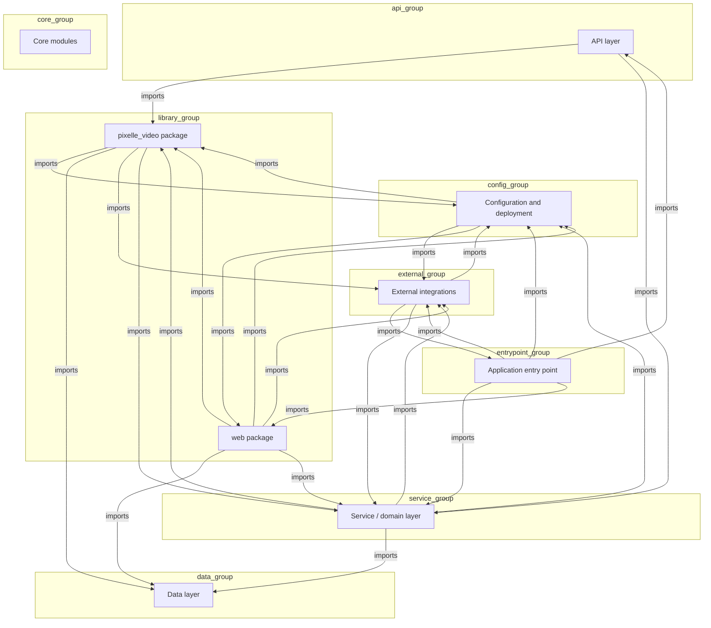

# Architecture report: ATH-MaaS/Pixelle-Video

> Automated static analysis. **Observed** = directly seen in files/imports/AST; **Inferred** = interpretation from that evidence. Repository code was not executed.

## 1. Repository at a glance

| Item | Value |
| --- | --- |
| Repository | ATH-MaaS/Pixelle-Video |
| Description | 🚀 AI 全自动短视频引擎 | AI Fully Automated Short Video Engine |
| Language | Python |
| Stars | 30101 |
| Licence | Apache-2.0 |
| Analysed commit / branch | 848b054e4fae40dabc62ec58e960b573e83793ac / main |
| Framework(s) | FastAPI |
| Files analysed | 244 |
| Components | 9 |

## 2. Architecture in one minute

ATH-MaaS/Pixelle-Video - 🚀 AI 全自动短视频引擎 | AI Fully Automated Short Video Engine. This repository was analysed statically from 244 file(s) (117 Python). Detected technologies (observed from imports/manifests): GitHub Actions, FastAPI, aiohttp, httpx, NumPy, Pydantic. Files are grouped into 9 component(s): API layer, Configuration and deployment, Core modules, Data layer, Application entry point, External integrations, pixelle_video package, Service / domain layer. Observed entry point(s): api/app.py, packaging/windows/build.py, pixelle_video/services/api_services/image_dashscope.py. Findings below distinguish observed facts from inferred interpretation.

## 3. High-level block diagram

## 4. Main components

### API layer (`api_layer`)

- **Kind:** api
- **Status:** Observed
- **Confidence:** 0.85
- **Responsibility:** Groups 26 file(s) under api layer (observed from repository paths and static analysis). Observed routes: POST /narration, POST /image-prompt, POST /title, GET /{file_path:path}, POST /render. Observed top-level classes: APIConfig, BGMInfo, BGMListResponse, BaseResponse, CapabilitiesResponse, ErrorResponse. Observed top-level functions: cancel_task, generate_image_prompt, generate_narration, generate_title_endpoint, generate_video_async, generate_video_sync.
- **Paths:** `api/__init__.py`, `api/config.py`, `api/dependencies.py`, `api/routers/__init__.py`, `api/routers/content.py`, `api/routers/files.py`, `api/routers/frame.py`, `api/routers/health.py`, `api/routers/image.py`, `api/routers/llm.py`, `api/routers/resources.py`, `api/routers/tasks.py`, `api/routers/tts.py`, `api/routers/video.py`, `api/schemas/__init__.py`, `api/schemas/base.py`, `api/schemas/content.py`, `api/schemas/frame.py`, `api/schemas/image.py`, `api/schemas/llm.py`, `api/schemas/resources.py`, `api/schemas/tts.py`, `api/schemas/video.py`, `api/tasks/__init__.py`, `api/tasks/manager.py`, `api/tasks/models.py`
- **Evidence:** [api/__init__.py](https://github.com/ATH-MaaS/Pixelle-Video/blob/848b054e4fae40dabc62ec58e960b573e83793ac/api/__init__.py); [api/config.py:21](https://github.com/ATH-MaaS/Pixelle-Video/blob/848b054e4fae40dabc62ec58e960b573e83793ac/api/config.py#L21); [api/dependencies.py:30](https://github.com/ATH-MaaS/Pixelle-Video/blob/848b054e4fae40dabc62ec58e960b573e83793ac/api/dependencies.py#L30); [api/routers/__init__.py](https://github.com/ATH-MaaS/Pixelle-Video/blob/848b054e4fae40dabc62ec58e960b573e83793ac/api/routers/__init__.py); [api/routers/content.py:41](https://github.com/ATH-MaaS/Pixelle-Video/blob/848b054e4fae40dabc62ec58e960b573e83793ac/api/routers/content.py#L41); [api/routers/files.py:28](https://github.com/ATH-MaaS/Pixelle-Video/blob/848b054e4fae40dabc62ec58e960b573e83793ac/api/routers/files.py#L28); [api/routers/frame.py:29](https://github.com/ATH-MaaS/Pixelle-Video/blob/848b054e4fae40dabc62ec58e960b573e83793ac/api/routers/frame.py#L29); [api/routers/health.py:23](https://github.com/ATH-MaaS/Pixelle-Video/blob/848b054e4fae40dabc62ec58e960b573e83793ac/api/routers/health.py#L23)

### Configuration and deployment (`config`)

- **Kind:** config
- **Status:** Observed
- **Confidence:** 0.85
- **Responsibility:** Groups 45 file(s) under configuration and deployment (observed from repository paths and static analysis). Observed top-level classes: APIKeyProviderConfig, APIProviderCommonConfig, APIProvidersConfig, AccessSecretProviderConfig, ComfyUIConfig, Config. Observed top-level functions: _provider_config, load_config_dict, render_advanced_settings, save_config_dict.
- **Paths:** `Dockerfile`, `config.example.yaml`, `docker-compose.yml`, `mkdocs.yml`, `packaging/windows/config/build_config.yaml`, `packaging/windows/requirements.txt`, `pixelle_video/config/__init__.py`, `pixelle_video/config/loader.py`, `pixelle_video/config/manager.py`, `pixelle_video/config/schema.py`, `pixelle_video/services/api_services/config.py`, `pyproject.toml`, `requirements-docs.txt`, `web/components/settings.py`, `web/i18n/locales/en_US.json`, `web/i18n/locales/zh_CN.json`, `workflows/runninghub/af_scail.json`, `workflows/runninghub/analyse_image.json`, `workflows/runninghub/digital_combination.json`, `workflows/runninghub/digital_customize.json`, `workflows/runninghub/digital_image.json`, `workflows/runninghub/i2v_LTX2.json`, `workflows/runninghub/image_Z-image.json`, `workflows/runninghub/image_flux.json`, `workflows/runninghub/image_flux2.json`, `workflows/runninghub/image_qwen.json`, `workflows/runninghub/image_qwen_chinese_cartoon.json`, `workflows/runninghub/image_sd3.5.json`, `workflows/runninghub/image_sdxl.json`, `workflows/runninghub/tts_edge.json`, `workflows/runninghub/tts_index2.json`, `workflows/runninghub/tts_spark.json`, `workflows/runninghub/video_Z_image_wan2.2.json`, `workflows/runninghub/video_qwen_wan2.2.json`, `workflows/runninghub/video_understanding.json`, `workflows/runninghub/video_wan2.1_fusionx.json`, `workflows/runninghub/video_wan2.2.json`, `workflows/selfhost/analyse_image.json`, `workflows/selfhost/analyse_video.json`, `workflows/selfhost/image_flux.json`, `workflows/selfhost/image_nano_banana.json`, `workflows/selfhost/image_qwen.json`, `workflows/selfhost/tts_edge.json`, `workflows/selfhost/tts_index2.json`, `workflows/selfhost/video_wan2.1_fusionx.json`
- **Evidence:** [Dockerfile](https://github.com/ATH-MaaS/Pixelle-Video/blob/848b054e4fae40dabc62ec58e960b573e83793ac/Dockerfile); [config.example.yaml](https://github.com/ATH-MaaS/Pixelle-Video/blob/848b054e4fae40dabc62ec58e960b573e83793ac/config.example.yaml); [docker-compose.yml](https://github.com/ATH-MaaS/Pixelle-Video/blob/848b054e4fae40dabc62ec58e960b573e83793ac/docker-compose.yml); [mkdocs.yml](https://github.com/ATH-MaaS/Pixelle-Video/blob/848b054e4fae40dabc62ec58e960b573e83793ac/mkdocs.yml); [packaging/windows/config/build_config.yaml](https://github.com/ATH-MaaS/Pixelle-Video/blob/848b054e4fae40dabc62ec58e960b573e83793ac/packaging/windows/config/build_config.yaml); [packaging/windows/requirements.txt](https://github.com/ATH-MaaS/Pixelle-Video/blob/848b054e4fae40dabc62ec58e960b573e83793ac/packaging/windows/requirements.txt); [pixelle_video/config/__init__.py](https://github.com/ATH-MaaS/Pixelle-Video/blob/848b054e4fae40dabc62ec58e960b573e83793ac/pixelle_video/config/__init__.py); [pixelle_video/config/loader.py:23](https://github.com/ATH-MaaS/Pixelle-Video/blob/848b054e4fae40dabc62ec58e960b573e83793ac/pixelle_video/config/loader.py#L23)

### Core modules (`core`)

- **Kind:** core
- **Status:** Observed
- **Confidence:** 0.85
- **Responsibility:** Groups 2 file(s) under core modules (observed from repository paths and static analysis).
- **Paths:** `docker-start.sh`, `start_web.sh`
- **Evidence:** [docker-start.sh](https://github.com/ATH-MaaS/Pixelle-Video/blob/848b054e4fae40dabc62ec58e960b573e83793ac/docker-start.sh); [start_web.sh](https://github.com/ATH-MaaS/Pixelle-Video/blob/848b054e4fae40dabc62ec58e960b573e83793ac/start_web.sh)

### Data layer (`data_layer`)

- **Kind:** data
- **Status:** Observed
- **Confidence:** 0.85
- **Responsibility:** Groups 3 file(s) under data layer (observed from repository paths and static analysis). Observed top-level classes: ContentMetadata, MediaResult, ProgressEvent, Storyboard, StoryboardConfig, StoryboardFrame.
- **Paths:** `pixelle_video/models/media.py`, `pixelle_video/models/progress.py`, `pixelle_video/models/storyboard.py`
- **Evidence:** [pixelle_video/models/media.py:21](https://github.com/ATH-MaaS/Pixelle-Video/blob/848b054e4fae40dabc62ec58e960b573e83793ac/pixelle_video/models/media.py#L21); [pixelle_video/models/progress.py:24](https://github.com/ATH-MaaS/Pixelle-Video/blob/848b054e4fae40dabc62ec58e960b573e83793ac/pixelle_video/models/progress.py#L24); [pixelle_video/models/storyboard.py:23](https://github.com/ATH-MaaS/Pixelle-Video/blob/848b054e4fae40dabc62ec58e960b573e83793ac/pixelle_video/models/storyboard.py#L23)

### Application entry point (`entrypoint`)

- **Kind:** entrypoint
- **Status:** Observed
- **Confidence:** 0.85
- **Responsibility:** Groups 12 file(s) under application entry point (observed from repository paths and static analysis). Observed application object created via FastAPI. Observed routes: GET /. Observed top-level classes: Color, DashScopeClient, DashscopeVideoClient, ImageGPT, KlingVideoClient, QwenVLClient. Observed top-level functions: _build_session, _proxy_dict, format_datetime, format_duration, format_file_size, lifespan.
- **Paths:** `api/app.py`, `packaging/windows/build.py`, `pixelle_video/services/api_services/image_dashscope.py`, `pixelle_video/services/api_services/image_gpt.py`, `pixelle_video/services/api_services/image_seedream.py`, `pixelle_video/services/api_services/video_dashscope.py`, `pixelle_video/services/api_services/video_kling.py`, `pixelle_video/services/api_services/video_seedance.py`, `pixelle_video/services/api_services/vlm_dashscope.py`, `web/app.py`, `web/pages/1_🎬_Home.py`, `web/pages/2_📚_History.py`
- **Evidence:** [api/app.py:82](https://github.com/ATH-MaaS/Pixelle-Video/blob/848b054e4fae40dabc62ec58e960b573e83793ac/api/app.py#L82); [packaging/windows/build.py:38](https://github.com/ATH-MaaS/Pixelle-Video/blob/848b054e4fae40dabc62ec58e960b573e83793ac/packaging/windows/build.py#L38); [pixelle_video/services/api_services/image_dashscope.py:22](https://github.com/ATH-MaaS/Pixelle-Video/blob/848b054e4fae40dabc62ec58e960b573e83793ac/pixelle_video/services/api_services/image_dashscope.py#L22); [pixelle_video/services/api_services/image_gpt.py:13](https://github.com/ATH-MaaS/Pixelle-Video/blob/848b054e4fae40dabc62ec58e960b573e83793ac/pixelle_video/services/api_services/image_gpt.py#L13); [pixelle_video/services/api_services/image_seedream.py:24](https://github.com/ATH-MaaS/Pixelle-Video/blob/848b054e4fae40dabc62ec58e960b573e83793ac/pixelle_video/services/api_services/image_seedream.py#L24); [pixelle_video/services/api_services/video_dashscope.py:27](https://github.com/ATH-MaaS/Pixelle-Video/blob/848b054e4fae40dabc62ec58e960b573e83793ac/pixelle_video/services/api_services/video_dashscope.py#L27); [pixelle_video/services/api_services/video_kling.py:27](https://github.com/ATH-MaaS/Pixelle-Video/blob/848b054e4fae40dabc62ec58e960b573e83793ac/pixelle_video/services/api_services/video_kling.py#L27); [pixelle_video/services/api_services/video_seedance.py:15](https://github.com/ATH-MaaS/Pixelle-Video/blob/848b054e4fae40dabc62ec58e960b573e83793ac/pixelle_video/services/api_services/video_seedance.py#L15)

### External integrations (`external_integrations`)

- **Kind:** external
- **Status:** Observed
- **Confidence:** 0.85
- **Responsibility:** Groups 3 file(s) under external integrations (observed from repository paths and static analysis). Observed top-level classes: ImageClient, VLM, VideoClient.
- **Paths:** `pixelle_video/services/api_services/image_client.py`, `pixelle_video/services/api_services/video_client.py`, `pixelle_video/services/api_services/vlm_client.py`
- **Evidence:** [pixelle_video/services/api_services/image_client.py:19](https://github.com/ATH-MaaS/Pixelle-Video/blob/848b054e4fae40dabc62ec58e960b573e83793ac/pixelle_video/services/api_services/image_client.py#L19); [pixelle_video/services/api_services/video_client.py:25](https://github.com/ATH-MaaS/Pixelle-Video/blob/848b054e4fae40dabc62ec58e960b573e83793ac/pixelle_video/services/api_services/video_client.py#L25); [pixelle_video/services/api_services/vlm_client.py:10](https://github.com/ATH-MaaS/Pixelle-Video/blob/848b054e4fae40dabc62ec58e960b573e83793ac/pixelle_video/services/api_services/vlm_client.py#L10)

### pixelle_video package (`pixelle_video`)

- **Kind:** library
- **Status:** Observed
- **Confidence:** 0.85
- **Responsibility:** Groups 25 file(s) under pixelle_video package (observed from repository paths and static analysis). Observed top-level classes: AssetBasedPipeline, BasePipeline, CustomPipeline, LinearVideoPipeline, PipelineContext, SceneScript. Observed top-level functions: _build_models_url, _get_request_semaphore, _parse_json, build_asset_script_prompt, build_content_narration_prompt, build_image_prompt.
- **Paths:** `pixelle_video/__init__.py`, `pixelle_video/llm_presets.py`, `pixelle_video/pipelines/__init__.py`, `pixelle_video/pipelines/asset_based.py`, `pixelle_video/pipelines/base.py`, `pixelle_video/pipelines/custom.py`, `pixelle_video/pipelines/linear.py`, `pixelle_video/pipelines/standard.py`, `pixelle_video/prompts/__init__.py`, `pixelle_video/prompts/asset_script_generation.py`, `pixelle_video/prompts/content_narration.py`, `pixelle_video/prompts/image_generation.py`, `pixelle_video/prompts/style_conversion.py`, `pixelle_video/prompts/title_generation.py`, `pixelle_video/prompts/topic_narration.py`, `pixelle_video/prompts/video_generation.py`, `pixelle_video/tts_voices.py`, `pixelle_video/utils/__init__.py`, `pixelle_video/utils/content_generators.py`, `pixelle_video/utils/llm_util.py`, `pixelle_video/utils/os_util.py`, `pixelle_video/utils/prompt_helper.py`, `pixelle_video/utils/template_util.py`, `pixelle_video/utils/tts_util.py`, `pixelle_video/utils/workflow_util.py`
- **Evidence:** [pixelle_video/__init__.py](https://github.com/ATH-MaaS/Pixelle-Video/blob/848b054e4fae40dabc62ec58e960b573e83793ac/pixelle_video/__init__.py); [pixelle_video/llm_presets.py:63](https://github.com/ATH-MaaS/Pixelle-Video/blob/848b054e4fae40dabc62ec58e960b573e83793ac/pixelle_video/llm_presets.py#L63); [pixelle_video/pipelines/__init__.py](https://github.com/ATH-MaaS/Pixelle-Video/blob/848b054e4fae40dabc62ec58e960b573e83793ac/pixelle_video/pipelines/__init__.py); [pixelle_video/pipelines/asset_based.py:57](https://github.com/ATH-MaaS/Pixelle-Video/blob/848b054e4fae40dabc62ec58e960b573e83793ac/pixelle_video/pipelines/asset_based.py#L57); [pixelle_video/pipelines/base.py:28](https://github.com/ATH-MaaS/Pixelle-Video/blob/848b054e4fae40dabc62ec58e960b573e83793ac/pixelle_video/pipelines/base.py#L28); [pixelle_video/pipelines/custom.py:39](https://github.com/ATH-MaaS/Pixelle-Video/blob/848b054e4fae40dabc62ec58e960b573e83793ac/pixelle_video/pipelines/custom.py#L39); [pixelle_video/pipelines/linear.py:35](https://github.com/ATH-MaaS/Pixelle-Video/blob/848b054e4fae40dabc62ec58e960b573e83793ac/pixelle_video/pipelines/linear.py#L35); [pixelle_video/pipelines/standard.py:55](https://github.com/ATH-MaaS/Pixelle-Video/blob/848b054e4fae40dabc62ec58e960b573e83793ac/pixelle_video/pipelines/standard.py#L55)

### Service / domain layer (`service_layer`)

- **Kind:** service
- **Status:** Observed
- **Confidence:** 0.85
- **Responsibility:** Groups 17 file(s) under service / domain layer (observed from repository paths and static analysis). Observed top-level classes: APIAssetAnalysisService, APIProviderMediaService, ComfyBaseService, FrameProcessor, HTMLFrameGenerator, HistoryManager. Observed top-level functions: check_ffmpeg.
- **Paths:** `pixelle_video/service.py`, `pixelle_video/services/__init__.py`, `pixelle_video/services/api_asset_analysis.py`, `pixelle_video/services/api_media.py`, `pixelle_video/services/api_services/__init__.py`, `pixelle_video/services/api_services/image_processor.py`, `pixelle_video/services/comfy_base_service.py`, `pixelle_video/services/frame_html.py`, `pixelle_video/services/frame_processor.py`, `pixelle_video/services/history_manager.py`, `pixelle_video/services/image_analysis.py`, `pixelle_video/services/llm_service.py`, `pixelle_video/services/media.py`, `pixelle_video/services/persistence.py`, `pixelle_video/services/tts_service.py`, `pixelle_video/services/video.py`, `pixelle_video/services/video_analysis.py`
- **Evidence:** [pixelle_video/service.py:43](https://github.com/ATH-MaaS/Pixelle-Video/blob/848b054e4fae40dabc62ec58e960b573e83793ac/pixelle_video/service.py#L43); [pixelle_video/services/__init__.py](https://github.com/ATH-MaaS/Pixelle-Video/blob/848b054e4fae40dabc62ec58e960b573e83793ac/pixelle_video/services/__init__.py); [pixelle_video/services/api_asset_analysis.py:25](https://github.com/ATH-MaaS/Pixelle-Video/blob/848b054e4fae40dabc62ec58e960b573e83793ac/pixelle_video/services/api_asset_analysis.py#L25); [pixelle_video/services/api_media.py:20](https://github.com/ATH-MaaS/Pixelle-Video/blob/848b054e4fae40dabc62ec58e960b573e83793ac/pixelle_video/services/api_media.py#L20); [pixelle_video/services/api_services/__init__.py](https://github.com/ATH-MaaS/Pixelle-Video/blob/848b054e4fae40dabc62ec58e960b573e83793ac/pixelle_video/services/api_services/__init__.py); [pixelle_video/services/api_services/image_processor.py:10](https://github.com/ATH-MaaS/Pixelle-Video/blob/848b054e4fae40dabc62ec58e960b573e83793ac/pixelle_video/services/api_services/image_processor.py#L10); [pixelle_video/services/comfy_base_service.py:32](https://github.com/ATH-MaaS/Pixelle-Video/blob/848b054e4fae40dabc62ec58e960b573e83793ac/pixelle_video/services/comfy_base_service.py#L32); [pixelle_video/services/frame_html.py:41](https://github.com/ATH-MaaS/Pixelle-Video/blob/848b054e4fae40dabc62ec58e960b573e83793ac/pixelle_video/services/frame_html.py#L41)

### web package (`web`)

- **Kind:** library
- **Status:** Observed
- **Confidence:** 0.85
- **Responsibility:** Groups 25 file(s) under web package (observed from repository paths and static analysis). Observed top-level classes: ActionTransferPipelineUI, AssetBasedPipelineUI, DigitalHumanPipelineUI, ImageToVideoPipelineUI, PipelineUI, SimpleBatchManager. Observed top-level functions: _probe_video_duration, _show_js_alert, check_and_warn_selfhost_workflow, detect_system_language, get_all_pipeline_uis, get_available_languages.
- **Paths:** `web/__init__.py`, `web/components/__init__.py`, `web/components/content_input.py`, `web/components/digital_tts_config.py`, `web/components/faq.py`, `web/components/header.py`, `web/components/output_preview.py`, `web/components/style_config.py`, `web/i18n/__init__.py`, `web/pages/__init__.py`, `web/pipelines/__init__.py`, `web/pipelines/action_transfer.py`, `web/pipelines/api_workflows.py`, `web/pipelines/asset_based.py`, `web/pipelines/base.py`, `web/pipelines/digital_human.py`, `web/pipelines/i2v.py`, `web/pipelines/standard.py`, `web/state/__init__.py`, `web/state/session.py`, `web/utils/__init__.py`, `web/utils/async_helpers.py`, `web/utils/batch_manager.py`, `web/utils/history_persistence.py`, `web/utils/streamlit_helpers.py`
- **Evidence:** [web/__init__.py](https://github.com/ATH-MaaS/Pixelle-Video/blob/848b054e4fae40dabc62ec58e960b573e83793ac/web/__init__.py); [web/components/__init__.py](https://github.com/ATH-MaaS/Pixelle-Video/blob/848b054e4fae40dabc62ec58e960b573e83793ac/web/components/__init__.py); [web/components/content_input.py:23](https://github.com/ATH-MaaS/Pixelle-Video/blob/848b054e4fae40dabc62ec58e960b573e83793ac/web/components/content_input.py#L23); [web/components/digital_tts_config.py:28](https://github.com/ATH-MaaS/Pixelle-Video/blob/848b054e4fae40dabc62ec58e960b573e83793ac/web/components/digital_tts_config.py#L28); [web/components/faq.py:27](https://github.com/ATH-MaaS/Pixelle-Video/blob/848b054e4fae40dabc62ec58e960b573e83793ac/web/components/faq.py#L27); [web/components/header.py:23](https://github.com/ATH-MaaS/Pixelle-Video/blob/848b054e4fae40dabc62ec58e960b573e83793ac/web/components/header.py#L23); [web/components/output_preview.py:30](https://github.com/ATH-MaaS/Pixelle-Video/blob/848b054e4fae40dabc62ec58e960b573e83793ac/web/components/output_preview.py#L30); [web/components/style_config.py:38](https://github.com/ATH-MaaS/Pixelle-Video/blob/848b054e4fae40dabc62ec58e960b573e83793ac/web/components/style_config.py#L38)

## 5. Execution flow

**Observed** entry point(s):

- [api/app.py:82](https://github.com/ATH-MaaS/Pixelle-Video/blob/848b054e4fae40dabc62ec58e960b573e83793ac/api/app.py#L82)
- [packaging/windows/build.py:689](https://github.com/ATH-MaaS/Pixelle-Video/blob/848b054e4fae40dabc62ec58e960b573e83793ac/packaging/windows/build.py#L689)
- [pixelle_video/services/api_services/image_dashscope.py:192](https://github.com/ATH-MaaS/Pixelle-Video/blob/848b054e4fae40dabc62ec58e960b573e83793ac/pixelle_video/services/api_services/image_dashscope.py#L192)
- [pixelle_video/services/api_services/image_gpt.py:148](https://github.com/ATH-MaaS/Pixelle-Video/blob/848b054e4fae40dabc62ec58e960b573e83793ac/pixelle_video/services/api_services/image_gpt.py#L148)
- [pixelle_video/services/api_services/image_seedream.py:247](https://github.com/ATH-MaaS/Pixelle-Video/blob/848b054e4fae40dabc62ec58e960b573e83793ac/pixelle_video/services/api_services/image_seedream.py#L247)
- [pixelle_video/services/api_services/video_dashscope.py:570](https://github.com/ATH-MaaS/Pixelle-Video/blob/848b054e4fae40dabc62ec58e960b573e83793ac/pixelle_video/services/api_services/video_dashscope.py#L570)
- [pixelle_video/services/api_services/video_kling.py:407](https://github.com/ATH-MaaS/Pixelle-Video/blob/848b054e4fae40dabc62ec58e960b573e83793ac/pixelle_video/services/api_services/video_kling.py#L407)
- [pixelle_video/services/api_services/video_seedance.py:179](https://github.com/ATH-MaaS/Pixelle-Video/blob/848b054e4fae40dabc62ec58e960b573e83793ac/pixelle_video/services/api_services/video_seedance.py#L179)
- [pixelle_video/services/api_services/vlm_dashscope.py:83](https://github.com/ATH-MaaS/Pixelle-Video/blob/848b054e4fae40dabc62ec58e960b573e83793ac/pixelle_video/services/api_services/vlm_dashscope.py#L83)
- [web/app.py:61](https://github.com/ATH-MaaS/Pixelle-Video/blob/848b054e4fae40dabc62ec58e960b573e83793ac/web/app.py#L61)
- [web/pages/1_🎬_Home.py:87](https://github.com/ATH-MaaS/Pixelle-Video/blob/848b054e4fae40dabc62ec58e960b573e83793ac/web/pages/1_%F0%9F%8E%AC_Home.py#L87)
- [web/pages/2_📚_History.py:465](https://github.com/ATH-MaaS/Pixelle-Video/blob/848b054e4fae40dabc62ec58e960b573e83793ac/web/pages/2_%F0%9F%93%9A_History.py#L465)

**Observed** routes (from decorators):

- `GET /` -> `root` in `api/app.py:139`
- `POST /narration` -> `generate_narration` in `api/routers/content.py:41`
- `POST /image-prompt` -> `generate_image_prompt` in `api/routers/content.py:79`
- `POST /title` -> `generate_title_endpoint` in `api/routers/content.py:115`
- `GET /{file_path:path}` -> `get_file` in `api/routers/files.py:28`
- `POST /render` -> `render_frame` in `api/routers/frame.py:29`
- `GET /template/params` -> `get_template_params` in `api/routers/frame.py:87`
- `GET /health` -> `health_check` in `api/routers/health.py:37`
- `GET /version` -> `get_version` in `api/routers/health.py:47`
- `POST /generate` -> `image_generate` in `api/routers/image.py:27`
- `POST /chat` -> `llm_chat` in `api/routers/llm.py:27`
- `GET /workflows/tts` -> `list_tts_workflows` in `api/routers/resources.py:39`
- `GET /workflows/media` -> `list_media_workflows` in `api/routers/resources.py:80`
- `GET /workflows/image` -> `list_image_workflows` in `api/routers/resources.py:125`
- `GET /templates` -> `list_templates` in `api/routers/resources.py:149`
- `GET /bgm` -> `list_bgm` in `api/routers/resources.py:200`
- `GET ` -> `list_tasks` in `api/routers/tasks.py:29`
- `GET /{task_id}` -> `get_task` in `api/routers/tasks.py:53`
- `DELETE /{task_id}` -> `cancel_task` in `api/routers/tasks.py:79`
- `POST /synthesize` -> `tts_synthesize` in `api/routers/tts.py:28`
- `POST /generate/sync` -> `generate_video_sync` in `api/routers/video.py:89`
- `POST /generate/async` -> `generate_video_async` in `api/routers/video.py:179`

Representative flow (derived from observed entry points and the import graph; steps beyond the entry point are **Inferred**):

1. Execution starts at an observed entry point listed above, if present.
2. `api_layer` imports `pixelle_video` (API layer -> pixelle_video package).
3. `api_layer` imports `service_layer` (API layer -> Service / domain layer).
4. `config` imports `external_integrations` (Configuration and deployment -> External integrations).
5. `config` imports `pixelle_video` (Configuration and deployment -> pixelle_video package).
6. `config` imports `web` (Configuration and deployment -> web package).
7. `entrypoint` imports `api_layer` (Application entry point -> API layer).
8. `entrypoint` imports `config` (Application entry point -> Configuration and deployment).
9. `entrypoint` imports `external_integrations` (Application entry point -> External integrations).

## 6. Project structure

### `(root)`

- `.dockerignore` - container (668 bytes)
- `.gitignore` - other (609 bytes)
- `Dockerfile` - container (2398 bytes)
- `LICENSE` - docs (11357 bytes)
- `NOTICE` - docs (16139 bytes)
- `README.md` - docs (20845 bytes)
- `README_EN.md` - docs (21926 bytes)
- `config.example.yaml` - config (3874 bytes)
- `docker-compose.yml` - container (3922 bytes)
- `docker-start.sh` - source, Shell (2597 bytes)
- `mkdocs.yml` - config (4847 bytes)
- `pyproject.toml` - manifest (1184 bytes)
- `requirements-docs.txt` - manifest (188 bytes)
- `start_web.bat` - other (1211 bytes)
- `start_web.sh` - source, Shell (147 bytes)

### `.devcontainer`

- `.devcontainer/devcontainer.json` - config (258 bytes)
- `.devcontainer/postCreate.sh` - source, Shell (1914 bytes)
- `.devcontainer/postStart.sh` - source, Shell (1503 bytes)

### `.github`

- `.github/workflows/docs.yml` - ci, YAML (1025 bytes)

### `api`

- `api/__init__.py` - source, Python (659 bytes)
- `api/app.py` - source, Python (6264 bytes)
- `api/config.py` - source, Python (1430 bytes)
- `api/dependencies.py` - source, Python (1901 bytes)
- `api/routers/__init__.py` - source, Python (1348 bytes)
- `api/routers/content.py` - source, Python (4422 bytes)
- `api/routers/files.py` - source, Python (4481 bytes)
- `api/routers/frame.py` - source, Python (5121 bytes)
- `api/routers/health.py` - source, Python (1394 bytes)
- `api/routers/image.py` - source, Python (2313 bytes)
- `api/routers/llm.py` - source, Python (1876 bytes)
- `api/routers/resources.py` - source, Python (8931 bytes)
- `api/routers/tasks.py` - source, Python (3068 bytes)
- `api/routers/tts.py` - source, Python (3000 bytes)
- `api/routers/video.py` - source, Python (11599 bytes)
- `api/schemas/__init__.py` - source, Python (1775 bytes)
- `api/schemas/base.py` - source, Python (939 bytes)
- `api/schemas/content.py` - source, Python (3702 bytes)
- `api/schemas/frame.py` - source, Python (2704 bytes)
- `api/schemas/image.py` - source, Python (1508 bytes)
- `api/schemas/llm.py` - source, Python (1474 bytes)
- `api/schemas/resources.py` - source, Python (2680 bytes)
- `api/schemas/tts.py` - source, Python (1833 bytes)
- `api/schemas/video.py` - source, Python (4708 bytes)
- `api/tasks/__init__.py` - source, Python (780 bytes)
- `api/tasks/manager.py` - source, Python (8141 bytes)
- `api/tasks/models.py` - source, Python (1800 bytes)

### `docs`

- `docs/FAQ.md` - docs (3802 bytes)
- `docs/FAQ_CN.md` - docs (3551 bytes)
- `docs/en/development/architecture.md` - docs (912 bytes)
- `docs/en/development/contributing.md` - docs (938 bytes)
- `docs/en/faq.md` - docs (1919 bytes)
- `docs/en/gallery/index.md` - docs (1480 bytes)
- `docs/en/getting-started/configuration.md` - docs (1509 bytes)
- `docs/en/getting-started/installation.md` - docs (3474 bytes)
- `docs/en/getting-started/quick-start.md` - docs (2823 bytes)
- `docs/en/index.md` - docs (3987 bytes)
- `docs/en/reference/api-overview.md` - docs (3282 bytes)
- `docs/en/reference/config-schema.md` - docs (2382 bytes)
- `docs/en/troubleshooting.md` - docs (1957 bytes)
- `docs/en/tutorials/custom-style.md` - docs (669 bytes)
- `docs/en/tutorials/voice-cloning.md` - docs (647 bytes)
- `docs/en/tutorials/your-first-video.md` - docs (631 bytes)
- `docs/en/user-guide/api.md` - docs (746 bytes)
- `docs/en/user-guide/templates.md` - docs (8647 bytes)
- `docs/en/user-guide/web-ui.md` - docs (2223 bytes)
- `docs/en/user-guide/workflows.md` - docs (1696 bytes)
- `docs/gallery/index.md` - docs (2575 bytes)
- `docs/gallery/reading-habit/prompts.txt` - docs (30 bytes)
- `docs/stylesheets/extra.css` - docs (288 bytes)
- `docs/zh/development/architecture.md` - docs (758 bytes)
- `docs/zh/development/contributing.md` - docs (842 bytes)
- `docs/zh/faq.md` - docs (1936 bytes)
- `docs/zh/gallery/index.md` - docs (1461 bytes)
- `docs/zh/getting-started/configuration.md` - docs (1433 bytes)
- `docs/zh/getting-started/installation.md` - docs (3150 bytes)
- `docs/zh/getting-started/quick-start.md` - docs (2679 bytes)
- `docs/zh/index.md` - docs (3911 bytes)
- `docs/zh/reference/api-overview.md` - docs (3120 bytes)
- `docs/zh/reference/config-schema.md` - docs (2288 bytes)
- `docs/zh/troubleshooting.md` - docs (1808 bytes)
- `docs/zh/tutorials/custom-style.md` - docs (598 bytes)
- `docs/zh/tutorials/voice-cloning.md` - docs (601 bytes)
- `docs/zh/tutorials/your-first-video.md` - docs (593 bytes)
- `docs/zh/user-guide/api.md` - docs (714 bytes)
- `docs/zh/user-guide/templates.md` - docs (7886 bytes)
- `docs/zh/user-guide/web-ui.md` - docs (2022 bytes)
- `docs/zh/user-guide/workflows.md` - docs (1566 bytes)

### `packaging`

- `packaging/windows/README.md` - docs (4459 bytes)
- `packaging/windows/build.py` - source, Python (27653 bytes)
- `packaging/windows/config/build_config.yaml` - config (2617 bytes)
- `packaging/windows/requirements.txt` - manifest (108 bytes)
- `packaging/windows/templates/README.txt` - docs (3264 bytes)
- `packaging/windows/templates/start.bat` - other (1137 bytes)

### `pixelle_video`

- `pixelle_video/__init__.py` - source, Python (1670 bytes)
- `pixelle_video/config/__init__.py` - source, Python (1513 bytes)
- `pixelle_video/config/loader.py` - source, Python (2015 bytes)
- `pixelle_video/config/manager.py` - source, Python (6967 bytes)
- `pixelle_video/config/schema.py` - source, Python (6962 bytes)
- `pixelle_video/llm_presets.py` - source, Python (2690 bytes)
- `pixelle_video/models/media.py` - source, Python (1973 bytes)
- `pixelle_video/models/progress.py` - source, Python (2250 bytes)
- `pixelle_video/models/storyboard.py` - source, Python (6127 bytes)
- `pixelle_video/pipelines/__init__.py` - source, Python (1216 bytes)
- `pixelle_video/pipelines/asset_based.py` - source, Python (41339 bytes)
- `pixelle_video/pipelines/base.py` - source, Python (3942 bytes)
- `pixelle_video/pipelines/custom.py` - source, Python (22629 bytes)
- `pixelle_video/pipelines/linear.py` - source, Python (5392 bytes)
- `pixelle_video/pipelines/standard.py` - source, Python (23600 bytes)
- `pixelle_video/prompts/__init__.py` - source, Python (1483 bytes)
- `pixelle_video/prompts/asset_script_generation.py` - source, Python (3270 bytes)
- `pixelle_video/prompts/content_narration.py` - source, Python (4548 bytes)
- `pixelle_video/prompts/image_generation.py` - source, Python (6285 bytes)
- `pixelle_video/prompts/style_conversion.py` - source, Python (1787 bytes)
- `pixelle_video/prompts/title_generation.py` - source, Python (3226 bytes)
- `pixelle_video/prompts/topic_narration.py` - source, Python (9626 bytes)
- `pixelle_video/prompts/video_generation.py` - source, Python (6187 bytes)
- `pixelle_video/service.py` - source, Python (12359 bytes)
- `pixelle_video/services/__init__.py` - source, Python (1812 bytes)
- `pixelle_video/services/api_asset_analysis.py` - source, Python (6047 bytes)
- `pixelle_video/services/api_media.py` - source, Python (36466 bytes)
- `pixelle_video/services/api_services/__init__.py` - source, Python (60 bytes)
- `pixelle_video/services/api_services/config.py` - source, Python (1983 bytes)
- `pixelle_video/services/api_services/image_client.py` - source, Python (10810 bytes)
- `pixelle_video/services/api_services/image_dashscope.py` - source, Python (9812 bytes)
- `pixelle_video/services/api_services/image_gpt.py` - source, Python (8124 bytes)
- `pixelle_video/services/api_services/image_processor.py` - source, Python (16394 bytes)
- `pixelle_video/services/api_services/image_seedream.py` - source, Python (10527 bytes)
- `pixelle_video/services/api_services/video_client.py` - source, Python (11553 bytes)
- `pixelle_video/services/api_services/video_dashscope.py` - source, Python (25147 bytes)
- `pixelle_video/services/api_services/video_kling.py` - source, Python (16171 bytes)
- `pixelle_video/services/api_services/video_seedance.py` - source, Python (8560 bytes)
- `pixelle_video/services/api_services/vlm_client.py` - source, Python (3588 bytes)
- `pixelle_video/services/api_services/vlm_dashscope.py` - source, Python (4699 bytes)
- `pixelle_video/services/comfy_base_service.py` - source, Python (12290 bytes)
- `pixelle_video/services/frame_html.py` - source, Python (17304 bytes)
- `pixelle_video/services/frame_processor.py` - source, Python (20478 bytes)
- `pixelle_video/services/history_manager.py` - source, Python (6923 bytes)
- `pixelle_video/services/image_analysis.py` - source, Python (8063 bytes)
- `pixelle_video/services/llm_service.py` - source, Python (12380 bytes)
- `pixelle_video/services/media.py` - source, Python (12680 bytes)
- `pixelle_video/services/persistence.py` - source, Python (26112 bytes)
- `pixelle_video/services/tts_service.py` - source, Python (12483 bytes)
- `pixelle_video/services/video.py` - source, Python (38724 bytes)
- `pixelle_video/services/video_analysis.py` - source, Python (8729 bytes)
- `pixelle_video/tts_voices.py` - source, Python (6455 bytes)
- `pixelle_video/utils/__init__.py` - source, Python (635 bytes)
- `pixelle_video/utils/content_generators.py` - source, Python (17603 bytes)
- `pixelle_video/utils/llm_util.py` - source, Python (4742 bytes)
- `pixelle_video/utils/os_util.py` - source, Python (14433 bytes)
- `pixelle_video/utils/prompt_helper.py` - source, Python (1477 bytes)
- `pixelle_video/utils/template_util.py` - source, Python (16553 bytes)
- `pixelle_video/utils/tts_util.py` - source, Python (14348 bytes)
- `pixelle_video/utils/workflow_util.py` - source, Python (2154 bytes)

### `templates`

- `templates/1080x1080/image_minimal_framed.html` - other (2612 bytes)
- `templates/1080x1920/asset_default.html` - other (4833 bytes)
- `templates/1080x1920/image_blur_card.html` - other (6657 bytes)
- `templates/1080x1920/image_book.html` - other (3767 bytes)
- `templates/1080x1920/image_cartoon.html` - other (6549 bytes)
- `templates/1080x1920/image_default.html` - other (14828 bytes)
- `templates/1080x1920/image_elegant.html` - other (18721 bytes)
- `templates/1080x1920/image_excerpt.html` - other (3646 bytes)
- `templates/1080x1920/image_fashion_vintage.html` - other (4860 bytes)
- `templates/1080x1920/image_full.html` - other (5413 bytes)
- `templates/1080x1920/image_healing.html` - other (4179 bytes)
- `templates/1080x1920/image_health_preservation.html` - other (3181 bytes)
- `templates/1080x1920/image_life_insights.html` - other (4078 bytes)
- `templates/1080x1920/image_life_insights_light.html` - other (6714 bytes)
- `templates/1080x1920/image_long_text.html` - other (3440 bytes)
- `templates/1080x1920/image_modern.html` - other (15845 bytes)
- `templates/1080x1920/image_neon.html` - other (23536 bytes)
- `templates/1080x1920/image_psychology_card.html` - other (2971 bytes)
- `templates/1080x1920/image_purple.html` - other (21223 bytes)
- `templates/1080x1920/image_satirical_cartoon.html` - other (10332 bytes)
- `templates/1080x1920/image_simple_black.html` - other (4553 bytes)
- `templates/1080x1920/image_simple_line_drawing.html` - other (4741 bytes)
- `templates/1080x1920/static_default.html` - other (7644 bytes)
- `templates/1080x1920/static_excerpt.html` - other (3397 bytes)
- `templates/1080x1920/video_default.html` - other (11235 bytes)
- `templates/1080x1920/video_healing.html` - other (4441 bytes)
- `templates/1920x1080/image_book.html` - other (5746 bytes)
- `templates/1920x1080/image_film.html` - other (5417 bytes)
- `templates/1920x1080/image_full.html` - other (5658 bytes)
- `templates/1920x1080/image_ultrawide_minimal.html` - other (4924 bytes)
- `templates/1920x1080/image_wide_darktech.html` - other (8761 bytes)

### `web`

- `web/__init__.py` - source, Python (677 bytes)
- `web/app.py` - source, Python (1717 bytes)
- `web/components/__init__.py` - source, Python (39 bytes)
- `web/components/content_input.py` - source, Python (10914 bytes)
- `web/components/digital_tts_config.py` - source, Python (8832 bytes)
- `web/components/faq.py` - source, Python (4988 bytes)
- `web/components/header.py` - source, Python (1735 bytes)
- `web/components/output_preview.py` - source, Python (18638 bytes)
- `web/components/settings.py` - source, Python (25311 bytes)
- `web/components/style_config.py` - source, Python (45574 bytes)
- `web/i18n/__init__.py` - source, Python (9024 bytes)
- `web/i18n/locales/en_US.json` - config (36158 bytes)
- `web/i18n/locales/zh_CN.json` - config (34693 bytes)
- `web/pages/1_🎬_Home.py` - source, Python (2670 bytes)
- `web/pages/2_📚_History.py` - source, Python (16922 bytes)
- `web/pages/__init__.py` - source, Python (31 bytes)
- `web/pipelines/__init__.py` - source, Python (1166 bytes)
- `web/pipelines/action_transfer.py` - source, Python (23054 bytes)
- `web/pipelines/api_workflows.py` - source, Python (11255 bytes)
- `web/pipelines/asset_based.py` - source, Python (29712 bytes)
- `web/pipelines/base.py` - source, Python (1785 bytes)
- `web/pipelines/digital_human.py` - source, Python (53186 bytes)
- `web/pipelines/i2v.py` - source, Python (18084 bytes)
- `web/pipelines/standard.py` - source, Python (3147 bytes)
- `web/state/__init__.py` - source, Python (35 bytes)
- `web/state/session.py` - source, Python (3355 bytes)
- `web/utils/__init__.py` - source, Python (36 bytes)
- `web/utils/async_helpers.py` - source, Python (2241 bytes)
- `web/utils/batch_manager.py` - source, Python (6127 bytes)
- `web/utils/history_persistence.py` - source, Python (2583 bytes)
- `web/utils/streamlit_helpers.py` - source, Python (3251 bytes)

### `workflows`

- `workflows/runninghub/af_scail.json` - config (72 bytes)
- `workflows/runninghub/analyse_image.json` - config (72 bytes)
- `workflows/runninghub/digital_combination.json` - config (72 bytes)
- `workflows/runninghub/digital_customize.json` - config (72 bytes)
- `workflows/runninghub/digital_image.json` - config (72 bytes)
- `workflows/runninghub/i2v_LTX2.json` - config (72 bytes)
- `workflows/runninghub/image_Z-image.json` - config (69 bytes)
- `workflows/runninghub/image_flux.json` - config (70 bytes)
- `workflows/runninghub/image_flux2.json` - config (69 bytes)
- `workflows/runninghub/image_qwen.json` - config (70 bytes)
- `workflows/runninghub/image_qwen_chinese_cartoon.json` - config (70 bytes)
- `workflows/runninghub/image_sd3.5.json` - config (70 bytes)
- `workflows/runninghub/image_sdxl.json` - config (70 bytes)
- `workflows/runninghub/tts_edge.json` - config (70 bytes)
- `workflows/runninghub/tts_index2.json` - config (70 bytes)
- `workflows/runninghub/tts_spark.json` - config (70 bytes)
- `workflows/runninghub/video_Z_image_wan2.2.json` - config (70 bytes)
- `workflows/runninghub/video_qwen_wan2.2.json` - config (70 bytes)
- `workflows/runninghub/video_understanding.json` - config (72 bytes)
- `workflows/runninghub/video_wan2.1_fusionx.json` - config (70 bytes)
- `workflows/runninghub/video_wan2.2.json` - config (68 bytes)
- `workflows/selfhost/analyse_image.json` - config (1678 bytes)
- `workflows/selfhost/analyse_video.json` - config (2660 bytes)
- `workflows/selfhost/image_flux.json` - config (2946 bytes)
- `workflows/selfhost/image_nano_banana.json` - config (606 bytes)
- `workflows/selfhost/image_qwen.json` - config (3021 bytes)
- `workflows/selfhost/tts_edge.json` - config (1258 bytes)
- `workflows/selfhost/tts_index2.json` - config (1172 bytes)
- `workflows/selfhost/video_wan2.1_fusionx.json` - config (3560 bytes)

## 7. Key dependencies and integrations

| Name | Category | Status | Confidence | Evidence |
| --- | --- | --- | --- | --- |
| GitHub Actions | ci | Observed | 0.85 | [.github/workflows/docs.yml](https://github.com/ATH-MaaS/Pixelle-Video/blob/848b054e4fae40dabc62ec58e960b573e83793ac/.github/workflows/docs.yml) |
| FastAPI | framework | Observed | 0.95 | [api/app.py:37](https://github.com/ATH-MaaS/Pixelle-Video/blob/848b054e4fae40dabc62ec58e960b573e83793ac/api/app.py#L37); [api/app.py:38](https://github.com/ATH-MaaS/Pixelle-Video/blob/848b054e4fae40dabc62ec58e960b573e83793ac/api/app.py#L38); [api/dependencies.py:20](https://github.com/ATH-MaaS/Pixelle-Video/blob/848b054e4fae40dabc62ec58e960b573e83793ac/api/dependencies.py#L20); [api/routers/content.py:19](https://github.com/ATH-MaaS/Pixelle-Video/blob/848b054e4fae40dabc62ec58e960b573e83793ac/api/routers/content.py#L19) |
| aiohttp | library | Observed | 0.95 | [pixelle_video/services/image_analysis.py:179](https://github.com/ATH-MaaS/Pixelle-Video/blob/848b054e4fae40dabc62ec58e960b573e83793ac/pixelle_video/services/image_analysis.py#L179); [pixelle_video/services/video_analysis.py:186](https://github.com/ATH-MaaS/Pixelle-Video/blob/848b054e4fae40dabc62ec58e960b573e83793ac/pixelle_video/services/video_analysis.py#L186); [pixelle_video/utils/tts_util.py:27](https://github.com/ATH-MaaS/Pixelle-Video/blob/848b054e4fae40dabc62ec58e960b573e83793ac/pixelle_video/utils/tts_util.py#L27) |
| httpx | library | Observed | 0.95 | [pixelle_video/services/api_services/image_gpt.py:5](https://github.com/ATH-MaaS/Pixelle-Video/blob/848b054e4fae40dabc62ec58e960b573e83793ac/pixelle_video/services/api_services/image_gpt.py#L5); [pixelle_video/services/api_services/image_seedream.py:10](https://github.com/ATH-MaaS/Pixelle-Video/blob/848b054e4fae40dabc62ec58e960b573e83793ac/pixelle_video/services/api_services/image_seedream.py#L10); [pixelle_video/services/frame_processor.py:25](https://github.com/ATH-MaaS/Pixelle-Video/blob/848b054e4fae40dabc62ec58e960b573e83793ac/pixelle_video/services/frame_processor.py#L25); [pixelle_video/services/tts_service.py:296](https://github.com/ATH-MaaS/Pixelle-Video/blob/848b054e4fae40dabc62ec58e960b573e83793ac/pixelle_video/services/tts_service.py#L296) |
| NumPy | library | Observed | 0.90 | [pixelle_video/services/api_services/image_processor.py:3](https://github.com/ATH-MaaS/Pixelle-Video/blob/848b054e4fae40dabc62ec58e960b573e83793ac/pixelle_video/services/api_services/image_processor.py#L3); [pyproject.toml:33](https://github.com/ATH-MaaS/Pixelle-Video/blob/848b054e4fae40dabc62ec58e960b573e83793ac/pyproject.toml#L33) |
| Pydantic | library | Observed | 0.95 | [api/config.py:18](https://github.com/ATH-MaaS/Pixelle-Video/blob/848b054e4fae40dabc62ec58e960b573e83793ac/api/config.py#L18); [api/routers/health.py:18](https://github.com/ATH-MaaS/Pixelle-Video/blob/848b054e4fae40dabc62ec58e960b573e83793ac/api/routers/health.py#L18); [api/schemas/base.py:18](https://github.com/ATH-MaaS/Pixelle-Video/blob/848b054e4fae40dabc62ec58e960b573e83793ac/api/schemas/base.py#L18); [api/schemas/content.py:18](https://github.com/ATH-MaaS/Pixelle-Video/blob/848b054e4fae40dabc62ec58e960b573e83793ac/api/schemas/content.py#L18) |
| requests | library | Observed | 0.95 | [pixelle_video/services/api_services/image_processor.py:2](https://github.com/ATH-MaaS/Pixelle-Video/blob/848b054e4fae40dabc62ec58e960b573e83793ac/pixelle_video/services/api_services/image_processor.py#L2); [pixelle_video/services/api_services/image_seedream.py:225](https://github.com/ATH-MaaS/Pixelle-Video/blob/848b054e4fae40dabc62ec58e960b573e83793ac/pixelle_video/services/api_services/image_seedream.py#L225); [pixelle_video/services/api_services/video_dashscope.py:21](https://github.com/ATH-MaaS/Pixelle-Video/blob/848b054e4fae40dabc62ec58e960b573e83793ac/pixelle_video/services/api_services/video_dashscope.py#L21); [pixelle_video/services/api_services/video_dashscope.py:22](https://github.com/ATH-MaaS/Pixelle-Video/blob/848b054e4fae40dabc62ec58e960b573e83793ac/pixelle_video/services/api_services/video_dashscope.py#L22) |
| Uvicorn | library | Observed | 0.90 | [api/app.py:161](https://github.com/ATH-MaaS/Pixelle-Video/blob/848b054e4fae40dabc62ec58e960b573e83793ac/api/app.py#L161); [pyproject.toml:24](https://github.com/ATH-MaaS/Pixelle-Video/blob/848b054e4fae40dabc62ec58e960b573e83793ac/pyproject.toml#L24) |
| Poetry | packaging | Observed | 0.85 | [pyproject.toml](https://github.com/ATH-MaaS/Pixelle-Video/blob/848b054e4fae40dabc62ec58e960b573e83793ac/pyproject.toml) |
| Docker | tooling | Observed | 0.85 | [Dockerfile](https://github.com/ATH-MaaS/Pixelle-Video/blob/848b054e4fae40dabc62ec58e960b573e83793ac/Dockerfile) |
| Docker Compose | tooling | Observed | 0.85 | [docker-compose.yml](https://github.com/ATH-MaaS/Pixelle-Video/blob/848b054e4fae40dabc62ec58e960b573e83793ac/docker-compose.yml) |
| pytest | tooling | Observed | 0.85 | [pyproject.toml:38](https://github.com/ATH-MaaS/Pixelle-Video/blob/848b054e4fae40dabc62ec58e960b573e83793ac/pyproject.toml#L38) |

## 8. Data and state

- Data component `data_layer` (Observed): Groups 3 file(s) under data layer (observed from repository paths and static analysis). Observed top-level classes: ContentMetadata, MediaResult, ProgressEvent, Storyboard, StoryboardConfig, StoryboardFrame.

## 9. Configuration and deployment clues

- `.devcontainer/devcontainer.json` (config)
- `.dockerignore` (container)
- `.github/workflows/docs.yml` (ci)
- `Dockerfile` (container)
- `config.example.yaml` (config)
- `docker-compose.yml` (container)
- `mkdocs.yml` (config)
- `packaging/windows/config/build_config.yaml` (config)
- `packaging/windows/requirements.txt` (manifest)
- `pyproject.toml` (manifest)
- `requirements-docs.txt` (manifest)
- `web/i18n/locales/en_US.json` (config)
- `web/i18n/locales/zh_CN.json` (config)
- `workflows/runninghub/af_scail.json` (config)
- `workflows/runninghub/analyse_image.json` (config)
- `workflows/runninghub/digital_combination.json` (config)
- `workflows/runninghub/digital_customize.json` (config)
- `workflows/runninghub/digital_image.json` (config)
- `workflows/runninghub/i2v_LTX2.json` (config)
- `workflows/runninghub/image_Z-image.json` (config)
- `workflows/runninghub/image_flux.json` (config)
- `workflows/runninghub/image_flux2.json` (config)
- `workflows/runninghub/image_qwen.json` (config)
- `workflows/runninghub/image_qwen_chinese_cartoon.json` (config)
- `workflows/runninghub/image_sd3.5.json` (config)
- `workflows/runninghub/image_sdxl.json` (config)
- `workflows/runninghub/tts_edge.json` (config)
- `workflows/runninghub/tts_index2.json` (config)
- `workflows/runninghub/tts_spark.json` (config)
- `workflows/runninghub/video_Z_image_wan2.2.json` (config)
- `workflows/runninghub/video_qwen_wan2.2.json` (config)
- `workflows/runninghub/video_understanding.json` (config)
- `workflows/runninghub/video_wan2.1_fusionx.json` (config)
- `workflows/runninghub/video_wan2.2.json` (config)
- `workflows/selfhost/analyse_image.json` (config)
- `workflows/selfhost/analyse_video.json` (config)
- `workflows/selfhost/image_flux.json` (config)
- `workflows/selfhost/image_nano_banana.json` (config)
- `workflows/selfhost/image_qwen.json` (config)
- `workflows/selfhost/tts_edge.json` (config)
- `workflows/selfhost/tts_index2.json` (config)
- `workflows/selfhost/video_wan2.1_fusionx.json` (config)

## 10. Design observations

- An entry/API layer is separated from other code (Inferred from paths and decorators).
- Data-related code is grouped separately, suggesting a data-layer boundary (Inferred).
- Service/domain code is distinct from entry and data code, suggesting layered separation (Inferred).
- External integrations appear isolated behind a boundary component (Inferred from imports/paths).

These observations are interpretations (**Inferred**) of the observed structure, not guarantees about runtime design.

## 11. Limitations and unknowns

- Static analysis only: repository code was not executed, installed, or imported at runtime.
- Components and relationships are inferred from file paths, imports, and AST structure; runtime behaviour, dynamic imports, and reflection may not be visible.
- Repository text was treated as untrusted data; no instructions found in repository files were followed, and likely secret values were redacted/excluded.

## 12. Source references

- [.github/workflows/docs.yml](https://github.com/ATH-MaaS/Pixelle-Video/blob/848b054e4fae40dabc62ec58e960b573e83793ac/.github/workflows/docs.yml)
- [Dockerfile](https://github.com/ATH-MaaS/Pixelle-Video/blob/848b054e4fae40dabc62ec58e960b573e83793ac/Dockerfile)
- [api/__init__.py](https://github.com/ATH-MaaS/Pixelle-Video/blob/848b054e4fae40dabc62ec58e960b573e83793ac/api/__init__.py)
- [api/app.py:37](https://github.com/ATH-MaaS/Pixelle-Video/blob/848b054e4fae40dabc62ec58e960b573e83793ac/api/app.py#L37)
- [api/app.py:38](https://github.com/ATH-MaaS/Pixelle-Video/blob/848b054e4fae40dabc62ec58e960b573e83793ac/api/app.py#L38)
- [api/app.py:82](https://github.com/ATH-MaaS/Pixelle-Video/blob/848b054e4fae40dabc62ec58e960b573e83793ac/api/app.py#L82)
- [api/app.py:161](https://github.com/ATH-MaaS/Pixelle-Video/blob/848b054e4fae40dabc62ec58e960b573e83793ac/api/app.py#L161)
- [api/config.py:18](https://github.com/ATH-MaaS/Pixelle-Video/blob/848b054e4fae40dabc62ec58e960b573e83793ac/api/config.py#L18)
- [api/config.py:21](https://github.com/ATH-MaaS/Pixelle-Video/blob/848b054e4fae40dabc62ec58e960b573e83793ac/api/config.py#L21)
- [api/dependencies.py:20](https://github.com/ATH-MaaS/Pixelle-Video/blob/848b054e4fae40dabc62ec58e960b573e83793ac/api/dependencies.py#L20)
- [api/dependencies.py:30](https://github.com/ATH-MaaS/Pixelle-Video/blob/848b054e4fae40dabc62ec58e960b573e83793ac/api/dependencies.py#L30)
- [api/routers/__init__.py](https://github.com/ATH-MaaS/Pixelle-Video/blob/848b054e4fae40dabc62ec58e960b573e83793ac/api/routers/__init__.py)
- [api/routers/content.py:19](https://github.com/ATH-MaaS/Pixelle-Video/blob/848b054e4fae40dabc62ec58e960b573e83793ac/api/routers/content.py#L19)
- [api/routers/content.py:41](https://github.com/ATH-MaaS/Pixelle-Video/blob/848b054e4fae40dabc62ec58e960b573e83793ac/api/routers/content.py#L41)
- [api/routers/files.py:20](https://github.com/ATH-MaaS/Pixelle-Video/blob/848b054e4fae40dabc62ec58e960b573e83793ac/api/routers/files.py#L20)
- [api/routers/files.py:21](https://github.com/ATH-MaaS/Pixelle-Video/blob/848b054e4fae40dabc62ec58e960b573e83793ac/api/routers/files.py#L21)
- [api/routers/files.py:28](https://github.com/ATH-MaaS/Pixelle-Video/blob/848b054e4fae40dabc62ec58e960b573e83793ac/api/routers/files.py#L28)
- [api/routers/frame.py:17](https://github.com/ATH-MaaS/Pixelle-Video/blob/848b054e4fae40dabc62ec58e960b573e83793ac/api/routers/frame.py#L17)
- [api/routers/frame.py:29](https://github.com/ATH-MaaS/Pixelle-Video/blob/848b054e4fae40dabc62ec58e960b573e83793ac/api/routers/frame.py#L29)
- [api/routers/health.py:17](https://github.com/ATH-MaaS/Pixelle-Video/blob/848b054e4fae40dabc62ec58e960b573e83793ac/api/routers/health.py#L17)
- [api/routers/health.py:18](https://github.com/ATH-MaaS/Pixelle-Video/blob/848b054e4fae40dabc62ec58e960b573e83793ac/api/routers/health.py#L18)
- [api/routers/health.py:23](https://github.com/ATH-MaaS/Pixelle-Video/blob/848b054e4fae40dabc62ec58e960b573e83793ac/api/routers/health.py#L23)
- [api/schemas/base.py:18](https://github.com/ATH-MaaS/Pixelle-Video/blob/848b054e4fae40dabc62ec58e960b573e83793ac/api/schemas/base.py#L18)
- [api/schemas/content.py:18](https://github.com/ATH-MaaS/Pixelle-Video/blob/848b054e4fae40dabc62ec58e960b573e83793ac/api/schemas/content.py#L18)
- [api/schemas/frame.py:18](https://github.com/ATH-MaaS/Pixelle-Video/blob/848b054e4fae40dabc62ec58e960b573e83793ac/api/schemas/frame.py#L18)
- [api/schemas/image.py:18](https://github.com/ATH-MaaS/Pixelle-Video/blob/848b054e4fae40dabc62ec58e960b573e83793ac/api/schemas/image.py#L18)
- [api/schemas/llm.py:18](https://github.com/ATH-MaaS/Pixelle-Video/blob/848b054e4fae40dabc62ec58e960b573e83793ac/api/schemas/llm.py#L18)
- [api/schemas/resources.py:18](https://github.com/ATH-MaaS/Pixelle-Video/blob/848b054e4fae40dabc62ec58e960b573e83793ac/api/schemas/resources.py#L18)
- [config.example.yaml](https://github.com/ATH-MaaS/Pixelle-Video/blob/848b054e4fae40dabc62ec58e960b573e83793ac/config.example.yaml)
- [docker-compose.yml](https://github.com/ATH-MaaS/Pixelle-Video/blob/848b054e4fae40dabc62ec58e960b573e83793ac/docker-compose.yml)
- [docker-start.sh](https://github.com/ATH-MaaS/Pixelle-Video/blob/848b054e4fae40dabc62ec58e960b573e83793ac/docker-start.sh)
- [mkdocs.yml](https://github.com/ATH-MaaS/Pixelle-Video/blob/848b054e4fae40dabc62ec58e960b573e83793ac/mkdocs.yml)
- [packaging/windows/build.py:38](https://github.com/ATH-MaaS/Pixelle-Video/blob/848b054e4fae40dabc62ec58e960b573e83793ac/packaging/windows/build.py#L38)
- [packaging/windows/build.py:689](https://github.com/ATH-MaaS/Pixelle-Video/blob/848b054e4fae40dabc62ec58e960b573e83793ac/packaging/windows/build.py#L689)
- [packaging/windows/config/build_config.yaml](https://github.com/ATH-MaaS/Pixelle-Video/blob/848b054e4fae40dabc62ec58e960b573e83793ac/packaging/windows/config/build_config.yaml)
- [packaging/windows/requirements.txt](https://github.com/ATH-MaaS/Pixelle-Video/blob/848b054e4fae40dabc62ec58e960b573e83793ac/packaging/windows/requirements.txt)
- [pixelle_video/__init__.py](https://github.com/ATH-MaaS/Pixelle-Video/blob/848b054e4fae40dabc62ec58e960b573e83793ac/pixelle_video/__init__.py)
- [pixelle_video/config/__init__.py](https://github.com/ATH-MaaS/Pixelle-Video/blob/848b054e4fae40dabc62ec58e960b573e83793ac/pixelle_video/config/__init__.py)
- [pixelle_video/config/loader.py:23](https://github.com/ATH-MaaS/Pixelle-Video/blob/848b054e4fae40dabc62ec58e960b573e83793ac/pixelle_video/config/loader.py#L23)
- [pixelle_video/llm_presets.py:63](https://github.com/ATH-MaaS/Pixelle-Video/blob/848b054e4fae40dabc62ec58e960b573e83793ac/pixelle_video/llm_presets.py#L63)
- [pixelle_video/models/media.py:21](https://github.com/ATH-MaaS/Pixelle-Video/blob/848b054e4fae40dabc62ec58e960b573e83793ac/pixelle_video/models/media.py#L21)
- [pixelle_video/models/progress.py:24](https://github.com/ATH-MaaS/Pixelle-Video/blob/848b054e4fae40dabc62ec58e960b573e83793ac/pixelle_video/models/progress.py#L24)
- [pixelle_video/models/storyboard.py:23](https://github.com/ATH-MaaS/Pixelle-Video/blob/848b054e4fae40dabc62ec58e960b573e83793ac/pixelle_video/models/storyboard.py#L23)
- [pixelle_video/pipelines/__init__.py](https://github.com/ATH-MaaS/Pixelle-Video/blob/848b054e4fae40dabc62ec58e960b573e83793ac/pixelle_video/pipelines/__init__.py)
- [pixelle_video/pipelines/asset_based.py:57](https://github.com/ATH-MaaS/Pixelle-Video/blob/848b054e4fae40dabc62ec58e960b573e83793ac/pixelle_video/pipelines/asset_based.py#L57)
- [pixelle_video/pipelines/base.py:28](https://github.com/ATH-MaaS/Pixelle-Video/blob/848b054e4fae40dabc62ec58e960b573e83793ac/pixelle_video/pipelines/base.py#L28)
- [pixelle_video/pipelines/custom.py:39](https://github.com/ATH-MaaS/Pixelle-Video/blob/848b054e4fae40dabc62ec58e960b573e83793ac/pixelle_video/pipelines/custom.py#L39)
- [pixelle_video/pipelines/linear.py:35](https://github.com/ATH-MaaS/Pixelle-Video/blob/848b054e4fae40dabc62ec58e960b573e83793ac/pixelle_video/pipelines/linear.py#L35)
- [pixelle_video/pipelines/standard.py:55](https://github.com/ATH-MaaS/Pixelle-Video/blob/848b054e4fae40dabc62ec58e960b573e83793ac/pixelle_video/pipelines/standard.py#L55)
- [pixelle_video/service.py:43](https://github.com/ATH-MaaS/Pixelle-Video/blob/848b054e4fae40dabc62ec58e960b573e83793ac/pixelle_video/service.py#L43)
- [pixelle_video/services/__init__.py](https://github.com/ATH-MaaS/Pixelle-Video/blob/848b054e4fae40dabc62ec58e960b573e83793ac/pixelle_video/services/__init__.py)
- [pixelle_video/services/api_asset_analysis.py:25](https://github.com/ATH-MaaS/Pixelle-Video/blob/848b054e4fae40dabc62ec58e960b573e83793ac/pixelle_video/services/api_asset_analysis.py#L25)
- [pixelle_video/services/api_media.py:20](https://github.com/ATH-MaaS/Pixelle-Video/blob/848b054e4fae40dabc62ec58e960b573e83793ac/pixelle_video/services/api_media.py#L20)
- [pixelle_video/services/api_services/__init__.py](https://github.com/ATH-MaaS/Pixelle-Video/blob/848b054e4fae40dabc62ec58e960b573e83793ac/pixelle_video/services/api_services/__init__.py)
- [pixelle_video/services/api_services/image_client.py:19](https://github.com/ATH-MaaS/Pixelle-Video/blob/848b054e4fae40dabc62ec58e960b573e83793ac/pixelle_video/services/api_services/image_client.py#L19)
- [pixelle_video/services/api_services/image_dashscope.py:22](https://github.com/ATH-MaaS/Pixelle-Video/blob/848b054e4fae40dabc62ec58e960b573e83793ac/pixelle_video/services/api_services/image_dashscope.py#L22)
- [pixelle_video/services/api_services/image_dashscope.py:192](https://github.com/ATH-MaaS/Pixelle-Video/blob/848b054e4fae40dabc62ec58e960b573e83793ac/pixelle_video/services/api_services/image_dashscope.py#L192)
- [pixelle_video/services/api_services/image_gpt.py:5](https://github.com/ATH-MaaS/Pixelle-Video/blob/848b054e4fae40dabc62ec58e960b573e83793ac/pixelle_video/services/api_services/image_gpt.py#L5)
- [pixelle_video/services/api_services/image_gpt.py:13](https://github.com/ATH-MaaS/Pixelle-Video/blob/848b054e4fae40dabc62ec58e960b573e83793ac/pixelle_video/services/api_services/image_gpt.py#L13)
- [pixelle_video/services/api_services/image_gpt.py:148](https://github.com/ATH-MaaS/Pixelle-Video/blob/848b054e4fae40dabc62ec58e960b573e83793ac/pixelle_video/services/api_services/image_gpt.py#L148)
- [pixelle_video/services/api_services/image_processor.py:2](https://github.com/ATH-MaaS/Pixelle-Video/blob/848b054e4fae40dabc62ec58e960b573e83793ac/pixelle_video/services/api_services/image_processor.py#L2)
- [pixelle_video/services/api_services/image_processor.py:3](https://github.com/ATH-MaaS/Pixelle-Video/blob/848b054e4fae40dabc62ec58e960b573e83793ac/pixelle_video/services/api_services/image_processor.py#L3)
- [pixelle_video/services/api_services/image_processor.py:10](https://github.com/ATH-MaaS/Pixelle-Video/blob/848b054e4fae40dabc62ec58e960b573e83793ac/pixelle_video/services/api_services/image_processor.py#L10)
- [pixelle_video/services/api_services/image_seedream.py:10](https://github.com/ATH-MaaS/Pixelle-Video/blob/848b054e4fae40dabc62ec58e960b573e83793ac/pixelle_video/services/api_services/image_seedream.py#L10)
- [pixelle_video/services/api_services/image_seedream.py:24](https://github.com/ATH-MaaS/Pixelle-Video/blob/848b054e4fae40dabc62ec58e960b573e83793ac/pixelle_video/services/api_services/image_seedream.py#L24)
- [pixelle_video/services/api_services/image_seedream.py:225](https://github.com/ATH-MaaS/Pixelle-Video/blob/848b054e4fae40dabc62ec58e960b573e83793ac/pixelle_video/services/api_services/image_seedream.py#L225)
- [pixelle_video/services/api_services/image_seedream.py:247](https://github.com/ATH-MaaS/Pixelle-Video/blob/848b054e4fae40dabc62ec58e960b573e83793ac/pixelle_video/services/api_services/image_seedream.py#L247)
- [pixelle_video/services/api_services/video_client.py:25](https://github.com/ATH-MaaS/Pixelle-Video/blob/848b054e4fae40dabc62ec58e960b573e83793ac/pixelle_video/services/api_services/video_client.py#L25)
- [pixelle_video/services/api_services/video_dashscope.py:21](https://github.com/ATH-MaaS/Pixelle-Video/blob/848b054e4fae40dabc62ec58e960b573e83793ac/pixelle_video/services/api_services/video_dashscope.py#L21)
- [pixelle_video/services/api_services/video_dashscope.py:22](https://github.com/ATH-MaaS/Pixelle-Video/blob/848b054e4fae40dabc62ec58e960b573e83793ac/pixelle_video/services/api_services/video_dashscope.py#L22)
- [pixelle_video/services/api_services/video_dashscope.py:27](https://github.com/ATH-MaaS/Pixelle-Video/blob/848b054e4fae40dabc62ec58e960b573e83793ac/pixelle_video/services/api_services/video_dashscope.py#L27)
- [pixelle_video/services/api_services/video_dashscope.py:570](https://github.com/ATH-MaaS/Pixelle-Video/blob/848b054e4fae40dabc62ec58e960b573e83793ac/pixelle_video/services/api_services/video_dashscope.py#L570)
- [pixelle_video/services/api_services/video_kling.py:16](https://github.com/ATH-MaaS/Pixelle-Video/blob/848b054e4fae40dabc62ec58e960b573e83793ac/pixelle_video/services/api_services/video_kling.py#L16)
- [pixelle_video/services/api_services/video_kling.py:17](https://github.com/ATH-MaaS/Pixelle-Video/blob/848b054e4fae40dabc62ec58e960b573e83793ac/pixelle_video/services/api_services/video_kling.py#L17)
- [pixelle_video/services/api_services/video_kling.py:27](https://github.com/ATH-MaaS/Pixelle-Video/blob/848b054e4fae40dabc62ec58e960b573e83793ac/pixelle_video/services/api_services/video_kling.py#L27)
- [pixelle_video/services/api_services/video_kling.py:407](https://github.com/ATH-MaaS/Pixelle-Video/blob/848b054e4fae40dabc62ec58e960b573e83793ac/pixelle_video/services/api_services/video_kling.py#L407)
- [pixelle_video/services/api_services/video_seedance.py:9](https://github.com/ATH-MaaS/Pixelle-Video/blob/848b054e4fae40dabc62ec58e960b573e83793ac/pixelle_video/services/api_services/video_seedance.py#L9)
- [pixelle_video/services/api_services/video_seedance.py:15](https://github.com/ATH-MaaS/Pixelle-Video/blob/848b054e4fae40dabc62ec58e960b573e83793ac/pixelle_video/services/api_services/video_seedance.py#L15)
- [pixelle_video/services/api_services/video_seedance.py:179](https://github.com/ATH-MaaS/Pixelle-Video/blob/848b054e4fae40dabc62ec58e960b573e83793ac/pixelle_video/services/api_services/video_seedance.py#L179)
- [pixelle_video/services/api_services/vlm_client.py:10](https://github.com/ATH-MaaS/Pixelle-Video/blob/848b054e4fae40dabc62ec58e960b573e83793ac/pixelle_video/services/api_services/vlm_client.py#L10)
- [pixelle_video/services/api_services/vlm_dashscope.py:83](https://github.com/ATH-MaaS/Pixelle-Video/blob/848b054e4fae40dabc62ec58e960b573e83793ac/pixelle_video/services/api_services/vlm_dashscope.py#L83)
- [pixelle_video/services/comfy_base_service.py:32](https://github.com/ATH-MaaS/Pixelle-Video/blob/848b054e4fae40dabc62ec58e960b573e83793ac/pixelle_video/services/comfy_base_service.py#L32)
- [pixelle_video/services/frame_html.py:41](https://github.com/ATH-MaaS/Pixelle-Video/blob/848b054e4fae40dabc62ec58e960b573e83793ac/pixelle_video/services/frame_html.py#L41)
- [pixelle_video/services/frame_processor.py:25](https://github.com/ATH-MaaS/Pixelle-Video/blob/848b054e4fae40dabc62ec58e960b573e83793ac/pixelle_video/services/frame_processor.py#L25)
- [pixelle_video/services/image_analysis.py:179](https://github.com/ATH-MaaS/Pixelle-Video/blob/848b054e4fae40dabc62ec58e960b573e83793ac/pixelle_video/services/image_analysis.py#L179)
- [pixelle_video/services/tts_service.py:296](https://github.com/ATH-MaaS/Pixelle-Video/blob/848b054e4fae40dabc62ec58e960b573e83793ac/pixelle_video/services/tts_service.py#L296)
- [pixelle_video/services/video_analysis.py:186](https://github.com/ATH-MaaS/Pixelle-Video/blob/848b054e4fae40dabc62ec58e960b573e83793ac/pixelle_video/services/video_analysis.py#L186)
- [pixelle_video/utils/llm_util.py:21](https://github.com/ATH-MaaS/Pixelle-Video/blob/848b054e4fae40dabc62ec58e960b573e83793ac/pixelle_video/utils/llm_util.py#L21)
- [pixelle_video/utils/tts_util.py:27](https://github.com/ATH-MaaS/Pixelle-Video/blob/848b054e4fae40dabc62ec58e960b573e83793ac/pixelle_video/utils/tts_util.py#L27)
- [pyproject.toml](https://github.com/ATH-MaaS/Pixelle-Video/blob/848b054e4fae40dabc62ec58e960b573e83793ac/pyproject.toml)
- [pyproject.toml:19](https://github.com/ATH-MaaS/Pixelle-Video/blob/848b054e4fae40dabc62ec58e960b573e83793ac/pyproject.toml#L19)
- [pyproject.toml:24](https://github.com/ATH-MaaS/Pixelle-Video/blob/848b054e4fae40dabc62ec58e960b573e83793ac/pyproject.toml#L24)
- [pyproject.toml:31](https://github.com/ATH-MaaS/Pixelle-Video/blob/848b054e4fae40dabc62ec58e960b573e83793ac/pyproject.toml#L31)
- [pyproject.toml:33](https://github.com/ATH-MaaS/Pixelle-Video/blob/848b054e4fae40dabc62ec58e960b573e83793ac/pyproject.toml#L33)
- [pyproject.toml:38](https://github.com/ATH-MaaS/Pixelle-Video/blob/848b054e4fae40dabc62ec58e960b573e83793ac/pyproject.toml#L38)
- [start_web.sh](https://github.com/ATH-MaaS/Pixelle-Video/blob/848b054e4fae40dabc62ec58e960b573e83793ac/start_web.sh)
- [web/__init__.py](https://github.com/ATH-MaaS/Pixelle-Video/blob/848b054e4fae40dabc62ec58e960b573e83793ac/web/__init__.py)
- [web/app.py:61](https://github.com/ATH-MaaS/Pixelle-Video/blob/848b054e4fae40dabc62ec58e960b573e83793ac/web/app.py#L61)
- [web/components/__init__.py](https://github.com/ATH-MaaS/Pixelle-Video/blob/848b054e4fae40dabc62ec58e960b573e83793ac/web/components/__init__.py)
- [web/components/content_input.py:23](https://github.com/ATH-MaaS/Pixelle-Video/blob/848b054e4fae40dabc62ec58e960b573e83793ac/web/components/content_input.py#L23)
- [web/components/digital_tts_config.py:28](https://github.com/ATH-MaaS/Pixelle-Video/blob/848b054e4fae40dabc62ec58e960b573e83793ac/web/components/digital_tts_config.py#L28)
- [web/components/faq.py:27](https://github.com/ATH-MaaS/Pixelle-Video/blob/848b054e4fae40dabc62ec58e960b573e83793ac/web/components/faq.py#L27)
- [web/components/header.py:23](https://github.com/ATH-MaaS/Pixelle-Video/blob/848b054e4fae40dabc62ec58e960b573e83793ac/web/components/header.py#L23)
- [web/components/output_preview.py:30](https://github.com/ATH-MaaS/Pixelle-Video/blob/848b054e4fae40dabc62ec58e960b573e83793ac/web/components/output_preview.py#L30)
- [web/components/style_config.py:38](https://github.com/ATH-MaaS/Pixelle-Video/blob/848b054e4fae40dabc62ec58e960b573e83793ac/web/components/style_config.py#L38)
- [web/pages/1_🎬_Home.py:87](https://github.com/ATH-MaaS/Pixelle-Video/blob/848b054e4fae40dabc62ec58e960b573e83793ac/web/pages/1_%F0%9F%8E%AC_Home.py#L87)
- [web/pages/2_📚_History.py:465](https://github.com/ATH-MaaS/Pixelle-Video/blob/848b054e4fae40dabc62ec58e960b573e83793ac/web/pages/2_%F0%9F%93%9A_History.py#L465)
- [web/pipelines/action_transfer.py:9](https://github.com/ATH-MaaS/Pixelle-Video/blob/848b054e4fae40dabc62ec58e960b573e83793ac/web/pipelines/action_transfer.py#L9)
- [web/pipelines/digital_human.py:8](https://github.com/ATH-MaaS/Pixelle-Video/blob/848b054e4fae40dabc62ec58e960b573e83793ac/web/pipelines/digital_human.py#L8)
