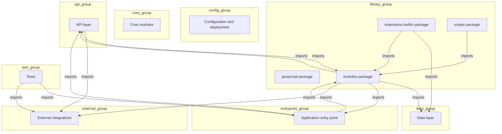

# Architecture report: AUTOMATIC1111/stable-diffusion-webui

> Automated static analysis. **Observed** = directly seen in files/imports/AST; **Inferred** = interpretation from that evidence. Repository code was not executed.

## 1. Repository at a glance

| Item | Value |
| --- | --- |
| Repository | AUTOMATIC1111/stable-diffusion-webui |
| Description | Stable Diffusion web UI |
| Language | Python |
| Stars | 165313 |
| Licence | AGPL-3.0 |
| Analysed commit / branch | 82a973c04367123ae98bd9abdf80d9eda9b910e2 / master |
| Framework(s) | FastAPI, Starlette |
| Files analysed | 305 |
| Components | 11 |

## 2. Architecture in one minute

AUTOMATIC1111/stable-diffusion-webui - Stable Diffusion web UI. This repository was analysed statically from 305 file(s) (213 Python). Detected technologies (observed from imports/manifests): GitHub Actions, FastAPI, Starlette, httpx, NumPy, Pydantic. Files are grouped into 11 component(s): API layer, Configuration and deployment, Core modules, Data layer, Application entry point, extensions-builtin package, External integrations, javascript package. Observed entry point(s): launch.py, modules/prompt_parser.py, modules/textual_inversion/image_embedding.py. Findings below distinguish observed facts from inferred interpretation.

## 3. High-level block diagram

## 4. Main components

### API layer (`api_layer`)

- **Kind:** api
- **Status:** Observed
- **Confidence:** 0.85
- **Responsibility:** Groups 2 file(s) under api layer (observed from repository paths and static analysis). Observed top-level classes: Api, CreateResponse, EmbeddingItem, EmbeddingsResponse, ExtensionItem, ExtraBaseResponse. Observed top-level functions: api_middleware, decode_base64_to_image, encode_pil_to_base64, script_name_to_index, setUpscalers, validate_sampler_name.
- **Paths:** `modules/api/api.py`, `modules/api/models.py`
- **Evidence:** [modules/api/api.py:36](https://github.com/AUTOMATIC1111/stable-diffusion-webui/blob/82a973c04367123ae98bd9abdf80d9eda9b910e2/modules/api/api.py#L36); [modules/api/models.py:27](https://github.com/AUTOMATIC1111/stable-diffusion-webui/blob/82a973c04367123ae98bd9abdf80d9eda9b910e2/modules/api/models.py#L27)

### Configuration and deployment (`config`)

- **Kind:** config
- **Status:** Observed
- **Confidence:** 0.85
- **Responsibility:** Groups 15 file(s) under configuration and deployment (observed from repository paths and static analysis).
- **Paths:** `_typos.toml`, `configs/alt-diffusion-inference.yaml`, `configs/alt-diffusion-m18-inference.yaml`, `configs/instruct-pix2pix.yaml`, `configs/sd3-inference.yaml`, `configs/sd_xl_inpaint.yaml`, `configs/v1-inference.yaml`, `configs/v1-inpainting-inference.yaml`, `environment-wsl2.yaml`, `package.json`, `pyproject.toml`, `requirements-test.txt`, `requirements.txt`, `requirements_npu.txt`, `requirements_versions.txt`
- **Evidence:** [_typos.toml](https://github.com/AUTOMATIC1111/stable-diffusion-webui/blob/82a973c04367123ae98bd9abdf80d9eda9b910e2/_typos.toml); [configs/alt-diffusion-inference.yaml](https://github.com/AUTOMATIC1111/stable-diffusion-webui/blob/82a973c04367123ae98bd9abdf80d9eda9b910e2/configs/alt-diffusion-inference.yaml); [configs/alt-diffusion-m18-inference.yaml](https://github.com/AUTOMATIC1111/stable-diffusion-webui/blob/82a973c04367123ae98bd9abdf80d9eda9b910e2/configs/alt-diffusion-m18-inference.yaml); [configs/instruct-pix2pix.yaml](https://github.com/AUTOMATIC1111/stable-diffusion-webui/blob/82a973c04367123ae98bd9abdf80d9eda9b910e2/configs/instruct-pix2pix.yaml); [configs/sd3-inference.yaml](https://github.com/AUTOMATIC1111/stable-diffusion-webui/blob/82a973c04367123ae98bd9abdf80d9eda9b910e2/configs/sd3-inference.yaml); [configs/sd_xl_inpaint.yaml](https://github.com/AUTOMATIC1111/stable-diffusion-webui/blob/82a973c04367123ae98bd9abdf80d9eda9b910e2/configs/sd_xl_inpaint.yaml); [configs/v1-inference.yaml](https://github.com/AUTOMATIC1111/stable-diffusion-webui/blob/82a973c04367123ae98bd9abdf80d9eda9b910e2/configs/v1-inference.yaml); [configs/v1-inpainting-inference.yaml](https://github.com/AUTOMATIC1111/stable-diffusion-webui/blob/82a973c04367123ae98bd9abdf80d9eda9b910e2/configs/v1-inpainting-inference.yaml)

### Core modules (`core`)

- **Kind:** core
- **Status:** Observed
- **Confidence:** 0.85
- **Responsibility:** Groups 4 file(s) under core modules (observed from repository paths and static analysis).
- **Paths:** `script.js`, `webui-macos-env.sh`, `webui-user.sh`, `webui.sh`
- **Evidence:** [script.js](https://github.com/AUTOMATIC1111/stable-diffusion-webui/blob/82a973c04367123ae98bd9abdf80d9eda9b910e2/script.js); [webui-macos-env.sh](https://github.com/AUTOMATIC1111/stable-diffusion-webui/blob/82a973c04367123ae98bd9abdf80d9eda9b910e2/webui-macos-env.sh); [webui-user.sh](https://github.com/AUTOMATIC1111/stable-diffusion-webui/blob/82a973c04367123ae98bd9abdf80d9eda9b910e2/webui-user.sh); [webui.sh](https://github.com/AUTOMATIC1111/stable-diffusion-webui/blob/82a973c04367123ae98bd9abdf80d9eda9b910e2/webui.sh)

### Data layer (`data_layer`)

- **Kind:** data
- **Status:** Observed
- **Confidence:** 0.85
- **Responsibility:** Groups 9 file(s) under data layer (observed from repository paths and static analysis). Observed top-level classes: AttnBlock, AutocastLinear, BaseModel, CFGDenoiser, CLIPAttention, CLIPEmbeddings. Observed top-level functions: Normalize, append_dims, attention, block_mixing, disabled_train, expand_dims.
- **Paths:** `modules/models/diffusion/ddpm_edit.py`, `modules/models/diffusion/uni_pc/__init__.py`, `modules/models/diffusion/uni_pc/sampler.py`, `modules/models/diffusion/uni_pc/uni_pc.py`, `modules/models/sd3/mmdit.py`, `modules/models/sd3/other_impls.py`, `modules/models/sd3/sd3_cond.py`, `modules/models/sd3/sd3_impls.py`, `modules/models/sd3/sd3_model.py`
- **Evidence:** [modules/models/diffusion/ddpm_edit.py:42](https://github.com/AUTOMATIC1111/stable-diffusion-webui/blob/82a973c04367123ae98bd9abdf80d9eda9b910e2/modules/models/diffusion/ddpm_edit.py#L42); [modules/models/diffusion/uni_pc/__init__.py](https://github.com/AUTOMATIC1111/stable-diffusion-webui/blob/82a973c04367123ae98bd9abdf80d9eda9b910e2/modules/models/diffusion/uni_pc/__init__.py); [modules/models/diffusion/uni_pc/sampler.py:9](https://github.com/AUTOMATIC1111/stable-diffusion-webui/blob/82a973c04367123ae98bd9abdf80d9eda9b910e2/modules/models/diffusion/uni_pc/sampler.py#L9); [modules/models/diffusion/uni_pc/uni_pc.py:6](https://github.com/AUTOMATIC1111/stable-diffusion-webui/blob/82a973c04367123ae98bd9abdf80d9eda9b910e2/modules/models/diffusion/uni_pc/uni_pc.py#L6); [modules/models/sd3/mmdit.py:12](https://github.com/AUTOMATIC1111/stable-diffusion-webui/blob/82a973c04367123ae98bd9abdf80d9eda9b910e2/modules/models/sd3/mmdit.py#L12); [modules/models/sd3/other_impls.py:16](https://github.com/AUTOMATIC1111/stable-diffusion-webui/blob/82a973c04367123ae98bd9abdf80d9eda9b910e2/modules/models/sd3/other_impls.py#L16); [modules/models/sd3/sd3_cond.py:12](https://github.com/AUTOMATIC1111/stable-diffusion-webui/blob/82a973c04367123ae98bd9abdf80d9eda9b910e2/modules/models/sd3/sd3_cond.py#L12); [modules/models/sd3/sd3_impls.py:15](https://github.com/AUTOMATIC1111/stable-diffusion-webui/blob/82a973c04367123ae98bd9abdf80d9eda9b910e2/modules/models/sd3/sd3_impls.py#L15)

### Application entry point (`entrypoint`)

- **Kind:** entrypoint
- **Status:** Observed
- **Confidence:** 0.85
- **Responsibility:** Groups 4 file(s) under application entry point (observed from repository paths and static analysis). Observed application object created via FastAPI. Observed top-level classes: ComposableScheduledPromptConditioning, DictWithShape, EmbeddingDecoder, EmbeddingEncoder, MulticondLearnedConditioning, SdConditioning. Observed top-level functions: api_only, caption_image_overlay, create_api, crop_black, embedding_from_b64, embedding_to_b64.
- **Paths:** `launch.py`, `modules/prompt_parser.py`, `modules/textual_inversion/image_embedding.py`, `webui.py`
- **Evidence:** [launch.py:27](https://github.com/AUTOMATIC1111/stable-diffusion-webui/blob/82a973c04367123ae98bd9abdf80d9eda9b910e2/launch.py#L27); [modules/prompt_parser.py:28](https://github.com/AUTOMATIC1111/stable-diffusion-webui/blob/82a973c04367123ae98bd9abdf80d9eda9b910e2/modules/prompt_parser.py#L28); [modules/textual_inversion/image_embedding.py:15](https://github.com/AUTOMATIC1111/stable-diffusion-webui/blob/82a973c04367123ae98bd9abdf80d9eda9b910e2/modules/textual_inversion/image_embedding.py#L15); [webui.py:32](https://github.com/AUTOMATIC1111/stable-diffusion-webui/blob/82a973c04367123ae98bd9abdf80d9eda9b910e2/webui.py#L32)

### extensions-builtin package (`extensions_builtin`)

- **Kind:** library
- **Status:** Observed
- **Confidence:** 0.85
- **Responsibility:** Groups 42 file(s) under extensions-builtin package (observed from repository paths and static analysis). Observed top-level classes: BundledTIHash, ColoredFormatter, DDPMV1, DiffusionWrapperV1, ExtraNetworkLora, ExtraNetworksPageLora. Observed top-level functions: add_axis_options, allowed_layer_without_weight, api_networks, apply_adaptive_masks, apply_masks, assign_network_names_to_compvis_modules.
- **Paths:** `extensions-builtin/LDSR/ldsr_model_arch.py`, `extensions-builtin/LDSR/preload.py`, `extensions-builtin/LDSR/scripts/ldsr_model.py`, `extensions-builtin/LDSR/sd_hijack_autoencoder.py`, `extensions-builtin/LDSR/sd_hijack_ddpm_v1.py`, `extensions-builtin/LDSR/vqvae_quantize.py`, `extensions-builtin/Lora/extra_networks_lora.py`, `extensions-builtin/Lora/lora.py`, `extensions-builtin/Lora/lora_logger.py`, `extensions-builtin/Lora/lora_patches.py`, `extensions-builtin/Lora/lyco_helpers.py`, `extensions-builtin/Lora/network.py`, `extensions-builtin/Lora/network_full.py`, `extensions-builtin/Lora/network_glora.py`, `extensions-builtin/Lora/network_hada.py`, `extensions-builtin/Lora/network_ia3.py`, `extensions-builtin/Lora/network_lokr.py`, `extensions-builtin/Lora/network_lora.py`, `extensions-builtin/Lora/network_norm.py`, `extensions-builtin/Lora/network_oft.py`, `extensions-builtin/Lora/networks.py`, `extensions-builtin/Lora/preload.py`, `extensions-builtin/Lora/scripts/lora_script.py`, `extensions-builtin/Lora/ui_edit_user_metadata.py`, `extensions-builtin/Lora/ui_extra_networks_lora.py`, `extensions-builtin/ScuNET/preload.py`, `extensions-builtin/ScuNET/scripts/scunet_model.py`, `extensions-builtin/SwinIR/preload.py`, `extensions-builtin/SwinIR/scripts/swinir_model.py`, `extensions-builtin/canvas-zoom-and-pan/javascript/zoom.js`, `extensions-builtin/canvas-zoom-and-pan/scripts/hotkey_config.py`, `extensions-builtin/extra-options-section/scripts/extra_options_section.py`, `extensions-builtin/hypertile/hypertile.py`, `extensions-builtin/hypertile/scripts/hypertile_script.py`, `extensions-builtin/mobile/javascript/mobile.js`, `extensions-builtin/postprocessing-for-training/scripts/postprocessing_autosized_crop.py`, `extensions-builtin/postprocessing-for-training/scripts/postprocessing_caption.py`, `extensions-builtin/postprocessing-for-training/scripts/postprocessing_create_flipped_copies.py`, `extensions-builtin/postprocessing-for-training/scripts/postprocessing_focal_crop.py`, `extensions-builtin/postprocessing-for-training/scripts/postprocessing_split_oversized.py`, `extensions-builtin/prompt-bracket-checker/javascript/prompt-bracket-checker.js`, `extensions-builtin/soft-inpainting/scripts/soft_inpainting.py`
- **Evidence:** [extensions-builtin/LDSR/ldsr_model_arch.py:21](https://github.com/AUTOMATIC1111/stable-diffusion-webui/blob/82a973c04367123ae98bd9abdf80d9eda9b910e2/extensions-builtin/LDSR/ldsr_model_arch.py#L21); [extensions-builtin/LDSR/preload.py:5](https://github.com/AUTOMATIC1111/stable-diffusion-webui/blob/82a973c04367123ae98bd9abdf80d9eda9b910e2/extensions-builtin/LDSR/preload.py#L5); [extensions-builtin/LDSR/scripts/ldsr_model.py:11](https://github.com/AUTOMATIC1111/stable-diffusion-webui/blob/82a973c04367123ae98bd9abdf80d9eda9b910e2/extensions-builtin/LDSR/scripts/ldsr_model.py#L11); [extensions-builtin/LDSR/sd_hijack_autoencoder.py:20](https://github.com/AUTOMATIC1111/stable-diffusion-webui/blob/82a973c04367123ae98bd9abdf80d9eda9b910e2/extensions-builtin/LDSR/sd_hijack_autoencoder.py#L20); [extensions-builtin/LDSR/sd_hijack_ddpm_v1.py:33](https://github.com/AUTOMATIC1111/stable-diffusion-webui/blob/82a973c04367123ae98bd9abdf80d9eda9b910e2/extensions-builtin/LDSR/sd_hijack_ddpm_v1.py#L33); [extensions-builtin/LDSR/vqvae_quantize.py:30](https://github.com/AUTOMATIC1111/stable-diffusion-webui/blob/82a973c04367123ae98bd9abdf80d9eda9b910e2/extensions-builtin/LDSR/vqvae_quantize.py#L30); [extensions-builtin/Lora/extra_networks_lora.py:5](https://github.com/AUTOMATIC1111/stable-diffusion-webui/blob/82a973c04367123ae98bd9abdf80d9eda9b910e2/extensions-builtin/Lora/extra_networks_lora.py#L5); [extensions-builtin/Lora/lora.py](https://github.com/AUTOMATIC1111/stable-diffusion-webui/blob/82a973c04367123ae98bd9abdf80d9eda9b910e2/extensions-builtin/Lora/lora.py)

### External integrations (`external_integrations`)

- **Kind:** external
- **Status:** Inferred
- **Confidence:** 0.70
- **Responsibility:** Groups 0 file(s) under external integrations (observed from repository paths and static analysis).
- **Evidence:** [modules/api/api.py:8](https://github.com/AUTOMATIC1111/stable-diffusion-webui/blob/82a973c04367123ae98bd9abdf80d9eda9b910e2/modules/api/api.py#L8); [modules/api/api.py:61](https://github.com/AUTOMATIC1111/stable-diffusion-webui/blob/82a973c04367123ae98bd9abdf80d9eda9b910e2/modules/api/api.py#L61); [modules/launch_utils.py:213](https://github.com/AUTOMATIC1111/stable-diffusion-webui/blob/82a973c04367123ae98bd9abdf80d9eda9b910e2/modules/launch_utils.py#L213); [modules/textual_inversion/autocrop.py:2](https://github.com/AUTOMATIC1111/stable-diffusion-webui/blob/82a973c04367123ae98bd9abdf80d9eda9b910e2/modules/textual_inversion/autocrop.py#L2); [test/test_extras.py:1](https://github.com/AUTOMATIC1111/stable-diffusion-webui/blob/82a973c04367123ae98bd9abdf80d9eda9b910e2/test/test_extras.py#L1); [test/test_img2img.py:3](https://github.com/AUTOMATIC1111/stable-diffusion-webui/blob/82a973c04367123ae98bd9abdf80d9eda9b910e2/test/test_img2img.py#L3)

### javascript package (`javascript`)

- **Kind:** library
- **Status:** Observed
- **Confidence:** 0.85
- **Responsibility:** Groups 25 file(s) under javascript package (observed from repository paths and static analysis).
- **Paths:** `javascript/aspectRatioOverlay.js`, `javascript/contextMenus.js`, `javascript/dragdrop.js`, `javascript/edit-attention.js`, `javascript/edit-order.js`, `javascript/extensions.js`, `javascript/extraNetworks.js`, `javascript/generationParams.js`, `javascript/hints.js`, `javascript/hires_fix.js`, `javascript/imageMaskFix.js`, `javascript/imageviewer.js`, `javascript/imageviewerGamepad.js`, `javascript/inputAccordion.js`, `javascript/localStorage.js`, `javascript/localization.js`, `javascript/notification.js`, `javascript/profilerVisualization.js`, `javascript/progressbar.js`, `javascript/resizeHandle.js`, `javascript/settings.js`, `javascript/textualInversion.js`, `javascript/token-counters.js`, `javascript/ui.js`, `javascript/ui_settings_hints.js`
- **Evidence:** [javascript/aspectRatioOverlay.js](https://github.com/AUTOMATIC1111/stable-diffusion-webui/blob/82a973c04367123ae98bd9abdf80d9eda9b910e2/javascript/aspectRatioOverlay.js); [javascript/contextMenus.js](https://github.com/AUTOMATIC1111/stable-diffusion-webui/blob/82a973c04367123ae98bd9abdf80d9eda9b910e2/javascript/contextMenus.js); [javascript/dragdrop.js](https://github.com/AUTOMATIC1111/stable-diffusion-webui/blob/82a973c04367123ae98bd9abdf80d9eda9b910e2/javascript/dragdrop.js); [javascript/edit-attention.js](https://github.com/AUTOMATIC1111/stable-diffusion-webui/blob/82a973c04367123ae98bd9abdf80d9eda9b910e2/javascript/edit-attention.js); [javascript/edit-order.js](https://github.com/AUTOMATIC1111/stable-diffusion-webui/blob/82a973c04367123ae98bd9abdf80d9eda9b910e2/javascript/edit-order.js); [javascript/extensions.js](https://github.com/AUTOMATIC1111/stable-diffusion-webui/blob/82a973c04367123ae98bd9abdf80d9eda9b910e2/javascript/extensions.js); [javascript/extraNetworks.js](https://github.com/AUTOMATIC1111/stable-diffusion-webui/blob/82a973c04367123ae98bd9abdf80d9eda9b910e2/javascript/extraNetworks.js); [javascript/generationParams.js](https://github.com/AUTOMATIC1111/stable-diffusion-webui/blob/82a973c04367123ae98bd9abdf80d9eda9b910e2/javascript/generationParams.js)

### modules package (`modules`)

- **Kind:** library
- **Status:** Observed
- **Confidence:** 0.85
- **Responsibility:** Groups 139 file(s) under modules package (observed from repository paths and static analysis). Observed top-level classes: AfterCFGCallbackParams, AttnChunk, BatchLoader, BatchLoaderRandom, BeforeTokenCounterParams, BertSeriesConfig. Observed top-level functions: AttentionBlock_forward, BasicTransformerBlock_forward, BlockContext_init, Block_get_config, Blocks_get_config_file, IOComponent_init.
- **Paths:** `modules/cache.py`, `modules/call_queue.py`, `modules/cmd_args.py`, `modules/codeformer_model.py`, `modules/config_states.py`, `modules/dat_model.py`, `modules/deepbooru.py`, `modules/deepbooru_model.py`, `modules/devices.py`, `modules/errors.py`, `modules/esrgan_model.py`, `modules/extensions.py`, `modules/extra_networks.py`, `modules/extra_networks_hypernet.py`, `modules/extras.py`, `modules/face_restoration.py`, `modules/face_restoration_utils.py`, `modules/fifo_lock.py`, `modules/gfpgan_model.py`, `modules/gitpython_hack.py`, `modules/gradio_extensons.py`, `modules/hashes.py`, `modules/hat_model.py`, `modules/hypernetworks/hypernetwork.py`, `modules/hypernetworks/ui.py`, `modules/images.py`, `modules/img2img.py`, `modules/import_hook.py`, `modules/infotext_utils.py`, `modules/infotext_versions.py`, `modules/initialize.py`, `modules/initialize_util.py`, `modules/interrogate.py`, `modules/launch_utils.py`, `modules/localization.py`, `modules/logging_config.py`, `modules/lowvram.py`, `modules/mac_specific.py`, `modules/masking.py`, `modules/memmon.py`, `modules/modelloader.py`, `modules/ngrok.py`, `modules/npu_specific.py`, `modules/options.py`, `modules/patches.py`, `modules/paths.py`, `modules/paths_internal.py`, `modules/postprocessing.py`, `modules/processing.py`, `modules/processing_scripts/comments.py`, `modules/processing_scripts/refiner.py`, `modules/processing_scripts/sampler.py`, `modules/processing_scripts/seed.py`, `modules/profiling.py`, `modules/progress.py`, `modules/realesrgan_model.py`, `modules/restart.py`, `modules/rng.py`, `modules/rng_philox.py`, `modules/safe.py`, `modules/script_callbacks.py`, `modules/script_loading.py`, `modules/scripts.py`, `modules/scripts_auto_postprocessing.py`, `modules/scripts_postprocessing.py`, `modules/sd_disable_initialization.py`, `modules/sd_emphasis.py`, `modules/sd_hijack.py`, `modules/sd_hijack_checkpoint.py`, `modules/sd_hijack_clip.py`, `modules/sd_hijack_clip_old.py`, `modules/sd_hijack_ip2p.py`, `modules/sd_hijack_open_clip.py`, `modules/sd_hijack_optimizations.py`, `modules/sd_hijack_unet.py`, `modules/sd_hijack_utils.py`, `modules/sd_hijack_xlmr.py`, `modules/sd_models.py`, `modules/sd_models_config.py`, `modules/sd_models_types.py`, `modules/sd_models_xl.py`, `modules/sd_samplers.py`, `modules/sd_samplers_cfg_denoiser.py`, `modules/sd_samplers_common.py`, `modules/sd_samplers_compvis.py`, `modules/sd_samplers_extra.py`, `modules/sd_samplers_kdiffusion.py`, `modules/sd_samplers_lcm.py`, `modules/sd_samplers_timesteps.py`, `modules/sd_samplers_timesteps_impl.py`, `modules/sd_schedulers.py`, `modules/sd_unet.py`, `modules/sd_vae.py`, `modules/sd_vae_approx.py`, `modules/sd_vae_taesd.py`, `modules/shared.py`, `modules/shared_cmd_options.py`, `modules/shared_gradio_themes.py`, `modules/shared_init.py`, `modules/shared_items.py`, `modules/shared_options.py`, `modules/shared_state.py`, `modules/shared_total_tqdm.py`, `modules/styles.py`, `modules/sub_quadratic_attention.py`, `modules/sysinfo.py`, `modules/textual_inversion/autocrop.py`, `modules/textual_inversion/dataset.py`, `modules/textual_inversion/learn_schedule.py`, `modules/textual_inversion/saving_settings.py`, `modules/textual_inversion/textual_inversion.py`, `modules/textual_inversion/ui.py`, `modules/timer.py`, `modules/torch_utils.py`, `modules/txt2img.py`, `modules/ui.py`, `modules/ui_checkpoint_merger.py`, `modules/ui_common.py`, `modules/ui_components.py`, `modules/ui_extensions.py`, `modules/ui_extra_networks.py`, `modules/ui_extra_networks_checkpoints.py`, `modules/ui_extra_networks_checkpoints_user_metadata.py`, `modules/ui_extra_networks_hypernets.py`, `modules/ui_extra_networks_textual_inversion.py`, `modules/ui_extra_networks_user_metadata.py`, `modules/ui_gradio_extensions.py`, `modules/ui_loadsave.py`, `modules/ui_postprocessing.py`, `modules/ui_prompt_styles.py`, `modules/ui_settings.py`, `modules/ui_tempdir.py`, `modules/ui_toprow.py`, `modules/upscaler.py`, `modules/upscaler_utils.py`, `modules/util.py`, `modules/xlmr.py`, `modules/xlmr_m18.py`, `modules/xpu_specific.py`
- **Evidence:** [modules/cache.py:17](https://github.com/AUTOMATIC1111/stable-diffusion-webui/blob/82a973c04367123ae98bd9abdf80d9eda9b910e2/modules/cache.py#L17); [modules/call_queue.py:11](https://github.com/AUTOMATIC1111/stable-diffusion-webui/blob/82a973c04367123ae98bd9abdf80d9eda9b910e2/modules/call_queue.py#L11); [modules/cmd_args.py](https://github.com/AUTOMATIC1111/stable-diffusion-webui/blob/82a973c04367123ae98bd9abdf80d9eda9b910e2/modules/cmd_args.py); [modules/codeformer_model.py:25](https://github.com/AUTOMATIC1111/stable-diffusion-webui/blob/82a973c04367123ae98bd9abdf80d9eda9b910e2/modules/codeformer_model.py#L25); [modules/config_states.py:18](https://github.com/AUTOMATIC1111/stable-diffusion-webui/blob/82a973c04367123ae98bd9abdf80d9eda9b910e2/modules/config_states.py#L18); [modules/dat_model.py:9](https://github.com/AUTOMATIC1111/stable-diffusion-webui/blob/82a973c04367123ae98bd9abdf80d9eda9b910e2/modules/dat_model.py#L9); [modules/deepbooru.py:12](https://github.com/AUTOMATIC1111/stable-diffusion-webui/blob/82a973c04367123ae98bd9abdf80d9eda9b910e2/modules/deepbooru.py#L12); [modules/deepbooru_model.py:10](https://github.com/AUTOMATIC1111/stable-diffusion-webui/blob/82a973c04367123ae98bd9abdf80d9eda9b910e2/modules/deepbooru_model.py#L10)

### scripts package (`scripts`)

- **Kind:** library
- **Status:** Observed
- **Confidence:** 0.85
- **Responsibility:** Groups 12 file(s) under scripts package (observed from repository paths and static analysis). Observed top-level classes: AxisOption, AxisOptionImg2Img, AxisOptionTxt2Img, Script, ScriptPostprocessingCodeFormer, ScriptPostprocessingGfpGan. Observed top-level functions: apply_checkpoint, apply_face_restore, apply_field, apply_order, apply_override, apply_prompt.
- **Paths:** `scripts/custom_code.py`, `scripts/img2imgalt.py`, `scripts/loopback.py`, `scripts/outpainting_mk_2.py`, `scripts/poor_mans_outpainting.py`, `scripts/postprocessing_codeformer.py`, `scripts/postprocessing_gfpgan.py`, `scripts/postprocessing_upscale.py`, `scripts/prompt_matrix.py`, `scripts/prompts_from_file.py`, `scripts/sd_upscale.py`, `scripts/xyz_grid.py`
- **Evidence:** [scripts/custom_code.py:10](https://github.com/AUTOMATIC1111/stable-diffusion-webui/blob/82a973c04367123ae98bd9abdf80d9eda9b910e2/scripts/custom_code.py#L10); [scripts/img2imgalt.py:14](https://github.com/AUTOMATIC1111/stable-diffusion-webui/blob/82a973c04367123ae98bd9abdf80d9eda9b910e2/scripts/img2imgalt.py#L14); [scripts/loopback.py:10](https://github.com/AUTOMATIC1111/stable-diffusion-webui/blob/82a973c04367123ae98bd9abdf80d9eda9b910e2/scripts/loopback.py#L10); [scripts/outpainting_mk_2.py:16](https://github.com/AUTOMATIC1111/stable-diffusion-webui/blob/82a973c04367123ae98bd9abdf80d9eda9b910e2/scripts/outpainting_mk_2.py#L16); [scripts/poor_mans_outpainting.py:12](https://github.com/AUTOMATIC1111/stable-diffusion-webui/blob/82a973c04367123ae98bd9abdf80d9eda9b910e2/scripts/poor_mans_outpainting.py#L12); [scripts/postprocessing_codeformer.py:8](https://github.com/AUTOMATIC1111/stable-diffusion-webui/blob/82a973c04367123ae98bd9abdf80d9eda9b910e2/scripts/postprocessing_codeformer.py#L8); [scripts/postprocessing_gfpgan.py:8](https://github.com/AUTOMATIC1111/stable-diffusion-webui/blob/82a973c04367123ae98bd9abdf80d9eda9b910e2/scripts/postprocessing_gfpgan.py#L8); [scripts/postprocessing_upscale.py:15](https://github.com/AUTOMATIC1111/stable-diffusion-webui/blob/82a973c04367123ae98bd9abdf80d9eda9b910e2/scripts/postprocessing_upscale.py#L15)

### Tests (`tests`)

- **Kind:** test
- **Status:** Observed
- **Confidence:** 0.85
- **Responsibility:** Groups 9 file(s) under tests (observed from repository paths and static analysis). Observed top-level functions: file_to_base64, img2img_basic_image_base64, initialize, mask_basic_image_base64, pytest_configure, simple_img2img_request.
- **Paths:** `test/__init__.py`, `test/conftest.py`, `test/test_extras.py`, `test/test_face_restorers.py`, `test/test_img2img.py`, `test/test_outputs/.gitkeep`, `test/test_torch_utils.py`, `test/test_txt2img.py`, `test/test_utils.py`
- **Evidence:** [test/__init__.py](https://github.com/AUTOMATIC1111/stable-diffusion-webui/blob/82a973c04367123ae98bd9abdf80d9eda9b910e2/test/__init__.py); [test/conftest.py:10](https://github.com/AUTOMATIC1111/stable-diffusion-webui/blob/82a973c04367123ae98bd9abdf80d9eda9b910e2/test/conftest.py#L10); [test/test_extras.py:4](https://github.com/AUTOMATIC1111/stable-diffusion-webui/blob/82a973c04367123ae98bd9abdf80d9eda9b910e2/test/test_extras.py#L4); [test/test_face_restorers.py:11](https://github.com/AUTOMATIC1111/stable-diffusion-webui/blob/82a973c04367123ae98bd9abdf80d9eda9b910e2/test/test_face_restorers.py#L11); [test/test_img2img.py:7](https://github.com/AUTOMATIC1111/stable-diffusion-webui/blob/82a973c04367123ae98bd9abdf80d9eda9b910e2/test/test_img2img.py#L7); [test/test_outputs/.gitkeep](https://github.com/AUTOMATIC1111/stable-diffusion-webui/blob/82a973c04367123ae98bd9abdf80d9eda9b910e2/test/test_outputs/.gitkeep); [test/test_torch_utils.py:10](https://github.com/AUTOMATIC1111/stable-diffusion-webui/blob/82a973c04367123ae98bd9abdf80d9eda9b910e2/test/test_torch_utils.py#L10); [test/test_txt2img.py:7](https://github.com/AUTOMATIC1111/stable-diffusion-webui/blob/82a973c04367123ae98bd9abdf80d9eda9b910e2/test/test_txt2img.py#L7)

## 5. Execution flow

**Observed** entry point(s):

- [launch.py:47](https://github.com/AUTOMATIC1111/stable-diffusion-webui/blob/82a973c04367123ae98bd9abdf80d9eda9b910e2/launch.py#L47)
- [modules/prompt_parser.py:460](https://github.com/AUTOMATIC1111/stable-diffusion-webui/blob/82a973c04367123ae98bd9abdf80d9eda9b910e2/modules/prompt_parser.py#L460)
- [modules/textual_inversion/image_embedding.py:184](https://github.com/AUTOMATIC1111/stable-diffusion-webui/blob/82a973c04367123ae98bd9abdf80d9eda9b910e2/modules/textual_inversion/image_embedding.py#L184)
- [webui.py:32](https://github.com/AUTOMATIC1111/stable-diffusion-webui/blob/82a973c04367123ae98bd9abdf80d9eda9b910e2/webui.py#L32)

Representative flow (derived from observed entry points and the import graph; steps beyond the entry point are **Inferred**):

1. Execution starts at an observed entry point listed above, if present.
2. `api_layer` imports `external_integrations` (API layer -> External integrations).
3. `api_layer` imports `modules` (API layer -> modules package).
4. `entrypoint` imports `api_layer` (Application entry point -> API layer).
5. `entrypoint` imports `modules` (Application entry point -> modules package).
6. `extensions_builtin` imports `data_layer` (extensions-builtin package -> Data layer).
7. `extensions_builtin` imports `modules` (extensions-builtin package -> modules package).
8. `modules` imports `api_layer` (modules package -> API layer).
9. `modules` imports `data_layer` (modules package -> Data layer).

## 6. Project structure

### `(root)`

- `.eslintignore` - other (48 bytes)
- `.eslintrc.js` - source, JavaScript (3423 bytes)
- `.git-blame-ignore-revs` - other (55 bytes)
- `.gitignore` - other (573 bytes)
- `.pylintrc` - other (119 bytes)
- `CHANGELOG.md` - docs (97085 bytes)
- `CITATION.cff` - other (243 bytes)
- `CODEOWNERS` - other (657 bytes)
- `LICENSE.txt` - docs (35240 bytes)
- `README.md` - docs (12924 bytes)
- `_typos.toml` - config (146 bytes)
- `environment-wsl2.yaml` - config (167 bytes)
- `launch.py` - source, Python (1297 bytes)
- `package.json` - manifest (185 bytes)
- `pyproject.toml` - manifest (841 bytes)
- `requirements-test.txt` - manifest (49 bytes)
- `requirements.txt` - manifest (389 bytes)
- `requirements_npu.txt` - manifest (42 bytes)
- `requirements_versions.txt` - manifest (693 bytes)
- `script.js` - source, JavaScript (6600 bytes)
- `style.css` - other (43454 bytes)
- `webui-macos-env.sh` - source, Shell (751 bytes)
- `webui-user.bat` - other (84 bytes)
- `webui-user.sh` - source, Shell (1332 bytes)
- `webui.bat` - other (2547 bytes)
- `webui.py` - source, Python (5413 bytes)
- `webui.sh` - source, Shell (11221 bytes)

### `.github`

- `.github/ISSUE_TEMPLATE/bug_report.yml` - config (4417 bytes)
- `.github/ISSUE_TEMPLATE/config.yml` - config (203 bytes)
- `.github/ISSUE_TEMPLATE/feature_request.yml` - config (1413 bytes)
- `.github/pull_request_template.md` - docs (577 bytes)
- `.github/workflows/on_pull_request.yaml` - ci, YAML (1231 bytes)
- `.github/workflows/run_tests.yaml` - ci, YAML (2529 bytes)
- `.github/workflows/warns_merge_master.yml` - ci, YAML (424 bytes)

### `configs`

- `configs/alt-diffusion-inference.yaml` - config (1913 bytes)
- `configs/alt-diffusion-m18-inference.yaml` - config (1968 bytes)
- `configs/instruct-pix2pix.yaml` - config (2601 bytes)
- `configs/sd3-inference.yaml` - config (104 bytes)
- `configs/sd_xl_inpaint.yaml` - config (3248 bytes)
- `configs/v1-inference.yaml` - config (1874 bytes)
- `configs/v1-inpainting-inference.yaml` - config (1992 bytes)

### `embeddings`

- `embeddings/Place Textual Inversion embeddings here.txt` - docs (0 bytes)

### `extensions`

- `extensions/put extensions here.txt` - docs (0 bytes)

### `extensions-builtin`

- `extensions-builtin/LDSR/ldsr_model_arch.py` - source, Python (9759 bytes)
- `extensions-builtin/LDSR/preload.py` - source, Python (221 bytes)
- `extensions-builtin/LDSR/scripts/ldsr_model.py` - source, Python (3128 bytes)
- `extensions-builtin/LDSR/sd_hijack_autoencoder.py` - source, Python (11836 bytes)
- `extensions-builtin/LDSR/sd_hijack_ddpm_v1.py` - source, Python (67254 bytes)
- `extensions-builtin/LDSR/vqvae_quantize.py` - source, Python (6479 bytes)
- `extensions-builtin/Lora/extra_networks_lora.py` - source, Python (2647 bytes)
- `extensions-builtin/Lora/lora.py` - source, Python (357 bytes)
- `extensions-builtin/Lora/lora_logger.py` - source, Python (929 bytes)
- `extensions-builtin/Lora/lora_patches.py` - source, Python (2556 bytes)
- `extensions-builtin/Lora/lyco_helpers.py` - source, Python (2409 bytes)
- `extensions-builtin/Lora/network.py` - source, Python (7944 bytes)
- `extensions-builtin/Lora/network_full.py` - source, Python (904 bytes)
- `extensions-builtin/Lora/network_glora.py` - source, Python (1246 bytes)
- `extensions-builtin/Lora/network_hada.py` - source, Python (1985 bytes)
- `extensions-builtin/Lora/network_ia3.py` - source, Python (908 bytes)
- `extensions-builtin/Lora/network_lokr.py` - source, Python (2354 bytes)
- `extensions-builtin/Lora/network_lora.py` - source, Python (4116 bytes)
- `extensions-builtin/Lora/network_norm.py` - source, Python (889 bytes)
- `extensions-builtin/Lora/network_oft.py` - source, Python (5247 bytes)
- `extensions-builtin/Lora/networks.py` - source, Python (29205 bytes)
- `extensions-builtin/Lora/preload.py` - source, Python (513 bytes)
- `extensions-builtin/Lora/scripts/lora_script.py` - source, Python (4182 bytes)
- `extensions-builtin/Lora/ui_edit_user_metadata.py` - source, Python (8703 bytes)
- `extensions-builtin/Lora/ui_extra_networks_lora.py` - source, Python (3796 bytes)
- `extensions-builtin/ScuNET/preload.py` - source, Python (227 bytes)
- `extensions-builtin/ScuNET/scripts/scunet_model.py` - source, Python (3095 bytes)
- `extensions-builtin/SwinIR/preload.py` - source, Python (227 bytes)
- `extensions-builtin/SwinIR/scripts/swinir_model.py` - source, Python (3767 bytes)
- `extensions-builtin/canvas-zoom-and-pan/javascript/zoom.js` - source, JavaScript (36827 bytes)
- `extensions-builtin/canvas-zoom-and-pan/scripts/hotkey_config.py` - source, Python (1961 bytes)
- `extensions-builtin/canvas-zoom-and-pan/style.css` - other (1097 bytes)
- `extensions-builtin/extra-options-section/scripts/extra_options_section.py` - source, Python (4065 bytes)
- `extensions-builtin/hypertile/hypertile.py` - source, Python (14160 bytes)
- `extensions-builtin/hypertile/scripts/hypertile_script.py` - source, Python (7451 bytes)
- `extensions-builtin/mobile/javascript/mobile.js` - source, JavaScript (1089 bytes)
- `extensions-builtin/postprocessing-for-training/scripts/postprocessing_autosized_crop.py` - source, Python (3145 bytes)
- `extensions-builtin/postprocessing-for-training/scripts/postprocessing_caption.py` - source, Python (971 bytes)
- `extensions-builtin/postprocessing-for-training/scripts/postprocessing_create_flipped_copies.py` - source, Python (1150 bytes)
- `extensions-builtin/postprocessing-for-training/scripts/postprocessing_focal_crop.py` - source, Python (2392 bytes)
- `extensions-builtin/postprocessing-for-training/scripts/postprocessing_split_oversized.py` - source, Python (2481 bytes)
- `extensions-builtin/prompt-bracket-checker/javascript/prompt-bracket-checker.js` - source, JavaScript (1714 bytes)
- `extensions-builtin/soft-inpainting/scripts/soft_inpainting.py` - source, Python (30877 bytes)

### `html`

- `html/extra-networks-card.html` - other (360 bytes)
- `html/extra-networks-copy-path-button.html` - other (168 bytes)
- `html/extra-networks-edit-item-button.html` - other (162 bytes)
- `html/extra-networks-metadata-button.html` - other (161 bytes)
- `html/extra-networks-no-cards.html` - other (119 bytes)
- `html/extra-networks-pane-dirs.html` - other (322 bytes)
- `html/extra-networks-pane-tree.html` - other (423 bytes)
- `html/extra-networks-pane.html` - other (3675 bytes)
- `html/extra-networks-tree-button.html` - other (912 bytes)
- `html/footer.html` - other (556 bytes)
- `html/licenses.html` - other (20645 bytes)

### `javascript`

- `javascript/aspectRatioOverlay.js` - source, JavaScript (3994 bytes)
- `javascript/contextMenus.js` - source, JavaScript (5658 bytes)
- `javascript/dragdrop.js` - source, JavaScript (5150 bytes)
- `javascript/edit-attention.js` - source, JavaScript (5842 bytes)
- `javascript/edit-order.js` - source, JavaScript (1597 bytes)
- `javascript/extensions.js` - source, JavaScript (3072 bytes)
- `javascript/extraNetworks.js` - source, JavaScript (26954 bytes)
- `javascript/generationParams.js` - source, JavaScript (1504 bytes)
- `javascript/hints.js` - source, JavaScript (14565 bytes)
- `javascript/hires_fix.js` - source, JavaScript (886 bytes)
- `javascript/imageMaskFix.js` - source, JavaScript (1354 bytes)
- `javascript/imageviewer.js` - source, JavaScript (9450 bytes)
- `javascript/imageviewerGamepad.js` - source, JavaScript (1844 bytes)
- `javascript/inputAccordion.js` - source, JavaScript (2325 bytes)
- `javascript/localStorage.js` - source, JavaScript (534 bytes)
- `javascript/localization.js` - source, JavaScript (5708 bytes)
- `javascript/notification.js` - source, JavaScript (1676 bytes)
- `javascript/profilerVisualization.js` - source, JavaScript (4939 bytes)
- `javascript/progressbar.js` - source, JavaScript (6542 bytes)
- `javascript/resizeHandle.js` - source, JavaScript (6623 bytes)
- `javascript/settings.js` - source, JavaScript (2272 bytes)
- `javascript/textualInversion.js` - source, JavaScript (441 bytes)
- `javascript/token-counters.js` - source, JavaScript (2737 bytes)
- `javascript/ui.js` - source, JavaScript (13380 bytes)
- `javascript/ui_settings_hints.js` - source, JavaScript (2311 bytes)

### `localizations`

- `localizations/Put localization files here.txt` - docs (0 bytes)

### `models`

- `models/Stable-diffusion/Put Stable Diffusion checkpoints here.txt` - docs (0 bytes)
- `models/VAE/Put VAE here.txt` - docs (0 bytes)
- `models/deepbooru/Put your deepbooru release project folder here.txt` - docs (0 bytes)

### `modules`

- `modules/api/api.py` - source, Python (42038 bytes)
- `modules/api/models.py` - source, Python (16555 bytes)
- `modules/cache.py` - source, Python (4132 bytes)
- `modules/call_queue.py` - source, Python (5012 bytes)
- `modules/cmd_args.py` - source, Python (18344 bytes)
- `modules/codeformer_model.py` - source, Python (1911 bytes)
- `modules/config_states.py` - source, Python (5875 bytes)
- `modules/dat_model.py` - source, Python (2684 bytes)
- `modules/deepbooru.py` - source, Python (3039 bytes)
- `modules/deepbooru_model.py` - source, Python (36341 bytes)
- `modules/devices.py` - source, Python (8827 bytes)
- `modules/errors.py` - source, Python (4585 bytes)
- `modules/esrgan_model.py` - source, Python (2188 bytes)
- `modules/extensions.py` - source, Python (11320 bytes)
- `modules/extra_networks.py` - source, Python (7290 bytes)
- `modules/extra_networks_hypernet.py` - source, Python (1148 bytes)
- `modules/extras.py` - source, Python (12610 bytes)
- `modules/face_restoration.py` - source, Python (494 bytes)
- `modules/face_restoration_utils.py` - source, Python (6443 bytes)
- `modules/fifo_lock.py` - source, Python (1020 bytes)
- `modules/gfpgan_model.py` - source, Python (2097 bytes)
- `modules/gitpython_hack.py` - source, Python (1464 bytes)
- `modules/gradio_extensons.py` - source, Python (2743 bytes)
- `modules/hashes.py` - source, Python (2197 bytes)
- `modules/hat_model.py` - source, Python (1685 bytes)
- `modules/hypernetworks/hypernetwork.py` - source, Python (35924 bytes)
- `modules/hypernetworks/ui.py` - source, Python (1520 bytes)
- `modules/images.py` - source, Python (35653 bytes)
- `modules/img2img.py` - source, Python (11799 bytes)
- `modules/import_hook.py` - source, Python (654 bytes)
- `modules/infotext_utils.py` - source, Python (19851 bytes)
- `modules/infotext_versions.py` - source, Python (1113 bytes)
- `modules/initialize.py` - source, Python (5887 bytes)
- `modules/initialize_util.py` - source, Python (8465 bytes)
- `modules/interrogate.py` - source, Python (8589 bytes)
- `modules/launch_utils.py` - source, Python (20319 bytes)
- `modules/localization.py` - source, Python (1084 bytes)
- `modules/logging_config.py` - source, Python (1616 bytes)
- `modules/lowvram.py` - source, Python (6239 bytes)
- `modules/mac_specific.py` - source, Python (5902 bytes)
- `modules/masking.py` - source, Python (3751 bytes)
- `modules/memmon.py` - source, Python (2755 bytes)
- `modules/modelloader.py` - source, Python (7022 bytes)
- `modules/models/diffusion/ddpm_edit.py` - source, Python (67976 bytes)
- `modules/models/diffusion/uni_pc/__init__.py` - source, Python (48 bytes)
- `modules/models/diffusion/uni_pc/sampler.py` - source, Python (3897 bytes)
- `modules/models/diffusion/uni_pc/uni_pc.py` - source, Python (37903 bytes)
- `modules/models/sd3/mmdit.py` - source, Python (24480 bytes)
- `modules/models/sd3/other_impls.py` - source, Python (24104 bytes)
- `modules/models/sd3/sd3_cond.py` - source, Python (8119 bytes)
- `modules/models/sd3/sd3_impls.py` - source, Python (16415 bytes)
- `modules/models/sd3/sd3_model.py` - source, Python (3903 bytes)
- `modules/ngrok.py` - source, Python (1146 bytes)
- `modules/npu_specific.py` - source, Python (649 bytes)
- `modules/options.py` - source, Python (13089 bytes)
- `modules/patches.py` - source, Python (1831 bytes)
- `modules/paths.py` - source, Python (2367 bytes)
- `modules/paths_internal.py` - source, Python (1679 bytes)
- `modules/postprocessing.py` - source, Python (6640 bytes)
- `modules/processing.py` - source, Python (81170 bytes)
- `modules/processing_scripts/comments.py` - source, Python (1743 bytes)
- `modules/processing_scripts/refiner.py` - source, Python (2320 bytes)
- `modules/processing_scripts/sampler.py` - source, Python (2252 bytes)
- `modules/processing_scripts/seed.py` - source, Python (5515 bytes)
- `modules/profiling.py` - source, Python (1347 bytes)
- `modules/progress.py` - source, Python (5977 bytes)
- `modules/prompt_parser.py` - source, Python (16743 bytes)
- `modules/realesrgan_model.py` - source, Python (4058 bytes)
- `modules/restart.py` - source, Python (638 bytes)
- `modules/rng.py` - source, Python (6516 bytes)
- `modules/rng_philox.py` - source, Python (3089 bytes)
- `modules/safe.py` - source, Python (7126 bytes)
- `modules/script_callbacks.py` - source, Python (22112 bytes)
- `modules/script_loading.py` - source, Python (1052 bytes)
- `modules/scripts.py` - source, Python (41802 bytes)
- `modules/scripts_auto_postprocessing.py` - source, Python (1491 bytes)
- `modules/scripts_postprocessing.py` - source, Python (7226 bytes)
- `modules/sd_disable_initialization.py` - source, Python (11425 bytes)
- `modules/sd_emphasis.py` - source, Python (2131 bytes)
- `modules/sd_hijack.py` - source, Python (17795 bytes)
- `modules/sd_hijack_checkpoint.py` - source, Python (1253 bytes)
- `modules/sd_hijack_clip.py` - source, Python (15725 bytes)
- `modules/sd_hijack_clip_old.py` - source, Python (3586 bytes)
- `modules/sd_hijack_ip2p.py` - source, Python (360 bytes)
- `modules/sd_hijack_open_clip.py` - source, Python (2620 bytes)
- `modules/sd_hijack_optimizations.py` - source, Python (24557 bytes)
- `modules/sd_hijack_unet.py` - source, Python (7267 bytes)
- `modules/sd_hijack_utils.py` - source, Python (1558 bytes)
- `modules/sd_hijack_xlmr.py` - source, Python (1449 bytes)
- `modules/sd_models.py` - source, Python (37536 bytes)
- `modules/sd_models_config.py` - source, Python (5597 bytes)
- `modules/sd_models_types.py` - source, Python (1284 bytes)
- `modules/sd_models_xl.py` - source, Python (5007 bytes)
- `modules/sd_samplers.py` - source, Python (4528 bytes)
- `modules/sd_samplers_cfg_denoiser.py` - source, Python (14455 bytes)
- `modules/sd_samplers_common.py` - source, Python (13566 bytes)
- `modules/sd_samplers_compvis.py` - source, Python (0 bytes)
- `modules/sd_samplers_extra.py` - source, Python (3174 bytes)
- `modules/sd_samplers_kdiffusion.py` - source, Python (11120 bytes)
- `modules/sd_samplers_lcm.py` - source, Python (3904 bytes)
- `modules/sd_samplers_timesteps.py` - source, Python (6568 bytes)
- `modules/sd_samplers_timesteps_impl.py` - source, Python (7483 bytes)
- `modules/sd_schedulers.py` - source, Python (4951 bytes)
- `modules/sd_unet.py` - source, Python (2635 bytes)
- `modules/sd_vae.py` - source, Python (8502 bytes)
- `modules/sd_vae_approx.py` - source, Python (3836 bytes)
- `modules/sd_vae_taesd.py` - source, Python (4859 bytes)
- `modules/shared.py` - source, Python (2942 bytes)
- `modules/shared_cmd_options.py` - source, Python (874 bytes)
- `modules/shared_gradio_themes.py` - source, Python (4080 bytes)
- `modules/shared_init.py` - source, Python (2388 bytes)
- `modules/shared_items.py` - source, Python (5053 bytes)
- `modules/shared_options.py` - source, Python (49656 bytes)
- `modules/shared_state.py` - source, Python (5566 bytes)
- `modules/shared_total_tqdm.py` - source, Python (993 bytes)
- `modules/styles.py` - source, Python (9572 bytes)
- `modules/sub_quadratic_attention.py` - source, Python (7302 bytes)
- `modules/sysinfo.py` - source, Python (6634 bytes)
- `modules/textual_inversion/autocrop.py` - source, Python (12141 bytes)
- `modules/textual_inversion/dataset.py` - source, Python (10184 bytes)
- `modules/textual_inversion/image_embedding.py` - source, Python (8583 bytes)
- `modules/textual_inversion/learn_schedule.py` - source, Python (2797 bytes)
- `modules/textual_inversion/saving_settings.py` - source, Python (1640 bytes)
- `modules/textual_inversion/textual_inversion.py` - source, Python (31672 bytes)
- `modules/textual_inversion/ui.py` - source, Python (1269 bytes)
- `modules/timer.py` - source, Python (2844 bytes)
- `modules/torch_utils.py` - source, Python (684 bytes)
- `modules/txt2img.py` - source, Python (4845 bytes)
- `modules/ui.py` - source, Python (69101 bytes)
- `modules/ui_checkpoint_merger.py` - source, Python (7889 bytes)
- `modules/ui_common.py` - source, Python (13703 bytes)
- `modules/ui_components.py` - source, Python (4074 bytes)
- `modules/ui_extensions.py` - source, Python (30694 bytes)
- `modules/ui_extra_networks.py` - source, Python (33805 bytes)
- `modules/ui_extra_networks_checkpoints.py` - source, Python (2054 bytes)
- `modules/ui_extra_networks_checkpoints_user_metadata.py` - source, Python (2448 bytes)
- `modules/ui_extra_networks_hypernets.py` - source, Python (1795 bytes)
- `modules/ui_extra_networks_textual_inversion.py` - source, Python (1825 bytes)
- `modules/ui_extra_networks_user_metadata.py` - source, Python (8013 bytes)
- `modules/ui_gradio_extensions.py` - source, Python (2404 bytes)
- `modules/ui_loadsave.py` - source, Python (9204 bytes)
- `modules/ui_postprocessing.py` - source, Python (3086 bytes)
- `modules/ui_prompt_styles.py` - source, Python (5976 bytes)
- `modules/ui_settings.py` - source, Python (14883 bytes)
- `modules/ui_tempdir.py` - source, Python (3242 bytes)
- `modules/ui_toprow.py` - source, Python (7300 bytes)
- `modules/upscaler.py` - source, Python (4208 bytes)
- `modules/upscaler_utils.py` - source, Python (6103 bytes)
- `modules/util.py` - source, Python (6692 bytes)
- `modules/xlmr.py` - source, Python (5996 bytes)
- `modules/xlmr_m18.py` - source, Python (7165 bytes)
- `modules/xpu_specific.py` - source, Python (5851 bytes)

### `scripts`

- `scripts/custom_code.py` - source, Python (2502 bytes)
- `scripts/img2imgalt.py` - source, Python (9170 bytes)
- `scripts/loopback.py` - source, Python (5340 bytes)
- `scripts/outpainting_mk_2.py` - source, Python (13590 bytes)
- `scripts/poor_mans_outpainting.py` - source, Python (5713 bytes)
- `scripts/postprocessing_codeformer.py` - source, Python (1585 bytes)
- `scripts/postprocessing_gfpgan.py` - source, Python (1143 bytes)
- `scripts/postprocessing_upscale.py` - source, Python (10384 bytes)
- `scripts/prompt_matrix.py` - source, Python (4777 bytes)
- `scripts/prompts_from_file.py` - source, Python (6603 bytes)
- `scripts/sd_upscale.py` - source, Python (3957 bytes)
- `scripts/xyz_grid.py` - source, Python (38985 bytes)

### `test`

- `test/__init__.py` - test, Python (0 bytes)
- `test/conftest.py` - test, Python (1034 bytes)
- `test/test_extras.py` - test, Python (1165 bytes)
- `test/test_face_restorers.py` - test, Python (1135 bytes)
- `test/test_img2img.py` - test, Python (2174 bytes)
- `test/test_outputs/.gitkeep` - test (0 bytes)
- `test/test_torch_utils.py` - test, Python (473 bytes)
- `test/test_txt2img.py` - test, Python (3143 bytes)
- `test/test_utils.py` - test, Python (934 bytes)

### `textual_inversion_templates`

- `textual_inversion_templates/hypernetwork.txt` - docs (836 bytes)
- `textual_inversion_templates/none.txt` - docs (8 bytes)
- `textual_inversion_templates/style.txt` - docs (588 bytes)
- `textual_inversion_templates/style_filewords.txt` - docs (873 bytes)
- `textual_inversion_templates/subject.txt` - docs (701 bytes)
- `textual_inversion_templates/subject_filewords.txt` - docs (1052 bytes)

## 7. Key dependencies and integrations

| Name | Category | Status | Confidence | Evidence |
| --- | --- | --- | --- | --- |
| GitHub Actions | ci | Observed | 0.90 | [.github/workflows/on_pull_request.yaml](https://github.com/AUTOMATIC1111/stable-diffusion-webui/blob/82a973c04367123ae98bd9abdf80d9eda9b910e2/.github/workflows/on_pull_request.yaml); [.github/workflows/run_tests.yaml](https://github.com/AUTOMATIC1111/stable-diffusion-webui/blob/82a973c04367123ae98bd9abdf80d9eda9b910e2/.github/workflows/run_tests.yaml); [.github/workflows/warns_merge_master.yml](https://github.com/AUTOMATIC1111/stable-diffusion-webui/blob/82a973c04367123ae98bd9abdf80d9eda9b910e2/.github/workflows/warns_merge_master.yml) |
| FastAPI | framework | Observed | 0.95 | [extensions-builtin/Lora/scripts/lora_script.py:4](https://github.com/AUTOMATIC1111/stable-diffusion-webui/blob/82a973c04367123ae98bd9abdf80d9eda9b910e2/extensions-builtin/Lora/scripts/lora_script.py#L4); [modules/api/api.py:12](https://github.com/AUTOMATIC1111/stable-diffusion-webui/blob/82a973c04367123ae98bd9abdf80d9eda9b910e2/modules/api/api.py#L12); [modules/api/api.py:13](https://github.com/AUTOMATIC1111/stable-diffusion-webui/blob/82a973c04367123ae98bd9abdf80d9eda9b910e2/modules/api/api.py#L13); [modules/api/api.py:14](https://github.com/AUTOMATIC1111/stable-diffusion-webui/blob/82a973c04367123ae98bd9abdf80d9eda9b910e2/modules/api/api.py#L14) |
| Starlette | framework | Observed | 0.95 | [modules/api/api.py:140](https://github.com/AUTOMATIC1111/stable-diffusion-webui/blob/82a973c04367123ae98bd9abdf80d9eda9b910e2/modules/api/api.py#L140); [modules/initialize_util.py:193](https://github.com/AUTOMATIC1111/stable-diffusion-webui/blob/82a973c04367123ae98bd9abdf80d9eda9b910e2/modules/initialize_util.py#L193); [modules/initialize_util.py:202](https://github.com/AUTOMATIC1111/stable-diffusion-webui/blob/82a973c04367123ae98bd9abdf80d9eda9b910e2/modules/initialize_util.py#L202); [modules/ui_extra_networks.py:98](https://github.com/AUTOMATIC1111/stable-diffusion-webui/blob/82a973c04367123ae98bd9abdf80d9eda9b910e2/modules/ui_extra_networks.py#L98) |
| httpx | library | Observed | 0.85 | [requirements_versions.txt:34](https://github.com/AUTOMATIC1111/stable-diffusion-webui/blob/82a973c04367123ae98bd9abdf80d9eda9b910e2/requirements_versions.txt#L34) |
| NumPy | library | Observed | 0.95 | [extensions-builtin/LDSR/ldsr_model_arch.py:5](https://github.com/AUTOMATIC1111/stable-diffusion-webui/blob/82a973c04367123ae98bd9abdf80d9eda9b910e2/extensions-builtin/LDSR/ldsr_model_arch.py#L5); [extensions-builtin/LDSR/sd_hijack_autoencoder.py:4](https://github.com/AUTOMATIC1111/stable-diffusion-webui/blob/82a973c04367123ae98bd9abdf80d9eda9b910e2/extensions-builtin/LDSR/sd_hijack_autoencoder.py#L4); [extensions-builtin/LDSR/sd_hijack_ddpm_v1.py:9](https://github.com/AUTOMATIC1111/stable-diffusion-webui/blob/82a973c04367123ae98bd9abdf80d9eda9b910e2/extensions-builtin/LDSR/sd_hijack_ddpm_v1.py#L9); [extensions-builtin/LDSR/vqvae_quantize.py:26](https://github.com/AUTOMATIC1111/stable-diffusion-webui/blob/82a973c04367123ae98bd9abdf80d9eda9b910e2/extensions-builtin/LDSR/vqvae_quantize.py#L26) |
| Pydantic | library | Observed | 0.95 | [modules/api/models.py:3](https://github.com/AUTOMATIC1111/stable-diffusion-webui/blob/82a973c04367123ae98bd9abdf80d9eda9b910e2/modules/api/models.py#L3); [modules/progress.py:6](https://github.com/AUTOMATIC1111/stable-diffusion-webui/blob/82a973c04367123ae98bd9abdf80d9eda9b910e2/modules/progress.py#L6); [modules/ui.py:1208](https://github.com/AUTOMATIC1111/stable-diffusion-webui/blob/82a973c04367123ae98bd9abdf80d9eda9b910e2/modules/ui.py#L1208) |
| requests | library | Observed | 0.95 | [modules/api/api.py:8](https://github.com/AUTOMATIC1111/stable-diffusion-webui/blob/82a973c04367123ae98bd9abdf80d9eda9b910e2/modules/api/api.py#L8); [modules/launch_utils.py:213](https://github.com/AUTOMATIC1111/stable-diffusion-webui/blob/82a973c04367123ae98bd9abdf80d9eda9b910e2/modules/launch_utils.py#L213); [modules/textual_inversion/autocrop.py:2](https://github.com/AUTOMATIC1111/stable-diffusion-webui/blob/82a973c04367123ae98bd9abdf80d9eda9b910e2/modules/textual_inversion/autocrop.py#L2); [requirements.txt:24](https://github.com/AUTOMATIC1111/stable-diffusion-webui/blob/82a973c04367123ae98bd9abdf80d9eda9b910e2/requirements.txt#L24) |
| Uvicorn | library | Observed | 0.90 | [modules/api/api.py:6](https://github.com/AUTOMATIC1111/stable-diffusion-webui/blob/82a973c04367123ae98bd9abdf80d9eda9b910e2/modules/api/api.py#L6) |
| Poetry | packaging | Observed | 0.85 | [pyproject.toml](https://github.com/AUTOMATIC1111/stable-diffusion-webui/blob/82a973c04367123ae98bd9abdf80d9eda9b910e2/pyproject.toml) |
| setuptools | packaging | Observed | 0.85 | [requirements_versions.txt:1](https://github.com/AUTOMATIC1111/stable-diffusion-webui/blob/82a973c04367123ae98bd9abdf80d9eda9b910e2/requirements_versions.txt#L1) |
| pytest | tooling | Observed | 0.95 | [.github/workflows/run_tests.yaml:61](https://github.com/AUTOMATIC1111/stable-diffusion-webui/blob/82a973c04367123ae98bd9abdf80d9eda9b910e2/.github/workflows/run_tests.yaml#L61); [requirements-test.txt:1](https://github.com/AUTOMATIC1111/stable-diffusion-webui/blob/82a973c04367123ae98bd9abdf80d9eda9b910e2/requirements-test.txt#L1); [test/conftest.py:4](https://github.com/AUTOMATIC1111/stable-diffusion-webui/blob/82a973c04367123ae98bd9abdf80d9eda9b910e2/test/conftest.py#L4); [test/test_face_restorers.py:5](https://github.com/AUTOMATIC1111/stable-diffusion-webui/blob/82a973c04367123ae98bd9abdf80d9eda9b910e2/test/test_face_restorers.py#L5) |

## 8. Data and state

- Data component `data_layer` (Observed): Groups 9 file(s) under data layer (observed from repository paths and static analysis). Observed top-level classes: AttnBlock, AutocastLinear, BaseModel, CFGDenoiser, CLIPAttention, CLIPEmbeddings. Observed top-level functions: Normalize, append_dims, attention, block_mixing, disabled_train, expand…

## 9. Configuration and deployment clues

- `.github/ISSUE_TEMPLATE/bug_report.yml` (config)
- `.github/ISSUE_TEMPLATE/config.yml` (config)
- `.github/ISSUE_TEMPLATE/feature_request.yml` (config)
- `.github/workflows/on_pull_request.yaml` (ci)
- `.github/workflows/run_tests.yaml` (ci)
- `.github/workflows/warns_merge_master.yml` (ci)
- `_typos.toml` (config)
- `configs/alt-diffusion-inference.yaml` (config)
- `configs/alt-diffusion-m18-inference.yaml` (config)
- `configs/instruct-pix2pix.yaml` (config)
- `configs/sd3-inference.yaml` (config)
- `configs/sd_xl_inpaint.yaml` (config)
- `configs/v1-inference.yaml` (config)
- `configs/v1-inpainting-inference.yaml` (config)
- `environment-wsl2.yaml` (config)
- `package.json` (manifest)
- `pyproject.toml` (manifest)
- `requirements-test.txt` (manifest)
- `requirements.txt` (manifest)
- `requirements_npu.txt` (manifest)
- `requirements_versions.txt` (manifest)

## 10. Design observations

- An entry/API layer is separated from other code (Inferred from paths and decorators).
- Data-related code is grouped separately, suggesting a data-layer boundary (Inferred).
- Tests are present alongside source code (Observed from test file paths).
- External integrations appear isolated behind a boundary component (Inferred from imports/paths).

These observations are interpretations (**Inferred**) of the observed structure, not guarantees about runtime design.

## 11. Limitations and unknowns

- Static analysis only: repository code was not executed, installed, or imported at runtime.
- Components and relationships are inferred from file paths, imports, and AST structure; runtime behaviour, dynamic imports, and reflection may not be visible.
- Repository text was treated as untrusted data; no instructions found in repository files were followed, and likely secret values were redacted/excluded.

## 12. Source references

- [.github/workflows/on_pull_request.yaml](https://github.com/AUTOMATIC1111/stable-diffusion-webui/blob/82a973c04367123ae98bd9abdf80d9eda9b910e2/.github/workflows/on_pull_request.yaml)
- [.github/workflows/run_tests.yaml](https://github.com/AUTOMATIC1111/stable-diffusion-webui/blob/82a973c04367123ae98bd9abdf80d9eda9b910e2/.github/workflows/run_tests.yaml)
- [.github/workflows/run_tests.yaml:61](https://github.com/AUTOMATIC1111/stable-diffusion-webui/blob/82a973c04367123ae98bd9abdf80d9eda9b910e2/.github/workflows/run_tests.yaml#L61)
- [.github/workflows/warns_merge_master.yml](https://github.com/AUTOMATIC1111/stable-diffusion-webui/blob/82a973c04367123ae98bd9abdf80d9eda9b910e2/.github/workflows/warns_merge_master.yml)
- [_typos.toml](https://github.com/AUTOMATIC1111/stable-diffusion-webui/blob/82a973c04367123ae98bd9abdf80d9eda9b910e2/_typos.toml)
- [configs/alt-diffusion-inference.yaml](https://github.com/AUTOMATIC1111/stable-diffusion-webui/blob/82a973c04367123ae98bd9abdf80d9eda9b910e2/configs/alt-diffusion-inference.yaml)
- [configs/alt-diffusion-m18-inference.yaml](https://github.com/AUTOMATIC1111/stable-diffusion-webui/blob/82a973c04367123ae98bd9abdf80d9eda9b910e2/configs/alt-diffusion-m18-inference.yaml)
- [configs/instruct-pix2pix.yaml](https://github.com/AUTOMATIC1111/stable-diffusion-webui/blob/82a973c04367123ae98bd9abdf80d9eda9b910e2/configs/instruct-pix2pix.yaml)
- [configs/sd3-inference.yaml](https://github.com/AUTOMATIC1111/stable-diffusion-webui/blob/82a973c04367123ae98bd9abdf80d9eda9b910e2/configs/sd3-inference.yaml)
- [configs/sd_xl_inpaint.yaml](https://github.com/AUTOMATIC1111/stable-diffusion-webui/blob/82a973c04367123ae98bd9abdf80d9eda9b910e2/configs/sd_xl_inpaint.yaml)
- [configs/v1-inference.yaml](https://github.com/AUTOMATIC1111/stable-diffusion-webui/blob/82a973c04367123ae98bd9abdf80d9eda9b910e2/configs/v1-inference.yaml)
- [configs/v1-inpainting-inference.yaml](https://github.com/AUTOMATIC1111/stable-diffusion-webui/blob/82a973c04367123ae98bd9abdf80d9eda9b910e2/configs/v1-inpainting-inference.yaml)
- [extensions-builtin/LDSR/ldsr_model_arch.py:5](https://github.com/AUTOMATIC1111/stable-diffusion-webui/blob/82a973c04367123ae98bd9abdf80d9eda9b910e2/extensions-builtin/LDSR/ldsr_model_arch.py#L5)
- [extensions-builtin/LDSR/ldsr_model_arch.py:21](https://github.com/AUTOMATIC1111/stable-diffusion-webui/blob/82a973c04367123ae98bd9abdf80d9eda9b910e2/extensions-builtin/LDSR/ldsr_model_arch.py#L21)
- [extensions-builtin/LDSR/preload.py:5](https://github.com/AUTOMATIC1111/stable-diffusion-webui/blob/82a973c04367123ae98bd9abdf80d9eda9b910e2/extensions-builtin/LDSR/preload.py#L5)
- [extensions-builtin/LDSR/scripts/ldsr_model.py:11](https://github.com/AUTOMATIC1111/stable-diffusion-webui/blob/82a973c04367123ae98bd9abdf80d9eda9b910e2/extensions-builtin/LDSR/scripts/ldsr_model.py#L11)
- [extensions-builtin/LDSR/sd_hijack_autoencoder.py:4](https://github.com/AUTOMATIC1111/stable-diffusion-webui/blob/82a973c04367123ae98bd9abdf80d9eda9b910e2/extensions-builtin/LDSR/sd_hijack_autoencoder.py#L4)
- [extensions-builtin/LDSR/sd_hijack_autoencoder.py:20](https://github.com/AUTOMATIC1111/stable-diffusion-webui/blob/82a973c04367123ae98bd9abdf80d9eda9b910e2/extensions-builtin/LDSR/sd_hijack_autoencoder.py#L20)
- [extensions-builtin/LDSR/sd_hijack_ddpm_v1.py:9](https://github.com/AUTOMATIC1111/stable-diffusion-webui/blob/82a973c04367123ae98bd9abdf80d9eda9b910e2/extensions-builtin/LDSR/sd_hijack_ddpm_v1.py#L9)
- [extensions-builtin/LDSR/sd_hijack_ddpm_v1.py:33](https://github.com/AUTOMATIC1111/stable-diffusion-webui/blob/82a973c04367123ae98bd9abdf80d9eda9b910e2/extensions-builtin/LDSR/sd_hijack_ddpm_v1.py#L33)
- [extensions-builtin/LDSR/vqvae_quantize.py:26](https://github.com/AUTOMATIC1111/stable-diffusion-webui/blob/82a973c04367123ae98bd9abdf80d9eda9b910e2/extensions-builtin/LDSR/vqvae_quantize.py#L26)
- [extensions-builtin/LDSR/vqvae_quantize.py:30](https://github.com/AUTOMATIC1111/stable-diffusion-webui/blob/82a973c04367123ae98bd9abdf80d9eda9b910e2/extensions-builtin/LDSR/vqvae_quantize.py#L30)
- [extensions-builtin/Lora/extra_networks_lora.py:5](https://github.com/AUTOMATIC1111/stable-diffusion-webui/blob/82a973c04367123ae98bd9abdf80d9eda9b910e2/extensions-builtin/Lora/extra_networks_lora.py#L5)
- [extensions-builtin/Lora/lora.py](https://github.com/AUTOMATIC1111/stable-diffusion-webui/blob/82a973c04367123ae98bd9abdf80d9eda9b910e2/extensions-builtin/Lora/lora.py)
- [extensions-builtin/Lora/scripts/lora_script.py:4](https://github.com/AUTOMATIC1111/stable-diffusion-webui/blob/82a973c04367123ae98bd9abdf80d9eda9b910e2/extensions-builtin/Lora/scripts/lora_script.py#L4)
- [extensions-builtin/soft-inpainting/scripts/soft_inpainting.py:1](https://github.com/AUTOMATIC1111/stable-diffusion-webui/blob/82a973c04367123ae98bd9abdf80d9eda9b910e2/extensions-builtin/soft-inpainting/scripts/soft_inpainting.py#L1)
- [javascript/aspectRatioOverlay.js](https://github.com/AUTOMATIC1111/stable-diffusion-webui/blob/82a973c04367123ae98bd9abdf80d9eda9b910e2/javascript/aspectRatioOverlay.js)
- [javascript/contextMenus.js](https://github.com/AUTOMATIC1111/stable-diffusion-webui/blob/82a973c04367123ae98bd9abdf80d9eda9b910e2/javascript/contextMenus.js)
- [javascript/dragdrop.js](https://github.com/AUTOMATIC1111/stable-diffusion-webui/blob/82a973c04367123ae98bd9abdf80d9eda9b910e2/javascript/dragdrop.js)
- [javascript/edit-attention.js](https://github.com/AUTOMATIC1111/stable-diffusion-webui/blob/82a973c04367123ae98bd9abdf80d9eda9b910e2/javascript/edit-attention.js)
- [javascript/edit-order.js](https://github.com/AUTOMATIC1111/stable-diffusion-webui/blob/82a973c04367123ae98bd9abdf80d9eda9b910e2/javascript/edit-order.js)
- [javascript/extensions.js](https://github.com/AUTOMATIC1111/stable-diffusion-webui/blob/82a973c04367123ae98bd9abdf80d9eda9b910e2/javascript/extensions.js)
- [javascript/extraNetworks.js](https://github.com/AUTOMATIC1111/stable-diffusion-webui/blob/82a973c04367123ae98bd9abdf80d9eda9b910e2/javascript/extraNetworks.js)
- [javascript/generationParams.js](https://github.com/AUTOMATIC1111/stable-diffusion-webui/blob/82a973c04367123ae98bd9abdf80d9eda9b910e2/javascript/generationParams.js)
- [launch.py:27](https://github.com/AUTOMATIC1111/stable-diffusion-webui/blob/82a973c04367123ae98bd9abdf80d9eda9b910e2/launch.py#L27)
- [launch.py:47](https://github.com/AUTOMATIC1111/stable-diffusion-webui/blob/82a973c04367123ae98bd9abdf80d9eda9b910e2/launch.py#L47)
- [modules/api/api.py:6](https://github.com/AUTOMATIC1111/stable-diffusion-webui/blob/82a973c04367123ae98bd9abdf80d9eda9b910e2/modules/api/api.py#L6)
- [modules/api/api.py:8](https://github.com/AUTOMATIC1111/stable-diffusion-webui/blob/82a973c04367123ae98bd9abdf80d9eda9b910e2/modules/api/api.py#L8)
- [modules/api/api.py:12](https://github.com/AUTOMATIC1111/stable-diffusion-webui/blob/82a973c04367123ae98bd9abdf80d9eda9b910e2/modules/api/api.py#L12)
- [modules/api/api.py:13](https://github.com/AUTOMATIC1111/stable-diffusion-webui/blob/82a973c04367123ae98bd9abdf80d9eda9b910e2/modules/api/api.py#L13)
- [modules/api/api.py:14](https://github.com/AUTOMATIC1111/stable-diffusion-webui/blob/82a973c04367123ae98bd9abdf80d9eda9b910e2/modules/api/api.py#L14)
- [modules/api/api.py:15](https://github.com/AUTOMATIC1111/stable-diffusion-webui/blob/82a973c04367123ae98bd9abdf80d9eda9b910e2/modules/api/api.py#L15)
- [modules/api/api.py:16](https://github.com/AUTOMATIC1111/stable-diffusion-webui/blob/82a973c04367123ae98bd9abdf80d9eda9b910e2/modules/api/api.py#L16)
- [modules/api/api.py:36](https://github.com/AUTOMATIC1111/stable-diffusion-webui/blob/82a973c04367123ae98bd9abdf80d9eda9b910e2/modules/api/api.py#L36)
- [modules/api/api.py:61](https://github.com/AUTOMATIC1111/stable-diffusion-webui/blob/82a973c04367123ae98bd9abdf80d9eda9b910e2/modules/api/api.py#L61)
- [modules/api/api.py:140](https://github.com/AUTOMATIC1111/stable-diffusion-webui/blob/82a973c04367123ae98bd9abdf80d9eda9b910e2/modules/api/api.py#L140)
- [modules/api/models.py:3](https://github.com/AUTOMATIC1111/stable-diffusion-webui/blob/82a973c04367123ae98bd9abdf80d9eda9b910e2/modules/api/models.py#L3)
- [modules/api/models.py:27](https://github.com/AUTOMATIC1111/stable-diffusion-webui/blob/82a973c04367123ae98bd9abdf80d9eda9b910e2/modules/api/models.py#L27)
- [modules/cache.py:17](https://github.com/AUTOMATIC1111/stable-diffusion-webui/blob/82a973c04367123ae98bd9abdf80d9eda9b910e2/modules/cache.py#L17)
- [modules/call_queue.py:11](https://github.com/AUTOMATIC1111/stable-diffusion-webui/blob/82a973c04367123ae98bd9abdf80d9eda9b910e2/modules/call_queue.py#L11)
- [modules/cmd_args.py](https://github.com/AUTOMATIC1111/stable-diffusion-webui/blob/82a973c04367123ae98bd9abdf80d9eda9b910e2/modules/cmd_args.py)
- [modules/codeformer_model.py:25](https://github.com/AUTOMATIC1111/stable-diffusion-webui/blob/82a973c04367123ae98bd9abdf80d9eda9b910e2/modules/codeformer_model.py#L25)
- [modules/config_states.py:18](https://github.com/AUTOMATIC1111/stable-diffusion-webui/blob/82a973c04367123ae98bd9abdf80d9eda9b910e2/modules/config_states.py#L18)
- [modules/dat_model.py:9](https://github.com/AUTOMATIC1111/stable-diffusion-webui/blob/82a973c04367123ae98bd9abdf80d9eda9b910e2/modules/dat_model.py#L9)
- [modules/deepbooru.py:5](https://github.com/AUTOMATIC1111/stable-diffusion-webui/blob/82a973c04367123ae98bd9abdf80d9eda9b910e2/modules/deepbooru.py#L5)
- [modules/deepbooru.py:12](https://github.com/AUTOMATIC1111/stable-diffusion-webui/blob/82a973c04367123ae98bd9abdf80d9eda9b910e2/modules/deepbooru.py#L12)
- [modules/deepbooru_model.py:10](https://github.com/AUTOMATIC1111/stable-diffusion-webui/blob/82a973c04367123ae98bd9abdf80d9eda9b910e2/modules/deepbooru_model.py#L10)
- [modules/face_restoration_utils.py:9](https://github.com/AUTOMATIC1111/stable-diffusion-webui/blob/82a973c04367123ae98bd9abdf80d9eda9b910e2/modules/face_restoration_utils.py#L9)
- [modules/images.py:12](https://github.com/AUTOMATIC1111/stable-diffusion-webui/blob/82a973c04367123ae98bd9abdf80d9eda9b910e2/modules/images.py#L12)
- [modules/initialize_util.py:193](https://github.com/AUTOMATIC1111/stable-diffusion-webui/blob/82a973c04367123ae98bd9abdf80d9eda9b910e2/modules/initialize_util.py#L193)
- [modules/initialize_util.py:202](https://github.com/AUTOMATIC1111/stable-diffusion-webui/blob/82a973c04367123ae98bd9abdf80d9eda9b910e2/modules/initialize_util.py#L202)
- [modules/launch_utils.py:213](https://github.com/AUTOMATIC1111/stable-diffusion-webui/blob/82a973c04367123ae98bd9abdf80d9eda9b910e2/modules/launch_utils.py#L213)
- [modules/models/diffusion/ddpm_edit.py:42](https://github.com/AUTOMATIC1111/stable-diffusion-webui/blob/82a973c04367123ae98bd9abdf80d9eda9b910e2/modules/models/diffusion/ddpm_edit.py#L42)
- [modules/models/diffusion/uni_pc/__init__.py](https://github.com/AUTOMATIC1111/stable-diffusion-webui/blob/82a973c04367123ae98bd9abdf80d9eda9b910e2/modules/models/diffusion/uni_pc/__init__.py)
- [modules/models/diffusion/uni_pc/sampler.py:9](https://github.com/AUTOMATIC1111/stable-diffusion-webui/blob/82a973c04367123ae98bd9abdf80d9eda9b910e2/modules/models/diffusion/uni_pc/sampler.py#L9)
- [modules/models/diffusion/uni_pc/uni_pc.py:6](https://github.com/AUTOMATIC1111/stable-diffusion-webui/blob/82a973c04367123ae98bd9abdf80d9eda9b910e2/modules/models/diffusion/uni_pc/uni_pc.py#L6)
- [modules/models/sd3/mmdit.py:12](https://github.com/AUTOMATIC1111/stable-diffusion-webui/blob/82a973c04367123ae98bd9abdf80d9eda9b910e2/modules/models/sd3/mmdit.py#L12)
- [modules/models/sd3/other_impls.py:16](https://github.com/AUTOMATIC1111/stable-diffusion-webui/blob/82a973c04367123ae98bd9abdf80d9eda9b910e2/modules/models/sd3/other_impls.py#L16)
- [modules/models/sd3/sd3_cond.py:12](https://github.com/AUTOMATIC1111/stable-diffusion-webui/blob/82a973c04367123ae98bd9abdf80d9eda9b910e2/modules/models/sd3/sd3_cond.py#L12)
- [modules/models/sd3/sd3_impls.py:15](https://github.com/AUTOMATIC1111/stable-diffusion-webui/blob/82a973c04367123ae98bd9abdf80d9eda9b910e2/modules/models/sd3/sd3_impls.py#L15)
- [modules/progress.py:6](https://github.com/AUTOMATIC1111/stable-diffusion-webui/blob/82a973c04367123ae98bd9abdf80d9eda9b910e2/modules/progress.py#L6)
- [modules/prompt_parser.py:28](https://github.com/AUTOMATIC1111/stable-diffusion-webui/blob/82a973c04367123ae98bd9abdf80d9eda9b910e2/modules/prompt_parser.py#L28)
- [modules/prompt_parser.py:460](https://github.com/AUTOMATIC1111/stable-diffusion-webui/blob/82a973c04367123ae98bd9abdf80d9eda9b910e2/modules/prompt_parser.py#L460)
- [modules/script_callbacks.py:8](https://github.com/AUTOMATIC1111/stable-diffusion-webui/blob/82a973c04367123ae98bd9abdf80d9eda9b910e2/modules/script_callbacks.py#L8)
- [modules/textual_inversion/autocrop.py:2](https://github.com/AUTOMATIC1111/stable-diffusion-webui/blob/82a973c04367123ae98bd9abdf80d9eda9b910e2/modules/textual_inversion/autocrop.py#L2)
- [modules/textual_inversion/image_embedding.py:15](https://github.com/AUTOMATIC1111/stable-diffusion-webui/blob/82a973c04367123ae98bd9abdf80d9eda9b910e2/modules/textual_inversion/image_embedding.py#L15)
- [modules/textual_inversion/image_embedding.py:184](https://github.com/AUTOMATIC1111/stable-diffusion-webui/blob/82a973c04367123ae98bd9abdf80d9eda9b910e2/modules/textual_inversion/image_embedding.py#L184)
- [modules/ui.py:1208](https://github.com/AUTOMATIC1111/stable-diffusion-webui/blob/82a973c04367123ae98bd9abdf80d9eda9b910e2/modules/ui.py#L1208)
- [modules/ui.py:1224](https://github.com/AUTOMATIC1111/stable-diffusion-webui/blob/82a973c04367123ae98bd9abdf80d9eda9b910e2/modules/ui.py#L1224)
- [modules/ui_extra_networks.py:98](https://github.com/AUTOMATIC1111/stable-diffusion-webui/blob/82a973c04367123ae98bd9abdf80d9eda9b910e2/modules/ui_extra_networks.py#L98)
- [modules/ui_extra_networks.py:115](https://github.com/AUTOMATIC1111/stable-diffusion-webui/blob/82a973c04367123ae98bd9abdf80d9eda9b910e2/modules/ui_extra_networks.py#L115)
- [modules/ui_extra_networks.py:140](https://github.com/AUTOMATIC1111/stable-diffusion-webui/blob/82a973c04367123ae98bd9abdf80d9eda9b910e2/modules/ui_extra_networks.py#L140)
- [modules/ui_extra_networks.py:156](https://github.com/AUTOMATIC1111/stable-diffusion-webui/blob/82a973c04367123ae98bd9abdf80d9eda9b910e2/modules/ui_extra_networks.py#L156)
- [pyproject.toml](https://github.com/AUTOMATIC1111/stable-diffusion-webui/blob/82a973c04367123ae98bd9abdf80d9eda9b910e2/pyproject.toml)
- [requirements-test.txt:1](https://github.com/AUTOMATIC1111/stable-diffusion-webui/blob/82a973c04367123ae98bd9abdf80d9eda9b910e2/requirements-test.txt#L1)
- [requirements.txt:24](https://github.com/AUTOMATIC1111/stable-diffusion-webui/blob/82a973c04367123ae98bd9abdf80d9eda9b910e2/requirements.txt#L24)
- [requirements_versions.txt:1](https://github.com/AUTOMATIC1111/stable-diffusion-webui/blob/82a973c04367123ae98bd9abdf80d9eda9b910e2/requirements_versions.txt#L1)
- [requirements_versions.txt:34](https://github.com/AUTOMATIC1111/stable-diffusion-webui/blob/82a973c04367123ae98bd9abdf80d9eda9b910e2/requirements_versions.txt#L34)
- [script.js](https://github.com/AUTOMATIC1111/stable-diffusion-webui/blob/82a973c04367123ae98bd9abdf80d9eda9b910e2/script.js)
- [scripts/custom_code.py:10](https://github.com/AUTOMATIC1111/stable-diffusion-webui/blob/82a973c04367123ae98bd9abdf80d9eda9b910e2/scripts/custom_code.py#L10)
- [scripts/img2imgalt.py:14](https://github.com/AUTOMATIC1111/stable-diffusion-webui/blob/82a973c04367123ae98bd9abdf80d9eda9b910e2/scripts/img2imgalt.py#L14)
- [scripts/loopback.py:10](https://github.com/AUTOMATIC1111/stable-diffusion-webui/blob/82a973c04367123ae98bd9abdf80d9eda9b910e2/scripts/loopback.py#L10)
- [scripts/outpainting_mk_2.py:16](https://github.com/AUTOMATIC1111/stable-diffusion-webui/blob/82a973c04367123ae98bd9abdf80d9eda9b910e2/scripts/outpainting_mk_2.py#L16)
- [scripts/poor_mans_outpainting.py:12](https://github.com/AUTOMATIC1111/stable-diffusion-webui/blob/82a973c04367123ae98bd9abdf80d9eda9b910e2/scripts/poor_mans_outpainting.py#L12)
- [scripts/postprocessing_codeformer.py:8](https://github.com/AUTOMATIC1111/stable-diffusion-webui/blob/82a973c04367123ae98bd9abdf80d9eda9b910e2/scripts/postprocessing_codeformer.py#L8)
- [scripts/postprocessing_gfpgan.py:8](https://github.com/AUTOMATIC1111/stable-diffusion-webui/blob/82a973c04367123ae98bd9abdf80d9eda9b910e2/scripts/postprocessing_gfpgan.py#L8)
- [scripts/postprocessing_upscale.py:15](https://github.com/AUTOMATIC1111/stable-diffusion-webui/blob/82a973c04367123ae98bd9abdf80d9eda9b910e2/scripts/postprocessing_upscale.py#L15)
- [test/__init__.py](https://github.com/AUTOMATIC1111/stable-diffusion-webui/blob/82a973c04367123ae98bd9abdf80d9eda9b910e2/test/__init__.py)
- [test/conftest.py:4](https://github.com/AUTOMATIC1111/stable-diffusion-webui/blob/82a973c04367123ae98bd9abdf80d9eda9b910e2/test/conftest.py#L4)
- [test/conftest.py:10](https://github.com/AUTOMATIC1111/stable-diffusion-webui/blob/82a973c04367123ae98bd9abdf80d9eda9b910e2/test/conftest.py#L10)
- [test/test_extras.py:1](https://github.com/AUTOMATIC1111/stable-diffusion-webui/blob/82a973c04367123ae98bd9abdf80d9eda9b910e2/test/test_extras.py#L1)
- [test/test_extras.py:4](https://github.com/AUTOMATIC1111/stable-diffusion-webui/blob/82a973c04367123ae98bd9abdf80d9eda9b910e2/test/test_extras.py#L4)
- [test/test_face_restorers.py:5](https://github.com/AUTOMATIC1111/stable-diffusion-webui/blob/82a973c04367123ae98bd9abdf80d9eda9b910e2/test/test_face_restorers.py#L5)
- [test/test_face_restorers.py:11](https://github.com/AUTOMATIC1111/stable-diffusion-webui/blob/82a973c04367123ae98bd9abdf80d9eda9b910e2/test/test_face_restorers.py#L11)
- [test/test_img2img.py:2](https://github.com/AUTOMATIC1111/stable-diffusion-webui/blob/82a973c04367123ae98bd9abdf80d9eda9b910e2/test/test_img2img.py#L2)
- [test/test_img2img.py:3](https://github.com/AUTOMATIC1111/stable-diffusion-webui/blob/82a973c04367123ae98bd9abdf80d9eda9b910e2/test/test_img2img.py#L3)
- [test/test_img2img.py:7](https://github.com/AUTOMATIC1111/stable-diffusion-webui/blob/82a973c04367123ae98bd9abdf80d9eda9b910e2/test/test_img2img.py#L7)
- [test/test_outputs/.gitkeep](https://github.com/AUTOMATIC1111/stable-diffusion-webui/blob/82a973c04367123ae98bd9abdf80d9eda9b910e2/test/test_outputs/.gitkeep)
- [test/test_torch_utils.py:3](https://github.com/AUTOMATIC1111/stable-diffusion-webui/blob/82a973c04367123ae98bd9abdf80d9eda9b910e2/test/test_torch_utils.py#L3)
- [test/test_torch_utils.py:10](https://github.com/AUTOMATIC1111/stable-diffusion-webui/blob/82a973c04367123ae98bd9abdf80d9eda9b910e2/test/test_torch_utils.py#L10)
- [test/test_txt2img.py:2](https://github.com/AUTOMATIC1111/stable-diffusion-webui/blob/82a973c04367123ae98bd9abdf80d9eda9b910e2/test/test_txt2img.py#L2)
- [test/test_txt2img.py:3](https://github.com/AUTOMATIC1111/stable-diffusion-webui/blob/82a973c04367123ae98bd9abdf80d9eda9b910e2/test/test_txt2img.py#L3)
- [test/test_txt2img.py:7](https://github.com/AUTOMATIC1111/stable-diffusion-webui/blob/82a973c04367123ae98bd9abdf80d9eda9b910e2/test/test_txt2img.py#L7)
- [test/test_utils.py:1](https://github.com/AUTOMATIC1111/stable-diffusion-webui/blob/82a973c04367123ae98bd9abdf80d9eda9b910e2/test/test_utils.py#L1)
- [test/test_utils.py:2](https://github.com/AUTOMATIC1111/stable-diffusion-webui/blob/82a973c04367123ae98bd9abdf80d9eda9b910e2/test/test_utils.py#L2)
- [webui-macos-env.sh](https://github.com/AUTOMATIC1111/stable-diffusion-webui/blob/82a973c04367123ae98bd9abdf80d9eda9b910e2/webui-macos-env.sh)
- [webui-user.sh](https://github.com/AUTOMATIC1111/stable-diffusion-webui/blob/82a973c04367123ae98bd9abdf80d9eda9b910e2/webui-user.sh)
- [webui.py:32](https://github.com/AUTOMATIC1111/stable-diffusion-webui/blob/82a973c04367123ae98bd9abdf80d9eda9b910e2/webui.py#L32)
- [webui.sh](https://github.com/AUTOMATIC1111/stable-diffusion-webui/blob/82a973c04367123ae98bd9abdf80d9eda9b910e2/webui.sh)
