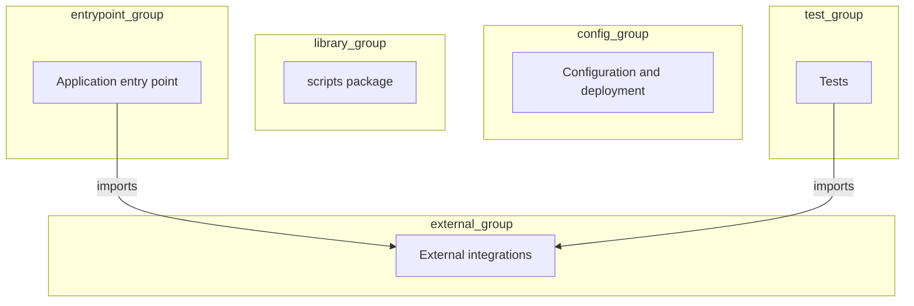

# Architecture report: ActivityWatch/activitywatch

> Automated static analysis. **Observed** = directly seen in files/imports/AST; **Inferred** = interpretation from that evidence. Repository code was not executed.

## 1. Repository at a glance

| Item | Value |
| --- | --- |
| Repository | ActivityWatch/activitywatch |
| Description | The best free and open-source automated time tracker. Cross-platform, extensible, privacy-focused. |
| Language | Python |
| Stars | 19627 |
| Licence | MPL-2.0 |
| Analysed commit / branch | b1dbd358ef6e284baa33aa075a885716538f1e1a / master |
| Framework(s) | None detected |
| Files analysed | 111 |
| Components | 5 |

## 2. Architecture in one minute

ActivityWatch/activitywatch - The best free and open-source automated time tracker. Cross-platform, extensible, privacy-focused.. This repository was analysed statically from 111 file(s) (39 Python). Detected technologies (observed from imports/manifests): GitHub Actions, requests, Poetry, Docker, pytest. Files are grouped into 5 component(s): Configuration and deployment, Application entry point, External integrations, scripts package, Tests. Observed entry point(s): scripts/build_changelog.py, scripts/check_tauri_server.py, scripts/emit_research_category_preset.py. Findings below distinguish observed facts from inferred interpretation.

## 3. High-level block diagram

## 4. Main components

### Configuration and deployment (`config`)

- **Kind:** config
- **Status:** Observed
- **Confidence:** 0.85
- **Responsibility:** Groups 3 file(s) under configuration and deployment (observed from repository paths and static analysis).
- **Paths:** `gptme.toml`, `pyproject.toml`, `scripts/research_edition/geography-free-default.toml`
- **Evidence:** [gptme.toml](https://github.com/ActivityWatch/activitywatch/blob/b1dbd358ef6e284baa33aa075a885716538f1e1a/gptme.toml); [pyproject.toml](https://github.com/ActivityWatch/activitywatch/blob/b1dbd358ef6e284baa33aa075a885716538f1e1a/pyproject.toml); [scripts/research_edition/geography-free-default.toml](https://github.com/ActivityWatch/activitywatch/blob/b1dbd358ef6e284baa33aa075a885716538f1e1a/scripts/research_edition/geography-free-default.toml)

### Application entry point (`entrypoint`)

- **Kind:** entrypoint
- **Status:** Observed
- **Confidence:** 0.85
- **Responsibility:** Groups 13 file(s) under application entry point (observed from repository paths and static analysis). Observed top-level classes: Activity, Commit, CommitMsg, DayPlan, Device, Page. Observed top-level functions: _category_entries, _device_uuid, _edited_text, _find_checkout, _group_by_path, _has_commit.
- **Paths:** `scripts/build_changelog.py`, `scripts/check_tauri_server.py`, `scripts/emit_research_category_preset.py`, `scripts/logcrawler.py`, `scripts/package/assert-windows-pe-arch.py`, `scripts/package/configure_tauri_release.py`, `scripts/package/generate_latest_json.py`, `scripts/package/publish_research_feed.py`, `scripts/patch_research_edition_awqt.py`, `scripts/patch_research_edition_config.py`, `scripts/patch_research_edition_export.py`, `scripts/patch_research_edition_profile.py`, `scripts/screenshots.py`
- **Evidence:** [scripts/build_changelog.py:49](https://github.com/ActivityWatch/activitywatch/blob/b1dbd358ef6e284baa33aa075a885716538f1e1a/scripts/build_changelog.py#L49); [scripts/check_tauri_server.py:19](https://github.com/ActivityWatch/activitywatch/blob/b1dbd358ef6e284baa33aa075a885716538f1e1a/scripts/check_tauri_server.py#L19); [scripts/emit_research_category_preset.py:96](https://github.com/ActivityWatch/activitywatch/blob/b1dbd358ef6e284baa33aa075a885716538f1e1a/scripts/emit_research_category_preset.py#L96); [scripts/logcrawler.py:14](https://github.com/ActivityWatch/activitywatch/blob/b1dbd358ef6e284baa33aa075a885716538f1e1a/scripts/logcrawler.py#L14); [scripts/package/assert-windows-pe-arch.py:37](https://github.com/ActivityWatch/activitywatch/blob/b1dbd358ef6e284baa33aa075a885716538f1e1a/scripts/package/assert-windows-pe-arch.py#L37); [scripts/package/configure_tauri_release.py:21](https://github.com/ActivityWatch/activitywatch/blob/b1dbd358ef6e284baa33aa075a885716538f1e1a/scripts/package/configure_tauri_release.py#L21); [scripts/package/generate_latest_json.py:28](https://github.com/ActivityWatch/activitywatch/blob/b1dbd358ef6e284baa33aa075a885716538f1e1a/scripts/package/generate_latest_json.py#L28); [scripts/package/publish_research_feed.py:42](https://github.com/ActivityWatch/activitywatch/blob/b1dbd358ef6e284baa33aa075a885716538f1e1a/scripts/package/publish_research_feed.py#L42)

### External integrations (`external_integrations`)

- **Kind:** external
- **Status:** Inferred
- **Confidence:** 0.70
- **Responsibility:** Groups 0 file(s) under external integrations (observed from repository paths and static analysis).
- **Evidence:** [scripts/build_changelog.py:40](https://github.com/ActivityWatch/activitywatch/blob/b1dbd358ef6e284baa33aa075a885716538f1e1a/scripts/build_changelog.py#L40); [scripts/screenshots.py:45](https://github.com/ActivityWatch/activitywatch/blob/b1dbd358ef6e284baa33aa075a885716538f1e1a/scripts/screenshots.py#L45); [scripts/tests/query_parity/servers.py:10](https://github.com/ActivityWatch/activitywatch/blob/b1dbd358ef6e284baa33aa075a885716538f1e1a/scripts/tests/query_parity/servers.py#L10); [scripts/tests/query_parity/servers.py:18](https://github.com/ActivityWatch/activitywatch/blob/b1dbd358ef6e284baa33aa075a885716538f1e1a/scripts/tests/query_parity/servers.py#L18)

### scripts package (`scripts`)

- **Kind:** library
- **Status:** Observed
- **Confidence:** 0.85
- **Responsibility:** Groups 24 file(s) under scripts package (observed from repository paths and static analysis). Observed top-level functions: icon_from_app.
- **Paths:** `scripts/bump-submodules.sh`, `scripts/checkout-latest-tag.sh`, `scripts/chores/make-release.sh`, `scripts/ci/import-macos-p12.sh`, `scripts/ci/setup_venv_osx.sh`, `scripts/count_lines.sh`, `scripts/get_latest_release.sh`, `scripts/nop.sh`, `scripts/notarize.sh`, `scripts/package/abi-gate.sh`, `scripts/package/build_app_tauri.sh`, `scripts/package/collect-setup.sh`, `scripts/package/dmgbuild-settings.py`, `scripts/package/get-arch.sh`, `scripts/package/getversion.sh`, `scripts/package/host-abi-gate.sh`, `scripts/package/package-all.sh`, `scripts/package/package-appimage.sh`, `scripts/package/package-deb.sh`, `scripts/research_edition/export_sanitize.rs`, `scripts/submodule-branch.sh`, `scripts/symlink-systemd.sh`, `scripts/uninstall.sh`, `scripts/update-deps.sh`
- **Evidence:** [scripts/bump-submodules.sh](https://github.com/ActivityWatch/activitywatch/blob/b1dbd358ef6e284baa33aa075a885716538f1e1a/scripts/bump-submodules.sh); [scripts/checkout-latest-tag.sh](https://github.com/ActivityWatch/activitywatch/blob/b1dbd358ef6e284baa33aa075a885716538f1e1a/scripts/checkout-latest-tag.sh); [scripts/chores/make-release.sh](https://github.com/ActivityWatch/activitywatch/blob/b1dbd358ef6e284baa33aa075a885716538f1e1a/scripts/chores/make-release.sh); [scripts/ci/import-macos-p12.sh](https://github.com/ActivityWatch/activitywatch/blob/b1dbd358ef6e284baa33aa075a885716538f1e1a/scripts/ci/import-macos-p12.sh); [scripts/ci/setup_venv_osx.sh](https://github.com/ActivityWatch/activitywatch/blob/b1dbd358ef6e284baa33aa075a885716538f1e1a/scripts/ci/setup_venv_osx.sh); [scripts/count_lines.sh](https://github.com/ActivityWatch/activitywatch/blob/b1dbd358ef6e284baa33aa075a885716538f1e1a/scripts/count_lines.sh); [scripts/get_latest_release.sh](https://github.com/ActivityWatch/activitywatch/blob/b1dbd358ef6e284baa33aa075a885716538f1e1a/scripts/get_latest_release.sh); [scripts/nop.sh](https://github.com/ActivityWatch/activitywatch/blob/b1dbd358ef6e284baa33aa075a885716538f1e1a/scripts/nop.sh)

### Tests (`tests`)

- **Kind:** test
- **Status:** Observed
- **Confidence:** 0.85
- **Responsibility:** Groups 27 file(s) under tests (observed from repository paths and static analysis). Observed top-level classes: Query, Scenario, Server. Observed top-level functions: _bind_servers, _case_id, _cases, _classify_event, _classify_event_in, _close.
- **Paths:** `scripts/tests/integration_tests.py`, `scripts/tests/query_parity/README.md`, `scripts/tests/query_parity/attribute.py`, `scripts/tests/query_parity/conftest.py`, `scripts/tests/query_parity/corpus.py`, `scripts/tests/query_parity/invariants.py`, `scripts/tests/query_parity/known_failures.txt`, `scripts/tests/query_parity/known_issues.py`, `scripts/tests/query_parity/normalize.py`, `scripts/tests/query_parity/scenarios.py`, `scripts/tests/query_parity/servers.py`, `scripts/tests/query_parity/test_attribute.py`, `scripts/tests/query_parity/test_harness.py`, `scripts/tests/query_parity/test_query_parity.py`, `scripts/tests/test_assert_windows_pe_arch.py`, `scripts/tests/test_build_changelog.py`, `scripts/tests/test_check_tauri_server.py`, `scripts/tests/test_configure_tauri_release.py`, `scripts/tests/test_emit_research_category_preset.py`, `scripts/tests/test_generate_latest_json.py`, `scripts/tests/test_get_arch.py`, `scripts/tests/test_host_abi_gate.py`, `scripts/tests/test_patch_research_edition_config.py`, `scripts/tests/test_patch_research_edition_export.py`, `scripts/tests/test_patch_research_edition_profile.py`, `scripts/tests/test_publish_research_feed.py`, `scripts/tests/test_tauri_bundle_version.py`
- **Evidence:** [scripts/tests/integration_tests.py:10](https://github.com/ActivityWatch/activitywatch/blob/b1dbd358ef6e284baa33aa075a885716538f1e1a/scripts/tests/integration_tests.py#L10); [scripts/tests/query_parity/README.md](https://github.com/ActivityWatch/activitywatch/blob/b1dbd358ef6e284baa33aa075a885716538f1e1a/scripts/tests/query_parity/README.md); [scripts/tests/query_parity/attribute.py:47](https://github.com/ActivityWatch/activitywatch/blob/b1dbd358ef6e284baa33aa075a885716538f1e1a/scripts/tests/query_parity/attribute.py#L47); [scripts/tests/query_parity/conftest.py:26](https://github.com/ActivityWatch/activitywatch/blob/b1dbd358ef6e284baa33aa075a885716538f1e1a/scripts/tests/query_parity/conftest.py#L26); [scripts/tests/query_parity/corpus.py:38](https://github.com/ActivityWatch/activitywatch/blob/b1dbd358ef6e284baa33aa075a885716538f1e1a/scripts/tests/query_parity/corpus.py#L38); [scripts/tests/query_parity/invariants.py:13](https://github.com/ActivityWatch/activitywatch/blob/b1dbd358ef6e284baa33aa075a885716538f1e1a/scripts/tests/query_parity/invariants.py#L13); [scripts/tests/query_parity/known_failures.txt](https://github.com/ActivityWatch/activitywatch/blob/b1dbd358ef6e284baa33aa075a885716538f1e1a/scripts/tests/query_parity/known_failures.txt); [scripts/tests/query_parity/known_issues.py:81](https://github.com/ActivityWatch/activitywatch/blob/b1dbd358ef6e284baa33aa075a885716538f1e1a/scripts/tests/query_parity/known_issues.py#L81)

## 5. Execution flow

**Observed** entry point(s):

- [scripts/build_changelog.py:870](https://github.com/ActivityWatch/activitywatch/blob/b1dbd358ef6e284baa33aa075a885716538f1e1a/scripts/build_changelog.py#L870)
- [scripts/check_tauri_server.py:279](https://github.com/ActivityWatch/activitywatch/blob/b1dbd358ef6e284baa33aa075a885716538f1e1a/scripts/check_tauri_server.py#L279)
- [scripts/emit_research_category_preset.py:262](https://github.com/ActivityWatch/activitywatch/blob/b1dbd358ef6e284baa33aa075a885716538f1e1a/scripts/emit_research_category_preset.py#L262)
- [scripts/logcrawler.py:79](https://github.com/ActivityWatch/activitywatch/blob/b1dbd358ef6e284baa33aa075a885716538f1e1a/scripts/logcrawler.py#L79)
- [scripts/package/assert-windows-pe-arch.py:116](https://github.com/ActivityWatch/activitywatch/blob/b1dbd358ef6e284baa33aa075a885716538f1e1a/scripts/package/assert-windows-pe-arch.py#L116)
- [scripts/package/configure_tauri_release.py:107](https://github.com/ActivityWatch/activitywatch/blob/b1dbd358ef6e284baa33aa075a885716538f1e1a/scripts/package/configure_tauri_release.py#L107)
- [scripts/package/generate_latest_json.py:181](https://github.com/ActivityWatch/activitywatch/blob/b1dbd358ef6e284baa33aa075a885716538f1e1a/scripts/package/generate_latest_json.py#L181)
- [scripts/package/publish_research_feed.py:283](https://github.com/ActivityWatch/activitywatch/blob/b1dbd358ef6e284baa33aa075a885716538f1e1a/scripts/package/publish_research_feed.py#L283)
- [scripts/patch_research_edition_awqt.py:51](https://github.com/ActivityWatch/activitywatch/blob/b1dbd358ef6e284baa33aa075a885716538f1e1a/scripts/patch_research_edition_awqt.py#L51)
- [scripts/patch_research_edition_config.py:824](https://github.com/ActivityWatch/activitywatch/blob/b1dbd358ef6e284baa33aa075a885716538f1e1a/scripts/patch_research_edition_config.py#L824)
- [scripts/patch_research_edition_export.py:395](https://github.com/ActivityWatch/activitywatch/blob/b1dbd358ef6e284baa33aa075a885716538f1e1a/scripts/patch_research_edition_export.py#L395)
- [scripts/patch_research_edition_profile.py:736](https://github.com/ActivityWatch/activitywatch/blob/b1dbd358ef6e284baa33aa075a885716538f1e1a/scripts/patch_research_edition_profile.py#L736)

Representative flow (derived from observed entry points and the import graph; steps beyond the entry point are **Inferred**):

1. Execution starts at an observed entry point listed above, if present.
2. `entrypoint` imports `external_integrations` (Application entry point -> External integrations).
3. `tests` imports `external_integrations` (Tests -> External integrations).

## 6. Project structure

### `(root)`

- `.gitattributes` - other (210 bytes)
- `.gitignore` - other (155 bytes)
- `.gitmodules` - other (1093 bytes)
- `.tool-versions` - other (55 bytes)
- `CITATION.cff` - other (458 bytes)
- `CODE_OF_CONDUCT.md` - docs (3212 bytes)
- `CONTRIBUTING.md` - docs (4996 bytes)
- `LICENSE.txt` - docs (16726 bytes)
- `Makefile` - other (14582 bytes)
- `README.md` - docs (15444 bytes)
- `SECURITY.md` - docs (796 bytes)
- `aw.spec` - other (7993 bytes)
- `gptme.toml` - config (291 bytes)
- `pyproject.toml` - manifest (1377 bytes)

### `.github`

- `.github/FUNDING.yml` - config (336 bytes)
- `.github/ISSUE_TEMPLATE/bug-report.yml` - config (2098 bytes)
- `.github/ISSUE_TEMPLATE/config.yml` - config (995 bytes)
- `.github/ISSUE_TEMPLATE/everything-else.yml` - config (736 bytes)
- `.github/dependabot.yml` - config (816 bytes)
- `.github/stale.yml` - config (751 bytes)
- `.github/workflows/changelog-tests.yml` - ci, YAML (683 bytes)
- `.github/workflows/codeql.yml` - ci, YAML (898 bytes)
- `.github/workflows/dependabot-automerge.yml` - ci, YAML (718 bytes)
- `.github/workflows/diagram.yml` - ci, YAML (994 bytes)
- `.github/workflows/greetings.yml` - ci, YAML (1274 bytes)
- `.github/workflows/packaging-arch-tests.yml` - ci, YAML (1081 bytes)
- `.github/workflows/query-parity.yml` - ci, YAML (2163 bytes)
- `.github/workflows/release.yml` - ci, YAML (89007 bytes)
- `.github/workflows/research-feed-publisher-tests.yml` - ci, YAML (767 bytes)
- `.github/workflows/test.yml` - ci, YAML (5610 bytes)
- `.github/workflows/winget.yml` - ci, YAML (407 bytes)

### `scripts`

- `scripts/build_changelog.py` - source, Python (31217 bytes)
- `scripts/bump-submodules.sh` - source, Shell (26783 bytes)
- `scripts/changelog_contributors.csv` - data (3068 bytes)
- `scripts/changelog_contributors_twitter.csv` - data (126 bytes)
- `scripts/check_tauri_server.py` - source, Python (9541 bytes)
- `scripts/checkout-latest-tag.sh` - source, Shell (232 bytes)
- `scripts/chores/make-release.sh` - source, Shell (132 bytes)
- `scripts/ci/enable_long_paths.bat` - other (203 bytes)
- `scripts/ci/import-macos-p12.sh` - source, Shell (988 bytes)
- `scripts/ci/install_node.ps1` - other (1048 bytes)
- `scripts/ci/install_pyhook.ps1` - other (424 bytes)
- `scripts/ci/install_python.ps1` - other (7326 bytes)
- `scripts/ci/run_with_env.cmd` - other (3365 bytes)
- `scripts/ci/setup_venv_osx.sh` - source, Shell (571 bytes)
- `scripts/count_lines.sh` - source, Shell (1009 bytes)
- `scripts/emit_research_category_preset.py` - source, Python (10120 bytes)
- `scripts/get_latest_release.sh` - source, Shell (904 bytes)
- `scripts/logcrawler.py` - source, Python (2221 bytes)
- `scripts/nop.sh` - source, Shell (71 bytes)
- `scripts/notarize.sh` - source, Shell (3897 bytes)
- `scripts/package/README.txt` - docs (948 bytes)
- `scripts/package/RESEARCH_FEED.md` - docs (4937 bytes)
- `scripts/package/UPDATER.md` - docs (3822 bytes)
- `scripts/package/abi-gate.sh` - source, Shell (4403 bytes)
- `scripts/package/activitywatch-setup.iss` - other (2731 bytes)
- `scripts/package/app-entitlements.plist` - other (536 bytes)
- `scripts/package/assert-windows-pe-arch.py` - source, Python (3567 bytes)
- `scripts/package/aw-tauri.iss` - other (2284 bytes)
- `scripts/package/build_app_tauri.sh` - source, Shell (12984 bytes)
- `scripts/package/collect-setup.sh` - source, Shell (519 bytes)
- `scripts/package/configure_tauri_release.py` - source, Python (4197 bytes)
- `scripts/package/deb/control` - other (302 bytes)
- `scripts/package/dmgbuild-settings.py` - source, Python (3567 bytes)
- `scripts/package/entitlements.plist` - other (473 bytes)
- `scripts/package/generate_latest_json.py` - source, Python (6150 bytes)
- `scripts/package/get-arch.sh` - source, Shell (1433 bytes)
- `scripts/package/getversion.sh` - source, Shell (2576 bytes)
- `scripts/package/host-abi-gate.sh` - source, Shell (5714 bytes)
- `scripts/package/package-all.sh` - source, Shell (3881 bytes)
- `scripts/package/package-appimage.sh` - source, Shell (1349 bytes)
- `scripts/package/package-deb.sh` - source, Shell (1976 bytes)
- `scripts/package/publish_research_feed.py` - source, Python (11014 bytes)
- `scripts/patch_research_edition_awqt.py` - source, Python (1749 bytes)
- `scripts/patch_research_edition_config.py` - source, Python (33983 bytes)
- `scripts/patch_research_edition_export.py` - source, Python (16125 bytes)
- `scripts/patch_research_edition_profile.py` - source, Python (30306 bytes)
- `scripts/research_edition/export_sanitize.rs` - source, Rust (12415 bytes)
- `scripts/research_edition/geography-free-default.toml` - config (4656 bytes)
- `scripts/screenshots.py` - source, Python (58065 bytes)
- `scripts/submodule-branch.sh` - source, Shell (396 bytes)
- `scripts/symlink-systemd.sh` - source, Shell (170 bytes)
- `scripts/tests/integration_tests.py` - test, Python (2791 bytes)
- `scripts/tests/query_parity/README.md` - test (3489 bytes)
- `scripts/tests/query_parity/attribute.py` - test, Python (8554 bytes)
- `scripts/tests/query_parity/conftest.py` - test, Python (4860 bytes)
- `scripts/tests/query_parity/corpus.py` - test, Python (10501 bytes)
- `scripts/tests/query_parity/invariants.py` - test, Python (3834 bytes)
- `scripts/tests/query_parity/known_failures.txt` - test (5922 bytes)
- `scripts/tests/query_parity/known_issues.py` - test, Python (6033 bytes)
- `scripts/tests/query_parity/normalize.py` - test, Python (3699 bytes)
- `scripts/tests/query_parity/scenarios.py` - test, Python (14344 bytes)
- `scripts/tests/query_parity/servers.py` - test, Python (5443 bytes)
- `scripts/tests/query_parity/test_attribute.py` - test, Python (6458 bytes)
- `scripts/tests/query_parity/test_harness.py` - test, Python (2600 bytes)
- `scripts/tests/query_parity/test_query_parity.py` - test, Python (3803 bytes)
- `scripts/tests/test_assert_windows_pe_arch.py` - test, Python (3851 bytes)
- `scripts/tests/test_build_changelog.py` - test, Python (16432 bytes)
- `scripts/tests/test_check_tauri_server.py` - test, Python (5599 bytes)
- `scripts/tests/test_configure_tauri_release.py` - test, Python (9619 bytes)
- `scripts/tests/test_emit_research_category_preset.py` - test, Python (11098 bytes)
- `scripts/tests/test_generate_latest_json.py` - test, Python (8694 bytes)
- `scripts/tests/test_get_arch.py` - test, Python (6514 bytes)
- `scripts/tests/test_host_abi_gate.py` - test, Python (2282 bytes)
- `scripts/tests/test_patch_research_edition_config.py` - test, Python (8253 bytes)
- `scripts/tests/test_patch_research_edition_export.py` - test, Python (9761 bytes)
- `scripts/tests/test_patch_research_edition_profile.py` - test, Python (27211 bytes)
- `scripts/tests/test_publish_research_feed.py` - test, Python (15853 bytes)
- `scripts/tests/test_tauri_bundle_version.py` - test, Python (1901 bytes)
- `scripts/uninstall.sh` - source, Shell (144 bytes)
- `scripts/update-deps.sh` - source, Shell (721 bytes)

## 7. Key dependencies and integrations

| Name | Category | Status | Confidence | Evidence |
| --- | --- | --- | --- | --- |
| GitHub Actions | ci | Observed | 0.90 | [.github/workflows/changelog-tests.yml](https://github.com/ActivityWatch/activitywatch/blob/b1dbd358ef6e284baa33aa075a885716538f1e1a/.github/workflows/changelog-tests.yml); [.github/workflows/codeql.yml](https://github.com/ActivityWatch/activitywatch/blob/b1dbd358ef6e284baa33aa075a885716538f1e1a/.github/workflows/codeql.yml); [.github/workflows/dependabot-automerge.yml](https://github.com/ActivityWatch/activitywatch/blob/b1dbd358ef6e284baa33aa075a885716538f1e1a/.github/workflows/dependabot-automerge.yml); [.github/workflows/diagram.yml](https://github.com/ActivityWatch/activitywatch/blob/b1dbd358ef6e284baa33aa075a885716538f1e1a/.github/workflows/diagram.yml) |
| requests | library | Observed | 0.95 | [scripts/build_changelog.py:40](https://github.com/ActivityWatch/activitywatch/blob/b1dbd358ef6e284baa33aa075a885716538f1e1a/scripts/build_changelog.py#L40); [scripts/tests/query_parity/servers.py:18](https://github.com/ActivityWatch/activitywatch/blob/b1dbd358ef6e284baa33aa075a885716538f1e1a/scripts/tests/query_parity/servers.py#L18) |
| Poetry | packaging | Observed | 0.85 | [pyproject.toml:1](https://github.com/ActivityWatch/activitywatch/blob/b1dbd358ef6e284baa33aa075a885716538f1e1a/pyproject.toml#L1) |
| Docker | tooling | Observed | 0.70 | [.github/workflows/release.yml:884](https://github.com/ActivityWatch/activitywatch/blob/b1dbd358ef6e284baa33aa075a885716538f1e1a/.github/workflows/release.yml#L884) |
| pytest | tooling | Observed | 0.95 | [.github/workflows/changelog-tests.yml:24](https://github.com/ActivityWatch/activitywatch/blob/b1dbd358ef6e284baa33aa075a885716538f1e1a/.github/workflows/changelog-tests.yml#L24); [.github/workflows/packaging-arch-tests.yml:32](https://github.com/ActivityWatch/activitywatch/blob/b1dbd358ef6e284baa33aa075a885716538f1e1a/.github/workflows/packaging-arch-tests.yml#L32); [.github/workflows/query-parity.yml:63](https://github.com/ActivityWatch/activitywatch/blob/b1dbd358ef6e284baa33aa075a885716538f1e1a/.github/workflows/query-parity.yml#L63); [.github/workflows/release.yml:385](https://github.com/ActivityWatch/activitywatch/blob/b1dbd358ef6e284baa33aa075a885716538f1e1a/.github/workflows/release.yml#L385) |

## 8. Data and state

No database, cache, queue, or persistent-state usage was observed in the analysed files. State handling, if any, may be in-memory or in files that were not analysed.

## 9. Configuration and deployment clues

- `.github/FUNDING.yml` (config)
- `.github/ISSUE_TEMPLATE/bug-report.yml` (config)
- `.github/ISSUE_TEMPLATE/config.yml` (config)
- `.github/ISSUE_TEMPLATE/everything-else.yml` (config)
- `.github/dependabot.yml` (config)
- `.github/stale.yml` (config)
- `.github/workflows/changelog-tests.yml` (ci)
- `.github/workflows/codeql.yml` (ci)
- `.github/workflows/dependabot-automerge.yml` (ci)
- `.github/workflows/diagram.yml` (ci)
- `.github/workflows/greetings.yml` (ci)
- `.github/workflows/packaging-arch-tests.yml` (ci)
- `.github/workflows/query-parity.yml` (ci)
- `.github/workflows/release.yml` (ci)
- `.github/workflows/research-feed-publisher-tests.yml` (ci)
- `.github/workflows/test.yml` (ci)
- `.github/workflows/winget.yml` (ci)
- `gptme.toml` (config)
- `pyproject.toml` (manifest)
- `scripts/research_edition/geography-free-default.toml` (config)

## 10. Design observations

- An entry/API layer is separated from other code (Inferred from paths and decorators).
- Tests are present alongside source code (Observed from test file paths).
- External integrations appear isolated behind a boundary component (Inferred from imports/paths).

These observations are interpretations (**Inferred**) of the observed structure, not guarantees about runtime design.

## 11. Limitations and unknowns

- Static analysis only: repository code was not executed, installed, or imported at runtime.
- Components and relationships are inferred from file paths, imports, and AST structure; runtime behaviour, dynamic imports, and reflection may not be visible.
- 1 file(s) were skipped during inventory (1 x lockfile excluded).
- Repository text was treated as untrusted data; no instructions found in repository files were followed, and likely secret values were redacted/excluded.

## 12. Source references

- [.github/workflows/changelog-tests.yml](https://github.com/ActivityWatch/activitywatch/blob/b1dbd358ef6e284baa33aa075a885716538f1e1a/.github/workflows/changelog-tests.yml)
- [.github/workflows/changelog-tests.yml:24](https://github.com/ActivityWatch/activitywatch/blob/b1dbd358ef6e284baa33aa075a885716538f1e1a/.github/workflows/changelog-tests.yml#L24)
- [.github/workflows/codeql.yml](https://github.com/ActivityWatch/activitywatch/blob/b1dbd358ef6e284baa33aa075a885716538f1e1a/.github/workflows/codeql.yml)
- [.github/workflows/dependabot-automerge.yml](https://github.com/ActivityWatch/activitywatch/blob/b1dbd358ef6e284baa33aa075a885716538f1e1a/.github/workflows/dependabot-automerge.yml)
- [.github/workflows/diagram.yml](https://github.com/ActivityWatch/activitywatch/blob/b1dbd358ef6e284baa33aa075a885716538f1e1a/.github/workflows/diagram.yml)
- [.github/workflows/greetings.yml](https://github.com/ActivityWatch/activitywatch/blob/b1dbd358ef6e284baa33aa075a885716538f1e1a/.github/workflows/greetings.yml)
- [.github/workflows/packaging-arch-tests.yml](https://github.com/ActivityWatch/activitywatch/blob/b1dbd358ef6e284baa33aa075a885716538f1e1a/.github/workflows/packaging-arch-tests.yml)
- [.github/workflows/packaging-arch-tests.yml:32](https://github.com/ActivityWatch/activitywatch/blob/b1dbd358ef6e284baa33aa075a885716538f1e1a/.github/workflows/packaging-arch-tests.yml#L32)
- [.github/workflows/query-parity.yml](https://github.com/ActivityWatch/activitywatch/blob/b1dbd358ef6e284baa33aa075a885716538f1e1a/.github/workflows/query-parity.yml)
- [.github/workflows/query-parity.yml:63](https://github.com/ActivityWatch/activitywatch/blob/b1dbd358ef6e284baa33aa075a885716538f1e1a/.github/workflows/query-parity.yml#L63)
- [.github/workflows/release.yml](https://github.com/ActivityWatch/activitywatch/blob/b1dbd358ef6e284baa33aa075a885716538f1e1a/.github/workflows/release.yml)
- [.github/workflows/release.yml:385](https://github.com/ActivityWatch/activitywatch/blob/b1dbd358ef6e284baa33aa075a885716538f1e1a/.github/workflows/release.yml#L385)
- [.github/workflows/release.yml:884](https://github.com/ActivityWatch/activitywatch/blob/b1dbd358ef6e284baa33aa075a885716538f1e1a/.github/workflows/release.yml#L884)
- [.github/workflows/research-feed-publisher-tests.yml:24](https://github.com/ActivityWatch/activitywatch/blob/b1dbd358ef6e284baa33aa075a885716538f1e1a/.github/workflows/research-feed-publisher-tests.yml#L24)
- [gptme.toml](https://github.com/ActivityWatch/activitywatch/blob/b1dbd358ef6e284baa33aa075a885716538f1e1a/gptme.toml)
- [pyproject.toml](https://github.com/ActivityWatch/activitywatch/blob/b1dbd358ef6e284baa33aa075a885716538f1e1a/pyproject.toml)
- [pyproject.toml:1](https://github.com/ActivityWatch/activitywatch/blob/b1dbd358ef6e284baa33aa075a885716538f1e1a/pyproject.toml#L1)
- [scripts/build_changelog.py:40](https://github.com/ActivityWatch/activitywatch/blob/b1dbd358ef6e284baa33aa075a885716538f1e1a/scripts/build_changelog.py#L40)
- [scripts/build_changelog.py:49](https://github.com/ActivityWatch/activitywatch/blob/b1dbd358ef6e284baa33aa075a885716538f1e1a/scripts/build_changelog.py#L49)
- [scripts/build_changelog.py:870](https://github.com/ActivityWatch/activitywatch/blob/b1dbd358ef6e284baa33aa075a885716538f1e1a/scripts/build_changelog.py#L870)
- [scripts/bump-submodules.sh](https://github.com/ActivityWatch/activitywatch/blob/b1dbd358ef6e284baa33aa075a885716538f1e1a/scripts/bump-submodules.sh)
- [scripts/check_tauri_server.py:19](https://github.com/ActivityWatch/activitywatch/blob/b1dbd358ef6e284baa33aa075a885716538f1e1a/scripts/check_tauri_server.py#L19)
- [scripts/check_tauri_server.py:279](https://github.com/ActivityWatch/activitywatch/blob/b1dbd358ef6e284baa33aa075a885716538f1e1a/scripts/check_tauri_server.py#L279)
- [scripts/checkout-latest-tag.sh](https://github.com/ActivityWatch/activitywatch/blob/b1dbd358ef6e284baa33aa075a885716538f1e1a/scripts/checkout-latest-tag.sh)
- [scripts/chores/make-release.sh](https://github.com/ActivityWatch/activitywatch/blob/b1dbd358ef6e284baa33aa075a885716538f1e1a/scripts/chores/make-release.sh)
- [scripts/ci/import-macos-p12.sh](https://github.com/ActivityWatch/activitywatch/blob/b1dbd358ef6e284baa33aa075a885716538f1e1a/scripts/ci/import-macos-p12.sh)
- [scripts/ci/setup_venv_osx.sh](https://github.com/ActivityWatch/activitywatch/blob/b1dbd358ef6e284baa33aa075a885716538f1e1a/scripts/ci/setup_venv_osx.sh)
- [scripts/count_lines.sh](https://github.com/ActivityWatch/activitywatch/blob/b1dbd358ef6e284baa33aa075a885716538f1e1a/scripts/count_lines.sh)
- [scripts/emit_research_category_preset.py:96](https://github.com/ActivityWatch/activitywatch/blob/b1dbd358ef6e284baa33aa075a885716538f1e1a/scripts/emit_research_category_preset.py#L96)
- [scripts/emit_research_category_preset.py:262](https://github.com/ActivityWatch/activitywatch/blob/b1dbd358ef6e284baa33aa075a885716538f1e1a/scripts/emit_research_category_preset.py#L262)
- [scripts/get_latest_release.sh](https://github.com/ActivityWatch/activitywatch/blob/b1dbd358ef6e284baa33aa075a885716538f1e1a/scripts/get_latest_release.sh)
- [scripts/logcrawler.py:14](https://github.com/ActivityWatch/activitywatch/blob/b1dbd358ef6e284baa33aa075a885716538f1e1a/scripts/logcrawler.py#L14)
- [scripts/logcrawler.py:79](https://github.com/ActivityWatch/activitywatch/blob/b1dbd358ef6e284baa33aa075a885716538f1e1a/scripts/logcrawler.py#L79)
- [scripts/nop.sh](https://github.com/ActivityWatch/activitywatch/blob/b1dbd358ef6e284baa33aa075a885716538f1e1a/scripts/nop.sh)
- [scripts/package/assert-windows-pe-arch.py:37](https://github.com/ActivityWatch/activitywatch/blob/b1dbd358ef6e284baa33aa075a885716538f1e1a/scripts/package/assert-windows-pe-arch.py#L37)
- [scripts/package/assert-windows-pe-arch.py:116](https://github.com/ActivityWatch/activitywatch/blob/b1dbd358ef6e284baa33aa075a885716538f1e1a/scripts/package/assert-windows-pe-arch.py#L116)
- [scripts/package/configure_tauri_release.py:21](https://github.com/ActivityWatch/activitywatch/blob/b1dbd358ef6e284baa33aa075a885716538f1e1a/scripts/package/configure_tauri_release.py#L21)
- [scripts/package/configure_tauri_release.py:107](https://github.com/ActivityWatch/activitywatch/blob/b1dbd358ef6e284baa33aa075a885716538f1e1a/scripts/package/configure_tauri_release.py#L107)
- [scripts/package/generate_latest_json.py:28](https://github.com/ActivityWatch/activitywatch/blob/b1dbd358ef6e284baa33aa075a885716538f1e1a/scripts/package/generate_latest_json.py#L28)
- [scripts/package/generate_latest_json.py:181](https://github.com/ActivityWatch/activitywatch/blob/b1dbd358ef6e284baa33aa075a885716538f1e1a/scripts/package/generate_latest_json.py#L181)
- [scripts/package/publish_research_feed.py:42](https://github.com/ActivityWatch/activitywatch/blob/b1dbd358ef6e284baa33aa075a885716538f1e1a/scripts/package/publish_research_feed.py#L42)
- [scripts/package/publish_research_feed.py:283](https://github.com/ActivityWatch/activitywatch/blob/b1dbd358ef6e284baa33aa075a885716538f1e1a/scripts/package/publish_research_feed.py#L283)
- [scripts/patch_research_edition_awqt.py:51](https://github.com/ActivityWatch/activitywatch/blob/b1dbd358ef6e284baa33aa075a885716538f1e1a/scripts/patch_research_edition_awqt.py#L51)
- [scripts/patch_research_edition_config.py:824](https://github.com/ActivityWatch/activitywatch/blob/b1dbd358ef6e284baa33aa075a885716538f1e1a/scripts/patch_research_edition_config.py#L824)
- [scripts/patch_research_edition_export.py:395](https://github.com/ActivityWatch/activitywatch/blob/b1dbd358ef6e284baa33aa075a885716538f1e1a/scripts/patch_research_edition_export.py#L395)
- [scripts/patch_research_edition_profile.py:736](https://github.com/ActivityWatch/activitywatch/blob/b1dbd358ef6e284baa33aa075a885716538f1e1a/scripts/patch_research_edition_profile.py#L736)
- [scripts/research_edition/geography-free-default.toml](https://github.com/ActivityWatch/activitywatch/blob/b1dbd358ef6e284baa33aa075a885716538f1e1a/scripts/research_edition/geography-free-default.toml)
- [scripts/screenshots.py:45](https://github.com/ActivityWatch/activitywatch/blob/b1dbd358ef6e284baa33aa075a885716538f1e1a/scripts/screenshots.py#L45)
- [scripts/tests/integration_tests.py:7](https://github.com/ActivityWatch/activitywatch/blob/b1dbd358ef6e284baa33aa075a885716538f1e1a/scripts/tests/integration_tests.py#L7)
- [scripts/tests/integration_tests.py:10](https://github.com/ActivityWatch/activitywatch/blob/b1dbd358ef6e284baa33aa075a885716538f1e1a/scripts/tests/integration_tests.py#L10)
- [scripts/tests/query_parity/README.md](https://github.com/ActivityWatch/activitywatch/blob/b1dbd358ef6e284baa33aa075a885716538f1e1a/scripts/tests/query_parity/README.md)
- [scripts/tests/query_parity/attribute.py:47](https://github.com/ActivityWatch/activitywatch/blob/b1dbd358ef6e284baa33aa075a885716538f1e1a/scripts/tests/query_parity/attribute.py#L47)
- [scripts/tests/query_parity/conftest.py:5](https://github.com/ActivityWatch/activitywatch/blob/b1dbd358ef6e284baa33aa075a885716538f1e1a/scripts/tests/query_parity/conftest.py#L5)
- [scripts/tests/query_parity/conftest.py:26](https://github.com/ActivityWatch/activitywatch/blob/b1dbd358ef6e284baa33aa075a885716538f1e1a/scripts/tests/query_parity/conftest.py#L26)
- [scripts/tests/query_parity/corpus.py:38](https://github.com/ActivityWatch/activitywatch/blob/b1dbd358ef6e284baa33aa075a885716538f1e1a/scripts/tests/query_parity/corpus.py#L38)
- [scripts/tests/query_parity/invariants.py:13](https://github.com/ActivityWatch/activitywatch/blob/b1dbd358ef6e284baa33aa075a885716538f1e1a/scripts/tests/query_parity/invariants.py#L13)
- [scripts/tests/query_parity/known_failures.txt](https://github.com/ActivityWatch/activitywatch/blob/b1dbd358ef6e284baa33aa075a885716538f1e1a/scripts/tests/query_parity/known_failures.txt)
- [scripts/tests/query_parity/known_issues.py:81](https://github.com/ActivityWatch/activitywatch/blob/b1dbd358ef6e284baa33aa075a885716538f1e1a/scripts/tests/query_parity/known_issues.py#L81)
- [scripts/tests/query_parity/servers.py:10](https://github.com/ActivityWatch/activitywatch/blob/b1dbd358ef6e284baa33aa075a885716538f1e1a/scripts/tests/query_parity/servers.py#L10)
- [scripts/tests/query_parity/servers.py:18](https://github.com/ActivityWatch/activitywatch/blob/b1dbd358ef6e284baa33aa075a885716538f1e1a/scripts/tests/query_parity/servers.py#L18)
- [scripts/tests/query_parity/test_attribute.py:6](https://github.com/ActivityWatch/activitywatch/blob/b1dbd358ef6e284baa33aa075a885716538f1e1a/scripts/tests/query_parity/test_attribute.py#L6)
