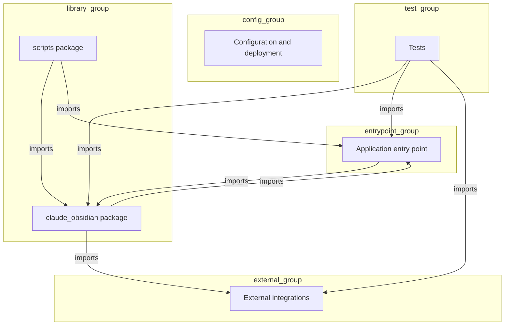

# Architecture report: AgriciDaniel/claude-obsidian

> Automated static analysis. **Observed** = directly seen in files/imports/AST; **Inferred** = interpretation from that evidence. Repository code was not executed.

## 1. Repository at a glance

| Item | Value |
| --- | --- |
| Repository | AgriciDaniel/claude-obsidian |
| Description | Self-organizing AI second brain for Obsidian + Claude Code. Drop any source and Claude reads, links, and files it into one connected knowledge graph of plain Markdown you own. AI note-taking, personal knowledge management (PKM), and an open-source Notion alternative. Based on Karpathy's LLM Wiki pa… |
| Language | Python |
| Stars | 16492 |
| Licence | MIT |
| Analysed commit / branch | 2e545563172f97f02ecaaaab376ceea1246a0583 / main |
| Framework(s) | None detected |
| Files analysed | 255 |
| Components | 6 |

## 2. Architecture in one minute

AgriciDaniel/claude-obsidian - Self-organizing AI second brain for Obsidian + Claude Code. Drop any source and Claude reads, links, and files it into one connected knowledge graph of plain Markdown you own. AI note-taking, persona…. This repository was analysed statically from 255 file(s) (84 Python). Detected technologies (observed from imports/manifests): GitHub Actions, unittest. Files are grouped into 6 component(s): claude_obsidian package, Configuration and deployment, Application entry point, External integrations, scripts package, Tests. Observed entry point(s): claude_obsidian/contracts.py, claude_obsidian/legacy_lock.py, claude_obsidian/lint_engine.py. Findings below distinguish observed facts from inferred interpretation.

## 3. High-level block diagram

## 4. Main components

### claude_obsidian package (`claude_obsidian`)

- **Kind:** library
- **Status:** Observed
- **Confidence:** 0.85
- **Responsibility:** Groups 27 file(s) under claude_obsidian package (observed from repository paths and static analysis). Observed top-level classes: ArtifactValidationError, CaptureBudget, CaptureBudgetExceeded, CaptureConfig, CaptureConflict, CaptureError. Observed top-level functions: _active_root_fd, _adapter, _aliases, _allowed_source_path, _apply_archive_overlays, _artifact_bytes.
- **Paths:** `claude_obsidian/__init__.py`, `claude_obsidian/artifacts.py`, `claude_obsidian/capacity.py`, `claude_obsidian/capture.py`, `claude_obsidian/checkpoint.py`, `claude_obsidian/extensions.py`, `claude_obsidian/gates.py`, `claude_obsidian/gitignore.py`, `claude_obsidian/hook_adapter.py`, `claude_obsidian/json_utils.py`, `claude_obsidian/ledgers.py`, `claude_obsidian/limits.py`, `claude_obsidian/markdown_links.py`, `claude_obsidian/mode_config.py`, `claude_obsidian/ollama.py`, `claude_obsidian/package_validation.py`, `claude_obsidian/page_schema.py`, `claude_obsidian/paths.py`, `claude_obsidian/prompt_eval.py`, `claude_obsidian/release.py`, `claude_obsidian/retrieval_eval.py`, `claude_obsidian/transaction.py`, `claude_obsidian/transport_probe.py`, `claude_obsidian/url_safety.py`, `claude_obsidian/vault_ops.py`, `claude_obsidian/visible_paths.py`, `claude_obsidian/workflow.py`
- **Evidence:** [claude_obsidian/__init__.py](https://github.com/AgriciDaniel/claude-obsidian/blob/2e545563172f97f02ecaaaab376ceea1246a0583/claude_obsidian/__init__.py); [claude_obsidian/artifacts.py:21](https://github.com/AgriciDaniel/claude-obsidian/blob/2e545563172f97f02ecaaaab376ceea1246a0583/claude_obsidian/artifacts.py#L21); [claude_obsidian/capacity.py:22](https://github.com/AgriciDaniel/claude-obsidian/blob/2e545563172f97f02ecaaaab376ceea1246a0583/claude_obsidian/capacity.py#L22); [claude_obsidian/capture.py:104](https://github.com/AgriciDaniel/claude-obsidian/blob/2e545563172f97f02ecaaaab376ceea1246a0583/claude_obsidian/capture.py#L104); [claude_obsidian/checkpoint.py:52](https://github.com/AgriciDaniel/claude-obsidian/blob/2e545563172f97f02ecaaaab376ceea1246a0583/claude_obsidian/checkpoint.py#L52); [claude_obsidian/extensions.py:13](https://github.com/AgriciDaniel/claude-obsidian/blob/2e545563172f97f02ecaaaab376ceea1246a0583/claude_obsidian/extensions.py#L13); [claude_obsidian/gates.py:15](https://github.com/AgriciDaniel/claude-obsidian/blob/2e545563172f97f02ecaaaab376ceea1246a0583/claude_obsidian/gates.py#L15); [claude_obsidian/gitignore.py:36](https://github.com/AgriciDaniel/claude-obsidian/blob/2e545563172f97f02ecaaaab376ceea1246a0583/claude_obsidian/gitignore.py#L36)

### Configuration and deployment (`config`)

- **Kind:** config
- **Status:** Observed
- **Confidence:** 0.85
- **Responsibility:** Groups 12 file(s) under configuration and deployment (observed from repository paths and static analysis).
- **Paths:** `RELEASE_MANIFEST.json`, `config/adapters.json`, `config/capabilities.json`, `config/product-contract.json`, `config/public-marketplace.json`, `config/release-allowlist.json`, `config/upstream-references.json`, `hooks/hooks.json`, `templates/vault/.obsidian/app.json`, `templates/vault/.obsidian/appearance.json`, `templates/vault/.obsidian/graph.json`, `templates/vault/.raw/.manifest.json`
- **Evidence:** [RELEASE_MANIFEST.json](https://github.com/AgriciDaniel/claude-obsidian/blob/2e545563172f97f02ecaaaab376ceea1246a0583/RELEASE_MANIFEST.json); [config/adapters.json](https://github.com/AgriciDaniel/claude-obsidian/blob/2e545563172f97f02ecaaaab376ceea1246a0583/config/adapters.json); [config/capabilities.json](https://github.com/AgriciDaniel/claude-obsidian/blob/2e545563172f97f02ecaaaab376ceea1246a0583/config/capabilities.json); [config/product-contract.json](https://github.com/AgriciDaniel/claude-obsidian/blob/2e545563172f97f02ecaaaab376ceea1246a0583/config/product-contract.json); [config/public-marketplace.json](https://github.com/AgriciDaniel/claude-obsidian/blob/2e545563172f97f02ecaaaab376ceea1246a0583/config/public-marketplace.json); [config/release-allowlist.json](https://github.com/AgriciDaniel/claude-obsidian/blob/2e545563172f97f02ecaaaab376ceea1246a0583/config/release-allowlist.json); [config/upstream-references.json](https://github.com/AgriciDaniel/claude-obsidian/blob/2e545563172f97f02ecaaaab376ceea1246a0583/config/upstream-references.json); [hooks/hooks.json](https://github.com/AgriciDaniel/claude-obsidian/blob/2e545563172f97f02ecaaaab376ceea1246a0583/hooks/hooks.json)

### Application entry point (`entrypoint`)

- **Kind:** entrypoint
- **Status:** Observed
- **Confidence:** 0.85
- **Responsibility:** Groups 14 file(s) under application entry point (observed from repository paths and static analysis). Observed top-level classes: IndexValidationError, LegacyLockError, LockRecord, ParsedArguments, ProviderOperationBudget, QueryTooLargeError. Observed top-level functions: _acquire, _add_approval_argument, _add_capture_budget_arguments, _add_capture_queue_arguments, _add_vault_argument, _allowlist_values.
- **Paths:** `claude_obsidian/__main__.py`, `claude_obsidian/cli.py`, `claude_obsidian/contracts.py`, `claude_obsidian/legacy_lock.py`, `claude_obsidian/lint_engine.py`, `scripts/bm25-index.py`, `scripts/boundary-score.py`, `scripts/contextual-prefix.py`, `scripts/evaluate-prompts.py`, `scripts/evaluate-retrieval.py`, `scripts/rerank.py`, `scripts/retrieve.py`, `scripts/tiling-check.py`, `scripts/wiki-mode.py`
- **Evidence:** [claude_obsidian/__main__.py](https://github.com/AgriciDaniel/claude-obsidian/blob/2e545563172f97f02ecaaaab376ceea1246a0583/claude_obsidian/__main__.py); [claude_obsidian/cli.py:62](https://github.com/AgriciDaniel/claude-obsidian/blob/2e545563172f97f02ecaaaab376ceea1246a0583/claude_obsidian/cli.py#L62); [claude_obsidian/contracts.py:73](https://github.com/AgriciDaniel/claude-obsidian/blob/2e545563172f97f02ecaaaab376ceea1246a0583/claude_obsidian/contracts.py#L73); [claude_obsidian/legacy_lock.py:61](https://github.com/AgriciDaniel/claude-obsidian/blob/2e545563172f97f02ecaaaab376ceea1246a0583/claude_obsidian/legacy_lock.py#L61); [claude_obsidian/lint_engine.py:141](https://github.com/AgriciDaniel/claude-obsidian/blob/2e545563172f97f02ecaaaab376ceea1246a0583/claude_obsidian/lint_engine.py#L141); [scripts/bm25-index.py:88](https://github.com/AgriciDaniel/claude-obsidian/blob/2e545563172f97f02ecaaaab376ceea1246a0583/scripts/bm25-index.py#L88); [scripts/boundary-score.py:93](https://github.com/AgriciDaniel/claude-obsidian/blob/2e545563172f97f02ecaaaab376ceea1246a0583/scripts/boundary-score.py#L93); [scripts/contextual-prefix.py:190](https://github.com/AgriciDaniel/claude-obsidian/blob/2e545563172f97f02ecaaaab376ceea1246a0583/scripts/contextual-prefix.py#L190)

### External integrations (`external_integrations`)

- **Kind:** external
- **Status:** Inferred
- **Confidence:** 0.70
- **Responsibility:** Groups 0 file(s) under external integrations (observed from repository paths and static analysis).
- **Evidence:** [claude_obsidian/capture.py:19](https://github.com/AgriciDaniel/claude-obsidian/blob/2e545563172f97f02ecaaaab376ceea1246a0583/claude_obsidian/capture.py#L19); [claude_obsidian/transaction.py:17](https://github.com/AgriciDaniel/claude-obsidian/blob/2e545563172f97f02ecaaaab376ceea1246a0583/claude_obsidian/transaction.py#L17); [tests/test_capture.py:12](https://github.com/AgriciDaniel/claude-obsidian/blob/2e545563172f97f02ecaaaab376ceea1246a0583/tests/test_capture.py#L12); [tests/test_cli_approval.py:9](https://github.com/AgriciDaniel/claude-obsidian/blob/2e545563172f97f02ecaaaab376ceea1246a0583/tests/test_cli_approval.py#L9); [tests/test_contextual_prefix.py:20](https://github.com/AgriciDaniel/claude-obsidian/blob/2e545563172f97f02ecaaaab376ceea1246a0583/tests/test_contextual_prefix.py#L20); [tests/test_ledgers.py:10](https://github.com/AgriciDaniel/claude-obsidian/blob/2e545563172f97f02ecaaaab376ceea1246a0583/tests/test_ledgers.py#L10)

### scripts package (`scripts`)

- **Kind:** library
- **Status:** Observed
- **Confidence:** 0.85
- **Responsibility:** Groups 9 file(s) under scripts package (observed from repository paths and static analysis).
- **Paths:** `scripts/allocate-address.sh`, `scripts/claude-obsidian.py`, `scripts/detect-transport.sh`, `scripts/setup-dragonscale.sh`, `scripts/setup-mode.sh`, `scripts/setup-multi-agent.sh`, `scripts/setup-retrieve.sh`, `scripts/setup-vault.sh`, `scripts/wiki-lock.sh`
- **Evidence:** [scripts/allocate-address.sh](https://github.com/AgriciDaniel/claude-obsidian/blob/2e545563172f97f02ecaaaab376ceea1246a0583/scripts/allocate-address.sh); [scripts/claude-obsidian.py](https://github.com/AgriciDaniel/claude-obsidian/blob/2e545563172f97f02ecaaaab376ceea1246a0583/scripts/claude-obsidian.py); [scripts/detect-transport.sh](https://github.com/AgriciDaniel/claude-obsidian/blob/2e545563172f97f02ecaaaab376ceea1246a0583/scripts/detect-transport.sh); [scripts/setup-dragonscale.sh](https://github.com/AgriciDaniel/claude-obsidian/blob/2e545563172f97f02ecaaaab376ceea1246a0583/scripts/setup-dragonscale.sh); [scripts/setup-mode.sh](https://github.com/AgriciDaniel/claude-obsidian/blob/2e545563172f97f02ecaaaab376ceea1246a0583/scripts/setup-mode.sh); [scripts/setup-multi-agent.sh](https://github.com/AgriciDaniel/claude-obsidian/blob/2e545563172f97f02ecaaaab376ceea1246a0583/scripts/setup-multi-agent.sh); [scripts/setup-retrieve.sh](https://github.com/AgriciDaniel/claude-obsidian/blob/2e545563172f97f02ecaaaab376ceea1246a0583/scripts/setup-retrieve.sh); [scripts/setup-vault.sh](https://github.com/AgriciDaniel/claude-obsidian/blob/2e545563172f97f02ecaaaab376ceea1246a0583/scripts/setup-vault.sh)

### Tests (`tests`)

- **Kind:** test
- **Status:** Observed
- **Confidence:** 0.85
- **Responsibility:** Groups 83 file(s) under tests (observed from repository paths and static analysis). Observed top-level classes: AuditTests, BuildTests, CanonicalContractTests, CanonicalPolicyTests, CanonicalReleasePolicyTests, CapacityTests. Observed top-level functions: _address_worker, _all_pairs_independent_group_count, _assert_retrieval_ready, _canonical_json, _chunk_bytes, _codes.
- **Paths:** `tests/fixtures/capture/sample.md`, `tests/fixtures/contracts/valid/config/capabilities.json`, `tests/fixtures/contracts/valid/config/product-contract.json`, `tests/fixtures/contracts/valid/skills/example/SKILL.md`, `tests/fixtures/forward/ingest-source.md`, `tests/fixtures/forward/query-evidence.md`, `tests/fixtures/forward/query-index.md`, `tests/fixtures/forward/scenarios.json`, `tests/fixtures/lint/vault/.vault-meta/lint-allowlist.json`, `tests/fixtures/lint/vault/wiki/assets/picture.txt`, `tests/fixtures/lint/vault/wiki/concepts/Alpha.md`, `tests/fixtures/lint/vault/wiki/concepts/Beta.md`, `tests/fixtures/lint/vault/wiki/concepts/Empty Section Page.md`, `tests/fixtures/lint/vault/wiki/concepts/Missing Frontmatter.md`, `tests/fixtures/lint/vault/wiki/concepts/Orphan.md`, `tests/fixtures/lint/vault/wiki/concepts/Shared.md`, `tests/fixtures/lint/vault/wiki/entities/Shared.md`, `tests/fixtures/lint/vault/wiki/index.md`, `tests/fixtures/migration/legacy-manifest.json`, `tests/fixtures/prompt-quality/README.md`, `tests/fixtures/prompt-quality/cases.json`, `tests/fixtures/prompt-quality/good-response.json`, `tests/fixtures/release/public/README.md`, `tests/fixtures/retrieval-quality/README.md`, `tests/fixtures/retrieval-quality/pages/concepts/Café mémoire.md`, `tests/fixtures/retrieval-quality/pages/concepts/Canvas groups.md`, `tests/fixtures/retrieval-quality/pages/concepts/Cercetare română.md`, `tests/fixtures/retrieval-quality/pages/concepts/Current mirror.md`, `tests/fixtures/retrieval-quality/pages/concepts/Old mirror.md`, `tests/fixtures/retrieval-quality/pages/concepts/Recherche japonaise.md`, `tests/fixtures/retrieval-quality/pages/concepts/Recovery journal.md`, `tests/fixtures/retrieval-quality/pages/concepts/Research freshness.md`, `tests/fixtures/retrieval-quality/pages/concepts/Vault backup.md`, `tests/fixtures/retrieval-quality/pages/concepts/Wellbeing.md`, `tests/fixtures/retrieval-quality/post-index/concepts/Old mirror.md`, `tests/fixtures/retrieval-quality/queries.json`, `tests/fixtures/setup/custom-app.json`, `tests/fixtures/setup/excalidraw-manifest.json`, `tests/test_allocate_address.sh`, `tests/test_bm25_index.py`, `tests/test_boundary_score.py`, `tests/test_capacity.py`, `tests/test_capture.py`, `tests/test_checkpoint.py`, `tests/test_cli_approval.py`, `tests/test_cli_mode.py`, `tests/test_concurrent_write.sh`, `tests/test_contextual_prefix.py`, `tests/test_contracts.py`, `tests/test_detect_transport.py`, `tests/test_developer_safety.py`, `tests/test_distribution_vaults.py`, `tests/test_extensions.py`, `tests/test_gates.py`, `tests/test_gitignore.py`, `tests/test_hooks.py`, `tests/test_installed_tree_boundary.py`, `tests/test_knowledge_contracts.py`, `tests/test_ledgers.py`, `tests/test_legacy_lock.py`, `tests/test_lint_engine.py`, `tests/test_native_artifacts.py`, `tests/test_ollama.py`, `tests/test_package_validation.py`, `tests/test_paths.py`, `tests/test_prompt_eval.py`, `tests/test_reference_examples.py`, `tests/test_release.py`, `tests/test_retrieval_eval.py`, `tests/test_retrieve.py`, `tests/test_setup_multi_agent.py`, `tests/test_setup_retrieve.py`, `tests/test_setup_vault.py`, `tests/test_setup_wrappers.py`, `tests/test_tiling_check.py`, `tests/test_transaction.py`, `tests/test_upgrade_cli.py`, `tests/test_vault_ops.py`, `tests/test_vault_root_separation.py`, `tests/test_wiki_lock.sh`, `tests/test_wiki_mode.py`, `tests/test_windows_compat.py`, `tests/test_workflow.py`
- **Evidence:** [tests/fixtures/capture/sample.md](https://github.com/AgriciDaniel/claude-obsidian/blob/2e545563172f97f02ecaaaab376ceea1246a0583/tests/fixtures/capture/sample.md); [tests/fixtures/contracts/valid/config/capabilities.json](https://github.com/AgriciDaniel/claude-obsidian/blob/2e545563172f97f02ecaaaab376ceea1246a0583/tests/fixtures/contracts/valid/config/capabilities.json); [tests/fixtures/contracts/valid/config/product-contract.json](https://github.com/AgriciDaniel/claude-obsidian/blob/2e545563172f97f02ecaaaab376ceea1246a0583/tests/fixtures/contracts/valid/config/product-contract.json); [tests/fixtures/contracts/valid/skills/example/SKILL.md](https://github.com/AgriciDaniel/claude-obsidian/blob/2e545563172f97f02ecaaaab376ceea1246a0583/tests/fixtures/contracts/valid/skills/example/SKILL.md); [tests/fixtures/forward/ingest-source.md](https://github.com/AgriciDaniel/claude-obsidian/blob/2e545563172f97f02ecaaaab376ceea1246a0583/tests/fixtures/forward/ingest-source.md); [tests/fixtures/forward/query-evidence.md](https://github.com/AgriciDaniel/claude-obsidian/blob/2e545563172f97f02ecaaaab376ceea1246a0583/tests/fixtures/forward/query-evidence.md); [tests/fixtures/forward/query-index.md](https://github.com/AgriciDaniel/claude-obsidian/blob/2e545563172f97f02ecaaaab376ceea1246a0583/tests/fixtures/forward/query-index.md); [tests/fixtures/forward/scenarios.json](https://github.com/AgriciDaniel/claude-obsidian/blob/2e545563172f97f02ecaaaab376ceea1246a0583/tests/fixtures/forward/scenarios.json)

## 5. Execution flow

**Observed** entry point(s):

- [claude_obsidian/contracts.py:1364](https://github.com/AgriciDaniel/claude-obsidian/blob/2e545563172f97f02ecaaaab376ceea1246a0583/claude_obsidian/contracts.py#L1364)
- [claude_obsidian/legacy_lock.py:688](https://github.com/AgriciDaniel/claude-obsidian/blob/2e545563172f97f02ecaaaab376ceea1246a0583/claude_obsidian/legacy_lock.py#L688)
- [claude_obsidian/lint_engine.py:2162](https://github.com/AgriciDaniel/claude-obsidian/blob/2e545563172f97f02ecaaaab376ceea1246a0583/claude_obsidian/lint_engine.py#L2162)
- [scripts/bm25-index.py:851](https://github.com/AgriciDaniel/claude-obsidian/blob/2e545563172f97f02ecaaaab376ceea1246a0583/scripts/bm25-index.py#L851)
- [scripts/boundary-score.py:350](https://github.com/AgriciDaniel/claude-obsidian/blob/2e545563172f97f02ecaaaab376ceea1246a0583/scripts/boundary-score.py#L350)
- [scripts/contextual-prefix.py:1659](https://github.com/AgriciDaniel/claude-obsidian/blob/2e545563172f97f02ecaaaab376ceea1246a0583/scripts/contextual-prefix.py#L1659)
- [scripts/evaluate-prompts.py:56](https://github.com/AgriciDaniel/claude-obsidian/blob/2e545563172f97f02ecaaaab376ceea1246a0583/scripts/evaluate-prompts.py#L56)
- [scripts/evaluate-retrieval.py:42](https://github.com/AgriciDaniel/claude-obsidian/blob/2e545563172f97f02ecaaaab376ceea1246a0583/scripts/evaluate-retrieval.py#L42)
- [scripts/rerank.py:743](https://github.com/AgriciDaniel/claude-obsidian/blob/2e545563172f97f02ecaaaab376ceea1246a0583/scripts/rerank.py#L743)
- [scripts/retrieve.py:375](https://github.com/AgriciDaniel/claude-obsidian/blob/2e545563172f97f02ecaaaab376ceea1246a0583/scripts/retrieve.py#L375)
- [scripts/tiling-check.py:822](https://github.com/AgriciDaniel/claude-obsidian/blob/2e545563172f97f02ecaaaab376ceea1246a0583/scripts/tiling-check.py#L822)
- [scripts/wiki-mode.py:411](https://github.com/AgriciDaniel/claude-obsidian/blob/2e545563172f97f02ecaaaab376ceea1246a0583/scripts/wiki-mode.py#L411)

Representative flow (derived from observed entry points and the import graph; steps beyond the entry point are **Inferred**):

1. Execution starts at an observed entry point listed above, if present.
2. `claude_obsidian` imports `entrypoint` (claude_obsidian package -> Application entry point).
3. `claude_obsidian` imports `external_integrations` (claude_obsidian package -> External integrations).
4. `entrypoint` imports `claude_obsidian` (Application entry point -> claude_obsidian package).
5. `scripts` imports `claude_obsidian` (scripts package -> claude_obsidian package).
6. `scripts` imports `entrypoint` (scripts package -> Application entry point).
7. `tests` imports `claude_obsidian` (Tests -> claude_obsidian package).
8. `tests` imports `entrypoint` (Tests -> Application entry point).
9. `tests` imports `external_integrations` (Tests -> External integrations).

## 6. Project structure

### `(root)`

- `.gitattributes` - other (236 bytes)
- `.gitignore` - other (3815 bytes)
- `AGENTS.md` - docs (4775 bytes)
- `ATTRIBUTION.md` - docs (6812 bytes)
- `CHANGELOG.md` - docs (35266 bytes)
- `CITATION.cff` - other (468 bytes)
- `CODEOWNERS` - other (47 bytes)
- `CODE_OF_CONDUCT.md` - docs (1081 bytes)
- `CONTRIBUTING.md` - docs (2744 bytes)
- `GEMINI.md` - docs (972 bytes)
- `LICENSE` - docs (1088 bytes)
- `Makefile` - other (1638 bytes)
- `PRIVACY.md` - docs (2588 bytes)
- `README.md` - docs (22740 bytes)
- `RELEASE_MANIFEST.json` - config (50314 bytes)
- `SECURITY.md` - docs (3584 bytes)
- `SHA256SUMS` - other (26088 bytes)
- `WIKI.md` - docs (9936 bytes)
- `ZCODE.md` - docs (1376 bytes)

### `.claude-plugin`

- `.claude-plugin/marketplace.json` - config (908 bytes)
- `.claude-plugin/plugin.json` - config (970 bytes)

### `.cursor`

- `.cursor/rules/claude-obsidian.mdc` - other (1162 bytes)

### `.github`

- `.github/FUNDING.yml` - config (55 bytes)
- `.github/ISSUE_TEMPLATE/bug_report.md` - docs (1279 bytes)
- `.github/ISSUE_TEMPLATE/feature_request.md` - docs (1211 bytes)
- `.github/copilot-instructions.md` - docs (897 bytes)
- `.github/dependabot.yml` - config (486 bytes)
- `.github/pull_request_template.md` - docs (1696 bytes)
- `.github/workflows/codeql.yml` - ci, YAML (1143 bytes)
- `.github/workflows/test.yml` - ci, YAML (4185 bytes)

### `.windsurf`

- `.windsurf/rules/claude-obsidian.md` - docs (772 bytes)

### `agents`

- `agents/verifier.md` - docs (4975 bytes)
- `agents/wiki-ingest.md` - docs (4918 bytes)
- `agents/wiki-lint.md` - docs (3117 bytes)

### `assets`

- `assets/diagrams/knowledge-loop.svg` - other (7794 bytes)
- `assets/diagrams/product-vault-boundary.svg` - other (9378 bytes)
- `assets/readme/btn-hub.svg` - other (2999 bytes)
- `assets/readme/btn-pro.svg` - other (2691 bytes)
- `assets/readme/btn-youtube.svg` - other (2599 bytes)

### `claude_obsidian`

- `claude_obsidian/__init__.py` - source, Python (296 bytes)
- `claude_obsidian/__main__.py` - source, Python (85 bytes)
- `claude_obsidian/artifacts.py` - source, Python (6755 bytes)
- `claude_obsidian/capacity.py` - source, Python (4720 bytes)
- `claude_obsidian/capture.py` - source, Python (85077 bytes)
- `claude_obsidian/checkpoint.py` - source, Python (50861 bytes)
- `claude_obsidian/cli.py` - source, Python (50305 bytes)
- `claude_obsidian/contracts.py` - source, Python (49622 bytes)
- `claude_obsidian/extensions.py` - source, Python (2679 bytes)
- `claude_obsidian/gates.py` - source, Python (5014 bytes)
- `claude_obsidian/gitignore.py` - source, Python (6934 bytes)
- `claude_obsidian/hook_adapter.py` - source, Python (13453 bytes)
- `claude_obsidian/json_utils.py` - source, Python (1105 bytes)
- `claude_obsidian/ledgers.py` - source, Python (55407 bytes)
- `claude_obsidian/legacy_lock.py` - source, Python (24317 bytes)
- `claude_obsidian/limits.py` - source, Python (674 bytes)
- `claude_obsidian/lint_engine.py` - source, Python (85520 bytes)
- `claude_obsidian/markdown_links.py` - source, Python (24631 bytes)
- `claude_obsidian/mode_config.py` - source, Python (2827 bytes)
- `claude_obsidian/ollama.py` - source, Python (13796 bytes)
- `claude_obsidian/package_validation.py` - source, Python (25929 bytes)
- `claude_obsidian/page_schema.py` - source, Python (5119 bytes)
- `claude_obsidian/paths.py` - source, Python (15703 bytes)
- `claude_obsidian/prompt_eval.py` - source, Python (31975 bytes)
- `claude_obsidian/release.py` - source, Python (90792 bytes)
- `claude_obsidian/retrieval_eval.py` - source, Python (19760 bytes)
- `claude_obsidian/transaction.py` - source, Python (195146 bytes)
- `claude_obsidian/transport_probe.py` - source, Python (2991 bytes)
- `claude_obsidian/url_safety.py` - source, Python (2402 bytes)
- `claude_obsidian/vault_ops.py` - source, Python (5131 bytes)
- `claude_obsidian/visible_paths.py` - source, Python (704 bytes)
- `claude_obsidian/workflow.py` - source, Python (22895 bytes)

### `config`

- `config/adapters.json` - config (2803 bytes)
- `config/capabilities.json` - config (17575 bytes)
- `config/product-contract.json` - config (7407 bytes)
- `config/public-marketplace.json` - config (908 bytes)
- `config/release-allowlist.json` - config (2096 bytes)
- `config/upstream-references.json` - config (19608 bytes)

### `docs`

- `docs/capacity-and-recovery.md` - docs (4214 bytes)
- `docs/compound-vault-guide.md` - docs (9799 bytes)
- `docs/dragonscale-guide.md` - docs (4430 bytes)
- `docs/install-guide.md` - docs (11408 bytes)
- `docs/methodology-modes-guide.md` - docs (4130 bytes)
- `docs/namespace-migration.md` - docs (5641 bytes)
- `docs/native-conformance.md` - docs (3013 bytes)
- `docs/prefix-providers.md` - docs (12240 bytes)
- `docs/prompt-evaluation.md` - docs (4951 bytes)
- `docs/retrieval-evaluation.md` - docs (6332 bytes)
- `docs/upstream-references.md` - docs (2333 bytes)
- `docs/windows-wsl.md` - docs (5908 bytes)
- `docs/workflow-acceptance.md` - docs (7968 bytes)

### `examples`

- `examples/sample-vault/.claude-obsidian.json` - config (133 bytes)
- `examples/sample-vault/.gitignore` - other (351 bytes)
- `examples/sample-vault/.obsidian/app.json` - config (96 bytes)
- `examples/sample-vault/.raw/.manifest.json` - config (133 bytes)
- `examples/sample-vault/inbox/.gitkeep` - other (1 bytes)
- `examples/sample-vault/wiki/concepts/Source-grounded notes.md` - docs (376 bytes)
- `examples/sample-vault/wiki/entities/Example Maintainer.md` - docs (311 bytes)
- `examples/sample-vault/wiki/hot.md` - docs (236 bytes)
- `examples/sample-vault/wiki/index.md` - docs (505 bytes)
- `examples/sample-vault/wiki/log.md` - docs (221 bytes)
- `examples/sample-vault/wiki/overview.md` - docs (303 bytes)
- `examples/sample-vault/wiki/questions/What supports source-grounded notes.md` - docs (386 bytes)
- `examples/sample-vault/wiki/sources/Example Source.md` - docs (382 bytes)

### `hooks`

- `hooks/README.md` - docs (1834 bytes)
- `hooks/hooks.json` - config (745 bytes)

### `scripts`

- `scripts/allocate-address.sh` - source, Shell (3139 bytes)
- `scripts/bm25-index.py` - source, Python (31712 bytes)
- `scripts/boundary-score.py` - source, Python (12627 bytes)
- `scripts/claude-obsidian.py` - source, Python (1209 bytes)
- `scripts/contextual-prefix.py` - source, Python (64363 bytes)
- `scripts/detect-transport.sh` - source, Shell (18074 bytes)
- `scripts/evaluate-prompts.py` - source, Python (1768 bytes)
- `scripts/evaluate-retrieval.py` - source, Python (1817 bytes)
- `scripts/rerank.py` - source, Python (25970 bytes)
- `scripts/retrieve.py` - source, Python (14156 bytes)
- `scripts/setup-dragonscale.sh` - source, Shell (2189 bytes)
- `scripts/setup-mode.sh` - source, Shell (2290 bytes)
- `scripts/setup-multi-agent.sh` - source, Shell (5216 bytes)
- `scripts/setup-retrieve.sh` - source, Shell (3137 bytes)
- `scripts/setup-vault.sh` - source, Shell (5330 bytes)
- `scripts/tiling-check.py` - source, Python (28757 bytes)
- `scripts/wiki-lock.sh` - source, Shell (793 bytes)
- `scripts/wiki-mode.py` - source, Python (16769 bytes)

### `skills`

- `skills/autoresearch/SKILL.md` - docs (6392 bytes)
- `skills/autoresearch/references/program.md` - docs (3480 bytes)
- `skills/canvas/SKILL.md` - docs (5954 bytes)
- `skills/canvas/references/canvas-spec.md` - docs (9007 bytes)
- `skills/defuddle/SKILL.md` - docs (4775 bytes)
- `skills/obsidian-bases/SKILL.md` - docs (7413 bytes)
- `skills/obsidian-markdown/SKILL.md` - docs (4671 bytes)
- `skills/save/SKILL.md` - docs (6543 bytes)
- `skills/think/SKILL.md` - docs (4654 bytes)
- `skills/wiki-cli/SKILL.md` - docs (3045 bytes)
- `skills/wiki-fold/SKILL.md` - docs (4613 bytes)
- `skills/wiki-fold/references/fold-template.md` - docs (3312 bytes)
- `skills/wiki-ingest/SKILL.md` - docs (9101 bytes)
- `skills/wiki-lint/SKILL.md` - docs (3752 bytes)
- `skills/wiki-mode/SKILL.md` - docs (5378 bytes)
- `skills/wiki-mode/templates/lyt/atomic-template.md` - docs (402 bytes)
- `skills/wiki-mode/templates/lyt/moc-template.md` - docs (756 bytes)
- `skills/wiki-mode/templates/para/area-template.md` - docs (542 bytes)
- `skills/wiki-mode/templates/para/project-template.md` - docs (483 bytes)
- `skills/wiki-mode/templates/para/resource-template.md` - docs (495 bytes)
- `skills/wiki-mode/templates/zettel/atomic-template.md` - docs (687 bytes)
- `skills/wiki-query/SKILL.md` - docs (5619 bytes)
- `skills/wiki-retrieve/SKILL.md` - docs (7253 bytes)
- `skills/wiki/SKILL.md` - docs (6271 bytes)
- `skills/wiki/references/coordination.md` - docs (1941 bytes)
- `skills/wiki/references/css-snippets.md` - docs (4399 bytes)
- `skills/wiki/references/dataview.md` - docs (1666 bytes)
- `skills/wiki/references/frontmatter.md` - docs (2740 bytes)
- `skills/wiki/references/git-setup.md` - docs (2577 bytes)
- `skills/wiki/references/install-modes.md` - docs (1926 bytes)
- `skills/wiki/references/knowledge-recipes.md` - docs (3423 bytes)
- `skills/wiki/references/mcp-setup.md` - docs (1900 bytes)
- `skills/wiki/references/model-guidance.md` - docs (1628 bytes)
- `skills/wiki/references/modes.md` - docs (3127 bytes)
- `skills/wiki/references/operation-transactions.md` - docs (6156 bytes)
- `skills/wiki/references/plugins.md` - docs (2765 bytes)
- `skills/wiki/references/provenance.md` - docs (3248 bytes)
- `skills/wiki/references/rest-api.md` - docs (1428 bytes)

### `templates`

- `templates/vault/.gitignore` - other (351 bytes)
- `templates/vault/.obsidian/app.json` - config (96 bytes)
- `templates/vault/.obsidian/appearance.json` - config (53 bytes)
- `templates/vault/.obsidian/graph.json` - config (101 bytes)
- `templates/vault/.obsidian/snippets/vault-colors.css` - other (620 bytes)
- `templates/vault/.raw/.manifest.json` - config (132 bytes)
- `templates/vault/inbox/.gitkeep` - other (1 bytes)
- `templates/vault/wiki/hot.md` - docs (492 bytes)
- `templates/vault/wiki/index.md` - docs (492 bytes)
- `templates/vault/wiki/log.md` - docs (278 bytes)
- `templates/vault/wiki/overview.md` - docs (372 bytes)

### `tests`

- `tests/fixtures/capture/sample.md` - test (117 bytes)
- `tests/fixtures/contracts/valid/config/capabilities.json` - test (1036 bytes)
- `tests/fixtures/contracts/valid/config/product-contract.json` - test (1237 bytes)
- `tests/fixtures/contracts/valid/skills/example/SKILL.md` - test (136 bytes)
- `tests/fixtures/forward/ingest-source.md` - test (627 bytes)
- `tests/fixtures/forward/query-evidence.md` - test (602 bytes)
- `tests/fixtures/forward/query-index.md` - test (434 bytes)
- `tests/fixtures/forward/scenarios.json` - test (1845 bytes)
- `tests/fixtures/lint/vault/.vault-meta/lint-allowlist.json` - test (52 bytes)
- `tests/fixtures/lint/vault/wiki/assets/picture.txt` - test (33 bytes)
- `tests/fixtures/lint/vault/wiki/concepts/Alpha.md` - test (324 bytes)
- `tests/fixtures/lint/vault/wiki/concepts/Beta.md` - test (251 bytes)
- `tests/fixtures/lint/vault/wiki/concepts/Empty Section Page.md` - test (393 bytes)
- `tests/fixtures/lint/vault/wiki/concepts/Missing Frontmatter.md` - test (72 bytes)
- `tests/fixtures/lint/vault/wiki/concepts/Orphan.md` - test (147 bytes)
- `tests/fixtures/lint/vault/wiki/concepts/Shared.md` - test (186 bytes)
- `tests/fixtures/lint/vault/wiki/entities/Shared.md` - test (182 bytes)
- `tests/fixtures/lint/vault/wiki/index.md` - test (451 bytes)
- `tests/fixtures/migration/legacy-manifest.json` - test (281 bytes)
- `tests/fixtures/prompt-quality/README.md` - test (1046 bytes)
- `tests/fixtures/prompt-quality/cases.json` - test (1862 bytes)
- `tests/fixtures/prompt-quality/good-response.json` - test (976 bytes)
- `tests/fixtures/release/public/README.md` - test (74 bytes)
- `tests/fixtures/retrieval-quality/README.md` - test (1038 bytes)
- `tests/fixtures/retrieval-quality/pages/concepts/Café mémoire.md` - test (243 bytes)
- `tests/fixtures/retrieval-quality/pages/concepts/Canvas groups.md` - test (236 bytes)
- `tests/fixtures/retrieval-quality/pages/concepts/Cercetare română.md` - test (250 bytes)
- `tests/fixtures/retrieval-quality/pages/concepts/Current mirror.md` - test (238 bytes)
- `tests/fixtures/retrieval-quality/pages/concepts/Old mirror.md` - test (231 bytes)
- `tests/fixtures/retrieval-quality/pages/concepts/Recherche japonaise.md` - test (224 bytes)
- `tests/fixtures/retrieval-quality/pages/concepts/Recovery journal.md` - test (307 bytes)
- `tests/fixtures/retrieval-quality/pages/concepts/Research freshness.md` - test (239 bytes)
- `tests/fixtures/retrieval-quality/pages/concepts/Vault backup.md` - test (284 bytes)
- `tests/fixtures/retrieval-quality/pages/concepts/Wellbeing.md` - test (219 bytes)
- `tests/fixtures/retrieval-quality/post-index/concepts/Old mirror.md` - test (210 bytes)
- `tests/fixtures/retrieval-quality/queries.json` - test (2157 bytes)
- `tests/fixtures/setup/custom-app.json` - test (108 bytes)
- `tests/fixtures/setup/excalidraw-manifest.json` - test (117 bytes)
- `tests/test_allocate_address.sh` - test, Shell (840 bytes)
- `tests/test_bm25_index.py` - test, Python (41400 bytes)
- `tests/test_boundary_score.py` - test, Python (11517 bytes)
- `tests/test_capacity.py` - test, Python (10566 bytes)
- `tests/test_capture.py` - test, Python (47348 bytes)
- `tests/test_checkpoint.py` - test, Python (23495 bytes)
- `tests/test_cli_approval.py` - test, Python (13076 bytes)
- `tests/test_cli_mode.py` - test, Python (8419 bytes)
- `tests/test_concurrent_write.sh` - test, Shell (4598 bytes)
- `tests/test_contextual_prefix.py` - test, Python (88720 bytes)
- `tests/test_contracts.py` - test, Python (18745 bytes)
- `tests/test_detect_transport.py` - test, Python (22531 bytes)
- `tests/test_developer_safety.py` - test, Python (9361 bytes)
- `tests/test_distribution_vaults.py` - test, Python (3438 bytes)
- `tests/test_extensions.py` - test, Python (2340 bytes)
- `tests/test_gates.py` - test, Python (1802 bytes)
- `tests/test_gitignore.py` - test, Python (4500 bytes)
- `tests/test_hooks.py` - test, Python (22586 bytes)
- `tests/test_installed_tree_boundary.py` - test, Python (10520 bytes)
- `tests/test_knowledge_contracts.py` - test, Python (12861 bytes)
- `tests/test_ledgers.py` - test, Python (80994 bytes)
- `tests/test_legacy_lock.py` - test, Python (7439 bytes)
- `tests/test_lint_engine.py` - test, Python (113025 bytes)
- `tests/test_native_artifacts.py` - test, Python (2013 bytes)
- `tests/test_ollama.py` - test, Python (20076 bytes)
- `tests/test_package_validation.py` - test, Python (21331 bytes)
- `tests/test_paths.py` - test, Python (10424 bytes)
- `tests/test_prompt_eval.py` - test, Python (22978 bytes)
- `tests/test_reference_examples.py` - test, Python (10091 bytes)
- `tests/test_release.py` - test, Python (36213 bytes)
- `tests/test_retrieval_eval.py` - test, Python (11837 bytes)
- `tests/test_retrieve.py` - test, Python (73025 bytes)
- `tests/test_setup_multi_agent.py` - test, Python (7546 bytes)
- `tests/test_setup_retrieve.py` - test, Python (2700 bytes)
- `tests/test_setup_vault.py` - test, Python (15267 bytes)
- `tests/test_setup_wrappers.py` - test, Python (7964 bytes)
- `tests/test_tiling_check.py` - test, Python (45614 bytes)
- `tests/test_transaction.py` - test, Python (151038 bytes)
- `tests/test_upgrade_cli.py` - test, Python (4219 bytes)
- `tests/test_vault_ops.py` - test, Python (9744 bytes)
- `tests/test_vault_root_separation.py` - test, Python (17279 bytes)
- `tests/test_wiki_lock.sh` - test, Shell (16939 bytes)
- `tests/test_wiki_mode.py` - test, Python (35174 bytes)
- `tests/test_windows_compat.py` - test, Python (20816 bytes)
- `tests/test_workflow.py` - test, Python (58705 bytes)

## 7. Key dependencies and integrations

| Name | Category | Status | Confidence | Evidence |
| --- | --- | --- | --- | --- |
| GitHub Actions | ci | Observed | 0.90 | [.github/workflows/codeql.yml](https://github.com/AgriciDaniel/claude-obsidian/blob/2e545563172f97f02ecaaaab376ceea1246a0583/.github/workflows/codeql.yml); [.github/workflows/test.yml](https://github.com/AgriciDaniel/claude-obsidian/blob/2e545563172f97f02ecaaaab376ceea1246a0583/.github/workflows/test.yml) |
| unittest | tooling | Observed | 0.95 | [tests/test_capacity.py:7](https://github.com/AgriciDaniel/claude-obsidian/blob/2e545563172f97f02ecaaaab376ceea1246a0583/tests/test_capacity.py#L7); [tests/test_capacity.py:9](https://github.com/AgriciDaniel/claude-obsidian/blob/2e545563172f97f02ecaaaab376ceea1246a0583/tests/test_capacity.py#L9); [tests/test_cli_approval.py:13](https://github.com/AgriciDaniel/claude-obsidian/blob/2e545563172f97f02ecaaaab376ceea1246a0583/tests/test_cli_approval.py#L13); [tests/test_cli_approval.py:19](https://github.com/AgriciDaniel/claude-obsidian/blob/2e545563172f97f02ecaaaab376ceea1246a0583/tests/test_cli_approval.py#L19) |

## 8. Data and state

No database, cache, queue, or persistent-state usage was observed in the analysed files. State handling, if any, may be in-memory or in files that were not analysed.

## 9. Configuration and deployment clues

- `.claude-plugin/marketplace.json` (config)
- `.claude-plugin/plugin.json` (config)
- `.github/FUNDING.yml` (config)
- `.github/dependabot.yml` (config)
- `.github/workflows/codeql.yml` (ci)
- `.github/workflows/test.yml` (ci)
- `RELEASE_MANIFEST.json` (config)
- `config/adapters.json` (config)
- `config/capabilities.json` (config)
- `config/product-contract.json` (config)
- `config/public-marketplace.json` (config)
- `config/release-allowlist.json` (config)
- `config/upstream-references.json` (config)
- `examples/sample-vault/.claude-obsidian.json` (config)
- `examples/sample-vault/.obsidian/app.json` (config)
- `examples/sample-vault/.raw/.manifest.json` (config)
- `hooks/hooks.json` (config)
- `templates/vault/.obsidian/app.json` (config)
- `templates/vault/.obsidian/appearance.json` (config)
- `templates/vault/.obsidian/graph.json` (config)
- `templates/vault/.raw/.manifest.json` (config)

## 10. Design observations

- An entry/API layer is separated from other code (Inferred from paths and decorators).
- Tests are present alongside source code (Observed from test file paths).
- External integrations appear isolated behind a boundary component (Inferred from imports/paths).

These observations are interpretations (**Inferred**) of the observed structure, not guarantees about runtime design.

## 11. Limitations and unknowns

- Static analysis only: repository code was not executed, installed, or imported at runtime.
- Components and relationships are inferred from file paths, imports, and AST structure; runtime behaviour, dynamic imports, and reflection may not be visible.
- Repository text was treated as untrusted data; no instructions found in repository files were followed, and likely secret values were redacted/excluded.

## 12. Source references

- [.github/workflows/codeql.yml](https://github.com/AgriciDaniel/claude-obsidian/blob/2e545563172f97f02ecaaaab376ceea1246a0583/.github/workflows/codeql.yml)
- [.github/workflows/test.yml](https://github.com/AgriciDaniel/claude-obsidian/blob/2e545563172f97f02ecaaaab376ceea1246a0583/.github/workflows/test.yml)
- [RELEASE_MANIFEST.json](https://github.com/AgriciDaniel/claude-obsidian/blob/2e545563172f97f02ecaaaab376ceea1246a0583/RELEASE_MANIFEST.json)
- [claude_obsidian/__init__.py](https://github.com/AgriciDaniel/claude-obsidian/blob/2e545563172f97f02ecaaaab376ceea1246a0583/claude_obsidian/__init__.py)
- [claude_obsidian/__main__.py](https://github.com/AgriciDaniel/claude-obsidian/blob/2e545563172f97f02ecaaaab376ceea1246a0583/claude_obsidian/__main__.py)
- [claude_obsidian/artifacts.py:21](https://github.com/AgriciDaniel/claude-obsidian/blob/2e545563172f97f02ecaaaab376ceea1246a0583/claude_obsidian/artifacts.py#L21)
- [claude_obsidian/capacity.py:22](https://github.com/AgriciDaniel/claude-obsidian/blob/2e545563172f97f02ecaaaab376ceea1246a0583/claude_obsidian/capacity.py#L22)
- [claude_obsidian/capture.py:19](https://github.com/AgriciDaniel/claude-obsidian/blob/2e545563172f97f02ecaaaab376ceea1246a0583/claude_obsidian/capture.py#L19)
- [claude_obsidian/capture.py:104](https://github.com/AgriciDaniel/claude-obsidian/blob/2e545563172f97f02ecaaaab376ceea1246a0583/claude_obsidian/capture.py#L104)
- [claude_obsidian/checkpoint.py:52](https://github.com/AgriciDaniel/claude-obsidian/blob/2e545563172f97f02ecaaaab376ceea1246a0583/claude_obsidian/checkpoint.py#L52)
- [claude_obsidian/cli.py:62](https://github.com/AgriciDaniel/claude-obsidian/blob/2e545563172f97f02ecaaaab376ceea1246a0583/claude_obsidian/cli.py#L62)
- [claude_obsidian/contracts.py:73](https://github.com/AgriciDaniel/claude-obsidian/blob/2e545563172f97f02ecaaaab376ceea1246a0583/claude_obsidian/contracts.py#L73)
- [claude_obsidian/contracts.py:1364](https://github.com/AgriciDaniel/claude-obsidian/blob/2e545563172f97f02ecaaaab376ceea1246a0583/claude_obsidian/contracts.py#L1364)
- [claude_obsidian/extensions.py:13](https://github.com/AgriciDaniel/claude-obsidian/blob/2e545563172f97f02ecaaaab376ceea1246a0583/claude_obsidian/extensions.py#L13)
- [claude_obsidian/gates.py:15](https://github.com/AgriciDaniel/claude-obsidian/blob/2e545563172f97f02ecaaaab376ceea1246a0583/claude_obsidian/gates.py#L15)
- [claude_obsidian/gitignore.py:36](https://github.com/AgriciDaniel/claude-obsidian/blob/2e545563172f97f02ecaaaab376ceea1246a0583/claude_obsidian/gitignore.py#L36)
- [claude_obsidian/legacy_lock.py:61](https://github.com/AgriciDaniel/claude-obsidian/blob/2e545563172f97f02ecaaaab376ceea1246a0583/claude_obsidian/legacy_lock.py#L61)
- [claude_obsidian/legacy_lock.py:688](https://github.com/AgriciDaniel/claude-obsidian/blob/2e545563172f97f02ecaaaab376ceea1246a0583/claude_obsidian/legacy_lock.py#L688)
- [claude_obsidian/lint_engine.py:141](https://github.com/AgriciDaniel/claude-obsidian/blob/2e545563172f97f02ecaaaab376ceea1246a0583/claude_obsidian/lint_engine.py#L141)
- [claude_obsidian/lint_engine.py:2162](https://github.com/AgriciDaniel/claude-obsidian/blob/2e545563172f97f02ecaaaab376ceea1246a0583/claude_obsidian/lint_engine.py#L2162)
- [claude_obsidian/transaction.py:17](https://github.com/AgriciDaniel/claude-obsidian/blob/2e545563172f97f02ecaaaab376ceea1246a0583/claude_obsidian/transaction.py#L17)
- [config/adapters.json](https://github.com/AgriciDaniel/claude-obsidian/blob/2e545563172f97f02ecaaaab376ceea1246a0583/config/adapters.json)
- [config/capabilities.json](https://github.com/AgriciDaniel/claude-obsidian/blob/2e545563172f97f02ecaaaab376ceea1246a0583/config/capabilities.json)
- [config/product-contract.json](https://github.com/AgriciDaniel/claude-obsidian/blob/2e545563172f97f02ecaaaab376ceea1246a0583/config/product-contract.json)
- [config/public-marketplace.json](https://github.com/AgriciDaniel/claude-obsidian/blob/2e545563172f97f02ecaaaab376ceea1246a0583/config/public-marketplace.json)
- [config/release-allowlist.json](https://github.com/AgriciDaniel/claude-obsidian/blob/2e545563172f97f02ecaaaab376ceea1246a0583/config/release-allowlist.json)
- [config/upstream-references.json](https://github.com/AgriciDaniel/claude-obsidian/blob/2e545563172f97f02ecaaaab376ceea1246a0583/config/upstream-references.json)
- [hooks/hooks.json](https://github.com/AgriciDaniel/claude-obsidian/blob/2e545563172f97f02ecaaaab376ceea1246a0583/hooks/hooks.json)
- [scripts/allocate-address.sh](https://github.com/AgriciDaniel/claude-obsidian/blob/2e545563172f97f02ecaaaab376ceea1246a0583/scripts/allocate-address.sh)
- [scripts/bm25-index.py:88](https://github.com/AgriciDaniel/claude-obsidian/blob/2e545563172f97f02ecaaaab376ceea1246a0583/scripts/bm25-index.py#L88)
- [scripts/bm25-index.py:851](https://github.com/AgriciDaniel/claude-obsidian/blob/2e545563172f97f02ecaaaab376ceea1246a0583/scripts/bm25-index.py#L851)
- [scripts/boundary-score.py:93](https://github.com/AgriciDaniel/claude-obsidian/blob/2e545563172f97f02ecaaaab376ceea1246a0583/scripts/boundary-score.py#L93)
- [scripts/boundary-score.py:350](https://github.com/AgriciDaniel/claude-obsidian/blob/2e545563172f97f02ecaaaab376ceea1246a0583/scripts/boundary-score.py#L350)
- [scripts/claude-obsidian.py](https://github.com/AgriciDaniel/claude-obsidian/blob/2e545563172f97f02ecaaaab376ceea1246a0583/scripts/claude-obsidian.py)
- [scripts/contextual-prefix.py:190](https://github.com/AgriciDaniel/claude-obsidian/blob/2e545563172f97f02ecaaaab376ceea1246a0583/scripts/contextual-prefix.py#L190)
- [scripts/contextual-prefix.py:1659](https://github.com/AgriciDaniel/claude-obsidian/blob/2e545563172f97f02ecaaaab376ceea1246a0583/scripts/contextual-prefix.py#L1659)
- [scripts/detect-transport.sh](https://github.com/AgriciDaniel/claude-obsidian/blob/2e545563172f97f02ecaaaab376ceea1246a0583/scripts/detect-transport.sh)
- [scripts/evaluate-prompts.py:56](https://github.com/AgriciDaniel/claude-obsidian/blob/2e545563172f97f02ecaaaab376ceea1246a0583/scripts/evaluate-prompts.py#L56)
- [scripts/evaluate-retrieval.py:42](https://github.com/AgriciDaniel/claude-obsidian/blob/2e545563172f97f02ecaaaab376ceea1246a0583/scripts/evaluate-retrieval.py#L42)
- [scripts/rerank.py:743](https://github.com/AgriciDaniel/claude-obsidian/blob/2e545563172f97f02ecaaaab376ceea1246a0583/scripts/rerank.py#L743)
- [scripts/retrieve.py:375](https://github.com/AgriciDaniel/claude-obsidian/blob/2e545563172f97f02ecaaaab376ceea1246a0583/scripts/retrieve.py#L375)
- [scripts/setup-dragonscale.sh](https://github.com/AgriciDaniel/claude-obsidian/blob/2e545563172f97f02ecaaaab376ceea1246a0583/scripts/setup-dragonscale.sh)
- [scripts/setup-mode.sh](https://github.com/AgriciDaniel/claude-obsidian/blob/2e545563172f97f02ecaaaab376ceea1246a0583/scripts/setup-mode.sh)
- [scripts/setup-multi-agent.sh](https://github.com/AgriciDaniel/claude-obsidian/blob/2e545563172f97f02ecaaaab376ceea1246a0583/scripts/setup-multi-agent.sh)
- [scripts/setup-retrieve.sh](https://github.com/AgriciDaniel/claude-obsidian/blob/2e545563172f97f02ecaaaab376ceea1246a0583/scripts/setup-retrieve.sh)
- [scripts/setup-vault.sh](https://github.com/AgriciDaniel/claude-obsidian/blob/2e545563172f97f02ecaaaab376ceea1246a0583/scripts/setup-vault.sh)
- [scripts/tiling-check.py:822](https://github.com/AgriciDaniel/claude-obsidian/blob/2e545563172f97f02ecaaaab376ceea1246a0583/scripts/tiling-check.py#L822)
- [scripts/wiki-mode.py:411](https://github.com/AgriciDaniel/claude-obsidian/blob/2e545563172f97f02ecaaaab376ceea1246a0583/scripts/wiki-mode.py#L411)
- [tests/fixtures/capture/sample.md](https://github.com/AgriciDaniel/claude-obsidian/blob/2e545563172f97f02ecaaaab376ceea1246a0583/tests/fixtures/capture/sample.md)
- [tests/fixtures/contracts/valid/config/capabilities.json](https://github.com/AgriciDaniel/claude-obsidian/blob/2e545563172f97f02ecaaaab376ceea1246a0583/tests/fixtures/contracts/valid/config/capabilities.json)
- [tests/fixtures/contracts/valid/config/product-contract.json](https://github.com/AgriciDaniel/claude-obsidian/blob/2e545563172f97f02ecaaaab376ceea1246a0583/tests/fixtures/contracts/valid/config/product-contract.json)
- [tests/fixtures/contracts/valid/skills/example/SKILL.md](https://github.com/AgriciDaniel/claude-obsidian/blob/2e545563172f97f02ecaaaab376ceea1246a0583/tests/fixtures/contracts/valid/skills/example/SKILL.md)
- [tests/fixtures/forward/ingest-source.md](https://github.com/AgriciDaniel/claude-obsidian/blob/2e545563172f97f02ecaaaab376ceea1246a0583/tests/fixtures/forward/ingest-source.md)
- [tests/fixtures/forward/query-evidence.md](https://github.com/AgriciDaniel/claude-obsidian/blob/2e545563172f97f02ecaaaab376ceea1246a0583/tests/fixtures/forward/query-evidence.md)
- [tests/fixtures/forward/query-index.md](https://github.com/AgriciDaniel/claude-obsidian/blob/2e545563172f97f02ecaaaab376ceea1246a0583/tests/fixtures/forward/query-index.md)
- [tests/fixtures/forward/scenarios.json](https://github.com/AgriciDaniel/claude-obsidian/blob/2e545563172f97f02ecaaaab376ceea1246a0583/tests/fixtures/forward/scenarios.json)
- [tests/test_capacity.py:7](https://github.com/AgriciDaniel/claude-obsidian/blob/2e545563172f97f02ecaaaab376ceea1246a0583/tests/test_capacity.py#L7)
- [tests/test_capacity.py:9](https://github.com/AgriciDaniel/claude-obsidian/blob/2e545563172f97f02ecaaaab376ceea1246a0583/tests/test_capacity.py#L9)
- [tests/test_capture.py:12](https://github.com/AgriciDaniel/claude-obsidian/blob/2e545563172f97f02ecaaaab376ceea1246a0583/tests/test_capture.py#L12)
- [tests/test_cli_approval.py:9](https://github.com/AgriciDaniel/claude-obsidian/blob/2e545563172f97f02ecaaaab376ceea1246a0583/tests/test_cli_approval.py#L9)
- [tests/test_cli_approval.py:13](https://github.com/AgriciDaniel/claude-obsidian/blob/2e545563172f97f02ecaaaab376ceea1246a0583/tests/test_cli_approval.py#L13)
- [tests/test_cli_approval.py:19](https://github.com/AgriciDaniel/claude-obsidian/blob/2e545563172f97f02ecaaaab376ceea1246a0583/tests/test_cli_approval.py#L19)
- [tests/test_cli_mode.py:10](https://github.com/AgriciDaniel/claude-obsidian/blob/2e545563172f97f02ecaaaab376ceea1246a0583/tests/test_cli_mode.py#L10)
- [tests/test_contextual_prefix.py:20](https://github.com/AgriciDaniel/claude-obsidian/blob/2e545563172f97f02ecaaaab376ceea1246a0583/tests/test_contextual_prefix.py#L20)
- [tests/test_contextual_prefix.py:27](https://github.com/AgriciDaniel/claude-obsidian/blob/2e545563172f97f02ecaaaab376ceea1246a0583/tests/test_contextual_prefix.py#L27)
- [tests/test_contracts.py:13](https://github.com/AgriciDaniel/claude-obsidian/blob/2e545563172f97f02ecaaaab376ceea1246a0583/tests/test_contracts.py#L13)
- [tests/test_detect_transport.py:14](https://github.com/AgriciDaniel/claude-obsidian/blob/2e545563172f97f02ecaaaab376ceea1246a0583/tests/test_detect_transport.py#L14)
- [tests/test_ledgers.py:10](https://github.com/AgriciDaniel/claude-obsidian/blob/2e545563172f97f02ecaaaab376ceea1246a0583/tests/test_ledgers.py#L10)
