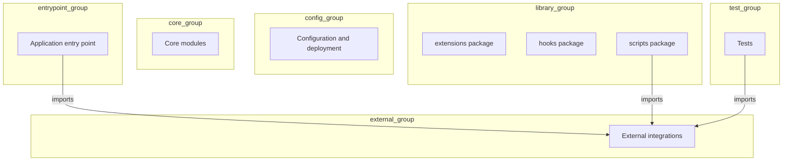

# Architecture report: AgriciDaniel/claude-seo

> Automated static analysis. **Observed** = directly seen in files/imports/AST; **Inferred** = interpretation from that evidence. Repository code was not executed.

## 1. Repository at a glance

| Item | Value |
| --- | --- |
| Repository | AgriciDaniel/claude-seo |
| Description | Universal SEO skill for Claude Code. 26 sub-skills + 19 sub-agents covering technical SEO, E-E-A-T, schema, GEO/AEO, agent readiness (Lighthouse Agentic Browsing, WebMCP, llms.txt), backlinks, local SEO, e-commerce, international SEO, Google APIs, and PDF/Excel reporting. 9 optional extensions for… |
| Language | Python |
| Stars | 29294 |
| Licence | MIT |
| Analysed commit / branch | 2e40a5fa6220fc846fcc56d666831fd1315bedc7 / main |
| Framework(s) | None detected |
| Files analysed | 506 |
| Components | 8 |

## 2. Architecture in one minute

AgriciDaniel/claude-seo - Universal SEO skill for Claude Code. 26 sub-skills + 19 sub-agents covering technical SEO, E-E-A-T, schema, GEO/AEO, agent readiness (Lighthouse Agentic Browsing, WebMCP, llms.txt), backlinks, local…. This repository was analysed statically from 506 file(s) (190 Python). Detected technologies (observed from imports/manifests): GitHub Actions, SQLite, NumPy, requests, Poetry, pytest. Files are grouped into 8 component(s): Configuration and deployment, Core modules, Application entry point, extensions package, External integrations, hooks package, scripts package, Tests. Observed entry point(s): extensions/banana/scripts/batch.py, extensions/banana/scripts/cost_tracker.py, extensions/banana/scripts/edit.py. Findings below distinguish observed facts from inferred interpretation.

## 3. High-level block diagram

## 4. Main components

### Configuration and deployment (`config`)

- **Kind:** config
- **Status:** Observed
- **Confidence:** 0.85
- **Responsibility:** Groups 6 file(s) under configuration and deployment (observed from repository paths and static analysis).
- **Paths:** `data/google-updates.json`, `extensions/dataforseo/field-config.json`, `hooks/hooks.json`, `pyproject.toml`, `requirements.txt`, `schema/templates.json`
- **Evidence:** [data/google-updates.json](https://github.com/AgriciDaniel/claude-seo/blob/2e40a5fa6220fc846fcc56d666831fd1315bedc7/data/google-updates.json); [extensions/dataforseo/field-config.json](https://github.com/AgriciDaniel/claude-seo/blob/2e40a5fa6220fc846fcc56d666831fd1315bedc7/extensions/dataforseo/field-config.json); [hooks/hooks.json](https://github.com/AgriciDaniel/claude-seo/blob/2e40a5fa6220fc846fcc56d666831fd1315bedc7/hooks/hooks.json); [pyproject.toml](https://github.com/AgriciDaniel/claude-seo/blob/2e40a5fa6220fc846fcc56d666831fd1315bedc7/pyproject.toml); [requirements.txt](https://github.com/AgriciDaniel/claude-seo/blob/2e40a5fa6220fc846fcc56d666831fd1315bedc7/requirements.txt); [schema/templates.json](https://github.com/AgriciDaniel/claude-seo/blob/2e40a5fa6220fc846fcc56d666831fd1315bedc7/schema/templates.json)

### Core modules (`core`)

- **Kind:** core
- **Status:** Observed
- **Confidence:** 0.85
- **Responsibility:** Groups 2 file(s) under core modules (observed from repository paths and static analysis).
- **Paths:** `install.sh`, `uninstall.sh`
- **Evidence:** [install.sh](https://github.com/AgriciDaniel/claude-seo/blob/2e40a5fa6220fc846fcc56d666831fd1315bedc7/install.sh); [uninstall.sh](https://github.com/AgriciDaniel/claude-seo/blob/2e40a5fa6220fc846fcc56d666831fd1315bedc7/uninstall.sh)

### Application entry point (`entrypoint`)

- **Kind:** entrypoint
- **Status:** Observed
- **Confidence:** 0.85
- **Responsibility:** Groups 70 file(s) under application entry point (observed from repository paths and static analysis). Observed top-level classes: LedgerError, MatomoRequestRefused, ProxiedRequestRefused, SetupLock, URLSafetyError, _Budget. Observed top-level functions: _accessibility_tree_from_cdp, _all_types, _api_status, _apply_get_status, _apply_preload_context, _as_dicts.
- **Paths:** `extensions/banana/scripts/batch.py`, `extensions/banana/scripts/cost_tracker.py`, `extensions/banana/scripts/edit.py`, `extensions/banana/scripts/generate.py`, `extensions/banana/scripts/presets.py`, `extensions/banana/scripts/setup_mcp.py`, `extensions/banana/scripts/validate_setup.py`, `hooks/validate-schema.py`, `scripts/agent_ux_check.py`, `scripts/agentic_check.py`, `scripts/agentic_fix.py`, `scripts/analyze_visual.py`, `scripts/backlinks_auth.py`, `scripts/bing_webmaster.py`, `scripts/capture_screenshot.py`, `scripts/commoncrawl_graph.py`, `scripts/consistency_check.py`, `scripts/content_humanize.py`, `scripts/content_quality.py`, `scripts/content_verify.py`, `scripts/crux_history.py`, `scripts/dataforseo_costs.py`, `scripts/dataforseo_merchant.py`, `scripts/dataforseo_normalize.py`, `scripts/domain_history.py`, `scripts/drift_baseline.py`, `scripts/drift_compare.py`, `scripts/drift_history.py`, `scripts/drift_report.py`, `scripts/fetch_page.py`, `scripts/ga4_report.py`, `scripts/gbp_deprecation_lint.py`, `scripts/google_auth.py`, `scripts/google_report.py`, `scripts/gsc_inspect.py`, `scripts/gsc_query.py`, `scripts/indexing_notify.py`, `scripts/indexnow_submit.py`, `scripts/iptc_ai_label.py`, `scripts/keyword_planner.py`, `scripts/keywordseverywhere_api.py`, `scripts/lcp_subparts.py`, `scripts/lighthouse_agentic.py`, `scripts/matomo_auth.py`, `scripts/matomo_report.py`, `scripts/metadata_template.py`, `scripts/moz_api.py`, `scripts/nlp_analyze.py`, `scripts/page_checks.py`, `scripts/pagespeed_check.py`, `scripts/parasite_risk.py`, `scripts/parse_html.py`, `scripts/portability_check.py`, `scripts/preload_check.py`, `scripts/release_sign.py`, `scripts/render_page.py`, `scripts/runtime.py`, `scripts/schema_ecommerce_validate.py`, `scripts/schema_generate.py`, `scripts/seo_updates.py`, `scripts/sitemap_discovery.py`, `scripts/sync_flow.py`, `scripts/transport_check.py`, `scripts/ucp_check.py`, `scripts/unlighthouse_run.py`, `scripts/url_safety.py`, `scripts/validate_backlink_report.py`, `scripts/verify_backlinks.py`, `scripts/verify_release.py`, `scripts/youtube_search.py`
- **Evidence:** [extensions/banana/scripts/batch.py:30](https://github.com/AgriciDaniel/claude-seo/blob/2e40a5fa6220fc846fcc56d666831fd1315bedc7/extensions/banana/scripts/batch.py#L30); [extensions/banana/scripts/cost_tracker.py:43](https://github.com/AgriciDaniel/claude-seo/blob/2e40a5fa6220fc846fcc56d666831fd1315bedc7/extensions/banana/scripts/cost_tracker.py#L43); [extensions/banana/scripts/edit.py:31](https://github.com/AgriciDaniel/claude-seo/blob/2e40a5fa6220fc846fcc56d666831fd1315bedc7/extensions/banana/scripts/edit.py#L31); [extensions/banana/scripts/generate.py:37](https://github.com/AgriciDaniel/claude-seo/blob/2e40a5fa6220fc846fcc56d666831fd1315bedc7/extensions/banana/scripts/generate.py#L37); [extensions/banana/scripts/presets.py:22](https://github.com/AgriciDaniel/claude-seo/blob/2e40a5fa6220fc846fcc56d666831fd1315bedc7/extensions/banana/scripts/presets.py#L22); [extensions/banana/scripts/setup_mcp.py:27](https://github.com/AgriciDaniel/claude-seo/blob/2e40a5fa6220fc846fcc56d666831fd1315bedc7/extensions/banana/scripts/setup_mcp.py#L27); [extensions/banana/scripts/validate_setup.py:26](https://github.com/AgriciDaniel/claude-seo/blob/2e40a5fa6220fc846fcc56d666831fd1315bedc7/extensions/banana/scripts/validate_setup.py#L26); [hooks/validate-schema.py:114](https://github.com/AgriciDaniel/claude-seo/blob/2e40a5fa6220fc846fcc56d666831fd1315bedc7/hooks/validate-schema.py#L114)

### extensions package (`extensions`)

- **Kind:** library
- **Status:** Observed
- **Confidence:** 0.85
- **Responsibility:** Groups 18 file(s) under extensions package (observed from repository paths and static analysis).
- **Paths:** `extensions/ahrefs/install.sh`, `extensions/ahrefs/uninstall.sh`, `extensions/banana/install.sh`, `extensions/banana/uninstall.sh`, `extensions/bing-webmaster/install.sh`, `extensions/bing-webmaster/uninstall.sh`, `extensions/dataforseo/install.sh`, `extensions/dataforseo/uninstall.sh`, `extensions/firecrawl/install.sh`, `extensions/firecrawl/uninstall.sh`, `extensions/matomo/install.sh`, `extensions/matomo/uninstall.sh`, `extensions/profound/install.sh`, `extensions/profound/uninstall.sh`, `extensions/seranking/install.sh`, `extensions/seranking/uninstall.sh`, `extensions/unlighthouse/install.sh`, `extensions/unlighthouse/uninstall.sh`
- **Evidence:** [extensions/ahrefs/install.sh](https://github.com/AgriciDaniel/claude-seo/blob/2e40a5fa6220fc846fcc56d666831fd1315bedc7/extensions/ahrefs/install.sh); [extensions/ahrefs/uninstall.sh](https://github.com/AgriciDaniel/claude-seo/blob/2e40a5fa6220fc846fcc56d666831fd1315bedc7/extensions/ahrefs/uninstall.sh); [extensions/banana/install.sh](https://github.com/AgriciDaniel/claude-seo/blob/2e40a5fa6220fc846fcc56d666831fd1315bedc7/extensions/banana/install.sh); [extensions/banana/uninstall.sh](https://github.com/AgriciDaniel/claude-seo/blob/2e40a5fa6220fc846fcc56d666831fd1315bedc7/extensions/banana/uninstall.sh); [extensions/bing-webmaster/install.sh](https://github.com/AgriciDaniel/claude-seo/blob/2e40a5fa6220fc846fcc56d666831fd1315bedc7/extensions/bing-webmaster/install.sh); [extensions/bing-webmaster/uninstall.sh](https://github.com/AgriciDaniel/claude-seo/blob/2e40a5fa6220fc846fcc56d666831fd1315bedc7/extensions/bing-webmaster/uninstall.sh); [extensions/dataforseo/install.sh](https://github.com/AgriciDaniel/claude-seo/blob/2e40a5fa6220fc846fcc56d666831fd1315bedc7/extensions/dataforseo/install.sh); [extensions/dataforseo/uninstall.sh](https://github.com/AgriciDaniel/claude-seo/blob/2e40a5fa6220fc846fcc56d666831fd1315bedc7/extensions/dataforseo/uninstall.sh)

### External integrations (`external_integrations`)

- **Kind:** external
- **Status:** Inferred
- **Confidence:** 0.70
- **Responsibility:** Groups 0 file(s) under external integrations (observed from repository paths and static analysis).
- **Evidence:** [scripts/bing_webmaster.py:23](https://github.com/AgriciDaniel/claude-seo/blob/2e40a5fa6220fc846fcc56d666831fd1315bedc7/scripts/bing_webmaster.py#L23); [scripts/browser_proxy.py:52](https://github.com/AgriciDaniel/claude-seo/blob/2e40a5fa6220fc846fcc56d666831fd1315bedc7/scripts/browser_proxy.py#L52); [scripts/commoncrawl_graph.py:28](https://github.com/AgriciDaniel/claude-seo/blob/2e40a5fa6220fc846fcc56d666831fd1315bedc7/scripts/commoncrawl_graph.py#L28); [scripts/crux_history.py:21](https://github.com/AgriciDaniel/claude-seo/blob/2e40a5fa6220fc846fcc56d666831fd1315bedc7/scripts/crux_history.py#L21); [scripts/dataforseo_merchant.py:33](https://github.com/AgriciDaniel/claude-seo/blob/2e40a5fa6220fc846fcc56d666831fd1315bedc7/scripts/dataforseo_merchant.py#L33); [scripts/domain_history.py:60](https://github.com/AgriciDaniel/claude-seo/blob/2e40a5fa6220fc846fcc56d666831fd1315bedc7/scripts/domain_history.py#L60)

### hooks package (`hooks`)

- **Kind:** library
- **Status:** Observed
- **Confidence:** 0.85
- **Responsibility:** Groups 1 file(s) under hooks package (observed from repository paths and static analysis).
- **Paths:** `hooks/run-python-hook.js`
- **Evidence:** [hooks/run-python-hook.js](https://github.com/AgriciDaniel/claude-seo/blob/2e40a5fa6220fc846fcc56d666831fd1315bedc7/hooks/run-python-hook.js)

### scripts package (`scripts`)

- **Kind:** library
- **Status:** Observed
- **Confidence:** 0.85
- **Responsibility:** Groups 3 file(s) under scripts package (observed from repository paths and static analysis). Observed top-level classes: ChromiumSandboxError, PageNotLoadedError, _GuardServer, _OriginReader, _ProxyHandler, _Rejected. Observed top-level functions: _as_addresses, _authority, _body_length, _connect, _covered_domain, _destination.
- **Paths:** `scripts/browser_proxy.py`, `scripts/google_properties.py`, `scripts/unlighthouse_http_proxy.cjs`
- **Evidence:** [scripts/browser_proxy.py:142](https://github.com/AgriciDaniel/claude-seo/blob/2e40a5fa6220fc846fcc56d666831fd1315bedc7/scripts/browser_proxy.py#L142); [scripts/google_properties.py:8](https://github.com/AgriciDaniel/claude-seo/blob/2e40a5fa6220fc846fcc56d666831fd1315bedc7/scripts/google_properties.py#L8); [scripts/unlighthouse_http_proxy.cjs](https://github.com/AgriciDaniel/claude-seo/blob/2e40a5fa6220fc846fcc56d666831fd1315bedc7/scripts/unlighthouse_http_proxy.cjs)

### Tests (`tests`)

- **Kind:** test
- **Status:** Observed
- **Confidence:** 0.85
- **Responsibility:** Groups 120 file(s) under tests (observed from repository paths and static analysis). Observed top-level classes: FakeExecute, FakeHeadResponse, FakeManager, FakePage, FakeRaw, FakeRawHeaders. Observed top-level functions: _adc, _addrinfo, _agent_path, _agents, _as_windows, _assert_refused.
- **Paths:** `tests/fixtures/dataforseo_mcp_2_8_10_tools.txt`, `tests/fixtures/lighthouse_agentic_13_5_psi.json`, `tests/test_agent_mcp_permissions.py`, `tests/test_agent_untrusted_content.py`, `tests/test_agentic.py`, `tests/test_ai_crawler_claims.py`, `tests/test_audit_agent_turn_budget.py`, `tests/test_audit_instructions.py`, `tests/test_backlink_score_gate.py`, `tests/test_backlinks_auth_hardening.py`, `tests/test_banana_api_key_safety.py`, `tests/test_banana_cost_tracker.py`, `tests/test_banana_install_layout.py`, `tests/test_banana_key_masking.py`, `tests/test_banana_setup_mcp_atomic_write.py`, `tests/test_bing_webmaster.py`, `tests/test_browser_proxy.py`, `tests/test_canonical_facts.py`, `tests/test_capture_screenshot_hygiene.py`, `tests/test_capture_screenshot_paths.py`, `tests/test_cluster_map_escaping.py`, `tests/test_commoncrawl_graph.py`, `tests/test_consistency_check.py`, `tests/test_content_humanize.py`, `tests/test_content_quality.py`, `tests/test_contributors.py`, `tests/test_cross_platform_hooks.py`, `tests/test_crux_history_trends.py`, `tests/test_dataforseo_costs.py`, `tests/test_dataforseo_merchant_polling.py`, `tests/test_dataforseo_normalize_currency.py`, `tests/test_dataforseo_tool_names.py`, `tests/test_document_base_url.py`, `tests/test_domain_history.py`, `tests/test_drift_portability.py`, `tests/test_drift_robots_directives.py`, `tests/test_drift_url_normalization.py`, `tests/test_extension_installer_injection.py`, `tests/test_extension_mirrors.py`, `tests/test_fetch_page_cli.py`, `tests/test_fetch_page_decoding.py`, `tests/test_fetch_page_size_cap.py`, `tests/test_fetch_page_timing.py`, `tests/test_file_size_limits.py`, `tests/test_firecrawl_install_atomic_write.py`, `tests/test_ga4_top_pages_errors.py`, `tests/test_gbp_checklist_mapping.py`, `tests/test_gbp_lint_and_polish.py`, `tests/test_google_api_key_safety.py`, `tests/test_google_gcloud_adc.py`, `tests/test_google_oauth_flow.py`, `tests/test_google_oauth_scopes.py`, `tests/test_google_property_cli.py`, `tests/test_google_property_resolution.py`, `tests/test_google_report_full_audit.py`, `tests/test_gsc_pagination.py`, `tests/test_gsc_query.py`, `tests/test_gsc_totals_aggregate.py`, `tests/test_hosted_plugin_layout.py`, `tests/test_hostile_inputs.py`, `tests/test_image_format_probe.py`, `tests/test_indexing_notify.py`, `tests/test_indexing_notify_quota.py`, `tests/test_indexnow_cli_errors.py`, `tests/test_indexnow_submit.py`, `tests/test_keywordseverywhere_api.py`, `tests/test_lazy_detection.py`, `tests/test_llms_txt_validation.py`, `tests/test_manifest_consistency.py`, `tests/test_manual_install_layout.py`, `tests/test_matomo_report.py`, `tests/test_metadata_template.py`, `tests/test_moz_api.py`, `tests/test_nlp_analyze.py`, `tests/test_no_em_dash.py`, `tests/test_page_checks.py`, `tests/test_pagespeed_null_category_score.py`, `tests/test_pagespeed_psi_only_exit.py`, `tests/test_parasite_risk_and_extensions.py`, `tests/test_parse_html_extraction.py`, `tests/test_parse_html_inline_spacing.py`, `tests/test_parse_html_malformed_urls.py`, `tests/test_parse_html_rel_case.py`, `tests/test_parse_html_size_cap.py`, `tests/test_phase_j_executable.py`, `tests/test_portability.py`, `tests/test_powershell_ascii.py`, `tests/test_preload_check.py`, `tests/test_pyproject_metadata.py`, `tests/test_python_range.py`, `tests/test_redirect_body_cap.py`, `tests/test_render_js_gap.py`, `tests/test_render_page.py`, `tests/test_report_robustness.py`, `tests/test_report_security.py`, `tests/test_report_windows_paths.py`, `tests/test_runtime.py`, `tests/test_runtime_installers.py`, `tests/test_schema_graph_semantics.py`, `tests/test_schema_hook_detection.py`, `tests/test_schema_hook_policy.py`, `tests/test_schema_hook_redos.py`, `tests/test_schema_v2.py`, `tests/test_sitemap_bom.py`, `tests/test_sitemap_discovery.py`, `tests/test_sitemap_expand.py`, `tests/test_sitemap_news_limit.py`, `tests/test_sync_flow.py`, `tests/test_technical_depth.py`, `tests/test_transport_check.py`, `tests/test_unlighthouse_run.py`, `tests/test_url_safety.py`, `tests/test_url_safety_ipv6.py`, `tests/test_url_safety_port_pin.py`, `tests/test_validate_backlink_report.py`, `tests/test_verify_backlinks.py`, `tests/test_verify_release_containment.py`, `tests/test_verify_release_robustness.py`, `tests/test_windows_uninstaller.py`, `tests/test_youtube_key_redaction.py`
- **Evidence:** [tests/fixtures/dataforseo_mcp_2_8_10_tools.txt](https://github.com/AgriciDaniel/claude-seo/blob/2e40a5fa6220fc846fcc56d666831fd1315bedc7/tests/fixtures/dataforseo_mcp_2_8_10_tools.txt); [tests/fixtures/lighthouse_agentic_13_5_psi.json](https://github.com/AgriciDaniel/claude-seo/blob/2e40a5fa6220fc846fcc56d666831fd1315bedc7/tests/fixtures/lighthouse_agentic_13_5_psi.json); [tests/test_agent_mcp_permissions.py:12](https://github.com/AgriciDaniel/claude-seo/blob/2e40a5fa6220fc846fcc56d666831fd1315bedc7/tests/test_agent_mcp_permissions.py#L12); [tests/test_agent_untrusted_content.py:19](https://github.com/AgriciDaniel/claude-seo/blob/2e40a5fa6220fc846fcc56d666831fd1315bedc7/tests/test_agent_untrusted_content.py#L19); [tests/test_agentic.py:45](https://github.com/AgriciDaniel/claude-seo/blob/2e40a5fa6220fc846fcc56d666831fd1315bedc7/tests/test_agentic.py#L45); [tests/test_ai_crawler_claims.py:13](https://github.com/AgriciDaniel/claude-seo/blob/2e40a5fa6220fc846fcc56d666831fd1315bedc7/tests/test_ai_crawler_claims.py#L13); [tests/test_audit_agent_turn_budget.py:33](https://github.com/AgriciDaniel/claude-seo/blob/2e40a5fa6220fc846fcc56d666831fd1315bedc7/tests/test_audit_agent_turn_budget.py#L33); [tests/test_audit_instructions.py:10](https://github.com/AgriciDaniel/claude-seo/blob/2e40a5fa6220fc846fcc56d666831fd1315bedc7/tests/test_audit_instructions.py#L10)

## 5. Execution flow

**Observed** entry point(s):

- [extensions/banana/scripts/batch.py:97](https://github.com/AgriciDaniel/claude-seo/blob/2e40a5fa6220fc846fcc56d666831fd1315bedc7/extensions/banana/scripts/batch.py#L97)
- [extensions/banana/scripts/cost_tracker.py:338](https://github.com/AgriciDaniel/claude-seo/blob/2e40a5fa6220fc846fcc56d666831fd1315bedc7/extensions/banana/scripts/cost_tracker.py#L338)
- [extensions/banana/scripts/edit.py:169](https://github.com/AgriciDaniel/claude-seo/blob/2e40a5fa6220fc846fcc56d666831fd1315bedc7/extensions/banana/scripts/edit.py#L169)
- [extensions/banana/scripts/generate.py:177](https://github.com/AgriciDaniel/claude-seo/blob/2e40a5fa6220fc846fcc56d666831fd1315bedc7/extensions/banana/scripts/generate.py#L177)
- [extensions/banana/scripts/presets.py:152](https://github.com/AgriciDaniel/claude-seo/blob/2e40a5fa6220fc846fcc56d666831fd1315bedc7/extensions/banana/scripts/presets.py#L152)
- [extensions/banana/scripts/setup_mcp.py:167](https://github.com/AgriciDaniel/claude-seo/blob/2e40a5fa6220fc846fcc56d666831fd1315bedc7/extensions/banana/scripts/setup_mcp.py#L167)
- [extensions/banana/scripts/validate_setup.py:140](https://github.com/AgriciDaniel/claude-seo/blob/2e40a5fa6220fc846fcc56d666831fd1315bedc7/extensions/banana/scripts/validate_setup.py#L140)
- [hooks/validate-schema.py:370](https://github.com/AgriciDaniel/claude-seo/blob/2e40a5fa6220fc846fcc56d666831fd1315bedc7/hooks/validate-schema.py#L370)
- [scripts/agent_ux_check.py:299](https://github.com/AgriciDaniel/claude-seo/blob/2e40a5fa6220fc846fcc56d666831fd1315bedc7/scripts/agent_ux_check.py#L299)
- [scripts/agentic_check.py:1333](https://github.com/AgriciDaniel/claude-seo/blob/2e40a5fa6220fc846fcc56d666831fd1315bedc7/scripts/agentic_check.py#L1333)
- [scripts/agentic_fix.py:391](https://github.com/AgriciDaniel/claude-seo/blob/2e40a5fa6220fc846fcc56d666831fd1315bedc7/scripts/agentic_fix.py#L391)
- [scripts/analyze_visual.py:250](https://github.com/AgriciDaniel/claude-seo/blob/2e40a5fa6220fc846fcc56d666831fd1315bedc7/scripts/analyze_visual.py#L250)

Representative flow (derived from observed entry points and the import graph; steps beyond the entry point are **Inferred**):

1. Execution starts at an observed entry point listed above, if present.
2. `entrypoint` imports `external_integrations` (Application entry point -> External integrations).
3. `scripts` imports `external_integrations` (scripts package -> External integrations).
4. `tests` imports `external_integrations` (Tests -> External integrations).

## 6. Project structure

### `(root)`

- `.gitignore` - other (3685 bytes)
- `AGENTS.md` - docs (9644 bytes)
- `CHANGELOG.md` - docs (133362 bytes)
- `CITATION.cff` - other (517 bytes)
- `CLAUDE.md` - docs (20294 bytes)
- `CODE_OF_CONDUCT.md` - docs (5577 bytes)
- `CONTRIBUTING.md` - docs (3221 bytes)
- `CONTRIBUTORS.md` - docs (21935 bytes)
- `LICENSE` - docs (1069 bytes)
- `PRIVACY.md` - docs (6529 bytes)
- `README.md` - docs (23313 bytes)
- `SECURITY.md` - docs (14946 bytes)
- `install.ps1` - other (16213 bytes)
- `install.sh` - source, Shell (9759 bytes)
- `pyproject.toml` - manifest (551 bytes)
- `requirements.txt` - manifest (2235 bytes)
- `uninstall.ps1` - other (2503 bytes)
- `uninstall.sh` - source, Shell (2038 bytes)

### `.claude-plugin`

- `.claude-plugin/marketplace.json` - config (3619 bytes)
- `.claude-plugin/plugin.json` - config (1495 bytes)

### `.devcontainer`

- `.devcontainer/devcontainer.json` - config (340 bytes)

### `.github`

- `.github/CODEOWNERS` - other (1385 bytes)
- `.github/FUNDING.yml` - config (55 bytes)
- `.github/ISSUE_TEMPLATE/bug_report.yml` - config (1127 bytes)
- `.github/ISSUE_TEMPLATE/config.yml` - config (205 bytes)
- `.github/ISSUE_TEMPLATE/feature_request.yml` - config (883 bytes)
- `.github/ISSUE_TEMPLATE/task.yml` - config (1467 bytes)
- `.github/PULL_REQUEST_TEMPLATE.md` - docs (532 bytes)
- `.github/dependabot.yml` - config (747 bytes)
- `.github/release.yml` - config (473 bytes)
- `.github/workflows/ci.yml` - ci, YAML (8784 bytes)
- `.github/workflows/v2.yml` - ci, YAML (5401 bytes)
- `.github/workflows/windows-smoke.yml` - ci, YAML (18398 bytes)

### `agents`

- `agents/seo-agentic.md` - docs (3886 bytes)
- `agents/seo-backlinks.md` - docs (8864 bytes)
- `agents/seo-cluster.md` - docs (4127 bytes)
- `agents/seo-content.md` - docs (5942 bytes)
- `agents/seo-dataforseo.md` - docs (2633 bytes)
- `agents/seo-drift.md` - docs (3451 bytes)
- `agents/seo-ecommerce.md` - docs (4743 bytes)
- `agents/seo-flow.md` - docs (2460 bytes)
- `agents/seo-geo.md` - docs (5340 bytes)
- `agents/seo-google.md` - docs (4733 bytes)
- `agents/seo-image-gen.md` - docs (2909 bytes)
- `agents/seo-local.md` - docs (6360 bytes)
- `agents/seo-maps.md` - docs (5405 bytes)
- `agents/seo-performance.md` - docs (5961 bytes)
- `agents/seo-schema.md` - docs (4901 bytes)
- `agents/seo-sitemap.md` - docs (4636 bytes)
- `agents/seo-sxo.md` - docs (6047 bytes)
- `agents/seo-technical.md` - docs (4127 bytes)
- `agents/seo-visual.md` - docs (3246 bytes)

### `assets`

- `assets/cover.svg` - other (71889 bytes)
- `assets/framework.svg` - other (12932 bytes)
- `assets/readme/btn-hub.svg` - other (2999 bytes)
- `assets/readme/btn-pro.svg` - other (2691 bytes)
- `assets/readme/btn-youtube.svg` - other (2599 bytes)
- `assets/readme/screen.svg` - other (171839 bytes)
- `assets/readme/v3/install.svg` - other (177924 bytes)
- `assets/readme/v3/plat-unix.svg` - other (29765 bytes)
- `assets/readme/v3/plat-win.svg` - other (30427 bytes)
- `assets/signal-flow.svg` - other (15937 bytes)
- `assets/sub-skills.svg` - other (13219 bytes)

### `data`

- `data/google-updates.json` - config (31602 bytes)

### `docs`

- `docs/ARCHITECTURE.md` - docs (16186 bytes)
- `docs/COMMANDS.md` - docs (27490 bytes)
- `docs/COMMUNITY-INTEGRATIONS.md` - docs (2028 bytes)
- `docs/FINAL-VERIFICATION-v2.2.5-2026-08-26.md` - docs (8671 bytes)
- `docs/INSTALLATION.md` - docs (4760 bytes)
- `docs/MCP-INTEGRATION.md` - docs (4962 bytes)
- `docs/MIGRATION-v1-to-v2.md` - docs (9001 bytes)
- `docs/TROUBLESHOOTING.md` - docs (7591 bytes)
- `docs/WORKFLOW-public-private.md` - docs (7400 bytes)

### `extensions`

- `extensions/ahrefs/docs/AHREFS-SETUP.md` - docs (2573 bytes)
- `extensions/ahrefs/install.ps1` - other (2914 bytes)
- `extensions/ahrefs/install.sh` - source, Shell (3494 bytes)
- `extensions/ahrefs/skills/seo-ahrefs/SKILL.md` - docs (2796 bytes)
- `extensions/ahrefs/uninstall.sh` - source, Shell (903 bytes)
- `extensions/banana/README.md` - docs (3847 bytes)
- `extensions/banana/agents/seo-image-gen.md` - docs (2909 bytes)
- `extensions/banana/docs/BANANA-SETUP.md` - docs (2456 bytes)
- `extensions/banana/install.sh` - source, Shell (7664 bytes)
- `extensions/banana/references/cost-tracking.md` - docs (1182 bytes)
- `extensions/banana/references/gemini-models.md` - docs (5955 bytes)
- `extensions/banana/references/mcp-tools.md` - docs (3823 bytes)
- `extensions/banana/references/post-processing.md` - docs (5201 bytes)
- `extensions/banana/references/presets.md` - docs (2250 bytes)
- `extensions/banana/references/prompt-adaptation-safety.md` - docs (4534 bytes)
- `extensions/banana/references/prompt-engineering.md` - docs (9554 bytes)
- `extensions/banana/references/prompt-templates.md` - docs (8005 bytes)
- `extensions/banana/references/seo-image-presets.md` - docs (4020 bytes)
- `extensions/banana/scripts/batch.py` - source, Python (3411 bytes)
- `extensions/banana/scripts/cost_tracker.py` - source, Python (12192 bytes)
- `extensions/banana/scripts/edit.py` - source, Python (5713 bytes)
- `extensions/banana/scripts/generate.py` - source, Python (6584 bytes)
- `extensions/banana/scripts/presets.py` - source, Python (4971 bytes)
- `extensions/banana/scripts/setup_mcp.py` - source, Python (5229 bytes)
- `extensions/banana/scripts/validate_setup.py` - source, Python (3746 bytes)
- `extensions/banana/skills/seo-image-gen/LICENSE.txt` - docs (143 bytes)
- `extensions/banana/skills/seo-image-gen/SKILL.md` - docs (9576 bytes)
- `extensions/banana/uninstall.sh` - source, Shell (1599 bytes)
- `extensions/bing-webmaster/docs/BING-WEBMASTER-SETUP.md` - docs (1939 bytes)
- `extensions/bing-webmaster/install.ps1` - other (2158 bytes)
- `extensions/bing-webmaster/install.sh` - source, Shell (3017 bytes)
- `extensions/bing-webmaster/skills/seo-bing/SKILL.md` - docs (2664 bytes)
- `extensions/bing-webmaster/uninstall.sh` - source, Shell (808 bytes)
- `extensions/dataforseo/README.md` - docs (6341 bytes)
- `extensions/dataforseo/agents/seo-dataforseo.md` - docs (2633 bytes)
- `extensions/dataforseo/docs/DATAFORSEO-SETUP.md` - docs (2173 bytes)
- `extensions/dataforseo/field-config.json` - config (6720 bytes)
- `extensions/dataforseo/install.ps1` - other (6803 bytes)
- `extensions/dataforseo/install.sh` - source, Shell (7114 bytes)
- `extensions/dataforseo/skills/seo-dataforseo/LICENSE.txt` - docs (143 bytes)
- `extensions/dataforseo/skills/seo-dataforseo/SKILL.md` - docs (18034 bytes)
- `extensions/dataforseo/skills/seo-dataforseo/references/cost-tiers.md` - docs (3450 bytes)
- `extensions/dataforseo/skills/seo-dataforseo/references/tool-catalog.md` - docs (3003 bytes)
- `extensions/dataforseo/uninstall.ps1` - other (1994 bytes)
- `extensions/dataforseo/uninstall.sh` - source, Shell (1208 bytes)
- `extensions/firecrawl/README.md` - docs (2565 bytes)
- `extensions/firecrawl/docs/FIRECRAWL-SETUP.md` - docs (1375 bytes)
- `extensions/firecrawl/install.ps1` - other (4943 bytes)
- `extensions/firecrawl/install.sh` - source, Shell (5406 bytes)
- `extensions/firecrawl/skills/seo-firecrawl/LICENSE.txt` - docs (143 bytes)
- `extensions/firecrawl/skills/seo-firecrawl/SKILL.md` - docs (8433 bytes)
- `extensions/firecrawl/uninstall.ps1` - other (1834 bytes)
- `extensions/firecrawl/uninstall.sh` - source, Shell (960 bytes)
- `extensions/matomo/agents/seo-matomo.md` - docs (4564 bytes)
- `extensions/matomo/docs/MATOMO-SETUP.md` - docs (5457 bytes)
- `extensions/matomo/install.ps1` - other (3448 bytes)
- `extensions/matomo/install.sh` - source, Shell (4260 bytes)
- `extensions/matomo/skills/seo-matomo/SKILL.md` - docs (6183 bytes)
- `extensions/matomo/uninstall.sh` - source, Shell (1846 bytes)
- `extensions/profound/docs/PROFOUND-SETUP.md` - docs (928 bytes)
- `extensions/profound/install.ps1` - other (1590 bytes)
- `extensions/profound/install.sh` - source, Shell (1978 bytes)
- `extensions/profound/skills/seo-profound/SKILL.md` - docs (2119 bytes)
- `extensions/profound/uninstall.sh` - source, Shell (713 bytes)
- `extensions/seranking/docs/SERANKING-SETUP.md` - docs (1023 bytes)
- `extensions/seranking/install.ps1` - other (1821 bytes)
- `extensions/seranking/install.sh` - source, Shell (2319 bytes)
- `extensions/seranking/skills/seo-seranking/SKILL.md` - docs (2620 bytes)
- `extensions/seranking/uninstall.sh` - source, Shell (731 bytes)
- `extensions/unlighthouse/docs/UNLIGHTHOUSE-SETUP.md` - docs (1250 bytes)
- `extensions/unlighthouse/install.ps1` - other (749 bytes)
- `extensions/unlighthouse/install.sh` - source, Shell (2443 bytes)
- `extensions/unlighthouse/skills/seo-unlighthouse/SKILL.md` - docs (2821 bytes)
- `extensions/unlighthouse/uninstall.sh` - source, Shell (251 bytes)

### `hooks`

- `hooks/hooks.json` - config (443 bytes)
- `hooks/run-python-hook.js` - source, JavaScript (2611 bytes)
- `hooks/validate-schema.py` - source, Python (13972 bytes)

### `schema`

- `schema/templates.json` - config (9737 bytes)

### `scripts`

- `scripts/agent_ux_check.py` - source, Python (10479 bytes)
- `scripts/agentic_check.py` - source, Python (66633 bytes)
- `scripts/agentic_fix.py` - source, Python (17283 bytes)
- `scripts/analyze_visual.py` - source, Python (8580 bytes)
- `scripts/backlinks_auth.py` - source, Python (22973 bytes)
- `scripts/bing_webmaster.py` - source, Python (22294 bytes)
- `scripts/browser_proxy.py` - source, Python (40591 bytes)
- `scripts/capture_screenshot.py` - source, Python (26768 bytes)
- `scripts/claude-seo` - other (2730 bytes)
- `scripts/commoncrawl_graph.py` - source, Python (19019 bytes)
- `scripts/consistency_check.py` - source, Python (14623 bytes)
- `scripts/content_humanize.py` - source, Python (12891 bytes)
- `scripts/content_quality.py` - source, Python (13794 bytes)
- `scripts/content_verify.py` - source, Python (7444 bytes)
- `scripts/crux_history.py` - source, Python (11285 bytes)
- `scripts/dataforseo_costs.py` - source, Python (20258 bytes)
- `scripts/dataforseo_merchant.py` - source, Python (17388 bytes)
- `scripts/dataforseo_normalize.py` - source, Python (15185 bytes)
- `scripts/domain_history.py` - source, Python (10882 bytes)
- `scripts/drift_baseline.py` - source, Python (13834 bytes)
- `scripts/drift_compare.py` - source, Python (23193 bytes)
- `scripts/drift_history.py` - source, Python (3530 bytes)
- `scripts/drift_report.py` - source, Python (11294 bytes)
- `scripts/fetch_page.py` - source, Python (17850 bytes)
- `scripts/ga4_report.py` - source, Python (19578 bytes)
- `scripts/gbp_deprecation_lint.py` - source, Python (4860 bytes)
- `scripts/google_auth.py` - source, Python (46411 bytes)
- `scripts/google_properties.py` - source, Python (4800 bytes)
- `scripts/google_report.py` - source, Python (114562 bytes)
- `scripts/gsc_inspect.py` - source, Python (12535 bytes)
- `scripts/gsc_query.py` - source, Python (21177 bytes)
- `scripts/indexing_notify.py` - source, Python (12666 bytes)
- `scripts/indexnow_submit.py` - source, Python (9310 bytes)
- `scripts/iptc_ai_label.py` - source, Python (7758 bytes)
- `scripts/keyword_planner.py` - source, Python (11012 bytes)
- `scripts/keywordseverywhere_api.py` - source, Python (10246 bytes)
- `scripts/lcp_subparts.py` - source, Python (7418 bytes)
- `scripts/lighthouse_agentic.py` - source, Python (17836 bytes)
- `scripts/matomo_auth.py` - source, Python (23736 bytes)
- `scripts/matomo_report.py` - source, Python (26667 bytes)
- `scripts/metadata_template.py` - source, Python (15469 bytes)
- `scripts/moz_api.py` - source, Python (15038 bytes)
- `scripts/nlp_analyze.py` - source, Python (13900 bytes)
- `scripts/page_checks.py` - source, Python (58954 bytes)
- `scripts/pagespeed_check.py` - source, Python (24192 bytes)
- `scripts/parasite_risk.py` - source, Python (9076 bytes)
- `scripts/parse_html.py` - source, Python (37820 bytes)
- `scripts/portability_check.py` - source, Python (7984 bytes)
- `scripts/preload_check.py` - source, Python (9055 bytes)
- `scripts/release_sign.py` - source, Python (5742 bytes)
- `scripts/render_page.py` - source, Python (41737 bytes)
- `scripts/runtime.py` - source, Python (19219 bytes)
- `scripts/schema_ecommerce_validate.py` - source, Python (12900 bytes)
- `scripts/schema_generate.py` - source, Python (12243 bytes)
- `scripts/seo_updates.py` - source, Python (7258 bytes)
- `scripts/sitemap_discovery.py` - source, Python (36953 bytes)
- `scripts/sync_flow.py` - source, Python (12199 bytes)
- `scripts/transport_check.py` - source, Python (49271 bytes)
- `scripts/ucp_check.py` - source, Python (11419 bytes)
- `scripts/unlighthouse_http_proxy.cjs` - source, JavaScript (4609 bytes)
- `scripts/unlighthouse_run.py` - source, Python (12746 bytes)
- `scripts/url_safety.py` - source, Python (66600 bytes)
- `scripts/validate_backlink_report.py` - source, Python (15771 bytes)
- `scripts/verify_backlinks.py` - source, Python (18903 bytes)
- `scripts/verify_release.py` - source, Python (7981 bytes)
- `scripts/youtube_search.py` - source, Python (13264 bytes)

### `skills`

- `skills/seo-agentic/LICENSE.txt` - docs (143 bytes)
- `skills/seo-agentic/SKILL.md` - docs (11969 bytes)
- `skills/seo-agentic/references/access-policy.md` - docs (6880 bytes)
- `skills/seo-agentic/references/agent-friendly-pages.md` - docs (5637 bytes)
- `skills/seo-agentic/references/discovery-and-markdown.md` - docs (6564 bytes)
- `skills/seo-agentic/references/lighthouse-agentic-category.md` - docs (6485 bytes)
- `skills/seo-agentic/references/vendor-matrix.md` - docs (5104 bytes)
- `skills/seo-agentic/references/webmcp.md` - docs (6244 bytes)
- `skills/seo-audit/LICENSE.txt` - docs (143 bytes)
- `skills/seo-audit/SKILL.md` - docs (11149 bytes)
- `skills/seo-backlinks/LICENSE.txt` - docs (143 bytes)
- `skills/seo-backlinks/SKILL.md` - docs (17036 bytes)
- `skills/seo-cluster/SKILL.md` - docs (14499 bytes)
- `skills/seo-cluster/references/execution-workflow.md` - docs (6455 bytes)
- `skills/seo-cluster/references/hub-spoke-architecture.md` - docs (6291 bytes)
- `skills/seo-cluster/references/serp-overlap-methodology.md` - docs (4514 bytes)
- `skills/seo-cluster/templates/cluster-map.html` - other (19577 bytes)
- `skills/seo-competitor-pages/LICENSE.txt` - docs (143 bytes)
- `skills/seo-competitor-pages/SKILL.md` - docs (8065 bytes)
- `skills/seo-content-brief/LICENSE.txt` - docs (147 bytes)
- `skills/seo-content-brief/SKILL.md` - docs (11134 bytes)
- `skills/seo-content-brief/references/excluded-domains.md` - docs (2881 bytes)
- `skills/seo-content-brief/references/keyword-density.md` - docs (3448 bytes)
- `skills/seo-content-brief/references/page-type-templates.md` - docs (7174 bytes)
- `skills/seo-content/LICENSE.txt` - docs (143 bytes)
- `skills/seo-content/SKILL.md` - docs (13724 bytes)
- `skills/seo-dataforseo/LICENSE.txt` - docs (143 bytes)
- `skills/seo-dataforseo/SKILL.md` - docs (18034 bytes)
- `skills/seo-dataforseo/references/cost-tiers.md` - docs (3450 bytes)
- `skills/seo-dataforseo/references/tool-catalog.md` - docs (3003 bytes)
- `skills/seo-drift/SKILL.md` - docs (7753 bytes)
- `skills/seo-drift/references/comparison-rules.md` - docs (5723 bytes)
- `skills/seo-ecommerce/SKILL.md` - docs (15738 bytes)
- `skills/seo-ecommerce/references/marketplace-endpoints.md` - docs (3862 bytes)
- `skills/seo-ecommerce/references/ucp-universal-commerce-protocol.md` - docs (8272 bytes)
- `skills/seo-flow/SKILL.md` - docs (6009 bytes)
- `skills/seo-flow/references/bibliography.md` - docs (8051 bytes)
- `skills/seo-flow/references/flow-framework.md` - docs (4896 bytes)
- `skills/seo-flow/references/flow-prompts.lock` - other (6165 bytes)
- `skills/seo-flow/references/prompts/README.md` - docs (4536 bytes)
- `skills/seo-flow/references/prompts/find/content-planning-for-topical-relevance-prompt.md` - docs (2172 bytes)
- `skills/seo-flow/references/prompts/find/content-prioritization-prompt.md` - docs (2124 bytes)
- `skills/seo-flow/references/prompts/find/keyword-research-prompt.md` - docs (2106 bytes)
- `skills/seo-flow/references/prompts/find/keyword-variations-for-topical-relevance-prompt.md` - docs (2178 bytes)
- `skills/seo-flow/references/prompts/find/prompt-audience-avatar.md` - docs (2106 bytes)
- `skills/seo-flow/references/prompts/leverage/backlink-competition-prompt.md` - docs (2130 bytes)
- `skills/seo-flow/references/prompts/local/ai-homepage-rewrite-prompt.md` - docs (2118 bytes)
- `skills/seo-flow/references/prompts/local/claude-deep-research-prompt.md` - docs (2127 bytes)
- `skills/seo-flow/references/prompts/local/gbp-categories-prompt.md` - docs (2103 bytes)
- `skills/seo-flow/references/prompts/local/gbp-description-claude-prompt-1.md` - docs (2133 bytes)
- `skills/seo-flow/references/prompts/local/gbp-description-claude-prompt-2.md` - docs (2133 bytes)
- `skills/seo-flow/references/prompts/local/gbp-description-claude-prompt-3.md` - docs (2133 bytes)
- `skills/seo-flow/references/prompts/local/gbp-services-prompt.md` - docs (2097 bytes)
- `skills/seo-flow/references/prompts/local/prompt-generating-a-meta-description.md` - docs (2151 bytes)
- `skills/seo-flow/references/prompts/local/prompt-generating-a-title-tag.md` - docs (2130 bytes)
- `skills/seo-flow/references/prompts/local/prompt-rewriting-existing-homepage.md` - docs (2145 bytes)
- `skills/seo-flow/references/prompts/local/prompt-rewriting-existing-service-page.md` - docs (2160 bytes)
- `skills/seo-flow/references/prompts/optimize/ai-detector-test-follow-up-prompt.md` - docs (2148 bytes)
- `skills/seo-flow/references/prompts/optimize/ai-supporting-pages-rewrite-prompt.md` - docs (2151 bytes)
- `skills/seo-flow/references/prompts/optimize/basic-prompt.md` - docs (2085 bytes)
- `skills/seo-flow/references/prompts/optimize/blog-post-outline-prompt.md` - docs (2121 bytes)
- `skills/seo-flow/references/prompts/optimize/blog-post-writing-prompt.md` - docs (2121 bytes)
- `skills/seo-flow/references/prompts/optimize/claude-prompt-1.md` - docs (2094 bytes)
- `skills/seo-flow/references/prompts/optimize/claude-prompt-2.md` - docs (2094 bytes)
- `skills/seo-flow/references/prompts/optimize/ctr-audit-prompt.md` - docs (2097 bytes)
- `skills/seo-flow/references/prompts/optimize/follow-up-prompt-1.md` - docs (2103 bytes)
- `skills/seo-flow/references/prompts/optimize/follow-up-prompt-2.md` - docs (2103 bytes)
- `skills/seo-flow/references/prompts/optimize/follow-up-prompt.md` - docs (2097 bytes)
- `skills/seo-flow/references/prompts/optimize/paa-question-rewording-prompt.md` - docs (2136 bytes)
- `skills/seo-flow/references/prompts/optimize/prompt-core-30-content-audit.md` - docs (2136 bytes)
- `skills/seo-flow/references/prompts/optimize/property-content-with-authority-audit-prompt.md` - docs (2181 bytes)
- `skills/seo-flow/references/prompts/optimize/reddit-claude-prompt.md` - docs (2109 bytes)
- `skills/seo-flow/references/prompts/optimize/schema-prompt-1.md` - docs (2094 bytes)
- `skills/seo-flow/references/prompts/optimize/step-1-the-chatgpt-discovery-prompt.md` - docs (2157 bytes)
- `skills/seo-flow/references/prompts/optimize/step-2-the-follow-up-qualifying-prompt.md` - docs (2166 bytes)
- `skills/seo-flow/references/prompts/optimize/technical-audit-prompt.md` - docs (2115 bytes)
- `skills/seo-flow/references/prompts/optimize/visibility-follow-up-prompt.md` - docs (2130 bytes)
- `skills/seo-flow/references/prompts/optimize/visiblity-prompt.md` - docs (2097 bytes)
- `skills/seo-flow/references/prompts/win/bofu-page-brief-generator.md` - docs (2240 bytes)
- `skills/seo-flow/references/prompts/win/conversion-audit-prompt.md` - docs (2204 bytes)
- `skills/seo-flow/references/prompts/win/dual-surface-content-scorecard.md` - docs (2133 bytes)
- `skills/seo-geo/LICENSE.txt` - docs (143 bytes)
- `skills/seo-geo/SKILL.md` - docs (22965 bytes)
- `skills/seo-geo/references/google-ai-optimization-guide.md` - docs (7224 bytes)
- `skills/seo-geo/references/llmstxt-evidence.md` - docs (3308 bytes)
- `skills/seo-google/LICENSE.txt` - docs (143 bytes)
- `skills/seo-google/SKILL.md` - docs (18644 bytes)
- `skills/seo-google/assets/templates/cwv-audit-report.md` - docs (1587 bytes)
- `skills/seo-google/assets/templates/gsc-performance-report.md` - docs (1441 bytes)
- `skills/seo-google/assets/templates/indexation-status-report.md` - docs (1126 bytes)
- `skills/seo-google/references/auth-setup.md` - docs (7599 bytes)
- `skills/seo-google/references/crux-history-api.md` - docs (2028 bytes)
- `skills/seo-google/references/dma-consent-mode-v2.md` - docs (3119 bytes)
- `skills/seo-google/references/ga4-data-api.md` - docs (5364 bytes)
- `skills/seo-google/references/indexing-api.md` - docs (3660 bytes)
- `skills/seo-google/references/keyword-planner-api.md` - docs (2398 bytes)
- `skills/seo-google/references/nlp-api.md` - docs (2763 bytes)
- `skills/seo-google/references/pagespeed-crux-api.md` - docs (5208 bytes)
- `skills/seo-google/references/rate-limits-quotas.md` - docs (3379 bytes)
- `skills/seo-google/references/search-console-api.md` - docs (5657 bytes)
- `skills/seo-google/references/supplementary-apis.md` - docs (2812 bytes)
- `skills/seo-google/references/youtube-api.md` - docs (1595 bytes)
- `skills/seo-hreflang/LICENSE.txt` - docs (143 bytes)
- `skills/seo-hreflang/SKILL.md` - docs (14213 bytes)
- `skills/seo-hreflang/references/content-parity.md` - docs (4126 bytes)
- `skills/seo-hreflang/references/cultural-profiles.md` - docs (4942 bytes)
- `skills/seo-hreflang/references/locale-formats.md` - docs (3521 bytes)
- `skills/seo-hreflang/references/machine-translation-qa.md` - docs (3516 bytes)
- `skills/seo-image-gen/LICENSE.txt` - docs (143 bytes)
- `skills/seo-image-gen/SKILL.md` - docs (8799 bytes)
- `skills/seo-image-gen/references/cost-tracking.md` - docs (1185 bytes)
- `skills/seo-image-gen/references/gemini-models.md` - docs (8126 bytes)
- `skills/seo-image-gen/references/mcp-tools.md` - docs (4094 bytes)
- `skills/seo-image-gen/references/post-processing.md` - docs (5201 bytes)
- `skills/seo-image-gen/references/presets.md` - docs (2250 bytes)
- `skills/seo-image-gen/references/prompt-adaptation-safety.md` - docs (4534 bytes)
- `skills/seo-image-gen/references/prompt-engineering.md` - docs (9543 bytes)
- `skills/seo-image-gen/references/prompt-templates.md` - docs (8005 bytes)
- `skills/seo-image-gen/references/seo-image-presets.md` - docs (4163 bytes)
- `skills/seo-images/LICENSE.txt` - docs (143 bytes)
- `skills/seo-images/SKILL.md` - docs (18994 bytes)
- `skills/seo-local/LICENSE.txt` - docs (143 bytes)
- `skills/seo-local/SKILL.md` - docs (18562 bytes)
- `skills/seo-maps/LICENSE.txt` - docs (143 bytes)
- `skills/seo-maps/SKILL.md` - docs (13157 bytes)
- `skills/seo-page/LICENSE.txt` - docs (143 bytes)
- `skills/seo-page/SKILL.md` - docs (9070 bytes)
- `skills/seo-plan/LICENSE.txt` - docs (143 bytes)
- `skills/seo-plan/SKILL.md` - docs (4770 bytes)
- `skills/seo-plan/assets/agency.md` - docs (4522 bytes)
- `skills/seo-plan/assets/ecommerce.md` - docs (4940 bytes)
- `skills/seo-plan/assets/generic.md` - docs (4280 bytes)
- `skills/seo-plan/assets/local-service.md` - docs (5567 bytes)
- `skills/seo-plan/assets/publisher.md` - docs (4773 bytes)
- `skills/seo-plan/assets/saas.md` - docs (4550 bytes)
- `skills/seo-programmatic/LICENSE.txt` - docs (143 bytes)
- `skills/seo-programmatic/SKILL.md` - docs (10111 bytes)
- `skills/seo-schema/LICENSE.txt` - docs (143 bytes)
- `skills/seo-schema/SKILL.md` - docs (7942 bytes)
- `skills/seo-schema/references/deprecated-types-2024-2026.md` - docs (5105 bytes)
- `skills/seo-sitemap/LICENSE.txt` - docs (143 bytes)
- `skills/seo-sitemap/SKILL.md` - docs (8934 bytes)
- `skills/seo-sxo/SKILL.md` - docs (10985 bytes)
- `skills/seo-sxo/references/page-type-taxonomy.md` - docs (7382 bytes)
- `skills/seo-sxo/references/persona-scoring.md` - docs (6353 bytes)
- `skills/seo-sxo/references/user-story-framework.md` - docs (5694 bytes)
- `skills/seo-sxo/references/wireframe-templates.md` - docs (6490 bytes)
- `skills/seo-technical/LICENSE.txt` - docs (143 bytes)
- `skills/seo-technical/SKILL.md` - docs (20436 bytes)
- `skills/seo-technical/references/stack-cve-exposure.md` - docs (5338 bytes)
- `skills/seo/LICENSE.txt` - docs (143 bytes)
- `skills/seo/SKILL.md` - docs (20126 bytes)
- `skills/seo/references/backlink-quality.md` - docs (3491 bytes)
- `skills/seo/references/cwv-thresholds.md` - docs (7914 bytes)
- `skills/seo/references/eeat-framework.md` - docs (7400 bytes)
- `skills/seo/references/eeat-scoring-guide.md` - docs (1519 bytes)
- `skills/seo/references/free-backlink-sources.md` - docs (6868 bytes)
- `skills/seo/references/local-schema-multilocation.md` - docs (1466 bytes)
- `skills/seo/references/local-schema-types.md` - docs (8214 bytes)
- `skills/seo/references/local-search-behavior.md` - docs (2874 bytes)
- `skills/seo/references/local-seo-signals.md` - docs (7935 bytes)
- `skills/seo/references/maps-api-endpoints.md` - docs (6241 bytes)
- `skills/seo/references/maps-free-apis.md` - docs (6191 bytes)
- `skills/seo/references/maps-gbp-checklist.md` - docs (6695 bytes)
- `skills/seo/references/maps-geo-grid.md` - docs (4375 bytes)
- `skills/seo/references/quality-gates.md` - docs (6170 bytes)
- `skills/seo/references/schema-types.md` - docs (9459 bytes)
- `skills/seo/references/thinking-framework-validate-act.md` - docs (3084 bytes)
- `skills/seo/references/thinking-framework.md` - docs (6778 bytes)

### `tests`

- `tests/fixtures/dataforseo_mcp_2_8_10_tools.txt` - test (2635 bytes)
- `tests/fixtures/lighthouse_agentic_13_5_psi.json` - test (6863 bytes)
- `tests/test_agent_mcp_permissions.py` - test, Python (1752 bytes)
- `tests/test_agent_untrusted_content.py` - test, Python (3024 bytes)
- `tests/test_agentic.py` - test, Python (32564 bytes)
- `tests/test_ai_crawler_claims.py` - test, Python (7994 bytes)
- `tests/test_audit_agent_turn_budget.py` - test, Python (4177 bytes)
- `tests/test_audit_instructions.py` - test, Python (3217 bytes)
- `tests/test_backlink_score_gate.py` - test, Python (5315 bytes)
- `tests/test_backlinks_auth_hardening.py` - test, Python (6049 bytes)
- `tests/test_banana_api_key_safety.py` - test, Python (2533 bytes)
- `tests/test_banana_cost_tracker.py` - test, Python (7819 bytes)
- `tests/test_banana_install_layout.py` - test, Python (2393 bytes)
- `tests/test_banana_key_masking.py` - test, Python (1563 bytes)
- `tests/test_banana_setup_mcp_atomic_write.py` - test, Python (3218 bytes)
- `tests/test_bing_webmaster.py` - test, Python (9471 bytes)
- `tests/test_browser_proxy.py` - test, Python (81503 bytes)
- `tests/test_canonical_facts.py` - test, Python (6643 bytes)
- `tests/test_capture_screenshot_hygiene.py` - test, Python (40261 bytes)
- `tests/test_capture_screenshot_paths.py` - test, Python (2581 bytes)
- `tests/test_cluster_map_escaping.py` - test, Python (2018 bytes)
- `tests/test_commoncrawl_graph.py` - test, Python (5468 bytes)
- `tests/test_consistency_check.py` - test, Python (4804 bytes)
- `tests/test_content_humanize.py` - test, Python (3357 bytes)
- `tests/test_content_quality.py` - test, Python (23105 bytes)
- `tests/test_contributors.py` - test, Python (1425 bytes)
- `tests/test_cross_platform_hooks.py` - test, Python (4970 bytes)
- `tests/test_crux_history_trends.py` - test, Python (2105 bytes)
- `tests/test_dataforseo_costs.py` - test, Python (6886 bytes)
- `tests/test_dataforseo_merchant_polling.py` - test, Python (3753 bytes)
- `tests/test_dataforseo_normalize_currency.py` - test, Python (1744 bytes)
- `tests/test_dataforseo_tool_names.py` - test, Python (2026 bytes)
- `tests/test_document_base_url.py` - test, Python (3552 bytes)
- `tests/test_domain_history.py` - test, Python (3406 bytes)
- `tests/test_drift_portability.py` - test, Python (1959 bytes)
- `tests/test_drift_robots_directives.py` - test, Python (2630 bytes)
- `tests/test_drift_url_normalization.py` - test, Python (1171 bytes)
- `tests/test_extension_installer_injection.py` - test, Python (7318 bytes)
- `tests/test_extension_mirrors.py` - test, Python (2866 bytes)
- `tests/test_fetch_page_cli.py` - test, Python (7217 bytes)
- `tests/test_fetch_page_decoding.py` - test, Python (6591 bytes)
- `tests/test_fetch_page_size_cap.py` - test, Python (3179 bytes)
- `tests/test_fetch_page_timing.py` - test, Python (22519 bytes)
- `tests/test_file_size_limits.py` - test, Python (1222 bytes)
- `tests/test_firecrawl_install_atomic_write.py` - test, Python (3904 bytes)
- `tests/test_ga4_top_pages_errors.py` - test, Python (4659 bytes)
- `tests/test_gbp_checklist_mapping.py` - test, Python (943 bytes)
- `tests/test_gbp_lint_and_polish.py` - test, Python (4132 bytes)
- `tests/test_google_api_key_safety.py` - test, Python (5416 bytes)
- `tests/test_google_gcloud_adc.py` - test, Python (2935 bytes)
- `tests/test_google_oauth_flow.py` - test, Python (12318 bytes)
- `tests/test_google_oauth_scopes.py` - test, Python (10102 bytes)
- `tests/test_google_property_cli.py` - test, Python (6609 bytes)
- `tests/test_google_property_resolution.py` - test, Python (6506 bytes)
- `tests/test_google_report_full_audit.py` - test, Python (8144 bytes)
- `tests/test_gsc_pagination.py` - test, Python (5350 bytes)
- `tests/test_gsc_query.py` - test, Python (2374 bytes)
- `tests/test_gsc_totals_aggregate.py` - test, Python (3128 bytes)
- `tests/test_hosted_plugin_layout.py` - test, Python (5481 bytes)
- `tests/test_hostile_inputs.py` - test, Python (10284 bytes)
- `tests/test_image_format_probe.py` - test, Python (7843 bytes)
- `tests/test_indexing_notify.py` - test, Python (2125 bytes)
- `tests/test_indexing_notify_quota.py` - test, Python (2221 bytes)
- `tests/test_indexnow_cli_errors.py` - test, Python (2610 bytes)
- `tests/test_indexnow_submit.py` - test, Python (2031 bytes)
- `tests/test_keywordseverywhere_api.py` - test, Python (6950 bytes)
- `tests/test_lazy_detection.py` - test, Python (3189 bytes)
- `tests/test_llms_txt_validation.py` - test, Python (16865 bytes)
- `tests/test_manifest_consistency.py` - test, Python (22008 bytes)
- `tests/test_manual_install_layout.py` - test, Python (2364 bytes)
- `tests/test_matomo_report.py` - test, Python (42460 bytes)
- `tests/test_metadata_template.py` - test, Python (17094 bytes)
- `tests/test_moz_api.py` - test, Python (2736 bytes)
- `tests/test_nlp_analyze.py` - test, Python (7323 bytes)
- `tests/test_no_em_dash.py` - test, Python (5992 bytes)
- `tests/test_page_checks.py` - test, Python (39798 bytes)
- `tests/test_pagespeed_null_category_score.py` - test, Python (2309 bytes)
- `tests/test_pagespeed_psi_only_exit.py` - test, Python (1666 bytes)
- `tests/test_parasite_risk_and_extensions.py` - test, Python (7629 bytes)
- `tests/test_parse_html_extraction.py` - test, Python (27634 bytes)
- `tests/test_parse_html_inline_spacing.py` - test, Python (3640 bytes)
- `tests/test_parse_html_malformed_urls.py` - test, Python (1649 bytes)
- `tests/test_parse_html_rel_case.py` - test, Python (3605 bytes)
- `tests/test_parse_html_size_cap.py` - test, Python (4118 bytes)
- `tests/test_phase_j_executable.py` - test, Python (15006 bytes)
- `tests/test_portability.py` - test, Python (4259 bytes)
- `tests/test_powershell_ascii.py` - test, Python (920 bytes)
- `tests/test_preload_check.py` - test, Python (1658 bytes)
- `tests/test_pyproject_metadata.py` - test, Python (2003 bytes)
- `tests/test_python_range.py` - test, Python (5278 bytes)
- `tests/test_redirect_body_cap.py` - test, Python (4862 bytes)
- `tests/test_render_js_gap.py` - test, Python (15668 bytes)
- `tests/test_render_page.py` - test, Python (37559 bytes)
- `tests/test_report_robustness.py` - test, Python (10343 bytes)
- `tests/test_report_security.py` - test, Python (27063 bytes)
- `tests/test_report_windows_paths.py` - test, Python (13333 bytes)
- `tests/test_runtime.py` - test, Python (18504 bytes)
- `tests/test_runtime_installers.py` - test, Python (1877 bytes)
- `tests/test_schema_graph_semantics.py` - test, Python (4820 bytes)
- `tests/test_schema_hook_detection.py` - test, Python (9561 bytes)
- `tests/test_schema_hook_policy.py` - test, Python (7572 bytes)
- `tests/test_schema_hook_redos.py` - test, Python (1023 bytes)
- `tests/test_schema_v2.py` - test, Python (14090 bytes)
- `tests/test_sitemap_bom.py` - test, Python (1965 bytes)
- `tests/test_sitemap_discovery.py` - test, Python (12624 bytes)
- `tests/test_sitemap_expand.py` - test, Python (29048 bytes)
- `tests/test_sitemap_news_limit.py` - test, Python (841 bytes)
- `tests/test_sync_flow.py` - test, Python (9823 bytes)
- `tests/test_technical_depth.py` - test, Python (8441 bytes)
- `tests/test_transport_check.py` - test, Python (43722 bytes)
- `tests/test_unlighthouse_run.py` - test, Python (12239 bytes)
- `tests/test_url_safety.py` - test, Python (68267 bytes)
- `tests/test_url_safety_ipv6.py` - test, Python (33653 bytes)
- `tests/test_url_safety_port_pin.py` - test, Python (12640 bytes)
- `tests/test_validate_backlink_report.py` - test, Python (3218 bytes)
- `tests/test_verify_backlinks.py` - test, Python (13739 bytes)
- `tests/test_verify_release_containment.py` - test, Python (5063 bytes)
- `tests/test_verify_release_robustness.py` - test, Python (6543 bytes)
- `tests/test_windows_uninstaller.py` - test, Python (1014 bytes)
- `tests/test_youtube_key_redaction.py` - test, Python (4245 bytes)

## 7. Key dependencies and integrations

| Name | Category | Status | Confidence | Evidence |
| --- | --- | --- | --- | --- |
| GitHub Actions | ci | Observed | 0.90 | [.github/workflows/ci.yml](https://github.com/AgriciDaniel/claude-seo/blob/2e40a5fa6220fc846fcc56d666831fd1315bedc7/.github/workflows/ci.yml); [.github/workflows/v2.yml](https://github.com/AgriciDaniel/claude-seo/blob/2e40a5fa6220fc846fcc56d666831fd1315bedc7/.github/workflows/v2.yml); [.github/workflows/windows-smoke.yml](https://github.com/AgriciDaniel/claude-seo/blob/2e40a5fa6220fc846fcc56d666831fd1315bedc7/.github/workflows/windows-smoke.yml) |
| SQLite | database | Observed | 0.95 | [scripts/drift_baseline.py:20](https://github.com/AgriciDaniel/claude-seo/blob/2e40a5fa6220fc846fcc56d666831fd1315bedc7/scripts/drift_baseline.py#L20); [scripts/drift_compare.py:18](https://github.com/AgriciDaniel/claude-seo/blob/2e40a5fa6220fc846fcc56d666831fd1315bedc7/scripts/drift_compare.py#L18) |
| NumPy | library | Observed | 0.90 | [requirements.txt:21](https://github.com/AgriciDaniel/claude-seo/blob/2e40a5fa6220fc846fcc56d666831fd1315bedc7/requirements.txt#L21); [scripts/google_report.py:32](https://github.com/AgriciDaniel/claude-seo/blob/2e40a5fa6220fc846fcc56d666831fd1315bedc7/scripts/google_report.py#L32) |
| requests | library | Observed | 0.95 | [requirements.txt:6](https://github.com/AgriciDaniel/claude-seo/blob/2e40a5fa6220fc846fcc56d666831fd1315bedc7/requirements.txt#L6); [scripts/bing_webmaster.py:23](https://github.com/AgriciDaniel/claude-seo/blob/2e40a5fa6220fc846fcc56d666831fd1315bedc7/scripts/bing_webmaster.py#L23); [scripts/commoncrawl_graph.py:28](https://github.com/AgriciDaniel/claude-seo/blob/2e40a5fa6220fc846fcc56d666831fd1315bedc7/scripts/commoncrawl_graph.py#L28); [scripts/crux_history.py:21](https://github.com/AgriciDaniel/claude-seo/blob/2e40a5fa6220fc846fcc56d666831fd1315bedc7/scripts/crux_history.py#L21) |
| Poetry | packaging | Observed | 0.85 | [pyproject.toml](https://github.com/AgriciDaniel/claude-seo/blob/2e40a5fa6220fc846fcc56d666831fd1315bedc7/pyproject.toml) |
| pytest | tooling | Observed | 0.95 | [.github/workflows/ci.yml:58](https://github.com/AgriciDaniel/claude-seo/blob/2e40a5fa6220fc846fcc56d666831fd1315bedc7/.github/workflows/ci.yml#L58); [.github/workflows/v2.yml:37](https://github.com/AgriciDaniel/claude-seo/blob/2e40a5fa6220fc846fcc56d666831fd1315bedc7/.github/workflows/v2.yml#L37); [tests/test_agentic.py:25](https://github.com/AgriciDaniel/claude-seo/blob/2e40a5fa6220fc846fcc56d666831fd1315bedc7/tests/test_agentic.py#L25); [tests/test_backlinks_auth_hardening.py:18](https://github.com/AgriciDaniel/claude-seo/blob/2e40a5fa6220fc846fcc56d666831fd1315bedc7/tests/test_backlinks_auth_hardening.py#L18) |
| unittest | tooling | Observed | 0.95 | [tests/test_agentic.py:23](https://github.com/AgriciDaniel/claude-seo/blob/2e40a5fa6220fc846fcc56d666831fd1315bedc7/tests/test_agentic.py#L23); [tests/test_banana_api_key_safety.py:11](https://github.com/AgriciDaniel/claude-seo/blob/2e40a5fa6220fc846fcc56d666831fd1315bedc7/tests/test_banana_api_key_safety.py#L11); [tests/test_bing_webmaster.py:8](https://github.com/AgriciDaniel/claude-seo/blob/2e40a5fa6220fc846fcc56d666831fd1315bedc7/tests/test_bing_webmaster.py#L8); [tests/test_crux_history_trends.py:6](https://github.com/AgriciDaniel/claude-seo/blob/2e40a5fa6220fc846fcc56d666831fd1315bedc7/tests/test_crux_history_trends.py#L6) |

## 8. Data and state

- **SQLite** (Observed, confidence 0.95) - evidence: [scripts/drift_baseline.py:20](https://github.com/AgriciDaniel/claude-seo/blob/2e40a5fa6220fc846fcc56d666831fd1315bedc7/scripts/drift_baseline.py#L20); [scripts/drift_compare.py:18](https://github.com/AgriciDaniel/claude-seo/blob/2e40a5fa6220fc846fcc56d666831fd1315bedc7/scripts/drift_compare.py#L18)

## 9. Configuration and deployment clues

- `.claude-plugin/marketplace.json` (config)
- `.claude-plugin/plugin.json` (config)
- `.devcontainer/devcontainer.json` (config)
- `.github/FUNDING.yml` (config)
- `.github/ISSUE_TEMPLATE/bug_report.yml` (config)
- `.github/ISSUE_TEMPLATE/config.yml` (config)
- `.github/ISSUE_TEMPLATE/feature_request.yml` (config)
- `.github/ISSUE_TEMPLATE/task.yml` (config)
- `.github/dependabot.yml` (config)
- `.github/release.yml` (config)
- `.github/workflows/ci.yml` (ci)
- `.github/workflows/v2.yml` (ci)
- `.github/workflows/windows-smoke.yml` (ci)
- `data/google-updates.json` (config)
- `extensions/dataforseo/field-config.json` (config)
- `hooks/hooks.json` (config)
- `pyproject.toml` (manifest)
- `requirements.txt` (manifest)
- `schema/templates.json` (config)

## 10. Design observations

- An entry/API layer is separated from other code (Inferred from paths and decorators).
- Tests are present alongside source code (Observed from test file paths).
- External integrations appear isolated behind a boundary component (Inferred from imports/paths).

These observations are interpretations (**Inferred**) of the observed structure, not guarantees about runtime design.

## 11. Limitations and unknowns

- Static analysis only: repository code was not executed, installed, or imported at runtime.
- Components and relationships are inferred from file paths, imports, and AST structure; runtime behaviour, dynamic imports, and reflection may not be visible.
- 1 file(s) were skipped during inventory (1 x lockfile excluded).
- Repository text was treated as untrusted data; no instructions found in repository files were followed, and likely secret values were redacted/excluded.

## 12. Source references

- [.github/workflows/ci.yml](https://github.com/AgriciDaniel/claude-seo/blob/2e40a5fa6220fc846fcc56d666831fd1315bedc7/.github/workflows/ci.yml)
- [.github/workflows/ci.yml:58](https://github.com/AgriciDaniel/claude-seo/blob/2e40a5fa6220fc846fcc56d666831fd1315bedc7/.github/workflows/ci.yml#L58)
- [.github/workflows/v2.yml](https://github.com/AgriciDaniel/claude-seo/blob/2e40a5fa6220fc846fcc56d666831fd1315bedc7/.github/workflows/v2.yml)
- [.github/workflows/v2.yml:37](https://github.com/AgriciDaniel/claude-seo/blob/2e40a5fa6220fc846fcc56d666831fd1315bedc7/.github/workflows/v2.yml#L37)
- [.github/workflows/windows-smoke.yml](https://github.com/AgriciDaniel/claude-seo/blob/2e40a5fa6220fc846fcc56d666831fd1315bedc7/.github/workflows/windows-smoke.yml)
- [data/google-updates.json](https://github.com/AgriciDaniel/claude-seo/blob/2e40a5fa6220fc846fcc56d666831fd1315bedc7/data/google-updates.json)
- [extensions/ahrefs/install.sh](https://github.com/AgriciDaniel/claude-seo/blob/2e40a5fa6220fc846fcc56d666831fd1315bedc7/extensions/ahrefs/install.sh)
- [extensions/ahrefs/uninstall.sh](https://github.com/AgriciDaniel/claude-seo/blob/2e40a5fa6220fc846fcc56d666831fd1315bedc7/extensions/ahrefs/uninstall.sh)
- [extensions/banana/install.sh](https://github.com/AgriciDaniel/claude-seo/blob/2e40a5fa6220fc846fcc56d666831fd1315bedc7/extensions/banana/install.sh)
- [extensions/banana/scripts/batch.py:30](https://github.com/AgriciDaniel/claude-seo/blob/2e40a5fa6220fc846fcc56d666831fd1315bedc7/extensions/banana/scripts/batch.py#L30)
- [extensions/banana/scripts/batch.py:97](https://github.com/AgriciDaniel/claude-seo/blob/2e40a5fa6220fc846fcc56d666831fd1315bedc7/extensions/banana/scripts/batch.py#L97)
- [extensions/banana/scripts/cost_tracker.py:43](https://github.com/AgriciDaniel/claude-seo/blob/2e40a5fa6220fc846fcc56d666831fd1315bedc7/extensions/banana/scripts/cost_tracker.py#L43)
- [extensions/banana/scripts/cost_tracker.py:338](https://github.com/AgriciDaniel/claude-seo/blob/2e40a5fa6220fc846fcc56d666831fd1315bedc7/extensions/banana/scripts/cost_tracker.py#L338)
- [extensions/banana/scripts/edit.py:31](https://github.com/AgriciDaniel/claude-seo/blob/2e40a5fa6220fc846fcc56d666831fd1315bedc7/extensions/banana/scripts/edit.py#L31)
- [extensions/banana/scripts/edit.py:169](https://github.com/AgriciDaniel/claude-seo/blob/2e40a5fa6220fc846fcc56d666831fd1315bedc7/extensions/banana/scripts/edit.py#L169)
- [extensions/banana/scripts/generate.py:37](https://github.com/AgriciDaniel/claude-seo/blob/2e40a5fa6220fc846fcc56d666831fd1315bedc7/extensions/banana/scripts/generate.py#L37)
- [extensions/banana/scripts/generate.py:177](https://github.com/AgriciDaniel/claude-seo/blob/2e40a5fa6220fc846fcc56d666831fd1315bedc7/extensions/banana/scripts/generate.py#L177)
- [extensions/banana/scripts/presets.py:22](https://github.com/AgriciDaniel/claude-seo/blob/2e40a5fa6220fc846fcc56d666831fd1315bedc7/extensions/banana/scripts/presets.py#L22)
- [extensions/banana/scripts/presets.py:152](https://github.com/AgriciDaniel/claude-seo/blob/2e40a5fa6220fc846fcc56d666831fd1315bedc7/extensions/banana/scripts/presets.py#L152)
- [extensions/banana/scripts/setup_mcp.py:27](https://github.com/AgriciDaniel/claude-seo/blob/2e40a5fa6220fc846fcc56d666831fd1315bedc7/extensions/banana/scripts/setup_mcp.py#L27)
- [extensions/banana/scripts/setup_mcp.py:167](https://github.com/AgriciDaniel/claude-seo/blob/2e40a5fa6220fc846fcc56d666831fd1315bedc7/extensions/banana/scripts/setup_mcp.py#L167)
- [extensions/banana/scripts/validate_setup.py:26](https://github.com/AgriciDaniel/claude-seo/blob/2e40a5fa6220fc846fcc56d666831fd1315bedc7/extensions/banana/scripts/validate_setup.py#L26)
- [extensions/banana/scripts/validate_setup.py:140](https://github.com/AgriciDaniel/claude-seo/blob/2e40a5fa6220fc846fcc56d666831fd1315bedc7/extensions/banana/scripts/validate_setup.py#L140)
- [extensions/banana/uninstall.sh](https://github.com/AgriciDaniel/claude-seo/blob/2e40a5fa6220fc846fcc56d666831fd1315bedc7/extensions/banana/uninstall.sh)
- [extensions/bing-webmaster/install.sh](https://github.com/AgriciDaniel/claude-seo/blob/2e40a5fa6220fc846fcc56d666831fd1315bedc7/extensions/bing-webmaster/install.sh)
- [extensions/bing-webmaster/uninstall.sh](https://github.com/AgriciDaniel/claude-seo/blob/2e40a5fa6220fc846fcc56d666831fd1315bedc7/extensions/bing-webmaster/uninstall.sh)
- [extensions/dataforseo/field-config.json](https://github.com/AgriciDaniel/claude-seo/blob/2e40a5fa6220fc846fcc56d666831fd1315bedc7/extensions/dataforseo/field-config.json)
- [extensions/dataforseo/install.sh](https://github.com/AgriciDaniel/claude-seo/blob/2e40a5fa6220fc846fcc56d666831fd1315bedc7/extensions/dataforseo/install.sh)
- [extensions/dataforseo/uninstall.sh](https://github.com/AgriciDaniel/claude-seo/blob/2e40a5fa6220fc846fcc56d666831fd1315bedc7/extensions/dataforseo/uninstall.sh)
- [hooks/hooks.json](https://github.com/AgriciDaniel/claude-seo/blob/2e40a5fa6220fc846fcc56d666831fd1315bedc7/hooks/hooks.json)
- [hooks/run-python-hook.js](https://github.com/AgriciDaniel/claude-seo/blob/2e40a5fa6220fc846fcc56d666831fd1315bedc7/hooks/run-python-hook.js)
- [hooks/validate-schema.py:114](https://github.com/AgriciDaniel/claude-seo/blob/2e40a5fa6220fc846fcc56d666831fd1315bedc7/hooks/validate-schema.py#L114)
- [hooks/validate-schema.py:370](https://github.com/AgriciDaniel/claude-seo/blob/2e40a5fa6220fc846fcc56d666831fd1315bedc7/hooks/validate-schema.py#L370)
- [install.sh](https://github.com/AgriciDaniel/claude-seo/blob/2e40a5fa6220fc846fcc56d666831fd1315bedc7/install.sh)
- [pyproject.toml](https://github.com/AgriciDaniel/claude-seo/blob/2e40a5fa6220fc846fcc56d666831fd1315bedc7/pyproject.toml)
- [requirements.txt](https://github.com/AgriciDaniel/claude-seo/blob/2e40a5fa6220fc846fcc56d666831fd1315bedc7/requirements.txt)
- [requirements.txt:6](https://github.com/AgriciDaniel/claude-seo/blob/2e40a5fa6220fc846fcc56d666831fd1315bedc7/requirements.txt#L6)
- [requirements.txt:21](https://github.com/AgriciDaniel/claude-seo/blob/2e40a5fa6220fc846fcc56d666831fd1315bedc7/requirements.txt#L21)
- [schema/templates.json](https://github.com/AgriciDaniel/claude-seo/blob/2e40a5fa6220fc846fcc56d666831fd1315bedc7/schema/templates.json)
- [scripts/agent_ux_check.py:299](https://github.com/AgriciDaniel/claude-seo/blob/2e40a5fa6220fc846fcc56d666831fd1315bedc7/scripts/agent_ux_check.py#L299)
- [scripts/agentic_check.py:1333](https://github.com/AgriciDaniel/claude-seo/blob/2e40a5fa6220fc846fcc56d666831fd1315bedc7/scripts/agentic_check.py#L1333)
- [scripts/agentic_fix.py:391](https://github.com/AgriciDaniel/claude-seo/blob/2e40a5fa6220fc846fcc56d666831fd1315bedc7/scripts/agentic_fix.py#L391)
- [scripts/analyze_visual.py:250](https://github.com/AgriciDaniel/claude-seo/blob/2e40a5fa6220fc846fcc56d666831fd1315bedc7/scripts/analyze_visual.py#L250)
- [scripts/bing_webmaster.py:23](https://github.com/AgriciDaniel/claude-seo/blob/2e40a5fa6220fc846fcc56d666831fd1315bedc7/scripts/bing_webmaster.py#L23)
- [scripts/browser_proxy.py:52](https://github.com/AgriciDaniel/claude-seo/blob/2e40a5fa6220fc846fcc56d666831fd1315bedc7/scripts/browser_proxy.py#L52)
- [scripts/browser_proxy.py:142](https://github.com/AgriciDaniel/claude-seo/blob/2e40a5fa6220fc846fcc56d666831fd1315bedc7/scripts/browser_proxy.py#L142)
- [scripts/commoncrawl_graph.py:28](https://github.com/AgriciDaniel/claude-seo/blob/2e40a5fa6220fc846fcc56d666831fd1315bedc7/scripts/commoncrawl_graph.py#L28)
- [scripts/crux_history.py:21](https://github.com/AgriciDaniel/claude-seo/blob/2e40a5fa6220fc846fcc56d666831fd1315bedc7/scripts/crux_history.py#L21)
- [scripts/dataforseo_merchant.py:33](https://github.com/AgriciDaniel/claude-seo/blob/2e40a5fa6220fc846fcc56d666831fd1315bedc7/scripts/dataforseo_merchant.py#L33)
- [scripts/domain_history.py:60](https://github.com/AgriciDaniel/claude-seo/blob/2e40a5fa6220fc846fcc56d666831fd1315bedc7/scripts/domain_history.py#L60)
- [scripts/drift_baseline.py:20](https://github.com/AgriciDaniel/claude-seo/blob/2e40a5fa6220fc846fcc56d666831fd1315bedc7/scripts/drift_baseline.py#L20)
- [scripts/drift_compare.py:18](https://github.com/AgriciDaniel/claude-seo/blob/2e40a5fa6220fc846fcc56d666831fd1315bedc7/scripts/drift_compare.py#L18)
- [scripts/fetch_page.py:42](https://github.com/AgriciDaniel/claude-seo/blob/2e40a5fa6220fc846fcc56d666831fd1315bedc7/scripts/fetch_page.py#L42)
- [scripts/google_properties.py:8](https://github.com/AgriciDaniel/claude-seo/blob/2e40a5fa6220fc846fcc56d666831fd1315bedc7/scripts/google_properties.py#L8)
- [scripts/google_report.py:32](https://github.com/AgriciDaniel/claude-seo/blob/2e40a5fa6220fc846fcc56d666831fd1315bedc7/scripts/google_report.py#L32)
- [scripts/indexnow_submit.py:79](https://github.com/AgriciDaniel/claude-seo/blob/2e40a5fa6220fc846fcc56d666831fd1315bedc7/scripts/indexnow_submit.py#L79)
- [scripts/keywordseverywhere_api.py:28](https://github.com/AgriciDaniel/claude-seo/blob/2e40a5fa6220fc846fcc56d666831fd1315bedc7/scripts/keywordseverywhere_api.py#L28)
- [scripts/unlighthouse_http_proxy.cjs](https://github.com/AgriciDaniel/claude-seo/blob/2e40a5fa6220fc846fcc56d666831fd1315bedc7/scripts/unlighthouse_http_proxy.cjs)
- [tests/fixtures/dataforseo_mcp_2_8_10_tools.txt](https://github.com/AgriciDaniel/claude-seo/blob/2e40a5fa6220fc846fcc56d666831fd1315bedc7/tests/fixtures/dataforseo_mcp_2_8_10_tools.txt)
- [tests/fixtures/lighthouse_agentic_13_5_psi.json](https://github.com/AgriciDaniel/claude-seo/blob/2e40a5fa6220fc846fcc56d666831fd1315bedc7/tests/fixtures/lighthouse_agentic_13_5_psi.json)
- [tests/test_agent_mcp_permissions.py:12](https://github.com/AgriciDaniel/claude-seo/blob/2e40a5fa6220fc846fcc56d666831fd1315bedc7/tests/test_agent_mcp_permissions.py#L12)
- [tests/test_agent_untrusted_content.py:19](https://github.com/AgriciDaniel/claude-seo/blob/2e40a5fa6220fc846fcc56d666831fd1315bedc7/tests/test_agent_untrusted_content.py#L19)
- [tests/test_agentic.py:23](https://github.com/AgriciDaniel/claude-seo/blob/2e40a5fa6220fc846fcc56d666831fd1315bedc7/tests/test_agentic.py#L23)
- [tests/test_agentic.py:25](https://github.com/AgriciDaniel/claude-seo/blob/2e40a5fa6220fc846fcc56d666831fd1315bedc7/tests/test_agentic.py#L25)
- [tests/test_agentic.py:45](https://github.com/AgriciDaniel/claude-seo/blob/2e40a5fa6220fc846fcc56d666831fd1315bedc7/tests/test_agentic.py#L45)
- [tests/test_ai_crawler_claims.py:13](https://github.com/AgriciDaniel/claude-seo/blob/2e40a5fa6220fc846fcc56d666831fd1315bedc7/tests/test_ai_crawler_claims.py#L13)
- [tests/test_audit_agent_turn_budget.py:33](https://github.com/AgriciDaniel/claude-seo/blob/2e40a5fa6220fc846fcc56d666831fd1315bedc7/tests/test_audit_agent_turn_budget.py#L33)
- [tests/test_audit_instructions.py:10](https://github.com/AgriciDaniel/claude-seo/blob/2e40a5fa6220fc846fcc56d666831fd1315bedc7/tests/test_audit_instructions.py#L10)
- [tests/test_backlinks_auth_hardening.py:18](https://github.com/AgriciDaniel/claude-seo/blob/2e40a5fa6220fc846fcc56d666831fd1315bedc7/tests/test_backlinks_auth_hardening.py#L18)
- [tests/test_banana_api_key_safety.py:11](https://github.com/AgriciDaniel/claude-seo/blob/2e40a5fa6220fc846fcc56d666831fd1315bedc7/tests/test_banana_api_key_safety.py#L11)
- [tests/test_banana_cost_tracker.py:24](https://github.com/AgriciDaniel/claude-seo/blob/2e40a5fa6220fc846fcc56d666831fd1315bedc7/tests/test_banana_cost_tracker.py#L24)
- [tests/test_banana_key_masking.py:16](https://github.com/AgriciDaniel/claude-seo/blob/2e40a5fa6220fc846fcc56d666831fd1315bedc7/tests/test_banana_key_masking.py#L16)
- [tests/test_banana_setup_mcp_atomic_write.py:15](https://github.com/AgriciDaniel/claude-seo/blob/2e40a5fa6220fc846fcc56d666831fd1315bedc7/tests/test_banana_setup_mcp_atomic_write.py#L15)
- [tests/test_bing_webmaster.py:8](https://github.com/AgriciDaniel/claude-seo/blob/2e40a5fa6220fc846fcc56d666831fd1315bedc7/tests/test_bing_webmaster.py#L8)
- [tests/test_bing_webmaster.py:10](https://github.com/AgriciDaniel/claude-seo/blob/2e40a5fa6220fc846fcc56d666831fd1315bedc7/tests/test_bing_webmaster.py#L10)
- [tests/test_crux_history_trends.py:6](https://github.com/AgriciDaniel/claude-seo/blob/2e40a5fa6220fc846fcc56d666831fd1315bedc7/tests/test_crux_history_trends.py#L6)
- [tests/test_dataforseo_merchant_polling.py:15](https://github.com/AgriciDaniel/claude-seo/blob/2e40a5fa6220fc846fcc56d666831fd1315bedc7/tests/test_dataforseo_merchant_polling.py#L15)
- [tests/test_drift_portability.py:10](https://github.com/AgriciDaniel/claude-seo/blob/2e40a5fa6220fc846fcc56d666831fd1315bedc7/tests/test_drift_portability.py#L10)
- [tests/test_ga4_top_pages_errors.py:8](https://github.com/AgriciDaniel/claude-seo/blob/2e40a5fa6220fc846fcc56d666831fd1315bedc7/tests/test_ga4_top_pages_errors.py#L8)
- [tests/test_google_api_key_safety.py:13](https://github.com/AgriciDaniel/claude-seo/blob/2e40a5fa6220fc846fcc56d666831fd1315bedc7/tests/test_google_api_key_safety.py#L13)
- [uninstall.sh](https://github.com/AgriciDaniel/claude-seo/blob/2e40a5fa6220fc846fcc56d666831fd1315bedc7/uninstall.sh)
