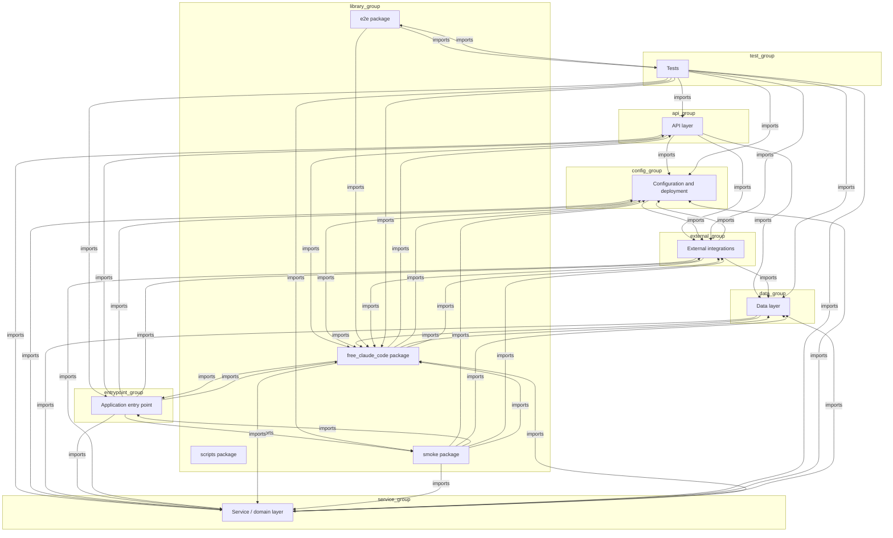

# Architecture report: Alishahryar1/free-claude-code

> Automated static analysis. **Observed** = directly seen in files/imports/AST; **Inferred** = interpretation from that evidence. Repository code was not executed.

## 1. Repository at a glance

| Item | Value |
| --- | --- |
| Repository | Alishahryar1/free-claude-code |
| Description | Use Claude Code, Codex, Antigravity, VSCode, Pi, and OpenCode (and 6 other harnesses) for free (1.3B+ free tokens) from your terminal, app, IDE, or phone, and now from the browser with native browser sessions (multi-harness + multi-model) like OpenClaw (voice supported + ToS friendly) |
| Language | Python |
| Stars | 70164 |
| Licence | Other |
| Analysed commit / branch | 9aafa6f314a1067627be395d2bd384f208ca16bd / main |
| Framework(s) | FastAPI, Starlette |
| Files analysed | 800 |
| Components | 11 |

## 2. Architecture in one minute

Alishahryar1/free-claude-code - Use Claude Code, Codex, Antigravity, VSCode, Pi, and OpenCode (and 6 other harnesses) for free (1.3B+ free tokens) from your terminal, app, IDE, or phone, and now from the browser with native browser…. This repository was analysed statically from 800 file(s) (700 Python). Detected technologies (observed from imports/manifests): GitHub Actions, SQLite, FastAPI, Starlette, aiohttp, httpx. Files are grouped into 11 component(s): API layer, Configuration and deployment, Data layer, e2e package, Application entry point, External integrations, free_claude_code package, scripts package. Observed entry point(s): src/free_claude_code/api/app.py, src/free_claude_code/cli/entrypoints.py, src/free_claude_code/cli/launchers/agy.py. Findings below distinguish observed facts from inferred interpretation.

## 3. High-level block diagram

## 4. Main components

### API layer (`api_layer`)

- **Kind:** api
- **Status:** Observed
- **Confidence:** 0.85
- **Responsibility:** Groups 34 file(s) under api layer (observed from repository paths and static analysis). Observed routes: GET /admin, GET /admin/model_config, GET /admin/messaging, GET /admin/integrations, GET /admin/assets/{version}/{filename:path}. Observed top-level classes: AdminConfigPayload, AdminNoStoreMiddleware, AdminRuntimePort, AnswerPayload, ApiServices, ChatHandler. Observed top-level functions: _anthropic_terminal_frame, _asset_path, _asset_response, _authority_is_local, _build_claude_models_response, _build_direct_models_response.
- **Paths:** `src/free_claude_code/api/__init__.py`, `src/free_claude_code/api/admin_cache.py`, `src/free_claude_code/api/admin_routes.py`, `src/free_claude_code/api/admin_security.py`, `src/free_claude_code/api/admin_static/admin.js`, `src/free_claude_code/api/admin_static/api_key_editor.js`, `src/free_claude_code/api/admin_static/code_sessions.js`, `src/free_claude_code/api/admin_static/form_controls.js`, `src/free_claude_code/api/admin_static/model_combobox.js`, `src/free_claude_code/api/admin_static/session_ui.js`, `src/free_claude_code/api/classifier_projection.py`, `src/free_claude_code/api/code_sessions_routes.py`, `src/free_claude_code/api/dependencies.py`, `src/free_claude_code/api/detection.py`, `src/free_claude_code/api/generation_paths.py`, `src/free_claude_code/api/handlers/__init__.py`, `src/free_claude_code/api/handlers/chat.py`, `src/free_claude_code/api/handlers/classifier_response.py`, `src/free_claude_code/api/handlers/gemini.py`, `src/free_claude_code/api/handlers/messages.py`, `src/free_claude_code/api/handlers/responses.py`, `src/free_claude_code/api/handlers/token_count.py`, `src/free_claude_code/api/markdown.py`, `src/free_claude_code/api/model_catalog.py`, `src/free_claude_code/api/ports.py`, `src/free_claude_code/api/request_errors.py`, `src/free_claude_code/api/request_ids.py`, `src/free_claude_code/api/request_lifetime.py`, `src/free_claude_code/api/request_outcomes.py`, `src/free_claude_code/api/response_streams.py`, `src/free_claude_code/api/routes.py`, `src/free_claude_code/api/stream_delivery.py`, `src/free_claude_code/api/stream_frames.py`, `src/free_claude_code/api/validation_log.py`
- **Evidence:** [src/free_claude_code/api/__init__.py](https://github.com/Alishahryar1/free-claude-code/blob/9aafa6f314a1067627be395d2bd384f208ca16bd/src/free_claude_code/api/__init__.py); [src/free_claude_code/api/admin_cache.py:10](https://github.com/Alishahryar1/free-claude-code/blob/9aafa6f314a1067627be395d2bd384f208ca16bd/src/free_claude_code/api/admin_cache.py#L10); [src/free_claude_code/api/admin_routes.py:78](https://github.com/Alishahryar1/free-claude-code/blob/9aafa6f314a1067627be395d2bd384f208ca16bd/src/free_claude_code/api/admin_routes.py#L78); [src/free_claude_code/api/admin_security.py:9](https://github.com/Alishahryar1/free-claude-code/blob/9aafa6f314a1067627be395d2bd384f208ca16bd/src/free_claude_code/api/admin_security.py#L9); [src/free_claude_code/api/admin_static/admin.js](https://github.com/Alishahryar1/free-claude-code/blob/9aafa6f314a1067627be395d2bd384f208ca16bd/src/free_claude_code/api/admin_static/admin.js); [src/free_claude_code/api/admin_static/api_key_editor.js](https://github.com/Alishahryar1/free-claude-code/blob/9aafa6f314a1067627be395d2bd384f208ca16bd/src/free_claude_code/api/admin_static/api_key_editor.js); [src/free_claude_code/api/admin_static/code_sessions.js](https://github.com/Alishahryar1/free-claude-code/blob/9aafa6f314a1067627be395d2bd384f208ca16bd/src/free_claude_code/api/admin_static/code_sessions.js); [src/free_claude_code/api/admin_static/form_controls.js](https://github.com/Alishahryar1/free-claude-code/blob/9aafa6f314a1067627be395d2bd384f208ca16bd/src/free_claude_code/api/admin_static/form_controls.js)

### Configuration and deployment (`config`)

- **Kind:** config
- **Status:** Observed
- **Confidence:** 0.85
- **Responsibility:** Groups 30 file(s) under configuration and deployment (observed from repository paths and static analysis). Observed top-level classes: ChatModelConfig, ConfigConflictError, ConfigFieldSpec, ConfigMigrationResult, ConfigOptionSpec, ConfigSectionSpec. Observed top-level functions: _active_voice_credential, _add_file_sink, _base_url_field_specs, _browser_host_for_local_urls, _catalog_smoke_fields, _cloudflare_account_field_specs.
- **Paths:** `pyproject.toml`, `smoke/lib/config.py`, `src/free_claude_code/config/__init__.py`, `src/free_claude_code/config/admin/__init__.py`, `src/free_claude_code/config/admin/credentials.py`, `src/free_claude_code/config/admin/custom_providers.py`, `src/free_claude_code/config/admin/manifest.py`, `src/free_claude_code/config/admin/persistence.py`, `src/free_claude_code/config/admin/provider_manifest.py`, `src/free_claude_code/config/admin/specs.py`, `src/free_claude_code/config/admin/state.py`, `src/free_claude_code/config/admin/status.py`, `src/free_claude_code/config/admin/validation.py`, `src/free_claude_code/config/admin/values.py`, `src/free_claude_code/config/api_keys.py`, `src/free_claude_code/config/constants.py`, `src/free_claude_code/config/custom_providers.py`, `src/free_claude_code/config/env_files.py`, `src/free_claude_code/config/env_migrations.py`, `src/free_claude_code/config/errors.py`, `src/free_claude_code/config/loader.py`, `src/free_claude_code/config/logging_config.py`, `src/free_claude_code/config/model_refs.py`, `src/free_claude_code/config/paths.py`, `src/free_claude_code/config/provider_catalog.py`, `src/free_claude_code/config/provider_proxies.py`, `src/free_claude_code/config/reasoning.py`, `src/free_claude_code/config/server_urls.py`, `src/free_claude_code/config/settings.py`, `src/free_claude_code/providers/runtime/config.py`
- **Evidence:** [pyproject.toml](https://github.com/Alishahryar1/free-claude-code/blob/9aafa6f314a1067627be395d2bd384f208ca16bd/pyproject.toml); [smoke/lib/config.py:165](https://github.com/Alishahryar1/free-claude-code/blob/9aafa6f314a1067627be395d2bd384f208ca16bd/smoke/lib/config.py#L165); [src/free_claude_code/config/__init__.py](https://github.com/Alishahryar1/free-claude-code/blob/9aafa6f314a1067627be395d2bd384f208ca16bd/src/free_claude_code/config/__init__.py); [src/free_claude_code/config/admin/__init__.py](https://github.com/Alishahryar1/free-claude-code/blob/9aafa6f314a1067627be395d2bd384f208ca16bd/src/free_claude_code/config/admin/__init__.py); [src/free_claude_code/config/admin/credentials.py:16](https://github.com/Alishahryar1/free-claude-code/blob/9aafa6f314a1067627be395d2bd384f208ca16bd/src/free_claude_code/config/admin/credentials.py#L16); [src/free_claude_code/config/admin/custom_providers.py:18](https://github.com/Alishahryar1/free-claude-code/blob/9aafa6f314a1067627be395d2bd384f208ca16bd/src/free_claude_code/config/admin/custom_providers.py#L18); [src/free_claude_code/config/admin/manifest.py:18](https://github.com/Alishahryar1/free-claude-code/blob/9aafa6f314a1067627be395d2bd384f208ca16bd/src/free_claude_code/config/admin/manifest.py#L18); [src/free_claude_code/config/admin/persistence.py:42](https://github.com/Alishahryar1/free-claude-code/blob/9aafa6f314a1067627be395d2bd384f208ca16bd/src/free_claude_code/config/admin/persistence.py#L42)

### Data layer (`data_layer`)

- **Kind:** data
- **Status:** Observed
- **Confidence:** 0.85
- **Responsibility:** Groups 9 file(s) under data layer (observed from repository paths and static analysis). Observed top-level classes: AdmissionToken, AnthropicModelRecord, CodeCatalog, CodeConflictError, CodeDetail, CodeError. Observed top-level functions: _field, _is_sequence, _malformed, _model_id, _openai_model_id, _produces_images.
- **Paths:** `src/free_claude_code/application/code_sessions/models.py`, `src/free_claude_code/core/anthropic/models.py`, `src/free_claude_code/core/gemini/models.py`, `src/free_claude_code/core/openai_responses/models.py`, `src/free_claude_code/messaging/models.py`, `src/free_claude_code/providers/anthropic/models.py`, `src/free_claude_code/providers/kilo/models.py`, `src/free_claude_code/providers/nvidia_nim/models.py`, `src/free_claude_code/providers/vertex/models.py`
- **Evidence:** [src/free_claude_code/application/code_sessions/models.py:18](https://github.com/Alishahryar1/free-claude-code/blob/9aafa6f314a1067627be395d2bd384f208ca16bd/src/free_claude_code/application/code_sessions/models.py#L18); [src/free_claude_code/core/anthropic/models.py:8](https://github.com/Alishahryar1/free-claude-code/blob/9aafa6f314a1067627be395d2bd384f208ca16bd/src/free_claude_code/core/anthropic/models.py#L8); [src/free_claude_code/core/gemini/models.py:14](https://github.com/Alishahryar1/free-claude-code/blob/9aafa6f314a1067627be395d2bd384f208ca16bd/src/free_claude_code/core/gemini/models.py#L14); [src/free_claude_code/core/openai_responses/models.py:8](https://github.com/Alishahryar1/free-claude-code/blob/9aafa6f314a1067627be395d2bd384f208ca16bd/src/free_claude_code/core/openai_responses/models.py#L8); [src/free_claude_code/messaging/models.py:9](https://github.com/Alishahryar1/free-claude-code/blob/9aafa6f314a1067627be395d2bd384f208ca16bd/src/free_claude_code/messaging/models.py#L9); [src/free_claude_code/providers/anthropic/models.py:15](https://github.com/Alishahryar1/free-claude-code/blob/9aafa6f314a1067627be395d2bd384f208ca16bd/src/free_claude_code/providers/anthropic/models.py#L15); [src/free_claude_code/providers/kilo/models.py:13](https://github.com/Alishahryar1/free-claude-code/blob/9aafa6f314a1067627be395d2bd384f208ca16bd/src/free_claude_code/providers/kilo/models.py#L13); [src/free_claude_code/providers/nvidia_nim/models.py](https://github.com/Alishahryar1/free-claude-code/blob/9aafa6f314a1067627be395d2bd384f208ca16bd/src/free_claude_code/providers/nvidia_nim/models.py)

### e2e package (`e2e`)

- **Kind:** library
- **Status:** Observed
- **Confidence:** 0.85
- **Responsibility:** Groups 7 file(s) under e2e package (observed from repository paths and static analysis). Observed top-level classes: CodeControl, FolderPickerControl. Observed top-level functions: _task_snapshot, api_key_input, assert_autofill_opt_out, close_provider, discard_passed_artifacts, dump_threads_after.
- **Paths:** `e2e/__init__.py`, `e2e/artifacts.py`, `e2e/code_support.py`, `e2e/form_support.py`, `e2e/provider_support.py`, `e2e/server_shutdown.py`, `e2e/thread_diagnostics.py`
- **Evidence:** [e2e/__init__.py](https://github.com/Alishahryar1/free-claude-code/blob/9aafa6f314a1067627be395d2bd384f208ca16bd/e2e/__init__.py); [e2e/artifacts.py:6](https://github.com/Alishahryar1/free-claude-code/blob/9aafa6f314a1067627be395d2bd384f208ca16bd/e2e/artifacts.py#L6); [e2e/code_support.py:13](https://github.com/Alishahryar1/free-claude-code/blob/9aafa6f314a1067627be395d2bd384f208ca16bd/e2e/code_support.py#L13); [e2e/form_support.py:4](https://github.com/Alishahryar1/free-claude-code/blob/9aafa6f314a1067627be395d2bd384f208ca16bd/e2e/form_support.py#L4); [e2e/provider_support.py:6](https://github.com/Alishahryar1/free-claude-code/blob/9aafa6f314a1067627be395d2bd384f208ca16bd/e2e/provider_support.py#L6); [e2e/server_shutdown.py:16](https://github.com/Alishahryar1/free-claude-code/blob/9aafa6f314a1067627be395d2bd384f208ca16bd/e2e/server_shutdown.py#L16); [e2e/thread_diagnostics.py:17](https://github.com/Alishahryar1/free-claude-code/blob/9aafa6f314a1067627be395d2bd384f208ca16bd/e2e/thread_diagnostics.py#L17)

### Application entry point (`entrypoint`)

- **Kind:** entrypoint
- **Status:** Observed
- **Confidence:** 0.85
- **Responsibility:** Groups 13 file(s) under application entry point (observed from repository paths and static analysis). Observed application object created via FastAPI. Observed top-level classes: GitHub, Publisher, Run, RunningServer, RuntimeASGIApp. Observed top-level functions: _initial_directory, _linux, _macos, _stop_process, _wait_for_health, _windows.
- **Paths:** `scripts/build_macos_launcher.py`, `scripts/check_version_policy.py`, `scripts/ci_shards.py`, `scripts/ci_timings.py`, `scripts/publish_release.py`, `scripts/validate_release.py`, `smoke/desktop/identity_probe.py`, `smoke/desktop/rebuild_sdist.py`, `smoke/installers/_pty_runner.py`, `smoke/lib/server.py`, `src/free_claude_code/api/app.py`, `src/free_claude_code/runtime/asgi.py`, `src/free_claude_code/runtime/native_folder_dialog.py`
- **Evidence:** [scripts/build_macos_launcher.py:13](https://github.com/Alishahryar1/free-claude-code/blob/9aafa6f314a1067627be395d2bd384f208ca16bd/scripts/build_macos_launcher.py#L13); [scripts/check_version_policy.py:17](https://github.com/Alishahryar1/free-claude-code/blob/9aafa6f314a1067627be395d2bd384f208ca16bd/scripts/check_version_policy.py#L17); [scripts/ci_shards.py:19](https://github.com/Alishahryar1/free-claude-code/blob/9aafa6f314a1067627be395d2bd384f208ca16bd/scripts/ci_shards.py#L19); [scripts/ci_timings.py:24](https://github.com/Alishahryar1/free-claude-code/blob/9aafa6f314a1067627be395d2bd384f208ca16bd/scripts/ci_timings.py#L24); [scripts/publish_release.py:22](https://github.com/Alishahryar1/free-claude-code/blob/9aafa6f314a1067627be395d2bd384f208ca16bd/scripts/publish_release.py#L22); [scripts/validate_release.py:19](https://github.com/Alishahryar1/free-claude-code/blob/9aafa6f314a1067627be395d2bd384f208ca16bd/scripts/validate_release.py#L19); [smoke/desktop/identity_probe.py:17](https://github.com/Alishahryar1/free-claude-code/blob/9aafa6f314a1067627be395d2bd384f208ca16bd/smoke/desktop/identity_probe.py#L17); [smoke/desktop/rebuild_sdist.py:11](https://github.com/Alishahryar1/free-claude-code/blob/9aafa6f314a1067627be395d2bd384f208ca16bd/smoke/desktop/rebuild_sdist.py#L11)

### External integrations (`external_integrations`)

- **Kind:** external
- **Status:** Observed
- **Confidence:** 0.85
- **Responsibility:** Groups 14 file(s) under external integrations (observed from repository paths and static analysis). Observed top-level classes: AlibabaCloudProvider, CloudflareChatBehavior, CloudflareProvider, DeepSeekChatBehavior, DeepSeekProvider, GeminiProvider. Observed top-level functions: _body_error_candidates, _cloudflare_account_api_url, _cloudflare_model_search_url, _cloudflare_reasoning, _deduplicate_candidates, _deepseek_cache_partition.
- **Paths:** `src/free_claude_code/providers/alibaba_cloud/client.py`, `src/free_claude_code/providers/cloudflare/client.py`, `src/free_claude_code/providers/deepseek/client.py`, `src/free_claude_code/providers/gemini/client.py`, `src/free_claude_code/providers/groq/client.py`, `src/free_claude_code/providers/kilo/client.py`, `src/free_claude_code/providers/lmstudio/client.py`, `src/free_claude_code/providers/mistral/client.py`, `src/free_claude_code/providers/nvidia_nim/client.py`, `src/free_claude_code/providers/open_router/client.py`, `src/free_claude_code/providers/openai_chat/client.py`, `src/free_claude_code/providers/openai_client.py`, `src/free_claude_code/providers/vertex/client.py`, `src/free_claude_code/runtime/web_tools/client.py`
- **Evidence:** [src/free_claude_code/providers/alibaba_cloud/client.py:45](https://github.com/Alishahryar1/free-claude-code/blob/9aafa6f314a1067627be395d2bd384f208ca16bd/src/free_claude_code/providers/alibaba_cloud/client.py#L45); [src/free_claude_code/providers/cloudflare/client.py:48](https://github.com/Alishahryar1/free-claude-code/blob/9aafa6f314a1067627be395d2bd384f208ca16bd/src/free_claude_code/providers/cloudflare/client.py#L48); [src/free_claude_code/providers/deepseek/client.py:31](https://github.com/Alishahryar1/free-claude-code/blob/9aafa6f314a1067627be395d2bd384f208ca16bd/src/free_claude_code/providers/deepseek/client.py#L31); [src/free_claude_code/providers/gemini/client.py:54](https://github.com/Alishahryar1/free-claude-code/blob/9aafa6f314a1067627be395d2bd384f208ca16bd/src/free_claude_code/providers/gemini/client.py#L54); [src/free_claude_code/providers/groq/client.py:95](https://github.com/Alishahryar1/free-claude-code/blob/9aafa6f314a1067627be395d2bd384f208ca16bd/src/free_claude_code/providers/groq/client.py#L95); [src/free_claude_code/providers/kilo/client.py:32](https://github.com/Alishahryar1/free-claude-code/blob/9aafa6f314a1067627be395d2bd384f208ca16bd/src/free_claude_code/providers/kilo/client.py#L32); [src/free_claude_code/providers/lmstudio/client.py:61](https://github.com/Alishahryar1/free-claude-code/blob/9aafa6f314a1067627be395d2bd384f208ca16bd/src/free_claude_code/providers/lmstudio/client.py#L61); [src/free_claude_code/providers/mistral/client.py:61](https://github.com/Alishahryar1/free-claude-code/blob/9aafa6f314a1067627be395d2bd384f208ca16bd/src/free_claude_code/providers/mistral/client.py#L61)

### free_claude_code package (`free_claude_code`)

- **Kind:** library
- **Status:** Observed
- **Confidence:** 0.85
- **Responsibility:** Groups 271 file(s) under free_claude_code package (observed from repository paths and static analysis). Observed top-level classes: AdmissionRejection, AiderConfig, AnthropicChatStreamOutput, AnthropicMessagesTransport, AnthropicProvider, ApplicationError. Observed top-level functions: _active_prompts, _advance, _alias_carrier, _alias_nim_schema_property_names, _alias_nim_tool_parameters, _append_unique.
- **Paths:** `src/free_claude_code/__init__.py`, `src/free_claude_code/application/__init__.py`, `src/free_claude_code/application/code_sessions/__init__.py`, `src/free_claude_code/application/code_sessions/ports.py`, `src/free_claude_code/application/code_sessions/state.py`, `src/free_claude_code/application/connected_accounts.py`, `src/free_claude_code/application/errors.py`, `src/free_claude_code/application/execution.py`, `src/free_claude_code/application/model_catalog.py`, `src/free_claude_code/application/model_metadata.py`, `src/free_claude_code/application/ports.py`, `src/free_claude_code/application/readiness.py`, `src/free_claude_code/application/reasoning.py`, `src/free_claude_code/application/response_collection.py`, `src/free_claude_code/application/routing.py`, `src/free_claude_code/application/session_events.py`, `src/free_claude_code/application/web_tools/__init__.py`, `src/free_claude_code/application/web_tools/ports.py`, `src/free_claude_code/application/web_tools/request.py`, `src/free_claude_code/cli/__init__.py`, `src/free_claude_code/cli/clipboard.py`, `src/free_claude_code/cli/commands.py`, `src/free_claude_code/cli/desktop.py`, `src/free_claude_code/cli/desktop_assets.py`, `src/free_claude_code/cli/desktop_entrypoint.py`, `src/free_claude_code/cli/desktop_tray.py`, `src/free_claude_code/cli/doctor.py`, `src/free_claude_code/cli/entrypoints.py`, `src/free_claude_code/cli/launchers/__init__.py`, `src/free_claude_code/cli/launchers/agy.py`, `src/free_claude_code/cli/launchers/aider.py`, `src/free_claude_code/cli/launchers/aider_config.py`, `src/free_claude_code/cli/launchers/catalog_http.py`, `src/free_claude_code/cli/launchers/claude.py`, `src/free_claude_code/cli/launchers/cline.py`, `src/free_claude_code/cli/launchers/cline_config.py`, `src/free_claude_code/cli/launchers/codex.py`, `src/free_claude_code/cli/launchers/common.py`, `src/free_claude_code/cli/launchers/dsh.py`, `src/free_claude_code/cli/launchers/grok.py`, `src/free_claude_code/cli/launchers/hermes.py`, `src/free_claude_code/cli/launchers/hermes_config.py`, `src/free_claude_code/cli/launchers/muse.py`, `src/free_claude_code/cli/launchers/opencode.py`, `src/free_claude_code/cli/launchers/opencode_config.py`, `src/free_claude_code/cli/launchers/pi.py`, `src/free_claude_code/cli/launchers/pi_extension.ts`, `src/free_claude_code/cli/launchers/runner.py`, `src/free_claude_code/cli/local_http.py`, `src/free_claude_code/cli/macos_app.py`, `src/free_claude_code/cli/managed/__init__.py`, `src/free_claude_code/cli/managed/claude.py`, `src/free_claude_code/cli/managed/diagnostics.py`, `src/free_claude_code/cli/managed/manager.py`, `src/free_claude_code/cli/managed/session.py`, `src/free_claude_code/cli/process_registry.py`, `src/free_claude_code/cli/server_socket.py`, `src/free_claude_code/cli/uvicorn_server.py`, `src/free_claude_code/harnesses/__init__.py`, `src/free_claude_code/harnesses/antigravity_integration.py`, `src/free_claude_code/harnesses/claude.py`, `src/free_claude_code/harnesses/claude_desktop_integration.py`, `src/free_claude_code/harnesses/claude_integration.py`, `src/free_claude_code/harnesses/claude_onboarding.py`, `src/free_claude_code/harnesses/codex.py`, `src/free_claude_code/harnesses/codex_integration.py`, `src/free_claude_code/harnesses/codex_model_catalog.py`, `src/free_claude_code/harnesses/config_file.py`, `src/free_claude_code/harnesses/dsh_config.py`, `src/free_claude_code/harnesses/dsh_desktop_integration.py`, `src/free_claude_code/harnesses/dsh_files.py`, `src/free_claude_code/harnesses/environment.py`, `src/free_claude_code/harnesses/integration_cleanup.py`, `src/free_claude_code/harnesses/jetbrains_acp_integration.py`, `src/free_claude_code/harnesses/launch.py`, `src/free_claude_code/harnesses/model_policy.py`, `src/free_claude_code/harnesses/resources.py`, `src/free_claude_code/harnesses/vscode_chat_integration.py`, `src/free_claude_code/messaging/__init__.py`, `src/free_claude_code/messaging/cli_event_constants.py`, `src/free_claude_code/messaging/command_context.py`, `src/free_claude_code/messaging/command_dispatcher.py`, `src/free_claude_code/messaging/commands.py`, `src/free_claude_code/messaging/event_parser.py`, `src/free_claude_code/messaging/limiter.py`, `src/free_claude_code/messaging/managed_protocols.py`, `src/free_claude_code/messaging/node_event_pipeline.py`, `src/free_claude_code/messaging/node_runner.py`, `src/free_claude_code/messaging/platforms/__init__.py`, `src/free_claude_code/messaging/platforms/discord.py`, `src/free_claude_code/messaging/platforms/discord_inbound.py`, `src/free_claude_code/messaging/platforms/discord_io.py`, `src/free_claude_code/messaging/platforms/factory.py`, `src/free_claude_code/messaging/platforms/outbox.py`, `src/free_claude_code/messaging/platforms/ports.py`, `src/free_claude_code/messaging/platforms/telegram.py`, `src/free_claude_code/messaging/platforms/telegram_inbound.py`, `src/free_claude_code/messaging/platforms/telegram_io.py`, `src/free_claude_code/messaging/platforms/voice_flow.py`, `src/free_claude_code/messaging/rendering/__init__.py`, `src/free_claude_code/messaging/rendering/discord_markdown.py`, `src/free_claude_code/messaging/rendering/markdown_tables.py`, `src/free_claude_code/messaging/rendering/profiles.py`, `src/free_claude_code/messaging/rendering/telegram_markdown.py`, `src/free_claude_code/messaging/safe_diagnostics.py`, `src/free_claude_code/messaging/transcript/__init__.py`, `src/free_claude_code/messaging/transcript/buffer.py`, `src/free_claude_code/messaging/transcript/context.py`, `src/free_claude_code/messaging/transcript/renderer.py`, `src/free_claude_code/messaging/transcript/segments.py`, `src/free_claude_code/messaging/transcript/subagents.py`, `src/free_claude_code/messaging/transcription.py`, `src/free_claude_code/messaging/trees/__init__.py`, `src/free_claude_code/messaging/trees/graph.py`, `src/free_claude_code/messaging/trees/identity.py`, `src/free_claude_code/messaging/trees/manager.py`, `src/free_claude_code/messaging/trees/node.py`, `src/free_claude_code/messaging/trees/ports.py`, `src/free_claude_code/messaging/trees/processor.py`, `src/free_claude_code/messaging/trees/queue.py`, `src/free_claude_code/messaging/trees/repository.py`, `src/free_claude_code/messaging/trees/runtime.py`, `src/free_claude_code/messaging/trees/snapshot.py`, `src/free_claude_code/messaging/trees/transaction.py`, `src/free_claude_code/messaging/trees/transitions.py`, `src/free_claude_code/messaging/turn_intake.py`, `src/free_claude_code/messaging/ui_updates.py`, `src/free_claude_code/messaging/voice.py`, `src/free_claude_code/messaging/workflow.py`, `src/free_claude_code/providers/__init__.py`, `src/free_claude_code/providers/admission.py`, `src/free_claude_code/providers/admission_capacity.py`, `src/free_claude_code/providers/admission_policy.py`, `src/free_claude_code/providers/admission_registry.py`, `src/free_claude_code/providers/alibaba_cloud/__init__.py`, `src/free_claude_code/providers/anthropic/__init__.py`, `src/free_claude_code/providers/anthropic/headers.py`, `src/free_claude_code/providers/anthropic/provider.py`, `src/free_claude_code/providers/anthropic_messages/__init__.py`, `src/free_claude_code/providers/anthropic_messages/discovery.py`, `src/free_claude_code/providers/anthropic_messages/request_policy.py`, `src/free_claude_code/providers/anthropic_messages/transport.py`, `src/free_claude_code/providers/anthropic_messages/wire.py`, `src/free_claude_code/providers/base.py`, `src/free_claude_code/providers/canonical_failures.py`, `src/free_claude_code/providers/cloudflare/__init__.py`, `src/free_claude_code/providers/continuation.py`, `src/free_claude_code/providers/credential_validation.py`, `src/free_claude_code/providers/custom.py`, `src/free_claude_code/providers/deepseek/__init__.py`, `src/free_claude_code/providers/deepseek/compat.py`, `src/free_claude_code/providers/endpoint.py`, `src/free_claude_code/providers/endpoint_types.py`, `src/free_claude_code/providers/failure_classification/__init__.py`, `src/free_claude_code/providers/failure_classification/classifier.py`, `src/free_claude_code/providers/failure_classification/evidence.py`, `src/free_claude_code/providers/failure_classification/verdict.py`, `src/free_claude_code/providers/failure_reporting.py`, `src/free_claude_code/providers/gemini/__init__.py`, `src/free_claude_code/providers/gemini/stream.py`, `src/free_claude_code/providers/gemini/transport.py`, `src/free_claude_code/providers/github_copilot/__init__.py`, `src/free_claude_code/providers/github_copilot/auth.py`, `src/free_claude_code/providers/github_copilot/broker.py`, `src/free_claude_code/providers/github_copilot/lifecycle.py`, `src/free_claude_code/providers/github_copilot/login.py`, `src/free_claude_code/providers/github_copilot/native_cli.py`, `src/free_claude_code/providers/github_copilot/provider.py`, `src/free_claude_code/providers/github_copilot/request_policy.py`, `src/free_claude_code/providers/github_copilot/responses_events.py`, `src/free_claude_code/providers/github_copilot/sdk.py`, `src/free_claude_code/providers/github_copilot/types.py`, `src/free_claude_code/providers/google_openai/__init__.py`, `src/free_claude_code/providers/google_openai/provider.py`, `src/free_claude_code/providers/google_openai/reasoning.py`, `src/free_claude_code/providers/google_openai/thought_signatures.py`, `src/free_claude_code/providers/groq/__init__.py`, `src/free_claude_code/providers/groq/tpm.py`, `src/free_claude_code/providers/history_negotiation.py`, `src/free_claude_code/providers/history_replay.py`, `src/free_claude_code/providers/http.py`, `src/free_claude_code/providers/kilo/__init__.py`, `src/free_claude_code/providers/lmstudio/__init__.py`, `src/free_claude_code/providers/lmstudio/tokens.py`, `src/free_claude_code/providers/mistral/__init__.py`, `src/free_claude_code/providers/mistral/caching.py`, `src/free_claude_code/providers/mistral/reasoning.py`, `src/free_claude_code/providers/model_listing.py`, `src/free_claude_code/providers/nvidia_nim/__init__.py`, `src/free_claude_code/providers/nvidia_nim/request_options.py`, `src/free_claude_code/providers/nvidia_nim/retry.py`, `src/free_claude_code/providers/nvidia_nim/tool_schema.py`, `src/free_claude_code/providers/nvidia_nim/voice.py`, `src/free_claude_code/providers/open_router/__init__.py`, `src/free_claude_code/providers/openai_api/__init__.py`, `src/free_claude_code/providers/openai_api/provider.py`, `src/free_claude_code/providers/openai_chat/__init__.py`, `src/free_claude_code/providers/openai_chat/base_url.py`, `src/free_claude_code/providers/openai_chat/behavior.py`, `src/free_claude_code/providers/openai_chat/extra_body.py`, `src/free_claude_code/providers/openai_chat/gemini_output.py`, `src/free_claude_code/providers/openai_chat/native_output.py`, `src/free_claude_code/providers/openai_chat/output_cap.py`, `src/free_claude_code/providers/openai_chat/profiles.py`, `src/free_claude_code/providers/openai_chat/provider.py`, `src/free_claude_code/providers/openai_chat/reasoning.py`, `src/free_claude_code/providers/openai_chat/reasoning_details.py`, `src/free_claude_code/providers/openai_chat/request_policy.py`, `src/free_claude_code/providers/openai_chat/stream_output.py`, `src/free_claude_code/providers/openai_chat/transport.py`, `src/free_claude_code/providers/openai_chat/usage.py`, `src/free_claude_code/providers/openai_codex/__init__.py`, `src/free_claude_code/providers/openai_codex/auth.py`, `src/free_claude_code/providers/openai_codex/endpoint.py`, `src/free_claude_code/providers/openai_codex/login.py`, `src/free_claude_code/providers/openai_codex/provider.py`, `src/free_claude_code/providers/openai_responses/__init__.py`, `src/free_claude_code/providers/openai_responses/presentation.py`, `src/free_claude_code/providers/openai_responses/transport.py`, `src/free_claude_code/providers/openai_stream.py`, `src/free_claude_code/providers/opencode/__init__.py`, `src/free_claude_code/providers/opencode/catalog.py`, `src/free_claude_code/providers/opencode/provider.py`, `src/free_claude_code/providers/reasoning_compatibility.py`, `src/free_claude_code/providers/recovery_errors.py`, `src/free_claude_code/providers/request_correction/__init__.py`, `src/free_claude_code/providers/request_correction/corrector.py`, `src/free_claude_code/providers/request_correction/rejection.py`, `src/free_claude_code/providers/request_recovery.py`, `src/free_claude_code/providers/runtime/__init__.py`, `src/free_claude_code/providers/runtime/discovery.py`, `src/free_claude_code/providers/runtime/factory.py`, `src/free_claude_code/providers/runtime/model_cache.py`, `src/free_claude_code/providers/runtime/runtime.py`, `src/free_claude_code/providers/stream_failure_resolution/__init__.py`, `src/free_claude_code/providers/stream_failure_resolution/decision.py`, `src/free_claude_code/providers/stream_failure_resolution/resolution.py`, `src/free_claude_code/providers/stream_failure_resolution/resolver.py`, `src/free_claude_code/providers/stream_read.py`, `src/free_claude_code/providers/stream_recovery.py`, `src/free_claude_code/providers/vertex/__init__.py`, `src/free_claude_code/providers/vertex/auth.py`, `src/free_claude_code/providers/vertex/endpoint.py`, `src/free_claude_code/runtime/__init__.py`, `src/free_claude_code/runtime/application.py`, `src/free_claude_code/runtime/bootstrap.py`, `src/free_claude_code/runtime/code_sessions_sqlite.py`, `src/free_claude_code/runtime/codex_app_server.py`, `src/free_claude_code/runtime/codex_catalog.py`, `src/free_claude_code/runtime/codex_protocol.py`, `src/free_claude_code/runtime/configuration.py`, `src/free_claude_code/runtime/diagnostics.py`, `src/free_claude_code/runtime/folder_picker.py`, `src/free_claude_code/runtime/lifecycle.py`, `src/free_claude_code/runtime/messaging_import.py`, `src/free_claude_code/runtime/messaging_sqlite.py`, `src/free_claude_code/runtime/provider_manager.py`, `src/free_claude_code/runtime/retired_chat.py`, `src/free_claude_code/runtime/sqlite_database.py`, `src/free_claude_code/runtime/sqlite_migrations/__init__.py`, `src/free_claude_code/runtime/sqlite_migrations/v0001_code_schema.py`, `src/free_claude_code/runtime/sqlite_migrations/v0002_code_permissions.py`, `src/free_claude_code/runtime/sqlite_migrations/v0003_code_context_usage.py`, `src/free_claude_code/runtime/sqlite_migrations/v0004_messaging_schema.py`, `src/free_claude_code/runtime/sqlite_migrations/v0005_active_code_prompts.py`, `src/free_claude_code/runtime/web_tools/__init__.py`, `src/free_claude_code/runtime/web_tools/constants.py`, `src/free_claude_code/runtime/web_tools/egress.py`, `src/free_claude_code/runtime/web_tools/parsers.py`, `src/free_claude_code/updater/__init__.py`, `src/free_claude_code/updater/check.py`
- **Evidence:** [src/free_claude_code/__init__.py](https://github.com/Alishahryar1/free-claude-code/blob/9aafa6f314a1067627be395d2bd384f208ca16bd/src/free_claude_code/__init__.py); [src/free_claude_code/application/__init__.py](https://github.com/Alishahryar1/free-claude-code/blob/9aafa6f314a1067627be395d2bd384f208ca16bd/src/free_claude_code/application/__init__.py); [src/free_claude_code/application/code_sessions/__init__.py](https://github.com/Alishahryar1/free-claude-code/blob/9aafa6f314a1067627be395d2bd384f208ca16bd/src/free_claude_code/application/code_sessions/__init__.py); [src/free_claude_code/application/code_sessions/ports.py:29](https://github.com/Alishahryar1/free-claude-code/blob/9aafa6f314a1067627be395d2bd384f208ca16bd/src/free_claude_code/application/code_sessions/ports.py#L29); [src/free_claude_code/application/code_sessions/state.py:34](https://github.com/Alishahryar1/free-claude-code/blob/9aafa6f314a1067627be395d2bd384f208ca16bd/src/free_claude_code/application/code_sessions/state.py#L34); [src/free_claude_code/application/connected_accounts.py:10](https://github.com/Alishahryar1/free-claude-code/blob/9aafa6f314a1067627be395d2bd384f208ca16bd/src/free_claude_code/application/connected_accounts.py#L10); [src/free_claude_code/application/errors.py:8](https://github.com/Alishahryar1/free-claude-code/blob/9aafa6f314a1067627be395d2bd384f208ca16bd/src/free_claude_code/application/errors.py#L8); [src/free_claude_code/application/execution.py:67](https://github.com/Alishahryar1/free-claude-code/blob/9aafa6f314a1067627be395d2bd384f208ca16bd/src/free_claude_code/application/execution.py#L67)

### scripts package (`scripts`)

- **Kind:** library
- **Status:** Observed
- **Confidence:** 0.85
- **Responsibility:** Groups 3 file(s) under scripts package (observed from repository paths and static analysis).
- **Paths:** `scripts/ci.sh`, `scripts/install.sh`, `scripts/uninstall.sh`
- **Evidence:** [scripts/ci.sh](https://github.com/Alishahryar1/free-claude-code/blob/9aafa6f314a1067627be395d2bd384f208ca16bd/scripts/ci.sh); [scripts/install.sh](https://github.com/Alishahryar1/free-claude-code/blob/9aafa6f314a1067627be395d2bd384f208ca16bd/scripts/install.sh); [scripts/uninstall.sh](https://github.com/Alishahryar1/free-claude-code/blob/9aafa6f314a1067627be395d2bd384f208ca16bd/scripts/uninstall.sh)

### Service / domain layer (`service_layer`)

- **Kind:** service
- **Status:** Observed
- **Confidence:** 0.85
- **Responsibility:** Groups 100 file(s) under service / domain layer (observed from repository paths and static analysis). Observed top-level classes: AmbiguousToolCallIdentityError, AnthropicImageSourceError, AnthropicSSEDecoder, AnthropicSseEmitter, AnthropicStreamLedger, AnthropicToOpenAIConverter. Observed top-level functions: _accounting_choice, _anthropic_failure_message, _append, _append_context, _append_event, _append_request_id_lines.
- **Paths:** `src/free_claude_code/application/code_sessions/service.py`, `src/free_claude_code/application/web_tools/service.py`, `src/free_claude_code/core/__init__.py`, `src/free_claude_code/core/anthropic/__init__.py`, `src/free_claude_code/core/anthropic/content.py`, `src/free_claude_code/core/anthropic/conversion.py`, `src/free_claude_code/core/anthropic/errors.py`, `src/free_claude_code/core/anthropic/image_sources.py`, `src/free_claude_code/core/anthropic/native.py`, `src/free_claude_code/core/anthropic/native_stream.py`, `src/free_claude_code/core/anthropic/passthrough.py`, `src/free_claude_code/core/anthropic/request_serialization.py`, `src/free_claude_code/core/anthropic/request_snapshot.py`, `src/free_claude_code/core/anthropic/server_tool_sse.py`, `src/free_claude_code/core/anthropic/server_tool_types.py`, `src/free_claude_code/core/anthropic/sse_aggregation.py`, `src/free_claude_code/core/anthropic/stream_contracts.py`, `src/free_claude_code/core/anthropic/streaming/__init__.py`, `src/free_claude_code/core/anthropic/streaming/decoder.py`, `src/free_claude_code/core/anthropic/streaming/emitter.py`, `src/free_claude_code/core/anthropic/streaming/ledger.py`, `src/free_claude_code/core/anthropic/thinking.py`, `src/free_claude_code/core/anthropic/tokens.py`, `src/free_claude_code/core/anthropic/tool_calls.py`, `src/free_claude_code/core/anthropic/tool_results.py`, `src/free_claude_code/core/anthropic/usage.py`, `src/free_claude_code/core/anthropic/utils.py`, `src/free_claude_code/core/async_iterators.py`, `src/free_claude_code/core/async_rwlock.py`, `src/free_claude_code/core/async_tasks.py`, `src/free_claude_code/core/chat_completions/__init__.py`, `src/free_claude_code/core/chat_completions/messages_stream.py`, `src/free_claude_code/core/chat_completions/request.py`, `src/free_claude_code/core/chat_completions/response.py`, `src/free_claude_code/core/chat_completions/responses_stream.py`, `src/free_claude_code/core/chat_completions/tool_calls.py`, `src/free_claude_code/core/continuation_overlap.py`, `src/free_claude_code/core/continuation_request.py`, `src/free_claude_code/core/continuation_stream.py`, `src/free_claude_code/core/delivered_response.py`, `src/free_claude_code/core/diagnostics.py`, `src/free_claude_code/core/failures.py`, `src/free_claude_code/core/gateway_model_ids.py`, `src/free_claude_code/core/gemini/__init__.py`, `src/free_claude_code/core/gemini/errors.py`, `src/free_claude_code/core/gemini/history.py`, `src/free_claude_code/core/gemini/messages_stream.py`, `src/free_claude_code/core/gemini/native_request.py`, `src/free_claude_code/core/gemini/replay.py`, `src/free_claude_code/core/gemini/request.py`, `src/free_claude_code/core/gemini/response.py`, `src/free_claude_code/core/gemini/responses_stream.py`, `src/free_claude_code/core/gemini/schema.py`, `src/free_claude_code/core/gemini/tokens.py`, `src/free_claude_code/core/history_replay.py`, `src/free_claude_code/core/interprocess_lock.py`, `src/free_claude_code/core/json_types.py`, `src/free_claude_code/core/model_capabilities.py`, `src/free_claude_code/core/openai_chat.py`, `src/free_claude_code/core/openai_responses/__init__.py`, `src/free_claude_code/core/openai_responses/chat_request.py`, `src/free_claude_code/core/openai_responses/errors.py`, `src/free_claude_code/core/openai_responses/events.py`, `src/free_claude_code/core/openai_responses/ids.py`, `src/free_claude_code/core/openai_responses/items.py`, `src/free_claude_code/core/openai_responses/messages_request.py`, `src/free_claude_code/core/openai_responses/messages_stream.py`, `src/free_claude_code/core/openai_responses/native.py`, `src/free_claude_code/core/openai_responses/provider_input.py`, `src/free_claude_code/core/openai_responses/provider_stream.py`, `src/free_claude_code/core/openai_responses/reasoning.py`, `src/free_claude_code/core/openai_responses/streaming/__init__.py`, `src/free_claude_code/core/openai_responses/streaming/blocks.py`, `src/free_claude_code/core/openai_responses/streaming/completion.py`, `src/free_claude_code/core/openai_responses/streaming/error_mapping.py`, `src/free_claude_code/core/openai_responses/streaming/event_builders.py`, `src/free_claude_code/core/openai_responses/streaming/ledger.py`, `src/free_claude_code/core/openai_responses/tokens.py`, `src/free_claude_code/core/openai_responses/tool_adaptation.py`, `src/free_claude_code/core/openai_responses/tool_calls.py`, `src/free_claude_code/core/openai_responses/tool_search.py`, `src/free_claude_code/core/openai_responses/tools.py`, `src/free_claude_code/core/openai_tool_names.py`, `src/free_claude_code/core/rate_limit.py`, `src/free_claude_code/core/reasoning.py`, `src/free_claude_code/core/recovery_limits.py`, `src/free_claude_code/core/replay_finalization.py`, `src/free_claude_code/core/request_outcomes.py`, `src/free_claude_code/core/stream_delivery.py`, `src/free_claude_code/core/stream_output.py`, `src/free_claude_code/core/stream_recovery.py`, `src/free_claude_code/core/token_estimation.py`, `src/free_claude_code/core/tool_call_buffer.py`, `src/free_claude_code/core/tool_schema_patterns.py`, `src/free_claude_code/core/trace.py`, `src/free_claude_code/core/version.py`, `src/free_claude_code/core/web_tools.py`, `src/free_claude_code/core/windows_dpi.py`, `src/free_claude_code/runtime/integration_service.py`, `src/free_claude_code/runtime/messaging_service.py`
- **Evidence:** [src/free_claude_code/application/code_sessions/service.py:42](https://github.com/Alishahryar1/free-claude-code/blob/9aafa6f314a1067627be395d2bd384f208ca16bd/src/free_claude_code/application/code_sessions/service.py#L42); [src/free_claude_code/application/web_tools/service.py:58](https://github.com/Alishahryar1/free-claude-code/blob/9aafa6f314a1067627be395d2bd384f208ca16bd/src/free_claude_code/application/web_tools/service.py#L58); [src/free_claude_code/core/__init__.py](https://github.com/Alishahryar1/free-claude-code/blob/9aafa6f314a1067627be395d2bd384f208ca16bd/src/free_claude_code/core/__init__.py); [src/free_claude_code/core/anthropic/__init__.py](https://github.com/Alishahryar1/free-claude-code/blob/9aafa6f314a1067627be395d2bd384f208ca16bd/src/free_claude_code/core/anthropic/__init__.py); [src/free_claude_code/core/anthropic/content.py:7](https://github.com/Alishahryar1/free-claude-code/blob/9aafa6f314a1067627be395d2bd384f208ca16bd/src/free_claude_code/core/anthropic/content.py#L7); [src/free_claude_code/core/anthropic/conversion.py:40](https://github.com/Alishahryar1/free-claude-code/blob/9aafa6f314a1067627be395d2bd384f208ca16bd/src/free_claude_code/core/anthropic/conversion.py#L40); [src/free_claude_code/core/anthropic/errors.py:34](https://github.com/Alishahryar1/free-claude-code/blob/9aafa6f314a1067627be395d2bd384f208ca16bd/src/free_claude_code/core/anthropic/errors.py#L34); [src/free_claude_code/core/anthropic/image_sources.py:18](https://github.com/Alishahryar1/free-claude-code/blob/9aafa6f314a1067627be395d2bd384f208ca16bd/src/free_claude_code/core/anthropic/image_sources.py#L18)

### smoke package (`smoke`)

- **Kind:** library
- **Status:** Observed
- **Confidence:** 0.85
- **Responsibility:** Groups 21 file(s) under smoke package (observed from repository paths and static analysis). Observed top-level classes: CapabilityContract, ClaudeCliRun, CliMatrixOutcome, ClientProtocolDriver, ConversationDriver, ConversationTurn. Observed top-level functions: _agent_result_count, _agent_tool_count, _basic_text, _build_claude_cli_command, _coerce_timeout_text, _compact_command.
- **Paths:** `smoke/__init__.py`, `smoke/capabilities.py`, `smoke/desktop/lifecycle_probe.py`, `smoke/desktop/support.py`, `smoke/features.py`, `smoke/installers/fixtures/rtk-opencode-v1.ts`, `smoke/lib/__init__.py`, `smoke/lib/child_process.py`, `smoke/lib/claude_cli_matrix.py`, `smoke/lib/dsh_desktop.cjs`, `smoke/lib/dsh_provider.py`, `smoke/lib/e2e.py`, `smoke/lib/http.py`, `smoke/lib/local_providers.py`, `smoke/lib/outcomes.py`, `smoke/lib/report.py`, `smoke/lib/report_summary.py`, `smoke/lib/server_runtime.py`, `smoke/lib/skips.py`, `smoke/prereq/__init__.py`, `smoke/product/__init__.py`
- **Evidence:** [smoke/__init__.py](https://github.com/Alishahryar1/free-claude-code/blob/9aafa6f314a1067627be395d2bd384f208ca16bd/smoke/__init__.py); [smoke/capabilities.py:13](https://github.com/Alishahryar1/free-claude-code/blob/9aafa6f314a1067627be395d2bd384f208ca16bd/smoke/capabilities.py#L13); [smoke/desktop/lifecycle_probe.py:16](https://github.com/Alishahryar1/free-claude-code/blob/9aafa6f314a1067627be395d2bd384f208ca16bd/smoke/desktop/lifecycle_probe.py#L16); [smoke/desktop/support.py:13](https://github.com/Alishahryar1/free-claude-code/blob/9aafa6f314a1067627be395d2bd384f208ca16bd/smoke/desktop/support.py#L13); [smoke/features.py:13](https://github.com/Alishahryar1/free-claude-code/blob/9aafa6f314a1067627be395d2bd384f208ca16bd/smoke/features.py#L13); [smoke/installers/fixtures/rtk-opencode-v1.ts](https://github.com/Alishahryar1/free-claude-code/blob/9aafa6f314a1067627be395d2bd384f208ca16bd/smoke/installers/fixtures/rtk-opencode-v1.ts); [smoke/lib/__init__.py](https://github.com/Alishahryar1/free-claude-code/blob/9aafa6f314a1067627be395d2bd384f208ca16bd/smoke/lib/__init__.py); [smoke/lib/child_process.py:15](https://github.com/Alishahryar1/free-claude-code/blob/9aafa6f314a1067627be395d2bd384f208ca16bd/smoke/lib/child_process.py#L15)

### Tests (`tests`)

- **Kind:** test
- **Status:** Observed
- **Confidence:** 0.85
- **Responsibility:** Groups 211 file(s) under tests (observed from repository paths and static analysis). Observed application object created via FastAPI. Observed top-level classes: Answer, ApiTestRuntime, ApplicationErrorValidationProvider, CanonicalFailureProvider, ClassifierStream, CloseControlledProvider. Observed top-level functions: _access_request_count, _aiohttp_client_session_patch, _aiohttp_response, _assert_browser_probe_exits, _assert_ordinary_protocol_error, _assert_provider_product_stream.
- **Paths:** `e2e/conftest.py`, `e2e/test_admin_apply.py`, `e2e/test_admin_assets.py`, `e2e/test_admin_integrations.py`, `e2e/test_admin_models.py`, `e2e/test_admin_providers.py`, `e2e/test_admin_status_independence.py`, `e2e/test_admin_vscode_chat.py`, `e2e/test_antigravity_integration.py`, `e2e/test_api_key_lists.py`, `e2e/test_claude_desktop_integration.py`, `e2e/test_code_sessions.py`, `e2e/test_connected_accounts.py`, `e2e/test_custom_providers.py`, `e2e/test_dsh_desktop_integration.py`, `e2e/test_fallback_key_controls.py`, `e2e/test_integration_notices.py`, `e2e/test_jetbrains_acp_integration.py`, `e2e/test_local_provider_diagnostics.py`, `e2e/test_messaging_storage_recovery.py`, `e2e/test_progressive_startup.py`, `e2e/test_provider_modals.py`, `e2e/test_tool_schema_patterns.py`, `smoke/conftest.py`, `smoke/desktop/conftest.py`, `smoke/desktop/test_macos_launcher.py`, `smoke/desktop/test_macos_lifecycle.py`, `smoke/installers/conftest.py`, `smoke/installers/test_antigravity_installers.py`, `smoke/installers/test_installer_release.py`, `smoke/installers/test_muse_windows_lifecycle.py`, `smoke/installers/test_powershell_cache.py`, `smoke/installers/test_uninstallers.py`, `smoke/installers/test_update_wrapper.py`, `smoke/prereq/test_api_prereq_live.py`, `smoke/prereq/test_auth_prereq_live.py`, `smoke/prereq/test_cli_prereq_live.py`, `smoke/prereq/test_client_shapes_prereq_live.py`, `smoke/prereq/test_local_provider_endpoints_prereq_live.py`, `smoke/prereq/test_messaging_prereq_live.py`, `smoke/prereq/test_provider_prereq_live.py`, `smoke/prereq/test_tools_prereq_live.py`, `smoke/prereq/test_voice_prereq_live.py`, `smoke/product/test_antigravity_cli_live.py`, `smoke/product/test_api_product_live.py`, `smoke/product/test_auth_product_live.py`, `smoke/product/test_cli_package_product_live.py`, `smoke/product/test_client_product_live.py`, `smoke/product/test_codex_modes_product_live.py`, `smoke/product/test_config_extensibility_product_live.py`, `smoke/product/test_dsh_desktop_live.py`, `smoke/product/test_dsh_native_live.py`, `smoke/product/test_live_platform_product_live.py`, `smoke/product/test_local_provider_product_live.py`, `smoke/product/test_messaging_product_live.py`, `smoke/product/test_model_fallback_product_live.py`, `smoke/product/test_nvidia_nim_cli_product_live.py`, `smoke/product/test_nvidia_nim_vision_product_live.py`, `smoke/product/test_openrouter_free_cli_product_live.py`, `smoke/product/test_provider_product_live.py`, `smoke/product/test_runtime_ownership_product_live.py`, `smoke/product/test_voice_product_live.py`, `tests/__init__.py`, `tests/api/model_fallback_support.py`, `tests/api/support.py`, `tests/api/test_admin.py`, `tests/api/test_admin_configuration_io.py`, `tests/api/test_antigravity_routes.py`, `tests/api/test_api.py`, `tests/api/test_api_handlers.py`, `tests/api/test_api_key_lists.py`, `tests/api/test_app_lifespan_and_errors.py`, `tests/api/test_app_version.py`, `tests/api/test_auth.py`, `tests/api/test_chat_accounting_wire.py`, `tests/api/test_chat_protocol_matrix.py`, `tests/api/test_chat_tool_identity_api.py`, `tests/api/test_classifier_provider_compatibility.py`, `tests/api/test_classifier_response.py`, `tests/api/test_claude_desktop_integration.py`, `tests/api/test_claude_onboarding.py`, `tests/api/test_code_sessions_routes.py`, `tests/api/test_codex_integration_routes.py`, `tests/api/test_continuation_overlap.py`, `tests/api/test_cooldown_cleanup.py`, `tests/api/test_delivered_stream_recovery.py`, `tests/api/test_dependencies.py`, `tests/api/test_detection.py`, `tests/api/test_dsh_desktop_integration.py`, `tests/api/test_execution_failure_contract.py`, `tests/api/test_fallback_key_requests.py`, `tests/api/test_four_protocol_matrix.py`, `tests/api/test_gemini_continuation_corrections.py`, `tests/api/test_gemini_continuation_fallback.py`, `tests/api/test_gemini_continuation_replay.py`, `tests/api/test_gemini_ingress.py`, `tests/api/test_gemini_protocol_matrix.py`, `tests/api/test_gemini_replay_failures.py`, `tests/api/test_gemini_sdk_recovery.py`, `tests/api/test_gemini_thinking_settings.py`, `tests/api/test_groq_token_limits.py`, `tests/api/test_hidden_retry_admission.py`, `tests/api/test_hidden_stream_retries.py`, `tests/api/test_initial_stream_holdback.py`, `tests/api/test_integration_status_independence.py`, `tests/api/test_jetbrains_acp_integration.py`, `tests/api/test_local_provider_diagnostics.py`, `tests/api/test_local_provider_status.py`, `tests/api/test_managed_proxy_token.py`, `tests/api/test_markdown.py`, `tests/api/test_midstream_model_fallback.py`, `tests/api/test_mistral_affinity.py`, `tests/api/test_model_fallback.py`, `tests/api/test_model_fallback_clients.py`, `tests/api/test_model_fallback_failure_payloads.py`, `tests/api/test_model_fallback_reasoning.py`, `tests/api/test_model_fallback_tool_projection.py`, `tests/api/test_model_fallback_wire_controls.py`, `tests/api/test_model_listing.py`, `tests/api/test_native_anthropic.py`, `tests/api/test_native_protocol_defaults.py`, `tests/api/test_native_recovery.py`, `tests/api/test_native_token_count.py`, `tests/api/test_native_tool_wire_contract.py`, `tests/api/test_new_protocol_recovery.py`, `tests/api/test_openai_codex_compatibility.py`, `tests/api/test_openai_responses.py`, `tests/api/test_opencode_session_headers.py`, `tests/api/test_openrouter_image_errors.py`, `tests/api/test_ordinary_error_phases.py`, `tests/api/test_pending_recovery_failure.py`, `tests/api/test_recovery_attempt_state.py`, `tests/api/test_recovery_failure_contract.py`, `tests/api/test_recovery_lifecycle.py`, `tests/api/test_recovery_public_owner.py`, `tests/api/test_recovery_reasoning.py`, `tests/api/test_recovery_text_contract.py`, `tests/api/test_request_ids.py`, `tests/api/test_request_lifetime.py`, `tests/api/test_request_outcomes.py`, `tests/api/test_request_utils.py`, `tests/api/test_response_streams.py`, `tests/api/test_retry_after_cooldown.py`, `tests/api/test_routes_utilities.py`, `tests/api/test_runtime_safe_logging.py`, `tests/api/test_safe_logging.py`, `tests/api/test_stream_delivery.py`, `tests/api/test_tool_buffer_limits.py`, `tests/api/test_tool_call_buffer.py`, `tests/api/test_tool_call_buffer_transports.py`, `tests/api/test_unified_thinking_recovery.py`, `tests/api/test_validation_log.py`, `tests/api/test_vscode_chat_routes.py`, `tests/api/test_vscode_integration.py`, `tests/api/test_web_server_tools.py`, `tests/application/test_code_sessions.py`, `tests/application/test_code_sessions_state.py`, `tests/application/test_connected_accounts.py`, `tests/application/test_execution.py`, `tests/application/test_model_catalog.py`, `tests/application/test_model_metadata.py`, `tests/application/test_reasoning.py`, `tests/application/test_request_conversion.py`, `tests/application/test_response_collection.py`, `tests/application/test_routing.py`, `tests/application/test_session_events.py`, `tests/application/test_web_tools.py`, `tests/cli/conftest.py`, `tests/cli/test_agy_launcher.py`, `tests/cli/test_aider_config.py`, `tests/cli/test_aider_launcher.py`, `tests/cli/test_autostart_logging.py`, `tests/cli/test_catalog_http.py`, `tests/cli/test_claude_launcher.py`, `tests/cli/test_cli.py`, `tests/cli/test_cli_manager_edge_cases.py`, `tests/cli/test_cli_ownership.py`, `tests/cli/test_cline_launcher.py`, `tests/cli/test_codex_launcher.py`, `tests/cli/test_codex_model_catalog.py`, `tests/cli/test_config_restart_lifecycle.py`, `tests/cli/test_desktop.py`, `tests/cli/test_desktop_assets.py`, `tests/cli/test_doctor.py`, `tests/cli/test_dsh_config.py`, `tests/cli/test_dsh_launcher.py`, `tests/cli/test_entrypoints.py`, `tests/cli/test_grok_launcher.py`, `tests/cli/test_hermes_config.py`, `tests/cli/test_hermes_launcher.py`, `tests/cli/test_launcher_checks.py`, `tests/cli/test_launcher_environment.py`, `tests/cli/test_launcher_resources.py`, `tests/cli/test_launcher_workflow.py`, `tests/cli/test_local_http.py`, `tests/cli/test_macos_app.py`, `tests/cli/test_managed_claude.py`, `tests/cli/test_managed_session_shutdown.py`, `tests/cli/test_model_catalog_decoder.py`, `tests/cli/test_muse_launcher.py`, `tests/cli/test_opencode_launcher.py`, `tests/cli/test_pi_extension.py`, `tests/cli/test_pi_launcher.py`, `tests/cli/test_process_registry.py`, `tests/cli/test_progressive_launch.py`, `tests/cli/test_server_autostart.py`, `tests/cli/test_server_logging.py`, `tests/cli/test_server_shutdown.py`, `tests/cli/test_update_check.py`, `tests/code_sessions_support.py`, `tests/config/credential_support.py`
- **Evidence:** [e2e/conftest.py:56](https://github.com/Alishahryar1/free-claude-code/blob/9aafa6f314a1067627be395d2bd384f208ca16bd/e2e/conftest.py#L56); [e2e/test_admin_apply.py:18](https://github.com/Alishahryar1/free-claude-code/blob/9aafa6f314a1067627be395d2bd384f208ca16bd/e2e/test_admin_apply.py#L18); [e2e/test_admin_assets.py:14](https://github.com/Alishahryar1/free-claude-code/blob/9aafa6f314a1067627be395d2bd384f208ca16bd/e2e/test_admin_assets.py#L14); [e2e/test_admin_integrations.py:22](https://github.com/Alishahryar1/free-claude-code/blob/9aafa6f314a1067627be395d2bd384f208ca16bd/e2e/test_admin_integrations.py#L22); [e2e/test_admin_models.py:12](https://github.com/Alishahryar1/free-claude-code/blob/9aafa6f314a1067627be395d2bd384f208ca16bd/e2e/test_admin_models.py#L12); [e2e/test_admin_providers.py:12](https://github.com/Alishahryar1/free-claude-code/blob/9aafa6f314a1067627be395d2bd384f208ca16bd/e2e/test_admin_providers.py#L12); [e2e/test_admin_status_independence.py:8](https://github.com/Alishahryar1/free-claude-code/blob/9aafa6f314a1067627be395d2bd384f208ca16bd/e2e/test_admin_status_independence.py#L8); [e2e/test_admin_vscode_chat.py:9](https://github.com/Alishahryar1/free-claude-code/blob/9aafa6f314a1067627be395d2bd384f208ca16bd/e2e/test_admin_vscode_chat.py#L9)

## 5. Execution flow

**Observed** entry point(s):

- [src/free_claude_code/api/app.py:53](https://github.com/Alishahryar1/free-claude-code/blob/9aafa6f314a1067627be395d2bd384f208ca16bd/src/free_claude_code/api/app.py#L53)
- [src/free_claude_code/cli/entrypoints.py](https://github.com/Alishahryar1/free-claude-code/blob/9aafa6f314a1067627be395d2bd384f208ca16bd/src/free_claude_code/cli/entrypoints.py)
- [src/free_claude_code/cli/entrypoints.py](https://github.com/Alishahryar1/free-claude-code/blob/9aafa6f314a1067627be395d2bd384f208ca16bd/src/free_claude_code/cli/entrypoints.py)
- [src/free_claude_code/cli/launchers/agy.py](https://github.com/Alishahryar1/free-claude-code/blob/9aafa6f314a1067627be395d2bd384f208ca16bd/src/free_claude_code/cli/launchers/agy.py)
- [src/free_claude_code/cli/launchers/aider.py](https://github.com/Alishahryar1/free-claude-code/blob/9aafa6f314a1067627be395d2bd384f208ca16bd/src/free_claude_code/cli/launchers/aider.py)
- [src/free_claude_code/cli/launchers/claude.py](https://github.com/Alishahryar1/free-claude-code/blob/9aafa6f314a1067627be395d2bd384f208ca16bd/src/free_claude_code/cli/launchers/claude.py)
- [src/free_claude_code/cli/launchers/cline.py](https://github.com/Alishahryar1/free-claude-code/blob/9aafa6f314a1067627be395d2bd384f208ca16bd/src/free_claude_code/cli/launchers/cline.py)
- [src/free_claude_code/cli/launchers/codex.py](https://github.com/Alishahryar1/free-claude-code/blob/9aafa6f314a1067627be395d2bd384f208ca16bd/src/free_claude_code/cli/launchers/codex.py)
- [src/free_claude_code/cli/launchers/dsh.py](https://github.com/Alishahryar1/free-claude-code/blob/9aafa6f314a1067627be395d2bd384f208ca16bd/src/free_claude_code/cli/launchers/dsh.py)
- [src/free_claude_code/cli/launchers/grok.py](https://github.com/Alishahryar1/free-claude-code/blob/9aafa6f314a1067627be395d2bd384f208ca16bd/src/free_claude_code/cli/launchers/grok.py)
- [src/free_claude_code/cli/launchers/hermes.py](https://github.com/Alishahryar1/free-claude-code/blob/9aafa6f314a1067627be395d2bd384f208ca16bd/src/free_claude_code/cli/launchers/hermes.py)
- [src/free_claude_code/cli/launchers/muse.py](https://github.com/Alishahryar1/free-claude-code/blob/9aafa6f314a1067627be395d2bd384f208ca16bd/src/free_claude_code/cli/launchers/muse.py)

**Observed** routes (from decorators):

- `GET /admin` -> `admin_page` in `src/free_claude_code/api/admin_routes.py:115`
- `GET /admin/model_config` -> `admin_page` in `src/free_claude_code/api/admin_routes.py:115`
- `GET /admin/messaging` -> `admin_page` in `src/free_claude_code/api/admin_routes.py:115`
- `GET /admin/integrations` -> `admin_page` in `src/free_claude_code/api/admin_routes.py:115`
- `GET /admin/assets/{version}/{filename:path}` -> `admin_asset` in `src/free_claude_code/api/admin_routes.py:121`
- `GET /admin/api/config` -> `get_admin_config` in `src/free_claude_code/api/admin_routes.py:129`
- `POST /admin/api/config/apply` -> `apply_admin_config` in `src/free_claude_code/api/admin_routes.py:137`
- `GET /admin/api/status` -> `admin_status` in `src/free_claude_code/api/admin_routes.py:154`
- `GET /admin/api/providers/{provider_id}/local-status` -> `local_provider_status` in `src/free_claude_code/api/admin_routes.py:169`
- `POST /admin/api/providers/{provider_id}/test` -> `test_provider` in `src/free_claude_code/api/admin_routes.py:187`
- `GET /admin/api/providers/{provider_id}/auth` -> `connected_account_status` in `src/free_claude_code/api/admin_routes.py:197`
- `POST /admin/api/providers/{provider_id}/auth/login` -> `start_connected_account_login` in `src/free_claude_code/api/admin_routes.py:209`
- `POST /admin/api/providers/{provider_id}/auth/cancel` -> `cancel_connected_account_login` in `src/free_claude_code/api/admin_routes.py:235`
- `DELETE /admin/api/providers/{provider_id}/auth` -> `disconnect_connected_account` in `src/free_claude_code/api/admin_routes.py:247`
- `GET /admin/api/models` -> `models` in `src/free_claude_code/api/admin_routes.py:259`
- `GET /admin/api/integrations/claude-onboarding` -> `claude_onboarding_status` in `src/free_claude_code/api/admin_routes.py:268`
- `POST /admin/api/integrations/claude-onboarding/complete` -> `complete_claude_onboarding` in `src/free_claude_code/api/admin_routes.py:277`
- `GET /admin/api/integrations/claude-vscode` -> `claude_vscode_status` in `src/free_claude_code/api/admin_routes.py:286`
- `GET /admin/api/integrations/vscode-chat` -> `vscode_chat_status` in `src/free_claude_code/api/admin_routes.py:295`
- `GET /admin/api/integrations/antigravity` -> `antigravity_status` in `src/free_claude_code/api/admin_routes.py:304`
- `POST /admin/api/integrations/antigravity/connect` -> `connect_antigravity` in `src/free_claude_code/api/admin_routes.py:313`
- `POST /admin/api/integrations/antigravity/disconnect` -> `disconnect_antigravity` in `src/free_claude_code/api/admin_routes.py:322`
- `POST /admin/api/integrations/vscode-chat/connect` -> `connect_vscode_chat` in `src/free_claude_code/api/admin_routes.py:331`
- `POST /admin/api/integrations/vscode-chat/disconnect` -> `disconnect_vscode_chat` in `src/free_claude_code/api/admin_routes.py:340`
- `POST /admin/api/integrations/vscode-chat/refresh` -> `refresh_vscode_chat` in `src/free_claude_code/api/admin_routes.py:349`
- `POST /admin/api/integrations/claude-vscode/connect` -> `connect_claude_vscode` in `src/free_claude_code/api/admin_routes.py:358`
- `POST /admin/api/integrations/claude-vscode/refresh` -> `refresh_claude_vscode` in `src/free_claude_code/api/admin_routes.py:367`
- `POST /admin/api/integrations/claude-vscode/disconnect` -> `disconnect_claude_vscode` in `src/free_claude_code/api/admin_routes.py:376`
- `GET /admin/api/integrations/dsh-desktop` -> `dsh_desktop_status` in `src/free_claude_code/api/admin_routes.py:385`
- `POST /admin/api/integrations/dsh-desktop/connect` -> `connect_dsh_desktop` in `src/free_claude_code/api/admin_routes.py:393`
- `POST /admin/api/integrations/dsh-desktop/disconnect` -> `disconnect_dsh_desktop` in `src/free_claude_code/api/admin_routes.py:401`
- `POST /admin/api/integrations/dsh-desktop/refresh` -> `refresh_dsh_desktop` in `src/free_claude_code/api/admin_routes.py:409`
- `GET /admin/api/integrations/claude-desktop` -> `claude_desktop_status` in `src/free_claude_code/api/admin_routes.py:417`
- `POST /admin/api/integrations/claude-desktop/connect` -> `connect_claude_desktop` in `src/free_claude_code/api/admin_routes.py:425`
- `POST /admin/api/integrations/claude-desktop/disconnect` -> `disconnect_claude_desktop` in `src/free_claude_code/api/admin_routes.py:433`
- `POST /admin/api/integrations/claude-desktop/refresh` -> `refresh_claude_desktop` in `src/free_claude_code/api/admin_routes.py:441`
- `GET /admin/api/integrations/jetbrains-acp` -> `jetbrains_acp_status` in `src/free_claude_code/api/admin_routes.py:449`
- `POST /admin/api/integrations/jetbrains-acp/connect` -> `connect_jetbrains_acp` in `src/free_claude_code/api/admin_routes.py:457`
- `POST /admin/api/integrations/jetbrains-acp/disconnect` -> `disconnect_jetbrains_acp` in `src/free_claude_code/api/admin_routes.py:465`
- `POST /admin/api/integrations/jetbrains-acp/refresh` -> `refresh_jetbrains_acp` in `src/free_claude_code/api/admin_routes.py:473`
- `GET /admin/api/integrations/codex` -> `codex_integration_status` in `src/free_claude_code/api/admin_routes.py:481`
- `POST /admin/api/integrations/codex/connect` -> `connect_codex` in `src/free_claude_code/api/admin_routes.py:490`
- `POST /admin/api/integrations/codex/refresh` -> `refresh_codex_integration` in `src/free_claude_code/api/admin_routes.py:499`
- `POST /admin/api/integrations/codex/disconnect` -> `disconnect_codex` in `src/free_claude_code/api/admin_routes.py:508`
- `POST /admin/api/models/refresh` -> `refresh_models` in `src/free_claude_code/api/admin_routes.py:530`
- `GET /admin/code` -> `code_page` in `src/free_claude_code/api/code_sessions_routes.py:83`
- `GET /admin/code/{session_id}` -> `code_page` in `src/free_claude_code/api/code_sessions_routes.py:83`
- `GET /admin/api/code/bootstrap` -> `bootstrap` in `src/free_claude_code/api/code_sessions_routes.py:88`
- `POST /admin/api/code/folder-picker` -> `pick_folder` in `src/free_claude_code/api/code_sessions_routes.py:105`
- `GET /admin/api/code/events` -> `events` in `src/free_claude_code/api/code_sessions_routes.py:115`
- `GET /admin/api/code/sessions` -> `list_sessions` in `src/free_claude_code/api/code_sessions_routes.py:151`
- `POST /admin/api/code/sessions` -> `create` in `src/free_claude_code/api/code_sessions_routes.py:169`
- `GET /admin/api/code/sessions/{session_id}` -> `detail` in `src/free_claude_code/api/code_sessions_routes.py:178`
- `GET /admin/api/code/sessions/{session_id}/items` -> `older_items` in `src/free_claude_code/api/code_sessions_routes.py:189`
- `PATCH /admin/api/code/sessions/{session_id}` -> `update_settings` in `src/free_claude_code/api/code_sessions_routes.py:200`
- `DELETE /admin/api/code/sessions/{session_id}` -> `delete` in `src/free_claude_code/api/code_sessions_routes.py:215`
- `POST /admin/api/code/sessions/{session_id}/turns` -> `send` in `src/free_claude_code/api/code_sessions_routes.py:229`
- `POST /admin/api/code/sessions/{session_id}/stop` -> `stop` in `src/free_claude_code/api/code_sessions_routes.py:244`
- `POST /admin/api/code/sessions/{session_id}/prompts/{prompt_id}/responses` -> `answer` in `src/free_claude_code/api/code_sessions_routes.py:254`
- `POST /v1beta/models/{resource:path}` -> `create_gemini_response` in `src/free_claude_code/api/routes.py:69`
- `POST /v1/chat/completions` -> `create_chat_completion` in `src/free_claude_code/api/routes.py:138`
- `API_ROUTE /v1/chat/completions` -> `probe_chat` in `src/free_claude_code/api/routes.py:164`
- `POST /v1/messages` -> `create_message` in `src/free_claude_code/api/routes.py:283`
- `API_ROUTE /v1/messages` -> `probe_messages` in `src/free_claude_code/api/routes.py:299`
- `POST /v1/responses` -> `create_response` in `src/free_claude_code/api/routes.py:304`
- `API_ROUTE /v1/responses` -> `probe_responses` in `src/free_claude_code/api/routes.py:320`
- `POST /v1/messages/count_tokens` -> `count_tokens` in `src/free_claude_code/api/routes.py:325`
- `API_ROUTE /v1/messages/count_tokens` -> `probe_count_tokens` in `src/free_claude_code/api/routes.py:370`
- `GET /` -> `root` in `src/free_claude_code/api/routes.py:375`
- `API_ROUTE /` -> `probe_root` in `src/free_claude_code/api/routes.py:387`
- `GET /health` -> `health` in `src/free_claude_code/api/routes.py:392`
- `API_ROUTE /health` -> `probe_health` in `src/free_claude_code/api/routes.py:397`
- `GET /v1/models` -> `list_models` in `src/free_claude_code/api/routes.py:406`
- `GET /muse-code/models` -> `list_muse_models` in `src/free_claude_code/api/routes.py:427`
- `POST /stop` -> `stop_cli` in `src/free_claude_code/api/routes.py:438`

Representative flow (derived from observed entry points and the import graph; steps beyond the entry point are **Inferred**):

1. Execution starts at an observed entry point listed above, if present.
2. `api_layer` imports `config` (API layer -> Configuration and deployment).
3. `api_layer` imports `data_layer` (API layer -> Data layer).
4. `api_layer` imports `external_integrations` (API layer -> External integrations).
5. `api_layer` imports `free_claude_code` (API layer -> free_claude_code package).
6. `api_layer` imports `service_layer` (API layer -> Service / domain layer).
7. `config` imports `external_integrations` (Configuration and deployment -> External integrations).
8. `config` imports `free_claude_code` (Configuration and deployment -> free_claude_code package).
9. `config` imports `service_layer` (Configuration and deployment -> Service / domain layer).

## 6. Project structure

### `(root)`

- `.gitattributes` - other (154 bytes)
- `.gitignore` - other (242 bytes)
- `CONTRIBUTING.md` - docs (2677 bytes)
- `LICENSE` - docs (34108 bytes)
- `README.md` - docs (28337 bytes)
- `pyproject.toml` - manifest (5621 bytes)

### `.github`

- `.github/ISSUE_TEMPLATE/bug-report.yml` - config (784 bytes)
- `.github/ISSUE_TEMPLATE/config.yml` - config (242 bytes)
- `.github/ISSUE_TEMPLATE/feature-request.yml` - config (539 bytes)
- `.github/ISSUE_TEMPLATE/installation-problem.yml` - config (417 bytes)
- `.github/actions/ci-environment/action.yml` - config (6575 bytes)
- `.github/dependabot.yml` - config (334 bytes)
- `.github/workflows/post-merge.yml` - ci, YAML (3481 bytes)
- `.github/workflows/tests.yml` - ci, YAML (12007 bytes)
- `.github/workflows/validate-bug-report-version.yml` - ci, YAML (9468 bytes)
- `.github/workflows/version-policy.yml` - ci, YAML (1600 bytes)

### `assets`

- `assets/free-claude-code-wordmark-dark.svg` - other (1141 bytes)
- `assets/free-claude-code-wordmark-light.svg` - other (1141 bytes)
- `assets/how-it-works.mmd` - other (2298 bytes)
- `assets/package-manager-uv.svg` - other (4180 bytes)

### `e2e`

- `e2e/__init__.py` - source, Python (53 bytes)
- `e2e/artifacts.py` - source, Python (1082 bytes)
- `e2e/code_support.py` - source, Python (2614 bytes)
- `e2e/conftest.py` - test, Python (14149 bytes)
- `e2e/form_support.py` - source, Python (590 bytes)
- `e2e/provider_support.py` - source, Python (850 bytes)
- `e2e/server_shutdown.py` - source, Python (2871 bytes)
- `e2e/test_admin_apply.py` - test, Python (15255 bytes)
- `e2e/test_admin_assets.py` - test, Python (9970 bytes)
- `e2e/test_admin_integrations.py` - test, Python (27647 bytes)
- `e2e/test_admin_models.py` - test, Python (28191 bytes)
- `e2e/test_admin_providers.py` - test, Python (23651 bytes)
- `e2e/test_admin_status_independence.py` - test, Python (9658 bytes)
- `e2e/test_admin_vscode_chat.py` - test, Python (4063 bytes)
- `e2e/test_antigravity_integration.py` - test, Python (5228 bytes)
- `e2e/test_api_key_lists.py` - test, Python (15199 bytes)
- `e2e/test_claude_desktop_integration.py` - test, Python (5820 bytes)
- `e2e/test_code_sessions.py` - test, Python (89367 bytes)
- `e2e/test_connected_accounts.py` - test, Python (20498 bytes)
- `e2e/test_custom_providers.py` - test, Python (6784 bytes)
- `e2e/test_dsh_desktop_integration.py` - test, Python (5607 bytes)
- `e2e/test_fallback_key_controls.py` - test, Python (8669 bytes)
- `e2e/test_integration_notices.py` - test, Python (9922 bytes)
- `e2e/test_jetbrains_acp_integration.py` - test, Python (2870 bytes)
- `e2e/test_local_provider_diagnostics.py` - test, Python (6292 bytes)
- `e2e/test_messaging_storage_recovery.py` - test, Python (1033 bytes)
- `e2e/test_progressive_startup.py` - test, Python (10722 bytes)
- `e2e/test_provider_modals.py` - test, Python (8353 bytes)
- `e2e/test_tool_schema_patterns.py` - test, Python (1795 bytes)
- `e2e/thread_diagnostics.py` - source, Python (1948 bytes)

### `scripts`

- `scripts/build_macos_launcher.py` - source, Python (1884 bytes)
- `scripts/check_version_policy.py` - source, Python (4408 bytes)
- `scripts/ci.ps1` - other (6274 bytes)
- `scripts/ci.sh` - source, Shell (5557 bytes)
- `scripts/ci_shards.py` - source, Python (1581 bytes)
- `scripts/ci_timings.py` - source, Python (15852 bytes)
- `scripts/install-muse.ps1` - other (29920 bytes)
- `scripts/install.ps1` - other (83422 bytes)
- `scripts/install.sh` - source, Shell (68262 bytes)
- `scripts/macos/launcher.m` - other (5276 bytes)
- `scripts/publish_release.py` - source, Python (9126 bytes)
- `scripts/uninstall-muse.ps1` - other (8877 bytes)
- `scripts/uninstall.ps1` - other (11424 bytes)
- `scripts/uninstall.sh` - source, Shell (9491 bytes)
- `scripts/update/fcc-update` - other (711 bytes)
- `scripts/update/fcc-update.cmd` - other (851 bytes)
- `scripts/validate_release.py` - source, Python (4910 bytes)

### `smoke`

- `smoke/README.md` - docs (13256 bytes)
- `smoke/__init__.py` - source, Python (56 bytes)
- `smoke/capabilities.py` - source, Python (29158 bytes)
- `smoke/conftest.py` - test, Python (3696 bytes)
- `smoke/desktop/conftest.py` - test, Python (4060 bytes)
- `smoke/desktop/identity_probe.py` - source, Python (3485 bytes)
- `smoke/desktop/lifecycle_probe.py` - source, Python (4234 bytes)
- `smoke/desktop/rebuild_sdist.py` - source, Python (1495 bytes)
- `smoke/desktop/support.py` - source, Python (3895 bytes)
- `smoke/desktop/test_macos_launcher.py` - test, Python (3744 bytes)
- `smoke/desktop/test_macos_lifecycle.py` - test, Python (6938 bytes)
- `smoke/features.py` - source, Python (27555 bytes)
- `smoke/installers/AGENTS.md` - docs (2000 bytes)
- `smoke/installers/_pty_runner.py` - source, Python (292 bytes)
- `smoke/installers/conftest.py` - test, Python (1698 bytes)
- `smoke/installers/fixtures/.gitattributes` - other (25 bytes)
- `smoke/installers/fixtures/README.md` - docs (389 bytes)
- `smoke/installers/fixtures/rtk-LICENSE` - other (10767 bytes)
- `smoke/installers/fixtures/rtk-opencode-v1.ts` - source, TypeScript (1339 bytes)
- `smoke/installers/test_antigravity_installers.py` - test, Python (6507 bytes)
- `smoke/installers/test_installer_release.py` - test, Python (11169 bytes)
- `smoke/installers/test_muse_windows_lifecycle.py` - test, Python (32153 bytes)
- `smoke/installers/test_powershell_cache.py` - test, Python (2397 bytes)
- `smoke/installers/test_uninstallers.py` - test, Python (37082 bytes)
- `smoke/installers/test_update_wrapper.py` - test, Python (12301 bytes)
- `smoke/lib/__init__.py` - source, Python (49 bytes)
- `smoke/lib/child_process.py` - source, Python (1552 bytes)
- `smoke/lib/claude_cli_matrix.py` - source, Python (23099 bytes)
- `smoke/lib/config.py` - source, Python (18308 bytes)
- `smoke/lib/dsh_desktop.cjs` - source, JavaScript (4216 bytes)
- `smoke/lib/dsh_provider.py` - source, Python (12113 bytes)
- `smoke/lib/e2e.py` - source, Python (26248 bytes)
- `smoke/lib/http.py` - source, Python (2324 bytes)
- `smoke/lib/local_providers.py` - source, Python (2285 bytes)
- `smoke/lib/outcomes.py` - source, Python (1975 bytes)
- `smoke/lib/report.py` - source, Python (1721 bytes)
- `smoke/lib/report_summary.py` - source, Python (1617 bytes)
- `smoke/lib/server.py` - source, Python (3716 bytes)
- `smoke/lib/server_runtime.py` - source, Python (2801 bytes)
- `smoke/lib/skips.py` - source, Python (1608 bytes)
- `smoke/prereq/__init__.py` - source, Python (50 bytes)
- `smoke/prereq/test_api_prereq_live.py` - test, Python (3742 bytes)
- `smoke/prereq/test_auth_prereq_live.py` - test, Python (1951 bytes)
- `smoke/prereq/test_cli_prereq_live.py` - test, Python (2281 bytes)
- `smoke/prereq/test_client_shapes_prereq_live.py` - test, Python (1274 bytes)
- `smoke/prereq/test_local_provider_endpoints_prereq_live.py` - test, Python (1002 bytes)
- `smoke/prereq/test_messaging_prereq_live.py` - test, Python (3754 bytes)
- `smoke/prereq/test_provider_prereq_live.py` - test, Python (3721 bytes)
- `smoke/prereq/test_tools_prereq_live.py` - test, Python (1970 bytes)
- `smoke/prereq/test_voice_prereq_live.py` - test, Python (2334 bytes)
- `smoke/product/__init__.py` - source, Python (48 bytes)
- `smoke/product/test_antigravity_cli_live.py` - test, Python (12976 bytes)
- `smoke/product/test_api_product_live.py` - test, Python (3624 bytes)
- `smoke/product/test_auth_product_live.py` - test, Python (2440 bytes)
- `smoke/product/test_cli_package_product_live.py` - test, Python (3253 bytes)
- `smoke/product/test_client_product_live.py` - test, Python (64146 bytes)
- `smoke/product/test_codex_modes_product_live.py` - test, Python (25926 bytes)
- `smoke/product/test_config_extensibility_product_live.py` - test, Python (8013 bytes)
- `smoke/product/test_dsh_desktop_live.py` - test, Python (13540 bytes)
- `smoke/product/test_dsh_native_live.py` - test, Python (8822 bytes)
- `smoke/product/test_live_platform_product_live.py` - test, Python (4327 bytes)
- `smoke/product/test_local_provider_product_live.py` - test, Python (1628 bytes)
- `smoke/product/test_messaging_product_live.py` - test, Python (17644 bytes)
- `smoke/product/test_model_fallback_product_live.py` - test, Python (1634 bytes)
- `smoke/product/test_nvidia_nim_cli_product_live.py` - test, Python (2334 bytes)
- `smoke/product/test_nvidia_nim_vision_product_live.py` - test, Python (5638 bytes)
- `smoke/product/test_openrouter_free_cli_product_live.py` - test, Python (2355 bytes)
- `smoke/product/test_provider_product_live.py` - test, Python (27768 bytes)
- `smoke/product/test_runtime_ownership_product_live.py` - test, Python (11094 bytes)
- `smoke/product/test_voice_product_live.py` - test, Python (2591 bytes)

### `src`

- `src/free_claude_code/__init__.py` - source, Python (32 bytes)
- `src/free_claude_code/api/__init__.py` - source, Python (45 bytes)
- `src/free_claude_code/api/admin_cache.py` - source, Python (1550 bytes)
- `src/free_claude_code/api/admin_routes.py` - source, Python (21658 bytes)
- `src/free_claude_code/api/admin_security.py` - source, Python (1972 bytes)
- `src/free_claude_code/api/admin_static/admin.css` - other (21279 bytes)
- `src/free_claude_code/api/admin_static/admin.js` - source, JavaScript (120314 bytes)
- `src/free_claude_code/api/admin_static/api_key_editor.js` - source, JavaScript (9164 bytes)
- `src/free_claude_code/api/admin_static/code_sessions.css` - other (1985 bytes)
- `src/free_claude_code/api/admin_static/code_sessions.js` - source, JavaScript (57522 bytes)
- `src/free_claude_code/api/admin_static/form_controls.js` - source, JavaScript (448 bytes)
- `src/free_claude_code/api/admin_static/index.html` - other (17587 bytes)
- `src/free_claude_code/api/admin_static/model_combobox.js` - source, JavaScript (6856 bytes)
- `src/free_claude_code/api/admin_static/providers/LICENSE-llamacpp.txt` - docs (1078 bytes)
- `src/free_claude_code/api/admin_static/providers/LICENSE-lobe-icons.txt` - docs (1064 bytes)
- `src/free_claude_code/api/admin_static/providers/SOURCES.md` - docs (5317 bytes)
- `src/free_claude_code/api/admin_static/providers/agnesai.svg` - other (1013 bytes)
- `src/free_claude_code/api/admin_static/providers/alibabacloud-color.svg` - other (656 bytes)
- `src/free_claude_code/api/admin_static/providers/anthropic.svg` - other (363 bytes)
- `src/free_claude_code/api/admin_static/providers/atlascloud.svg` - other (473 bytes)
- `src/free_claude_code/api/admin_static/providers/azure-color.svg` - other (1622 bytes)
- `src/free_claude_code/api/admin_static/providers/bedrock-color.svg` - other (2271 bytes)
- `src/free_claude_code/api/admin_static/providers/cerebras-color.svg` - other (1267 bytes)
- `src/free_claude_code/api/admin_static/providers/cheaperinference.svg` - other (484 bytes)
- `src/free_claude_code/api/admin_static/providers/cline.svg` - other (767 bytes)
- `src/free_claude_code/api/admin_static/providers/cloudflare-color.svg` - other (1074 bytes)
- `src/free_claude_code/api/admin_static/providers/cohere-color.svg` - other (770 bytes)
- `src/free_claude_code/api/admin_static/providers/deepinfra-color.svg` - other (3416 bytes)
- `src/free_claude_code/api/admin_static/providers/deepseek-color.svg` - other (2165 bytes)
- `src/free_claude_code/api/admin_static/providers/experiential.svg` - other (3509 bytes)
- `src/free_claude_code/api/admin_static/providers/featherless-color.svg` - other (988 bytes)
- `src/free_claude_code/api/admin_static/providers/fireworks-color.svg` - other (593 bytes)
- `src/free_claude_code/api/admin_static/providers/gemini-color.svg` - other (2837 bytes)
- `src/free_claude_code/api/admin_static/providers/githubcopilot.svg` - other (2036 bytes)
- `src/free_claude_code/api/admin_static/providers/groq.svg` - other (585 bytes)
- `src/free_claude_code/api/admin_static/providers/huggingface-color.svg` - other (3769 bytes)
- `src/free_claude_code/api/admin_static/providers/kilocode.svg` - other (669 bytes)
- `src/free_claude_code/api/admin_static/providers/kimi-color.svg` - other (774 bytes)
- `src/free_claude_code/api/admin_static/providers/llamacpp.svg` - other (2649 bytes)
- `src/free_claude_code/api/admin_static/providers/lmstudio.svg` - other (1270 bytes)
- `src/free_claude_code/api/admin_static/providers/minimax-color.svg` - other (1571 bytes)
- `src/free_claude_code/api/admin_static/providers/mistral-color.svg` - other (656 bytes)
- `src/free_claude_code/api/admin_static/providers/nebius.svg` - other (536 bytes)
- `src/free_claude_code/api/admin_static/providers/novita-color.svg` - other (287 bytes)
- `src/free_claude_code/api/admin_static/providers/nvidia-color.svg` - other (1026 bytes)
- `src/free_claude_code/api/admin_static/providers/ollama.svg` - other (3307 bytes)
- `src/free_claude_code/api/admin_static/providers/openai.svg` - other (1704 bytes)
- `src/free_claude_code/api/admin_static/providers/opencode.svg` - other (252 bytes)
- `src/free_claude_code/api/admin_static/providers/openrouter.svg` - other (399 bytes)
- `src/free_claude_code/api/admin_static/providers/opper.svg` - other (478 bytes)
- `src/free_claude_code/api/admin_static/providers/poolside-color.svg` - other (2510 bytes)
- `src/free_claude_code/api/admin_static/providers/qwen-color.svg` - other (2045 bytes)
- `src/free_claude_code/api/admin_static/providers/sambanova-color.svg` - other (1603 bytes)
- `src/free_claude_code/api/admin_static/providers/scaleway.svg` - other (1034 bytes)
- `src/free_claude_code/api/admin_static/providers/siliconcloud-color.svg` - other (521 bytes)
- `src/free_claude_code/api/admin_static/providers/together-color.svg` - other (583 bytes)
- `src/free_claude_code/api/admin_static/providers/vercel.svg` - other (242 bytes)
- `src/free_claude_code/api/admin_static/providers/vertexai-color.svg` - other (2172 bytes)
- `src/free_claude_code/api/admin_static/providers/xai.svg` - other (389 bytes)
- `src/free_claude_code/api/admin_static/providers/zai.svg` - other (336 bytes)
- `src/free_claude_code/api/admin_static/providers/zenmux.svg` - other (2517 bytes)
- `src/free_claude_code/api/admin_static/session_layout.css` - other (9632 bytes)
- `src/free_claude_code/api/admin_static/session_ui.js` - source, JavaScript (6767 bytes)
- `src/free_claude_code/api/app.py` - source, Python (8149 bytes)
- `src/free_claude_code/api/classifier_projection.py` - source, Python (1650 bytes)
- `src/free_claude_code/api/code_sessions_routes.py` - source, Python (12619 bytes)
- `src/free_claude_code/api/dependencies.py` - source, Python (4716 bytes)
- `src/free_claude_code/api/detection.py` - source, Python (1405 bytes)
- `src/free_claude_code/api/generation_paths.py` - source, Python (478 bytes)
- `src/free_claude_code/api/handlers/__init__.py` - source, Python (245 bytes)
- `src/free_claude_code/api/handlers/chat.py` - source, Python (4639 bytes)
- `src/free_claude_code/api/handlers/classifier_response.py` - source, Python (1141 bytes)
- `src/free_claude_code/api/handlers/gemini.py` - source, Python (4396 bytes)
- `src/free_claude_code/api/handlers/messages.py` - source, Python (13549 bytes)
- `src/free_claude_code/api/handlers/responses.py` - source, Python (6513 bytes)
- `src/free_claude_code/api/handlers/token_count.py` - source, Python (3851 bytes)
- `src/free_claude_code/api/markdown.py` - source, Python (2029 bytes)
- `src/free_claude_code/api/model_catalog.py` - source, Python (9677 bytes)
- `src/free_claude_code/api/ports.py` - source, Python (4063 bytes)
- `src/free_claude_code/api/request_errors.py` - source, Python (3455 bytes)
- `src/free_claude_code/api/request_ids.py` - source, Python (3382 bytes)
- `src/free_claude_code/api/request_lifetime.py` - source, Python (3946 bytes)
- `src/free_claude_code/api/request_outcomes.py` - source, Python (5081 bytes)
- `src/free_claude_code/api/response_streams.py` - source, Python (16414 bytes)
- `src/free_claude_code/api/routes.py` - source, Python (16054 bytes)
- `src/free_claude_code/api/stream_delivery.py` - source, Python (19334 bytes)
- `src/free_claude_code/api/stream_frames.py` - source, Python (1317 bytes)
- `src/free_claude_code/api/validation_log.py` - source, Python (1745 bytes)
- `src/free_claude_code/application/__init__.py` - source, Python (63 bytes)
- `src/free_claude_code/application/code_sessions/__init__.py` - source, Python (643 bytes)
- `src/free_claude_code/application/code_sessions/models.py` - source, Python (6173 bytes)
- `src/free_claude_code/application/code_sessions/ports.py` - source, Python (6267 bytes)
- `src/free_claude_code/application/code_sessions/service.py` - source, Python (47150 bytes)
- `src/free_claude_code/application/code_sessions/state.py` - source, Python (24915 bytes)
- `src/free_claude_code/application/connected_accounts.py` - source, Python (3063 bytes)
- `src/free_claude_code/application/errors.py` - source, Python (1181 bytes)
- `src/free_claude_code/application/execution.py` - source, Python (25531 bytes)
- `src/free_claude_code/application/model_catalog.py` - source, Python (4513 bytes)
- `src/free_claude_code/application/model_metadata.py` - source, Python (946 bytes)
- `src/free_claude_code/application/ports.py` - source, Python (5568 bytes)
- `src/free_claude_code/application/readiness.py` - source, Python (1593 bytes)
- `src/free_claude_code/application/reasoning.py` - source, Python (6806 bytes)
- `src/free_claude_code/application/response_collection.py` - source, Python (5054 bytes)
- `src/free_claude_code/application/routing.py` - source, Python (14305 bytes)
- `src/free_claude_code/application/session_events.py` - source, Python (4102 bytes)
- `src/free_claude_code/application/web_tools/__init__.py` - source, Python (60 bytes)
- `src/free_claude_code/application/web_tools/ports.py` - source, Python (1074 bytes)
- `src/free_claude_code/application/web_tools/request.py` - source, Python (12695 bytes)
- `src/free_claude_code/application/web_tools/service.py` - source, Python (16901 bytes)
- `src/free_claude_code/assets/app-icon.svg` - other (766 bytes)
- `src/free_claude_code/cli/__init__.py` - source, Python (210 bytes)
- `src/free_claude_code/cli/clipboard.py` - source, Python (356 bytes)
- `src/free_claude_code/cli/commands.py` - source, Python (16250 bytes)
- `src/free_claude_code/cli/desktop.py` - source, Python (4842 bytes)
- `src/free_claude_code/cli/desktop_assets.py` - source, Python (976 bytes)
- `src/free_claude_code/cli/desktop_entrypoint.py` - source, Python (1457 bytes)
- `src/free_claude_code/cli/desktop_tray.py` - source, Python (2099 bytes)
- `src/free_claude_code/cli/doctor.py` - source, Python (1476 bytes)
- `src/free_claude_code/cli/entrypoints.py` - source, Python (1114 bytes)
- `src/free_claude_code/cli/launchers/__init__.py` - source, Python (42 bytes)
- `src/free_claude_code/cli/launchers/agy.py` - source, Python (3455 bytes)
- `src/free_claude_code/cli/launchers/aider.py` - source, Python (1874 bytes)
- `src/free_claude_code/cli/launchers/aider_config.py` - source, Python (2856 bytes)
- `src/free_claude_code/cli/launchers/catalog_http.py` - source, Python (4765 bytes)
- `src/free_claude_code/cli/launchers/claude.py` - source, Python (1027 bytes)
- `src/free_claude_code/cli/launchers/cline.py` - source, Python (3175 bytes)
- `src/free_claude_code/cli/launchers/cline_config.py` - source, Python (4079 bytes)
- `src/free_claude_code/cli/launchers/codex.py` - source, Python (1317 bytes)
- `src/free_claude_code/cli/launchers/common.py` - source, Python (14612 bytes)
- `src/free_claude_code/cli/launchers/dsh.py` - source, Python (4910 bytes)
- `src/free_claude_code/cli/launchers/grok.py` - source, Python (3715 bytes)
- `src/free_claude_code/cli/launchers/hermes.py` - source, Python (2826 bytes)
- `src/free_claude_code/cli/launchers/hermes_config.py` - source, Python (4148 bytes)
- `src/free_claude_code/cli/launchers/muse.py` - source, Python (2253 bytes)
- `src/free_claude_code/cli/launchers/opencode.py` - source, Python (2757 bytes)
- `src/free_claude_code/cli/launchers/opencode_config.py` - source, Python (3799 bytes)
- `src/free_claude_code/cli/launchers/pi.py` - source, Python (2135 bytes)
- `src/free_claude_code/cli/launchers/pi_extension.ts` - source, TypeScript (6415 bytes)
- `src/free_claude_code/cli/launchers/runner.py` - source, Python (5386 bytes)
- `src/free_claude_code/cli/local_http.py` - source, Python (417 bytes)
- `src/free_claude_code/cli/macos_app.py` - source, Python (5761 bytes)
- `src/free_claude_code/cli/managed/__init__.py` - source, Python (213 bytes)
- `src/free_claude_code/cli/managed/claude.py` - source, Python (6444 bytes)
- `src/free_claude_code/cli/managed/diagnostics.py` - source, Python (1418 bytes)
- `src/free_claude_code/cli/managed/manager.py` - source, Python (7784 bytes)
- `src/free_claude_code/cli/managed/session.py` - source, Python (11571 bytes)
- `src/free_claude_code/cli/process_registry.py` - source, Python (2026 bytes)
- `src/free_claude_code/cli/server_socket.py` - source, Python (2437 bytes)
- `src/free_claude_code/cli/uvicorn_server.py` - source, Python (3235 bytes)
- `src/free_claude_code/config/__init__.py` - source, Python (198 bytes)
- `src/free_claude_code/config/admin/__init__.py` - source, Python (74 bytes)
- `src/free_claude_code/config/admin/credentials.py` - source, Python (4723 bytes)
- `src/free_claude_code/config/admin/custom_providers.py` - source, Python (4030 bytes)
- `src/free_claude_code/config/admin/manifest.py` - source, Python (15429 bytes)
- `src/free_claude_code/config/admin/persistence.py` - source, Python (10664 bytes)
- `src/free_claude_code/config/admin/provider_manifest.py` - source, Python (18095 bytes)
- `src/free_claude_code/config/admin/specs.py` - source, Python (2011 bytes)
- `src/free_claude_code/config/admin/state.py` - source, Python (427 bytes)
- `src/free_claude_code/config/admin/status.py` - source, Python (4133 bytes)
- `src/free_claude_code/config/admin/validation.py` - source, Python (1310 bytes)
- `src/free_claude_code/config/admin/values.py` - source, Python (6201 bytes)
- `src/free_claude_code/config/api_keys.py` - source, Python (2376 bytes)
- `src/free_claude_code/config/constants.py` - source, Python (431 bytes)
- `src/free_claude_code/config/custom_providers.py` - source, Python (4528 bytes)
- `src/free_claude_code/config/env_files.py` - source, Python (2609 bytes)
- `src/free_claude_code/config/env_migrations.py` - source, Python (16981 bytes)
- `src/free_claude_code/config/errors.py` - source, Python (201 bytes)
- `src/free_claude_code/config/loader.py` - source, Python (7212 bytes)
- `src/free_claude_code/config/logging_config.py` - source, Python (4127 bytes)
- `src/free_claude_code/config/model_refs.py` - source, Python (6716 bytes)
- `src/free_claude_code/config/paths.py` - source, Python (3951 bytes)
- `src/free_claude_code/config/provider_catalog.py` - source, Python (34551 bytes)
- `src/free_claude_code/config/provider_proxies.py` - source, Python (1325 bytes)
- `src/free_claude_code/config/reasoning.py` - source, Python (603 bytes)
- `src/free_claude_code/config/server_urls.py` - source, Python (1919 bytes)
- `src/free_claude_code/config/settings.py` - source, Python (33410 bytes)
- `src/free_claude_code/core/__init__.py` - source, Python (278 bytes)
- `src/free_claude_code/core/anthropic/__init__.py` - source, Python (2697 bytes)
- `src/free_claude_code/core/anthropic/content.py` - source, Python (1426 bytes)
- `src/free_claude_code/core/anthropic/conversion.py` - source, Python (31281 bytes)
- `src/free_claude_code/core/anthropic/errors.py` - source, Python (4128 bytes)
- `src/free_claude_code/core/anthropic/image_sources.py` - source, Python (2834 bytes)
- `src/free_claude_code/core/anthropic/models.py` - source, Python (5954 bytes)
- `src/free_claude_code/core/anthropic/native.py` - source, Python (6684 bytes)
- `src/free_claude_code/core/anthropic/native_stream.py` - source, Python (12214 bytes)
- `src/free_claude_code/core/anthropic/passthrough.py` - source, Python (4548 bytes)
- `src/free_claude_code/core/anthropic/request_serialization.py` - source, Python (2025 bytes)
- `src/free_claude_code/core/anthropic/request_snapshot.py` - source, Python (1015 bytes)
- `src/free_claude_code/core/anthropic/server_tool_sse.py` - source, Python (6829 bytes)
- `src/free_claude_code/core/anthropic/server_tool_types.py` - source, Python (379 bytes)
- `src/free_claude_code/core/anthropic/sse_aggregation.py` - source, Python (6371 bytes)
- `src/free_claude_code/core/anthropic/stream_contracts.py` - source, Python (7461 bytes)
- `src/free_claude_code/core/anthropic/streaming/__init__.py` - source, Python (671 bytes)
- `src/free_claude_code/core/anthropic/streaming/decoder.py` - source, Python (2271 bytes)
- `src/free_claude_code/core/anthropic/streaming/emitter.py` - source, Python (1939 bytes)
- `src/free_claude_code/core/anthropic/streaming/ledger.py` - source, Python (15608 bytes)
- `src/free_claude_code/core/anthropic/thinking.py` - source, Python (4615 bytes)
- `src/free_claude_code/core/anthropic/tokens.py` - source, Python (6075 bytes)
- `src/free_claude_code/core/anthropic/tool_calls.py` - source, Python (5028 bytes)
- `src/free_claude_code/core/anthropic/tool_results.py` - source, Python (2018 bytes)
- `src/free_claude_code/core/anthropic/usage.py` - source, Python (1181 bytes)
- `src/free_claude_code/core/anthropic/utils.py` - source, Python (253 bytes)
- `src/free_claude_code/core/async_iterators.py` - source, Python (824 bytes)
- `src/free_claude_code/core/async_rwlock.py` - source, Python (1634 bytes)
- `src/free_claude_code/core/async_tasks.py` - source, Python (965 bytes)
- `src/free_claude_code/core/chat_completions/__init__.py` - source, Python (68 bytes)
- `src/free_claude_code/core/chat_completions/messages_stream.py` - source, Python (4880 bytes)
- `src/free_claude_code/core/chat_completions/request.py` - source, Python (22698 bytes)
- `src/free_claude_code/core/chat_completions/response.py` - source, Python (12021 bytes)
- `src/free_claude_code/core/chat_completions/responses_stream.py` - source, Python (11213 bytes)
- `src/free_claude_code/core/chat_completions/tool_calls.py` - source, Python (24255 bytes)
- `src/free_claude_code/core/continuation_overlap.py` - source, Python (18215 bytes)
- `src/free_claude_code/core/continuation_request.py` - source, Python (9965 bytes)
- `src/free_claude_code/core/continuation_stream.py` - source, Python (11236 bytes)
- `src/free_claude_code/core/data/README.md` - docs (639 bytes)
- `src/free_claude_code/core/data/TIKTOKEN-LICENSE` - other (1078 bytes)
- `src/free_claude_code/core/delivered_response.py` - source, Python (25303 bytes)
- `src/free_claude_code/core/diagnostics.py` - source, Python (11064 bytes)
- `src/free_claude_code/core/failures.py` - source, Python (1791 bytes)
- `src/free_claude_code/core/gateway_model_ids.py` - source, Python (2924 bytes)
- `src/free_claude_code/core/gemini/__init__.py` - source, Python (254 bytes)
- `src/free_claude_code/core/gemini/errors.py` - source, Python (863 bytes)
- `src/free_claude_code/core/gemini/history.py` - source, Python (3861 bytes)
- `src/free_claude_code/core/gemini/messages_stream.py` - source, Python (6722 bytes)
- `src/free_claude_code/core/gemini/models.py` - source, Python (9913 bytes)
- `src/free_claude_code/core/gemini/native_request.py` - source, Python (25058 bytes)
- `src/free_claude_code/core/gemini/replay.py` - source, Python (7098 bytes)
- `src/free_claude_code/core/gemini/request.py` - source, Python (17465 bytes)
- `src/free_claude_code/core/gemini/response.py` - source, Python (9838 bytes)
- `src/free_claude_code/core/gemini/responses_stream.py` - source, Python (12588 bytes)
- `src/free_claude_code/core/gemini/schema.py` - source, Python (3800 bytes)
- `src/free_claude_code/core/gemini/tokens.py` - source, Python (1174 bytes)
- `src/free_claude_code/core/history_replay.py` - source, Python (50338 bytes)
- `src/free_claude_code/core/interprocess_lock.py` - source, Python (2622 bytes)
- `src/free_claude_code/core/json_types.py` - source, Python (285 bytes)
- `src/free_claude_code/core/model_capabilities.py` - source, Python (258 bytes)
- `src/free_claude_code/core/openai_chat.py` - source, Python (1925 bytes)
- `src/free_claude_code/core/openai_responses/__init__.py` - source, Python (3148 bytes)
- `src/free_claude_code/core/openai_responses/chat_request.py` - source, Python (25831 bytes)
- `src/free_claude_code/core/openai_responses/errors.py` - source, Python (2629 bytes)
- `src/free_claude_code/core/openai_responses/events.py` - source, Python (2898 bytes)
- `src/free_claude_code/core/openai_responses/ids.py` - source, Python (875 bytes)
- `src/free_claude_code/core/openai_responses/items.py` - source, Python (888 bytes)
- `src/free_claude_code/core/openai_responses/messages_request.py` - source, Python (25784 bytes)
- `src/free_claude_code/core/openai_responses/messages_stream.py` - source, Python (16534 bytes)
- `src/free_claude_code/core/openai_responses/models.py` - source, Python (1117 bytes)
- `src/free_claude_code/core/openai_responses/native.py` - source, Python (5933 bytes)
- `src/free_claude_code/core/openai_responses/provider_input.py` - source, Python (14952 bytes)
- `src/free_claude_code/core/openai_responses/provider_stream.py` - source, Python (15184 bytes)
- `src/free_claude_code/core/openai_responses/reasoning.py` - source, Python (2291 bytes)
- `src/free_claude_code/core/openai_responses/streaming/__init__.py` - source, Python (45 bytes)
- `src/free_claude_code/core/openai_responses/streaming/blocks.py` - source, Python (845 bytes)
- `src/free_claude_code/core/openai_responses/streaming/completion.py` - source, Python (6515 bytes)
- `src/free_claude_code/core/openai_responses/streaming/error_mapping.py` - source, Python (475 bytes)
- `src/free_claude_code/core/openai_responses/streaming/event_builders.py` - source, Python (8226 bytes)
- `src/free_claude_code/core/openai_responses/streaming/ledger.py` - source, Python (3505 bytes)
- `src/free_claude_code/core/openai_responses/tokens.py` - source, Python (4009 bytes)
- `src/free_claude_code/core/openai_responses/tool_adaptation.py` - source, Python (30914 bytes)
- `src/free_claude_code/core/openai_responses/tool_calls.py` - source, Python (13347 bytes)
- `src/free_claude_code/core/openai_responses/tool_search.py` - source, Python (8119 bytes)
- `src/free_claude_code/core/openai_responses/tools.py` - source, Python (4483 bytes)
- `src/free_claude_code/core/openai_tool_names.py` - source, Python (5648 bytes)
- `src/free_claude_code/core/rate_limit.py` - source, Python (2346 bytes)
- `src/free_claude_code/core/reasoning.py` - source, Python (4023 bytes)
- `src/free_claude_code/core/recovery_limits.py` - source, Python (111 bytes)
- `src/free_claude_code/core/replay_finalization.py` - source, Python (3548 bytes)
- `src/free_claude_code/core/request_outcomes.py` - source, Python (1120 bytes)
- `src/free_claude_code/core/stream_delivery.py` - source, Python (2151 bytes)
- `src/free_claude_code/core/stream_output.py` - source, Python (2943 bytes)
- `src/free_claude_code/core/stream_recovery.py` - source, Python (5531 bytes)
- `src/free_claude_code/core/token_estimation.py` - source, Python (2622 bytes)
- `src/free_claude_code/core/tool_call_buffer.py` - source, Python (3737 bytes)
- `src/free_claude_code/core/tool_schema_patterns.py` - source, Python (5523 bytes)
- `src/free_claude_code/core/trace.py` - source, Python (6790 bytes)
- `src/free_claude_code/core/version.py` - source, Python (484 bytes)
- `src/free_claude_code/core/web_tools.py` - source, Python (328 bytes)
- `src/free_claude_code/core/windows_dpi.py` - source, Python (839 bytes)
- `src/free_claude_code/harnesses/__init__.py` - source, Python (81 bytes)
- `src/free_claude_code/harnesses/antigravity_integration.py` - source, Python (9985 bytes)
- `src/free_claude_code/harnesses/claude.py` - source, Python (1835 bytes)
- `src/free_claude_code/harnesses/claude_desktop_integration.py` - source, Python (14476 bytes)
- `src/free_claude_code/harnesses/claude_integration.py` - source, Python (6318 bytes)
- `src/free_claude_code/harnesses/claude_onboarding.py` - source, Python (1243 bytes)
- `src/free_claude_code/harnesses/codex.py` - source, Python (2996 bytes)
- `src/free_claude_code/harnesses/codex_integration.py` - source, Python (5249 bytes)
- `src/free_claude_code/harnesses/codex_model_catalog.py` - source, Python (3664 bytes)
- `src/free_claude_code/harnesses/config_file.py` - source, Python (2326 bytes)
- `src/free_claude_code/harnesses/dsh_config.py` - source, Python (3652 bytes)
- `src/free_claude_code/harnesses/dsh_desktop_integration.py` - source, Python (7465 bytes)
- `src/free_claude_code/harnesses/dsh_files.py` - source, Python (5733 bytes)
- `src/free_claude_code/harnesses/environment.py` - source, Python (2458 bytes)
- `src/free_claude_code/harnesses/integration_cleanup.py` - source, Python (5408 bytes)
- `src/free_claude_code/harnesses/jetbrains_acp_integration.py` - source, Python (8341 bytes)
- `src/free_claude_code/harnesses/launch.py` - source, Python (603 bytes)
- `src/free_claude_code/harnesses/model_policy.py` - source, Python (718 bytes)
- `src/free_claude_code/harnesses/resources.py` - source, Python (1524 bytes)
- `src/free_claude_code/harnesses/vscode_chat_integration.py` - source, Python (4939 bytes)
- `src/free_claude_code/messaging/__init__.py` - source, Python (411 bytes)
- `src/free_claude_code/messaging/cli_event_constants.py` - source, Python (1930 bytes)
- `src/free_claude_code/messaging/command_context.py` - source, Python (2906 bytes)
- `src/free_claude_code/messaging/command_dispatcher.py` - source, Python (955 bytes)
- `src/free_claude_code/messaging/commands.py` - source, Python (5929 bytes)
- `src/free_claude_code/messaging/event_parser.py` - source, Python (6861 bytes)
- `src/free_claude_code/messaging/limiter.py` - source, Python (13908 bytes)
- `src/free_claude_code/messaging/managed_protocols.py` - source, Python (1033 bytes)
- `src/free_claude_code/messaging/models.py` - source, Python (1658 bytes)
- `src/free_claude_code/messaging/node_event_pipeline.py` - source, Python (4227 bytes)
- `src/free_claude_code/messaging/node_runner.py` - source, Python (15277 bytes)
- `src/free_claude_code/messaging/platforms/__init__.py` - source, Python (494 bytes)
- `src/free_claude_code/messaging/platforms/discord.py` - source, Python (11102 bytes)
- `src/free_claude_code/messaging/platforms/discord_inbound.py` - source, Python (3292 bytes)
- `src/free_claude_code/messaging/platforms/discord_io.py` - source, Python (4997 bytes)
- `src/free_claude_code/messaging/platforms/factory.py` - source, Python (3814 bytes)
- `src/free_claude_code/messaging/platforms/outbox.py` - source, Python (4622 bytes)
- `src/free_claude_code/messaging/platforms/ports.py` - source, Python (2648 bytes)
- `src/free_claude_code/messaging/platforms/telegram.py` - source, Python (10606 bytes)
- `src/free_claude_code/messaging/platforms/telegram_inbound.py` - source, Python (4069 bytes)
- `src/free_claude_code/messaging/platforms/telegram_io.py` - source, Python (9780 bytes)
- `src/free_claude_code/messaging/platforms/voice_flow.py` - source, Python (13540 bytes)
- `src/free_claude_code/messaging/rendering/__init__.py` - source, Python (85 bytes)
- `src/free_claude_code/messaging/rendering/discord_markdown.py` - source, Python (11188 bytes)
- `src/free_claude_code/messaging/rendering/markdown_tables.py` - source, Python (1409 bytes)
- `src/free_claude_code/messaging/rendering/profiles.py` - source, Python (1863 bytes)
- `src/free_claude_code/messaging/rendering/telegram_markdown.py` - source, Python (11797 bytes)
- `src/free_claude_code/messaging/safe_diagnostics.py` - source, Python (508 bytes)
- `src/free_claude_code/messaging/transcript/__init__.py` - source, Python (170 bytes)
- `src/free_claude_code/messaging/transcript/buffer.py` - source, Python (7449 bytes)
- `src/free_claude_code/messaging/transcript/context.py` - source, Python (508 bytes)
- `src/free_claude_code/messaging/transcript/renderer.py` - source, Python (1885 bytes)
- `src/free_claude_code/messaging/transcript/segments.py` - source, Python (5364 bytes)
- `src/free_claude_code/messaging/transcript/subagents.py` - source, Python (3476 bytes)
- `src/free_claude_code/messaging/transcription.py` - source, Python (4618 bytes)
- `src/free_claude_code/messaging/trees/__init__.py` - source, Python (1116 bytes)
- `src/free_claude_code/messaging/trees/graph.py` - source, Python (11242 bytes)
- `src/free_claude_code/messaging/trees/identity.py` - source, Python (350 bytes)
- `src/free_claude_code/messaging/trees/manager.py` - source, Python (26864 bytes)
- `src/free_claude_code/messaging/trees/node.py` - source, Python (1393 bytes)
- `src/free_claude_code/messaging/trees/ports.py` - source, Python (1048 bytes)
- `src/free_claude_code/messaging/trees/processor.py` - source, Python (10412 bytes)
- `src/free_claude_code/messaging/trees/queue.py` - source, Python (1329 bytes)
- `src/free_claude_code/messaging/trees/repository.py` - source, Python (5062 bytes)
- `src/free_claude_code/messaging/trees/runtime.py` - source, Python (19896 bytes)
- `src/free_claude_code/messaging/trees/snapshot.py` - source, Python (7482 bytes)
- `src/free_claude_code/messaging/trees/transaction.py` - source, Python (1999 bytes)
- `src/free_claude_code/messaging/trees/transitions.py` - source, Python (4253 bytes)
- `src/free_claude_code/messaging/turn_intake.py` - source, Python (8118 bytes)
- `src/free_claude_code/messaging/ui_updates.py` - source, Python (3469 bytes)
- `src/free_claude_code/messaging/voice.py` - source, Python (13159 bytes)
- `src/free_claude_code/messaging/workflow.py` - source, Python (26207 bytes)
- `src/free_claude_code/providers/__init__.py` - source, Python (298 bytes)
- `src/free_claude_code/providers/admission.py` - source, Python (40568 bytes)
- `src/free_claude_code/providers/admission_capacity.py` - source, Python (2711 bytes)
- `src/free_claude_code/providers/admission_policy.py` - source, Python (1058 bytes)
- `src/free_claude_code/providers/admission_registry.py` - source, Python (3053 bytes)
- `src/free_claude_code/providers/alibaba_cloud/__init__.py` - source, Python (116 bytes)
- `src/free_claude_code/providers/alibaba_cloud/client.py` - source, Python (5918 bytes)
- `src/free_claude_code/providers/anthropic/__init__.py` - source, Python (108 bytes)
- `src/free_claude_code/providers/anthropic/headers.py` - source, Python (2698 bytes)
- `src/free_claude_code/providers/anthropic/models.py` - source, Python (2485 bytes)
- `src/free_claude_code/providers/anthropic/provider.py` - source, Python (13961 bytes)
- `src/free_claude_code/providers/anthropic_messages/__init__.py` - source, Python (59 bytes)
- `src/free_claude_code/providers/anthropic_messages/discovery.py` - source, Python (3033 bytes)
- `src/free_claude_code/providers/anthropic_messages/request_policy.py` - source, Python (7546 bytes)
- `src/free_claude_code/providers/anthropic_messages/transport.py` - source, Python (26286 bytes)
- `src/free_claude_code/providers/anthropic_messages/wire.py` - source, Python (4068 bytes)
- `src/free_claude_code/providers/base.py` - source, Python (4754 bytes)
- `src/free_claude_code/providers/canonical_failures.py` - source, Python (2187 bytes)
- `src/free_claude_code/providers/cloudflare/__init__.py` - source, Python (178 bytes)
- `src/free_claude_code/providers/cloudflare/client.py` - source, Python (7335 bytes)
- `src/free_claude_code/providers/continuation.py` - source, Python (13310 bytes)
- `src/free_claude_code/providers/credential_validation.py` - source, Python (12979 bytes)
- `src/free_claude_code/providers/custom.py` - source, Python (16160 bytes)
- `src/free_claude_code/providers/deepseek/__init__.py` - source, Python (103 bytes)
- `src/free_claude_code/providers/deepseek/client.py` - source, Python (3753 bytes)
- `src/free_claude_code/providers/deepseek/compat.py` - source, Python (8630 bytes)
- `src/free_claude_code/providers/endpoint.py` - source, Python (944 bytes)
- `src/free_claude_code/providers/endpoint_types.py` - source, Python (890 bytes)
- `src/free_claude_code/providers/failure_classification/__init__.py` - source, Python (186 bytes)
- `src/free_claude_code/providers/failure_classification/classifier.py` - source, Python (7126 bytes)
- `src/free_claude_code/providers/failure_classification/evidence.py` - source, Python (7147 bytes)
- `src/free_claude_code/providers/failure_classification/verdict.py` - source, Python (919 bytes)
- `src/free_claude_code/providers/failure_reporting.py` - source, Python (4307 bytes)
- `src/free_claude_code/providers/gemini/__init__.py` - source, Python (121 bytes)
- `src/free_claude_code/providers/gemini/client.py` - source, Python (10984 bytes)
- `src/free_claude_code/providers/gemini/stream.py` - source, Python (13679 bytes)
- `src/free_claude_code/providers/gemini/transport.py` - source, Python (13107 bytes)
- `src/free_claude_code/providers/github_copilot/__init__.py` - source, Python (60 bytes)
- `src/free_claude_code/providers/github_copilot/auth.py` - source, Python (19693 bytes)
- `src/free_claude_code/providers/github_copilot/broker.py` - source, Python (9416 bytes)
- `src/free_claude_code/providers/github_copilot/lifecycle.py` - source, Python (467 bytes)
- `src/free_claude_code/providers/github_copilot/login.py` - source, Python (3795 bytes)
- `src/free_claude_code/providers/github_copilot/native_cli.py` - source, Python (2532 bytes)
- `src/free_claude_code/providers/github_copilot/provider.py` - source, Python (19645 bytes)
- `src/free_claude_code/providers/github_copilot/request_policy.py` - source, Python (4844 bytes)
- `src/free_claude_code/providers/github_copilot/responses_events.py` - source, Python (3599 bytes)
- `src/free_claude_code/providers/github_copilot/sdk.py` - source, Python (19432 bytes)
- `src/free_claude_code/providers/github_copilot/types.py` - source, Python (1848 bytes)
- `src/free_claude_code/providers/google_openai/__init__.py` - source, Python (412 bytes)
- `src/free_claude_code/providers/google_openai/provider.py` - source, Python (4276 bytes)
- `src/free_claude_code/providers/google_openai/reasoning.py` - source, Python (3775 bytes)
- `src/free_claude_code/providers/google_openai/thought_signatures.py` - source, Python (5441 bytes)
- `src/free_claude_code/providers/groq/__init__.py` - source, Python (91 bytes)
- `src/free_claude_code/providers/groq/client.py` - source, Python (11407 bytes)
- `src/free_claude_code/providers/groq/tpm.py` - source, Python (3769 bytes)
- `src/free_claude_code/providers/history_negotiation.py` - source, Python (7899 bytes)
- `src/free_claude_code/providers/history_replay.py` - source, Python (14804 bytes)
- `src/free_claude_code/providers/http.py` - source, Python (4538 bytes)
- `src/free_claude_code/providers/kilo/__init__.py` - source, Python (94 bytes)
- `src/free_claude_code/providers/kilo/client.py` - source, Python (1906 bytes)
- `src/free_claude_code/providers/kilo/models.py` - source, Python (2056 bytes)
- `src/free_claude_code/providers/lmstudio/__init__.py` - source, Python (137 bytes)
- `src/free_claude_code/providers/lmstudio/client.py` - source, Python (6014 bytes)
- `src/free_claude_code/providers/lmstudio/tokens.py` - source, Python (3999 bytes)
- `src/free_claude_code/providers/mistral/__init__.py` - source, Python (114 bytes)
- `src/free_claude_code/providers/mistral/caching.py` - source, Python (2009 bytes)
- `src/free_claude_code/providers/mistral/client.py` - source, Python (8221 bytes)
- `src/free_claude_code/providers/mistral/reasoning.py` - source, Python (10751 bytes)
- `src/free_claude_code/providers/model_listing.py` - source, Python (17900 bytes)
- `src/free_claude_code/providers/nvidia_nim/__init__.py` - source, Python (107 bytes)
- `src/free_claude_code/providers/nvidia_nim/client.py` - source, Python (6581 bytes)
- `src/free_claude_code/providers/nvidia_nim/models.py` - source, Python (2917 bytes)
- `src/free_claude_code/providers/nvidia_nim/request_options.py` - source, Python (3465 bytes)
- `src/free_claude_code/providers/nvidia_nim/retry.py` - source, Python (1019 bytes)
- `src/free_claude_code/providers/nvidia_nim/tool_schema.py` - source, Python (9425 bytes)
- `src/free_claude_code/providers/nvidia_nim/voice.py` - source, Python (4120 bytes)
- `src/free_claude_code/providers/open_router/__init__.py` - source, Python (109 bytes)
- `src/free_claude_code/providers/open_router/client.py` - source, Python (4405 bytes)
- `src/free_claude_code/providers/openai_api/__init__.py` - source, Python (114 bytes)
- `src/free_claude_code/providers/openai_api/provider.py` - source, Python (7962 bytes)
- `src/free_claude_code/providers/openai_chat/__init__.py` - source, Python (2801 bytes)
- `src/free_claude_code/providers/openai_chat/base_url.py` - source, Python (286 bytes)
- `src/free_claude_code/providers/openai_chat/behavior.py` - source, Python (5283 bytes)
- `src/free_claude_code/providers/openai_chat/client.py` - source, Python (1340 bytes)
- `src/free_claude_code/providers/openai_chat/extra_body.py` - source, Python (1589 bytes)
- `src/free_claude_code/providers/openai_chat/gemini_output.py` - source, Python (4938 bytes)
- `src/free_claude_code/providers/openai_chat/native_output.py` - source, Python (2706 bytes)
- `src/free_claude_code/providers/openai_chat/output_cap.py` - source, Python (7453 bytes)
- `src/free_claude_code/providers/openai_chat/profiles.py` - source, Python (30830 bytes)
- `src/free_claude_code/providers/openai_chat/provider.py` - source, Python (12677 bytes)
- `src/free_claude_code/providers/openai_chat/reasoning.py` - source, Python (5582 bytes)
- `src/free_claude_code/providers/openai_chat/reasoning_details.py` - source, Python (15583 bytes)
- `src/free_claude_code/providers/openai_chat/request_policy.py` - source, Python (5138 bytes)
- `src/free_claude_code/providers/openai_chat/stream_output.py` - source, Python (24157 bytes)
- `src/free_claude_code/providers/openai_chat/transport.py` - source, Python (54824 bytes)
- `src/free_claude_code/providers/openai_chat/usage.py` - source, Python (3907 bytes)
- `src/free_claude_code/providers/openai_client.py` - source, Python (2893 bytes)
- `src/free_claude_code/providers/openai_codex/__init__.py` - source, Python (66 bytes)
- `src/free_claude_code/providers/openai_codex/auth.py` - source, Python (25031 bytes)
- `src/free_claude_code/providers/openai_codex/endpoint.py` - source, Python (1913 bytes)
- `src/free_claude_code/providers/openai_codex/login.py` - source, Python (9316 bytes)
- `src/free_claude_code/providers/openai_codex/provider.py` - source, Python (12827 bytes)
- `src/free_claude_code/providers/openai_responses/__init__.py` - source, Python (139 bytes)
- `src/free_claude_code/providers/openai_responses/presentation.py` - source, Python (4136 bytes)
- `src/free_claude_code/providers/openai_responses/transport.py` - source, Python (28523 bytes)
- `src/free_claude_code/providers/openai_stream.py` - source, Python (1349 bytes)
- `src/free_claude_code/providers/opencode/__init__.py` - source, Python (172 bytes)
- `src/free_claude_code/providers/opencode/catalog.py` - source, Python (11115 bytes)
- `src/free_claude_code/providers/opencode/provider.py` - source, Python (16993 bytes)
- `src/free_claude_code/providers/reasoning_compatibility.py` - source, Python (7430 bytes)
- `src/free_claude_code/providers/recovery_errors.py` - source, Python (1208 bytes)
- `src/free_claude_code/providers/request_correction/__init__.py` - source, Python (235 bytes)
- `src/free_claude_code/providers/request_correction/corrector.py` - source, Python (4156 bytes)
- `src/free_claude_code/providers/request_correction/rejection.py` - source, Python (906 bytes)
- `src/free_claude_code/providers/request_recovery.py` - source, Python (3012 bytes)
- `src/free_claude_code/providers/runtime/__init__.py` - source, Python (229 bytes)
- `src/free_claude_code/providers/runtime/config.py` - source, Python (5344 bytes)
- `src/free_claude_code/providers/runtime/discovery.py` - source, Python (6460 bytes)
- `src/free_claude_code/providers/runtime/factory.py` - source, Python (12560 bytes)
- `src/free_claude_code/providers/runtime/model_cache.py` - source, Python (4127 bytes)
- `src/free_claude_code/providers/runtime/runtime.py` - source, Python (5459 bytes)
- `src/free_claude_code/providers/stream_failure_resolution/__init__.py` - source, Python (409 bytes)
- `src/free_claude_code/providers/stream_failure_resolution/decision.py` - source, Python (1900 bytes)
- `src/free_claude_code/providers/stream_failure_resolution/resolution.py` - source, Python (761 bytes)
- `src/free_claude_code/providers/stream_failure_resolution/resolver.py` - source, Python (7785 bytes)
- `src/free_claude_code/providers/stream_read.py` - source, Python (580 bytes)
- `src/free_claude_code/providers/stream_recovery.py` - source, Python (261 bytes)
- `src/free_claude_code/providers/vertex/__init__.py` - source, Python (116 bytes)
- `src/free_claude_code/providers/vertex/auth.py` - source, Python (3887 bytes)
- `src/free_claude_code/providers/vertex/client.py` - source, Python (5354 bytes)
- `src/free_claude_code/providers/vertex/endpoint.py` - source, Python (1876 bytes)
- `src/free_claude_code/providers/vertex/models.py` - source, Python (1882 bytes)
- `src/free_claude_code/runtime/__init__.py` - source, Python (71 bytes)
- `src/free_claude_code/runtime/application.py` - source, Python (25826 bytes)
- `src/free_claude_code/runtime/asgi.py` - source, Python (2505 bytes)
- `src/free_claude_code/runtime/bootstrap.py` - source, Python (6137 bytes)
- `src/free_claude_code/runtime/code_sessions_sqlite.py` - source, Python (30368 bytes)
- `src/free_claude_code/runtime/codex_app_server.py` - source, Python (30321 bytes)
- `src/free_claude_code/runtime/codex_catalog.py` - source, Python (2125 bytes)
- `src/free_claude_code/runtime/codex_protocol.py` - source, Python (28528 bytes)
- `src/free_claude_code/runtime/configuration.py` - source, Python (2523 bytes)
- `src/free_claude_code/runtime/diagnostics.py` - source, Python (13319 bytes)
- `src/free_claude_code/runtime/folder_picker.py` - source, Python (4926 bytes)
- `src/free_claude_code/runtime/integration_service.py` - source, Python (36142 bytes)
- `src/free_claude_code/runtime/lifecycle.py` - source, Python (1079 bytes)
- `src/free_claude_code/runtime/messaging_import.py` - source, Python (7317 bytes)
- `src/free_claude_code/runtime/messaging_service.py` - source, Python (14381 bytes)
- `src/free_claude_code/runtime/messaging_sqlite.py` - source, Python (7120 bytes)
- `src/free_claude_code/runtime/native_folder_dialog.py` - source, Python (4247 bytes)
- `src/free_claude_code/runtime/provider_manager.py` - source, Python (35665 bytes)
- `src/free_claude_code/runtime/retired_chat.py` - source, Python (1599 bytes)
- `src/free_claude_code/runtime/sqlite_database.py` - source, Python (14867 bytes)
- `src/free_claude_code/runtime/sqlite_migrations/__init__.py` - source, Python (808 bytes)
- `src/free_claude_code/runtime/sqlite_migrations/v0001_code_schema.py` - source, Python (5824 bytes)
- `src/free_claude_code/runtime/sqlite_migrations/v0002_code_permissions.py` - source, Python (658 bytes)
- `src/free_claude_code/runtime/sqlite_migrations/v0003_code_context_usage.py` - source, Python (315 bytes)
- `src/free_claude_code/runtime/sqlite_migrations/v0004_messaging_schema.py` - source, Python (5879 bytes)
- `src/free_claude_code/runtime/sqlite_migrations/v0005_active_code_prompts.py` - source, Python (300 bytes)
- `src/free_claude_code/runtime/web_tools/__init__.py` - source, Python (56 bytes)
- `src/free_claude_code/runtime/web_tools/client.py` - source, Python (8690 bytes)
- `src/free_claude_code/runtime/web_tools/constants.py` - source, Python (675 bytes)
- `src/free_claude_code/runtime/web_tools/egress.py` - source, Python (3018 bytes)
- `src/free_claude_code/runtime/web_tools/parsers.py` - source, Python (2555 bytes)
- `src/free_claude_code/updater/__init__.py` - source, Python (78 bytes)
- `src/free_claude_code/updater/check.py` - source, Python (2842 bytes)

### `tests`

- `tests/__init__.py` - test, Python (26 bytes)
- `tests/api/model_fallback_support.py` - test, Python (10481 bytes)
- `tests/api/support.py` - test, Python (5041 bytes)
- `tests/api/test_admin.py` - test, Python (83538 bytes)
- `tests/api/test_admin_configuration_io.py` - test, Python (2394 bytes)
- `tests/api/test_antigravity_routes.py` - test, Python (4195 bytes)
- `tests/api/test_api.py` - test, Python (19101 bytes)
- `tests/api/test_api_handlers.py` - test, Python (27423 bytes)
- `tests/api/test_api_key_lists.py` - test, Python (5471 bytes)
- `tests/api/test_app_lifespan_and_errors.py` - test, Python (17778 bytes)
- `tests/api/test_app_version.py` - test, Python (655 bytes)
- `tests/api/test_auth.py` - test, Python (6475 bytes)
- `tests/api/test_chat_accounting_wire.py` - test, Python (9072 bytes)
- `tests/api/test_chat_protocol_matrix.py` - test, Python (14219 bytes)
- `tests/api/test_chat_tool_identity_api.py` - test, Python (17303 bytes)
- `tests/api/test_classifier_provider_compatibility.py` - test, Python (15435 bytes)
- `tests/api/test_classifier_response.py` - test, Python (6202 bytes)
- `tests/api/test_claude_desktop_integration.py` - test, Python (7754 bytes)
- `tests/api/test_claude_onboarding.py` - test, Python (4459 bytes)
- `tests/api/test_code_sessions_routes.py` - test, Python (11127 bytes)
- `tests/api/test_codex_integration_routes.py` - test, Python (4313 bytes)
- `tests/api/test_continuation_overlap.py` - test, Python (16298 bytes)
- `tests/api/test_cooldown_cleanup.py` - test, Python (12182 bytes)
- `tests/api/test_delivered_stream_recovery.py` - test, Python (29567 bytes)
- `tests/api/test_dependencies.py` - test, Python (9756 bytes)
- `tests/api/test_detection.py` - test, Python (3513 bytes)
- `tests/api/test_dsh_desktop_integration.py` - test, Python (2841 bytes)
- `tests/api/test_execution_failure_contract.py` - test, Python (35711 bytes)
- `tests/api/test_fallback_key_requests.py` - test, Python (5222 bytes)
- `tests/api/test_four_protocol_matrix.py` - test, Python (13343 bytes)
- `tests/api/test_gemini_continuation_corrections.py` - test, Python (3809 bytes)
- `tests/api/test_gemini_continuation_fallback.py` - test, Python (4027 bytes)
- `tests/api/test_gemini_continuation_replay.py` - test, Python (8276 bytes)
- `tests/api/test_gemini_ingress.py` - test, Python (9524 bytes)
- `tests/api/test_gemini_protocol_matrix.py` - test, Python (12013 bytes)
- `tests/api/test_gemini_replay_failures.py` - test, Python (3235 bytes)
- `tests/api/test_gemini_sdk_recovery.py` - test, Python (13323 bytes)
- `tests/api/test_gemini_thinking_settings.py` - test, Python (3111 bytes)
- `tests/api/test_groq_token_limits.py` - test, Python (2284 bytes)
- `tests/api/test_hidden_retry_admission.py` - test, Python (7770 bytes)
- `tests/api/test_hidden_stream_retries.py` - test, Python (29338 bytes)
- `tests/api/test_initial_stream_holdback.py` - test, Python (13703 bytes)
- `tests/api/test_integration_status_independence.py` - test, Python (1838 bytes)
- `tests/api/test_jetbrains_acp_integration.py` - test, Python (2618 bytes)
- `tests/api/test_local_provider_diagnostics.py` - test, Python (5779 bytes)
- `tests/api/test_local_provider_status.py` - test, Python (2111 bytes)
- `tests/api/test_managed_proxy_token.py` - test, Python (2046 bytes)
- `tests/api/test_markdown.py` - test, Python (650 bytes)
- `tests/api/test_midstream_model_fallback.py` - test, Python (22072 bytes)
- `tests/api/test_mistral_affinity.py` - test, Python (4896 bytes)
- `tests/api/test_model_fallback.py` - test, Python (7730 bytes)
- `tests/api/test_model_fallback_clients.py` - test, Python (5648 bytes)
- `tests/api/test_model_fallback_failure_payloads.py` - test, Python (11703 bytes)
- `tests/api/test_model_fallback_reasoning.py` - test, Python (8889 bytes)
- `tests/api/test_model_fallback_tool_projection.py` - test, Python (6345 bytes)
- `tests/api/test_model_fallback_wire_controls.py` - test, Python (10423 bytes)
- `tests/api/test_model_listing.py` - test, Python (22634 bytes)
- `tests/api/test_native_anthropic.py` - test, Python (13031 bytes)
- `tests/api/test_native_protocol_defaults.py` - test, Python (4021 bytes)
- `tests/api/test_native_recovery.py` - test, Python (11907 bytes)
- `tests/api/test_native_token_count.py` - test, Python (9427 bytes)
- `tests/api/test_native_tool_wire_contract.py` - test, Python (15133 bytes)
- `tests/api/test_new_protocol_recovery.py` - test, Python (6488 bytes)
- `tests/api/test_openai_codex_compatibility.py` - test, Python (7383 bytes)
- `tests/api/test_openai_responses.py` - test, Python (29745 bytes)
- `tests/api/test_opencode_session_headers.py` - test, Python (14359 bytes)
- `tests/api/test_openrouter_image_errors.py` - test, Python (3147 bytes)
- `tests/api/test_ordinary_error_phases.py` - test, Python (8955 bytes)
- `tests/api/test_pending_recovery_failure.py` - test, Python (6256 bytes)
- `tests/api/test_recovery_attempt_state.py` - test, Python (9389 bytes)
- `tests/api/test_recovery_failure_contract.py` - test, Python (10210 bytes)
- `tests/api/test_recovery_lifecycle.py` - test, Python (9869 bytes)
- `tests/api/test_recovery_public_owner.py` - test, Python (15496 bytes)
- `tests/api/test_recovery_reasoning.py` - test, Python (12524 bytes)
- `tests/api/test_recovery_text_contract.py` - test, Python (16629 bytes)
- `tests/api/test_request_ids.py` - test, Python (4523 bytes)
- `tests/api/test_request_lifetime.py` - test, Python (21268 bytes)
- `tests/api/test_request_outcomes.py` - test, Python (16284 bytes)
- `tests/api/test_request_utils.py` - test, Python (11057 bytes)
- `tests/api/test_response_streams.py` - test, Python (19280 bytes)
- `tests/api/test_retry_after_cooldown.py` - test, Python (6812 bytes)
- `tests/api/test_routes_utilities.py` - test, Python (4931 bytes)
- `tests/api/test_runtime_safe_logging.py` - test, Python (2299 bytes)
- `tests/api/test_safe_logging.py` - test, Python (7577 bytes)
- `tests/api/test_stream_delivery.py` - test, Python (13491 bytes)
- `tests/api/test_tool_buffer_limits.py` - test, Python (1689 bytes)
- `tests/api/test_tool_call_buffer.py` - test, Python (7787 bytes)
- `tests/api/test_tool_call_buffer_transports.py` - test, Python (8410 bytes)
- `tests/api/test_unified_thinking_recovery.py` - test, Python (21698 bytes)
- `tests/api/test_validation_log.py` - test, Python (1031 bytes)
- `tests/api/test_vscode_chat_routes.py` - test, Python (3256 bytes)
- `tests/api/test_vscode_integration.py` - test, Python (8405 bytes)
- `tests/api/test_web_server_tools.py` - test, Python (73087 bytes)
- `tests/application/test_code_sessions.py` - test, Python (92915 bytes)
- `tests/application/test_code_sessions_state.py` - test, Python (7807 bytes)
- `tests/application/test_connected_accounts.py` - test, Python (1456 bytes)
- `tests/application/test_execution.py` - test, Python (39939 bytes)
- `tests/application/test_model_catalog.py` - test, Python (5942 bytes)
- `tests/application/test_model_metadata.py` - test, Python (851 bytes)
- `tests/application/test_reasoning.py` - test, Python (6288 bytes)
- `tests/application/test_request_conversion.py` - test, Python (5878 bytes)
- `tests/application/test_response_collection.py` - test, Python (1680 bytes)
- `tests/application/test_routing.py` - test, Python (19649 bytes)
- `tests/application/test_session_events.py` - test, Python (2335 bytes)
- `tests/application/test_web_tools.py` - test, Python (4631 bytes)
- `tests/cli/conftest.py` - test, Python (4855 bytes)
- `tests/cli/test_agy_launcher.py` - test, Python (5397 bytes)
- `tests/cli/test_aider_config.py` - test, Python (5465 bytes)
- `tests/cli/test_aider_launcher.py` - test, Python (2640 bytes)
- `tests/cli/test_autostart_logging.py` - test, Python (3635 bytes)
- `tests/cli/test_catalog_http.py` - test, Python (3421 bytes)
- `tests/cli/test_claude_launcher.py` - test, Python (2352 bytes)
- `tests/cli/test_cli.py` - test, Python (28829 bytes)
- `tests/cli/test_cli_manager_edge_cases.py` - test, Python (4459 bytes)
- `tests/cli/test_cli_ownership.py` - test, Python (686 bytes)
- `tests/cli/test_cline_launcher.py` - test, Python (8273 bytes)
- `tests/cli/test_codex_launcher.py` - test, Python (2599 bytes)
- `tests/cli/test_codex_model_catalog.py` - test, Python (2427 bytes)
- `tests/cli/test_config_restart_lifecycle.py` - test, Python (12598 bytes)
- `tests/cli/test_desktop.py` - test, Python (12205 bytes)
- `tests/cli/test_desktop_assets.py` - test, Python (3763 bytes)
- `tests/cli/test_doctor.py` - test, Python (17639 bytes)
- `tests/cli/test_dsh_config.py` - test, Python (5247 bytes)
- `tests/cli/test_dsh_launcher.py` - test, Python (4906 bytes)
- `tests/cli/test_entrypoints.py` - test, Python (16241 bytes)
- `tests/cli/test_grok_launcher.py` - test, Python (1631 bytes)
- `tests/cli/test_hermes_config.py` - test, Python (5898 bytes)
- `tests/cli/test_hermes_launcher.py` - test, Python (3194 bytes)
- `tests/cli/test_launcher_checks.py` - test, Python (5681 bytes)
- `tests/cli/test_launcher_environment.py` - test, Python (1268 bytes)
- `tests/cli/test_launcher_resources.py` - test, Python (4851 bytes)
- `tests/cli/test_launcher_workflow.py` - test, Python (7505 bytes)
- `tests/cli/test_local_http.py` - test, Python (1659 bytes)
- `tests/cli/test_macos_app.py` - test, Python (8479 bytes)
- `tests/cli/test_managed_claude.py` - test, Python (8274 bytes)
- `tests/cli/test_managed_session_shutdown.py` - test, Python (15815 bytes)
- `tests/cli/test_model_catalog_decoder.py` - test, Python (7468 bytes)
- `tests/cli/test_muse_launcher.py` - test, Python (1265 bytes)
- `tests/cli/test_opencode_launcher.py` - test, Python (8960 bytes)
- `tests/cli/test_pi_extension.py` - test, Python (11239 bytes)
- `tests/cli/test_pi_launcher.py` - test, Python (1350 bytes)
- `tests/cli/test_process_registry.py` - test, Python (2833 bytes)
- `tests/cli/test_progressive_launch.py` - test, Python (19502 bytes)
- `tests/cli/test_server_autostart.py` - test, Python (25251 bytes)
- `tests/cli/test_server_logging.py` - test, Python (5230 bytes)
- `tests/cli/test_server_shutdown.py` - test, Python (5636 bytes)
- `tests/cli/test_update_check.py` - test, Python (4942 bytes)
- `tests/code_sessions_support.py` - test, Python (15125 bytes)
- `tests/config/credential_support.py` - test, Python (588 bytes)

## 7. Key dependencies and integrations

| Name | Category | Status | Confidence | Evidence |
| --- | --- | --- | --- | --- |
| GitHub Actions | ci | Observed | 0.90 | [.github/workflows/post-merge.yml](https://github.com/Alishahryar1/free-claude-code/blob/9aafa6f314a1067627be395d2bd384f208ca16bd/.github/workflows/post-merge.yml); [.github/workflows/tests.yml](https://github.com/Alishahryar1/free-claude-code/blob/9aafa6f314a1067627be395d2bd384f208ca16bd/.github/workflows/tests.yml); [.github/workflows/validate-bug-report-version.yml](https://github.com/Alishahryar1/free-claude-code/blob/9aafa6f314a1067627be395d2bd384f208ca16bd/.github/workflows/validate-bug-report-version.yml); [.github/workflows/version-policy.yml](https://github.com/Alishahryar1/free-claude-code/blob/9aafa6f314a1067627be395d2bd384f208ca16bd/.github/workflows/version-policy.yml) |
| SQLite | database | Observed | 0.95 | [smoke/product/test_codex_modes_product_live.py:8](https://github.com/Alishahryar1/free-claude-code/blob/9aafa6f314a1067627be395d2bd384f208ca16bd/smoke/product/test_codex_modes_product_live.py#L8); [src/free_claude_code/runtime/code_sessions_sqlite.py:5](https://github.com/Alishahryar1/free-claude-code/blob/9aafa6f314a1067627be395d2bd384f208ca16bd/src/free_claude_code/runtime/code_sessions_sqlite.py#L5); [src/free_claude_code/runtime/messaging_import.py:4](https://github.com/Alishahryar1/free-claude-code/blob/9aafa6f314a1067627be395d2bd384f208ca16bd/src/free_claude_code/runtime/messaging_import.py#L4); [src/free_claude_code/runtime/messaging_sqlite.py:3](https://github.com/Alishahryar1/free-claude-code/blob/9aafa6f314a1067627be395d2bd384f208ca16bd/src/free_claude_code/runtime/messaging_sqlite.py#L3) |
| FastAPI | framework | Observed | 0.95 | [pyproject.toml:16](https://github.com/Alishahryar1/free-claude-code/blob/9aafa6f314a1067627be395d2bd384f208ca16bd/pyproject.toml#L16); [src/free_claude_code/api/admin_cache.py:3](https://github.com/Alishahryar1/free-claude-code/blob/9aafa6f314a1067627be395d2bd384f208ca16bd/src/free_claude_code/api/admin_cache.py#L3); [src/free_claude_code/api/admin_routes.py:8](https://github.com/Alishahryar1/free-claude-code/blob/9aafa6f314a1067627be395d2bd384f208ca16bd/src/free_claude_code/api/admin_routes.py#L8); [src/free_claude_code/api/admin_routes.py:15](https://github.com/Alishahryar1/free-claude-code/blob/9aafa6f314a1067627be395d2bd384f208ca16bd/src/free_claude_code/api/admin_routes.py#L15) |
| Starlette | framework | Observed | 0.95 | [src/free_claude_code/api/admin_cache.py:4](https://github.com/Alishahryar1/free-claude-code/blob/9aafa6f314a1067627be395d2bd384f208ca16bd/src/free_claude_code/api/admin_cache.py#L4); [src/free_claude_code/api/admin_cache.py:5](https://github.com/Alishahryar1/free-claude-code/blob/9aafa6f314a1067627be395d2bd384f208ca16bd/src/free_claude_code/api/admin_cache.py#L5); [src/free_claude_code/api/app.py:11](https://github.com/Alishahryar1/free-claude-code/blob/9aafa6f314a1067627be395d2bd384f208ca16bd/src/free_claude_code/api/app.py#L11); [src/free_claude_code/api/request_ids.py:7](https://github.com/Alishahryar1/free-claude-code/blob/9aafa6f314a1067627be395d2bd384f208ca16bd/src/free_claude_code/api/request_ids.py#L7) |
| aiohttp | library | Observed | 0.95 | [pyproject.toml:28](https://github.com/Alishahryar1/free-claude-code/blob/9aafa6f314a1067627be395d2bd384f208ca16bd/pyproject.toml#L28); [src/free_claude_code/providers/openai_codex/login.py:13](https://github.com/Alishahryar1/free-claude-code/blob/9aafa6f314a1067627be395d2bd384f208ca16bd/src/free_claude_code/providers/openai_codex/login.py#L13); [src/free_claude_code/runtime/web_tools/client.py:9](https://github.com/Alishahryar1/free-claude-code/blob/9aafa6f314a1067627be395d2bd384f208ca16bd/src/free_claude_code/runtime/web_tools/client.py#L9); [src/free_claude_code/runtime/web_tools/client.py:11](https://github.com/Alishahryar1/free-claude-code/blob/9aafa6f314a1067627be395d2bd384f208ca16bd/src/free_claude_code/runtime/web_tools/client.py#L11) |
| httpx | library | Observed | 0.95 | [e2e/test_local_provider_diagnostics.py:5](https://github.com/Alishahryar1/free-claude-code/blob/9aafa6f314a1067627be395d2bd384f208ca16bd/e2e/test_local_provider_diagnostics.py#L5); [pyproject.toml:18](https://github.com/Alishahryar1/free-claude-code/blob/9aafa6f314a1067627be395d2bd384f208ca16bd/pyproject.toml#L18); [smoke/desktop/test_macos_lifecycle.py:11](https://github.com/Alishahryar1/free-claude-code/blob/9aafa6f314a1067627be395d2bd384f208ca16bd/smoke/desktop/test_macos_lifecycle.py#L11); [smoke/lib/e2e.py:16](https://github.com/Alishahryar1/free-claude-code/blob/9aafa6f314a1067627be395d2bd384f208ca16bd/smoke/lib/e2e.py#L16) |
| Pydantic | library | Observed | 0.95 | [pyproject.toml:21](https://github.com/Alishahryar1/free-claude-code/blob/9aafa6f314a1067627be395d2bd384f208ca16bd/pyproject.toml#L21); [src/free_claude_code/api/admin_routes.py:17](https://github.com/Alishahryar1/free-claude-code/blob/9aafa6f314a1067627be395d2bd384f208ca16bd/src/free_claude_code/api/admin_routes.py#L17); [src/free_claude_code/api/code_sessions_routes.py:10](https://github.com/Alishahryar1/free-claude-code/blob/9aafa6f314a1067627be395d2bd384f208ca16bd/src/free_claude_code/api/code_sessions_routes.py#L10); [src/free_claude_code/api/model_catalog.py:6](https://github.com/Alishahryar1/free-claude-code/blob/9aafa6f314a1067627be395d2bd384f208ca16bd/src/free_claude_code/api/model_catalog.py#L6) |
| requests | library | Observed | 0.90 | [pyproject.toml:32](https://github.com/Alishahryar1/free-claude-code/blob/9aafa6f314a1067627be395d2bd384f208ca16bd/pyproject.toml#L32); [src/free_claude_code/providers/vertex/auth.py:7](https://github.com/Alishahryar1/free-claude-code/blob/9aafa6f314a1067627be395d2bd384f208ca16bd/src/free_claude_code/providers/vertex/auth.py#L7) |
| SQLAlchemy | library | Observed | 0.95 | [pyproject.toml:42](https://github.com/Alishahryar1/free-claude-code/blob/9aafa6f314a1067627be395d2bd384f208ca16bd/pyproject.toml#L42); [src/free_claude_code/runtime/sqlite_database.py:15](https://github.com/Alishahryar1/free-claude-code/blob/9aafa6f314a1067627be395d2bd384f208ca16bd/src/free_claude_code/runtime/sqlite_database.py#L15); [src/free_claude_code/runtime/sqlite_database.py:16](https://github.com/Alishahryar1/free-claude-code/blob/9aafa6f314a1067627be395d2bd384f208ca16bd/src/free_claude_code/runtime/sqlite_database.py#L16); [src/free_claude_code/runtime/sqlite_database.py:17](https://github.com/Alishahryar1/free-claude-code/blob/9aafa6f314a1067627be395d2bd384f208ca16bd/src/free_claude_code/runtime/sqlite_database.py#L17) |
| Uvicorn | library | Observed | 0.95 | [e2e/conftest.py:12](https://github.com/Alishahryar1/free-claude-code/blob/9aafa6f314a1067627be395d2bd384f208ca16bd/e2e/conftest.py#L12); [pyproject.toml:17](https://github.com/Alishahryar1/free-claude-code/blob/9aafa6f314a1067627be395d2bd384f208ca16bd/pyproject.toml#L17); [smoke/product/test_antigravity_cli_live.py:17](https://github.com/Alishahryar1/free-claude-code/blob/9aafa6f314a1067627be395d2bd384f208ca16bd/smoke/product/test_antigravity_cli_live.py#L17); [src/free_claude_code/cli/commands.py:32](https://github.com/Alishahryar1/free-claude-code/blob/9aafa6f314a1067627be395d2bd384f208ca16bd/src/free_claude_code/cli/commands.py#L32) |
| Poetry | packaging | Observed | 0.85 | [pyproject.toml](https://github.com/Alishahryar1/free-claude-code/blob/9aafa6f314a1067627be395d2bd384f208ca16bd/pyproject.toml) |
| pytest | tooling | Observed | 0.95 | [.github/workflows/tests.yml:5](https://github.com/Alishahryar1/free-claude-code/blob/9aafa6f314a1067627be395d2bd384f208ca16bd/.github/workflows/tests.yml#L5); [e2e/artifacts.py:3](https://github.com/Alishahryar1/free-claude-code/blob/9aafa6f314a1067627be395d2bd384f208ca16bd/e2e/artifacts.py#L3); [e2e/conftest.py:11](https://github.com/Alishahryar1/free-claude-code/blob/9aafa6f314a1067627be395d2bd384f208ca16bd/e2e/conftest.py#L11); [e2e/server_shutdown.py:11](https://github.com/Alishahryar1/free-claude-code/blob/9aafa6f314a1067627be395d2bd384f208ca16bd/e2e/server_shutdown.py#L11) |
| unittest | tooling | Observed | 0.95 | [e2e/code_support.py:5](https://github.com/Alishahryar1/free-claude-code/blob/9aafa6f314a1067627be395d2bd384f208ca16bd/e2e/code_support.py#L5); [smoke/desktop/lifecycle_probe.py:11](https://github.com/Alishahryar1/free-claude-code/blob/9aafa6f314a1067627be395d2bd384f208ca16bd/smoke/desktop/lifecycle_probe.py#L11); [smoke/lib/server_runtime.py:9](https://github.com/Alishahryar1/free-claude-code/blob/9aafa6f314a1067627be395d2bd384f208ca16bd/smoke/lib/server_runtime.py#L9); [smoke/product/test_cli_package_product_live.py:4](https://github.com/Alishahryar1/free-claude-code/blob/9aafa6f314a1067627be395d2bd384f208ca16bd/smoke/product/test_cli_package_product_live.py#L4) |

## 8. Data and state

- **SQLite** (Observed, confidence 0.95) - evidence: [smoke/product/test_codex_modes_product_live.py:8](https://github.com/Alishahryar1/free-claude-code/blob/9aafa6f314a1067627be395d2bd384f208ca16bd/smoke/product/test_codex_modes_product_live.py#L8); [src/free_claude_code/runtime/code_sessions_sqlite.py:5](https://github.com/Alishahryar1/free-claude-code/blob/9aafa6f314a1067627be395d2bd384f208ca16bd/src/free_claude_code/runtime/code_sessions_sqlite.py#L5); [src/free_claude_code/runtime/messaging_import.py:4](https://github.com/Alishahryar1/free-claude-code/blob/9aafa6f314a1067627be395d2bd384f208ca16bd/src/free_claude_code/runtime/messaging_import.py#L4); [src/free_claude_code/runtime/messaging_sqlite.py:3](https://github.com/Alishahryar1/free-claude-code/blob/9aafa6f314a1067627be395d2bd384f208ca16bd/src/free_claude_code/runtime/messaging_sqlite.py#L3)
- Data component `data_layer` (Observed): Groups 9 file(s) under data layer (observed from repository paths and static analysis). Observed top-level classes: AdmissionToken, AnthropicModelRecord, CodeCatalog, CodeConflictError, CodeDetail, CodeError. Observed top-level functions: _field, _is_sequence, _malformed, _model_id, _openai_model_i…

## 9. Configuration and deployment clues

- `.github/ISSUE_TEMPLATE/bug-report.yml` (config)
- `.github/ISSUE_TEMPLATE/config.yml` (config)
- `.github/ISSUE_TEMPLATE/feature-request.yml` (config)
- `.github/ISSUE_TEMPLATE/installation-problem.yml` (config)
- `.github/actions/ci-environment/action.yml` (config)
- `.github/dependabot.yml` (config)
- `.github/workflows/post-merge.yml` (ci)
- `.github/workflows/tests.yml` (ci)
- `.github/workflows/validate-bug-report-version.yml` (ci)
- `.github/workflows/version-policy.yml` (ci)
- `pyproject.toml` (manifest)

Console scripts declared in packaging metadata (**Observed**):

- `_fcc-update-check` -> `free_claude_code.updater.check:main`
- `fcc-agy` -> `free_claude_code.cli.launchers.agy:launch`
- `fcc-aider` -> `free_claude_code.cli.launchers.aider:launch`
- `fcc-claude` -> `free_claude_code.cli.launchers.claude:launch`
- `fcc-cline` -> `free_claude_code.cli.launchers.cline:launch`
- `fcc-codex` -> `free_claude_code.cli.launchers.codex:launch`
- `fcc-doctor` -> `free_claude_code.cli.entrypoints:doctor`
- `fcc-dsh` -> `free_claude_code.cli.launchers.dsh:launch`
- `fcc-grok` -> `free_claude_code.cli.launchers.grok:launch`
- `fcc-hermes` -> `free_claude_code.cli.launchers.hermes:launch`
- `fcc-muse` -> `free_claude_code.cli.launchers.muse:launch`
- `fcc-opencode` -> `free_claude_code.cli.launchers.opencode:launch`
- `fcc-pi` -> `free_claude_code.cli.launchers.pi:launch`
- `fcc-server` -> `free_claude_code.cli.entrypoints:serve`

## 10. Design observations

- An entry/API layer is separated from other code (Inferred from paths and decorators).
- Data-related code is grouped separately, suggesting a data-layer boundary (Inferred).
- Service/domain code is distinct from entry and data code, suggesting layered separation (Inferred).
- Tests are present alongside source code (Observed from test file paths).
- External integrations appear isolated behind a boundary component (Inferred from imports/paths).

These observations are interpretations (**Inferred**) of the observed structure, not guarantees about runtime design.

## 11. Limitations and unknowns

- Static analysis only: repository code was not executed, installed, or imported at runtime.
- Components and relationships are inferred from file paths, imports, and AST structure; runtime behaviour, dynamic imports, and reflection may not be visible.
- Repository text was treated as untrusted data; no instructions found in repository files were followed, and likely secret values were redacted/excluded.

## 12. Source references

- [.github/workflows/post-merge.yml](https://github.com/Alishahryar1/free-claude-code/blob/9aafa6f314a1067627be395d2bd384f208ca16bd/.github/workflows/post-merge.yml)
- [.github/workflows/tests.yml](https://github.com/Alishahryar1/free-claude-code/blob/9aafa6f314a1067627be395d2bd384f208ca16bd/.github/workflows/tests.yml)
- [.github/workflows/tests.yml:5](https://github.com/Alishahryar1/free-claude-code/blob/9aafa6f314a1067627be395d2bd384f208ca16bd/.github/workflows/tests.yml#L5)
- [.github/workflows/validate-bug-report-version.yml](https://github.com/Alishahryar1/free-claude-code/blob/9aafa6f314a1067627be395d2bd384f208ca16bd/.github/workflows/validate-bug-report-version.yml)
- [.github/workflows/version-policy.yml](https://github.com/Alishahryar1/free-claude-code/blob/9aafa6f314a1067627be395d2bd384f208ca16bd/.github/workflows/version-policy.yml)
- [e2e/__init__.py](https://github.com/Alishahryar1/free-claude-code/blob/9aafa6f314a1067627be395d2bd384f208ca16bd/e2e/__init__.py)
- [e2e/artifacts.py:3](https://github.com/Alishahryar1/free-claude-code/blob/9aafa6f314a1067627be395d2bd384f208ca16bd/e2e/artifacts.py#L3)
- [e2e/artifacts.py:6](https://github.com/Alishahryar1/free-claude-code/blob/9aafa6f314a1067627be395d2bd384f208ca16bd/e2e/artifacts.py#L6)
- [e2e/code_support.py:5](https://github.com/Alishahryar1/free-claude-code/blob/9aafa6f314a1067627be395d2bd384f208ca16bd/e2e/code_support.py#L5)
- [e2e/code_support.py:13](https://github.com/Alishahryar1/free-claude-code/blob/9aafa6f314a1067627be395d2bd384f208ca16bd/e2e/code_support.py#L13)
- [e2e/conftest.py:11](https://github.com/Alishahryar1/free-claude-code/blob/9aafa6f314a1067627be395d2bd384f208ca16bd/e2e/conftest.py#L11)
- [e2e/conftest.py:12](https://github.com/Alishahryar1/free-claude-code/blob/9aafa6f314a1067627be395d2bd384f208ca16bd/e2e/conftest.py#L12)
- [e2e/conftest.py:56](https://github.com/Alishahryar1/free-claude-code/blob/9aafa6f314a1067627be395d2bd384f208ca16bd/e2e/conftest.py#L56)
- [e2e/form_support.py:4](https://github.com/Alishahryar1/free-claude-code/blob/9aafa6f314a1067627be395d2bd384f208ca16bd/e2e/form_support.py#L4)
- [e2e/provider_support.py:6](https://github.com/Alishahryar1/free-claude-code/blob/9aafa6f314a1067627be395d2bd384f208ca16bd/e2e/provider_support.py#L6)
- [e2e/server_shutdown.py:11](https://github.com/Alishahryar1/free-claude-code/blob/9aafa6f314a1067627be395d2bd384f208ca16bd/e2e/server_shutdown.py#L11)
- [e2e/server_shutdown.py:16](https://github.com/Alishahryar1/free-claude-code/blob/9aafa6f314a1067627be395d2bd384f208ca16bd/e2e/server_shutdown.py#L16)
- [e2e/test_admin_apply.py:3](https://github.com/Alishahryar1/free-claude-code/blob/9aafa6f314a1067627be395d2bd384f208ca16bd/e2e/test_admin_apply.py#L3)
- [e2e/test_admin_apply.py:18](https://github.com/Alishahryar1/free-claude-code/blob/9aafa6f314a1067627be395d2bd384f208ca16bd/e2e/test_admin_apply.py#L18)
- [e2e/test_admin_assets.py:5](https://github.com/Alishahryar1/free-claude-code/blob/9aafa6f314a1067627be395d2bd384f208ca16bd/e2e/test_admin_assets.py#L5)
- [e2e/test_admin_assets.py:14](https://github.com/Alishahryar1/free-claude-code/blob/9aafa6f314a1067627be395d2bd384f208ca16bd/e2e/test_admin_assets.py#L14)
- [e2e/test_admin_integrations.py:5](https://github.com/Alishahryar1/free-claude-code/blob/9aafa6f314a1067627be395d2bd384f208ca16bd/e2e/test_admin_integrations.py#L5)
- [e2e/test_admin_integrations.py:22](https://github.com/Alishahryar1/free-claude-code/blob/9aafa6f314a1067627be395d2bd384f208ca16bd/e2e/test_admin_integrations.py#L22)
- [e2e/test_admin_models.py:6](https://github.com/Alishahryar1/free-claude-code/blob/9aafa6f314a1067627be395d2bd384f208ca16bd/e2e/test_admin_models.py#L6)
- [e2e/test_admin_models.py:12](https://github.com/Alishahryar1/free-claude-code/blob/9aafa6f314a1067627be395d2bd384f208ca16bd/e2e/test_admin_models.py#L12)
- [e2e/test_admin_providers.py:12](https://github.com/Alishahryar1/free-claude-code/blob/9aafa6f314a1067627be395d2bd384f208ca16bd/e2e/test_admin_providers.py#L12)
- [e2e/test_admin_status_independence.py:8](https://github.com/Alishahryar1/free-claude-code/blob/9aafa6f314a1067627be395d2bd384f208ca16bd/e2e/test_admin_status_independence.py#L8)
- [e2e/test_admin_vscode_chat.py:9](https://github.com/Alishahryar1/free-claude-code/blob/9aafa6f314a1067627be395d2bd384f208ca16bd/e2e/test_admin_vscode_chat.py#L9)
- [e2e/test_local_provider_diagnostics.py:5](https://github.com/Alishahryar1/free-claude-code/blob/9aafa6f314a1067627be395d2bd384f208ca16bd/e2e/test_local_provider_diagnostics.py#L5)
- [e2e/thread_diagnostics.py:17](https://github.com/Alishahryar1/free-claude-code/blob/9aafa6f314a1067627be395d2bd384f208ca16bd/e2e/thread_diagnostics.py#L17)
- [pyproject.toml](https://github.com/Alishahryar1/free-claude-code/blob/9aafa6f314a1067627be395d2bd384f208ca16bd/pyproject.toml)
- [pyproject.toml:16](https://github.com/Alishahryar1/free-claude-code/blob/9aafa6f314a1067627be395d2bd384f208ca16bd/pyproject.toml#L16)
- [pyproject.toml:17](https://github.com/Alishahryar1/free-claude-code/blob/9aafa6f314a1067627be395d2bd384f208ca16bd/pyproject.toml#L17)
- [pyproject.toml:18](https://github.com/Alishahryar1/free-claude-code/blob/9aafa6f314a1067627be395d2bd384f208ca16bd/pyproject.toml#L18)
- [pyproject.toml:21](https://github.com/Alishahryar1/free-claude-code/blob/9aafa6f314a1067627be395d2bd384f208ca16bd/pyproject.toml#L21)
- [pyproject.toml:28](https://github.com/Alishahryar1/free-claude-code/blob/9aafa6f314a1067627be395d2bd384f208ca16bd/pyproject.toml#L28)
- [pyproject.toml:32](https://github.com/Alishahryar1/free-claude-code/blob/9aafa6f314a1067627be395d2bd384f208ca16bd/pyproject.toml#L32)
- [pyproject.toml:42](https://github.com/Alishahryar1/free-claude-code/blob/9aafa6f314a1067627be395d2bd384f208ca16bd/pyproject.toml#L42)
- [scripts/build_macos_launcher.py:13](https://github.com/Alishahryar1/free-claude-code/blob/9aafa6f314a1067627be395d2bd384f208ca16bd/scripts/build_macos_launcher.py#L13)
- [scripts/check_version_policy.py:17](https://github.com/Alishahryar1/free-claude-code/blob/9aafa6f314a1067627be395d2bd384f208ca16bd/scripts/check_version_policy.py#L17)
- [scripts/ci.sh](https://github.com/Alishahryar1/free-claude-code/blob/9aafa6f314a1067627be395d2bd384f208ca16bd/scripts/ci.sh)
- [scripts/ci_shards.py:19](https://github.com/Alishahryar1/free-claude-code/blob/9aafa6f314a1067627be395d2bd384f208ca16bd/scripts/ci_shards.py#L19)
- [scripts/ci_timings.py:24](https://github.com/Alishahryar1/free-claude-code/blob/9aafa6f314a1067627be395d2bd384f208ca16bd/scripts/ci_timings.py#L24)
- [scripts/install.sh](https://github.com/Alishahryar1/free-claude-code/blob/9aafa6f314a1067627be395d2bd384f208ca16bd/scripts/install.sh)
- [scripts/publish_release.py:22](https://github.com/Alishahryar1/free-claude-code/blob/9aafa6f314a1067627be395d2bd384f208ca16bd/scripts/publish_release.py#L22)
- [scripts/uninstall.sh](https://github.com/Alishahryar1/free-claude-code/blob/9aafa6f314a1067627be395d2bd384f208ca16bd/scripts/uninstall.sh)
- [scripts/validate_release.py:19](https://github.com/Alishahryar1/free-claude-code/blob/9aafa6f314a1067627be395d2bd384f208ca16bd/scripts/validate_release.py#L19)
- [smoke/__init__.py](https://github.com/Alishahryar1/free-claude-code/blob/9aafa6f314a1067627be395d2bd384f208ca16bd/smoke/__init__.py)
- [smoke/capabilities.py:13](https://github.com/Alishahryar1/free-claude-code/blob/9aafa6f314a1067627be395d2bd384f208ca16bd/smoke/capabilities.py#L13)
- [smoke/desktop/identity_probe.py:17](https://github.com/Alishahryar1/free-claude-code/blob/9aafa6f314a1067627be395d2bd384f208ca16bd/smoke/desktop/identity_probe.py#L17)
- [smoke/desktop/lifecycle_probe.py:11](https://github.com/Alishahryar1/free-claude-code/blob/9aafa6f314a1067627be395d2bd384f208ca16bd/smoke/desktop/lifecycle_probe.py#L11)
- [smoke/desktop/lifecycle_probe.py:16](https://github.com/Alishahryar1/free-claude-code/blob/9aafa6f314a1067627be395d2bd384f208ca16bd/smoke/desktop/lifecycle_probe.py#L16)
- [smoke/desktop/rebuild_sdist.py:11](https://github.com/Alishahryar1/free-claude-code/blob/9aafa6f314a1067627be395d2bd384f208ca16bd/smoke/desktop/rebuild_sdist.py#L11)
- [smoke/desktop/support.py:13](https://github.com/Alishahryar1/free-claude-code/blob/9aafa6f314a1067627be395d2bd384f208ca16bd/smoke/desktop/support.py#L13)
- [smoke/desktop/test_macos_lifecycle.py:11](https://github.com/Alishahryar1/free-claude-code/blob/9aafa6f314a1067627be395d2bd384f208ca16bd/smoke/desktop/test_macos_lifecycle.py#L11)
- [smoke/features.py:13](https://github.com/Alishahryar1/free-claude-code/blob/9aafa6f314a1067627be395d2bd384f208ca16bd/smoke/features.py#L13)
- [smoke/installers/fixtures/rtk-opencode-v1.ts](https://github.com/Alishahryar1/free-claude-code/blob/9aafa6f314a1067627be395d2bd384f208ca16bd/smoke/installers/fixtures/rtk-opencode-v1.ts)
- [smoke/lib/__init__.py](https://github.com/Alishahryar1/free-claude-code/blob/9aafa6f314a1067627be395d2bd384f208ca16bd/smoke/lib/__init__.py)
- [smoke/lib/child_process.py:15](https://github.com/Alishahryar1/free-claude-code/blob/9aafa6f314a1067627be395d2bd384f208ca16bd/smoke/lib/child_process.py#L15)
- [smoke/lib/config.py:165](https://github.com/Alishahryar1/free-claude-code/blob/9aafa6f314a1067627be395d2bd384f208ca16bd/smoke/lib/config.py#L165)
- [smoke/lib/e2e.py:16](https://github.com/Alishahryar1/free-claude-code/blob/9aafa6f314a1067627be395d2bd384f208ca16bd/smoke/lib/e2e.py#L16)
- [smoke/lib/http.py:6](https://github.com/Alishahryar1/free-claude-code/blob/9aafa6f314a1067627be395d2bd384f208ca16bd/smoke/lib/http.py#L6)
- [smoke/lib/local_providers.py:5](https://github.com/Alishahryar1/free-claude-code/blob/9aafa6f314a1067627be395d2bd384f208ca16bd/smoke/lib/local_providers.py#L5)
- [smoke/lib/server.py:12](https://github.com/Alishahryar1/free-claude-code/blob/9aafa6f314a1067627be395d2bd384f208ca16bd/smoke/lib/server.py#L12)
- [smoke/lib/server_runtime.py:9](https://github.com/Alishahryar1/free-claude-code/blob/9aafa6f314a1067627be395d2bd384f208ca16bd/smoke/lib/server_runtime.py#L9)
- [smoke/lib/skips.py:3](https://github.com/Alishahryar1/free-claude-code/blob/9aafa6f314a1067627be395d2bd384f208ca16bd/smoke/lib/skips.py#L3)
- [smoke/product/test_antigravity_cli_live.py:17](https://github.com/Alishahryar1/free-claude-code/blob/9aafa6f314a1067627be395d2bd384f208ca16bd/smoke/product/test_antigravity_cli_live.py#L17)
- [smoke/product/test_cli_package_product_live.py:4](https://github.com/Alishahryar1/free-claude-code/blob/9aafa6f314a1067627be395d2bd384f208ca16bd/smoke/product/test_cli_package_product_live.py#L4)
- [smoke/product/test_codex_modes_product_live.py:8](https://github.com/Alishahryar1/free-claude-code/blob/9aafa6f314a1067627be395d2bd384f208ca16bd/smoke/product/test_codex_modes_product_live.py#L8)
- [src/free_claude_code/__init__.py](https://github.com/Alishahryar1/free-claude-code/blob/9aafa6f314a1067627be395d2bd384f208ca16bd/src/free_claude_code/__init__.py)
- [src/free_claude_code/api/__init__.py](https://github.com/Alishahryar1/free-claude-code/blob/9aafa6f314a1067627be395d2bd384f208ca16bd/src/free_claude_code/api/__init__.py)
- [src/free_claude_code/api/admin_cache.py:3](https://github.com/Alishahryar1/free-claude-code/blob/9aafa6f314a1067627be395d2bd384f208ca16bd/src/free_claude_code/api/admin_cache.py#L3)
- [src/free_claude_code/api/admin_cache.py:4](https://github.com/Alishahryar1/free-claude-code/blob/9aafa6f314a1067627be395d2bd384f208ca16bd/src/free_claude_code/api/admin_cache.py#L4)
- [src/free_claude_code/api/admin_cache.py:5](https://github.com/Alishahryar1/free-claude-code/blob/9aafa6f314a1067627be395d2bd384f208ca16bd/src/free_claude_code/api/admin_cache.py#L5)
- [src/free_claude_code/api/admin_cache.py:10](https://github.com/Alishahryar1/free-claude-code/blob/9aafa6f314a1067627be395d2bd384f208ca16bd/src/free_claude_code/api/admin_cache.py#L10)
- [src/free_claude_code/api/admin_routes.py:8](https://github.com/Alishahryar1/free-claude-code/blob/9aafa6f314a1067627be395d2bd384f208ca16bd/src/free_claude_code/api/admin_routes.py#L8)
- [src/free_claude_code/api/admin_routes.py:15](https://github.com/Alishahryar1/free-claude-code/blob/9aafa6f314a1067627be395d2bd384f208ca16bd/src/free_claude_code/api/admin_routes.py#L15)
- [src/free_claude_code/api/admin_routes.py:17](https://github.com/Alishahryar1/free-claude-code/blob/9aafa6f314a1067627be395d2bd384f208ca16bd/src/free_claude_code/api/admin_routes.py#L17)
- [src/free_claude_code/api/admin_routes.py:78](https://github.com/Alishahryar1/free-claude-code/blob/9aafa6f314a1067627be395d2bd384f208ca16bd/src/free_claude_code/api/admin_routes.py#L78)
- [src/free_claude_code/api/admin_security.py:6](https://github.com/Alishahryar1/free-claude-code/blob/9aafa6f314a1067627be395d2bd384f208ca16bd/src/free_claude_code/api/admin_security.py#L6)
- [src/free_claude_code/api/admin_security.py:9](https://github.com/Alishahryar1/free-claude-code/blob/9aafa6f314a1067627be395d2bd384f208ca16bd/src/free_claude_code/api/admin_security.py#L9)
- [src/free_claude_code/api/admin_static/admin.js](https://github.com/Alishahryar1/free-claude-code/blob/9aafa6f314a1067627be395d2bd384f208ca16bd/src/free_claude_code/api/admin_static/admin.js)
- [src/free_claude_code/api/admin_static/api_key_editor.js](https://github.com/Alishahryar1/free-claude-code/blob/9aafa6f314a1067627be395d2bd384f208ca16bd/src/free_claude_code/api/admin_static/api_key_editor.js)
- [src/free_claude_code/api/admin_static/code_sessions.js](https://github.com/Alishahryar1/free-claude-code/blob/9aafa6f314a1067627be395d2bd384f208ca16bd/src/free_claude_code/api/admin_static/code_sessions.js)
- [src/free_claude_code/api/admin_static/form_controls.js](https://github.com/Alishahryar1/free-claude-code/blob/9aafa6f314a1067627be395d2bd384f208ca16bd/src/free_claude_code/api/admin_static/form_controls.js)
- [src/free_claude_code/api/app.py:3](https://github.com/Alishahryar1/free-claude-code/blob/9aafa6f314a1067627be395d2bd384f208ca16bd/src/free_claude_code/api/app.py#L3)
- [src/free_claude_code/api/app.py:4](https://github.com/Alishahryar1/free-claude-code/blob/9aafa6f314a1067627be395d2bd384f208ca16bd/src/free_claude_code/api/app.py#L4)
- [src/free_claude_code/api/app.py:8](https://github.com/Alishahryar1/free-claude-code/blob/9aafa6f314a1067627be395d2bd384f208ca16bd/src/free_claude_code/api/app.py#L8)
- [src/free_claude_code/api/app.py:11](https://github.com/Alishahryar1/free-claude-code/blob/9aafa6f314a1067627be395d2bd384f208ca16bd/src/free_claude_code/api/app.py#L11)
- [src/free_claude_code/api/app.py:53](https://github.com/Alishahryar1/free-claude-code/blob/9aafa6f314a1067627be395d2bd384f208ca16bd/src/free_claude_code/api/app.py#L53)
- [src/free_claude_code/api/code_sessions_routes.py:10](https://github.com/Alishahryar1/free-claude-code/blob/9aafa6f314a1067627be395d2bd384f208ca16bd/src/free_claude_code/api/code_sessions_routes.py#L10)
- [src/free_claude_code/api/model_catalog.py:6](https://github.com/Alishahryar1/free-claude-code/blob/9aafa6f314a1067627be395d2bd384f208ca16bd/src/free_claude_code/api/model_catalog.py#L6)
- [src/free_claude_code/api/request_ids.py:7](https://github.com/Alishahryar1/free-claude-code/blob/9aafa6f314a1067627be395d2bd384f208ca16bd/src/free_claude_code/api/request_ids.py#L7)
- [src/free_claude_code/api/request_ids.py:8](https://github.com/Alishahryar1/free-claude-code/blob/9aafa6f314a1067627be395d2bd384f208ca16bd/src/free_claude_code/api/request_ids.py#L8)
- [src/free_claude_code/api/request_lifetime.py:5](https://github.com/Alishahryar1/free-claude-code/blob/9aafa6f314a1067627be395d2bd384f208ca16bd/src/free_claude_code/api/request_lifetime.py#L5)
- [src/free_claude_code/api/request_outcomes.py:8](https://github.com/Alishahryar1/free-claude-code/blob/9aafa6f314a1067627be395d2bd384f208ca16bd/src/free_claude_code/api/request_outcomes.py#L8)
- [src/free_claude_code/api/request_outcomes.py:9](https://github.com/Alishahryar1/free-claude-code/blob/9aafa6f314a1067627be395d2bd384f208ca16bd/src/free_claude_code/api/request_outcomes.py#L9)
- [src/free_claude_code/api/routes.py:10](https://github.com/Alishahryar1/free-claude-code/blob/9aafa6f314a1067627be395d2bd384f208ca16bd/src/free_claude_code/api/routes.py#L10)
- [src/free_claude_code/application/__init__.py](https://github.com/Alishahryar1/free-claude-code/blob/9aafa6f314a1067627be395d2bd384f208ca16bd/src/free_claude_code/application/__init__.py)
- [src/free_claude_code/application/code_sessions/__init__.py](https://github.com/Alishahryar1/free-claude-code/blob/9aafa6f314a1067627be395d2bd384f208ca16bd/src/free_claude_code/application/code_sessions/__init__.py)
- [src/free_claude_code/application/code_sessions/models.py:7](https://github.com/Alishahryar1/free-claude-code/blob/9aafa6f314a1067627be395d2bd384f208ca16bd/src/free_claude_code/application/code_sessions/models.py#L7)
- [src/free_claude_code/application/code_sessions/models.py:18](https://github.com/Alishahryar1/free-claude-code/blob/9aafa6f314a1067627be395d2bd384f208ca16bd/src/free_claude_code/application/code_sessions/models.py#L18)
- [src/free_claude_code/application/code_sessions/ports.py:29](https://github.com/Alishahryar1/free-claude-code/blob/9aafa6f314a1067627be395d2bd384f208ca16bd/src/free_claude_code/application/code_sessions/ports.py#L29)
- [src/free_claude_code/application/code_sessions/service.py:42](https://github.com/Alishahryar1/free-claude-code/blob/9aafa6f314a1067627be395d2bd384f208ca16bd/src/free_claude_code/application/code_sessions/service.py#L42)
- [src/free_claude_code/application/code_sessions/state.py:34](https://github.com/Alishahryar1/free-claude-code/blob/9aafa6f314a1067627be395d2bd384f208ca16bd/src/free_claude_code/application/code_sessions/state.py#L34)
- [src/free_claude_code/application/connected_accounts.py:10](https://github.com/Alishahryar1/free-claude-code/blob/9aafa6f314a1067627be395d2bd384f208ca16bd/src/free_claude_code/application/connected_accounts.py#L10)
- [src/free_claude_code/application/errors.py:8](https://github.com/Alishahryar1/free-claude-code/blob/9aafa6f314a1067627be395d2bd384f208ca16bd/src/free_claude_code/application/errors.py#L8)
- [src/free_claude_code/application/execution.py:67](https://github.com/Alishahryar1/free-claude-code/blob/9aafa6f314a1067627be395d2bd384f208ca16bd/src/free_claude_code/application/execution.py#L67)
- [src/free_claude_code/application/web_tools/service.py:58](https://github.com/Alishahryar1/free-claude-code/blob/9aafa6f314a1067627be395d2bd384f208ca16bd/src/free_claude_code/application/web_tools/service.py#L58)
- [src/free_claude_code/cli/commands.py:32](https://github.com/Alishahryar1/free-claude-code/blob/9aafa6f314a1067627be395d2bd384f208ca16bd/src/free_claude_code/cli/commands.py#L32)
- [src/free_claude_code/cli/commands.py:322](https://github.com/Alishahryar1/free-claude-code/blob/9aafa6f314a1067627be395d2bd384f208ca16bd/src/free_claude_code/cli/commands.py#L322)
- [src/free_claude_code/cli/entrypoints.py](https://github.com/Alishahryar1/free-claude-code/blob/9aafa6f314a1067627be395d2bd384f208ca16bd/src/free_claude_code/cli/entrypoints.py)
- [src/free_claude_code/cli/launchers/agy.py](https://github.com/Alishahryar1/free-claude-code/blob/9aafa6f314a1067627be395d2bd384f208ca16bd/src/free_claude_code/cli/launchers/agy.py)
- [src/free_claude_code/cli/launchers/aider.py](https://github.com/Alishahryar1/free-claude-code/blob/9aafa6f314a1067627be395d2bd384f208ca16bd/src/free_claude_code/cli/launchers/aider.py)
- [src/free_claude_code/cli/launchers/claude.py](https://github.com/Alishahryar1/free-claude-code/blob/9aafa6f314a1067627be395d2bd384f208ca16bd/src/free_claude_code/cli/launchers/claude.py)
- [src/free_claude_code/cli/launchers/cline.py](https://github.com/Alishahryar1/free-claude-code/blob/9aafa6f314a1067627be395d2bd384f208ca16bd/src/free_claude_code/cli/launchers/cline.py)
- [src/free_claude_code/cli/launchers/codex.py](https://github.com/Alishahryar1/free-claude-code/blob/9aafa6f314a1067627be395d2bd384f208ca16bd/src/free_claude_code/cli/launchers/codex.py)
- [src/free_claude_code/cli/launchers/dsh.py](https://github.com/Alishahryar1/free-claude-code/blob/9aafa6f314a1067627be395d2bd384f208ca16bd/src/free_claude_code/cli/launchers/dsh.py)
- [src/free_claude_code/cli/launchers/grok.py](https://github.com/Alishahryar1/free-claude-code/blob/9aafa6f314a1067627be395d2bd384f208ca16bd/src/free_claude_code/cli/launchers/grok.py)
- [src/free_claude_code/cli/launchers/hermes.py](https://github.com/Alishahryar1/free-claude-code/blob/9aafa6f314a1067627be395d2bd384f208ca16bd/src/free_claude_code/cli/launchers/hermes.py)
- [src/free_claude_code/cli/launchers/muse.py](https://github.com/Alishahryar1/free-claude-code/blob/9aafa6f314a1067627be395d2bd384f208ca16bd/src/free_claude_code/cli/launchers/muse.py)
- [src/free_claude_code/cli/uvicorn_server.py:9](https://github.com/Alishahryar1/free-claude-code/blob/9aafa6f314a1067627be395d2bd384f208ca16bd/src/free_claude_code/cli/uvicorn_server.py#L9)
- [src/free_claude_code/config/__init__.py](https://github.com/Alishahryar1/free-claude-code/blob/9aafa6f314a1067627be395d2bd384f208ca16bd/src/free_claude_code/config/__init__.py)
- [src/free_claude_code/config/admin/__init__.py](https://github.com/Alishahryar1/free-claude-code/blob/9aafa6f314a1067627be395d2bd384f208ca16bd/src/free_claude_code/config/admin/__init__.py)
- [src/free_claude_code/config/admin/credentials.py:8](https://github.com/Alishahryar1/free-claude-code/blob/9aafa6f314a1067627be395d2bd384f208ca16bd/src/free_claude_code/config/admin/credentials.py#L8)
- [src/free_claude_code/config/admin/credentials.py:16](https://github.com/Alishahryar1/free-claude-code/blob/9aafa6f314a1067627be395d2bd384f208ca16bd/src/free_claude_code/config/admin/credentials.py#L16)
- [src/free_claude_code/config/admin/custom_providers.py:6](https://github.com/Alishahryar1/free-claude-code/blob/9aafa6f314a1067627be395d2bd384f208ca16bd/src/free_claude_code/config/admin/custom_providers.py#L6)
- [src/free_claude_code/config/admin/custom_providers.py:18](https://github.com/Alishahryar1/free-claude-code/blob/9aafa6f314a1067627be395d2bd384f208ca16bd/src/free_claude_code/config/admin/custom_providers.py#L18)
- [src/free_claude_code/config/admin/manifest.py:18](https://github.com/Alishahryar1/free-claude-code/blob/9aafa6f314a1067627be395d2bd384f208ca16bd/src/free_claude_code/config/admin/manifest.py#L18)
- [src/free_claude_code/config/admin/persistence.py:42](https://github.com/Alishahryar1/free-claude-code/blob/9aafa6f314a1067627be395d2bd384f208ca16bd/src/free_claude_code/config/admin/persistence.py#L42)
- [src/free_claude_code/core/__init__.py](https://github.com/Alishahryar1/free-claude-code/blob/9aafa6f314a1067627be395d2bd384f208ca16bd/src/free_claude_code/core/__init__.py)
- [src/free_claude_code/core/anthropic/__init__.py](https://github.com/Alishahryar1/free-claude-code/blob/9aafa6f314a1067627be395d2bd384f208ca16bd/src/free_claude_code/core/anthropic/__init__.py)
- [src/free_claude_code/core/anthropic/content.py:7](https://github.com/Alishahryar1/free-claude-code/blob/9aafa6f314a1067627be395d2bd384f208ca16bd/src/free_claude_code/core/anthropic/content.py#L7)
- [src/free_claude_code/core/anthropic/conversion.py:40](https://github.com/Alishahryar1/free-claude-code/blob/9aafa6f314a1067627be395d2bd384f208ca16bd/src/free_claude_code/core/anthropic/conversion.py#L40)
- [src/free_claude_code/core/anthropic/errors.py:34](https://github.com/Alishahryar1/free-claude-code/blob/9aafa6f314a1067627be395d2bd384f208ca16bd/src/free_claude_code/core/anthropic/errors.py#L34)
- [src/free_claude_code/core/anthropic/image_sources.py:18](https://github.com/Alishahryar1/free-claude-code/blob/9aafa6f314a1067627be395d2bd384f208ca16bd/src/free_claude_code/core/anthropic/image_sources.py#L18)
- [src/free_claude_code/core/anthropic/models.py:8](https://github.com/Alishahryar1/free-claude-code/blob/9aafa6f314a1067627be395d2bd384f208ca16bd/src/free_claude_code/core/anthropic/models.py#L8)
- [src/free_claude_code/core/gemini/models.py:14](https://github.com/Alishahryar1/free-claude-code/blob/9aafa6f314a1067627be395d2bd384f208ca16bd/src/free_claude_code/core/gemini/models.py#L14)
- [src/free_claude_code/core/openai_responses/models.py:8](https://github.com/Alishahryar1/free-claude-code/blob/9aafa6f314a1067627be395d2bd384f208ca16bd/src/free_claude_code/core/openai_responses/models.py#L8)
- [src/free_claude_code/messaging/models.py:9](https://github.com/Alishahryar1/free-claude-code/blob/9aafa6f314a1067627be395d2bd384f208ca16bd/src/free_claude_code/messaging/models.py#L9)
- [src/free_claude_code/providers/alibaba_cloud/client.py:45](https://github.com/Alishahryar1/free-claude-code/blob/9aafa6f314a1067627be395d2bd384f208ca16bd/src/free_claude_code/providers/alibaba_cloud/client.py#L45)
- [src/free_claude_code/providers/anthropic/models.py:15](https://github.com/Alishahryar1/free-claude-code/blob/9aafa6f314a1067627be395d2bd384f208ca16bd/src/free_claude_code/providers/anthropic/models.py#L15)
- [src/free_claude_code/providers/cloudflare/client.py:48](https://github.com/Alishahryar1/free-claude-code/blob/9aafa6f314a1067627be395d2bd384f208ca16bd/src/free_claude_code/providers/cloudflare/client.py#L48)
- [src/free_claude_code/providers/deepseek/client.py:31](https://github.com/Alishahryar1/free-claude-code/blob/9aafa6f314a1067627be395d2bd384f208ca16bd/src/free_claude_code/providers/deepseek/client.py#L31)
- [src/free_claude_code/providers/gemini/client.py:54](https://github.com/Alishahryar1/free-claude-code/blob/9aafa6f314a1067627be395d2bd384f208ca16bd/src/free_claude_code/providers/gemini/client.py#L54)
- [src/free_claude_code/providers/groq/client.py:95](https://github.com/Alishahryar1/free-claude-code/blob/9aafa6f314a1067627be395d2bd384f208ca16bd/src/free_claude_code/providers/groq/client.py#L95)
- [src/free_claude_code/providers/kilo/client.py:32](https://github.com/Alishahryar1/free-claude-code/blob/9aafa6f314a1067627be395d2bd384f208ca16bd/src/free_claude_code/providers/kilo/client.py#L32)
- [src/free_claude_code/providers/kilo/models.py:13](https://github.com/Alishahryar1/free-claude-code/blob/9aafa6f314a1067627be395d2bd384f208ca16bd/src/free_claude_code/providers/kilo/models.py#L13)
- [src/free_claude_code/providers/lmstudio/client.py:61](https://github.com/Alishahryar1/free-claude-code/blob/9aafa6f314a1067627be395d2bd384f208ca16bd/src/free_claude_code/providers/lmstudio/client.py#L61)
- [src/free_claude_code/providers/mistral/client.py:61](https://github.com/Alishahryar1/free-claude-code/blob/9aafa6f314a1067627be395d2bd384f208ca16bd/src/free_claude_code/providers/mistral/client.py#L61)
- [src/free_claude_code/providers/nvidia_nim/models.py](https://github.com/Alishahryar1/free-claude-code/blob/9aafa6f314a1067627be395d2bd384f208ca16bd/src/free_claude_code/providers/nvidia_nim/models.py)
- [src/free_claude_code/providers/openai_codex/login.py:13](https://github.com/Alishahryar1/free-claude-code/blob/9aafa6f314a1067627be395d2bd384f208ca16bd/src/free_claude_code/providers/openai_codex/login.py#L13)
- [src/free_claude_code/providers/vertex/auth.py:7](https://github.com/Alishahryar1/free-claude-code/blob/9aafa6f314a1067627be395d2bd384f208ca16bd/src/free_claude_code/providers/vertex/auth.py#L7)
- [src/free_claude_code/runtime/code_sessions_sqlite.py:5](https://github.com/Alishahryar1/free-claude-code/blob/9aafa6f314a1067627be395d2bd384f208ca16bd/src/free_claude_code/runtime/code_sessions_sqlite.py#L5)
- [src/free_claude_code/runtime/messaging_import.py:4](https://github.com/Alishahryar1/free-claude-code/blob/9aafa6f314a1067627be395d2bd384f208ca16bd/src/free_claude_code/runtime/messaging_import.py#L4)
- [src/free_claude_code/runtime/messaging_sqlite.py:3](https://github.com/Alishahryar1/free-claude-code/blob/9aafa6f314a1067627be395d2bd384f208ca16bd/src/free_claude_code/runtime/messaging_sqlite.py#L3)
- [src/free_claude_code/runtime/sqlite_database.py:9](https://github.com/Alishahryar1/free-claude-code/blob/9aafa6f314a1067627be395d2bd384f208ca16bd/src/free_claude_code/runtime/sqlite_database.py#L9)
- [src/free_claude_code/runtime/sqlite_database.py:15](https://github.com/Alishahryar1/free-claude-code/blob/9aafa6f314a1067627be395d2bd384f208ca16bd/src/free_claude_code/runtime/sqlite_database.py#L15)
- [src/free_claude_code/runtime/sqlite_database.py:16](https://github.com/Alishahryar1/free-claude-code/blob/9aafa6f314a1067627be395d2bd384f208ca16bd/src/free_claude_code/runtime/sqlite_database.py#L16)
- [src/free_claude_code/runtime/sqlite_database.py:17](https://github.com/Alishahryar1/free-claude-code/blob/9aafa6f314a1067627be395d2bd384f208ca16bd/src/free_claude_code/runtime/sqlite_database.py#L17)
- [src/free_claude_code/runtime/sqlite_migrations/__init__.py:8](https://github.com/Alishahryar1/free-claude-code/blob/9aafa6f314a1067627be395d2bd384f208ca16bd/src/free_claude_code/runtime/sqlite_migrations/__init__.py#L8)
- [src/free_claude_code/runtime/sqlite_migrations/v0001_code_schema.py:3](https://github.com/Alishahryar1/free-claude-code/blob/9aafa6f314a1067627be395d2bd384f208ca16bd/src/free_claude_code/runtime/sqlite_migrations/v0001_code_schema.py#L3)
- [src/free_claude_code/runtime/sqlite_migrations/v0002_code_permissions.py:3](https://github.com/Alishahryar1/free-claude-code/blob/9aafa6f314a1067627be395d2bd384f208ca16bd/src/free_claude_code/runtime/sqlite_migrations/v0002_code_permissions.py#L3)
- [src/free_claude_code/runtime/web_tools/client.py:9](https://github.com/Alishahryar1/free-claude-code/blob/9aafa6f314a1067627be395d2bd384f208ca16bd/src/free_claude_code/runtime/web_tools/client.py#L9)
- [src/free_claude_code/runtime/web_tools/client.py:11](https://github.com/Alishahryar1/free-claude-code/blob/9aafa6f314a1067627be395d2bd384f208ca16bd/src/free_claude_code/runtime/web_tools/client.py#L11)
- [src/free_claude_code/runtime/web_tools/client.py:12](https://github.com/Alishahryar1/free-claude-code/blob/9aafa6f314a1067627be395d2bd384f208ca16bd/src/free_claude_code/runtime/web_tools/client.py#L12)
- [tests/api/model_fallback_support.py:6](https://github.com/Alishahryar1/free-claude-code/blob/9aafa6f314a1067627be395d2bd384f208ca16bd/tests/api/model_fallback_support.py#L6)
- [tests/api/test_admin.py:6](https://github.com/Alishahryar1/free-claude-code/blob/9aafa6f314a1067627be395d2bd384f208ca16bd/tests/api/test_admin.py#L6)
- [tests/api/test_admin.py:2071](https://github.com/Alishahryar1/free-claude-code/blob/9aafa6f314a1067627be395d2bd384f208ca16bd/tests/api/test_admin.py#L2071)
- [tests/api/test_admin.py:2107](https://github.com/Alishahryar1/free-claude-code/blob/9aafa6f314a1067627be395d2bd384f208ca16bd/tests/api/test_admin.py#L2107)
- [tests/cli/test_progressive_launch.py:16](https://github.com/Alishahryar1/free-claude-code/blob/9aafa6f314a1067627be395d2bd384f208ca16bd/tests/cli/test_progressive_launch.py#L16)
- [tests/cli/test_server_logging.py:16](https://github.com/Alishahryar1/free-claude-code/blob/9aafa6f314a1067627be395d2bd384f208ca16bd/tests/cli/test_server_logging.py#L16)
