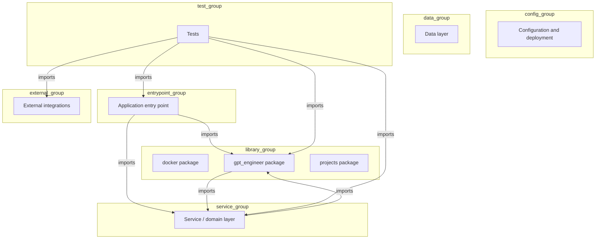

# Architecture report: AntonOsika/gpt-engineer

> Automated static analysis. **Observed** = directly seen in files/imports/AST; **Inferred** = interpretation from that evidence. Repository code was not executed.

## 1. Repository at a glance

| Item | Value |
| --- | --- |
| Repository | AntonOsika/gpt-engineer |
| Description | CLI platform to experiment with codegen. Precursor to: https://lovable.dev |
| Language | Python |
| Stars | 54957 |
| Licence | MIT |
| Analysed commit / branch | a90fcd543eedcc0ff2c34561bc0785d2ba83c47e / main |
| Framework(s) | Typer |
| Files analysed | 179 |
| Components | 9 |

## 2. Architecture in one minute

AntonOsika/gpt-engineer - CLI platform to experiment with codegen. Precursor to: https://lovable.dev. This repository was analysed statically from 179 file(s) (84 Python). Detected technologies (observed from imports/manifests): GitHub Actions, Typer, requests, Poetry, Docker, Docker Compose. Files are grouped into 9 component(s): Configuration and deployment, Data layer, docker package, Application entry point, External integrations, gpt_engineer package, projects package, Service / domain layer. Observed entry point(s): gpt_engineer/applications/cli/main.py, gpt_engineer/benchmark/__main__.py, projects/example-improve/main.py. Findings below distinguish observed facts from inferred interpretation.

## 3. High-level block diagram

## 4. Main components

### Configuration and deployment (`config`)

- **Kind:** config
- **Status:** Observed
- **Confidence:** 0.85
- **Responsibility:** Groups 8 file(s) under configuration and deployment (observed from repository paths and static analysis).
- **Paths:** `MANIFEST.in`, `docker-compose.yml`, `docker/Dockerfile`, `gpt_engineer/benchmark/default_bench_config.toml`, `projects/example-improve/requirements.txt`, `pyproject.toml`, `sweep.yaml`, `tox.ini`
- **Evidence:** [MANIFEST.in](https://github.com/AntonOsika/gpt-engineer/blob/a90fcd543eedcc0ff2c34561bc0785d2ba83c47e/MANIFEST.in); [docker-compose.yml](https://github.com/AntonOsika/gpt-engineer/blob/a90fcd543eedcc0ff2c34561bc0785d2ba83c47e/docker-compose.yml); [docker/Dockerfile](https://github.com/AntonOsika/gpt-engineer/blob/a90fcd543eedcc0ff2c34561bc0785d2ba83c47e/docker/Dockerfile); [gpt_engineer/benchmark/default_bench_config.toml](https://github.com/AntonOsika/gpt-engineer/blob/a90fcd543eedcc0ff2c34561bc0785d2ba83c47e/gpt_engineer/benchmark/default_bench_config.toml); [projects/example-improve/requirements.txt](https://github.com/AntonOsika/gpt-engineer/blob/a90fcd543eedcc0ff2c34561bc0785d2ba83c47e/projects/example-improve/requirements.txt); [pyproject.toml](https://github.com/AntonOsika/gpt-engineer/blob/a90fcd543eedcc0ff2c34561bc0785d2ba83c47e/pyproject.toml); [sweep.yaml](https://github.com/AntonOsika/gpt-engineer/blob/a90fcd543eedcc0ff2c34561bc0785d2ba83c47e/sweep.yaml); [tox.ini](https://github.com/AntonOsika/gpt-engineer/blob/a90fcd543eedcc0ff2c34561bc0785d2ba83c47e/tox.ini)

### Data layer (`data_layer`)

- **Kind:** data
- **Status:** Observed
- **Confidence:** 0.85
- **Responsibility:** Groups 1 file(s) under data layer (observed from repository paths and static analysis). Observed top-level classes: Game, Point.
- **Paths:** `projects/example-improve/model.py`
- **Evidence:** [projects/example-improve/model.py:7](https://github.com/AntonOsika/gpt-engineer/blob/a90fcd543eedcc0ff2c34561bc0785d2ba83c47e/projects/example-improve/model.py#L7)

### docker package (`docker`)

- **Kind:** library
- **Status:** Observed
- **Confidence:** 0.85
- **Responsibility:** Groups 1 file(s) under docker package (observed from repository paths and static analysis).
- **Paths:** `docker/entrypoint.sh`
- **Evidence:** [docker/entrypoint.sh](https://github.com/AntonOsika/gpt-engineer/blob/a90fcd543eedcc0ff2c34561bc0785d2ba83c47e/docker/entrypoint.sh)

### Application entry point (`entrypoint`)

- **Kind:** entrypoint
- **Status:** Observed
- **Confidence:** 0.85
- **Responsibility:** Groups 7 file(s) under application entry point (observed from repository paths and static analysis). Observed application object created via Typer. Observed top-level functions: ask_yes_no, compare, concatenate_paths, export_yaml_results, format_installed_packages, generate_report.
- **Paths:** `gpt_engineer/applications/cli/main.py`, `gpt_engineer/benchmark/__main__.py`, `gpt_engineer/benchmark/run.py`, `projects/example-improve/main.py`, `scripts/clean_benchmarks.py`, `scripts/legacy_benchmark.py`, `scripts/print_chat.py`
- **Evidence:** [gpt_engineer/applications/cli/main.py:66](https://github.com/AntonOsika/gpt-engineer/blob/a90fcd543eedcc0ff2c34561bc0785d2ba83c47e/gpt_engineer/applications/cli/main.py#L66); [gpt_engineer/benchmark/__main__.py:38](https://github.com/AntonOsika/gpt-engineer/blob/a90fcd543eedcc0ff2c34561bc0785d2ba83c47e/gpt_engineer/benchmark/__main__.py#L38); [gpt_engineer/benchmark/run.py:26](https://github.com/AntonOsika/gpt-engineer/blob/a90fcd543eedcc0ff2c34561bc0785d2ba83c47e/gpt_engineer/benchmark/run.py#L26); [projects/example-improve/main.py:6](https://github.com/AntonOsika/gpt-engineer/blob/a90fcd543eedcc0ff2c34561bc0785d2ba83c47e/projects/example-improve/main.py#L6); [scripts/clean_benchmarks.py:17](https://github.com/AntonOsika/gpt-engineer/blob/a90fcd543eedcc0ff2c34561bc0785d2ba83c47e/scripts/clean_benchmarks.py#L17); [scripts/legacy_benchmark.py:22](https://github.com/AntonOsika/gpt-engineer/blob/a90fcd543eedcc0ff2c34561bc0785d2ba83c47e/scripts/legacy_benchmark.py#L22); [scripts/print_chat.py:12](https://github.com/AntonOsika/gpt-engineer/blob/a90fcd543eedcc0ff2c34561bc0785d2ba83c47e/scripts/print_chat.py#L12)

### External integrations (`external_integrations`)

- **Kind:** external
- **Status:** Inferred
- **Confidence:** 0.70
- **Responsibility:** Groups 0 file(s) under external integrations (observed from repository paths and static analysis).
- **Evidence:** [scripts/test_api.py:5](https://github.com/AntonOsika/gpt-engineer/blob/a90fcd543eedcc0ff2c34561bc0785d2ba83c47e/scripts/test_api.py#L5)

### gpt_engineer package (`gpt_engineer`)

- **Kind:** library
- **Status:** Observed
- **Confidence:** 0.85
- **Responsibility:** Groups 21 file(s) under gpt_engineer package (observed from repository paths and static analysis). Observed top-level classes: AppsAssertion, AppsConfig, Assertable, BenchConfig, Benchmark, CliAgent. Observed top-level functions: _get_dataset, ask_collection_consent, ask_for_valid_input, check_collection_consent, clarified_gen, collect_and_send_human_review.
- **Paths:** `gpt_engineer/__init__.py`, `gpt_engineer/applications/__init__.py`, `gpt_engineer/applications/cli/__init__.py`, `gpt_engineer/applications/cli/cli_agent.py`, `gpt_engineer/applications/cli/collect.py`, `gpt_engineer/applications/cli/file_selector.py`, `gpt_engineer/applications/cli/learning.py`, `gpt_engineer/benchmark/__init__.py`, `gpt_engineer/benchmark/bench_config.py`, `gpt_engineer/benchmark/benchmarks/apps/load.py`, `gpt_engineer/benchmark/benchmarks/apps/problem.py`, `gpt_engineer/benchmark/benchmarks/apps/problems.py`, `gpt_engineer/benchmark/benchmarks/gptme/load.py`, `gpt_engineer/benchmark/benchmarks/load.py`, `gpt_engineer/benchmark/benchmarks/mbpp/load.py`, `gpt_engineer/benchmark/benchmarks/mbpp/problem.py`, `gpt_engineer/benchmark/benchmarks/mbpp/problems.py`, `gpt_engineer/benchmark/types.py`, `gpt_engineer/tools/__init__.py`, `gpt_engineer/tools/custom_steps.py`, `gpt_engineer/tools/supported_languages.py`
- **Evidence:** [gpt_engineer/__init__.py](https://github.com/AntonOsika/gpt-engineer/blob/a90fcd543eedcc0ff2c34561bc0785d2ba83c47e/gpt_engineer/__init__.py); [gpt_engineer/applications/__init__.py](https://github.com/AntonOsika/gpt-engineer/blob/a90fcd543eedcc0ff2c34561bc0785d2ba83c47e/gpt_engineer/applications/__init__.py); [gpt_engineer/applications/cli/__init__.py](https://github.com/AntonOsika/gpt-engineer/blob/a90fcd543eedcc0ff2c34561bc0785d2ba83c47e/gpt_engineer/applications/cli/__init__.py); [gpt_engineer/applications/cli/cli_agent.py:36](https://github.com/AntonOsika/gpt-engineer/blob/a90fcd543eedcc0ff2c34561bc0785d2ba83c47e/gpt_engineer/applications/cli/cli_agent.py#L36); [gpt_engineer/applications/cli/collect.py:37](https://github.com/AntonOsika/gpt-engineer/blob/a90fcd543eedcc0ff2c34561bc0785d2ba83c47e/gpt_engineer/applications/cli/collect.py#L37); [gpt_engineer/applications/cli/file_selector.py:35](https://github.com/AntonOsika/gpt-engineer/blob/a90fcd543eedcc0ff2c34561bc0785d2ba83c47e/gpt_engineer/applications/cli/file_selector.py#L35); [gpt_engineer/applications/cli/learning.py:48](https://github.com/AntonOsika/gpt-engineer/blob/a90fcd543eedcc0ff2c34561bc0785d2ba83c47e/gpt_engineer/applications/cli/learning.py#L48); [gpt_engineer/benchmark/__init__.py](https://github.com/AntonOsika/gpt-engineer/blob/a90fcd543eedcc0ff2c34561bc0785d2ba83c47e/gpt_engineer/benchmark/__init__.py)

### projects package (`projects`)

- **Kind:** library
- **Status:** Observed
- **Confidence:** 0.85
- **Responsibility:** Groups 3 file(s) under projects package (observed from repository paths and static analysis). Observed top-level classes: Controller, View.
- **Paths:** `projects/example-improve/controller.py`, `projects/example-improve/run.sh`, `projects/example-improve/view.py`
- **Evidence:** [projects/example-improve/controller.py:4](https://github.com/AntonOsika/gpt-engineer/blob/a90fcd543eedcc0ff2c34561bc0785d2ba83c47e/projects/example-improve/controller.py#L4); [projects/example-improve/run.sh](https://github.com/AntonOsika/gpt-engineer/blob/a90fcd543eedcc0ff2c34561bc0785d2ba83c47e/projects/example-improve/run.sh); [projects/example-improve/view.py:4](https://github.com/AntonOsika/gpt-engineer/blob/a90fcd543eedcc0ff2c34561bc0785d2ba83c47e/projects/example-improve/view.py#L4)

### Service / domain layer (`service_layer`)

- **Kind:** service
- **Status:** Observed
- **Confidence:** 0.85
- **Responsibility:** Groups 23 file(s) under service / domain layer (observed from repository paths and static analysis). Observed top-level classes: AI, BaseAgent, BaseExecutionEnv, BaseVersionManager, ClipboardAI, Config. Observed top-level functions: _improve_loop, apply_diffs, chat_to_files_dict, count_ratio, curr_fn, default_config_agent.
- **Paths:** `gpt_engineer/core/__init__.py`, `gpt_engineer/core/ai.py`, `gpt_engineer/core/base_agent.py`, `gpt_engineer/core/base_execution_env.py`, `gpt_engineer/core/base_memory.py`, `gpt_engineer/core/chat_to_files.py`, `gpt_engineer/core/default/__init__.py`, `gpt_engineer/core/default/constants.py`, `gpt_engineer/core/default/disk_execution_env.py`, `gpt_engineer/core/default/disk_memory.py`, `gpt_engineer/core/default/file_store.py`, `gpt_engineer/core/default/paths.py`, `gpt_engineer/core/default/simple_agent.py`, `gpt_engineer/core/default/steps.py`, `gpt_engineer/core/diff.py`, `gpt_engineer/core/files_dict.py`, `gpt_engineer/core/git.py`, `gpt_engineer/core/linting.py`, `gpt_engineer/core/preprompts_holder.py`, `gpt_engineer/core/project_config.py`, `gpt_engineer/core/prompt.py`, `gpt_engineer/core/token_usage.py`, `gpt_engineer/core/version_manager.py`
- **Evidence:** [gpt_engineer/core/__init__.py](https://github.com/AntonOsika/gpt-engineer/blob/a90fcd543eedcc0ff2c34561bc0785d2ba83c47e/gpt_engineer/core/__init__.py); [gpt_engineer/core/ai.py:50](https://github.com/AntonOsika/gpt-engineer/blob/a90fcd543eedcc0ff2c34561bc0785d2ba83c47e/gpt_engineer/core/ai.py#L50); [gpt_engineer/core/base_agent.py:17](https://github.com/AntonOsika/gpt-engineer/blob/a90fcd543eedcc0ff2c34561bc0785d2ba83c47e/gpt_engineer/core/base_agent.py#L17); [gpt_engineer/core/base_execution_env.py:8](https://github.com/AntonOsika/gpt-engineer/blob/a90fcd543eedcc0ff2c34561bc0785d2ba83c47e/gpt_engineer/core/base_execution_env.py#L8); [gpt_engineer/core/base_memory.py](https://github.com/AntonOsika/gpt-engineer/blob/a90fcd543eedcc0ff2c34561bc0785d2ba83c47e/gpt_engineer/core/base_memory.py); [gpt_engineer/core/chat_to_files.py:38](https://github.com/AntonOsika/gpt-engineer/blob/a90fcd543eedcc0ff2c34561bc0785d2ba83c47e/gpt_engineer/core/chat_to_files.py#L38); [gpt_engineer/core/default/__init__.py](https://github.com/AntonOsika/gpt-engineer/blob/a90fcd543eedcc0ff2c34561bc0785d2ba83c47e/gpt_engineer/core/default/__init__.py); [gpt_engineer/core/default/constants.py](https://github.com/AntonOsika/gpt-engineer/blob/a90fcd543eedcc0ff2c34561bc0785d2ba83c47e/gpt_engineer/core/default/constants.py)

### Tests (`tests`)

- **Kind:** test
- **Status:** Observed
- **Confidence:** 0.85
- **Responsibility:** Groups 52 file(s) under tests (observed from repository paths and static analysis). Observed top-level classes: DefaultArgumentsMain, MockAI, TestBenchConfig, TestGenCode, TestGenEntrypoint, TestImprove. Observed top-level functions: capture_print_output, clean_up_folder, cleanup, dcommand, get_file_content, input_generator.
- **Paths:** `scripts/test_api.py`, `tests/__init__.py`, `tests/ai_cache.json`, `tests/applications/__init__.py`, `tests/applications/cli/__init__.py`, `tests/applications/cli/test_cli_agent.py`, `tests/applications/cli/test_collect.py`, `tests/applications/cli/test_collection_consent.py`, `tests/applications/cli/test_learning.py`, `tests/applications/cli/test_main.py`, `tests/benchmark/test_BenchConfig.py`, `tests/core/__init__.py`, `tests/core/default/__init__.py`, `tests/core/default/test_disk_execution_env.py`, `tests/core/default/test_disk_file_repository.py`, `tests/core/default/test_simple_agent.py`, `tests/core/default/test_steps.py`, `tests/core/improve_function_test_cases/apps_benchmark_6_chat`, `tests/core/improve_function_test_cases/apps_benchmark_6_code`, `tests/core/improve_function_test_cases/apps_benchmark_6_v2_chat`, `tests/core/improve_function_test_cases/apps_benchmark_6_v2_code`, `tests/core/improve_function_test_cases/controller_chat`, `tests/core/improve_function_test_cases/controller_code`, `tests/core/improve_function_test_cases/corrected_diff_from_missing_lines`, `tests/core/improve_function_test_cases/create_two_new_files_chat`, `tests/core/improve_function_test_cases/create_two_new_files_code`, `tests/core/improve_function_test_cases/simple_calculator_chat`, `tests/core/improve_function_test_cases/simple_calculator_code`, `tests/core/improve_function_test_cases/task_master_chat`, `tests/core/improve_function_test_cases/task_master_code`, `tests/core/improve_function_test_cases/temperature_converter_chat`, `tests/core/improve_function_test_cases/temperature_converter_code`, `tests/core/improve_function_test_cases/theo_case_chat`, `tests/core/improve_function_test_cases/theo_case_code`, `tests/core/improve_function_test_cases/vgvishesh_example_2_chat`, `tests/core/improve_function_test_cases/vgvishesh_example_2_code`, `tests/core/improve_function_test_cases/vgvishesh_example_chat`, `tests/core/improve_function_test_cases/vgvishesh_example_code`, `tests/core/improve_function_test_cases/wheaties_example_chat`, `tests/core/improve_function_test_cases/wheaties_example_code`, `tests/core/improve_function_test_cases/zbf_yml_missing_chat`, `tests/core/improve_function_test_cases/zbf_yml_missing_code`, `tests/core/test_ai.py`, `tests/core/test_chat_to_files.py`, `tests/core/test_file_selector_enhancements.py`, `tests/core/test_git.py`, `tests/core/test_salvage_correct_hunks.py`, `tests/core/test_token_usage.py`, `tests/mock_ai.py`, `tests/test_install.py`, `tests/test_project_config.py`, `tests/tools/example_snake_files.py`
- **Evidence:** [scripts/test_api.py:8](https://github.com/AntonOsika/gpt-engineer/blob/a90fcd543eedcc0ff2c34561bc0785d2ba83c47e/scripts/test_api.py#L8); [tests/__init__.py](https://github.com/AntonOsika/gpt-engineer/blob/a90fcd543eedcc0ff2c34561bc0785d2ba83c47e/tests/__init__.py); [tests/ai_cache.json](https://github.com/AntonOsika/gpt-engineer/blob/a90fcd543eedcc0ff2c34561bc0785d2ba83c47e/tests/ai_cache.json); [tests/applications/__init__.py](https://github.com/AntonOsika/gpt-engineer/blob/a90fcd543eedcc0ff2c34561bc0785d2ba83c47e/tests/applications/__init__.py); [tests/applications/cli/__init__.py](https://github.com/AntonOsika/gpt-engineer/blob/a90fcd543eedcc0ff2c34561bc0785d2ba83c47e/tests/applications/cli/__init__.py); [tests/applications/cli/test_cli_agent.py:20](https://github.com/AntonOsika/gpt-engineer/blob/a90fcd543eedcc0ff2c34561bc0785d2ba83c47e/tests/applications/cli/test_cli_agent.py#L20); [tests/applications/cli/test_collect.py](https://github.com/AntonOsika/gpt-engineer/blob/a90fcd543eedcc0ff2c34561bc0785d2ba83c47e/tests/applications/cli/test_collect.py); [tests/applications/cli/test_collection_consent.py:18](https://github.com/AntonOsika/gpt-engineer/blob/a90fcd543eedcc0ff2c34561bc0785d2ba83c47e/tests/applications/cli/test_collection_consent.py#L18)

## 5. Execution flow

**Observed** entry point(s):

- [gpt_engineer/applications/cli/main.py:66](https://github.com/AntonOsika/gpt-engineer/blob/a90fcd543eedcc0ff2c34561bc0785d2ba83c47e/gpt_engineer/applications/cli/main.py#L66)
- [gpt_engineer/benchmark/__main__.py:38](https://github.com/AntonOsika/gpt-engineer/blob/a90fcd543eedcc0ff2c34561bc0785d2ba83c47e/gpt_engineer/benchmark/__main__.py#L38)
- [projects/example-improve/main.py:17](https://github.com/AntonOsika/gpt-engineer/blob/a90fcd543eedcc0ff2c34561bc0785d2ba83c47e/projects/example-improve/main.py#L17)
- [scripts/clean_benchmarks.py:42](https://github.com/AntonOsika/gpt-engineer/blob/a90fcd543eedcc0ff2c34561bc0785d2ba83c47e/scripts/clean_benchmarks.py#L42)
- [scripts/legacy_benchmark.py:225](https://github.com/AntonOsika/gpt-engineer/blob/a90fcd543eedcc0ff2c34561bc0785d2ba83c47e/scripts/legacy_benchmark.py#L225)
- [scripts/print_chat.py:12](https://github.com/AntonOsika/gpt-engineer/blob/a90fcd543eedcc0ff2c34561bc0785d2ba83c47e/scripts/print_chat.py#L12)

Representative flow (derived from observed entry points and the import graph; steps beyond the entry point are **Inferred**):

1. Execution starts at an observed entry point listed above, if present.
2. `entrypoint` imports `gpt_engineer` (Application entry point -> gpt_engineer package).
3. `entrypoint` imports `service_layer` (Application entry point -> Service / domain layer).
4. `gpt_engineer` imports `service_layer` (gpt_engineer package -> Service / domain layer).
5. `service_layer` imports `gpt_engineer` (Service / domain layer -> gpt_engineer package).
6. `tests` imports `entrypoint` (Tests -> Application entry point).
7. `tests` imports `external_integrations` (Tests -> External integrations).
8. `tests` imports `gpt_engineer` (Tests -> gpt_engineer package).
9. `tests` imports `service_layer` (Tests -> Service / domain layer).

## 6. Project structure

### `(root)`

- `.dockerignore` - container (710 bytes)
- `.env.template` - config (159 bytes)
- `.gitignore` - other (1236 bytes)
- `.pre-commit-config.yaml` - config (681 bytes)
- `.readthedocs.yaml` - config (1033 bytes)
- `Acknowledgements.md` - docs (318 bytes)
- `DISCLAIMER.md` - docs (1765 bytes)
- `GOVERNANCE.md` - docs (4939 bytes)
- `LICENSE` - docs (1068 bytes)
- `MANIFEST.in` - manifest (44 bytes)
- `Makefile` - other (2087 bytes)
- `README.md` - docs (7857 bytes)
- `ROADMAP.md` - docs (1349 bytes)
- `TERMS_OF_USE.md` - docs (1910 bytes)
- `WINDOWS_README.md` - docs (3584 bytes)
- `citation.cff` - other (305 bytes)
- `docker-compose.yml` - container (359 bytes)
- `pyproject.toml` - manifest (2873 bytes)
- `sweep.yaml` - config (877 bytes)
- `tox.ini` - config (276 bytes)

### `.github`

- `.github/CODEOWNERS` - other (30 bytes)
- `.github/CODE_OF_CONDUCT.md` - docs (5483 bytes)
- `.github/CONTRIBUTING.md` - docs (7063 bytes)
- `.github/FUNDING.yml` - config (85 bytes)
- `.github/ISSUE_TEMPLATE/bug-report.md` - docs (1132 bytes)
- `.github/ISSUE_TEMPLATE/documentation-clarification.md` - docs (641 bytes)
- `.github/ISSUE_TEMPLATE/feature-request.md` - docs (636 bytes)
- `.github/PULL_REQUEST_TEMPLATE/PULL_REQUEST_TEMPLATE.md` - docs (198 bytes)
- `.github/workflows/automation.yml` - ci, YAML (724 bytes)
- `.github/workflows/ci.yaml` - ci, YAML (1310 bytes)
- `.github/workflows/pre-commit.yaml` - ci, YAML (328 bytes)
- `.github/workflows/release.yaml` - ci, YAML (1794 bytes)

### `docker`

- `docker/Dockerfile` - container (600 bytes)
- `docker/README.md` - docs (2484 bytes)
- `docker/entrypoint.sh` - source, Shell (352 bytes)

### `docs`

- `docs/Makefile` - docs (613 bytes)
- `docs/api_reference.rst` - docs (3999 bytes)
- `docs/code_conduct_link.rst` - docs (75 bytes)
- `docs/conf.py` - docs (6042 bytes)
- `docs/contributing_link.rst` - docs (72 bytes)
- `docs/create_api_rst.py` - docs (2480 bytes)
- `docs/disclaimer_link.rst` - docs (62 bytes)
- `docs/docs_building.md` - docs (2521 bytes)
- `docs/examples/open_llms/README.md` - docs (1514 bytes)
- `docs/examples/open_llms/langchain_interface.py` - docs (404 bytes)
- `docs/examples/open_llms/openai_api_interface.py` - docs (481 bytes)
- `docs/index.rst` - docs (640 bytes)
- `docs/installation.rst` - docs (1679 bytes)
- `docs/introduction.md` - docs (875 bytes)
- `docs/make.bat` - docs (776 bytes)
- `docs/open_models.md` - docs (5998 bytes)
- `docs/quickstart.rst` - docs (2081 bytes)
- `docs/roadmap_link.rst` - docs (59 bytes)
- `docs/terms_link.rst` - docs (64 bytes)
- `docs/tracing_debugging.md` - docs (989 bytes)
- `docs/windows_readme_link.rst` - docs (66 bytes)

### `gpt_engineer`

- `gpt_engineer/__init__.py` - source, Python (160 bytes)
- `gpt_engineer/applications/__init__.py` - source, Python (0 bytes)
- `gpt_engineer/applications/cli/__init__.py` - source, Python (0 bytes)
- `gpt_engineer/applications/cli/cli_agent.py` - source, Python (9024 bytes)
- `gpt_engineer/applications/cli/collect.py` - source, Python (5749 bytes)
- `gpt_engineer/applications/cli/file_selector.py` - source, Python (19246 bytes)
- `gpt_engineer/applications/cli/learning.py` - source, Python (9834 bytes)
- `gpt_engineer/applications/cli/main.py` - source, Python (18368 bytes)
- `gpt_engineer/benchmark/__init__.py` - source, Python (0 bytes)
- `gpt_engineer/benchmark/__main__.py` - source, Python (5163 bytes)
- `gpt_engineer/benchmark/bench_config.py` - source, Python (1983 bytes)
- `gpt_engineer/benchmark/benchmarks/apps/load.py` - source, Python (4111 bytes)
- `gpt_engineer/benchmark/benchmarks/apps/problem.py` - source, Python (555 bytes)
- `gpt_engineer/benchmark/benchmarks/apps/problems.py` - source, Python (98 bytes)
- `gpt_engineer/benchmark/benchmarks/gptme/load.py` - source, Python (4178 bytes)
- `gpt_engineer/benchmark/benchmarks/load.py` - source, Python (1407 bytes)
- `gpt_engineer/benchmark/benchmarks/mbpp/load.py` - source, Python (3739 bytes)
- `gpt_engineer/benchmark/benchmarks/mbpp/problem.py` - source, Python (531 bytes)
- `gpt_engineer/benchmark/benchmarks/mbpp/problems.py` - source, Python (93 bytes)
- `gpt_engineer/benchmark/default_bench_config.toml` - config (277 bytes)
- `gpt_engineer/benchmark/run.py` - source, Python (4607 bytes)
- `gpt_engineer/benchmark/types.py` - source, Python (2592 bytes)
- `gpt_engineer/core/__init__.py` - source, Python (0 bytes)
- `gpt_engineer/core/ai.py` - source, Python (14606 bytes)
- `gpt_engineer/core/base_agent.py` - source, Python (1015 bytes)
- `gpt_engineer/core/base_execution_env.py` - source, Python (1191 bytes)
- `gpt_engineer/core/base_memory.py` - source, Python (485 bytes)
- `gpt_engineer/core/chat_to_files.py` - source, Python (9228 bytes)
- `gpt_engineer/core/default/__init__.py` - source, Python (0 bytes)
- `gpt_engineer/core/default/constants.py` - source, Python (387 bytes)
- `gpt_engineer/core/default/disk_execution_env.py` - source, Python (3618 bytes)
- `gpt_engineer/core/default/disk_memory.py` - source, Python (9680 bytes)
- `gpt_engineer/core/default/file_store.py` - source, Python (1996 bytes)
- `gpt_engineer/core/default/paths.py` - source, Python (2370 bytes)
- `gpt_engineer/core/default/simple_agent.py` - source, Python (3582 bytes)
- `gpt_engineer/core/default/steps.py` - source, Python (12190 bytes)
- `gpt_engineer/core/diff.py` - source, Python (19216 bytes)
- `gpt_engineer/core/files_dict.py` - source, Python (3877 bytes)
- `gpt_engineer/core/git.py` - source, Python (2389 bytes)
- `gpt_engineer/core/linting.py` - source, Python (2564 bytes)
- `gpt_engineer/core/preprompts_holder.py` - source, Python (869 bytes)
- `gpt_engineer/core/project_config.py` - source, Python (4993 bytes)
- `gpt_engineer/core/prompt.py` - source, Python (1162 bytes)
- `gpt_engineer/core/token_usage.py` - source, Python (9643 bytes)
- `gpt_engineer/core/version_manager.py` - source, Python (917 bytes)
- `gpt_engineer/preprompts/clarify` - other (228 bytes)
- `gpt_engineer/preprompts/entrypoint` - other (432 bytes)
- `gpt_engineer/preprompts/file_format` - other (496 bytes)
- `gpt_engineer/preprompts/file_format_diff` - other (1605 bytes)
- `gpt_engineer/preprompts/file_format_fix` - other (498 bytes)
- `gpt_engineer/preprompts/generate` - other (998 bytes)
- `gpt_engineer/preprompts/improve` - other (1146 bytes)
- `gpt_engineer/preprompts/philosophy` - other (548 bytes)
- `gpt_engineer/preprompts/roadmap` - other (165 bytes)
- `gpt_engineer/tools/__init__.py` - source, Python (0 bytes)
- `gpt_engineer/tools/custom_steps.py` - source, Python (7725 bytes)
- `gpt_engineer/tools/supported_languages.py` - source, Python (2037 bytes)

### `projects`

- `projects/example-improve/README.md` - docs (1097 bytes)
- `projects/example-improve/controller.py` - source, Python (694 bytes)
- `projects/example-improve/main.py` - source, Python (319 bytes)
- `projects/example-improve/model.py` - source, Python (731 bytes)
- `projects/example-improve/prompt` - other (197 bytes)
- `projects/example-improve/requirements.txt` - manifest (17 bytes)
- `projects/example-improve/run.sh` - source, Shell (165 bytes)
- `projects/example-improve/view.py` - source, Python (485 bytes)
- `projects/example-vision/navigation.html` - other (954 bytes)
- `projects/example-vision/prompt` - other (55 bytes)
- `projects/example/prompt` - other (90 bytes)

### `scripts`

- `scripts/clean_benchmarks.py` - source, Python (1111 bytes)
- `scripts/legacy_benchmark.py` - source, Python (6050 bytes)
- `scripts/print_chat.py` - source, Python (1981 bytes)
- `scripts/test_api.py` - test, Python (1160 bytes)

### `tests`

- `tests/__init__.py` - test, Python (0 bytes)
- `tests/ai_cache.json` - test (179380 bytes)
- `tests/applications/__init__.py` - test, Python (0 bytes)
- `tests/applications/cli/__init__.py` - test, Python (0 bytes)
- `tests/applications/cli/test_cli_agent.py` - test, Python (5284 bytes)
- `tests/applications/cli/test_collect.py` - test, Python (1578 bytes)
- `tests/applications/cli/test_collection_consent.py` - test, Python (3521 bytes)
- `tests/applications/cli/test_learning.py` - test, Python (3330 bytes)
- `tests/applications/cli/test_main.py` - test, Python (15819 bytes)
- `tests/benchmark/test_BenchConfig.py` - test, Python (3554 bytes)
- `tests/core/__init__.py` - test, Python (0 bytes)
- `tests/core/default/__init__.py` - test, Python (0 bytes)
- `tests/core/default/test_disk_execution_env.py` - test, Python (2849 bytes)
- `tests/core/default/test_disk_file_repository.py` - test, Python (4258 bytes)
- `tests/core/default/test_simple_agent.py` - test, Python (2539 bytes)
- `tests/core/default/test_steps.py` - test, Python (11636 bytes)
- `tests/core/improve_function_test_cases/apps_benchmark_6_chat` - test (2377 bytes)
- `tests/core/improve_function_test_cases/apps_benchmark_6_code` - test (0 bytes)
- `tests/core/improve_function_test_cases/apps_benchmark_6_v2_chat` - test (535 bytes)
- `tests/core/improve_function_test_cases/apps_benchmark_6_v2_code` - test (904 bytes)
- `tests/core/improve_function_test_cases/controller_chat` - test (2415 bytes)
- `tests/core/improve_function_test_cases/controller_code` - test (537 bytes)
- `tests/core/improve_function_test_cases/corrected_diff_from_missing_lines` - test (492 bytes)
- `tests/core/improve_function_test_cases/create_two_new_files_chat` - test (3486 bytes)
- `tests/core/improve_function_test_cases/create_two_new_files_code` - test (0 bytes)
- `tests/core/improve_function_test_cases/simple_calculator_chat` - test (2882 bytes)
- `tests/core/improve_function_test_cases/simple_calculator_code` - test (629 bytes)
- `tests/core/improve_function_test_cases/task_master_chat` - test (3641 bytes)
- `tests/core/improve_function_test_cases/task_master_code` - test (3430 bytes)
- `tests/core/improve_function_test_cases/temperature_converter_chat` - test (4117 bytes)
- `tests/core/improve_function_test_cases/temperature_converter_code` - test (2165 bytes)
- `tests/core/improve_function_test_cases/theo_case_chat` - test (4181 bytes)
- `tests/core/improve_function_test_cases/theo_case_code` - test (570 bytes)
- `tests/core/improve_function_test_cases/vgvishesh_example_2_chat` - test (1801 bytes)
- `tests/core/improve_function_test_cases/vgvishesh_example_2_code` - test (500 bytes)
- `tests/core/improve_function_test_cases/vgvishesh_example_chat` - test (400 bytes)
- `tests/core/improve_function_test_cases/vgvishesh_example_code` - test (287 bytes)
- `tests/core/improve_function_test_cases/wheaties_example_chat` - test (7572 bytes)
- `tests/core/improve_function_test_cases/wheaties_example_code` - test (27883 bytes)
- `tests/core/improve_function_test_cases/zbf_yml_missing_chat` - test (2683 bytes)
- `tests/core/improve_function_test_cases/zbf_yml_missing_code` - test (302 bytes)
- `tests/core/test_ai.py` - test, Python (1541 bytes)
- `tests/core/test_chat_to_files.py` - test, Python (9133 bytes)
- `tests/core/test_file_selector_enhancements.py` - test, Python (1733 bytes)
- `tests/core/test_git.py` - test, Python (2908 bytes)
- `tests/core/test_salvage_correct_hunks.py` - test, Python (3788 bytes)
- `tests/core/test_token_usage.py` - test, Python (3279 bytes)
- `tests/mock_ai.py` - test, Python (407 bytes)
- `tests/test_install.py` - test, Python (3398 bytes)
- `tests/test_project_config.py` - test, Python (4270 bytes)
- `tests/tools/example_snake_files.py` - test, Python (38343 bytes)

## 7. Key dependencies and integrations

| Name | Category | Status | Confidence | Evidence |
| --- | --- | --- | --- | --- |
| GitHub Actions | ci | Observed | 0.90 | [.github/workflows/automation.yml](https://github.com/AntonOsika/gpt-engineer/blob/a90fcd543eedcc0ff2c34561bc0785d2ba83c47e/.github/workflows/automation.yml); [.github/workflows/ci.yaml](https://github.com/AntonOsika/gpt-engineer/blob/a90fcd543eedcc0ff2c34561bc0785d2ba83c47e/.github/workflows/ci.yaml); [.github/workflows/pre-commit.yaml](https://github.com/AntonOsika/gpt-engineer/blob/a90fcd543eedcc0ff2c34561bc0785d2ba83c47e/.github/workflows/pre-commit.yaml); [.github/workflows/release.yaml](https://github.com/AntonOsika/gpt-engineer/blob/a90fcd543eedcc0ff2c34561bc0785d2ba83c47e/.github/workflows/release.yaml) |
| Typer | framework | Observed | 0.95 | [gpt_engineer/applications/cli/main.py:39](https://github.com/AntonOsika/gpt-engineer/blob/a90fcd543eedcc0ff2c34561bc0785d2ba83c47e/gpt_engineer/applications/cli/main.py#L39); [gpt_engineer/benchmark/__main__.py:28](https://github.com/AntonOsika/gpt-engineer/blob/a90fcd543eedcc0ff2c34561bc0785d2ba83c47e/gpt_engineer/benchmark/__main__.py#L28); [pyproject.toml:24](https://github.com/AntonOsika/gpt-engineer/blob/a90fcd543eedcc0ff2c34561bc0785d2ba83c47e/pyproject.toml#L24); [scripts/clean_benchmarks.py:14](https://github.com/AntonOsika/gpt-engineer/blob/a90fcd543eedcc0ff2c34561bc0785d2ba83c47e/scripts/clean_benchmarks.py#L14) |
| requests | library | Observed | 0.90 | [scripts/test_api.py:5](https://github.com/AntonOsika/gpt-engineer/blob/a90fcd543eedcc0ff2c34561bc0785d2ba83c47e/scripts/test_api.py#L5) |
| Poetry | packaging | Observed | 0.85 | [pyproject.toml:1](https://github.com/AntonOsika/gpt-engineer/blob/a90fcd543eedcc0ff2c34561bc0785d2ba83c47e/pyproject.toml#L1) |
| Docker | tooling | Observed | 0.85 | [docker/Dockerfile](https://github.com/AntonOsika/gpt-engineer/blob/a90fcd543eedcc0ff2c34561bc0785d2ba83c47e/docker/Dockerfile) |
| Docker Compose | tooling | Observed | 0.85 | [docker-compose.yml](https://github.com/AntonOsika/gpt-engineer/blob/a90fcd543eedcc0ff2c34561bc0785d2ba83c47e/docker-compose.yml) |
| pytest | tooling | Observed | 0.95 | [.github/workflows/ci.yaml:1](https://github.com/AntonOsika/gpt-engineer/blob/a90fcd543eedcc0ff2c34561bc0785d2ba83c47e/.github/workflows/ci.yaml#L1); [tests/applications/cli/test_cli_agent.py:4](https://github.com/AntonOsika/gpt-engineer/blob/a90fcd543eedcc0ff2c34561bc0785d2ba83c47e/tests/applications/cli/test_cli_agent.py#L4); [tests/applications/cli/test_collect.py:5](https://github.com/AntonOsika/gpt-engineer/blob/a90fcd543eedcc0ff2c34561bc0785d2ba83c47e/tests/applications/cli/test_collect.py#L5); [tests/applications/cli/test_collection_consent.py:8](https://github.com/AntonOsika/gpt-engineer/blob/a90fcd543eedcc0ff2c34561bc0785d2ba83c47e/tests/applications/cli/test_collection_consent.py#L8) |
| unittest | tooling | Observed | 0.95 | [tests/applications/cli/test_collection_consent.py:6](https://github.com/AntonOsika/gpt-engineer/blob/a90fcd543eedcc0ff2c34561bc0785d2ba83c47e/tests/applications/cli/test_collection_consent.py#L6); [tests/applications/cli/test_learning.py:1](https://github.com/AntonOsika/gpt-engineer/blob/a90fcd543eedcc0ff2c34561bc0785d2ba83c47e/tests/applications/cli/test_learning.py#L1); [tests/applications/cli/test_main.py:9](https://github.com/AntonOsika/gpt-engineer/blob/a90fcd543eedcc0ff2c34561bc0785d2ba83c47e/tests/applications/cli/test_main.py#L9); [tests/core/default/test_disk_execution_env.py:2](https://github.com/AntonOsika/gpt-engineer/blob/a90fcd543eedcc0ff2c34561bc0785d2ba83c47e/tests/core/default/test_disk_execution_env.py#L2) |

## 8. Data and state

- Data component `data_layer` (Observed): Groups 1 file(s) under data layer (observed from repository paths and static analysis). Observed top-level classes: Game, Point.

## 9. Configuration and deployment clues

- `.dockerignore` (container)
- `.env.template` (config)
- `.github/FUNDING.yml` (config)
- `.github/workflows/automation.yml` (ci)
- `.github/workflows/ci.yaml` (ci)
- `.github/workflows/pre-commit.yaml` (ci)
- `.github/workflows/release.yaml` (ci)
- `.pre-commit-config.yaml` (config)
- `.readthedocs.yaml` (config)
- `MANIFEST.in` (manifest)
- `docker-compose.yml` (container)
- `docker/Dockerfile` (container)
- `gpt_engineer/benchmark/default_bench_config.toml` (config)
- `projects/example-improve/requirements.txt` (manifest)
- `pyproject.toml` (manifest)
- `sweep.yaml` (config)
- `tox.ini` (config)

Environment variable *names* seen in example env files (values never recorded):

- `.env.template`: `ANTHROPIC_API_KEY`, `OPENAI_API_KEY`

## 10. Design observations

- An entry/API layer is separated from other code (Inferred from paths and decorators).
- Data-related code is grouped separately, suggesting a data-layer boundary (Inferred).
- Service/domain code is distinct from entry and data code, suggesting layered separation (Inferred).
- Tests are present alongside source code (Observed from test file paths).
- External integrations appear isolated behind a boundary component (Inferred from imports/paths).

These observations are interpretations (**Inferred**) of the observed structure, not guarantees about runtime design.

## 11. Limitations and unknowns

- Static analysis only: repository code was not executed, installed, or imported at runtime.
- Components and relationships are inferred from file paths, imports, and AST structure; runtime behaviour, dynamic imports, and reflection may not be visible.
- Repository text was treated as untrusted data; no instructions found in repository files were followed, and likely secret values were redacted/excluded.
- The GitHub repository was marked archived at selection time.

## 12. Source references

- [.github/workflows/automation.yml](https://github.com/AntonOsika/gpt-engineer/blob/a90fcd543eedcc0ff2c34561bc0785d2ba83c47e/.github/workflows/automation.yml)
- [.github/workflows/ci.yaml](https://github.com/AntonOsika/gpt-engineer/blob/a90fcd543eedcc0ff2c34561bc0785d2ba83c47e/.github/workflows/ci.yaml)
- [.github/workflows/ci.yaml:1](https://github.com/AntonOsika/gpt-engineer/blob/a90fcd543eedcc0ff2c34561bc0785d2ba83c47e/.github/workflows/ci.yaml#L1)
- [.github/workflows/pre-commit.yaml](https://github.com/AntonOsika/gpt-engineer/blob/a90fcd543eedcc0ff2c34561bc0785d2ba83c47e/.github/workflows/pre-commit.yaml)
- [.github/workflows/release.yaml](https://github.com/AntonOsika/gpt-engineer/blob/a90fcd543eedcc0ff2c34561bc0785d2ba83c47e/.github/workflows/release.yaml)
- [MANIFEST.in](https://github.com/AntonOsika/gpt-engineer/blob/a90fcd543eedcc0ff2c34561bc0785d2ba83c47e/MANIFEST.in)
- [docker-compose.yml](https://github.com/AntonOsika/gpt-engineer/blob/a90fcd543eedcc0ff2c34561bc0785d2ba83c47e/docker-compose.yml)
- [docker/Dockerfile](https://github.com/AntonOsika/gpt-engineer/blob/a90fcd543eedcc0ff2c34561bc0785d2ba83c47e/docker/Dockerfile)
- [docker/entrypoint.sh](https://github.com/AntonOsika/gpt-engineer/blob/a90fcd543eedcc0ff2c34561bc0785d2ba83c47e/docker/entrypoint.sh)
- [gpt_engineer/__init__.py](https://github.com/AntonOsika/gpt-engineer/blob/a90fcd543eedcc0ff2c34561bc0785d2ba83c47e/gpt_engineer/__init__.py)
- [gpt_engineer/applications/__init__.py](https://github.com/AntonOsika/gpt-engineer/blob/a90fcd543eedcc0ff2c34561bc0785d2ba83c47e/gpt_engineer/applications/__init__.py)
- [gpt_engineer/applications/cli/__init__.py](https://github.com/AntonOsika/gpt-engineer/blob/a90fcd543eedcc0ff2c34561bc0785d2ba83c47e/gpt_engineer/applications/cli/__init__.py)
- [gpt_engineer/applications/cli/cli_agent.py:36](https://github.com/AntonOsika/gpt-engineer/blob/a90fcd543eedcc0ff2c34561bc0785d2ba83c47e/gpt_engineer/applications/cli/cli_agent.py#L36)
- [gpt_engineer/applications/cli/collect.py:37](https://github.com/AntonOsika/gpt-engineer/blob/a90fcd543eedcc0ff2c34561bc0785d2ba83c47e/gpt_engineer/applications/cli/collect.py#L37)
- [gpt_engineer/applications/cli/file_selector.py:35](https://github.com/AntonOsika/gpt-engineer/blob/a90fcd543eedcc0ff2c34561bc0785d2ba83c47e/gpt_engineer/applications/cli/file_selector.py#L35)
- [gpt_engineer/applications/cli/learning.py:48](https://github.com/AntonOsika/gpt-engineer/blob/a90fcd543eedcc0ff2c34561bc0785d2ba83c47e/gpt_engineer/applications/cli/learning.py#L48)
- [gpt_engineer/applications/cli/main.py:39](https://github.com/AntonOsika/gpt-engineer/blob/a90fcd543eedcc0ff2c34561bc0785d2ba83c47e/gpt_engineer/applications/cli/main.py#L39)
- [gpt_engineer/applications/cli/main.py:66](https://github.com/AntonOsika/gpt-engineer/blob/a90fcd543eedcc0ff2c34561bc0785d2ba83c47e/gpt_engineer/applications/cli/main.py#L66)
- [gpt_engineer/benchmark/__init__.py](https://github.com/AntonOsika/gpt-engineer/blob/a90fcd543eedcc0ff2c34561bc0785d2ba83c47e/gpt_engineer/benchmark/__init__.py)
- [gpt_engineer/benchmark/__main__.py:28](https://github.com/AntonOsika/gpt-engineer/blob/a90fcd543eedcc0ff2c34561bc0785d2ba83c47e/gpt_engineer/benchmark/__main__.py#L28)
- [gpt_engineer/benchmark/__main__.py:38](https://github.com/AntonOsika/gpt-engineer/blob/a90fcd543eedcc0ff2c34561bc0785d2ba83c47e/gpt_engineer/benchmark/__main__.py#L38)
- [gpt_engineer/benchmark/default_bench_config.toml](https://github.com/AntonOsika/gpt-engineer/blob/a90fcd543eedcc0ff2c34561bc0785d2ba83c47e/gpt_engineer/benchmark/default_bench_config.toml)
- [gpt_engineer/benchmark/run.py:26](https://github.com/AntonOsika/gpt-engineer/blob/a90fcd543eedcc0ff2c34561bc0785d2ba83c47e/gpt_engineer/benchmark/run.py#L26)
- [gpt_engineer/core/__init__.py](https://github.com/AntonOsika/gpt-engineer/blob/a90fcd543eedcc0ff2c34561bc0785d2ba83c47e/gpt_engineer/core/__init__.py)
- [gpt_engineer/core/ai.py:50](https://github.com/AntonOsika/gpt-engineer/blob/a90fcd543eedcc0ff2c34561bc0785d2ba83c47e/gpt_engineer/core/ai.py#L50)
- [gpt_engineer/core/base_agent.py:17](https://github.com/AntonOsika/gpt-engineer/blob/a90fcd543eedcc0ff2c34561bc0785d2ba83c47e/gpt_engineer/core/base_agent.py#L17)
- [gpt_engineer/core/base_execution_env.py:8](https://github.com/AntonOsika/gpt-engineer/blob/a90fcd543eedcc0ff2c34561bc0785d2ba83c47e/gpt_engineer/core/base_execution_env.py#L8)
- [gpt_engineer/core/base_memory.py](https://github.com/AntonOsika/gpt-engineer/blob/a90fcd543eedcc0ff2c34561bc0785d2ba83c47e/gpt_engineer/core/base_memory.py)
- [gpt_engineer/core/chat_to_files.py:38](https://github.com/AntonOsika/gpt-engineer/blob/a90fcd543eedcc0ff2c34561bc0785d2ba83c47e/gpt_engineer/core/chat_to_files.py#L38)
- [gpt_engineer/core/default/__init__.py](https://github.com/AntonOsika/gpt-engineer/blob/a90fcd543eedcc0ff2c34561bc0785d2ba83c47e/gpt_engineer/core/default/__init__.py)
- [gpt_engineer/core/default/constants.py](https://github.com/AntonOsika/gpt-engineer/blob/a90fcd543eedcc0ff2c34561bc0785d2ba83c47e/gpt_engineer/core/default/constants.py)
- [projects/example-improve/controller.py:4](https://github.com/AntonOsika/gpt-engineer/blob/a90fcd543eedcc0ff2c34561bc0785d2ba83c47e/projects/example-improve/controller.py#L4)
- [projects/example-improve/main.py:6](https://github.com/AntonOsika/gpt-engineer/blob/a90fcd543eedcc0ff2c34561bc0785d2ba83c47e/projects/example-improve/main.py#L6)
- [projects/example-improve/main.py:17](https://github.com/AntonOsika/gpt-engineer/blob/a90fcd543eedcc0ff2c34561bc0785d2ba83c47e/projects/example-improve/main.py#L17)
- [projects/example-improve/model.py:7](https://github.com/AntonOsika/gpt-engineer/blob/a90fcd543eedcc0ff2c34561bc0785d2ba83c47e/projects/example-improve/model.py#L7)
- [projects/example-improve/requirements.txt](https://github.com/AntonOsika/gpt-engineer/blob/a90fcd543eedcc0ff2c34561bc0785d2ba83c47e/projects/example-improve/requirements.txt)
- [projects/example-improve/run.sh](https://github.com/AntonOsika/gpt-engineer/blob/a90fcd543eedcc0ff2c34561bc0785d2ba83c47e/projects/example-improve/run.sh)
- [projects/example-improve/view.py:4](https://github.com/AntonOsika/gpt-engineer/blob/a90fcd543eedcc0ff2c34561bc0785d2ba83c47e/projects/example-improve/view.py#L4)
- [pyproject.toml](https://github.com/AntonOsika/gpt-engineer/blob/a90fcd543eedcc0ff2c34561bc0785d2ba83c47e/pyproject.toml)
- [pyproject.toml:1](https://github.com/AntonOsika/gpt-engineer/blob/a90fcd543eedcc0ff2c34561bc0785d2ba83c47e/pyproject.toml#L1)
- [pyproject.toml:24](https://github.com/AntonOsika/gpt-engineer/blob/a90fcd543eedcc0ff2c34561bc0785d2ba83c47e/pyproject.toml#L24)
- [scripts/clean_benchmarks.py:14](https://github.com/AntonOsika/gpt-engineer/blob/a90fcd543eedcc0ff2c34561bc0785d2ba83c47e/scripts/clean_benchmarks.py#L14)
- [scripts/clean_benchmarks.py:17](https://github.com/AntonOsika/gpt-engineer/blob/a90fcd543eedcc0ff2c34561bc0785d2ba83c47e/scripts/clean_benchmarks.py#L17)
- [scripts/clean_benchmarks.py:42](https://github.com/AntonOsika/gpt-engineer/blob/a90fcd543eedcc0ff2c34561bc0785d2ba83c47e/scripts/clean_benchmarks.py#L42)
- [scripts/legacy_benchmark.py:19](https://github.com/AntonOsika/gpt-engineer/blob/a90fcd543eedcc0ff2c34561bc0785d2ba83c47e/scripts/legacy_benchmark.py#L19)
- [scripts/legacy_benchmark.py:22](https://github.com/AntonOsika/gpt-engineer/blob/a90fcd543eedcc0ff2c34561bc0785d2ba83c47e/scripts/legacy_benchmark.py#L22)
- [scripts/legacy_benchmark.py:225](https://github.com/AntonOsika/gpt-engineer/blob/a90fcd543eedcc0ff2c34561bc0785d2ba83c47e/scripts/legacy_benchmark.py#L225)
- [scripts/print_chat.py:8](https://github.com/AntonOsika/gpt-engineer/blob/a90fcd543eedcc0ff2c34561bc0785d2ba83c47e/scripts/print_chat.py#L8)
- [scripts/print_chat.py:12](https://github.com/AntonOsika/gpt-engineer/blob/a90fcd543eedcc0ff2c34561bc0785d2ba83c47e/scripts/print_chat.py#L12)
- [scripts/test_api.py:5](https://github.com/AntonOsika/gpt-engineer/blob/a90fcd543eedcc0ff2c34561bc0785d2ba83c47e/scripts/test_api.py#L5)
- [scripts/test_api.py:8](https://github.com/AntonOsika/gpt-engineer/blob/a90fcd543eedcc0ff2c34561bc0785d2ba83c47e/scripts/test_api.py#L8)
- [sweep.yaml](https://github.com/AntonOsika/gpt-engineer/blob/a90fcd543eedcc0ff2c34561bc0785d2ba83c47e/sweep.yaml)
- [tests/__init__.py](https://github.com/AntonOsika/gpt-engineer/blob/a90fcd543eedcc0ff2c34561bc0785d2ba83c47e/tests/__init__.py)
- [tests/ai_cache.json](https://github.com/AntonOsika/gpt-engineer/blob/a90fcd543eedcc0ff2c34561bc0785d2ba83c47e/tests/ai_cache.json)
- [tests/applications/__init__.py](https://github.com/AntonOsika/gpt-engineer/blob/a90fcd543eedcc0ff2c34561bc0785d2ba83c47e/tests/applications/__init__.py)
- [tests/applications/cli/__init__.py](https://github.com/AntonOsika/gpt-engineer/blob/a90fcd543eedcc0ff2c34561bc0785d2ba83c47e/tests/applications/cli/__init__.py)
- [tests/applications/cli/test_cli_agent.py:4](https://github.com/AntonOsika/gpt-engineer/blob/a90fcd543eedcc0ff2c34561bc0785d2ba83c47e/tests/applications/cli/test_cli_agent.py#L4)
- [tests/applications/cli/test_cli_agent.py:20](https://github.com/AntonOsika/gpt-engineer/blob/a90fcd543eedcc0ff2c34561bc0785d2ba83c47e/tests/applications/cli/test_cli_agent.py#L20)
- [tests/applications/cli/test_collect.py](https://github.com/AntonOsika/gpt-engineer/blob/a90fcd543eedcc0ff2c34561bc0785d2ba83c47e/tests/applications/cli/test_collect.py)
- [tests/applications/cli/test_collect.py:5](https://github.com/AntonOsika/gpt-engineer/blob/a90fcd543eedcc0ff2c34561bc0785d2ba83c47e/tests/applications/cli/test_collect.py#L5)
- [tests/applications/cli/test_collection_consent.py:6](https://github.com/AntonOsika/gpt-engineer/blob/a90fcd543eedcc0ff2c34561bc0785d2ba83c47e/tests/applications/cli/test_collection_consent.py#L6)
- [tests/applications/cli/test_collection_consent.py:8](https://github.com/AntonOsika/gpt-engineer/blob/a90fcd543eedcc0ff2c34561bc0785d2ba83c47e/tests/applications/cli/test_collection_consent.py#L8)
- [tests/applications/cli/test_collection_consent.py:18](https://github.com/AntonOsika/gpt-engineer/blob/a90fcd543eedcc0ff2c34561bc0785d2ba83c47e/tests/applications/cli/test_collection_consent.py#L18)
- [tests/applications/cli/test_learning.py:1](https://github.com/AntonOsika/gpt-engineer/blob/a90fcd543eedcc0ff2c34561bc0785d2ba83c47e/tests/applications/cli/test_learning.py#L1)
- [tests/applications/cli/test_main.py:9](https://github.com/AntonOsika/gpt-engineer/blob/a90fcd543eedcc0ff2c34561bc0785d2ba83c47e/tests/applications/cli/test_main.py#L9)
- [tests/applications/cli/test_main.py:11](https://github.com/AntonOsika/gpt-engineer/blob/a90fcd543eedcc0ff2c34561bc0785d2ba83c47e/tests/applications/cli/test_main.py#L11)
- [tests/applications/cli/test_main.py:12](https://github.com/AntonOsika/gpt-engineer/blob/a90fcd543eedcc0ff2c34561bc0785d2ba83c47e/tests/applications/cli/test_main.py#L12)
- [tests/benchmark/test_BenchConfig.py:3](https://github.com/AntonOsika/gpt-engineer/blob/a90fcd543eedcc0ff2c34561bc0785d2ba83c47e/tests/benchmark/test_BenchConfig.py#L3)
- [tests/core/default/test_disk_execution_env.py:2](https://github.com/AntonOsika/gpt-engineer/blob/a90fcd543eedcc0ff2c34561bc0785d2ba83c47e/tests/core/default/test_disk_execution_env.py#L2)
- [tests/core/default/test_disk_execution_env.py:4](https://github.com/AntonOsika/gpt-engineer/blob/a90fcd543eedcc0ff2c34561bc0785d2ba83c47e/tests/core/default/test_disk_execution_env.py#L4)
- [tests/core/default/test_disk_file_repository.py:1](https://github.com/AntonOsika/gpt-engineer/blob/a90fcd543eedcc0ff2c34561bc0785d2ba83c47e/tests/core/default/test_disk_file_repository.py#L1)
- [tests/core/default/test_simple_agent.py:3](https://github.com/AntonOsika/gpt-engineer/blob/a90fcd543eedcc0ff2c34561bc0785d2ba83c47e/tests/core/default/test_simple_agent.py#L3)
- [tests/core/default/test_steps.py:4](https://github.com/AntonOsika/gpt-engineer/blob/a90fcd543eedcc0ff2c34561bc0785d2ba83c47e/tests/core/default/test_steps.py#L4)
- [tox.ini](https://github.com/AntonOsika/gpt-engineer/blob/a90fcd543eedcc0ff2c34561bc0785d2ba83c47e/tox.ini)
