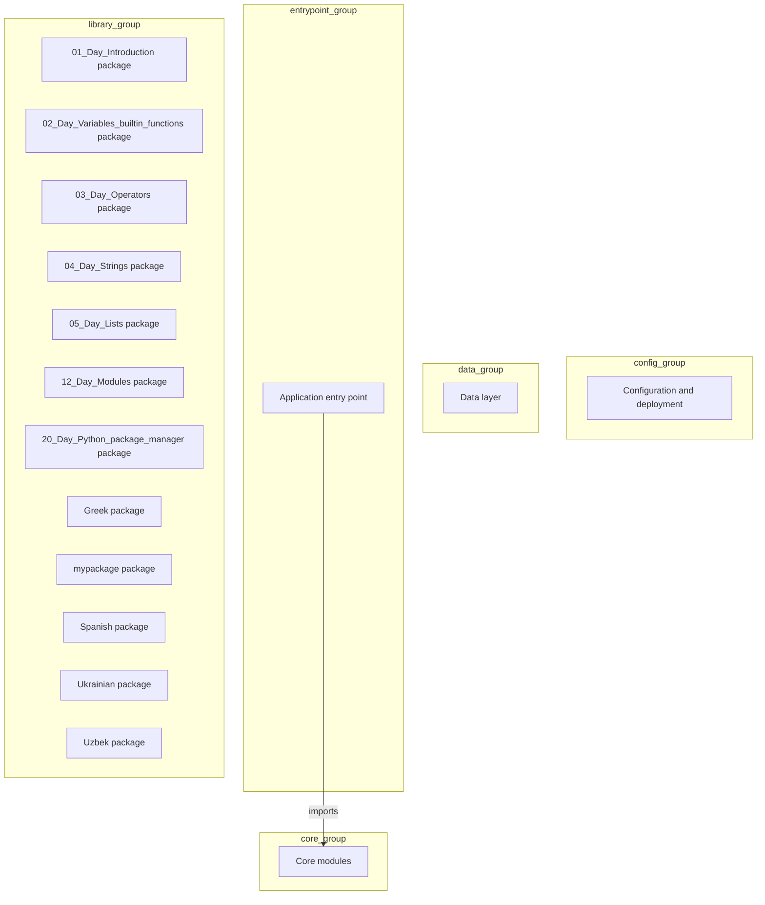

# Architecture report: Asabeneh/30-Days-Of-Python

> Automated static analysis. **Observed** = directly seen in files/imports/AST; **Inferred** = interpretation from that evidence. Repository code was not executed.

## 1. Repository at a glance

| Item | Value |
| --- | --- |
| Repository | Asabeneh/30-Days-Of-Python |
| Description | The 30 Days of Python programming challenge is a step-by-step guide to learn the Python programming language in 30 days. This challenge may take more than 100 days. Follow your own pace. These videos may help too: https://www.youtube.com/channel/UC7PNRuno1rzYPb1xLa4yktw |
| Language | Python |
| Stars | 78746 |
| Licence | Not detected |
| Analysed commit / branch | 50c11a80a6e3924a7be58c89f409697e12cb4d70 / master |
| Framework(s) | Flask |
| Files analysed | 359 |
| Components | 16 |

## 2. Architecture in one minute

Asabeneh/30-Days-Of-Python - The 30 Days of Python programming challenge is a step-by-step guide to learn the Python programming language in 30 days. This challenge may take more than 100 days. Follow your own pace. These videos…. This repository was analysed statically from 359 file(s) (33 Python). Detected technologies (observed from imports/manifests): Flask, Click. Files are grouped into 16 component(s): 01_Day_Introduction package, 02_Day_Variables_builtin_functions package, 03_Day_Operators package, 04_Day_Strings package, 05_Day_Lists package, 12_Day_Modules package, 20_Day_Python_package_manager package, Configuration and deployment. Observed entry point(s): python_for_web/app.py. Findings below distinguish observed facts from inferred interpretation.

## 3. High-level block diagram

## 4. Main components

### 01_Day_Introduction package (`c_01_day_introduction`)

- **Kind:** library
- **Status:** Observed
- **Confidence:** 0.85
- **Responsibility:** Groups 1 file(s) under 01_day_introduction package (observed from repository paths and static analysis).
- **Paths:** `01_Day_Introduction/helloworld.py`
- **Evidence:** [01_Day_Introduction/helloworld.py](https://github.com/Asabeneh/30-Days-Of-Python/blob/50c11a80a6e3924a7be58c89f409697e12cb4d70/01_Day_Introduction/helloworld.py)

### 02_Day_Variables_builtin_functions package (`c_02_day_variables_builtin_functions`)

- **Kind:** library
- **Status:** Observed
- **Confidence:** 0.85
- **Responsibility:** Groups 1 file(s) under 02_day_variables_builtin_functions package (observed from repository paths and static analysis).
- **Paths:** `02_Day_Variables_builtin_functions/variables.py`
- **Evidence:** [02_Day_Variables_builtin_functions/variables.py](https://github.com/Asabeneh/30-Days-Of-Python/blob/50c11a80a6e3924a7be58c89f409697e12cb4d70/02_Day_Variables_builtin_functions/variables.py)

### 03_Day_Operators package (`c_03_day_operators`)

- **Kind:** library
- **Status:** Observed
- **Confidence:** 0.85
- **Responsibility:** Groups 1 file(s) under 03_day_operators package (observed from repository paths and static analysis).
- **Paths:** `03_Day_Operators/day-3.py`
- **Evidence:** [03_Day_Operators/day-3.py](https://github.com/Asabeneh/30-Days-Of-Python/blob/50c11a80a6e3924a7be58c89f409697e12cb4d70/03_Day_Operators/day-3.py)

### 04_Day_Strings package (`c_04_day_strings`)

- **Kind:** library
- **Status:** Observed
- **Confidence:** 0.85
- **Responsibility:** Groups 1 file(s) under 04_day_strings package (observed from repository paths and static analysis).
- **Paths:** `04_Day_Strings/day_4.py`
- **Evidence:** [04_Day_Strings/day_4.py](https://github.com/Asabeneh/30-Days-Of-Python/blob/50c11a80a6e3924a7be58c89f409697e12cb4d70/04_Day_Strings/day_4.py)

### 05_Day_Lists package (`c_05_day_lists`)

- **Kind:** library
- **Status:** Observed
- **Confidence:** 0.85
- **Responsibility:** Groups 1 file(s) under 05_day_lists package (observed from repository paths and static analysis).
- **Paths:** `05_Day_Lists/day_5.py`
- **Evidence:** [05_Day_Lists/day_5.py](https://github.com/Asabeneh/30-Days-Of-Python/blob/50c11a80a6e3924a7be58c89f409697e12cb4d70/05_Day_Lists/day_5.py)

### 12_Day_Modules package (`c_12_day_modules`)

- **Kind:** library
- **Status:** Observed
- **Confidence:** 0.85
- **Responsibility:** Groups 1 file(s) under 12_day_modules package (observed from repository paths and static analysis). Observed top-level functions: generate_full_name, sum_two_nums.
- **Paths:** `12_Day_Modules/mymodule.py`
- **Evidence:** [12_Day_Modules/mymodule.py:1](https://github.com/Asabeneh/30-Days-Of-Python/blob/50c11a80a6e3924a7be58c89f409697e12cb4d70/12_Day_Modules/mymodule.py#L1)

### 20_Day_Python_package_manager package (`c_20_day_python_package_manager`)

- **Kind:** library
- **Status:** Observed
- **Confidence:** 0.85
- **Responsibility:** Groups 3 file(s) under 20_day_python_package_manager package (observed from repository paths and static analysis). Observed top-level functions: add_numbers, division, greet_person, multiple, power, remainder.
- **Paths:** `20_Day_Python_package_manager/__init__.py`, `20_Day_Python_package_manager/arithmetic.py`, `20_Day_Python_package_manager/greet.py`
- **Evidence:** [20_Day_Python_package_manager/__init__.py](https://github.com/Asabeneh/30-Days-Of-Python/blob/50c11a80a6e3924a7be58c89f409697e12cb4d70/20_Day_Python_package_manager/__init__.py); [20_Day_Python_package_manager/arithmetic.py:1](https://github.com/Asabeneh/30-Days-Of-Python/blob/50c11a80a6e3924a7be58c89f409697e12cb4d70/20_Day_Python_package_manager/arithmetic.py#L1); [20_Day_Python_package_manager/greet.py:1](https://github.com/Asabeneh/30-Days-Of-Python/blob/50c11a80a6e3924a7be58c89f409697e12cb4d70/20_Day_Python_package_manager/greet.py#L1)

### Configuration and deployment (`config`)

- **Kind:** config
- **Status:** Observed
- **Confidence:** 0.85
- **Responsibility:** Groups 5 file(s) under configuration and deployment (observed from repository paths and static analysis).
- **Paths:** `22_Day_Web_scraping/scrapped_data.json`, `data/cats.json`, `data/countries_data.json`, `files/json_example.json`, `python_for_web/requirements.txt`
- **Evidence:** [22_Day_Web_scraping/scrapped_data.json](https://github.com/Asabeneh/30-Days-Of-Python/blob/50c11a80a6e3924a7be58c89f409697e12cb4d70/22_Day_Web_scraping/scrapped_data.json); [data/cats.json](https://github.com/Asabeneh/30-Days-Of-Python/blob/50c11a80a6e3924a7be58c89f409697e12cb4d70/data/cats.json); [data/countries_data.json](https://github.com/Asabeneh/30-Days-Of-Python/blob/50c11a80a6e3924a7be58c89f409697e12cb4d70/data/countries_data.json); [files/json_example.json](https://github.com/Asabeneh/30-Days-Of-Python/blob/50c11a80a6e3924a7be58c89f409697e12cb4d70/files/json_example.json); [python_for_web/requirements.txt](https://github.com/Asabeneh/30-Days-Of-Python/blob/50c11a80a6e3924a7be58c89f409697e12cb4d70/python_for_web/requirements.txt)

### Core modules (`core`)

- **Kind:** core
- **Status:** Observed
- **Confidence:** 0.85
- **Responsibility:** Groups 1 file(s) under core modules (observed from repository paths and static analysis). Observed top-level functions: generate_full_name, sum_two_nums.
- **Paths:** `mymodule.py`
- **Evidence:** [mymodule.py:1](https://github.com/Asabeneh/30-Days-Of-Python/blob/50c11a80a6e3924a7be58c89f409697e12cb4d70/mymodule.py#L1)

### Data layer (`data_layer`)

- **Kind:** data
- **Status:** Observed
- **Confidence:** 0.85
- **Responsibility:** Groups 3 file(s) under data layer (observed from repository paths and static analysis).
- **Paths:** `data/countries-data.py`, `data/countries.py`, `data/stop_words.py`
- **Evidence:** [data/countries-data.py](https://github.com/Asabeneh/30-Days-Of-Python/blob/50c11a80a6e3924a7be58c89f409697e12cb4d70/data/countries-data.py); [data/countries.py](https://github.com/Asabeneh/30-Days-Of-Python/blob/50c11a80a6e3924a7be58c89f409697e12cb4d70/data/countries.py); [data/stop_words.py](https://github.com/Asabeneh/30-Days-Of-Python/blob/50c11a80a6e3924a7be58c89f409697e12cb4d70/data/stop_words.py)

### Application entry point (`entrypoint`)

- **Kind:** entrypoint
- **Status:** Observed
- **Confidence:** 0.85
- **Responsibility:** Groups 3 file(s) under application entry point (observed from repository paths and static analysis). Observed application object created via Flask. Observed routes: ROUTE /, ROUTE /about, ROUTE /result, ROUTE /post. Observed top-level functions: about, home, post, result.
- **Paths:** `12_Day_Modules/main.py`, `Uzbek/12_Day_Modules/main.py`, `python_for_web/app.py`
- **Evidence:** [12_Day_Modules/main.py](https://github.com/Asabeneh/30-Days-Of-Python/blob/50c11a80a6e3924a7be58c89f409697e12cb4d70/12_Day_Modules/main.py); [Uzbek/12_Day_Modules/main.py](https://github.com/Asabeneh/30-Days-Of-Python/blob/50c11a80a6e3924a7be58c89f409697e12cb4d70/Uzbek/12_Day_Modules/main.py); [python_for_web/app.py:5](https://github.com/Asabeneh/30-Days-Of-Python/blob/50c11a80a6e3924a7be58c89f409697e12cb4d70/python_for_web/app.py#L5)

### Greek package (`greek`)

- **Kind:** library
- **Status:** Observed
- **Confidence:** 0.85
- **Responsibility:** Groups 1 file(s) under greek package (observed from repository paths and static analysis).
- **Paths:** `Greek/01_Day_Introduction/helloworld.py`
- **Evidence:** [Greek/01_Day_Introduction/helloworld.py](https://github.com/Asabeneh/30-Days-Of-Python/blob/50c11a80a6e3924a7be58c89f409697e12cb4d70/Greek/01_Day_Introduction/helloworld.py)

### mypackage package (`mypackage`)

- **Kind:** library
- **Status:** Observed
- **Confidence:** 0.85
- **Responsibility:** Groups 3 file(s) under mypackage package (observed from repository paths and static analysis). Observed top-level functions: add_numbers, division, greet_person, multiple, power, remainder.
- **Paths:** `mypackage/__init__.py`, `mypackage/arithmetics.py`, `mypackage/greet.py`
- **Evidence:** [mypackage/__init__.py](https://github.com/Asabeneh/30-Days-Of-Python/blob/50c11a80a6e3924a7be58c89f409697e12cb4d70/mypackage/__init__.py); [mypackage/arithmetics.py:1](https://github.com/Asabeneh/30-Days-Of-Python/blob/50c11a80a6e3924a7be58c89f409697e12cb4d70/mypackage/arithmetics.py#L1); [mypackage/greet.py:1](https://github.com/Asabeneh/30-Days-Of-Python/blob/50c11a80a6e3924a7be58c89f409697e12cb4d70/mypackage/greet.py#L1)

### Spanish package (`spanish`)

- **Kind:** library
- **Status:** Observed
- **Confidence:** 0.85
- **Responsibility:** Groups 3 file(s) under spanish package (observed from repository paths and static analysis).
- **Paths:** `Spanish/01_Day_Introduction/helloworld.py`, `Spanish/02_Day_Variables_builtin_functions/variables.py`, `Spanish/03_Day_Operators/day-3.py`
- **Evidence:** [Spanish/01_Day_Introduction/helloworld.py](https://github.com/Asabeneh/30-Days-Of-Python/blob/50c11a80a6e3924a7be58c89f409697e12cb4d70/Spanish/01_Day_Introduction/helloworld.py); [Spanish/02_Day_Variables_builtin_functions/variables.py](https://github.com/Asabeneh/30-Days-Of-Python/blob/50c11a80a6e3924a7be58c89f409697e12cb4d70/Spanish/02_Day_Variables_builtin_functions/variables.py); [Spanish/03_Day_Operators/day-3.py](https://github.com/Asabeneh/30-Days-Of-Python/blob/50c11a80a6e3924a7be58c89f409697e12cb4d70/Spanish/03_Day_Operators/day-3.py)

### Ukrainian package (`ukrainian`)

- **Kind:** library
- **Status:** Observed
- **Confidence:** 0.85
- **Responsibility:** Groups 1 file(s) under ukrainian package (observed from repository paths and static analysis).
- **Paths:** `Ukrainian/02_Day_Variables_builtin_functions/variables.py`
- **Evidence:** [Ukrainian/02_Day_Variables_builtin_functions/variables.py](https://github.com/Asabeneh/30-Days-Of-Python/blob/50c11a80a6e3924a7be58c89f409697e12cb4d70/Ukrainian/02_Day_Variables_builtin_functions/variables.py)

### Uzbek package (`uzbek`)

- **Kind:** library
- **Status:** Observed
- **Confidence:** 0.85
- **Responsibility:** Groups 9 file(s) under uzbek package (observed from repository paths and static analysis). Observed top-level functions: add_numbers, division, generate_full_name, greet_person, multiple, power.
- **Paths:** `Uzbek/01_Day_Introduction/helloworld.py`, `Uzbek/02_Day_Variables_builtin_functions/variables.py`, `Uzbek/03_Day_Operators/day-3.py`, `Uzbek/04_Day_Strings/day_4.py`, `Uzbek/05_Day_Lists/day_5.py`, `Uzbek/12_Day_Modules/mymodule.py`, `Uzbek/20_Day_Python_package_manager/mypackage/__init__.py`, `Uzbek/20_Day_Python_package_manager/mypackage/arithmetic.py`, `Uzbek/20_Day_Python_package_manager/mypackage/greet.py`
- **Evidence:** [Uzbek/01_Day_Introduction/helloworld.py](https://github.com/Asabeneh/30-Days-Of-Python/blob/50c11a80a6e3924a7be58c89f409697e12cb4d70/Uzbek/01_Day_Introduction/helloworld.py); [Uzbek/02_Day_Variables_builtin_functions/variables.py](https://github.com/Asabeneh/30-Days-Of-Python/blob/50c11a80a6e3924a7be58c89f409697e12cb4d70/Uzbek/02_Day_Variables_builtin_functions/variables.py); [Uzbek/03_Day_Operators/day-3.py](https://github.com/Asabeneh/30-Days-Of-Python/blob/50c11a80a6e3924a7be58c89f409697e12cb4d70/Uzbek/03_Day_Operators/day-3.py); [Uzbek/04_Day_Strings/day_4.py](https://github.com/Asabeneh/30-Days-Of-Python/blob/50c11a80a6e3924a7be58c89f409697e12cb4d70/Uzbek/04_Day_Strings/day_4.py); [Uzbek/05_Day_Lists/day_5.py](https://github.com/Asabeneh/30-Days-Of-Python/blob/50c11a80a6e3924a7be58c89f409697e12cb4d70/Uzbek/05_Day_Lists/day_5.py); [Uzbek/12_Day_Modules/mymodule.py:1](https://github.com/Asabeneh/30-Days-Of-Python/blob/50c11a80a6e3924a7be58c89f409697e12cb4d70/Uzbek/12_Day_Modules/mymodule.py#L1); [Uzbek/20_Day_Python_package_manager/mypackage/__init__.py](https://github.com/Asabeneh/30-Days-Of-Python/blob/50c11a80a6e3924a7be58c89f409697e12cb4d70/Uzbek/20_Day_Python_package_manager/mypackage/__init__.py); [Uzbek/20_Day_Python_package_manager/mypackage/arithmetic.py:3](https://github.com/Asabeneh/30-Days-Of-Python/blob/50c11a80a6e3924a7be58c89f409697e12cb4d70/Uzbek/20_Day_Python_package_manager/mypackage/arithmetic.py#L3)

## 5. Execution flow

**Observed** entry point(s):

- [python_for_web/app.py:5](https://github.com/Asabeneh/30-Days-Of-Python/blob/50c11a80a6e3924a7be58c89f409697e12cb4d70/python_for_web/app.py#L5)

**Observed** routes (from decorators):

- `ROUTE /` -> `home` in `python_for_web/app.py:11`
- `ROUTE /about` -> `about` in `python_for_web/app.py:18`
- `ROUTE /result` -> `result` in `python_for_web/app.py:24`
- `ROUTE /post` -> `post` in `python_for_web/app.py:29`

Representative flow (derived from observed entry points and the import graph; steps beyond the entry point are **Inferred**):

1. Execution starts at an observed entry point listed above, if present.
2. `entrypoint` imports `core` (Application entry point -> Core modules).

## 6. Project structure

### `(root)`

- `.gitignore` - other (288 bytes)
- `mymodule.py` - source, Python (304 bytes)
- `numpy.md` - docs (29582 bytes)
- `readme.md` - docs (21811 bytes)

### `.github`

- `.github/FUNDING.yml` - config (43 bytes)

### `01_Day_Introduction`

- `01_Day_Introduction/helloworld.py` - source, Python (741 bytes)

### `02_Day_Variables_builtin_functions`

- `02_Day_Variables_builtin_functions/02_variables_builtin_functions.md` - docs (11884 bytes)
- `02_Day_Variables_builtin_functions/variables.py` - source, Python (1020 bytes)

### `03_Day_Operators`

- `03_Day_Operators/03_operators.md` - docs (11876 bytes)
- `03_Day_Operators/day-3.py` - source, Python (4459 bytes)

### `04_Day_Strings`

- `04_Day_Strings/04_strings.md` - docs (20331 bytes)
- `04_Day_Strings/day_4.py` - source, Python (7227 bytes)

### `05_Day_Lists`

- `05_Day_Lists/05_lists.md` - docs (19135 bytes)
- `05_Day_Lists/day_5.py` - source, Python (5589 bytes)

### `06_Day_Tuples`

- `06_Day_Tuples/06_tuples.md` - docs (7357 bytes)

### `07_Day_Sets`

- `07_Day_Sets/07_sets.md` - docs (11571 bytes)

### `08_Day_Dictionaries`

- `08_Day_Dictionaries/08_dictionaries.md` - docs (9745 bytes)

### `09_Day_Conditionals`

- `09_Day_Conditionals/09_conditionals.md` - docs (8192 bytes)

### `10_Day_Loops`

- `10_Day_Loops/10_loops.md` - docs (10766 bytes)

### `11_Day_Functions`

- `11_Day_Functions/11_functions.md` - docs (16764 bytes)

### `12_Day_Modules`

- `12_Day_Modules/12_modules.md` - docs (10321 bytes)
- `12_Day_Modules/main.py` - source, Python (244 bytes)
- `12_Day_Modules/mymodule.py` - source, Python (309 bytes)

### `13_Day_List_comprehension`

- `13_Day_List_comprehension/13_list_comprehension.md` - docs (7167 bytes)

### `14_Day_Higher_order_functions`

- `14_Day_Higher_order_functions/14_higher_order_functions.md` - docs (12435 bytes)

### `15_Day_Python_type_errors`

- `15_Day_Python_type_errors/15_python_type_errors.md` - docs (11701 bytes)

### `16_Day_Python_date_time`

- `16_Day_Python_date_time/16_python_datetime.md` - docs (7199 bytes)

### `17_Day_Exception_handling`

- `17_Day_Exception_handling/17_exception_handling.md` - docs (9307 bytes)

### `18_Day_Regular_expressions`

- `18_Day_Regular_expressions/18_regular_expressions.md` - docs (16602 bytes)

### `19_Day_File_handling`

- `19_Day_File_handling/19_file_handling.md` - docs (16975 bytes)

### `20_Day_Python_package_manager`

- `20_Day_Python_package_manager/20_python_package_manager.md` - docs (17724 bytes)
- `20_Day_Python_package_manager/__init__.py` - source, Python (0 bytes)
- `20_Day_Python_package_manager/arithmetic.py` - source, Python (292 bytes)
- `20_Day_Python_package_manager/greet.py` - source, Python (113 bytes)

### `21_Day_Classes_and_objects`

- `21_Day_Classes_and_objects/21_classes_and_objects.md` - docs (12570 bytes)

### `22_Day_Web_scraping`

- `22_Day_Web_scraping/22_web_scraping.md` - docs (4294 bytes)
- `22_Day_Web_scraping/scrapped_data.json` - config (2381 bytes)

### `23_Day_Virtual_environment`

- `23_Day_Virtual_environment/23_virtual_environment.md` - docs (3982 bytes)

### `24_Day_Statistics`

- `24_Day_Statistics/24_statistics.md` - docs (28246 bytes)

### `25_Day_Pandas`

- `25_Day_Pandas/25_pandas.md` - docs (24926 bytes)

### `26_Day_Python_web`

- `26_Day_Python_web/26_python_web.md` - docs (17004 bytes)

### `27_Day_Python_with_mongodb`

- `27_Day_Python_with_mongodb/27_python_with_mongodb.md` - docs (24216 bytes)

### `28_Day_API`

- `28_Day_API/28_API.md` - docs (8566 bytes)

### `29_Day_Building_API`

- `29_Day_Building_API/29_building_API.md` - docs (15249 bytes)

### `30_Day_Conclusions`

- `30_Day_Conclusions/30_conclusions.md` - docs (1569 bytes)

### `Arabic`

- `Arabic/02_variables_builtin_functions.md` - docs (15395 bytes)
- `Arabic/03_operators.md` - docs (14465 bytes)
- `Arabic/04_strings.md` - docs (23485 bytes)
- `Arabic/05_lists.md` - docs (23201 bytes)
- `Arabic/06_tuples.md` - docs (9193 bytes)
- `Arabic/07_sets.md` - docs (14840 bytes)
- `Arabic/08_dictionaries.md` - docs (11299 bytes)
- `Arabic/09_conditionals.md` - docs (10582 bytes)
- `Arabic/10_loops.md` - docs (13227 bytes)
- `Arabic/11_functions.md` - docs (19772 bytes)
- `Arabic/12_modules.md` - docs (12540 bytes)
- `Arabic/13_list_comprehension.md` - docs (8465 bytes)
- `Arabic/14_higher_order_functions.md` - docs (14874 bytes)
- `Arabic/15_python_type_errors.md` - docs (12735 bytes)
- `Arabic/16_python_datetime.md` - docs (8318 bytes)
- `Arabic/17_exception_handling.md` - docs (11276 bytes)
- `Arabic/18_regular_expressions.md` - docs (19138 bytes)
- `Arabic/19_file_handling.md` - docs (19821 bytes)
- `Arabic/20_python_package_manager.md` - docs (21330 bytes)
- `Arabic/21_classes_and_objects.md` - docs (14649 bytes)
- `Arabic/22_web_scraping.md` - docs (5400 bytes)
- `Arabic/23_virtual_environment.md` - docs (4722 bytes)
- `Arabic/24_statistics.md` - docs (30792 bytes)
- `Arabic/25_pandas.md` - docs (27168 bytes)
- `Arabic/26_python_web.md` - docs (19156 bytes)
- `Arabic/27_python_with_mongodb.md` - docs (26985 bytes)
- `Arabic/28_API.md` - docs (11399 bytes)
- `Arabic/29_building_API.md` - docs (16538 bytes)
- `Arabic/30_conclusions.md` - docs (1866 bytes)
- `Arabic/readme.md` - docs (30136 bytes)

### `Chinese`

- `Chinese/02_variables_builtin_functions.md` - docs (10935 bytes)
- `Chinese/03_operators.md` - docs (10859 bytes)
- `Chinese/04_strings.md` - docs (19522 bytes)
- `Chinese/05_lists.md` - docs (17935 bytes)
- `Chinese/06_tuples.md` - docs (6916 bytes)
- `Chinese/07_sets.md` - docs (11131 bytes)
- `Chinese/08_dictionaries.md` - docs (9095 bytes)
- `Chinese/09_conditionals.md` - docs (7488 bytes)
- `Chinese/10_loops.md` - docs (10675 bytes)
- `Chinese/11_functions.md` - docs (14206 bytes)
- `Chinese/12_modules.md` - docs (9631 bytes)
- `Chinese/13_list_comprehension.md` - docs (6764 bytes)
- `Chinese/14_higher_order_functions.md` - docs (11479 bytes)
- `Chinese/15_python_type_errors.md` - docs (11572 bytes)
- `Chinese/15_python_type_errors_cn.md` - docs (11273 bytes)
- `Chinese/16_python_datetime.md` - docs (6804 bytes)
- `Chinese/16_python_datetime_cn.md` - docs (5916 bytes)
- `Chinese/17_exception_handling_cn.md` - docs (7774 bytes)
- `Chinese/18_regular_expressions_cn.md` - docs (15746 bytes)
- `Chinese/19_file_handling_cn.md` - docs (14826 bytes)
- `Chinese/20_python_package_manager_cn.md` - docs (11687 bytes)
- `Chinese/21_classes_and_objects_cn.md` - docs (11655 bytes)
- `Chinese/22_web_scraping_cn.md` - docs (3319 bytes)
- `Chinese/23_virtual_environment_cn.md` - docs (2991 bytes)
- `Chinese/24_statistics_cn.md` - docs (14997 bytes)
- `Chinese/25_pandas_cn.md` - docs (12425 bytes)
- `Chinese/26_python_web_cn.md` - docs (22458 bytes)
- `Chinese/27_python_with_mongodb_cn.md` - docs (22752 bytes)
- `Chinese/28_API_cn.md` - docs (6917 bytes)
- `Chinese/29_building_API_cn.md` - docs (13312 bytes)
- `Chinese/30_conclusions_cn.md` - docs (782 bytes)
- `Chinese/README.md` - docs (20588 bytes)

### `French`

- `French/02_variables_builtin_functions_fr.md` - docs (13352 bytes)
- `French/03_operators_fr.md` - docs (12726 bytes)
- `French/04_strings_fr.md` - docs (21335 bytes)
- `French/05_lists_fr.md` - docs (19802 bytes)
- `French/06_tuples_fr.md` - docs (8068 bytes)
- `French/07_sets_fr.md` - docs (13153 bytes)
- `French/08_dictionaries_fr.md` - docs (10626 bytes)
- `French/09_conditionals_fr.md` - docs (8869 bytes)
- `French/10_loops_fr.md` - docs (11661 bytes)
- `French/11_functions_fr.md` - docs (17919 bytes)
- `French/12_modules_fr.md` - docs (10998 bytes)
- `French/13_list_comprehension_fr.md` - docs (7623 bytes)
- `French/14_higher_order_functions_fr.md` - docs (13346 bytes)
- `French/15_python_type_errors_fr.md` - docs (12100 bytes)
- `French/16_python_datetime_fr.md` - docs (7545 bytes)
- `French/17_exception_handling_fr.md` - docs (10147 bytes)
- `French/18_regular_expressions_fr.md` - docs (17819 bytes)
- `French/19_file_handling_fr.md` - docs (18542 bytes)
- `French/20_python_package_manager_fr.md` - docs (19367 bytes)
- `French/21_classes_and_objects_fr.md` - docs (13285 bytes)
- `French/22_web_scraping_fr.md` - docs (4634 bytes)
- `French/23_virtual_environment_fr.md` - docs (4173 bytes)
- `French/24_statistics_fr.md` - docs (30235 bytes)
- `French/25_pandas_fr.md` - docs (26269 bytes)
- `French/26_python_web_fr.md` - docs (18352 bytes)
- `French/27_python_with_mongodb_fr.md` - docs (26132 bytes)
- `French/28_API_fr.md` - docs (9862 bytes)
- `French/29_building_API_fr.md` - docs (16046 bytes)
- `French/30_conclusions_fr.md` - docs (1636 bytes)
- `French/README_fr.md` - docs (24011 bytes)

### `German`

- `German/02_variables_builtin_functions_de.md` - docs (6990 bytes)
- `German/03_operators_de.md` - docs (6313 bytes)
- `German/04_strings_de.md` - docs (7835 bytes)
- `German/05_lists_de.md` - docs (6552 bytes)
- `German/06_tuples_de.md` - docs (4771 bytes)
- `German/07_sets_de.md` - docs (6164 bytes)
- `German/08_dictionaries_de.md` - docs (5015 bytes)
- `German/09_conditionals_de.md` - docs (4972 bytes)
- `German/10_loops_de.md` - docs (4565 bytes)
- `German/11_functions_de.md` - docs (5519 bytes)
- `German/12_modules_de.md` - docs (4554 bytes)
- `German/13_list_comprehension_de.md` - docs (4157 bytes)
- `German/14_higher_order_functions_de.md` - docs (5030 bytes)
- `German/15_python_type_errors_de.md` - docs (4261 bytes)
- `German/16_python_datetime_de.md` - docs (3930 bytes)
- `German/17_exception_handling_de.md` - docs (3793 bytes)
- `German/18_regular_expressions_de.md` - docs (4251 bytes)
- `German/19_file_handling_de.md` - docs (4444 bytes)
- `German/20_python_package_manager_de.md` - docs (4140 bytes)
- `German/21_classes_and_objects_de.md` - docs (4414 bytes)
- `German/22_web_scraping_de.md` - docs (3166 bytes)
- `German/23_virtual_environment_de.md` - docs (3139 bytes)
- `German/24_statistics_de.md` - docs (3770 bytes)
- `German/25_pandas_de.md` - docs (3631 bytes)
- `German/26_python_web_de.md` - docs (4010 bytes)
- `German/27_python_with_mongodb_de.md` - docs (3997 bytes)
- `German/28_API_de.md` - docs (3240 bytes)
- `German/29_building_API_de.md` - docs (3687 bytes)
- `German/30_conclusions_de.md` - docs (1878 bytes)
- `German/README.md` - docs (16169 bytes)

### `Greek`

- `Greek/01_Day_Introduction/helloworld.py` - source, Python (741 bytes)
- `Greek/readme.md` - docs (33381 bytes)

### `Korean`

- `Korean/02_Day_Variables_builtin_functions/02_variables_builtin_functions.md` - docs (14116 bytes)
- `Korean/04_strings_ko.md` - docs (22170 bytes)
- `Korean/05_Day_Lists/05_lists.md` - docs (21112 bytes)
- `Korean/07_sets_ko.md` - docs (12415 bytes)
- `Korean/08_Day_Dictionaries/08_dictionaries.md` - docs (10350 bytes)
- `Korean/10_loops_ko.md` - docs (11583 bytes)
- `Korean/readme_ko.md` - docs (22428 bytes)

### `Persain`

- `Persain/02_variables_builtin_functions.md` - docs (16994 bytes)
- `Persain/03_operators.md` - docs (16172 bytes)
- `Persain/04_strings.md` - docs (27153 bytes)
- `Persain/05_lists.md` - docs (25917 bytes)
- `Persain/06_tuples.md` - docs (10183 bytes)
- `Persain/07_sets.md` - docs (16194 bytes)
- `Persain/08_dictionaries.md` - docs (12107 bytes)
- `Persain/09_conditionals.md` - docs (11241 bytes)
- `Persain/10_loops.md` - docs (14932 bytes)
- `Persain/11_functions.md` - docs (22443 bytes)
- `Persain/12_modules.md` - docs (14282 bytes)
- `Persain/13_list_comprehension.md` - docs (8852 bytes)
- `Persain/14_higher_order_functions.md` - docs (16466 bytes)
- `Persain/15_python_type_errors.md` - docs (14200 bytes)
- `Persain/16_python_datetime.md` - docs (8736 bytes)
- `Persain/17_exception_handling.md` - docs (12242 bytes)
- `Persain/18_regular_expressions.md` - docs (21070 bytes)
- `Persain/19_file_handling.md` - docs (22329 bytes)
- `Persain/20_python_package_manager.md` - docs (24281 bytes)
- `Persain/21_classes_and_objects.md` - docs (16092 bytes)
- `Persain/22_web_scraping.md` - docs (5955 bytes)
- `Persain/23_virtual_environment.md` - docs (5225 bytes)
- `Persain/24_statistics.md` - docs (32109 bytes)
- `Persain/25_pandas.md` - docs (29096 bytes)
- `Persain/26_python_web.md` - docs (21714 bytes)
- `Persain/27_python_with_mongodb.md` - docs (30356 bytes)
- `Persain/28_API.md` - docs (12999 bytes)
- `Persain/29_building_API.md` - docs (18222 bytes)
- `Persain/30_conclusions.md` - docs (2035 bytes)
- `Persain/readme.md` - docs (31072 bytes)

### `Portuguese`

- `Portuguese/02_variables_builtin_functions_pt.md` - docs (12435 bytes)
- `Portuguese/03_operators_pt.md` - docs (12170 bytes)
- `Portuguese/04_strings_pt.md` - docs (21018 bytes)
- `Portuguese/05_lists_pt.md` - docs (19896 bytes)
- `Portuguese/06_tuples_pt.md` - docs (7721 bytes)
- `Portuguese/07_sets_pt.md` - docs (12402 bytes)
- `Portuguese/08_dictionaries_pt.md` - docs (10113 bytes)
- `Portuguese/09_conditionals_pt.md` - docs (8664 bytes)
- `Portuguese/10_loops_pt.md` - docs (11153 bytes)
- `Portuguese/11_functions_pt.md` - docs (17684 bytes)
- `Portuguese/12_modules_pt.md` - docs (10748 bytes)
- `Portuguese/13_list_comprehension_pt.md` - docs (7310 bytes)
- `Portuguese/14_higher_order_functions_pt.md` - docs (12818 bytes)
- `Portuguese/15_python_type_errors_pt.md` - docs (11825 bytes)
- `Portuguese/16_python_datetime_pt.md` - docs (7331 bytes)
- `Portuguese/17_exception_handling_pt.md` - docs (9749 bytes)
- `Portuguese/18_regular_expressions_pt.md` - docs (17250 bytes)
- `Portuguese/19_file_handling_pt.md` - docs (17919 bytes)
- `Portuguese/20_python_package_manager_pt.md` - docs (18561 bytes)
- `Portuguese/21_classes_and_objects_pt.md` - docs (12800 bytes)
- `Portuguese/22_web_scraping_pt.md` - docs (4440 bytes)
- `Portuguese/23_virtual_environment_pt.md` - docs (3981 bytes)
- `Portuguese/24_statistics_pt.md` - docs (29093 bytes)
- `Portuguese/25_pandas_pt.md` - docs (25892 bytes)
- `Portuguese/26_python_web_pt.md` - docs (17537 bytes)
- `Portuguese/27_python_with_mongodb_pt.md` - docs (25093 bytes)
- `Portuguese/28_API_pt.md` - docs (9367 bytes)
- `Portuguese/29_building_API_pt.md` - docs (15609 bytes)
- `Portuguese/30_conclusions_pt.md` - docs (1547 bytes)
- `Portuguese/README.md` - docs (22159 bytes)

### `Russian`

- `Russian/01_Day_Введение/README.md` - docs (1886 bytes)

### `Spanish`

- `Spanish/01_Day_Introduction/helloworld.py` - source, Python (644 bytes)
- `Spanish/02_Day_Variables_builtin_functions/02_variables_builtin_functions.md` - docs (12744 bytes)
- `Spanish/02_Day_Variables_builtin_functions/variables.py` - source, Python (1030 bytes)
- `Spanish/02_variables_builtin_functions_sp.md` - docs (12263 bytes)
- `Spanish/03_Day_Operators/03_operators.md` - docs (12482 bytes)
- `Spanish/03_Day_Operators/day-3.py` - source, Python (4597 bytes)
- `Spanish/03_operators_sp.md` - docs (11809 bytes)
- `Spanish/04_strings_sp.md` - docs (20075 bytes)
- `Spanish/05_lists_sp.md` - docs (18549 bytes)
- `Spanish/06_tuples_sp.md` - docs (7439 bytes)
- `Spanish/07_sets_sp.md` - docs (11880 bytes)
- `Spanish/08_dictionaries_sp.md` - docs (9890 bytes)
- `Spanish/09_conditionals_sp.md` - docs (8035 bytes)
- `Spanish/10_loops_sp.md` - docs (10790 bytes)
- `Spanish/11_functions_sp.md` - docs (14398 bytes)
- `Spanish/12_modules_sp.md` - docs (9806 bytes)
- `Spanish/13_list_comprehension_sp.md` - docs (7036 bytes)
- `Spanish/14_higher_order_functions_sp.md` - docs (12127 bytes)
- `Spanish/15_python_type_errors_sp.md` - docs (11304 bytes)
- `Spanish/16_python_datetime_sp.md` - docs (6097 bytes)
- `Spanish/17_exception_handling_sp.md` - docs (8190 bytes)
- `Spanish/18_regular_expressions_sp.md` - docs (15784 bytes)
- `Spanish/19_file_handling_sp.md` - docs (14559 bytes)
- `Spanish/20_python_package_manager_sp.md` - docs (8112 bytes)
- `Spanish/21_classes_and_objects_sp.md` - docs (11869 bytes)
- `Spanish/22_web_scraping_sp.md` - docs (3419 bytes)
- `Spanish/23_virtual_environment_sp.md` - docs (2423 bytes)
- `Spanish/24_statistics_sp.md` - docs (14373 bytes)
- `Spanish/25_pandas_sp.md` - docs (13221 bytes)
- `Spanish/26_python_web_sp.md` - docs (24069 bytes)
- `Spanish/27_python_with_mongodb_sp.md` - docs (23680 bytes)
- `Spanish/28_API_sp.md` - docs (8346 bytes)
- `Spanish/29_building_API_sp.md` - docs (14023 bytes)
- `Spanish/30_conclusions_sp.md` - docs (886 bytes)
- `Spanish/README_sp.md` - docs (19075 bytes)
- `Spanish/readme.md` - docs (21176 bytes)

### `Ukrainian`

- `Ukrainian/02_Day_Variables_builtin_functions/02_variables_builtin_functions_uk.md` - docs (11884 bytes)
- `Ukrainian/02_Day_Variables_builtin_functions/variables.py` - source, Python (1020 bytes)
- `Ukrainian/readme.md` - docs (33847 bytes)

### `Uzbek`

- `Uzbek/01_Day_Introduction/helloworld.py` - source, Python (1671 bytes)
- `Uzbek/01_introduction_uz.md` - docs (12295 bytes)
- `Uzbek/02_Day_Variables_builtin_functions/variables.py` - source, Python (1225 bytes)
- `Uzbek/02_variables_builtin_functions_uz.md` - docs (9005 bytes)
- `Uzbek/03_Day_Operators/day-3.py` - source, Python (4072 bytes)
- `Uzbek/03_operators_uz.md` - docs (8600 bytes)
- `Uzbek/04_Day_Strings/day_4.py` - source, Python (7471 bytes)
- `Uzbek/04_strings_uz.md` - docs (11027 bytes)
- `Uzbek/05_Day_Lists/day_5.py` - source, Python (6520 bytes)
- `Uzbek/05_lists_uz.md` - docs (9036 bytes)
- `Uzbek/06_tuples_uz.md` - docs (5070 bytes)
- `Uzbek/07_sets_uz.md` - docs (6311 bytes)
- `Uzbek/08_dictionaries_uz.md` - docs (5682 bytes)
- `Uzbek/09_conditionals_uz.md` - docs (6281 bytes)
- `Uzbek/10_loops_uz.md` - docs (6973 bytes)
- `Uzbek/11_functions_uz.md` - docs (9359 bytes)
- `Uzbek/12_Day_Modules/main.py` - source, Python (330 bytes)
- `Uzbek/12_Day_Modules/mymodule.py` - source, Python (302 bytes)
- `Uzbek/12_modules_uz.md` - docs (5064 bytes)
- `Uzbek/13_list_comprehension_uz.md` - docs (4830 bytes)
- `Uzbek/14_higher_order_functions_uz.md` - docs (8248 bytes)
- `Uzbek/15_python_type_errors_uz.md` - docs (4576 bytes)
- `Uzbek/16_python_datetime_uz.md` - docs (4807 bytes)
- `Uzbek/17_exception_handling_uz.md` - docs (5175 bytes)
- `Uzbek/18_regular_expressions_uz.md` - docs (6460 bytes)
- `Uzbek/19_file_handling_uz.md` - docs (6586 bytes)
- `Uzbek/20_Day_Python_package_manager/mypackage/__init__.py` - source, Python (0 bytes)
- `Uzbek/20_Day_Python_package_manager/mypackage/arithmetic.py` - source, Python (343 bytes)
- `Uzbek/20_Day_Python_package_manager/mypackage/greet.py` - source, Python (160 bytes)
- `Uzbek/20_python_package_manager_uz.md` - docs (4557 bytes)
- `Uzbek/21_classes_and_objects_uz.md` - docs (8037 bytes)
- `Uzbek/22_web_scraping_uz.md` - docs (3373 bytes)
- `Uzbek/23_virtual_environment_uz.md` - docs (2979 bytes)
- `Uzbek/24_statistics_uz.md` - docs (9487 bytes)
- `Uzbek/25_pandas_uz.md` - docs (5935 bytes)
- `Uzbek/26_python_web_uz.md` - docs (8286 bytes)
- `Uzbek/27_python_with_mongodb_uz.md` - docs (6915 bytes)
- `Uzbek/28_API_uz.md` - docs (5518 bytes)
- `Uzbek/29_building_API_uz.md` - docs (10291 bytes)
- `Uzbek/30_conclusions_uz.md` - docs (4401 bytes)

### `data`

- `data/F500.csv` - data (49658 bytes)
- `data/cats.json` - config (103834 bytes)
- `data/countries-data.py` - source, Python (66970 bytes)
- `data/countries.py` - source, Python (2883 bytes)
- `data/countries_data.json` - config (66965 bytes)
- `data/donald_speech.txt` - docs (7276 bytes)
- `data/email_exchanges.txt` - docs (94624 bytes)
- `data/melina_trump_speech.txt` - docs (7489 bytes)
- `data/michelle_obama_speech.txt` - docs (11789 bytes)
- `data/obama_speech.txt` - docs (13342 bytes)
- `data/romeo_and_juliet.txt` - docs (179407 bytes)
- `data/stop_words.py` - source, Python (1501 bytes)

### `files`

- `files/csv_example.csv` - data (76 bytes)
- `files/example.txt` - docs (14 bytes)
- `files/json_example.json` - config (154 bytes)
- `files/reading_file_example.txt` - docs (105 bytes)
- `files/xml_example.xml` - other (234 bytes)

### `images`

- `images/wispr_flow_logo.svg` - other (2660 bytes)

### `korean`

- `korean/03_Day_Operators/03_operators.md` - docs (12838 bytes)
- `korean/readme.md` - docs (1 bytes)

### `mypackage`

- `mypackage/__init__.py` - source, Python (0 bytes)
- `mypackage/arithmetics.py` - source, Python (293 bytes)
- `mypackage/greet.py` - source, Python (114 bytes)

### `old_files`

- `old_files/readme.md` - docs (35521 bytes)
- `old_files/readme10-12.md` - docs (30962 bytes)
- `old_files/readme13-15.md` - docs (29161 bytes)
- `old_files/readme16-18.md` - docs (29049 bytes)
- `old_files/readme19-21.md` - docs (43563 bytes)
- `old_files/readme22-24.md` - docs (9694 bytes)
- `old_files/readme25-27.md` - docs (66725 bytes)
- `old_files/readme28-30.md` - docs (23125 bytes)
- `old_files/readme4-6.md` - docs (41004 bytes)
- `old_files/readme7-9.md` - docs (25181 bytes)

### `python_for_web`

- `python_for_web/.gitignore` - other (1723 bytes)
- `python_for_web/Procfile` - other (18 bytes)
- `python_for_web/app.py` - source, Python (1212 bytes)
- `python_for_web/requirements.txt` - manifest (94 bytes)
- `python_for_web/static/css/main.css` - other (2694 bytes)
- `python_for_web/templates/about.html` - other (289 bytes)
- `python_for_web/templates/home.html` - other (511 bytes)
- `python_for_web/templates/layout.html` - other (1188 bytes)
- `python_for_web/templates/post.html` - other (392 bytes)
- `python_for_web/templates/result.html` - other (130 bytes)

## 7. Key dependencies and integrations

| Name | Category | Status | Confidence | Evidence |
| --- | --- | --- | --- | --- |
| Flask | framework | Observed | 0.90 | [python_for_web/app.py:2](https://github.com/Asabeneh/30-Days-Of-Python/blob/50c11a80a6e3924a7be58c89f409697e12cb4d70/python_for_web/app.py#L2); [python_for_web/requirements.txt:2](https://github.com/Asabeneh/30-Days-Of-Python/blob/50c11a80a6e3924a7be58c89f409697e12cb4d70/python_for_web/requirements.txt#L2) |
| Click | library | Observed | 0.85 | [python_for_web/requirements.txt:1](https://github.com/Asabeneh/30-Days-Of-Python/blob/50c11a80a6e3924a7be58c89f409697e12cb4d70/python_for_web/requirements.txt#L1) |

## 8. Data and state

- Data component `data_layer` (Observed): Groups 3 file(s) under data layer (observed from repository paths and static analysis).

## 9. Configuration and deployment clues

- `.github/FUNDING.yml` (config)
- `22_Day_Web_scraping/scrapped_data.json` (config)
- `data/cats.json` (config)
- `data/countries_data.json` (config)
- `files/json_example.json` (config)
- `python_for_web/requirements.txt` (manifest)

## 10. Design observations

- An entry/API layer is separated from other code (Inferred from paths and decorators).
- Data-related code is grouped separately, suggesting a data-layer boundary (Inferred).

These observations are interpretations (**Inferred**) of the observed structure, not guarantees about runtime design.

## 11. Limitations and unknowns

- Static analysis only: repository code was not executed, installed, or imported at runtime.
- Components and relationships are inferred from file paths, imports, and AST structure; runtime behaviour, dynamic imports, and reflection may not be visible.
- Repository text was treated as untrusted data; no instructions found in repository files were followed, and likely secret values were redacted/excluded.

## 12. Source references

- [01_Day_Introduction/helloworld.py](https://github.com/Asabeneh/30-Days-Of-Python/blob/50c11a80a6e3924a7be58c89f409697e12cb4d70/01_Day_Introduction/helloworld.py)
- [02_Day_Variables_builtin_functions/variables.py](https://github.com/Asabeneh/30-Days-Of-Python/blob/50c11a80a6e3924a7be58c89f409697e12cb4d70/02_Day_Variables_builtin_functions/variables.py)
- [03_Day_Operators/day-3.py](https://github.com/Asabeneh/30-Days-Of-Python/blob/50c11a80a6e3924a7be58c89f409697e12cb4d70/03_Day_Operators/day-3.py)
- [04_Day_Strings/day_4.py](https://github.com/Asabeneh/30-Days-Of-Python/blob/50c11a80a6e3924a7be58c89f409697e12cb4d70/04_Day_Strings/day_4.py)
- [05_Day_Lists/day_5.py](https://github.com/Asabeneh/30-Days-Of-Python/blob/50c11a80a6e3924a7be58c89f409697e12cb4d70/05_Day_Lists/day_5.py)
- [12_Day_Modules/main.py](https://github.com/Asabeneh/30-Days-Of-Python/blob/50c11a80a6e3924a7be58c89f409697e12cb4d70/12_Day_Modules/main.py)
- [12_Day_Modules/mymodule.py:1](https://github.com/Asabeneh/30-Days-Of-Python/blob/50c11a80a6e3924a7be58c89f409697e12cb4d70/12_Day_Modules/mymodule.py#L1)
- [20_Day_Python_package_manager/__init__.py](https://github.com/Asabeneh/30-Days-Of-Python/blob/50c11a80a6e3924a7be58c89f409697e12cb4d70/20_Day_Python_package_manager/__init__.py)
- [20_Day_Python_package_manager/arithmetic.py:1](https://github.com/Asabeneh/30-Days-Of-Python/blob/50c11a80a6e3924a7be58c89f409697e12cb4d70/20_Day_Python_package_manager/arithmetic.py#L1)
- [20_Day_Python_package_manager/greet.py:1](https://github.com/Asabeneh/30-Days-Of-Python/blob/50c11a80a6e3924a7be58c89f409697e12cb4d70/20_Day_Python_package_manager/greet.py#L1)
- [22_Day_Web_scraping/scrapped_data.json](https://github.com/Asabeneh/30-Days-Of-Python/blob/50c11a80a6e3924a7be58c89f409697e12cb4d70/22_Day_Web_scraping/scrapped_data.json)
- [Greek/01_Day_Introduction/helloworld.py](https://github.com/Asabeneh/30-Days-Of-Python/blob/50c11a80a6e3924a7be58c89f409697e12cb4d70/Greek/01_Day_Introduction/helloworld.py)
- [Spanish/01_Day_Introduction/helloworld.py](https://github.com/Asabeneh/30-Days-Of-Python/blob/50c11a80a6e3924a7be58c89f409697e12cb4d70/Spanish/01_Day_Introduction/helloworld.py)
- [Spanish/02_Day_Variables_builtin_functions/variables.py](https://github.com/Asabeneh/30-Days-Of-Python/blob/50c11a80a6e3924a7be58c89f409697e12cb4d70/Spanish/02_Day_Variables_builtin_functions/variables.py)
- [Spanish/03_Day_Operators/day-3.py](https://github.com/Asabeneh/30-Days-Of-Python/blob/50c11a80a6e3924a7be58c89f409697e12cb4d70/Spanish/03_Day_Operators/day-3.py)
- [Ukrainian/02_Day_Variables_builtin_functions/variables.py](https://github.com/Asabeneh/30-Days-Of-Python/blob/50c11a80a6e3924a7be58c89f409697e12cb4d70/Ukrainian/02_Day_Variables_builtin_functions/variables.py)
- [Uzbek/01_Day_Introduction/helloworld.py](https://github.com/Asabeneh/30-Days-Of-Python/blob/50c11a80a6e3924a7be58c89f409697e12cb4d70/Uzbek/01_Day_Introduction/helloworld.py)
- [Uzbek/02_Day_Variables_builtin_functions/variables.py](https://github.com/Asabeneh/30-Days-Of-Python/blob/50c11a80a6e3924a7be58c89f409697e12cb4d70/Uzbek/02_Day_Variables_builtin_functions/variables.py)
- [Uzbek/03_Day_Operators/day-3.py](https://github.com/Asabeneh/30-Days-Of-Python/blob/50c11a80a6e3924a7be58c89f409697e12cb4d70/Uzbek/03_Day_Operators/day-3.py)
- [Uzbek/04_Day_Strings/day_4.py](https://github.com/Asabeneh/30-Days-Of-Python/blob/50c11a80a6e3924a7be58c89f409697e12cb4d70/Uzbek/04_Day_Strings/day_4.py)
- [Uzbek/05_Day_Lists/day_5.py](https://github.com/Asabeneh/30-Days-Of-Python/blob/50c11a80a6e3924a7be58c89f409697e12cb4d70/Uzbek/05_Day_Lists/day_5.py)
- [Uzbek/12_Day_Modules/main.py](https://github.com/Asabeneh/30-Days-Of-Python/blob/50c11a80a6e3924a7be58c89f409697e12cb4d70/Uzbek/12_Day_Modules/main.py)
- [Uzbek/12_Day_Modules/mymodule.py:1](https://github.com/Asabeneh/30-Days-Of-Python/blob/50c11a80a6e3924a7be58c89f409697e12cb4d70/Uzbek/12_Day_Modules/mymodule.py#L1)
- [Uzbek/20_Day_Python_package_manager/mypackage/__init__.py](https://github.com/Asabeneh/30-Days-Of-Python/blob/50c11a80a6e3924a7be58c89f409697e12cb4d70/Uzbek/20_Day_Python_package_manager/mypackage/__init__.py)
- [Uzbek/20_Day_Python_package_manager/mypackage/arithmetic.py:3](https://github.com/Asabeneh/30-Days-Of-Python/blob/50c11a80a6e3924a7be58c89f409697e12cb4d70/Uzbek/20_Day_Python_package_manager/mypackage/arithmetic.py#L3)
- [data/cats.json](https://github.com/Asabeneh/30-Days-Of-Python/blob/50c11a80a6e3924a7be58c89f409697e12cb4d70/data/cats.json)
- [data/countries-data.py](https://github.com/Asabeneh/30-Days-Of-Python/blob/50c11a80a6e3924a7be58c89f409697e12cb4d70/data/countries-data.py)
- [data/countries.py](https://github.com/Asabeneh/30-Days-Of-Python/blob/50c11a80a6e3924a7be58c89f409697e12cb4d70/data/countries.py)
- [data/countries_data.json](https://github.com/Asabeneh/30-Days-Of-Python/blob/50c11a80a6e3924a7be58c89f409697e12cb4d70/data/countries_data.json)
- [data/stop_words.py](https://github.com/Asabeneh/30-Days-Of-Python/blob/50c11a80a6e3924a7be58c89f409697e12cb4d70/data/stop_words.py)
- [files/json_example.json](https://github.com/Asabeneh/30-Days-Of-Python/blob/50c11a80a6e3924a7be58c89f409697e12cb4d70/files/json_example.json)
- [mymodule.py:1](https://github.com/Asabeneh/30-Days-Of-Python/blob/50c11a80a6e3924a7be58c89f409697e12cb4d70/mymodule.py#L1)
- [mypackage/__init__.py](https://github.com/Asabeneh/30-Days-Of-Python/blob/50c11a80a6e3924a7be58c89f409697e12cb4d70/mypackage/__init__.py)
- [mypackage/arithmetics.py:1](https://github.com/Asabeneh/30-Days-Of-Python/blob/50c11a80a6e3924a7be58c89f409697e12cb4d70/mypackage/arithmetics.py#L1)
- [mypackage/greet.py:1](https://github.com/Asabeneh/30-Days-Of-Python/blob/50c11a80a6e3924a7be58c89f409697e12cb4d70/mypackage/greet.py#L1)
- [python_for_web/app.py:2](https://github.com/Asabeneh/30-Days-Of-Python/blob/50c11a80a6e3924a7be58c89f409697e12cb4d70/python_for_web/app.py#L2)
- [python_for_web/app.py:5](https://github.com/Asabeneh/30-Days-Of-Python/blob/50c11a80a6e3924a7be58c89f409697e12cb4d70/python_for_web/app.py#L5)
- [python_for_web/requirements.txt](https://github.com/Asabeneh/30-Days-Of-Python/blob/50c11a80a6e3924a7be58c89f409697e12cb4d70/python_for_web/requirements.txt)
- [python_for_web/requirements.txt:1](https://github.com/Asabeneh/30-Days-Of-Python/blob/50c11a80a6e3924a7be58c89f409697e12cb4d70/python_for_web/requirements.txt#L1)
- [python_for_web/requirements.txt:2](https://github.com/Asabeneh/30-Days-Of-Python/blob/50c11a80a6e3924a7be58c89f409697e12cb4d70/python_for_web/requirements.txt#L2)
