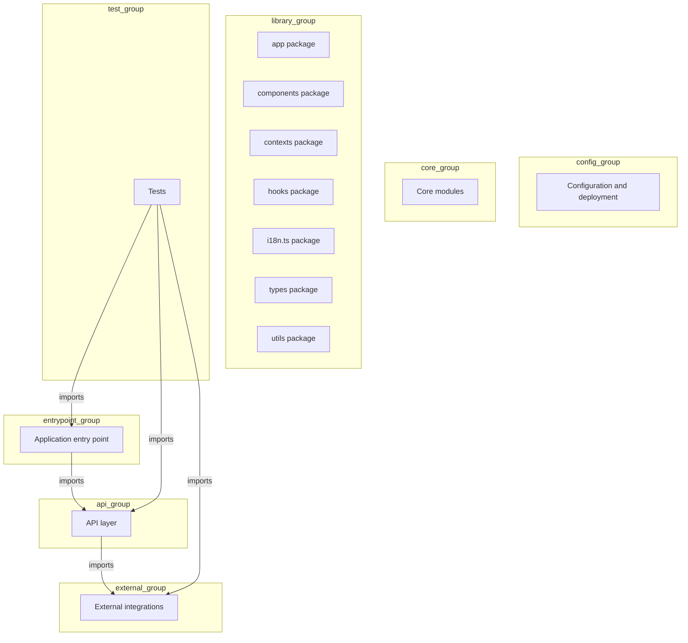

# Architecture report: AsyncFuncAI/deepwiki-open

> Automated static analysis. **Observed** = directly seen in files/imports/AST; **Inferred** = interpretation from that evidence. Repository code was not executed.

## 1. Repository at a glance

| Item | Value |
| --- | --- |
| Repository | AsyncFuncAI/deepwiki-open |
| Description | Open Source DeepWiki: AI-Powered Wiki Generator for GitHub/Gitlab/Bitbucket Repositories. Join the discord: https://discord.gg/gMwThUMeme |
| Language | Python |
| Stars | 18421 |
| Licence | MIT |
| Analysed commit / branch | 72f7d7f105f7e35851793e6c3eb43b82befe6a69 / main |
| Framework(s) | FastAPI, Next.js, React |
| Files analysed | 195 |
| Components | 13 |

## 2. Architecture in one minute

AsyncFuncAI/deepwiki-open - Open Source DeepWiki: AI-Powered Wiki Generator for GitHub/Gitlab/Bitbucket Repositories. Join the discord: https://discord.gg/gMwThUMeme. This repository was analysed statically from 195 file(s) (71 Python). Detected technologies (observed from imports/manifests): GitHub Actions, FastAPI, Next.js, React, aiohttp, AWS (boto3). Files are grouped into 13 component(s): API layer, app package, components package, Configuration and deployment, contexts package, Core modules, Application entry point, External integrations. Observed entry point(s): api/main.py. Findings below distinguish observed facts from inferred interpretation.

## 3. High-level block diagram

## 4. Main components

### API layer (`api_layer`)

- **Kind:** api
- **Status:** Observed
- **Confidence:** 0.85
- **Responsibility:** Groups 55 file(s) under api layer (observed from repository paths and static analysis). Observed routes: GET /status, POST /validate, POST /chat/completions/stream, POST /codemap/stream, GET /codemap/file. Observed top-level classes: AnthropicBedrockClient, AnthropicChatStreamer, AuthorizationConfig, AzureChatStreamer, BedrockChatStreamer, BedrockClient. Observed top-level functions: _attachment_header, _citation_link, _clone_from_bitbucket, _clone_from_github, _clone_from_gitlab, _collect_stream.
- **Paths:** `api/__init__.py`, `api/chat/__init__.py`, `api/chat/_prompts.py`, `api/chat/_stream.py`, `api/clients/__init__.py`, `api/clients/anthropic.py`, `api/clients/bedrock.py`, `api/clients/dashscope.py`, `api/clients/google_embedder.py`, `api/clients/litellm.py`, `api/clients/ollama.py`, `api/clients/openrouter.py`, `api/config.py`, `api/logger.py`, `api/prompts.py`, `api/rag/__init__.py`, `api/rag/pipeline.py`, `api/rag/rag.py`, `api/repository.py`, `api/routers/__init__.py`, `api/routers/auth.py`, `api/routers/chat.py`, `api/routers/codemap.py`, `api/routers/repo.py`, `api/routers/system.py`, `api/routers/wiki.py`, `api/schemas/__init__.py`, `api/schemas/auth.py`, `api/schemas/base.py`, `api/schemas/chat.py`, `api/schemas/codemap.py`, `api/schemas/io.py`, `api/schemas/models.py`, `api/schemas/repo.py`, `api/schemas/wiki.py`, `api/services/__init__.py`, `api/services/codemap.py`, `api/services/deep_research.py`, `api/services/research.py`, `api/services/wiki/__init__.py`, `api/services/wiki/content.py`, `api/services/wiki/io.py`, `api/services/wiki/prompts.py`, `api/services/wiki/structure.py`, `api/services/wiki/tasks.py`, `api/utils.py`, `src/app/api/auth/status/route.ts`, `src/app/api/auth/validate/route.ts`, `src/app/api/chat/stream/route.ts`, `src/app/api/models/config/route.ts`, `src/app/api/repo/prepare/route.ts`, `src/app/api/wiki/projects/route.ts`, `src/app/api/wiki/tasks/[task_id]/route.ts`, `src/app/api/wiki/tasks/[task_id]/stream/route.ts`, `src/app/api/wiki/tasks/route.ts`
- **Evidence:** [api/__init__.py](https://github.com/AsyncFuncAI/deepwiki-open/blob/72f7d7f105f7e35851793e6c3eb43b82befe6a69/api/__init__.py); [api/chat/__init__.py:5](https://github.com/AsyncFuncAI/deepwiki-open/blob/72f7d7f105f7e35851793e6c3eb43b82befe6a69/api/chat/__init__.py#L5); [api/chat/_prompts.py:6](https://github.com/AsyncFuncAI/deepwiki-open/blob/72f7d7f105f7e35851793e6c3eb43b82befe6a69/api/chat/_prompts.py#L6); [api/chat/_stream.py:29](https://github.com/AsyncFuncAI/deepwiki-open/blob/72f7d7f105f7e35851793e6c3eb43b82befe6a69/api/chat/_stream.py#L29); [api/clients/__init__.py](https://github.com/AsyncFuncAI/deepwiki-open/blob/72f7d7f105f7e35851793e6c3eb43b82befe6a69/api/clients/__init__.py); [api/clients/anthropic.py:15](https://github.com/AsyncFuncAI/deepwiki-open/blob/72f7d7f105f7e35851793e6c3eb43b82befe6a69/api/clients/anthropic.py#L15); [api/clients/bedrock.py:18](https://github.com/AsyncFuncAI/deepwiki-open/blob/72f7d7f105f7e35851793e6c3eb43b82befe6a69/api/clients/bedrock.py#L18); [api/clients/dashscope.py:67](https://github.com/AsyncFuncAI/deepwiki-open/blob/72f7d7f105f7e35851793e6c3eb43b82befe6a69/api/clients/dashscope.py#L67)

### app package (`app`)

- **Kind:** library
- **Status:** Observed
- **Confidence:** 0.85
- **Responsibility:** Groups 6 file(s) under app package (observed from repository paths and static analysis).
- **Paths:** `src/app/[owner]/[repo]/page.tsx`, `src/app/[owner]/[repo]/slides/page.tsx`, `src/app/[owner]/[repo]/workshop/page.tsx`, `src/app/layout.tsx`, `src/app/page.tsx`, `src/app/wiki/projects/page.tsx`
- **Evidence:** [src/app/[owner]/[repo]/page.tsx](https://github.com/AsyncFuncAI/deepwiki-open/blob/72f7d7f105f7e35851793e6c3eb43b82befe6a69/src/app/%5Bowner%5D/%5Brepo%5D/page.tsx); [src/app/[owner]/[repo]/slides/page.tsx](https://github.com/AsyncFuncAI/deepwiki-open/blob/72f7d7f105f7e35851793e6c3eb43b82befe6a69/src/app/%5Bowner%5D/%5Brepo%5D/slides/page.tsx); [src/app/[owner]/[repo]/workshop/page.tsx](https://github.com/AsyncFuncAI/deepwiki-open/blob/72f7d7f105f7e35851793e6c3eb43b82befe6a69/src/app/%5Bowner%5D/%5Brepo%5D/workshop/page.tsx); [src/app/layout.tsx](https://github.com/AsyncFuncAI/deepwiki-open/blob/72f7d7f105f7e35851793e6c3eb43b82befe6a69/src/app/layout.tsx); [src/app/page.tsx](https://github.com/AsyncFuncAI/deepwiki-open/blob/72f7d7f105f7e35851793e6c3eb43b82befe6a69/src/app/page.tsx); [src/app/wiki/projects/page.tsx](https://github.com/AsyncFuncAI/deepwiki-open/blob/72f7d7f105f7e35851793e6c3eb43b82befe6a69/src/app/wiki/projects/page.tsx)

### components package (`components`)

- **Kind:** library
- **Status:** Observed
- **Confidence:** 0.85
- **Responsibility:** Groups 13 file(s) under components package (observed from repository paths and static analysis).
- **Paths:** `src/components/Ask.tsx`, `src/components/CodeMap.tsx`, `src/components/CodeViewer.tsx`, `src/components/ConfigurationModal.tsx`, `src/components/Markdown.tsx`, `src/components/Mermaid.tsx`, `src/components/ModelSelectionModal.tsx`, `src/components/ProcessedProjects.tsx`, `src/components/TokenInput.tsx`, `src/components/UserSelector.tsx`, `src/components/WikiTreeView.tsx`, `src/components/WikiTypeSelector.tsx`, `src/components/theme-toggle.tsx`
- **Evidence:** [src/components/Ask.tsx](https://github.com/AsyncFuncAI/deepwiki-open/blob/72f7d7f105f7e35851793e6c3eb43b82befe6a69/src/components/Ask.tsx); [src/components/CodeMap.tsx](https://github.com/AsyncFuncAI/deepwiki-open/blob/72f7d7f105f7e35851793e6c3eb43b82befe6a69/src/components/CodeMap.tsx); [src/components/CodeViewer.tsx](https://github.com/AsyncFuncAI/deepwiki-open/blob/72f7d7f105f7e35851793e6c3eb43b82befe6a69/src/components/CodeViewer.tsx); [src/components/ConfigurationModal.tsx](https://github.com/AsyncFuncAI/deepwiki-open/blob/72f7d7f105f7e35851793e6c3eb43b82befe6a69/src/components/ConfigurationModal.tsx); [src/components/Markdown.tsx](https://github.com/AsyncFuncAI/deepwiki-open/blob/72f7d7f105f7e35851793e6c3eb43b82befe6a69/src/components/Markdown.tsx); [src/components/Mermaid.tsx](https://github.com/AsyncFuncAI/deepwiki-open/blob/72f7d7f105f7e35851793e6c3eb43b82befe6a69/src/components/Mermaid.tsx); [src/components/ModelSelectionModal.tsx](https://github.com/AsyncFuncAI/deepwiki-open/blob/72f7d7f105f7e35851793e6c3eb43b82befe6a69/src/components/ModelSelectionModal.tsx); [src/components/ProcessedProjects.tsx](https://github.com/AsyncFuncAI/deepwiki-open/blob/72f7d7f105f7e35851793e6c3eb43b82befe6a69/src/components/ProcessedProjects.tsx)

### Configuration and deployment (`config`)

- **Kind:** config
- **Status:** Observed
- **Confidence:** 0.85
- **Responsibility:** Groups 38 file(s) under configuration and deployment (observed from repository paths and static analysis).
- **Paths:** `Dockerfile`, `Dockerfile-litellm`, `Dockerfile-ollama-local`, `api/config/embedder.json`, `api/config/embedder.litellm.json`, `api/config/generator.json`, `api/config/generator.litellm.json`, `api/config/lang.json`, `api/config/repo.json`, `api/pyproject.toml`, `charts/deepwiki-open/Chart.yaml`, `charts/deepwiki-open/ci/default-values.yaml`, `charts/deepwiki-open/ci/no-persistence-values.yaml`, `charts/deepwiki-open/templates/configmap.yaml`, `charts/deepwiki-open/templates/deployment.yaml`, `charts/deepwiki-open/templates/httproute.yaml`, `charts/deepwiki-open/templates/ingress.yaml`, `charts/deepwiki-open/templates/pvc.yaml`, `charts/deepwiki-open/templates/service.yaml`, `charts/deepwiki-open/templates/serviceaccount.yaml`, `charts/deepwiki-open/values.schema.json`, `charts/deepwiki-open/values.yaml`, `docker-compose-litellm.yml`, `docker-compose.yml`, `litellm-config.yml`, `package.json`, `pytest.ini`, `src/messages/en.json`, `src/messages/es.json`, `src/messages/fr.json`, `src/messages/ja.json`, `src/messages/kr.json`, `src/messages/pt-br.json`, `src/messages/ru.json`, `src/messages/vi.json`, `src/messages/zh-tw.json`, `src/messages/zh.json`, `tsconfig.json`
- **Evidence:** [Dockerfile](https://github.com/AsyncFuncAI/deepwiki-open/blob/72f7d7f105f7e35851793e6c3eb43b82befe6a69/Dockerfile); [Dockerfile-litellm](https://github.com/AsyncFuncAI/deepwiki-open/blob/72f7d7f105f7e35851793e6c3eb43b82befe6a69/Dockerfile-litellm); [Dockerfile-ollama-local](https://github.com/AsyncFuncAI/deepwiki-open/blob/72f7d7f105f7e35851793e6c3eb43b82befe6a69/Dockerfile-ollama-local); [api/config/embedder.json](https://github.com/AsyncFuncAI/deepwiki-open/blob/72f7d7f105f7e35851793e6c3eb43b82befe6a69/api/config/embedder.json); [api/config/embedder.litellm.json](https://github.com/AsyncFuncAI/deepwiki-open/blob/72f7d7f105f7e35851793e6c3eb43b82befe6a69/api/config/embedder.litellm.json); [api/config/generator.json](https://github.com/AsyncFuncAI/deepwiki-open/blob/72f7d7f105f7e35851793e6c3eb43b82befe6a69/api/config/generator.json); [api/config/generator.litellm.json](https://github.com/AsyncFuncAI/deepwiki-open/blob/72f7d7f105f7e35851793e6c3eb43b82befe6a69/api/config/generator.litellm.json); [api/config/lang.json](https://github.com/AsyncFuncAI/deepwiki-open/blob/72f7d7f105f7e35851793e6c3eb43b82befe6a69/api/config/lang.json)

### contexts package (`contexts`)

- **Kind:** library
- **Status:** Observed
- **Confidence:** 0.85
- **Responsibility:** Groups 1 file(s) under contexts package (observed from repository paths and static analysis).
- **Paths:** `src/contexts/LanguageContext.tsx`
- **Evidence:** [src/contexts/LanguageContext.tsx](https://github.com/AsyncFuncAI/deepwiki-open/blob/72f7d7f105f7e35851793e6c3eb43b82befe6a69/src/contexts/LanguageContext.tsx)

### Core modules (`core`)

- **Kind:** core
- **Status:** Observed
- **Confidence:** 0.85
- **Responsibility:** Groups 5 file(s) under core modules (observed from repository paths and static analysis).
- **Paths:** `eslint.config.mjs`, `next.config.ts`, `postcss.config.mjs`, `run.sh`, `tailwind.config.js`
- **Evidence:** [eslint.config.mjs](https://github.com/AsyncFuncAI/deepwiki-open/blob/72f7d7f105f7e35851793e6c3eb43b82befe6a69/eslint.config.mjs); [next.config.ts](https://github.com/AsyncFuncAI/deepwiki-open/blob/72f7d7f105f7e35851793e6c3eb43b82befe6a69/next.config.ts); [postcss.config.mjs](https://github.com/AsyncFuncAI/deepwiki-open/blob/72f7d7f105f7e35851793e6c3eb43b82befe6a69/postcss.config.mjs); [run.sh](https://github.com/AsyncFuncAI/deepwiki-open/blob/72f7d7f105f7e35851793e6c3eb43b82befe6a69/run.sh); [tailwind.config.js](https://github.com/AsyncFuncAI/deepwiki-open/blob/72f7d7f105f7e35851793e6c3eb43b82befe6a69/tailwind.config.js)

### Application entry point (`entrypoint`)

- **Kind:** entrypoint
- **Status:** Observed
- **Confidence:** 0.85
- **Responsibility:** Groups 1 file(s) under application entry point (observed from repository paths and static analysis). Observed application object created via FastAPI. Observed routes: GET /. Observed top-level functions: root.
- **Paths:** `api/main.py`
- **Evidence:** [api/main.py:50](https://github.com/AsyncFuncAI/deepwiki-open/blob/72f7d7f105f7e35851793e6c3eb43b82befe6a69/api/main.py#L50)

### External integrations (`external_integrations`)

- **Kind:** external
- **Status:** Inferred
- **Confidence:** 0.70
- **Responsibility:** Groups 0 file(s) under external integrations (observed from repository paths and static analysis).
- **Evidence:** [api/clients/bedrock.py:7](https://github.com/AsyncFuncAI/deepwiki-open/blob/72f7d7f105f7e35851793e6c3eb43b82befe6a69/api/clients/bedrock.py#L7); [api/clients/openrouter.py:7](https://github.com/AsyncFuncAI/deepwiki-open/blob/72f7d7f105f7e35851793e6c3eb43b82befe6a69/api/clients/openrouter.py#L7); [api/clients/openrouter.py:14](https://github.com/AsyncFuncAI/deepwiki-open/blob/72f7d7f105f7e35851793e6c3eb43b82befe6a69/api/clients/openrouter.py#L14); [api/rag/rag.py:41](https://github.com/AsyncFuncAI/deepwiki-open/blob/72f7d7f105f7e35851793e6c3eb43b82befe6a69/api/rag/rag.py#L41); [tests/api/test_api.py:4](https://github.com/AsyncFuncAI/deepwiki-open/blob/72f7d7f105f7e35851793e6c3eb43b82befe6a69/tests/api/test_api.py#L4); [tests/run_tests.py:135](https://github.com/AsyncFuncAI/deepwiki-open/blob/72f7d7f105f7e35851793e6c3eb43b82befe6a69/tests/run_tests.py#L135)

### hooks package (`hooks`)

- **Kind:** library
- **Status:** Observed
- **Confidence:** 0.85
- **Responsibility:** Groups 1 file(s) under hooks package (observed from repository paths and static analysis).
- **Paths:** `src/hooks/useProcessedProjects.ts`
- **Evidence:** [src/hooks/useProcessedProjects.ts](https://github.com/AsyncFuncAI/deepwiki-open/blob/72f7d7f105f7e35851793e6c3eb43b82befe6a69/src/hooks/useProcessedProjects.ts)

### i18n.ts package (`i18n_ts`)

- **Kind:** library
- **Status:** Observed
- **Confidence:** 0.85
- **Responsibility:** Groups 1 file(s) under i18n.ts package (observed from repository paths and static analysis).
- **Paths:** `src/i18n.ts`
- **Evidence:** [src/i18n.ts](https://github.com/AsyncFuncAI/deepwiki-open/blob/72f7d7f105f7e35851793e6c3eb43b82befe6a69/src/i18n.ts)

### Tests (`tests`)

- **Kind:** test
- **Status:** Observed
- **Confidence:** 0.85
- **Responsibility:** Groups 29 file(s) under tests (observed from repository paths and static analysis). Observed top-level classes: Message, TestDataPipelineFunctions, TestEmbedderClients, TestEmbedderConfiguration, TestEmbedderFactory, TestEnvironmentVariableHandling. Observed top-level functions: _clear_registry, _export, _link_destinations, _patch_stubs, _req, _send.
- **Paths:** `charts/deepwiki-open/templates/tests/test-health.yaml`, `charts/deepwiki-open/tests/deployment_test.yaml`, `charts/deepwiki-open/tests/exposure_test.yaml`, `tests/README.md`, `tests/__init__.py`, `tests/api/__init__.py`, `tests/api/test_api.py`, `tests/backend/rag/test_rag.py`, `tests/backend/routers/test_wiki_export.py`, `tests/backend/routers/test_wiki_tasks_api.py`, `tests/backend/schemas/test_chat.py`, `tests/backend/schemas/test_wiki.py`, `tests/backend/services/test_deep_research.py`, `tests/backend/services/test_research_chat.py`, `tests/backend/services/test_wiki_content.py`, `tests/backend/services/test_wiki_structure.py`, `tests/backend/services/test_wiki_task.py`, `tests/conftest.py`, `tests/frontend/contentDisposition.test.mjs`, `tests/integration/__init__.py`, `tests/integration/test_full_integration.py`, `tests/run_tests.py`, `tests/test_config.py`, `tests/test_extract_repo_name.py`, `tests/test_repository.py`, `tests/unit/__init__.py`, `tests/unit/test_all_embedders.py`, `tests/unit/test_chat.py`, `tests/unit/test_google_embedder.py`
- **Evidence:** [charts/deepwiki-open/templates/tests/test-health.yaml](https://github.com/AsyncFuncAI/deepwiki-open/blob/72f7d7f105f7e35851793e6c3eb43b82befe6a69/charts/deepwiki-open/templates/tests/test-health.yaml); [charts/deepwiki-open/tests/deployment_test.yaml](https://github.com/AsyncFuncAI/deepwiki-open/blob/72f7d7f105f7e35851793e6c3eb43b82befe6a69/charts/deepwiki-open/tests/deployment_test.yaml); [charts/deepwiki-open/tests/exposure_test.yaml](https://github.com/AsyncFuncAI/deepwiki-open/blob/72f7d7f105f7e35851793e6c3eb43b82befe6a69/charts/deepwiki-open/tests/exposure_test.yaml); [tests/README.md](https://github.com/AsyncFuncAI/deepwiki-open/blob/72f7d7f105f7e35851793e6c3eb43b82befe6a69/tests/README.md); [tests/__init__.py](https://github.com/AsyncFuncAI/deepwiki-open/blob/72f7d7f105f7e35851793e6c3eb43b82befe6a69/tests/__init__.py); [tests/api/__init__.py](https://github.com/AsyncFuncAI/deepwiki-open/blob/72f7d7f105f7e35851793e6c3eb43b82befe6a69/tests/api/__init__.py); [tests/api/test_api.py:7](https://github.com/AsyncFuncAI/deepwiki-open/blob/72f7d7f105f7e35851793e6c3eb43b82befe6a69/tests/api/test_api.py#L7); [tests/backend/rag/test_rag.py:7](https://github.com/AsyncFuncAI/deepwiki-open/blob/72f7d7f105f7e35851793e6c3eb43b82befe6a69/tests/backend/rag/test_rag.py#L7)

### types package (`types`)

- **Kind:** library
- **Status:** Observed
- **Confidence:** 0.85
- **Responsibility:** Groups 3 file(s) under types package (observed from repository paths and static analysis).
- **Paths:** `src/types/repoinfo.tsx`, `src/types/wiki/wikipage.tsx`, `src/types/wiki/wikistructure.tsx`
- **Evidence:** [src/types/repoinfo.tsx](https://github.com/AsyncFuncAI/deepwiki-open/blob/72f7d7f105f7e35851793e6c3eb43b82befe6a69/src/types/repoinfo.tsx); [src/types/wiki/wikipage.tsx](https://github.com/AsyncFuncAI/deepwiki-open/blob/72f7d7f105f7e35851793e6c3eb43b82befe6a69/src/types/wiki/wikipage.tsx); [src/types/wiki/wikistructure.tsx](https://github.com/AsyncFuncAI/deepwiki-open/blob/72f7d7f105f7e35851793e6c3eb43b82befe6a69/src/types/wiki/wikistructure.tsx)

### utils package (`utils`)

- **Kind:** library
- **Status:** Observed
- **Confidence:** 0.85
- **Responsibility:** Groups 6 file(s) under utils package (observed from repository paths and static analysis).
- **Paths:** `src/utils/contentDisposition.ts`, `src/utils/getRepoUrl.tsx`, `src/utils/prepareRepo.ts`, `src/utils/urlDecoder.tsx`, `src/utils/websocketClient.ts`, `src/utils/wikiTask.ts`
- **Evidence:** [src/utils/contentDisposition.ts](https://github.com/AsyncFuncAI/deepwiki-open/blob/72f7d7f105f7e35851793e6c3eb43b82befe6a69/src/utils/contentDisposition.ts); [src/utils/getRepoUrl.tsx](https://github.com/AsyncFuncAI/deepwiki-open/blob/72f7d7f105f7e35851793e6c3eb43b82befe6a69/src/utils/getRepoUrl.tsx); [src/utils/prepareRepo.ts](https://github.com/AsyncFuncAI/deepwiki-open/blob/72f7d7f105f7e35851793e6c3eb43b82befe6a69/src/utils/prepareRepo.ts); [src/utils/urlDecoder.tsx](https://github.com/AsyncFuncAI/deepwiki-open/blob/72f7d7f105f7e35851793e6c3eb43b82befe6a69/src/utils/urlDecoder.tsx); [src/utils/websocketClient.ts](https://github.com/AsyncFuncAI/deepwiki-open/blob/72f7d7f105f7e35851793e6c3eb43b82befe6a69/src/utils/websocketClient.ts); [src/utils/wikiTask.ts](https://github.com/AsyncFuncAI/deepwiki-open/blob/72f7d7f105f7e35851793e6c3eb43b82befe6a69/src/utils/wikiTask.ts)

## 5. Execution flow

**Observed** entry point(s):

- [api/main.py:50](https://github.com/AsyncFuncAI/deepwiki-open/blob/72f7d7f105f7e35851793e6c3eb43b82befe6a69/api/main.py#L50)
- [src/app/page.tsx](https://github.com/AsyncFuncAI/deepwiki-open/blob/72f7d7f105f7e35851793e6c3eb43b82befe6a69/src/app/page.tsx)

**Observed** routes (from decorators):

- `GET /` -> `root` in `api/main.py:76`
- `GET /status` -> `get_auth_status` in `api/routers/auth.py:10`
- `POST /validate` -> `validate_auth_code` in `api/routers/auth.py:18`
- `POST /chat/completions/stream` -> `chat_completions_stream` in `api/routers/chat.py:70`
- `POST /codemap/stream` -> `codemap_stream` in `api/routers/codemap.py:40`
- `GET /codemap/file` -> `codemap_file` in `api/routers/codemap.py:53`
- `POST /prepare` -> `prepare_repo_index` in `api/routers/repo.py:24`
- `GET /index/status` -> `repo_index_status` in `api/routers/repo.py:70`
- `GET /health` -> `health_check` in `api/routers/system.py:15`
- `GET /lang/config` -> `lang_config` in `api/routers/system.py:25`
- `GET /models/config` -> `get_model_config` in `api/routers/system.py:30`
- `POST /export/wiki` -> `post_export_wiki` in `api/routers/wiki.py:54`
- `GET /local_repo/structure` -> `get_local_repo_structure` in `api/routers/wiki.py:98`
- `GET /api/wiki_cache` -> `read_wiki` in `api/routers/wiki.py:156`
- `DELETE /api/wiki_cache` -> `delete_wiki` in `api/routers/wiki.py:181`
- `GET /api/processed_projects` -> `get_processed_projects` in `api/routers/wiki.py:220`
- `POST /wiki/tasks` -> `submit_wiki_task` in `api/routers/wiki.py:235`
- `GET /wiki/tasks` -> `list_wiki_tasks` in `api/routers/wiki.py:251`
- `GET /wiki/tasks/{task_id}` -> `get_wiki_task` in `api/routers/wiki.py:278`
- `GET /wiki/tasks/{task_id}/stream` -> `stream_wiki_task` in `api/routers/wiki.py:288`

Representative flow (derived from observed entry points and the import graph; steps beyond the entry point are **Inferred**):

1. Execution starts at an observed entry point listed above, if present.
2. `api_layer` imports `external_integrations` (API layer -> External integrations).
3. `entrypoint` imports `api_layer` (Application entry point -> API layer).
4. `tests` imports `api_layer` (Tests -> API layer).
5. `tests` imports `entrypoint` (Tests -> Application entry point).
6. `tests` imports `external_integrations` (Tests -> External integrations).

## 6. Project structure

### `(root)`

- `.dockerignore` - container (677 bytes)
- `.gitignore` - other (726 bytes)
- `.pre-commit-config.yaml` - config (2342 bytes)
- `.python-version` - other (5 bytes)
- `Dockerfile` - container (3998 bytes)
- `Dockerfile-litellm` - container (4268 bytes)
- `Dockerfile-ollama-local` - container (4252 bytes)
- `LICENSE` - docs (1066 bytes)
- `Ollama-instruction.md` - docs (6237 bytes)
- `README.es.md` - docs (16421 bytes)
- `README.fr.md` - docs (30221 bytes)
- `README.ja.md` - docs (23364 bytes)
- `README.kr.md` - docs (18490 bytes)
- `README.md` - docs (2774 bytes)
- `README.pt-br.md` - docs (25426 bytes)
- `README.ru.md` - docs (25174 bytes)
- `README.vi.md` - docs (19763 bytes)
- `README.zh-tw.md` - docs (24134 bytes)
- `README.zh.md` - docs (15766 bytes)
- `docker-compose-litellm.env` - other (312 bytes)
- `docker-compose-litellm.yml` - config (2288 bytes)
- `docker-compose.yml` - container (922 bytes)
- `eslint.config.mjs` - source, JavaScript (393 bytes)
- `litellm-config.yml` - config (1040 bytes)
- `next.config.ts` - source, TypeScript (1816 bytes)
- `package.json` - manifest (1936 bytes)
- `postcss.config.mjs` - source, JavaScript (81 bytes)
- `pytest.ini` - config (378 bytes)
- `run.sh` - source, Shell (19 bytes)
- `tailwind.config.js` - source, JavaScript (198 bytes)
- `tsconfig.json` - config (602 bytes)

### `.github`

- `.github/ct.yaml` - config (103 bytes)
- `.github/workflows/docker-build-push.yml` - ci, YAML (5809 bytes)
- `.github/workflows/helm-chart.yml` - ci, YAML (1012 bytes)

### `.vscode`

- `.vscode/launch.json` - config (414 bytes)

### `api`

- `api/README.md` - docs (6628 bytes)
- `api/__init__.py` - source, Python (49 bytes)
- `api/chat/__init__.py` - source, Python (436 bytes)
- `api/chat/_prompts.py` - source, Python (1067 bytes)
- `api/chat/_stream.py` - source, Python (12260 bytes)
- `api/clients/__init__.py` - source, Python (768 bytes)
- `api/clients/anthropic.py` - source, Python (5844 bytes)
- `api/clients/bedrock.py` - source, Python (19218 bytes)
- `api/clients/dashscope.py` - source, Python (39669 bytes)
- `api/clients/google_embedder.py` - source, Python (10385 bytes)
- `api/clients/litellm.py` - source, Python (2105 bytes)
- `api/clients/ollama.py` - source, Python (4489 bytes)
- `api/clients/openrouter.py` - source, Python (36732 bytes)
- `api/config.py` - source, Python (19937 bytes)
- `api/config/embedder.json` - config (863 bytes)
- `api/config/embedder.json.bak` - other (346 bytes)
- `api/config/embedder.litellm.json` - config (407 bytes)
- `api/config/embedder.ollama.json.bak` - other (384 bytes)
- `api/config/embedder.openai_compatible.json.bak` - other (577 bytes)
- `api/config/generator.json` - config (4454 bytes)
- `api/config/generator.litellm.json` - config (4837 bytes)
- `api/config/lang.json` - config (434 bytes)
- `api/config/repo.json` - config (3137 bytes)
- `api/logger.py` - source, Python (2975 bytes)
- `api/main.py` - source, Python (3487 bytes)
- `api/prompts.py` - source, Python (12425 bytes)
- `api/pyproject.toml` - manifest (1165 bytes)
- `api/rag/__init__.py` - source, Python (158 bytes)
- `api/rag/pipeline.py` - source, Python (19997 bytes)
- `api/rag/rag.py` - source, Python (12545 bytes)
- `api/repository.py` - source, Python (6759 bytes)
- `api/routers/__init__.py` - source, Python (0 bytes)
- `api/routers/auth.py` - source, Python (538 bytes)
- `api/routers/chat.py` - source, Python (4604 bytes)
- `api/routers/codemap.py` - source, Python (2723 bytes)
- `api/routers/repo.py` - source, Python (2899 bytes)
- `api/routers/system.py` - source, Python (2643 bytes)
- `api/routers/wiki.py` - source, Python (10835 bytes)
- `api/schemas/__init__.py` - source, Python (1292 bytes)
- `api/schemas/auth.py` - source, Python (139 bytes)
- `api/schemas/base.py` - source, Python (1719 bytes)
- `api/schemas/chat.py` - source, Python (678 bytes)
- `api/schemas/codemap.py` - source, Python (2191 bytes)
- `api/schemas/io.py` - source, Python (642 bytes)
- `api/schemas/models.py` - source, Python (972 bytes)
- `api/schemas/repo.py` - source, Python (1449 bytes)
- `api/schemas/wiki.py` - source, Python (3128 bytes)
- `api/services/__init__.py` - source, Python (0 bytes)
- `api/services/codemap.py` - source, Python (11304 bytes)
- `api/services/deep_research.py` - source, Python (907 bytes)
- `api/services/research.py` - source, Python (11865 bytes)
- `api/services/wiki/__init__.py` - source, Python (579 bytes)
- `api/services/wiki/content.py` - source, Python (6300 bytes)
- `api/services/wiki/io.py` - source, Python (7302 bytes)
- `api/services/wiki/prompts.py` - source, Python (14022 bytes)
- `api/services/wiki/structure.py` - source, Python (9458 bytes)
- `api/services/wiki/tasks.py` - source, Python (13332 bytes)
- `api/utils.py` - source, Python (233 bytes)

### `charts`

- `charts/deepwiki-open/.helmignore` - other (101 bytes)
- `charts/deepwiki-open/Chart.yaml` - config (506 bytes)
- `charts/deepwiki-open/README.md` - docs (10795 bytes)
- `charts/deepwiki-open/README.md.gotmpl` - other (3337 bytes)
- `charts/deepwiki-open/ci/default-values.yaml` - config (106 bytes)
- `charts/deepwiki-open/ci/no-persistence-values.yaml` - config (222 bytes)
- `charts/deepwiki-open/templates/NOTES.txt` - docs (1257 bytes)
- `charts/deepwiki-open/templates/_helpers.tpl` - other (2399 bytes)
- `charts/deepwiki-open/templates/configmap.yaml` - config (303 bytes)
- `charts/deepwiki-open/templates/deployment.yaml` - config (5178 bytes)
- `charts/deepwiki-open/templates/httproute.yaml` - config (1732 bytes)
- `charts/deepwiki-open/templates/ingress.yaml` - config (1210 bytes)
- `charts/deepwiki-open/templates/pvc.yaml` - config (649 bytes)
- `charts/deepwiki-open/templates/service.yaml` - config (589 bytes)
- `charts/deepwiki-open/templates/serviceaccount.yaml` - config (419 bytes)
- `charts/deepwiki-open/templates/tests/test-health.yaml` - test (1105 bytes)
- `charts/deepwiki-open/tests/deployment_test.yaml` - test (5807 bytes)
- `charts/deepwiki-open/tests/exposure_test.yaml` - test (2669 bytes)
- `charts/deepwiki-open/values.schema.json` - config (6330 bytes)
- `charts/deepwiki-open/values.yaml` - config (6474 bytes)

### `public`

- `public/file.svg` - other (391 bytes)
- `public/globe.svg` - other (1035 bytes)
- `public/next.svg` - other (1375 bytes)
- `public/vercel.svg` - other (128 bytes)
- `public/window.svg` - other (385 bytes)

### `src`

- `src/app/[owner]/[repo]/page.tsx` - source, TypeScript (53466 bytes)
- `src/app/[owner]/[repo]/slides/page.tsx` - source, TypeScript (46180 bytes)
- `src/app/[owner]/[repo]/workshop/page.tsx` - source, TypeScript (24694 bytes)
- `src/app/api/auth/status/route.ts` - source, TypeScript (835 bytes)
- `src/app/api/auth/validate/route.ts` - source, TypeScript (946 bytes)
- `src/app/api/chat/stream/route.ts` - source, TypeScript (4376 bytes)
- `src/app/api/models/config/route.ts` - source, TypeScript (1484 bytes)
- `src/app/api/repo/prepare/route.ts` - source, TypeScript (2561 bytes)
- `src/app/api/wiki/projects/route.ts` - source, TypeScript (4370 bytes)
- `src/app/api/wiki/tasks/[task_id]/route.ts` - source, TypeScript (900 bytes)
- `src/app/api/wiki/tasks/[task_id]/stream/route.ts` - source, TypeScript (1308 bytes)
- `src/app/api/wiki/tasks/route.ts` - source, TypeScript (1469 bytes)
- `src/app/globals.css` - other (6229 bytes)
- `src/app/layout.tsx` - source, TypeScript (1105 bytes)
- `src/app/page.tsx` - source, TypeScript (25090 bytes)
- `src/app/wiki/projects/page.tsx` - source, TypeScript (431 bytes)
- `src/components/Ask.tsx` - source, TypeScript (56670 bytes)
- `src/components/CodeMap.tsx` - source, TypeScript (6376 bytes)
- `src/components/CodeViewer.tsx` - source, TypeScript (5675 bytes)
- `src/components/ConfigurationModal.tsx` - source, TypeScript (12253 bytes)
- `src/components/Markdown.tsx` - source, TypeScript (8164 bytes)
- `src/components/Mermaid.tsx` - source, TypeScript (16265 bytes)
- `src/components/ModelSelectionModal.tsx` - source, TypeScript (10747 bytes)
- `src/components/ProcessedProjects.tsx` - source, TypeScript (11579 bytes)
- `src/components/TokenInput.tsx` - source, TypeScript (5068 bytes)
- `src/components/UserSelector.tsx` - source, TypeScript (18230 bytes)
- `src/components/WikiTreeView.tsx` - source, TypeScript (6184 bytes)
- `src/components/WikiTypeSelector.tsx` - source, TypeScript (3159 bytes)
- `src/components/theme-toggle.tsx` - source, TypeScript (2466 bytes)
- `src/contexts/LanguageContext.tsx` - source, TypeScript (7849 bytes)
- `src/hooks/useProcessedProjects.ts` - source, TypeScript (1455 bytes)
- `src/i18n.ts` - source, TypeScript (503 bytes)
- `src/messages/en.json` - config (6857 bytes)
- `src/messages/es.json` - config (6965 bytes)
- `src/messages/fr.json` - config (8060 bytes)
- `src/messages/ja.json` - config (7688 bytes)
- `src/messages/kr.json` - config (7280 bytes)
- `src/messages/pt-br.json` - config (7480 bytes)
- `src/messages/ru.json` - config (10264 bytes)
- `src/messages/vi.json` - config (7316 bytes)
- `src/messages/zh-tw.json` - config (6035 bytes)
- `src/messages/zh.json` - config (5997 bytes)
- `src/types/repoinfo.tsx` - source, TypeScript (195 bytes)
- `src/types/wiki/wikipage.tsx` - source, TypeScript (308 bytes)
- `src/types/wiki/wikistructure.tsx` - source, TypeScript (248 bytes)
- `src/utils/contentDisposition.ts` - source, TypeScript (620 bytes)
- `src/utils/getRepoUrl.tsx` - source, TypeScript (471 bytes)
- `src/utils/prepareRepo.ts` - source, TypeScript (3579 bytes)
- `src/utils/urlDecoder.tsx` - source, TypeScript (752 bytes)
- `src/utils/websocketClient.ts` - source, TypeScript (6153 bytes)
- `src/utils/wikiTask.ts` - source, TypeScript (5433 bytes)

### `tests`

- `tests/README.md` - test (3628 bytes)
- `tests/__init__.py` - test, Python (21 bytes)
- `tests/api/__init__.py` - test, Python (12 bytes)
- `tests/api/test_api.py` - test, Python (1748 bytes)
- `tests/backend/rag/test_rag.py` - test, Python (858 bytes)
- `tests/backend/routers/test_wiki_export.py` - test, Python (1341 bytes)
- `tests/backend/routers/test_wiki_tasks_api.py` - test, Python (9632 bytes)
- `tests/backend/schemas/test_chat.py` - test, Python (725 bytes)
- `tests/backend/schemas/test_wiki.py` - test, Python (1430 bytes)
- `tests/backend/services/test_deep_research.py` - test, Python (1196 bytes)
- `tests/backend/services/test_research_chat.py` - test, Python (3195 bytes)
- `tests/backend/services/test_wiki_content.py` - test, Python (5886 bytes)
- `tests/backend/services/test_wiki_structure.py` - test, Python (7556 bytes)
- `tests/backend/services/test_wiki_task.py` - test, Python (9458 bytes)
- `tests/conftest.py` - test, Python (585 bytes)
- `tests/frontend/contentDisposition.test.mjs` - test, JavaScript (1551 bytes)
- `tests/integration/__init__.py` - test, Python (20 bytes)
- `tests/integration/test_full_integration.py` - test, Python (4602 bytes)
- `tests/run_tests.py` - test, Python (5194 bytes)
- `tests/test_config.py` - test, Python (3208 bytes)
- `tests/test_extract_repo_name.py` - test, Python (2707 bytes)
- `tests/test_repository.py` - test, Python (2305 bytes)
- `tests/unit/__init__.py` - test, Python (13 bytes)
- `tests/unit/test_all_embedders.py` - test, Python (20476 bytes)
- `tests/unit/test_chat.py` - test, Python (1805 bytes)
- `tests/unit/test_google_embedder.py` - test, Python (6698 bytes)

## 7. Key dependencies and integrations

| Name | Category | Status | Confidence | Evidence |
| --- | --- | --- | --- | --- |
| GitHub Actions | ci | Observed | 0.90 | [.github/workflows/docker-build-push.yml](https://github.com/AsyncFuncAI/deepwiki-open/blob/72f7d7f105f7e35851793e6c3eb43b82befe6a69/.github/workflows/docker-build-push.yml); [.github/workflows/helm-chart.yml](https://github.com/AsyncFuncAI/deepwiki-open/blob/72f7d7f105f7e35851793e6c3eb43b82befe6a69/.github/workflows/helm-chart.yml) |
| FastAPI | framework | Observed | 0.95 | [api/main.py:5](https://github.com/AsyncFuncAI/deepwiki-open/blob/72f7d7f105f7e35851793e6c3eb43b82befe6a69/api/main.py#L5); [api/main.py:6](https://github.com/AsyncFuncAI/deepwiki-open/blob/72f7d7f105f7e35851793e6c3eb43b82befe6a69/api/main.py#L6); [api/pyproject.toml:12](https://github.com/AsyncFuncAI/deepwiki-open/blob/72f7d7f105f7e35851793e6c3eb43b82befe6a69/api/pyproject.toml#L12); [api/routers/auth.py:1](https://github.com/AsyncFuncAI/deepwiki-open/blob/72f7d7f105f7e35851793e6c3eb43b82befe6a69/api/routers/auth.py#L1) |
| Next.js | framework | Observed | 0.85 | [package.json:6](https://github.com/AsyncFuncAI/deepwiki-open/blob/72f7d7f105f7e35851793e6c3eb43b82befe6a69/package.json#L6) |
| React | framework | Observed | 0.90 | [package.json:17](https://github.com/AsyncFuncAI/deepwiki-open/blob/72f7d7f105f7e35851793e6c3eb43b82befe6a69/package.json#L17); [package.json:18](https://github.com/AsyncFuncAI/deepwiki-open/blob/72f7d7f105f7e35851793e6c3eb43b82befe6a69/package.json#L18) |
| aiohttp | library | Observed | 0.90 | [api/clients/openrouter.py:7](https://github.com/AsyncFuncAI/deepwiki-open/blob/72f7d7f105f7e35851793e6c3eb43b82befe6a69/api/clients/openrouter.py#L7); [api/pyproject.toml:26](https://github.com/AsyncFuncAI/deepwiki-open/blob/72f7d7f105f7e35851793e6c3eb43b82befe6a69/api/pyproject.toml#L26) |
| AWS (boto3) | library | Observed | 0.90 | [api/clients/bedrock.py:7](https://github.com/AsyncFuncAI/deepwiki-open/blob/72f7d7f105f7e35851793e6c3eb43b82befe6a69/api/clients/bedrock.py#L7); [api/pyproject.toml:27](https://github.com/AsyncFuncAI/deepwiki-open/blob/72f7d7f105f7e35851793e6c3eb43b82befe6a69/api/pyproject.toml#L27) |
| httpx | library | Observed | 0.90 | [api/rag/rag.py:41](https://github.com/AsyncFuncAI/deepwiki-open/blob/72f7d7f105f7e35851793e6c3eb43b82befe6a69/api/rag/rag.py#L41) |
| NumPy | library | Observed | 0.90 | [api/pyproject.toml:18](https://github.com/AsyncFuncAI/deepwiki-open/blob/72f7d7f105f7e35851793e6c3eb43b82befe6a69/api/pyproject.toml#L18); [tests/backend/rag/test_rag.py:1](https://github.com/AsyncFuncAI/deepwiki-open/blob/72f7d7f105f7e35851793e6c3eb43b82befe6a69/tests/backend/rag/test_rag.py#L1) |
| Pydantic | library | Observed | 0.95 | [api/pyproject.toml:14](https://github.com/AsyncFuncAI/deepwiki-open/blob/72f7d7f105f7e35851793e6c3eb43b82befe6a69/api/pyproject.toml#L14); [api/schemas/auth.py:1](https://github.com/AsyncFuncAI/deepwiki-open/blob/72f7d7f105f7e35851793e6c3eb43b82befe6a69/api/schemas/auth.py#L1); [api/schemas/base.py:4](https://github.com/AsyncFuncAI/deepwiki-open/blob/72f7d7f105f7e35851793e6c3eb43b82befe6a69/api/schemas/base.py#L4); [api/schemas/chat.py:3](https://github.com/AsyncFuncAI/deepwiki-open/blob/72f7d7f105f7e35851793e6c3eb43b82befe6a69/api/schemas/chat.py#L3) |
| requests | library | Observed | 0.95 | [api/clients/openrouter.py:14](https://github.com/AsyncFuncAI/deepwiki-open/blob/72f7d7f105f7e35851793e6c3eb43b82befe6a69/api/clients/openrouter.py#L14); [api/pyproject.toml:21](https://github.com/AsyncFuncAI/deepwiki-open/blob/72f7d7f105f7e35851793e6c3eb43b82befe6a69/api/pyproject.toml#L21); [tests/api/test_api.py:4](https://github.com/AsyncFuncAI/deepwiki-open/blob/72f7d7f105f7e35851793e6c3eb43b82befe6a69/tests/api/test_api.py#L4); [tests/run_tests.py:135](https://github.com/AsyncFuncAI/deepwiki-open/blob/72f7d7f105f7e35851793e6c3eb43b82befe6a69/tests/run_tests.py#L135) |
| Tailwind CSS | library | Observed | 0.85 | [package.json:30](https://github.com/AsyncFuncAI/deepwiki-open/blob/72f7d7f105f7e35851793e6c3eb43b82befe6a69/package.json#L30) |
| Uvicorn | library | Observed | 0.90 | [api/main.py:7](https://github.com/AsyncFuncAI/deepwiki-open/blob/72f7d7f105f7e35851793e6c3eb43b82befe6a69/api/main.py#L7); [api/pyproject.toml:13](https://github.com/AsyncFuncAI/deepwiki-open/blob/72f7d7f105f7e35851793e6c3eb43b82befe6a69/api/pyproject.toml#L13) |
| Poetry | packaging | Observed | 0.85 | [api/pyproject.toml:7](https://github.com/AsyncFuncAI/deepwiki-open/blob/72f7d7f105f7e35851793e6c3eb43b82befe6a69/api/pyproject.toml#L7) |
| Docker | tooling | Observed | 0.90 | [.github/workflows/docker-build-push.yml:1](https://github.com/AsyncFuncAI/deepwiki-open/blob/72f7d7f105f7e35851793e6c3eb43b82befe6a69/.github/workflows/docker-build-push.yml#L1); [Dockerfile](https://github.com/AsyncFuncAI/deepwiki-open/blob/72f7d7f105f7e35851793e6c3eb43b82befe6a69/Dockerfile); [Dockerfile-litellm](https://github.com/AsyncFuncAI/deepwiki-open/blob/72f7d7f105f7e35851793e6c3eb43b82befe6a69/Dockerfile-litellm); [Dockerfile-ollama-local](https://github.com/AsyncFuncAI/deepwiki-open/blob/72f7d7f105f7e35851793e6c3eb43b82befe6a69/Dockerfile-ollama-local) |
| Docker Compose | tooling | Observed | 0.85 | [docker-compose.yml](https://github.com/AsyncFuncAI/deepwiki-open/blob/72f7d7f105f7e35851793e6c3eb43b82befe6a69/docker-compose.yml) |
| pytest | tooling | Observed | 0.95 | [tests/backend/routers/test_wiki_export.py:3](https://github.com/AsyncFuncAI/deepwiki-open/blob/72f7d7f105f7e35851793e6c3eb43b82befe6a69/tests/backend/routers/test_wiki_export.py#L3); [tests/backend/routers/test_wiki_tasks_api.py:4](https://github.com/AsyncFuncAI/deepwiki-open/blob/72f7d7f105f7e35851793e6c3eb43b82befe6a69/tests/backend/routers/test_wiki_tasks_api.py#L4); [tests/backend/schemas/test_wiki.py:1](https://github.com/AsyncFuncAI/deepwiki-open/blob/72f7d7f105f7e35851793e6c3eb43b82befe6a69/tests/backend/schemas/test_wiki.py#L1); [tests/backend/services/test_research_chat.py:3](https://github.com/AsyncFuncAI/deepwiki-open/blob/72f7d7f105f7e35851793e6c3eb43b82befe6a69/tests/backend/services/test_research_chat.py#L3) |
| TypeScript | tooling | Observed | 0.85 | [package.json:38](https://github.com/AsyncFuncAI/deepwiki-open/blob/72f7d7f105f7e35851793e6c3eb43b82befe6a69/package.json#L38) |
| unittest | tooling | Observed | 0.90 | [tests/unit/test_all_embedders.py:11](https://github.com/AsyncFuncAI/deepwiki-open/blob/72f7d7f105f7e35851793e6c3eb43b82befe6a69/tests/unit/test_all_embedders.py#L11) |

## 8. Data and state

No database, cache, queue, or persistent-state usage was observed in the analysed files. State handling, if any, may be in-memory or in files that were not analysed.

## 9. Configuration and deployment clues

- `.dockerignore` (container)
- `.github/ct.yaml` (config)
- `.github/workflows/docker-build-push.yml` (ci)
- `.github/workflows/helm-chart.yml` (ci)
- `.pre-commit-config.yaml` (config)
- `.vscode/launch.json` (config)
- `Dockerfile` (container)
- `Dockerfile-litellm` (container)
- `Dockerfile-ollama-local` (container)
- `api/config/embedder.json` (config)
- `api/config/embedder.litellm.json` (config)
- `api/config/generator.json` (config)
- `api/config/generator.litellm.json` (config)
- `api/config/lang.json` (config)
- `api/config/repo.json` (config)
- `api/pyproject.toml` (manifest)
- `charts/deepwiki-open/Chart.yaml` (config)
- `charts/deepwiki-open/ci/default-values.yaml` (config)
- `charts/deepwiki-open/ci/no-persistence-values.yaml` (config)
- `charts/deepwiki-open/templates/configmap.yaml` (config)
- `charts/deepwiki-open/templates/deployment.yaml` (config)
- `charts/deepwiki-open/templates/httproute.yaml` (config)
- `charts/deepwiki-open/templates/ingress.yaml` (config)
- `charts/deepwiki-open/templates/pvc.yaml` (config)
- `charts/deepwiki-open/templates/service.yaml` (config)
- `charts/deepwiki-open/templates/serviceaccount.yaml` (config)
- `charts/deepwiki-open/values.schema.json` (config)
- `charts/deepwiki-open/values.yaml` (config)
- `docker-compose-litellm.yml` (config)
- `docker-compose.yml` (container)
- `litellm-config.yml` (config)
- `package.json` (manifest)
- `pytest.ini` (config)
- `src/messages/en.json` (config)
- `src/messages/es.json` (config)
- `src/messages/fr.json` (config)
- `src/messages/ja.json` (config)
- `src/messages/kr.json` (config)
- `src/messages/pt-br.json` (config)
- `src/messages/ru.json` (config)
- `src/messages/vi.json` (config)
- `src/messages/zh-tw.json` (config)
- `src/messages/zh.json` (config)
- `tsconfig.json` (config)

## 10. Design observations

- An entry/API layer is separated from other code (Inferred from paths and decorators).
- Tests are present alongside source code (Observed from test file paths).
- External integrations appear isolated behind a boundary component (Inferred from imports/paths).

These observations are interpretations (**Inferred**) of the observed structure, not guarantees about runtime design.

## 11. Limitations and unknowns

- Static analysis only: repository code was not executed, installed, or imported at runtime.
- Components and relationships are inferred from file paths, imports, and AST structure; runtime behaviour, dynamic imports, and reflection may not be visible.
- 1 file(s) were skipped during inventory (1 x likely secret file excluded).
- Repository text was treated as untrusted data; no instructions found in repository files were followed, and likely secret values were redacted/excluded.

## 12. Source references

- [.github/workflows/docker-build-push.yml](https://github.com/AsyncFuncAI/deepwiki-open/blob/72f7d7f105f7e35851793e6c3eb43b82befe6a69/.github/workflows/docker-build-push.yml)
- [.github/workflows/docker-build-push.yml:1](https://github.com/AsyncFuncAI/deepwiki-open/blob/72f7d7f105f7e35851793e6c3eb43b82befe6a69/.github/workflows/docker-build-push.yml#L1)
- [.github/workflows/helm-chart.yml](https://github.com/AsyncFuncAI/deepwiki-open/blob/72f7d7f105f7e35851793e6c3eb43b82befe6a69/.github/workflows/helm-chart.yml)
- [Dockerfile](https://github.com/AsyncFuncAI/deepwiki-open/blob/72f7d7f105f7e35851793e6c3eb43b82befe6a69/Dockerfile)
- [Dockerfile-litellm](https://github.com/AsyncFuncAI/deepwiki-open/blob/72f7d7f105f7e35851793e6c3eb43b82befe6a69/Dockerfile-litellm)
- [Dockerfile-ollama-local](https://github.com/AsyncFuncAI/deepwiki-open/blob/72f7d7f105f7e35851793e6c3eb43b82befe6a69/Dockerfile-ollama-local)
- [api/__init__.py](https://github.com/AsyncFuncAI/deepwiki-open/blob/72f7d7f105f7e35851793e6c3eb43b82befe6a69/api/__init__.py)
- [api/chat/__init__.py:5](https://github.com/AsyncFuncAI/deepwiki-open/blob/72f7d7f105f7e35851793e6c3eb43b82befe6a69/api/chat/__init__.py#L5)
- [api/chat/_prompts.py:6](https://github.com/AsyncFuncAI/deepwiki-open/blob/72f7d7f105f7e35851793e6c3eb43b82befe6a69/api/chat/_prompts.py#L6)
- [api/chat/_stream.py:29](https://github.com/AsyncFuncAI/deepwiki-open/blob/72f7d7f105f7e35851793e6c3eb43b82befe6a69/api/chat/_stream.py#L29)
- [api/clients/__init__.py](https://github.com/AsyncFuncAI/deepwiki-open/blob/72f7d7f105f7e35851793e6c3eb43b82befe6a69/api/clients/__init__.py)
- [api/clients/anthropic.py:15](https://github.com/AsyncFuncAI/deepwiki-open/blob/72f7d7f105f7e35851793e6c3eb43b82befe6a69/api/clients/anthropic.py#L15)
- [api/clients/bedrock.py:7](https://github.com/AsyncFuncAI/deepwiki-open/blob/72f7d7f105f7e35851793e6c3eb43b82befe6a69/api/clients/bedrock.py#L7)
- [api/clients/bedrock.py:18](https://github.com/AsyncFuncAI/deepwiki-open/blob/72f7d7f105f7e35851793e6c3eb43b82befe6a69/api/clients/bedrock.py#L18)
- [api/clients/dashscope.py:67](https://github.com/AsyncFuncAI/deepwiki-open/blob/72f7d7f105f7e35851793e6c3eb43b82befe6a69/api/clients/dashscope.py#L67)
- [api/clients/openrouter.py:7](https://github.com/AsyncFuncAI/deepwiki-open/blob/72f7d7f105f7e35851793e6c3eb43b82befe6a69/api/clients/openrouter.py#L7)
- [api/clients/openrouter.py:14](https://github.com/AsyncFuncAI/deepwiki-open/blob/72f7d7f105f7e35851793e6c3eb43b82befe6a69/api/clients/openrouter.py#L14)
- [api/config/embedder.json](https://github.com/AsyncFuncAI/deepwiki-open/blob/72f7d7f105f7e35851793e6c3eb43b82befe6a69/api/config/embedder.json)
- [api/config/embedder.litellm.json](https://github.com/AsyncFuncAI/deepwiki-open/blob/72f7d7f105f7e35851793e6c3eb43b82befe6a69/api/config/embedder.litellm.json)
- [api/config/generator.json](https://github.com/AsyncFuncAI/deepwiki-open/blob/72f7d7f105f7e35851793e6c3eb43b82befe6a69/api/config/generator.json)
- [api/config/generator.litellm.json](https://github.com/AsyncFuncAI/deepwiki-open/blob/72f7d7f105f7e35851793e6c3eb43b82befe6a69/api/config/generator.litellm.json)
- [api/config/lang.json](https://github.com/AsyncFuncAI/deepwiki-open/blob/72f7d7f105f7e35851793e6c3eb43b82befe6a69/api/config/lang.json)
- [api/main.py:5](https://github.com/AsyncFuncAI/deepwiki-open/blob/72f7d7f105f7e35851793e6c3eb43b82befe6a69/api/main.py#L5)
- [api/main.py:6](https://github.com/AsyncFuncAI/deepwiki-open/blob/72f7d7f105f7e35851793e6c3eb43b82befe6a69/api/main.py#L6)
- [api/main.py:7](https://github.com/AsyncFuncAI/deepwiki-open/blob/72f7d7f105f7e35851793e6c3eb43b82befe6a69/api/main.py#L7)
- [api/main.py:50](https://github.com/AsyncFuncAI/deepwiki-open/blob/72f7d7f105f7e35851793e6c3eb43b82befe6a69/api/main.py#L50)
- [api/pyproject.toml:7](https://github.com/AsyncFuncAI/deepwiki-open/blob/72f7d7f105f7e35851793e6c3eb43b82befe6a69/api/pyproject.toml#L7)
- [api/pyproject.toml:12](https://github.com/AsyncFuncAI/deepwiki-open/blob/72f7d7f105f7e35851793e6c3eb43b82befe6a69/api/pyproject.toml#L12)
- [api/pyproject.toml:13](https://github.com/AsyncFuncAI/deepwiki-open/blob/72f7d7f105f7e35851793e6c3eb43b82befe6a69/api/pyproject.toml#L13)
- [api/pyproject.toml:14](https://github.com/AsyncFuncAI/deepwiki-open/blob/72f7d7f105f7e35851793e6c3eb43b82befe6a69/api/pyproject.toml#L14)
- [api/pyproject.toml:18](https://github.com/AsyncFuncAI/deepwiki-open/blob/72f7d7f105f7e35851793e6c3eb43b82befe6a69/api/pyproject.toml#L18)
- [api/pyproject.toml:21](https://github.com/AsyncFuncAI/deepwiki-open/blob/72f7d7f105f7e35851793e6c3eb43b82befe6a69/api/pyproject.toml#L21)
- [api/pyproject.toml:26](https://github.com/AsyncFuncAI/deepwiki-open/blob/72f7d7f105f7e35851793e6c3eb43b82befe6a69/api/pyproject.toml#L26)
- [api/pyproject.toml:27](https://github.com/AsyncFuncAI/deepwiki-open/blob/72f7d7f105f7e35851793e6c3eb43b82befe6a69/api/pyproject.toml#L27)
- [api/rag/rag.py:41](https://github.com/AsyncFuncAI/deepwiki-open/blob/72f7d7f105f7e35851793e6c3eb43b82befe6a69/api/rag/rag.py#L41)
- [api/routers/auth.py:1](https://github.com/AsyncFuncAI/deepwiki-open/blob/72f7d7f105f7e35851793e6c3eb43b82befe6a69/api/routers/auth.py#L1)
- [api/routers/chat.py:1](https://github.com/AsyncFuncAI/deepwiki-open/blob/72f7d7f105f7e35851793e6c3eb43b82befe6a69/api/routers/chat.py#L1)
- [api/routers/chat.py:2](https://github.com/AsyncFuncAI/deepwiki-open/blob/72f7d7f105f7e35851793e6c3eb43b82befe6a69/api/routers/chat.py#L2)
- [api/routers/chat.py:3](https://github.com/AsyncFuncAI/deepwiki-open/blob/72f7d7f105f7e35851793e6c3eb43b82befe6a69/api/routers/chat.py#L3)
- [api/routers/codemap.py:1](https://github.com/AsyncFuncAI/deepwiki-open/blob/72f7d7f105f7e35851793e6c3eb43b82befe6a69/api/routers/codemap.py#L1)
- [api/schemas/auth.py:1](https://github.com/AsyncFuncAI/deepwiki-open/blob/72f7d7f105f7e35851793e6c3eb43b82befe6a69/api/schemas/auth.py#L1)
- [api/schemas/base.py:4](https://github.com/AsyncFuncAI/deepwiki-open/blob/72f7d7f105f7e35851793e6c3eb43b82befe6a69/api/schemas/base.py#L4)
- [api/schemas/chat.py:3](https://github.com/AsyncFuncAI/deepwiki-open/blob/72f7d7f105f7e35851793e6c3eb43b82befe6a69/api/schemas/chat.py#L3)
- [api/schemas/codemap.py:1](https://github.com/AsyncFuncAI/deepwiki-open/blob/72f7d7f105f7e35851793e6c3eb43b82befe6a69/api/schemas/codemap.py#L1)
- [api/schemas/io.py:4](https://github.com/AsyncFuncAI/deepwiki-open/blob/72f7d7f105f7e35851793e6c3eb43b82befe6a69/api/schemas/io.py#L4)
- [api/schemas/models.py:1](https://github.com/AsyncFuncAI/deepwiki-open/blob/72f7d7f105f7e35851793e6c3eb43b82befe6a69/api/schemas/models.py#L1)
- [api/schemas/repo.py:2](https://github.com/AsyncFuncAI/deepwiki-open/blob/72f7d7f105f7e35851793e6c3eb43b82befe6a69/api/schemas/repo.py#L2)
- [charts/deepwiki-open/templates/tests/test-health.yaml](https://github.com/AsyncFuncAI/deepwiki-open/blob/72f7d7f105f7e35851793e6c3eb43b82befe6a69/charts/deepwiki-open/templates/tests/test-health.yaml)
- [charts/deepwiki-open/tests/deployment_test.yaml](https://github.com/AsyncFuncAI/deepwiki-open/blob/72f7d7f105f7e35851793e6c3eb43b82befe6a69/charts/deepwiki-open/tests/deployment_test.yaml)
- [charts/deepwiki-open/tests/exposure_test.yaml](https://github.com/AsyncFuncAI/deepwiki-open/blob/72f7d7f105f7e35851793e6c3eb43b82befe6a69/charts/deepwiki-open/tests/exposure_test.yaml)
- [docker-compose.yml](https://github.com/AsyncFuncAI/deepwiki-open/blob/72f7d7f105f7e35851793e6c3eb43b82befe6a69/docker-compose.yml)
- [eslint.config.mjs](https://github.com/AsyncFuncAI/deepwiki-open/blob/72f7d7f105f7e35851793e6c3eb43b82befe6a69/eslint.config.mjs)
- [next.config.ts](https://github.com/AsyncFuncAI/deepwiki-open/blob/72f7d7f105f7e35851793e6c3eb43b82befe6a69/next.config.ts)
- [package.json:6](https://github.com/AsyncFuncAI/deepwiki-open/blob/72f7d7f105f7e35851793e6c3eb43b82befe6a69/package.json#L6)
- [package.json:17](https://github.com/AsyncFuncAI/deepwiki-open/blob/72f7d7f105f7e35851793e6c3eb43b82befe6a69/package.json#L17)
- [package.json:18](https://github.com/AsyncFuncAI/deepwiki-open/blob/72f7d7f105f7e35851793e6c3eb43b82befe6a69/package.json#L18)
- [package.json:30](https://github.com/AsyncFuncAI/deepwiki-open/blob/72f7d7f105f7e35851793e6c3eb43b82befe6a69/package.json#L30)
- [package.json:38](https://github.com/AsyncFuncAI/deepwiki-open/blob/72f7d7f105f7e35851793e6c3eb43b82befe6a69/package.json#L38)
- [postcss.config.mjs](https://github.com/AsyncFuncAI/deepwiki-open/blob/72f7d7f105f7e35851793e6c3eb43b82befe6a69/postcss.config.mjs)
- [run.sh](https://github.com/AsyncFuncAI/deepwiki-open/blob/72f7d7f105f7e35851793e6c3eb43b82befe6a69/run.sh)
- [src/app/[owner]/[repo]/page.tsx](https://github.com/AsyncFuncAI/deepwiki-open/blob/72f7d7f105f7e35851793e6c3eb43b82befe6a69/src/app/%5Bowner%5D/%5Brepo%5D/page.tsx)
- [src/app/[owner]/[repo]/slides/page.tsx](https://github.com/AsyncFuncAI/deepwiki-open/blob/72f7d7f105f7e35851793e6c3eb43b82befe6a69/src/app/%5Bowner%5D/%5Brepo%5D/slides/page.tsx)
- [src/app/[owner]/[repo]/workshop/page.tsx](https://github.com/AsyncFuncAI/deepwiki-open/blob/72f7d7f105f7e35851793e6c3eb43b82befe6a69/src/app/%5Bowner%5D/%5Brepo%5D/workshop/page.tsx)
- [src/app/layout.tsx](https://github.com/AsyncFuncAI/deepwiki-open/blob/72f7d7f105f7e35851793e6c3eb43b82befe6a69/src/app/layout.tsx)
- [src/app/page.tsx](https://github.com/AsyncFuncAI/deepwiki-open/blob/72f7d7f105f7e35851793e6c3eb43b82befe6a69/src/app/page.tsx)
- [src/app/wiki/projects/page.tsx](https://github.com/AsyncFuncAI/deepwiki-open/blob/72f7d7f105f7e35851793e6c3eb43b82befe6a69/src/app/wiki/projects/page.tsx)
- [src/components/Ask.tsx](https://github.com/AsyncFuncAI/deepwiki-open/blob/72f7d7f105f7e35851793e6c3eb43b82befe6a69/src/components/Ask.tsx)
- [src/components/CodeMap.tsx](https://github.com/AsyncFuncAI/deepwiki-open/blob/72f7d7f105f7e35851793e6c3eb43b82befe6a69/src/components/CodeMap.tsx)
- [src/components/CodeViewer.tsx](https://github.com/AsyncFuncAI/deepwiki-open/blob/72f7d7f105f7e35851793e6c3eb43b82befe6a69/src/components/CodeViewer.tsx)
- [src/components/ConfigurationModal.tsx](https://github.com/AsyncFuncAI/deepwiki-open/blob/72f7d7f105f7e35851793e6c3eb43b82befe6a69/src/components/ConfigurationModal.tsx)
- [src/components/Markdown.tsx](https://github.com/AsyncFuncAI/deepwiki-open/blob/72f7d7f105f7e35851793e6c3eb43b82befe6a69/src/components/Markdown.tsx)
- [src/components/Mermaid.tsx](https://github.com/AsyncFuncAI/deepwiki-open/blob/72f7d7f105f7e35851793e6c3eb43b82befe6a69/src/components/Mermaid.tsx)
- [src/components/ModelSelectionModal.tsx](https://github.com/AsyncFuncAI/deepwiki-open/blob/72f7d7f105f7e35851793e6c3eb43b82befe6a69/src/components/ModelSelectionModal.tsx)
- [src/components/ProcessedProjects.tsx](https://github.com/AsyncFuncAI/deepwiki-open/blob/72f7d7f105f7e35851793e6c3eb43b82befe6a69/src/components/ProcessedProjects.tsx)
- [src/contexts/LanguageContext.tsx](https://github.com/AsyncFuncAI/deepwiki-open/blob/72f7d7f105f7e35851793e6c3eb43b82befe6a69/src/contexts/LanguageContext.tsx)
- [src/hooks/useProcessedProjects.ts](https://github.com/AsyncFuncAI/deepwiki-open/blob/72f7d7f105f7e35851793e6c3eb43b82befe6a69/src/hooks/useProcessedProjects.ts)
- [src/i18n.ts](https://github.com/AsyncFuncAI/deepwiki-open/blob/72f7d7f105f7e35851793e6c3eb43b82befe6a69/src/i18n.ts)
- [src/types/repoinfo.tsx](https://github.com/AsyncFuncAI/deepwiki-open/blob/72f7d7f105f7e35851793e6c3eb43b82befe6a69/src/types/repoinfo.tsx)
- [src/types/wiki/wikipage.tsx](https://github.com/AsyncFuncAI/deepwiki-open/blob/72f7d7f105f7e35851793e6c3eb43b82befe6a69/src/types/wiki/wikipage.tsx)
- [src/types/wiki/wikistructure.tsx](https://github.com/AsyncFuncAI/deepwiki-open/blob/72f7d7f105f7e35851793e6c3eb43b82befe6a69/src/types/wiki/wikistructure.tsx)
- [src/utils/contentDisposition.ts](https://github.com/AsyncFuncAI/deepwiki-open/blob/72f7d7f105f7e35851793e6c3eb43b82befe6a69/src/utils/contentDisposition.ts)
- [src/utils/getRepoUrl.tsx](https://github.com/AsyncFuncAI/deepwiki-open/blob/72f7d7f105f7e35851793e6c3eb43b82befe6a69/src/utils/getRepoUrl.tsx)
- [src/utils/prepareRepo.ts](https://github.com/AsyncFuncAI/deepwiki-open/blob/72f7d7f105f7e35851793e6c3eb43b82befe6a69/src/utils/prepareRepo.ts)
- [src/utils/urlDecoder.tsx](https://github.com/AsyncFuncAI/deepwiki-open/blob/72f7d7f105f7e35851793e6c3eb43b82befe6a69/src/utils/urlDecoder.tsx)
- [src/utils/websocketClient.ts](https://github.com/AsyncFuncAI/deepwiki-open/blob/72f7d7f105f7e35851793e6c3eb43b82befe6a69/src/utils/websocketClient.ts)
- [src/utils/wikiTask.ts](https://github.com/AsyncFuncAI/deepwiki-open/blob/72f7d7f105f7e35851793e6c3eb43b82befe6a69/src/utils/wikiTask.ts)
- [tailwind.config.js](https://github.com/AsyncFuncAI/deepwiki-open/blob/72f7d7f105f7e35851793e6c3eb43b82befe6a69/tailwind.config.js)
- [tests/README.md](https://github.com/AsyncFuncAI/deepwiki-open/blob/72f7d7f105f7e35851793e6c3eb43b82befe6a69/tests/README.md)
- [tests/__init__.py](https://github.com/AsyncFuncAI/deepwiki-open/blob/72f7d7f105f7e35851793e6c3eb43b82befe6a69/tests/__init__.py)
- [tests/api/__init__.py](https://github.com/AsyncFuncAI/deepwiki-open/blob/72f7d7f105f7e35851793e6c3eb43b82befe6a69/tests/api/__init__.py)
- [tests/api/test_api.py:4](https://github.com/AsyncFuncAI/deepwiki-open/blob/72f7d7f105f7e35851793e6c3eb43b82befe6a69/tests/api/test_api.py#L4)
- [tests/api/test_api.py:7](https://github.com/AsyncFuncAI/deepwiki-open/blob/72f7d7f105f7e35851793e6c3eb43b82befe6a69/tests/api/test_api.py#L7)
- [tests/backend/rag/test_rag.py:1](https://github.com/AsyncFuncAI/deepwiki-open/blob/72f7d7f105f7e35851793e6c3eb43b82befe6a69/tests/backend/rag/test_rag.py#L1)
- [tests/backend/rag/test_rag.py:7](https://github.com/AsyncFuncAI/deepwiki-open/blob/72f7d7f105f7e35851793e6c3eb43b82befe6a69/tests/backend/rag/test_rag.py#L7)
- [tests/backend/routers/test_wiki_export.py:3](https://github.com/AsyncFuncAI/deepwiki-open/blob/72f7d7f105f7e35851793e6c3eb43b82befe6a69/tests/backend/routers/test_wiki_export.py#L3)
- [tests/backend/routers/test_wiki_tasks_api.py:4](https://github.com/AsyncFuncAI/deepwiki-open/blob/72f7d7f105f7e35851793e6c3eb43b82befe6a69/tests/backend/routers/test_wiki_tasks_api.py#L4)
- [tests/backend/schemas/test_wiki.py:1](https://github.com/AsyncFuncAI/deepwiki-open/blob/72f7d7f105f7e35851793e6c3eb43b82befe6a69/tests/backend/schemas/test_wiki.py#L1)
- [tests/backend/services/test_research_chat.py:3](https://github.com/AsyncFuncAI/deepwiki-open/blob/72f7d7f105f7e35851793e6c3eb43b82befe6a69/tests/backend/services/test_research_chat.py#L3)
- [tests/backend/services/test_wiki_structure.py:1](https://github.com/AsyncFuncAI/deepwiki-open/blob/72f7d7f105f7e35851793e6c3eb43b82befe6a69/tests/backend/services/test_wiki_structure.py#L1)
- [tests/backend/services/test_wiki_task.py:3](https://github.com/AsyncFuncAI/deepwiki-open/blob/72f7d7f105f7e35851793e6c3eb43b82befe6a69/tests/backend/services/test_wiki_task.py#L3)
- [tests/conftest.py:1](https://github.com/AsyncFuncAI/deepwiki-open/blob/72f7d7f105f7e35851793e6c3eb43b82befe6a69/tests/conftest.py#L1)
- [tests/run_tests.py:135](https://github.com/AsyncFuncAI/deepwiki-open/blob/72f7d7f105f7e35851793e6c3eb43b82befe6a69/tests/run_tests.py#L135)
- [tests/test_config.py:1](https://github.com/AsyncFuncAI/deepwiki-open/blob/72f7d7f105f7e35851793e6c3eb43b82befe6a69/tests/test_config.py#L1)
- [tests/unit/test_all_embedders.py:11](https://github.com/AsyncFuncAI/deepwiki-open/blob/72f7d7f105f7e35851793e6c3eb43b82befe6a69/tests/unit/test_all_embedders.py#L11)
