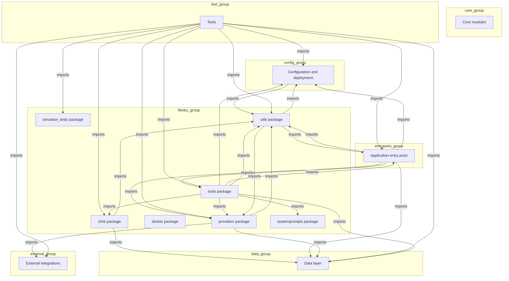

# Architecture report: BeehiveInnovations/pal-mcp-server

> Automated static analysis. **Observed** = directly seen in files/imports/AST; **Inferred** = interpretation from that evidence. Repository code was not executed.

## 1. Repository at a glance

| Item | Value |
| --- | --- |
| Repository | BeehiveInnovations/pal-mcp-server |
| Description | The power of Claude Code / GeminiCLI / CodexCLI + [Gemini / OpenAI / OpenRouter / Azure / Grok / Ollama / Custom Model / All Of The Above] working as one. |
| Language | Python |
| Stars | 11838 |
| Licence | Other |
| Analysed commit / branch | 7afc7c1cc96e23992c8f105f960132c657883bb1 / main |
| Framework(s) | None detected |
| Files analysed | 361 |
| Components | 13 |

## 2. Architecture in one minute

BeehiveInnovations/pal-mcp-server - The power of Claude Code / GeminiCLI / CodexCLI + [Gemini / OpenAI / OpenRouter / Azure / Grok / Ollama / Custom Model / All Of The Above] working as one.. This repository was analysed statically from 361 file(s) (249 Python). Detected technologies (observed from imports/manifests): GitHub Actions, httpx, Pydantic, Poetry, setuptools, Docker. Files are grouped into 13 component(s): clink package, Configuration and deployment, Core modules, Data layer, docker package, Application entry point, External integrations, providers package. Observed entry point(s): communication_simulator_test.py, docker/scripts/healthcheck.py, scripts/sync_version.py. Findings below distinguish observed facts from inferred interpretation.

## 3. High-level block diagram

## 4. Main components

### clink package (`clink`)

- **Kind:** library
- **Status:** Observed
- **Confidence:** 0.85
- **Responsibility:** Groups 13 file(s) under clink package (observed from repository paths and static analysis). Observed top-level classes: AgentOutput, BaseCLIAgent, BaseParser, CLIAgentError, CLIInternalDefaults, ClaudeAgent. Observed top-level functions: create_agent, get_parser, get_registry.
- **Paths:** `clink/__init__.py`, `clink/agents/__init__.py`, `clink/agents/base.py`, `clink/agents/claude.py`, `clink/agents/codex.py`, `clink/agents/gemini.py`, `clink/constants.py`, `clink/parsers/__init__.py`, `clink/parsers/base.py`, `clink/parsers/claude.py`, `clink/parsers/codex.py`, `clink/parsers/gemini.py`, `clink/registry.py`
- **Evidence:** [clink/__init__.py](https://github.com/BeehiveInnovations/pal-mcp-server/blob/7afc7c1cc96e23992c8f105f960132c657883bb1/clink/__init__.py); [clink/agents/__init__.py:19](https://github.com/BeehiveInnovations/pal-mcp-server/blob/7afc7c1cc96e23992c8f105f960132c657883bb1/clink/agents/__init__.py#L19); [clink/agents/base.py:24](https://github.com/BeehiveInnovations/pal-mcp-server/blob/7afc7c1cc96e23992c8f105f960132c657883bb1/clink/agents/base.py#L24); [clink/agents/claude.py:11](https://github.com/BeehiveInnovations/pal-mcp-server/blob/7afc7c1cc96e23992c8f105f960132c657883bb1/clink/agents/claude.py#L11); [clink/agents/codex.py:11](https://github.com/BeehiveInnovations/pal-mcp-server/blob/7afc7c1cc96e23992c8f105f960132c657883bb1/clink/agents/codex.py#L11); [clink/agents/gemini.py:14](https://github.com/BeehiveInnovations/pal-mcp-server/blob/7afc7c1cc96e23992c8f105f960132c657883bb1/clink/agents/gemini.py#L14); [clink/constants.py:18](https://github.com/BeehiveInnovations/pal-mcp-server/blob/7afc7c1cc96e23992c8f105f960132c657883bb1/clink/constants.py#L18); [clink/parsers/__init__.py:17](https://github.com/BeehiveInnovations/pal-mcp-server/blob/7afc7c1cc96e23992c8f105f960132c657883bb1/clink/parsers/__init__.py#L17)

### Configuration and deployment (`config`)

- **Kind:** config
- **Status:** Observed
- **Confidence:** 0.85
- **Responsibility:** Groups 19 file(s) under configuration and deployment (observed from repository paths and static analysis). Observed top-level functions: _calculate_mcp_prompt_limit.
- **Paths:** `Dockerfile`, `claude_config_example.json`, `conf/__init__.py`, `conf/azure_models.json`, `conf/cli_clients/claude.json`, `conf/cli_clients/codex.json`, `conf/cli_clients/gemini.json`, `conf/custom_models.json`, `conf/dial_models.json`, `conf/gemini_models.json`, `conf/openai_models.json`, `conf/openrouter_models.json`, `conf/xai_models.json`, `config.py`, `docker-compose.yml`, `pyproject.toml`, `pytest.ini`, `requirements-dev.txt`, `requirements.txt`
- **Evidence:** [Dockerfile](https://github.com/BeehiveInnovations/pal-mcp-server/blob/7afc7c1cc96e23992c8f105f960132c657883bb1/Dockerfile); [claude_config_example.json](https://github.com/BeehiveInnovations/pal-mcp-server/blob/7afc7c1cc96e23992c8f105f960132c657883bb1/claude_config_example.json); [conf/__init__.py](https://github.com/BeehiveInnovations/pal-mcp-server/blob/7afc7c1cc96e23992c8f105f960132c657883bb1/conf/__init__.py); [conf/azure_models.json](https://github.com/BeehiveInnovations/pal-mcp-server/blob/7afc7c1cc96e23992c8f105f960132c657883bb1/conf/azure_models.json); [conf/cli_clients/claude.json](https://github.com/BeehiveInnovations/pal-mcp-server/blob/7afc7c1cc96e23992c8f105f960132c657883bb1/conf/cli_clients/claude.json); [conf/cli_clients/codex.json](https://github.com/BeehiveInnovations/pal-mcp-server/blob/7afc7c1cc96e23992c8f105f960132c657883bb1/conf/cli_clients/codex.json); [conf/cli_clients/gemini.json](https://github.com/BeehiveInnovations/pal-mcp-server/blob/7afc7c1cc96e23992c8f105f960132c657883bb1/conf/cli_clients/gemini.json); [conf/custom_models.json](https://github.com/BeehiveInnovations/pal-mcp-server/blob/7afc7c1cc96e23992c8f105f960132c657883bb1/conf/custom_models.json)

### Core modules (`core`)

- **Kind:** core
- **Status:** Observed
- **Confidence:** 0.85
- **Responsibility:** Groups 3 file(s) under core modules (observed from repository paths and static analysis).
- **Paths:** `code_quality_checks.sh`, `run-server.sh`, `run_integration_tests.sh`
- **Evidence:** [code_quality_checks.sh](https://github.com/BeehiveInnovations/pal-mcp-server/blob/7afc7c1cc96e23992c8f105f960132c657883bb1/code_quality_checks.sh); [run-server.sh](https://github.com/BeehiveInnovations/pal-mcp-server/blob/7afc7c1cc96e23992c8f105f960132c657883bb1/run-server.sh); [run_integration_tests.sh](https://github.com/BeehiveInnovations/pal-mcp-server/blob/7afc7c1cc96e23992c8f105f960132c657883bb1/run_integration_tests.sh)

### Data layer (`data_layer`)

- **Kind:** data
- **Status:** Observed
- **Confidence:** 0.85
- **Responsibility:** Groups 2 file(s) under data layer (observed from repository paths and static analysis). Observed top-level classes: BranchingPoint, CLIClientConfig, CLIRoleConfig, CallPathStep, CodeTooLargeRequest, ContinuationOffer.
- **Paths:** `clink/models.py`, `tools/models.py`
- **Evidence:** [clink/models.py:11](https://github.com/BeehiveInnovations/pal-mcp-server/blob/7afc7c1cc96e23992c8f105f960132c657883bb1/clink/models.py#L11); [tools/models.py:11](https://github.com/BeehiveInnovations/pal-mcp-server/blob/7afc7c1cc96e23992c8f105f960132c657883bb1/tools/models.py#L11)

### docker package (`docker`)

- **Kind:** library
- **Status:** Observed
- **Confidence:** 0.85
- **Responsibility:** Groups 2 file(s) under docker package (observed from repository paths and static analysis).
- **Paths:** `docker/scripts/build.sh`, `docker/scripts/deploy.sh`
- **Evidence:** [docker/scripts/build.sh](https://github.com/BeehiveInnovations/pal-mcp-server/blob/7afc7c1cc96e23992c8f105f960132c657883bb1/docker/scripts/build.sh); [docker/scripts/deploy.sh](https://github.com/BeehiveInnovations/pal-mcp-server/blob/7afc7c1cc96e23992c8f105f960132c657883bb1/docker/scripts/deploy.sh)

### Application entry point (`entrypoint`)

- **Kind:** entrypoint
- **Status:** Observed
- **Confidence:** 0.85
- **Responsibility:** Groups 3 file(s) under application entry point (observed from repository paths and static analysis). Observed top-level classes: LocalTimeFormatter. Observed top-level functions: apply_tool_filter, check_environment, check_log_directory, check_process, check_python_imports, configure_providers.
- **Paths:** `docker/scripts/healthcheck.py`, `scripts/sync_version.py`, `server.py`
- **Evidence:** [docker/scripts/healthcheck.py:20](https://github.com/BeehiveInnovations/pal-mcp-server/blob/7afc7c1cc96e23992c8f105f960132c657883bb1/docker/scripts/healthcheck.py#L20); [scripts/sync_version.py:13](https://github.com/BeehiveInnovations/pal-mcp-server/blob/7afc7c1cc96e23992c8f105f960132c657883bb1/scripts/sync_version.py#L13); [server.py:81](https://github.com/BeehiveInnovations/pal-mcp-server/blob/7afc7c1cc96e23992c8f105f960132c657883bb1/server.py#L81)

### External integrations (`external_integrations`)

- **Kind:** external
- **Status:** Inferred
- **Confidence:** 0.70
- **Responsibility:** Groups 0 file(s) under external integrations (observed from repository paths and static analysis).
- **Evidence:** [providers/azure_openai.py:242](https://github.com/BeehiveInnovations/pal-mcp-server/blob/7afc7c1cc96e23992c8f105f960132c657883bb1/providers/azure_openai.py#L242); [providers/dial.py:75](https://github.com/BeehiveInnovations/pal-mcp-server/blob/7afc7c1cc96e23992c8f105f960132c657883bb1/providers/dial.py#L75); [providers/openai_compatible.py:145](https://github.com/BeehiveInnovations/pal-mcp-server/blob/7afc7c1cc96e23992c8f105f960132c657883bb1/providers/openai_compatible.py#L145); [providers/openai_compatible.py:260](https://github.com/BeehiveInnovations/pal-mcp-server/blob/7afc7c1cc96e23992c8f105f960132c657883bb1/providers/openai_compatible.py#L260); [tests/http_transport_recorder.py:23](https://github.com/BeehiveInnovations/pal-mcp-server/blob/7afc7c1cc96e23992c8f105f960132c657883bb1/tests/http_transport_recorder.py#L23)

### providers package (`providers`)

- **Kind:** library
- **Status:** Observed
- **Confidence:** 0.85
- **Responsibility:** Groups 26 file(s) under providers package (observed from repository paths and static analysis). Observed top-level classes: AzureModelRegistry, AzureOpenAIProvider, CapabilityModelRegistry, CustomEndpointModelRegistry, CustomModelRegistryBase, CustomProvider.
- **Paths:** `providers/__init__.py`, `providers/azure_openai.py`, `providers/base.py`, `providers/custom.py`, `providers/dial.py`, `providers/gemini.py`, `providers/openai.py`, `providers/openai_compatible.py`, `providers/openrouter.py`, `providers/registries/__init__.py`, `providers/registries/azure.py`, `providers/registries/base.py`, `providers/registries/custom.py`, `providers/registries/dial.py`, `providers/registries/gemini.py`, `providers/registries/openai.py`, `providers/registries/openrouter.py`, `providers/registries/xai.py`, `providers/registry.py`, `providers/registry_provider_mixin.py`, `providers/shared/__init__.py`, `providers/shared/model_capabilities.py`, `providers/shared/model_response.py`, `providers/shared/provider_type.py`, `providers/shared/temperature.py`, `providers/xai.py`
- **Evidence:** [providers/__init__.py](https://github.com/BeehiveInnovations/pal-mcp-server/blob/7afc7c1cc96e23992c8f105f960132c657883bb1/providers/__init__.py); [providers/azure_openai.py:23](https://github.com/BeehiveInnovations/pal-mcp-server/blob/7afc7c1cc96e23992c8f105f960132c657883bb1/providers/azure_openai.py#L23); [providers/base.py:16](https://github.com/BeehiveInnovations/pal-mcp-server/blob/7afc7c1cc96e23992c8f105f960132c657883bb1/providers/base.py#L16); [providers/custom.py:13](https://github.com/BeehiveInnovations/pal-mcp-server/blob/7afc7c1cc96e23992c8f105f960132c657883bb1/providers/custom.py#L13); [providers/dial.py:17](https://github.com/BeehiveInnovations/pal-mcp-server/blob/7afc7c1cc96e23992c8f105f960132c657883bb1/providers/dial.py#L17); [providers/gemini.py:24](https://github.com/BeehiveInnovations/pal-mcp-server/blob/7afc7c1cc96e23992c8f105f960132c657883bb1/providers/gemini.py#L24); [providers/openai.py:17](https://github.com/BeehiveInnovations/pal-mcp-server/blob/7afc7c1cc96e23992c8f105f960132c657883bb1/providers/openai.py#L17); [providers/openai_compatible.py:22](https://github.com/BeehiveInnovations/pal-mcp-server/blob/7afc7c1cc96e23992c8f105f960132c657883bb1/providers/openai_compatible.py#L22)

### simulator_tests package (`simulator_tests`)

- **Kind:** library
- **Status:** Observed
- **Confidence:** 0.85
- **Responsibility:** Groups 2 file(s) under simulator_tests package (observed from repository paths and static analysis). Observed top-level classes: LogUtils.
- **Paths:** `simulator_tests/__init__.py`, `simulator_tests/log_utils.py`
- **Evidence:** [simulator_tests/__init__.py](https://github.com/BeehiveInnovations/pal-mcp-server/blob/7afc7c1cc96e23992c8f105f960132c657883bb1/simulator_tests/__init__.py); [simulator_tests/log_utils.py:14](https://github.com/BeehiveInnovations/pal-mcp-server/blob/7afc7c1cc96e23992c8f105f960132c657883bb1/simulator_tests/log_utils.py#L14)

### systemprompts package (`systemprompts`)

- **Kind:** library
- **Status:** Observed
- **Confidence:** 0.85
- **Responsibility:** Groups 15 file(s) under systemprompts package (observed from repository paths and static analysis).
- **Paths:** `systemprompts/__init__.py`, `systemprompts/analyze_prompt.py`, `systemprompts/chat_prompt.py`, `systemprompts/codereview_prompt.py`, `systemprompts/consensus_prompt.py`, `systemprompts/debug_prompt.py`, `systemprompts/docgen_prompt.py`, `systemprompts/generate_code_prompt.py`, `systemprompts/planner_prompt.py`, `systemprompts/precommit_prompt.py`, `systemprompts/refactor_prompt.py`, `systemprompts/secaudit_prompt.py`, `systemprompts/testgen_prompt.py`, `systemprompts/thinkdeep_prompt.py`, `systemprompts/tracer_prompt.py`
- **Evidence:** [systemprompts/__init__.py](https://github.com/BeehiveInnovations/pal-mcp-server/blob/7afc7c1cc96e23992c8f105f960132c657883bb1/systemprompts/__init__.py); [systemprompts/analyze_prompt.py](https://github.com/BeehiveInnovations/pal-mcp-server/blob/7afc7c1cc96e23992c8f105f960132c657883bb1/systemprompts/analyze_prompt.py); [systemprompts/chat_prompt.py](https://github.com/BeehiveInnovations/pal-mcp-server/blob/7afc7c1cc96e23992c8f105f960132c657883bb1/systemprompts/chat_prompt.py); [systemprompts/codereview_prompt.py](https://github.com/BeehiveInnovations/pal-mcp-server/blob/7afc7c1cc96e23992c8f105f960132c657883bb1/systemprompts/codereview_prompt.py); [systemprompts/consensus_prompt.py](https://github.com/BeehiveInnovations/pal-mcp-server/blob/7afc7c1cc96e23992c8f105f960132c657883bb1/systemprompts/consensus_prompt.py); [systemprompts/debug_prompt.py](https://github.com/BeehiveInnovations/pal-mcp-server/blob/7afc7c1cc96e23992c8f105f960132c657883bb1/systemprompts/debug_prompt.py); [systemprompts/docgen_prompt.py](https://github.com/BeehiveInnovations/pal-mcp-server/blob/7afc7c1cc96e23992c8f105f960132c657883bb1/systemprompts/docgen_prompt.py); [systemprompts/generate_code_prompt.py](https://github.com/BeehiveInnovations/pal-mcp-server/blob/7afc7c1cc96e23992c8f105f960132c657883bb1/systemprompts/generate_code_prompt.py)

### Tests (`tests`)

- **Kind:** test
- **Status:** Observed
- **Confidence:** 0.85
- **Responsibility:** Groups 155 file(s) under tests (observed from repository paths and static analysis). Observed routes: PATCH config.DEFAULT_MODEL, PATCH providers.registry.ModelProviderRegistry.get_provider_for_model, PATCH server.DEFAULT_MODEL, PATCH config.DEFAULT_MODEL, PATCH config.DEFAULT_MODEL. Observed top-level classes: AnalyzeValidationTest, BaseSimulatorTest, BasicConversationTest, ChatSimpleValidationTest, CodeReviewValidationTest, CommunicationSimulator. Observed top-level functions: _build_rate_limit_stdout, _build_success_payload, _extract_available_models, _extract_number, _install_dummy_provid…
- **Paths:** `communication_simulator_test.py`, `simulator_tests/base_test.py`, `simulator_tests/conversation_base_test.py`, `simulator_tests/test_analyze_validation.py`, `simulator_tests/test_basic_conversation.py`, `simulator_tests/test_chat_simple_validation.py`, `simulator_tests/test_codereview_validation.py`, `simulator_tests/test_consensus_conversation.py`, `simulator_tests/test_consensus_three_models.py`, `simulator_tests/test_consensus_workflow_accurate.py`, `simulator_tests/test_content_validation.py`, `simulator_tests/test_conversation_chain_validation.py`, `simulator_tests/test_cross_tool_comprehensive.py`, `simulator_tests/test_cross_tool_continuation.py`, `simulator_tests/test_debug_certain_confidence.py`, `simulator_tests/test_debug_validation.py`, `simulator_tests/test_line_number_validation.py`, `simulator_tests/test_logs_validation.py`, `simulator_tests/test_model_thinking_config.py`, `simulator_tests/test_o3_model_selection.py`, `simulator_tests/test_o3_pro_expensive.py`, `simulator_tests/test_ollama_custom_url.py`, `simulator_tests/test_openrouter_fallback.py`, `simulator_tests/test_openrouter_models.py`, `simulator_tests/test_per_tool_deduplication.py`, `simulator_tests/test_planner_continuation_history.py`, `simulator_tests/test_planner_validation.py`, `simulator_tests/test_planner_validation_old.py`, `simulator_tests/test_precommitworkflow_validation.py`, `simulator_tests/test_prompt_size_limit_bug.py`, `simulator_tests/test_refactor_validation.py`, `simulator_tests/test_secaudit_validation.py`, `simulator_tests/test_testgen_validation.py`, `simulator_tests/test_thinkdeep_validation.py`, `simulator_tests/test_token_allocation_validation.py`, `simulator_tests/test_vision_capability.py`, `simulator_tests/test_xai_models.py`, `tests/CASSETTE_MAINTENANCE.md`, `tests/__init__.py`, `tests/conftest.py`, `tests/gemini_cassettes/chat_codegen/gemini25_pro_calculator/mldev.json`, `tests/gemini_cassettes/chat_cross/step1_gemini25_flash_number/mldev.json`, `tests/gemini_cassettes/consensus/step2_gemini25_flash_against/mldev.json`, `tests/http_transport_recorder.py`, `tests/mock_helpers.py`, `tests/openai_cassettes/chat_cross_step2_gpt5_reminder.json`, `tests/openai_cassettes/chat_gpt5_continuation.json`, `tests/openai_cassettes/chat_gpt5_moon_distance.json`, `tests/openai_cassettes/consensus_step1_gpt51_for.json`, `tests/openai_cassettes/consensus_step1_gpt52_for.json`, `tests/openai_cassettes/consensus_step1_gpt5_for.json`, `tests/openai_cassettes/o3_pro_basic_math.json`, `tests/pii_sanitizer.py`, `tests/sanitize_cassettes.py`, `tests/test_alias_target_restrictions.py`, `tests/test_auto_mode.py`, `tests/test_auto_mode_comprehensive.py`, `tests/test_auto_mode_custom_provider_only.py`, `tests/test_auto_mode_model_listing.py`, `tests/test_auto_mode_provider_selection.py`, `tests/test_auto_model_planner_fix.py`, `tests/test_azure_openai_provider.py`, `tests/test_buggy_behavior_prevention.py`, `tests/test_cassette_semantic_matching.py`, `tests/test_challenge.py`, `tests/test_chat_codegen_integration.py`, `tests/test_chat_cross_model_continuation.py`, `tests/test_chat_openai_integration.py`, `tests/test_chat_simple.py`, `tests/test_clink_claude_agent.py`, `tests/test_clink_claude_parser.py`, `tests/test_clink_codex_agent.py`, `tests/test_clink_gemini_agent.py`, `tests/test_clink_gemini_parser.py`, `tests/test_clink_integration.py`, `tests/test_clink_parsers.py`, `tests/test_clink_tool.py`, `tests/test_collaboration.py`, `tests/test_config.py`, `tests/test_consensus.py`, `tests/test_consensus_integration.py`, `tests/test_consensus_schema.py`, `tests/test_conversation_continuation_integration.py`, `tests/test_conversation_field_mapping.py`, `tests/test_conversation_file_features.py`, `tests/test_conversation_memory.py`, `tests/test_conversation_missing_files.py`, `tests/test_custom_openai_temperature_fix.py`, `tests/test_custom_provider.py`, `tests/test_debug.py`, `tests/test_deploy_scripts.py`, `tests/test_dial_provider.py`, `tests/test_directory_expansion_tracking.py`, `tests/test_disabled_tools.py`, `tests/test_docker_claude_desktop_integration.py`, `tests/test_docker_config_complete.py`, `tests/test_docker_healthcheck.py`, `tests/test_docker_implementation.py`, `tests/test_docker_mcp_validation.py`, `tests/test_docker_security.py`, `tests/test_docker_volume_persistence.py`, `tests/test_file_protection.py`, `tests/test_gemini_token_usage.py`, `tests/test_image_support_integration.py`, `tests/test_image_validation.py`, `tests/test_integration_utf8.py`, `tests/test_intelligent_fallback.py`, `tests/test_issue_245_simple.py`, `tests/test_large_prompt_handling.py`, `tests/test_line_numbers_integration.py`, `tests/test_listmodels.py`, `tests/test_listmodels_restrictions.py`, `tests/test_mcp_error_handling.py`, `tests/test_model_enumeration.py`, `tests/test_model_metadata_continuation.py`, `tests/test_model_resolution_bug.py`, `tests/test_model_restrictions.py`, `tests/test_o3_pro_output_text_fix.py`, `tests/test_o3_temperature_fix_simple.py`, `tests/test_openai_compatible_token_usage.py`, `tests/test_openai_provider.py`, `tests/test_openrouter_provider.py`, `tests/test_openrouter_registry.py`, `tests/test_openrouter_store_parameter.py`, `tests/test_parse_model_option.py`, `tests/test_path_traversal_security.py`, `tests/test_per_tool_model_defaults.py`, `tests/test_pii_sanitizer.py`, `tests/test_pip_detection_fix.py`, `tests/test_planner.py`, `tests/test_precommit_workflow.py`, `tests/test_prompt_regression.py`, `tests/test_prompt_size_limit_bug_fix.py`, `tests/test_provider_retry_logic.py`, `tests/test_provider_routing_bugs.py`, `tests/test_provider_utf8.py`, `tests/test_providers.py`, `tests/test_rate_limit_patterns.py`, `tests/test_refactor.py`, `tests/test_secaudit.py`, `tests/test_server.py`, `tests/test_supported_models_aliases.py`, `tests/test_thinking_modes.py`, `tests/test_tools.py`, `tests/test_tracer.py`, `tests/test_utf8_localization.py`, `tests/test_utils.py`, `tests/test_uvx_resource_packaging.py`, `tests/test_uvx_support.py`, `tests/test_workflow_file_embedding.py`, `tests/test_workflow_metadata.py`, `tests/test_workflow_prompt_size_validation_simple.py`, `tests/test_workflow_utf8.py`, `tests/test_xai_provider.py`, `tests/transport_helpers.py`
- **Evidence:** [communication_simulator_test.py:79](https://github.com/BeehiveInnovations/pal-mcp-server/blob/7afc7c1cc96e23992c8f105f960132c657883bb1/communication_simulator_test.py#L79); [simulator_tests/base_test.py:17](https://github.com/BeehiveInnovations/pal-mcp-server/blob/7afc7c1cc96e23992c8f105f960132c657883bb1/simulator_tests/base_test.py#L17); [simulator_tests/conversation_base_test.py:46](https://github.com/BeehiveInnovations/pal-mcp-server/blob/7afc7c1cc96e23992c8f105f960132c657883bb1/simulator_tests/conversation_base_test.py#L46); [simulator_tests/test_analyze_validation.py:16](https://github.com/BeehiveInnovations/pal-mcp-server/blob/7afc7c1cc96e23992c8f105f960132c657883bb1/simulator_tests/test_analyze_validation.py#L16); [simulator_tests/test_basic_conversation.py:14](https://github.com/BeehiveInnovations/pal-mcp-server/blob/7afc7c1cc96e23992c8f105f960132c657883bb1/simulator_tests/test_basic_conversation.py#L14); [simulator_tests/test_chat_simple_validation.py:20](https://github.com/BeehiveInnovations/pal-mcp-server/blob/7afc7c1cc96e23992c8f105f960132c657883bb1/simulator_tests/test_chat_simple_validation.py#L20); [simulator_tests/test_codereview_validation.py:16](https://github.com/BeehiveInnovations/pal-mcp-server/blob/7afc7c1cc96e23992c8f105f960132c657883bb1/simulator_tests/test_codereview_validation.py#L16); [simulator_tests/test_consensus_conversation.py:14](https://github.com/BeehiveInnovations/pal-mcp-server/blob/7afc7c1cc96e23992c8f105f960132c657883bb1/simulator_tests/test_consensus_conversation.py#L14)

### tools package (`tools`)

- **Kind:** library
- **Status:** Observed
- **Confidence:** 0.85
- **Responsibility:** Groups 30 file(s) under tools package (observed from repository paths and static analysis). Observed top-level classes: AnalyzeTool, AnalyzeWorkflowRequest, BaseTool, BaseWorkflowMixin, BaseWorkflowRequest, CLinkRequest. Observed top-level functions: compare_versions, fetch_github_version, parse_version.
- **Paths:** `tools/__init__.py`, `tools/analyze.py`, `tools/apilookup.py`, `tools/challenge.py`, `tools/chat.py`, `tools/clink.py`, `tools/codereview.py`, `tools/consensus.py`, `tools/debug.py`, `tools/docgen.py`, `tools/listmodels.py`, `tools/planner.py`, `tools/precommit.py`, `tools/refactor.py`, `tools/secaudit.py`, `tools/shared/__init__.py`, `tools/shared/base_models.py`, `tools/shared/base_tool.py`, `tools/shared/exceptions.py`, `tools/shared/schema_builders.py`, `tools/simple/__init__.py`, `tools/simple/base.py`, `tools/testgen.py`, `tools/thinkdeep.py`, `tools/tracer.py`, `tools/version.py`, `tools/workflow/__init__.py`, `tools/workflow/base.py`, `tools/workflow/schema_builders.py`, `tools/workflow/workflow_mixin.py`
- **Evidence:** [tools/__init__.py](https://github.com/BeehiveInnovations/pal-mcp-server/blob/7afc7c1cc96e23992c8f105f960132c657883bb1/tools/__init__.py); [tools/analyze.py:83](https://github.com/BeehiveInnovations/pal-mcp-server/blob/7afc7c1cc96e23992c8f105f960132c657883bb1/tools/analyze.py#L83); [tools/apilookup.py:23](https://github.com/BeehiveInnovations/pal-mcp-server/blob/7afc7c1cc96e23992c8f105f960132c657883bb1/tools/apilookup.py#L23); [tools/challenge.py:33](https://github.com/BeehiveInnovations/pal-mcp-server/blob/7afc7c1cc96e23992c8f105f960132c657883bb1/tools/challenge.py#L33); [tools/chat.py:42](https://github.com/BeehiveInnovations/pal-mcp-server/blob/7afc7c1cc96e23992c8f105f960132c657883bb1/tools/chat.py#L42); [tools/clink.py:29](https://github.com/BeehiveInnovations/pal-mcp-server/blob/7afc7c1cc96e23992c8f105f960132c657883bb1/tools/clink.py#L29); [tools/codereview.py:64](https://github.com/BeehiveInnovations/pal-mcp-server/blob/7afc7c1cc96e23992c8f105f960132c657883bb1/tools/codereview.py#L64); [tools/consensus.py:62](https://github.com/BeehiveInnovations/pal-mcp-server/blob/7afc7c1cc96e23992c8f105f960132c657883bb1/tools/consensus.py#L62)

### utils package (`utils`)

- **Kind:** library
- **Status:** Observed
- **Confidence:** 0.85
- **Responsibility:** Groups 12 file(s) under utils package (observed from repository paths and static analysis). Observed top-level classes: ConversationTurn, InMemoryStorage, ModelContext, ModelRestrictionService, ThreadContext, TokenAllocation. Observed top-level functions: _add_line_numbers, _compute_force_override, _default_turn_formatting, _get_tool_formatted_content, _is_builtin_custom_models_config, _is_valid_uuid.
- **Paths:** `utils/__init__.py`, `utils/client_info.py`, `utils/conversation_memory.py`, `utils/env.py`, `utils/file_types.py`, `utils/file_utils.py`, `utils/image_utils.py`, `utils/model_context.py`, `utils/model_restrictions.py`, `utils/security_config.py`, `utils/storage_backend.py`, `utils/token_utils.py`
- **Evidence:** [utils/__init__.py](https://github.com/BeehiveInnovations/pal-mcp-server/blob/7afc7c1cc96e23992c8f105f960132c657883bb1/utils/__init__.py); [utils/client_info.py:47](https://github.com/BeehiveInnovations/pal-mcp-server/blob/7afc7c1cc96e23992c8f105f960132c657883bb1/utils/client_info.py#L47); [utils/conversation_memory.py:151](https://github.com/BeehiveInnovations/pal-mcp-server/blob/7afc7c1cc96e23992c8f105f960132c657883bb1/utils/conversation_memory.py#L151); [utils/env.py:23](https://github.com/BeehiveInnovations/pal-mcp-server/blob/7afc7c1cc96e23992c8f105f960132c657883bb1/utils/env.py#L23); [utils/file_types.py:143](https://github.com/BeehiveInnovations/pal-mcp-server/blob/7afc7c1cc96e23992c8f105f960132c657883bb1/utils/file_types.py#L143); [utils/file_utils.py:52](https://github.com/BeehiveInnovations/pal-mcp-server/blob/7afc7c1cc96e23992c8f105f960132c657883bb1/utils/file_utils.py#L52); [utils/image_utils.py:15](https://github.com/BeehiveInnovations/pal-mcp-server/blob/7afc7c1cc96e23992c8f105f960132c657883bb1/utils/image_utils.py#L15); [utils/model_context.py:40](https://github.com/BeehiveInnovations/pal-mcp-server/blob/7afc7c1cc96e23992c8f105f960132c657883bb1/utils/model_context.py#L40)

## 5. Execution flow

**Observed** entry point(s):

- [communication_simulator_test.py:555](https://github.com/BeehiveInnovations/pal-mcp-server/blob/7afc7c1cc96e23992c8f105f960132c657883bb1/communication_simulator_test.py#L555)
- [docker/scripts/healthcheck.py:114](https://github.com/BeehiveInnovations/pal-mcp-server/blob/7afc7c1cc96e23992c8f105f960132c657883bb1/docker/scripts/healthcheck.py#L114)
- [scripts/sync_version.py:37](https://github.com/BeehiveInnovations/pal-mcp-server/blob/7afc7c1cc96e23992c8f105f960132c657883bb1/scripts/sync_version.py#L37)
- [server.py](https://github.com/BeehiveInnovations/pal-mcp-server/blob/7afc7c1cc96e23992c8f105f960132c657883bb1/server.py)

**Observed** routes (from decorators):

- `PATCH config.DEFAULT_MODEL` -> `test_auto_model_error_before_fix_simulation` in `tests/test_auto_model_planner_fix.py:61`
- `PATCH providers.registry.ModelProviderRegistry.get_provider_for_model` -> `test_auto_model_error_before_fix_simulation` in `tests/test_auto_model_planner_fix.py:61`
- `PATCH server.DEFAULT_MODEL` -> `test_planner_execution_bypasses_model_resolution` in `tests/test_auto_model_planner_fix.py:79`
- `PATCH config.DEFAULT_MODEL` -> `test_server_model_resolution_logic` in `tests/test_auto_model_planner_fix.py:107`
- `PATCH config.DEFAULT_MODEL` -> `test_end_to_end_planner_with_auto_mode` in `tests/test_auto_model_planner_fix.py:148`
- `PATCH tools.shared.base_tool.BaseTool.get_model_provider` -> `test_clarification_request_parsing` in `tests/test_collaboration.py:30`
- `PATCH tools.shared.base_tool.BaseTool.get_model_provider` -> `test_normal_response_not_parsed_as_clarification` in `tests/test_collaboration.py:86`
- `PATCH utils.conversation_memory.create_thread` -> `test_normal_response_not_parsed_as_clarification` in `tests/test_collaboration.py:86`
- `PATCH utils.conversation_memory.add_turn` -> `test_normal_response_not_parsed_as_clarification` in `tests/test_collaboration.py:86`
- `PATCH tools.shared.base_tool.BaseTool.get_model_provider` -> `test_malformed_clarification_request_treated_as_normal` in `tests/test_collaboration.py:119`
- `PATCH tools.shared.base_tool.BaseTool.get_model_provider` -> `test_clarification_with_suggested_action` in `tests/test_collaboration.py:159`
- `PATCH tools.shared.base_tool.BaseTool.get_model_provider` -> `test_error_response_format` in `tests/test_collaboration.py:307`
- `PATCH tools.shared.base_tool.BaseTool.get_model_provider` -> `test_dependency_analysis_triggers_clarification` in `tests/test_collaboration.py:357`
- `PATCH tools.workflow.workflow_mixin.BaseWorkflowMixin._call_expert_analysis` -> `test_dependency_analysis_triggers_clarification` in `tests/test_collaboration.py:357`
- `PATCH tools.shared.base_tool.BaseTool.get_model_provider` -> `test_multi_step_collaboration` in `tests/test_collaboration.py:423`
- `PATCH tools.workflow.workflow_mixin.BaseWorkflowMixin._call_expert_analysis` -> `test_multi_step_collaboration` in `tests/test_collaboration.py:423`
- `PATCH utils.conversation_memory.get_storage` -> `test_create_thread` in `tests/test_conversation_memory.py:30`
- `PATCH utils.conversation_memory.get_storage` -> `test_get_thread_valid` in `tests/test_conversation_memory.py:47`
- `PATCH utils.conversation_memory.get_storage` -> `test_get_thread_invalid_uuid` in `tests/test_conversation_memory.py:73`
- `PATCH utils.conversation_memory.get_storage` -> `test_get_thread_not_found` in `tests/test_conversation_memory.py:79`
- `PATCH utils.conversation_memory.get_storage` -> `test_add_turn_success` in `tests/test_conversation_memory.py:89`
- `PATCH utils.conversation_memory.get_storage` -> `test_add_turn_max_limit` in `tests/test_conversation_memory.py:115`
- `PATCH utils.conversation_memory.get_storage` -> `test_complete_conversation_cycle` in `tests/test_conversation_memory.py:243`
- `PATCH utils.conversation_memory.get_storage` -> `test_invalid_continuation_id_error` in `tests/test_conversation_memory.py:347`
- `PATCH utils.conversation_memory.get_storage` -> `test_complete_conversation_with_dynamic_turns` in `tests/test_conversation_memory.py:445`
- `PATCH utils.conversation_memory.get_storage` -> `test_conversation_with_files_and_context_preservation` in `tests/test_conversation_memory.py:502`
- `PATCH utils.conversation_memory.get_storage` -> `test_stateless_request_isolation` in `tests/test_conversation_memory.py:667`
- `PATCH utils.model_restrictions.get_restriction_service` -> `test_custom_openai_models_exclude_temperature_from_api_call` in `tests/test_custom_openai_temperature_fix.py:31`
- `PATCH providers.openai_compatible.OpenAI` -> `test_custom_openai_models_exclude_temperature_from_api_call` in `tests/test_custom_openai_temperature_fix.py:31`
- `PATCH utils.model_restrictions.get_restriction_service` -> `test_custom_openai_models_include_temperature_when_supported` in `tests/test_custom_openai_temperature_fix.py:139`
- `PATCH providers.openai_compatible.OpenAI` -> `test_custom_openai_models_include_temperature_when_supported` in `tests/test_custom_openai_temperature_fix.py:139`
- `PATCH utils.model_restrictions.get_restriction_service` -> `test_custom_openai_model_validation` in `tests/test_custom_openai_temperature_fix.py:217`
- `PATCH utils.model_restrictions.get_restriction_service` -> `test_fallback_to_builtin_models_when_registry_fails` in `tests/test_custom_openai_temperature_fix.py:263`
- `PATCH providers.custom.OpenAICompatibleProvider.generate_content` -> `test_generate_content_with_alias_resolution` in `tests/test_custom_provider.py:110`
- `PATCH subprocess.run` -> `test_deploy_script_docker_commands` in `tests/test_deploy_scripts.py:62`
- `PATCH subprocess.run` -> `test_docker_compose_commands` in `tests/test_deploy_scripts.py:127`
- `PATCH subprocess.run` -> `test_healthcheck_process_check` in `tests/test_deploy_scripts.py:211`
- `PATCH utils.model_restrictions._restriction_service` -> `test_model_validation` in `tests/test_dial_provider.py:44`
- `PATCH utils.model_restrictions._restriction_service` -> `test_get_capabilities` in `tests/test_dial_provider.py:80`
- `PATCH utils.model_restrictions._restriction_service` -> `test_get_capabilities_invalid_model` in `tests/test_dial_provider.py:120`
- `PATCH utils.model_restrictions.get_restriction_service` -> `test_get_capabilities_restricted_model` in `tests/test_dial_provider.py:128`
- `PATCH utils.model_restrictions._restriction_service` -> `test_supports_vision` in `tests/test_dial_provider.py:142`
- `PATCH openai.OpenAI` -> `test_generate_content_with_alias` in `tests/test_dial_provider.py:155`
- `PATCH utils.model_restrictions._restriction_service` -> `test_allowed_models_restriction` in `tests/test_dial_provider.py:223`
- `PATCH httpx.Client` -> `test_close_method` in `tests/test_dial_provider.py:240`
- `PATCH openai.OpenAI` -> `test_close_method` in `tests/test_dial_provider.py:240`
- `PATCH providers.ModelProviderRegistry.get_provider_for_model` -> `test_directory_expansion_tracked_in_conversation_memory` in `tests/test_directory_expansion_tracking.py:78`
- `PATCH utils.conversation_memory.get_storage` -> `test_conversation_continuation_with_directory_files` in `tests/test_directory_expansion_tracking.py:127`
- `PATCH providers.ModelProviderRegistry.get_provider_for_model` -> `test_conversation_continuation_with_directory_files` in `tests/test_directory_expansion_tracking.py:127`
- `PATCH utils.conversation_memory.get_storage` -> `test_get_conversation_embedded_files_with_expanded_files` in `tests/test_directory_expansion_tracking.py:202`
- `PATCH utils.conversation_memory.get_storage` -> `test_file_filtering_with_mixed_files_and_directories` in `tests/test_directory_expansion_tracking.py:243`
- `PATCH providers.ModelProviderRegistry.get_provider_for_model` -> `test_actually_processed_files_stored_correctly` in `tests/test_directory_expansion_tracking.py:290`
- `PATCH subprocess.run` -> `test_docker_build_command` in `tests/test_docker_config_complete.py:81`
- `PATCH subprocess.run` -> `test_docker_run_mcp_command` in `tests/test_docker_config_complete.py:94`
- `PATCH subprocess.run` -> `test_process_check_success` in `tests/test_docker_healthcheck.py:36`
- `PATCH subprocess.run` -> `test_process_check_failure` in `tests/test_docker_healthcheck.py:49`
- `PATCH subprocess.run` -> `test_docker_build_command` in `tests/test_docker_implementation.py:76`
- `PATCH subprocess.run` -> `test_docker_run_command_structure` in `tests/test_docker_implementation.py:89`
- `PATCH subprocess.run` -> `test_docker_health_check` in `tests/test_docker_implementation.py:117`
- `PATCH subprocess.run` -> `test_docker_command_validation` in `tests/test_docker_mcp_validation.py:37`
- `PATCH utils.conversation_memory.get_storage` -> `test_add_turn_with_images` in `tests/test_image_support_integration.py:86`
- `PATCH utils.conversation_memory.get_storage` -> `test_cross_tool_image_context_preservation` in `tests/test_image_support_integration.py:318`
- `PATCH utils.conversation_memory.get_storage` -> `test_conversation_memory_thread_chaining_with_images` in `tests/test_image_support_integration.py:456`
- `PATCH providers.gemini.logger` -> `test_gemini_provider_uses_validation` in `tests/test_image_validation.py:224`
- `PATCH providers.openai_compatible.logging` -> `test_openai_compatible_provider_uses_validation` in `tests/test_image_validation.py:237`
- `PATCH utils.model_restrictions.get_restriction_service` -> `test_listmodels_respects_openrouter_restrictions` in `tests/test_listmodels_restrictions.py:103`
- `PATCH providers.registries.openrouter.OpenRouterModelRegistry` -> `test_listmodels_respects_openrouter_restrictions` in `tests/test_listmodels_restrictions.py:103`
- `PATCH providers.registries.openrouter.OpenRouterModelRegistry` -> `test_listmodels_shows_all_models_without_restrictions` in `tests/test_listmodels_restrictions.py:244`
- `PATCH providers.registry.ModelProviderRegistry.get_provider` -> `test_get_available_models_respects_restrictions` in `tests/test_model_restrictions.py:461`
- `PATCH providers.registry.ModelProviderRegistry.get_provider` -> `test_fallback_model_respects_restrictions` in `tests/test_model_restrictions.py:668`
- `PATCH utils.model_restrictions.get_restriction_service` -> `test_o3_models_exclude_temperature_from_api_call` in `tests/test_o3_temperature_fix_simple.py:18`
- `PATCH providers.openai_compatible.OpenAI` -> `test_o3_models_exclude_temperature_from_api_call` in `tests/test_o3_temperature_fix_simple.py:18`
- `PATCH utils.model_restrictions.get_restriction_service` -> `test_regular_models_include_temperature_in_api_call` in `tests/test_o3_temperature_fix_simple.py:66`
- `PATCH providers.openai_compatible.OpenAI` -> `test_regular_models_include_temperature_in_api_call` in `tests/test_o3_temperature_fix_simple.py:66`
- `PATCH utils.model_restrictions.get_restriction_service` -> `test_o3_models_filter_unsupported_parameters` in `tests/test_o3_temperature_fix_simple.py:115`
- `PATCH providers.openai_compatible.OpenAI` -> `test_o3_models_filter_unsupported_parameters` in `tests/test_o3_temperature_fix_simple.py:115`
- `PATCH utils.model_restrictions.get_restriction_service` -> `test_all_o3_models_have_correct_temperature_capability` in `tests/test_o3_temperature_fix_simple.py:176`
- `PATCH utils.model_restrictions.get_restriction_service` -> `test_openai_provider_temperature_constraints` in `tests/test_o3_temperature_fix_simple.py:212`
- `PATCH providers.openai_compatible.OpenAI` -> `test_generate_content_resolves_alias_before_api_call` in `tests/test_openai_provider.py:195`
- `PATCH providers.openai_compatible.OpenAI` -> `test_generate_content_other_aliases` in `tests/test_openai_provider.py:247`
- `PATCH providers.openai_compatible.OpenAI` -> `test_generate_content_no_alias_passthrough` in `tests/test_openai_provider.py:277`
- `PATCH providers.openai_compatible.OpenAI` -> `test_o3_pro_routes_to_responses_endpoint` in `tests/test_openai_provider.py:327`
- `PATCH providers.openai_compatible.OpenAI` -> `test_non_o3_pro_uses_chat_completions` in `tests/test_openai_provider.py:364`
- `PATCH google.generativeai.GenerativeModel` -> `test_gemini_provider_utf8_request` in `tests/test_provider_utf8.py:46`
- `PATCH openai.OpenAI` -> `test_openai_provider_utf8_logging` in `tests/test_provider_utf8.py:86`
- `PATCH openai.OpenAI` -> `test_openai_compatible_o3_pro_utf8` in `tests/test_provider_utf8.py:118`
- `PATCH google.generativeai.GenerativeModel` -> `test_gemini_provider_handles_api_encoding_error` in `tests/test_provider_utf8.py:280`
- `PATCH google.genai.Client` -> `test_generate_content` in `tests/test_providers.py:124`
- `PATCH config.DEFAULT_THINKING_MODE_THINKDEEP` -> `test_default_thinking_modes` in `tests/test_thinking_modes.py:26`
- `PATCH providers.registries.base.importlib.resources.files` -> `test_multiple_path_fallback` in `tests/test_uvx_resource_packaging.py:59`
- `PATCH utils.file_utils.read_files` -> `test_comprehensive_file_collection_for_expert_analysis` in `tests/test_workflow_file_embedding.py:99`
- `PATCH utils.file_utils.expand_paths` -> `test_comprehensive_file_collection_for_expert_analysis` in `tests/test_workflow_file_embedding.py:99`
- `PATCH utils.conversation_memory.get_thread` -> `test_comprehensive_file_collection_for_expert_analysis` in `tests/test_workflow_file_embedding.py:99`
- `PATCH utils.conversation_memory.get_conversation_file_list` -> `test_comprehensive_file_collection_for_expert_analysis` in `tests/test_workflow_file_embedding.py:99`
- `PATCH utils.file_utils.read_files` -> `test_force_embed_bypasses_conversation_history` in `tests/test_workflow_file_embedding.py:170`
- `PATCH utils.file_utils.expand_paths` -> `test_force_embed_bypasses_conversation_history` in `tests/test_workflow_file_embedding.py:170`
- `PATCH tools.shared.base_tool.BaseTool.get_model_provider` -> `test_analyze_tool_utf8_response` in `tests/test_workflow_utf8.py:63`
- `PATCH utils.model_context.ModelContext` -> `test_analyze_tool_utf8_response` in `tests/test_workflow_utf8.py:63`
- `PATCH tools.shared.base_tool.BaseTool.get_model_provider` -> `test_codereview_tool_french_findings` in `tests/test_workflow_utf8.py:130`
- `PATCH tools.shared.base_tool.BaseTool.get_model_provider` -> `test_debug_tool_french_error_analysis` in `tests/test_workflow_utf8.py:203`
- `PATCH providers.openai_compatible.OpenAI` -> `test_generate_content_resolves_alias_before_api_call` in `tests/test_xai_provider.py:265`
- `PATCH providers.openai_compatible.OpenAI` -> `test_generate_content_other_aliases` in `tests/test_xai_provider.py:315`

Representative flow (derived from observed entry points and the import graph; steps beyond the entry point are **Inferred**):

1. Execution starts at an observed entry point listed above, if present.
2. `clink` imports `data_layer` (clink package -> Data layer).
3. `clink` imports `utils` (clink package -> utils package).
4. `config` imports `utils` (Configuration and deployment -> utils package).
5. `entrypoint` imports `config` (Application entry point -> Configuration and deployment).
6. `entrypoint` imports `data_layer` (Application entry point -> Data layer).
7. `entrypoint` imports `providers` (Application entry point -> providers package).
8. `entrypoint` imports `tools` (Application entry point -> tools package).
9. `entrypoint` imports `utils` (Application entry point -> utils package).

## 6. Project structure

### `(root)`

- `.coveragerc` - other (410 bytes)
- `.dockerignore` - container (549 bytes)
- `.env.example` - config (11762 bytes)
- `.gitattributes` - other (438 bytes)
- `.gitignore` - other (2095 bytes)
- `.pre-commit-config.yaml` - config (657 bytes)
- `AGENTS.md` - docs (4813 bytes)
- `CHANGELOG.md` - docs (45809 bytes)
- `CLAUDE.md` - docs (11150 bytes)
- `Dockerfile` - container (2626 bytes)
- `LICENSE` - docs (11052 bytes)
- `README.md` - docs (21160 bytes)
- `SECURITY.md` - docs (3366 bytes)
- `claude_config_example.json` - config (399 bytes)
- `code_quality_checks.ps1` - other (8411 bytes)
- `code_quality_checks.sh` - source, Shell (3102 bytes)
- `communication_simulator_test.py` - test, Python (21167 bytes)
- `config.py` - source, Python (6896 bytes)
- `docker-compose.yml` - container (2601 bytes)
- `pal-mcp-server` - other (286 bytes)
- `pyproject.toml` - manifest (3114 bytes)
- `pytest.ini` - config (290 bytes)
- `requirements-dev.txt` - manifest (142 bytes)
- `requirements.txt` - manifest (324 bytes)
- `run-server.ps1` - other (76532 bytes)
- `run-server.sh` - source, Shell (91994 bytes)
- `run_integration_tests.ps1` - other (7042 bytes)
- `run_integration_tests.sh` - source, Shell (2681 bytes)
- `server.py` - source, Python (66217 bytes)

### `.claude`

- `.claude/commands/fix-github-issue.md` - docs (487 bytes)
- `.claude/settings.json` - config (63 bytes)

### `.github`

- `.github/FUNDING.yml` - config (68 bytes)
- `.github/ISSUE_TEMPLATE/bug_report.yml` - config (1910 bytes)
- `.github/ISSUE_TEMPLATE/config.yml` - config (589 bytes)
- `.github/ISSUE_TEMPLATE/documentation.yml` - config (1847 bytes)
- `.github/ISSUE_TEMPLATE/feature_request.yml` - config (2056 bytes)
- `.github/ISSUE_TEMPLATE/tool_addition.yml` - config (2779 bytes)
- `.github/pull_request_template.md` - docs (2986 bytes)
- `.github/workflows/docker-pr.yml` - ci, YAML (4339 bytes)
- `.github/workflows/docker-release.yml` - ci, YAML (3794 bytes)
- `.github/workflows/semantic-pr.yml` - ci, YAML (1467 bytes)
- `.github/workflows/semantic-release.yml` - ci, YAML (2047 bytes)
- `.github/workflows/test.yml` - ci, YAML (1517 bytes)

### `clink`

- `clink/__init__.py` - source, Python (175 bytes)
- `clink/agents/__init__.py` - source, Python (703 bytes)
- `clink/agents/base.py` - source, Python (8099 bytes)
- `clink/agents/claude.py` - source, Python (1498 bytes)
- `clink/agents/codex.py` - source, Python (1111 bytes)
- `clink/agents/gemini.py` - source, Python (2528 bytes)
- `clink/constants.py` - source, Python (1524 bytes)
- `clink/models.py` - source, Python (3409 bytes)
- `clink/parsers/__init__.py` - source, Python (780 bytes)
- `clink/parsers/base.py` - source, Python (619 bytes)
- `clink/parsers/claude.py` - source, Python (5287 bytes)
- `clink/parsers/codex.py` - source, Python (2197 bytes)
- `clink/parsers/gemini.py` - source, Python (4330 bytes)
- `clink/registry.py` - source, Python (8934 bytes)

### `conf`

- `conf/__init__.py` - source, Python (45 bytes)
- `conf/azure_models.json` - config (2839 bytes)
- `conf/cli_clients/claude.json` - config (508 bytes)
- `conf/cli_clients/codex.json` - config (537 bytes)
- `conf/cli_clients/gemini.json` - config (449 bytes)
- `conf/custom_models.json` - config (2252 bytes)
- `conf/dial_models.json` - config (6879 bytes)
- `conf/gemini_models.json` - config (6059 bytes)
- `conf/openai_models.json` - config (12123 bytes)
- `conf/openrouter_models.json` - config (18010 bytes)
- `conf/xai_models.json` - config (3702 bytes)

### `docker`

- `docker/README.md` - docs (8157 bytes)
- `docker/scripts/build.ps1` - other (2139 bytes)
- `docker/scripts/build.sh` - source, Shell (1167 bytes)
- `docker/scripts/deploy.ps1` - other (6543 bytes)
- `docker/scripts/deploy.sh` - source, Shell (3051 bytes)
- `docker/scripts/healthcheck.py` - source, Python (3264 bytes)

### `docs`

- `docs/adding_providers.md` - docs (11689 bytes)
- `docs/adding_tools.md` - docs (8282 bytes)
- `docs/advanced-usage.md` - docs (25804 bytes)
- `docs/ai-collaboration.md` - docs (6086 bytes)
- `docs/ai_banter.md` - docs (12633 bytes)
- `docs/azure_openai.md` - docs (3310 bytes)
- `docs/configuration.md` - docs (11991 bytes)
- `docs/context-revival.md` - docs (6188 bytes)
- `docs/contributions.md` - docs (6906 bytes)
- `docs/custom_models.md` - docs (12715 bytes)
- `docs/docker-deployment.md` - docs (10450 bytes)
- `docs/gemini-setup.md` - docs (1097 bytes)
- `docs/getting-started.md` - docs (17504 bytes)
- `docs/index.md` - docs (1207 bytes)
- `docs/locale-configuration.md` - docs (5351 bytes)
- `docs/logging.md` - docs (1599 bytes)
- `docs/model_ranking.md` - docs (3322 bytes)
- `docs/name-change.md` - docs (404 bytes)
- `docs/testing.md` - docs (5197 bytes)
- `docs/tools/analyze.md` - docs (8504 bytes)
- `docs/tools/apilookup.md` - docs (4463 bytes)
- `docs/tools/challenge.md` - docs (1555 bytes)
- `docs/tools/chat.md` - docs (6996 bytes)
- `docs/tools/clink.md` - docs (9054 bytes)
- `docs/tools/codereview.md` - docs (8871 bytes)
- `docs/tools/consensus.md` - docs (6935 bytes)
- `docs/tools/debug.md` - docs (10430 bytes)
- `docs/tools/docgen.md` - docs (8916 bytes)
- `docs/tools/listmodels.md` - docs (3959 bytes)
- `docs/tools/planner.md` - docs (3610 bytes)
- `docs/tools/precommit.md` - docs (13094 bytes)
- `docs/tools/refactor.md` - docs (11101 bytes)
- `docs/tools/secaudit.md` - docs (11986 bytes)
- `docs/tools/testgen.md` - docs (9003 bytes)
- `docs/tools/thinkdeep.md` - docs (4809 bytes)
- `docs/tools/tracer.md` - docs (6243 bytes)
- `docs/tools/version.md` - docs (3952 bytes)
- `docs/troubleshooting.md` - docs (2855 bytes)
- `docs/vcr-testing.md` - docs (4293 bytes)
- `docs/wsl-setup.md` - docs (2233 bytes)

### `examples`

- `examples/claude_config_macos.json` - config (385 bytes)
- `examples/claude_config_wsl.json` - config (438 bytes)

### `providers`

- `providers/__init__.py` - source, Python (677 bytes)
- `providers/azure_openai.py` - source, Python (14459 bytes)
- `providers/base.py` - source, Python (16550 bytes)
- `providers/custom.py` - source, Python (7393 bytes)
- `providers/dial.py` - source, Python (12697 bytes)
- `providers/gemini.py` - source, Python (21613 bytes)
- `providers/openai.py` - source, Python (6082 bytes)
- `providers/openai_compatible.py` - source, Python (36273 bytes)
- `providers/openrouter.py` - source, Python (8180 bytes)
- `providers/registries/__init__.py` - source, Python (561 bytes)
- `providers/registries/azure.py` - source, Python (1701 bytes)
- `providers/registries/base.py` - source, Python (9436 bytes)
- `providers/registries/custom.py` - source, Python (986 bytes)
- `providers/registries/dial.py` - source, Python (611 bytes)
- `providers/registries/gemini.py` - source, Python (622 bytes)
- `providers/registries/openai.py` - source, Python (622 bytes)
- `providers/registries/openrouter.py` - source, Python (1584 bytes)
- `providers/registries/xai.py` - source, Python (603 bytes)
- `providers/registry.py` - source, Python (19445 bytes)
- `providers/registry_provider_mixin.py` - source, Python (3261 bytes)
- `providers/shared/__init__.py` - source, Python (565 bytes)
- `providers/shared/model_capabilities.py` - source, Python (6213 bytes)
- `providers/shared/model_response.py` - source, Python (702 bytes)
- `providers/shared/provider_type.py` - source, Python (363 bytes)
- `providers/shared/temperature.py` - source, Python (7143 bytes)
- `providers/xai.py` - source, Python (3105 bytes)

### `scripts`

- `scripts/sync_version.py` - source, Python (952 bytes)

### `simulator_tests`

- `simulator_tests/__init__.py` - source, Python (5483 bytes)
- `simulator_tests/base_test.py` - test, Python (14626 bytes)
- `simulator_tests/conversation_base_test.py` - test, Python (10569 bytes)
- `simulator_tests/log_utils.py` - source, Python (10353 bytes)
- `simulator_tests/test_analyze_validation.py` - test, Python (47254 bytes)
- `simulator_tests/test_basic_conversation.py` - test, Python (3344 bytes)
- `simulator_tests/test_chat_simple_validation.py` - test, Python (20916 bytes)
- `simulator_tests/test_codereview_validation.py` - test, Python (46935 bytes)
- `simulator_tests/test_consensus_conversation.py` - test, Python (10471 bytes)
- `simulator_tests/test_consensus_three_models.py` - test, Python (7226 bytes)
- `simulator_tests/test_consensus_workflow_accurate.py` - test, Python (10839 bytes)
- `simulator_tests/test_content_validation.py` - test, Python (7039 bytes)
- `simulator_tests/test_conversation_chain_validation.py` - test, Python (17544 bytes)
- `simulator_tests/test_cross_tool_comprehensive.py` - test, Python (14980 bytes)
- `simulator_tests/test_cross_tool_continuation.py` - test, Python (9402 bytes)
- `simulator_tests/test_debug_certain_confidence.py` - test, Python (25699 bytes)
- `simulator_tests/test_debug_validation.py` - test, Python (43088 bytes)
- `simulator_tests/test_line_number_validation.py` - test, Python (7441 bytes)
- `simulator_tests/test_logs_validation.py` - test, Python (4148 bytes)
- `simulator_tests/test_model_thinking_config.py` - test, Python (6273 bytes)
- `simulator_tests/test_o3_model_selection.py` - test, Python (14073 bytes)
- `simulator_tests/test_o3_pro_expensive.py` - test, Python (4567 bytes)
- `simulator_tests/test_ollama_custom_url.py` - test, Python (12815 bytes)
- `simulator_tests/test_openrouter_fallback.py` - test, Python (9331 bytes)
- `simulator_tests/test_openrouter_models.py` - test, Python (9407 bytes)
- `simulator_tests/test_per_tool_deduplication.py` - test, Python (9522 bytes)
- `simulator_tests/test_planner_continuation_history.py` - test, Python (16270 bytes)
- `simulator_tests/test_planner_validation.py` - test, Python (30344 bytes)
- `simulator_tests/test_planner_validation_old.py` - test, Python (18171 bytes)
- `simulator_tests/test_precommitworkflow_validation.py` - test, Python (48357 bytes)
- `simulator_tests/test_prompt_size_limit_bug.py` - test, Python (7686 bytes)
- `simulator_tests/test_refactor_validation.py` - test, Python (47430 bytes)
- `simulator_tests/test_secaudit_validation.py` - test, Python (26113 bytes)
- `simulator_tests/test_testgen_validation.py` - test, Python (35500 bytes)
- `simulator_tests/test_thinkdeep_validation.py` - test, Python (42957 bytes)
- `simulator_tests/test_token_allocation_validation.py` - test, Python (14141 bytes)
- `simulator_tests/test_vision_capability.py` - test, Python (6145 bytes)
- `simulator_tests/test_xai_models.py` - test, Python (8393 bytes)

### `systemprompts`

- `systemprompts/__init__.py` - source, Python (1008 bytes)
- `systemprompts/analyze_prompt.py` - source, Python (4854 bytes)
- `systemprompts/chat_prompt.py` - source, Python (3972 bytes)
- `systemprompts/clink/codex_codereviewer.txt` - docs (915 bytes)
- `systemprompts/clink/default.txt` - docs (780 bytes)
- `systemprompts/clink/default_codereviewer.txt` - docs (887 bytes)
- `systemprompts/clink/default_planner.txt` - docs (813 bytes)
- `systemprompts/codereview_prompt.py` - source, Python (6875 bytes)
- `systemprompts/consensus_prompt.py` - source, Python (6091 bytes)
- `systemprompts/debug_prompt.py` - source, Python (7673 bytes)
- `systemprompts/docgen_prompt.py` - source, Python (16782 bytes)
- `systemprompts/generate_code_prompt.py` - source, Python (7829 bytes)
- `systemprompts/planner_prompt.py` - source, Python (6471 bytes)
- `systemprompts/precommit_prompt.py` - source, Python (9150 bytes)
- `systemprompts/refactor_prompt.py` - source, Python (20093 bytes)
- `systemprompts/secaudit_prompt.py` - source, Python (17473 bytes)
- `systemprompts/testgen_prompt.py` - source, Python (8632 bytes)
- `systemprompts/thinkdeep_prompt.py` - source, Python (3506 bytes)
- `systemprompts/tracer_prompt.py` - source, Python (6851 bytes)

### `tests`

- `tests/CASSETTE_MAINTENANCE.md` - test (8314 bytes)
- `tests/__init__.py` - test, Python (27 bytes)
- `tests/conftest.py` - test, Python (8453 bytes)
- `tests/gemini_cassettes/chat_codegen/gemini25_pro_calculator/mldev.json` - test (20386 bytes)
- `tests/gemini_cassettes/chat_cross/step1_gemini25_flash_number/mldev.json` - test (9797 bytes)
- `tests/gemini_cassettes/consensus/step2_gemini25_flash_against/mldev.json` - test (22755 bytes)
- `tests/http_transport_recorder.py` - test, Python (18153 bytes)
- `tests/mock_helpers.py` - test, Python (1461 bytes)
- `tests/openai_cassettes/chat_cross_step2_gpt5_reminder.json` - test (9740 bytes)
- `tests/openai_cassettes/chat_gpt5_continuation.json` - test (22681 bytes)
- `tests/openai_cassettes/chat_gpt5_moon_distance.json` - test (11357 bytes)
- `tests/openai_cassettes/consensus_step1_gpt51_for.json` - test (16215 bytes)
- `tests/openai_cassettes/consensus_step1_gpt52_for.json` - test (16071 bytes)
- `tests/openai_cassettes/consensus_step1_gpt5_for.json` - test (16213 bytes)
- `tests/openai_cassettes/o3_pro_basic_math.json` - test (15716 bytes)
- `tests/pii_sanitizer.py` - test, Python (11217 bytes)
- `tests/sanitize_cassettes.py` - test, Python (3260 bytes)
- `tests/test_alias_target_restrictions.py` - test, Python (18103 bytes)
- `tests/test_auto_mode.py` - test, Python (11944 bytes)
- `tests/test_auto_mode_comprehensive.py` - test, Python (23155 bytes)
- `tests/test_auto_mode_custom_provider_only.py` - test, Python (8182 bytes)
- `tests/test_auto_mode_model_listing.py` - test, Python (7664 bytes)
- `tests/test_auto_mode_provider_selection.py` - test, Python (14973 bytes)
- `tests/test_auto_model_planner_fix.py` - test, Python (7890 bytes)
- `tests/test_azure_openai_provider.py` - test, Python (4952 bytes)
- `tests/test_buggy_behavior_prevention.py` - test, Python (13111 bytes)
- `tests/test_cassette_semantic_matching.py` - test, Python (4675 bytes)
- `tests/test_challenge.py` - test, Python (7992 bytes)
- `tests/test_chat_codegen_integration.py` - test, Python (4186 bytes)
- `tests/test_chat_cross_model_continuation.py` - test, Python (7607 bytes)
- `tests/test_chat_openai_integration.py` - test, Python (7162 bytes)
- `tests/test_chat_simple.py` - test, Python (13331 bytes)
- `tests/test_clink_claude_agent.py` - test, Python (3446 bytes)
- `tests/test_clink_claude_parser.py` - test, Python (2195 bytes)
- `tests/test_clink_codex_agent.py` - test, Python (2498 bytes)
- `tests/test_clink_gemini_agent.py` - test, Python (2705 bytes)
- `tests/test_clink_gemini_parser.py` - test, Python (1511 bytes)
- `tests/test_clink_integration.py` - test, Python (2706 bytes)
- `tests/test_clink_parsers.py` - test, Python (708 bytes)
- `tests/test_clink_tool.py` - test, Python (6048 bytes)
- `tests/test_collaboration.py` - test, Python (24454 bytes)
- `tests/test_config.py` - test, Python (1107 bytes)
- `tests/test_consensus.py` - test, Python (17278 bytes)
- `tests/test_consensus_integration.py` - test, Python (11953 bytes)
- `tests/test_consensus_schema.py` - test, Python (822 bytes)
- `tests/test_conversation_continuation_integration.py` - test, Python (1455 bytes)
- `tests/test_conversation_field_mapping.py` - test, Python (7318 bytes)
- `tests/test_conversation_file_features.py` - test, Python (20496 bytes)
- `tests/test_conversation_memory.py` - test, Python (31320 bytes)
- `tests/test_conversation_missing_files.py` - test, Python (2432 bytes)
- `tests/test_custom_openai_temperature_fix.py` - test, Python (12685 bytes)
- `tests/test_custom_provider.py` - test, Python (13306 bytes)
- `tests/test_debug.py` - test, Python (3441 bytes)
- `tests/test_deploy_scripts.py` - test, Python (11996 bytes)
- `tests/test_dial_provider.py` - test, Python (13353 bytes)
- `tests/test_directory_expansion_tracking.py` - test, Python (12885 bytes)
- `tests/test_disabled_tools.py` - test, Python (5622 bytes)
- `tests/test_docker_claude_desktop_integration.py` - test, Python (10783 bytes)
- `tests/test_docker_config_complete.py` - test, Python (7691 bytes)
- `tests/test_docker_healthcheck.py` - test, Python (6958 bytes)
- `tests/test_docker_implementation.py` - test, Python (12860 bytes)
- `tests/test_docker_mcp_validation.py` - test, Python (5948 bytes)
- `tests/test_docker_security.py` - test, Python (9449 bytes)
- `tests/test_docker_volume_persistence.py` - test, Python (5914 bytes)
- `tests/test_file_protection.py` - test, Python (12817 bytes)
- `tests/test_gemini_token_usage.py` - test, Python (3927 bytes)
- `tests/test_image_support_integration.py` - test, Python (20977 bytes)
- `tests/test_image_validation.py` - test, Python (10645 bytes)
- `tests/test_integration_utf8.py` - test, Python (14805 bytes)
- `tests/test_intelligent_fallback.py` - test, Python (10988 bytes)
- `tests/test_issue_245_simple.py` - test, Python (3617 bytes)
- `tests/test_large_prompt_handling.py` - test, Python (31938 bytes)
- `tests/test_line_numbers_integration.py` - test, Python (1724 bytes)
- `tests/test_listmodels.py` - test, Python (5418 bytes)
- `tests/test_listmodels_restrictions.py` - test, Python (13238 bytes)
- `tests/test_mcp_error_handling.py` - test, Python (2121 bytes)
- `tests/test_model_enumeration.py` - test, Python (9982 bytes)
- `tests/test_model_metadata_continuation.py` - test, Python (10323 bytes)
- `tests/test_model_resolution_bug.py` - test, Python (5567 bytes)
- `tests/test_model_restrictions.py` - test, Python (35502 bytes)
- `tests/test_o3_pro_output_text_fix.py` - test, Python (5088 bytes)
- `tests/test_o3_temperature_fix_simple.py` - test, Python (10688 bytes)
- `tests/test_openai_compatible_token_usage.py` - test, Python (5063 bytes)
- `tests/test_openai_provider.py` - test, Python (18152 bytes)
- `tests/test_openrouter_provider.py` - test, Python (17230 bytes)
- `tests/test_openrouter_registry.py` - test, Python (9157 bytes)
- `tests/test_openrouter_store_parameter.py` - test, Python (5374 bytes)
- `tests/test_parse_model_option.py` - test, Python (3294 bytes)
- `tests/test_path_traversal_security.py` - test, Python (6232 bytes)
- `tests/test_per_tool_model_defaults.py` - test, Python (24562 bytes)
- `tests/test_pii_sanitizer.py` - test, Python (5810 bytes)
- `tests/test_pip_detection_fix.py` - test, Python (5557 bytes)
- `tests/test_planner.py` - test, Python (17646 bytes)
- `tests/test_precommit_workflow.py` - test, Python (7431 bytes)
- `tests/test_prompt_regression.py` - test, Python (16376 bytes)
- `tests/test_prompt_size_limit_bug_fix.py` - test, Python (4817 bytes)
- `tests/test_provider_retry_logic.py` - test, Python (2461 bytes)
- `tests/test_provider_routing_bugs.py` - test, Python (16061 bytes)
- `tests/test_provider_utf8.py` - test, Python (15544 bytes)
- `tests/test_providers.py` - test, Python (9603 bytes)
- `tests/test_rate_limit_patterns.py` - test, Python (5910 bytes)
- `tests/test_refactor.py` - test, Python (16749 bytes)
- `tests/test_secaudit.py` - test, Python (20540 bytes)
- `tests/test_server.py` - test, Python (3559 bytes)
- `tests/test_supported_models_aliases.py` - test, Python (11302 bytes)
- `tests/test_thinking_modes.py` - test, Python (16489 bytes)
- `tests/test_tools.py` - test, Python (19303 bytes)
- `tests/test_tracer.py` - test, Python (7268 bytes)
- `tests/test_utf8_localization.py` - test, Python (11807 bytes)
- `tests/test_utils.py` - test, Python (8717 bytes)
- `tests/test_uvx_resource_packaging.py` - test, Python (5360 bytes)
- `tests/test_uvx_support.py` - test, Python (7174 bytes)
- `tests/test_workflow_file_embedding.py` - test, Python (10194 bytes)
- `tests/test_workflow_metadata.py` - test, Python (13165 bytes)
- `tests/test_workflow_prompt_size_validation_simple.py` - test, Python (2438 bytes)
- `tests/test_workflow_utf8.py` - test, Python (12265 bytes)
- `tests/test_xai_provider.py` - test, Python (15940 bytes)
- `tests/transport_helpers.py` - test, Python (1726 bytes)

### `tools`

- `tools/__init__.py` - source, Python (1031 bytes)
- `tools/analyze.py` - source, Python (28632 bytes)
- `tools/apilookup.py` - source, Python (6932 bytes)
- `tools/challenge.py` - source, Python (7428 bytes)
- `tools/chat.py` - source, Python (16713 bytes)
- `tools/clink.py` - source, Python (17986 bytes)
- `tools/codereview.py` - source, Python (37054 bytes)
- `tools/consensus.py` - source, Python (38751 bytes)
- `tools/debug.py` - source, Python (28533 bytes)
- `tools/docgen.py` - source, Python (31289 bytes)
- `tools/listmodels.py` - source, Python (18197 bytes)
- `tools/models.py` - source, Python (17677 bytes)
- `tools/planner.py` - source, Python (27455 bytes)
- `tools/precommit.py` - source, Python (39400 bytes)
- `tools/refactor.py` - source, Python (32611 bytes)
- `tools/secaudit.py` - source, Python (34647 bytes)
- `tools/shared/__init__.py` - source, Python (522 bytes)
- `tools/shared/base_models.py` - source, Python (7871 bytes)
- `tools/shared/base_tool.py` - source, Python (68392 bytes)
- `tools/shared/exceptions.py` - source, Python (721 bytes)
- `tools/shared/schema_builders.py` - source, Python (5095 bytes)
- `tools/simple/__init__.py` - source, Python (492 bytes)
- `tools/simple/base.py` - source, Python (43661 bytes)
- `tools/testgen.py` - source, Python (26029 bytes)
- `tools/thinkdeep.py` - source, Python (24213 bytes)
- `tools/tracer.py` - source, Python (36136 bytes)
- `tools/version.py` - source, Python (14036 bytes)
- `tools/workflow/__init__.py` - source, Python (781 bytes)
- `tools/workflow/base.py` - source, Python (18422 bytes)
- `tools/workflow/schema_builders.py` - source, Python (6221 bytes)
- `tools/workflow/workflow_mixin.py` - source, Python (72072 bytes)

### `utils`

- `utils/__init__.py` - source, Python (561 bytes)
- `utils/client_info.py` - source, Python (9013 bytes)
- `utils/conversation_memory.py` - source, Python (48580 bytes)
- `utils/env.py` - source, Python (3278 bytes)
- `utils/file_types.py` - source, Python (7716 bytes)
- `utils/file_utils.py` - source, Python (32662 bytes)
- `utils/image_utils.py` - source, Python (3176 bytes)
- `utils/model_context.py` - source, Python (7412 bytes)
- `utils/model_restrictions.py` - source, Python (9870 bytes)
- `utils/security_config.py` - source, Python (4577 bytes)
- `utils/storage_backend.py` - source, Python (4326 bytes)
- `utils/token_utils.py` - source, Python (1884 bytes)

## 7. Key dependencies and integrations

| Name | Category | Status | Confidence | Evidence |
| --- | --- | --- | --- | --- |
| GitHub Actions | ci | Observed | 0.90 | [.github/workflows/docker-pr.yml](https://github.com/BeehiveInnovations/pal-mcp-server/blob/7afc7c1cc96e23992c8f105f960132c657883bb1/.github/workflows/docker-pr.yml); [.github/workflows/docker-release.yml](https://github.com/BeehiveInnovations/pal-mcp-server/blob/7afc7c1cc96e23992c8f105f960132c657883bb1/.github/workflows/docker-release.yml); [.github/workflows/semantic-pr.yml](https://github.com/BeehiveInnovations/pal-mcp-server/blob/7afc7c1cc96e23992c8f105f960132c657883bb1/.github/workflows/semantic-pr.yml); [.github/workflows/semantic-release.yml](https://github.com/BeehiveInnovations/pal-mcp-server/blob/7afc7c1cc96e23992c8f105f960132c657883bb1/.github/workflows/semantic-release.yml) |
| httpx | library | Observed | 0.95 | [providers/azure_openai.py:242](https://github.com/BeehiveInnovations/pal-mcp-server/blob/7afc7c1cc96e23992c8f105f960132c657883bb1/providers/azure_openai.py#L242); [providers/dial.py:75](https://github.com/BeehiveInnovations/pal-mcp-server/blob/7afc7c1cc96e23992c8f105f960132c657883bb1/providers/dial.py#L75); [providers/openai_compatible.py:145](https://github.com/BeehiveInnovations/pal-mcp-server/blob/7afc7c1cc96e23992c8f105f960132c657883bb1/providers/openai_compatible.py#L145); [providers/openai_compatible.py:260](https://github.com/BeehiveInnovations/pal-mcp-server/blob/7afc7c1cc96e23992c8f105f960132c657883bb1/providers/openai_compatible.py#L260) |
| Pydantic | library | Observed | 0.95 | [clink/models.py:8](https://github.com/BeehiveInnovations/pal-mcp-server/blob/7afc7c1cc96e23992c8f105f960132c657883bb1/clink/models.py#L8); [pyproject.toml:10](https://github.com/BeehiveInnovations/pal-mcp-server/blob/7afc7c1cc96e23992c8f105f960132c657883bb1/pyproject.toml#L10); [requirements.txt:4](https://github.com/BeehiveInnovations/pal-mcp-server/blob/7afc7c1cc96e23992c8f105f960132c657883bb1/requirements.txt#L4); [tests/test_challenge.py:75](https://github.com/BeehiveInnovations/pal-mcp-server/blob/7afc7c1cc96e23992c8f105f960132c657883bb1/tests/test_challenge.py#L75) |
| Poetry | packaging | Observed | 0.85 | [pyproject.toml](https://github.com/BeehiveInnovations/pal-mcp-server/blob/7afc7c1cc96e23992c8f105f960132c657883bb1/pyproject.toml) |
| setuptools | packaging | Observed | 0.85 | [pyproject.toml:14](https://github.com/BeehiveInnovations/pal-mcp-server/blob/7afc7c1cc96e23992c8f105f960132c657883bb1/pyproject.toml#L14) |
| Docker | tooling | Observed | 0.90 | [.github/workflows/docker-pr.yml:1](https://github.com/BeehiveInnovations/pal-mcp-server/blob/7afc7c1cc96e23992c8f105f960132c657883bb1/.github/workflows/docker-pr.yml#L1); [.github/workflows/docker-release.yml:1](https://github.com/BeehiveInnovations/pal-mcp-server/blob/7afc7c1cc96e23992c8f105f960132c657883bb1/.github/workflows/docker-release.yml#L1); [Dockerfile](https://github.com/BeehiveInnovations/pal-mcp-server/blob/7afc7c1cc96e23992c8f105f960132c657883bb1/Dockerfile) |
| Docker Compose | tooling | Observed | 0.85 | [docker-compose.yml](https://github.com/BeehiveInnovations/pal-mcp-server/blob/7afc7c1cc96e23992c8f105f960132c657883bb1/docker-compose.yml) |
| pytest | tooling | Observed | 0.95 | [.github/workflows/semantic-release.yml:40](https://github.com/BeehiveInnovations/pal-mcp-server/blob/7afc7c1cc96e23992c8f105f960132c657883bb1/.github/workflows/semantic-release.yml#L40); [.github/workflows/test.yml:32](https://github.com/BeehiveInnovations/pal-mcp-server/blob/7afc7c1cc96e23992c8f105f960132c657883bb1/.github/workflows/test.yml#L32); [requirements-dev.txt:1](https://github.com/BeehiveInnovations/pal-mcp-server/blob/7afc7c1cc96e23992c8f105f960132c657883bb1/requirements-dev.txt#L1); [tests/conftest.py:12](https://github.com/BeehiveInnovations/pal-mcp-server/blob/7afc7c1cc96e23992c8f105f960132c657883bb1/tests/conftest.py#L12) |
| unittest | tooling | Observed | 0.95 | [tests/mock_helpers.py:3](https://github.com/BeehiveInnovations/pal-mcp-server/blob/7afc7c1cc96e23992c8f105f960132c657883bb1/tests/mock_helpers.py#L3); [tests/test_alias_target_restrictions.py:9](https://github.com/BeehiveInnovations/pal-mcp-server/blob/7afc7c1cc96e23992c8f105f960132c657883bb1/tests/test_alias_target_restrictions.py#L9); [tests/test_alias_target_restrictions.py:237](https://github.com/BeehiveInnovations/pal-mcp-server/blob/7afc7c1cc96e23992c8f105f960132c657883bb1/tests/test_alias_target_restrictions.py#L237); [tests/test_auto_mode.py:5](https://github.com/BeehiveInnovations/pal-mcp-server/blob/7afc7c1cc96e23992c8f105f960132c657883bb1/tests/test_auto_mode.py#L5) |

## 8. Data and state

- Data component `data_layer` (Observed): Groups 2 file(s) under data layer (observed from repository paths and static analysis). Observed top-level classes: BranchingPoint, CLIClientConfig, CLIRoleConfig, CallPathStep, CodeTooLargeRequest, ContinuationOffer.

## 9. Configuration and deployment clues

- `.claude/settings.json` (config)
- `.dockerignore` (container)
- `.env.example` (config)
- `.github/FUNDING.yml` (config)
- `.github/ISSUE_TEMPLATE/bug_report.yml` (config)
- `.github/ISSUE_TEMPLATE/config.yml` (config)
- `.github/ISSUE_TEMPLATE/documentation.yml` (config)
- `.github/ISSUE_TEMPLATE/feature_request.yml` (config)
- `.github/ISSUE_TEMPLATE/tool_addition.yml` (config)
- `.github/workflows/docker-pr.yml` (ci)
- `.github/workflows/docker-release.yml` (ci)
- `.github/workflows/semantic-pr.yml` (ci)
- `.github/workflows/semantic-release.yml` (ci)
- `.github/workflows/test.yml` (ci)
- `.pre-commit-config.yaml` (config)
- `Dockerfile` (container)
- `claude_config_example.json` (config)
- `conf/azure_models.json` (config)
- `conf/cli_clients/claude.json` (config)
- `conf/cli_clients/codex.json` (config)
- `conf/cli_clients/gemini.json` (config)
- `conf/custom_models.json` (config)
- `conf/dial_models.json` (config)
- `conf/gemini_models.json` (config)
- `conf/openai_models.json` (config)
- `conf/openrouter_models.json` (config)
- `conf/xai_models.json` (config)
- `docker-compose.yml` (container)
- `examples/claude_config_macos.json` (config)
- `examples/claude_config_wsl.json` (config)
- `pyproject.toml` (manifest)
- `pytest.ini` (config)
- `requirements-dev.txt` (manifest)
- `requirements.txt` (manifest)

Environment variable *names* seen in example env files (values never recorded):

- `.env.example`: `AZURE_OPENAI_API_KEY`, `AZURE_OPENAI_ENDPOINT`, `COMPOSE_PROJECT_NAME`, `CONVERSATION_TIMEOUT_HOURS`, `DEFAULT_MODEL`, `DEFAULT_THINKING_MODE_THINKDEEP`, `DIAL_API_KEY`, `DISABLED_TOOLS`, `GEMINI_API_KEY`, `LOG_LEVEL`, `LOG_MAX_SIZE`, `MAX_CONVERSATION_TURNS`, `OPENAI_API_KEY`, `OPENROUTER_API_KEY`, `PAL_MCP_FORCE_ENV_OVERRIDE`, `TZ`, `XAI_API_KEY`

Console scripts declared in packaging metadata (**Observed**):

- `pal-mcp-server` -> `server:run`

## 10. Design observations

- An entry/API layer is separated from other code (Inferred from paths and decorators).
- Data-related code is grouped separately, suggesting a data-layer boundary (Inferred).
- Tests are present alongside source code (Observed from test file paths).
- External integrations appear isolated behind a boundary component (Inferred from imports/paths).

These observations are interpretations (**Inferred**) of the observed structure, not guarantees about runtime design.

## 11. Limitations and unknowns

- Static analysis only: repository code was not executed, installed, or imported at runtime.
- Components and relationships are inferred from file paths, imports, and AST structure; runtime behaviour, dynamic imports, and reflection may not be visible.
- Repository text was treated as untrusted data; no instructions found in repository files were followed, and likely secret values were redacted/excluded.

## 12. Source references

- [.github/workflows/docker-pr.yml](https://github.com/BeehiveInnovations/pal-mcp-server/blob/7afc7c1cc96e23992c8f105f960132c657883bb1/.github/workflows/docker-pr.yml)
- [.github/workflows/docker-pr.yml:1](https://github.com/BeehiveInnovations/pal-mcp-server/blob/7afc7c1cc96e23992c8f105f960132c657883bb1/.github/workflows/docker-pr.yml#L1)
- [.github/workflows/docker-release.yml](https://github.com/BeehiveInnovations/pal-mcp-server/blob/7afc7c1cc96e23992c8f105f960132c657883bb1/.github/workflows/docker-release.yml)
- [.github/workflows/docker-release.yml:1](https://github.com/BeehiveInnovations/pal-mcp-server/blob/7afc7c1cc96e23992c8f105f960132c657883bb1/.github/workflows/docker-release.yml#L1)
- [.github/workflows/semantic-pr.yml](https://github.com/BeehiveInnovations/pal-mcp-server/blob/7afc7c1cc96e23992c8f105f960132c657883bb1/.github/workflows/semantic-pr.yml)
- [.github/workflows/semantic-release.yml](https://github.com/BeehiveInnovations/pal-mcp-server/blob/7afc7c1cc96e23992c8f105f960132c657883bb1/.github/workflows/semantic-release.yml)
- [.github/workflows/semantic-release.yml:40](https://github.com/BeehiveInnovations/pal-mcp-server/blob/7afc7c1cc96e23992c8f105f960132c657883bb1/.github/workflows/semantic-release.yml#L40)
- [.github/workflows/test.yml](https://github.com/BeehiveInnovations/pal-mcp-server/blob/7afc7c1cc96e23992c8f105f960132c657883bb1/.github/workflows/test.yml)
- [.github/workflows/test.yml:32](https://github.com/BeehiveInnovations/pal-mcp-server/blob/7afc7c1cc96e23992c8f105f960132c657883bb1/.github/workflows/test.yml#L32)
- [Dockerfile](https://github.com/BeehiveInnovations/pal-mcp-server/blob/7afc7c1cc96e23992c8f105f960132c657883bb1/Dockerfile)
- [claude_config_example.json](https://github.com/BeehiveInnovations/pal-mcp-server/blob/7afc7c1cc96e23992c8f105f960132c657883bb1/claude_config_example.json)
- [clink/__init__.py](https://github.com/BeehiveInnovations/pal-mcp-server/blob/7afc7c1cc96e23992c8f105f960132c657883bb1/clink/__init__.py)
- [clink/agents/__init__.py:19](https://github.com/BeehiveInnovations/pal-mcp-server/blob/7afc7c1cc96e23992c8f105f960132c657883bb1/clink/agents/__init__.py#L19)
- [clink/agents/base.py:24](https://github.com/BeehiveInnovations/pal-mcp-server/blob/7afc7c1cc96e23992c8f105f960132c657883bb1/clink/agents/base.py#L24)
- [clink/agents/claude.py:11](https://github.com/BeehiveInnovations/pal-mcp-server/blob/7afc7c1cc96e23992c8f105f960132c657883bb1/clink/agents/claude.py#L11)
- [clink/agents/codex.py:11](https://github.com/BeehiveInnovations/pal-mcp-server/blob/7afc7c1cc96e23992c8f105f960132c657883bb1/clink/agents/codex.py#L11)
- [clink/agents/gemini.py:14](https://github.com/BeehiveInnovations/pal-mcp-server/blob/7afc7c1cc96e23992c8f105f960132c657883bb1/clink/agents/gemini.py#L14)
- [clink/constants.py:18](https://github.com/BeehiveInnovations/pal-mcp-server/blob/7afc7c1cc96e23992c8f105f960132c657883bb1/clink/constants.py#L18)
- [clink/models.py:8](https://github.com/BeehiveInnovations/pal-mcp-server/blob/7afc7c1cc96e23992c8f105f960132c657883bb1/clink/models.py#L8)
- [clink/models.py:11](https://github.com/BeehiveInnovations/pal-mcp-server/blob/7afc7c1cc96e23992c8f105f960132c657883bb1/clink/models.py#L11)
- [clink/parsers/__init__.py:17](https://github.com/BeehiveInnovations/pal-mcp-server/blob/7afc7c1cc96e23992c8f105f960132c657883bb1/clink/parsers/__init__.py#L17)
- [code_quality_checks.sh](https://github.com/BeehiveInnovations/pal-mcp-server/blob/7afc7c1cc96e23992c8f105f960132c657883bb1/code_quality_checks.sh)
- [communication_simulator_test.py:79](https://github.com/BeehiveInnovations/pal-mcp-server/blob/7afc7c1cc96e23992c8f105f960132c657883bb1/communication_simulator_test.py#L79)
- [communication_simulator_test.py:555](https://github.com/BeehiveInnovations/pal-mcp-server/blob/7afc7c1cc96e23992c8f105f960132c657883bb1/communication_simulator_test.py#L555)
- [conf/__init__.py](https://github.com/BeehiveInnovations/pal-mcp-server/blob/7afc7c1cc96e23992c8f105f960132c657883bb1/conf/__init__.py)
- [conf/azure_models.json](https://github.com/BeehiveInnovations/pal-mcp-server/blob/7afc7c1cc96e23992c8f105f960132c657883bb1/conf/azure_models.json)
- [conf/cli_clients/claude.json](https://github.com/BeehiveInnovations/pal-mcp-server/blob/7afc7c1cc96e23992c8f105f960132c657883bb1/conf/cli_clients/claude.json)
- [conf/cli_clients/codex.json](https://github.com/BeehiveInnovations/pal-mcp-server/blob/7afc7c1cc96e23992c8f105f960132c657883bb1/conf/cli_clients/codex.json)
- [conf/cli_clients/gemini.json](https://github.com/BeehiveInnovations/pal-mcp-server/blob/7afc7c1cc96e23992c8f105f960132c657883bb1/conf/cli_clients/gemini.json)
- [conf/custom_models.json](https://github.com/BeehiveInnovations/pal-mcp-server/blob/7afc7c1cc96e23992c8f105f960132c657883bb1/conf/custom_models.json)
- [docker-compose.yml](https://github.com/BeehiveInnovations/pal-mcp-server/blob/7afc7c1cc96e23992c8f105f960132c657883bb1/docker-compose.yml)
- [docker/scripts/build.sh](https://github.com/BeehiveInnovations/pal-mcp-server/blob/7afc7c1cc96e23992c8f105f960132c657883bb1/docker/scripts/build.sh)
- [docker/scripts/deploy.sh](https://github.com/BeehiveInnovations/pal-mcp-server/blob/7afc7c1cc96e23992c8f105f960132c657883bb1/docker/scripts/deploy.sh)
- [docker/scripts/healthcheck.py:20](https://github.com/BeehiveInnovations/pal-mcp-server/blob/7afc7c1cc96e23992c8f105f960132c657883bb1/docker/scripts/healthcheck.py#L20)
- [docker/scripts/healthcheck.py:114](https://github.com/BeehiveInnovations/pal-mcp-server/blob/7afc7c1cc96e23992c8f105f960132c657883bb1/docker/scripts/healthcheck.py#L114)
- [providers/__init__.py](https://github.com/BeehiveInnovations/pal-mcp-server/blob/7afc7c1cc96e23992c8f105f960132c657883bb1/providers/__init__.py)
- [providers/azure_openai.py:23](https://github.com/BeehiveInnovations/pal-mcp-server/blob/7afc7c1cc96e23992c8f105f960132c657883bb1/providers/azure_openai.py#L23)
- [providers/azure_openai.py:242](https://github.com/BeehiveInnovations/pal-mcp-server/blob/7afc7c1cc96e23992c8f105f960132c657883bb1/providers/azure_openai.py#L242)
- [providers/base.py:16](https://github.com/BeehiveInnovations/pal-mcp-server/blob/7afc7c1cc96e23992c8f105f960132c657883bb1/providers/base.py#L16)
- [providers/custom.py:13](https://github.com/BeehiveInnovations/pal-mcp-server/blob/7afc7c1cc96e23992c8f105f960132c657883bb1/providers/custom.py#L13)
- [providers/dial.py:17](https://github.com/BeehiveInnovations/pal-mcp-server/blob/7afc7c1cc96e23992c8f105f960132c657883bb1/providers/dial.py#L17)
- [providers/dial.py:75](https://github.com/BeehiveInnovations/pal-mcp-server/blob/7afc7c1cc96e23992c8f105f960132c657883bb1/providers/dial.py#L75)
- [providers/gemini.py:24](https://github.com/BeehiveInnovations/pal-mcp-server/blob/7afc7c1cc96e23992c8f105f960132c657883bb1/providers/gemini.py#L24)
- [providers/openai.py:17](https://github.com/BeehiveInnovations/pal-mcp-server/blob/7afc7c1cc96e23992c8f105f960132c657883bb1/providers/openai.py#L17)
- [providers/openai_compatible.py:22](https://github.com/BeehiveInnovations/pal-mcp-server/blob/7afc7c1cc96e23992c8f105f960132c657883bb1/providers/openai_compatible.py#L22)
- [providers/openai_compatible.py:145](https://github.com/BeehiveInnovations/pal-mcp-server/blob/7afc7c1cc96e23992c8f105f960132c657883bb1/providers/openai_compatible.py#L145)
- [providers/openai_compatible.py:260](https://github.com/BeehiveInnovations/pal-mcp-server/blob/7afc7c1cc96e23992c8f105f960132c657883bb1/providers/openai_compatible.py#L260)
- [pyproject.toml](https://github.com/BeehiveInnovations/pal-mcp-server/blob/7afc7c1cc96e23992c8f105f960132c657883bb1/pyproject.toml)
- [pyproject.toml:10](https://github.com/BeehiveInnovations/pal-mcp-server/blob/7afc7c1cc96e23992c8f105f960132c657883bb1/pyproject.toml#L10)
- [pyproject.toml:14](https://github.com/BeehiveInnovations/pal-mcp-server/blob/7afc7c1cc96e23992c8f105f960132c657883bb1/pyproject.toml#L14)
- [requirements-dev.txt:1](https://github.com/BeehiveInnovations/pal-mcp-server/blob/7afc7c1cc96e23992c8f105f960132c657883bb1/requirements-dev.txt#L1)
- [requirements.txt:4](https://github.com/BeehiveInnovations/pal-mcp-server/blob/7afc7c1cc96e23992c8f105f960132c657883bb1/requirements.txt#L4)
- [run-server.sh](https://github.com/BeehiveInnovations/pal-mcp-server/blob/7afc7c1cc96e23992c8f105f960132c657883bb1/run-server.sh)
- [run_integration_tests.sh](https://github.com/BeehiveInnovations/pal-mcp-server/blob/7afc7c1cc96e23992c8f105f960132c657883bb1/run_integration_tests.sh)
- [scripts/sync_version.py:13](https://github.com/BeehiveInnovations/pal-mcp-server/blob/7afc7c1cc96e23992c8f105f960132c657883bb1/scripts/sync_version.py#L13)
- [scripts/sync_version.py:37](https://github.com/BeehiveInnovations/pal-mcp-server/blob/7afc7c1cc96e23992c8f105f960132c657883bb1/scripts/sync_version.py#L37)
- [server.py](https://github.com/BeehiveInnovations/pal-mcp-server/blob/7afc7c1cc96e23992c8f105f960132c657883bb1/server.py)
- [server.py:81](https://github.com/BeehiveInnovations/pal-mcp-server/blob/7afc7c1cc96e23992c8f105f960132c657883bb1/server.py#L81)
- [simulator_tests/__init__.py](https://github.com/BeehiveInnovations/pal-mcp-server/blob/7afc7c1cc96e23992c8f105f960132c657883bb1/simulator_tests/__init__.py)
- [simulator_tests/base_test.py:17](https://github.com/BeehiveInnovations/pal-mcp-server/blob/7afc7c1cc96e23992c8f105f960132c657883bb1/simulator_tests/base_test.py#L17)
- [simulator_tests/conversation_base_test.py:46](https://github.com/BeehiveInnovations/pal-mcp-server/blob/7afc7c1cc96e23992c8f105f960132c657883bb1/simulator_tests/conversation_base_test.py#L46)
- [simulator_tests/log_utils.py:14](https://github.com/BeehiveInnovations/pal-mcp-server/blob/7afc7c1cc96e23992c8f105f960132c657883bb1/simulator_tests/log_utils.py#L14)
- [simulator_tests/test_analyze_validation.py:16](https://github.com/BeehiveInnovations/pal-mcp-server/blob/7afc7c1cc96e23992c8f105f960132c657883bb1/simulator_tests/test_analyze_validation.py#L16)
- [simulator_tests/test_basic_conversation.py:14](https://github.com/BeehiveInnovations/pal-mcp-server/blob/7afc7c1cc96e23992c8f105f960132c657883bb1/simulator_tests/test_basic_conversation.py#L14)
- [simulator_tests/test_chat_simple_validation.py:20](https://github.com/BeehiveInnovations/pal-mcp-server/blob/7afc7c1cc96e23992c8f105f960132c657883bb1/simulator_tests/test_chat_simple_validation.py#L20)
- [simulator_tests/test_codereview_validation.py:16](https://github.com/BeehiveInnovations/pal-mcp-server/blob/7afc7c1cc96e23992c8f105f960132c657883bb1/simulator_tests/test_codereview_validation.py#L16)
- [simulator_tests/test_consensus_conversation.py:14](https://github.com/BeehiveInnovations/pal-mcp-server/blob/7afc7c1cc96e23992c8f105f960132c657883bb1/simulator_tests/test_consensus_conversation.py#L14)
- [systemprompts/__init__.py](https://github.com/BeehiveInnovations/pal-mcp-server/blob/7afc7c1cc96e23992c8f105f960132c657883bb1/systemprompts/__init__.py)
- [systemprompts/analyze_prompt.py](https://github.com/BeehiveInnovations/pal-mcp-server/blob/7afc7c1cc96e23992c8f105f960132c657883bb1/systemprompts/analyze_prompt.py)
- [systemprompts/chat_prompt.py](https://github.com/BeehiveInnovations/pal-mcp-server/blob/7afc7c1cc96e23992c8f105f960132c657883bb1/systemprompts/chat_prompt.py)
- [systemprompts/codereview_prompt.py](https://github.com/BeehiveInnovations/pal-mcp-server/blob/7afc7c1cc96e23992c8f105f960132c657883bb1/systemprompts/codereview_prompt.py)
- [systemprompts/consensus_prompt.py](https://github.com/BeehiveInnovations/pal-mcp-server/blob/7afc7c1cc96e23992c8f105f960132c657883bb1/systemprompts/consensus_prompt.py)
- [systemprompts/debug_prompt.py](https://github.com/BeehiveInnovations/pal-mcp-server/blob/7afc7c1cc96e23992c8f105f960132c657883bb1/systemprompts/debug_prompt.py)
- [systemprompts/docgen_prompt.py](https://github.com/BeehiveInnovations/pal-mcp-server/blob/7afc7c1cc96e23992c8f105f960132c657883bb1/systemprompts/docgen_prompt.py)
- [systemprompts/generate_code_prompt.py](https://github.com/BeehiveInnovations/pal-mcp-server/blob/7afc7c1cc96e23992c8f105f960132c657883bb1/systemprompts/generate_code_prompt.py)
- [tests/conftest.py:12](https://github.com/BeehiveInnovations/pal-mcp-server/blob/7afc7c1cc96e23992c8f105f960132c657883bb1/tests/conftest.py#L12)
- [tests/http_transport_recorder.py:23](https://github.com/BeehiveInnovations/pal-mcp-server/blob/7afc7c1cc96e23992c8f105f960132c657883bb1/tests/http_transport_recorder.py#L23)
- [tests/mock_helpers.py:3](https://github.com/BeehiveInnovations/pal-mcp-server/blob/7afc7c1cc96e23992c8f105f960132c657883bb1/tests/mock_helpers.py#L3)
- [tests/test_alias_target_restrictions.py:9](https://github.com/BeehiveInnovations/pal-mcp-server/blob/7afc7c1cc96e23992c8f105f960132c657883bb1/tests/test_alias_target_restrictions.py#L9)
- [tests/test_alias_target_restrictions.py:237](https://github.com/BeehiveInnovations/pal-mcp-server/blob/7afc7c1cc96e23992c8f105f960132c657883bb1/tests/test_alias_target_restrictions.py#L237)
- [tests/test_auto_mode.py:5](https://github.com/BeehiveInnovations/pal-mcp-server/blob/7afc7c1cc96e23992c8f105f960132c657883bb1/tests/test_auto_mode.py#L5)
- [tests/test_auto_mode.py:7](https://github.com/BeehiveInnovations/pal-mcp-server/blob/7afc7c1cc96e23992c8f105f960132c657883bb1/tests/test_auto_mode.py#L7)
- [tests/test_auto_mode_comprehensive.py:5](https://github.com/BeehiveInnovations/pal-mcp-server/blob/7afc7c1cc96e23992c8f105f960132c657883bb1/tests/test_auto_mode_comprehensive.py#L5)
- [tests/test_auto_mode_comprehensive.py:7](https://github.com/BeehiveInnovations/pal-mcp-server/blob/7afc7c1cc96e23992c8f105f960132c657883bb1/tests/test_auto_mode_comprehensive.py#L7)
- [tests/test_auto_mode_custom_provider_only.py:5](https://github.com/BeehiveInnovations/pal-mcp-server/blob/7afc7c1cc96e23992c8f105f960132c657883bb1/tests/test_auto_mode_custom_provider_only.py#L5)
- [tests/test_auto_mode_custom_provider_only.py:7](https://github.com/BeehiveInnovations/pal-mcp-server/blob/7afc7c1cc96e23992c8f105f960132c657883bb1/tests/test_auto_mode_custom_provider_only.py#L7)
- [tests/test_auto_mode_model_listing.py:7](https://github.com/BeehiveInnovations/pal-mcp-server/blob/7afc7c1cc96e23992c8f105f960132c657883bb1/tests/test_auto_mode_model_listing.py#L7)
- [tests/test_auto_model_planner_fix.py:9](https://github.com/BeehiveInnovations/pal-mcp-server/blob/7afc7c1cc96e23992c8f105f960132c657883bb1/tests/test_auto_model_planner_fix.py#L9)
- [tests/test_buggy_behavior_prevention.py:10](https://github.com/BeehiveInnovations/pal-mcp-server/blob/7afc7c1cc96e23992c8f105f960132c657883bb1/tests/test_buggy_behavior_prevention.py#L10)
- [tests/test_challenge.py:75](https://github.com/BeehiveInnovations/pal-mcp-server/blob/7afc7c1cc96e23992c8f105f960132c657883bb1/tests/test_challenge.py#L75)
- [tests/test_chat_simple.py:76](https://github.com/BeehiveInnovations/pal-mcp-server/blob/7afc7c1cc96e23992c8f105f960132c657883bb1/tests/test_chat_simple.py#L76)
- [tools/__init__.py](https://github.com/BeehiveInnovations/pal-mcp-server/blob/7afc7c1cc96e23992c8f105f960132c657883bb1/tools/__init__.py)
- [tools/analyze.py:22](https://github.com/BeehiveInnovations/pal-mcp-server/blob/7afc7c1cc96e23992c8f105f960132c657883bb1/tools/analyze.py#L22)
- [tools/analyze.py:83](https://github.com/BeehiveInnovations/pal-mcp-server/blob/7afc7c1cc96e23992c8f105f960132c657883bb1/tools/analyze.py#L83)
- [tools/apilookup.py:8](https://github.com/BeehiveInnovations/pal-mcp-server/blob/7afc7c1cc96e23992c8f105f960132c657883bb1/tools/apilookup.py#L8)
- [tools/apilookup.py:23](https://github.com/BeehiveInnovations/pal-mcp-server/blob/7afc7c1cc96e23992c8f105f960132c657883bb1/tools/apilookup.py#L23)
- [tools/challenge.py:13](https://github.com/BeehiveInnovations/pal-mcp-server/blob/7afc7c1cc96e23992c8f105f960132c657883bb1/tools/challenge.py#L13)
- [tools/challenge.py:33](https://github.com/BeehiveInnovations/pal-mcp-server/blob/7afc7c1cc96e23992c8f105f960132c657883bb1/tools/challenge.py#L33)
- [tools/chat.py:42](https://github.com/BeehiveInnovations/pal-mcp-server/blob/7afc7c1cc96e23992c8f105f960132c657883bb1/tools/chat.py#L42)
- [tools/clink.py:29](https://github.com/BeehiveInnovations/pal-mcp-server/blob/7afc7c1cc96e23992c8f105f960132c657883bb1/tools/clink.py#L29)
- [tools/codereview.py:64](https://github.com/BeehiveInnovations/pal-mcp-server/blob/7afc7c1cc96e23992c8f105f960132c657883bb1/tools/codereview.py#L64)
- [tools/consensus.py:62](https://github.com/BeehiveInnovations/pal-mcp-server/blob/7afc7c1cc96e23992c8f105f960132c657883bb1/tools/consensus.py#L62)
- [tools/models.py:11](https://github.com/BeehiveInnovations/pal-mcp-server/blob/7afc7c1cc96e23992c8f105f960132c657883bb1/tools/models.py#L11)
- [utils/__init__.py](https://github.com/BeehiveInnovations/pal-mcp-server/blob/7afc7c1cc96e23992c8f105f960132c657883bb1/utils/__init__.py)
- [utils/client_info.py:47](https://github.com/BeehiveInnovations/pal-mcp-server/blob/7afc7c1cc96e23992c8f105f960132c657883bb1/utils/client_info.py#L47)
- [utils/conversation_memory.py:151](https://github.com/BeehiveInnovations/pal-mcp-server/blob/7afc7c1cc96e23992c8f105f960132c657883bb1/utils/conversation_memory.py#L151)
- [utils/env.py:23](https://github.com/BeehiveInnovations/pal-mcp-server/blob/7afc7c1cc96e23992c8f105f960132c657883bb1/utils/env.py#L23)
- [utils/file_types.py:143](https://github.com/BeehiveInnovations/pal-mcp-server/blob/7afc7c1cc96e23992c8f105f960132c657883bb1/utils/file_types.py#L143)
- [utils/file_utils.py:52](https://github.com/BeehiveInnovations/pal-mcp-server/blob/7afc7c1cc96e23992c8f105f960132c657883bb1/utils/file_utils.py#L52)
- [utils/image_utils.py:15](https://github.com/BeehiveInnovations/pal-mcp-server/blob/7afc7c1cc96e23992c8f105f960132c657883bb1/utils/image_utils.py#L15)
- [utils/model_context.py:40](https://github.com/BeehiveInnovations/pal-mcp-server/blob/7afc7c1cc96e23992c8f105f960132c657883bb1/utils/model_context.py#L40)
