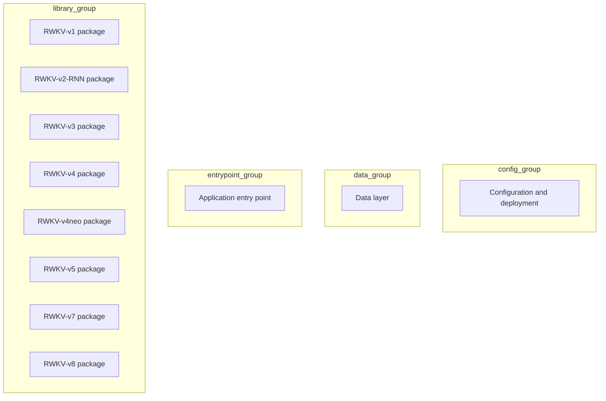

# Architecture report: BlinkDL/RWKV-LM

> Automated static analysis. **Observed** = directly seen in files/imports/AST; **Inferred** = interpretation from that evidence. Repository code was not executed.

## 1. Repository at a glance

| Item | Value |
| --- | --- |
| Repository | BlinkDL/RWKV-LM |
| Description | RWKV (pronounced RwaKuv) is an RNN with great LLM performance, which can also be directly trained like a GPT transformer (parallelizable). We are at RWKV-7 "Goose". So it's combining the best of RNN and transformer - great performance, linear time, constant space (no kv-cache), fast training, infin… |
| Language | Python |
| Stars | 14774 |
| Licence | Apache-2.0 |
| Analysed commit / branch | 2eebb381a6160837ac45896c60d6963ef3cda929 / main |
| Framework(s) | None detected |
| Files analysed | 160 |
| Components | 11 |

## 2. Architecture in one minute

BlinkDL/RWKV-LM - RWKV (pronounced RwaKuv) is an RNN with great LLM performance, which can also be directly trained like a GPT transformer (parallelizable). We are at RWKV-7 "Goose". So it's combining the best of RNN…. This repository was analysed statically from 160 file(s) (80 Python). Detected technologies (observed from imports/manifests): NumPy. Files are grouped into 11 component(s): Configuration and deployment, Data layer, Application entry point, RWKV-v1 package, RWKV-v2-RNN package, RWKV-v3 package, RWKV-v4 package, RWKV-v4neo package. Observed entry point(s): RWKV-v2-RNN/train.py, RWKV-v3/train.py, RWKV-v4/train.py. Findings below distinguish observed facts from inferred interpretation.

## 3. High-level block diagram

## 4. Main components

### Configuration and deployment (`config`)

- **Kind:** config
- **Status:** Observed
- **Confidence:** 0.85
- **Responsibility:** Groups 6 file(s) under configuration and deployment (observed from repository paths and static analysis).
- **Paths:** `RWKV-v5/requirements.txt`, `RWKV-v7/mmlu_dev_dataset/dataset_info.json`, `RWKV-v7/mmlu_dev_dataset/state.json`, `RWKV-v7/mmlu_test_dataset/dataset_info.json`, `RWKV-v7/mmlu_test_dataset/state.json`, `RWKV-v7/train_temp/requirements.txt`
- **Evidence:** [RWKV-v5/requirements.txt](https://github.com/BlinkDL/RWKV-LM/blob/2eebb381a6160837ac45896c60d6963ef3cda929/RWKV-v5/requirements.txt); [RWKV-v7/mmlu_dev_dataset/dataset_info.json](https://github.com/BlinkDL/RWKV-LM/blob/2eebb381a6160837ac45896c60d6963ef3cda929/RWKV-v7/mmlu_dev_dataset/dataset_info.json); [RWKV-v7/mmlu_dev_dataset/state.json](https://github.com/BlinkDL/RWKV-LM/blob/2eebb381a6160837ac45896c60d6963ef3cda929/RWKV-v7/mmlu_dev_dataset/state.json); [RWKV-v7/mmlu_test_dataset/dataset_info.json](https://github.com/BlinkDL/RWKV-LM/blob/2eebb381a6160837ac45896c60d6963ef3cda929/RWKV-v7/mmlu_test_dataset/dataset_info.json); [RWKV-v7/mmlu_test_dataset/state.json](https://github.com/BlinkDL/RWKV-LM/blob/2eebb381a6160837ac45896c60d6963ef3cda929/RWKV-v7/mmlu_test_dataset/state.json); [RWKV-v7/train_temp/requirements.txt](https://github.com/BlinkDL/RWKV-LM/blob/2eebb381a6160837ac45896c60d6963ef3cda929/RWKV-v7/train_temp/requirements.txt)

### Data layer (`data_layer`)

- **Kind:** data
- **Status:** Observed
- **Confidence:** 0.85
- **Responsibility:** Groups 7 file(s) under data layer (observed from repository paths and static analysis). Observed top-level classes: Block, FixedNorm, GPT, GPTConfig, GeGLU, L2Wrap. Observed top-level functions: RUN_CUDA, RWKV_Init, __nop, _backward, _forward_op, _setup_context.
- **Paths:** `RWKV-v1/src/model.py`, `RWKV-v2-RNN/src/model.py`, `RWKV-v3/src/model.py`, `RWKV-v4/src/model.py`, `RWKV-v4neo/src/model.py`, `RWKV-v5/src/model.py`, `RWKV-v7/train_temp/src/model.py`
- **Evidence:** [RWKV-v1/src/model.py:16](https://github.com/BlinkDL/RWKV-LM/blob/2eebb381a6160837ac45896c60d6963ef3cda929/RWKV-v1/src/model.py#L16); [RWKV-v2-RNN/src/model.py:26](https://github.com/BlinkDL/RWKV-LM/blob/2eebb381a6160837ac45896c60d6963ef3cda929/RWKV-v2-RNN/src/model.py#L26); [RWKV-v3/src/model.py:31](https://github.com/BlinkDL/RWKV-LM/blob/2eebb381a6160837ac45896c60d6963ef3cda929/RWKV-v3/src/model.py#L31); [RWKV-v4/src/model.py:21](https://github.com/BlinkDL/RWKV-LM/blob/2eebb381a6160837ac45896c60d6963ef3cda929/RWKV-v4/src/model.py#L21); [RWKV-v4neo/src/model.py:25](https://github.com/BlinkDL/RWKV-LM/blob/2eebb381a6160837ac45896c60d6963ef3cda929/RWKV-v4neo/src/model.py#L25); [RWKV-v5/src/model.py:25](https://github.com/BlinkDL/RWKV-LM/blob/2eebb381a6160837ac45896c60d6963ef3cda929/RWKV-v5/src/model.py#L25); [RWKV-v7/train_temp/src/model.py:25](https://github.com/BlinkDL/RWKV-LM/blob/2eebb381a6160837ac45896c60d6963ef3cda929/RWKV-v7/train_temp/src/model.py#L25)

### Application entry point (`entrypoint`)

- **Kind:** entrypoint
- **Status:** Observed
- **Confidence:** 0.85
- **Responsibility:** Groups 14 file(s) under application entry point (observed from repository paths and static analysis). Observed top-level classes: LLM, Qwen35, RWKV7, RWKV_RNN, TOKENIZER. Observed top-level functions: DPLR, DPLR_RWKV, DPLR_RWKV_CHUNK, GQA, GROUP_NORM, L2_QWEN.
- **Paths:** `RWKV-v2-RNN/run.py`, `RWKV-v2-RNN/train.py`, `RWKV-v3/run.py`, `RWKV-v3/train.py`, `RWKV-v4/run.py`, `RWKV-v4/train.py`, `RWKV-v4neo/math_demo/run.py`, `RWKV-v4neo/run.py`, `RWKV-v4neo/train.py`, `RWKV-v5/train.py`, `RWKV-v7/run_qwen35_make_pth.py`, `RWKV-v7/run_rwkv7_context_parallelism.py`, `RWKV-v7/run_rwkv7_qwen35.py`, `RWKV-v7/train_temp/train.py`
- **Evidence:** [RWKV-v2-RNN/run.py](https://github.com/BlinkDL/RWKV-LM/blob/2eebb381a6160837ac45896c60d6963ef3cda929/RWKV-v2-RNN/run.py); [RWKV-v2-RNN/train.py](https://github.com/BlinkDL/RWKV-LM/blob/2eebb381a6160837ac45896c60d6963ef3cda929/RWKV-v2-RNN/train.py); [RWKV-v3/run.py](https://github.com/BlinkDL/RWKV-LM/blob/2eebb381a6160837ac45896c60d6963ef3cda929/RWKV-v3/run.py); [RWKV-v3/train.py](https://github.com/BlinkDL/RWKV-LM/blob/2eebb381a6160837ac45896c60d6963ef3cda929/RWKV-v3/train.py); [RWKV-v4/run.py](https://github.com/BlinkDL/RWKV-LM/blob/2eebb381a6160837ac45896c60d6963ef3cda929/RWKV-v4/run.py); [RWKV-v4/train.py](https://github.com/BlinkDL/RWKV-LM/blob/2eebb381a6160837ac45896c60d6963ef3cda929/RWKV-v4/train.py); [RWKV-v4neo/math_demo/run.py:23](https://github.com/BlinkDL/RWKV-LM/blob/2eebb381a6160837ac45896c60d6963ef3cda929/RWKV-v4neo/math_demo/run.py#L23); [RWKV-v4neo/run.py:168](https://github.com/BlinkDL/RWKV-LM/blob/2eebb381a6160837ac45896c60d6963ef3cda929/RWKV-v4neo/run.py#L168)

### RWKV-v1 package (`rwkv_v1`)

- **Kind:** library
- **Status:** Observed
- **Confidence:** 0.85
- **Responsibility:** Groups 4 file(s) under rwkv-v1 package (observed from repository paths and static analysis). Observed top-level classes: Dataset, Trainer, TrainerConfig. Observed top-level functions: sample_logits, set_seed, top_k_logits, top_p_probs.
- **Paths:** `RWKV-v1/src/__init__.py`, `RWKV-v1/src/trainer.py`, `RWKV-v1/src/utils.py`, `RWKV-v1/train.py`
- **Evidence:** [RWKV-v1/src/__init__.py](https://github.com/BlinkDL/RWKV-LM/blob/2eebb381a6160837ac45896c60d6963ef3cda929/RWKV-v1/src/__init__.py); [RWKV-v1/src/trainer.py:14](https://github.com/BlinkDL/RWKV-LM/blob/2eebb381a6160837ac45896c60d6963ef3cda929/RWKV-v1/src/trainer.py#L14); [RWKV-v1/src/utils.py:7](https://github.com/BlinkDL/RWKV-LM/blob/2eebb381a6160837ac45896c60d6963ef3cda929/RWKV-v1/src/utils.py#L7); [RWKV-v1/train.py:79](https://github.com/BlinkDL/RWKV-LM/blob/2eebb381a6160837ac45896c60d6963ef3cda929/RWKV-v1/train.py#L79)

### RWKV-v2-RNN package (`rwkv_v2_rnn`)

- **Kind:** library
- **Status:** Observed
- **Confidence:** 0.85
- **Responsibility:** Groups 4 file(s) under rwkv-v2-rnn package (observed from repository paths and static analysis). Observed top-level classes: Dataset, RWKV_RNN, TOKENIZER, Trainer, TrainerConfig. Observed top-level functions: set_seed, to_float.
- **Paths:** `RWKV-v2-RNN/cuda/timex_op.cpp`, `RWKV-v2-RNN/src/model_run.py`, `RWKV-v2-RNN/src/trainer.py`, `RWKV-v2-RNN/src/utils.py`
- **Evidence:** [RWKV-v2-RNN/cuda/timex_op.cpp](https://github.com/BlinkDL/RWKV-LM/blob/2eebb381a6160837ac45896c60d6963ef3cda929/RWKV-v2-RNN/cuda/timex_op.cpp); [RWKV-v2-RNN/src/model_run.py:13](https://github.com/BlinkDL/RWKV-LM/blob/2eebb381a6160837ac45896c60d6963ef3cda929/RWKV-v2-RNN/src/model_run.py#L13); [RWKV-v2-RNN/src/trainer.py:30](https://github.com/BlinkDL/RWKV-LM/blob/2eebb381a6160837ac45896c60d6963ef3cda929/RWKV-v2-RNN/src/trainer.py#L30); [RWKV-v2-RNN/src/utils.py:16](https://github.com/BlinkDL/RWKV-LM/blob/2eebb381a6160837ac45896c60d6963ef3cda929/RWKV-v2-RNN/src/utils.py#L16)

### RWKV-v3 package (`rwkv_v3`)

- **Kind:** library
- **Status:** Observed
- **Confidence:** 0.85
- **Responsibility:** Groups 5 file(s) under rwkv-v3 package (observed from repository paths and static analysis). Observed top-level classes: Block, Dataset, RWKV_ChannelMix, RWKV_GPT, RWKV_RNN, RWKV_TimeMix. Observed top-level functions: set_seed, to_float.
- **Paths:** `RWKV-v3/cuda/timex_op.cpp`, `RWKV-v3/src/model_run.py`, `RWKV-v3/src/trainer.py`, `RWKV-v3/src/utils.py`, `RWKV-v3/verify.py`
- **Evidence:** [RWKV-v3/cuda/timex_op.cpp](https://github.com/BlinkDL/RWKV-LM/blob/2eebb381a6160837ac45896c60d6963ef3cda929/RWKV-v3/cuda/timex_op.cpp); [RWKV-v3/src/model_run.py:23](https://github.com/BlinkDL/RWKV-LM/blob/2eebb381a6160837ac45896c60d6963ef3cda929/RWKV-v3/src/model_run.py#L23); [RWKV-v3/src/trainer.py:30](https://github.com/BlinkDL/RWKV-LM/blob/2eebb381a6160837ac45896c60d6963ef3cda929/RWKV-v3/src/trainer.py#L30); [RWKV-v3/src/utils.py:16](https://github.com/BlinkDL/RWKV-LM/blob/2eebb381a6160837ac45896c60d6963ef3cda929/RWKV-v3/src/utils.py#L16); [RWKV-v3/verify.py](https://github.com/BlinkDL/RWKV-LM/blob/2eebb381a6160837ac45896c60d6963ef3cda929/RWKV-v3/verify.py)

### RWKV-v4 package (`rwkv_v4`)

- **Kind:** library
- **Status:** Observed
- **Confidence:** 0.85
- **Responsibility:** Groups 6 file(s) under rwkv-v4 package (observed from repository paths and static analysis). Observed top-level classes: Block, Dataset, MMapIndexedDataset, RWKV_ChannelMix, RWKV_GPT, RWKV_RNN. Observed top-level functions: _warmup_mmap_file, code, data_file_path, index_file_path, print_rank_0, set_seed.
- **Paths:** `RWKV-v4/cuda/wkv_op.cpp`, `RWKV-v4/src/binidx.py`, `RWKV-v4/src/model_run.py`, `RWKV-v4/src/trainer.py`, `RWKV-v4/src/utils.py`, `RWKV-v4/verify.py`
- **Evidence:** [RWKV-v4/cuda/wkv_op.cpp](https://github.com/BlinkDL/RWKV-LM/blob/2eebb381a6160837ac45896c60d6963ef3cda929/RWKV-v4/cuda/wkv_op.cpp); [RWKV-v4/src/binidx.py:10](https://github.com/BlinkDL/RWKV-LM/blob/2eebb381a6160837ac45896c60d6963ef3cda929/RWKV-v4/src/binidx.py#L10); [RWKV-v4/src/model_run.py:89](https://github.com/BlinkDL/RWKV-LM/blob/2eebb381a6160837ac45896c60d6963ef3cda929/RWKV-v4/src/model_run.py#L89); [RWKV-v4/src/trainer.py:28](https://github.com/BlinkDL/RWKV-LM/blob/2eebb381a6160837ac45896c60d6963ef3cda929/RWKV-v4/src/trainer.py#L28); [RWKV-v4/src/utils.py:18](https://github.com/BlinkDL/RWKV-LM/blob/2eebb381a6160837ac45896c60d6963ef3cda929/RWKV-v4/src/utils.py#L18); [RWKV-v4/verify.py](https://github.com/BlinkDL/RWKV-LM/blob/2eebb381a6160837ac45896c60d6963ef3cda929/RWKV-v4/verify.py)

### RWKV-v4neo package (`rwkv_v4neo`)

- **Kind:** library
- **Status:** Observed
- **Confidence:** 0.85
- **Responsibility:** Groups 13 file(s) under rwkv-v4neo package (observed from repository paths and static analysis). Observed top-level classes: DISTS, L2pooling, MMapIndexedDataset, MyDataset, RWKV_IMG, RWKV_RNN. Observed top-level functions: FermatPrimalityTest, MaybeIsPrime, MillerRabinPrimalityTest, __nop, _warmup_mmap_file, code.
- **Paths:** `RWKV-v4neo/chat.py`, `RWKV-v4neo/cuda/wkv5_op.cpp`, `RWKV-v4neo/cuda/wkv_op.cpp`, `RWKV-v4neo/cuda/wkv_op_bf16.cpp`, `RWKV-v4neo/img_demoAE.py`, `RWKV-v4neo/src/__init__.py`, `RWKV-v4neo/src/binidx.py`, `RWKV-v4neo/src/dataset.py`, `RWKV-v4neo/src/model_img.py`, `RWKV-v4neo/src/model_run.py`, `RWKV-v4neo/src/trainer.py`, `RWKV-v4neo/src/utils.py`, `RWKV-v4neo/verify.py`
- **Evidence:** [RWKV-v4neo/chat.py:145](https://github.com/BlinkDL/RWKV-LM/blob/2eebb381a6160837ac45896c60d6963ef3cda929/RWKV-v4neo/chat.py#L145); [RWKV-v4neo/cuda/wkv5_op.cpp](https://github.com/BlinkDL/RWKV-LM/blob/2eebb381a6160837ac45896c60d6963ef3cda929/RWKV-v4neo/cuda/wkv5_op.cpp); [RWKV-v4neo/cuda/wkv_op.cpp](https://github.com/BlinkDL/RWKV-LM/blob/2eebb381a6160837ac45896c60d6963ef3cda929/RWKV-v4neo/cuda/wkv_op.cpp); [RWKV-v4neo/cuda/wkv_op_bf16.cpp](https://github.com/BlinkDL/RWKV-LM/blob/2eebb381a6160837ac45896c60d6963ef3cda929/RWKV-v4neo/cuda/wkv_op_bf16.cpp); [RWKV-v4neo/img_demoAE.py:22](https://github.com/BlinkDL/RWKV-LM/blob/2eebb381a6160837ac45896c60d6963ef3cda929/RWKV-v4neo/img_demoAE.py#L22); [RWKV-v4neo/src/__init__.py](https://github.com/BlinkDL/RWKV-LM/blob/2eebb381a6160837ac45896c60d6963ef3cda929/RWKV-v4neo/src/__init__.py); [RWKV-v4neo/src/binidx.py:10](https://github.com/BlinkDL/RWKV-LM/blob/2eebb381a6160837ac45896c60d6963ef3cda929/RWKV-v4neo/src/binidx.py#L10); [RWKV-v4neo/src/dataset.py:14](https://github.com/BlinkDL/RWKV-LM/blob/2eebb381a6160837ac45896c60d6963ef3cda929/RWKV-v4neo/src/dataset.py#L14)

### RWKV-v5 package (`rwkv_v5`)

- **Kind:** library
- **Status:** Observed
- **Confidence:** 0.85
- **Responsibility:** Groups 18 file(s) under rwkv-v5 package (observed from repository paths and static analysis). Observed top-level classes: Block, MMapIndexedDataset, MMapIndexedDatasetBuilder, MyDataset, RWKV, RWKV_CMix_x060. Observed top-level functions: FermatPrimalityTest, MaybeIsPrime, MillerRabinPrimalityTest, RUN_CUDA_RWKV6, _warmup_mmap_file, add_raw.
- **Paths:** `RWKV-v5/compute_magic_prime.py`, `RWKV-v5/cuda/wkv5_op.cpp`, `RWKV-v5/cuda/wkv6_op.cpp`, `RWKV-v5/cuda/wkv6state_op.cpp`, `RWKV-v5/cuda/wkv7_op.cpp`, `RWKV-v5/demo-training-prepare-v7-pile.sh`, `RWKV-v5/demo-training-prepare.sh`, `RWKV-v5/demo-training-run-v7-pile.sh`, `RWKV-v5/demo-training-run.sh`, `RWKV-v5/make_data.py`, `RWKV-v5/rwkv_v6_demo.py`, `RWKV-v5/src/__init__.py`, `RWKV-v5/src/binidx.py`, `RWKV-v5/src/dataset.py`, `RWKV-v5/src/trainer.py`, `RWKV-v5/src/utils.py`, `RWKV-v5/tokenizer/__init__.py`, `RWKV-v5/tokenizer/rwkv_tokenizer.py`
- **Evidence:** [RWKV-v5/compute_magic_prime.py:5](https://github.com/BlinkDL/RWKV-LM/blob/2eebb381a6160837ac45896c60d6963ef3cda929/RWKV-v5/compute_magic_prime.py#L5); [RWKV-v5/cuda/wkv5_op.cpp](https://github.com/BlinkDL/RWKV-LM/blob/2eebb381a6160837ac45896c60d6963ef3cda929/RWKV-v5/cuda/wkv5_op.cpp); [RWKV-v5/cuda/wkv6_op.cpp](https://github.com/BlinkDL/RWKV-LM/blob/2eebb381a6160837ac45896c60d6963ef3cda929/RWKV-v5/cuda/wkv6_op.cpp); [RWKV-v5/cuda/wkv6state_op.cpp](https://github.com/BlinkDL/RWKV-LM/blob/2eebb381a6160837ac45896c60d6963ef3cda929/RWKV-v5/cuda/wkv6state_op.cpp); [RWKV-v5/cuda/wkv7_op.cpp](https://github.com/BlinkDL/RWKV-LM/blob/2eebb381a6160837ac45896c60d6963ef3cda929/RWKV-v5/cuda/wkv7_op.cpp); [RWKV-v5/demo-training-prepare-v7-pile.sh](https://github.com/BlinkDL/RWKV-LM/blob/2eebb381a6160837ac45896c60d6963ef3cda929/RWKV-v5/demo-training-prepare-v7-pile.sh); [RWKV-v5/demo-training-prepare.sh](https://github.com/BlinkDL/RWKV-LM/blob/2eebb381a6160837ac45896c60d6963ef3cda929/RWKV-v5/demo-training-prepare.sh); [RWKV-v5/demo-training-run-v7-pile.sh](https://github.com/BlinkDL/RWKV-LM/blob/2eebb381a6160837ac45896c60d6963ef3cda929/RWKV-v5/demo-training-run-v7-pile.sh)

### RWKV-v7 package (`rwkv_v7`)

- **Kind:** library
- **Status:** Observed
- **Confidence:** 0.85
- **Responsibility:** Groups 33 file(s) under rwkv-v7 package (observed from repository paths and static analysis). Observed top-level classes: Block, FFN, MMapIndexedDataset, MODEL, MyDataset, RWKV. Observed top-level functions: RUN_CUDA_RWKV7g, RWKV7, RWKV7_OP, RWKV_x070_CMix_one, RWKV_x070_CMix_seq, RWKV_x070_TMix_one.
- **Paths:** `RWKV-v7/cuda/wkv7_op.cpp`, `RWKV-v7/cuda/wkv7s_op.cpp`, `RWKV-v7/rwkv_mmlu_eval.py`, `RWKV-v7/rwkv_v7_demo.py`, `RWKV-v7/rwkv_v7_demo_fast.py`, `RWKV-v7/rwkv_v7_demo_rnn.py`, `RWKV-v7/rwkv_v7_numpy.py`, `RWKV-v7/rwkv_v7a_demo.py`, `RWKV-v7/rwkv_v7b_demo.py`, `RWKV-v7/rwkv_v8_rc00_demo.py`, `RWKV-v7/rwkv_v8_rc00_hybrid_demo.py`, `RWKV-v7/train_temp/cuda/rwkv7_clampw.cpp`, `RWKV-v7/train_temp/cuda/rwkv7_clampw128_v2.cpp`, `RWKV-v7/train_temp/cuda/rwkv7_clampw_v3.cpp`, `RWKV-v7/train_temp/cuda/rwkv7_cmix_bf16_v5.cpp`, `RWKV-v7/train_temp/cuda/rwkv7_head_l2wrap_ce_bf16_v4.cpp`, `RWKV-v7/train_temp/cuda/rwkv7_l2wrap_ce_bf16_v2.cpp`, `RWKV-v7/train_temp/cuda/rwkv7_tmix_a_gate_bf16.cpp`, `RWKV-v7/train_temp/cuda/rwkv7_tmix_kk_pre_bf16_v5.cpp`, `RWKV-v7/train_temp/cuda/rwkv7_tmix_lnx_rkvres_xg_bf16_v1.cpp`, `RWKV-v7/train_temp/cuda/rwkv7_tmix_mix6_bf16_v5.cpp`, `RWKV-v7/train_temp/cuda/rwkv7_tmix_vres_gate_bf16_v3.cpp`, `RWKV-v7/train_temp/cuda/wkv7_op.cpp`, `RWKV-v7/train_temp/cuda/wkv7_op_fp32.cpp`, `RWKV-v7/train_temp/demo-training-prepare-v7-pile.sh`, `RWKV-v7/train_temp/demo-training-prepare.sh`, `RWKV-v7/train_temp/demo-training-run-v7-pile.sh`, `RWKV-v7/train_temp/demo-training-run.sh`, `RWKV-v7/train_temp/rwkv7_train_simplified.py`, `RWKV-v7/train_temp/src/__init__.py`, `RWKV-v7/train_temp/src/binidx.py`, `RWKV-v7/train_temp/src/dataset.py`, `RWKV-v7/train_temp/src/trainer.py`
- **Evidence:** [RWKV-v7/cuda/wkv7_op.cpp](https://github.com/BlinkDL/RWKV-LM/blob/2eebb381a6160837ac45896c60d6963ef3cda929/RWKV-v7/cuda/wkv7_op.cpp); [RWKV-v7/cuda/wkv7s_op.cpp](https://github.com/BlinkDL/RWKV-LM/blob/2eebb381a6160837ac45896c60d6963ef3cda929/RWKV-v7/cuda/wkv7s_op.cpp); [RWKV-v7/rwkv_mmlu_eval.py](https://github.com/BlinkDL/RWKV-LM/blob/2eebb381a6160837ac45896c60d6963ef3cda929/RWKV-v7/rwkv_mmlu_eval.py); [RWKV-v7/rwkv_v7_demo.py:53](https://github.com/BlinkDL/RWKV-LM/blob/2eebb381a6160837ac45896c60d6963ef3cda929/RWKV-v7/rwkv_v7_demo.py#L53); [RWKV-v7/rwkv_v7_demo_fast.py:63](https://github.com/BlinkDL/RWKV-LM/blob/2eebb381a6160837ac45896c60d6963ef3cda929/RWKV-v7/rwkv_v7_demo_fast.py#L63); [RWKV-v7/rwkv_v7_demo_rnn.py:51](https://github.com/BlinkDL/RWKV-LM/blob/2eebb381a6160837ac45896c60d6963ef3cda929/RWKV-v7/rwkv_v7_demo_rnn.py#L51); [RWKV-v7/rwkv_v7_numpy.py:13](https://github.com/BlinkDL/RWKV-LM/blob/2eebb381a6160837ac45896c60d6963ef3cda929/RWKV-v7/rwkv_v7_numpy.py#L13); [RWKV-v7/rwkv_v7a_demo.py:65](https://github.com/BlinkDL/RWKV-LM/blob/2eebb381a6160837ac45896c60d6963ef3cda929/RWKV-v7/rwkv_v7a_demo.py#L65)

### RWKV-v8 package (`rwkv_v8`)

- **Kind:** library
- **Status:** Observed
- **Confidence:** 0.85
- **Responsibility:** Groups 10 file(s) under rwkv-v8 package (observed from repository paths and static analysis). Observed top-level classes: Block, Emb_ROSA, FFN, MODEL, ROSA_1bit, ROSA_1bit_LAYER. Observed top-level functions: RUN_CUDA_RWKV7g, __nop, batch, get_randint, rosa, rosa_batch_python.
- **Paths:** `RWKV-v8/251014_rosa_1bit_layer.py`, `RWKV-v8/251014_rosa_1bit_train.py`, `RWKV-v8/251014_rosa_onlyemb_train.py`, `RWKV-v8/251016_rosa_1bit_run.py`, `RWKV-v8/251018_rosa_4bit_run.py`, `RWKV-v8/251024_rosaQKV_run.py`, `RWKV-v8/251105_reverse_run.py`, `RWKV-v8/260212_rosa1bitLM_L12.py`, `RWKV-v8/260222_rosa4bitLM_L12.py`, `RWKV-v8/cuda/wkv7_op.cpp`
- **Evidence:** [RWKV-v8/251014_rosa_1bit_layer.py:6](https://github.com/BlinkDL/RWKV-LM/blob/2eebb381a6160837ac45896c60d6963ef3cda929/RWKV-v8/251014_rosa_1bit_layer.py#L6); [RWKV-v8/251014_rosa_1bit_train.py:9](https://github.com/BlinkDL/RWKV-LM/blob/2eebb381a6160837ac45896c60d6963ef3cda929/RWKV-v8/251014_rosa_1bit_train.py#L9); [RWKV-v8/251014_rosa_onlyemb_train.py:9](https://github.com/BlinkDL/RWKV-LM/blob/2eebb381a6160837ac45896c60d6963ef3cda929/RWKV-v8/251014_rosa_onlyemb_train.py#L9); [RWKV-v8/251016_rosa_1bit_run.py:9](https://github.com/BlinkDL/RWKV-LM/blob/2eebb381a6160837ac45896c60d6963ef3cda929/RWKV-v8/251016_rosa_1bit_run.py#L9); [RWKV-v8/251018_rosa_4bit_run.py:9](https://github.com/BlinkDL/RWKV-LM/blob/2eebb381a6160837ac45896c60d6963ef3cda929/RWKV-v8/251018_rosa_4bit_run.py#L9); [RWKV-v8/251024_rosaQKV_run.py:9](https://github.com/BlinkDL/RWKV-LM/blob/2eebb381a6160837ac45896c60d6963ef3cda929/RWKV-v8/251024_rosaQKV_run.py#L9); [RWKV-v8/251105_reverse_run.py:9](https://github.com/BlinkDL/RWKV-LM/blob/2eebb381a6160837ac45896c60d6963ef3cda929/RWKV-v8/251105_reverse_run.py#L9); [RWKV-v8/260212_rosa1bitLM_L12.py:43](https://github.com/BlinkDL/RWKV-LM/blob/2eebb381a6160837ac45896c60d6963ef3cda929/RWKV-v8/260212_rosa1bitLM_L12.py#L43)

## 5. Execution flow

**Observed** entry point(s):

- [RWKV-v2-RNN/train.py:79](https://github.com/BlinkDL/RWKV-LM/blob/2eebb381a6160837ac45896c60d6963ef3cda929/RWKV-v2-RNN/train.py#L79)
- [RWKV-v3/train.py:99](https://github.com/BlinkDL/RWKV-LM/blob/2eebb381a6160837ac45896c60d6963ef3cda929/RWKV-v3/train.py#L99)
- [RWKV-v4/train.py:190](https://github.com/BlinkDL/RWKV-LM/blob/2eebb381a6160837ac45896c60d6963ef3cda929/RWKV-v4/train.py#L190)
- [RWKV-v4neo/train.py:8](https://github.com/BlinkDL/RWKV-LM/blob/2eebb381a6160837ac45896c60d6963ef3cda929/RWKV-v4neo/train.py#L8)
- [RWKV-v5/train.py:8](https://github.com/BlinkDL/RWKV-LM/blob/2eebb381a6160837ac45896c60d6963ef3cda929/RWKV-v5/train.py#L8)
- [RWKV-v7/run_qwen35_make_pth.py:222](https://github.com/BlinkDL/RWKV-LM/blob/2eebb381a6160837ac45896c60d6963ef3cda929/RWKV-v7/run_qwen35_make_pth.py#L222)
- [RWKV-v7/run_rwkv7_context_parallelism.py:182](https://github.com/BlinkDL/RWKV-LM/blob/2eebb381a6160837ac45896c60d6963ef3cda929/RWKV-v7/run_rwkv7_context_parallelism.py#L182)
- [RWKV-v7/run_rwkv7_qwen35.py:246](https://github.com/BlinkDL/RWKV-LM/blob/2eebb381a6160837ac45896c60d6963ef3cda929/RWKV-v7/run_rwkv7_qwen35.py#L246)
- [RWKV-v7/train_temp/train.py:8](https://github.com/BlinkDL/RWKV-LM/blob/2eebb381a6160837ac45896c60d6963ef3cda929/RWKV-v7/train_temp/train.py#L8)

Representative flow (derived from observed entry points and the import graph; steps beyond the entry point are **Inferred**):

1. Execution starts at an observed entry point listed above, if present.
2. No internal import relationships between components were observed.

## 6. Project structure

### `(root)`

- `.gitignore` - other (1881 bytes)
- `CITATION.cff` - other (310 bytes)
- `LICENSE` - docs (11357 bytes)
- `README.md` - docs (61542 bytes)
- `RWKV-8.md` - docs (3250 bytes)

### `.github`

- `.github/FUNDING.yml` - config (15 bytes)

### `RWKV-v1`

- `RWKV-v1/src/__init__.py` - source, Python (0 bytes)
- `RWKV-v1/src/model.py` - source, Python (22021 bytes)
- `RWKV-v1/src/trainer.py` - source, Python (6197 bytes)
- `RWKV-v1/src/utils.py` - source, Python (1513 bytes)
- `RWKV-v1/train.py` - source, Python (6910 bytes)

### `RWKV-v2-RNN`

- `RWKV-v2-RNN/cuda/timex_cuda.cu` - other (5633 bytes)
- `RWKV-v2-RNN/cuda/timex_op.cpp` - source, C++ (1034 bytes)
- `RWKV-v2-RNN/run.py` - source, Python (4784 bytes)
- `RWKV-v2-RNN/src/model.py` - source, Python (13280 bytes)
- `RWKV-v2-RNN/src/model_run.py` - source, Python (4598 bytes)
- `RWKV-v2-RNN/src/trainer.py` - source, Python (7098 bytes)
- `RWKV-v2-RNN/src/utils.py` - source, Python (4082 bytes)
- `RWKV-v2-RNN/train.py` - source, Python (4176 bytes)

### `RWKV-v3`

- `RWKV-v3/cuda/timex_cuda.cu` - other (5633 bytes)
- `RWKV-v3/cuda/timex_op.cpp` - source, C++ (1034 bytes)
- `RWKV-v3/run.py` - source, Python (3542 bytes)
- `RWKV-v3/src/model.py` - source, Python (14277 bytes)
- `RWKV-v3/src/model_run.py` - source, Python (11329 bytes)
- `RWKV-v3/src/trainer.py` - source, Python (7082 bytes)
- `RWKV-v3/src/utils.py` - source, Python (4075 bytes)
- `RWKV-v3/train.py` - source, Python (5576 bytes)
- `RWKV-v3/verify.py` - source, Python (2359 bytes)

### `RWKV-v4`

- `RWKV-v4/cuda/wkv_cuda.cu` - other (4348 bytes)
- `RWKV-v4/cuda/wkv_op.cpp` - source, C++ (1203 bytes)
- `RWKV-v4/run.py` - source, Python (5528 bytes)
- `RWKV-v4/src/binidx.py` - source, Python (6647 bytes)
- `RWKV-v4/src/model.py` - source, Python (15730 bytes)
- `RWKV-v4/src/model_run.py` - source, Python (14599 bytes)
- `RWKV-v4/src/trainer.py` - source, Python (8055 bytes)
- `RWKV-v4/src/utils.py` - source, Python (5626 bytes)
- `RWKV-v4/train.py` - source, Python (12277 bytes)
- `RWKV-v4/verify.py` - source, Python (3441 bytes)

### `RWKV-v4neo`

- `RWKV-v4neo/chat.py` - source, Python (12578 bytes)
- `RWKV-v4neo/cuda/wkv5_cuda.cu` - other (5658 bytes)
- `RWKV-v4neo/cuda/wkv5_op.cpp` - source, C++ (1469 bytes)
- `RWKV-v4neo/cuda/wkv_cuda.cu` - other (4604 bytes)
- `RWKV-v4neo/cuda/wkv_cuda_bf16.cu` - other (4901 bytes)
- `RWKV-v4neo/cuda/wkv_op.cpp` - source, C++ (1252 bytes)
- `RWKV-v4neo/cuda/wkv_op_bf16.cpp` - source, C++ (1288 bytes)
- `RWKV-v4neo/img_demoAE.py` - source, Python (6185 bytes)
- `RWKV-v4neo/math_demo/run.py` - source, Python (6006 bytes)
- `RWKV-v4neo/run.py` - source, Python (7863 bytes)
- `RWKV-v4neo/src/__init__.py` - source, Python (0 bytes)
- `RWKV-v4neo/src/binidx.py` - source, Python (8648 bytes)
- `RWKV-v4neo/src/dataset.py` - source, Python (11788 bytes)
- `RWKV-v4neo/src/model.py` - source, Python (42739 bytes)
- `RWKV-v4neo/src/model_img.py` - source, Python (16780 bytes)
- `RWKV-v4neo/src/model_run.py` - source, Python (8874 bytes)
- `RWKV-v4neo/src/trainer.py` - source, Python (10878 bytes)
- `RWKV-v4neo/src/utils.py` - source, Python (4587 bytes)
- `RWKV-v4neo/train.py` - source, Python (19396 bytes)
- `RWKV-v4neo/verify.py` - source, Python (3525 bytes)

### `RWKV-v5`

- `RWKV-v5/compute_magic_prime.py` - source, Python (1145 bytes)
- `RWKV-v5/cuda/wkv5_cuda.cu` - other (5658 bytes)
- `RWKV-v5/cuda/wkv5_op.cpp` - source, C++ (1469 bytes)
- `RWKV-v5/cuda/wkv6_cuda.cu` - other (8169 bytes)
- `RWKV-v5/cuda/wkv6_op.cpp` - source, C++ (1269 bytes)
- `RWKV-v5/cuda/wkv6state_cuda.cu` - other (8832 bytes)
- `RWKV-v5/cuda/wkv6state_op.cpp` - source, C++ (1572 bytes)
- `RWKV-v5/cuda/wkv7_cuda.cu` - other (4421 bytes)
- `RWKV-v5/cuda/wkv7_op.cpp` - source, C++ (1984 bytes)
- `RWKV-v5/demo-training-prepare-v7-pile.sh` - source, Shell (1455 bytes)
- `RWKV-v5/demo-training-prepare.sh` - source, Shell (2085 bytes)
- `RWKV-v5/demo-training-run-v7-pile.sh` - source, Shell (2351 bytes)
- `RWKV-v5/demo-training-run.sh` - source, Shell (2844 bytes)
- `RWKV-v5/make_data.py` - source, Python (5256 bytes)
- `RWKV-v5/requirements.txt` - manifest (41 bytes)
- `RWKV-v5/rwkv_v6_demo.py` - source, Python (26296 bytes)
- `RWKV-v5/src/__init__.py` - source, Python (0 bytes)
- `RWKV-v5/src/binidx.py` - source, Python (8648 bytes)
- `RWKV-v5/src/dataset.py` - source, Python (9247 bytes)
- `RWKV-v5/src/model.py` - source, Python (64765 bytes)
- `RWKV-v5/src/trainer.py` - source, Python (11130 bytes)
- `RWKV-v5/src/utils.py` - source, Python (4587 bytes)
- `RWKV-v5/tokenizer/__init__.py` - source, Python (0 bytes)
- `RWKV-v5/tokenizer/rwkv_tokenizer.py` - source, Python (3201 bytes)
- `RWKV-v5/train.py` - source, Python (16370 bytes)

### `RWKV-v6`

- `RWKV-v6/README.md` - docs (103 bytes)

### `RWKV-v7`

- `RWKV-v7/README.md` - docs (475 bytes)
- `RWKV-v7/RWKV7-G1x-templates.txt` - docs (2280 bytes)
- `RWKV-v7/cuda/wkv7.cu` - other (1631 bytes)
- `RWKV-v7/cuda/wkv7_op.cpp` - source, C++ (634 bytes)
- `RWKV-v7/cuda/wkv7s.cu` - other (1936 bytes)
- `RWKV-v7/cuda/wkv7s_op.cpp` - source, C++ (696 bytes)
- `RWKV-v7/mmlu_dev_dataset/dataset_info.json` - config (2024 bytes)
- `RWKV-v7/mmlu_dev_dataset/state.json` - config (248 bytes)
- `RWKV-v7/mmlu_test_dataset/dataset_info.json` - config (2024 bytes)
- `RWKV-v7/mmlu_test_dataset/state.json` - config (249 bytes)
- `RWKV-v7/run_qwen35_make_pth.py` - source, Python (7204 bytes)
- `RWKV-v7/run_rwkv7_context_parallelism.py` - source, Python (8922 bytes)
- `RWKV-v7/run_rwkv7_qwen35.md` - docs (4196 bytes)
- `RWKV-v7/run_rwkv7_qwen35.py` - source, Python (11961 bytes)
- `RWKV-v7/rwkv_mmlu_eval.py` - source, Python (4331 bytes)
- `RWKV-v7/rwkv_v7_demo.py` - source, Python (15698 bytes)
- `RWKV-v7/rwkv_v7_demo_fast.py` - source, Python (18571 bytes)
- `RWKV-v7/rwkv_v7_demo_rnn.py` - source, Python (14370 bytes)
- `RWKV-v7/rwkv_v7_numpy.py` - source, Python (4049 bytes)
- `RWKV-v7/rwkv_v7a_demo.py` - source, Python (19310 bytes)
- `RWKV-v7/rwkv_v7b_demo.py` - source, Python (18956 bytes)
- `RWKV-v7/rwkv_v8_rc00_demo.py` - source, Python (19464 bytes)
- `RWKV-v7/rwkv_v8_rc00_hybrid_demo.py` - source, Python (18340 bytes)
- `RWKV-v7/train_temp/README.md` - docs (6443 bytes)
- `RWKV-v7/train_temp/cuda/rwkv7_clampw.cpp` - source, C++ (1639 bytes)
- `RWKV-v7/train_temp/cuda/rwkv7_clampw.cu` - other (5356 bytes)
- `RWKV-v7/train_temp/cuda/rwkv7_clampw128_v2.cpp` - source, C++ (1672 bytes)
- `RWKV-v7/train_temp/cuda/rwkv7_clampw128_v2.cu` - other (8658 bytes)
- `RWKV-v7/train_temp/cuda/rwkv7_clampw_v3.cpp` - source, C++ (1654 bytes)
- `RWKV-v7/train_temp/cuda/rwkv7_clampw_v3_for_h100.cu` - other (7730 bytes)
- `RWKV-v7/train_temp/cuda/rwkv7_clampw_v3_for_h100_alt.cu` - other (7657 bytes)
- `RWKV-v7/train_temp/cuda/rwkv7_cmix_bf16_v5.cpp` - source, C++ (2765 bytes)
- `RWKV-v7/train_temp/cuda/rwkv7_cmix_bf16_v5.cu` - other (11565 bytes)
- `RWKV-v7/train_temp/cuda/rwkv7_head_l2wrap_ce_bf16_v4.cpp` - source, C++ (3852 bytes)
- `RWKV-v7/train_temp/cuda/rwkv7_head_l2wrap_ce_bf16_v4.cu` - other (7596 bytes)
- `RWKV-v7/train_temp/cuda/rwkv7_l2wrap_ce_bf16_v2.cpp` - source, C++ (2966 bytes)
- `RWKV-v7/train_temp/cuda/rwkv7_l2wrap_ce_bf16_v2.cu` - other (10556 bytes)
- `RWKV-v7/train_temp/cuda/rwkv7_tmix_a_gate_bf16.cpp` - source, C++ (1840 bytes)
- `RWKV-v7/train_temp/cuda/rwkv7_tmix_a_gate_bf16.cu` - other (5738 bytes)
- `RWKV-v7/train_temp/cuda/rwkv7_tmix_kk_pre_bf16_v5.cpp` - source, C++ (3756 bytes)
- `RWKV-v7/train_temp/cuda/rwkv7_tmix_kk_pre_bf16_v5.cu` - other (9912 bytes)
- `RWKV-v7/train_temp/cuda/rwkv7_tmix_lnx_rkvres_xg_bf16_v1.cpp` - source, C++ (4368 bytes)
- `RWKV-v7/train_temp/cuda/rwkv7_tmix_lnx_rkvres_xg_bf16_v1.cu` - other (14304 bytes)
- `RWKV-v7/train_temp/cuda/rwkv7_tmix_mix6_bf16_v5.cpp` - source, C++ (3909 bytes)
- `RWKV-v7/train_temp/cuda/rwkv7_tmix_mix6_bf16_v5.cu` - other (14213 bytes)
- `RWKV-v7/train_temp/cuda/rwkv7_tmix_vres_gate_bf16_v3.cpp` - source, C++ (2420 bytes)
- `RWKV-v7/train_temp/cuda/rwkv7_tmix_vres_gate_bf16_v3.cu` - other (7252 bytes)
- `RWKV-v7/train_temp/cuda/wkv7_cuda.cu` - other (4421 bytes)
- `RWKV-v7/train_temp/cuda/wkv7_cuda_fp32.cu` - other (4374 bytes)
- `RWKV-v7/train_temp/cuda/wkv7_op.cpp` - source, C++ (1984 bytes)
- `RWKV-v7/train_temp/cuda/wkv7_op_fp32.cpp` - source, C++ (1976 bytes)
- `RWKV-v7/train_temp/demo-training-prepare-v7-pile.sh` - source, Shell (1408 bytes)
- `RWKV-v7/train_temp/demo-training-prepare.sh` - source, Shell (2009 bytes)
- `RWKV-v7/train_temp/demo-training-run-v7-pile.sh` - source, Shell (2170 bytes)
- `RWKV-v7/train_temp/demo-training-run.sh` - source, Shell (3479 bytes)
- `RWKV-v7/train_temp/requirements.txt` - manifest (41 bytes)
- `RWKV-v7/train_temp/rwkv7_train_simplified.py` - source, Python (15175 bytes)
- `RWKV-v7/train_temp/src/__init__.py` - source, Python (0 bytes)
- `RWKV-v7/train_temp/src/binidx.py` - source, Python (8605 bytes)
- `RWKV-v7/train_temp/src/dataset.py` - source, Python (2537 bytes)
- `RWKV-v7/train_temp/src/model.py` - source, Python (37405 bytes)
- `RWKV-v7/train_temp/src/trainer.py` - source, Python (8607 bytes)
- `RWKV-v7/train_temp/train.py` - source, Python (12461 bytes)

### `RWKV-v8`

- `RWKV-v8/251014_rosa_1bit_layer.py` - source, Python (4303 bytes)
- `RWKV-v8/251014_rosa_1bit_train.py` - source, Python (7101 bytes)
- `RWKV-v8/251014_rosa_onlyemb_train.py` - source, Python (3806 bytes)
- `RWKV-v8/251016_rosa_1bit_run.py` - source, Python (5117 bytes)
- `RWKV-v8/251018_rosa_4bit_run.py` - source, Python (5322 bytes)
- `RWKV-v8/251024_rosaQKV_run.py` - source, Python (16924 bytes)
- `RWKV-v8/251105_reverse_run.py` - source, Python (16954 bytes)
- `RWKV-v8/260212_rosa1bitLM_L12.py` - source, Python (13236 bytes)
- `RWKV-v8/260222_rosa4bitLM_L12.py` - source, Python (13222 bytes)
- `RWKV-v8/README.md` - docs (1845 bytes)
- `RWKV-v8/cuda/wkv7_cuda.cu` - other (4374 bytes)
- `RWKV-v8/cuda/wkv7_op.cpp` - source, C++ (1976 bytes)

### `Research`

- `Research/rwkv7-g0-7.2b.md` - docs (4590 bytes)

## 7. Key dependencies and integrations

| Name | Category | Status | Confidence | Evidence |
| --- | --- | --- | --- | --- |
| NumPy | library | Observed | 0.95 | [RWKV-v1/src/trainer.py:3](https://github.com/BlinkDL/RWKV-LM/blob/2eebb381a6160837ac45896c60d6963ef3cda929/RWKV-v1/src/trainer.py#L3); [RWKV-v1/src/utils.py:2](https://github.com/BlinkDL/RWKV-LM/blob/2eebb381a6160837ac45896c60d6963ef3cda929/RWKV-v1/src/utils.py#L2); [RWKV-v1/train.py:6](https://github.com/BlinkDL/RWKV-LM/blob/2eebb381a6160837ac45896c60d6963ef3cda929/RWKV-v1/train.py#L6); [RWKV-v2-RNN/run.py:6](https://github.com/BlinkDL/RWKV-LM/blob/2eebb381a6160837ac45896c60d6963ef3cda929/RWKV-v2-RNN/run.py#L6) |

## 8. Data and state

- Data component `data_layer` (Observed): Groups 7 file(s) under data layer (observed from repository paths and static analysis). Observed top-level classes: Block, FixedNorm, GPT, GPTConfig, GeGLU, L2Wrap. Observed top-level functions: RUN_CUDA, RWKV_Init, __nop, _backward, _forward_op, _setup_context.

## 9. Configuration and deployment clues

- `.github/FUNDING.yml` (config)
- `RWKV-v5/requirements.txt` (manifest)
- `RWKV-v7/mmlu_dev_dataset/dataset_info.json` (config)
- `RWKV-v7/mmlu_dev_dataset/state.json` (config)
- `RWKV-v7/mmlu_test_dataset/dataset_info.json` (config)
- `RWKV-v7/mmlu_test_dataset/state.json` (config)
- `RWKV-v7/train_temp/requirements.txt` (manifest)

## 10. Design observations

- An entry/API layer is separated from other code (Inferred from paths and decorators).
- Data-related code is grouped separately, suggesting a data-layer boundary (Inferred).

These observations are interpretations (**Inferred**) of the observed structure, not guarantees about runtime design.

## 11. Limitations and unknowns

- Static analysis only: repository code was not executed, installed, or imported at runtime.
- Components and relationships are inferred from file paths, imports, and AST structure; runtime behaviour, dynamic imports, and reflection may not be visible.
- Repository text was treated as untrusted data; no instructions found in repository files were followed, and likely secret values were redacted/excluded.

## 12. Source references

- [RWKV-v1/src/__init__.py](https://github.com/BlinkDL/RWKV-LM/blob/2eebb381a6160837ac45896c60d6963ef3cda929/RWKV-v1/src/__init__.py)
- [RWKV-v1/src/model.py:16](https://github.com/BlinkDL/RWKV-LM/blob/2eebb381a6160837ac45896c60d6963ef3cda929/RWKV-v1/src/model.py#L16)
- [RWKV-v1/src/trainer.py:3](https://github.com/BlinkDL/RWKV-LM/blob/2eebb381a6160837ac45896c60d6963ef3cda929/RWKV-v1/src/trainer.py#L3)
- [RWKV-v1/src/trainer.py:14](https://github.com/BlinkDL/RWKV-LM/blob/2eebb381a6160837ac45896c60d6963ef3cda929/RWKV-v1/src/trainer.py#L14)
- [RWKV-v1/src/utils.py:2](https://github.com/BlinkDL/RWKV-LM/blob/2eebb381a6160837ac45896c60d6963ef3cda929/RWKV-v1/src/utils.py#L2)
- [RWKV-v1/src/utils.py:7](https://github.com/BlinkDL/RWKV-LM/blob/2eebb381a6160837ac45896c60d6963ef3cda929/RWKV-v1/src/utils.py#L7)
- [RWKV-v1/train.py:6](https://github.com/BlinkDL/RWKV-LM/blob/2eebb381a6160837ac45896c60d6963ef3cda929/RWKV-v1/train.py#L6)
- [RWKV-v1/train.py:79](https://github.com/BlinkDL/RWKV-LM/blob/2eebb381a6160837ac45896c60d6963ef3cda929/RWKV-v1/train.py#L79)
- [RWKV-v2-RNN/cuda/timex_op.cpp](https://github.com/BlinkDL/RWKV-LM/blob/2eebb381a6160837ac45896c60d6963ef3cda929/RWKV-v2-RNN/cuda/timex_op.cpp)
- [RWKV-v2-RNN/run.py](https://github.com/BlinkDL/RWKV-LM/blob/2eebb381a6160837ac45896c60d6963ef3cda929/RWKV-v2-RNN/run.py)
- [RWKV-v2-RNN/run.py:6](https://github.com/BlinkDL/RWKV-LM/blob/2eebb381a6160837ac45896c60d6963ef3cda929/RWKV-v2-RNN/run.py#L6)
- [RWKV-v2-RNN/src/model.py:7](https://github.com/BlinkDL/RWKV-LM/blob/2eebb381a6160837ac45896c60d6963ef3cda929/RWKV-v2-RNN/src/model.py#L7)
- [RWKV-v2-RNN/src/model.py:26](https://github.com/BlinkDL/RWKV-LM/blob/2eebb381a6160837ac45896c60d6963ef3cda929/RWKV-v2-RNN/src/model.py#L26)
- [RWKV-v2-RNN/src/model_run.py:13](https://github.com/BlinkDL/RWKV-LM/blob/2eebb381a6160837ac45896c60d6963ef3cda929/RWKV-v2-RNN/src/model_run.py#L13)
- [RWKV-v2-RNN/src/trainer.py:12](https://github.com/BlinkDL/RWKV-LM/blob/2eebb381a6160837ac45896c60d6963ef3cda929/RWKV-v2-RNN/src/trainer.py#L12)
- [RWKV-v2-RNN/src/trainer.py:30](https://github.com/BlinkDL/RWKV-LM/blob/2eebb381a6160837ac45896c60d6963ef3cda929/RWKV-v2-RNN/src/trainer.py#L30)
- [RWKV-v2-RNN/src/utils.py:9](https://github.com/BlinkDL/RWKV-LM/blob/2eebb381a6160837ac45896c60d6963ef3cda929/RWKV-v2-RNN/src/utils.py#L9)
- [RWKV-v2-RNN/src/utils.py:16](https://github.com/BlinkDL/RWKV-LM/blob/2eebb381a6160837ac45896c60d6963ef3cda929/RWKV-v2-RNN/src/utils.py#L16)
- [RWKV-v2-RNN/train.py](https://github.com/BlinkDL/RWKV-LM/blob/2eebb381a6160837ac45896c60d6963ef3cda929/RWKV-v2-RNN/train.py)
- [RWKV-v2-RNN/train.py:12](https://github.com/BlinkDL/RWKV-LM/blob/2eebb381a6160837ac45896c60d6963ef3cda929/RWKV-v2-RNN/train.py#L12)
- [RWKV-v2-RNN/train.py:79](https://github.com/BlinkDL/RWKV-LM/blob/2eebb381a6160837ac45896c60d6963ef3cda929/RWKV-v2-RNN/train.py#L79)
- [RWKV-v3/cuda/timex_op.cpp](https://github.com/BlinkDL/RWKV-LM/blob/2eebb381a6160837ac45896c60d6963ef3cda929/RWKV-v3/cuda/timex_op.cpp)
- [RWKV-v3/run.py](https://github.com/BlinkDL/RWKV-LM/blob/2eebb381a6160837ac45896c60d6963ef3cda929/RWKV-v3/run.py)
- [RWKV-v3/src/model.py:31](https://github.com/BlinkDL/RWKV-LM/blob/2eebb381a6160837ac45896c60d6963ef3cda929/RWKV-v3/src/model.py#L31)
- [RWKV-v3/src/model_run.py:23](https://github.com/BlinkDL/RWKV-LM/blob/2eebb381a6160837ac45896c60d6963ef3cda929/RWKV-v3/src/model_run.py#L23)
- [RWKV-v3/src/trainer.py:30](https://github.com/BlinkDL/RWKV-LM/blob/2eebb381a6160837ac45896c60d6963ef3cda929/RWKV-v3/src/trainer.py#L30)
- [RWKV-v3/src/utils.py:16](https://github.com/BlinkDL/RWKV-LM/blob/2eebb381a6160837ac45896c60d6963ef3cda929/RWKV-v3/src/utils.py#L16)
- [RWKV-v3/train.py](https://github.com/BlinkDL/RWKV-LM/blob/2eebb381a6160837ac45896c60d6963ef3cda929/RWKV-v3/train.py)
- [RWKV-v3/train.py:99](https://github.com/BlinkDL/RWKV-LM/blob/2eebb381a6160837ac45896c60d6963ef3cda929/RWKV-v3/train.py#L99)
- [RWKV-v3/verify.py](https://github.com/BlinkDL/RWKV-LM/blob/2eebb381a6160837ac45896c60d6963ef3cda929/RWKV-v3/verify.py)
- [RWKV-v4/cuda/wkv_op.cpp](https://github.com/BlinkDL/RWKV-LM/blob/2eebb381a6160837ac45896c60d6963ef3cda929/RWKV-v4/cuda/wkv_op.cpp)
- [RWKV-v4/run.py](https://github.com/BlinkDL/RWKV-LM/blob/2eebb381a6160837ac45896c60d6963ef3cda929/RWKV-v4/run.py)
- [RWKV-v4/src/binidx.py:10](https://github.com/BlinkDL/RWKV-LM/blob/2eebb381a6160837ac45896c60d6963ef3cda929/RWKV-v4/src/binidx.py#L10)
- [RWKV-v4/src/model.py:21](https://github.com/BlinkDL/RWKV-LM/blob/2eebb381a6160837ac45896c60d6963ef3cda929/RWKV-v4/src/model.py#L21)
- [RWKV-v4/src/model_run.py:89](https://github.com/BlinkDL/RWKV-LM/blob/2eebb381a6160837ac45896c60d6963ef3cda929/RWKV-v4/src/model_run.py#L89)
- [RWKV-v4/src/trainer.py:28](https://github.com/BlinkDL/RWKV-LM/blob/2eebb381a6160837ac45896c60d6963ef3cda929/RWKV-v4/src/trainer.py#L28)
- [RWKV-v4/src/utils.py:18](https://github.com/BlinkDL/RWKV-LM/blob/2eebb381a6160837ac45896c60d6963ef3cda929/RWKV-v4/src/utils.py#L18)
- [RWKV-v4/train.py](https://github.com/BlinkDL/RWKV-LM/blob/2eebb381a6160837ac45896c60d6963ef3cda929/RWKV-v4/train.py)
- [RWKV-v4/train.py:190](https://github.com/BlinkDL/RWKV-LM/blob/2eebb381a6160837ac45896c60d6963ef3cda929/RWKV-v4/train.py#L190)
- [RWKV-v4/verify.py](https://github.com/BlinkDL/RWKV-LM/blob/2eebb381a6160837ac45896c60d6963ef3cda929/RWKV-v4/verify.py)
- [RWKV-v4neo/chat.py:145](https://github.com/BlinkDL/RWKV-LM/blob/2eebb381a6160837ac45896c60d6963ef3cda929/RWKV-v4neo/chat.py#L145)
- [RWKV-v4neo/cuda/wkv5_op.cpp](https://github.com/BlinkDL/RWKV-LM/blob/2eebb381a6160837ac45896c60d6963ef3cda929/RWKV-v4neo/cuda/wkv5_op.cpp)
- [RWKV-v4neo/cuda/wkv_op.cpp](https://github.com/BlinkDL/RWKV-LM/blob/2eebb381a6160837ac45896c60d6963ef3cda929/RWKV-v4neo/cuda/wkv_op.cpp)
- [RWKV-v4neo/cuda/wkv_op_bf16.cpp](https://github.com/BlinkDL/RWKV-LM/blob/2eebb381a6160837ac45896c60d6963ef3cda929/RWKV-v4neo/cuda/wkv_op_bf16.cpp)
- [RWKV-v4neo/img_demoAE.py:22](https://github.com/BlinkDL/RWKV-LM/blob/2eebb381a6160837ac45896c60d6963ef3cda929/RWKV-v4neo/img_demoAE.py#L22)
- [RWKV-v4neo/math_demo/run.py:23](https://github.com/BlinkDL/RWKV-LM/blob/2eebb381a6160837ac45896c60d6963ef3cda929/RWKV-v4neo/math_demo/run.py#L23)
- [RWKV-v4neo/run.py:168](https://github.com/BlinkDL/RWKV-LM/blob/2eebb381a6160837ac45896c60d6963ef3cda929/RWKV-v4neo/run.py#L168)
- [RWKV-v4neo/src/__init__.py](https://github.com/BlinkDL/RWKV-LM/blob/2eebb381a6160837ac45896c60d6963ef3cda929/RWKV-v4neo/src/__init__.py)
- [RWKV-v4neo/src/binidx.py:10](https://github.com/BlinkDL/RWKV-LM/blob/2eebb381a6160837ac45896c60d6963ef3cda929/RWKV-v4neo/src/binidx.py#L10)
- [RWKV-v4neo/src/dataset.py:14](https://github.com/BlinkDL/RWKV-LM/blob/2eebb381a6160837ac45896c60d6963ef3cda929/RWKV-v4neo/src/dataset.py#L14)
- [RWKV-v4neo/src/model.py:25](https://github.com/BlinkDL/RWKV-LM/blob/2eebb381a6160837ac45896c60d6963ef3cda929/RWKV-v4neo/src/model.py#L25)
- [RWKV-v4neo/train.py:8](https://github.com/BlinkDL/RWKV-LM/blob/2eebb381a6160837ac45896c60d6963ef3cda929/RWKV-v4neo/train.py#L8)
- [RWKV-v5/compute_magic_prime.py:5](https://github.com/BlinkDL/RWKV-LM/blob/2eebb381a6160837ac45896c60d6963ef3cda929/RWKV-v5/compute_magic_prime.py#L5)
- [RWKV-v5/cuda/wkv5_op.cpp](https://github.com/BlinkDL/RWKV-LM/blob/2eebb381a6160837ac45896c60d6963ef3cda929/RWKV-v5/cuda/wkv5_op.cpp)
- [RWKV-v5/cuda/wkv6_op.cpp](https://github.com/BlinkDL/RWKV-LM/blob/2eebb381a6160837ac45896c60d6963ef3cda929/RWKV-v5/cuda/wkv6_op.cpp)
- [RWKV-v5/cuda/wkv6state_op.cpp](https://github.com/BlinkDL/RWKV-LM/blob/2eebb381a6160837ac45896c60d6963ef3cda929/RWKV-v5/cuda/wkv6state_op.cpp)
- [RWKV-v5/cuda/wkv7_op.cpp](https://github.com/BlinkDL/RWKV-LM/blob/2eebb381a6160837ac45896c60d6963ef3cda929/RWKV-v5/cuda/wkv7_op.cpp)
- [RWKV-v5/demo-training-prepare-v7-pile.sh](https://github.com/BlinkDL/RWKV-LM/blob/2eebb381a6160837ac45896c60d6963ef3cda929/RWKV-v5/demo-training-prepare-v7-pile.sh)
- [RWKV-v5/demo-training-prepare.sh](https://github.com/BlinkDL/RWKV-LM/blob/2eebb381a6160837ac45896c60d6963ef3cda929/RWKV-v5/demo-training-prepare.sh)
- [RWKV-v5/demo-training-run-v7-pile.sh](https://github.com/BlinkDL/RWKV-LM/blob/2eebb381a6160837ac45896c60d6963ef3cda929/RWKV-v5/demo-training-run-v7-pile.sh)
- [RWKV-v5/requirements.txt](https://github.com/BlinkDL/RWKV-LM/blob/2eebb381a6160837ac45896c60d6963ef3cda929/RWKV-v5/requirements.txt)
- [RWKV-v5/src/model.py:25](https://github.com/BlinkDL/RWKV-LM/blob/2eebb381a6160837ac45896c60d6963ef3cda929/RWKV-v5/src/model.py#L25)
- [RWKV-v5/train.py:8](https://github.com/BlinkDL/RWKV-LM/blob/2eebb381a6160837ac45896c60d6963ef3cda929/RWKV-v5/train.py#L8)
- [RWKV-v7/cuda/wkv7_op.cpp](https://github.com/BlinkDL/RWKV-LM/blob/2eebb381a6160837ac45896c60d6963ef3cda929/RWKV-v7/cuda/wkv7_op.cpp)
- [RWKV-v7/cuda/wkv7s_op.cpp](https://github.com/BlinkDL/RWKV-LM/blob/2eebb381a6160837ac45896c60d6963ef3cda929/RWKV-v7/cuda/wkv7s_op.cpp)
- [RWKV-v7/mmlu_dev_dataset/dataset_info.json](https://github.com/BlinkDL/RWKV-LM/blob/2eebb381a6160837ac45896c60d6963ef3cda929/RWKV-v7/mmlu_dev_dataset/dataset_info.json)
- [RWKV-v7/mmlu_dev_dataset/state.json](https://github.com/BlinkDL/RWKV-LM/blob/2eebb381a6160837ac45896c60d6963ef3cda929/RWKV-v7/mmlu_dev_dataset/state.json)
- [RWKV-v7/mmlu_test_dataset/dataset_info.json](https://github.com/BlinkDL/RWKV-LM/blob/2eebb381a6160837ac45896c60d6963ef3cda929/RWKV-v7/mmlu_test_dataset/dataset_info.json)
- [RWKV-v7/mmlu_test_dataset/state.json](https://github.com/BlinkDL/RWKV-LM/blob/2eebb381a6160837ac45896c60d6963ef3cda929/RWKV-v7/mmlu_test_dataset/state.json)
- [RWKV-v7/run_qwen35_make_pth.py:222](https://github.com/BlinkDL/RWKV-LM/blob/2eebb381a6160837ac45896c60d6963ef3cda929/RWKV-v7/run_qwen35_make_pth.py#L222)
- [RWKV-v7/run_rwkv7_context_parallelism.py:182](https://github.com/BlinkDL/RWKV-LM/blob/2eebb381a6160837ac45896c60d6963ef3cda929/RWKV-v7/run_rwkv7_context_parallelism.py#L182)
- [RWKV-v7/run_rwkv7_qwen35.py:246](https://github.com/BlinkDL/RWKV-LM/blob/2eebb381a6160837ac45896c60d6963ef3cda929/RWKV-v7/run_rwkv7_qwen35.py#L246)
- [RWKV-v7/rwkv_mmlu_eval.py](https://github.com/BlinkDL/RWKV-LM/blob/2eebb381a6160837ac45896c60d6963ef3cda929/RWKV-v7/rwkv_mmlu_eval.py)
- [RWKV-v7/rwkv_v7_demo.py:53](https://github.com/BlinkDL/RWKV-LM/blob/2eebb381a6160837ac45896c60d6963ef3cda929/RWKV-v7/rwkv_v7_demo.py#L53)
- [RWKV-v7/rwkv_v7_demo_fast.py:63](https://github.com/BlinkDL/RWKV-LM/blob/2eebb381a6160837ac45896c60d6963ef3cda929/RWKV-v7/rwkv_v7_demo_fast.py#L63)
- [RWKV-v7/rwkv_v7_demo_rnn.py:51](https://github.com/BlinkDL/RWKV-LM/blob/2eebb381a6160837ac45896c60d6963ef3cda929/RWKV-v7/rwkv_v7_demo_rnn.py#L51)
- [RWKV-v7/rwkv_v7_numpy.py:13](https://github.com/BlinkDL/RWKV-LM/blob/2eebb381a6160837ac45896c60d6963ef3cda929/RWKV-v7/rwkv_v7_numpy.py#L13)
- [RWKV-v7/rwkv_v7a_demo.py:65](https://github.com/BlinkDL/RWKV-LM/blob/2eebb381a6160837ac45896c60d6963ef3cda929/RWKV-v7/rwkv_v7a_demo.py#L65)
- [RWKV-v7/train_temp/requirements.txt](https://github.com/BlinkDL/RWKV-LM/blob/2eebb381a6160837ac45896c60d6963ef3cda929/RWKV-v7/train_temp/requirements.txt)
- [RWKV-v7/train_temp/src/model.py:25](https://github.com/BlinkDL/RWKV-LM/blob/2eebb381a6160837ac45896c60d6963ef3cda929/RWKV-v7/train_temp/src/model.py#L25)
- [RWKV-v7/train_temp/train.py:8](https://github.com/BlinkDL/RWKV-LM/blob/2eebb381a6160837ac45896c60d6963ef3cda929/RWKV-v7/train_temp/train.py#L8)
- [RWKV-v8/251014_rosa_1bit_layer.py:6](https://github.com/BlinkDL/RWKV-LM/blob/2eebb381a6160837ac45896c60d6963ef3cda929/RWKV-v8/251014_rosa_1bit_layer.py#L6)
- [RWKV-v8/251014_rosa_1bit_train.py:9](https://github.com/BlinkDL/RWKV-LM/blob/2eebb381a6160837ac45896c60d6963ef3cda929/RWKV-v8/251014_rosa_1bit_train.py#L9)
- [RWKV-v8/251014_rosa_onlyemb_train.py:9](https://github.com/BlinkDL/RWKV-LM/blob/2eebb381a6160837ac45896c60d6963ef3cda929/RWKV-v8/251014_rosa_onlyemb_train.py#L9)
- [RWKV-v8/251016_rosa_1bit_run.py:9](https://github.com/BlinkDL/RWKV-LM/blob/2eebb381a6160837ac45896c60d6963ef3cda929/RWKV-v8/251016_rosa_1bit_run.py#L9)
- [RWKV-v8/251018_rosa_4bit_run.py:9](https://github.com/BlinkDL/RWKV-LM/blob/2eebb381a6160837ac45896c60d6963ef3cda929/RWKV-v8/251018_rosa_4bit_run.py#L9)
- [RWKV-v8/251024_rosaQKV_run.py:9](https://github.com/BlinkDL/RWKV-LM/blob/2eebb381a6160837ac45896c60d6963ef3cda929/RWKV-v8/251024_rosaQKV_run.py#L9)
- [RWKV-v8/251105_reverse_run.py:9](https://github.com/BlinkDL/RWKV-LM/blob/2eebb381a6160837ac45896c60d6963ef3cda929/RWKV-v8/251105_reverse_run.py#L9)
- [RWKV-v8/260212_rosa1bitLM_L12.py:43](https://github.com/BlinkDL/RWKV-LM/blob/2eebb381a6160837ac45896c60d6963ef3cda929/RWKV-v8/260212_rosa1bitLM_L12.py#L43)
