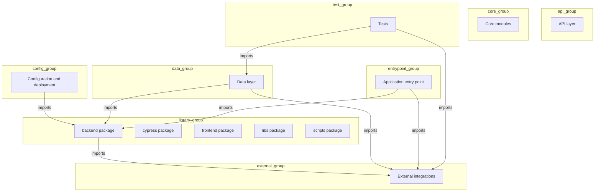

# Architecture report: Chainlit/chainlit

> Automated static analysis. **Observed** = directly seen in files/imports/AST; **Inferred** = interpretation from that evidence. Repository code was not executed.

## 1. Repository at a glance

| Item | Value |
| --- | --- |
| Repository | Chainlit/chainlit |
| Description | Build Conversational AI in minutes ⚡️ |
| Language | Python |
| Stars | 12504 |
| Licence | Apache-2.0 |
| Analysed commit / branch | 190ea74239d9e84b26e7c91bc2882dd038942564 / main |
| Framework(s) | FastAPI, React, Starlette |
| Files analysed | 632 |
| Components | 12 |

## 2. Architecture in one minute

Chainlit/chainlit - Build Conversational AI in minutes ⚡️. This repository was analysed statically from 632 file(s) (169 Python). Detected technologies (observed from imports/manifests): GitHub Actions, PostgreSQL, SQLite, FastAPI, React, Starlette. Files are grouped into 12 component(s): API layer, backend package, Configuration and deployment, Core modules, cypress package, Data layer, Application entry point, External integrations. Observed entry point(s): backend/chainlit/__main__.py, backend/chainlit/cli/__init__.py, backend/chainlit/server.py. Findings below distinguish observed facts from inferred interpretation.

## 3. High-level block diagram

## 4. Main components

### API layer (`api_layer`)

- **Kind:** api
- **Status:** Observed
- **Confidence:** 0.85
- **Responsibility:** Groups 9 file(s) under api layer (observed from repository paths and static analysis).
- **Paths:** `frontend/src/api/index.ts`, `libs/react-client/src/api/hooks/api.ts`, `libs/react-client/src/api/hooks/auth/config.ts`, `libs/react-client/src/api/hooks/auth/index.ts`, `libs/react-client/src/api/hooks/auth/sessionManagement.ts`, `libs/react-client/src/api/hooks/auth/state.ts`, `libs/react-client/src/api/hooks/auth/types.ts`, `libs/react-client/src/api/hooks/auth/userManagement.ts`, `libs/react-client/src/api/index.tsx`
- **Evidence:** [frontend/src/api/index.ts](https://github.com/Chainlit/chainlit/blob/190ea74239d9e84b26e7c91bc2882dd038942564/frontend/src/api/index.ts); [libs/react-client/src/api/hooks/api.ts](https://github.com/Chainlit/chainlit/blob/190ea74239d9e84b26e7c91bc2882dd038942564/libs/react-client/src/api/hooks/api.ts); [libs/react-client/src/api/hooks/auth/config.ts](https://github.com/Chainlit/chainlit/blob/190ea74239d9e84b26e7c91bc2882dd038942564/libs/react-client/src/api/hooks/auth/config.ts); [libs/react-client/src/api/hooks/auth/index.ts](https://github.com/Chainlit/chainlit/blob/190ea74239d9e84b26e7c91bc2882dd038942564/libs/react-client/src/api/hooks/auth/index.ts); [libs/react-client/src/api/hooks/auth/sessionManagement.ts](https://github.com/Chainlit/chainlit/blob/190ea74239d9e84b26e7c91bc2882dd038942564/libs/react-client/src/api/hooks/auth/sessionManagement.ts); [libs/react-client/src/api/hooks/auth/state.ts](https://github.com/Chainlit/chainlit/blob/190ea74239d9e84b26e7c91bc2882dd038942564/libs/react-client/src/api/hooks/auth/state.ts); [libs/react-client/src/api/hooks/auth/types.ts](https://github.com/Chainlit/chainlit/blob/190ea74239d9e84b26e7c91bc2882dd038942564/libs/react-client/src/api/hooks/auth/types.ts); [libs/react-client/src/api/hooks/auth/userManagement.ts](https://github.com/Chainlit/chainlit/blob/190ea74239d9e84b26e7c91bc2882dd038942564/libs/react-client/src/api/hooks/auth/userManagement.ts)

### backend package (`backend`)

- **Kind:** library
- **Status:** Observed
- **Confidence:** 0.85
- **Responsibility:** Groups 47 file(s) under backend package (observed from repository paths and static analysis). Observed top-level classes: AWSCognitoOAuthProvider, Action, ActionSpec, AskActionMessage, AskActionResponse, AskActionSpec. Observed top-level functions: __dir__, _authenticate_connection, _destination_in_allowlist, _destination_on_origin, _effective_port, _get_chunked_cookie.
- **Paths:** `backend/build.py`, `backend/chainlit/__init__.py`, `backend/chainlit/_utils.py`, `backend/chainlit/action.py`, `backend/chainlit/auth/__init__.py`, `backend/chainlit/auth/cookie.py`, `backend/chainlit/auth/jwt.py`, `backend/chainlit/cache.py`, `backend/chainlit/callbacks.py`, `backend/chainlit/chat_context.py`, `backend/chainlit/chat_settings.py`, `backend/chainlit/cli/__init__.py`, `backend/chainlit/context.py`, `backend/chainlit/discord/__init__.py`, `backend/chainlit/element.py`, `backend/chainlit/emitter.py`, `backend/chainlit/input_widget.py`, `backend/chainlit/langchain/__init__.py`, `backend/chainlit/langchain/callbacks.py`, `backend/chainlit/langflow/__init__.py`, `backend/chainlit/llama_index/__init__.py`, `backend/chainlit/llama_index/callbacks.py`, `backend/chainlit/logger.py`, `backend/chainlit/markdown.py`, `backend/chainlit/mcp.py`, `backend/chainlit/message.py`, `backend/chainlit/mistralai/__init__.py`, `backend/chainlit/mode.py`, `backend/chainlit/oauth_providers.py`, `backend/chainlit/openai/__init__.py`, `backend/chainlit/sample/hello.py`, `backend/chainlit/sample/starters_demo.py`, `backend/chainlit/secret.py`, `backend/chainlit/semantic_kernel/__init__.py`, `backend/chainlit/session.py`, `backend/chainlit/sidebar.py`, `backend/chainlit/slack/__init__.py`, `backend/chainlit/socket.py`, `backend/chainlit/step.py`, `backend/chainlit/sync.py`, `backend/chainlit/teams/__init__.py`, `backend/chainlit/translations.py`, `backend/chainlit/types.py`, `backend/chainlit/user.py`, `backend/chainlit/user_session.py`, `backend/chainlit/utils.py`, `backend/chainlit/version.py`
- **Evidence:** [backend/build.py:11](https://github.com/Chainlit/chainlit/blob/190ea74239d9e84b26e7c91bc2882dd038942564/backend/build.py#L11); [backend/chainlit/__init__.py:109](https://github.com/Chainlit/chainlit/blob/190ea74239d9e84b26e7c91bc2882dd038942564/backend/chainlit/__init__.py#L109); [backend/chainlit/_utils.py:6](https://github.com/Chainlit/chainlit/blob/190ea74239d9e84b26e7c91bc2882dd038942564/backend/chainlit/_utils.py#L6); [backend/chainlit/action.py:12](https://github.com/Chainlit/chainlit/blob/190ea74239d9e84b26e7c91bc2882dd038942564/backend/chainlit/action.py#L12); [backend/chainlit/auth/__init__.py:21](https://github.com/Chainlit/chainlit/blob/190ea74239d9e84b26e7c91bc2882dd038942564/backend/chainlit/auth/__init__.py#L21); [backend/chainlit/auth/cookie.py:39](https://github.com/Chainlit/chainlit/blob/190ea74239d9e84b26e7c91bc2882dd038942564/backend/chainlit/auth/cookie.py#L39); [backend/chainlit/auth/jwt.py:11](https://github.com/Chainlit/chainlit/blob/190ea74239d9e84b26e7c91bc2882dd038942564/backend/chainlit/auth/jwt.py#L11); [backend/chainlit/cache.py:11](https://github.com/Chainlit/chainlit/blob/190ea74239d9e84b26e7c91bc2882dd038942564/backend/chainlit/cache.py#L11)

### Configuration and deployment (`config`)

- **Kind:** config
- **Status:** Observed
- **Confidence:** 0.85
- **Responsibility:** Groups 43 file(s) under configuration and deployment (observed from repository paths and static analysis). Observed top-level classes: AudioFeature, ChainlitConfig, ChainlitConfigOverrides, CodeSettings, FeaturesSettings, HeaderLink. Observed top-level functions: _check_legacy_mcp_config, init_config, lint_translations, load_config, load_module, load_settings.
- **Paths:** `backend/chainlit/config.py`, `backend/chainlit/translations/ar-SA.json`, `backend/chainlit/translations/bn.json`, `backend/chainlit/translations/da-DK.json`, `backend/chainlit/translations/de-DE.json`, `backend/chainlit/translations/el-GR.json`, `backend/chainlit/translations/en-US.json`, `backend/chainlit/translations/es.json`, `backend/chainlit/translations/fr-FR.json`, `backend/chainlit/translations/gu.json`, `backend/chainlit/translations/he-IL.json`, `backend/chainlit/translations/hi.json`, `backend/chainlit/translations/it.json`, `backend/chainlit/translations/ja.json`, `backend/chainlit/translations/kn.json`, `backend/chainlit/translations/ko.json`, `backend/chainlit/translations/ml.json`, `backend/chainlit/translations/mr.json`, `backend/chainlit/translations/nl.json`, `backend/chainlit/translations/pt-PT.json`, `backend/chainlit/translations/ta.json`, `backend/chainlit/translations/te.json`, `backend/chainlit/translations/zh-CN.json`, `backend/chainlit/translations/zh-TW.json`, `backend/pyproject.toml`, `cypress/e2e/custom_build/.chainlit/config.toml`, `cypress/e2e/custom_theme/public/theme.json`, `cypress/e2e/user_env/.chainlit/config.toml`, `frontend/components.json`, `frontend/package.json`, `frontend/tsconfig.json`, `frontend/tsconfig.node.json`, `libs/copilot/components.json`, `libs/copilot/package.json`, `libs/copilot/tsconfig.json`, `libs/copilot/tsconfig.node.json`, `libs/react-client/package.json`, `libs/react-client/tsconfig.build.json`, `libs/react-client/tsconfig.json`, `package.json`, `pnpm-workspace.yaml`, `pyproject.toml`, `tsconfig.json`
- **Evidence:** [backend/chainlit/config.py:275](https://github.com/Chainlit/chainlit/blob/190ea74239d9e84b26e7c91bc2882dd038942564/backend/chainlit/config.py#L275); [backend/chainlit/translations/ar-SA.json](https://github.com/Chainlit/chainlit/blob/190ea74239d9e84b26e7c91bc2882dd038942564/backend/chainlit/translations/ar-SA.json); [backend/chainlit/translations/bn.json](https://github.com/Chainlit/chainlit/blob/190ea74239d9e84b26e7c91bc2882dd038942564/backend/chainlit/translations/bn.json); [backend/chainlit/translations/da-DK.json](https://github.com/Chainlit/chainlit/blob/190ea74239d9e84b26e7c91bc2882dd038942564/backend/chainlit/translations/da-DK.json); [backend/chainlit/translations/de-DE.json](https://github.com/Chainlit/chainlit/blob/190ea74239d9e84b26e7c91bc2882dd038942564/backend/chainlit/translations/de-DE.json); [backend/chainlit/translations/el-GR.json](https://github.com/Chainlit/chainlit/blob/190ea74239d9e84b26e7c91bc2882dd038942564/backend/chainlit/translations/el-GR.json); [backend/chainlit/translations/en-US.json](https://github.com/Chainlit/chainlit/blob/190ea74239d9e84b26e7c91bc2882dd038942564/backend/chainlit/translations/en-US.json); [backend/chainlit/translations/es.json](https://github.com/Chainlit/chainlit/blob/190ea74239d9e84b26e7c91bc2882dd038942564/backend/chainlit/translations/es.json)

### Core modules (`core`)

- **Kind:** core
- **Status:** Observed
- **Confidence:** 0.85
- **Responsibility:** Groups 3 file(s) under core modules (observed from repository paths and static analysis).
- **Paths:** `cypress.config.ts`, `eslint.config.mjs`, `lint-staged.config.js`
- **Evidence:** [cypress.config.ts](https://github.com/Chainlit/chainlit/blob/190ea74239d9e84b26e7c91bc2882dd038942564/cypress.config.ts); [eslint.config.mjs](https://github.com/Chainlit/chainlit/blob/190ea74239d9e84b26e7c91bc2882dd038942564/eslint.config.mjs); [lint-staged.config.js](https://github.com/Chainlit/chainlit/blob/190ea74239d9e84b26e7c91bc2882dd038942564/lint-staged.config.js)

### cypress package (`cypress`)

- **Kind:** library
- **Status:** Observed
- **Confidence:** 0.85
- **Responsibility:** Groups 70 file(s) under cypress package (observed from repository paths and static analysis). Observed top-level functions: auth_callback, data_layer, handle_message, main, message, sync_function.
- **Paths:** `cypress/e2e/action/spec.cy.ts`, `cypress/e2e/ask_custom_element/public/elements/JiraTicket.jsx`, `cypress/e2e/ask_custom_element/spec.cy.ts`, `cypress/e2e/ask_file/spec.cy.ts`, `cypress/e2e/ask_multiple_files/spec.cy.ts`, `cypress/e2e/ask_user/spec.cy.ts`, `cypress/e2e/audio_element/spec.cy.ts`, `cypress/e2e/auth/spec.cy.ts`, `cypress/e2e/blinking_cursor/spec.cy.ts`, `cypress/e2e/chat_context/spec.cy.ts`, `cypress/e2e/chat_prefill/spec.cy.ts`, `cypress/e2e/chat_profiles/spec.cy.ts`, `cypress/e2e/chat_settings/spec.cy.ts`, `cypress/e2e/command/spec.cy.ts`, `cypress/e2e/config_overrides/spec.cy.ts`, `cypress/e2e/context/spec.cy.ts`, `cypress/e2e/copilot/spec.cy.ts`, `cypress/e2e/custom_build/spec.cy.ts`, `cypress/e2e/custom_data_layer/sql_alchemy.py`, `cypress/e2e/custom_element/public/elements/Counter.jsx`, `cypress/e2e/custom_element/spec.cy.ts`, `cypress/e2e/custom_element_auth/spec.cy.ts`, `cypress/e2e/custom_element_command/public/elements/Commander.jsx`, `cypress/e2e/custom_element_command/spec.cy.ts`, `cypress/e2e/custom_theme/spec.cy.ts`, `cypress/e2e/data_layer/spec.cy.ts`, `cypress/e2e/dataframe/spec.cy.ts`, `cypress/e2e/edit_message/spec.cy.ts`, `cypress/e2e/elements/spec.cy.ts`, `cypress/e2e/error_handling/spec.cy.ts`, `cypress/e2e/file_element/spec.cy.ts`, `cypress/e2e/header_auth/spec.cy.ts`, `cypress/e2e/llama_index_cb/spec.cy.ts`, `cypress/e2e/modes/spec.cy.ts`, `cypress/e2e/oauth_auth/spec.cy.ts`, `cypress/e2e/on_chat_start/spec.cy.ts`, `cypress/e2e/password_auth/spec.cy.ts`, `cypress/e2e/pdf_viewer/spec.cy.ts`, `cypress/e2e/plotly/spec.cy.ts`, `cypress/e2e/pyplot/spec.cy.ts`, `cypress/e2e/readme/spec.cy.ts`, `cypress/e2e/remove_elements/spec.cy.ts`, `cypress/e2e/remove_step/spec.cy.ts`, `cypress/e2e/sidebar/spec.cy.ts`, `cypress/e2e/starters/spec.cy.ts`, `cypress/e2e/starters_categories/spec.cy.ts`, `cypress/e2e/step/async-spec.cy.ts`, `cypress/e2e/step/main_async.py`, `cypress/e2e/step/main_sync.py`, `cypress/e2e/step/sync-spec.cy.ts`, `cypress/e2e/step/tests.ts`, `cypress/e2e/step_icon/spec.cy.ts`, `cypress/e2e/stop_task/async-spec.cy.ts`, `cypress/e2e/stop_task/main_async.py`, `cypress/e2e/stop_task/main_sync.py`, `cypress/e2e/stop_task/sync-spec.cy.ts`, `cypress/e2e/stop_task/tests.ts`, `cypress/e2e/streaming/spec.cy.ts`, `cypress/e2e/tasklist/spec.cy.ts`, `cypress/e2e/thread_resume/spec.cy.ts`, `cypress/e2e/update_step/spec.cy.ts`, `cypress/e2e/upload_attachments/spec.cy.ts`, `cypress/e2e/user_env/spec.cy.ts`, `cypress/e2e/user_session/spec.cy.ts`, `cypress/e2e/window_message/spec.cy.ts`, `cypress/fixtures/hello.cpp`, `cypress/fixtures/hello.py`, `cypress/support/e2e.ts`, `cypress/support/run.ts`, `cypress/support/testUtils.ts`
- **Evidence:** [cypress/e2e/action/spec.cy.ts](https://github.com/Chainlit/chainlit/blob/190ea74239d9e84b26e7c91bc2882dd038942564/cypress/e2e/action/spec.cy.ts); [cypress/e2e/ask_custom_element/public/elements/JiraTicket.jsx](https://github.com/Chainlit/chainlit/blob/190ea74239d9e84b26e7c91bc2882dd038942564/cypress/e2e/ask_custom_element/public/elements/JiraTicket.jsx); [cypress/e2e/ask_custom_element/spec.cy.ts](https://github.com/Chainlit/chainlit/blob/190ea74239d9e84b26e7c91bc2882dd038942564/cypress/e2e/ask_custom_element/spec.cy.ts); [cypress/e2e/ask_file/spec.cy.ts](https://github.com/Chainlit/chainlit/blob/190ea74239d9e84b26e7c91bc2882dd038942564/cypress/e2e/ask_file/spec.cy.ts); [cypress/e2e/ask_multiple_files/spec.cy.ts](https://github.com/Chainlit/chainlit/blob/190ea74239d9e84b26e7c91bc2882dd038942564/cypress/e2e/ask_multiple_files/spec.cy.ts); [cypress/e2e/ask_user/spec.cy.ts](https://github.com/Chainlit/chainlit/blob/190ea74239d9e84b26e7c91bc2882dd038942564/cypress/e2e/ask_user/spec.cy.ts); [cypress/e2e/audio_element/spec.cy.ts](https://github.com/Chainlit/chainlit/blob/190ea74239d9e84b26e7c91bc2882dd038942564/cypress/e2e/audio_element/spec.cy.ts); [cypress/e2e/auth/spec.cy.ts](https://github.com/Chainlit/chainlit/blob/190ea74239d9e84b26e7c91bc2882dd038942564/cypress/e2e/auth/spec.cy.ts)

### Data layer (`data_layer`)

- **Kind:** data
- **Status:** Observed
- **Confidence:** 0.85
- **Responsibility:** Groups 14 file(s) under data layer (observed from repository paths and static analysis). Observed top-level classes: AzureBlobStorageClient, AzureStorageClient, BaseDataLayer, BaseStorageClient, ChainlitDataLayer, DynamoDBDataLayer. Observed top-level functions: _show_deprecation_warning, get_data_layer, is_thread_author, queue_until_user_message, truncate.
- **Paths:** `backend/chainlit/data/__init__.py`, `backend/chainlit/data/acl.py`, `backend/chainlit/data/base.py`, `backend/chainlit/data/chainlit_data_layer.py`, `backend/chainlit/data/dynamodb.py`, `backend/chainlit/data/literalai.py`, `backend/chainlit/data/sql_alchemy.py`, `backend/chainlit/data/storage_clients/__init__.py`, `backend/chainlit/data/storage_clients/azure.py`, `backend/chainlit/data/storage_clients/azure_blob.py`, `backend/chainlit/data/storage_clients/base.py`, `backend/chainlit/data/storage_clients/gcs.py`, `backend/chainlit/data/storage_clients/s3.py`, `backend/chainlit/data/utils.py`
- **Evidence:** [backend/chainlit/data/__init__.py:14](https://github.com/Chainlit/chainlit/blob/190ea74239d9e84b26e7c91bc2882dd038942564/backend/chainlit/data/__init__.py#L14); [backend/chainlit/data/acl.py:6](https://github.com/Chainlit/chainlit/blob/190ea74239d9e84b26e7c91bc2882dd038942564/backend/chainlit/data/acl.py#L6); [backend/chainlit/data/base.py:20](https://github.com/Chainlit/chainlit/blob/190ea74239d9e84b26e7c91bc2882dd038942564/backend/chainlit/data/base.py#L20); [backend/chainlit/data/chainlit_data_layer.py:40](https://github.com/Chainlit/chainlit/blob/190ea74239d9e84b26e7c91bc2882dd038942564/backend/chainlit/data/chainlit_data_layer.py#L40); [backend/chainlit/data/dynamodb.py:43](https://github.com/Chainlit/chainlit/blob/190ea74239d9e84b26e7c91bc2882dd038942564/backend/chainlit/data/dynamodb.py#L43); [backend/chainlit/data/literalai.py:43](https://github.com/Chainlit/chainlit/blob/190ea74239d9e84b26e7c91bc2882dd038942564/backend/chainlit/data/literalai.py#L43); [backend/chainlit/data/sql_alchemy.py:37](https://github.com/Chainlit/chainlit/blob/190ea74239d9e84b26e7c91bc2882dd038942564/backend/chainlit/data/sql_alchemy.py#L37); [backend/chainlit/data/storage_clients/__init__.py](https://github.com/Chainlit/chainlit/blob/190ea74239d9e84b26e7c91bc2882dd038942564/backend/chainlit/data/storage_clients/__init__.py)

### Application entry point (`entrypoint`)

- **Kind:** entrypoint
- **Status:** Observed
- **Confidence:** 0.85
- **Responsibility:** Groups 59 file(s) under application entry point (observed from repository paths and static analysis). Observed application object created via FastAPI. Observed routes: GET /public/{filename:path}, GET /assets/{filename:path}, GET /copilot/{filename:path}, GET /auth/config, POST /login. Observed top-level classes: DiscordEmitter, FeedbackView, MemoryDataLayer, SafariWebSocketsCompatibleGZipMiddleware, SlackEmitter, TeamsBot. Observed top-level functions: _authenticate_user, _find_leading_env_assignment, _get_auth_response, _get_bot_profile, _get_oauth_redirect_error, _get_response_dict.
- **Paths:** `backend/chainlit/__main__.py`, `backend/chainlit/discord/app.py`, `backend/chainlit/server.py`, `backend/chainlit/slack/app.py`, `backend/chainlit/teams/app.py`, `cypress/e2e/action/main.py`, `cypress/e2e/ask_custom_element/main.py`, `cypress/e2e/ask_file/main.py`, `cypress/e2e/ask_multiple_files/main.py`, `cypress/e2e/ask_user/main.py`, `cypress/e2e/audio_element/main.py`, `cypress/e2e/auth/main.py`, `cypress/e2e/blinking_cursor/main.py`, `cypress/e2e/chat_context/main.py`, `cypress/e2e/chat_prefill/main.py`, `cypress/e2e/chat_profiles/main.py`, `cypress/e2e/chat_settings/main.py`, `cypress/e2e/command/main.py`, `cypress/e2e/config_overrides/main.py`, `cypress/e2e/context/main.py`, `cypress/e2e/copilot/main.py`, `cypress/e2e/custom_build/main.py`, `cypress/e2e/custom_element/main.py`, `cypress/e2e/custom_element_auth/main.py`, `cypress/e2e/custom_element_command/main.py`, `cypress/e2e/custom_theme/main.py`, `cypress/e2e/data_layer/main.py`, `cypress/e2e/dataframe/main.py`, `cypress/e2e/edit_message/main.py`, `cypress/e2e/elements/main.py`, `cypress/e2e/error_handling/main.py`, `cypress/e2e/file_element/main.py`, `cypress/e2e/header_auth/main.py`, `cypress/e2e/llama_index_cb/main.py`, `cypress/e2e/modes/main.py`, `cypress/e2e/oauth_auth/main.py`, `cypress/e2e/on_chat_start/main.py`, `cypress/e2e/password_auth/main.py`, `cypress/e2e/pdf_viewer/main.py`, `cypress/e2e/plotly/main.py`, `cypress/e2e/pyplot/main.py`, `cypress/e2e/readme/main.py`, `cypress/e2e/remove_elements/main.py`, `cypress/e2e/remove_step/main.py`, `cypress/e2e/sidebar/main.py`, `cypress/e2e/starters/main.py`, `cypress/e2e/starters_categories/main.py`, `cypress/e2e/step_icon/main.py`, `cypress/e2e/streaming/main.py`, `cypress/e2e/tasklist/main.py`, `cypress/e2e/thread_resume/main.py`, `cypress/e2e/update_step/main.py`, `cypress/e2e/upload_attachments/main.py`, `cypress/e2e/user_env/main.py`, `cypress/e2e/user_session/main.py`, `cypress/e2e/window_message/main.py`, `scripts/format.py`, `scripts/lint.py`, `scripts/type_check.py`
- **Evidence:** [backend/chainlit/__main__.py](https://github.com/Chainlit/chainlit/blob/190ea74239d9e84b26e7c91bc2882dd038942564/backend/chainlit/__main__.py); [backend/chainlit/discord/app.py:29](https://github.com/Chainlit/chainlit/blob/190ea74239d9e84b26e7c91bc2882dd038942564/backend/chainlit/discord/app.py#L29); [backend/chainlit/server.py:228](https://github.com/Chainlit/chainlit/blob/190ea74239d9e84b26e7c91bc2882dd038942564/backend/chainlit/server.py#L228); [backend/chainlit/slack/app.py:26](https://github.com/Chainlit/chainlit/blob/190ea74239d9e84b26e7c91bc2882dd038942564/backend/chainlit/slack/app.py#L26); [backend/chainlit/teams/app.py:44](https://github.com/Chainlit/chainlit/blob/190ea74239d9e84b26e7c91bc2882dd038942564/backend/chainlit/teams/app.py#L44); [cypress/e2e/action/main.py:5](https://github.com/Chainlit/chainlit/blob/190ea74239d9e84b26e7c91bc2882dd038942564/cypress/e2e/action/main.py#L5); [cypress/e2e/ask_custom_element/main.py:5](https://github.com/Chainlit/chainlit/blob/190ea74239d9e84b26e7c91bc2882dd038942564/cypress/e2e/ask_custom_element/main.py#L5); [cypress/e2e/ask_file/main.py:7](https://github.com/Chainlit/chainlit/blob/190ea74239d9e84b26e7c91bc2882dd038942564/cypress/e2e/ask_file/main.py#L7)

### External integrations (`external_integrations`)

- **Kind:** external
- **Status:** Inferred
- **Confidence:** 0.70
- **Responsibility:** Groups 0 file(s) under external integrations (observed from repository paths and static analysis).
- **Evidence:** [backend/chainlit/data/chainlit_data_layer.py:7](https://github.com/Chainlit/chainlit/blob/190ea74239d9e84b26e7c91bc2882dd038942564/backend/chainlit/data/chainlit_data_layer.py#L7); [backend/chainlit/data/dynamodb.py:12](https://github.com/Chainlit/chainlit/blob/190ea74239d9e84b26e7c91bc2882dd038942564/backend/chainlit/data/dynamodb.py#L12); [backend/chainlit/data/dynamodb.py:13](https://github.com/Chainlit/chainlit/blob/190ea74239d9e84b26e7c91bc2882dd038942564/backend/chainlit/data/dynamodb.py#L13); [backend/chainlit/data/dynamodb.py:14](https://github.com/Chainlit/chainlit/blob/190ea74239d9e84b26e7c91bc2882dd038942564/backend/chainlit/data/dynamodb.py#L14); [backend/chainlit/data/literalai.py:9](https://github.com/Chainlit/chainlit/blob/190ea74239d9e84b26e7c91bc2882dd038942564/backend/chainlit/data/literalai.py#L9); [backend/chainlit/data/sql_alchemy.py:9](https://github.com/Chainlit/chainlit/blob/190ea74239d9e84b26e7c91bc2882dd038942564/backend/chainlit/data/sql_alchemy.py#L9)

### frontend package (`frontend`)

- **Kind:** library
- **Status:** Observed
- **Confidence:** 0.85
- **Responsibility:** Groups 211 file(s) under frontend package (observed from repository paths and static analysis).
- **Paths:** `frontend/postcss.config.js`, `frontend/src/App.tsx`, `frontend/src/AppWrapper.tsx`, `frontend/src/components/Alert.tsx`, `frontend/src/components/AudioPresence.tsx`, `frontend/src/components/AutoResizeTextarea.tsx`, `frontend/src/components/AutoResumeThread.tsx`, `frontend/src/components/BlinkingCursor.tsx`, `frontend/src/components/ButtonLink.tsx`, `frontend/src/components/ChatSettings/ChatSettingsSidebar.tsx`, `frontend/src/components/ChatSettings/CheckboxInput.tsx`, `frontend/src/components/ChatSettings/DatePickerInput.tsx`, `frontend/src/components/ChatSettings/FormInput.tsx`, `frontend/src/components/ChatSettings/InputLabel.tsx`, `frontend/src/components/ChatSettings/InputStateHandler.tsx`, `frontend/src/components/ChatSettings/MultiSelectInput.tsx`, `frontend/src/components/ChatSettings/NotificationCount.tsx`, `frontend/src/components/ChatSettings/RadioButtonGroup.tsx`, `frontend/src/components/ChatSettings/SelectInput.tsx`, `frontend/src/components/ChatSettings/SliderInput.tsx`, `frontend/src/components/ChatSettings/SwitchInput.tsx`, `frontend/src/components/ChatSettings/TagsInput.tsx`, `frontend/src/components/ChatSettings/TextInput.tsx`, `frontend/src/components/ChatSettings/index.tsx`, `frontend/src/components/ChatSettings/useChatSettingsSnapshotAtOpen.ts`, `frontend/src/components/CodeSnippet.tsx`, `frontend/src/components/CopyButton.tsx`, `frontend/src/components/ElementSideView.tsx`, `frontend/src/components/ElementView.tsx`, `frontend/src/components/Elements/Audio.tsx`, `frontend/src/components/Elements/CustomElement/Imports.ts`, `frontend/src/components/Elements/CustomElement/Renderer.tsx`, `frontend/src/components/Elements/CustomElement/index.tsx`, `frontend/src/components/Elements/Dataframe.tsx`, `frontend/src/components/Elements/ElementRef.tsx`, `frontend/src/components/Elements/File.tsx`, `frontend/src/components/Elements/Image.tsx`, `frontend/src/components/Elements/LazyDataframe.tsx`, `frontend/src/components/Elements/PDF.tsx`, `frontend/src/components/Elements/Plotly.tsx`, `frontend/src/components/Elements/Text.tsx`, `frontend/src/components/Elements/Video.tsx`, `frontend/src/components/Elements/index.tsx`, `frontend/src/components/ErrorBoundary.tsx`, `frontend/src/components/Icon.tsx`, `frontend/src/components/Kbd.tsx`, `frontend/src/components/LeftSidebar/Search.tsx`, `frontend/src/components/LeftSidebar/ThreadHistory.tsx`, `frontend/src/components/LeftSidebar/ThreadList.tsx`, `frontend/src/components/LeftSidebar/ThreadOptions.tsx`, `frontend/src/components/LeftSidebar/index.tsx`, `frontend/src/components/Loader.tsx`, `frontend/src/components/LoginForm.tsx`, `frontend/src/components/Logo.tsx`, `frontend/src/components/Markdown.tsx`, `frontend/src/components/MarkdownAlert.tsx`, `frontend/src/components/ProviderButton.tsx`, `frontend/src/components/QuiltedGrid.tsx`, `frontend/src/components/ReadOnlyThread.tsx`, `frontend/src/components/Tasklist/Task.tsx`, `frontend/src/components/Tasklist/TaskStatusIcon.tsx`, `frontend/src/components/Tasklist/index.tsx`, `frontend/src/components/ThemeProvider.tsx`, `frontend/src/components/WaterMark.tsx`, `frontend/src/components/chat/Footer.tsx`, `frontend/src/components/chat/MessageComposer/Attachment.tsx`, `frontend/src/components/chat/MessageComposer/Attachments.tsx`, `frontend/src/components/chat/MessageComposer/CommandButtons.tsx`, `frontend/src/components/chat/MessageComposer/CommandPopoverButton.tsx`, `frontend/src/components/chat/MessageComposer/FavoriteButton.tsx`, `frontend/src/components/chat/MessageComposer/Input.tsx`, `frontend/src/components/chat/MessageComposer/Mcp/AddForm.tsx`, `frontend/src/components/chat/MessageComposer/Mcp/AnimatedPlugIcon.tsx`, `frontend/src/components/chat/MessageComposer/Mcp/List.tsx`, `frontend/src/components/chat/MessageComposer/Mcp/index.tsx`, `frontend/src/components/chat/MessageComposer/ModePicker.tsx`, `frontend/src/components/chat/MessageComposer/SubmitButton.tsx`, `frontend/src/components/chat/MessageComposer/UploadButton.tsx`, `frontend/src/components/chat/MessageComposer/VoiceButton.tsx`, `frontend/src/components/chat/MessageComposer/index.tsx`, `frontend/src/components/chat/Messages/Message/AskActionButtons.tsx`, `frontend/src/components/chat/Messages/Message/AskFileButton.tsx`, `frontend/src/components/chat/Messages/Message/Avatar.tsx`, `frontend/src/components/chat/Messages/Message/Buttons/Actions/ActionButton.tsx`, `frontend/src/components/chat/Messages/Message/Buttons/Actions/index.tsx`, `frontend/src/components/chat/Messages/Message/Buttons/DebugButton.tsx`, `frontend/src/components/chat/Messages/Message/Buttons/FeedbackButtons.tsx`, `frontend/src/components/chat/Messages/Message/Buttons/index.tsx`, `frontend/src/components/chat/Messages/Message/Content/InlinedElements/InlineCustomElementList.tsx`, `frontend/src/components/chat/Messages/Message/Content/InlinedElements/InlinedAudioList.tsx`, `frontend/src/components/chat/Messages/Message/Content/InlinedElements/InlinedDataframeList.tsx`, `frontend/src/components/chat/Messages/Message/Content/InlinedElements/InlinedFileList.tsx`, `frontend/src/components/chat/Messages/Message/Content/InlinedElements/InlinedImageList.tsx`, `frontend/src/components/chat/Messages/Message/Content/InlinedElements/InlinedPDFList.tsx`, `frontend/src/components/chat/Messages/Message/Content/InlinedElements/InlinedPlotlyList.tsx`, `frontend/src/components/chat/Messages/Message/Content/InlinedElements/InlinedTextList.tsx`, `frontend/src/components/chat/Messages/Message/Content/InlinedElements/InlinedVideoList.tsx`, `frontend/src/components/chat/Messages/Message/Content/InlinedElements/index.tsx`, `frontend/src/components/chat/Messages/Message/Content/index.tsx`, `frontend/src/components/chat/Messages/Message/Step.tsx`, `frontend/src/components/chat/Messages/Message/UserMessage.tsx`, `frontend/src/components/chat/Messages/Message/index.tsx`, `frontend/src/components/chat/Messages/index.tsx`, `frontend/src/components/chat/MessagesContainer/index.tsx`, `frontend/src/components/chat/ScrollContainer.tsx`, `frontend/src/components/chat/ScrollDownButton.tsx`, `frontend/src/components/chat/Starter.tsx`, `frontend/src/components/chat/StarterCategory.tsx`, `frontend/src/components/chat/Starters.tsx`, `frontend/src/components/chat/WelcomeScreen.tsx`, `frontend/src/components/chat/index.tsx`, `frontend/src/components/header/ApiKeys.tsx`, `frontend/src/components/header/ChatProfiles.tsx`, `frontend/src/components/header/NewChat.tsx`, `frontend/src/components/header/Readme.tsx`, `frontend/src/components/header/Share.tsx`, `frontend/src/components/header/SidebarTrigger.tsx`, `frontend/src/components/header/ThemeToggle.tsx`, `frontend/src/components/header/UserNav.tsx`, `frontend/src/components/header/index.tsx`, `frontend/src/components/i18n/Translator.tsx`, `frontend/src/components/i18n/index.ts`, `frontend/src/components/icons/Auth0.tsx`, `frontend/src/components/icons/Cognito.tsx`, `frontend/src/components/icons/Descope.tsx`, `frontend/src/components/icons/EditSquare.tsx`, `frontend/src/components/icons/Github.tsx`, `frontend/src/components/icons/Gitlab.tsx`, `frontend/src/components/icons/Google.tsx`, `frontend/src/components/icons/Microsoft.tsx`, `frontend/src/components/icons/Okta.tsx`, `frontend/src/components/icons/PaperClip.tsx`, `frontend/src/components/icons/Pencil.tsx`, `frontend/src/components/icons/Search.tsx`, `frontend/src/components/icons/Send.tsx`, `frontend/src/components/icons/Settings.tsx`, `frontend/src/components/icons/Sidebar.tsx`, `frontend/src/components/icons/Stop.tsx`, `frontend/src/components/icons/ToolBox.tsx`, `frontend/src/components/icons/VoiceLines.tsx`, `frontend/src/components/share/ShareDialog.tsx`, `frontend/src/components/ui/accordion.tsx`, `frontend/src/components/ui/alert-dialog.tsx`, `frontend/src/components/ui/aspect-ratio.tsx`, `frontend/src/components/ui/avatar.tsx`, `frontend/src/components/ui/badge.tsx`, `frontend/src/components/ui/button.tsx`, `frontend/src/components/ui/calendar.tsx`, `frontend/src/components/ui/card.tsx`, `frontend/src/components/ui/carousel.tsx`, `frontend/src/components/ui/checkbox.tsx`, `frontend/src/components/ui/command.tsx`, `frontend/src/components/ui/dialog.tsx`, `frontend/src/components/ui/dropdown-menu.tsx`, `frontend/src/components/ui/form.tsx`, `frontend/src/components/ui/hover-card.tsx`, `frontend/src/components/ui/input.tsx`, `frontend/src/components/ui/label.tsx`, `frontend/src/components/ui/pagination.tsx`, `frontend/src/components/ui/popover.tsx`, `frontend/src/components/ui/progress.tsx`, `frontend/src/components/ui/radio-group.tsx`, `frontend/src/components/ui/resizable.tsx`, `frontend/src/components/ui/scroll-area.tsx`, `frontend/src/components/ui/select.tsx`, `frontend/src/components/ui/separator.tsx`, `frontend/src/components/ui/sheet.tsx`, `frontend/src/components/ui/sidebar.tsx`, `frontend/src/components/ui/skeleton.tsx`, `frontend/src/components/ui/slider.tsx`, `frontend/src/components/ui/sonner.tsx`, `frontend/src/components/ui/switch.tsx`, `frontend/src/components/ui/table.tsx`, `frontend/src/components/ui/tabs.tsx`, `frontend/src/components/ui/textarea.tsx`, `frontend/src/components/ui/tooltip.tsx`, `frontend/src/contexts/MessageContext.tsx`, `frontend/src/hooks/query.ts`, `frontend/src/hooks/use-mobile.tsx`, `frontend/src/hooks/useCommandNavigation.tsx`, `frontend/src/hooks/useFetch.tsx`, `frontend/src/hooks/useLayoutMaxWidth.tsx`, `frontend/src/hooks/usePlatform.ts`, `frontend/src/hooks/useUpload.tsx`, `frontend/src/i18n/dateLocale.ts`, `frontend/src/i18n/index.ts`, `frontend/src/index.d.ts`, `frontend/src/lib/message.ts`, `frontend/src/lib/router.ts`, `frontend/src/lib/utils.ts`, `frontend/src/main.tsx`, `frontend/src/pages/AuthCallback.tsx`, `frontend/src/pages/Element.tsx`, `frontend/src/pages/Env.tsx`, `frontend/src/pages/Home.tsx`, `frontend/src/pages/Login.tsx`, `frontend/src/pages/Page.tsx`, `frontend/src/pages/Thread.tsx`, `frontend/src/router.tsx`, `frontend/src/state/chat.ts`, `frontend/src/state/project.ts`, `frontend/src/state/user.ts`, `frontend/src/types/Input.ts`, `frontend/src/types/NotificationCount.tsx`, `frontend/src/types/chat.ts`, `frontend/src/types/index.ts`, `frontend/src/types/messageContext.ts`, `frontend/src/vite-env.d.ts`, `frontend/tailwind.config.js`, `frontend/vite.config.ts`, `frontend/vitest.config.ts`
- **Evidence:** [frontend/postcss.config.js](https://github.com/Chainlit/chainlit/blob/190ea74239d9e84b26e7c91bc2882dd038942564/frontend/postcss.config.js); [frontend/src/App.tsx](https://github.com/Chainlit/chainlit/blob/190ea74239d9e84b26e7c91bc2882dd038942564/frontend/src/App.tsx); [frontend/src/AppWrapper.tsx](https://github.com/Chainlit/chainlit/blob/190ea74239d9e84b26e7c91bc2882dd038942564/frontend/src/AppWrapper.tsx); [frontend/src/components/Alert.tsx](https://github.com/Chainlit/chainlit/blob/190ea74239d9e84b26e7c91bc2882dd038942564/frontend/src/components/Alert.tsx); [frontend/src/components/AudioPresence.tsx](https://github.com/Chainlit/chainlit/blob/190ea74239d9e84b26e7c91bc2882dd038942564/frontend/src/components/AudioPresence.tsx); [frontend/src/components/AutoResizeTextarea.tsx](https://github.com/Chainlit/chainlit/blob/190ea74239d9e84b26e7c91bc2882dd038942564/frontend/src/components/AutoResizeTextarea.tsx); [frontend/src/components/AutoResumeThread.tsx](https://github.com/Chainlit/chainlit/blob/190ea74239d9e84b26e7c91bc2882dd038942564/frontend/src/components/AutoResumeThread.tsx); [frontend/src/components/BlinkingCursor.tsx](https://github.com/Chainlit/chainlit/blob/190ea74239d9e84b26e7c91bc2882dd038942564/frontend/src/components/BlinkingCursor.tsx)

### libs package (`libs`)

- **Kind:** library
- **Status:** Observed
- **Confidence:** 0.85
- **Responsibility:** Groups 60 file(s) under libs package (observed from repository paths and static analysis).
- **Paths:** `libs/copilot/.storybook/main.ts`, `libs/copilot/.storybook/preview.ts`, `libs/copilot/index.tsx`, `libs/copilot/postcss.config.js`, `libs/copilot/src/ThemeProvider.tsx`, `libs/copilot/src/api.ts`, `libs/copilot/src/app.tsx`, `libs/copilot/src/appWrapper.tsx`, `libs/copilot/src/chat/body.tsx`, `libs/copilot/src/chat/index.tsx`, `libs/copilot/src/components/ElementSideView.tsx`, `libs/copilot/src/components/Header.tsx`, `libs/copilot/src/components/WelcomeScreen.tsx`, `libs/copilot/src/hooks/index.ts`, `libs/copilot/src/hooks/useCopilotInteract.ts`, `libs/copilot/src/hooks/useSidebarResize.ts`, `libs/copilot/src/lib/utils.ts`, `libs/copilot/src/resolveDisplayMode.ts`, `libs/copilot/src/state.ts`, `libs/copilot/src/types.ts`, `libs/copilot/src/widget.tsx`, `libs/copilot/stories/App.stories.ts`, `libs/copilot/tailwind.config.js`, `libs/copilot/vite.config.ts`, `libs/react-client/src/context.ts`, `libs/react-client/src/index.ts`, `libs/react-client/src/state.spec.ts`, `libs/react-client/src/state.ts`, `libs/react-client/src/types/action.ts`, `libs/react-client/src/types/audio.ts`, `libs/react-client/src/types/command.ts`, `libs/react-client/src/types/config.ts`, `libs/react-client/src/types/element.ts`, `libs/react-client/src/types/feedback.ts`, `libs/react-client/src/types/file.ts`, `libs/react-client/src/types/history.ts`, `libs/react-client/src/types/index.ts`, `libs/react-client/src/types/mcp.ts`, `libs/react-client/src/types/mode.ts`, `libs/react-client/src/types/step.ts`, `libs/react-client/src/types/thread.ts`, `libs/react-client/src/types/user.ts`, `libs/react-client/src/useAudio.ts`, `libs/react-client/src/useChatData.ts`, `libs/react-client/src/useChatInteract.ts`, `libs/react-client/src/useChatMessages.ts`, `libs/react-client/src/useChatSession.ts`, `libs/react-client/src/useConfig.ts`, `libs/react-client/src/utils/group.ts`, `libs/react-client/src/utils/message.ts`, `libs/react-client/src/wavtools/analysis/audio_analysis.js`, `libs/react-client/src/wavtools/analysis/constants.js`, `libs/react-client/src/wavtools/index.ts`, `libs/react-client/src/wavtools/wav_packer.js`, `libs/react-client/src/wavtools/wav_recorder.js`, `libs/react-client/src/wavtools/wav_renderer.ts`, `libs/react-client/src/wavtools/wav_stream_player.js`, `libs/react-client/src/wavtools/worklets/audio_processor.js`, `libs/react-client/src/wavtools/worklets/stream_processor.js`, `libs/react-client/vitest.config.ts`
- **Evidence:** [libs/copilot/.storybook/main.ts](https://github.com/Chainlit/chainlit/blob/190ea74239d9e84b26e7c91bc2882dd038942564/libs/copilot/.storybook/main.ts); [libs/copilot/.storybook/preview.ts](https://github.com/Chainlit/chainlit/blob/190ea74239d9e84b26e7c91bc2882dd038942564/libs/copilot/.storybook/preview.ts); [libs/copilot/index.tsx](https://github.com/Chainlit/chainlit/blob/190ea74239d9e84b26e7c91bc2882dd038942564/libs/copilot/index.tsx); [libs/copilot/postcss.config.js](https://github.com/Chainlit/chainlit/blob/190ea74239d9e84b26e7c91bc2882dd038942564/libs/copilot/postcss.config.js); [libs/copilot/src/ThemeProvider.tsx](https://github.com/Chainlit/chainlit/blob/190ea74239d9e84b26e7c91bc2882dd038942564/libs/copilot/src/ThemeProvider.tsx); [libs/copilot/src/api.ts](https://github.com/Chainlit/chainlit/blob/190ea74239d9e84b26e7c91bc2882dd038942564/libs/copilot/src/api.ts); [libs/copilot/src/app.tsx](https://github.com/Chainlit/chainlit/blob/190ea74239d9e84b26e7c91bc2882dd038942564/libs/copilot/src/app.tsx); [libs/copilot/src/appWrapper.tsx](https://github.com/Chainlit/chainlit/blob/190ea74239d9e84b26e7c91bc2882dd038942564/libs/copilot/src/appWrapper.tsx)

### scripts package (`scripts`)

- **Kind:** library
- **Status:** Observed
- **Confidence:** 0.85
- **Responsibility:** Groups 1 file(s) under scripts package (observed from repository paths and static analysis).
- **Paths:** `scripts/check-pnpm-overrides.mjs`
- **Evidence:** [scripts/check-pnpm-overrides.mjs](https://github.com/Chainlit/chainlit/blob/190ea74239d9e84b26e7c91bc2882dd038942564/scripts/check-pnpm-overrides.mjs)

### Tests (`tests`)

- **Kind:** test
- **Status:** Observed
- **Confidence:** 0.85
- **Responsibility:** Groups 49 file(s) under tests (observed from repository paths and static analysis). Observed application object created via FastAPI. Observed top-level classes: TestAWSCognitoOAuthProvider, TestAction, TestAskActionMessage, TestAskElementMessage, TestAskFileMessage, TestAskUserMessage. Observed top-level functions: _get_thread_metadata_raw, _noop_check, _reload_teams_app, aws_credentials, client, create_chainlit_context.
- **Paths:** `backend/tests/__init__.py`, `backend/tests/auth/__init__.py`, `backend/tests/auth/test_cookie.py`, `backend/tests/conftest.py`, `backend/tests/data/__init__.py`, `backend/tests/data/conftest.py`, `backend/tests/data/storage_clients/test_gcs.py`, `backend/tests/data/storage_clients/test_s3.py`, `backend/tests/data/test_chainlit_data_layer.py`, `backend/tests/data/test_get_data_layer.py`, `backend/tests/data/test_literalai.py`, `backend/tests/data/test_sql_alchemy.py`, `backend/tests/langchain/__init__.py`, `backend/tests/langchain/test_async_callback.py`, `backend/tests/langchain/test_chain_types.py`, `backend/tests/langchain/test_sync_callback.py`, `backend/tests/llama_index/test_callbacks.py`, `backend/tests/test_action.py`, `backend/tests/test_cache.py`, `backend/tests/test_callbacks.py`, `backend/tests/test_chat_context.py`, `backend/tests/test_chat_settings.py`, `backend/tests/test_config.py`, `backend/tests/test_context.py`, `backend/tests/test_element.py`, `backend/tests/test_emitter.py`, `backend/tests/test_input_widget.py`, `backend/tests/test_markdown.py`, `backend/tests/test_mcp.py`, `backend/tests/test_message.py`, `backend/tests/test_modes.py`, `backend/tests/test_oauth_providers.py`, `backend/tests/test_server.py`, `backend/tests/test_session.py`, `backend/tests/test_sidebar.py`, `backend/tests/test_slack_socket_mode.py`, `backend/tests/test_socket.py`, `backend/tests/test_step.py`, `backend/tests/test_teams_adapter.py`, `backend/tests/test_translations.py`, `backend/tests/test_user_session.py`, `backend/tests/test_utils.py`, `frontend/tests/FavoriteButton.spec.tsx`, `frontend/tests/NewChat.spec.tsx`, `frontend/tests/content.spec.tsx`, `frontend/tests/displayModePrecedence.spec.ts`, `frontend/tests/icon.spec.tsx`, `frontend/tests/setup-tests.ts`, `frontend/tests/tsconfig.json`
- **Evidence:** [backend/tests/__init__.py](https://github.com/Chainlit/chainlit/blob/190ea74239d9e84b26e7c91bc2882dd038942564/backend/tests/__init__.py); [backend/tests/auth/__init__.py](https://github.com/Chainlit/chainlit/blob/190ea74239d9e84b26e7c91bc2882dd038942564/backend/tests/auth/__init__.py); [backend/tests/auth/test_cookie.py:20](https://github.com/Chainlit/chainlit/blob/190ea74239d9e84b26e7c91bc2882dd038942564/backend/tests/auth/test_cookie.py#L20); [backend/tests/conftest.py:20](https://github.com/Chainlit/chainlit/blob/190ea74239d9e84b26e7c91bc2882dd038942564/backend/tests/conftest.py#L20); [backend/tests/data/__init__.py](https://github.com/Chainlit/chainlit/blob/190ea74239d9e84b26e7c91bc2882dd038942564/backend/tests/data/__init__.py); [backend/tests/data/conftest.py:10](https://github.com/Chainlit/chainlit/blob/190ea74239d9e84b26e7c91bc2882dd038942564/backend/tests/data/conftest.py#L10); [backend/tests/data/storage_clients/test_gcs.py:10](https://github.com/Chainlit/chainlit/blob/190ea74239d9e84b26e7c91bc2882dd038942564/backend/tests/data/storage_clients/test_gcs.py#L10); [backend/tests/data/storage_clients/test_s3.py:12](https://github.com/Chainlit/chainlit/blob/190ea74239d9e84b26e7c91bc2882dd038942564/backend/tests/data/storage_clients/test_s3.py#L12)

## 5. Execution flow

**Observed** entry point(s):

- [backend/chainlit/__main__.py:3](https://github.com/Chainlit/chainlit/blob/190ea74239d9e84b26e7c91bc2882dd038942564/backend/chainlit/__main__.py#L3)
- [backend/chainlit/cli/__init__.py:53](https://github.com/Chainlit/chainlit/blob/190ea74239d9e84b26e7c91bc2882dd038942564/backend/chainlit/cli/__init__.py#L53)
- [backend/chainlit/server.py:228](https://github.com/Chainlit/chainlit/blob/190ea74239d9e84b26e7c91bc2882dd038942564/backend/chainlit/server.py#L228)
- [frontend/src/App.tsx](https://github.com/Chainlit/chainlit/blob/190ea74239d9e84b26e7c91bc2882dd038942564/frontend/src/App.tsx)
- [frontend/src/api/index.ts](https://github.com/Chainlit/chainlit/blob/190ea74239d9e84b26e7c91bc2882dd038942564/frontend/src/api/index.ts)
- [frontend/src/i18n/index.ts](https://github.com/Chainlit/chainlit/blob/190ea74239d9e84b26e7c91bc2882dd038942564/frontend/src/i18n/index.ts)
- [frontend/src/main.tsx](https://github.com/Chainlit/chainlit/blob/190ea74239d9e84b26e7c91bc2882dd038942564/frontend/src/main.tsx)
- [frontend/src/pages/Page.tsx](https://github.com/Chainlit/chainlit/blob/190ea74239d9e84b26e7c91bc2882dd038942564/frontend/src/pages/Page.tsx)
- [frontend/src/types/index.ts](https://github.com/Chainlit/chainlit/blob/190ea74239d9e84b26e7c91bc2882dd038942564/frontend/src/types/index.ts)
- [scripts/format.py:15](https://github.com/Chainlit/chainlit/blob/190ea74239d9e84b26e7c91bc2882dd038942564/scripts/format.py#L15)
- [scripts/lint.py:15](https://github.com/Chainlit/chainlit/blob/190ea74239d9e84b26e7c91bc2882dd038942564/scripts/lint.py#L15)
- [scripts/type_check.py:15](https://github.com/Chainlit/chainlit/blob/190ea74239d9e84b26e7c91bc2882dd038942564/scripts/type_check.py#L15)

**Observed** routes (from decorators):

- `GET /public/{filename:path}` -> `serve_public_file` in `backend/chainlit/server.py:266`
- `GET /assets/{filename:path}` -> `serve_asset_file` in `backend/chainlit/server.py:284`
- `GET /copilot/{filename:path}` -> `serve_copilot_file` in `backend/chainlit/server.py:302`
- `GET /auth/config` -> `auth` in `backend/chainlit/server.py:463`
- `POST /login` -> `login` in `backend/chainlit/server.py:540`
- `POST /logout` -> `logout` in `backend/chainlit/server.py:561`
- `POST /auth/jwt` -> `jwt_auth` in `backend/chainlit/server.py:572`
- `POST /auth/header` -> `header_auth` in `backend/chainlit/server.py:601`
- `GET /auth/oauth/{provider_id}` -> `oauth_login` in `backend/chainlit/server.py:615`
- `GET /auth/oauth/{provider_id}/callback` -> `oauth_callback` in `backend/chainlit/server.py:650`
- `POST /auth/oauth/azure-ad-hybrid/callback` -> `oauth_azure_hf_callback` in `backend/chainlit/server.py:710`
- `GET /user` -> `get_user` in `backend/chainlit/server.py:772`
- `POST /set-session-cookie` -> `set_session_cookie` in `backend/chainlit/server.py:782`
- `GET /project/translations` -> `project_translations` in `backend/chainlit/server.py:801`
- `GET /project/settings` -> `project_settings` in `backend/chainlit/server.py:822`
- `PUT /feedback` -> `update_feedback` in `backend/chainlit/server.py:915`
- `DELETE /feedback` -> `delete_feedback` in `backend/chainlit/server.py:949`
- `POST /project/threads` -> `get_user_threads` in `backend/chainlit/server.py:968`
- `GET /project/thread/{thread_id}` -> `get_thread` in `backend/chainlit/server.py:996`
- `GET /project/share/{thread_id}` -> `get_shared_thread` in `backend/chainlit/server.py:1017`
- `GET /project/thread/{thread_id}/element/{element_id}` -> `get_thread_element` in `backend/chainlit/server.py:1072`
- `PUT /project/element` -> `update_thread_element` in `backend/chainlit/server.py:1094`
- `DELETE /project/element` -> `delete_thread_element` in `backend/chainlit/server.py:1130`
- `PUT /project/thread` -> `rename_thread` in `backend/chainlit/server.py:1179`
- `PUT /project/thread/share` -> `share_thread` in `backend/chainlit/server.py:1204`
- `DELETE /project/thread` -> `delete_thread` in `backend/chainlit/server.py:1256`
- `POST /project/action` -> `call_action` in `backend/chainlit/server.py:1280`
- `POST /mcp` -> `connect_mcp` in `backend/chainlit/server.py:1422`
- `DELETE /mcp` -> `disconnect_mcp` in `backend/chainlit/server.py:1905`
- `POST /project/file` -> `upload_file` in `backend/chainlit/server.py:1942`
- `GET /project/file/{file_id}` -> `get_file` in `backend/chainlit/server.py:2078`
- `GET /favicon` -> `get_favicon` in `backend/chainlit/server.py:2109`
- `GET /logo` -> `get_logo` in `backend/chainlit/server.py:2125`
- `GET /avatars/{avatar_id:str}` -> `get_avatar` in `backend/chainlit/server.py:2155`
- `HEAD /` -> `status_check` in `backend/chainlit/server.py:2181`
- `GET /health` -> `health_check` in `backend/chainlit/server.py:2187`
- `GET /{full_path:path}` -> `serve` in `backend/chainlit/server.py:2193`
- `GET /auth/custom` -> `custom_auth` in `cypress/e2e/auth/main.py:16`
- `GET /auth/token` -> `custom_token_auth` in `cypress/e2e/auth/main.py:26`

Representative flow (derived from observed entry points and the import graph; steps beyond the entry point are **Inferred**):

1. Execution starts at an observed entry point listed above, if present.
2. `backend` imports `external_integrations` (backend package -> External integrations).
3. `config` imports `backend` (Configuration and deployment -> backend package).
4. `data_layer` imports `backend` (Data layer -> backend package).
5. `data_layer` imports `external_integrations` (Data layer -> External integrations).
6. `entrypoint` imports `backend` (Application entry point -> backend package).
7. `entrypoint` imports `external_integrations` (Application entry point -> External integrations).
8. `tests` imports `data_layer` (Tests -> Data layer).
9. `tests` imports `external_integrations` (Tests -> External integrations).

## 6. Project structure

### `(root)`

- `.editorconfig` - config (195 bytes)
- `.gitattributes` - other (12 bytes)
- `.gitignore` - other (523 bytes)
- `.prettierignore` - other (15 bytes)
- `.prettierrc` - other (392 bytes)
- `AGENTS.md` - docs (11858 bytes)
- `CHANGELOG.md` - docs (68709 bytes)
- `CLAUDE.md` - docs (128 bytes)
- `CONTRIBUTING.md` - docs (6417 bytes)
- `LICENSE` - docs (11413 bytes)
- `PRIVACY_POLICY.md` - docs (88 bytes)
- `RELENG.md` - docs (2041 bytes)
- `SECURITY.md` - docs (2661 bytes)
- `cypress.config.ts` - source, TypeScript (1877 bytes)
- `eslint.config.mjs` - source, JavaScript (1625 bytes)
- `lint-staged.config.js` - source, JavaScript (948 bytes)
- `package.json` - manifest (1961 bytes)
- `pnpm-workspace.yaml` - config (65 bytes)
- `pyproject.toml` - manifest (1206 bytes)
- `tsconfig.json` - config (222 bytes)

### `.claude`

- `.claude/settings.json` - config (446 bytes)

### `.cursor`

- `.cursor/settings.json` - config (72 bytes)

### `.github`

- `.github/CODEOWNERS` - other (37 bytes)
- `.github/ISSUE_TEMPLATE/bug_report.md` - docs (851 bytes)
- `.github/ISSUE_TEMPLATE/feature_request.md` - docs (620 bytes)
- `.github/actions/pnpm-node-install/action.yaml` - config (664 bytes)
- `.github/actions/uv-python-install/action.yaml` - config (1063 bytes)
- `.github/copilot-instructions.md` - docs (5928 bytes)
- `.github/workflows/check-backend.yaml` - ci, YAML (822 bytes)
- `.github/workflows/check-frontend.yaml` - ci, YAML (1034 bytes)
- `.github/workflows/ci.yaml` - ci, YAML (1140 bytes)
- `.github/workflows/close_stale.yml` - ci, YAML (1242 bytes)
- `.github/workflows/copilot-setup-steps.yaml` - ci, YAML (1636 bytes)
- `.github/workflows/e2e-tests.yaml` - ci, YAML (2565 bytes)
- `.github/workflows/publish-libs.yaml` - ci, YAML (1675 bytes)
- `.github/workflows/publish.yaml` - ci, YAML (2709 bytes)
- `.github/workflows/tests.yaml` - ci, YAML (810 bytes)

### `.husky`

- `.husky/pre-commit` - other (17 bytes)

### `.serena`

- `.serena/.gitignore` - other (26 bytes)
- `.serena/project.yml` - config (9492 bytes)

### `.shared`

- `.shared/agents/.keep` - other (0 bytes)
- `.shared/commands/.keep` - other (0 bytes)
- `.shared/rules/.keep` - other (0 bytes)
- `.shared/skills/karpathy-guidelines/SKILL.md` - docs (2523 bytes)

### `backend`

- `backend/README.md` - docs (4384 bytes)
- `backend/build.py` - source, Python (3477 bytes)
- `backend/chainlit/__init__.py` - source, Python (5121 bytes)
- `backend/chainlit/__main__.py` - source, Python (87 bytes)
- `backend/chainlit/_utils.py` - source, Python (289 bytes)
- `backend/chainlit/action.py` - source, Python (1085 bytes)
- `backend/chainlit/auth/__init__.py` - source, Python (3032 bytes)
- `backend/chainlit/auth/cookie.py` - source, Python (6683 bytes)
- `backend/chainlit/auth/jwt.py` - source, Python (1004 bytes)
- `backend/chainlit/cache.py` - source, Python (1925 bytes)
- `backend/chainlit/callbacks.py` - source, Python (16942 bytes)
- `backend/chainlit/chat_context.py` - source, Python (1848 bytes)
- `backend/chainlit/chat_settings.py` - source, Python (1565 bytes)
- `backend/chainlit/cli/__init__.py` - source, Python (6377 bytes)
- `backend/chainlit/config.py` - source, Python (31916 bytes)
- `backend/chainlit/context.py` - source, Python (3315 bytes)
- `backend/chainlit/data/__init__.py` - source, Python (4575 bytes)
- `backend/chainlit/data/acl.py` - source, Python (575 bytes)
- `backend/chainlit/data/base.py` - source, Python (3010 bytes)
- `backend/chainlit/data/chainlit_data_layer.py` - source, Python (26546 bytes)
- `backend/chainlit/data/dynamodb.py` - source, Python (23169 bytes)
- `backend/chainlit/data/literalai.py` - source, Python (17810 bytes)
- `backend/chainlit/data/sql_alchemy.py` - source, Python (40150 bytes)
- `backend/chainlit/data/storage_clients/__init__.py` - source, Python (0 bytes)
- `backend/chainlit/data/storage_clients/azure.py` - source, Python (2768 bytes)
- `backend/chainlit/data/storage_clients/azure_blob.py` - source, Python (3670 bytes)
- `backend/chainlit/data/storage_clients/base.py` - source, Python (818 bytes)
- `backend/chainlit/data/storage_clients/gcs.py` - source, Python (3666 bytes)
- `backend/chainlit/data/storage_clients/s3.py` - source, Python (3157 bytes)
- `backend/chainlit/data/utils.py` - source, Python (966 bytes)
- `backend/chainlit/discord/__init__.py` - source, Python (219 bytes)
- `backend/chainlit/discord/app.py` - source, Python (11435 bytes)
- `backend/chainlit/element.py` - source, Python (14935 bytes)
- `backend/chainlit/emitter.py` - source, Python (16723 bytes)
- `backend/chainlit/input_widget.py` - source, Python (12770 bytes)
- `backend/chainlit/langchain/__init__.py` - source, Python (228 bytes)
- `backend/chainlit/langchain/callbacks.py` - source, Python (24145 bytes)
- `backend/chainlit/langflow/__init__.py` - source, Python (740 bytes)
- `backend/chainlit/llama_index/__init__.py` - source, Python (227 bytes)
- `backend/chainlit/llama_index/callbacks.py` - source, Python (7280 bytes)
- `backend/chainlit/logger.py` - source, Python (218 bytes)
- `backend/chainlit/markdown.py` - source, Python (2142 bytes)
- `backend/chainlit/mcp.py` - source, Python (11688 bytes)
- `backend/chainlit/message.py` - source, Python (19167 bytes)
- `backend/chainlit/mistralai/__init__.py` - source, Python (1532 bytes)
- `backend/chainlit/mode.py` - source, Python (2020 bytes)
- `backend/chainlit/oauth_providers.py` - source, Python (30813 bytes)
- `backend/chainlit/openai/__init__.py` - source, Python (1689 bytes)
- `backend/chainlit/py.typed` - other (0 bytes)
- `backend/chainlit/sample/hello.py` - source, Python (416 bytes)
- `backend/chainlit/sample/starters_demo.py` - source, Python (1965 bytes)
- `backend/chainlit/secret.py` - source, Python (293 bytes)
- `backend/chainlit/semantic_kernel/__init__.py` - source, Python (3805 bytes)
- `backend/chainlit/server.py` - source, Python (77070 bytes)
- `backend/chainlit/session.py` - source, Python (16401 bytes)
- `backend/chainlit/sidebar.py` - source, Python (1973 bytes)
- `backend/chainlit/slack/__init__.py` - source, Python (226 bytes)
- `backend/chainlit/slack/app.py` - source, Python (16735 bytes)
- `backend/chainlit/socket.py` - source, Python (16176 bytes)
- `backend/chainlit/step.py` - source, Python (15360 bytes)
- `backend/chainlit/sync.py` - source, Python (1119 bytes)
- `backend/chainlit/teams/__init__.py` - source, Python (236 bytes)
- `backend/chainlit/teams/app.py` - source, Python (10857 bytes)
- `backend/chainlit/translations.py` - source, Python (2375 bytes)
- `backend/chainlit/translations/ar-SA.json` - config (9114 bytes)
- `backend/chainlit/translations/bn.json` - config (12386 bytes)
- `backend/chainlit/translations/da-DK.json` - config (7300 bytes)
- `backend/chainlit/translations/de-DE.json` - config (7768 bytes)
- `backend/chainlit/translations/el-GR.json` - config (11123 bytes)
- `backend/chainlit/translations/en-US.json` - config (7179 bytes)
- `backend/chainlit/translations/es.json` - config (7837 bytes)
- `backend/chainlit/translations/fr-FR.json` - config (8159 bytes)
- `backend/chainlit/translations/gu.json` - config (11271 bytes)
- `backend/chainlit/translations/he-IL.json` - config (8299 bytes)
- `backend/chainlit/translations/hi.json` - config (11786 bytes)
- `backend/chainlit/translations/it.json` - config (7537 bytes)
- `backend/chainlit/translations/ja.json` - config (8646 bytes)
- `backend/chainlit/translations/kn.json` - config (12962 bytes)
- `backend/chainlit/translations/ko.json` - config (7861 bytes)
- `backend/chainlit/translations/ml.json` - config (13528 bytes)
- `backend/chainlit/translations/mr.json` - config (11391 bytes)
- `backend/chainlit/translations/nl.json` - config (7638 bytes)
- `backend/chainlit/translations/pt-PT.json` - config (7845 bytes)
- `backend/chainlit/translations/ta.json` - config (13174 bytes)
- `backend/chainlit/translations/te.json` - config (12766 bytes)
- `backend/chainlit/translations/zh-CN.json` - config (7010 bytes)
- `backend/chainlit/translations/zh-TW.json` - config (7065 bytes)
- `backend/chainlit/types.py` - source, Python (7694 bytes)
- `backend/chainlit/user.py` - source, Python (772 bytes)
- `backend/chainlit/user_session.py` - source, Python (4873 bytes)
- `backend/chainlit/utils.py` - source, Python (5503 bytes)
- `backend/chainlit/version.py` - source, Python (23 bytes)
- `backend/pyproject.toml` - manifest (3374 bytes)
- `backend/tests/__init__.py` - test, Python (1 bytes)
- `backend/tests/auth/__init__.py` - test, Python (0 bytes)
- `backend/tests/auth/test_cookie.py` - test, Python (8671 bytes)
- `backend/tests/conftest.py` - test, Python (3904 bytes)
- `backend/tests/data/__init__.py` - test, Python (0 bytes)
- `backend/tests/data/conftest.py` - test, Python (530 bytes)
- `backend/tests/data/storage_clients/test_gcs.py` - test, Python (12268 bytes)
- `backend/tests/data/storage_clients/test_s3.py` - test, Python (1502 bytes)
- `backend/tests/data/test_chainlit_data_layer.py` - test, Python (8023 bytes)
- `backend/tests/data/test_get_data_layer.py` - test, Python (494 bytes)
- `backend/tests/data/test_literalai.py` - test, Python (33811 bytes)
- `backend/tests/data/test_sql_alchemy.py` - test, Python (10317 bytes)
- `backend/tests/langchain/__init__.py` - test, Python (0 bytes)
- `backend/tests/langchain/test_async_callback.py` - test, Python (5177 bytes)
- `backend/tests/langchain/test_chain_types.py` - test, Python (4252 bytes)
- `backend/tests/langchain/test_sync_callback.py` - test, Python (4785 bytes)
- `backend/tests/llama_index/test_callbacks.py` - test, Python (3643 bytes)
- `backend/tests/test_action.py` - test, Python (9858 bytes)
- `backend/tests/test_cache.py` - test, Python (19136 bytes)
- `backend/tests/test_callbacks.py` - test, Python (28847 bytes)
- `backend/tests/test_chat_context.py` - test, Python (15463 bytes)
- `backend/tests/test_chat_settings.py` - test, Python (14083 bytes)
- `backend/tests/test_config.py` - test, Python (20688 bytes)
- `backend/tests/test_context.py` - test, Python (1615 bytes)
- `backend/tests/test_element.py` - test, Python (23585 bytes)
- `backend/tests/test_emitter.py` - test, Python (6343 bytes)
- `backend/tests/test_input_widget.py` - test, Python (25065 bytes)
- `backend/tests/test_markdown.py` - test, Python (13397 bytes)
- `backend/tests/test_mcp.py` - test, Python (93828 bytes)
- `backend/tests/test_message.py` - test, Python (29213 bytes)
- `backend/tests/test_modes.py` - test, Python (9520 bytes)
- `backend/tests/test_oauth_providers.py` - test, Python (47120 bytes)
- `backend/tests/test_server.py` - test, Python (42730 bytes)
- `backend/tests/test_session.py` - test, Python (25582 bytes)
- `backend/tests/test_sidebar.py` - test, Python (13045 bytes)
- `backend/tests/test_slack_socket_mode.py` - test, Python (2006 bytes)
- `backend/tests/test_socket.py` - test, Python (22632 bytes)
- `backend/tests/test_step.py` - test, Python (23330 bytes)
- `backend/tests/test_teams_adapter.py` - test, Python (2153 bytes)
- `backend/tests/test_translations.py` - test, Python (15461 bytes)
- `backend/tests/test_user_session.py` - test, Python (612 bytes)
- `backend/tests/test_utils.py` - test, Python (15239 bytes)

### `cypress`

- `cypress/e2e/action/main.py` - source, Python (2561 bytes)
- `cypress/e2e/action/spec.cy.ts` - source, TypeScript (2007 bytes)
- `cypress/e2e/ask_custom_element/main.py` - source, Python (1125 bytes)
- `cypress/e2e/ask_custom_element/public/elements/JiraTicket.jsx` - source, JavaScript (3995 bytes)
- `cypress/e2e/ask_custom_element/spec.cy.ts` - source, TypeScript (467 bytes)
- `cypress/e2e/ask_file/main.py` - source, Python (1195 bytes)
- `cypress/e2e/ask_file/spec.cy.ts` - source, TypeScript (1308 bytes)
- `cypress/e2e/ask_multiple_files/main.py` - source, Python (704 bytes)
- `cypress/e2e/ask_multiple_files/spec.cy.ts` - source, TypeScript (750 bytes)
- `cypress/e2e/ask_user/main.py` - source, Python (252 bytes)
- `cypress/e2e/ask_user/spec.cy.ts` - source, TypeScript (343 bytes)
- `cypress/e2e/audio_element/main.py` - source, Python (446 bytes)
- `cypress/e2e/audio_element/spec.cy.ts` - source, TypeScript (479 bytes)
- `cypress/e2e/auth/main.py` - source, Python (1268 bytes)
- `cypress/e2e/auth/spec.cy.ts` - source, TypeScript (3417 bytes)
- `cypress/e2e/blinking_cursor/main.py` - source, Python (446 bytes)
- `cypress/e2e/blinking_cursor/spec.cy.ts` - source, TypeScript (892 bytes)
- `cypress/e2e/chat_context/main.py` - source, Python (161 bytes)
- `cypress/e2e/chat_context/spec.cy.ts` - source, TypeScript (374 bytes)
- `cypress/e2e/chat_prefill/main.py` - source, Python (122 bytes)
- `cypress/e2e/chat_prefill/spec.cy.ts` - source, TypeScript (974 bytes)
- `cypress/e2e/chat_profiles/main.py` - source, Python (1900 bytes)
- `cypress/e2e/chat_profiles/spec.cy.ts` - source, TypeScript (3844 bytes)
- `cypress/e2e/chat_settings/main.py` - source, Python (1973 bytes)
- `cypress/e2e/chat_settings/spec.cy.ts` - source, TypeScript (2284 bytes)
- `cypress/e2e/command/main.py` - source, Python (1105 bytes)
- `cypress/e2e/command/spec.cy.ts` - source, TypeScript (16680 bytes)
- `cypress/e2e/config_overrides/main.py` - source, Python (2840 bytes)
- `cypress/e2e/config_overrides/spec.cy.ts` - source, TypeScript (5098 bytes)
- `cypress/e2e/context/main.py` - source, Python (1353 bytes)
- `cypress/e2e/context/spec.cy.ts` - source, TypeScript (450 bytes)
- `cypress/e2e/copilot/main.py` - source, Python (529 bytes)
- `cypress/e2e/copilot/spec.cy.ts` - source, TypeScript (9095 bytes)
- `cypress/e2e/custom_build/.chainlit/config.toml` - config (4333 bytes)
- `cypress/e2e/custom_build/.gitignore` - other (22 bytes)
- `cypress/e2e/custom_build/main.py` - source, Python (106 bytes)
- `cypress/e2e/custom_build/public/.gitignore` - other (12 bytes)
- `cypress/e2e/custom_build/spec.cy.ts` - source, TypeScript (200 bytes)
- `cypress/e2e/custom_data_layer/sql_alchemy.py` - source, Python (921 bytes)
- `cypress/e2e/custom_element/main.py` - source, Python (394 bytes)
- `cypress/e2e/custom_element/public/elements/Counter.jsx` - source, JavaScript (915 bytes)
- `cypress/e2e/custom_element/spec.cy.ts` - source, TypeScript (892 bytes)
- `cypress/e2e/custom_element_auth/main.py` - source, Python (445 bytes)
- `cypress/e2e/custom_element_auth/spec.cy.ts` - source, TypeScript (1572 bytes)
- `cypress/e2e/custom_element_auth/test.txt` - docs (4 bytes)
- `cypress/e2e/custom_element_command/main.py` - source, Python (399 bytes)
- `cypress/e2e/custom_element_command/public/elements/Commander.jsx` - source, JavaScript (384 bytes)
- `cypress/e2e/custom_element_command/spec.cy.ts` - source, TypeScript (473 bytes)
- `cypress/e2e/custom_theme/main.py` - source, Python (106 bytes)
- `cypress/e2e/custom_theme/public/theme.json` - config (442 bytes)
- `cypress/e2e/custom_theme/spec.cy.ts` - source, TypeScript (686 bytes)
- `cypress/e2e/data_layer/.gitignore` - other (21 bytes)
- `cypress/e2e/data_layer/main.py` - source, Python (8265 bytes)
- `cypress/e2e/data_layer/spec.cy.ts` - source, TypeScript (8407 bytes)
- `cypress/e2e/dataframe/main.py` - source, Python (1505 bytes)
- `cypress/e2e/dataframe/spec.cy.ts` - source, TypeScript (285 bytes)
- `cypress/e2e/edit_message/main.py` - source, Python (161 bytes)
- `cypress/e2e/edit_message/spec.cy.ts` - source, TypeScript (687 bytes)
- `cypress/e2e/elements/main.py` - source, Python (1740 bytes)
- `cypress/e2e/elements/spec.cy.ts` - source, TypeScript (1448 bytes)
- `cypress/e2e/error_handling/main.py` - source, Python (102 bytes)
- `cypress/e2e/error_handling/spec.cy.ts` - source, TypeScript (212 bytes)
- `cypress/e2e/file_element/main.py` - source, Python (1270 bytes)
- `cypress/e2e/file_element/spec.cy.ts` - source, TypeScript (509 bytes)
- `cypress/e2e/header_auth/main.py` - source, Python (467 bytes)
- `cypress/e2e/header_auth/spec.cy.ts` - source, TypeScript (2191 bytes)
- `cypress/e2e/llama_index_cb/main.py` - source, Python (976 bytes)
- `cypress/e2e/llama_index_cb/spec.cy.ts` - source, TypeScript (548 bytes)
- `cypress/e2e/modes/main.py` - source, Python (2295 bytes)
- `cypress/e2e/modes/spec.cy.ts` - source, TypeScript (7606 bytes)
- `cypress/e2e/oauth_auth/main.py` - source, Python (539 bytes)
- `cypress/e2e/oauth_auth/spec.cy.ts` - source, TypeScript (1510 bytes)
- `cypress/e2e/on_chat_start/main.py` - source, Python (278 bytes)
- `cypress/e2e/on_chat_start/spec.cy.ts` - source, TypeScript (202 bytes)
- `cypress/e2e/password_auth/main.py` - source, Python (493 bytes)
- `cypress/e2e/password_auth/spec.cy.ts` - source, TypeScript (3035 bytes)
- `cypress/e2e/pdf_viewer/main.py` - source, Python (616 bytes)
- `cypress/e2e/pdf_viewer/spec.cy.ts` - source, TypeScript (2219 bytes)
- `cypress/e2e/plotly/main.py` - source, Python (360 bytes)
- `cypress/e2e/plotly/spec.cy.ts` - source, TypeScript (216 bytes)
- `cypress/e2e/pyplot/main.py` - source, Python (300 bytes)
- `cypress/e2e/pyplot/spec.cy.ts` - source, TypeScript (215 bytes)
- `cypress/e2e/readme/chainlit_pt-BR.md` - docs (806 bytes)
- `cypress/e2e/readme/main.py` - source, Python (75 bytes)
- `cypress/e2e/readme/spec.cy.ts` - source, TypeScript (806 bytes)
- `cypress/e2e/remove_elements/main.py` - source, Python (1136 bytes)
- `cypress/e2e/remove_elements/spec.cy.ts` - source, TypeScript (415 bytes)
- `cypress/e2e/remove_step/main.py` - source, Python (597 bytes)
- `cypress/e2e/remove_step/spec.cy.ts` - source, TypeScript (886 bytes)
- `cypress/e2e/sidebar/main.py` - source, Python (988 bytes)
- `cypress/e2e/sidebar/spec.cy.ts` - source, TypeScript (1474 bytes)
- `cypress/e2e/starters/main.py` - source, Python (371 bytes)
- `cypress/e2e/starters/spec.cy.ts` - source, TypeScript (307 bytes)
- `cypress/e2e/starters_categories/main.py` - source, Python (683 bytes)
- `cypress/e2e/starters_categories/spec.cy.ts` - source, TypeScript (1042 bytes)
- `cypress/e2e/step/async-spec.cy.ts` - source, TypeScript (82 bytes)
- `cypress/e2e/step/main_async.py` - source, Python (522 bytes)
- `cypress/e2e/step/main_sync.py` - source, Python (494 bytes)
- `cypress/e2e/step/sync-spec.cy.ts` - source, TypeScript (81 bytes)
- `cypress/e2e/step/tests.ts` - source, TypeScript (360 bytes)
- `cypress/e2e/step_icon/main.py` - source, Python (688 bytes)
- `cypress/e2e/step_icon/spec.cy.ts` - source, TypeScript (1235 bytes)
- `cypress/e2e/stop_task/async-spec.cy.ts` - source, TypeScript (87 bytes)
- `cypress/e2e/stop_task/main_async.py` - source, Python (199 bytes)
- `cypress/e2e/stop_task/main_sync.py` - source, Python (272 bytes)
- `cypress/e2e/stop_task/sync-spec.cy.ts` - source, TypeScript (86 bytes)
- `cypress/e2e/stop_task/tests.ts` - source, TypeScript (390 bytes)
- `cypress/e2e/streaming/main.py` - source, Python (680 bytes)
- `cypress/e2e/streaming/spec.cy.ts` - source, TypeScript (893 bytes)
- `cypress/e2e/tasklist/main.py` - source, Python (1715 bytes)
- `cypress/e2e/tasklist/spec.cy.ts` - source, TypeScript (774 bytes)
- `cypress/e2e/thread_resume/main.py` - source, Python (4172 bytes)
- `cypress/e2e/thread_resume/spec.cy.ts` - source, TypeScript (1196 bytes)
- `cypress/e2e/update_step/main.py` - source, Python (338 bytes)
- `cypress/e2e/update_step/spec.cy.ts` - source, TypeScript (432 bytes)
- `cypress/e2e/upload_attachments/main.py` - source, Python (379 bytes)
- `cypress/e2e/upload_attachments/spec.cy.ts` - source, TypeScript (2634 bytes)
- `cypress/e2e/user_env/.chainlit/config.toml` - config (4345 bytes)
- `cypress/e2e/user_env/.gitignore` - other (22 bytes)
- `cypress/e2e/user_env/main.py` - source, Python (232 bytes)
- `cypress/e2e/user_env/spec.cy.ts` - source, TypeScript (461 bytes)
- `cypress/e2e/user_session/main.py` - source, Python (241 bytes)
- `cypress/e2e/user_session/spec.cy.ts` - source, TypeScript (1044 bytes)
- `cypress/e2e/window_message/main.py` - source, Python (383 bytes)
- `cypress/e2e/window_message/public/iframe.html` - other (555 bytes)
- `cypress/e2e/window_message/spec.cy.ts` - source, TypeScript (843 bytes)
- `cypress/fixtures/hello.cpp` - source, C++ (110 bytes)
- `cypress/fixtures/hello.py` - source, Python (21 bytes)
- `cypress/fixtures/state_of_the_union.txt` - docs (39027 bytes)
- `cypress/support/e2e.ts` - source, TypeScript (462 bytes)
- `cypress/support/run.ts` - source, TypeScript (1789 bytes)
- `cypress/support/testUtils.ts` - source, TypeScript (3828 bytes)

### `docs`

- `docs/README.md` - docs (463 bytes)
- `docs/context7.md` - docs (7255 bytes)
- `docs/plans/2026-03-31-eslint-v9-migration.md` - docs (14569 bytes)
- `docs/plans/2026-04-06-ci-cache-p2-react-client-build-cache.md` - docs (11376 bytes)
- `docs/research/ci-cache-optimization.md` - docs (20191 bytes)
- `docs/research/copilot-type-checking.md` - docs (42572 bytes)
- `docs/research/e2e-parallel-execution.md` - docs (5819 bytes)
- `docs/security-advisory-2026-mcp.md` - docs (8312 bytes)

### `frontend`

- `frontend/.gitignore` - other (286 bytes)
- `frontend/components.json` - config (441 bytes)
- `frontend/index.html` - other (875 bytes)
- `frontend/package.json` - manifest (4537 bytes)
- `frontend/postcss.config.js` - source, JavaScript (79 bytes)
- `frontend/public/favicon.svg` - other (6455 bytes)
- `frontend/public/logo_dark.svg` - other (8887 bytes)
- `frontend/public/logo_light.svg` - other (8889 bytes)
- `frontend/src/App.tsx` - source, TypeScript (2409 bytes)
- `frontend/src/AppWrapper.tsx` - source, TypeScript (1592 bytes)
- `frontend/src/api/index.ts` - source, TypeScript (1158 bytes)
- `frontend/src/assets/logo_dark.svg` - other (8887 bytes)
- `frontend/src/assets/logo_light.svg` - other (8889 bytes)
- `frontend/src/components/Alert.tsx` - source, TypeScript (2513 bytes)
- `frontend/src/components/AudioPresence.tsx` - source, TypeScript (3706 bytes)
- `frontend/src/components/AutoResizeTextarea.tsx` - source, TypeScript (2804 bytes)
- `frontend/src/components/AutoResumeThread.tsx` - source, TypeScript (1266 bytes)
- `frontend/src/components/BlinkingCursor.tsx` - source, TypeScript (288 bytes)
- `frontend/src/components/ButtonLink.tsx` - source, TypeScript (1529 bytes)
- `frontend/src/components/ChatSettings/ChatSettingsSidebar.tsx` - source, TypeScript (7521 bytes)
- `frontend/src/components/ChatSettings/CheckboxInput.tsx` - source, TypeScript (1636 bytes)
- `frontend/src/components/ChatSettings/DatePickerInput.tsx` - source, TypeScript (9751 bytes)
- `frontend/src/components/ChatSettings/FormInput.tsx` - source, TypeScript (3063 bytes)
- `frontend/src/components/ChatSettings/InputLabel.tsx` - source, TypeScript (1236 bytes)
- `frontend/src/components/ChatSettings/InputStateHandler.tsx` - source, TypeScript (1904 bytes)
- `frontend/src/components/ChatSettings/MultiSelectInput.tsx` - source, TypeScript (5644 bytes)
- `frontend/src/components/ChatSettings/NotificationCount.tsx` - source, TypeScript (1525 bytes)
- `frontend/src/components/ChatSettings/RadioButtonGroup.tsx` - source, TypeScript (1504 bytes)
- `frontend/src/components/ChatSettings/SelectInput.tsx` - source, TypeScript (1971 bytes)
- `frontend/src/components/ChatSettings/SliderInput.tsx` - source, TypeScript (1767 bytes)
- `frontend/src/components/ChatSettings/SwitchInput.tsx` - source, TypeScript (1249 bytes)
- `frontend/src/components/ChatSettings/TagsInput.tsx` - source, TypeScript (2323 bytes)
- `frontend/src/components/ChatSettings/TextInput.tsx` - source, TypeScript (1149 bytes)
- `frontend/src/components/ChatSettings/index.tsx` - source, TypeScript (5637 bytes)
- `frontend/src/components/ChatSettings/useChatSettingsSnapshotAtOpen.ts` - source, TypeScript (1016 bytes)
- `frontend/src/components/CodeSnippet.tsx` - source, TypeScript (2322 bytes)
- `frontend/src/components/CopyButton.tsx` - source, TypeScript (3013 bytes)
- `frontend/src/components/ElementSideView.tsx` - source, TypeScript (3406 bytes)
- `frontend/src/components/ElementView.tsx` - source, TypeScript (1035 bytes)
- `frontend/src/components/Elements/Audio.tsx` - source, TypeScript (477 bytes)
- `frontend/src/components/Elements/CustomElement/Imports.ts` - source, TypeScript (3693 bytes)
- `frontend/src/components/Elements/CustomElement/Renderer.tsx` - source, TypeScript (1463 bytes)
- `frontend/src/components/Elements/CustomElement/index.tsx` - source, TypeScript (3498 bytes)
- `frontend/src/components/Elements/Dataframe.tsx` - source, TypeScript (5577 bytes)
- `frontend/src/components/Elements/ElementRef.tsx` - source, TypeScript (908 bytes)
- `frontend/src/components/Elements/File.tsx` - source, TypeScript (508 bytes)
- `frontend/src/components/Elements/Image.tsx` - source, TypeScript (1985 bytes)
- `frontend/src/components/Elements/LazyDataframe.tsx` - source, TypeScript (511 bytes)
- `frontend/src/components/Elements/PDF.tsx` - source, TypeScript (9625 bytes)
- `frontend/src/components/Elements/Plotly.tsx` - source, TypeScript (1958 bytes)
- `frontend/src/components/Elements/Text.tsx` - source, TypeScript (1138 bytes)
- `frontend/src/components/Elements/Video.tsx` - source, TypeScript (429 bytes)
- `frontend/src/components/Elements/index.tsx` - source, TypeScript (1250 bytes)
- `frontend/src/components/ErrorBoundary.tsx` - source, TypeScript (1013 bytes)
- `frontend/src/components/Icon.tsx` - source, TypeScript (1106 bytes)
- `frontend/src/components/Kbd.tsx` - source, TypeScript (1798 bytes)
- `frontend/src/components/LeftSidebar/Search.tsx` - source, TypeScript (4890 bytes)
- `frontend/src/components/LeftSidebar/ThreadHistory.tsx` - source, TypeScript (4954 bytes)
- `frontend/src/components/LeftSidebar/ThreadList.tsx` - source, TypeScript (15312 bytes)
- `frontend/src/components/LeftSidebar/ThreadOptions.tsx` - source, TypeScript (2241 bytes)
- `frontend/src/components/LeftSidebar/index.tsx` - source, TypeScript (888 bytes)
- `frontend/src/components/Loader.tsx` - source, TypeScript (320 bytes)
- `frontend/src/components/LoginForm.tsx` - source, TypeScript (5898 bytes)
- `frontend/src/components/Logo.tsx` - source, TypeScript (561 bytes)
- `frontend/src/components/Markdown.tsx` - source, TypeScript (9294 bytes)
- `frontend/src/components/MarkdownAlert.tsx` - source, TypeScript (10762 bytes)
- `frontend/src/components/ProviderButton.tsx` - source, TypeScript (1960 bytes)
- `frontend/src/components/QuiltedGrid.tsx` - source, TypeScript (2014 bytes)
- `frontend/src/components/ReadOnlyThread.tsx` - source, TypeScript (5588 bytes)
- `frontend/src/components/Tasklist/Task.tsx` - source, TypeScript (2195 bytes)
- `frontend/src/components/Tasklist/TaskStatusIcon.tsx` - source, TypeScript (568 bytes)
- `frontend/src/components/Tasklist/index.tsx` - source, TypeScript (2873 bytes)
- `frontend/src/components/ThemeProvider.tsx` - source, TypeScript (2234 bytes)
- `frontend/src/components/WaterMark.tsx` - source, TypeScript (564 bytes)
- `frontend/src/components/chat/Footer.tsx` - source, TypeScript (811 bytes)
- `frontend/src/components/chat/MessageComposer/Attachment.tsx` - source, TypeScript (2655 bytes)
- `frontend/src/components/chat/MessageComposer/Attachments.tsx` - source, TypeScript (4151 bytes)
- `frontend/src/components/chat/MessageComposer/CommandButtons.tsx` - source, TypeScript (5104 bytes)
- `frontend/src/components/chat/MessageComposer/CommandPopoverButton.tsx` - source, TypeScript (7911 bytes)
- `frontend/src/components/chat/MessageComposer/FavoriteButton.tsx` - source, TypeScript (6066 bytes)
- `frontend/src/components/chat/MessageComposer/Input.tsx` - source, TypeScript (6734 bytes)
- `frontend/src/components/chat/MessageComposer/Mcp/AddForm.tsx` - source, TypeScript (9115 bytes)
- `frontend/src/components/chat/MessageComposer/Mcp/AnimatedPlugIcon.tsx` - source, TypeScript (1237 bytes)
- `frontend/src/components/chat/MessageComposer/Mcp/List.tsx` - source, TypeScript (8500 bytes)
- `frontend/src/components/chat/MessageComposer/Mcp/index.tsx` - source, TypeScript (3474 bytes)
- `frontend/src/components/chat/MessageComposer/ModePicker.tsx` - source, TypeScript (6431 bytes)
- `frontend/src/components/chat/MessageComposer/SubmitButton.tsx` - source, TypeScript (1815 bytes)
- `frontend/src/components/chat/MessageComposer/UploadButton.tsx` - source, TypeScript (1903 bytes)
- `frontend/src/components/chat/MessageComposer/VoiceButton.tsx` - source, TypeScript (3643 bytes)
- `frontend/src/components/chat/MessageComposer/index.tsx` - source, TypeScript (9941 bytes)
- `frontend/src/components/chat/Messages/Message/AskActionButtons.tsx` - source, TypeScript (2094 bytes)
- `frontend/src/components/chat/Messages/Message/AskFileButton.tsx` - source, TypeScript (5426 bytes)
- `frontend/src/components/chat/Messages/Message/Avatar.tsx` - source, TypeScript (2723 bytes)
- `frontend/src/components/chat/Messages/Message/Buttons/Actions/ActionButton.tsx` - source, TypeScript (2244 bytes)
- `frontend/src/components/chat/Messages/Message/Buttons/Actions/index.tsx` - source, TypeScript (321 bytes)
- `frontend/src/components/chat/Messages/Message/Buttons/DebugButton.tsx` - source, TypeScript (1076 bytes)
- `frontend/src/components/chat/Messages/Message/Buttons/FeedbackButtons.tsx` - source, TypeScript (5942 bytes)
- `frontend/src/components/chat/Messages/Message/Buttons/index.tsx` - source, TypeScript (1577 bytes)
- `frontend/src/components/chat/Messages/Message/Content/InlinedElements/InlineCustomElementList.tsx` - source, TypeScript (447 bytes)
- `frontend/src/components/chat/Messages/Message/Content/InlinedElements/InlinedAudioList.tsx` - source, TypeScript (497 bytes)
- `frontend/src/components/chat/Messages/Message/Content/InlinedElements/InlinedDataframeList.tsx` - source, TypeScript (498 bytes)
- `frontend/src/components/chat/Messages/Message/Content/InlinedElements/InlinedFileList.tsx` - source, TypeScript (473 bytes)
- `frontend/src/components/chat/Messages/Message/Content/InlinedElements/InlinedImageList.tsx` - source, TypeScript (408 bytes)
- `frontend/src/components/chat/Messages/Message/Content/InlinedElements/InlinedPDFList.tsx` - source, TypeScript (426 bytes)
- `frontend/src/components/chat/Messages/Message/Content/InlinedElements/InlinedPlotlyList.tsx` - source, TypeScript (602 bytes)
- `frontend/src/components/chat/Messages/Message/Content/InlinedElements/InlinedTextList.tsx` - source, TypeScript (658 bytes)
- `frontend/src/components/chat/Messages/Message/Content/InlinedElements/InlinedVideoList.tsx` - source, TypeScript (370 bytes)
- `frontend/src/components/chat/Messages/Message/Content/InlinedElements/index.tsx` - source, TypeScript (2535 bytes)
- `frontend/src/components/chat/Messages/Message/Content/index.tsx` - source, TypeScript (4146 bytes)
- `frontend/src/components/chat/Messages/Message/Step.tsx` - source, TypeScript (2949 bytes)
- `frontend/src/components/chat/Messages/Message/UserMessage.tsx` - source, TypeScript (4657 bytes)
- `frontend/src/components/chat/Messages/Message/index.tsx` - source, TypeScript (7205 bytes)
- `frontend/src/components/chat/Messages/index.tsx` - source, TypeScript (3847 bytes)
- `frontend/src/components/chat/MessagesContainer/index.tsx` - source, TypeScript (5688 bytes)
- `frontend/src/components/chat/ScrollContainer.tsx` - source, TypeScript (6457 bytes)
- `frontend/src/components/chat/ScrollDownButton.tsx` - source, TypeScript (434 bytes)
- `frontend/src/components/chat/Starter.tsx` - source, TypeScript (2461 bytes)
- `frontend/src/components/chat/StarterCategory.tsx` - source, TypeScript (562 bytes)
- `frontend/src/components/chat/Starters.tsx` - source, TypeScript (2229 bytes)
- `frontend/src/components/chat/WelcomeScreen.tsx` - source, TypeScript (2527 bytes)
- `frontend/src/components/chat/index.tsx` - source, TypeScript (7728 bytes)
- `frontend/src/components/header/ApiKeys.tsx` - source, TypeScript (1109 bytes)
- `frontend/src/components/header/ChatProfiles.tsx` - source, TypeScript (4740 bytes)
- `frontend/src/components/header/NewChat.tsx` - source, TypeScript (3251 bytes)
- `frontend/src/components/header/Readme.tsx` - source, TypeScript (1548 bytes)
- `frontend/src/components/header/Share.tsx` - source, TypeScript (1637 bytes)
- `frontend/src/components/header/SidebarTrigger.tsx` - source, TypeScript (1219 bytes)
- `frontend/src/components/header/ThemeToggle.tsx` - source, TypeScript (1645 bytes)
- `frontend/src/components/header/UserNav.tsx` - source, TypeScript (1762 bytes)
- `frontend/src/components/header/index.tsx` - source, TypeScript (3835 bytes)
- `frontend/src/components/i18n/Translator.tsx` - source, TypeScript (972 bytes)
- `frontend/src/components/i18n/index.ts` - source, TypeScript (54 bytes)
- `frontend/src/components/icons/Auth0.tsx` - source, TypeScript (640 bytes)
- `frontend/src/components/icons/Cognito.tsx` - source, TypeScript (1512 bytes)
- `frontend/src/components/icons/Descope.tsx` - source, TypeScript (19556 bytes)
- `frontend/src/components/icons/EditSquare.tsx` - source, TypeScript (2549 bytes)
- `frontend/src/components/icons/Github.tsx` - source, TypeScript (1194 bytes)
- `frontend/src/components/icons/Gitlab.tsx` - source, TypeScript (1188 bytes)
- `frontend/src/components/icons/Google.tsx` - source, TypeScript (981 bytes)
- `frontend/src/components/icons/Microsoft.tsx` - source, TypeScript (400 bytes)
- `frontend/src/components/icons/Okta.tsx` - source, TypeScript (3425 bytes)
- `frontend/src/components/icons/PaperClip.tsx` - source, TypeScript (829 bytes)
- `frontend/src/components/icons/Pencil.tsx` - source, TypeScript (1088 bytes)
- `frontend/src/components/icons/Search.tsx` - source, TypeScript (888 bytes)
- `frontend/src/components/icons/Send.tsx` - source, TypeScript (808 bytes)
- `frontend/src/components/icons/Settings.tsx` - source, TypeScript (3079 bytes)
- `frontend/src/components/icons/Sidebar.tsx` - source, TypeScript (2500 bytes)
- `frontend/src/components/icons/Stop.tsx` - source, TypeScript (236 bytes)
- `frontend/src/components/icons/ToolBox.tsx` - source, TypeScript (7619 bytes)
- `frontend/src/components/icons/VoiceLines.tsx` - source, TypeScript (1057 bytes)
- `frontend/src/components/share/ShareDialog.tsx` - source, TypeScript (6690 bytes)
- `frontend/src/components/ui/accordion.tsx` - source, TypeScript (1988 bytes)
- `frontend/src/components/ui/alert-dialog.tsx` - source, TypeScript (4483 bytes)
- `frontend/src/components/ui/aspect-ratio.tsx` - source, TypeScript (143 bytes)
- `frontend/src/components/ui/avatar.tsx` - source, TypeScript (1414 bytes)
- `frontend/src/components/ui/badge.tsx` - source, TypeScript (1133 bytes)
- `frontend/src/components/ui/button.tsx` - source, TypeScript (1908 bytes)
- `frontend/src/components/ui/calendar.tsx` - source, TypeScript (7570 bytes)
- `frontend/src/components/ui/card.tsx` - source, TypeScript (1884 bytes)
- `frontend/src/components/ui/carousel.tsx` - source, TypeScript (6277 bytes)
- `frontend/src/components/ui/checkbox.tsx` - source, TypeScript (1062 bytes)
- `frontend/src/components/ui/command.tsx` - source, TypeScript (6299 bytes)
- `frontend/src/components/ui/dialog.tsx` - source, TypeScript (3894 bytes)
- `frontend/src/components/ui/dropdown-menu.tsx` - source, TypeScript (7470 bytes)
- `frontend/src/components/ui/form.tsx` - source, TypeScript (4132 bytes)
- `frontend/src/components/ui/hover-card.tsx` - source, TypeScript (1191 bytes)
- `frontend/src/components/ui/input.tsx` - source, TypeScript (796 bytes)
- `frontend/src/components/ui/label.tsx` - source, TypeScript (717 bytes)
- `frontend/src/components/ui/pagination.tsx` - source, TypeScript (2770 bytes)
- `frontend/src/components/ui/popover.tsx` - source, TypeScript (1320 bytes)
- `frontend/src/components/ui/progress.tsx` - source, TypeScript (782 bytes)
- `frontend/src/components/ui/radio-group.tsx` - source, TypeScript (1473 bytes)
- `frontend/src/components/ui/resizable.tsx` - source, TypeScript (1716 bytes)
- `frontend/src/components/ui/scroll-area.tsx` - source, TypeScript (1649 bytes)
- `frontend/src/components/ui/select.tsx` - source, TypeScript (5695 bytes)
- `frontend/src/components/ui/separator.tsx` - source, TypeScript (761 bytes)
- `frontend/src/components/ui/sheet.tsx` - source, TypeScript (4328 bytes)
- `frontend/src/components/ui/sidebar.tsx` - source, TypeScript (23538 bytes)
- `frontend/src/components/ui/skeleton.tsx` - source, TypeScript (264 bytes)
- `frontend/src/components/ui/slider.tsx` - source, TypeScript (1144 bytes)
- `frontend/src/components/ui/sonner.tsx` - source, TypeScript (859 bytes)
- `frontend/src/components/ui/switch.tsx` - source, TypeScript (1144 bytes)
- `frontend/src/components/ui/table.tsx` - source, TypeScript (2782 bytes)
- `frontend/src/components/ui/tabs.tsx` - source, TypeScript (1893 bytes)
- `frontend/src/components/ui/textarea.tsx` - source, TypeScript (683 bytes)
- `frontend/src/components/ui/tooltip.tsx` - source, TypeScript (1557 bytes)
- `frontend/src/contexts/MessageContext.tsx` - source, TypeScript (487 bytes)
- `frontend/src/hooks/query.ts` - source, TypeScript (213 bytes)
- `frontend/src/hooks/use-mobile.tsx` - source, TypeScript (584 bytes)
- `frontend/src/hooks/useCommandNavigation.tsx` - source, TypeScript (2712 bytes)
- `frontend/src/hooks/useFetch.tsx` - source, TypeScript (937 bytes)
- `frontend/src/hooks/useLayoutMaxWidth.tsx` - source, TypeScript (246 bytes)
- `frontend/src/hooks/usePlatform.ts` - source, TypeScript (747 bytes)
- `frontend/src/hooks/useUpload.tsx` - source, TypeScript (1519 bytes)
- `frontend/src/i18n/dateLocale.ts` - source, TypeScript (2588 bytes)
- `frontend/src/i18n/index.ts` - source, TypeScript (342 bytes)
- `frontend/src/index.css` - other (6374 bytes)
- `frontend/src/index.d.ts` - source, TypeScript (237 bytes)
- `frontend/src/lib/message.ts` - source, TypeScript (2649 bytes)
- `frontend/src/lib/router.ts` - source, TypeScript (310 bytes)
- `frontend/src/lib/utils.ts` - source, TypeScript (1552 bytes)
- `frontend/src/main.tsx` - source, TypeScript (598 bytes)
- `frontend/src/pages/AuthCallback.tsx` - source, TypeScript (455 bytes)
- `frontend/src/pages/Element.tsx` - source, TypeScript (1686 bytes)
- `frontend/src/pages/Env.tsx` - source, TypeScript (3519 bytes)
- `frontend/src/pages/Home.tsx` - source, TypeScript (160 bytes)
- `frontend/src/pages/Login.tsx` - source, TypeScript (3534 bytes)
- `frontend/src/pages/Page.tsx` - source, TypeScript (2352 bytes)
- `frontend/src/pages/Thread.tsx` - source, TypeScript (1753 bytes)
- `frontend/src/router.tsx` - source, TypeScript (935 bytes)
- `frontend/src/state/chat.ts` - source, TypeScript (518 bytes)
- `frontend/src/state/project.ts` - source, TypeScript (249 bytes)
- `frontend/src/state/user.ts` - source, TypeScript (224 bytes)
- `frontend/src/types/Input.ts` - source, TypeScript (298 bytes)
- `frontend/src/types/NotificationCount.tsx` - source, TypeScript (198 bytes)
- `frontend/src/types/chat.ts` - source, TypeScript (209 bytes)
- `frontend/src/types/index.ts` - source, TypeScript (96 bytes)
- `frontend/src/types/messageContext.ts` - source, TypeScript (840 bytes)
- `frontend/src/vite-env.d.ts` - source, TypeScript (132 bytes)
- `frontend/tailwind.config.js` - source, JavaScript (4074 bytes)
- `frontend/tests/FavoriteButton.spec.tsx` - test, TypeScript (8685 bytes)
- `frontend/tests/NewChat.spec.tsx` - test, TypeScript (3289 bytes)
- `frontend/tests/content.spec.tsx` - test, TypeScript (2820 bytes)
- `frontend/tests/displayModePrecedence.spec.ts` - test, TypeScript (849 bytes)
- `frontend/tests/icon.spec.tsx` - test, TypeScript (1795 bytes)
- `frontend/tests/setup-tests.ts` - test, TypeScript (1113 bytes)
- `frontend/tests/tsconfig.json` - test (147 bytes)
- `frontend/tsconfig.json` - config (762 bytes)
- `frontend/tsconfig.node.json` - config (184 bytes)
- `frontend/vite.config.ts` - source, TypeScript (887 bytes)
- `frontend/vitest.config.ts` - source, TypeScript (373 bytes)

### `libs`

- `libs/copilot/.storybook/main.ts` - source, TypeScript (477 bytes)
- `libs/copilot/.storybook/preview.ts` - source, TypeScript (309 bytes)
- `libs/copilot/components.json` - config (473 bytes)
- `libs/copilot/index.tsx` - source, TypeScript (2224 bytes)
- `libs/copilot/package.json` - manifest (3175 bytes)
- `libs/copilot/postcss.config.js` - source, JavaScript (79 bytes)
- `libs/copilot/sonner.css` - other (16142 bytes)
- `libs/copilot/src/ThemeProvider.tsx` - source, TypeScript (3036 bytes)
- `libs/copilot/src/api.ts` - source, TypeScript (514 bytes)
- `libs/copilot/src/app.tsx` - source, TypeScript (2874 bytes)
- `libs/copilot/src/appWrapper.tsx` - source, TypeScript (2429 bytes)
- `libs/copilot/src/chat/body.tsx` - source, TypeScript (6448 bytes)
- `libs/copilot/src/chat/index.tsx` - source, TypeScript (1800 bytes)
- `libs/copilot/src/components/ElementSideView.tsx` - source, TypeScript (1024 bytes)
- `libs/copilot/src/components/Header.tsx` - source, TypeScript (3738 bytes)
- `libs/copilot/src/components/WelcomeScreen.tsx` - source, TypeScript (734 bytes)
- `libs/copilot/src/hooks/index.ts` - source, TypeScript (114 bytes)
- `libs/copilot/src/hooks/useCopilotInteract.ts` - source, TypeScript (664 bytes)
- `libs/copilot/src/hooks/useSidebarResize.ts` - source, TypeScript (2927 bytes)
- `libs/copilot/src/index.css` - other (3687 bytes)
- `libs/copilot/src/lib/utils.ts` - source, TypeScript (169 bytes)
- `libs/copilot/src/resolveDisplayMode.ts` - source, TypeScript (330 bytes)
- `libs/copilot/src/state.ts` - source, TypeScript (1732 bytes)
- `libs/copilot/src/types.ts` - source, TypeScript (449 bytes)
- `libs/copilot/src/widget.tsx` - source, TypeScript (5891 bytes)
- `libs/copilot/stories/App.stories.ts` - source, TypeScript (1244 bytes)
- `libs/copilot/tailwind.config.js` - source, JavaScript (2283 bytes)
- `libs/copilot/tsconfig.json` - config (735 bytes)
- `libs/copilot/tsconfig.node.json` - config (184 bytes)
- `libs/copilot/vite.config.ts` - source, TypeScript (1549 bytes)
- `libs/react-client/README.md` - docs (4758 bytes)
- `libs/react-client/package.json` - manifest (2730 bytes)
- `libs/react-client/src/api/hooks/api.ts` - source, TypeScript (2698 bytes)
- `libs/react-client/src/api/hooks/auth/config.ts` - source, TypeScript (524 bytes)
- `libs/react-client/src/api/hooks/auth/index.ts` - source, TypeScript (875 bytes)
- `libs/react-client/src/api/hooks/auth/sessionManagement.ts` - source, TypeScript (507 bytes)
- `libs/react-client/src/api/hooks/auth/state.ts` - source, TypeScript (450 bytes)
- `libs/react-client/src/api/hooks/auth/types.ts` - source, TypeScript (414 bytes)
- `libs/react-client/src/api/hooks/auth/userManagement.ts` - source, TypeScript (547 bytes)
- `libs/react-client/src/api/index.tsx` - source, TypeScript (9478 bytes)
- `libs/react-client/src/context.ts` - source, TypeScript (282 bytes)
- `libs/react-client/src/index.ts` - source, TypeScript (425 bytes)
- `libs/react-client/src/state.spec.ts` - source, TypeScript (6930 bytes)
- `libs/react-client/src/state.ts` - source, TypeScript (8897 bytes)
- `libs/react-client/src/types/action.ts` - source, TypeScript (315 bytes)
- `libs/react-client/src/types/audio.ts` - source, TypeScript (95 bytes)
- `libs/react-client/src/types/command.ts` - source, TypeScript (149 bytes)
- `libs/react-client/src/types/config.ts` - source, TypeScript (2546 bytes)
- `libs/react-client/src/types/element.ts` - source, TypeScript (1767 bytes)
- `libs/react-client/src/types/feedback.ts` - source, TypeScript (122 bytes)
- `libs/react-client/src/types/file.ts` - source, TypeScript (679 bytes)
- `libs/react-client/src/types/history.ts` - source, TypeScript (302 bytes)
- `libs/react-client/src/types/index.ts` - source, TypeScript (306 bytes)
- `libs/react-client/src/types/mcp.ts` - source, TypeScript (622 bytes)
- `libs/react-client/src/types/mode.ts` - source, TypeScript (425 bytes)
- `libs/react-client/src/types/step.ts` - source, TypeScript (786 bytes)
- `libs/react-client/src/types/thread.ts` - source, TypeScript (284 bytes)
- `libs/react-client/src/types/user.ts` - source, TypeScript (366 bytes)
- `libs/react-client/src/useAudio.ts` - source, TypeScript (1169 bytes)
- `libs/react-client/src/useChatData.ts` - source, TypeScript (1467 bytes)
- `libs/react-client/src/useChatInteract.ts` - source, TypeScript (6009 bytes)
- `libs/react-client/src/useChatMessages.ts` - source, TypeScript (436 bytes)
- `libs/react-client/src/useChatSession.ts` - source, TypeScript (15210 bytes)
- `libs/react-client/src/useConfig.ts` - source, TypeScript (1384 bytes)
- `libs/react-client/src/utils/group.ts` - source, TypeScript (1134 bytes)
- `libs/react-client/src/utils/message.ts` - source, TypeScript (6072 bytes)
- `libs/react-client/src/wavtools/analysis/audio_analysis.js` - source, JavaScript (6805 bytes)
- `libs/react-client/src/wavtools/analysis/constants.js` - source, JavaScript (1461 bytes)
- `libs/react-client/src/wavtools/index.ts` - source, TypeScript (347 bytes)
- `libs/react-client/src/wavtools/wav_packer.js` - source, JavaScript (3318 bytes)
- `libs/react-client/src/wavtools/wav_recorder.js` - source, JavaScript (16583 bytes)
- `libs/react-client/src/wavtools/wav_renderer.ts` - source, TypeScript (3835 bytes)
- `libs/react-client/src/wavtools/wav_stream_player.js` - source, JavaScript (4837 bytes)
- `libs/react-client/src/wavtools/worklets/audio_processor.js` - source, JavaScript (6318 bytes)
- `libs/react-client/src/wavtools/worklets/stream_processor.js` - source, JavaScript (3033 bytes)
- `libs/react-client/tsconfig.build.json` - config (150 bytes)
- `libs/react-client/tsconfig.json` - config (1099 bytes)
- `libs/react-client/vitest.config.ts` - source, TypeScript (250 bytes)

### `scripts`

- `scripts/check-pnpm-overrides.mjs` - source, JavaScript (12690 bytes)
- `scripts/format.py` - source, Python (305 bytes)
- `scripts/lint.py` - source, Python (301 bytes)
- `scripts/type_check.py` - source, Python (312 bytes)

## 7. Key dependencies and integrations

| Name | Category | Status | Confidence | Evidence |
| --- | --- | --- | --- | --- |
| GitHub Actions | ci | Observed | 0.90 | [.github/workflows/check-backend.yaml](https://github.com/Chainlit/chainlit/blob/190ea74239d9e84b26e7c91bc2882dd038942564/.github/workflows/check-backend.yaml); [.github/workflows/check-frontend.yaml](https://github.com/Chainlit/chainlit/blob/190ea74239d9e84b26e7c91bc2882dd038942564/.github/workflows/check-frontend.yaml); [.github/workflows/ci.yaml](https://github.com/Chainlit/chainlit/blob/190ea74239d9e84b26e7c91bc2882dd038942564/.github/workflows/ci.yaml); [.github/workflows/close_stale.yml](https://github.com/Chainlit/chainlit/blob/190ea74239d9e84b26e7c91bc2882dd038942564/.github/workflows/close_stale.yml) |
| PostgreSQL | database | Observed | 0.90 | [backend/chainlit/data/chainlit_data_layer.py:7](https://github.com/Chainlit/chainlit/blob/190ea74239d9e84b26e7c91bc2882dd038942564/backend/chainlit/data/chainlit_data_layer.py#L7); [backend/pyproject.toml:103](https://github.com/Chainlit/chainlit/blob/190ea74239d9e84b26e7c91bc2882dd038942564/backend/pyproject.toml#L103) |
| SQLite | database | Observed | 0.85 | [backend/pyproject.toml:90](https://github.com/Chainlit/chainlit/blob/190ea74239d9e84b26e7c91bc2882dd038942564/backend/pyproject.toml#L90) |
| FastAPI | framework | Observed | 0.95 | [backend/chainlit/auth/__init__.py:3](https://github.com/Chainlit/chainlit/blob/190ea74239d9e84b26e7c91bc2882dd038942564/backend/chainlit/auth/__init__.py#L3); [backend/chainlit/auth/cookie.py:5](https://github.com/Chainlit/chainlit/blob/190ea74239d9e84b26e7c91bc2882dd038942564/backend/chainlit/auth/cookie.py#L5); [backend/chainlit/auth/cookie.py:6](https://github.com/Chainlit/chainlit/blob/190ea74239d9e84b26e7c91bc2882dd038942564/backend/chainlit/auth/cookie.py#L6); [backend/chainlit/auth/cookie.py:7](https://github.com/Chainlit/chainlit/blob/190ea74239d9e84b26e7c91bc2882dd038942564/backend/chainlit/auth/cookie.py#L7) |
| React | framework | Observed | 0.90 | [frontend/package.json:14](https://github.com/Chainlit/chainlit/blob/190ea74239d9e84b26e7c91bc2882dd038942564/frontend/package.json#L14); [frontend/package.json:50](https://github.com/Chainlit/chainlit/blob/190ea74239d9e84b26e7c91bc2882dd038942564/frontend/package.json#L50); [libs/copilot/package.json:17](https://github.com/Chainlit/chainlit/blob/190ea74239d9e84b26e7c91bc2882dd038942564/libs/copilot/package.json#L17); [libs/copilot/package.json:25](https://github.com/Chainlit/chainlit/blob/190ea74239d9e84b26e7c91bc2882dd038942564/libs/copilot/package.json#L25) |
| Starlette | framework | Observed | 0.95 | [backend/chainlit/auth/cookie.py:10](https://github.com/Chainlit/chainlit/blob/190ea74239d9e84b26e7c91bc2882dd038942564/backend/chainlit/auth/cookie.py#L10); [backend/chainlit/callbacks.py:6](https://github.com/Chainlit/chainlit/blob/190ea74239d9e84b26e7c91bc2882dd038942564/backend/chainlit/callbacks.py#L6); [backend/chainlit/config.py:23](https://github.com/Chainlit/chainlit/blob/190ea74239d9e84b26e7c91bc2882dd038942564/backend/chainlit/config.py#L23); [backend/chainlit/server.py:31](https://github.com/Chainlit/chainlit/blob/190ea74239d9e84b26e7c91bc2882dd038942564/backend/chainlit/server.py#L31) |
| aiohttp | library | Observed | 0.95 | [backend/chainlit/data/dynamodb.py:12](https://github.com/Chainlit/chainlit/blob/190ea74239d9e84b26e7c91bc2882dd038942564/backend/chainlit/data/dynamodb.py#L12); [backend/chainlit/data/sql_alchemy.py:9](https://github.com/Chainlit/chainlit/blob/190ea74239d9e84b26e7c91bc2882dd038942564/backend/chainlit/data/sql_alchemy.py#L9) |
| AWS (boto3) | library | Observed | 0.95 | [backend/chainlit/data/dynamodb.py:13](https://github.com/Chainlit/chainlit/blob/190ea74239d9e84b26e7c91bc2882dd038942564/backend/chainlit/data/dynamodb.py#L13); [backend/chainlit/data/dynamodb.py:14](https://github.com/Chainlit/chainlit/blob/190ea74239d9e84b26e7c91bc2882dd038942564/backend/chainlit/data/dynamodb.py#L14); [backend/chainlit/data/storage_clients/s3.py:4](https://github.com/Chainlit/chainlit/blob/190ea74239d9e84b26e7c91bc2882dd038942564/backend/chainlit/data/storage_clients/s3.py#L4); [backend/pyproject.toml:99](https://github.com/Chainlit/chainlit/blob/190ea74239d9e84b26e7c91bc2882dd038942564/backend/pyproject.toml#L99) |
| Click | library | Observed | 0.95 | [backend/chainlit/cli/__init__.py:6](https://github.com/Chainlit/chainlit/blob/190ea74239d9e84b26e7c91bc2882dd038942564/backend/chainlit/cli/__init__.py#L6); [backend/chainlit/utils.py:9](https://github.com/Chainlit/chainlit/blob/190ea74239d9e84b26e7c91bc2882dd038942564/backend/chainlit/utils.py#L9); [backend/pyproject.toml:47](https://github.com/Chainlit/chainlit/blob/190ea74239d9e84b26e7c91bc2882dd038942564/backend/pyproject.toml#L47); [backend/tests/test_utils.py:6](https://github.com/Chainlit/chainlit/blob/190ea74239d9e84b26e7c91bc2882dd038942564/backend/tests/test_utils.py#L6) |
| httpx | library | Observed | 0.95 | [backend/chainlit/data/literalai.py:9](https://github.com/Chainlit/chainlit/blob/190ea74239d9e84b26e7c91bc2882dd038942564/backend/chainlit/data/literalai.py#L9); [backend/chainlit/discord/app.py:14](https://github.com/Chainlit/chainlit/blob/190ea74239d9e84b26e7c91bc2882dd038942564/backend/chainlit/discord/app.py#L14); [backend/chainlit/langflow/__init__.py:10](https://github.com/Chainlit/chainlit/blob/190ea74239d9e84b26e7c91bc2882dd038942564/backend/chainlit/langflow/__init__.py#L10); [backend/chainlit/mcp.py:4](https://github.com/Chainlit/chainlit/blob/190ea74239d9e84b26e7c91bc2882dd038942564/backend/chainlit/mcp.py#L4) |
| pandas | library | Observed | 0.95 | [backend/chainlit/element.py:441](https://github.com/Chainlit/chainlit/blob/190ea74239d9e84b26e7c91bc2882dd038942564/backend/chainlit/element.py#L441); [backend/pyproject.toml:91](https://github.com/Chainlit/chainlit/blob/190ea74239d9e84b26e7c91bc2882dd038942564/backend/pyproject.toml#L91); [backend/tests/test_element.py:533](https://github.com/Chainlit/chainlit/blob/190ea74239d9e84b26e7c91bc2882dd038942564/backend/tests/test_element.py#L533); [backend/tests/test_element.py:576](https://github.com/Chainlit/chainlit/blob/190ea74239d9e84b26e7c91bc2882dd038942564/backend/tests/test_element.py#L576) |
| Pydantic | library | Observed | 0.95 | [backend/chainlit/__init__.py:19](https://github.com/Chainlit/chainlit/blob/190ea74239d9e84b26e7c91bc2882dd038942564/backend/chainlit/__init__.py#L19); [backend/chainlit/action.py:5](https://github.com/Chainlit/chainlit/blob/190ea74239d9e84b26e7c91bc2882dd038942564/backend/chainlit/action.py#L5); [backend/chainlit/action.py:6](https://github.com/Chainlit/chainlit/blob/190ea74239d9e84b26e7c91bc2882dd038942564/backend/chainlit/action.py#L6); [backend/chainlit/chat_settings.py:3](https://github.com/Chainlit/chainlit/blob/190ea74239d9e84b26e7c91bc2882dd038942564/backend/chainlit/chat_settings.py#L3) |
| React Router | library | Observed | 0.85 | [frontend/package.json:62](https://github.com/Chainlit/chainlit/blob/190ea74239d9e84b26e7c91bc2882dd038942564/frontend/package.json#L62) |
| SQLAlchemy | library | Observed | 0.95 | [backend/chainlit/data/sql_alchemy.py:10](https://github.com/Chainlit/chainlit/blob/190ea74239d9e84b26e7c91bc2882dd038942564/backend/chainlit/data/sql_alchemy.py#L10); [backend/chainlit/data/sql_alchemy.py:11](https://github.com/Chainlit/chainlit/blob/190ea74239d9e84b26e7c91bc2882dd038942564/backend/chainlit/data/sql_alchemy.py#L11); [backend/chainlit/data/sql_alchemy.py:12](https://github.com/Chainlit/chainlit/blob/190ea74239d9e84b26e7c91bc2882dd038942564/backend/chainlit/data/sql_alchemy.py#L12); [backend/chainlit/data/sql_alchemy.py:13](https://github.com/Chainlit/chainlit/blob/190ea74239d9e84b26e7c91bc2882dd038942564/backend/chainlit/data/sql_alchemy.py#L13) |
| Tailwind CSS | library | Observed | 0.90 | [frontend/package.json:73](https://github.com/Chainlit/chainlit/blob/190ea74239d9e84b26e7c91bc2882dd038942564/frontend/package.json#L73); [libs/copilot/package.json:30](https://github.com/Chainlit/chainlit/blob/190ea74239d9e84b26e7c91bc2882dd038942564/libs/copilot/package.json#L30) |
| Uvicorn | library | Observed | 0.90 | [backend/chainlit/cli/__init__.py:8](https://github.com/Chainlit/chainlit/blob/190ea74239d9e84b26e7c91bc2882dd038942564/backend/chainlit/cli/__init__.py#L8); [backend/pyproject.toml:40](https://github.com/Chainlit/chainlit/blob/190ea74239d9e84b26e7c91bc2882dd038942564/backend/pyproject.toml#L40) |
| Poetry | packaging | Observed | 0.90 | [backend/pyproject.toml](https://github.com/Chainlit/chainlit/blob/190ea74239d9e84b26e7c91bc2882dd038942564/backend/pyproject.toml); [pyproject.toml](https://github.com/Chainlit/chainlit/blob/190ea74239d9e84b26e7c91bc2882dd038942564/pyproject.toml) |
| pytest | tooling | Observed | 0.95 | [.github/workflows/tests.yaml:26](https://github.com/Chainlit/chainlit/blob/190ea74239d9e84b26e7c91bc2882dd038942564/.github/workflows/tests.yaml#L26); [backend/pyproject.toml:76](https://github.com/Chainlit/chainlit/blob/190ea74239d9e84b26e7c91bc2882dd038942564/backend/pyproject.toml#L76); [backend/tests/auth/test_cookie.py:3](https://github.com/Chainlit/chainlit/blob/190ea74239d9e84b26e7c91bc2882dd038942564/backend/tests/auth/test_cookie.py#L3); [backend/tests/conftest.py:7](https://github.com/Chainlit/chainlit/blob/190ea74239d9e84b26e7c91bc2882dd038942564/backend/tests/conftest.py#L7) |
| TypeScript | tooling | Observed | 0.90 | [frontend/package.json:99](https://github.com/Chainlit/chainlit/blob/190ea74239d9e84b26e7c91bc2882dd038942564/frontend/package.json#L99); [libs/copilot/package.json:53](https://github.com/Chainlit/chainlit/blob/190ea74239d9e84b26e7c91bc2882dd038942564/libs/copilot/package.json#L53); [libs/react-client/package.json:42](https://github.com/Chainlit/chainlit/blob/190ea74239d9e84b26e7c91bc2882dd038942564/libs/react-client/package.json#L42); [package.json:22](https://github.com/Chainlit/chainlit/blob/190ea74239d9e84b26e7c91bc2882dd038942564/package.json#L22) |
| unittest | tooling | Observed | 0.95 | [backend/tests/conftest.py:5](https://github.com/Chainlit/chainlit/blob/190ea74239d9e84b26e7c91bc2882dd038942564/backend/tests/conftest.py#L5); [backend/tests/data/conftest.py:1](https://github.com/Chainlit/chainlit/blob/190ea74239d9e84b26e7c91bc2882dd038942564/backend/tests/data/conftest.py#L1); [backend/tests/data/storage_clients/test_gcs.py:1](https://github.com/Chainlit/chainlit/blob/190ea74239d9e84b26e7c91bc2882dd038942564/backend/tests/data/storage_clients/test_gcs.py#L1); [backend/tests/data/test_chainlit_data_layer.py:2](https://github.com/Chainlit/chainlit/blob/190ea74239d9e84b26e7c91bc2882dd038942564/backend/tests/data/test_chainlit_data_layer.py#L2) |
| Vite | tooling | Observed | 0.90 | [frontend/package.json:7](https://github.com/Chainlit/chainlit/blob/190ea74239d9e84b26e7c91bc2882dd038942564/frontend/package.json#L7); [libs/copilot/package.json:7](https://github.com/Chainlit/chainlit/blob/190ea74239d9e84b26e7c91bc2882dd038942564/libs/copilot/package.json#L7); [libs/react-client/package.json:9](https://github.com/Chainlit/chainlit/blob/190ea74239d9e84b26e7c91bc2882dd038942564/libs/react-client/package.json#L9) |
| Vitest | tooling | Observed | 0.90 | [frontend/package.json:11](https://github.com/Chainlit/chainlit/blob/190ea74239d9e84b26e7c91bc2882dd038942564/frontend/package.json#L11); [libs/react-client/package.json:9](https://github.com/Chainlit/chainlit/blob/190ea74239d9e84b26e7c91bc2882dd038942564/libs/react-client/package.json#L9) |

## 8. Data and state

- **PostgreSQL** (Observed, confidence 0.90) - evidence: [backend/chainlit/data/chainlit_data_layer.py:7](https://github.com/Chainlit/chainlit/blob/190ea74239d9e84b26e7c91bc2882dd038942564/backend/chainlit/data/chainlit_data_layer.py#L7); [backend/pyproject.toml:103](https://github.com/Chainlit/chainlit/blob/190ea74239d9e84b26e7c91bc2882dd038942564/backend/pyproject.toml#L103)
- **SQLite** (Observed, confidence 0.85) - evidence: [backend/pyproject.toml:90](https://github.com/Chainlit/chainlit/blob/190ea74239d9e84b26e7c91bc2882dd038942564/backend/pyproject.toml#L90)
- Data component `data_layer` (Observed): Groups 14 file(s) under data layer (observed from repository paths and static analysis). Observed top-level classes: AzureBlobStorageClient, AzureStorageClient, BaseDataLayer, BaseStorageClient, ChainlitDataLayer, DynamoDBDataLayer. Observed top-level functions: _show_deprecation_warning, get_data_…

## 9. Configuration and deployment clues

- `.claude/settings.json` (config)
- `.cursor/settings.json` (config)
- `.editorconfig` (config)
- `.github/actions/pnpm-node-install/action.yaml` (config)
- `.github/actions/uv-python-install/action.yaml` (config)
- `.github/workflows/check-backend.yaml` (ci)
- `.github/workflows/check-frontend.yaml` (ci)
- `.github/workflows/ci.yaml` (ci)
- `.github/workflows/close_stale.yml` (ci)
- `.github/workflows/copilot-setup-steps.yaml` (ci)
- `.github/workflows/e2e-tests.yaml` (ci)
- `.github/workflows/publish-libs.yaml` (ci)
- `.github/workflows/publish.yaml` (ci)
- `.github/workflows/tests.yaml` (ci)
- `.serena/project.yml` (config)
- `backend/chainlit/translations/ar-SA.json` (config)
- `backend/chainlit/translations/bn.json` (config)
- `backend/chainlit/translations/da-DK.json` (config)
- `backend/chainlit/translations/de-DE.json` (config)
- `backend/chainlit/translations/el-GR.json` (config)
- `backend/chainlit/translations/en-US.json` (config)
- `backend/chainlit/translations/es.json` (config)
- `backend/chainlit/translations/fr-FR.json` (config)
- `backend/chainlit/translations/gu.json` (config)
- `backend/chainlit/translations/he-IL.json` (config)
- `backend/chainlit/translations/hi.json` (config)
- `backend/chainlit/translations/it.json` (config)
- `backend/chainlit/translations/ja.json` (config)
- `backend/chainlit/translations/kn.json` (config)
- `backend/chainlit/translations/ko.json` (config)
- `backend/chainlit/translations/ml.json` (config)
- `backend/chainlit/translations/mr.json` (config)
- `backend/chainlit/translations/nl.json` (config)
- `backend/chainlit/translations/pt-PT.json` (config)
- `backend/chainlit/translations/ta.json` (config)
- `backend/chainlit/translations/te.json` (config)
- `backend/chainlit/translations/zh-CN.json` (config)
- `backend/chainlit/translations/zh-TW.json` (config)
- `backend/pyproject.toml` (manifest)
- `cypress/e2e/custom_build/.chainlit/config.toml` (config)
- `cypress/e2e/custom_theme/public/theme.json` (config)
- `cypress/e2e/user_env/.chainlit/config.toml` (config)
- `frontend/components.json` (config)
- `frontend/package.json` (manifest)
- `frontend/tsconfig.json` (config)
- `frontend/tsconfig.node.json` (config)
- `libs/copilot/components.json` (config)
- `libs/copilot/package.json` (manifest)
- `libs/copilot/tsconfig.json` (config)
- `libs/copilot/tsconfig.node.json` (config)
- `libs/react-client/package.json` (manifest)
- `libs/react-client/tsconfig.build.json` (config)
- `libs/react-client/tsconfig.json` (config)
- `package.json` (manifest)
- `pnpm-workspace.yaml` (config)
- `pyproject.toml` (manifest)
- `tsconfig.json` (config)

Console scripts declared in packaging metadata (**Observed**):

- `chainlit` -> `chainlit.cli:cli`

## 10. Design observations

- An entry/API layer is separated from other code (Inferred from paths and decorators).
- Data-related code is grouped separately, suggesting a data-layer boundary (Inferred).
- Tests are present alongside source code (Observed from test file paths).
- External integrations appear isolated behind a boundary component (Inferred from imports/paths).

These observations are interpretations (**Inferred**) of the observed structure, not guarantees about runtime design.

## 11. Limitations and unknowns

- Static analysis only: repository code was not executed, installed, or imported at runtime.
- Components and relationships are inferred from file paths, imports, and AST structure; runtime behaviour, dynamic imports, and reflection may not be visible.
- 6 file(s) were skipped during inventory (1 x likely secret file excluded; 3 x lockfile excluded; 2 x vendored/generated directory excluded).
- Repository text was treated as untrusted data; no instructions found in repository files were followed, and likely secret values were redacted/excluded.
- The GitHub repository was marked archived at selection time.

## 12. Source references

- [.github/workflows/check-backend.yaml](https://github.com/Chainlit/chainlit/blob/190ea74239d9e84b26e7c91bc2882dd038942564/.github/workflows/check-backend.yaml)
- [.github/workflows/check-frontend.yaml](https://github.com/Chainlit/chainlit/blob/190ea74239d9e84b26e7c91bc2882dd038942564/.github/workflows/check-frontend.yaml)
- [.github/workflows/ci.yaml](https://github.com/Chainlit/chainlit/blob/190ea74239d9e84b26e7c91bc2882dd038942564/.github/workflows/ci.yaml)
- [.github/workflows/close_stale.yml](https://github.com/Chainlit/chainlit/blob/190ea74239d9e84b26e7c91bc2882dd038942564/.github/workflows/close_stale.yml)
- [.github/workflows/copilot-setup-steps.yaml](https://github.com/Chainlit/chainlit/blob/190ea74239d9e84b26e7c91bc2882dd038942564/.github/workflows/copilot-setup-steps.yaml)
- [.github/workflows/e2e-tests.yaml](https://github.com/Chainlit/chainlit/blob/190ea74239d9e84b26e7c91bc2882dd038942564/.github/workflows/e2e-tests.yaml)
- [.github/workflows/publish-libs.yaml](https://github.com/Chainlit/chainlit/blob/190ea74239d9e84b26e7c91bc2882dd038942564/.github/workflows/publish-libs.yaml)
- [.github/workflows/publish.yaml](https://github.com/Chainlit/chainlit/blob/190ea74239d9e84b26e7c91bc2882dd038942564/.github/workflows/publish.yaml)
- [.github/workflows/tests.yaml:26](https://github.com/Chainlit/chainlit/blob/190ea74239d9e84b26e7c91bc2882dd038942564/.github/workflows/tests.yaml#L26)
- [backend/build.py:11](https://github.com/Chainlit/chainlit/blob/190ea74239d9e84b26e7c91bc2882dd038942564/backend/build.py#L11)
- [backend/chainlit/__init__.py:19](https://github.com/Chainlit/chainlit/blob/190ea74239d9e84b26e7c91bc2882dd038942564/backend/chainlit/__init__.py#L19)
- [backend/chainlit/__init__.py:109](https://github.com/Chainlit/chainlit/blob/190ea74239d9e84b26e7c91bc2882dd038942564/backend/chainlit/__init__.py#L109)
- [backend/chainlit/__main__.py](https://github.com/Chainlit/chainlit/blob/190ea74239d9e84b26e7c91bc2882dd038942564/backend/chainlit/__main__.py)
- [backend/chainlit/__main__.py:3](https://github.com/Chainlit/chainlit/blob/190ea74239d9e84b26e7c91bc2882dd038942564/backend/chainlit/__main__.py#L3)
- [backend/chainlit/_utils.py:6](https://github.com/Chainlit/chainlit/blob/190ea74239d9e84b26e7c91bc2882dd038942564/backend/chainlit/_utils.py#L6)
- [backend/chainlit/action.py:5](https://github.com/Chainlit/chainlit/blob/190ea74239d9e84b26e7c91bc2882dd038942564/backend/chainlit/action.py#L5)
- [backend/chainlit/action.py:6](https://github.com/Chainlit/chainlit/blob/190ea74239d9e84b26e7c91bc2882dd038942564/backend/chainlit/action.py#L6)
- [backend/chainlit/action.py:12](https://github.com/Chainlit/chainlit/blob/190ea74239d9e84b26e7c91bc2882dd038942564/backend/chainlit/action.py#L12)
- [backend/chainlit/auth/__init__.py:3](https://github.com/Chainlit/chainlit/blob/190ea74239d9e84b26e7c91bc2882dd038942564/backend/chainlit/auth/__init__.py#L3)
- [backend/chainlit/auth/__init__.py:21](https://github.com/Chainlit/chainlit/blob/190ea74239d9e84b26e7c91bc2882dd038942564/backend/chainlit/auth/__init__.py#L21)
- [backend/chainlit/auth/cookie.py:5](https://github.com/Chainlit/chainlit/blob/190ea74239d9e84b26e7c91bc2882dd038942564/backend/chainlit/auth/cookie.py#L5)
- [backend/chainlit/auth/cookie.py:6](https://github.com/Chainlit/chainlit/blob/190ea74239d9e84b26e7c91bc2882dd038942564/backend/chainlit/auth/cookie.py#L6)
- [backend/chainlit/auth/cookie.py:7](https://github.com/Chainlit/chainlit/blob/190ea74239d9e84b26e7c91bc2882dd038942564/backend/chainlit/auth/cookie.py#L7)
- [backend/chainlit/auth/cookie.py:8](https://github.com/Chainlit/chainlit/blob/190ea74239d9e84b26e7c91bc2882dd038942564/backend/chainlit/auth/cookie.py#L8)
- [backend/chainlit/auth/cookie.py:9](https://github.com/Chainlit/chainlit/blob/190ea74239d9e84b26e7c91bc2882dd038942564/backend/chainlit/auth/cookie.py#L9)
- [backend/chainlit/auth/cookie.py:10](https://github.com/Chainlit/chainlit/blob/190ea74239d9e84b26e7c91bc2882dd038942564/backend/chainlit/auth/cookie.py#L10)
- [backend/chainlit/auth/cookie.py:39](https://github.com/Chainlit/chainlit/blob/190ea74239d9e84b26e7c91bc2882dd038942564/backend/chainlit/auth/cookie.py#L39)
- [backend/chainlit/auth/jwt.py:11](https://github.com/Chainlit/chainlit/blob/190ea74239d9e84b26e7c91bc2882dd038942564/backend/chainlit/auth/jwt.py#L11)
- [backend/chainlit/cache.py:11](https://github.com/Chainlit/chainlit/blob/190ea74239d9e84b26e7c91bc2882dd038942564/backend/chainlit/cache.py#L11)
- [backend/chainlit/callbacks.py:4](https://github.com/Chainlit/chainlit/blob/190ea74239d9e84b26e7c91bc2882dd038942564/backend/chainlit/callbacks.py#L4)
- [backend/chainlit/callbacks.py:6](https://github.com/Chainlit/chainlit/blob/190ea74239d9e84b26e7c91bc2882dd038942564/backend/chainlit/callbacks.py#L6)
- [backend/chainlit/chat_settings.py:3](https://github.com/Chainlit/chainlit/blob/190ea74239d9e84b26e7c91bc2882dd038942564/backend/chainlit/chat_settings.py#L3)
- [backend/chainlit/chat_settings.py:4](https://github.com/Chainlit/chainlit/blob/190ea74239d9e84b26e7c91bc2882dd038942564/backend/chainlit/chat_settings.py#L4)
- [backend/chainlit/cli/__init__.py:6](https://github.com/Chainlit/chainlit/blob/190ea74239d9e84b26e7c91bc2882dd038942564/backend/chainlit/cli/__init__.py#L6)
- [backend/chainlit/cli/__init__.py:8](https://github.com/Chainlit/chainlit/blob/190ea74239d9e84b26e7c91bc2882dd038942564/backend/chainlit/cli/__init__.py#L8)
- [backend/chainlit/cli/__init__.py:53](https://github.com/Chainlit/chainlit/blob/190ea74239d9e84b26e7c91bc2882dd038942564/backend/chainlit/cli/__init__.py#L53)
- [backend/chainlit/config.py:21](https://github.com/Chainlit/chainlit/blob/190ea74239d9e84b26e7c91bc2882dd038942564/backend/chainlit/config.py#L21)
- [backend/chainlit/config.py:23](https://github.com/Chainlit/chainlit/blob/190ea74239d9e84b26e7c91bc2882dd038942564/backend/chainlit/config.py#L23)
- [backend/chainlit/config.py:33](https://github.com/Chainlit/chainlit/blob/190ea74239d9e84b26e7c91bc2882dd038942564/backend/chainlit/config.py#L33)
- [backend/chainlit/config.py:275](https://github.com/Chainlit/chainlit/blob/190ea74239d9e84b26e7c91bc2882dd038942564/backend/chainlit/config.py#L275)
- [backend/chainlit/data/__init__.py:14](https://github.com/Chainlit/chainlit/blob/190ea74239d9e84b26e7c91bc2882dd038942564/backend/chainlit/data/__init__.py#L14)
- [backend/chainlit/data/acl.py:6](https://github.com/Chainlit/chainlit/blob/190ea74239d9e84b26e7c91bc2882dd038942564/backend/chainlit/data/acl.py#L6)
- [backend/chainlit/data/base.py:20](https://github.com/Chainlit/chainlit/blob/190ea74239d9e84b26e7c91bc2882dd038942564/backend/chainlit/data/base.py#L20)
- [backend/chainlit/data/chainlit_data_layer.py:7](https://github.com/Chainlit/chainlit/blob/190ea74239d9e84b26e7c91bc2882dd038942564/backend/chainlit/data/chainlit_data_layer.py#L7)
- [backend/chainlit/data/chainlit_data_layer.py:40](https://github.com/Chainlit/chainlit/blob/190ea74239d9e84b26e7c91bc2882dd038942564/backend/chainlit/data/chainlit_data_layer.py#L40)
- [backend/chainlit/data/dynamodb.py:12](https://github.com/Chainlit/chainlit/blob/190ea74239d9e84b26e7c91bc2882dd038942564/backend/chainlit/data/dynamodb.py#L12)
- [backend/chainlit/data/dynamodb.py:13](https://github.com/Chainlit/chainlit/blob/190ea74239d9e84b26e7c91bc2882dd038942564/backend/chainlit/data/dynamodb.py#L13)
- [backend/chainlit/data/dynamodb.py:14](https://github.com/Chainlit/chainlit/blob/190ea74239d9e84b26e7c91bc2882dd038942564/backend/chainlit/data/dynamodb.py#L14)
- [backend/chainlit/data/dynamodb.py:43](https://github.com/Chainlit/chainlit/blob/190ea74239d9e84b26e7c91bc2882dd038942564/backend/chainlit/data/dynamodb.py#L43)
- [backend/chainlit/data/literalai.py:9](https://github.com/Chainlit/chainlit/blob/190ea74239d9e84b26e7c91bc2882dd038942564/backend/chainlit/data/literalai.py#L9)
- [backend/chainlit/data/literalai.py:43](https://github.com/Chainlit/chainlit/blob/190ea74239d9e84b26e7c91bc2882dd038942564/backend/chainlit/data/literalai.py#L43)
- [backend/chainlit/data/sql_alchemy.py:9](https://github.com/Chainlit/chainlit/blob/190ea74239d9e84b26e7c91bc2882dd038942564/backend/chainlit/data/sql_alchemy.py#L9)
- [backend/chainlit/data/sql_alchemy.py:10](https://github.com/Chainlit/chainlit/blob/190ea74239d9e84b26e7c91bc2882dd038942564/backend/chainlit/data/sql_alchemy.py#L10)
- [backend/chainlit/data/sql_alchemy.py:11](https://github.com/Chainlit/chainlit/blob/190ea74239d9e84b26e7c91bc2882dd038942564/backend/chainlit/data/sql_alchemy.py#L11)
- [backend/chainlit/data/sql_alchemy.py:12](https://github.com/Chainlit/chainlit/blob/190ea74239d9e84b26e7c91bc2882dd038942564/backend/chainlit/data/sql_alchemy.py#L12)
- [backend/chainlit/data/sql_alchemy.py:13](https://github.com/Chainlit/chainlit/blob/190ea74239d9e84b26e7c91bc2882dd038942564/backend/chainlit/data/sql_alchemy.py#L13)
- [backend/chainlit/data/sql_alchemy.py:37](https://github.com/Chainlit/chainlit/blob/190ea74239d9e84b26e7c91bc2882dd038942564/backend/chainlit/data/sql_alchemy.py#L37)
- [backend/chainlit/data/storage_clients/__init__.py](https://github.com/Chainlit/chainlit/blob/190ea74239d9e84b26e7c91bc2882dd038942564/backend/chainlit/data/storage_clients/__init__.py)
- [backend/chainlit/data/storage_clients/s3.py:4](https://github.com/Chainlit/chainlit/blob/190ea74239d9e84b26e7c91bc2882dd038942564/backend/chainlit/data/storage_clients/s3.py#L4)
- [backend/chainlit/discord/app.py:14](https://github.com/Chainlit/chainlit/blob/190ea74239d9e84b26e7c91bc2882dd038942564/backend/chainlit/discord/app.py#L14)
- [backend/chainlit/discord/app.py:29](https://github.com/Chainlit/chainlit/blob/190ea74239d9e84b26e7c91bc2882dd038942564/backend/chainlit/discord/app.py#L29)
- [backend/chainlit/element.py:19](https://github.com/Chainlit/chainlit/blob/190ea74239d9e84b26e7c91bc2882dd038942564/backend/chainlit/element.py#L19)
- [backend/chainlit/element.py:20](https://github.com/Chainlit/chainlit/blob/190ea74239d9e84b26e7c91bc2882dd038942564/backend/chainlit/element.py#L20)
- [backend/chainlit/element.py:441](https://github.com/Chainlit/chainlit/blob/190ea74239d9e84b26e7c91bc2882dd038942564/backend/chainlit/element.py#L441)
- [backend/chainlit/langflow/__init__.py:10](https://github.com/Chainlit/chainlit/blob/190ea74239d9e84b26e7c91bc2882dd038942564/backend/chainlit/langflow/__init__.py#L10)
- [backend/chainlit/mcp.py:4](https://github.com/Chainlit/chainlit/blob/190ea74239d9e84b26e7c91bc2882dd038942564/backend/chainlit/mcp.py#L4)
- [backend/chainlit/oauth_providers.py:6](https://github.com/Chainlit/chainlit/blob/190ea74239d9e84b26e7c91bc2882dd038942564/backend/chainlit/oauth_providers.py#L6)
- [backend/chainlit/server.py:31](https://github.com/Chainlit/chainlit/blob/190ea74239d9e84b26e7c91bc2882dd038942564/backend/chainlit/server.py#L31)
- [backend/chainlit/server.py:32](https://github.com/Chainlit/chainlit/blob/190ea74239d9e84b26e7c91bc2882dd038942564/backend/chainlit/server.py#L32)
- [backend/chainlit/server.py:33](https://github.com/Chainlit/chainlit/blob/190ea74239d9e84b26e7c91bc2882dd038942564/backend/chainlit/server.py#L33)
- [backend/chainlit/server.py:228](https://github.com/Chainlit/chainlit/blob/190ea74239d9e84b26e7c91bc2882dd038942564/backend/chainlit/server.py#L228)
- [backend/chainlit/slack/app.py:8](https://github.com/Chainlit/chainlit/blob/190ea74239d9e84b26e7c91bc2882dd038942564/backend/chainlit/slack/app.py#L8)
- [backend/chainlit/slack/app.py:26](https://github.com/Chainlit/chainlit/blob/190ea74239d9e84b26e7c91bc2882dd038942564/backend/chainlit/slack/app.py#L26)
- [backend/chainlit/socket.py:6](https://github.com/Chainlit/chainlit/blob/190ea74239d9e84b26e7c91bc2882dd038942564/backend/chainlit/socket.py#L6)
- [backend/chainlit/teams/app.py:15](https://github.com/Chainlit/chainlit/blob/190ea74239d9e84b26e7c91bc2882dd038942564/backend/chainlit/teams/app.py#L15)
- [backend/chainlit/teams/app.py:44](https://github.com/Chainlit/chainlit/blob/190ea74239d9e84b26e7c91bc2882dd038942564/backend/chainlit/teams/app.py#L44)
- [backend/chainlit/translations/ar-SA.json](https://github.com/Chainlit/chainlit/blob/190ea74239d9e84b26e7c91bc2882dd038942564/backend/chainlit/translations/ar-SA.json)
- [backend/chainlit/translations/bn.json](https://github.com/Chainlit/chainlit/blob/190ea74239d9e84b26e7c91bc2882dd038942564/backend/chainlit/translations/bn.json)
- [backend/chainlit/translations/da-DK.json](https://github.com/Chainlit/chainlit/blob/190ea74239d9e84b26e7c91bc2882dd038942564/backend/chainlit/translations/da-DK.json)
- [backend/chainlit/translations/de-DE.json](https://github.com/Chainlit/chainlit/blob/190ea74239d9e84b26e7c91bc2882dd038942564/backend/chainlit/translations/de-DE.json)
- [backend/chainlit/translations/el-GR.json](https://github.com/Chainlit/chainlit/blob/190ea74239d9e84b26e7c91bc2882dd038942564/backend/chainlit/translations/el-GR.json)
- [backend/chainlit/translations/en-US.json](https://github.com/Chainlit/chainlit/blob/190ea74239d9e84b26e7c91bc2882dd038942564/backend/chainlit/translations/en-US.json)
- [backend/chainlit/translations/es.json](https://github.com/Chainlit/chainlit/blob/190ea74239d9e84b26e7c91bc2882dd038942564/backend/chainlit/translations/es.json)
- [backend/chainlit/utils.py:9](https://github.com/Chainlit/chainlit/blob/190ea74239d9e84b26e7c91bc2882dd038942564/backend/chainlit/utils.py#L9)
- [backend/chainlit/utils.py:13](https://github.com/Chainlit/chainlit/blob/190ea74239d9e84b26e7c91bc2882dd038942564/backend/chainlit/utils.py#L13)
- [backend/pyproject.toml](https://github.com/Chainlit/chainlit/blob/190ea74239d9e84b26e7c91bc2882dd038942564/backend/pyproject.toml)
- [backend/pyproject.toml:35](https://github.com/Chainlit/chainlit/blob/190ea74239d9e84b26e7c91bc2882dd038942564/backend/pyproject.toml#L35)
- [backend/pyproject.toml:40](https://github.com/Chainlit/chainlit/blob/190ea74239d9e84b26e7c91bc2882dd038942564/backend/pyproject.toml#L40)
- [backend/pyproject.toml:47](https://github.com/Chainlit/chainlit/blob/190ea74239d9e84b26e7c91bc2882dd038942564/backend/pyproject.toml#L47)
- [backend/pyproject.toml:76](https://github.com/Chainlit/chainlit/blob/190ea74239d9e84b26e7c91bc2882dd038942564/backend/pyproject.toml#L76)
- [backend/pyproject.toml:90](https://github.com/Chainlit/chainlit/blob/190ea74239d9e84b26e7c91bc2882dd038942564/backend/pyproject.toml#L90)
- [backend/pyproject.toml:91](https://github.com/Chainlit/chainlit/blob/190ea74239d9e84b26e7c91bc2882dd038942564/backend/pyproject.toml#L91)
- [backend/pyproject.toml:99](https://github.com/Chainlit/chainlit/blob/190ea74239d9e84b26e7c91bc2882dd038942564/backend/pyproject.toml#L99)
- [backend/pyproject.toml:103](https://github.com/Chainlit/chainlit/blob/190ea74239d9e84b26e7c91bc2882dd038942564/backend/pyproject.toml#L103)
- [backend/pyproject.toml:104](https://github.com/Chainlit/chainlit/blob/190ea74239d9e84b26e7c91bc2882dd038942564/backend/pyproject.toml#L104)
- [backend/tests/__init__.py](https://github.com/Chainlit/chainlit/blob/190ea74239d9e84b26e7c91bc2882dd038942564/backend/tests/__init__.py)
- [backend/tests/auth/__init__.py](https://github.com/Chainlit/chainlit/blob/190ea74239d9e84b26e7c91bc2882dd038942564/backend/tests/auth/__init__.py)
- [backend/tests/auth/test_cookie.py:3](https://github.com/Chainlit/chainlit/blob/190ea74239d9e84b26e7c91bc2882dd038942564/backend/tests/auth/test_cookie.py#L3)
- [backend/tests/auth/test_cookie.py:20](https://github.com/Chainlit/chainlit/blob/190ea74239d9e84b26e7c91bc2882dd038942564/backend/tests/auth/test_cookie.py#L20)
- [backend/tests/conftest.py:5](https://github.com/Chainlit/chainlit/blob/190ea74239d9e84b26e7c91bc2882dd038942564/backend/tests/conftest.py#L5)
- [backend/tests/conftest.py:7](https://github.com/Chainlit/chainlit/blob/190ea74239d9e84b26e7c91bc2882dd038942564/backend/tests/conftest.py#L7)
- [backend/tests/conftest.py:20](https://github.com/Chainlit/chainlit/blob/190ea74239d9e84b26e7c91bc2882dd038942564/backend/tests/conftest.py#L20)
- [backend/tests/data/__init__.py](https://github.com/Chainlit/chainlit/blob/190ea74239d9e84b26e7c91bc2882dd038942564/backend/tests/data/__init__.py)
- [backend/tests/data/conftest.py:1](https://github.com/Chainlit/chainlit/blob/190ea74239d9e84b26e7c91bc2882dd038942564/backend/tests/data/conftest.py#L1)
- [backend/tests/data/conftest.py:3](https://github.com/Chainlit/chainlit/blob/190ea74239d9e84b26e7c91bc2882dd038942564/backend/tests/data/conftest.py#L3)
- [backend/tests/data/conftest.py:10](https://github.com/Chainlit/chainlit/blob/190ea74239d9e84b26e7c91bc2882dd038942564/backend/tests/data/conftest.py#L10)
- [backend/tests/data/storage_clients/test_gcs.py:1](https://github.com/Chainlit/chainlit/blob/190ea74239d9e84b26e7c91bc2882dd038942564/backend/tests/data/storage_clients/test_gcs.py#L1)
- [backend/tests/data/storage_clients/test_gcs.py:3](https://github.com/Chainlit/chainlit/blob/190ea74239d9e84b26e7c91bc2882dd038942564/backend/tests/data/storage_clients/test_gcs.py#L3)
- [backend/tests/data/storage_clients/test_gcs.py:10](https://github.com/Chainlit/chainlit/blob/190ea74239d9e84b26e7c91bc2882dd038942564/backend/tests/data/storage_clients/test_gcs.py#L10)
- [backend/tests/data/storage_clients/test_s3.py:3](https://github.com/Chainlit/chainlit/blob/190ea74239d9e84b26e7c91bc2882dd038942564/backend/tests/data/storage_clients/test_s3.py#L3)
- [backend/tests/data/storage_clients/test_s3.py:4](https://github.com/Chainlit/chainlit/blob/190ea74239d9e84b26e7c91bc2882dd038942564/backend/tests/data/storage_clients/test_s3.py#L4)
- [backend/tests/data/storage_clients/test_s3.py:12](https://github.com/Chainlit/chainlit/blob/190ea74239d9e84b26e7c91bc2882dd038942564/backend/tests/data/storage_clients/test_s3.py#L12)
- [backend/tests/data/test_chainlit_data_layer.py:2](https://github.com/Chainlit/chainlit/blob/190ea74239d9e84b26e7c91bc2882dd038942564/backend/tests/data/test_chainlit_data_layer.py#L2)
- [backend/tests/data/test_chainlit_data_layer.py:4](https://github.com/Chainlit/chainlit/blob/190ea74239d9e84b26e7c91bc2882dd038942564/backend/tests/data/test_chainlit_data_layer.py#L4)
- [backend/tests/data/test_get_data_layer.py:1](https://github.com/Chainlit/chainlit/blob/190ea74239d9e84b26e7c91bc2882dd038942564/backend/tests/data/test_get_data_layer.py#L1)
- [backend/tests/data/test_literalai.py:3](https://github.com/Chainlit/chainlit/blob/190ea74239d9e84b26e7c91bc2882dd038942564/backend/tests/data/test_literalai.py#L3)
- [backend/tests/data/test_sql_alchemy.py:6](https://github.com/Chainlit/chainlit/blob/190ea74239d9e84b26e7c91bc2882dd038942564/backend/tests/data/test_sql_alchemy.py#L6)
- [backend/tests/data/test_sql_alchemy.py:7](https://github.com/Chainlit/chainlit/blob/190ea74239d9e84b26e7c91bc2882dd038942564/backend/tests/data/test_sql_alchemy.py#L7)
- [backend/tests/langchain/test_async_callback.py:4](https://github.com/Chainlit/chainlit/blob/190ea74239d9e84b26e7c91bc2882dd038942564/backend/tests/langchain/test_async_callback.py#L4)
- [backend/tests/langchain/test_chain_types.py:4](https://github.com/Chainlit/chainlit/blob/190ea74239d9e84b26e7c91bc2882dd038942564/backend/tests/langchain/test_chain_types.py#L4)
- [backend/tests/test_element.py:533](https://github.com/Chainlit/chainlit/blob/190ea74239d9e84b26e7c91bc2882dd038942564/backend/tests/test_element.py#L533)
- [backend/tests/test_element.py:576](https://github.com/Chainlit/chainlit/blob/190ea74239d9e84b26e7c91bc2882dd038942564/backend/tests/test_element.py#L576)
- [backend/tests/test_utils.py:6](https://github.com/Chainlit/chainlit/blob/190ea74239d9e84b26e7c91bc2882dd038942564/backend/tests/test_utils.py#L6)
- [cypress.config.ts](https://github.com/Chainlit/chainlit/blob/190ea74239d9e84b26e7c91bc2882dd038942564/cypress.config.ts)
- [cypress/e2e/action/main.py:5](https://github.com/Chainlit/chainlit/blob/190ea74239d9e84b26e7c91bc2882dd038942564/cypress/e2e/action/main.py#L5)
- [cypress/e2e/action/spec.cy.ts](https://github.com/Chainlit/chainlit/blob/190ea74239d9e84b26e7c91bc2882dd038942564/cypress/e2e/action/spec.cy.ts)
- [cypress/e2e/ask_custom_element/main.py:5](https://github.com/Chainlit/chainlit/blob/190ea74239d9e84b26e7c91bc2882dd038942564/cypress/e2e/ask_custom_element/main.py#L5)
- [cypress/e2e/ask_custom_element/public/elements/JiraTicket.jsx](https://github.com/Chainlit/chainlit/blob/190ea74239d9e84b26e7c91bc2882dd038942564/cypress/e2e/ask_custom_element/public/elements/JiraTicket.jsx)
- [cypress/e2e/ask_custom_element/spec.cy.ts](https://github.com/Chainlit/chainlit/blob/190ea74239d9e84b26e7c91bc2882dd038942564/cypress/e2e/ask_custom_element/spec.cy.ts)
- [cypress/e2e/ask_file/main.py:7](https://github.com/Chainlit/chainlit/blob/190ea74239d9e84b26e7c91bc2882dd038942564/cypress/e2e/ask_file/main.py#L7)
- [cypress/e2e/ask_file/spec.cy.ts](https://github.com/Chainlit/chainlit/blob/190ea74239d9e84b26e7c91bc2882dd038942564/cypress/e2e/ask_file/spec.cy.ts)
- [cypress/e2e/ask_multiple_files/spec.cy.ts](https://github.com/Chainlit/chainlit/blob/190ea74239d9e84b26e7c91bc2882dd038942564/cypress/e2e/ask_multiple_files/spec.cy.ts)
- [cypress/e2e/ask_user/spec.cy.ts](https://github.com/Chainlit/chainlit/blob/190ea74239d9e84b26e7c91bc2882dd038942564/cypress/e2e/ask_user/spec.cy.ts)
- [cypress/e2e/audio_element/spec.cy.ts](https://github.com/Chainlit/chainlit/blob/190ea74239d9e84b26e7c91bc2882dd038942564/cypress/e2e/audio_element/spec.cy.ts)
- [cypress/e2e/auth/spec.cy.ts](https://github.com/Chainlit/chainlit/blob/190ea74239d9e84b26e7c91bc2882dd038942564/cypress/e2e/auth/spec.cy.ts)
- [cypress/e2e/dataframe/main.py:1](https://github.com/Chainlit/chainlit/blob/190ea74239d9e84b26e7c91bc2882dd038942564/cypress/e2e/dataframe/main.py#L1)
- [eslint.config.mjs](https://github.com/Chainlit/chainlit/blob/190ea74239d9e84b26e7c91bc2882dd038942564/eslint.config.mjs)
- [frontend/package.json:7](https://github.com/Chainlit/chainlit/blob/190ea74239d9e84b26e7c91bc2882dd038942564/frontend/package.json#L7)
- [frontend/package.json:11](https://github.com/Chainlit/chainlit/blob/190ea74239d9e84b26e7c91bc2882dd038942564/frontend/package.json#L11)
- [frontend/package.json:14](https://github.com/Chainlit/chainlit/blob/190ea74239d9e84b26e7c91bc2882dd038942564/frontend/package.json#L14)
- [frontend/package.json:50](https://github.com/Chainlit/chainlit/blob/190ea74239d9e84b26e7c91bc2882dd038942564/frontend/package.json#L50)
- [frontend/package.json:62](https://github.com/Chainlit/chainlit/blob/190ea74239d9e84b26e7c91bc2882dd038942564/frontend/package.json#L62)
- [frontend/package.json:73](https://github.com/Chainlit/chainlit/blob/190ea74239d9e84b26e7c91bc2882dd038942564/frontend/package.json#L73)
- [frontend/package.json:99](https://github.com/Chainlit/chainlit/blob/190ea74239d9e84b26e7c91bc2882dd038942564/frontend/package.json#L99)
- [frontend/postcss.config.js](https://github.com/Chainlit/chainlit/blob/190ea74239d9e84b26e7c91bc2882dd038942564/frontend/postcss.config.js)
- [frontend/src/App.tsx](https://github.com/Chainlit/chainlit/blob/190ea74239d9e84b26e7c91bc2882dd038942564/frontend/src/App.tsx)
- [frontend/src/AppWrapper.tsx](https://github.com/Chainlit/chainlit/blob/190ea74239d9e84b26e7c91bc2882dd038942564/frontend/src/AppWrapper.tsx)
- [frontend/src/api/index.ts](https://github.com/Chainlit/chainlit/blob/190ea74239d9e84b26e7c91bc2882dd038942564/frontend/src/api/index.ts)
- [frontend/src/components/Alert.tsx](https://github.com/Chainlit/chainlit/blob/190ea74239d9e84b26e7c91bc2882dd038942564/frontend/src/components/Alert.tsx)
- [frontend/src/components/AudioPresence.tsx](https://github.com/Chainlit/chainlit/blob/190ea74239d9e84b26e7c91bc2882dd038942564/frontend/src/components/AudioPresence.tsx)
- [frontend/src/components/AutoResizeTextarea.tsx](https://github.com/Chainlit/chainlit/blob/190ea74239d9e84b26e7c91bc2882dd038942564/frontend/src/components/AutoResizeTextarea.tsx)
- [frontend/src/components/AutoResumeThread.tsx](https://github.com/Chainlit/chainlit/blob/190ea74239d9e84b26e7c91bc2882dd038942564/frontend/src/components/AutoResumeThread.tsx)
- [frontend/src/components/BlinkingCursor.tsx](https://github.com/Chainlit/chainlit/blob/190ea74239d9e84b26e7c91bc2882dd038942564/frontend/src/components/BlinkingCursor.tsx)
- [frontend/src/i18n/index.ts](https://github.com/Chainlit/chainlit/blob/190ea74239d9e84b26e7c91bc2882dd038942564/frontend/src/i18n/index.ts)
- [frontend/src/main.tsx](https://github.com/Chainlit/chainlit/blob/190ea74239d9e84b26e7c91bc2882dd038942564/frontend/src/main.tsx)
- [frontend/src/pages/Page.tsx](https://github.com/Chainlit/chainlit/blob/190ea74239d9e84b26e7c91bc2882dd038942564/frontend/src/pages/Page.tsx)
- [frontend/src/types/index.ts](https://github.com/Chainlit/chainlit/blob/190ea74239d9e84b26e7c91bc2882dd038942564/frontend/src/types/index.ts)
- [libs/copilot/.storybook/main.ts](https://github.com/Chainlit/chainlit/blob/190ea74239d9e84b26e7c91bc2882dd038942564/libs/copilot/.storybook/main.ts)
- [libs/copilot/.storybook/preview.ts](https://github.com/Chainlit/chainlit/blob/190ea74239d9e84b26e7c91bc2882dd038942564/libs/copilot/.storybook/preview.ts)
- [libs/copilot/index.tsx](https://github.com/Chainlit/chainlit/blob/190ea74239d9e84b26e7c91bc2882dd038942564/libs/copilot/index.tsx)
- [libs/copilot/package.json:7](https://github.com/Chainlit/chainlit/blob/190ea74239d9e84b26e7c91bc2882dd038942564/libs/copilot/package.json#L7)
- [libs/copilot/package.json:17](https://github.com/Chainlit/chainlit/blob/190ea74239d9e84b26e7c91bc2882dd038942564/libs/copilot/package.json#L17)
- [libs/copilot/package.json:25](https://github.com/Chainlit/chainlit/blob/190ea74239d9e84b26e7c91bc2882dd038942564/libs/copilot/package.json#L25)
- [libs/copilot/package.json:30](https://github.com/Chainlit/chainlit/blob/190ea74239d9e84b26e7c91bc2882dd038942564/libs/copilot/package.json#L30)
- [libs/copilot/package.json:53](https://github.com/Chainlit/chainlit/blob/190ea74239d9e84b26e7c91bc2882dd038942564/libs/copilot/package.json#L53)
- [libs/copilot/postcss.config.js](https://github.com/Chainlit/chainlit/blob/190ea74239d9e84b26e7c91bc2882dd038942564/libs/copilot/postcss.config.js)
- [libs/copilot/src/ThemeProvider.tsx](https://github.com/Chainlit/chainlit/blob/190ea74239d9e84b26e7c91bc2882dd038942564/libs/copilot/src/ThemeProvider.tsx)
- [libs/copilot/src/api.ts](https://github.com/Chainlit/chainlit/blob/190ea74239d9e84b26e7c91bc2882dd038942564/libs/copilot/src/api.ts)
- [libs/copilot/src/app.tsx](https://github.com/Chainlit/chainlit/blob/190ea74239d9e84b26e7c91bc2882dd038942564/libs/copilot/src/app.tsx)
- [libs/copilot/src/appWrapper.tsx](https://github.com/Chainlit/chainlit/blob/190ea74239d9e84b26e7c91bc2882dd038942564/libs/copilot/src/appWrapper.tsx)
- [libs/react-client/package.json:2](https://github.com/Chainlit/chainlit/blob/190ea74239d9e84b26e7c91bc2882dd038942564/libs/react-client/package.json#L2)
- [libs/react-client/package.json:9](https://github.com/Chainlit/chainlit/blob/190ea74239d9e84b26e7c91bc2882dd038942564/libs/react-client/package.json#L9)
- [libs/react-client/package.json:42](https://github.com/Chainlit/chainlit/blob/190ea74239d9e84b26e7c91bc2882dd038942564/libs/react-client/package.json#L42)
- [libs/react-client/package.json:50](https://github.com/Chainlit/chainlit/blob/190ea74239d9e84b26e7c91bc2882dd038942564/libs/react-client/package.json#L50)
- [libs/react-client/src/api/hooks/api.ts](https://github.com/Chainlit/chainlit/blob/190ea74239d9e84b26e7c91bc2882dd038942564/libs/react-client/src/api/hooks/api.ts)
- [libs/react-client/src/api/hooks/auth/config.ts](https://github.com/Chainlit/chainlit/blob/190ea74239d9e84b26e7c91bc2882dd038942564/libs/react-client/src/api/hooks/auth/config.ts)
- [libs/react-client/src/api/hooks/auth/index.ts](https://github.com/Chainlit/chainlit/blob/190ea74239d9e84b26e7c91bc2882dd038942564/libs/react-client/src/api/hooks/auth/index.ts)
- [libs/react-client/src/api/hooks/auth/sessionManagement.ts](https://github.com/Chainlit/chainlit/blob/190ea74239d9e84b26e7c91bc2882dd038942564/libs/react-client/src/api/hooks/auth/sessionManagement.ts)
- [libs/react-client/src/api/hooks/auth/state.ts](https://github.com/Chainlit/chainlit/blob/190ea74239d9e84b26e7c91bc2882dd038942564/libs/react-client/src/api/hooks/auth/state.ts)
- [libs/react-client/src/api/hooks/auth/types.ts](https://github.com/Chainlit/chainlit/blob/190ea74239d9e84b26e7c91bc2882dd038942564/libs/react-client/src/api/hooks/auth/types.ts)
- [libs/react-client/src/api/hooks/auth/userManagement.ts](https://github.com/Chainlit/chainlit/blob/190ea74239d9e84b26e7c91bc2882dd038942564/libs/react-client/src/api/hooks/auth/userManagement.ts)
- [lint-staged.config.js](https://github.com/Chainlit/chainlit/blob/190ea74239d9e84b26e7c91bc2882dd038942564/lint-staged.config.js)
- [package.json:22](https://github.com/Chainlit/chainlit/blob/190ea74239d9e84b26e7c91bc2882dd038942564/package.json#L22)
- [pyproject.toml](https://github.com/Chainlit/chainlit/blob/190ea74239d9e84b26e7c91bc2882dd038942564/pyproject.toml)
- [scripts/check-pnpm-overrides.mjs](https://github.com/Chainlit/chainlit/blob/190ea74239d9e84b26e7c91bc2882dd038942564/scripts/check-pnpm-overrides.mjs)
- [scripts/format.py:15](https://github.com/Chainlit/chainlit/blob/190ea74239d9e84b26e7c91bc2882dd038942564/scripts/format.py#L15)
- [scripts/lint.py:15](https://github.com/Chainlit/chainlit/blob/190ea74239d9e84b26e7c91bc2882dd038942564/scripts/lint.py#L15)
- [scripts/type_check.py:15](https://github.com/Chainlit/chainlit/blob/190ea74239d9e84b26e7c91bc2882dd038942564/scripts/type_check.py#L15)
