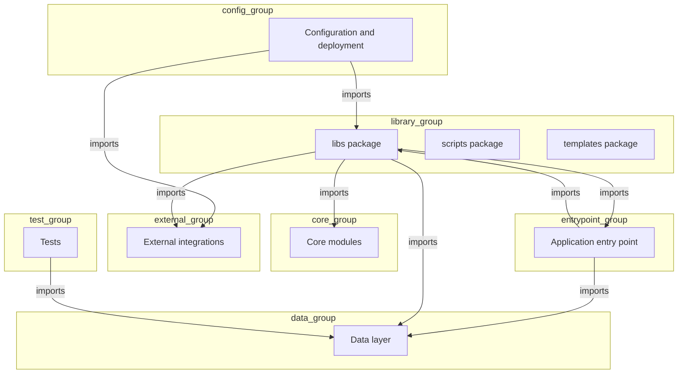

# Architecture report: Cinnamon/kotaemon

> Automated static analysis. **Observed** = directly seen in files/imports/AST; **Inferred** = interpretation from that evidence. Repository code was not executed.

## 1. Repository at a glance

| Item | Value |
| --- | --- |
| Repository | Cinnamon/kotaemon |
| Description | An open-source RAG-based tool for chatting with your documents. |
| Language | Python |
| Stars | 25909 |
| Licence | Apache-2.0 |
| Analysed commit / branch | 9ad3e4e49aa35b8acddd235918a5d9753c1cfdf9 / main |
| Framework(s) | FastAPI, React, Starlette |
| Files analysed | 375 |
| Components | 9 |

## 2. Architecture in one minute

Cinnamon/kotaemon - An open-source RAG-based tool for chatting with your documents.. This repository was analysed statically from 375 file(s) (272 Python). Detected technologies (observed from imports/manifests): GitHub Actions, FastAPI, React, Starlette, aiohttp, Click. Files are grouped into 9 component(s): Configuration and deployment, Core modules, Data layer, Application entry point, External integrations, libs package, scripts package, templates package. Observed entry point(s): libs/kotaemon/kotaemon/cli.py, libs/kotaemon/kotaemon/llms/branching.py, libs/ktem/ktem/utils/conversation.py. Findings below distinguish observed facts from inferred interpretation.

## 3. High-level block diagram

## 4. Main components

### Configuration and deployment (`config`)

- **Kind:** config
- **Status:** Observed
- **Confidence:** 0.85
- **Responsibility:** Groups 18 file(s) under configuration and deployment (observed from repository paths and static analysis). Observed top-level classes: BaseSettingGroup, SettingGroup, SettingIndexGroup, SettingIndexOption, SettingItem, SettingReasoningGroup. Observed top-level functions: config_from_value, export_pipeline_to_config, handle_input, handle_node, handle_param, pull_model.
- **Paths:** `Dockerfile`, `fly.toml`, `libs/kotaemon/kotaemon/contribs/promptui/config.py`, `libs/kotaemon/pyproject.toml`, `libs/kotaemon/pytest.ini`, `libs/ktem/MANIFEST.in`, `libs/ktem/alembic.ini`, `libs/ktem/ktem/pages/settings.py`, `libs/ktem/ktem/pages/setup.py`, `libs/ktem/ktem/settings.py`, `libs/ktem/ktem_tests/resources/embedding_openai.json`, `libs/ktem/pyproject.toml`, `libs/ktem/requirements.txt`, `mkdocs.yml`, `pyproject.toml`, `templates/project-default/cookiecutter.json`, `templates/project-default/{{cookiecutter.project_name}}/.pre-commit-config.yaml`, `templates/project-default/{{cookiecutter.project_name}}/setup.py`
- **Evidence:** [Dockerfile](https://github.com/Cinnamon/kotaemon/blob/9ad3e4e49aa35b8acddd235918a5d9753c1cfdf9/Dockerfile); [fly.toml](https://github.com/Cinnamon/kotaemon/blob/9ad3e4e49aa35b8acddd235918a5d9753c1cfdf9/fly.toml); [libs/kotaemon/kotaemon/contribs/promptui/config.py:14](https://github.com/Cinnamon/kotaemon/blob/9ad3e4e49aa35b8acddd235918a5d9753c1cfdf9/libs/kotaemon/kotaemon/contribs/promptui/config.py#L14); [libs/kotaemon/pyproject.toml](https://github.com/Cinnamon/kotaemon/blob/9ad3e4e49aa35b8acddd235918a5d9753c1cfdf9/libs/kotaemon/pyproject.toml); [libs/kotaemon/pytest.ini](https://github.com/Cinnamon/kotaemon/blob/9ad3e4e49aa35b8acddd235918a5d9753c1cfdf9/libs/kotaemon/pytest.ini); [libs/ktem/MANIFEST.in](https://github.com/Cinnamon/kotaemon/blob/9ad3e4e49aa35b8acddd235918a5d9753c1cfdf9/libs/ktem/MANIFEST.in); [libs/ktem/alembic.ini](https://github.com/Cinnamon/kotaemon/blob/9ad3e4e49aa35b8acddd235918a5d9753c1cfdf9/libs/ktem/alembic.ini); [libs/ktem/ktem/pages/settings.py:37](https://github.com/Cinnamon/kotaemon/blob/9ad3e4e49aa35b8acddd235918a5d9753c1cfdf9/libs/ktem/ktem/pages/settings.py#L37)

### Core modules (`core`)

- **Kind:** core
- **Status:** Observed
- **Confidence:** 0.85
- **Responsibility:** Groups 2 file(s) under core modules (observed from repository paths and static analysis).
- **Paths:** `flowsettings.py`, `launch.sh`
- **Evidence:** [flowsettings.py](https://github.com/Cinnamon/kotaemon/blob/9ad3e4e49aa35b8acddd235918a5d9753c1cfdf9/flowsettings.py); [launch.sh](https://github.com/Cinnamon/kotaemon/blob/9ad3e4e49aa35b8acddd235918a5d9753c1cfdf9/launch.sh)

### Data layer (`data_layer`)

- **Kind:** data
- **Status:** Observed
- **Confidence:** 0.85
- **Responsibility:** Groups 9 file(s) under data layer (observed from repository paths and static analysis). Observed top-level classes: Base, BaseConversation, BaseEmbeddingTable, BaseIssueReport, BaseLLMTable, BaseMCPTable.
- **Paths:** `libs/ktem/ktem/db/__init__.py`, `libs/ktem/ktem/db/base_models.py`, `libs/ktem/ktem/db/engine.py`, `libs/ktem/ktem/db/models.py`, `libs/ktem/ktem/embeddings/db.py`, `libs/ktem/ktem/index/models.py`, `libs/ktem/ktem/llms/db.py`, `libs/ktem/ktem/mcp/db.py`, `libs/ktem/ktem/rerankings/db.py`
- **Evidence:** [libs/ktem/ktem/db/__init__.py](https://github.com/Cinnamon/kotaemon/blob/9ad3e4e49aa35b8acddd235918a5d9753c1cfdf9/libs/ktem/ktem/db/__init__.py); [libs/ktem/ktem/db/base_models.py:10](https://github.com/Cinnamon/kotaemon/blob/9ad3e4e49aa35b8acddd235918a5d9753c1cfdf9/libs/ktem/ktem/db/base_models.py#L10); [libs/ktem/ktem/db/engine.py](https://github.com/Cinnamon/kotaemon/blob/9ad3e4e49aa35b8acddd235918a5d9753c1cfdf9/libs/ktem/ktem/db/engine.py); [libs/ktem/ktem/db/models.py:32](https://github.com/Cinnamon/kotaemon/blob/9ad3e4e49aa35b8acddd235918a5d9753c1cfdf9/libs/ktem/ktem/db/models.py#L32); [libs/ktem/ktem/embeddings/db.py:10](https://github.com/Cinnamon/kotaemon/blob/9ad3e4e49aa35b8acddd235918a5d9753c1cfdf9/libs/ktem/ktem/embeddings/db.py#L10); [libs/ktem/ktem/index/models.py:9](https://github.com/Cinnamon/kotaemon/blob/9ad3e4e49aa35b8acddd235918a5d9753c1cfdf9/libs/ktem/ktem/index/models.py#L9); [libs/ktem/ktem/llms/db.py:10](https://github.com/Cinnamon/kotaemon/blob/9ad3e4e49aa35b8acddd235918a5d9753c1cfdf9/libs/ktem/ktem/llms/db.py#L10); [libs/ktem/ktem/mcp/db.py:7](https://github.com/Cinnamon/kotaemon/blob/9ad3e4e49aa35b8acddd235918a5d9753c1cfdf9/libs/ktem/ktem/mcp/db.py#L7)

### Application entry point (`entrypoint`)

- **Kind:** entrypoint
- **Status:** Observed
- **Confidence:** 0.85
- **Responsibility:** Groups 11 file(s) under application entry point (observed from repository paths and static analysis). Observed application object created via FastAPI. Observed routes: GET /favicon.ico, GET /, GET /favicon.ico, ROUTE /logout, ROUTE /login. Observed top-level classes: App, BaseApp, BasePage, GatedBranchingPipeline, SimpleBranchingPipeline. Observed top-level functions: _init_resource, _normalize_mention, add_session_middleware, auth, check_config_format, export.
- **Paths:** `app.py`, `libs/kotaemon/kotaemon/cli.py`, `libs/kotaemon/kotaemon/contribs/promptui/cli.py`, `libs/kotaemon/kotaemon/llms/branching.py`, `libs/ktem/ktem/app.py`, `libs/ktem/ktem/main.py`, `libs/ktem/ktem/utils/conversation.py`, `scripts/migrate/migrate_chroma_db.py`, `scripts/serve_local.py`, `sso_app.py`, `sso_app_demo.py`
- **Evidence:** [app.py](https://github.com/Cinnamon/kotaemon/blob/9ad3e4e49aa35b8acddd235918a5d9753c1cfdf9/app.py); [libs/kotaemon/kotaemon/cli.py:9](https://github.com/Cinnamon/kotaemon/blob/9ad3e4e49aa35b8acddd235918a5d9753c1cfdf9/libs/kotaemon/kotaemon/cli.py#L9); [libs/kotaemon/kotaemon/contribs/promptui/cli.py](https://github.com/Cinnamon/kotaemon/blob/9ad3e4e49aa35b8acddd235918a5d9753c1cfdf9/libs/kotaemon/kotaemon/contribs/promptui/cli.py); [libs/kotaemon/kotaemon/llms/branching.py:8](https://github.com/Cinnamon/kotaemon/blob/9ad3e4e49aa35b8acddd235918a5d9753c1cfdf9/libs/kotaemon/kotaemon/llms/branching.py#L8); [libs/ktem/ktem/app.py:19](https://github.com/Cinnamon/kotaemon/blob/9ad3e4e49aa35b8acddd235918a5d9753c1cfdf9/libs/ktem/ktem/app.py#L19); [libs/ktem/ktem/main.py:21](https://github.com/Cinnamon/kotaemon/blob/9ad3e4e49aa35b8acddd235918a5d9753c1cfdf9/libs/ktem/ktem/main.py#L21); [libs/ktem/ktem/utils/conversation.py:7](https://github.com/Cinnamon/kotaemon/blob/9ad3e4e49aa35b8acddd235918a5d9753c1cfdf9/libs/ktem/ktem/utils/conversation.py#L7); [scripts/migrate/migrate_chroma_db.py:22](https://github.com/Cinnamon/kotaemon/blob/9ad3e4e49aa35b8acddd235918a5d9753c1cfdf9/scripts/migrate/migrate_chroma_db.py#L22)

### External integrations (`external_integrations`)

- **Kind:** external
- **Status:** Inferred
- **Confidence:** 0.70
- **Responsibility:** Groups 0 file(s) under external integrations (observed from repository paths and static analysis).
- **Evidence:** [libs/kotaemon/kotaemon/contribs/promptui/tunnel.py:9](https://github.com/Cinnamon/kotaemon/blob/9ad3e4e49aa35b8acddd235918a5d9753c1cfdf9/libs/kotaemon/kotaemon/contribs/promptui/tunnel.py#L9); [libs/kotaemon/kotaemon/embeddings/endpoint_based.py:1](https://github.com/Cinnamon/kotaemon/blob/9ad3e4e49aa35b8acddd235918a5d9753c1cfdf9/libs/kotaemon/kotaemon/embeddings/endpoint_based.py#L1); [libs/kotaemon/kotaemon/embeddings/tei_endpoint_embed.py:1](https://github.com/Cinnamon/kotaemon/blob/9ad3e4e49aa35b8acddd235918a5d9753c1cfdf9/libs/kotaemon/kotaemon/embeddings/tei_endpoint_embed.py#L1); [libs/kotaemon/kotaemon/embeddings/tei_endpoint_embed.py:2](https://github.com/Cinnamon/kotaemon/blob/9ad3e4e49aa35b8acddd235918a5d9753c1cfdf9/libs/kotaemon/kotaemon/embeddings/tei_endpoint_embed.py#L2); [libs/kotaemon/kotaemon/indices/retrievers/jina_web_search.py:1](https://github.com/Cinnamon/kotaemon/blob/9ad3e4e49aa35b8acddd235918a5d9753c1cfdf9/libs/kotaemon/kotaemon/indices/retrievers/jina_web_search.py#L1); [libs/kotaemon/kotaemon/llms/chats/endpoint_based.py:1](https://github.com/Cinnamon/kotaemon/blob/9ad3e4e49aa35b8acddd235918a5d9753c1cfdf9/libs/kotaemon/kotaemon/llms/chats/endpoint_based.py#L1)

### libs package (`libs`)

- **Kind:** library
- **Status:** Observed
- **Confidence:** 0.85
- **Responsibility:** Groups 212 file(s) under libs package (observed from repository paths and static analysis). Observed top-level classes: AIMessage, AddQueryContextPipeline, AdobeReader, AgentAction, AgentFinish, AgentOutput. Observed top-level functions: _async_discover_tools, _format_output, _import_voyageai, _json_schema_type_to_python, _make_tool, _run_async.
- **Paths:** `libs/kotaemon/kotaemon/__init__.py`, `libs/kotaemon/kotaemon/agents/__init__.py`, `libs/kotaemon/kotaemon/agents/base.py`, `libs/kotaemon/kotaemon/agents/io/__init__.py`, `libs/kotaemon/kotaemon/agents/io/base.py`, `libs/kotaemon/kotaemon/agents/langchain_based.py`, `libs/kotaemon/kotaemon/agents/react/__init__.py`, `libs/kotaemon/kotaemon/agents/react/agent.py`, `libs/kotaemon/kotaemon/agents/react/prompt.py`, `libs/kotaemon/kotaemon/agents/rewoo/__init__.py`, `libs/kotaemon/kotaemon/agents/rewoo/agent.py`, `libs/kotaemon/kotaemon/agents/rewoo/planner.py`, `libs/kotaemon/kotaemon/agents/rewoo/prompt.py`, `libs/kotaemon/kotaemon/agents/rewoo/solver.py`, `libs/kotaemon/kotaemon/agents/tools/__init__.py`, `libs/kotaemon/kotaemon/agents/tools/base.py`, `libs/kotaemon/kotaemon/agents/tools/google.py`, `libs/kotaemon/kotaemon/agents/tools/llm.py`, `libs/kotaemon/kotaemon/agents/tools/mcp.py`, `libs/kotaemon/kotaemon/agents/tools/wikipedia.py`, `libs/kotaemon/kotaemon/agents/utils.py`, `libs/kotaemon/kotaemon/base/__init__.py`, `libs/kotaemon/kotaemon/base/component.py`, `libs/kotaemon/kotaemon/base/schema.py`, `libs/kotaemon/kotaemon/chatbot/__init__.py`, `libs/kotaemon/kotaemon/chatbot/base.py`, `libs/kotaemon/kotaemon/chatbot/simple_respondent.py`, `libs/kotaemon/kotaemon/contribs/__init__.py`, `libs/kotaemon/kotaemon/contribs/docs.py`, `libs/kotaemon/kotaemon/contribs/promptui/__init__.py`, `libs/kotaemon/kotaemon/contribs/promptui/base.py`, `libs/kotaemon/kotaemon/contribs/promptui/export.py`, `libs/kotaemon/kotaemon/contribs/promptui/logs.py`, `libs/kotaemon/kotaemon/contribs/promptui/themes.py`, `libs/kotaemon/kotaemon/contribs/promptui/tunnel.py`, `libs/kotaemon/kotaemon/contribs/promptui/ui/__init__.py`, `libs/kotaemon/kotaemon/contribs/promptui/ui/blocks.py`, `libs/kotaemon/kotaemon/contribs/promptui/ui/chat.py`, `libs/kotaemon/kotaemon/contribs/promptui/ui/pipeline.py`, `libs/kotaemon/kotaemon/embeddings/__init__.py`, `libs/kotaemon/kotaemon/embeddings/base.py`, `libs/kotaemon/kotaemon/embeddings/endpoint_based.py`, `libs/kotaemon/kotaemon/embeddings/fastembed.py`, `libs/kotaemon/kotaemon/embeddings/langchain_based.py`, `libs/kotaemon/kotaemon/embeddings/openai.py`, `libs/kotaemon/kotaemon/embeddings/tei_endpoint_embed.py`, `libs/kotaemon/kotaemon/embeddings/voyageai.py`, `libs/kotaemon/kotaemon/indices/__init__.py`, `libs/kotaemon/kotaemon/indices/base.py`, `libs/kotaemon/kotaemon/indices/extractors/__init__.py`, `libs/kotaemon/kotaemon/indices/extractors/doc_parsers.py`, `libs/kotaemon/kotaemon/indices/ingests/__init__.py`, `libs/kotaemon/kotaemon/indices/ingests/files.py`, `libs/kotaemon/kotaemon/indices/qa/__init__.py`, `libs/kotaemon/kotaemon/indices/qa/citation.py`, `libs/kotaemon/kotaemon/indices/qa/citation_qa.py`, `libs/kotaemon/kotaemon/indices/qa/citation_qa_inline.py`, `libs/kotaemon/kotaemon/indices/qa/format_context.py`, `libs/kotaemon/kotaemon/indices/qa/utils.py`, `libs/kotaemon/kotaemon/indices/rankings/__init__.py`, `libs/kotaemon/kotaemon/indices/rankings/base.py`, `libs/kotaemon/kotaemon/indices/rankings/cohere.py`, `libs/kotaemon/kotaemon/indices/rankings/llm.py`, `libs/kotaemon/kotaemon/indices/rankings/llm_scoring.py`, `libs/kotaemon/kotaemon/indices/rankings/llm_trulens.py`, `libs/kotaemon/kotaemon/indices/retrievers/__init__.py`, `libs/kotaemon/kotaemon/indices/retrievers/jina_web_search.py`, `libs/kotaemon/kotaemon/indices/retrievers/tavily_web_search.py`, `libs/kotaemon/kotaemon/indices/splitters/__init__.py`, `libs/kotaemon/kotaemon/indices/vectorindex.py`, `libs/kotaemon/kotaemon/llms/__init__.py`, `libs/kotaemon/kotaemon/llms/base.py`, `libs/kotaemon/kotaemon/llms/chats/__init__.py`, `libs/kotaemon/kotaemon/llms/chats/base.py`, `libs/kotaemon/kotaemon/llms/chats/endpoint_based.py`, `libs/kotaemon/kotaemon/llms/chats/langchain_based.py`, `libs/kotaemon/kotaemon/llms/chats/llamacpp.py`, `libs/kotaemon/kotaemon/llms/chats/openai.py`, `libs/kotaemon/kotaemon/llms/completions/__init__.py`, `libs/kotaemon/kotaemon/llms/completions/base.py`, `libs/kotaemon/kotaemon/llms/completions/langchain_based.py`, `libs/kotaemon/kotaemon/llms/cot.py`, `libs/kotaemon/kotaemon/llms/linear.py`, `libs/kotaemon/kotaemon/llms/prompts/__init__.py`, `libs/kotaemon/kotaemon/llms/prompts/base.py`, `libs/kotaemon/kotaemon/llms/prompts/template.py`, `libs/kotaemon/kotaemon/loaders/__init__.py`, `libs/kotaemon/kotaemon/loaders/adobe_loader.py`, `libs/kotaemon/kotaemon/loaders/azureai_document_intelligence_loader.py`, `libs/kotaemon/kotaemon/loaders/base.py`, `libs/kotaemon/kotaemon/loaders/composite_loader.py`, `libs/kotaemon/kotaemon/loaders/docling_loader.py`, `libs/kotaemon/kotaemon/loaders/docx_loader.py`, `libs/kotaemon/kotaemon/loaders/excel_loader.py`, `libs/kotaemon/kotaemon/loaders/html_loader.py`, `libs/kotaemon/kotaemon/loaders/mathpix_loader.py`, `libs/kotaemon/kotaemon/loaders/ocr_loader.py`, `libs/kotaemon/kotaemon/loaders/paddleocr_loader/__init__.py`, `libs/kotaemon/kotaemon/loaders/paddleocr_loader/adapter.py`, `libs/kotaemon/kotaemon/loaders/paddleocr_loader/paddleocr_vl_loader.py`, `libs/kotaemon/kotaemon/loaders/paddleocr_loader/ppstructure_v3_loader.py`, `libs/kotaemon/kotaemon/loaders/pdf_loader.py`, `libs/kotaemon/kotaemon/loaders/txt_loader.py`, `libs/kotaemon/kotaemon/loaders/unstructured_loader.py`, `libs/kotaemon/kotaemon/loaders/utils/__init__.py`, `libs/kotaemon/kotaemon/loaders/utils/adobe.py`, `libs/kotaemon/kotaemon/loaders/utils/box.py`, `libs/kotaemon/kotaemon/loaders/utils/gpt4v.py`, `libs/kotaemon/kotaemon/loaders/utils/pdf_ocr.py`, `libs/kotaemon/kotaemon/loaders/utils/table.py`, `libs/kotaemon/kotaemon/loaders/web_loader.py`, `libs/kotaemon/kotaemon/parsers/__init__.py`, `libs/kotaemon/kotaemon/parsers/regex_extractor.py`, `libs/kotaemon/kotaemon/rerankings/__init__.py`, `libs/kotaemon/kotaemon/rerankings/base.py`, `libs/kotaemon/kotaemon/rerankings/cohere.py`, `libs/kotaemon/kotaemon/rerankings/tei_fast_rerank.py`, `libs/kotaemon/kotaemon/rerankings/voyageai.py`, `libs/kotaemon/kotaemon/storages/__init__.py`, `libs/kotaemon/kotaemon/storages/docstores/__init__.py`, `libs/kotaemon/kotaemon/storages/docstores/base.py`, `libs/kotaemon/kotaemon/storages/docstores/elasticsearch.py`, `libs/kotaemon/kotaemon/storages/docstores/in_memory.py`, `libs/kotaemon/kotaemon/storages/docstores/lancedb.py`, `libs/kotaemon/kotaemon/storages/docstores/simple_file.py`, `libs/kotaemon/kotaemon/storages/vectorstores/__init__.py`, `libs/kotaemon/kotaemon/storages/vectorstores/base.py`, `libs/kotaemon/kotaemon/storages/vectorstores/chroma.py`, `libs/kotaemon/kotaemon/storages/vectorstores/in_memory.py`, `libs/kotaemon/kotaemon/storages/vectorstores/lancedb.py`, `libs/kotaemon/kotaemon/storages/vectorstores/milvus.py`, `libs/kotaemon/kotaemon/storages/vectorstores/qdrant.py`, `libs/kotaemon/kotaemon/storages/vectorstores/simple_file.py`, `libs/ktem/ktem/__init__.py`, `libs/ktem/ktem/assets/__init__.py`, `libs/ktem/ktem/assets/js/main.js`, `libs/ktem/ktem/assets/js/pdf_viewer.js`, `libs/ktem/ktem/assets/theme.py`, `libs/ktem/ktem/components.py`, `libs/ktem/ktem/embeddings/__init__.py`, `libs/ktem/ktem/embeddings/manager.py`, `libs/ktem/ktem/embeddings/ui.py`, `libs/ktem/ktem/exceptions.py`, `libs/ktem/ktem/extension_protocol.py`, `libs/ktem/ktem/index/__init__.py`, `libs/ktem/ktem/index/base.py`, `libs/ktem/ktem/index/file/__init__.py`, `libs/ktem/ktem/index/file/base.py`, `libs/ktem/ktem/index/file/exceptions.py`, `libs/ktem/ktem/index/file/graph/__init__.py`, `libs/ktem/ktem/index/file/graph/graph_index.py`, `libs/ktem/ktem/index/file/graph/light_graph_index.py`, `libs/ktem/ktem/index/file/graph/lightrag_pipelines.py`, `libs/ktem/ktem/index/file/graph/nano_graph_index.py`, `libs/ktem/ktem/index/file/graph/nano_pipelines.py`, `libs/ktem/ktem/index/file/graph/pipelines.py`, `libs/ktem/ktem/index/file/graph/visualize.py`, `libs/ktem/ktem/index/file/index.py`, `libs/ktem/ktem/index/file/knet/__init__.py`, `libs/ktem/ktem/index/file/knet/knet_index.py`, `libs/ktem/ktem/index/file/knet/pipelines.py`, `libs/ktem/ktem/index/file/pipelines.py`, `libs/ktem/ktem/index/file/ui.py`, `libs/ktem/ktem/index/file/utils.py`, `libs/ktem/ktem/index/manager.py`, `libs/ktem/ktem/index/ui.py`, `libs/ktem/ktem/llms/__init__.py`, `libs/ktem/ktem/llms/manager.py`, `libs/ktem/ktem/llms/ui.py`, `libs/ktem/ktem/mcp/__init__.py`, `libs/ktem/ktem/mcp/manager.py`, `libs/ktem/ktem/mcp/ui.py`, `libs/ktem/ktem/pages/__init__.py`, `libs/ktem/ktem/pages/chat/__init__.py`, `libs/ktem/ktem/pages/chat/chat_panel.py`, `libs/ktem/ktem/pages/chat/chat_suggestion.py`, `libs/ktem/ktem/pages/chat/common.py`, `libs/ktem/ktem/pages/chat/control.py`, `libs/ktem/ktem/pages/chat/demo_hint.py`, `libs/ktem/ktem/pages/chat/paper_list.py`, `libs/ktem/ktem/pages/chat/report.py`, `libs/ktem/ktem/pages/help.py`, `libs/ktem/ktem/pages/login.py`, `libs/ktem/ktem/pages/resources/__init__.py`, `libs/ktem/ktem/pages/resources/user.py`, `libs/ktem/ktem/reasoning/__init__.py`, `libs/ktem/ktem/reasoning/base.py`, `libs/ktem/ktem/reasoning/prompt_optimization/__init__.py`, `libs/ktem/ktem/reasoning/prompt_optimization/decompose_question.py`, `libs/ktem/ktem/reasoning/prompt_optimization/fewshot_rewrite_question.py`, `libs/ktem/ktem/reasoning/prompt_optimization/mindmap.py`, `libs/ktem/ktem/reasoning/prompt_optimization/rewrite_question.py`, `libs/ktem/ktem/reasoning/prompt_optimization/suggest_conversation_name.py`, `libs/ktem/ktem/reasoning/prompt_optimization/suggest_followup_chat.py`, `libs/ktem/ktem/reasoning/react.py`, `libs/ktem/ktem/reasoning/rewoo.py`, `libs/ktem/ktem/reasoning/simple.py`, `libs/ktem/ktem/rerankings/__init__.py`, `libs/ktem/ktem/rerankings/manager.py`, `libs/ktem/ktem/rerankings/ui.py`, `libs/ktem/ktem/utils/__init__.py`, `libs/ktem/ktem/utils/commands.py`, `libs/ktem/ktem/utils/file.py`, `libs/ktem/ktem/utils/generator.py`, `libs/ktem/ktem/utils/hf_papers.py`, `libs/ktem/ktem/utils/lang.py`, `libs/ktem/ktem/utils/plantuml.py`, `libs/ktem/ktem/utils/rate_limit.py`, `libs/ktem/ktem/utils/render.py`, `libs/ktem/ktem/utils/visualize_cited.py`, `libs/ktem/ktem_tests/__init__.py`, `libs/ktem/migrations/env.py`
- **Evidence:** [libs/kotaemon/kotaemon/__init__.py](https://github.com/Cinnamon/kotaemon/blob/9ad3e4e49aa35b8acddd235918a5d9753c1cfdf9/libs/kotaemon/kotaemon/__init__.py); [libs/kotaemon/kotaemon/agents/__init__.py](https://github.com/Cinnamon/kotaemon/blob/9ad3e4e49aa35b8acddd235918a5d9753c1cfdf9/libs/kotaemon/kotaemon/agents/__init__.py); [libs/kotaemon/kotaemon/agents/base.py:10](https://github.com/Cinnamon/kotaemon/blob/9ad3e4e49aa35b8acddd235918a5d9753c1cfdf9/libs/kotaemon/kotaemon/agents/base.py#L10); [libs/kotaemon/kotaemon/agents/io/__init__.py](https://github.com/Cinnamon/kotaemon/blob/9ad3e4e49aa35b8acddd235918a5d9753c1cfdf9/libs/kotaemon/kotaemon/agents/io/__init__.py); [libs/kotaemon/kotaemon/agents/io/base.py:13](https://github.com/Cinnamon/kotaemon/blob/9ad3e4e49aa35b8acddd235918a5d9753c1cfdf9/libs/kotaemon/kotaemon/agents/io/base.py#L13); [libs/kotaemon/kotaemon/agents/langchain_based.py:14](https://github.com/Cinnamon/kotaemon/blob/9ad3e4e49aa35b8acddd235918a5d9753c1cfdf9/libs/kotaemon/kotaemon/agents/langchain_based.py#L14); [libs/kotaemon/kotaemon/agents/react/__init__.py](https://github.com/Cinnamon/kotaemon/blob/9ad3e4e49aa35b8acddd235918a5d9753c1cfdf9/libs/kotaemon/kotaemon/agents/react/__init__.py); [libs/kotaemon/kotaemon/agents/react/agent.py:18](https://github.com/Cinnamon/kotaemon/blob/9ad3e4e49aa35b8acddd235918a5d9753c1cfdf9/libs/kotaemon/kotaemon/agents/react/agent.py#L18)

### scripts package (`scripts`)

- **Kind:** library
- **Status:** Observed
- **Confidence:** 0.85
- **Responsibility:** Groups 8 file(s) under scripts package (observed from repository paths and static analysis).
- **Paths:** `scripts/download_pdfjs.sh`, `scripts/migrate/__init__.py`, `scripts/run_linux.sh`, `scripts/run_macos.sh`, `scripts/server_llamacpp_linux.sh`, `scripts/server_llamacpp_macos.sh`, `scripts/update_linux.sh`, `scripts/update_macos.sh`
- **Evidence:** [scripts/download_pdfjs.sh](https://github.com/Cinnamon/kotaemon/blob/9ad3e4e49aa35b8acddd235918a5d9753c1cfdf9/scripts/download_pdfjs.sh); [scripts/migrate/__init__.py](https://github.com/Cinnamon/kotaemon/blob/9ad3e4e49aa35b8acddd235918a5d9753c1cfdf9/scripts/migrate/__init__.py); [scripts/run_linux.sh](https://github.com/Cinnamon/kotaemon/blob/9ad3e4e49aa35b8acddd235918a5d9753c1cfdf9/scripts/run_linux.sh); [scripts/run_macos.sh](https://github.com/Cinnamon/kotaemon/blob/9ad3e4e49aa35b8acddd235918a5d9753c1cfdf9/scripts/run_macos.sh); [scripts/server_llamacpp_linux.sh](https://github.com/Cinnamon/kotaemon/blob/9ad3e4e49aa35b8acddd235918a5d9753c1cfdf9/scripts/server_llamacpp_linux.sh); [scripts/server_llamacpp_macos.sh](https://github.com/Cinnamon/kotaemon/blob/9ad3e4e49aa35b8acddd235918a5d9753c1cfdf9/scripts/server_llamacpp_macos.sh); [scripts/update_linux.sh](https://github.com/Cinnamon/kotaemon/blob/9ad3e4e49aa35b8acddd235918a5d9753c1cfdf9/scripts/update_linux.sh); [scripts/update_macos.sh](https://github.com/Cinnamon/kotaemon/blob/9ad3e4e49aa35b8acddd235918a5d9753c1cfdf9/scripts/update_macos.sh)

### templates package (`templates`)

- **Kind:** library
- **Status:** Observed
- **Confidence:** 0.85
- **Responsibility:** Groups 2 file(s) under templates package (observed from repository paths and static analysis). Observed top-level classes: IndexingPipeline, QAResultLog, QuestionAnsweringPipeline.
- **Paths:** `templates/project-default/{{cookiecutter.project_name}}/{{cookiecutter.project_name}}/__init__.py`, `templates/project-default/{{cookiecutter.project_name}}/{{cookiecutter.project_name}}/pipeline.py`
- **Evidence:** [templates/project-default/{{cookiecutter.project_name}}/{{cookiecutter.project_name}}/__init__.py](https://github.com/Cinnamon/kotaemon/blob/9ad3e4e49aa35b8acddd235918a5d9753c1cfdf9/templates/project-default/%7B%7Bcookiecutter.project_name%7D%7D/%7B%7Bcookiecutter.project_name%7D%7D/__init__.py); [templates/project-default/{{cookiecutter.project_name}}/{{cookiecutter.project_name}}/pipeline.py:12](https://github.com/Cinnamon/kotaemon/blob/9ad3e4e49aa35b8acddd235918a5d9753c1cfdf9/templates/project-default/%7B%7Bcookiecutter.project_name%7D%7D/%7B%7Bcookiecutter.project_name%7D%7D/pipeline.py#L12)

### Tests (`tests`)

- **Kind:** test
- **Status:** Observed
- **Confidence:** 0.85
- **Responsibility:** Groups 37 file(s) under tests (observed from repository paths and static analysis). Observed routes: PATCH openai.resources.chat.completions.Completions.create, PATCH openai.resources.chat.completions.Completions.create, PATCH openai.resources.chat.completions.Completions.create, PATCH openai.resources.chat.completions.Completions.create, PATCH openai.resources.chat.completions.Completions.create. Observed top-level classes: Pipeline, TestChromaVectorStore, TestExport, TestInMemoryVectorStore, TestMilvusVectorStore, TestPromptConfig. Observed top-level functions: _make_mock_tools, _make_page_…
- **Paths:** `libs/kotaemon/tests/__init__.py`, `libs/kotaemon/tests/_test_multimodal_reader.py`, `libs/kotaemon/tests/conftest.py`, `libs/kotaemon/tests/resources/dummy.mhtml`, `libs/kotaemon/tests/resources/embedding_openai.json`, `libs/kotaemon/tests/resources/embedding_openai_batch.json`, `libs/kotaemon/tests/resources/fullocr_sample_output.json`, `libs/kotaemon/tests/resources/html/dummy.html`, `libs/kotaemon/tests/resources/policy.md`, `libs/kotaemon/tests/simple_pipeline.py`, `libs/kotaemon/tests/test_agent.py`, `libs/kotaemon/tests/test_composite.py`, `libs/kotaemon/tests/test_cot.py`, `libs/kotaemon/tests/test_docstores.py`, `libs/kotaemon/tests/test_documents.py`, `libs/kotaemon/tests/test_embedding_models.py`, `libs/kotaemon/tests/test_indexing_retrieval.py`, `libs/kotaemon/tests/test_ingestor.py`, `libs/kotaemon/tests/test_llms_chat_models.py`, `libs/kotaemon/tests/test_llms_completion_models.py`, `libs/kotaemon/tests/test_mcp_tools.py`, `libs/kotaemon/tests/test_paddleocr_loader.py`, `libs/kotaemon/tests/test_post_processing.py`, `libs/kotaemon/tests/test_prompt.py`, `libs/kotaemon/tests/test_promptui.py`, `libs/kotaemon/tests/test_reader.py`, `libs/kotaemon/tests/test_reranking.py`, `libs/kotaemon/tests/test_splitter.py`, `libs/kotaemon/tests/test_table_reader.py`, `libs/kotaemon/tests/test_telemetry.py`, `libs/kotaemon/tests/test_template.py`, `libs/kotaemon/tests/test_tools.py`, `libs/kotaemon/tests/test_vectorstore.py`, `libs/ktem/ktem_tests/test_conversation.py`, `libs/ktem/ktem_tests/test_mcp_manager.py`, `libs/ktem/ktem_tests/test_qa.py`, `templates/project-default/{{cookiecutter.project_name}}/tests/__init__.py`
- **Evidence:** [libs/kotaemon/tests/__init__.py](https://github.com/Cinnamon/kotaemon/blob/9ad3e4e49aa35b8acddd235918a5d9753c1cfdf9/libs/kotaemon/tests/__init__.py); [libs/kotaemon/tests/_test_multimodal_reader.py:14](https://github.com/Cinnamon/kotaemon/blob/9ad3e4e49aa35b8acddd235918a5d9753c1cfdf9/libs/kotaemon/tests/_test_multimodal_reader.py#L14); [libs/kotaemon/tests/conftest.py:5](https://github.com/Cinnamon/kotaemon/blob/9ad3e4e49aa35b8acddd235918a5d9753c1cfdf9/libs/kotaemon/tests/conftest.py#L5); [libs/kotaemon/tests/resources/dummy.mhtml](https://github.com/Cinnamon/kotaemon/blob/9ad3e4e49aa35b8acddd235918a5d9753c1cfdf9/libs/kotaemon/tests/resources/dummy.mhtml); [libs/kotaemon/tests/resources/embedding_openai.json](https://github.com/Cinnamon/kotaemon/blob/9ad3e4e49aa35b8acddd235918a5d9753c1cfdf9/libs/kotaemon/tests/resources/embedding_openai.json); [libs/kotaemon/tests/resources/embedding_openai_batch.json](https://github.com/Cinnamon/kotaemon/blob/9ad3e4e49aa35b8acddd235918a5d9753c1cfdf9/libs/kotaemon/tests/resources/embedding_openai_batch.json); [libs/kotaemon/tests/resources/fullocr_sample_output.json](https://github.com/Cinnamon/kotaemon/blob/9ad3e4e49aa35b8acddd235918a5d9753c1cfdf9/libs/kotaemon/tests/resources/fullocr_sample_output.json); [libs/kotaemon/tests/resources/html/dummy.html](https://github.com/Cinnamon/kotaemon/blob/9ad3e4e49aa35b8acddd235918a5d9753c1cfdf9/libs/kotaemon/tests/resources/html/dummy.html)

## 5. Execution flow

**Observed** entry point(s):

- [libs/kotaemon/kotaemon/cli.py:20](https://github.com/Cinnamon/kotaemon/blob/9ad3e4e49aa35b8acddd235918a5d9753c1cfdf9/libs/kotaemon/kotaemon/cli.py#L20)
- [libs/kotaemon/kotaemon/llms/branching.py:157](https://github.com/Cinnamon/kotaemon/blob/9ad3e4e49aa35b8acddd235918a5d9753c1cfdf9/libs/kotaemon/kotaemon/llms/branching.py#L157)
- [libs/ktem/ktem/utils/conversation.py:97](https://github.com/Cinnamon/kotaemon/blob/9ad3e4e49aa35b8acddd235918a5d9753c1cfdf9/libs/ktem/ktem/utils/conversation.py#L97)
- [scripts/migrate/migrate_chroma_db.py:188](https://github.com/Cinnamon/kotaemon/blob/9ad3e4e49aa35b8acddd235918a5d9753c1cfdf9/scripts/migrate/migrate_chroma_db.py#L188)
- [scripts/serve_local.py:78](https://github.com/Cinnamon/kotaemon/blob/9ad3e4e49aa35b8acddd235918a5d9753c1cfdf9/scripts/serve_local.py#L78)
- [sso_app.py:33](https://github.com/Cinnamon/kotaemon/blob/9ad3e4e49aa35b8acddd235918a5d9753c1cfdf9/sso_app.py#L33)
- [sso_app_demo.py:51](https://github.com/Cinnamon/kotaemon/blob/9ad3e4e49aa35b8acddd235918a5d9753c1cfdf9/sso_app_demo.py#L51)

**Observed** routes (from decorators):

- `PATCH openai.resources.chat.completions.Completions.create` -> `test_agent_fail` in `libs/kotaemon/tests/test_agent.py:129`
- `PATCH openai.resources.chat.completions.Completions.create` -> `test_rewoo_agent` in `libs/kotaemon/tests/test_agent.py:148`
- `PATCH openai.resources.chat.completions.Completions.create` -> `test_react_agent` in `libs/kotaemon/tests/test_agent.py:166`
- `PATCH openai.resources.chat.completions.Completions.create` -> `test_react_agent_langchain` in `libs/kotaemon/tests/test_agent.py:184`
- `PATCH openai.resources.chat.completions.Completions.create` -> `test_wrapper_agent_langchain` in `libs/kotaemon/tests/test_agent.py:209`
- `PATCH openai.resources.chat.completions.Completions.create` -> `test_react_agent_with_langchain_tools` in `libs/kotaemon/tests/test_agent.py:229`
- `PATCH openai.resources.chat.completions.Completions.create` -> `test_cot_plus_operator` in `libs/kotaemon/tests/test_cot.py:40`
- `PATCH openai.resources.chat.completions.Completions.create` -> `test_cot_manual` in `libs/kotaemon/tests/test_cot.py:71`
- `PATCH openai.resources.chat.completions.Completions.create` -> `test_cot_with_termination_callback` in `libs/kotaemon/tests/test_cot.py:100`
- `PATCH elastic_transport.Transport.perform_request` -> `test_elastic_document_store` in `libs/kotaemon/tests/test_docstores.py:329`
- `PATCH openai.resources.embeddings.Embeddings.create` -> `test_azureopenai_embeddings_raw` in `libs/kotaemon/tests/test_embedding_models.py:42`
- `PATCH openai.resources.embeddings.Embeddings.create` -> `test_lcazureopenai_embeddings_batch_raw` in `libs/kotaemon/tests/test_embedding_models.py:58`
- `PATCH openai.resources.embeddings.Embeddings.create` -> `test_azureopenai_embeddings_batch_raw` in `libs/kotaemon/tests/test_embedding_models.py:74`
- `PATCH openai.resources.embeddings.Embeddings.create` -> `test_openai_embeddings_raw` in `libs/kotaemon/tests/test_embedding_models.py:90`
- `PATCH openai.resources.embeddings.Embeddings.create` -> `test_openai_embeddings_batch_raw` in `libs/kotaemon/tests/test_embedding_models.py:104`
- `PATCH sentence_transformers.SentenceTransformer` -> `test_lchuggingface_embeddings` in `libs/kotaemon/tests/test_embedding_models.py:123`
- `PATCH langchain.embeddings.huggingface.HuggingFaceBgeEmbeddings.embed_documents` -> `test_lchuggingface_embeddings` in `libs/kotaemon/tests/test_embedding_models.py:123`
- `PATCH langchain_cohere.CohereEmbeddings.embed_documents` -> `test_lccohere_embeddings` in `libs/kotaemon/tests/test_embedding_models.py:143`
- `PATCH voyageai.Client.embed` -> `test_voyageai_embeddings` in `libs/kotaemon/tests/test_embedding_models.py:169`
- `PATCH voyageai.AsyncClient.embed` -> `test_voyageai_embeddings` in `libs/kotaemon/tests/test_embedding_models.py:169`
- `PATCH openai.resources.embeddings.Embeddings.create` -> `test_indexing` in `libs/kotaemon/tests/test_indexing_retrieval.py:21`
- `PATCH openai.resources.embeddings.Embeddings.create` -> `test_retrieving` in `libs/kotaemon/tests/test_indexing_retrieval.py:45`
- `PATCH openai.resources.chat.completions.Completions.create` -> `test_azureopenai_model` in `libs/kotaemon/tests/test_llms_chat_models.py:47`
- `PATCH openai.resources.completions.Completions.create` -> `test_azureopenai_model` in `libs/kotaemon/tests/test_llms_completion_models.py:43`
- `PATCH openai.resources.completions.Completions.create` -> `test_openai_model` in `libs/kotaemon/tests/test_llms_completion_models.py:66`
- `PATCH kotaemon.agents.tools.mcp._run_async` -> `test_create_tools_from_config_no_filter_returns_all` in `libs/kotaemon/tests/test_mcp_tools.py:248`
- `PATCH kotaemon.agents.tools.mcp._run_async` -> `test_create_tools_from_config_enabled_filter` in `libs/kotaemon/tests/test_mcp_tools.py:256`
- `PATCH azure.ai.documentintelligence.DocumentIntelligenceClient` -> `test_azureai_document_intelligence_reader` in `libs/kotaemon/tests/test_reader.py:83`
- `PATCH openai.resources.chat.completions.Completions.create` -> `test_reranking` in `libs/kotaemon/tests/test_reranking.py:56`
- `PATCH openai.resources.embeddings.Embeddings.create` -> `test_pipeline_tool` in `libs/kotaemon/tests/test_tools.py:37`
- `PATCH openai.resources.chat.completions.Completions.create` -> `test_ingest_pipeline` in `libs/ktem/ktem_tests/test_qa.py:49`
- `GET /favicon.ico` -> `favicon` in `sso_app.py:66`
- `GET /` -> `public` in `sso_app_demo.py:56`
- `GET /favicon.ico` -> `favicon` in `sso_app_demo.py:62`
- `ROUTE /logout` -> `logout` in `sso_app_demo.py:67`
- `ROUTE /login` -> `login` in `sso_app_demo.py:73`
- `ROUTE /auth` -> `auth` in `sso_app_demo.py:80`

Representative flow (derived from observed entry points and the import graph; steps beyond the entry point are **Inferred**):

1. Execution starts at an observed entry point listed above, if present.
2. `config` imports `external_integrations` (Configuration and deployment -> External integrations).
3. `config` imports `libs` (Configuration and deployment -> libs package).
4. `entrypoint` imports `data_layer` (Application entry point -> Data layer).
5. `entrypoint` imports `libs` (Application entry point -> libs package).
6. `libs` imports `core` (libs package -> Core modules).
7. `libs` imports `data_layer` (libs package -> Data layer).
8. `libs` imports `entrypoint` (libs package -> Application entry point).
9. `libs` imports `external_integrations` (libs package -> External integrations).

## 6. Project structure

### `(root)`

- `.commitlintrc` - other (792 bytes)
- `.dockerignore` - container (159 bytes)
- `.env.example` - config (1796 bytes)
- `.gitattributes` - other (22 bytes)
- `.gitignore` - other (8727 bytes)
- `.pre-commit-config.yaml` - config (1992 bytes)
- `.python-version` - other (5 bytes)
- `CODE_OF_CONDUCT.md` - docs (5201 bytes)
- `CONTRIBUTING.md` - docs (5973 bytes)
- `Dockerfile` - container (3599 bytes)
- `LICENSE.txt` - docs (11357 bytes)
- `README.md` - docs (18355 bytes)
- `app.py` - source, Python (691 bytes)
- `doc_env_reqs.txt` - docs (203 bytes)
- `flowsettings.py` - source, Python (13329 bytes)
- `fly.toml` - config (536 bytes)
- `launch.sh` - source, Shell (869 bytes)
- `mkdocs.yml` - config (3256 bytes)
- `pyproject.toml` - manifest (1550 bytes)
- `settings.yaml.example` - other (5679 bytes)
- `sso_app.py` - source, Python (2213 bytes)
- `sso_app_demo.py` - source, Python (2766 bytes)

### `.github`

- `.github/ISSUE_TEMPLATE/bug_report.yml` - config (2184 bytes)
- `.github/ISSUE_TEMPLATE/config.yml` - config (28 bytes)
- `.github/ISSUE_TEMPLATE/feature_request.yml` - config (1511 bytes)
- `.github/PULL_REQUEST_TEMPLATE.md` - docs (612 bytes)
- `.github/workflows/auto-bump-and-release.yaml` - ci, YAML (2423 bytes)
- `.github/workflows/build-push-docker.yaml` - ci, YAML (3021 bytes)
- `.github/workflows/pr-lint.yaml` - ci, YAML (2733 bytes)
- `.github/workflows/style-check.yaml` - ci, YAML (409 bytes)
- `.github/workflows/unit-test.yaml` - ci, YAML (3951 bytes)

### `docs`

- `docs/about.md` - docs (431 bytes)
- `docs/development/contributing.md` - docs (3943 bytes)
- `docs/development/create-a-component.md` - docs (2514 bytes)
- `docs/development/data-components.md` - docs (995 bytes)
- `docs/development/index.md` - docs (107 bytes)
- `docs/development/utilities.md` - docs (7571 bytes)
- `docs/extra/css/code_select.css` - docs (106 bytes)
- `docs/index.md` - docs (2100 bytes)
- `docs/integrations/docling.md` - docs (1063 bytes)
- `docs/integrations/paddle_ocr.md` - docs (2028 bytes)
- `docs/local_model.md` - docs (2989 bytes)
- `docs/online_install.md` - docs (1161 bytes)
- `docs/pages/app/customize-flows.md` - docs (6887 bytes)
- `docs/pages/app/ext/user-management.md` - docs (625 bytes)
- `docs/pages/app/features.md` - docs (304 bytes)
- `docs/pages/app/functional-description.md` - docs (12238 bytes)
- `docs/pages/app/index/file.md` - docs (7496 bytes)
- `docs/pages/app/settings/overview.md` - docs (919 bytes)
- `docs/pages/app/settings/user-settings.md` - docs (1459 bytes)
- `docs/scripts/generate_examples_docs.py` - docs (2060 bytes)
- `docs/scripts/generate_reference_docs.py` - docs (2388 bytes)
- `docs/theme/assets/pymdownx-extras/extra-fb5a2a1c86.css` - docs (73167 bytes)
- `docs/theme/assets/pymdownx-extras/extra-loader-MCFnu0Wd.js` - docs (13582 bytes)
- `docs/theme/assets/pymdownx-extras/material-extra-3rdparty-E-i8w1WA.js` - docs (6576 bytes)
- `docs/theme/assets/pymdownx-extras/material-extra-theme-TVq-kNRT.js` - docs (1644 bytes)
- `docs/theme/main.html` - docs (123 bytes)
- `docs/theme/partials/footer.html` - docs (1499 bytes)
- `docs/theme/partials/header.html` - docs (2859 bytes)
- `docs/theme/partials/libs.html` - docs (237 bytes)
- `docs/usage.md` - docs (6680 bytes)

### `libs`

- `libs/kotaemon/README.md` - docs (4210 bytes)
- `libs/kotaemon/kotaemon/__init__.py` - source, Python (475 bytes)
- `libs/kotaemon/kotaemon/agents/__init__.py` - source, Python (646 bytes)
- `libs/kotaemon/kotaemon/agents/base.py` - source, Python (1935 bytes)
- `libs/kotaemon/kotaemon/agents/io/__init__.py` - source, Python (171 bytes)
- `libs/kotaemon/kotaemon/agents/io/base.py` - source, Python (5751 bytes)
- `libs/kotaemon/kotaemon/agents/langchain_based.py` - source, Python (2738 bytes)
- `libs/kotaemon/kotaemon/agents/react/__init__.py` - source, Python (56 bytes)
- `libs/kotaemon/kotaemon/agents/react/agent.py` - source, Python (13653 bytes)
- `libs/kotaemon/kotaemon/agents/react/prompt.py` - source, Python (853 bytes)
- `libs/kotaemon/kotaemon/agents/rewoo/__init__.py` - source, Python (56 bytes)
- `libs/kotaemon/kotaemon/agents/rewoo/agent.py` - source, Python (14065 bytes)
- `libs/kotaemon/kotaemon/agents/rewoo/planner.py` - source, Python (3954 bytes)
- `libs/kotaemon/kotaemon/agents/rewoo/prompt.py` - source, Python (3509 bytes)
- `libs/kotaemon/kotaemon/agents/rewoo/solver.py` - source, Python (3520 bytes)
- `libs/kotaemon/kotaemon/agents/tools/__init__.py` - source, Python (554 bytes)
- `libs/kotaemon/kotaemon/agents/tools/base.py` - source, Python (4997 bytes)
- `libs/kotaemon/kotaemon/agents/tools/google.py` - source, Python (1717 bytes)
- `libs/kotaemon/kotaemon/agents/tools/llm.py` - source, Python (1095 bytes)
- `libs/kotaemon/kotaemon/agents/tools/mcp.py` - source, Python (13980 bytes)
- `libs/kotaemon/kotaemon/agents/tools/wikipedia.py` - source, Python (2173 bytes)
- `libs/kotaemon/kotaemon/agents/utils.py` - source, Python (540 bytes)
- `libs/kotaemon/kotaemon/base/__init__.py` - source, Python (585 bytes)
- `libs/kotaemon/kotaemon/base/component.py` - source, Python (1955 bytes)
- `libs/kotaemon/kotaemon/base/schema.py` - source, Python (5140 bytes)
- `libs/kotaemon/kotaemon/chatbot/__init__.py` - source, Python (177 bytes)
- `libs/kotaemon/kotaemon/chatbot/base.py` - source, Python (3312 bytes)
- `libs/kotaemon/kotaemon/chatbot/simple_respondent.py` - source, Python (282 bytes)
- `libs/kotaemon/kotaemon/cli.py` - source, Python (4942 bytes)
- `libs/kotaemon/kotaemon/contribs/__init__.py` - source, Python (0 bytes)
- `libs/kotaemon/kotaemon/contribs/docs.py` - source, Python (2300 bytes)
- `libs/kotaemon/kotaemon/contribs/promptui/.gitignore` - other (8 bytes)
- `libs/kotaemon/kotaemon/contribs/promptui/__init__.py` - source, Python (0 bytes)
- `libs/kotaemon/kotaemon/contribs/promptui/base.py` - source, Python (1317 bytes)
- `libs/kotaemon/kotaemon/contribs/promptui/cli.py` - source, Python (67 bytes)
- `libs/kotaemon/kotaemon/contribs/promptui/config.py` - source, Python (5771 bytes)
- `libs/kotaemon/kotaemon/contribs/promptui/export.py` - source, Python (4959 bytes)
- `libs/kotaemon/kotaemon/contribs/promptui/logs.py` - source, Python (367 bytes)
- `libs/kotaemon/kotaemon/contribs/promptui/themes.py` - source, Python (3700 bytes)
- `libs/kotaemon/kotaemon/contribs/promptui/tunnel.py` - source, Python (3229 bytes)
- `libs/kotaemon/kotaemon/contribs/promptui/ui/__init__.py` - source, Python (1240 bytes)
- `libs/kotaemon/kotaemon/contribs/promptui/ui/blocks.py` - source, Python (6003 bytes)
- `libs/kotaemon/kotaemon/contribs/promptui/ui/chat.py` - source, Python (10715 bytes)
- `libs/kotaemon/kotaemon/contribs/promptui/ui/pipeline.py` - source, Python (8935 bytes)
- `libs/kotaemon/kotaemon/embeddings/__init__.py` - source, Python (831 bytes)
- `libs/kotaemon/kotaemon/embeddings/base.py` - source, Python (992 bytes)
- `libs/kotaemon/kotaemon/embeddings/endpoint_based.py` - source, Python (1313 bytes)
- `libs/kotaemon/kotaemon/embeddings/fastembed.py` - source, Python (2320 bytes)
- `libs/kotaemon/kotaemon/embeddings/langchain_based.py` - source, Python (8742 bytes)
- `libs/kotaemon/kotaemon/embeddings/openai.py` - source, Python (8642 bytes)
- `libs/kotaemon/kotaemon/embeddings/tei_endpoint_embed.py` - source, Python (3496 bytes)
- `libs/kotaemon/kotaemon/embeddings/voyageai.py` - source, Python (2165 bytes)
- `libs/kotaemon/kotaemon/indices/__init__.py` - source, Python (106 bytes)
- `libs/kotaemon/kotaemon/indices/base.py` - source, Python (4009 bytes)
- `libs/kotaemon/kotaemon/indices/extractors/__init__.py` - source, Python (155 bytes)
- `libs/kotaemon/kotaemon/indices/extractors/doc_parsers.py` - source, Python (843 bytes)
- `libs/kotaemon/kotaemon/indices/ingests/__init__.py` - source, Python (68 bytes)
- `libs/kotaemon/kotaemon/indices/ingests/files.py` - source, Python (4791 bytes)
- `libs/kotaemon/kotaemon/indices/qa/__init__.py` - source, Python (78 bytes)
- `libs/kotaemon/kotaemon/indices/qa/citation.py` - source, Python (3241 bytes)
- `libs/kotaemon/kotaemon/indices/qa/citation_qa.py` - source, Python (14188 bytes)
- `libs/kotaemon/kotaemon/indices/qa/citation_qa_inline.py` - source, Python (12114 bytes)
- `libs/kotaemon/kotaemon/indices/qa/format_context.py` - source, Python (4420 bytes)
- `libs/kotaemon/kotaemon/indices/qa/utils.py` - source, Python (3013 bytes)
- `libs/kotaemon/kotaemon/indices/rankings/__init__.py` - source, Python (299 bytes)
- `libs/kotaemon/kotaemon/indices/rankings/base.py` - source, Python (358 bytes)
- `libs/kotaemon/kotaemon/indices/rankings/cohere.py` - source, Python (2049 bytes)
- `libs/kotaemon/kotaemon/indices/rankings/llm.py` - source, Python (2074 bytes)
- `libs/kotaemon/kotaemon/indices/rankings/llm_scoring.py` - source, Python (1781 bytes)
- `libs/kotaemon/kotaemon/indices/rankings/llm_trulens.py` - source, Python (5843 bytes)
- `libs/kotaemon/kotaemon/indices/retrievers/__init__.py` - source, Python (0 bytes)
- `libs/kotaemon/kotaemon/indices/retrievers/jina_web_search.py` - source, Python (1822 bytes)
- `libs/kotaemon/kotaemon/indices/retrievers/tavily_web_search.py` - source, Python (1579 bytes)
- `libs/kotaemon/kotaemon/indices/splitters/__init__.py` - source, Python (1300 bytes)
- `libs/kotaemon/kotaemon/indices/vectorindex.py` - source, Python (11543 bytes)
- `libs/kotaemon/kotaemon/llms/__init__.py` - source, Python (1467 bytes)
- `libs/kotaemon/kotaemon/llms/base.py` - source, Python (769 bytes)
- `libs/kotaemon/kotaemon/llms/branching.py` - source, Python (5869 bytes)
- `libs/kotaemon/kotaemon/llms/chats/__init__.py` - source, Python (660 bytes)
- `libs/kotaemon/kotaemon/llms/chats/base.py` - source, Python (551 bytes)
- `libs/kotaemon/kotaemon/llms/chats/endpoint_based.py` - source, Python (2591 bytes)
- `libs/kotaemon/kotaemon/llms/chats/langchain_based.py` - source, Python (11797 bytes)
- `libs/kotaemon/kotaemon/llms/chats/llamacpp.py` - source, Python (5189 bytes)
- `libs/kotaemon/kotaemon/llms/chats/openai.py` - source, Python (17328 bytes)
- `libs/kotaemon/kotaemon/llms/completions/__init__.py` - source, Python (177 bytes)
- `libs/kotaemon/kotaemon/llms/completions/base.py` - source, Python (70 bytes)
- `libs/kotaemon/kotaemon/llms/completions/langchain_based.py` - source, Python (6866 bytes)
- `libs/kotaemon/kotaemon/llms/cot.py` - source, Python (5950 bytes)
- `libs/kotaemon/kotaemon/llms/linear.py` - source, Python (5091 bytes)
- `libs/kotaemon/kotaemon/llms/prompts/__init__.py` - source, Python (128 bytes)
- `libs/kotaemon/kotaemon/llms/prompts/base.py` - source, Python (5417 bytes)
- `libs/kotaemon/kotaemon/llms/prompts/template.py` - source, Python (4594 bytes)
- `libs/kotaemon/kotaemon/loaders/__init__.py` - source, Python (1169 bytes)
- `libs/kotaemon/kotaemon/loaders/adobe_loader.py` - source, Python (6404 bytes)
- `libs/kotaemon/kotaemon/loaders/azureai_document_intelligence_loader.py` - source, Python (8517 bytes)
- `libs/kotaemon/kotaemon/loaders/base.py` - source, Python (3567 bytes)
- `libs/kotaemon/kotaemon/loaders/composite_loader.py` - source, Python (2281 bytes)
- `libs/kotaemon/kotaemon/loaders/docling_loader.py` - source, Python (8155 bytes)
- `libs/kotaemon/kotaemon/loaders/docx_loader.py` - source, Python (3081 bytes)
- `libs/kotaemon/kotaemon/loaders/excel_loader.py` - source, Python (6324 bytes)
- `libs/kotaemon/kotaemon/loaders/html_loader.py` - source, Python (5289 bytes)
- `libs/kotaemon/kotaemon/loaders/mathpix_loader.py` - source, Python (11776 bytes)
- `libs/kotaemon/kotaemon/loaders/ocr_loader.py` - source, Python (6574 bytes)
- `libs/kotaemon/kotaemon/loaders/paddleocr_loader/__init__.py` - source, Python (173 bytes)
- `libs/kotaemon/kotaemon/loaders/paddleocr_loader/adapter.py` - source, Python (7024 bytes)
- `libs/kotaemon/kotaemon/loaders/paddleocr_loader/paddleocr_vl_loader.py` - source, Python (6343 bytes)
- `libs/kotaemon/kotaemon/loaders/paddleocr_loader/ppstructure_v3_loader.py` - source, Python (12080 bytes)
- `libs/kotaemon/kotaemon/loaders/pdf_loader.py` - source, Python (3517 bytes)
- `libs/kotaemon/kotaemon/loaders/txt_loader.py` - source, Python (648 bytes)
- `libs/kotaemon/kotaemon/loaders/unstructured_loader.py` - source, Python (3778 bytes)
- `libs/kotaemon/kotaemon/loaders/utils/__init__.py` - source, Python (0 bytes)
- `libs/kotaemon/kotaemon/loaders/utils/adobe.py` - source, Python (8192 bytes)
- `libs/kotaemon/kotaemon/loaders/utils/box.py` - source, Python (4597 bytes)
- `libs/kotaemon/kotaemon/loaders/utils/gpt4v.py` - source, Python (3922 bytes)
- `libs/kotaemon/kotaemon/loaders/utils/pdf_ocr.py` - source, Python (9869 bytes)
- `libs/kotaemon/kotaemon/loaders/utils/table.py` - source, Python (8694 bytes)
- `libs/kotaemon/kotaemon/loaders/web_loader.py` - source, Python (1221 bytes)
- `libs/kotaemon/kotaemon/parsers/__init__.py` - source, Python (128 bytes)
- `libs/kotaemon/kotaemon/parsers/regex_extractor.py` - source, Python (4776 bytes)
- `libs/kotaemon/kotaemon/rerankings/__init__.py` - source, Python (243 bytes)
- `libs/kotaemon/kotaemon/rerankings/base.py` - source, Python (358 bytes)
- `libs/kotaemon/kotaemon/rerankings/cohere.py` - source, Python (2024 bytes)
- `libs/kotaemon/kotaemon/rerankings/tei_fast_rerank.py` - source, Python (2888 bytes)
- `libs/kotaemon/kotaemon/rerankings/voyageai.py` - source, Python (1773 bytes)
- `libs/kotaemon/kotaemon/storages/__init__.py` - source, Python (744 bytes)
- `libs/kotaemon/kotaemon/storages/docstores/__init__.py` - source, Python (388 bytes)
- `libs/kotaemon/kotaemon/storages/docstores/base.py` - source, Python (1436 bytes)
- `libs/kotaemon/kotaemon/storages/docstores/elasticsearch.py` - source, Python (5933 bytes)
- `libs/kotaemon/kotaemon/storages/docstores/in_memory.py` - source, Python (3044 bytes)
- `libs/kotaemon/kotaemon/storages/docstores/lancedb.py` - source, Python (5183 bytes)
- `libs/kotaemon/kotaemon/storages/docstores/simple_file.py` - source, Python (2072 bytes)
- `libs/kotaemon/kotaemon/storages/vectorstores/__init__.py` - source, Python (473 bytes)
- `libs/kotaemon/kotaemon/storages/vectorstores/base.py` - source, Python (5895 bytes)
- `libs/kotaemon/kotaemon/storages/vectorstores/chroma.py` - source, Python (2837 bytes)
- `libs/kotaemon/kotaemon/storages/vectorstores/in_memory.py` - source, Python (1942 bytes)
- `libs/kotaemon/kotaemon/storages/vectorstores/lancedb.py` - source, Python (2676 bytes)
- `libs/kotaemon/kotaemon/storages/vectorstores/milvus.py` - source, Python (3481 bytes)
- `libs/kotaemon/kotaemon/storages/vectorstores/qdrant.py` - source, Python (2384 bytes)
- `libs/kotaemon/kotaemon/storages/vectorstores/simple_file.py` - source, Python (2307 bytes)
- `libs/kotaemon/pyproject.toml` - manifest (3093 bytes)
- `libs/kotaemon/pytest.ini` - config (213 bytes)
- `libs/kotaemon/tests/__init__.py` - test, Python (0 bytes)
- `libs/kotaemon/tests/_test_multimodal_reader.py` - test, Python (580 bytes)
- `libs/kotaemon/tests/conftest.py` - test, Python (4155 bytes)
- `libs/kotaemon/tests/resources/dummy.mhtml` - test (33082 bytes)
- `libs/kotaemon/tests/resources/embedding_openai.json` - test (46914 bytes)
- `libs/kotaemon/tests/resources/embedding_openai_batch.json` - test (93731 bytes)
- `libs/kotaemon/tests/resources/fullocr_sample_output.json` - test (122542 bytes)
- `libs/kotaemon/tests/resources/html/dummy.html` - test (37566 bytes)
- `libs/kotaemon/tests/resources/policy.md` - test (18697 bytes)
- `libs/kotaemon/tests/simple_pipeline.py` - test, Python (1168 bytes)
- `libs/kotaemon/tests/test_agent.py` - test, Python (7486 bytes)
- `libs/kotaemon/tests/test_composite.py` - test, Python (5217 bytes)
- `libs/kotaemon/tests/test_cot.py` - test, Python (3990 bytes)
- `libs/kotaemon/tests/test_docstores.py` - test, Python (11744 bytes)
- `libs/kotaemon/tests/test_documents.py` - test, Python (1669 bytes)
- `libs/kotaemon/tests/test_embedding_models.py` - test, Python (5405 bytes)
- `libs/kotaemon/tests/test_indexing_retrieval.py` - test, Python (2533 bytes)
- `libs/kotaemon/tests/test_ingestor.py` - test, Python (464 bytes)
- `libs/kotaemon/tests/test_llms_chat_models.py` - test, Python (2912 bytes)
- `libs/kotaemon/tests/test_llms_completion_models.py` - test, Python (2807 bytes)
- `libs/kotaemon/tests/test_mcp_tools.py` - test, Python (10614 bytes)
- `libs/kotaemon/tests/test_paddleocr_loader.py` - test, Python (9805 bytes)
- `libs/kotaemon/tests/test_post_processing.py` - test, Python (971 bytes)
- `libs/kotaemon/tests/test_prompt.py` - test, Python (2235 bytes)
- `libs/kotaemon/tests/test_promptui.py` - test, Python (2288 bytes)
- `libs/kotaemon/tests/test_reader.py` - test, Python (2576 bytes)
- `libs/kotaemon/tests/test_reranking.py` - test, Python (1749 bytes)
- `libs/kotaemon/tests/test_splitter.py` - test, Python (3238 bytes)
- `libs/kotaemon/tests/test_table_reader.py` - test, Python (1453 bytes)
- `libs/kotaemon/tests/test_telemetry.py` - test, Python (1497 bytes)
- `libs/kotaemon/tests/test_template.py` - test, Python (4138 bytes)
- `libs/kotaemon/tests/test_tools.py` - test, Python (2138 bytes)
- `libs/kotaemon/tests/test_vectorstore.py` - test, Python (14202 bytes)
- `libs/ktem/.gitignore` - other (53 bytes)
- `libs/ktem/MANIFEST.in` - manifest (116 bytes)
- `libs/ktem/alembic.ini` - config (3610 bytes)
- `libs/ktem/ktem/__init__.py` - source, Python (0 bytes)
- `libs/ktem/ktem/app.py` - source, Python (11146 bytes)
- `libs/ktem/ktem/assets/__init__.py` - source, Python (382 bytes)
- `libs/ktem/ktem/assets/css/main.css` - other (7470 bytes)
- `libs/ktem/ktem/assets/icons/dark_mode.svg` - other (855 bytes)
- `libs/ktem/ktem/assets/icons/delete.svg` - other (610 bytes)
- `libs/ktem/ktem/assets/icons/expand.svg` - other (929 bytes)
- `libs/ktem/ktem/assets/icons/new.svg` - other (1270 bytes)
- `libs/ktem/ktem/assets/icons/rename.svg` - other (474 bytes)
- `libs/ktem/ktem/assets/icons/sidebar.svg` - other (1428 bytes)
- `libs/ktem/ktem/assets/img/favicon.svg` - other (3238 bytes)
- `libs/ktem/ktem/assets/js/main.js` - source, JavaScript (9974 bytes)
- `libs/ktem/ktem/assets/js/pdf_viewer.js` - source, JavaScript (5973 bytes)
- `libs/ktem/ktem/assets/md/about.md` - docs (372 bytes)
- `libs/ktem/ktem/assets/md/changelogs.md` - docs (410 bytes)
- `libs/ktem/ktem/assets/md/usage.md` - docs (5425 bytes)
- `libs/ktem/ktem/assets/theme.py` - source, Python (6466 bytes)
- `libs/ktem/ktem/components.py` - source, Python (5179 bytes)
- `libs/ktem/ktem/db/__init__.py` - source, Python (0 bytes)
- `libs/ktem/ktem/db/base_models.py` - source, Python (3149 bytes)
- `libs/ktem/ktem/db/engine.py` - source, Python (119 bytes)
- `libs/ktem/ktem/db/models.py` - source, Python (1309 bytes)
- `libs/ktem/ktem/embeddings/__init__.py` - source, Python (0 bytes)
- `libs/ktem/ktem/embeddings/db.py` - source, Python (926 bytes)
- `libs/ktem/ktem/embeddings/manager.py` - source, Python (7087 bytes)
- `libs/ktem/ktem/embeddings/ui.py` - source, Python (15639 bytes)
- `libs/ktem/ktem/exceptions.py` - source, Python (137 bytes)
- `libs/ktem/ktem/extension_protocol.py` - source, Python (1174 bytes)
- `libs/ktem/ktem/index/__init__.py` - source, Python (62 bytes)
- `libs/ktem/ktem/index/base.py` - source, Python (4872 bytes)
- `libs/ktem/ktem/index/file/__init__.py` - source, Python (54 bytes)
- `libs/ktem/ktem/index/file/base.py` - source, Python (5193 bytes)
- `libs/ktem/ktem/index/file/exceptions.py` - source, Python (87 bytes)
- `libs/ktem/ktem/index/file/graph/__init__.py` - source, Python (199 bytes)
- `libs/ktem/ktem/index/file/graph/graph_index.py` - source, Python (1140 bytes)
- `libs/ktem/ktem/index/file/graph/light_graph_index.py` - source, Python (2754 bytes)
- `libs/ktem/ktem/index/file/graph/lightrag_pipelines.py` - source, Python (17757 bytes)
- `libs/ktem/ktem/index/file/graph/nano_graph_index.py` - source, Python (2774 bytes)
- `libs/ktem/ktem/index/file/graph/nano_pipelines.py` - source, Python (17981 bytes)
- `libs/ktem/ktem/index/file/graph/pipelines.py` - source, Python (14533 bytes)
- `libs/ktem/ktem/index/file/graph/visualize.py` - source, Python (2716 bytes)
- `libs/ktem/ktem/index/file/index.py` - source, Python (18110 bytes)
- `libs/ktem/ktem/index/file/knet/__init__.py` - source, Python (91 bytes)
- `libs/ktem/ktem/index/file/knet/knet_index.py` - source, Python (1569 bytes)
- `libs/ktem/ktem/index/file/knet/pipelines.py` - source, Python (5529 bytes)
- `libs/ktem/ktem/index/file/pipelines.py` - source, Python (30265 bytes)
- `libs/ktem/ktem/index/file/ui.py` - source, Python (67512 bytes)
- `libs/ktem/ktem/index/file/utils.py` - source, Python (1498 bytes)
- `libs/ktem/ktem/index/manager.py` - source, Python (6313 bytes)
- `libs/ktem/ktem/index/models.py` - source, Python (543 bytes)
- `libs/ktem/ktem/index/ui.py` - source, Python (12142 bytes)
- `libs/ktem/ktem/llms/__init__.py` - source, Python (0 bytes)
- `libs/ktem/ktem/llms/db.py` - source, Python (888 bytes)
- `libs/ktem/ktem/llms/manager.py` - source, Python (7221 bytes)
- `libs/ktem/ktem/llms/ui.py` - source, Python (15085 bytes)
- `libs/ktem/ktem/main.py` - source, Python (7902 bytes)
- `libs/ktem/ktem/mcp/__init__.py` - source, Python (57 bytes)
- `libs/ktem/ktem/mcp/db.py` - source, Python (909 bytes)
- `libs/ktem/ktem/mcp/manager.py` - source, Python (2648 bytes)
- `libs/ktem/ktem/mcp/ui.py` - source, Python (13161 bytes)
- `libs/ktem/ktem/pages/__init__.py` - source, Python (0 bytes)
- `libs/ktem/ktem/pages/chat/__init__.py` - source, Python (52511 bytes)
- `libs/ktem/ktem/pages/chat/chat_panel.py` - source, Python (1591 bytes)
- `libs/ktem/ktem/pages/chat/chat_suggestion.py` - source, Python (1256 bytes)
- `libs/ktem/ktem/pages/chat/common.py` - source, Python (95 bytes)
- `libs/ktem/ktem/pages/chat/control.py` - source, Python (15707 bytes)
- `libs/ktem/ktem/pages/chat/demo_hint.py` - source, Python (819 bytes)
- `libs/ktem/ktem/pages/chat/paper_list.py` - source, Python (1136 bytes)
- `libs/ktem/ktem/pages/chat/report.py` - source, Python (2886 bytes)
- `libs/ktem/ktem/pages/help.py` - source, Python (4271 bytes)
- `libs/ktem/ktem/pages/login.py` - source, Python (4117 bytes)
- `libs/ktem/ktem/pages/resources/__init__.py` - source, Python (2494 bytes)
- `libs/ktem/ktem/pages/resources/user.py` - source, Python (15567 bytes)
- `libs/ktem/ktem/pages/settings.py` - source, Python (18102 bytes)
- `libs/ktem/ktem/pages/setup.py` - manifest, Python (14607 bytes)
- `libs/ktem/ktem/reasoning/__init__.py` - source, Python (0 bytes)
- `libs/ktem/ktem/reasoning/base.py` - source, Python (1609 bytes)
- `libs/ktem/ktem/reasoning/prompt_optimization/__init__.py` - source, Python (370 bytes)
- `libs/ktem/ktem/reasoning/prompt_optimization/decompose_question.py` - source, Python (3161 bytes)
- `libs/ktem/ktem/reasoning/prompt_optimization/fewshot_rewrite_question.py` - source, Python (3640 bytes)
- `libs/ktem/ktem/reasoning/prompt_optimization/mindmap.py` - source, Python (2737 bytes)
- `libs/ktem/ktem/reasoning/prompt_optimization/rewrite_question.py` - source, Python (1407 bytes)
- `libs/ktem/ktem/reasoning/prompt_optimization/suggest_conversation_name.py` - source, Python (1284 bytes)
- `libs/ktem/ktem/reasoning/prompt_optimization/suggest_followup_chat.py` - source, Python (1530 bytes)
- `libs/ktem/ktem/reasoning/react.py` - source, Python (13703 bytes)
- `libs/ktem/ktem/reasoning/rewoo.py` - source, Python (19215 bytes)
- `libs/ktem/ktem/reasoning/simple.py` - source, Python (22326 bytes)
- `libs/ktem/ktem/rerankings/__init__.py` - source, Python (0 bytes)
- `libs/ktem/ktem/rerankings/db.py` - source, Python (946 bytes)
- `libs/ktem/ktem/rerankings/manager.py` - source, Python (6488 bytes)
- `libs/ktem/ktem/rerankings/ui.py` - source, Python (15901 bytes)
- `libs/ktem/ktem/settings.py` - source, Python (4769 bytes)
- `libs/ktem/ktem/utils/__init__.py` - source, Python (370 bytes)
- `libs/ktem/ktem/utils/commands.py` - source, Python (33 bytes)
- `libs/ktem/ktem/utils/conversation.py` - source, Python (2958 bytes)
- `libs/ktem/ktem/utils/file.py` - source, Python (758 bytes)
- `libs/ktem/ktem/utils/generator.py` - source, Python (232 bytes)
- `libs/ktem/ktem/utils/hf_papers.py` - source, Python (3563 bytes)
- `libs/ktem/ktem/utils/lang.py` - source, Python (677 bytes)
- `libs/ktem/ktem/utils/plantuml.py` - source, Python (3356 bytes)
- `libs/ktem/ktem/utils/rate_limit.py` - source, Python (1378 bytes)
- `libs/ktem/ktem/utils/render.py` - source, Python (7617 bytes)
- `libs/ktem/ktem/utils/visualize_cited.py` - source, Python (5046 bytes)
- `libs/ktem/ktem_tests/__init__.py` - source, Python (0 bytes)
- `libs/ktem/ktem_tests/resources/embedding_openai.json` - config (46914 bytes)
- `libs/ktem/ktem_tests/test_conversation.py` - test, Python (3063 bytes)
- `libs/ktem/ktem_tests/test_mcp_manager.py` - test, Python (5521 bytes)
- `libs/ktem/ktem_tests/test_qa.py` - test, Python (2348 bytes)
- `libs/ktem/migrations/README` - other (130 bytes)
- `libs/ktem/migrations/env.py` - source, Python (2218 bytes)
- `libs/ktem/migrations/script.py.mako` - other (651 bytes)
- `libs/ktem/migrations/versions/.keep` - other (0 bytes)
- `libs/ktem/pyproject.toml` - manifest (1321 bytes)
- `libs/ktem/requirements.txt` - manifest (21 bytes)

### `scripts`

- `scripts/download_pdfjs.sh` - source, Shell (1323 bytes)
- `scripts/migrate/__init__.py` - source, Python (0 bytes)
- `scripts/migrate/migrate_chroma_db.py` - source, Python (5879 bytes)
- `scripts/run_linux.sh` - source, Shell (7402 bytes)
- `scripts/run_macos.sh` - source, Shell (7545 bytes)
- `scripts/run_windows.bat` - other (10483 bytes)
- `scripts/serve_local.py` - source, Python (2406 bytes)
- `scripts/server_llamacpp_linux.sh` - source, Shell (2892 bytes)
- `scripts/server_llamacpp_macos.sh` - source, Shell (2914 bytes)
- `scripts/server_llamacpp_windows.bat` - other (3056 bytes)
- `scripts/update_linux.sh` - source, Shell (2801 bytes)
- `scripts/update_macos.sh` - source, Shell (2797 bytes)
- `scripts/update_windows.bat` - other (3168 bytes)

### `templates`

- `templates/component-default/README.md` - docs (0 bytes)
- `templates/project-default/cookiecutter.json` - config (58 bytes)
- `templates/project-default/{{cookiecutter.project_name}}/.gitattributes` - other (438 bytes)
- `templates/project-default/{{cookiecutter.project_name}}/.gitignore` - other (8497 bytes)
- `templates/project-default/{{cookiecutter.project_name}}/.pre-commit-config.yaml` - config (1482 bytes)
- `templates/project-default/{{cookiecutter.project_name}}/README.md` - docs (1090 bytes)
- `templates/project-default/{{cookiecutter.project_name}}/setup.py` - manifest, Python (659 bytes)
- `templates/project-default/{{cookiecutter.project_name}}/tests/__init__.py` - test, Python (0 bytes)
- `templates/project-default/{{cookiecutter.project_name}}/{{cookiecutter.project_name}}/__init__.py` - source, Python (0 bytes)
- `templates/project-default/{{cookiecutter.project_name}}/{{cookiecutter.project_name}}/pipeline.py` - source, Python (3615 bytes)

## 7. Key dependencies and integrations

| Name | Category | Status | Confidence | Evidence |
| --- | --- | --- | --- | --- |
| GitHub Actions | ci | Observed | 0.90 | [.github/workflows/auto-bump-and-release.yaml](https://github.com/Cinnamon/kotaemon/blob/9ad3e4e49aa35b8acddd235918a5d9753c1cfdf9/.github/workflows/auto-bump-and-release.yaml); [.github/workflows/build-push-docker.yaml](https://github.com/Cinnamon/kotaemon/blob/9ad3e4e49aa35b8acddd235918a5d9753c1cfdf9/.github/workflows/build-push-docker.yaml); [.github/workflows/pr-lint.yaml](https://github.com/Cinnamon/kotaemon/blob/9ad3e4e49aa35b8acddd235918a5d9753c1cfdf9/.github/workflows/pr-lint.yaml); [.github/workflows/style-check.yaml](https://github.com/Cinnamon/kotaemon/blob/9ad3e4e49aa35b8acddd235918a5d9753c1cfdf9/.github/workflows/style-check.yaml) |
| FastAPI | framework | Observed | 0.95 | [libs/kotaemon/pyproject.toml:30](https://github.com/Cinnamon/kotaemon/blob/9ad3e4e49aa35b8acddd235918a5d9753c1cfdf9/libs/kotaemon/pyproject.toml#L30); [sso_app.py:5](https://github.com/Cinnamon/kotaemon/blob/9ad3e4e49aa35b8acddd235918a5d9753c1cfdf9/sso_app.py#L5); [sso_app.py:6](https://github.com/Cinnamon/kotaemon/blob/9ad3e4e49aa35b8acddd235918a5d9753c1cfdf9/sso_app.py#L6); [sso_app_demo.py:6](https://github.com/Cinnamon/kotaemon/blob/9ad3e4e49aa35b8acddd235918a5d9753c1cfdf9/sso_app_demo.py#L6) |
| React | framework | Observed | 0.90 | [libs/kotaemon/kotaemon/agents/__init__.py:4](https://github.com/Cinnamon/kotaemon/blob/9ad3e4e49aa35b8acddd235918a5d9753c1cfdf9/libs/kotaemon/kotaemon/agents/__init__.py#L4) |
| Starlette | framework | Observed | 0.95 | [sso_app_demo.py:8](https://github.com/Cinnamon/kotaemon/blob/9ad3e4e49aa35b8acddd235918a5d9753c1cfdf9/sso_app_demo.py#L8); [sso_app_demo.py:9](https://github.com/Cinnamon/kotaemon/blob/9ad3e4e49aa35b8acddd235918a5d9753c1cfdf9/sso_app_demo.py#L9); [sso_app_demo.py:10](https://github.com/Cinnamon/kotaemon/blob/9ad3e4e49aa35b8acddd235918a5d9753c1cfdf9/sso_app_demo.py#L10) |
| aiohttp | library | Observed | 0.90 | [libs/kotaemon/kotaemon/embeddings/tei_endpoint_embed.py:1](https://github.com/Cinnamon/kotaemon/blob/9ad3e4e49aa35b8acddd235918a5d9753c1cfdf9/libs/kotaemon/kotaemon/embeddings/tei_endpoint_embed.py#L1) |
| Click | library | Observed | 0.90 | [libs/kotaemon/kotaemon/cli.py:3](https://github.com/Cinnamon/kotaemon/blob/9ad3e4e49aa35b8acddd235918a5d9753c1cfdf9/libs/kotaemon/kotaemon/cli.py#L3); [libs/kotaemon/pyproject.toml:26](https://github.com/Cinnamon/kotaemon/blob/9ad3e4e49aa35b8acddd235918a5d9753c1cfdf9/libs/kotaemon/pyproject.toml#L26); [libs/ktem/pyproject.toml:22](https://github.com/Cinnamon/kotaemon/blob/9ad3e4e49aa35b8acddd235918a5d9753c1cfdf9/libs/ktem/pyproject.toml#L22) |
| NumPy | library | Observed | 0.95 | [libs/kotaemon/kotaemon/embeddings/openai.py:4](https://github.com/Cinnamon/kotaemon/blob/9ad3e4e49aa35b8acddd235918a5d9753c1cfdf9/libs/kotaemon/kotaemon/embeddings/openai.py#L4); [libs/kotaemon/kotaemon/indices/qa/citation_qa.py:5](https://github.com/Cinnamon/kotaemon/blob/9ad3e4e49aa35b8acddd235918a5d9753c1cfdf9/libs/kotaemon/kotaemon/indices/qa/citation_qa.py#L5); [libs/kotaemon/kotaemon/indices/qa/citation_qa_inline.py:7](https://github.com/Cinnamon/kotaemon/blob/9ad3e4e49aa35b8acddd235918a5d9753c1cfdf9/libs/kotaemon/kotaemon/indices/qa/citation_qa_inline.py#L7); [libs/kotaemon/kotaemon/indices/rankings/llm_scoring.py:5](https://github.com/Cinnamon/kotaemon/blob/9ad3e4e49aa35b8acddd235918a5d9753c1cfdf9/libs/kotaemon/kotaemon/indices/rankings/llm_scoring.py#L5) |
| pandas | library | Observed | 0.95 | [libs/kotaemon/kotaemon/contribs/promptui/export.py:7](https://github.com/Cinnamon/kotaemon/blob/9ad3e4e49aa35b8acddd235918a5d9753c1cfdf9/libs/kotaemon/kotaemon/contribs/promptui/export.py#L7); [libs/kotaemon/kotaemon/contribs/promptui/ui/pipeline.py:8](https://github.com/Cinnamon/kotaemon/blob/9ad3e4e49aa35b8acddd235918a5d9753c1cfdf9/libs/kotaemon/kotaemon/contribs/promptui/ui/pipeline.py#L8); [libs/kotaemon/kotaemon/loaders/docx_loader.py:5](https://github.com/Cinnamon/kotaemon/blob/9ad3e4e49aa35b8acddd235918a5d9753c1cfdf9/libs/kotaemon/kotaemon/loaders/docx_loader.py#L5); [libs/kotaemon/kotaemon/loaders/excel_loader.py:66](https://github.com/Cinnamon/kotaemon/blob/9ad3e4e49aa35b8acddd235918a5d9753c1cfdf9/libs/kotaemon/kotaemon/loaders/excel_loader.py#L66) |
| Pydantic | library | Observed | 0.95 | [libs/kotaemon/kotaemon/agents/io/base.py:8](https://github.com/Cinnamon/kotaemon/blob/9ad3e4e49aa35b8acddd235918a5d9753c1cfdf9/libs/kotaemon/kotaemon/agents/io/base.py#L8); [libs/kotaemon/kotaemon/agents/tools/base.py:4](https://github.com/Cinnamon/kotaemon/blob/9ad3e4e49aa35b8acddd235918a5d9753c1cfdf9/libs/kotaemon/kotaemon/agents/tools/base.py#L4); [libs/kotaemon/kotaemon/agents/tools/google.py:5](https://github.com/Cinnamon/kotaemon/blob/9ad3e4e49aa35b8acddd235918a5d9753c1cfdf9/libs/kotaemon/kotaemon/agents/tools/google.py#L5); [libs/kotaemon/kotaemon/agents/tools/llm.py:3](https://github.com/Cinnamon/kotaemon/blob/9ad3e4e49aa35b8acddd235918a5d9753c1cfdf9/libs/kotaemon/kotaemon/agents/tools/llm.py#L3) |
| requests | library | Observed | 0.95 | [libs/kotaemon/kotaemon/contribs/promptui/tunnel.py:9](https://github.com/Cinnamon/kotaemon/blob/9ad3e4e49aa35b8acddd235918a5d9753c1cfdf9/libs/kotaemon/kotaemon/contribs/promptui/tunnel.py#L9); [libs/kotaemon/kotaemon/embeddings/endpoint_based.py:1](https://github.com/Cinnamon/kotaemon/blob/9ad3e4e49aa35b8acddd235918a5d9753c1cfdf9/libs/kotaemon/kotaemon/embeddings/endpoint_based.py#L1); [libs/kotaemon/kotaemon/embeddings/tei_endpoint_embed.py:2](https://github.com/Cinnamon/kotaemon/blob/9ad3e4e49aa35b8acddd235918a5d9753c1cfdf9/libs/kotaemon/kotaemon/embeddings/tei_endpoint_embed.py#L2); [libs/kotaemon/kotaemon/indices/retrievers/jina_web_search.py:1](https://github.com/Cinnamon/kotaemon/blob/9ad3e4e49aa35b8acddd235918a5d9753c1cfdf9/libs/kotaemon/kotaemon/indices/retrievers/jina_web_search.py#L1) |
| SQLAlchemy | library | Observed | 0.95 | [libs/ktem/ktem/db/base_models.py:5](https://github.com/Cinnamon/kotaemon/blob/9ad3e4e49aa35b8acddd235918a5d9753c1cfdf9/libs/ktem/ktem/db/base_models.py#L5); [libs/ktem/ktem/embeddings/db.py:4](https://github.com/Cinnamon/kotaemon/blob/9ad3e4e49aa35b8acddd235918a5d9753c1cfdf9/libs/ktem/ktem/embeddings/db.py#L4); [libs/ktem/ktem/embeddings/db.py:5](https://github.com/Cinnamon/kotaemon/blob/9ad3e4e49aa35b8acddd235918a5d9753c1cfdf9/libs/ktem/ktem/embeddings/db.py#L5); [libs/ktem/ktem/embeddings/manager.py:3](https://github.com/Cinnamon/kotaemon/blob/9ad3e4e49aa35b8acddd235918a5d9753c1cfdf9/libs/ktem/ktem/embeddings/manager.py#L3) |
| Poetry | packaging | Observed | 0.90 | [libs/kotaemon/pyproject.toml](https://github.com/Cinnamon/kotaemon/blob/9ad3e4e49aa35b8acddd235918a5d9753c1cfdf9/libs/kotaemon/pyproject.toml); [libs/ktem/pyproject.toml](https://github.com/Cinnamon/kotaemon/blob/9ad3e4e49aa35b8acddd235918a5d9753c1cfdf9/libs/ktem/pyproject.toml); [pyproject.toml](https://github.com/Cinnamon/kotaemon/blob/9ad3e4e49aa35b8acddd235918a5d9753c1cfdf9/pyproject.toml) |
| setuptools | packaging | Observed | 0.90 | [libs/kotaemon/pyproject.toml:3](https://github.com/Cinnamon/kotaemon/blob/9ad3e4e49aa35b8acddd235918a5d9753c1cfdf9/libs/kotaemon/pyproject.toml#L3); [libs/ktem/pyproject.toml:2](https://github.com/Cinnamon/kotaemon/blob/9ad3e4e49aa35b8acddd235918a5d9753c1cfdf9/libs/ktem/pyproject.toml#L2); [pyproject.toml:2](https://github.com/Cinnamon/kotaemon/blob/9ad3e4e49aa35b8acddd235918a5d9753c1cfdf9/pyproject.toml#L2); [templates/project-default/{{cookiecutter.project_name}}/setup.py:1](https://github.com/Cinnamon/kotaemon/blob/9ad3e4e49aa35b8acddd235918a5d9753c1cfdf9/templates/project-default/%7B%7Bcookiecutter.project_name%7D%7D/setup.py#L1) |
| Alembic | tooling | Observed | 0.90 | [libs/ktem/migrations/env.py:3](https://github.com/Cinnamon/kotaemon/blob/9ad3e4e49aa35b8acddd235918a5d9753c1cfdf9/libs/ktem/migrations/env.py#L3) |
| Docker | tooling | Observed | 0.90 | [.github/workflows/build-push-docker.yaml:1](https://github.com/Cinnamon/kotaemon/blob/9ad3e4e49aa35b8acddd235918a5d9753c1cfdf9/.github/workflows/build-push-docker.yaml#L1); [Dockerfile](https://github.com/Cinnamon/kotaemon/blob/9ad3e4e49aa35b8acddd235918a5d9753c1cfdf9/Dockerfile) |
| pytest | tooling | Observed | 0.95 | [.github/workflows/unit-test.yaml:109](https://github.com/Cinnamon/kotaemon/blob/9ad3e4e49aa35b8acddd235918a5d9753c1cfdf9/.github/workflows/unit-test.yaml#L109); [libs/kotaemon/pyproject.toml:102](https://github.com/Cinnamon/kotaemon/blob/9ad3e4e49aa35b8acddd235918a5d9753c1cfdf9/libs/kotaemon/pyproject.toml#L102); [libs/kotaemon/tests/conftest.py:1](https://github.com/Cinnamon/kotaemon/blob/9ad3e4e49aa35b8acddd235918a5d9753c1cfdf9/libs/kotaemon/tests/conftest.py#L1); [libs/kotaemon/tests/test_agent.py:3](https://github.com/Cinnamon/kotaemon/blob/9ad3e4e49aa35b8acddd235918a5d9753c1cfdf9/libs/kotaemon/tests/test_agent.py#L3) |
| unittest | tooling | Observed | 0.95 | [libs/kotaemon/tests/test_agent.py:1](https://github.com/Cinnamon/kotaemon/blob/9ad3e4e49aa35b8acddd235918a5d9753c1cfdf9/libs/kotaemon/tests/test_agent.py#L1); [libs/kotaemon/tests/test_cot.py:1](https://github.com/Cinnamon/kotaemon/blob/9ad3e4e49aa35b8acddd235918a5d9753c1cfdf9/libs/kotaemon/tests/test_cot.py#L1); [libs/kotaemon/tests/test_docstores.py:2](https://github.com/Cinnamon/kotaemon/blob/9ad3e4e49aa35b8acddd235918a5d9753c1cfdf9/libs/kotaemon/tests/test_docstores.py#L2); [libs/kotaemon/tests/test_embedding_models.py:3](https://github.com/Cinnamon/kotaemon/blob/9ad3e4e49aa35b8acddd235918a5d9753c1cfdf9/libs/kotaemon/tests/test_embedding_models.py#L3) |

## 8. Data and state

- Data component `data_layer` (Observed): Groups 9 file(s) under data layer (observed from repository paths and static analysis). Observed top-level classes: Base, BaseConversation, BaseEmbeddingTable, BaseIssueReport, BaseLLMTable, BaseMCPTable.

## 9. Configuration and deployment clues

- `.dockerignore` (container)
- `.env.example` (config)
- `.github/ISSUE_TEMPLATE/bug_report.yml` (config)
- `.github/ISSUE_TEMPLATE/config.yml` (config)
- `.github/ISSUE_TEMPLATE/feature_request.yml` (config)
- `.github/workflows/auto-bump-and-release.yaml` (ci)
- `.github/workflows/build-push-docker.yaml` (ci)
- `.github/workflows/pr-lint.yaml` (ci)
- `.github/workflows/style-check.yaml` (ci)
- `.github/workflows/unit-test.yaml` (ci)
- `.pre-commit-config.yaml` (config)
- `Dockerfile` (container)
- `fly.toml` (config)
- `libs/kotaemon/pyproject.toml` (manifest)
- `libs/kotaemon/pytest.ini` (config)
- `libs/ktem/MANIFEST.in` (manifest)
- `libs/ktem/alembic.ini` (config)
- `libs/ktem/ktem/pages/setup.py` (manifest)
- `libs/ktem/ktem_tests/resources/embedding_openai.json` (config)
- `libs/ktem/pyproject.toml` (manifest)
- `libs/ktem/requirements.txt` (manifest)
- `mkdocs.yml` (config)
- `pyproject.toml` (manifest)
- `templates/project-default/cookiecutter.json` (config)
- `templates/project-default/{{cookiecutter.project_name}}/.pre-commit-config.yaml` (config)
- `templates/project-default/{{cookiecutter.project_name}}/setup.py` (manifest)

Environment variable *names* seen in example env files (values never recorded):

- `.env.example`: `AUTHENTICATION_METHOD`, `AZURE_DI_CREDENTIAL`, `AZURE_DI_ENDPOINT`, `AZURE_OPENAI_API_KEY`, `AZURE_OPENAI_CHAT_DEPLOYMENT`, `AZURE_OPENAI_EMBEDDINGS_DEPLOYMENT`, `AZURE_OPENAI_ENDPOINT`, `COHERE_API_KEY`, `GRAPHRAG_API_KEY`, `GRAPHRAG_EMBEDDING_MODEL`, `GRAPHRAG_LLM_MODEL`, `KEYCLOAK_CLIENT_ID`, `KEYCLOAK_CLIENT_SECRET`, `KEYCLOAK_REALM`, `KEYCLOAK_SERVER_URL`, `LOCAL_MODEL`, `LOCAL_MODEL_EMBEDDINGS`, `OPENAI_API_BASE`, `OPENAI_API_KEY`, `OPENAI_API_VERSION`, `OPENAI_CHAT_MODEL`, `OPENAI_EMBEDDINGS_MODEL`, `PADDLE_DEVICE`, `PDFJS_VERSION_DIST`, `PDF_SERVICES_CLIENT_ID`, `PDF_SERVICES_CLIENT_SECRET`, `USE_CUSTOMIZED_GRAPHRAG_SETTING`, `VOYAGE_API_KEY`

Console scripts declared in packaging metadata (**Observed**):

- `kotaemon` -> `kotaemon.cli:main`

## 10. Design observations

- An entry/API layer is separated from other code (Inferred from paths and decorators).
- Data-related code is grouped separately, suggesting a data-layer boundary (Inferred).
- Tests are present alongside source code (Observed from test file paths).
- External integrations appear isolated behind a boundary component (Inferred from imports/paths).

These observations are interpretations (**Inferred**) of the observed structure, not guarantees about runtime design.

## 11. Limitations and unknowns

- Static analysis only: repository code was not executed, installed, or imported at runtime.
- Components and relationships are inferred from file paths, imports, and AST structure; runtime behaviour, dynamic imports, and reflection may not be visible.
- Repository text was treated as untrusted data; no instructions found in repository files were followed, and likely secret values were redacted/excluded.

## 12. Source references

- [.github/workflows/auto-bump-and-release.yaml](https://github.com/Cinnamon/kotaemon/blob/9ad3e4e49aa35b8acddd235918a5d9753c1cfdf9/.github/workflows/auto-bump-and-release.yaml)
- [.github/workflows/build-push-docker.yaml](https://github.com/Cinnamon/kotaemon/blob/9ad3e4e49aa35b8acddd235918a5d9753c1cfdf9/.github/workflows/build-push-docker.yaml)
- [.github/workflows/build-push-docker.yaml:1](https://github.com/Cinnamon/kotaemon/blob/9ad3e4e49aa35b8acddd235918a5d9753c1cfdf9/.github/workflows/build-push-docker.yaml#L1)
- [.github/workflows/pr-lint.yaml](https://github.com/Cinnamon/kotaemon/blob/9ad3e4e49aa35b8acddd235918a5d9753c1cfdf9/.github/workflows/pr-lint.yaml)
- [.github/workflows/style-check.yaml](https://github.com/Cinnamon/kotaemon/blob/9ad3e4e49aa35b8acddd235918a5d9753c1cfdf9/.github/workflows/style-check.yaml)
- [.github/workflows/unit-test.yaml](https://github.com/Cinnamon/kotaemon/blob/9ad3e4e49aa35b8acddd235918a5d9753c1cfdf9/.github/workflows/unit-test.yaml)
- [.github/workflows/unit-test.yaml:109](https://github.com/Cinnamon/kotaemon/blob/9ad3e4e49aa35b8acddd235918a5d9753c1cfdf9/.github/workflows/unit-test.yaml#L109)
- [Dockerfile](https://github.com/Cinnamon/kotaemon/blob/9ad3e4e49aa35b8acddd235918a5d9753c1cfdf9/Dockerfile)
- [app.py](https://github.com/Cinnamon/kotaemon/blob/9ad3e4e49aa35b8acddd235918a5d9753c1cfdf9/app.py)
- [flowsettings.py](https://github.com/Cinnamon/kotaemon/blob/9ad3e4e49aa35b8acddd235918a5d9753c1cfdf9/flowsettings.py)
- [fly.toml](https://github.com/Cinnamon/kotaemon/blob/9ad3e4e49aa35b8acddd235918a5d9753c1cfdf9/fly.toml)
- [launch.sh](https://github.com/Cinnamon/kotaemon/blob/9ad3e4e49aa35b8acddd235918a5d9753c1cfdf9/launch.sh)
- [libs/kotaemon/kotaemon/__init__.py](https://github.com/Cinnamon/kotaemon/blob/9ad3e4e49aa35b8acddd235918a5d9753c1cfdf9/libs/kotaemon/kotaemon/__init__.py)
- [libs/kotaemon/kotaemon/agents/__init__.py](https://github.com/Cinnamon/kotaemon/blob/9ad3e4e49aa35b8acddd235918a5d9753c1cfdf9/libs/kotaemon/kotaemon/agents/__init__.py)
- [libs/kotaemon/kotaemon/agents/__init__.py:4](https://github.com/Cinnamon/kotaemon/blob/9ad3e4e49aa35b8acddd235918a5d9753c1cfdf9/libs/kotaemon/kotaemon/agents/__init__.py#L4)
- [libs/kotaemon/kotaemon/agents/base.py:10](https://github.com/Cinnamon/kotaemon/blob/9ad3e4e49aa35b8acddd235918a5d9753c1cfdf9/libs/kotaemon/kotaemon/agents/base.py#L10)
- [libs/kotaemon/kotaemon/agents/io/__init__.py](https://github.com/Cinnamon/kotaemon/blob/9ad3e4e49aa35b8acddd235918a5d9753c1cfdf9/libs/kotaemon/kotaemon/agents/io/__init__.py)
- [libs/kotaemon/kotaemon/agents/io/base.py:8](https://github.com/Cinnamon/kotaemon/blob/9ad3e4e49aa35b8acddd235918a5d9753c1cfdf9/libs/kotaemon/kotaemon/agents/io/base.py#L8)
- [libs/kotaemon/kotaemon/agents/io/base.py:13](https://github.com/Cinnamon/kotaemon/blob/9ad3e4e49aa35b8acddd235918a5d9753c1cfdf9/libs/kotaemon/kotaemon/agents/io/base.py#L13)
- [libs/kotaemon/kotaemon/agents/langchain_based.py:14](https://github.com/Cinnamon/kotaemon/blob/9ad3e4e49aa35b8acddd235918a5d9753c1cfdf9/libs/kotaemon/kotaemon/agents/langchain_based.py#L14)
- [libs/kotaemon/kotaemon/agents/react/__init__.py](https://github.com/Cinnamon/kotaemon/blob/9ad3e4e49aa35b8acddd235918a5d9753c1cfdf9/libs/kotaemon/kotaemon/agents/react/__init__.py)
- [libs/kotaemon/kotaemon/agents/react/agent.py:18](https://github.com/Cinnamon/kotaemon/blob/9ad3e4e49aa35b8acddd235918a5d9753c1cfdf9/libs/kotaemon/kotaemon/agents/react/agent.py#L18)
- [libs/kotaemon/kotaemon/agents/tools/base.py:4](https://github.com/Cinnamon/kotaemon/blob/9ad3e4e49aa35b8acddd235918a5d9753c1cfdf9/libs/kotaemon/kotaemon/agents/tools/base.py#L4)
- [libs/kotaemon/kotaemon/agents/tools/google.py:5](https://github.com/Cinnamon/kotaemon/blob/9ad3e4e49aa35b8acddd235918a5d9753c1cfdf9/libs/kotaemon/kotaemon/agents/tools/google.py#L5)
- [libs/kotaemon/kotaemon/agents/tools/llm.py:3](https://github.com/Cinnamon/kotaemon/blob/9ad3e4e49aa35b8acddd235918a5d9753c1cfdf9/libs/kotaemon/kotaemon/agents/tools/llm.py#L3)
- [libs/kotaemon/kotaemon/agents/tools/mcp.py:18](https://github.com/Cinnamon/kotaemon/blob/9ad3e4e49aa35b8acddd235918a5d9753c1cfdf9/libs/kotaemon/kotaemon/agents/tools/mcp.py#L18)
- [libs/kotaemon/kotaemon/agents/tools/wikipedia.py:3](https://github.com/Cinnamon/kotaemon/blob/9ad3e4e49aa35b8acddd235918a5d9753c1cfdf9/libs/kotaemon/kotaemon/agents/tools/wikipedia.py#L3)
- [libs/kotaemon/kotaemon/cli.py:3](https://github.com/Cinnamon/kotaemon/blob/9ad3e4e49aa35b8acddd235918a5d9753c1cfdf9/libs/kotaemon/kotaemon/cli.py#L3)
- [libs/kotaemon/kotaemon/cli.py:9](https://github.com/Cinnamon/kotaemon/blob/9ad3e4e49aa35b8acddd235918a5d9753c1cfdf9/libs/kotaemon/kotaemon/cli.py#L9)
- [libs/kotaemon/kotaemon/cli.py:20](https://github.com/Cinnamon/kotaemon/blob/9ad3e4e49aa35b8acddd235918a5d9753c1cfdf9/libs/kotaemon/kotaemon/cli.py#L20)
- [libs/kotaemon/kotaemon/contribs/promptui/cli.py](https://github.com/Cinnamon/kotaemon/blob/9ad3e4e49aa35b8acddd235918a5d9753c1cfdf9/libs/kotaemon/kotaemon/contribs/promptui/cli.py)
- [libs/kotaemon/kotaemon/contribs/promptui/config.py:14](https://github.com/Cinnamon/kotaemon/blob/9ad3e4e49aa35b8acddd235918a5d9753c1cfdf9/libs/kotaemon/kotaemon/contribs/promptui/config.py#L14)
- [libs/kotaemon/kotaemon/contribs/promptui/export.py:7](https://github.com/Cinnamon/kotaemon/blob/9ad3e4e49aa35b8acddd235918a5d9753c1cfdf9/libs/kotaemon/kotaemon/contribs/promptui/export.py#L7)
- [libs/kotaemon/kotaemon/contribs/promptui/tunnel.py:9](https://github.com/Cinnamon/kotaemon/blob/9ad3e4e49aa35b8acddd235918a5d9753c1cfdf9/libs/kotaemon/kotaemon/contribs/promptui/tunnel.py#L9)
- [libs/kotaemon/kotaemon/contribs/promptui/ui/pipeline.py:8](https://github.com/Cinnamon/kotaemon/blob/9ad3e4e49aa35b8acddd235918a5d9753c1cfdf9/libs/kotaemon/kotaemon/contribs/promptui/ui/pipeline.py#L8)
- [libs/kotaemon/kotaemon/embeddings/endpoint_based.py:1](https://github.com/Cinnamon/kotaemon/blob/9ad3e4e49aa35b8acddd235918a5d9753c1cfdf9/libs/kotaemon/kotaemon/embeddings/endpoint_based.py#L1)
- [libs/kotaemon/kotaemon/embeddings/openai.py:4](https://github.com/Cinnamon/kotaemon/blob/9ad3e4e49aa35b8acddd235918a5d9753c1cfdf9/libs/kotaemon/kotaemon/embeddings/openai.py#L4)
- [libs/kotaemon/kotaemon/embeddings/tei_endpoint_embed.py:1](https://github.com/Cinnamon/kotaemon/blob/9ad3e4e49aa35b8acddd235918a5d9753c1cfdf9/libs/kotaemon/kotaemon/embeddings/tei_endpoint_embed.py#L1)
- [libs/kotaemon/kotaemon/embeddings/tei_endpoint_embed.py:2](https://github.com/Cinnamon/kotaemon/blob/9ad3e4e49aa35b8acddd235918a5d9753c1cfdf9/libs/kotaemon/kotaemon/embeddings/tei_endpoint_embed.py#L2)
- [libs/kotaemon/kotaemon/indices/qa/citation.py:3](https://github.com/Cinnamon/kotaemon/blob/9ad3e4e49aa35b8acddd235918a5d9753c1cfdf9/libs/kotaemon/kotaemon/indices/qa/citation.py#L3)
- [libs/kotaemon/kotaemon/indices/qa/citation_qa.py:5](https://github.com/Cinnamon/kotaemon/blob/9ad3e4e49aa35b8acddd235918a5d9753c1cfdf9/libs/kotaemon/kotaemon/indices/qa/citation_qa.py#L5)
- [libs/kotaemon/kotaemon/indices/qa/citation_qa_inline.py:7](https://github.com/Cinnamon/kotaemon/blob/9ad3e4e49aa35b8acddd235918a5d9753c1cfdf9/libs/kotaemon/kotaemon/indices/qa/citation_qa_inline.py#L7)
- [libs/kotaemon/kotaemon/indices/rankings/llm_scoring.py:5](https://github.com/Cinnamon/kotaemon/blob/9ad3e4e49aa35b8acddd235918a5d9753c1cfdf9/libs/kotaemon/kotaemon/indices/rankings/llm_scoring.py#L5)
- [libs/kotaemon/kotaemon/indices/retrievers/jina_web_search.py:1](https://github.com/Cinnamon/kotaemon/blob/9ad3e4e49aa35b8acddd235918a5d9753c1cfdf9/libs/kotaemon/kotaemon/indices/retrievers/jina_web_search.py#L1)
- [libs/kotaemon/kotaemon/llms/branching.py:8](https://github.com/Cinnamon/kotaemon/blob/9ad3e4e49aa35b8acddd235918a5d9753c1cfdf9/libs/kotaemon/kotaemon/llms/branching.py#L8)
- [libs/kotaemon/kotaemon/llms/branching.py:157](https://github.com/Cinnamon/kotaemon/blob/9ad3e4e49aa35b8acddd235918a5d9753c1cfdf9/libs/kotaemon/kotaemon/llms/branching.py#L157)
- [libs/kotaemon/kotaemon/llms/chats/endpoint_based.py:1](https://github.com/Cinnamon/kotaemon/blob/9ad3e4e49aa35b8acddd235918a5d9753c1cfdf9/libs/kotaemon/kotaemon/llms/chats/endpoint_based.py#L1)
- [libs/kotaemon/kotaemon/llms/chats/openai.py:3](https://github.com/Cinnamon/kotaemon/blob/9ad3e4e49aa35b8acddd235918a5d9753c1cfdf9/libs/kotaemon/kotaemon/llms/chats/openai.py#L3)
- [libs/kotaemon/kotaemon/loaders/docx_loader.py:5](https://github.com/Cinnamon/kotaemon/blob/9ad3e4e49aa35b8acddd235918a5d9753c1cfdf9/libs/kotaemon/kotaemon/loaders/docx_loader.py#L5)
- [libs/kotaemon/kotaemon/loaders/excel_loader.py:66](https://github.com/Cinnamon/kotaemon/blob/9ad3e4e49aa35b8acddd235918a5d9753c1cfdf9/libs/kotaemon/kotaemon/loaders/excel_loader.py#L66)
- [libs/kotaemon/kotaemon/loaders/excel_loader.py:158](https://github.com/Cinnamon/kotaemon/blob/9ad3e4e49aa35b8acddd235918a5d9753c1cfdf9/libs/kotaemon/kotaemon/loaders/excel_loader.py#L158)
- [libs/kotaemon/kotaemon/loaders/mathpix_loader.py:7](https://github.com/Cinnamon/kotaemon/blob/9ad3e4e49aa35b8acddd235918a5d9753c1cfdf9/libs/kotaemon/kotaemon/loaders/mathpix_loader.py#L7)
- [libs/kotaemon/kotaemon/loaders/ocr_loader.py:7](https://github.com/Cinnamon/kotaemon/blob/9ad3e4e49aa35b8acddd235918a5d9753c1cfdf9/libs/kotaemon/kotaemon/loaders/ocr_loader.py#L7)
- [libs/kotaemon/kotaemon/loaders/utils/adobe.py:13](https://github.com/Cinnamon/kotaemon/blob/9ad3e4e49aa35b8acddd235918a5d9753c1cfdf9/libs/kotaemon/kotaemon/loaders/utils/adobe.py#L13)
- [libs/kotaemon/kotaemon/loaders/utils/gpt4v.py:5](https://github.com/Cinnamon/kotaemon/blob/9ad3e4e49aa35b8acddd235918a5d9753c1cfdf9/libs/kotaemon/kotaemon/loaders/utils/gpt4v.py#L5)
- [libs/kotaemon/pyproject.toml](https://github.com/Cinnamon/kotaemon/blob/9ad3e4e49aa35b8acddd235918a5d9753c1cfdf9/libs/kotaemon/pyproject.toml)
- [libs/kotaemon/pyproject.toml:3](https://github.com/Cinnamon/kotaemon/blob/9ad3e4e49aa35b8acddd235918a5d9753c1cfdf9/libs/kotaemon/pyproject.toml#L3)
- [libs/kotaemon/pyproject.toml:26](https://github.com/Cinnamon/kotaemon/blob/9ad3e4e49aa35b8acddd235918a5d9753c1cfdf9/libs/kotaemon/pyproject.toml#L26)
- [libs/kotaemon/pyproject.toml:30](https://github.com/Cinnamon/kotaemon/blob/9ad3e4e49aa35b8acddd235918a5d9753c1cfdf9/libs/kotaemon/pyproject.toml#L30)
- [libs/kotaemon/pyproject.toml:51](https://github.com/Cinnamon/kotaemon/blob/9ad3e4e49aa35b8acddd235918a5d9753c1cfdf9/libs/kotaemon/pyproject.toml#L51)
- [libs/kotaemon/pyproject.toml:102](https://github.com/Cinnamon/kotaemon/blob/9ad3e4e49aa35b8acddd235918a5d9753c1cfdf9/libs/kotaemon/pyproject.toml#L102)
- [libs/kotaemon/pytest.ini](https://github.com/Cinnamon/kotaemon/blob/9ad3e4e49aa35b8acddd235918a5d9753c1cfdf9/libs/kotaemon/pytest.ini)
- [libs/kotaemon/tests/__init__.py](https://github.com/Cinnamon/kotaemon/blob/9ad3e4e49aa35b8acddd235918a5d9753c1cfdf9/libs/kotaemon/tests/__init__.py)
- [libs/kotaemon/tests/_test_multimodal_reader.py:14](https://github.com/Cinnamon/kotaemon/blob/9ad3e4e49aa35b8acddd235918a5d9753c1cfdf9/libs/kotaemon/tests/_test_multimodal_reader.py#L14)
- [libs/kotaemon/tests/conftest.py:1](https://github.com/Cinnamon/kotaemon/blob/9ad3e4e49aa35b8acddd235918a5d9753c1cfdf9/libs/kotaemon/tests/conftest.py#L1)
- [libs/kotaemon/tests/conftest.py:5](https://github.com/Cinnamon/kotaemon/blob/9ad3e4e49aa35b8acddd235918a5d9753c1cfdf9/libs/kotaemon/tests/conftest.py#L5)
- [libs/kotaemon/tests/resources/dummy.mhtml](https://github.com/Cinnamon/kotaemon/blob/9ad3e4e49aa35b8acddd235918a5d9753c1cfdf9/libs/kotaemon/tests/resources/dummy.mhtml)
- [libs/kotaemon/tests/resources/embedding_openai.json](https://github.com/Cinnamon/kotaemon/blob/9ad3e4e49aa35b8acddd235918a5d9753c1cfdf9/libs/kotaemon/tests/resources/embedding_openai.json)
- [libs/kotaemon/tests/resources/embedding_openai_batch.json](https://github.com/Cinnamon/kotaemon/blob/9ad3e4e49aa35b8acddd235918a5d9753c1cfdf9/libs/kotaemon/tests/resources/embedding_openai_batch.json)
- [libs/kotaemon/tests/resources/fullocr_sample_output.json](https://github.com/Cinnamon/kotaemon/blob/9ad3e4e49aa35b8acddd235918a5d9753c1cfdf9/libs/kotaemon/tests/resources/fullocr_sample_output.json)
- [libs/kotaemon/tests/resources/html/dummy.html](https://github.com/Cinnamon/kotaemon/blob/9ad3e4e49aa35b8acddd235918a5d9753c1cfdf9/libs/kotaemon/tests/resources/html/dummy.html)
- [libs/kotaemon/tests/test_agent.py:1](https://github.com/Cinnamon/kotaemon/blob/9ad3e4e49aa35b8acddd235918a5d9753c1cfdf9/libs/kotaemon/tests/test_agent.py#L1)
- [libs/kotaemon/tests/test_agent.py:3](https://github.com/Cinnamon/kotaemon/blob/9ad3e4e49aa35b8acddd235918a5d9753c1cfdf9/libs/kotaemon/tests/test_agent.py#L3)
- [libs/kotaemon/tests/test_composite.py:3](https://github.com/Cinnamon/kotaemon/blob/9ad3e4e49aa35b8acddd235918a5d9753c1cfdf9/libs/kotaemon/tests/test_composite.py#L3)
- [libs/kotaemon/tests/test_cot.py:1](https://github.com/Cinnamon/kotaemon/blob/9ad3e4e49aa35b8acddd235918a5d9753c1cfdf9/libs/kotaemon/tests/test_cot.py#L1)
- [libs/kotaemon/tests/test_docstores.py:2](https://github.com/Cinnamon/kotaemon/blob/9ad3e4e49aa35b8acddd235918a5d9753c1cfdf9/libs/kotaemon/tests/test_docstores.py#L2)
- [libs/kotaemon/tests/test_docstores.py:4](https://github.com/Cinnamon/kotaemon/blob/9ad3e4e49aa35b8acddd235918a5d9753c1cfdf9/libs/kotaemon/tests/test_docstores.py#L4)
- [libs/kotaemon/tests/test_embedding_models.py:3](https://github.com/Cinnamon/kotaemon/blob/9ad3e4e49aa35b8acddd235918a5d9753c1cfdf9/libs/kotaemon/tests/test_embedding_models.py#L3)
- [libs/kotaemon/tests/test_indexing_retrieval.py:4](https://github.com/Cinnamon/kotaemon/blob/9ad3e4e49aa35b8acddd235918a5d9753c1cfdf9/libs/kotaemon/tests/test_indexing_retrieval.py#L4)
- [libs/kotaemon/tests/test_llms_chat_models.py:2](https://github.com/Cinnamon/kotaemon/blob/9ad3e4e49aa35b8acddd235918a5d9753c1cfdf9/libs/kotaemon/tests/test_llms_chat_models.py#L2)
- [libs/kotaemon/tests/test_llms_chat_models.py:4](https://github.com/Cinnamon/kotaemon/blob/9ad3e4e49aa35b8acddd235918a5d9753c1cfdf9/libs/kotaemon/tests/test_llms_chat_models.py#L4)
- [libs/kotaemon/tests/test_llms_completion_models.py:2](https://github.com/Cinnamon/kotaemon/blob/9ad3e4e49aa35b8acddd235918a5d9753c1cfdf9/libs/kotaemon/tests/test_llms_completion_models.py#L2)
- [libs/kotaemon/tests/test_mcp_tools.py:2](https://github.com/Cinnamon/kotaemon/blob/9ad3e4e49aa35b8acddd235918a5d9753c1cfdf9/libs/kotaemon/tests/test_mcp_tools.py#L2)
- [libs/kotaemon/tests/test_mcp_tools.py:4](https://github.com/Cinnamon/kotaemon/blob/9ad3e4e49aa35b8acddd235918a5d9753c1cfdf9/libs/kotaemon/tests/test_mcp_tools.py#L4)
- [libs/kotaemon/tests/test_vectorstore.py:215](https://github.com/Cinnamon/kotaemon/blob/9ad3e4e49aa35b8acddd235918a5d9753c1cfdf9/libs/kotaemon/tests/test_vectorstore.py#L215)
- [libs/ktem/MANIFEST.in](https://github.com/Cinnamon/kotaemon/blob/9ad3e4e49aa35b8acddd235918a5d9753c1cfdf9/libs/ktem/MANIFEST.in)
- [libs/ktem/alembic.ini](https://github.com/Cinnamon/kotaemon/blob/9ad3e4e49aa35b8acddd235918a5d9753c1cfdf9/libs/ktem/alembic.ini)
- [libs/ktem/ktem/app.py:19](https://github.com/Cinnamon/kotaemon/blob/9ad3e4e49aa35b8acddd235918a5d9753c1cfdf9/libs/ktem/ktem/app.py#L19)
- [libs/ktem/ktem/db/__init__.py](https://github.com/Cinnamon/kotaemon/blob/9ad3e4e49aa35b8acddd235918a5d9753c1cfdf9/libs/ktem/ktem/db/__init__.py)
- [libs/ktem/ktem/db/base_models.py:5](https://github.com/Cinnamon/kotaemon/blob/9ad3e4e49aa35b8acddd235918a5d9753c1cfdf9/libs/ktem/ktem/db/base_models.py#L5)
- [libs/ktem/ktem/db/base_models.py:10](https://github.com/Cinnamon/kotaemon/blob/9ad3e4e49aa35b8acddd235918a5d9753c1cfdf9/libs/ktem/ktem/db/base_models.py#L10)
- [libs/ktem/ktem/db/engine.py](https://github.com/Cinnamon/kotaemon/blob/9ad3e4e49aa35b8acddd235918a5d9753c1cfdf9/libs/ktem/ktem/db/engine.py)
- [libs/ktem/ktem/db/models.py:32](https://github.com/Cinnamon/kotaemon/blob/9ad3e4e49aa35b8acddd235918a5d9753c1cfdf9/libs/ktem/ktem/db/models.py#L32)
- [libs/ktem/ktem/embeddings/db.py:4](https://github.com/Cinnamon/kotaemon/blob/9ad3e4e49aa35b8acddd235918a5d9753c1cfdf9/libs/ktem/ktem/embeddings/db.py#L4)
- [libs/ktem/ktem/embeddings/db.py:5](https://github.com/Cinnamon/kotaemon/blob/9ad3e4e49aa35b8acddd235918a5d9753c1cfdf9/libs/ktem/ktem/embeddings/db.py#L5)
- [libs/ktem/ktem/embeddings/db.py:10](https://github.com/Cinnamon/kotaemon/blob/9ad3e4e49aa35b8acddd235918a5d9753c1cfdf9/libs/ktem/ktem/embeddings/db.py#L10)
- [libs/ktem/ktem/embeddings/manager.py:3](https://github.com/Cinnamon/kotaemon/blob/9ad3e4e49aa35b8acddd235918a5d9753c1cfdf9/libs/ktem/ktem/embeddings/manager.py#L3)
- [libs/ktem/ktem/embeddings/manager.py:4](https://github.com/Cinnamon/kotaemon/blob/9ad3e4e49aa35b8acddd235918a5d9753c1cfdf9/libs/ktem/ktem/embeddings/manager.py#L4)
- [libs/ktem/ktem/embeddings/ui.py:4](https://github.com/Cinnamon/kotaemon/blob/9ad3e4e49aa35b8acddd235918a5d9753c1cfdf9/libs/ktem/ktem/embeddings/ui.py#L4)
- [libs/ktem/ktem/index/file/graph/light_graph_index.py:5](https://github.com/Cinnamon/kotaemon/blob/9ad3e4e49aa35b8acddd235918a5d9753c1cfdf9/libs/ktem/ktem/index/file/graph/light_graph_index.py#L5)
- [libs/ktem/ktem/index/file/graph/lightrag_pipelines.py:9](https://github.com/Cinnamon/kotaemon/blob/9ad3e4e49aa35b8acddd235918a5d9753c1cfdf9/libs/ktem/ktem/index/file/graph/lightrag_pipelines.py#L9)
- [libs/ktem/ktem/index/file/graph/lightrag_pipelines.py:14](https://github.com/Cinnamon/kotaemon/blob/9ad3e4e49aa35b8acddd235918a5d9753c1cfdf9/libs/ktem/ktem/index/file/graph/lightrag_pipelines.py#L14)
- [libs/ktem/ktem/index/file/graph/nano_graph_index.py:5](https://github.com/Cinnamon/kotaemon/blob/9ad3e4e49aa35b8acddd235918a5d9753c1cfdf9/libs/ktem/ktem/index/file/graph/nano_graph_index.py#L5)
- [libs/ktem/ktem/index/file/graph/nano_pipelines.py:9](https://github.com/Cinnamon/kotaemon/blob/9ad3e4e49aa35b8acddd235918a5d9753c1cfdf9/libs/ktem/ktem/index/file/graph/nano_pipelines.py#L9)
- [libs/ktem/ktem/index/models.py:9](https://github.com/Cinnamon/kotaemon/blob/9ad3e4e49aa35b8acddd235918a5d9753c1cfdf9/libs/ktem/ktem/index/models.py#L9)
- [libs/ktem/ktem/llms/db.py:10](https://github.com/Cinnamon/kotaemon/blob/9ad3e4e49aa35b8acddd235918a5d9753c1cfdf9/libs/ktem/ktem/llms/db.py#L10)
- [libs/ktem/ktem/main.py:21](https://github.com/Cinnamon/kotaemon/blob/9ad3e4e49aa35b8acddd235918a5d9753c1cfdf9/libs/ktem/ktem/main.py#L21)
- [libs/ktem/ktem/mcp/db.py:7](https://github.com/Cinnamon/kotaemon/blob/9ad3e4e49aa35b8acddd235918a5d9753c1cfdf9/libs/ktem/ktem/mcp/db.py#L7)
- [libs/ktem/ktem/pages/settings.py:37](https://github.com/Cinnamon/kotaemon/blob/9ad3e4e49aa35b8acddd235918a5d9753c1cfdf9/libs/ktem/ktem/pages/settings.py#L37)
- [libs/ktem/ktem/utils/conversation.py:7](https://github.com/Cinnamon/kotaemon/blob/9ad3e4e49aa35b8acddd235918a5d9753c1cfdf9/libs/ktem/ktem/utils/conversation.py#L7)
- [libs/ktem/ktem/utils/conversation.py:97](https://github.com/Cinnamon/kotaemon/blob/9ad3e4e49aa35b8acddd235918a5d9753c1cfdf9/libs/ktem/ktem/utils/conversation.py#L97)
- [libs/ktem/ktem/utils/visualize_cited.py:11](https://github.com/Cinnamon/kotaemon/blob/9ad3e4e49aa35b8acddd235918a5d9753c1cfdf9/libs/ktem/ktem/utils/visualize_cited.py#L11)
- [libs/ktem/migrations/env.py:3](https://github.com/Cinnamon/kotaemon/blob/9ad3e4e49aa35b8acddd235918a5d9753c1cfdf9/libs/ktem/migrations/env.py#L3)
- [libs/ktem/pyproject.toml](https://github.com/Cinnamon/kotaemon/blob/9ad3e4e49aa35b8acddd235918a5d9753c1cfdf9/libs/ktem/pyproject.toml)
- [libs/ktem/pyproject.toml:2](https://github.com/Cinnamon/kotaemon/blob/9ad3e4e49aa35b8acddd235918a5d9753c1cfdf9/libs/ktem/pyproject.toml#L2)
- [libs/ktem/pyproject.toml:22](https://github.com/Cinnamon/kotaemon/blob/9ad3e4e49aa35b8acddd235918a5d9753c1cfdf9/libs/ktem/pyproject.toml#L22)
- [pyproject.toml](https://github.com/Cinnamon/kotaemon/blob/9ad3e4e49aa35b8acddd235918a5d9753c1cfdf9/pyproject.toml)
- [pyproject.toml:2](https://github.com/Cinnamon/kotaemon/blob/9ad3e4e49aa35b8acddd235918a5d9753c1cfdf9/pyproject.toml#L2)
- [scripts/download_pdfjs.sh](https://github.com/Cinnamon/kotaemon/blob/9ad3e4e49aa35b8acddd235918a5d9753c1cfdf9/scripts/download_pdfjs.sh)
- [scripts/migrate/__init__.py](https://github.com/Cinnamon/kotaemon/blob/9ad3e4e49aa35b8acddd235918a5d9753c1cfdf9/scripts/migrate/__init__.py)
- [scripts/migrate/migrate_chroma_db.py:22](https://github.com/Cinnamon/kotaemon/blob/9ad3e4e49aa35b8acddd235918a5d9753c1cfdf9/scripts/migrate/migrate_chroma_db.py#L22)
- [scripts/migrate/migrate_chroma_db.py:188](https://github.com/Cinnamon/kotaemon/blob/9ad3e4e49aa35b8acddd235918a5d9753c1cfdf9/scripts/migrate/migrate_chroma_db.py#L188)
- [scripts/run_linux.sh](https://github.com/Cinnamon/kotaemon/blob/9ad3e4e49aa35b8acddd235918a5d9753c1cfdf9/scripts/run_linux.sh)
- [scripts/run_macos.sh](https://github.com/Cinnamon/kotaemon/blob/9ad3e4e49aa35b8acddd235918a5d9753c1cfdf9/scripts/run_macos.sh)
- [scripts/serve_local.py:78](https://github.com/Cinnamon/kotaemon/blob/9ad3e4e49aa35b8acddd235918a5d9753c1cfdf9/scripts/serve_local.py#L78)
- [scripts/server_llamacpp_linux.sh](https://github.com/Cinnamon/kotaemon/blob/9ad3e4e49aa35b8acddd235918a5d9753c1cfdf9/scripts/server_llamacpp_linux.sh)
- [scripts/server_llamacpp_macos.sh](https://github.com/Cinnamon/kotaemon/blob/9ad3e4e49aa35b8acddd235918a5d9753c1cfdf9/scripts/server_llamacpp_macos.sh)
- [scripts/update_linux.sh](https://github.com/Cinnamon/kotaemon/blob/9ad3e4e49aa35b8acddd235918a5d9753c1cfdf9/scripts/update_linux.sh)
- [scripts/update_macos.sh](https://github.com/Cinnamon/kotaemon/blob/9ad3e4e49aa35b8acddd235918a5d9753c1cfdf9/scripts/update_macos.sh)
- [sso_app.py:5](https://github.com/Cinnamon/kotaemon/blob/9ad3e4e49aa35b8acddd235918a5d9753c1cfdf9/sso_app.py#L5)
- [sso_app.py:6](https://github.com/Cinnamon/kotaemon/blob/9ad3e4e49aa35b8acddd235918a5d9753c1cfdf9/sso_app.py#L6)
- [sso_app.py:33](https://github.com/Cinnamon/kotaemon/blob/9ad3e4e49aa35b8acddd235918a5d9753c1cfdf9/sso_app.py#L33)
- [sso_app_demo.py:6](https://github.com/Cinnamon/kotaemon/blob/9ad3e4e49aa35b8acddd235918a5d9753c1cfdf9/sso_app_demo.py#L6)
- [sso_app_demo.py:7](https://github.com/Cinnamon/kotaemon/blob/9ad3e4e49aa35b8acddd235918a5d9753c1cfdf9/sso_app_demo.py#L7)
- [sso_app_demo.py:8](https://github.com/Cinnamon/kotaemon/blob/9ad3e4e49aa35b8acddd235918a5d9753c1cfdf9/sso_app_demo.py#L8)
- [sso_app_demo.py:9](https://github.com/Cinnamon/kotaemon/blob/9ad3e4e49aa35b8acddd235918a5d9753c1cfdf9/sso_app_demo.py#L9)
- [sso_app_demo.py:10](https://github.com/Cinnamon/kotaemon/blob/9ad3e4e49aa35b8acddd235918a5d9753c1cfdf9/sso_app_demo.py#L10)
- [sso_app_demo.py:51](https://github.com/Cinnamon/kotaemon/blob/9ad3e4e49aa35b8acddd235918a5d9753c1cfdf9/sso_app_demo.py#L51)
- [templates/project-default/{{cookiecutter.project_name}}/setup.py:1](https://github.com/Cinnamon/kotaemon/blob/9ad3e4e49aa35b8acddd235918a5d9753c1cfdf9/templates/project-default/%7B%7Bcookiecutter.project_name%7D%7D/setup.py#L1)
- [templates/project-default/{{cookiecutter.project_name}}/{{cookiecutter.project_name}}/__init__.py](https://github.com/Cinnamon/kotaemon/blob/9ad3e4e49aa35b8acddd235918a5d9753c1cfdf9/templates/project-default/%7B%7Bcookiecutter.project_name%7D%7D/%7B%7Bcookiecutter.project_name%7D%7D/__init__.py)
- [templates/project-default/{{cookiecutter.project_name}}/{{cookiecutter.project_name}}/pipeline.py:12](https://github.com/Cinnamon/kotaemon/blob/9ad3e4e49aa35b8acddd235918a5d9753c1cfdf9/templates/project-default/%7B%7Bcookiecutter.project_name%7D%7D/%7B%7Bcookiecutter.project_name%7D%7D/pipeline.py#L12)
