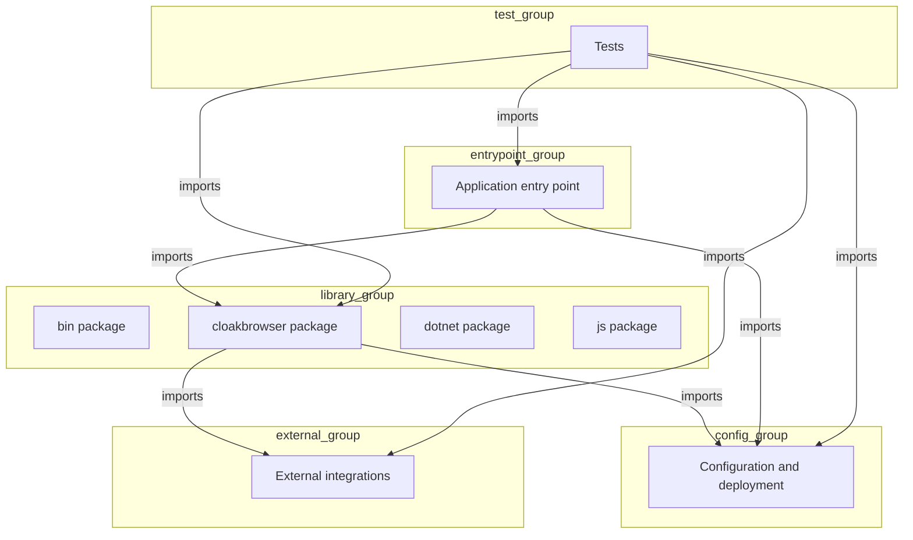

# Architecture report: CloakHQ/CloakBrowser

> Automated static analysis. **Observed** = directly seen in files/imports/AST; **Inferred** = interpretation from that evidence. Repository code was not executed.

## 1. Repository at a glance

| Item | Value |
| --- | --- |
| Repository | CloakHQ/CloakBrowser |
| Description | Stealth Chromium that passes every bot detection test. Drop-in Playwright replacement with source-level fingerprint patches. 50+ tests passed. |
| Language | Python |
| Stars | 32887 |
| Licence | MIT |
| Analysed commit / branch | 0c110fab97ee98d7d4ba6c4f53d909cee08e92b6 / main |
| Framework(s) | None detected |
| Files analysed | 241 |
| Components | 8 |

## 2. Architecture in one minute

CloakHQ/CloakBrowser - Stealth Chromium that passes every bot detection test. Drop-in Playwright replacement with source-level fingerprint patches. 50+ tests passed.. This repository was analysed statically from 241 file(s) (67 Python). Detected technologies (observed from imports/manifests): GitHub Actions, aiohttp, httpx, Poetry, Docker, pytest. Files are grouped into 8 component(s): bin package, cloakbrowser package, Configuration and deployment, dotnet package, Application entry point, External integrations, js package, Tests. Observed entry point(s): bin/fetch-widevine.py, cloakbrowser/__main__.py. Findings below distinguish observed facts from inferred interpretation.

## 3. High-level block diagram

## 4. Main components

### bin package (`bin`)

- **Kind:** library
- **Status:** Observed
- **Confidence:** 0.85
- **Responsibility:** Groups 1 file(s) under bin package (observed from repository paths and static analysis).
- **Paths:** `bin/docker-entrypoint.sh`
- **Evidence:** [bin/docker-entrypoint.sh](https://github.com/CloakHQ/CloakBrowser/blob/0c110fab97ee98d7d4ba6c4f53d909cee08e92b6/bin/docker-entrypoint.sh)

### cloakbrowser package (`cloakbrowser`)

- **Kind:** library
- **Status:** Observed
- **Confidence:** 0.85
- **Responsibility:** Groups 16 file(s) under cloakbrowser package (observed from repository paths and static analysis). Observed top-level classes: Action, ActionabilityError, BinaryVerificationError, BoundedCalls, CloakBrowserLicenseError, CursorState. Observed top-level functions: __getattr__, _append_webrtc_exit_ip, _ask, _assemble_proxy_url, _assigns_attr, _attach.
- **Paths:** `cloakbrowser/__init__.py`, `cloakbrowser/_version.py`, `cloakbrowser/browser.py`, `cloakbrowser/download.py`, `cloakbrowser/geoip.py`, `cloakbrowser/human/__init__.py`, `cloakbrowser/human/engine.py`, `cloakbrowser/human/errors.py`, `cloakbrowser/human/fields.py`, `cloakbrowser/human/injected.py`, `cloakbrowser/human/keyboard.py`, `cloakbrowser/human/mouse.py`, `cloakbrowser/human/patch.py`, `cloakbrowser/human/world.py`, `cloakbrowser/license.py`, `cloakbrowser/widevine.py`
- **Evidence:** [cloakbrowser/__init__.py:21](https://github.com/CloakHQ/CloakBrowser/blob/0c110fab97ee98d7d4ba6c4f53d909cee08e92b6/cloakbrowser/__init__.py#L21); [cloakbrowser/_version.py](https://github.com/CloakHQ/CloakBrowser/blob/0c110fab97ee98d7d4ba6c4f53d909cee08e92b6/cloakbrowser/_version.py); [cloakbrowser/browser.py:47](https://github.com/CloakHQ/CloakBrowser/blob/0c110fab97ee98d7d4ba6c4f53d909cee08e92b6/cloakbrowser/browser.py#L47); [cloakbrowser/download.py:46](https://github.com/CloakHQ/CloakBrowser/blob/0c110fab97ee98d7d4ba6c4f53d909cee08e92b6/cloakbrowser/download.py#L46); [cloakbrowser/geoip.py:81](https://github.com/CloakHQ/CloakBrowser/blob/0c110fab97ee98d7d4ba6c4f53d909cee08e92b6/cloakbrowser/geoip.py#L81); [cloakbrowser/human/__init__.py](https://github.com/CloakHQ/CloakBrowser/blob/0c110fab97ee98d7d4ba6c4f53d909cee08e92b6/cloakbrowser/human/__init__.py); [cloakbrowser/human/engine.py:50](https://github.com/CloakHQ/CloakBrowser/blob/0c110fab97ee98d7d4ba6c4f53d909cee08e92b6/cloakbrowser/human/engine.py#L50); [cloakbrowser/human/errors.py:12](https://github.com/CloakHQ/CloakBrowser/blob/0c110fab97ee98d7d4ba6c4f53d909cee08e92b6/cloakbrowser/human/errors.py#L12)

### Configuration and deployment (`config`)

- **Kind:** config
- **Status:** Observed
- **Confidence:** 0.85
- **Responsibility:** Groups 6 file(s) under configuration and deployment (observed from repository paths and static analysis). Observed top-level classes: HumanConfig, HumanConfigOverrides. Observed top-level functions: _careful_config, _drop_removed, _random_seed, _read_profile_seed, _version_newer, _version_tuple.
- **Paths:** `Dockerfile`, `cloakbrowser/config.py`, `cloakbrowser/human/config.py`, `js/package.json`, `js/tsconfig.json`, `pyproject.toml`
- **Evidence:** [Dockerfile](https://github.com/CloakHQ/CloakBrowser/blob/0c110fab97ee98d7d4ba6c4f53d909cee08e92b6/Dockerfile); [cloakbrowser/config.py:50](https://github.com/CloakHQ/CloakBrowser/blob/0c110fab97ee98d7d4ba6c4f53d909cee08e92b6/cloakbrowser/config.py#L50); [cloakbrowser/human/config.py:26](https://github.com/CloakHQ/CloakBrowser/blob/0c110fab97ee98d7d4ba6c4f53d909cee08e92b6/cloakbrowser/human/config.py#L26); [js/package.json](https://github.com/CloakHQ/CloakBrowser/blob/0c110fab97ee98d7d4ba6c4f53d909cee08e92b6/js/package.json); [js/tsconfig.json](https://github.com/CloakHQ/CloakBrowser/blob/0c110fab97ee98d7d4ba6c4f53d909cee08e92b6/js/tsconfig.json); [pyproject.toml](https://github.com/CloakHQ/CloakBrowser/blob/0c110fab97ee98d7d4ba6c4f53d909cee08e92b6/pyproject.toml)

### dotnet package (`dotnet`)

- **Kind:** library
- **Status:** Observed
- **Confidence:** 0.85
- **Responsibility:** Groups 42 file(s) under dotnet package (observed from repository paths and static analysis).
- **Paths:** `dotnet/examples/CloakBrowser.Examples/Program.cs`, `dotnet/src/CloakBrowser.Cli/Program.cs`, `dotnet/src/CloakBrowser.Generators/InterfaceDelegationGenerator.cs`, `dotnet/src/CloakBrowser/CloakLauncher.cs`, `dotnet/src/CloakBrowser/CloakLog.cs`, `dotnet/src/CloakBrowser/CloakVersion.cs`, `dotnet/src/CloakBrowser/Config.cs`, `dotnet/src/CloakBrowser/Diagnostics.cs`, `dotnet/src/CloakBrowser/Download.cs`, `dotnet/src/CloakBrowser/GeoIp.cs`, `dotnet/src/CloakBrowser/Handles.cs`, `dotnet/src/CloakBrowser/Human/Actionability.cs`, `dotnet/src/CloakBrowser/Human/Fields.cs`, `dotnet/src/CloakBrowser/Human/HumanConfig.cs`, `dotnet/src/CloakBrowser/Human/HumanEngine.Actions.cs`, `dotnet/src/CloakBrowser/Human/HumanEngine.cs`, `dotnet/src/CloakBrowser/Human/HumanKeyboard.cs`, `dotnet/src/CloakBrowser/Human/HumanMouse.cs`, `dotnet/src/CloakBrowser/Human/HumanPage.cs`, `dotnet/src/CloakBrowser/Human/HumanRandom.cs`, `dotnet/src/CloakBrowser/Human/HumanScroll.cs`, `dotnet/src/CloakBrowser/Human/HumanWorld.cs`, `dotnet/src/CloakBrowser/Human/InjectedSource.cs`, `dotnet/src/CloakBrowser/Human/IsolatedWorld.cs`, `dotnet/src/CloakBrowser/Human/WorldHelpers.cs`, `dotnet/src/CloakBrowser/LaunchOptions.cs`, `dotnet/src/CloakBrowser/License.cs`, `dotnet/src/CloakBrowser/ProxyResolver.cs`, `dotnet/src/CloakBrowser/ProxySettings.cs`, `dotnet/src/CloakBrowser/ViewportDefaults.cs`, `dotnet/src/CloakBrowser/Widevine.cs`, `dotnet/src/CloakBrowser/Wrappers/HumanCursor.cs`, `dotnet/src/CloakBrowser/Wrappers/Humanize.cs`, `dotnet/src/CloakBrowser/Wrappers/HumanizedBrowser.cs`, `dotnet/src/CloakBrowser/Wrappers/HumanizedBrowserContext.cs`, `dotnet/src/CloakBrowser/Wrappers/HumanizedElementHandle.cs`, `dotnet/src/CloakBrowser/Wrappers/HumanizedFrame.cs`, `dotnet/src/CloakBrowser/Wrappers/HumanizedFrameLocator.cs`, `dotnet/src/CloakBrowser/Wrappers/HumanizedKeyboard.cs`, `dotnet/src/CloakBrowser/Wrappers/HumanizedLocator.cs`, `dotnet/src/CloakBrowser/Wrappers/HumanizedMouse.cs`, `dotnet/src/CloakBrowser/Wrappers/HumanizedPage.cs`
- **Evidence:** [dotnet/examples/CloakBrowser.Examples/Program.cs](https://github.com/CloakHQ/CloakBrowser/blob/0c110fab97ee98d7d4ba6c4f53d909cee08e92b6/dotnet/examples/CloakBrowser.Examples/Program.cs); [dotnet/src/CloakBrowser.Cli/Program.cs](https://github.com/CloakHQ/CloakBrowser/blob/0c110fab97ee98d7d4ba6c4f53d909cee08e92b6/dotnet/src/CloakBrowser.Cli/Program.cs); [dotnet/src/CloakBrowser.Generators/InterfaceDelegationGenerator.cs](https://github.com/CloakHQ/CloakBrowser/blob/0c110fab97ee98d7d4ba6c4f53d909cee08e92b6/dotnet/src/CloakBrowser.Generators/InterfaceDelegationGenerator.cs); [dotnet/src/CloakBrowser/CloakLauncher.cs](https://github.com/CloakHQ/CloakBrowser/blob/0c110fab97ee98d7d4ba6c4f53d909cee08e92b6/dotnet/src/CloakBrowser/CloakLauncher.cs); [dotnet/src/CloakBrowser/CloakLog.cs](https://github.com/CloakHQ/CloakBrowser/blob/0c110fab97ee98d7d4ba6c4f53d909cee08e92b6/dotnet/src/CloakBrowser/CloakLog.cs); [dotnet/src/CloakBrowser/CloakVersion.cs](https://github.com/CloakHQ/CloakBrowser/blob/0c110fab97ee98d7d4ba6c4f53d909cee08e92b6/dotnet/src/CloakBrowser/CloakVersion.cs); [dotnet/src/CloakBrowser/Config.cs](https://github.com/CloakHQ/CloakBrowser/blob/0c110fab97ee98d7d4ba6c4f53d909cee08e92b6/dotnet/src/CloakBrowser/Config.cs); [dotnet/src/CloakBrowser/Diagnostics.cs](https://github.com/CloakHQ/CloakBrowser/blob/0c110fab97ee98d7d4ba6c4f53d909cee08e92b6/dotnet/src/CloakBrowser/Diagnostics.cs)

### Application entry point (`entrypoint`)

- **Kind:** entrypoint
- **Status:** Observed
- **Confidence:** 0.85
- **Responsibility:** Groups 2 file(s) under application entry point (observed from repository paths and static analysis). Observed top-level functions: _arch, _binary_version, _collect_diagnostics, _console_glyph, _crx_appid, _default_out.
- **Paths:** `bin/fetch-widevine.py`, `cloakbrowser/__main__.py`
- **Evidence:** [bin/fetch-widevine.py:44](https://github.com/CloakHQ/CloakBrowser/blob/0c110fab97ee98d7d4ba6c4f53d909cee08e92b6/bin/fetch-widevine.py#L44); [cloakbrowser/__main__.py:22](https://github.com/CloakHQ/CloakBrowser/blob/0c110fab97ee98d7d4ba6c4f53d909cee08e92b6/cloakbrowser/__main__.py#L22)

### External integrations (`external_integrations`)

- **Kind:** external
- **Status:** Inferred
- **Confidence:** 0.70
- **Responsibility:** Groups 0 file(s) under external integrations (observed from repository paths and static analysis).
- **Evidence:** [cloakbrowser/download.py:24](https://github.com/CloakHQ/CloakBrowser/blob/0c110fab97ee98d7d4ba6c4f53d909cee08e92b6/cloakbrowser/download.py#L24); [cloakbrowser/geoip.py:17](https://github.com/CloakHQ/CloakBrowser/blob/0c110fab97ee98d7d4ba6c4f53d909cee08e92b6/cloakbrowser/geoip.py#L17); [cloakbrowser/geoip.py:269](https://github.com/CloakHQ/CloakBrowser/blob/0c110fab97ee98d7d4ba6c4f53d909cee08e92b6/cloakbrowser/geoip.py#L269); [cloakbrowser/geoip.py:331](https://github.com/CloakHQ/CloakBrowser/blob/0c110fab97ee98d7d4ba6c4f53d909cee08e92b6/cloakbrowser/geoip.py#L331); [cloakbrowser/license.py:21](https://github.com/CloakHQ/CloakBrowser/blob/0c110fab97ee98d7d4ba6c4f53d909cee08e92b6/cloakbrowser/license.py#L21); [examples/integrations/aws_lambda/lambda_handler.py:67](https://github.com/CloakHQ/CloakBrowser/blob/0c110fab97ee98d7d4ba6c4f53d909cee08e92b6/examples/integrations/aws_lambda/lambda_handler.py#L67)

### js package (`js`)

- **Kind:** library
- **Status:** Observed
- **Confidence:** 0.85
- **Responsibility:** Groups 34 file(s) under js package (observed from repository paths and static analysis).
- **Paths:** `js/examples/basic-playwright.ts`, `js/examples/basic-puppeteer.ts`, `js/examples/persistent-context.ts`, `js/examples/stagehand.ts`, `js/examples/stealth-test.ts`, `js/src/args.ts`, `js/src/cli.ts`, `js/src/config.ts`, `js/src/download.ts`, `js/src/fonts.ts`, `js/src/geoip.ts`, `js/src/human-puppeteer/index.ts`, `js/src/human-puppeteer/keyboard.ts`, `js/src/human-puppeteer/scroll.ts`, `js/src/human/config.ts`, `js/src/human/engine.ts`, `js/src/human/errors.ts`, `js/src/human/fields.ts`, `js/src/human/index.ts`, `js/src/human/injected.ts`, `js/src/human/keyboard.ts`, `js/src/human/mouse.ts`, `js/src/human/patch.ts`, `js/src/human/world.ts`, `js/src/human/worldHelpers.ts`, `js/src/index.ts`, `js/src/license.ts`, `js/src/playwright.ts`, `js/src/profile-seed.ts`, `js/src/proxy.ts`, `js/src/puppeteer.ts`, `js/src/types.ts`, `js/src/widevine.ts`, `js/vitest.config.ts`
- **Evidence:** [js/examples/basic-playwright.ts](https://github.com/CloakHQ/CloakBrowser/blob/0c110fab97ee98d7d4ba6c4f53d909cee08e92b6/js/examples/basic-playwright.ts); [js/examples/basic-puppeteer.ts](https://github.com/CloakHQ/CloakBrowser/blob/0c110fab97ee98d7d4ba6c4f53d909cee08e92b6/js/examples/basic-puppeteer.ts); [js/examples/persistent-context.ts](https://github.com/CloakHQ/CloakBrowser/blob/0c110fab97ee98d7d4ba6c4f53d909cee08e92b6/js/examples/persistent-context.ts); [js/examples/stagehand.ts](https://github.com/CloakHQ/CloakBrowser/blob/0c110fab97ee98d7d4ba6c4f53d909cee08e92b6/js/examples/stagehand.ts); [js/examples/stealth-test.ts](https://github.com/CloakHQ/CloakBrowser/blob/0c110fab97ee98d7d4ba6c4f53d909cee08e92b6/js/examples/stealth-test.ts); [js/src/args.ts](https://github.com/CloakHQ/CloakBrowser/blob/0c110fab97ee98d7d4ba6c4f53d909cee08e92b6/js/src/args.ts); [js/src/cli.ts](https://github.com/CloakHQ/CloakBrowser/blob/0c110fab97ee98d7d4ba6c4f53d909cee08e92b6/js/src/cli.ts); [js/src/config.ts](https://github.com/CloakHQ/CloakBrowser/blob/0c110fab97ee98d7d4ba6c4f53d909cee08e92b6/js/src/config.ts)

### Tests (`tests`)

- **Kind:** test
- **Status:** Observed
- **Confidence:** 0.85
- **Responsibility:** Groups 99 file(s) under tests (observed from repository paths and static analysis). Observed routes: PATCH os.path.exists, PATCH os.path.exists, PATCH subprocess.Popen, PATCH cloakbrowser.browser.ensure_binary, PATCH playwright.sync_api.sync_playwright. Observed top-level classes: SiteServer, TestAppId, TestArch, TestArchive, TestAsyncElementHandle, TestAsyncEndToEnd. Observed top-level functions: _async_mock_el_evaluate, _banner, _binary, _blink_typeahead, _build_crx3, _cfg.
- **Paths:** `dotnet/tests/CloakBrowser.Tests/BezierMathTests.cs`, `dotnet/tests/CloakBrowser.Tests/BrowserFactAttribute.cs`, `dotnet/tests/CloakBrowser.Tests/BuildArgsTests.cs`, `dotnet/tests/CloakBrowser.Tests/ClaimTests.cs`, `dotnet/tests/CloakBrowser.Tests/CloakBrowser.Tests.csproj`, `dotnet/tests/CloakBrowser.Tests/ConfigTests.cs`, `dotnet/tests/CloakBrowser.Tests/DiagnosticsTests.cs`, `dotnet/tests/CloakBrowser.Tests/DownloadConfigTests.cs`, `dotnet/tests/CloakBrowser.Tests/EnvSerialCollection.cs`, `dotnet/tests/CloakBrowser.Tests/FontWarningTests.cs`, `dotnet/tests/CloakBrowser.Tests/Human/MatchChildTests.cs`, `dotnet/tests/CloakBrowser.Tests/Human/NonAsciiKeyboardTests.cs`, `dotnet/tests/CloakBrowser.Tests/Human/SelectorParityBrowserTests.cs`, `dotnet/tests/CloakBrowser.Tests/Human/TimeoutBudgetTests.cs`, `dotnet/tests/CloakBrowser.Tests/HumanConfigTests.cs`, `dotnet/tests/CloakBrowser.Tests/HumanEngine/ActionabilityApiTests.cs`, `dotnet/tests/CloakBrowser.Tests/HumanEngine/HumanEngineBrowserTests.cs`, `dotnet/tests/CloakBrowser.Tests/HumanEngine/HumanReadsTests.cs`, `dotnet/tests/CloakBrowser.Tests/HumanEngine/SiteServer.cs`, `dotnet/tests/CloakBrowser.Tests/HumanEngine/WorldSmokeTests.cs`, `dotnet/tests/CloakBrowser.Tests/IsolatedCacheDir.cs`, `dotnet/tests/CloakBrowser.Tests/LicenseTests.cs`, `dotnet/tests/CloakBrowser.Tests/MiscTests.cs`, `dotnet/tests/CloakBrowser.Tests/ProfileSeedTests.cs`, `dotnet/tests/CloakBrowser.Tests/ProxyResolverTests.cs`, `dotnet/tests/CloakBrowser.Tests/ScrollFallbackTests.cs`, `dotnet/tests/CloakBrowser.Tests/SignatureTests.cs`, `dotnet/tests/CloakBrowser.Tests/ViewportTests.cs`, `dotnet/tests/CloakBrowser.Tests/WidevineTests.cs`, `dotnet/tests/CloakBrowser.Tests/Wrappers/BrowserContextWrapperTests.cs`, `dotnet/tests/CloakBrowser.Tests/Wrappers/FakeProxy.cs`, `dotnet/tests/CloakBrowser.Tests/Wrappers/GeneratorDelegationTests.cs`, `dotnet/tests/CloakBrowser.Tests/Wrappers/HandleCloseTests.cs`, `dotnet/tests/CloakBrowser.Tests/Wrappers/LicenseGuardCompositionTests.cs`, `dotnet/tests/CloakBrowser.Tests/Wrappers/LocatorWrapperTests.cs`, `dotnet/tests/CloakBrowser.Tests/Wrappers/MouseKeyboardWrapperTests.cs`, `dotnet/tests/CloakBrowser.Tests/Wrappers/PageWrapperTests.cs`, `examples/fingerprint_scan_test.py`, `examples/stealth_test.py`, `js/tests/claim.test.ts`, `js/tests/cli.test.ts`, `js/tests/config.test.ts`, `js/tests/extension-loading.test.ts`, `js/tests/fonts.test.ts`, `js/tests/geoip.test.ts`, `js/tests/humanize.test.ts`, `js/tests/humanizeEngine.test.ts`, `js/tests/humanizeHarness.ts`, `js/tests/humanizePuppeteer.test.ts`, `js/tests/launch.test.ts`, `js/tests/license.test.ts`, `js/tests/profile-seed.test.ts`, `js/tests/proxy.test.ts`, `js/tests/puppeteer.test.ts`, `js/tests/require.test.ts`, `js/tests/setup.ts`, `js/tests/signature.test.ts`, `js/tests/stealth.puppeteer.test.ts`, `js/tests/stealth.test.ts`, `js/tests/update.test.ts`, `js/tests/welcome.test.ts`, `js/tests/widevine-integration.test.ts`, `js/tests/widevine.test.ts`, `tests/__init__.py`, `tests/conftest.py`, `tests/test_build_args.py`, `tests/test_build_launch_options.py`, `tests/test_cli.py`, `tests/test_cloakserve.py`, `tests/test_config.py`, `tests/test_extension_loading.py`, `tests/test_extract.py`, `tests/test_fetch_widevine.py`, `tests/test_font_warning.py`, `tests/test_free_claim.py`, `tests/test_free_version_pin.py`, `tests/test_geoip.py`, `tests/test_human_visual.mjs`, `tests/test_human_visual.py`, `tests/test_humanize_engine.py`, `tests/test_humanize_unit.mjs`, `tests/test_humanize_unit.py`, `tests/test_lambda_security.py`, `tests/test_launch.py`, `tests/test_launch_context.py`, `tests/test_license.py`, `tests/test_license_error.py`, `tests/test_login.py`, `tests/test_persistent_context.py`, `tests/test_profile_seed.py`, `tests/test_proxy.py`, `tests/test_resolver_sources_match.py`, `tests/test_stealth.py`, `tests/test_stealth_dom_browser.py`, `tests/test_stealth_reproduction_110.py`, `tests/test_stealth_unit.py`, `tests/test_update.py`, `tests/test_welcome_banner.py`, `tests/test_widevine.py`
- **Evidence:** [dotnet/tests/CloakBrowser.Tests/BezierMathTests.cs](https://github.com/CloakHQ/CloakBrowser/blob/0c110fab97ee98d7d4ba6c4f53d909cee08e92b6/dotnet/tests/CloakBrowser.Tests/BezierMathTests.cs); [dotnet/tests/CloakBrowser.Tests/BrowserFactAttribute.cs](https://github.com/CloakHQ/CloakBrowser/blob/0c110fab97ee98d7d4ba6c4f53d909cee08e92b6/dotnet/tests/CloakBrowser.Tests/BrowserFactAttribute.cs); [dotnet/tests/CloakBrowser.Tests/BuildArgsTests.cs](https://github.com/CloakHQ/CloakBrowser/blob/0c110fab97ee98d7d4ba6c4f53d909cee08e92b6/dotnet/tests/CloakBrowser.Tests/BuildArgsTests.cs); [dotnet/tests/CloakBrowser.Tests/ClaimTests.cs](https://github.com/CloakHQ/CloakBrowser/blob/0c110fab97ee98d7d4ba6c4f53d909cee08e92b6/dotnet/tests/CloakBrowser.Tests/ClaimTests.cs); [dotnet/tests/CloakBrowser.Tests/CloakBrowser.Tests.csproj](https://github.com/CloakHQ/CloakBrowser/blob/0c110fab97ee98d7d4ba6c4f53d909cee08e92b6/dotnet/tests/CloakBrowser.Tests/CloakBrowser.Tests.csproj); [dotnet/tests/CloakBrowser.Tests/ConfigTests.cs](https://github.com/CloakHQ/CloakBrowser/blob/0c110fab97ee98d7d4ba6c4f53d909cee08e92b6/dotnet/tests/CloakBrowser.Tests/ConfigTests.cs); [dotnet/tests/CloakBrowser.Tests/DiagnosticsTests.cs](https://github.com/CloakHQ/CloakBrowser/blob/0c110fab97ee98d7d4ba6c4f53d909cee08e92b6/dotnet/tests/CloakBrowser.Tests/DiagnosticsTests.cs); [dotnet/tests/CloakBrowser.Tests/DownloadConfigTests.cs](https://github.com/CloakHQ/CloakBrowser/blob/0c110fab97ee98d7d4ba6c4f53d909cee08e92b6/dotnet/tests/CloakBrowser.Tests/DownloadConfigTests.cs)

## 5. Execution flow

**Observed** entry point(s):

- [bin/fetch-widevine.py:294](https://github.com/CloakHQ/CloakBrowser/blob/0c110fab97ee98d7d4ba6c4f53d909cee08e92b6/bin/fetch-widevine.py#L294)
- [cloakbrowser/__main__.py](https://github.com/CloakHQ/CloakBrowser/blob/0c110fab97ee98d7d4ba6c4f53d909cee08e92b6/cloakbrowser/__main__.py)
- [js/src/human-puppeteer/index.ts](https://github.com/CloakHQ/CloakBrowser/blob/0c110fab97ee98d7d4ba6c4f53d909cee08e92b6/js/src/human-puppeteer/index.ts)
- [js/src/human/index.ts](https://github.com/CloakHQ/CloakBrowser/blob/0c110fab97ee98d7d4ba6c4f53d909cee08e92b6/js/src/human/index.ts)
- [js/src/index.ts](https://github.com/CloakHQ/CloakBrowser/blob/0c110fab97ee98d7d4ba6c4f53d909cee08e92b6/js/src/index.ts)

**Observed** routes (from decorators):

- `PATCH os.path.exists` -> `test_default_data_dir_docker` in `tests/test_cloakserve.py:178`
- `PATCH os.path.exists` -> `test_default_data_dir_bare_metal` in `tests/test_cloakserve.py:182`
- `PATCH subprocess.Popen` -> `test_launch_without_connections_schedules_idle_cleanup` in `tests/test_cloakserve.py:657`
- `PATCH cloakbrowser.browser.ensure_binary` -> `test_extension_loading` in `tests/test_extension_loading.py:9`
- `PATCH playwright.sync_api.sync_playwright` -> `test_extension_loading` in `tests/test_extension_loading.py:9`
- `PATCH cloakbrowser.browser.ensure_binary` -> `test_default_viewport` in `tests/test_launch_context.py:21`
- `PATCH cloakbrowser.browser.launch` -> `test_default_viewport` in `tests/test_launch_context.py:21`
- `PATCH cloakbrowser.browser.ensure_binary` -> `test_release_channel_forwarded` in `tests/test_launch_context.py:36`
- `PATCH cloakbrowser.browser.launch` -> `test_release_channel_forwarded` in `tests/test_launch_context.py:36`
- `PATCH cloakbrowser.browser.ensure_binary` -> `test_headed_no_viewport` in `tests/test_launch_context.py:49`
- `PATCH cloakbrowser.browser.launch` -> `test_headed_no_viewport` in `tests/test_launch_context.py:49`
- `PATCH cloakbrowser.browser.ensure_binary` -> `test_conflicting_viewport_kwargs_deduped` in `tests/test_launch_context.py:109`
- `PATCH cloakbrowser.browser.launch` -> `test_conflicting_viewport_kwargs_deduped` in `tests/test_launch_context.py:109`
- `PATCH cloakbrowser.browser.ensure_binary` -> `test_custom_viewport` in `tests/test_launch_context.py:125`
- `PATCH cloakbrowser.browser.launch` -> `test_custom_viewport` in `tests/test_launch_context.py:125`
- `PATCH cloakbrowser.browser.ensure_binary` -> `test_default_does_not_suppress_maximize` in `tests/test_launch_context.py:140`
- `PATCH cloakbrowser.browser.launch` -> `test_default_does_not_suppress_maximize` in `tests/test_launch_context.py:140`
- `PATCH cloakbrowser.browser.ensure_binary` -> `test_explicit_viewport_suppresses_maximize` in `tests/test_launch_context.py:153`
- `PATCH cloakbrowser.browser.launch` -> `test_explicit_viewport_suppresses_maximize` in `tests/test_launch_context.py:153`
- `PATCH cloakbrowser.browser.ensure_binary` -> `test_no_viewport_kwarg_suppresses_maximize` in `tests/test_launch_context.py:166`
- `PATCH cloakbrowser.browser.launch` -> `test_no_viewport_kwarg_suppresses_maximize` in `tests/test_launch_context.py:166`
- `PATCH cloakbrowser.browser.ensure_binary` -> `test_user_agent` in `tests/test_launch_context.py:179`
- `PATCH cloakbrowser.browser.launch` -> `test_user_agent` in `tests/test_launch_context.py:179`
- `PATCH cloakbrowser.browser.ensure_binary` -> `test_locale_forwarded` in `tests/test_launch_context.py:193`
- `PATCH cloakbrowser.browser.launch` -> `test_locale_forwarded` in `tests/test_launch_context.py:193`
- `PATCH cloakbrowser.browser.ensure_binary` -> `test_timezone_via_binary_not_cdp` in `tests/test_launch_context.py:210`
- `PATCH cloakbrowser.browser.launch` -> `test_timezone_via_binary_not_cdp` in `tests/test_launch_context.py:210`
- `PATCH cloakbrowser.browser.ensure_binary` -> `test_color_scheme` in `tests/test_launch_context.py:231`
- `PATCH cloakbrowser.browser.launch` -> `test_color_scheme` in `tests/test_launch_context.py:231`
- `PATCH cloakbrowser.browser.maybe_resolve_geoip` -> `test_geoip_resolution` in `tests/test_launch_context.py:246`
- `PATCH cloakbrowser.browser.ensure_binary` -> `test_geoip_resolution` in `tests/test_launch_context.py:246`
- `PATCH cloakbrowser.browser.launch` -> `test_geoip_resolution` in `tests/test_launch_context.py:246`
- `PATCH cloakbrowser.browser.ensure_binary` -> `test_timezone_id_alias` in `tests/test_launch_context.py:265`
- `PATCH cloakbrowser.browser.launch` -> `test_timezone_id_alias` in `tests/test_launch_context.py:265`
- `PATCH cloakbrowser.browser.ensure_binary` -> `test_close_closes_browser` in `tests/test_launch_context.py:282`
- `PATCH cloakbrowser.browser.launch` -> `test_close_closes_browser` in `tests/test_launch_context.py:282`
- `PATCH cloakbrowser.browser.ensure_binary` -> `test_close_forwards_reason` in `tests/test_launch_context.py:302`
- `PATCH cloakbrowser.browser.launch` -> `test_close_forwards_reason` in `tests/test_launch_context.py:302`
- `PATCH cloakbrowser.browser.ensure_binary` -> `test_error_closes_browser` in `tests/test_launch_context.py:324`
- `PATCH cloakbrowser.browser.launch` -> `test_error_closes_browser` in `tests/test_launch_context.py:324`
- `PATCH cloakbrowser.browser.ensure_binary` -> `test_kwargs_passthrough` in `tests/test_launch_context.py:339`
- `PATCH cloakbrowser.browser.launch` -> `test_kwargs_passthrough` in `tests/test_launch_context.py:339`
- `PATCH cloakbrowser.browser.ensure_binary` -> `test_async_storage_state_forwarded` in `tests/test_launch_context.py:376`
- `PATCH cloakbrowser.browser.launch_async` -> `test_async_storage_state_forwarded` in `tests/test_launch_context.py:376`
- `PATCH cloakbrowser.browser.ensure_binary` -> `test_async_default_viewport` in `tests/test_launch_context.py:394`
- `PATCH cloakbrowser.browser.launch_async` -> `test_async_default_viewport` in `tests/test_launch_context.py:394`
- `PATCH cloakbrowser.browser.ensure_binary` -> `test_async_locale_flows_to_binary_not_cdp` in `tests/test_launch_context.py:410`
- `PATCH cloakbrowser.browser.launch_async` -> `test_async_locale_flows_to_binary_not_cdp` in `tests/test_launch_context.py:410`
- `PATCH cloakbrowser.browser.ensure_binary` -> `test_async_close_closes_browser` in `tests/test_launch_context.py:430`
- `PATCH cloakbrowser.browser.launch_async` -> `test_async_close_closes_browser` in `tests/test_launch_context.py:430`
- `PATCH cloakbrowser.browser.ensure_binary` -> `test_async_close_forwards_reason` in `tests/test_launch_context.py:447`
- `PATCH cloakbrowser.browser.launch_async` -> `test_async_close_forwards_reason` in `tests/test_launch_context.py:447`
- `PATCH cloakbrowser.browser.ensure_binary` -> `test_async_error_closes_browser` in `tests/test_launch_context.py:465`
- `PATCH cloakbrowser.browser.launch_async` -> `test_async_error_closes_browser` in `tests/test_launch_context.py:465`
- `PATCH cloakbrowser.browser.ensure_binary` -> `test_async_cancellation_closes_browser` in `tests/test_launch_context.py:481`
- `PATCH cloakbrowser.browser.launch_async` -> `test_async_cancellation_closes_browser` in `tests/test_launch_context.py:481`
- `PATCH cloakbrowser.browser.ensure_binary` -> `test_persistent_context_args_built` in `tests/test_persistent_context.py:35`
- `PATCH cloakbrowser.browser.maybe_resolve_geoip` -> `test_persistent_context_args_built` in `tests/test_persistent_context.py:35`
- `PATCH cloakbrowser.browser.ensure_binary` -> `test_persistent_context_default_viewport` in `tests/test_persistent_context.py:51`
- `PATCH cloakbrowser.browser.maybe_resolve_geoip` -> `test_persistent_context_default_viewport` in `tests/test_persistent_context.py:51`
- `PATCH cloakbrowser.browser.ensure_binary` -> `test_persistent_context_headed_no_viewport` in `tests/test_persistent_context.py:66`
- `PATCH cloakbrowser.browser.maybe_resolve_geoip` -> `test_persistent_context_headed_no_viewport` in `tests/test_persistent_context.py:66`
- `PATCH cloakbrowser.browser.ensure_binary` -> `test_persistent_context_custom_viewport` in `tests/test_persistent_context.py:82`
- `PATCH cloakbrowser.browser.maybe_resolve_geoip` -> `test_persistent_context_custom_viewport` in `tests/test_persistent_context.py:82`
- `PATCH cloakbrowser.browser.ensure_binary` -> `test_persistent_context_user_agent` in `tests/test_persistent_context.py:97`
- `PATCH cloakbrowser.browser.maybe_resolve_geoip` -> `test_persistent_context_user_agent` in `tests/test_persistent_context.py:97`
- `PATCH cloakbrowser.browser.ensure_binary` -> `test_persistent_context_locale_and_timezone` in `tests/test_persistent_context.py:110`
- `PATCH cloakbrowser.browser.ensure_binary` -> `test_persistent_context_color_scheme` in `tests/test_persistent_context.py:129`
- `PATCH cloakbrowser.browser.maybe_resolve_geoip` -> `test_persistent_context_color_scheme` in `tests/test_persistent_context.py:129`
- `PATCH cloakbrowser.browser.maybe_resolve_geoip` -> `test_persistent_context_geoip` in `tests/test_persistent_context.py:143`
- `PATCH cloakbrowser.browser.ensure_binary` -> `test_persistent_context_geoip` in `tests/test_persistent_context.py:143`
- `PATCH cloakbrowser.browser.ensure_binary` -> `test_persistent_context_timezone_id_alias` in `tests/test_persistent_context.py:161`
- `PATCH cloakbrowser.browser.ensure_binary` -> `test_persistent_context_close_stops_pw` in `tests/test_persistent_context.py:176`
- `PATCH cloakbrowser.browser.maybe_resolve_geoip` -> `test_persistent_context_close_stops_pw` in `tests/test_persistent_context.py:176`
- `PATCH cloakbrowser.browser.ensure_binary` -> `test_persistent_context_proxy_string` in `tests/test_persistent_context.py:192`
- `PATCH cloakbrowser.browser.maybe_resolve_geoip` -> `test_persistent_context_proxy_string` in `tests/test_persistent_context.py:192`
- `PATCH cloakbrowser.browser.ensure_binary` -> `test_persistent_context_proxy_dict` in `tests/test_persistent_context.py:207`
- `PATCH cloakbrowser.browser.maybe_resolve_geoip` -> `test_persistent_context_proxy_dict` in `tests/test_persistent_context.py:207`
- `PATCH cloakbrowser.browser.ensure_binary` -> `test_persistent_context_async_args_built` in `tests/test_persistent_context.py:238`
- `PATCH cloakbrowser.browser.maybe_resolve_geoip` -> `test_persistent_context_async_args_built` in `tests/test_persistent_context.py:238`
- `PATCH cloakbrowser.browser.ensure_binary` -> `test_persistent_context_async_close_stops_pw` in `tests/test_persistent_context.py:254`
- `PATCH cloakbrowser.browser.maybe_resolve_geoip` -> `test_persistent_context_async_close_stops_pw` in `tests/test_persistent_context.py:254`
- `PATCH cloakbrowser.browser.ensure_binary` -> `test_persistent_context_async_timezone_id_alias` in `tests/test_persistent_context.py:270`
- `PATCH cloakbrowser.browser.ensure_binary` -> `test_persistent_context_seeds_widevine` in `tests/test_persistent_context.py:337`
- `PATCH cloakbrowser.browser.maybe_resolve_geoip` -> `test_persistent_context_seeds_widevine` in `tests/test_persistent_context.py:337`
- `PATCH cloakbrowser.browser.seed_widevine_hint` -> `test_persistent_context_seeds_widevine` in `tests/test_persistent_context.py:337`
- `PATCH cloakbrowser.browser.ensure_binary` -> `test_persistent_context_async_seeds_widevine` in `tests/test_persistent_context.py:352`
- `PATCH cloakbrowser.browser.maybe_resolve_geoip` -> `test_persistent_context_async_seeds_widevine` in `tests/test_persistent_context.py:352`
- `PATCH cloakbrowser.browser.seed_widevine_hint` -> `test_persistent_context_async_seeds_widevine` in `tests/test_persistent_context.py:352`
- `PATCH cloakbrowser.browser.ensure_binary` -> `test_persistent_context_humanizes_before_the_license_guard` in `tests/test_persistent_context.py:376`
- `PATCH cloakbrowser.browser.maybe_resolve_geoip` -> `test_persistent_context_humanizes_before_the_license_guard` in `tests/test_persistent_context.py:376`
- `PATCH cloakbrowser.browser.ensure_binary` -> `test_persistent_context_async_humanizes_before_the_license_guard` in `tests/test_persistent_context.py:398`
- `PATCH cloakbrowser.browser.maybe_resolve_geoip` -> `test_persistent_context_async_humanizes_before_the_license_guard` in `tests/test_persistent_context.py:398`
- `PATCH cloakbrowser.geoip.resolve_proxy_geo_with_ip` -> `test_geoip_with_string_proxy` in `tests/test_proxy.py:57`
- `PATCH cloakbrowser.geoip.resolve_proxy_geo_with_ip` -> `test_geoip_with_dict_proxy_extracts_server` in `tests/test_proxy.py:65`
- `PATCH cloakbrowser.geoip.resolve_proxy_geo_with_ip` -> `test_geoip_no_proxy_uses_machine_ip` in `tests/test_proxy.py:82`
- `PATCH cloakbrowser.geoip.resolve_proxy_geo_with_ip` -> `test_geoip_preserves_explicit_timezone` in `tests/test_proxy.py:91`
- `PATCH cloakbrowser.geoip.resolve_proxy_geo_with_ip` -> `test_geoip_normalizes_bare_proxy_with_creds` in `tests/test_proxy.py:97`
- `PATCH cloakbrowser.geoip.resolve_proxy_geo_with_ip` -> `test_geoip_normalizes_schemeless_proxy_no_creds` in `tests/test_proxy.py:105`
- `PATCH cloakbrowser.geoip.resolve_proxy_geo_with_ip` -> `test_geoip_socks5_dict_reconstructs_credentials` in `tests/test_proxy.py:112`
- `PATCH cloakbrowser.geoip.resolve_proxy_geo_with_ip` -> `test_geoip_socks5_dict_no_auth_uses_server` in `tests/test_proxy.py:120`
- `PATCH cloakbrowser.geoip.resolve_proxy_geo_with_ip` -> `test_geoip_http_dict_without_credentials_uses_server` in `tests/test_proxy.py:126`
- `PATCH cloakbrowser.geoip.resolve_proxy_geo_with_ip` -> `test_geoip_http_dict_reconstructs_credentials` in `tests/test_proxy.py:132`
- `PATCH cloakbrowser.browser.ensure_binary` -> `test_launch_hooks_only_flag_path` in `tests/test_proxy.py:445`
- `PATCH cloakbrowser.browser.maybe_resolve_geoip` -> `test_launch_hooks_only_flag_path` in `tests/test_proxy.py:445`
- `PATCH cloakbrowser.browser.ensure_binary` -> `test_persistent_hooks_only_flag_path` in `tests/test_proxy.py:458`
- `PATCH cloakbrowser.browser.maybe_resolve_geoip` -> `test_persistent_hooks_only_flag_path` in `tests/test_proxy.py:458`
- `PATCH cloakbrowser.browser.persistent_seed_args` -> `test_persistent_hooks_only_flag_path` in `tests/test_proxy.py:458`
- `PATCH cloakbrowser.download._maybe_trigger_update_check` -> `test_local_override` in `tests/test_update.py:200`
- `PATCH cloakbrowser.download._maybe_trigger_update_check` -> `test_local_override_missing_file` in `tests/test_update.py:208`
- `PATCH cloakbrowser.download._maybe_trigger_update_check` -> `test_env_pin_rejects_unsafe_version` in `tests/test_update.py:250`

Representative flow (derived from observed entry points and the import graph; steps beyond the entry point are **Inferred**):

1. Execution starts at an observed entry point listed above, if present.
2. `cloakbrowser` imports `config` (cloakbrowser package -> Configuration and deployment).
3. `cloakbrowser` imports `external_integrations` (cloakbrowser package -> External integrations).
4. `entrypoint` imports `cloakbrowser` (Application entry point -> cloakbrowser package).
5. `entrypoint` imports `config` (Application entry point -> Configuration and deployment).
6. `tests` imports `cloakbrowser` (Tests -> cloakbrowser package).
7. `tests` imports `config` (Tests -> Configuration and deployment).
8. `tests` imports `entrypoint` (Tests -> Application entry point).
9. `tests` imports `external_integrations` (Tests -> External integrations).

## 6. Project structure

### `(root)`

- `.dockerignore` - container (226 bytes)
- `.gitattributes` - other (70 bytes)
- `.gitignore` - other (720 bytes)
- `BINARY-LICENSE.md` - docs (16465 bytes)
- `CHANGELOG.md` - docs (90090 bytes)
- `Dockerfile` - container (1816 bytes)
- `LICENSE` - docs (1064 bytes)
- `README.md` - docs (70533 bytes)
- `flake.lock` - other (567 bytes)
- `flake.nix` - other (6657 bytes)
- `pyproject.toml` - manifest (2361 bytes)

### `.github`

- `.github/FUNDING.yml` - config (15 bytes)
- `.github/ISSUE_TEMPLATE/bug_report.md` - docs (614 bytes)
- `.github/ISSUE_TEMPLATE/config.yml` - config (27 bytes)
- `.github/dependabot.yml` - config (481 bytes)
- `.github/workflows/actions.lock` - ci, YAML (3690 bytes)
- `.github/workflows/ci.yml` - ci, YAML (3571 bytes)
- `.github/workflows/publish.yml` - ci, YAML (6699 bytes)

### `bin`

- `bin/cloakserve` - other (36094 bytes)
- `bin/cloaktest` - other (117 bytes)
- `bin/docker-entrypoint.sh` - source, Shell (2821 bytes)
- `bin/fetch-widevine.py` - source, Python (12663 bytes)

### `cloakbrowser`

- `cloakbrowser/__init__.py` - source, Python (1969 bytes)
- `cloakbrowser/__main__.py` - source, Python (26531 bytes)
- `cloakbrowser/_version.py` - source, Python (22 bytes)
- `cloakbrowser/browser.py` - source, Python (75247 bytes)
- `cloakbrowser/config.py` - source, Python (12066 bytes)
- `cloakbrowser/download.py` - source, Python (41376 bytes)
- `cloakbrowser/geoip.py` - source, Python (14430 bytes)
- `cloakbrowser/human/__init__.py` - source, Python (2393 bytes)
- `cloakbrowser/human/config.py` - source, Python (11997 bytes)
- `cloakbrowser/human/engine.py` - source, Python (67025 bytes)
- `cloakbrowser/human/errors.py` - source, Python (3071 bytes)
- `cloakbrowser/human/fields.py` - source, Python (5546 bytes)
- `cloakbrowser/human/injected.py` - source, Python (4508 bytes)
- `cloakbrowser/human/keyboard.py` - source, Python (9311 bytes)
- `cloakbrowser/human/mouse.py` - source, Python (7998 bytes)
- `cloakbrowser/human/patch.py` - source, Python (21417 bytes)
- `cloakbrowser/human/world.py` - source, Python (33539 bytes)
- `cloakbrowser/license.py` - source, Python (29878 bytes)
- `cloakbrowser/widevine.py` - source, Python (5881 bytes)

### `dotnet`

- `dotnet/.gitignore` - other (72 bytes)
- `dotnet/CloakBrowser.sln` - other (3943 bytes)
- `dotnet/README.md` - docs (37802 bytes)
- `dotnet/examples/CloakBrowser.Examples/CloakBrowser.Examples.csproj` - other (459 bytes)
- `dotnet/examples/CloakBrowser.Examples/Program.cs` - source, C# (26652 bytes)
- `dotnet/src/CloakBrowser.Cli/CloakBrowser.Cli.csproj` - other (442 bytes)
- `dotnet/src/CloakBrowser.Cli/Program.cs` - source, C# (15607 bytes)
- `dotnet/src/CloakBrowser.Generators/CloakBrowser.Generators.csproj` - other (935 bytes)
- `dotnet/src/CloakBrowser.Generators/InterfaceDelegationGenerator.cs` - source, C# (18542 bytes)
- `dotnet/src/CloakBrowser/CloakBrowser.csproj` - other (2242 bytes)
- `dotnet/src/CloakBrowser/CloakLauncher.cs` - source, C# (31280 bytes)
- `dotnet/src/CloakBrowser/CloakLog.cs` - source, C# (2032 bytes)
- `dotnet/src/CloakBrowser/CloakVersion.cs` - source, C# (260 bytes)
- `dotnet/src/CloakBrowser/Config.cs` - source, C# (18197 bytes)
- `dotnet/src/CloakBrowser/Diagnostics.cs` - source, C# (16470 bytes)
- `dotnet/src/CloakBrowser/Download.cs` - source, C# (53719 bytes)
- `dotnet/src/CloakBrowser/GeoIp.cs` - source, C# (19700 bytes)
- `dotnet/src/CloakBrowser/Handles.cs` - source, C# (20664 bytes)
- `dotnet/src/CloakBrowser/Human/Actionability.cs` - source, C# (15460 bytes)
- `dotnet/src/CloakBrowser/Human/Fields.cs` - source, C# (5984 bytes)
- `dotnet/src/CloakBrowser/Human/HumanConfig.cs` - source, C# (10956 bytes)
- `dotnet/src/CloakBrowser/Human/HumanEngine.Actions.cs` - source, C# (34250 bytes)
- `dotnet/src/CloakBrowser/Human/HumanEngine.cs` - source, C# (42837 bytes)
- `dotnet/src/CloakBrowser/Human/HumanKeyboard.cs` - source, C# (22782 bytes)
- `dotnet/src/CloakBrowser/Human/HumanMouse.cs` - source, C# (11914 bytes)
- `dotnet/src/CloakBrowser/Human/HumanPage.cs` - source, C# (9138 bytes)
- `dotnet/src/CloakBrowser/Human/HumanRandom.cs` - source, C# (4516 bytes)
- `dotnet/src/CloakBrowser/Human/HumanScroll.cs` - source, C# (13762 bytes)
- `dotnet/src/CloakBrowser/Human/HumanWorld.cs` - source, C# (23390 bytes)
- `dotnet/src/CloakBrowser/Human/InjectedSource.cs` - source, C# (6136 bytes)
- `dotnet/src/CloakBrowser/Human/IsolatedWorld.cs` - source, C# (4451 bytes)
- `dotnet/src/CloakBrowser/Human/WorldHelpers.cs` - source, C# (16334 bytes)
- `dotnet/src/CloakBrowser/LaunchOptions.cs` - source, C# (4181 bytes)
- `dotnet/src/CloakBrowser/License.cs` - source, C# (48791 bytes)
- `dotnet/src/CloakBrowser/ProxyResolver.cs` - source, C# (12674 bytes)
- `dotnet/src/CloakBrowser/ProxySettings.cs` - source, C# (752 bytes)
- `dotnet/src/CloakBrowser/ViewportDefaults.cs` - source, C# (1323 bytes)
- `dotnet/src/CloakBrowser/Widevine.cs` - source, C# (5250 bytes)
- `dotnet/src/CloakBrowser/Wrappers/HumanCursor.cs` - source, C# (2786 bytes)
- `dotnet/src/CloakBrowser/Wrappers/Humanize.cs` - source, C# (7203 bytes)
- `dotnet/src/CloakBrowser/Wrappers/HumanizedBrowser.cs` - source, C# (2015 bytes)
- `dotnet/src/CloakBrowser/Wrappers/HumanizedBrowserContext.cs` - source, C# (2378 bytes)
- `dotnet/src/CloakBrowser/Wrappers/HumanizedElementHandle.cs` - source, C# (9247 bytes)
- `dotnet/src/CloakBrowser/Wrappers/HumanizedFrame.cs` - source, C# (11204 bytes)
- `dotnet/src/CloakBrowser/Wrappers/HumanizedFrameLocator.cs` - source, C# (3618 bytes)
- `dotnet/src/CloakBrowser/Wrappers/HumanizedKeyboard.cs` - source, C# (1270 bytes)
- `dotnet/src/CloakBrowser/Wrappers/HumanizedLocator.cs` - source, C# (12459 bytes)
- `dotnet/src/CloakBrowser/Wrappers/HumanizedMouse.cs` - source, C# (1679 bytes)
- `dotnet/src/CloakBrowser/Wrappers/HumanizedPage.cs` - source, C# (16718 bytes)
- `dotnet/tests/CloakBrowser.Tests/BezierMathTests.cs` - test, C# (2544 bytes)
- `dotnet/tests/CloakBrowser.Tests/BrowserFactAttribute.cs` - test, C# (903 bytes)
- `dotnet/tests/CloakBrowser.Tests/BuildArgsTests.cs` - test, C# (3680 bytes)
- `dotnet/tests/CloakBrowser.Tests/ClaimTests.cs` - test, C# (13688 bytes)
- `dotnet/tests/CloakBrowser.Tests/CloakBrowser.Tests.csproj` - test (589 bytes)
- `dotnet/tests/CloakBrowser.Tests/ConfigTests.cs` - test, C# (7164 bytes)
- `dotnet/tests/CloakBrowser.Tests/DiagnosticsTests.cs` - test, C# (8980 bytes)
- `dotnet/tests/CloakBrowser.Tests/DownloadConfigTests.cs` - test, C# (16095 bytes)
- `dotnet/tests/CloakBrowser.Tests/EnvSerialCollection.cs` - test, C# (360 bytes)
- `dotnet/tests/CloakBrowser.Tests/FontWarningTests.cs` - test, C# (9090 bytes)
- `dotnet/tests/CloakBrowser.Tests/Human/MatchChildTests.cs` - test, C# (2181 bytes)
- `dotnet/tests/CloakBrowser.Tests/Human/NonAsciiKeyboardTests.cs` - test, C# (3649 bytes)
- `dotnet/tests/CloakBrowser.Tests/Human/SelectorParityBrowserTests.cs` - test, C# (16339 bytes)
- `dotnet/tests/CloakBrowser.Tests/Human/TimeoutBudgetTests.cs` - test, C# (1418 bytes)
- `dotnet/tests/CloakBrowser.Tests/HumanConfigTests.cs` - test, C# (5249 bytes)
- `dotnet/tests/CloakBrowser.Tests/HumanEngine/ActionabilityApiTests.cs` - test, C# (4568 bytes)
- `dotnet/tests/CloakBrowser.Tests/HumanEngine/HumanEngineBrowserTests.cs` - test, C# (31956 bytes)
- `dotnet/tests/CloakBrowser.Tests/HumanEngine/HumanReadsTests.cs` - test, C# (11037 bytes)
- `dotnet/tests/CloakBrowser.Tests/HumanEngine/SiteServer.cs` - test, C# (11560 bytes)
- `dotnet/tests/CloakBrowser.Tests/HumanEngine/WorldSmokeTests.cs` - test, C# (1907 bytes)
- `dotnet/tests/CloakBrowser.Tests/IsolatedCacheDir.cs` - test, C# (1335 bytes)
- `dotnet/tests/CloakBrowser.Tests/LicenseTests.cs` - test, C# (52137 bytes)
- `dotnet/tests/CloakBrowser.Tests/MiscTests.cs` - test, C# (7614 bytes)
- `dotnet/tests/CloakBrowser.Tests/ProfileSeedTests.cs` - test, C# (6300 bytes)
- `dotnet/tests/CloakBrowser.Tests/ProxyResolverTests.cs` - test, C# (3564 bytes)
- `dotnet/tests/CloakBrowser.Tests/ScrollFallbackTests.cs` - test, C# (10498 bytes)
- `dotnet/tests/CloakBrowser.Tests/SignatureTests.cs` - test, C# (12803 bytes)
- `dotnet/tests/CloakBrowser.Tests/ViewportTests.cs` - test, C# (4871 bytes)
- `dotnet/tests/CloakBrowser.Tests/WidevineTests.cs` - test, C# (8897 bytes)
- `dotnet/tests/CloakBrowser.Tests/Wrappers/BrowserContextWrapperTests.cs` - test, C# (10369 bytes)
- `dotnet/tests/CloakBrowser.Tests/Wrappers/FakeProxy.cs` - test, C# (3558 bytes)
- `dotnet/tests/CloakBrowser.Tests/Wrappers/GeneratorDelegationTests.cs` - test, C# (15159 bytes)
- `dotnet/tests/CloakBrowser.Tests/Wrappers/HandleCloseTests.cs` - test, C# (2186 bytes)
- `dotnet/tests/CloakBrowser.Tests/Wrappers/LicenseGuardCompositionTests.cs` - test, C# (3392 bytes)
- `dotnet/tests/CloakBrowser.Tests/Wrappers/LocatorWrapperTests.cs` - test, C# (9947 bytes)
- `dotnet/tests/CloakBrowser.Tests/Wrappers/MouseKeyboardWrapperTests.cs` - test, C# (5920 bytes)
- `dotnet/tests/CloakBrowser.Tests/Wrappers/PageWrapperTests.cs` - test, C# (11684 bytes)

### `examples`

- `examples/basic.py` - source, Python (328 bytes)
- `examples/fingerprint_scan_test.py` - test, Python (8351 bytes)
- `examples/integrations/agent_browser.sh` - source, Shell (1330 bytes)
- `examples/integrations/aws_lambda/Dockerfile` - container (4831 bytes)
- `examples/integrations/aws_lambda/INSTRUCTIONS.md` - docs (12446 bytes)
- `examples/integrations/aws_lambda/lambda-entrypoint.sh` - source, Shell (2326 bytes)
- `examples/integrations/aws_lambda/lambda_handler.py` - source, Python (15086 bytes)
- `examples/integrations/browser_use_example.py` - source, Python (1199 bytes)
- `examples/integrations/crawl4ai_example.py` - source, Python (1128 bytes)
- `examples/integrations/crawlee_example.py` - source, Python (2508 bytes)
- `examples/integrations/langchain_loader.py` - source, Python (1441 bytes)
- `examples/integrations/scrapling_example.py` - source, Python (1133 bytes)
- `examples/integrations/selenium_example.py` - source, Python (1122 bytes)
- `examples/integrations/undetected_chromedriver.py` - source, Python (1231 bytes)
- `examples/persistent_context.py` - source, Python (1116 bytes)
- `examples/recaptcha_score.py` - source, Python (1210 bytes)
- `examples/stealth_test.py` - test, Python (14553 bytes)

### `js`

- `js/README.md` - docs (14963 bytes)
- `js/examples/basic-playwright.ts` - source, TypeScript (455 bytes)
- `js/examples/basic-puppeteer.ts` - source, TypeScript (457 bytes)
- `js/examples/persistent-context.ts` - source, TypeScript (1341 bytes)
- `js/examples/stagehand.ts` - source, TypeScript (995 bytes)
- `js/examples/stealth-test.ts` - source, TypeScript (9342 bytes)
- `js/package.json` - manifest (2106 bytes)
- `js/src/args.ts` - source, TypeScript (3125 bytes)
- `js/src/cli.ts` - source, TypeScript (23953 bytes)
- `js/src/config.ts` - source, TypeScript (7969 bytes)
- `js/src/download.ts` - source, TypeScript (41294 bytes)
- `js/src/fonts.ts` - source, TypeScript (5438 bytes)
- `js/src/geoip.ts` - source, TypeScript (21369 bytes)
- `js/src/human-puppeteer/index.ts` - source, TypeScript (35883 bytes)
- `js/src/human-puppeteer/keyboard.ts` - source, TypeScript (3385 bytes)
- `js/src/human-puppeteer/scroll.ts` - source, TypeScript (9883 bytes)
- `js/src/human/config.ts` - source, TypeScript (10382 bytes)
- `js/src/human/engine.ts` - source, TypeScript (55598 bytes)
- `js/src/human/errors.ts` - source, TypeScript (2962 bytes)
- `js/src/human/fields.ts` - source, TypeScript (4722 bytes)
- `js/src/human/index.ts` - source, TypeScript (1555 bytes)
- `js/src/human/injected.ts` - source, TypeScript (4590 bytes)
- `js/src/human/keyboard.ts` - source, TypeScript (16034 bytes)
- `js/src/human/mouse.ts` - source, TypeScript (10327 bytes)
- `js/src/human/patch.ts` - source, TypeScript (19783 bytes)
- `js/src/human/world.ts` - source, TypeScript (17233 bytes)
- `js/src/human/worldHelpers.ts` - source, TypeScript (16174 bytes)
- `js/src/index.ts` - source, TypeScript (1030 bytes)
- `js/src/license.ts` - source, TypeScript (37110 bytes)
- `js/src/playwright.ts` - source, TypeScript (15286 bytes)
- `js/src/profile-seed.ts` - source, TypeScript (3928 bytes)
- `js/src/proxy.ts` - source, TypeScript (12300 bytes)
- `js/src/puppeteer.ts` - source, TypeScript (8405 bytes)
- `js/src/types.ts` - source, TypeScript (3326 bytes)
- `js/src/widevine.ts` - source, TypeScript (5043 bytes)
- `js/tests/claim.test.ts` - test, TypeScript (14219 bytes)
- `js/tests/cli.test.ts` - test, TypeScript (7448 bytes)
- `js/tests/config.test.ts` - test, TypeScript (10903 bytes)
- `js/tests/extension-loading.test.ts` - test, TypeScript (416 bytes)
- `js/tests/fonts.test.ts` - test, TypeScript (6280 bytes)
- `js/tests/geoip.test.ts` - test, TypeScript (14105 bytes)
- `js/tests/humanize.test.ts` - test, TypeScript (23947 bytes)
- `js/tests/humanizeEngine.test.ts` - test, TypeScript (31287 bytes)
- `js/tests/humanizeHarness.ts` - test, TypeScript (11517 bytes)
- `js/tests/humanizePuppeteer.test.ts` - test, TypeScript (5078 bytes)
- `js/tests/launch.test.ts` - test, TypeScript (31588 bytes)
- `js/tests/license.test.ts` - test, TypeScript (38391 bytes)
- `js/tests/profile-seed.test.ts` - test, TypeScript (7825 bytes)
- `js/tests/proxy.test.ts` - test, TypeScript (12554 bytes)
- `js/tests/puppeteer.test.ts` - test, TypeScript (15467 bytes)
- `js/tests/require.test.ts` - test, TypeScript (1542 bytes)
- `js/tests/setup.ts` - test, TypeScript (614 bytes)
- `js/tests/signature.test.ts` - test, TypeScript (8934 bytes)
- `js/tests/stealth.puppeteer.test.ts` - test, TypeScript (82382 bytes)
- `js/tests/stealth.test.ts` - test, TypeScript (37221 bytes)
- `js/tests/update.test.ts` - test, TypeScript (26658 bytes)
- `js/tests/welcome.test.ts` - test, TypeScript (1443 bytes)
- `js/tests/widevine-integration.test.ts` - test, TypeScript (2448 bytes)
- `js/tests/widevine.test.ts` - test, TypeScript (7735 bytes)
- `js/tsconfig.json` - config (470 bytes)
- `js/vitest.config.ts` - source, TypeScript (134 bytes)

### `tests`

- `tests/__init__.py` - test, Python (0 bytes)
- `tests/conftest.py` - test, Python (1110 bytes)
- `tests/test_build_args.py` - test, Python (8751 bytes)
- `tests/test_build_launch_options.py` - test, Python (13696 bytes)
- `tests/test_cli.py` - test, Python (18606 bytes)
- `tests/test_cloakserve.py` - test, Python (32709 bytes)
- `tests/test_config.py` - test, Python (6097 bytes)
- `tests/test_extension_loading.py` - test, Python (819 bytes)
- `tests/test_extract.py` - test, Python (13804 bytes)
- `tests/test_fetch_widevine.py` - test, Python (12557 bytes)
- `tests/test_font_warning.py` - test, Python (5524 bytes)
- `tests/test_free_claim.py` - test, Python (12570 bytes)
- `tests/test_free_version_pin.py` - test, Python (1456 bytes)
- `tests/test_geoip.py` - test, Python (18526 bytes)
- `tests/test_human_visual.mjs` - test, JavaScript (9325 bytes)
- `tests/test_human_visual.py` - test, Python (14376 bytes)
- `tests/test_humanize_engine.py` - test, Python (43976 bytes)
- `tests/test_humanize_unit.mjs` - test, JavaScript (18345 bytes)
- `tests/test_humanize_unit.py` - test, Python (47015 bytes)
- `tests/test_lambda_security.py` - test, Python (7267 bytes)
- `tests/test_launch.py` - test, Python (3589 bytes)
- `tests/test_launch_context.py` - test, Python (18934 bytes)
- `tests/test_license.py` - test, Python (43839 bytes)
- `tests/test_license_error.py` - test, Python (12950 bytes)
- `tests/test_login.py` - test, Python (4754 bytes)
- `tests/test_persistent_context.py` - test, Python (19198 bytes)
- `tests/test_profile_seed.py` - test, Python (5726 bytes)
- `tests/test_proxy.py` - test, Python (21853 bytes)
- `tests/test_resolver_sources_match.py` - test, Python (2010 bytes)
- `tests/test_stealth.py` - test, Python (10766 bytes)
- `tests/test_stealth_dom_browser.py` - test, Python (23985 bytes)
- `tests/test_stealth_reproduction_110.py` - test, Python (6044 bytes)
- `tests/test_stealth_unit.py` - test, Python (26433 bytes)
- `tests/test_update.py` - test, Python (36688 bytes)
- `tests/test_welcome_banner.py` - test, Python (3207 bytes)
- `tests/test_widevine.py` - test, Python (8091 bytes)

## 7. Key dependencies and integrations

| Name | Category | Status | Confidence | Evidence |
| --- | --- | --- | --- | --- |
| GitHub Actions | ci | Observed | 0.90 | [.github/workflows/actions.lock](https://github.com/CloakHQ/CloakBrowser/blob/0c110fab97ee98d7d4ba6c4f53d909cee08e92b6/.github/workflows/actions.lock); [.github/workflows/ci.yml](https://github.com/CloakHQ/CloakBrowser/blob/0c110fab97ee98d7d4ba6c4f53d909cee08e92b6/.github/workflows/ci.yml); [.github/workflows/publish.yml](https://github.com/CloakHQ/CloakBrowser/blob/0c110fab97ee98d7d4ba6c4f53d909cee08e92b6/.github/workflows/publish.yml) |
| aiohttp | library | Observed | 0.95 | [pyproject.toml:59](https://github.com/CloakHQ/CloakBrowser/blob/0c110fab97ee98d7d4ba6c4f53d909cee08e92b6/pyproject.toml#L59); [tests/test_cloakserve.py:678](https://github.com/CloakHQ/CloakBrowser/blob/0c110fab97ee98d7d4ba6c4f53d909cee08e92b6/tests/test_cloakserve.py#L678); [tests/test_cloakserve.py:679](https://github.com/CloakHQ/CloakBrowser/blob/0c110fab97ee98d7d4ba6c4f53d909cee08e92b6/tests/test_cloakserve.py#L679); [tests/test_cloakserve.py:830](https://github.com/CloakHQ/CloakBrowser/blob/0c110fab97ee98d7d4ba6c4f53d909cee08e92b6/tests/test_cloakserve.py#L830) |
| httpx | library | Observed | 0.95 | [cloakbrowser/download.py:24](https://github.com/CloakHQ/CloakBrowser/blob/0c110fab97ee98d7d4ba6c4f53d909cee08e92b6/cloakbrowser/download.py#L24); [cloakbrowser/geoip.py:269](https://github.com/CloakHQ/CloakBrowser/blob/0c110fab97ee98d7d4ba6c4f53d909cee08e92b6/cloakbrowser/geoip.py#L269); [cloakbrowser/geoip.py:331](https://github.com/CloakHQ/CloakBrowser/blob/0c110fab97ee98d7d4ba6c4f53d909cee08e92b6/cloakbrowser/geoip.py#L331); [cloakbrowser/license.py:21](https://github.com/CloakHQ/CloakBrowser/blob/0c110fab97ee98d7d4ba6c4f53d909cee08e92b6/cloakbrowser/license.py#L21) |
| Poetry | packaging | Observed | 0.85 | [pyproject.toml](https://github.com/CloakHQ/CloakBrowser/blob/0c110fab97ee98d7d4ba6c4f53d909cee08e92b6/pyproject.toml) |
| Docker | tooling | Observed | 0.90 | [.github/workflows/actions.lock:17](https://github.com/CloakHQ/CloakBrowser/blob/0c110fab97ee98d7d4ba6c4f53d909cee08e92b6/.github/workflows/actions.lock#L17); [.github/workflows/publish.yml:18](https://github.com/CloakHQ/CloakBrowser/blob/0c110fab97ee98d7d4ba6c4f53d909cee08e92b6/.github/workflows/publish.yml#L18); [Dockerfile](https://github.com/CloakHQ/CloakBrowser/blob/0c110fab97ee98d7d4ba6c4f53d909cee08e92b6/Dockerfile); [examples/integrations/aws_lambda/Dockerfile](https://github.com/CloakHQ/CloakBrowser/blob/0c110fab97ee98d7d4ba6c4f53d909cee08e92b6/examples/integrations/aws_lambda/Dockerfile) |
| pytest | tooling | Observed | 0.95 | [.github/workflows/ci.yml:21](https://github.com/CloakHQ/CloakBrowser/blob/0c110fab97ee98d7d4ba6c4f53d909cee08e92b6/.github/workflows/ci.yml#L21); [.github/workflows/publish.yml:37](https://github.com/CloakHQ/CloakBrowser/blob/0c110fab97ee98d7d4ba6c4f53d909cee08e92b6/.github/workflows/publish.yml#L37); [pyproject.toml:60](https://github.com/CloakHQ/CloakBrowser/blob/0c110fab97ee98d7d4ba6c4f53d909cee08e92b6/pyproject.toml#L60); [tests/conftest.py:3](https://github.com/CloakHQ/CloakBrowser/blob/0c110fab97ee98d7d4ba6c4f53d909cee08e92b6/tests/conftest.py#L3) |
| TypeScript | tooling | Observed | 0.85 | [js/package.json:89](https://github.com/CloakHQ/CloakBrowser/blob/0c110fab97ee98d7d4ba6c4f53d909cee08e92b6/js/package.json#L89) |
| unittest | tooling | Observed | 0.95 | [tests/test_build_args.py:181](https://github.com/CloakHQ/CloakBrowser/blob/0c110fab97ee98d7d4ba6c4f53d909cee08e92b6/tests/test_build_args.py#L181); [tests/test_build_launch_options.py:5](https://github.com/CloakHQ/CloakBrowser/blob/0c110fab97ee98d7d4ba6c4f53d909cee08e92b6/tests/test_build_launch_options.py#L5); [tests/test_cli.py:7](https://github.com/CloakHQ/CloakBrowser/blob/0c110fab97ee98d7d4ba6c4f53d909cee08e92b6/tests/test_cli.py#L7); [tests/test_cloakserve.py:10](https://github.com/CloakHQ/CloakBrowser/blob/0c110fab97ee98d7d4ba6c4f53d909cee08e92b6/tests/test_cloakserve.py#L10) |
| Vitest | tooling | Observed | 0.85 | [js/package.json:90](https://github.com/CloakHQ/CloakBrowser/blob/0c110fab97ee98d7d4ba6c4f53d909cee08e92b6/js/package.json#L90) |

## 8. Data and state

No database, cache, queue, or persistent-state usage was observed in the analysed files. State handling, if any, may be in-memory or in files that were not analysed.

## 9. Configuration and deployment clues

- `.dockerignore` (container)
- `.github/FUNDING.yml` (config)
- `.github/ISSUE_TEMPLATE/config.yml` (config)
- `.github/dependabot.yml` (config)
- `.github/workflows/actions.lock` (ci)
- `.github/workflows/ci.yml` (ci)
- `.github/workflows/publish.yml` (ci)
- `Dockerfile` (container)
- `examples/integrations/aws_lambda/Dockerfile` (container)
- `js/package.json` (manifest)
- `js/tsconfig.json` (config)
- `pyproject.toml` (manifest)

Console scripts declared in packaging metadata (**Observed**):

- `cloakbrowser` -> `cloakbrowser.__main__:main`

## 10. Design observations

- An entry/API layer is separated from other code (Inferred from paths and decorators).
- Tests are present alongside source code (Observed from test file paths).
- External integrations appear isolated behind a boundary component (Inferred from imports/paths).

These observations are interpretations (**Inferred**) of the observed structure, not guarantees about runtime design.

## 11. Limitations and unknowns

- Static analysis only: repository code was not executed, installed, or imported at runtime.
- Components and relationships are inferred from file paths, imports, and AST structure; runtime behaviour, dynamic imports, and reflection may not be visible.
- 1 file(s) were skipped during inventory (1 x lockfile excluded).
- Repository text was treated as untrusted data; no instructions found in repository files were followed, and likely secret values were redacted/excluded.

## 12. Source references

- [.github/workflows/actions.lock](https://github.com/CloakHQ/CloakBrowser/blob/0c110fab97ee98d7d4ba6c4f53d909cee08e92b6/.github/workflows/actions.lock)
- [.github/workflows/actions.lock:17](https://github.com/CloakHQ/CloakBrowser/blob/0c110fab97ee98d7d4ba6c4f53d909cee08e92b6/.github/workflows/actions.lock#L17)
- [.github/workflows/ci.yml](https://github.com/CloakHQ/CloakBrowser/blob/0c110fab97ee98d7d4ba6c4f53d909cee08e92b6/.github/workflows/ci.yml)
- [.github/workflows/ci.yml:21](https://github.com/CloakHQ/CloakBrowser/blob/0c110fab97ee98d7d4ba6c4f53d909cee08e92b6/.github/workflows/ci.yml#L21)
- [.github/workflows/publish.yml](https://github.com/CloakHQ/CloakBrowser/blob/0c110fab97ee98d7d4ba6c4f53d909cee08e92b6/.github/workflows/publish.yml)
- [.github/workflows/publish.yml:18](https://github.com/CloakHQ/CloakBrowser/blob/0c110fab97ee98d7d4ba6c4f53d909cee08e92b6/.github/workflows/publish.yml#L18)
- [.github/workflows/publish.yml:37](https://github.com/CloakHQ/CloakBrowser/blob/0c110fab97ee98d7d4ba6c4f53d909cee08e92b6/.github/workflows/publish.yml#L37)
- [Dockerfile](https://github.com/CloakHQ/CloakBrowser/blob/0c110fab97ee98d7d4ba6c4f53d909cee08e92b6/Dockerfile)
- [bin/docker-entrypoint.sh](https://github.com/CloakHQ/CloakBrowser/blob/0c110fab97ee98d7d4ba6c4f53d909cee08e92b6/bin/docker-entrypoint.sh)
- [bin/fetch-widevine.py:44](https://github.com/CloakHQ/CloakBrowser/blob/0c110fab97ee98d7d4ba6c4f53d909cee08e92b6/bin/fetch-widevine.py#L44)
- [bin/fetch-widevine.py:294](https://github.com/CloakHQ/CloakBrowser/blob/0c110fab97ee98d7d4ba6c4f53d909cee08e92b6/bin/fetch-widevine.py#L294)
- [cloakbrowser/__init__.py:21](https://github.com/CloakHQ/CloakBrowser/blob/0c110fab97ee98d7d4ba6c4f53d909cee08e92b6/cloakbrowser/__init__.py#L21)
- [cloakbrowser/__main__.py](https://github.com/CloakHQ/CloakBrowser/blob/0c110fab97ee98d7d4ba6c4f53d909cee08e92b6/cloakbrowser/__main__.py)
- [cloakbrowser/__main__.py:22](https://github.com/CloakHQ/CloakBrowser/blob/0c110fab97ee98d7d4ba6c4f53d909cee08e92b6/cloakbrowser/__main__.py#L22)
- [cloakbrowser/_version.py](https://github.com/CloakHQ/CloakBrowser/blob/0c110fab97ee98d7d4ba6c4f53d909cee08e92b6/cloakbrowser/_version.py)
- [cloakbrowser/browser.py:47](https://github.com/CloakHQ/CloakBrowser/blob/0c110fab97ee98d7d4ba6c4f53d909cee08e92b6/cloakbrowser/browser.py#L47)
- [cloakbrowser/config.py:50](https://github.com/CloakHQ/CloakBrowser/blob/0c110fab97ee98d7d4ba6c4f53d909cee08e92b6/cloakbrowser/config.py#L50)
- [cloakbrowser/download.py:24](https://github.com/CloakHQ/CloakBrowser/blob/0c110fab97ee98d7d4ba6c4f53d909cee08e92b6/cloakbrowser/download.py#L24)
- [cloakbrowser/download.py:46](https://github.com/CloakHQ/CloakBrowser/blob/0c110fab97ee98d7d4ba6c4f53d909cee08e92b6/cloakbrowser/download.py#L46)
- [cloakbrowser/geoip.py:17](https://github.com/CloakHQ/CloakBrowser/blob/0c110fab97ee98d7d4ba6c4f53d909cee08e92b6/cloakbrowser/geoip.py#L17)
- [cloakbrowser/geoip.py:81](https://github.com/CloakHQ/CloakBrowser/blob/0c110fab97ee98d7d4ba6c4f53d909cee08e92b6/cloakbrowser/geoip.py#L81)
- [cloakbrowser/geoip.py:269](https://github.com/CloakHQ/CloakBrowser/blob/0c110fab97ee98d7d4ba6c4f53d909cee08e92b6/cloakbrowser/geoip.py#L269)
- [cloakbrowser/geoip.py:331](https://github.com/CloakHQ/CloakBrowser/blob/0c110fab97ee98d7d4ba6c4f53d909cee08e92b6/cloakbrowser/geoip.py#L331)
- [cloakbrowser/human/__init__.py](https://github.com/CloakHQ/CloakBrowser/blob/0c110fab97ee98d7d4ba6c4f53d909cee08e92b6/cloakbrowser/human/__init__.py)
- [cloakbrowser/human/config.py:26](https://github.com/CloakHQ/CloakBrowser/blob/0c110fab97ee98d7d4ba6c4f53d909cee08e92b6/cloakbrowser/human/config.py#L26)
- [cloakbrowser/human/engine.py:50](https://github.com/CloakHQ/CloakBrowser/blob/0c110fab97ee98d7d4ba6c4f53d909cee08e92b6/cloakbrowser/human/engine.py#L50)
- [cloakbrowser/human/errors.py:12](https://github.com/CloakHQ/CloakBrowser/blob/0c110fab97ee98d7d4ba6c4f53d909cee08e92b6/cloakbrowser/human/errors.py#L12)
- [cloakbrowser/license.py:21](https://github.com/CloakHQ/CloakBrowser/blob/0c110fab97ee98d7d4ba6c4f53d909cee08e92b6/cloakbrowser/license.py#L21)
- [dotnet/examples/CloakBrowser.Examples/Program.cs](https://github.com/CloakHQ/CloakBrowser/blob/0c110fab97ee98d7d4ba6c4f53d909cee08e92b6/dotnet/examples/CloakBrowser.Examples/Program.cs)
- [dotnet/src/CloakBrowser.Cli/Program.cs](https://github.com/CloakHQ/CloakBrowser/blob/0c110fab97ee98d7d4ba6c4f53d909cee08e92b6/dotnet/src/CloakBrowser.Cli/Program.cs)
- [dotnet/src/CloakBrowser.Generators/InterfaceDelegationGenerator.cs](https://github.com/CloakHQ/CloakBrowser/blob/0c110fab97ee98d7d4ba6c4f53d909cee08e92b6/dotnet/src/CloakBrowser.Generators/InterfaceDelegationGenerator.cs)
- [dotnet/src/CloakBrowser/CloakLauncher.cs](https://github.com/CloakHQ/CloakBrowser/blob/0c110fab97ee98d7d4ba6c4f53d909cee08e92b6/dotnet/src/CloakBrowser/CloakLauncher.cs)
- [dotnet/src/CloakBrowser/CloakLog.cs](https://github.com/CloakHQ/CloakBrowser/blob/0c110fab97ee98d7d4ba6c4f53d909cee08e92b6/dotnet/src/CloakBrowser/CloakLog.cs)
- [dotnet/src/CloakBrowser/CloakVersion.cs](https://github.com/CloakHQ/CloakBrowser/blob/0c110fab97ee98d7d4ba6c4f53d909cee08e92b6/dotnet/src/CloakBrowser/CloakVersion.cs)
- [dotnet/src/CloakBrowser/Config.cs](https://github.com/CloakHQ/CloakBrowser/blob/0c110fab97ee98d7d4ba6c4f53d909cee08e92b6/dotnet/src/CloakBrowser/Config.cs)
- [dotnet/src/CloakBrowser/Diagnostics.cs](https://github.com/CloakHQ/CloakBrowser/blob/0c110fab97ee98d7d4ba6c4f53d909cee08e92b6/dotnet/src/CloakBrowser/Diagnostics.cs)
- [dotnet/tests/CloakBrowser.Tests/BezierMathTests.cs](https://github.com/CloakHQ/CloakBrowser/blob/0c110fab97ee98d7d4ba6c4f53d909cee08e92b6/dotnet/tests/CloakBrowser.Tests/BezierMathTests.cs)
- [dotnet/tests/CloakBrowser.Tests/BrowserFactAttribute.cs](https://github.com/CloakHQ/CloakBrowser/blob/0c110fab97ee98d7d4ba6c4f53d909cee08e92b6/dotnet/tests/CloakBrowser.Tests/BrowserFactAttribute.cs)
- [dotnet/tests/CloakBrowser.Tests/BuildArgsTests.cs](https://github.com/CloakHQ/CloakBrowser/blob/0c110fab97ee98d7d4ba6c4f53d909cee08e92b6/dotnet/tests/CloakBrowser.Tests/BuildArgsTests.cs)
- [dotnet/tests/CloakBrowser.Tests/ClaimTests.cs](https://github.com/CloakHQ/CloakBrowser/blob/0c110fab97ee98d7d4ba6c4f53d909cee08e92b6/dotnet/tests/CloakBrowser.Tests/ClaimTests.cs)
- [dotnet/tests/CloakBrowser.Tests/CloakBrowser.Tests.csproj](https://github.com/CloakHQ/CloakBrowser/blob/0c110fab97ee98d7d4ba6c4f53d909cee08e92b6/dotnet/tests/CloakBrowser.Tests/CloakBrowser.Tests.csproj)
- [dotnet/tests/CloakBrowser.Tests/ConfigTests.cs](https://github.com/CloakHQ/CloakBrowser/blob/0c110fab97ee98d7d4ba6c4f53d909cee08e92b6/dotnet/tests/CloakBrowser.Tests/ConfigTests.cs)
- [dotnet/tests/CloakBrowser.Tests/DiagnosticsTests.cs](https://github.com/CloakHQ/CloakBrowser/blob/0c110fab97ee98d7d4ba6c4f53d909cee08e92b6/dotnet/tests/CloakBrowser.Tests/DiagnosticsTests.cs)
- [dotnet/tests/CloakBrowser.Tests/DownloadConfigTests.cs](https://github.com/CloakHQ/CloakBrowser/blob/0c110fab97ee98d7d4ba6c4f53d909cee08e92b6/dotnet/tests/CloakBrowser.Tests/DownloadConfigTests.cs)
- [examples/integrations/aws_lambda/Dockerfile](https://github.com/CloakHQ/CloakBrowser/blob/0c110fab97ee98d7d4ba6c4f53d909cee08e92b6/examples/integrations/aws_lambda/Dockerfile)
- [examples/integrations/aws_lambda/lambda_handler.py:67](https://github.com/CloakHQ/CloakBrowser/blob/0c110fab97ee98d7d4ba6c4f53d909cee08e92b6/examples/integrations/aws_lambda/lambda_handler.py#L67)
- [js/examples/basic-playwright.ts](https://github.com/CloakHQ/CloakBrowser/blob/0c110fab97ee98d7d4ba6c4f53d909cee08e92b6/js/examples/basic-playwright.ts)
- [js/examples/basic-puppeteer.ts](https://github.com/CloakHQ/CloakBrowser/blob/0c110fab97ee98d7d4ba6c4f53d909cee08e92b6/js/examples/basic-puppeteer.ts)
- [js/examples/persistent-context.ts](https://github.com/CloakHQ/CloakBrowser/blob/0c110fab97ee98d7d4ba6c4f53d909cee08e92b6/js/examples/persistent-context.ts)
- [js/examples/stagehand.ts](https://github.com/CloakHQ/CloakBrowser/blob/0c110fab97ee98d7d4ba6c4f53d909cee08e92b6/js/examples/stagehand.ts)
- [js/examples/stealth-test.ts](https://github.com/CloakHQ/CloakBrowser/blob/0c110fab97ee98d7d4ba6c4f53d909cee08e92b6/js/examples/stealth-test.ts)
- [js/package.json](https://github.com/CloakHQ/CloakBrowser/blob/0c110fab97ee98d7d4ba6c4f53d909cee08e92b6/js/package.json)
- [js/package.json:89](https://github.com/CloakHQ/CloakBrowser/blob/0c110fab97ee98d7d4ba6c4f53d909cee08e92b6/js/package.json#L89)
- [js/package.json:90](https://github.com/CloakHQ/CloakBrowser/blob/0c110fab97ee98d7d4ba6c4f53d909cee08e92b6/js/package.json#L90)
- [js/src/args.ts](https://github.com/CloakHQ/CloakBrowser/blob/0c110fab97ee98d7d4ba6c4f53d909cee08e92b6/js/src/args.ts)
- [js/src/cli.ts](https://github.com/CloakHQ/CloakBrowser/blob/0c110fab97ee98d7d4ba6c4f53d909cee08e92b6/js/src/cli.ts)
- [js/src/config.ts](https://github.com/CloakHQ/CloakBrowser/blob/0c110fab97ee98d7d4ba6c4f53d909cee08e92b6/js/src/config.ts)
- [js/src/human-puppeteer/index.ts](https://github.com/CloakHQ/CloakBrowser/blob/0c110fab97ee98d7d4ba6c4f53d909cee08e92b6/js/src/human-puppeteer/index.ts)
- [js/src/human/index.ts](https://github.com/CloakHQ/CloakBrowser/blob/0c110fab97ee98d7d4ba6c4f53d909cee08e92b6/js/src/human/index.ts)
- [js/src/index.ts](https://github.com/CloakHQ/CloakBrowser/blob/0c110fab97ee98d7d4ba6c4f53d909cee08e92b6/js/src/index.ts)
- [js/tsconfig.json](https://github.com/CloakHQ/CloakBrowser/blob/0c110fab97ee98d7d4ba6c4f53d909cee08e92b6/js/tsconfig.json)
- [pyproject.toml](https://github.com/CloakHQ/CloakBrowser/blob/0c110fab97ee98d7d4ba6c4f53d909cee08e92b6/pyproject.toml)
- [pyproject.toml:53](https://github.com/CloakHQ/CloakBrowser/blob/0c110fab97ee98d7d4ba6c4f53d909cee08e92b6/pyproject.toml#L53)
- [pyproject.toml:59](https://github.com/CloakHQ/CloakBrowser/blob/0c110fab97ee98d7d4ba6c4f53d909cee08e92b6/pyproject.toml#L59)
- [pyproject.toml:60](https://github.com/CloakHQ/CloakBrowser/blob/0c110fab97ee98d7d4ba6c4f53d909cee08e92b6/pyproject.toml#L60)
- [tests/conftest.py:3](https://github.com/CloakHQ/CloakBrowser/blob/0c110fab97ee98d7d4ba6c4f53d909cee08e92b6/tests/conftest.py#L3)
- [tests/test_build_args.py:181](https://github.com/CloakHQ/CloakBrowser/blob/0c110fab97ee98d7d4ba6c4f53d909cee08e92b6/tests/test_build_args.py#L181)
- [tests/test_build_launch_options.py:5](https://github.com/CloakHQ/CloakBrowser/blob/0c110fab97ee98d7d4ba6c4f53d909cee08e92b6/tests/test_build_launch_options.py#L5)
- [tests/test_build_launch_options.py:7](https://github.com/CloakHQ/CloakBrowser/blob/0c110fab97ee98d7d4ba6c4f53d909cee08e92b6/tests/test_build_launch_options.py#L7)
- [tests/test_cli.py:7](https://github.com/CloakHQ/CloakBrowser/blob/0c110fab97ee98d7d4ba6c4f53d909cee08e92b6/tests/test_cli.py#L7)
- [tests/test_cli.py:9](https://github.com/CloakHQ/CloakBrowser/blob/0c110fab97ee98d7d4ba6c4f53d909cee08e92b6/tests/test_cli.py#L9)
- [tests/test_cloakserve.py:10](https://github.com/CloakHQ/CloakBrowser/blob/0c110fab97ee98d7d4ba6c4f53d909cee08e92b6/tests/test_cloakserve.py#L10)
- [tests/test_cloakserve.py:12](https://github.com/CloakHQ/CloakBrowser/blob/0c110fab97ee98d7d4ba6c4f53d909cee08e92b6/tests/test_cloakserve.py#L12)
- [tests/test_cloakserve.py:678](https://github.com/CloakHQ/CloakBrowser/blob/0c110fab97ee98d7d4ba6c4f53d909cee08e92b6/tests/test_cloakserve.py#L678)
- [tests/test_cloakserve.py:679](https://github.com/CloakHQ/CloakBrowser/blob/0c110fab97ee98d7d4ba6c4f53d909cee08e92b6/tests/test_cloakserve.py#L679)
- [tests/test_cloakserve.py:830](https://github.com/CloakHQ/CloakBrowser/blob/0c110fab97ee98d7d4ba6c4f53d909cee08e92b6/tests/test_cloakserve.py#L830)
- [tests/test_cloakserve.py:831](https://github.com/CloakHQ/CloakBrowser/blob/0c110fab97ee98d7d4ba6c4f53d909cee08e92b6/tests/test_cloakserve.py#L831)
- [tests/test_config.py:4](https://github.com/CloakHQ/CloakBrowser/blob/0c110fab97ee98d7d4ba6c4f53d909cee08e92b6/tests/test_config.py#L4)
- [tests/test_config.py:6](https://github.com/CloakHQ/CloakBrowser/blob/0c110fab97ee98d7d4ba6c4f53d909cee08e92b6/tests/test_config.py#L6)
- [tests/test_extension_loading.py:2](https://github.com/CloakHQ/CloakBrowser/blob/0c110fab97ee98d7d4ba6c4f53d909cee08e92b6/tests/test_extension_loading.py#L2)
- [tests/test_font_warning.py:10](https://github.com/CloakHQ/CloakBrowser/blob/0c110fab97ee98d7d4ba6c4f53d909cee08e92b6/tests/test_font_warning.py#L10)
- [tests/test_free_claim.py:6](https://github.com/CloakHQ/CloakBrowser/blob/0c110fab97ee98d7d4ba6c4f53d909cee08e92b6/tests/test_free_claim.py#L6)
- [tests/test_free_claim.py:8](https://github.com/CloakHQ/CloakBrowser/blob/0c110fab97ee98d7d4ba6c4f53d909cee08e92b6/tests/test_free_claim.py#L8)
- [tests/test_license.py:813](https://github.com/CloakHQ/CloakBrowser/blob/0c110fab97ee98d7d4ba6c4f53d909cee08e92b6/tests/test_license.py#L813)
