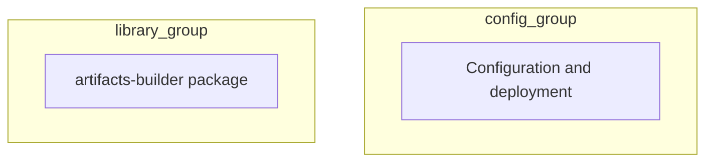

# Architecture report: ComposioHQ/awesome-claude-skills

> Automated static analysis. **Observed** = directly seen in files/imports/AST; **Inferred** = interpretation from that evidence. Repository code was not executed.

## 1. Repository at a glance

| Item | Value |
| --- | --- |
| Repository | ComposioHQ/awesome-claude-skills |
| Description | A curated list of awesome Claude Skills, resources, and tools for customizing Claude AI workflows |
| Language | Python |
| Stars | 79494 |
| Licence | Not detected |
| Analysed commit / branch | be2a406907dbc61b73e6827ded415c96139d13a2 / master |
| Framework(s) | None detected |
| Files analysed | 800 |
| Components | 2 |

## 2. Architecture in one minute

ComposioHQ/awesome-claude-skills - A curated list of awesome Claude Skills, resources, and tools for customizing Claude AI workflows. This repository was analysed statically from 800 file(s) (0 Python). Detected technologies (observed from imports/manifests): GitHub Actions. Files are grouped into 2 component(s): artifacts-builder package, Configuration and deployment. Findings below distinguish observed facts from inferred interpretation.

## 3. High-level block diagram

## 4. Main components

### artifacts-builder package (`artifacts_builder`)

- **Kind:** library
- **Status:** Observed
- **Confidence:** 0.85
- **Responsibility:** Groups 2 file(s) under artifacts-builder package (observed from repository paths and static analysis).
- **Paths:** `artifacts-builder/scripts/bundle-artifact.sh`, `artifacts-builder/scripts/init-artifact.sh`
- **Evidence:** [artifacts-builder/scripts/bundle-artifact.sh](https://github.com/ComposioHQ/awesome-claude-skills/blob/be2a406907dbc61b73e6827ded415c96139d13a2/artifacts-builder/scripts/bundle-artifact.sh); [artifacts-builder/scripts/init-artifact.sh](https://github.com/ComposioHQ/awesome-claude-skills/blob/be2a406907dbc61b73e6827ded415c96139d13a2/artifacts-builder/scripts/init-artifact.sh)

### Configuration and deployment (`config`)

- **Kind:** config
- **Status:** Observed
- **Confidence:** 0.85
- **Responsibility:** Groups 1 file(s) under configuration and deployment (observed from repository paths and static analysis).
- **Paths:** `composio-skills/.claude-plugin/marketplace.json`
- **Evidence:** [composio-skills/.claude-plugin/marketplace.json](https://github.com/ComposioHQ/awesome-claude-skills/blob/be2a406907dbc61b73e6827ded415c96139d13a2/composio-skills/.claude-plugin/marketplace.json)

## 5. Execution flow

No entry point was observed; the startup flow below is therefore limited.

Representative flow (derived from observed entry points and the import graph; steps beyond the entry point are **Inferred**):

1. Execution starts at an observed entry point listed above, if present.
2. No internal import relationships between components were observed.

## 6. Project structure

### `(root)`

- `CONTRIBUTING.md` - docs (4368 bytes)
- `README.md` - docs (40668 bytes)

### `.github`

- `.github/workflows/label-ready-skill.yml` - ci, YAML (6774 bytes)

### `artifacts-builder`

- `artifacts-builder/LICENSE.txt` - docs (11357 bytes)
- `artifacts-builder/SKILL.md` - docs (3079 bytes)
- `artifacts-builder/scripts/bundle-artifact.sh` - source, Shell (1517 bytes)
- `artifacts-builder/scripts/init-artifact.sh` - source, Shell (9924 bytes)

### `brand-guidelines`

- `brand-guidelines/LICENSE.txt` - docs (11357 bytes)
- `brand-guidelines/SKILL.md` - docs (2235 bytes)

### `canvas-design`

- `canvas-design/LICENSE.txt` - docs (11357 bytes)
- `canvas-design/SKILL.md` - docs (11939 bytes)
- `canvas-design/canvas-fonts/ArsenalSC-OFL.txt` - docs (4373 bytes)
- `canvas-design/canvas-fonts/BigShoulders-OFL.txt` - docs (4397 bytes)
- `canvas-design/canvas-fonts/Boldonse-OFL.txt` - docs (4390 bytes)
- `canvas-design/canvas-fonts/BricolageGrotesque-OFL.txt` - docs (4403 bytes)
- `canvas-design/canvas-fonts/CrimsonPro-OFL.txt` - docs (4394 bytes)
- `canvas-design/canvas-fonts/DMMono-OFL.txt` - docs (4392 bytes)
- `canvas-design/canvas-fonts/EricaOne-OFL.txt` - docs (4410 bytes)
- `canvas-design/canvas-fonts/GeistMono-OFL.txt` - docs (4388 bytes)
- `canvas-design/canvas-fonts/Gloock-OFL.txt` - docs (4381 bytes)
- `canvas-design/canvas-fonts/IBMPlexMono-OFL.txt` - docs (4363 bytes)
- `canvas-design/canvas-fonts/InstrumentSans-OFL.txt` - docs (4403 bytes)
- `canvas-design/canvas-fonts/Italiana-OFL.txt` - docs (4394 bytes)
- `canvas-design/canvas-fonts/JetBrainsMono-OFL.txt` - docs (4399 bytes)
- `canvas-design/canvas-fonts/Jura-OFL.txt` - docs (4380 bytes)
- `canvas-design/canvas-fonts/LibreBaskerville-OFL.txt` - docs (4449 bytes)
- `canvas-design/canvas-fonts/Lora-OFL.txt` - docs (4423 bytes)
- `canvas-design/canvas-fonts/NationalPark-OFL.txt` - docs (4399 bytes)
- `canvas-design/canvas-fonts/NothingYouCouldDo-OFL.txt` - docs (4363 bytes)
- `canvas-design/canvas-fonts/Outfit-OFL.txt` - docs (4389 bytes)
- `canvas-design/canvas-fonts/PixelifySans-OFL.txt` - docs (4395 bytes)
- `canvas-design/canvas-fonts/PoiretOne-OFL.txt` - docs (4366 bytes)
- `canvas-design/canvas-fonts/RedHatMono-OFL.txt` - docs (4394 bytes)
- `canvas-design/canvas-fonts/Silkscreen-OFL.txt` - docs (4394 bytes)
- `canvas-design/canvas-fonts/SmoochSans-OFL.txt` - docs (4396 bytes)
- `canvas-design/canvas-fonts/Tektur-OFL.txt` - docs (4385 bytes)
- `canvas-design/canvas-fonts/WorkSans-OFL.txt` - docs (4397 bytes)
- `canvas-design/canvas-fonts/YoungSerif-OFL.txt` - docs (4398 bytes)

### `changelog-generator`

- `changelog-generator/SKILL.md` - docs (3096 bytes)

### `competitive-ads-extractor`

- `competitive-ads-extractor/SKILL.md` - docs (7912 bytes)

### `composio-skills`

- `composio-skills/-21risk-automation/SKILL.md` - docs (2914 bytes)
- `composio-skills/-2chat-automation/SKILL.md` - docs (2899 bytes)
- `composio-skills/.claude-plugin/marketplace.json` - config (29773 bytes)
- `composio-skills/ably-automation/SKILL.md` - docs (2877 bytes)
- `composio-skills/abstract-automation/SKILL.md` - docs (2937 bytes)
- `composio-skills/abuselpdb-automation/SKILL.md` - docs (2952 bytes)
- `composio-skills/abyssale-automation/SKILL.md` - docs (2937 bytes)
- `composio-skills/accelo-automation/SKILL.md` - docs (2907 bytes)
- `composio-skills/accredible-certificates-automation/SKILL.md` - docs (3162 bytes)
- `composio-skills/acculynx-automation/SKILL.md` - docs (2937 bytes)
- `composio-skills/active-campaign-automation/SKILL.md` - docs (3034 bytes)
- `composio-skills/addresszen-automation/SKILL.md` - docs (2967 bytes)
- `composio-skills/adobe-automation/SKILL.md` - docs (2892 bytes)
- `composio-skills/adrapid-automation/SKILL.md` - docs (2922 bytes)
- `composio-skills/adyntel-automation/SKILL.md` - docs (2922 bytes)
- `composio-skills/aero-workflow-automation/SKILL.md` - docs (3012 bytes)
- `composio-skills/aeroleads-automation/SKILL.md` - docs (2952 bytes)
- `composio-skills/affinda-automation/SKILL.md` - docs (2922 bytes)
- `composio-skills/affinity-automation/SKILL.md` - docs (2937 bytes)
- `composio-skills/agencyzoom-automation/SKILL.md` - docs (2967 bytes)
- `composio-skills/agent-mail-automation/SKILL.md` - docs (2967 bytes)
- `composio-skills/agentql-automation/SKILL.md` - docs (2922 bytes)
- `composio-skills/agenty-automation/SKILL.md` - docs (2907 bytes)
- `composio-skills/agiled-automation/SKILL.md` - docs (2907 bytes)
- `composio-skills/agility-cms-automation/SKILL.md` - docs (2982 bytes)
- `composio-skills/ahrefs-automation/SKILL.md` - docs (7859 bytes)
- `composio-skills/ai-ml-api-automation/SKILL.md` - docs (2952 bytes)
- `composio-skills/aivoov-automation/SKILL.md` - docs (2907 bytes)
- `composio-skills/alchemy-automation/SKILL.md` - docs (2922 bytes)
- `composio-skills/algodocs-automation/SKILL.md` - docs (2937 bytes)
- `composio-skills/algolia-automation/SKILL.md` - docs (2922 bytes)
- `composio-skills/all-images-ai-automation/SKILL.md` - docs (3012 bytes)
- `composio-skills/alpha-vantage-automation/SKILL.md` - docs (3012 bytes)
- `composio-skills/altoviz-automation/SKILL.md` - docs (2922 bytes)
- `composio-skills/alttext-ai-automation/SKILL.md` - docs (2967 bytes)
- `composio-skills/amara-automation/SKILL.md` - docs (2892 bytes)
- `composio-skills/amazon-automation/SKILL.md` - docs (2907 bytes)
- `composio-skills/ambee-automation/SKILL.md` - docs (2892 bytes)
- `composio-skills/ambient-weather-automation/SKILL.md` - docs (3042 bytes)
- `composio-skills/amcards-automation/SKILL.md` - docs (2922 bytes)
- `composio-skills/anchor-browser-automation/SKILL.md` - docs (3027 bytes)
- `composio-skills/anonyflow-automation/SKILL.md` - docs (2952 bytes)
- `composio-skills/anthropic-administrator-automation/SKILL.md` - docs (3098 bytes)
- `composio-skills/anthropic_administrator-automation/SKILL.md` - docs (4300 bytes)
- `composio-skills/apaleo-automation/SKILL.md` - docs (2907 bytes)
- `composio-skills/apex27-automation/SKILL.md` - docs (2907 bytes)
- `composio-skills/api-bible-automation/SKILL.md` - docs (2952 bytes)
- `composio-skills/api-labz-automation/SKILL.md` - docs (2937 bytes)
- `composio-skills/api-ninjas-automation/SKILL.md` - docs (2967 bytes)
- `composio-skills/api-sports-automation/SKILL.md` - docs (2967 bytes)
- `composio-skills/api2pdf-automation/SKILL.md` - docs (2922 bytes)
- `composio-skills/apiflash-automation/SKILL.md` - docs (2937 bytes)
- `composio-skills/apify-automation/SKILL.md` - docs (6823 bytes)
- `composio-skills/apilio-automation/SKILL.md` - docs (2907 bytes)
- `composio-skills/apipie-ai-automation/SKILL.md` - docs (2952 bytes)
- `composio-skills/apitemplate-io-automation/SKILL.md` - docs (3027 bytes)
- `composio-skills/apiverve-automation/SKILL.md` - docs (2937 bytes)
- `composio-skills/apollo-automation/SKILL.md` - docs (7073 bytes)
- `composio-skills/appcircle-automation/SKILL.md` - docs (2952 bytes)
- `composio-skills/appdrag-automation/SKILL.md` - docs (2922 bytes)
- `composio-skills/appointo-automation/SKILL.md` - docs (2937 bytes)
- `composio-skills/appsflyer-automation/SKILL.md` - docs (2952 bytes)
- `composio-skills/appveyor-automation/SKILL.md` - docs (2937 bytes)
- `composio-skills/aryn-automation/SKILL.md` - docs (2877 bytes)
- `composio-skills/ascora-automation/SKILL.md` - docs (2907 bytes)
- `composio-skills/ashby-automation/SKILL.md` - docs (6746 bytes)
- `composio-skills/asin-data-api-automation/SKILL.md` - docs (3012 bytes)
- `composio-skills/astica-ai-automation/SKILL.md` - docs (2952 bytes)
- `composio-skills/async-interview-automation/SKILL.md` - docs (3042 bytes)
- `composio-skills/atlassian-automation/SKILL.md` - docs (2952 bytes)
- `composio-skills/attio-automation/SKILL.md` - docs (6273 bytes)
- `composio-skills/auth0-automation/SKILL.md` - docs (2892 bytes)
- `composio-skills/autobound-automation/SKILL.md` - docs (2952 bytes)
- `composio-skills/autom-automation/SKILL.md` - docs (2892 bytes)
- `composio-skills/axonaut-automation/SKILL.md` - docs (2922 bytes)
- `composio-skills/ayrshare-automation/SKILL.md` - docs (2937 bytes)
- `composio-skills/backendless-automation/SKILL.md` - docs (2982 bytes)
- `composio-skills/bannerbear-automation/SKILL.md` - docs (2967 bytes)
- `composio-skills/bart-automation/SKILL.md` - docs (2877 bytes)
- `composio-skills/baselinker-automation/SKILL.md` - docs (2967 bytes)
- `composio-skills/baserow-automation/SKILL.md` - docs (2922 bytes)
- `composio-skills/basin-automation/SKILL.md` - docs (2892 bytes)
- `composio-skills/battlenet-automation/SKILL.md` - docs (2952 bytes)
- `composio-skills/beaconchain-automation/SKILL.md` - docs (2982 bytes)
- `composio-skills/beaconstac-automation/SKILL.md` - docs (2967 bytes)
- `composio-skills/beamer-automation/SKILL.md` - docs (2907 bytes)
- `composio-skills/beeminder-automation/SKILL.md` - docs (2952 bytes)
- `composio-skills/bench-automation/SKILL.md` - docs (2892 bytes)
- `composio-skills/benchmark-email-automation/SKILL.md` - docs (3042 bytes)
- `composio-skills/benzinga-automation/SKILL.md` - docs (2937 bytes)
- `composio-skills/bestbuy-automation/SKILL.md` - docs (2922 bytes)
- `composio-skills/better-proposals-automation/SKILL.md` - docs (3057 bytes)
- `composio-skills/better-stack-automation/SKILL.md` - docs (2997 bytes)
- `composio-skills/bidsketch-automation/SKILL.md` - docs (2952 bytes)
- `composio-skills/big-data-cloud-automation/SKILL.md` - docs (3027 bytes)
- `composio-skills/bigmailer-automation/SKILL.md` - docs (2952 bytes)
- `composio-skills/bigml-automation/SKILL.md` - docs (2892 bytes)
- `composio-skills/bigpicture-io-automation/SKILL.md` - docs (3012 bytes)
- `composio-skills/bitquery-automation/SKILL.md` - docs (2937 bytes)
- `composio-skills/bitwarden-automation/SKILL.md` - docs (2952 bytes)
- `composio-skills/blackbaud-automation/SKILL.md` - docs (2952 bytes)
- `composio-skills/blackboard-automation/SKILL.md` - docs (2967 bytes)
- `composio-skills/blocknative-automation/SKILL.md` - docs (2982 bytes)
- `composio-skills/boldsign-automation/SKILL.md` - docs (2937 bytes)
- `composio-skills/bolna-automation/SKILL.md` - docs (2892 bytes)
- `composio-skills/boloforms-automation/SKILL.md` - docs (2952 bytes)
- `composio-skills/bolt-iot-automation/SKILL.md` - docs (2937 bytes)
- `composio-skills/bonsai-automation/SKILL.md` - docs (2907 bytes)
- `composio-skills/bookingmood-automation/SKILL.md` - docs (2982 bytes)
- `composio-skills/booqable-automation/SKILL.md` - docs (2937 bytes)
- `composio-skills/borneo-automation/SKILL.md` - docs (2907 bytes)
- `composio-skills/botbaba-automation/SKILL.md` - docs (2922 bytes)
- `composio-skills/botpress-automation/SKILL.md` - docs (2937 bytes)
- `composio-skills/botsonic-automation/SKILL.md` - docs (2937 bytes)
- `composio-skills/botstar-automation/SKILL.md` - docs (2922 bytes)
- `composio-skills/bouncer-automation/SKILL.md` - docs (2922 bytes)
- `composio-skills/boxhero-automation/SKILL.md` - docs (2922 bytes)
- `composio-skills/braintree-automation/SKILL.md` - docs (7214 bytes)
- `composio-skills/brandfetch-automation/SKILL.md` - docs (2967 bytes)
- `composio-skills/breeze-automation/SKILL.md` - docs (2907 bytes)
- `composio-skills/breezy-hr-automation/SKILL.md` - docs (2952 bytes)
- `composio-skills/brex-automation/SKILL.md` - docs (2877 bytes)
- `composio-skills/brex-staging-automation/SKILL.md` - docs (2997 bytes)
- `composio-skills/brightdata-automation/SKILL.md` - docs (2967 bytes)
- `composio-skills/brightpearl-automation/SKILL.md` - docs (2982 bytes)
- `composio-skills/brilliant-directories-automation/SKILL.md` - docs (3132 bytes)
- `composio-skills/browseai-automation/SKILL.md` - docs (2937 bytes)
- `composio-skills/browser-tool-automation/SKILL.md` - docs (2997 bytes)
- `composio-skills/browserbase-tool-automation/SKILL.md` - docs (3057 bytes)
- `composio-skills/browserhub-automation/SKILL.md` - docs (2967 bytes)
- `composio-skills/browserless-automation/SKILL.md` - docs (2982 bytes)
- `composio-skills/btcpay-server-automation/SKILL.md` - docs (3012 bytes)
- `composio-skills/bubble-automation/SKILL.md` - docs (2907 bytes)
- `composio-skills/bugbug-automation/SKILL.md` - docs (2907 bytes)
- `composio-skills/bugherd-automation/SKILL.md` - docs (2922 bytes)
- `composio-skills/bugsnag-automation/SKILL.md` - docs (2922 bytes)
- `composio-skills/buildkite-automation/SKILL.md` - docs (2952 bytes)
- `composio-skills/builtwith-automation/SKILL.md` - docs (2952 bytes)
- `composio-skills/bunnycdn-automation/SKILL.md` - docs (2937 bytes)
- `composio-skills/byteforms-automation/SKILL.md` - docs (2952 bytes)
- `composio-skills/cabinpanda-automation/SKILL.md` - docs (2967 bytes)
- `composio-skills/cal-automation/SKILL.md` - docs (2862 bytes)
- `composio-skills/calendarhero-automation/SKILL.md` - docs (2997 bytes)
- `composio-skills/callerapi-automation/SKILL.md` - docs (2952 bytes)
- `composio-skills/callingly-automation/SKILL.md` - docs (2952 bytes)
- `composio-skills/callpage-automation/SKILL.md` - docs (2937 bytes)
- `composio-skills/campaign-cleaner-automation/SKILL.md` - docs (3057 bytes)
- `composio-skills/campayn-automation/SKILL.md` - docs (2922 bytes)
- `composio-skills/canny-automation/SKILL.md` - docs (2892 bytes)
- `composio-skills/canvas-automation/SKILL.md` - docs (2907 bytes)
- `composio-skills/capsule-crm-automation/SKILL.md` - docs (7651 bytes)
- `composio-skills/capsule_crm-automation/SKILL.md` - docs (4168 bytes)
- `composio-skills/carbone-automation/SKILL.md` - docs (2922 bytes)
- `composio-skills/cardly-automation/SKILL.md` - docs (2907 bytes)
- `composio-skills/castingwords-automation/SKILL.md` - docs (2997 bytes)
- `composio-skills/cats-automation/SKILL.md` - docs (2877 bytes)
- `composio-skills/cdr-platform-automation/SKILL.md` - docs (2997 bytes)
- `composio-skills/census-bureau-automation/SKILL.md` - docs (3012 bytes)
- `composio-skills/centralstationcrm-automation/SKILL.md` - docs (3072 bytes)
- `composio-skills/certifier-automation/SKILL.md` - docs (2952 bytes)
- `composio-skills/chaser-automation/SKILL.md` - docs (2907 bytes)
- `composio-skills/chatbotkit-automation/SKILL.md` - docs (2967 bytes)
- `composio-skills/chatfai-automation/SKILL.md` - docs (2922 bytes)
- `composio-skills/chatwork-automation/SKILL.md` - docs (2937 bytes)
- `composio-skills/chmeetings-automation/SKILL.md` - docs (2967 bytes)
- `composio-skills/cincopa-automation/SKILL.md` - docs (2922 bytes)
- `composio-skills/claid-ai-automation/SKILL.md` - docs (2937 bytes)
- `composio-skills/classmarker-automation/SKILL.md` - docs (2982 bytes)
- `composio-skills/clearout-automation/SKILL.md` - docs (2937 bytes)
- `composio-skills/clickmeeting-automation/SKILL.md` - docs (2997 bytes)
- `composio-skills/clockify-automation/SKILL.md` - docs (5458 bytes)
- `composio-skills/cloudcart-automation/SKILL.md` - docs (2952 bytes)
- `composio-skills/cloudconvert-automation/SKILL.md` - docs (2997 bytes)
- `composio-skills/cloudflare-api-key-automation/SKILL.md` - docs (3055 bytes)
- `composio-skills/cloudflare-automation/SKILL.md` - docs (2967 bytes)
- `composio-skills/cloudflare-browser-rendering-automation/SKILL.md` - docs (3237 bytes)
- `composio-skills/cloudinary-automation/SKILL.md` - docs (8147 bytes)
- `composio-skills/cloudlayer-automation/SKILL.md` - docs (2967 bytes)
- `composio-skills/cloudpress-automation/SKILL.md` - docs (2967 bytes)
- `composio-skills/coassemble-automation/SKILL.md` - docs (2967 bytes)
- `composio-skills/codacy-automation/SKILL.md` - docs (2907 bytes)
- `composio-skills/codeinterpreter-automation/SKILL.md` - docs (3042 bytes)
- `composio-skills/codereadr-automation/SKILL.md` - docs (2952 bytes)
- `composio-skills/coinbase-automation/SKILL.md` - docs (3337 bytes)
- `composio-skills/coinmarketcal-automation/SKILL.md` - docs (3012 bytes)
- `composio-skills/coinmarketcap-automation/SKILL.md` - docs (3012 bytes)
- `composio-skills/coinranking-automation/SKILL.md` - docs (2982 bytes)
- `composio-skills/college-football-data-automation/SKILL.md` - docs (3132 bytes)
- `composio-skills/composio-automation/SKILL.md` - docs (2937 bytes)
- `composio-skills/composio-search-automation/SKILL.md` - docs (3042 bytes)
- `composio-skills/connecteam-automation/SKILL.md` - docs (2967 bytes)
- `composio-skills/contentful-automation/SKILL.md` - docs (3968 bytes)
- `composio-skills/contentful-graphql-automation/SKILL.md` - docs (3087 bytes)
- `composio-skills/control-d-automation/SKILL.md` - docs (2952 bytes)
- `composio-skills/conversion-tools-automation/SKILL.md` - docs (3057 bytes)
- `composio-skills/convertapi-automation/SKILL.md` - docs (2967 bytes)
- `composio-skills/conveyor-automation/SKILL.md` - docs (2937 bytes)
- `composio-skills/convolo-ai-automation/SKILL.md` - docs (2967 bytes)
- `composio-skills/corrently-automation/SKILL.md` - docs (2952 bytes)
- `composio-skills/countdown-api-automation/SKILL.md` - docs (3012 bytes)
- `composio-skills/coupa-automation/SKILL.md` - docs (2892 bytes)
- `composio-skills/craftmypdf-automation/SKILL.md` - docs (2967 bytes)
- `composio-skills/crowdin-automation/SKILL.md` - docs (2922 bytes)
- `composio-skills/crustdata-automation/SKILL.md` - docs (2952 bytes)
- `composio-skills/cults-automation/SKILL.md` - docs (2892 bytes)
- `composio-skills/curated-automation/SKILL.md` - docs (2922 bytes)
- `composio-skills/currents-api-automation/SKILL.md` - docs (2997 bytes)
- `composio-skills/customerio-automation/SKILL.md` - docs (6402 bytes)
- `composio-skills/customgpt-automation/SKILL.md` - docs (2952 bytes)
- `composio-skills/customjs-automation/SKILL.md` - docs (2937 bytes)
- `composio-skills/cutt-ly-automation/SKILL.md` - docs (2922 bytes)
- `composio-skills/d2lbrightspace-automation/SKILL.md` - docs (3027 bytes)
- `composio-skills/dadata-ru-automation/SKILL.md` - docs (2952 bytes)
- `composio-skills/daffy-automation/SKILL.md` - docs (2892 bytes)
- `composio-skills/dailybot-automation/SKILL.md` - docs (2937 bytes)
- `composio-skills/datagma-automation/SKILL.md` - docs (2922 bytes)
- `composio-skills/datarobot-automation/SKILL.md` - docs (2952 bytes)
- `composio-skills/deadline-funnel-automation/SKILL.md` - docs (3042 bytes)
- `composio-skills/deel-automation/SKILL.md` - docs (2877 bytes)
- `composio-skills/deepgram-automation/SKILL.md` - docs (2937 bytes)
- `composio-skills/demio-automation/SKILL.md` - docs (2892 bytes)
- `composio-skills/desktime-automation/SKILL.md` - docs (2937 bytes)
- `composio-skills/detrack-automation/SKILL.md` - docs (2922 bytes)
- `composio-skills/dialmycalls-automation/SKILL.md` - docs (2982 bytes)
- `composio-skills/dialpad-automation/SKILL.md` - docs (2922 bytes)
- `composio-skills/dictionary-api-automation/SKILL.md` - docs (3027 bytes)
- `composio-skills/diffbot-automation/SKILL.md` - docs (2922 bytes)
- `composio-skills/digicert-automation/SKILL.md` - docs (2937 bytes)
- `composio-skills/digital-ocean-automation/SKILL.md` - docs (3004 bytes)
- `composio-skills/discordbot-automation/SKILL.md` - docs (2967 bytes)
- `composio-skills/dnsfilter-automation/SKILL.md` - docs (2952 bytes)
- `composio-skills/dock-certs-automation/SKILL.md` - docs (2967 bytes)
- `composio-skills/docker-hub-automation/SKILL.md` - docs (4766 bytes)
- `composio-skills/docker_hub-automation/SKILL.md` - docs (4146 bytes)
- `composio-skills/docmosis-automation/SKILL.md` - docs (2937 bytes)
- `composio-skills/docnify-automation/SKILL.md` - docs (2922 bytes)
- `composio-skills/docsbot-ai-automation/SKILL.md` - docs (2967 bytes)
- `composio-skills/docsumo-automation/SKILL.md` - docs (2922 bytes)
- `composio-skills/docugenerate-automation/SKILL.md` - docs (2997 bytes)
- `composio-skills/documenso-automation/SKILL.md` - docs (2952 bytes)
- `composio-skills/documint-automation/SKILL.md` - docs (2937 bytes)
- `composio-skills/docupilot-automation/SKILL.md` - docs (2952 bytes)
- `composio-skills/docupost-automation/SKILL.md` - docs (2937 bytes)
- `composio-skills/docuseal-automation/SKILL.md` - docs (2937 bytes)
- `composio-skills/doppler-marketing-automation-automation/SKILL.md` - docs (3237 bytes)
- `composio-skills/doppler-secretops-automation/SKILL.md` - docs (3072 bytes)
- `composio-skills/dotsimple-automation/SKILL.md` - docs (2952 bytes)
- `composio-skills/dovetail-automation/SKILL.md` - docs (2937 bytes)
- `composio-skills/dpd2-automation/SKILL.md` - docs (2877 bytes)
- `composio-skills/draftable-automation/SKILL.md` - docs (2952 bytes)
- `composio-skills/dreamstudio-automation/SKILL.md` - docs (2982 bytes)
- `composio-skills/drip-jobs-automation/SKILL.md` - docs (2952 bytes)
- `composio-skills/dripcel-automation/SKILL.md` - docs (2922 bytes)
- `composio-skills/dromo-automation/SKILL.md` - docs (2892 bytes)
- `composio-skills/dropbox-sign-automation/SKILL.md` - docs (2997 bytes)
- `composio-skills/dropcontact-automation/SKILL.md` - docs (2982 bytes)
- `composio-skills/dungeon-fighter-online-automation/SKILL.md` - docs (3147 bytes)
- `composio-skills/dynamics365-automation/SKILL.md` - docs (8213 bytes)
- `composio-skills/echtpost-automation/SKILL.md` - docs (2937 bytes)
- `composio-skills/elevenlabs-automation/SKILL.md` - docs (5263 bytes)
- `composio-skills/elorus-automation/SKILL.md` - docs (2907 bytes)
- `composio-skills/emailable-automation/SKILL.md` - docs (2952 bytes)
- `composio-skills/emaillistverify-automation/SKILL.md` - docs (3042 bytes)
- `composio-skills/emailoctopus-automation/SKILL.md` - docs (2997 bytes)
- `composio-skills/emelia-automation/SKILL.md` - docs (2907 bytes)
- `composio-skills/encodian-automation/SKILL.md` - docs (2937 bytes)
- `composio-skills/endorsal-automation/SKILL.md` - docs (2937 bytes)
- `composio-skills/enginemailer-automation/SKILL.md` - docs (2997 bytes)
- `composio-skills/enigma-automation/SKILL.md` - docs (2907 bytes)
- `composio-skills/entelligence-automation/SKILL.md` - docs (2997 bytes)
- `composio-skills/eodhd-apis-automation/SKILL.md` - docs (2967 bytes)
- `composio-skills/epic-games-automation/SKILL.md` - docs (2967 bytes)
- `composio-skills/esignatures-io-automation/SKILL.md` - docs (3027 bytes)
- `composio-skills/espocrm-automation/SKILL.md` - docs (2922 bytes)
- `composio-skills/esputnik-automation/SKILL.md` - docs (2937 bytes)
- `composio-skills/etermin-automation/SKILL.md` - docs (2922 bytes)
- `composio-skills/evenium-automation/SKILL.md` - docs (2922 bytes)
- `composio-skills/eventbrite-automation/SKILL.md` - docs (5197 bytes)
- `composio-skills/eventee-automation/SKILL.md` - docs (2922 bytes)
- `composio-skills/eventzilla-automation/SKILL.md` - docs (2967 bytes)
- `composio-skills/everhour-automation/SKILL.md` - docs (2937 bytes)
- `composio-skills/eversign-automation/SKILL.md` - docs (2937 bytes)
- `composio-skills/exa-automation/SKILL.md` - docs (2862 bytes)
- `composio-skills/excel-automation/SKILL.md` - docs (7794 bytes)
- `composio-skills/exist-automation/SKILL.md` - docs (2892 bytes)
- `composio-skills/expofp-automation/SKILL.md` - docs (2907 bytes)
- `composio-skills/extracta-ai-automation/SKILL.md` - docs (2982 bytes)
- `composio-skills/facebook-automation/SKILL.md` - docs (7297 bytes)
- `composio-skills/faceup-automation/SKILL.md` - docs (2907 bytes)
- `composio-skills/factorial-automation/SKILL.md` - docs (2952 bytes)
- `composio-skills/feathery-automation/SKILL.md` - docs (2937 bytes)
- `composio-skills/felt-automation/SKILL.md` - docs (2877 bytes)
- `composio-skills/fibery-automation/SKILL.md` - docs (2907 bytes)
- `composio-skills/fidel-api-automation/SKILL.md` - docs (2952 bytes)
- `composio-skills/files-com-automation/SKILL.md` - docs (2952 bytes)
- `composio-skills/fillout-forms-automation/SKILL.md` - docs (2964 bytes)
- `composio-skills/fillout_forms-automation/SKILL.md` - docs (4106 bytes)
- `composio-skills/finage-automation/SKILL.md` - docs (2907 bytes)
- `composio-skills/findymail-automation/SKILL.md` - docs (2952 bytes)
- `composio-skills/finerworks-automation/SKILL.md` - docs (2967 bytes)
- `composio-skills/fingertip-automation/SKILL.md` - docs (2952 bytes)
- `composio-skills/finmei-automation/SKILL.md` - docs (2907 bytes)
- `composio-skills/fireberry-automation/SKILL.md` - docs (2952 bytes)
- `composio-skills/firecrawl-automation/SKILL.md` - docs (7901 bytes)
- `composio-skills/fireflies-automation/SKILL.md` - docs (2952 bytes)
- `composio-skills/firmao-automation/SKILL.md` - docs (2907 bytes)
- `composio-skills/fitbit-automation/SKILL.md` - docs (2907 bytes)
- `composio-skills/fixer-automation/SKILL.md` - docs (2892 bytes)
- `composio-skills/fixer-io-automation/SKILL.md` - docs (2937 bytes)
- `composio-skills/flexisign-automation/SKILL.md` - docs (2952 bytes)
- `composio-skills/flowiseai-automation/SKILL.md` - docs (2952 bytes)
- `composio-skills/flutterwave-automation/SKILL.md` - docs (2982 bytes)
- `composio-skills/fluxguard-automation/SKILL.md` - docs (2952 bytes)
- `composio-skills/folk-automation/SKILL.md` - docs (2877 bytes)
- `composio-skills/fomo-automation/SKILL.md` - docs (2877 bytes)
- `composio-skills/forcemanager-automation/SKILL.md` - docs (2997 bytes)
- `composio-skills/formbricks-automation/SKILL.md` - docs (2967 bytes)
- `composio-skills/formcarry-automation/SKILL.md` - docs (2952 bytes)
- `composio-skills/formdesk-automation/SKILL.md` - docs (2937 bytes)
- `composio-skills/formsite-automation/SKILL.md` - docs (2937 bytes)
- `composio-skills/foursquare-automation/SKILL.md` - docs (2967 bytes)
- `composio-skills/fraudlabs-pro-automation/SKILL.md` - docs (3012 bytes)
- `composio-skills/freshbooks-automation/SKILL.md` - docs (4647 bytes)
- `composio-skills/front-automation/SKILL.md` - docs (2892 bytes)
- `composio-skills/fullenrich-automation/SKILL.md` - docs (2967 bytes)
- `composio-skills/gagelist-automation/SKILL.md` - docs (2937 bytes)
- `composio-skills/gamma-automation/SKILL.md` - docs (2892 bytes)
- `composio-skills/gan-ai-automation/SKILL.md` - docs (2907 bytes)
- `composio-skills/gatherup-automation/SKILL.md` - docs (2937 bytes)
- `composio-skills/gemini-automation/SKILL.md` - docs (2907 bytes)
- `composio-skills/gender-api-automation/SKILL.md` - docs (2967 bytes)
- `composio-skills/genderapi-io-automation/SKILL.md` - docs (2997 bytes)
- `composio-skills/genderize-automation/SKILL.md` - docs (2952 bytes)
- `composio-skills/geoapify-automation/SKILL.md` - docs (2937 bytes)
- `composio-skills/geocodio-automation/SKILL.md` - docs (2937 bytes)
- `composio-skills/geokeo-automation/SKILL.md` - docs (2907 bytes)
- `composio-skills/getform-automation/SKILL.md` - docs (2922 bytes)
- `composio-skills/gift-up-automation/SKILL.md` - docs (2922 bytes)
- `composio-skills/gigasheet-automation/SKILL.md` - docs (2952 bytes)
- `composio-skills/giphy-automation/SKILL.md` - docs (2892 bytes)
- `composio-skills/gist-automation/SKILL.md` - docs (2877 bytes)
- `composio-skills/givebutter-automation/SKILL.md` - docs (2967 bytes)
- `composio-skills/gladia-automation/SKILL.md` - docs (2907 bytes)
- `composio-skills/gleap-automation/SKILL.md` - docs (2892 bytes)
- `composio-skills/globalping-automation/SKILL.md` - docs (2967 bytes)
- `composio-skills/go-to-webinar-automation/SKILL.md` - docs (2996 bytes)
- `composio-skills/godial-automation/SKILL.md` - docs (2907 bytes)
- `composio-skills/gong-automation/SKILL.md` - docs (7461 bytes)
- `composio-skills/goodbits-automation/SKILL.md` - docs (2937 bytes)
- `composio-skills/goody-automation/SKILL.md` - docs (2892 bytes)
- `composio-skills/google-address-validation-automation/SKILL.md` - docs (3192 bytes)
- `composio-skills/google-admin-automation/SKILL.md` - docs (6923 bytes)
- `composio-skills/google-classroom-automation/SKILL.md` - docs (3057 bytes)
- `composio-skills/google-cloud-vision-automation/SKILL.md` - docs (3102 bytes)
- `composio-skills/google-maps-automation/SKILL.md` - docs (7443 bytes)
- `composio-skills/google-search-console-automation/SKILL.md` - docs (7054 bytes)
- `composio-skills/google_admin-automation/SKILL.md` - docs (4186 bytes)
- `composio-skills/google_classroom-automation/SKILL.md` - docs (4276 bytes)
- `composio-skills/google_maps-automation/SKILL.md` - docs (4168 bytes)
- `composio-skills/google_search_console-automation/SKILL.md` - docs (4374 bytes)
- `composio-skills/googleads-automation/SKILL.md` - docs (6547 bytes)
- `composio-skills/googlebigquery-automation/SKILL.md` - docs (6430 bytes)
- `composio-skills/googlecalendar-automation/SKILL.md` - docs (3035 bytes)
- `composio-skills/googledocs-automation/SKILL.md` - docs (5742 bytes)
- `composio-skills/googledrive-automation/SKILL.md` - docs (2990 bytes)
- `composio-skills/googlemeet-automation/SKILL.md` - docs (5756 bytes)
- `composio-skills/googlephotos-automation/SKILL.md` - docs (5798 bytes)
- `composio-skills/googleslides-automation/SKILL.md` - docs (5780 bytes)
- `composio-skills/googlesuper-automation/SKILL.md` - docs (2990 bytes)
- `composio-skills/googletasks-automation/SKILL.md` - docs (6155 bytes)
- `composio-skills/gorgias-automation/SKILL.md` - docs (5686 bytes)
- `composio-skills/gosquared-automation/SKILL.md` - docs (2952 bytes)
- `composio-skills/grafbase-automation/SKILL.md` - docs (2937 bytes)
- `composio-skills/graphhopper-automation/SKILL.md` - docs (2982 bytes)
- `composio-skills/griptape-automation/SKILL.md` - docs (2937 bytes)
- `composio-skills/grist-automation/SKILL.md` - docs (2892 bytes)
- `composio-skills/groqcloud-automation/SKILL.md` - docs (4527 bytes)
- `composio-skills/gumroad-automation/SKILL.md` - docs (4352 bytes)
- `composio-skills/habitica-automation/SKILL.md` - docs (2937 bytes)
- `composio-skills/hackernews-automation/SKILL.md` - docs (2967 bytes)
- `composio-skills/happy-scribe-automation/SKILL.md` - docs (2997 bytes)
- `composio-skills/harvest-automation/SKILL.md` - docs (6329 bytes)
- `composio-skills/hashnode-automation/SKILL.md` - docs (2937 bytes)
- `composio-skills/helcim-automation/SKILL.md` - docs (2907 bytes)
- `composio-skills/helloleads-automation/SKILL.md` - docs (2967 bytes)
- `composio-skills/helpwise-automation/SKILL.md` - docs (2937 bytes)
- `composio-skills/here-automation/SKILL.md` - docs (2877 bytes)
- `composio-skills/heygen-automation/SKILL.md` - docs (4546 bytes)
- `composio-skills/heyreach-automation/SKILL.md` - docs (2937 bytes)
- `composio-skills/heyzine-automation/SKILL.md` - docs (2922 bytes)
- `composio-skills/highergov-automation/SKILL.md` - docs (2952 bytes)
- `composio-skills/highlevel-automation/SKILL.md` - docs (2952 bytes)
- `composio-skills/honeybadger-automation/SKILL.md` - docs (2982 bytes)
- `composio-skills/honeyhive-automation/SKILL.md` - docs (2952 bytes)
- `composio-skills/hookdeck-automation/SKILL.md` - docs (2937 bytes)
- `composio-skills/hotspotsystem-automation/SKILL.md` - docs (3012 bytes)
- `composio-skills/html-to-image-automation/SKILL.md` - docs (3012 bytes)
- `composio-skills/humanitix-automation/SKILL.md` - docs (2952 bytes)
- `composio-skills/humanloop-automation/SKILL.md` - docs (2952 bytes)
- `composio-skills/hunter-automation/SKILL.md` - docs (6044 bytes)
- `composio-skills/hypeauditor-automation/SKILL.md` - docs (2982 bytes)
- `composio-skills/hyperbrowser-automation/SKILL.md` - docs (2997 bytes)
- `composio-skills/hyperise-automation/SKILL.md` - docs (2937 bytes)
- `composio-skills/hystruct-automation/SKILL.md` - docs (2937 bytes)
- `composio-skills/icims-talent-cloud-automation/SKILL.md` - docs (3087 bytes)
- `composio-skills/icypeas-automation/SKILL.md` - docs (2922 bytes)
- `composio-skills/idea-scale-automation/SKILL.md` - docs (2967 bytes)
- `composio-skills/identitycheck-automation/SKILL.md` - docs (3012 bytes)
- `composio-skills/ignisign-automation/SKILL.md` - docs (2937 bytes)
- `composio-skills/imagekit-io-automation/SKILL.md` - docs (2982 bytes)
- `composio-skills/imgbb-automation/SKILL.md` - docs (2892 bytes)
- `composio-skills/imgix-automation/SKILL.md` - docs (2892 bytes)
- `composio-skills/influxdb-cloud-automation/SKILL.md` - docs (3027 bytes)
- `composio-skills/insighto-ai-automation/SKILL.md` - docs (2982 bytes)
- `composio-skills/instacart-automation/SKILL.md` - docs (2952 bytes)
- `composio-skills/instantly-automation/SKILL.md` - docs (7280 bytes)
- `composio-skills/intelliprint-automation/SKILL.md` - docs (2997 bytes)
- `composio-skills/interzoid-automation/SKILL.md` - docs (2952 bytes)
- `composio-skills/ip2location-automation/SKILL.md` - docs (2982 bytes)
- `composio-skills/ip2location-io-automation/SKILL.md` - docs (3027 bytes)
- `composio-skills/ip2proxy-automation/SKILL.md` - docs (2937 bytes)
- `composio-skills/ip2whois-automation/SKILL.md` - docs (2937 bytes)
- `composio-skills/ipdata-co-automation/SKILL.md` - docs (2952 bytes)
- `composio-skills/ipinfo-io-automation/SKILL.md` - docs (2952 bytes)
- `composio-skills/iqair-airvisual-automation/SKILL.md` - docs (3042 bytes)
- `composio-skills/jigsawstack-automation/SKILL.md` - docs (2982 bytes)
- `composio-skills/jobnimbus-automation/SKILL.md` - docs (2952 bytes)
- `composio-skills/jotform-automation/SKILL.md` - docs (5153 bytes)
- `composio-skills/jumpcloud-automation/SKILL.md` - docs (2952 bytes)
- `composio-skills/junglescout-automation/SKILL.md` - docs (2982 bytes)
- `composio-skills/kadoa-automation/SKILL.md` - docs (2892 bytes)
- `composio-skills/kaggle-automation/SKILL.md` - docs (2907 bytes)
- `composio-skills/kaleido-automation/SKILL.md` - docs (2922 bytes)
- `composio-skills/keap-automation/SKILL.md` - docs (2877 bytes)
- `composio-skills/keen-io-automation/SKILL.md` - docs (2922 bytes)
- `composio-skills/kickbox-automation/SKILL.md` - docs (2922 bytes)
- `composio-skills/kit-automation/SKILL.md` - docs (2862 bytes)
- `composio-skills/klipfolio-automation/SKILL.md` - docs (2952 bytes)
- `composio-skills/ko-fi-automation/SKILL.md` - docs (2892 bytes)
- `composio-skills/kommo-automation/SKILL.md` - docs (6019 bytes)
- `composio-skills/kontent-ai-automation/SKILL.md` - docs (2967 bytes)
- `composio-skills/kraken-io-automation/SKILL.md` - docs (2952 bytes)
- `composio-skills/l2s-automation/SKILL.md` - docs (2862 bytes)
- `composio-skills/labs64-netlicensing-automation/SKILL.md` - docs (3102 bytes)
- `composio-skills/landbot-automation/SKILL.md` - docs (2922 bytes)
- `composio-skills/langbase-automation/SKILL.md` - docs (2937 bytes)
- `composio-skills/lastpass-automation/SKILL.md` - docs (2937 bytes)
- `composio-skills/launch-darkly-automation/SKILL.md` - docs (4875 bytes)
- `composio-skills/launch_darkly-automation/SKILL.md` - docs (4194 bytes)
- `composio-skills/leadfeeder-automation/SKILL.md` - docs (2967 bytes)
- `composio-skills/leadoku-automation/SKILL.md` - docs (2922 bytes)
- `composio-skills/leiga-automation/SKILL.md` - docs (2892 bytes)
- `composio-skills/lemlist-automation/SKILL.md` - docs (5153 bytes)
- `composio-skills/lemon-squeezy-automation/SKILL.md` - docs (5801 bytes)
- `composio-skills/lemon_squeezy-automation/SKILL.md` - docs (4206 bytes)
- `composio-skills/lessonspace-automation/SKILL.md` - docs (2982 bytes)
- `composio-skills/lever-automation/SKILL.md` - docs (5860 bytes)
- `composio-skills/lever-sandbox-automation/SKILL.md` - docs (3012 bytes)
- `composio-skills/leverly-automation/SKILL.md` - docs (2922 bytes)
- `composio-skills/lexoffice-automation/SKILL.md` - docs (2952 bytes)
- `composio-skills/linguapop-automation/SKILL.md` - docs (2952 bytes)
- `composio-skills/linkhut-automation/SKILL.md` - docs (2922 bytes)
- `composio-skills/linkup-automation/SKILL.md` - docs (2907 bytes)
- `composio-skills/listclean-automation/SKILL.md` - docs (2952 bytes)
- `composio-skills/listennotes-automation/SKILL.md` - docs (2982 bytes)
- `composio-skills/livesession-automation/SKILL.md` - docs (2982 bytes)
- `composio-skills/lmnt-automation/SKILL.md` - docs (2877 bytes)
- `composio-skills/lodgify-automation/SKILL.md` - docs (2922 bytes)
- `composio-skills/logo-dev-automation/SKILL.md` - docs (2937 bytes)
- `composio-skills/loomio-automation/SKILL.md` - docs (2907 bytes)
- `composio-skills/loyverse-automation/SKILL.md` - docs (2937 bytes)
- `composio-skills/magnetic-automation/SKILL.md` - docs (2937 bytes)
- `composio-skills/mailbluster-automation/SKILL.md` - docs (2982 bytes)
- `composio-skills/mailboxlayer-automation/SKILL.md` - docs (2997 bytes)
- `composio-skills/mailcheck-automation/SKILL.md` - docs (2952 bytes)
- `composio-skills/mailcoach-automation/SKILL.md` - docs (2952 bytes)
- `composio-skills/mailerlite-automation/SKILL.md` - docs (5292 bytes)
- `composio-skills/mailersend-automation/SKILL.md` - docs (2967 bytes)
- `composio-skills/mails-so-automation/SKILL.md` - docs (2937 bytes)
- `composio-skills/mailsoftly-automation/SKILL.md` - docs (2967 bytes)
- `composio-skills/maintainx-automation/SKILL.md` - docs (2952 bytes)
- `composio-skills/many-chat-automation/SKILL.md` - docs (2944 bytes)
- `composio-skills/many_chat-automation/SKILL.md` - docs (4120 bytes)
- `composio-skills/mapbox-automation/SKILL.md` - docs (2907 bytes)
- `composio-skills/mapulus-automation/SKILL.md` - docs (2922 bytes)
- `composio-skills/mboum-automation/SKILL.md` - docs (2892 bytes)
- `composio-skills/melo-automation/SKILL.md` - docs (2877 bytes)
- `composio-skills/mem-automation/SKILL.md` - docs (2862 bytes)
- `composio-skills/mem0-automation/SKILL.md` - docs (2877 bytes)
- `composio-skills/memberspot-automation/SKILL.md` - docs (2967 bytes)
- `composio-skills/memberstack-automation/SKILL.md` - docs (2982 bytes)
- `composio-skills/membervault-automation/SKILL.md` - docs (2982 bytes)
- `composio-skills/metaads-automation/SKILL.md` - docs (2922 bytes)
- `composio-skills/metaphor-automation/SKILL.md` - docs (2937 bytes)
- `composio-skills/mezmo-automation/SKILL.md` - docs (2892 bytes)
- `composio-skills/microsoft-clarity-automation/SKILL.md` - docs (5467 bytes)
- `composio-skills/microsoft-tenant-automation/SKILL.md` - docs (3057 bytes)
- `composio-skills/microsoft_clarity-automation/SKILL.md` - docs (4278 bytes)
- `composio-skills/minerstat-automation/SKILL.md` - docs (2952 bytes)
- `composio-skills/missive-automation/SKILL.md` - docs (2922 bytes)
- `composio-skills/mistral-ai-automation/SKILL.md` - docs (5046 bytes)
- `composio-skills/mistral_ai-automation/SKILL.md` - docs (4140 bytes)
- `composio-skills/mocean-automation/SKILL.md` - docs (2907 bytes)
- `composio-skills/moco-automation/SKILL.md` - docs (2877 bytes)
- `composio-skills/modelry-automation/SKILL.md` - docs (2922 bytes)
- `composio-skills/moneybird-automation/SKILL.md` - docs (2952 bytes)
- `composio-skills/moonclerk-automation/SKILL.md` - docs (2952 bytes)
- `composio-skills/moosend-automation/SKILL.md` - docs (2922 bytes)
- `composio-skills/mopinion-automation/SKILL.md` - docs (2937 bytes)
- `composio-skills/more-trees-automation/SKILL.md` - docs (2967 bytes)
- `composio-skills/moxie-automation/SKILL.md` - docs (2892 bytes)
- `composio-skills/moz-automation/SKILL.md` - docs (2862 bytes)
- `composio-skills/msg91-automation/SKILL.md` - docs (2892 bytes)
- `composio-skills/mural-automation/SKILL.md` - docs (2892 bytes)
- `composio-skills/mx-technologies-automation/SKILL.md` - docs (3042 bytes)
- `composio-skills/mx-toolbox-automation/SKILL.md` - docs (2967 bytes)
- `composio-skills/nango-automation/SKILL.md` - docs (2892 bytes)
- `composio-skills/nano-nets-automation/SKILL.md` - docs (2952 bytes)
- `composio-skills/nasa-automation/SKILL.md` - docs (2877 bytes)
- `composio-skills/nasdaq-automation/SKILL.md` - docs (2907 bytes)
- `composio-skills/ncscale-automation/SKILL.md` - docs (2922 bytes)
- `composio-skills/needle-automation/SKILL.md` - docs (2907 bytes)
- `composio-skills/neon-automation/SKILL.md` - docs (4978 bytes)
- `composio-skills/netsuite-automation/SKILL.md` - docs (8474 bytes)
- `composio-skills/neuronwriter-automation/SKILL.md` - docs (2997 bytes)
- `composio-skills/neutrino-automation/SKILL.md` - docs (2937 bytes)
- `composio-skills/neverbounce-automation/SKILL.md` - docs (2982 bytes)
- `composio-skills/new-relic-automation/SKILL.md` - docs (5461 bytes)
- `composio-skills/new_relic-automation/SKILL.md` - docs (4140 bytes)
- `composio-skills/news-api-automation/SKILL.md` - docs (2937 bytes)
- `composio-skills/nextdns-automation/SKILL.md` - docs (2922 bytes)
- `composio-skills/ngrok-automation/SKILL.md` - docs (2892 bytes)
- `composio-skills/ninox-automation/SKILL.md` - docs (2892 bytes)
- `composio-skills/nocrm-io-automation/SKILL.md` - docs (2937 bytes)
- `composio-skills/npm-automation/SKILL.md` - docs (2862 bytes)
- `composio-skills/ocr-web-service-automation/SKILL.md` - docs (3042 bytes)
- `composio-skills/ocrspace-automation/SKILL.md` - docs (2937 bytes)
- `composio-skills/omnisend-automation/SKILL.md` - docs (5176 bytes)
- `composio-skills/oncehub-automation/SKILL.md` - docs (2922 bytes)
- `composio-skills/onedesk-automation/SKILL.md` - docs (2922 bytes)
- `composio-skills/onepage-automation/SKILL.md` - docs (2922 bytes)
- `composio-skills/onesignal-rest-api-automation/SKILL.md` - docs (3015 bytes)
- `composio-skills/onesignal-user-auth-automation/SKILL.md` - docs (3102 bytes)
- `composio-skills/onesignal_rest_api-automation/SKILL.md` - docs (4184 bytes)
- `composio-skills/open-sea-automation/SKILL.md` - docs (2937 bytes)
- `composio-skills/openai-automation/SKILL.md` - docs (5036 bytes)
- `composio-skills/opencage-automation/SKILL.md` - docs (2937 bytes)
- `composio-skills/opengraph-io-automation/SKILL.md` - docs (2997 bytes)
- `composio-skills/openperplex-automation/SKILL.md` - docs (2982 bytes)
- `composio-skills/openrouter-automation/SKILL.md` - docs (2967 bytes)
- `composio-skills/openweather-api-automation/SKILL.md` - docs (3042 bytes)
- `composio-skills/optimoroute-automation/SKILL.md` - docs (2982 bytes)
- `composio-skills/owl-protocol-automation/SKILL.md` - docs (2997 bytes)
- `composio-skills/page-x-automation/SKILL.md` - docs (2907 bytes)
- `composio-skills/pandadoc-automation/SKILL.md` - docs (7078 bytes)
- `composio-skills/paradym-automation/SKILL.md` - docs (2922 bytes)
- `composio-skills/parallel-automation/SKILL.md` - docs (2937 bytes)
- `composio-skills/parma-automation/SKILL.md` - docs (2892 bytes)
- `composio-skills/parsehub-automation/SKILL.md` - docs (2937 bytes)
- `composio-skills/parsera-automation/SKILL.md` - docs (2922 bytes)
- `composio-skills/parseur-automation/SKILL.md` - docs (2922 bytes)
- `composio-skills/passcreator-automation/SKILL.md` - docs (2982 bytes)
- `composio-skills/passslot-automation/SKILL.md` - docs (2937 bytes)
- `composio-skills/payhip-automation/SKILL.md` - docs (2907 bytes)
- `composio-skills/pdf-api-io-automation/SKILL.md` - docs (2967 bytes)
- `composio-skills/pdf-co-automation/SKILL.md` - docs (2907 bytes)
- `composio-skills/pdf4me-automation/SKILL.md` - docs (2907 bytes)
- `composio-skills/pdfless-automation/SKILL.md` - docs (2922 bytes)
- `composio-skills/pdfmonkey-automation/SKILL.md` - docs (2952 bytes)
- `composio-skills/peopledatalabs-automation/SKILL.md` - docs (3027 bytes)
- `composio-skills/perigon-automation/SKILL.md` - docs (2922 bytes)
- `composio-skills/perplexityai-automation/SKILL.md` - docs (2997 bytes)
- `composio-skills/persistiq-automation/SKILL.md` - docs (2952 bytes)
- `composio-skills/pexels-automation/SKILL.md` - docs (2907 bytes)
- `composio-skills/phantombuster-automation/SKILL.md` - docs (4742 bytes)
- `composio-skills/piggy-automation/SKILL.md` - docs (2892 bytes)
- `composio-skills/piloterr-automation/SKILL.md` - docs (2937 bytes)
- `composio-skills/pilvio-automation/SKILL.md` - docs (2907 bytes)
- `composio-skills/pingdom-automation/SKILL.md` - docs (2922 bytes)
- `composio-skills/pipeline-crm-automation/SKILL.md` - docs (2997 bytes)
- `composio-skills/placekey-automation/SKILL.md` - docs (2937 bytes)
- `composio-skills/placid-automation/SKILL.md` - docs (2907 bytes)
- `composio-skills/plain-automation/SKILL.md` - docs (2892 bytes)
- `composio-skills/plasmic-automation/SKILL.md` - docs (2922 bytes)
- `composio-skills/platerecognizer-automation/SKILL.md` - docs (3042 bytes)
- `composio-skills/plisio-automation/SKILL.md` - docs (2907 bytes)
- `composio-skills/polygon-automation/SKILL.md` - docs (2922 bytes)
- `composio-skills/polygon-io-automation/SKILL.md` - docs (2967 bytes)
- `composio-skills/poptin-automation/SKILL.md` - docs (2907 bytes)
- `composio-skills/postgrid-automation/SKILL.md` - docs (2937 bytes)
- `composio-skills/postgrid-verify-automation/SKILL.md` - docs (3042 bytes)
- `composio-skills/precoro-automation/SKILL.md` - docs (2922 bytes)
- `composio-skills/prerender-automation/SKILL.md` - docs (2952 bytes)
- `composio-skills/printautopilot-automation/SKILL.md` - docs (3027 bytes)
- `composio-skills/prisma-automation/SKILL.md` - docs (2907 bytes)
- `composio-skills/prismic-automation/SKILL.md` - docs (6221 bytes)
- `composio-skills/process-street-automation/SKILL.md` - docs (3027 bytes)
- `composio-skills/procfu-automation/SKILL.md` - docs (2907 bytes)
- `composio-skills/productboard-automation/SKILL.md` - docs (6498 bytes)
- `composio-skills/productlane-automation/SKILL.md` - docs (2982 bytes)
- `composio-skills/project-bubble-automation/SKILL.md` - docs (3027 bytes)
- `composio-skills/proofly-automation/SKILL.md` - docs (2922 bytes)
- `composio-skills/proxiedmail-automation/SKILL.md` - docs (2982 bytes)
- `composio-skills/pushbullet-automation/SKILL.md` - docs (2967 bytes)
- `composio-skills/pushover-automation/SKILL.md` - docs (2937 bytes)
- `composio-skills/quaderno-automation/SKILL.md` - docs (2937 bytes)
- `composio-skills/qualaroo-automation/SKILL.md` - docs (2937 bytes)
- `composio-skills/quickbooks-automation/SKILL.md` - docs (5592 bytes)
- `composio-skills/radar-automation/SKILL.md` - docs (2892 bytes)
- `composio-skills/rafflys-automation/SKILL.md` - docs (2922 bytes)
- `composio-skills/ragic-automation/SKILL.md` - docs (2892 bytes)
- `composio-skills/raisely-automation/SKILL.md` - docs (2922 bytes)
- `composio-skills/ramp-automation/SKILL.md` - docs (6950 bytes)
- `composio-skills/ravenseotools-automation/SKILL.md` - docs (3012 bytes)
- `composio-skills/re-amaze-automation/SKILL.md` - docs (2937 bytes)
- `composio-skills/realphonevalidation-automation/SKILL.md` - docs (3102 bytes)
- `composio-skills/recallai-automation/SKILL.md` - docs (2937 bytes)
- `composio-skills/recruitee-automation/SKILL.md` - docs (2952 bytes)
- `composio-skills/refiner-automation/SKILL.md` - docs (2922 bytes)
- `composio-skills/remarkety-automation/SKILL.md` - docs (2952 bytes)
- `composio-skills/remote-retrieval-automation/SKILL.md` - docs (3057 bytes)
- `composio-skills/remove-bg-automation/SKILL.md` - docs (2952 bytes)
- `composio-skills/renderform-automation/SKILL.md` - docs (2967 bytes)
- `composio-skills/repairshopr-automation/SKILL.md` - docs (2982 bytes)
- `composio-skills/replicate-automation/SKILL.md` - docs (5353 bytes)
- `composio-skills/reply-automation/SKILL.md` - docs (2892 bytes)
- `composio-skills/reply-io-automation/SKILL.md` - docs (2937 bytes)
- `composio-skills/resend-automation/SKILL.md` - docs (2907 bytes)
- `composio-skills/respond-io-automation/SKILL.md` - docs (2967 bytes)
- `composio-skills/retailed-automation/SKILL.md` - docs (2937 bytes)
- `composio-skills/retellai-automation/SKILL.md` - docs (2937 bytes)
- `composio-skills/retently-automation/SKILL.md` - docs (2937 bytes)
- `composio-skills/rev-ai-automation/SKILL.md` - docs (2907 bytes)
- `composio-skills/revolt-automation/SKILL.md` - docs (2907 bytes)
- `composio-skills/ring-central-automation/SKILL.md` - docs (2229 bytes)
- `composio-skills/ring_central-automation/SKILL.md` - docs (4158 bytes)
- `composio-skills/rippling-automation/SKILL.md` - docs (2937 bytes)
- `composio-skills/ritekit-automation/SKILL.md` - docs (2922 bytes)
- `composio-skills/rkvst-automation/SKILL.md` - docs (2892 bytes)
- `composio-skills/rocketlane-automation/SKILL.md` - docs (2967 bytes)
- `composio-skills/rootly-automation/SKILL.md` - docs (2907 bytes)
- `composio-skills/rosette-text-analytics-automation/SKILL.md` - docs (3147 bytes)
- `composio-skills/route4me-automation/SKILL.md` - docs (2937 bytes)
- `composio-skills/safetyculture-automation/SKILL.md` - docs (3012 bytes)
- `composio-skills/sage-automation/SKILL.md` - docs (2877 bytes)
- `composio-skills/salesforce-marketing-cloud-automation/SKILL.md` - docs (3207 bytes)
- `composio-skills/salesforce-service-cloud-automation/SKILL.md` - docs (3177 bytes)
- `composio-skills/salesmate-automation/SKILL.md` - docs (2952 bytes)
- `composio-skills/sap-successfactors-automation/SKILL.md` - docs (3087 bytes)
- `composio-skills/satismeter-automation/SKILL.md` - docs (2967 bytes)
- `composio-skills/scrape-do-automation/SKILL.md` - docs (2952 bytes)
- `composio-skills/scrapegraph-ai-automation/SKILL.md` - docs (3027 bytes)
- `composio-skills/scrapfly-automation/SKILL.md` - docs (2937 bytes)
- `composio-skills/scrapingant-automation/SKILL.md` - docs (2982 bytes)
- `composio-skills/scrapingbee-automation/SKILL.md` - docs (2982 bytes)
- `composio-skills/screenshot-fyi-automation/SKILL.md` - docs (3027 bytes)
- `composio-skills/screenshotone-automation/SKILL.md` - docs (3012 bytes)
- `composio-skills/seat-geek-automation/SKILL.md` - docs (2952 bytes)
- `composio-skills/securitytrails-automation/SKILL.md` - docs (3027 bytes)
- `composio-skills/segmetrics-automation/SKILL.md` - docs (2967 bytes)
- `composio-skills/seismic-automation/SKILL.md` - docs (2922 bytes)
- `composio-skills/semanticscholar-automation/SKILL.md` - docs (3042 bytes)
- `composio-skills/semrush-automation/SKILL.md` - docs (7124 bytes)
- `composio-skills/sendbird-ai-chabot-automation/SKILL.md` - docs (3087 bytes)
- `composio-skills/sendbird-automation/SKILL.md` - docs (2937 bytes)
- `composio-skills/sendfox-automation/SKILL.md` - docs (2922 bytes)
- `composio-skills/sendlane-automation/SKILL.md` - docs (2937 bytes)
- `composio-skills/sendloop-automation/SKILL.md` - docs (2937 bytes)
- `composio-skills/sendspark-automation/SKILL.md` - docs (2952 bytes)
- `composio-skills/sensibo-automation/SKILL.md` - docs (2922 bytes)
- `composio-skills/seqera-automation/SKILL.md` - docs (2907 bytes)
- `composio-skills/serpapi-automation/SKILL.md` - docs (2922 bytes)
- `composio-skills/serpdog-automation/SKILL.md` - docs (2922 bytes)
- `composio-skills/serply-automation/SKILL.md` - docs (2907 bytes)
- `composio-skills/servicem8-automation/SKILL.md` - docs (2952 bytes)
- `composio-skills/sevdesk-automation/SKILL.md` - docs (2922 bytes)
- `composio-skills/share-point-automation/SKILL.md` - docs (7362 bytes)
- `composio-skills/share_point-automation/SKILL.md` - docs (4144 bytes)
- `composio-skills/shipengine-automation/SKILL.md` - docs (2967 bytes)
- `composio-skills/short-io-automation/SKILL.md` - docs (2937 bytes)
- `composio-skills/short-menu-automation/SKILL.md` - docs (2967 bytes)
- `composio-skills/shortcut-automation/SKILL.md` - docs (6370 bytes)
- `composio-skills/shorten-rest-automation/SKILL.md` - docs (2997 bytes)
- `composio-skills/shortpixel-automation/SKILL.md` - docs (2967 bytes)
- `composio-skills/shotstack-automation/SKILL.md` - docs (2952 bytes)
- `composio-skills/sidetracker-automation/SKILL.md` - docs (2982 bytes)
- `composio-skills/signaturely-automation/SKILL.md` - docs (2982 bytes)
- `composio-skills/signpath-automation/SKILL.md` - docs (2937 bytes)
- `composio-skills/signwell-automation/SKILL.md` - docs (2937 bytes)
- `composio-skills/similarweb-digitalrank-api-automation/SKILL.md` - docs (3079 bytes)
- `composio-skills/similarweb_digitalrank_api-automation/SKILL.md` - docs (4268 bytes)
- `composio-skills/simla-com-automation/SKILL.md` - docs (2952 bytes)
- `composio-skills/simple-analytics-automation/SKILL.md` - docs (3057 bytes)
- `composio-skills/simplesat-automation/SKILL.md` - docs (2952 bytes)
- `composio-skills/sitespeakai-automation/SKILL.md` - docs (2982 bytes)
- `composio-skills/skyfire-automation/SKILL.md` - docs (2922 bytes)
- `composio-skills/slackbot-automation/SKILL.md` - docs (2937 bytes)
- `composio-skills/smartproxy-automation/SKILL.md` - docs (2967 bytes)
- `composio-skills/smartrecruiters-automation/SKILL.md` - docs (3042 bytes)
- `composio-skills/sms-alert-automation/SKILL.md` - docs (2952 bytes)
- `composio-skills/smtp2go-automation/SKILL.md` - docs (2922 bytes)
- `composio-skills/smugmug-automation/SKILL.md` - docs (2922 bytes)
- `composio-skills/snowflake-automation/SKILL.md` - docs (4735 bytes)
- `composio-skills/sourcegraph-automation/SKILL.md` - docs (2982 bytes)
- `composio-skills/splitwise-automation/SKILL.md` - docs (2952 bytes)
- `composio-skills/spoki-automation/SKILL.md` - docs (2892 bytes)
- `composio-skills/spondyr-automation/SKILL.md` - docs (2922 bytes)
- `composio-skills/spotify-automation/SKILL.md` - docs (7387 bytes)
- `composio-skills/spotlightr-automation/SKILL.md` - docs (2967 bytes)
- `composio-skills/sslmate-cert-spotter-api-automation/SKILL.md` - docs (3177 bytes)
- `composio-skills/stack-exchange-automation/SKILL.md` - docs (3027 bytes)
- `composio-skills/stannp-automation/SKILL.md` - docs (2907 bytes)
- `composio-skills/starton-automation/SKILL.md` - docs (2922 bytes)
- `composio-skills/statuscake-automation/SKILL.md` - docs (2967 bytes)
- `composio-skills/storeganise-automation/SKILL.md` - docs (2982 bytes)
- `composio-skills/storerocket-automation/SKILL.md` - docs (2982 bytes)
- `composio-skills/stormglass-io-automation/SKILL.md` - docs (3012 bytes)
- `composio-skills/strava-automation/SKILL.md` - docs (2907 bytes)
- `composio-skills/streamtime-automation/SKILL.md` - docs (2967 bytes)
- `composio-skills/supadata-automation/SKILL.md` - docs (2937 bytes)
- `composio-skills/superchat-automation/SKILL.md` - docs (2952 bytes)
- `composio-skills/supportbee-automation/SKILL.md` - docs (2967 bytes)
- `composio-skills/supportivekoala-automation/SKILL.md` - docs (3042 bytes)
- `composio-skills/survey-monkey-automation/SKILL.md` - docs (6938 bytes)
- `composio-skills/survey_monkey-automation/SKILL.md` - docs (4176 bytes)
- `composio-skills/svix-automation/SKILL.md` - docs (2877 bytes)
- `composio-skills/sympla-automation/SKILL.md` - docs (2907 bytes)
- `composio-skills/synthflow-ai-automation/SKILL.md` - docs (2997 bytes)
- `composio-skills/taggun-automation/SKILL.md` - docs (2907 bytes)
- `composio-skills/talenthr-automation/SKILL.md` - docs (2937 bytes)
- `composio-skills/tally-automation/SKILL.md` - docs (2892 bytes)
- `composio-skills/tapfiliate-automation/SKILL.md` - docs (2967 bytes)
- `composio-skills/tapform-automation/SKILL.md` - docs (2922 bytes)
- `composio-skills/tavily-automation/SKILL.md` - docs (2907 bytes)
- `composio-skills/taxjar-automation/SKILL.md` - docs (2907 bytes)
- `composio-skills/teamcamp-automation/SKILL.md` - docs (2937 bytes)
- `composio-skills/telnyx-automation/SKILL.md` - docs (2907 bytes)
- `composio-skills/teltel-automation/SKILL.md` - docs (2907 bytes)
- `composio-skills/templated-automation/SKILL.md` - docs (2952 bytes)
- `composio-skills/test-app-automation/SKILL.md` - docs (2937 bytes)
- `composio-skills/text-to-pdf-automation/SKILL.md` - docs (2982 bytes)
- `composio-skills/textcortex-automation/SKILL.md` - docs (2967 bytes)
- `composio-skills/textit-automation/SKILL.md` - docs (2907 bytes)
- `composio-skills/textrazor-automation/SKILL.md` - docs (2952 bytes)
- `composio-skills/thanks-io-automation/SKILL.md` - docs (2952 bytes)
- `composio-skills/the-odds-api-automation/SKILL.md` - docs (2997 bytes)
- `composio-skills/ticketmaster-automation/SKILL.md` - docs (2997 bytes)
- `composio-skills/ticktick-automation/SKILL.md` - docs (2937 bytes)
- `composio-skills/timecamp-automation/SKILL.md` - docs (2937 bytes)
- `composio-skills/timekit-automation/SKILL.md` - docs (2922 bytes)
- `composio-skills/timelinesai-automation/SKILL.md` - docs (2982 bytes)
- `composio-skills/timelink-automation/SKILL.md` - docs (2937 bytes)
- `composio-skills/timely-automation/SKILL.md` - docs (2907 bytes)
- `composio-skills/tinyurl-automation/SKILL.md` - docs (2922 bytes)
- `composio-skills/tisane-automation/SKILL.md` - docs (2907 bytes)
- `composio-skills/toggl-automation/SKILL.md` - docs (6130 bytes)
- `composio-skills/token-metrics-automation/SKILL.md` - docs (3012 bytes)
- `composio-skills/tomba-automation/SKILL.md` - docs (2892 bytes)
- `composio-skills/tomtom-automation/SKILL.md` - docs (2907 bytes)
- `composio-skills/toneden-automation/SKILL.md` - docs (2922 bytes)

## 7. Key dependencies and integrations

| Name | Category | Status | Confidence | Evidence |
| --- | --- | --- | --- | --- |
| GitHub Actions | ci | Observed | 0.85 | [.github/workflows/label-ready-skill.yml](https://github.com/ComposioHQ/awesome-claude-skills/blob/be2a406907dbc61b73e6827ded415c96139d13a2/.github/workflows/label-ready-skill.yml) |

## 8. Data and state

No database, cache, queue, or persistent-state usage was observed in the analysed files. State handling, if any, may be in-memory or in files that were not analysed.

## 9. Configuration and deployment clues

- `.github/workflows/label-ready-skill.yml` (ci)
- `composio-skills/.claude-plugin/marketplace.json` (config)

## 10. Design observations

- No strong design patterns could be established from the available evidence.

These observations are interpretations (**Inferred**) of the observed structure, not guarantees about runtime design.

## 11. Limitations and unknowns

- Static analysis only: repository code was not executed, installed, or imported at runtime.
- Components and relationships are inferred from file paths, imports, and AST structure; runtime behaviour, dynamic imports, and reflection may not be visible.
- No clear application entry point was observed in the analysed files.
- Repository text was treated as untrusted data; no instructions found in repository files were followed, and likely secret values were redacted/excluded.

## 12. Source references

- [.github/workflows/label-ready-skill.yml](https://github.com/ComposioHQ/awesome-claude-skills/blob/be2a406907dbc61b73e6827ded415c96139d13a2/.github/workflows/label-ready-skill.yml)
- [artifacts-builder/scripts/bundle-artifact.sh](https://github.com/ComposioHQ/awesome-claude-skills/blob/be2a406907dbc61b73e6827ded415c96139d13a2/artifacts-builder/scripts/bundle-artifact.sh)
- [artifacts-builder/scripts/init-artifact.sh](https://github.com/ComposioHQ/awesome-claude-skills/blob/be2a406907dbc61b73e6827ded415c96139d13a2/artifacts-builder/scripts/init-artifact.sh)
- [composio-skills/.claude-plugin/marketplace.json](https://github.com/ComposioHQ/awesome-claude-skills/blob/be2a406907dbc61b73e6827ded415c96139d13a2/composio-skills/.claude-plugin/marketplace.json)
