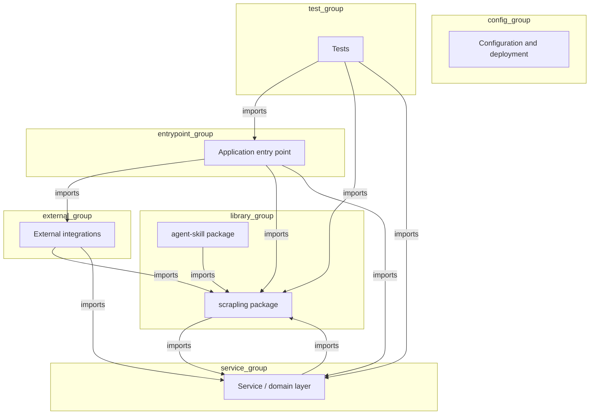

# Architecture report: D4Vinci/Scrapling

> Automated static analysis. **Observed** = directly seen in files/imports/AST; **Inferred** = interpretation from that evidence. Repository code was not executed.

## 1. Repository at a glance

| Item | Value |
| --- | --- |
| Repository | D4Vinci/Scrapling |
| Description | 🕷️ The BEST Web Scraping framework that handles everything from a single request to a full-scale crawl! Don't be shy, join here: https://discord.gg/EMgGbDceNQ and follow here for daily tips and tricks: https://x.com/Scrapling_dev |
| Language | Python |
| Stars | 102861 |
| Licence | BSD-3-Clause |
| Analysed commit / branch | bb223f2f5fc8f743772751a5ce283ef7851ca6be / main |
| Framework(s) | None detected |
| Files analysed | 551 |
| Components | 7 |

## 2. Architecture in one minute

D4Vinci/Scrapling - 🕷️ The BEST Web Scraping framework that handles everything from a single request to a full-scale crawl! Don't be shy, join here: https://discord.gg/EMgGbDceNQ and follow here for daily tips and trick…. This repository was analysed statically from 551 file(s) (83 Python). Detected technologies (observed from imports/manifests): GitHub Actions, SQLite, Click, Pydantic, requests, Poetry. Files are grouped into 7 component(s): agent-skill package, Configuration and deployment, Application entry point, External integrations, scrapling package, Service / domain layer, Tests. Observed entry point(s): benchmarks.py, cleanup.py, scrapling/cli.py. Findings below distinguish observed facts from inferred interpretation.

## 3. High-level block diagram

## 4. Main components

### agent-skill package (`agent_skill`)

- **Kind:** library
- **Status:** Observed
- **Confidence:** 0.85
- **Responsibility:** Groups 3 file(s) under agent-skill package (observed from repository paths and static analysis).
- **Paths:** `agent-skill/Scrapling-Skill/examples/01_fetcher_session.py`, `agent-skill/Scrapling-Skill/examples/02_browser_session.py`, `agent-skill/Scrapling-Skill/examples/03_stealthy_session.py`
- **Evidence:** [agent-skill/Scrapling-Skill/examples/01_fetcher_session.py](https://github.com/D4Vinci/Scrapling/blob/bb223f2f5fc8f743772751a5ce283ef7851ca6be/agent-skill/Scrapling-Skill/examples/01_fetcher_session.py); [agent-skill/Scrapling-Skill/examples/02_browser_session.py](https://github.com/D4Vinci/Scrapling/blob/bb223f2f5fc8f743772751a5ce283ef7851ca6be/agent-skill/Scrapling-Skill/examples/02_browser_session.py); [agent-skill/Scrapling-Skill/examples/03_stealthy_session.py](https://github.com/D4Vinci/Scrapling/blob/bb223f2f5fc8f743772751a5ce283ef7851ca6be/agent-skill/Scrapling-Skill/examples/03_stealthy_session.py)

### Configuration and deployment (`config`)

- **Kind:** config
- **Status:** Observed
- **Confidence:** 0.85
- **Responsibility:** Groups 7 file(s) under configuration and deployment (observed from repository paths and static analysis).
- **Paths:** `Dockerfile`, `MANIFEST.in`, `pyproject.toml`, `pytest.ini`, `ruff.toml`, `server.json`, `setup.cfg`
- **Evidence:** [Dockerfile](https://github.com/D4Vinci/Scrapling/blob/bb223f2f5fc8f743772751a5ce283ef7851ca6be/Dockerfile); [MANIFEST.in](https://github.com/D4Vinci/Scrapling/blob/bb223f2f5fc8f743772751a5ce283ef7851ca6be/MANIFEST.in); [pyproject.toml](https://github.com/D4Vinci/Scrapling/blob/bb223f2f5fc8f743772751a5ce283ef7851ca6be/pyproject.toml); [pytest.ini](https://github.com/D4Vinci/Scrapling/blob/bb223f2f5fc8f743772751a5ce283ef7851ca6be/pytest.ini); [ruff.toml](https://github.com/D4Vinci/Scrapling/blob/bb223f2f5fc8f743772751a5ce283ef7851ca6be/ruff.toml); [server.json](https://github.com/D4Vinci/Scrapling/blob/bb223f2f5fc8f743772751a5ce283ef7851ca6be/server.json); [setup.cfg](https://github.com/D4Vinci/Scrapling/blob/bb223f2f5fc8f743772751a5ce283ef7851ca6be/setup.cfg)

### Application entry point (`entrypoint`)

- **Kind:** entrypoint
- **Status:** Observed
- **Confidence:** 0.85
- **Responsibility:** Groups 5 file(s) under application entry point (observed from repository paths and static analysis). Observed top-level classes: NetworkRequestsModel, QuotesSpider, ResponseModel, ScraplingMCPServer, SessionClosedModel, SessionCreatedModel. Observed top-level functions: __BuildRequest, __Execute, __ParseExtractArguments, __ParseJSONData, __Request_and_Save, __build_browser_kwargs.
- **Paths:** `agent-skill/Scrapling-Skill/examples/04_spider.py`, `benchmarks.py`, `cleanup.py`, `scrapling/cli.py`, `scrapling/core/ai/server.py`
- **Evidence:** [agent-skill/Scrapling-Skill/examples/04_spider.py:21](https://github.com/D4Vinci/Scrapling/blob/bb223f2f5fc8f743772751a5ce283ef7851ca6be/agent-skill/Scrapling-Skill/examples/04_spider.py#L21); [benchmarks.py:22](https://github.com/D4Vinci/Scrapling/blob/bb223f2f5fc8f743772751a5ce283ef7851ca6be/benchmarks.py#L22); [cleanup.py:6](https://github.com/D4Vinci/Scrapling/blob/bb223f2f5fc8f743772751a5ce283ef7851ca6be/cleanup.py#L6); [scrapling/cli.py:25](https://github.com/D4Vinci/Scrapling/blob/bb223f2f5fc8f743772751a5ce283ef7851ca6be/scrapling/cli.py#L25); [scrapling/core/ai/server.py:76](https://github.com/D4Vinci/Scrapling/blob/bb223f2f5fc8f743772751a5ce283ef7851ca6be/scrapling/core/ai/server.py#L76)

### External integrations (`external_integrations`)

- **Kind:** external
- **Status:** Observed
- **Confidence:** 0.85
- **Responsibility:** Groups 2 file(s) under external integrations (observed from repository paths and static analysis). Observed top-level functions: convert_response, scrapling_response.
- **Paths:** `scrapling/integrations/__init__.py`, `scrapling/integrations/scrapy.py`
- **Evidence:** [scrapling/integrations/__init__.py](https://github.com/D4Vinci/Scrapling/blob/bb223f2f5fc8f743772751a5ce283ef7851ca6be/scrapling/integrations/__init__.py); [scrapling/integrations/scrapy.py:24](https://github.com/D4Vinci/Scrapling/blob/bb223f2f5fc8f743772751a5ce283ef7851ca6be/scrapling/integrations/scrapy.py#L24)

### scrapling package (`scrapling`)

- **Kind:** library
- **Status:** Observed
- **Confidence:** 0.85
- **Responsibility:** Groups 43 file(s) under scrapling package (observed from repository paths and static analysis). Observed top-level classes: AsyncFetcher, AsyncFetcherClient, AsyncRemoteSession, AsyncSession, AsyncStealthySession, AutoThrottle. Observed top-level functions: __dir__, __getattr__, _compile_patterns, _convert_to_bytes, _decompress, _dump.
- **Paths:** `scrapling/__init__.py`, `scrapling/engines/__init__.py`, `scrapling/engines/_browsers/__init__.py`, `scrapling/engines/_browsers/_base.py`, `scrapling/engines/_browsers/_config_tools.py`, `scrapling/engines/_browsers/_network.py`, `scrapling/engines/_browsers/_page.py`, `scrapling/engines/_browsers/_remote.py`, `scrapling/engines/_browsers/_stealth.py`, `scrapling/engines/_browsers/_types.py`, `scrapling/engines/_browsers/_validators.py`, `scrapling/engines/constants.py`, `scrapling/engines/static.py`, `scrapling/engines/toolbelt/__init__.py`, `scrapling/engines/toolbelt/ad_domains.py`, `scrapling/engines/toolbelt/convertor.py`, `scrapling/engines/toolbelt/custom.py`, `scrapling/engines/toolbelt/fingerprints.py`, `scrapling/engines/toolbelt/navigation.py`, `scrapling/engines/toolbelt/proxy_rotation.py`, `scrapling/fetchers/__init__.py`, `scrapling/fetchers/requests.py`, `scrapling/fetchers/stealth_chrome.py`, `scrapling/parser.py`, `scrapling/spiders/__init__.py`, `scrapling/spiders/cache.py`, `scrapling/spiders/checkpoint.py`, `scrapling/spiders/engine.py`, `scrapling/spiders/links.py`, `scrapling/spiders/request.py`, `scrapling/spiders/result.py`, `scrapling/spiders/robotstxt.py`, `scrapling/spiders/scheduler.py`, `scrapling/spiders/session.py`, `scrapling/spiders/spider.py`, `scrapling/spiders/templates/__init__.py`, `scrapling/spiders/templates/_utils.py`, `scrapling/spiders/templates/crawler.py`, `scrapling/spiders/templates/feed.py`, `scrapling/spiders/templates/shopify.py`, `scrapling/spiders/templates/site_to_markdown.py`, `scrapling/spiders/templates/sitemap.py`, `scrapling/spiders/throttle.py`
- **Evidence:** [scrapling/__init__.py:26](https://github.com/D4Vinci/Scrapling/blob/bb223f2f5fc8f743772751a5ce283ef7851ca6be/scrapling/__init__.py#L26); [scrapling/engines/__init__.py](https://github.com/D4Vinci/Scrapling/blob/bb223f2f5fc8f743772751a5ce283ef7851ca6be/scrapling/engines/__init__.py); [scrapling/engines/_browsers/__init__.py](https://github.com/D4Vinci/Scrapling/blob/bb223f2f5fc8f743772751a5ce283ef7851ca6be/scrapling/engines/_browsers/__init__.py); [scrapling/engines/_browsers/_base.py:48](https://github.com/D4Vinci/Scrapling/blob/bb223f2f5fc8f743772751a5ce283ef7851ca6be/scrapling/engines/_browsers/_base.py#L48); [scrapling/engines/_browsers/_config_tools.py](https://github.com/D4Vinci/Scrapling/blob/bb223f2f5fc8f743772751a5ce283ef7851ca6be/scrapling/engines/_browsers/_config_tools.py); [scrapling/engines/_browsers/_network.py:13](https://github.com/D4Vinci/Scrapling/blob/bb223f2f5fc8f743772751a5ce283ef7851ca6be/scrapling/engines/_browsers/_network.py#L13); [scrapling/engines/_browsers/_page.py:14](https://github.com/D4Vinci/Scrapling/blob/bb223f2f5fc8f743772751a5ce283ef7851ca6be/scrapling/engines/_browsers/_page.py#L14); [scrapling/engines/_browsers/_remote.py:8](https://github.com/D4Vinci/Scrapling/blob/bb223f2f5fc8f743772751a5ce283ef7851ca6be/scrapling/engines/_browsers/_remote.py#L8)

### Service / domain layer (`service_layer`)

- **Kind:** service
- **Status:** Observed
- **Confidence:** 0.85
- **Responsibility:** Groups 15 file(s) under service / domain layer (observed from repository paths and static analysis). Observed top-level classes: AttributesHandler, Convertor, CurlParser, CustomShell, HTMLTranslator, LoggerProxy. Observed top-level functions: _CookieParser, _ParseHeaders, _blank_style_token, _decode, _is_hidden_element, _is_iterable.
- **Paths:** `scrapling/core/__init__.py`, `scrapling/core/_shell_signatures.py`, `scrapling/core/_types.py`, `scrapling/core/ai/__init__.py`, `scrapling/core/ai/_browser_actions.py`, `scrapling/core/ai/_network_formatting.py`, `scrapling/core/ai/_snapshot_search.py`, `scrapling/core/custom_types.py`, `scrapling/core/mixins.py`, `scrapling/core/shell.py`, `scrapling/core/storage.py`, `scrapling/core/translator.py`, `scrapling/core/utils/__init__.py`, `scrapling/core/utils/_shell.py`, `scrapling/core/utils/_utils.py`
- **Evidence:** [scrapling/core/__init__.py](https://github.com/D4Vinci/Scrapling/blob/bb223f2f5fc8f743772751a5ce283ef7851ca6be/scrapling/core/__init__.py); [scrapling/core/_shell_signatures.py](https://github.com/D4Vinci/Scrapling/blob/bb223f2f5fc8f743772751a5ce283ef7851ca6be/scrapling/core/_shell_signatures.py); [scrapling/core/_types.py:48](https://github.com/D4Vinci/Scrapling/blob/bb223f2f5fc8f743772751a5ce283ef7851ca6be/scrapling/core/_types.py#L48); [scrapling/core/ai/__init__.py](https://github.com/D4Vinci/Scrapling/blob/bb223f2f5fc8f743772751a5ce283ef7851ca6be/scrapling/core/ai/__init__.py); [scrapling/core/ai/_browser_actions.py:40](https://github.com/D4Vinci/Scrapling/blob/bb223f2f5fc8f743772751a5ce283ef7851ca6be/scrapling/core/ai/_browser_actions.py#L40); [scrapling/core/ai/_network_formatting.py:10](https://github.com/D4Vinci/Scrapling/blob/bb223f2f5fc8f743772751a5ce283ef7851ca6be/scrapling/core/ai/_network_formatting.py#L10); [scrapling/core/ai/_snapshot_search.py:4](https://github.com/D4Vinci/Scrapling/blob/bb223f2f5fc8f743772751a5ce283ef7851ca6be/scrapling/core/ai/_snapshot_search.py#L4); [scrapling/core/custom_types.py:29](https://github.com/D4Vinci/Scrapling/blob/bb223f2f5fc8f743772751a5ce283ef7851ca6be/scrapling/core/custom_types.py#L29)

### Tests (`tests`)

- **Kind:** test
- **Status:** Observed
- **Confidence:** 0.85
- **Responsibility:** Groups 15 file(s) under tests (observed from repository paths and static analysis). Observed top-level classes: TestBrowserFetchForwarding, TestExecutablePath, TestMCPServerAuthentication, TestModeSplitContract, TestNormalizeCredentials, TestOneShotBrowserForwarding. Observed top-level functions: _png_height, _serve_html, _server, test_button_chain_error_stops_without_implicit_release, test_button_chain_keeps_order_and_page_reserved, test_button_chain_live_html_drop.
- **Paths:** `tests/__init__.py`, `tests/ai/__init__.py`, `tests/ai/test_ai_mcp.py`, `tests/ai/test_browser_actions.py`, `tests/ai/test_browser_buttons.py`, `tests/ai/test_browser_dialog.py`, `tests/ai/test_browser_dialog_live.py`, `tests/cli/__init__.py`, `tests/core/__init__.py`, `tests/fetchers/__init__.py`, `tests/fetchers/async/__init__.py`, `tests/fetchers/sync/__init__.py`, `tests/integrations/__init__.py`, `tests/parser/__init__.py`, `tests/spiders/__init__.py`
- **Evidence:** [tests/__init__.py](https://github.com/D4Vinci/Scrapling/blob/bb223f2f5fc8f743772751a5ce283ef7851ca6be/tests/__init__.py); [tests/ai/__init__.py](https://github.com/D4Vinci/Scrapling/blob/bb223f2f5fc8f743772751a5ce283ef7851ca6be/tests/ai/__init__.py); [tests/ai/test_ai_mcp.py:61](https://github.com/D4Vinci/Scrapling/blob/bb223f2f5fc8f743772751a5ce283ef7851ca6be/tests/ai/test_ai_mcp.py#L61); [tests/ai/test_browser_actions.py:16](https://github.com/D4Vinci/Scrapling/blob/bb223f2f5fc8f743772751a5ce283ef7851ca6be/tests/ai/test_browser_actions.py#L16); [tests/ai/test_browser_buttons.py:41](https://github.com/D4Vinci/Scrapling/blob/bb223f2f5fc8f743772751a5ce283ef7851ca6be/tests/ai/test_browser_buttons.py#L41); [tests/ai/test_browser_dialog.py:16](https://github.com/D4Vinci/Scrapling/blob/bb223f2f5fc8f743772751a5ce283ef7851ca6be/tests/ai/test_browser_dialog.py#L16); [tests/ai/test_browser_dialog_live.py:27](https://github.com/D4Vinci/Scrapling/blob/bb223f2f5fc8f743772751a5ce283ef7851ca6be/tests/ai/test_browser_dialog_live.py#L27); [tests/cli/__init__.py](https://github.com/D4Vinci/Scrapling/blob/bb223f2f5fc8f743772751a5ce283ef7851ca6be/tests/cli/__init__.py)

## 5. Execution flow

**Observed** entry point(s):

- [benchmarks.py:121](https://github.com/D4Vinci/Scrapling/blob/bb223f2f5fc8f743772751a5ce283ef7851ca6be/benchmarks.py#L121)
- [cleanup.py:41](https://github.com/D4Vinci/Scrapling/blob/bb223f2f5fc8f743772751a5ce283ef7851ca6be/cleanup.py#L41)
- [scrapling/cli.py](https://github.com/D4Vinci/Scrapling/blob/bb223f2f5fc8f743772751a5ce283ef7851ca6be/scrapling/cli.py)
- [scrapling/cli.py](https://github.com/D4Vinci/Scrapling/blob/bb223f2f5fc8f743772751a5ce283ef7851ca6be/scrapling/cli.py)

Representative flow (derived from observed entry points and the import graph; steps beyond the entry point are **Inferred**):

1. Execution starts at an observed entry point listed above, if present.
2. `agent_skill` imports `scrapling` (agent-skill package -> scrapling package).
3. `entrypoint` imports `external_integrations` (Application entry point -> External integrations).
4. `entrypoint` imports `scrapling` (Application entry point -> scrapling package).
5. `entrypoint` imports `service_layer` (Application entry point -> Service / domain layer).
6. `external_integrations` imports `scrapling` (External integrations -> scrapling package).
7. `external_integrations` imports `service_layer` (External integrations -> Service / domain layer).
8. `scrapling` imports `service_layer` (scrapling package -> Service / domain layer).
9. `service_layer` imports `scrapling` (Service / domain layer -> scrapling package).

## 6. Project structure

### `(root)`

- `.bandit.yml` - config (626 bytes)
- `.dockerignore` - container (936 bytes)
- `.gitignore` - other (984 bytes)
- `.pre-commit-config.yaml` - config (472 bytes)
- `.readthedocs.yaml` - config (789 bytes)
- `AI_POLICY.md` - docs (2784 bytes)
- `CODE_OF_CONDUCT.md` - docs (5221 bytes)
- `CONTRIBUTING.md` - docs (8340 bytes)
- `Dockerfile` - container (1158 bytes)
- `LICENSE` - docs (1499 bytes)
- `MANIFEST.in` - manifest (296 bytes)
- `README.md` - docs (38479 bytes)
- `ROADMAP.md` - docs (1097 bytes)
- `benchmarks.py` - source, Python (4454 bytes)
- `cleanup.py` - source, Python (1033 bytes)
- `pyproject.toml` - manifest (3861 bytes)
- `pytest.ini` - config (269 bytes)
- `ruff.toml` - config (433 bytes)
- `server.json` - config (1277 bytes)
- `setup.cfg` - manifest (320 bytes)

### `.github`

- `.github/FUNDING.yml` - config (56 bytes)
- `.github/ISSUE_TEMPLATE/01-bug_report.yml` - config (2111 bytes)
- `.github/ISSUE_TEMPLATE/02-feature_request.yml` - config (662 bytes)
- `.github/ISSUE_TEMPLATE/03-other.yml` - config (556 bytes)
- `.github/ISSUE_TEMPLATE/04-docs_issue.yml` - config (1132 bytes)
- `.github/ISSUE_TEMPLATE/config.yml` - config (302 bytes)
- `.github/PULL_REQUEST_TEMPLATE.md` - docs (2184 bytes)
- `.github/workflows/code-quality.yml` - ci, YAML (5948 bytes)
- `.github/workflows/docker-build.yml` - ci, YAML (3715 bytes)
- `.github/workflows/release-and-publish.yml` - ci, YAML (2331 bytes)
- `.github/workflows/stale.yml` - ci, YAML (641 bytes)
- `.github/workflows/tests.yml` - ci, YAML (4004 bytes)

### `agent-skill`

- `agent-skill/README.md` - docs (1721 bytes)
- `agent-skill/Scrapling-Skill/LICENSE.txt` - docs (1499 bytes)
- `agent-skill/Scrapling-Skill/SKILL.md` - docs (27590 bytes)
- `agent-skill/Scrapling-Skill/examples/01_fetcher_session.py` - source, Python (853 bytes)
- `agent-skill/Scrapling-Skill/examples/02_browser_session.py` - source, Python (954 bytes)
- `agent-skill/Scrapling-Skill/examples/03_stealthy_session.py` - source, Python (952 bytes)
- `agent-skill/Scrapling-Skill/examples/04_spider.py` - source, Python (1941 bytes)
- `agent-skill/Scrapling-Skill/examples/README.md` - docs (1377 bytes)
- `agent-skill/Scrapling-Skill/references/building-rag-systems.md` - docs (4934 bytes)
- `agent-skill/Scrapling-Skill/references/fetching/choosing.md` - docs (6447 bytes)
- `agent-skill/Scrapling-Skill/references/fetching/static.md` - docs (17626 bytes)
- `agent-skill/Scrapling-Skill/references/fetching/stealthy.md` - docs (36526 bytes)
- `agent-skill/Scrapling-Skill/references/integrations/scrapy.md` - docs (2985 bytes)
- `agent-skill/Scrapling-Skill/references/mcp-server.md` - docs (27482 bytes)
- `agent-skill/Scrapling-Skill/references/migrating_from_beautifulsoup.md` - docs (12646 bytes)
- `agent-skill/Scrapling-Skill/references/parsing/adaptive.md` - docs (12777 bytes)
- `agent-skill/Scrapling-Skill/references/parsing/main_classes.md` - docs (28470 bytes)
- `agent-skill/Scrapling-Skill/references/parsing/selection.md` - docs (24754 bytes)
- `agent-skill/Scrapling-Skill/references/spiders/advanced.md` - docs (19174 bytes)
- `agent-skill/Scrapling-Skill/references/spiders/architecture.md` - docs (7448 bytes)
- `agent-skill/Scrapling-Skill/references/spiders/generic-templates.md` - docs (12419 bytes)
- `agent-skill/Scrapling-Skill/references/spiders/getting-started.md` - docs (7260 bytes)
- `agent-skill/Scrapling-Skill/references/spiders/platform-templates.md` - docs (3306 bytes)
- `agent-skill/Scrapling-Skill/references/spiders/proxy-blocking.md` - docs (9293 bytes)
- `agent-skill/Scrapling-Skill/references/spiders/requests-responses.md` - docs (8988 bytes)
- `agent-skill/Scrapling-Skill/references/spiders/sessions.md` - docs (9750 bytes)

### `docs`

- `docs/README_AR.md` - docs (44082 bytes)
- `docs/README_CN.md` - docs (34964 bytes)
- `docs/README_DE.md` - docs (38182 bytes)
- `docs/README_ES.md` - docs (38242 bytes)
- `docs/README_FR.md` - docs (39374 bytes)
- `docs/README_JP.md` - docs (41834 bytes)
- `docs/README_KR.md` - docs (39665 bytes)
- `docs/README_PT_BR.md` - docs (38235 bytes)
- `docs/README_RU.md` - docs (47780 bytes)
- `docs/ai/agent-skill.md` - docs (2735 bytes)
- `docs/ai/building-rag-systems.md` - docs (5260 bytes)
- `docs/ai/mcp-server.md` - docs (30465 bytes)
- `docs/api-reference/custom-types.md` - docs (786 bytes)
- `docs/api-reference/fetchers.md` - docs (1284 bytes)
- `docs/api-reference/mcp-server.md` - docs (6807 bytes)
- `docs/api-reference/proxy-rotation.md` - docs (477 bytes)
- `docs/api-reference/response.md` - docs (574 bytes)
- `docs/api-reference/selector.md` - docs (704 bytes)
- `docs/api-reference/spiders.md` - docs (963 bytes)
- `docs/assets/cover_dark.svg` - docs (163510 bytes)
- `docs/assets/cover_light.svg` - docs (63232 bytes)
- `docs/assets/javascripts/language-links.js` - docs (669 bytes)
- `docs/benchmarks.md` - docs (1440 bytes)
- `docs/changelog.md` - docs (115545 bytes)
- `docs/cli/extract-commands.md` - docs (18719 bytes)
- `docs/cli/interactive-shell.md` - docs (8452 bytes)
- `docs/cli/overview.md` - docs (1220 bytes)
- `docs/development/adaptive_storage_system.md` - docs (3786 bytes)
- `docs/development/scrapling_custom_types.md` - docs (1789 bytes)
- `docs/donate.md` - docs (2874 bytes)
- `docs/fetching/choosing.md` - docs (6786 bytes)
- `docs/fetching/static.md` - docs (18713 bytes)
- `docs/fetching/stealthy.md` - docs (37869 bytes)
- `docs/index.md` - docs (14725 bytes)
- `docs/integrations/scrapy.md` - docs (3206 bytes)
- `docs/locales/ar/ai/agent-skill.md` - docs (3774 bytes)
- `docs/locales/ar/ai/building-rag-systems.md` - docs (7547 bytes)
- `docs/locales/ar/ai/mcp-server.md` - docs (41506 bytes)
- `docs/locales/ar/api-reference/custom-types.md` - docs (925 bytes)
- `docs/locales/ar/api-reference/fetchers.md` - docs (1488 bytes)
- `docs/locales/ar/api-reference/mcp-server.md` - docs (10303 bytes)
- `docs/locales/ar/api-reference/proxy-rotation.md` - docs (608 bytes)
- `docs/locales/ar/api-reference/response.md` - docs (849 bytes)
- `docs/locales/ar/api-reference/selector.md` - docs (757 bytes)
- `docs/locales/ar/api-reference/spiders.md` - docs (1118 bytes)
- `docs/locales/ar/benchmarks.md` - docs (1890 bytes)
- `docs/locales/ar/changelog.md` - docs (155377 bytes)
- `docs/locales/ar/cli/extract-commands.md` - docs (20570 bytes)
- `docs/locales/ar/cli/interactive-shell.md` - docs (10058 bytes)
- `docs/locales/ar/cli/overview.md` - docs (1658 bytes)
- `docs/locales/ar/development/adaptive_storage_system.md` - docs (4746 bytes)
- `docs/locales/ar/development/scrapling_custom_types.md` - docs (2328 bytes)
- `docs/locales/ar/donate.md` - docs (3463 bytes)
- `docs/locales/ar/fetching/choosing.md` - docs (6926 bytes)
- `docs/locales/ar/fetching/static.md` - docs (21268 bytes)
- `docs/locales/ar/fetching/stealthy.md` - docs (41164 bytes)
- `docs/locales/ar/index.md` - docs (19733 bytes)
- `docs/locales/ar/integrations/scrapy.md` - docs (4047 bytes)
- `docs/locales/ar/migrating-to-v0.5.md` - docs (29478 bytes)
- `docs/locales/ar/overview.md` - docs (19468 bytes)
- `docs/locales/ar/parsing/adaptive.md` - docs (15464 bytes)
- `docs/locales/ar/parsing/main_classes.md` - docs (32412 bytes)
- `docs/locales/ar/parsing/selection.md` - docs (28545 bytes)
- `docs/locales/ar/spiders/advanced.md` - docs (25519 bytes)
- `docs/locales/ar/spiders/architecture.md` - docs (10256 bytes)
- `docs/locales/ar/spiders/generic-templates.md` - docs (15686 bytes)
- `docs/locales/ar/spiders/getting-started.md` - docs (11217 bytes)
- `docs/locales/ar/spiders/platform-templates.md` - docs (5001 bytes)
- `docs/locales/ar/spiders/proxy-blocking.md` - docs (11810 bytes)
- `docs/locales/ar/spiders/requests-responses.md` - docs (10568 bytes)
- `docs/locales/ar/spiders/sessions.md` - docs (11847 bytes)
- `docs/locales/ar/tutorials/migrating_from_beautifulsoup.md` - docs (13848 bytes)
- `docs/locales/ar/tutorials/replacing_ai.md` - docs (13131 bytes)
- `docs/locales/de/ai/agent-skill.md` - docs (3103 bytes)
- `docs/locales/de/ai/building-rag-systems.md` - docs (6179 bytes)
- `docs/locales/de/ai/mcp-server.md` - docs (34706 bytes)
- `docs/locales/de/api-reference/custom-types.md` - docs (802 bytes)
- `docs/locales/de/api-reference/fetchers.md` - docs (1348 bytes)
- `docs/locales/de/api-reference/mcp-server.md` - docs (8093 bytes)
- `docs/locales/de/api-reference/proxy-rotation.md` - docs (534 bytes)
- `docs/locales/de/api-reference/response.md` - docs (620 bytes)
- `docs/locales/de/api-reference/selector.md` - docs (675 bytes)
- `docs/locales/de/api-reference/spiders.md` - docs (984 bytes)
- `docs/locales/de/benchmarks.md` - docs (1601 bytes)
- `docs/locales/de/changelog.md` - docs (129977 bytes)
- `docs/locales/de/cli/extract-commands.md` - docs (19239 bytes)
- `docs/locales/de/cli/interactive-shell.md` - docs (8963 bytes)
- `docs/locales/de/cli/overview.md` - docs (1420 bytes)
- `docs/locales/de/development/adaptive_storage_system.md` - docs (4013 bytes)
- `docs/locales/de/development/scrapling_custom_types.md` - docs (1918 bytes)
- `docs/locales/de/donate.md` - docs (2829 bytes)
- `docs/locales/de/fetching/choosing.md` - docs (5932 bytes)
- `docs/locales/de/fetching/static.md` - docs (19577 bytes)
- `docs/locales/de/fetching/stealthy.md` - docs (35526 bytes)
- `docs/locales/de/index.md` - docs (16157 bytes)
- `docs/locales/de/integrations/scrapy.md` - docs (3517 bytes)
- `docs/locales/de/migrating-to-v0.5.md` - docs (23935 bytes)
- `docs/locales/de/overview.md` - docs (17697 bytes)
- `docs/locales/de/parsing/adaptive.md` - docs (14044 bytes)
- `docs/locales/de/parsing/main_classes.md` - docs (30218 bytes)
- `docs/locales/de/parsing/selection.md` - docs (26032 bytes)
- `docs/locales/de/spiders/advanced.md` - docs (22108 bytes)
- `docs/locales/de/spiders/architecture.md` - docs (9236 bytes)
- `docs/locales/de/spiders/generic-templates.md` - docs (14097 bytes)
- `docs/locales/de/spiders/getting-started.md` - docs (9501 bytes)
- `docs/locales/de/spiders/platform-templates.md` - docs (4372 bytes)
- `docs/locales/de/spiders/proxy-blocking.md` - docs (10409 bytes)
- `docs/locales/de/spiders/requests-responses.md` - docs (10326 bytes)
- `docs/locales/de/spiders/sessions.md` - docs (10720 bytes)
- `docs/locales/de/tutorials/migrating_from_beautifulsoup.md` - docs (12272 bytes)
- `docs/locales/de/tutorials/replacing_ai.md` - docs (9906 bytes)
- `docs/locales/es/ai/agent-skill.md` - docs (3103 bytes)
- `docs/locales/es/ai/building-rag-systems.md` - docs (6079 bytes)
- `docs/locales/es/ai/mcp-server.md` - docs (33698 bytes)
- `docs/locales/es/api-reference/custom-types.md` - docs (805 bytes)
- `docs/locales/es/api-reference/fetchers.md` - docs (1366 bytes)
- `docs/locales/es/api-reference/mcp-server.md` - docs (7679 bytes)
- `docs/locales/es/api-reference/proxy-rotation.md` - docs (522 bytes)
- `docs/locales/es/api-reference/response.md` - docs (646 bytes)
- `docs/locales/es/api-reference/selector.md` - docs (672 bytes)
- `docs/locales/es/api-reference/spiders.md` - docs (1045 bytes)
- `docs/locales/es/benchmarks.md` - docs (1590 bytes)
- `docs/locales/es/changelog.md` - docs (129559 bytes)
- `docs/locales/es/cli/extract-commands.md` - docs (19122 bytes)
- `docs/locales/es/cli/interactive-shell.md` - docs (8962 bytes)
- `docs/locales/es/cli/overview.md` - docs (1355 bytes)
- `docs/locales/es/development/adaptive_storage_system.md` - docs (3878 bytes)
- `docs/locales/es/development/scrapling_custom_types.md` - docs (1762 bytes)
- `docs/locales/es/donate.md` - docs (2886 bytes)
- `docs/locales/es/fetching/choosing.md` - docs (5693 bytes)
- `docs/locales/es/fetching/static.md` - docs (18722 bytes)
- `docs/locales/es/fetching/stealthy.md` - docs (33806 bytes)
- `docs/locales/es/index.md` - docs (15985 bytes)
- `docs/locales/es/integrations/scrapy.md` - docs (3477 bytes)
- `docs/locales/es/migrating-to-v0.5.md` - docs (23161 bytes)
- `docs/locales/es/overview.md` - docs (17608 bytes)
- `docs/locales/es/parsing/adaptive.md` - docs (13120 bytes)
- `docs/locales/es/parsing/main_classes.md` - docs (27728 bytes)
- `docs/locales/es/parsing/selection.md` - docs (24477 bytes)
- `docs/locales/es/spiders/advanced.md` - docs (20511 bytes)
- `docs/locales/es/spiders/architecture.md` - docs (8070 bytes)
- `docs/locales/es/spiders/generic-templates.md` - docs (13108 bytes)
- `docs/locales/es/spiders/getting-started.md` - docs (9075 bytes)
- `docs/locales/es/spiders/platform-templates.md` - docs (3873 bytes)
- `docs/locales/es/spiders/proxy-blocking.md` - docs (10215 bytes)
- `docs/locales/es/spiders/requests-responses.md` - docs (8891 bytes)
- `docs/locales/es/spiders/sessions.md` - docs (10310 bytes)
- `docs/locales/es/tutorials/migrating_from_beautifulsoup.md` - docs (12066 bytes)
- `docs/locales/es/tutorials/replacing_ai.md` - docs (9712 bytes)
- `docs/locales/fr/ai/agent-skill.md` - docs (3323 bytes)
- `docs/locales/fr/ai/building-rag-systems.md` - docs (6275 bytes)
- `docs/locales/fr/ai/mcp-server.md` - docs (35744 bytes)
- `docs/locales/fr/api-reference/custom-types.md` - docs (814 bytes)
- `docs/locales/fr/api-reference/fetchers.md` - docs (1389 bytes)
- `docs/locales/fr/api-reference/mcp-server.md` - docs (7996 bytes)
- `docs/locales/fr/api-reference/proxy-rotation.md` - docs (571 bytes)
- `docs/locales/fr/api-reference/response.md` - docs (686 bytes)
- `docs/locales/fr/api-reference/selector.md` - docs (698 bytes)
- `docs/locales/fr/api-reference/spiders.md` - docs (1050 bytes)
- `docs/locales/fr/benchmarks.md` - docs (1649 bytes)
- `docs/locales/fr/changelog.md` - docs (136374 bytes)
- `docs/locales/fr/cli/extract-commands.md` - docs (19568 bytes)
- `docs/locales/fr/cli/interactive-shell.md` - docs (9222 bytes)
- `docs/locales/fr/cli/overview.md` - docs (1452 bytes)
- `docs/locales/fr/development/adaptive_storage_system.md` - docs (4013 bytes)
- `docs/locales/fr/development/scrapling_custom_types.md` - docs (1909 bytes)
- `docs/locales/fr/donate.md` - docs (2824 bytes)
- `docs/locales/fr/fetching/choosing.md` - docs (5929 bytes)
- `docs/locales/fr/fetching/static.md` - docs (19201 bytes)
- `docs/locales/fr/fetching/stealthy.md` - docs (35688 bytes)
- `docs/locales/fr/index.md` - docs (16908 bytes)
- `docs/locales/fr/integrations/scrapy.md` - docs (3600 bytes)
- `docs/locales/fr/migrating-to-v0.5.md` - docs (24670 bytes)
- `docs/locales/fr/overview.md` - docs (18045 bytes)
- `docs/locales/fr/parsing/adaptive.md` - docs (14081 bytes)
- `docs/locales/fr/parsing/main_classes.md` - docs (29114 bytes)
- `docs/locales/fr/parsing/selection.md` - docs (26116 bytes)
- `docs/locales/fr/spiders/advanced.md` - docs (21179 bytes)
- `docs/locales/fr/spiders/architecture.md` - docs (8568 bytes)
- `docs/locales/fr/spiders/generic-templates.md` - docs (13508 bytes)
- `docs/locales/fr/spiders/getting-started.md` - docs (9477 bytes)
- `docs/locales/fr/spiders/platform-templates.md` - docs (4047 bytes)
- `docs/locales/fr/spiders/proxy-blocking.md` - docs (10502 bytes)
- `docs/locales/fr/spiders/requests-responses.md` - docs (9179 bytes)
- `docs/locales/fr/spiders/sessions.md` - docs (10572 bytes)
- `docs/locales/fr/tutorials/migrating_from_beautifulsoup.md` - docs (12495 bytes)
- `docs/locales/fr/tutorials/replacing_ai.md` - docs (10566 bytes)
- `docs/locales/ja/ai/agent-skill.md` - docs (3677 bytes)
- `docs/locales/ja/ai/building-rag-systems.md` - docs (7064 bytes)
- `docs/locales/ja/ai/mcp-server.md` - docs (38661 bytes)
- `docs/locales/ja/api-reference/custom-types.md` - docs (846 bytes)
- `docs/locales/ja/api-reference/fetchers.md` - docs (1462 bytes)
- `docs/locales/ja/api-reference/mcp-server.md` - docs (9171 bytes)
- `docs/locales/ja/api-reference/proxy-rotation.md` - docs (621 bytes)
- `docs/locales/ja/api-reference/response.md` - docs (740 bytes)
- `docs/locales/ja/api-reference/selector.md` - docs (717 bytes)
- `docs/locales/ja/api-reference/spiders.md` - docs (1071 bytes)
- `docs/locales/ja/benchmarks.md` - docs (1639 bytes)
- `docs/locales/ja/changelog.md` - docs (147743 bytes)
- `docs/locales/ja/cli/extract-commands.md` - docs (20137 bytes)
- `docs/locales/ja/cli/interactive-shell.md` - docs (9763 bytes)
- `docs/locales/ja/cli/overview.md` - docs (1660 bytes)
- `docs/locales/ja/development/adaptive_storage_system.md` - docs (4108 bytes)
- `docs/locales/ja/development/scrapling_custom_types.md` - docs (1982 bytes)
- `docs/locales/ja/donate.md` - docs (3149 bytes)
- `docs/locales/ja/fetching/choosing.md` - docs (6308 bytes)
- `docs/locales/ja/fetching/static.md` - docs (19969 bytes)
- `docs/locales/ja/fetching/stealthy.md` - docs (40863 bytes)
- `docs/locales/ja/index.md` - docs (18289 bytes)
- `docs/locales/ja/integrations/scrapy.md` - docs (3956 bytes)
- `docs/locales/ja/migrating-to-v0.5.md` - docs (27778 bytes)
- `docs/locales/ja/overview.md` - docs (18254 bytes)
- `docs/locales/ja/parsing/adaptive.md` - docs (14097 bytes)
- `docs/locales/ja/parsing/main_classes.md` - docs (29945 bytes)
- `docs/locales/ja/parsing/selection.md` - docs (26306 bytes)
- `docs/locales/ja/spiders/advanced.md` - docs (21948 bytes)
- `docs/locales/ja/spiders/architecture.md` - docs (9369 bytes)
- `docs/locales/ja/spiders/generic-templates.md` - docs (14272 bytes)
- `docs/locales/ja/spiders/getting-started.md` - docs (10287 bytes)
- `docs/locales/ja/spiders/platform-templates.md` - docs (4642 bytes)
- `docs/locales/ja/spiders/proxy-blocking.md` - docs (11062 bytes)
- `docs/locales/ja/spiders/requests-responses.md` - docs (9509 bytes)
- `docs/locales/ja/spiders/sessions.md` - docs (10917 bytes)
- `docs/locales/ja/tutorials/migrating_from_beautifulsoup.md` - docs (12714 bytes)
- `docs/locales/ja/tutorials/replacing_ai.md` - docs (11414 bytes)
- `docs/locales/ko/ai/agent-skill.md` - docs (3261 bytes)
- `docs/locales/ko/ai/building-rag-systems.md` - docs (6513 bytes)
- `docs/locales/ko/ai/mcp-server.md` - docs (35799 bytes)
- `docs/locales/ko/api-reference/custom-types.md` - docs (795 bytes)
- `docs/locales/ko/api-reference/fetchers.md` - docs (1363 bytes)
- `docs/locales/ko/api-reference/mcp-server.md` - docs (8336 bytes)
- `docs/locales/ko/api-reference/proxy-rotation.md` - docs (566 bytes)
- `docs/locales/ko/api-reference/response.md` - docs (683 bytes)
- `docs/locales/ko/api-reference/selector.md` - docs (667 bytes)
- `docs/locales/ko/api-reference/spiders.md` - docs (1006 bytes)
- `docs/locales/ko/benchmarks.md` - docs (1619 bytes)
- `docs/locales/ko/changelog.md` - docs (136100 bytes)
- `docs/locales/ko/cli/extract-commands.md` - docs (19395 bytes)
- `docs/locales/ko/cli/interactive-shell.md` - docs (9112 bytes)
- `docs/locales/ko/cli/overview.md` - docs (1401 bytes)
- `docs/locales/ko/development/adaptive_storage_system.md` - docs (3958 bytes)
- `docs/locales/ko/development/scrapling_custom_types.md` - docs (1902 bytes)
- `docs/locales/ko/donate.md` - docs (2918 bytes)
- `docs/locales/ko/fetching/choosing.md` - docs (5984 bytes)
- `docs/locales/ko/fetching/static.md` - docs (19535 bytes)
- `docs/locales/ko/fetching/stealthy.md` - docs (36699 bytes)
- `docs/locales/ko/index.md` - docs (16829 bytes)
- `docs/locales/ko/integrations/scrapy.md` - docs (3620 bytes)
- `docs/locales/ko/migrating-to-v0.5.md` - docs (24153 bytes)
- `docs/locales/ko/overview.md` - docs (17872 bytes)
- `docs/locales/ko/parsing/adaptive.md` - docs (14290 bytes)
- `docs/locales/ko/parsing/main_classes.md` - docs (30079 bytes)
- `docs/locales/ko/parsing/selection.md` - docs (26035 bytes)
- `docs/locales/ko/spiders/advanced.md` - docs (20856 bytes)
- `docs/locales/ko/spiders/architecture.md` - docs (8341 bytes)
- `docs/locales/ko/spiders/generic-templates.md` - docs (13607 bytes)
- `docs/locales/ko/spiders/getting-started.md` - docs (9541 bytes)
- `docs/locales/ko/spiders/platform-templates.md` - docs (4220 bytes)
- `docs/locales/ko/spiders/proxy-blocking.md` - docs (10470 bytes)
- `docs/locales/ko/spiders/requests-responses.md` - docs (9198 bytes)
- `docs/locales/ko/spiders/sessions.md` - docs (10452 bytes)
- `docs/locales/ko/tutorials/migrating_from_beautifulsoup.md` - docs (12510 bytes)
- `docs/locales/ko/tutorials/replacing_ai.md` - docs (10634 bytes)
- `docs/locales/pt-BR/ai/agent-skill.md` - docs (3141 bytes)
- `docs/locales/pt-BR/ai/building-rag-systems.md` - docs (6011 bytes)
- `docs/locales/pt-BR/ai/mcp-server.md` - docs (33471 bytes)
- `docs/locales/pt-BR/api-reference/custom-types.md` - docs (791 bytes)
- `docs/locales/pt-BR/api-reference/fetchers.md` - docs (1364 bytes)
- `docs/locales/pt-BR/api-reference/mcp-server.md` - docs (7565 bytes)
- `docs/locales/pt-BR/api-reference/proxy-rotation.md` - docs (522 bytes)
- `docs/locales/pt-BR/api-reference/response.md` - docs (647 bytes)
- `docs/locales/pt-BR/api-reference/selector.md` - docs (660 bytes)
- `docs/locales/pt-BR/api-reference/spiders.md` - docs (1046 bytes)
- `docs/locales/pt-BR/benchmarks.md` - docs (1591 bytes)
- `docs/locales/pt-BR/changelog.md` - docs (128097 bytes)
- `docs/locales/pt-BR/cli/extract-commands.md` - docs (19039 bytes)
- `docs/locales/pt-BR/cli/interactive-shell.md` - docs (8948 bytes)
- `docs/locales/pt-BR/cli/overview.md` - docs (1352 bytes)
- `docs/locales/pt-BR/development/adaptive_storage_system.md` - docs (3818 bytes)
- `docs/locales/pt-BR/development/scrapling_custom_types.md` - docs (1773 bytes)
- `docs/locales/pt-BR/donate.md` - docs (2771 bytes)
- `docs/locales/pt-BR/fetching/choosing.md` - docs (5671 bytes)
- `docs/locales/pt-BR/fetching/static.md` - docs (18881 bytes)
- `docs/locales/pt-BR/fetching/stealthy.md` - docs (33687 bytes)
- `docs/locales/pt-BR/index.md` - docs (15876 bytes)
- `docs/locales/pt-BR/integrations/scrapy.md` - docs (3438 bytes)
- `docs/locales/pt-BR/migrating-to-v0.5.md` - docs (22704 bytes)
- `docs/locales/pt-BR/overview.md` - docs (17590 bytes)
- `docs/locales/pt-BR/parsing/adaptive.md` - docs (12948 bytes)
- `docs/locales/pt-BR/parsing/main_classes.md` - docs (27733 bytes)
- `docs/locales/pt-BR/parsing/selection.md` - docs (24383 bytes)
- `docs/locales/pt-BR/spiders/advanced.md` - docs (20173 bytes)
- `docs/locales/pt-BR/spiders/architecture.md` - docs (8111 bytes)
- `docs/locales/pt-BR/spiders/generic-templates.md` - docs (12909 bytes)
- `docs/locales/pt-BR/spiders/getting-started.md` - docs (9046 bytes)
- `docs/locales/pt-BR/spiders/platform-templates.md` - docs (3735 bytes)
- `docs/locales/pt-BR/spiders/proxy-blocking.md` - docs (10144 bytes)
- `docs/locales/pt-BR/spiders/requests-responses.md` - docs (8782 bytes)
- `docs/locales/pt-BR/spiders/sessions.md` - docs (10157 bytes)
- `docs/locales/pt-BR/tutorials/migrating_from_beautifulsoup.md` - docs (12062 bytes)
- `docs/locales/pt-BR/tutorials/replacing_ai.md` - docs (9796 bytes)
- `docs/locales/ru/ai/agent-skill.md` - docs (4245 bytes)
- `docs/locales/ru/ai/building-rag-systems.md` - docs (8313 bytes)
- `docs/locales/ru/ai/mcp-server.md` - docs (48482 bytes)
- `docs/locales/ru/api-reference/custom-types.md` - docs (899 bytes)
- `docs/locales/ru/api-reference/fetchers.md` - docs (1493 bytes)
- `docs/locales/ru/api-reference/mcp-server.md` - docs (11591 bytes)
- `docs/locales/ru/api-reference/proxy-rotation.md` - docs (639 bytes)
- `docs/locales/ru/api-reference/response.md` - docs (769 bytes)
- `docs/locales/ru/api-reference/selector.md` - docs (816 bytes)
- `docs/locales/ru/api-reference/spiders.md` - docs (1146 bytes)
- `docs/locales/ru/benchmarks.md` - docs (1998 bytes)
- `docs/locales/ru/changelog.md` - docs (181994 bytes)
- `docs/locales/ru/cli/extract-commands.md` - docs (22073 bytes)
- `docs/locales/ru/cli/interactive-shell.md` - docs (10892 bytes)
- `docs/locales/ru/cli/overview.md` - docs (1909 bytes)
- `docs/locales/ru/development/adaptive_storage_system.md` - docs (5087 bytes)
- `docs/locales/ru/development/scrapling_custom_types.md` - docs (2447 bytes)
- `docs/locales/ru/donate.md` - docs (3665 bytes)
- `docs/locales/ru/fetching/choosing.md` - docs (8205 bytes)
- `docs/locales/ru/fetching/static.md` - docs (23249 bytes)
- `docs/locales/ru/fetching/stealthy.md` - docs (48571 bytes)
- `docs/locales/ru/index.md` - docs (21806 bytes)
- `docs/locales/ru/integrations/scrapy.md` - docs (4451 bytes)
- `docs/locales/ru/migrating-to-v0.5.md` - docs (32976 bytes)
- `docs/locales/ru/overview.md` - docs (19827 bytes)
- `docs/locales/ru/parsing/adaptive.md` - docs (18957 bytes)
- `docs/locales/ru/parsing/main_classes.md` - docs (38344 bytes)
- `docs/locales/ru/parsing/selection.md` - docs (32544 bytes)
- `docs/locales/ru/spiders/advanced.md` - docs (27390 bytes)
- `docs/locales/ru/spiders/architecture.md` - docs (11777 bytes)
- `docs/locales/ru/spiders/generic-templates.md` - docs (16859 bytes)
- `docs/locales/ru/spiders/getting-started.md` - docs (12453 bytes)
- `docs/locales/ru/spiders/platform-templates.md` - docs (5636 bytes)
- `docs/locales/ru/spiders/proxy-blocking.md` - docs (12561 bytes)
- `docs/locales/ru/spiders/requests-responses.md` - docs (11794 bytes)
- `docs/locales/ru/spiders/sessions.md` - docs (12743 bytes)
- `docs/locales/ru/tutorials/migrating_from_beautifulsoup.md` - docs (14800 bytes)
- `docs/locales/ru/tutorials/replacing_ai.md` - docs (14250 bytes)
- `docs/locales/zh/ai/agent-skill.md` - docs (2706 bytes)
- `docs/locales/zh/ai/building-rag-systems.md` - docs (5458 bytes)
- `docs/locales/zh/ai/mcp-server.md` - docs (29578 bytes)
- `docs/locales/zh/api-reference/custom-types.md` - docs (691 bytes)
- `docs/locales/zh/api-reference/fetchers.md` - docs (1283 bytes)
- `docs/locales/zh/api-reference/mcp-server.md` - docs (6682 bytes)
- `docs/locales/zh/api-reference/proxy-rotation.md` - docs (474 bytes)
- `docs/locales/zh/api-reference/response.md` - docs (569 bytes)
- `docs/locales/zh/api-reference/selector.md` - docs (593 bytes)
- `docs/locales/zh/api-reference/spiders.md` - docs (900 bytes)
- `docs/locales/zh/benchmarks.md` - docs (1405 bytes)
- `docs/locales/zh/changelog.md` - docs (111242 bytes)
- `docs/locales/zh/cli/extract-commands.md` - docs (18149 bytes)
- `docs/locales/zh/cli/interactive-shell.md` - docs (8200 bytes)
- `docs/locales/zh/cli/overview.md` - docs (1166 bytes)
- `docs/locales/zh/development/adaptive_storage_system.md` - docs (3399 bytes)
- `docs/locales/zh/development/scrapling_custom_types.md` - docs (1647 bytes)
- `docs/locales/zh/donate.md` - docs (2618 bytes)
- `docs/locales/zh/fetching/choosing.md` - docs (5142 bytes)
- `docs/locales/zh/fetching/static.md` - docs (17895 bytes)
- `docs/locales/zh/fetching/stealthy.md` - docs (30731 bytes)
- `docs/locales/zh/index.md` - docs (14026 bytes)
- `docs/locales/zh/integrations/scrapy.md` - docs (3154 bytes)
- `docs/locales/zh/migrating-to-v0.5.md` - docs (20025 bytes)
- `docs/locales/zh/overview.md` - docs (16630 bytes)
- `docs/locales/zh/parsing/adaptive.md` - docs (12001 bytes)
- `docs/locales/zh/parsing/main_classes.md` - docs (26414 bytes)
- `docs/locales/zh/parsing/selection.md` - docs (23172 bytes)
- `docs/locales/zh/spiders/advanced.md` - docs (18334 bytes)
- `docs/locales/zh/spiders/architecture.md` - docs (6994 bytes)
- `docs/locales/zh/spiders/generic-templates.md` - docs (12202 bytes)
- `docs/locales/zh/spiders/getting-started.md` - docs (8426 bytes)
- `docs/locales/zh/spiders/platform-templates.md` - docs (3348 bytes)
- `docs/locales/zh/spiders/proxy-blocking.md` - docs (9463 bytes)
- `docs/locales/zh/spiders/requests-responses.md` - docs (7823 bytes)
- `docs/locales/zh/spiders/sessions.md` - docs (9553 bytes)
- `docs/locales/zh/tutorials/migrating_from_beautifulsoup.md` - docs (11274 bytes)
- `docs/locales/zh/tutorials/replacing_ai.md` - docs (8408 bytes)
- `docs/migrating-to-v0.5.md` - docs (21549 bytes)
- `docs/overrides/api/python/material/class.html.jinja` - docs (322 bytes)
- `docs/overrides/api/python/material/languages/ar.html.jinja` - docs (1969 bytes)
- `docs/overrides/api/python/material/languages/de.html.jinja` - docs (1546 bytes)
- `docs/overrides/api/python/material/languages/es.html.jinja` - docs (1602 bytes)
- `docs/overrides/api/python/material/languages/fr.html.jinja` - docs (1617 bytes)
- `docs/overrides/api/python/material/languages/ja.html.jinja` - docs (1684 bytes)
- `docs/overrides/api/python/material/languages/ko.html.jinja` - docs (1594 bytes)
- `docs/overrides/api/python/material/languages/pt-BR.html.jinja` - docs (1560 bytes)
- `docs/overrides/api/python/material/languages/ru.html.jinja` - docs (2049 bytes)
- `docs/overrides/api/python/material/languages/zh.html.jinja` - docs (1462 bytes)
- `docs/overrides/api/python/material/translations/ar.html.jinja` - docs (90137 bytes)
- `docs/overrides/api/python/material/translations/de.html.jinja` - docs (80292 bytes)
- `docs/overrides/api/python/material/translations/es.html.jinja` - docs (78860 bytes)
- `docs/overrides/api/python/material/translations/fr.html.jinja` - docs (80681 bytes)
- `docs/overrides/api/python/material/translations/ja.html.jinja` - docs (86876 bytes)
- `docs/overrides/api/python/material/translations/ko.html.jinja` - docs (81908 bytes)
- `docs/overrides/api/python/material/translations/pt-BR.html.jinja` - docs (77524 bytes)
- `docs/overrides/api/python/material/translations/ru.html.jinja` - docs (99548 bytes)
- `docs/overrides/api/python/material/translations/zh.html.jinja` - docs (72357 bytes)
- `docs/overrides/main.html` - docs (2504 bytes)
- `docs/overview.md` - docs (17562 bytes)
- `docs/parsing/adaptive.md` - docs (14077 bytes)
- `docs/parsing/main_classes.md` - docs (30784 bytes)
- `docs/parsing/selection.md` - docs (26033 bytes)
- `docs/requirements.txt` - manifest (173 bytes)
- `docs/spiders/advanced.md` - docs (19789 bytes)
- `docs/spiders/architecture.md` - docs (8441 bytes)
- `docs/spiders/generic-templates.md` - docs (12689 bytes)
- `docs/spiders/getting-started.md` - docs (8678 bytes)
- `docs/spiders/platform-templates.md` - docs (3801 bytes)
- `docs/spiders/proxy-blocking.md` - docs (9722 bytes)
- `docs/spiders/requests-responses.md` - docs (9541 bytes)
- `docs/spiders/sessions.md` - docs (10363 bytes)
- `docs/stylesheets/extra.css` - docs (1266 bytes)
- `docs/tutorials/migrating_from_beautifulsoup.md` - docs (13199 bytes)
- `docs/tutorials/replacing_ai.md` - docs (9855 bytes)

### `includes`

- `includes/sponsors.html` - other (3838 bytes)

### `scrapling`

- `scrapling/__init__.py` - source, Python (1425 bytes)
- `scrapling/cli.py` - source, Python (20860 bytes)
- `scrapling/core/__init__.py` - source, Python (0 bytes)
- `scrapling/core/_shell_signatures.py` - source, Python (2691 bytes)
- `scrapling/core/_types.py` - source, Python (1461 bytes)
- `scrapling/core/ai/__init__.py` - source, Python (406 bytes)
- `scrapling/core/ai/_browser_actions.py` - source, Python (11845 bytes)
- `scrapling/core/ai/_network_formatting.py` - source, Python (2460 bytes)
- `scrapling/core/ai/_snapshot_search.py` - source, Python (1196 bytes)
- `scrapling/core/ai/server.py` - source, Python (58424 bytes)
- `scrapling/core/custom_types.py` - source, Python (13517 bytes)
- `scrapling/core/mixins.py` - source, Python (3788 bytes)
- `scrapling/core/shell.py` - source, Python (30066 bytes)
- `scrapling/core/storage.py` - source, Python (6621 bytes)
- `scrapling/core/translator.py` - source, Python (5358 bytes)
- `scrapling/core/utils/__init__.py` - source, Python (189 bytes)
- `scrapling/core/utils/_shell.py` - source, Python (2558 bytes)
- `scrapling/core/utils/_utils.py` - source, Python (3684 bytes)
- `scrapling/engines/__init__.py` - source, Python (0 bytes)
- `scrapling/engines/_browsers/__init__.py` - source, Python (0 bytes)
- `scrapling/engines/_browsers/_base.py` - source, Python (26746 bytes)
- `scrapling/engines/_browsers/_config_tools.py` - source, Python (237 bytes)
- `scrapling/engines/_browsers/_network.py` - source, Python (5858 bytes)
- `scrapling/engines/_browsers/_page.py` - source, Python (3707 bytes)
- `scrapling/engines/_browsers/_remote.py` - source, Python (3960 bytes)
- `scrapling/engines/_browsers/_stealth.py` - source, Python (39644 bytes)
- `scrapling/engines/_browsers/_types.py` - source, Python (3750 bytes)
- `scrapling/engines/_browsers/_validators.py` - source, Python (10303 bytes)
- `scrapling/engines/constants.py` - source, Python (3294 bytes)
- `scrapling/engines/static.py` - source, Python (41449 bytes)
- `scrapling/engines/toolbelt/__init__.py` - source, Python (139 bytes)
- `scrapling/engines/toolbelt/ad_domains.py` - source, Python (97511 bytes)
- `scrapling/engines/toolbelt/convertor.py` - source, Python (23154 bytes)
- `scrapling/engines/toolbelt/custom.py` - source, Python (12271 bytes)
- `scrapling/engines/toolbelt/fingerprints.py` - source, Python (3588 bytes)
- `scrapling/engines/toolbelt/navigation.py` - source, Python (5254 bytes)
- `scrapling/engines/toolbelt/proxy_rotation.py` - source, Python (3729 bytes)
- `scrapling/fetchers/__init__.py` - source, Python (1700 bytes)
- `scrapling/fetchers/requests.py` - source, Python (2836 bytes)
- `scrapling/fetchers/stealth_chrome.py` - source, Python (10590 bytes)
- `scrapling/integrations/__init__.py` - source, Python (262 bytes)
- `scrapling/integrations/scrapy.py` - source, Python (5684 bytes)
- `scrapling/parser.py` - source, Python (59201 bytes)
- `scrapling/py.typed` - other (2 bytes)
- `scrapling/spiders/__init__.py` - source, Python (848 bytes)
- `scrapling/spiders/cache.py` - source, Python (3953 bytes)
- `scrapling/spiders/checkpoint.py` - source, Python (3169 bytes)
- `scrapling/spiders/engine.py` - source, Python (20240 bytes)
- `scrapling/spiders/links.py` - source, Python (9180 bytes)
- `scrapling/spiders/request.py` - source, Python (6608 bytes)
- `scrapling/spiders/result.py` - source, Python (8707 bytes)
- `scrapling/spiders/robotstxt.py` - source, Python (3763 bytes)
- `scrapling/spiders/scheduler.py` - source, Python (3812 bytes)
- `scrapling/spiders/session.py` - source, Python (5661 bytes)
- `scrapling/spiders/spider.py` - source, Python (12749 bytes)
- `scrapling/spiders/templates/__init__.py` - source, Python (411 bytes)
- `scrapling/spiders/templates/_utils.py` - source, Python (1034 bytes)
- `scrapling/spiders/templates/crawler.py` - source, Python (2493 bytes)
- `scrapling/spiders/templates/feed.py` - source, Python (5902 bytes)
- `scrapling/spiders/templates/shopify.py` - source, Python (4944 bytes)
- `scrapling/spiders/templates/site_to_markdown.py` - source, Python (4001 bytes)
- `scrapling/spiders/templates/sitemap.py` - source, Python (7008 bytes)
- `scrapling/spiders/throttle.py` - source, Python (4333 bytes)

### `tests`

- `tests/__init__.py` - test, Python (32 bytes)
- `tests/ai/__init__.py` - test, Python (0 bytes)
- `tests/ai/test_ai_mcp.py` - test, Python (75532 bytes)
- `tests/ai/test_browser_actions.py` - test, Python (12125 bytes)
- `tests/ai/test_browser_buttons.py` - test, Python (15292 bytes)
- `tests/ai/test_browser_dialog.py` - test, Python (6485 bytes)
- `tests/ai/test_browser_dialog_live.py` - test, Python (12111 bytes)
- `tests/cli/__init__.py` - test, Python (0 bytes)
- `tests/core/__init__.py` - test, Python (0 bytes)
- `tests/fetchers/__init__.py` - test, Python (43 bytes)
- `tests/fetchers/async/__init__.py` - test, Python (0 bytes)
- `tests/fetchers/sync/__init__.py` - test, Python (0 bytes)
- `tests/integrations/__init__.py` - test, Python (0 bytes)
- `tests/parser/__init__.py` - test, Python (0 bytes)
- `tests/spiders/__init__.py` - test, Python (0 bytes)

## 7. Key dependencies and integrations

| Name | Category | Status | Confidence | Evidence |
| --- | --- | --- | --- | --- |
| GitHub Actions | ci | Observed | 0.90 | [.github/workflows/code-quality.yml](https://github.com/D4Vinci/Scrapling/blob/bb223f2f5fc8f743772751a5ce283ef7851ca6be/.github/workflows/code-quality.yml); [.github/workflows/docker-build.yml](https://github.com/D4Vinci/Scrapling/blob/bb223f2f5fc8f743772751a5ce283ef7851ca6be/.github/workflows/docker-build.yml); [.github/workflows/release-and-publish.yml](https://github.com/D4Vinci/Scrapling/blob/bb223f2f5fc8f743772751a5ce283ef7851ca6be/.github/workflows/release-and-publish.yml); [.github/workflows/stale.yml](https://github.com/D4Vinci/Scrapling/blob/bb223f2f5fc8f743772751a5ce283ef7851ca6be/.github/workflows/stale.yml) |
| SQLite | database | Observed | 0.90 | [scrapling/core/storage.py:5](https://github.com/D4Vinci/Scrapling/blob/bb223f2f5fc8f743772751a5ce283ef7851ca6be/scrapling/core/storage.py#L5) |
| Click | library | Observed | 0.90 | [pyproject.toml:74](https://github.com/D4Vinci/Scrapling/blob/bb223f2f5fc8f743772751a5ce283ef7851ca6be/pyproject.toml#L74); [scrapling/cli.py:15](https://github.com/D4Vinci/Scrapling/blob/bb223f2f5fc8f743772751a5ce283ef7851ca6be/scrapling/cli.py#L15) |
| Pydantic | library | Observed | 0.95 | [scrapling/core/ai/_browser_actions.py:6](https://github.com/D4Vinci/Scrapling/blob/bb223f2f5fc8f743772751a5ce283ef7851ca6be/scrapling/core/ai/_browser_actions.py#L6); [scrapling/core/ai/_network_formatting.py:1](https://github.com/D4Vinci/Scrapling/blob/bb223f2f5fc8f743772751a5ce283ef7851ca6be/scrapling/core/ai/_network_formatting.py#L1); [scrapling/core/ai/server.py:25](https://github.com/D4Vinci/Scrapling/blob/bb223f2f5fc8f743772751a5ce283ef7851ca6be/scrapling/core/ai/server.py#L25) |
| requests | library | Observed | 0.90 | [benchmarks.py:6](https://github.com/D4Vinci/Scrapling/blob/bb223f2f5fc8f743772751a5ce283ef7851ca6be/benchmarks.py#L6) |
| Poetry | packaging | Observed | 0.85 | [pyproject.toml](https://github.com/D4Vinci/Scrapling/blob/bb223f2f5fc8f743772751a5ce283ef7851ca6be/pyproject.toml) |
| setuptools | packaging | Observed | 0.85 | [pyproject.toml:2](https://github.com/D4Vinci/Scrapling/blob/bb223f2f5fc8f743772751a5ce283ef7851ca6be/pyproject.toml#L2) |
| Docker | tooling | Observed | 0.90 | [.github/workflows/docker-build.yml:1](https://github.com/D4Vinci/Scrapling/blob/bb223f2f5fc8f743772751a5ce283ef7851ca6be/.github/workflows/docker-build.yml#L1); [Dockerfile](https://github.com/D4Vinci/Scrapling/blob/bb223f2f5fc8f743772751a5ce283ef7851ca6be/Dockerfile) |
| pytest | tooling | Observed | 0.95 | [tests/ai/test_ai_mcp.py:11](https://github.com/D4Vinci/Scrapling/blob/bb223f2f5fc8f743772751a5ce283ef7851ca6be/tests/ai/test_ai_mcp.py#L11); [tests/ai/test_browser_actions.py:5](https://github.com/D4Vinci/Scrapling/blob/bb223f2f5fc8f743772751a5ce283ef7851ca6be/tests/ai/test_browser_actions.py#L5); [tests/ai/test_browser_buttons.py:7](https://github.com/D4Vinci/Scrapling/blob/bb223f2f5fc8f743772751a5ce283ef7851ca6be/tests/ai/test_browser_buttons.py#L7); [tests/ai/test_browser_dialog.py:5](https://github.com/D4Vinci/Scrapling/blob/bb223f2f5fc8f743772751a5ce283ef7851ca6be/tests/ai/test_browser_dialog.py#L5) |
| unittest | tooling | Observed | 0.95 | [tests/ai/test_ai_mcp.py:9](https://github.com/D4Vinci/Scrapling/blob/bb223f2f5fc8f743772751a5ce283ef7851ca6be/tests/ai/test_ai_mcp.py#L9); [tests/ai/test_browser_actions.py:3](https://github.com/D4Vinci/Scrapling/blob/bb223f2f5fc8f743772751a5ce283ef7851ca6be/tests/ai/test_browser_actions.py#L3); [tests/ai/test_browser_buttons.py:5](https://github.com/D4Vinci/Scrapling/blob/bb223f2f5fc8f743772751a5ce283ef7851ca6be/tests/ai/test_browser_buttons.py#L5); [tests/ai/test_browser_dialog.py:3](https://github.com/D4Vinci/Scrapling/blob/bb223f2f5fc8f743772751a5ce283ef7851ca6be/tests/ai/test_browser_dialog.py#L3) |

## 8. Data and state

- **SQLite** (Observed, confidence 0.90) - evidence: [scrapling/core/storage.py:5](https://github.com/D4Vinci/Scrapling/blob/bb223f2f5fc8f743772751a5ce283ef7851ca6be/scrapling/core/storage.py#L5)

## 9. Configuration and deployment clues

- `.bandit.yml` (config)
- `.dockerignore` (container)
- `.github/FUNDING.yml` (config)
- `.github/ISSUE_TEMPLATE/01-bug_report.yml` (config)
- `.github/ISSUE_TEMPLATE/02-feature_request.yml` (config)
- `.github/ISSUE_TEMPLATE/03-other.yml` (config)
- `.github/ISSUE_TEMPLATE/04-docs_issue.yml` (config)
- `.github/ISSUE_TEMPLATE/config.yml` (config)
- `.github/workflows/code-quality.yml` (ci)
- `.github/workflows/docker-build.yml` (ci)
- `.github/workflows/release-and-publish.yml` (ci)
- `.github/workflows/stale.yml` (ci)
- `.github/workflows/tests.yml` (ci)
- `.pre-commit-config.yaml` (config)
- `.readthedocs.yaml` (config)
- `Dockerfile` (container)
- `MANIFEST.in` (manifest)
- `docs/requirements.txt` (manifest)
- `pyproject.toml` (manifest)
- `pytest.ini` (config)
- `ruff.toml` (config)
- `server.json` (config)
- `setup.cfg` (manifest)

Console scripts declared in packaging metadata (**Observed**):

- `scrapling` -> `scrapling.cli:main`
- `scrapling-mcp` -> `scrapling.cli:mcp`

## 10. Design observations

- An entry/API layer is separated from other code (Inferred from paths and decorators).
- Service/domain code is distinct from entry and data code, suggesting layered separation (Inferred).
- Tests are present alongside source code (Observed from test file paths).
- External integrations appear isolated behind a boundary component (Inferred from imports/paths).

These observations are interpretations (**Inferred**) of the observed structure, not guarantees about runtime design.

## 11. Limitations and unknowns

- Static analysis only: repository code was not executed, installed, or imported at runtime.
- Components and relationships are inferred from file paths, imports, and AST structure; runtime behaviour, dynamic imports, and reflection may not be visible.
- Repository text was treated as untrusted data; no instructions found in repository files were followed, and likely secret values were redacted/excluded.

## 12. Source references

- [.github/workflows/code-quality.yml](https://github.com/D4Vinci/Scrapling/blob/bb223f2f5fc8f743772751a5ce283ef7851ca6be/.github/workflows/code-quality.yml)
- [.github/workflows/docker-build.yml](https://github.com/D4Vinci/Scrapling/blob/bb223f2f5fc8f743772751a5ce283ef7851ca6be/.github/workflows/docker-build.yml)
- [.github/workflows/docker-build.yml:1](https://github.com/D4Vinci/Scrapling/blob/bb223f2f5fc8f743772751a5ce283ef7851ca6be/.github/workflows/docker-build.yml#L1)
- [.github/workflows/release-and-publish.yml](https://github.com/D4Vinci/Scrapling/blob/bb223f2f5fc8f743772751a5ce283ef7851ca6be/.github/workflows/release-and-publish.yml)
- [.github/workflows/stale.yml](https://github.com/D4Vinci/Scrapling/blob/bb223f2f5fc8f743772751a5ce283ef7851ca6be/.github/workflows/stale.yml)
- [.github/workflows/tests.yml](https://github.com/D4Vinci/Scrapling/blob/bb223f2f5fc8f743772751a5ce283ef7851ca6be/.github/workflows/tests.yml)
- [Dockerfile](https://github.com/D4Vinci/Scrapling/blob/bb223f2f5fc8f743772751a5ce283ef7851ca6be/Dockerfile)
- [MANIFEST.in](https://github.com/D4Vinci/Scrapling/blob/bb223f2f5fc8f743772751a5ce283ef7851ca6be/MANIFEST.in)
- [agent-skill/Scrapling-Skill/examples/01_fetcher_session.py](https://github.com/D4Vinci/Scrapling/blob/bb223f2f5fc8f743772751a5ce283ef7851ca6be/agent-skill/Scrapling-Skill/examples/01_fetcher_session.py)
- [agent-skill/Scrapling-Skill/examples/02_browser_session.py](https://github.com/D4Vinci/Scrapling/blob/bb223f2f5fc8f743772751a5ce283ef7851ca6be/agent-skill/Scrapling-Skill/examples/02_browser_session.py)
- [agent-skill/Scrapling-Skill/examples/03_stealthy_session.py](https://github.com/D4Vinci/Scrapling/blob/bb223f2f5fc8f743772751a5ce283ef7851ca6be/agent-skill/Scrapling-Skill/examples/03_stealthy_session.py)
- [agent-skill/Scrapling-Skill/examples/04_spider.py:21](https://github.com/D4Vinci/Scrapling/blob/bb223f2f5fc8f743772751a5ce283ef7851ca6be/agent-skill/Scrapling-Skill/examples/04_spider.py#L21)
- [benchmarks.py:6](https://github.com/D4Vinci/Scrapling/blob/bb223f2f5fc8f743772751a5ce283ef7851ca6be/benchmarks.py#L6)
- [benchmarks.py:22](https://github.com/D4Vinci/Scrapling/blob/bb223f2f5fc8f743772751a5ce283ef7851ca6be/benchmarks.py#L22)
- [benchmarks.py:121](https://github.com/D4Vinci/Scrapling/blob/bb223f2f5fc8f743772751a5ce283ef7851ca6be/benchmarks.py#L121)
- [cleanup.py:6](https://github.com/D4Vinci/Scrapling/blob/bb223f2f5fc8f743772751a5ce283ef7851ca6be/cleanup.py#L6)
- [cleanup.py:41](https://github.com/D4Vinci/Scrapling/blob/bb223f2f5fc8f743772751a5ce283ef7851ca6be/cleanup.py#L41)
- [pyproject.toml](https://github.com/D4Vinci/Scrapling/blob/bb223f2f5fc8f743772751a5ce283ef7851ca6be/pyproject.toml)
- [pyproject.toml:2](https://github.com/D4Vinci/Scrapling/blob/bb223f2f5fc8f743772751a5ce283ef7851ca6be/pyproject.toml#L2)
- [pyproject.toml:74](https://github.com/D4Vinci/Scrapling/blob/bb223f2f5fc8f743772751a5ce283ef7851ca6be/pyproject.toml#L74)
- [pytest.ini](https://github.com/D4Vinci/Scrapling/blob/bb223f2f5fc8f743772751a5ce283ef7851ca6be/pytest.ini)
- [ruff.toml](https://github.com/D4Vinci/Scrapling/blob/bb223f2f5fc8f743772751a5ce283ef7851ca6be/ruff.toml)
- [scrapling/__init__.py:26](https://github.com/D4Vinci/Scrapling/blob/bb223f2f5fc8f743772751a5ce283ef7851ca6be/scrapling/__init__.py#L26)
- [scrapling/cli.py](https://github.com/D4Vinci/Scrapling/blob/bb223f2f5fc8f743772751a5ce283ef7851ca6be/scrapling/cli.py)
- [scrapling/cli.py:15](https://github.com/D4Vinci/Scrapling/blob/bb223f2f5fc8f743772751a5ce283ef7851ca6be/scrapling/cli.py#L15)
- [scrapling/cli.py:25](https://github.com/D4Vinci/Scrapling/blob/bb223f2f5fc8f743772751a5ce283ef7851ca6be/scrapling/cli.py#L25)
- [scrapling/core/__init__.py](https://github.com/D4Vinci/Scrapling/blob/bb223f2f5fc8f743772751a5ce283ef7851ca6be/scrapling/core/__init__.py)
- [scrapling/core/_shell_signatures.py](https://github.com/D4Vinci/Scrapling/blob/bb223f2f5fc8f743772751a5ce283ef7851ca6be/scrapling/core/_shell_signatures.py)
- [scrapling/core/_types.py:48](https://github.com/D4Vinci/Scrapling/blob/bb223f2f5fc8f743772751a5ce283ef7851ca6be/scrapling/core/_types.py#L48)
- [scrapling/core/ai/__init__.py](https://github.com/D4Vinci/Scrapling/blob/bb223f2f5fc8f743772751a5ce283ef7851ca6be/scrapling/core/ai/__init__.py)
- [scrapling/core/ai/_browser_actions.py:6](https://github.com/D4Vinci/Scrapling/blob/bb223f2f5fc8f743772751a5ce283ef7851ca6be/scrapling/core/ai/_browser_actions.py#L6)
- [scrapling/core/ai/_browser_actions.py:40](https://github.com/D4Vinci/Scrapling/blob/bb223f2f5fc8f743772751a5ce283ef7851ca6be/scrapling/core/ai/_browser_actions.py#L40)
- [scrapling/core/ai/_network_formatting.py:1](https://github.com/D4Vinci/Scrapling/blob/bb223f2f5fc8f743772751a5ce283ef7851ca6be/scrapling/core/ai/_network_formatting.py#L1)
- [scrapling/core/ai/_network_formatting.py:10](https://github.com/D4Vinci/Scrapling/blob/bb223f2f5fc8f743772751a5ce283ef7851ca6be/scrapling/core/ai/_network_formatting.py#L10)
- [scrapling/core/ai/_snapshot_search.py:4](https://github.com/D4Vinci/Scrapling/blob/bb223f2f5fc8f743772751a5ce283ef7851ca6be/scrapling/core/ai/_snapshot_search.py#L4)
- [scrapling/core/ai/server.py:25](https://github.com/D4Vinci/Scrapling/blob/bb223f2f5fc8f743772751a5ce283ef7851ca6be/scrapling/core/ai/server.py#L25)
- [scrapling/core/ai/server.py:76](https://github.com/D4Vinci/Scrapling/blob/bb223f2f5fc8f743772751a5ce283ef7851ca6be/scrapling/core/ai/server.py#L76)
- [scrapling/core/custom_types.py:29](https://github.com/D4Vinci/Scrapling/blob/bb223f2f5fc8f743772751a5ce283ef7851ca6be/scrapling/core/custom_types.py#L29)
- [scrapling/core/storage.py:5](https://github.com/D4Vinci/Scrapling/blob/bb223f2f5fc8f743772751a5ce283ef7851ca6be/scrapling/core/storage.py#L5)
- [scrapling/engines/__init__.py](https://github.com/D4Vinci/Scrapling/blob/bb223f2f5fc8f743772751a5ce283ef7851ca6be/scrapling/engines/__init__.py)
- [scrapling/engines/_browsers/__init__.py](https://github.com/D4Vinci/Scrapling/blob/bb223f2f5fc8f743772751a5ce283ef7851ca6be/scrapling/engines/_browsers/__init__.py)
- [scrapling/engines/_browsers/_base.py:48](https://github.com/D4Vinci/Scrapling/blob/bb223f2f5fc8f743772751a5ce283ef7851ca6be/scrapling/engines/_browsers/_base.py#L48)
- [scrapling/engines/_browsers/_config_tools.py](https://github.com/D4Vinci/Scrapling/blob/bb223f2f5fc8f743772751a5ce283ef7851ca6be/scrapling/engines/_browsers/_config_tools.py)
- [scrapling/engines/_browsers/_network.py:13](https://github.com/D4Vinci/Scrapling/blob/bb223f2f5fc8f743772751a5ce283ef7851ca6be/scrapling/engines/_browsers/_network.py#L13)
- [scrapling/engines/_browsers/_page.py:14](https://github.com/D4Vinci/Scrapling/blob/bb223f2f5fc8f743772751a5ce283ef7851ca6be/scrapling/engines/_browsers/_page.py#L14)
- [scrapling/engines/_browsers/_remote.py:8](https://github.com/D4Vinci/Scrapling/blob/bb223f2f5fc8f743772751a5ce283ef7851ca6be/scrapling/engines/_browsers/_remote.py#L8)
- [scrapling/integrations/__init__.py](https://github.com/D4Vinci/Scrapling/blob/bb223f2f5fc8f743772751a5ce283ef7851ca6be/scrapling/integrations/__init__.py)
- [scrapling/integrations/scrapy.py:24](https://github.com/D4Vinci/Scrapling/blob/bb223f2f5fc8f743772751a5ce283ef7851ca6be/scrapling/integrations/scrapy.py#L24)
- [server.json](https://github.com/D4Vinci/Scrapling/blob/bb223f2f5fc8f743772751a5ce283ef7851ca6be/server.json)
- [setup.cfg](https://github.com/D4Vinci/Scrapling/blob/bb223f2f5fc8f743772751a5ce283ef7851ca6be/setup.cfg)
- [tests/__init__.py](https://github.com/D4Vinci/Scrapling/blob/bb223f2f5fc8f743772751a5ce283ef7851ca6be/tests/__init__.py)
- [tests/ai/__init__.py](https://github.com/D4Vinci/Scrapling/blob/bb223f2f5fc8f743772751a5ce283ef7851ca6be/tests/ai/__init__.py)
- [tests/ai/test_ai_mcp.py:9](https://github.com/D4Vinci/Scrapling/blob/bb223f2f5fc8f743772751a5ce283ef7851ca6be/tests/ai/test_ai_mcp.py#L9)
- [tests/ai/test_ai_mcp.py:11](https://github.com/D4Vinci/Scrapling/blob/bb223f2f5fc8f743772751a5ce283ef7851ca6be/tests/ai/test_ai_mcp.py#L11)
- [tests/ai/test_ai_mcp.py:61](https://github.com/D4Vinci/Scrapling/blob/bb223f2f5fc8f743772751a5ce283ef7851ca6be/tests/ai/test_ai_mcp.py#L61)
- [tests/ai/test_browser_actions.py:3](https://github.com/D4Vinci/Scrapling/blob/bb223f2f5fc8f743772751a5ce283ef7851ca6be/tests/ai/test_browser_actions.py#L3)
- [tests/ai/test_browser_actions.py:5](https://github.com/D4Vinci/Scrapling/blob/bb223f2f5fc8f743772751a5ce283ef7851ca6be/tests/ai/test_browser_actions.py#L5)
- [tests/ai/test_browser_actions.py:16](https://github.com/D4Vinci/Scrapling/blob/bb223f2f5fc8f743772751a5ce283ef7851ca6be/tests/ai/test_browser_actions.py#L16)
- [tests/ai/test_browser_buttons.py:5](https://github.com/D4Vinci/Scrapling/blob/bb223f2f5fc8f743772751a5ce283ef7851ca6be/tests/ai/test_browser_buttons.py#L5)
- [tests/ai/test_browser_buttons.py:7](https://github.com/D4Vinci/Scrapling/blob/bb223f2f5fc8f743772751a5ce283ef7851ca6be/tests/ai/test_browser_buttons.py#L7)
- [tests/ai/test_browser_buttons.py:41](https://github.com/D4Vinci/Scrapling/blob/bb223f2f5fc8f743772751a5ce283ef7851ca6be/tests/ai/test_browser_buttons.py#L41)
- [tests/ai/test_browser_dialog.py:3](https://github.com/D4Vinci/Scrapling/blob/bb223f2f5fc8f743772751a5ce283ef7851ca6be/tests/ai/test_browser_dialog.py#L3)
- [tests/ai/test_browser_dialog.py:5](https://github.com/D4Vinci/Scrapling/blob/bb223f2f5fc8f743772751a5ce283ef7851ca6be/tests/ai/test_browser_dialog.py#L5)
- [tests/ai/test_browser_dialog.py:16](https://github.com/D4Vinci/Scrapling/blob/bb223f2f5fc8f743772751a5ce283ef7851ca6be/tests/ai/test_browser_dialog.py#L16)
- [tests/ai/test_browser_dialog_live.py:4](https://github.com/D4Vinci/Scrapling/blob/bb223f2f5fc8f743772751a5ce283ef7851ca6be/tests/ai/test_browser_dialog_live.py#L4)
- [tests/ai/test_browser_dialog_live.py:27](https://github.com/D4Vinci/Scrapling/blob/bb223f2f5fc8f743772751a5ce283ef7851ca6be/tests/ai/test_browser_dialog_live.py#L27)
- [tests/cli/__init__.py](https://github.com/D4Vinci/Scrapling/blob/bb223f2f5fc8f743772751a5ce283ef7851ca6be/tests/cli/__init__.py)
