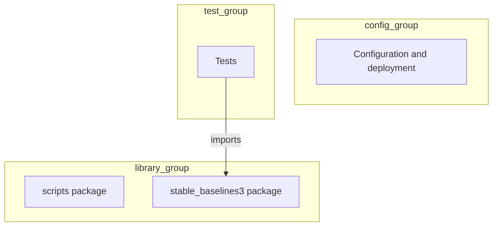

# Architecture report: DLR-RM/stable-baselines3

> Automated static analysis. **Observed** = directly seen in files/imports/AST; **Inferred** = interpretation from that evidence. Repository code was not executed.

## 1. Repository at a glance

| Item | Value |
| --- | --- |
| Repository | DLR-RM/stable-baselines3 |
| Description | PyTorch version of Stable Baselines, reliable implementations of reinforcement learning algorithms.  |
| Language | Python |
| Stars | 14012 |
| Licence | MIT |
| Analysed commit / branch | 0cdcd200deef06b9ad0af72f6ddfb07c06c6df39 / master |
| Framework(s) | None detected |
| Files analysed | 173 |
| Components | 4 |

## 2. Architecture in one minute

DLR-RM/stable-baselines3 - PyTorch version of Stable Baselines, reliable implementations of reinforcement learning algorithms. . This repository was analysed statically from 173 file(s) (97 Python). Detected technologies (observed from imports/manifests): GitHub Actions, NumPy, pandas, Poetry, setuptools, Docker. Files are grouped into 4 component(s): Configuration and deployment, scripts package, stable_baselines3 package, Tests. Findings below distinguish observed facts from inferred interpretation.

## 3. High-level block diagram

## 4. Main components

### Configuration and deployment (`config`)

- **Kind:** config
- **Status:** Observed
- **Confidence:** 0.85
- **Responsibility:** Groups 3 file(s) under configuration and deployment (observed from repository paths and static analysis).
- **Paths:** `Dockerfile`, `pyproject.toml`, `setup.py`
- **Evidence:** [Dockerfile](https://github.com/DLR-RM/stable-baselines3/blob/0cdcd200deef06b9ad0af72f6ddfb07c06c6df39/Dockerfile); [pyproject.toml](https://github.com/DLR-RM/stable-baselines3/blob/0cdcd200deef06b9ad0af72f6ddfb07c06c6df39/pyproject.toml); [setup.py](https://github.com/DLR-RM/stable-baselines3/blob/0cdcd200deef06b9ad0af72f6ddfb07c06c6df39/setup.py)

### scripts package (`scripts`)

- **Kind:** library
- **Status:** Observed
- **Confidence:** 0.85
- **Responsibility:** Groups 4 file(s) under scripts package (observed from repository paths and static analysis).
- **Paths:** `scripts/build_docker.sh`, `scripts/run_docker_cpu.sh`, `scripts/run_docker_gpu.sh`, `scripts/run_tests.sh`
- **Evidence:** [scripts/build_docker.sh](https://github.com/DLR-RM/stable-baselines3/blob/0cdcd200deef06b9ad0af72f6ddfb07c06c6df39/scripts/build_docker.sh); [scripts/run_docker_cpu.sh](https://github.com/DLR-RM/stable-baselines3/blob/0cdcd200deef06b9ad0af72f6ddfb07c06c6df39/scripts/run_docker_cpu.sh); [scripts/run_docker_gpu.sh](https://github.com/DLR-RM/stable-baselines3/blob/0cdcd200deef06b9ad0af72f6ddfb07c06c6df39/scripts/run_docker_gpu.sh); [scripts/run_tests.sh](https://github.com/DLR-RM/stable-baselines3/blob/0cdcd200deef06b9ad0af72f6ddfb07c06c6df39/scripts/run_tests.sh)

### stable_baselines3 package (`stable_baselines3`)

- **Kind:** library
- **Status:** Observed
- **Confidence:** 0.85
- **Responsibility:** Groups 64 file(s) under stable_baselines3 package (observed from repository paths and static analysis). Observed top-level classes: A2C, ActionNoise, Actor, ActorCriticCnnPolicy, ActorCriticPolicy, AtariWrapper. Observed top-level functions: HER, _check_box_obs, _check_goal_env_compute_reward, _check_goal_env_obs, _check_image_input, _check_nan.
- **Paths:** `stable_baselines3/__init__.py`, `stable_baselines3/a2c/__init__.py`, `stable_baselines3/a2c/a2c.py`, `stable_baselines3/a2c/policies.py`, `stable_baselines3/common/__init__.py`, `stable_baselines3/common/atari_wrappers.py`, `stable_baselines3/common/base_class.py`, `stable_baselines3/common/buffers.py`, `stable_baselines3/common/callbacks.py`, `stable_baselines3/common/distributions.py`, `stable_baselines3/common/env_checker.py`, `stable_baselines3/common/env_util.py`, `stable_baselines3/common/envs/__init__.py`, `stable_baselines3/common/envs/bit_flipping_env.py`, `stable_baselines3/common/envs/identity_env.py`, `stable_baselines3/common/envs/multi_input_envs.py`, `stable_baselines3/common/evaluation.py`, `stable_baselines3/common/logger.py`, `stable_baselines3/common/monitor.py`, `stable_baselines3/common/noise.py`, `stable_baselines3/common/off_policy_algorithm.py`, `stable_baselines3/common/on_policy_algorithm.py`, `stable_baselines3/common/policies.py`, `stable_baselines3/common/preprocessing.py`, `stable_baselines3/common/results_plotter.py`, `stable_baselines3/common/running_mean_std.py`, `stable_baselines3/common/save_util.py`, `stable_baselines3/common/sb2_compat/__init__.py`, `stable_baselines3/common/sb2_compat/rmsprop_tf_like.py`, `stable_baselines3/common/torch_layers.py`, `stable_baselines3/common/type_aliases.py`, `stable_baselines3/common/utils.py`, `stable_baselines3/common/vec_env/__init__.py`, `stable_baselines3/common/vec_env/base_vec_env.py`, `stable_baselines3/common/vec_env/dummy_vec_env.py`, `stable_baselines3/common/vec_env/patch_gym.py`, `stable_baselines3/common/vec_env/stacked_observations.py`, `stable_baselines3/common/vec_env/subproc_vec_env.py`, `stable_baselines3/common/vec_env/util.py`, `stable_baselines3/common/vec_env/vec_check_nan.py`, `stable_baselines3/common/vec_env/vec_extract_dict_obs.py`, `stable_baselines3/common/vec_env/vec_frame_stack.py`, `stable_baselines3/common/vec_env/vec_monitor.py`, `stable_baselines3/common/vec_env/vec_normalize.py`, `stable_baselines3/common/vec_env/vec_transpose.py`, `stable_baselines3/common/vec_env/vec_video_recorder.py`, `stable_baselines3/ddpg/__init__.py`, `stable_baselines3/ddpg/ddpg.py`, `stable_baselines3/ddpg/policies.py`, `stable_baselines3/dqn/__init__.py`, `stable_baselines3/dqn/dqn.py`, `stable_baselines3/dqn/policies.py`, `stable_baselines3/her/__init__.py`, `stable_baselines3/her/goal_selection_strategy.py`, `stable_baselines3/her/her_replay_buffer.py`, `stable_baselines3/ppo/__init__.py`, `stable_baselines3/ppo/policies.py`, `stable_baselines3/ppo/ppo.py`, `stable_baselines3/sac/__init__.py`, `stable_baselines3/sac/policies.py`, `stable_baselines3/sac/sac.py`, `stable_baselines3/td3/__init__.py`, `stable_baselines3/td3/policies.py`, `stable_baselines3/td3/td3.py`
- **Evidence:** [stable_baselines3/__init__.py:18](https://github.com/DLR-RM/stable-baselines3/blob/0cdcd200deef06b9ad0af72f6ddfb07c06c6df39/stable_baselines3/__init__.py#L18); [stable_baselines3/a2c/__init__.py](https://github.com/DLR-RM/stable-baselines3/blob/0cdcd200deef06b9ad0af72f6ddfb07c06c6df39/stable_baselines3/a2c/__init__.py); [stable_baselines3/a2c/a2c.py:16](https://github.com/DLR-RM/stable-baselines3/blob/0cdcd200deef06b9ad0af72f6ddfb07c06c6df39/stable_baselines3/a2c/a2c.py#L16); [stable_baselines3/a2c/policies.py](https://github.com/DLR-RM/stable-baselines3/blob/0cdcd200deef06b9ad0af72f6ddfb07c06c6df39/stable_baselines3/a2c/policies.py); [stable_baselines3/common/__init__.py](https://github.com/DLR-RM/stable-baselines3/blob/0cdcd200deef06b9ad0af72f6ddfb07c06c6df39/stable_baselines3/common/__init__.py); [stable_baselines3/common/atari_wrappers.py:17](https://github.com/DLR-RM/stable-baselines3/blob/0cdcd200deef06b9ad0af72f6ddfb07c06c6df39/stable_baselines3/common/atari_wrappers.py#L17); [stable_baselines3/common/base_class.py:48](https://github.com/DLR-RM/stable-baselines3/blob/0cdcd200deef06b9ad0af72f6ddfb07c06c6df39/stable_baselines3/common/base_class.py#L48); [stable_baselines3/common/buffers.py:27](https://github.com/DLR-RM/stable-baselines3/blob/0cdcd200deef06b9ad0af72f6ddfb07c06c6df39/stable_baselines3/common/buffers.py#L27)

### Tests (`tests`)

- **Kind:** test
- **Status:** Observed
- **Confidence:** 0.85
- **Responsibility:** Groups 31 file(s) under tests (observed from repository paths and static analysis). Observed top-level classes: ActionDictTestEnv, AlwaysDoneWrapper, AlwaysFailCallback, CheckGAECallback, CustomEnv, CustomGymEnv. Observed top-level functions: _make_env_safe, _make_warmstart, _make_warmstart_cartpole, _make_warmstart_cliffwalking, _make_warmstart_dict_env, allclose.
- **Paths:** `tests/__init__.py`, `tests/test_buffers.py`, `tests/test_callbacks.py`, `tests/test_cnn.py`, `tests/test_custom_policy.py`, `tests/test_deterministic.py`, `tests/test_dict_env.py`, `tests/test_distributions.py`, `tests/test_env_checker.py`, `tests/test_envs.py`, `tests/test_gae.py`, `tests/test_her.py`, `tests/test_identity.py`, `tests/test_logger.py`, `tests/test_monitor.py`, `tests/test_n_step_replay.py`, `tests/test_predict.py`, `tests/test_preprocessing.py`, `tests/test_run.py`, `tests/test_save_load.py`, `tests/test_sde.py`, `tests/test_spaces.py`, `tests/test_tensorboard.py`, `tests/test_train_eval_mode.py`, `tests/test_utils.py`, `tests/test_vec_check_nan.py`, `tests/test_vec_envs.py`, `tests/test_vec_extract_dict_obs.py`, `tests/test_vec_monitor.py`, `tests/test_vec_normalize.py`, `tests/test_vec_stacked_obs.py`
- **Evidence:** [tests/__init__.py](https://github.com/DLR-RM/stable-baselines3/blob/0cdcd200deef06b9ad0af72f6ddfb07c06c6df39/tests/__init__.py); [tests/test_buffers.py:16](https://github.com/DLR-RM/stable-baselines3/blob/0cdcd200deef06b9ad0af72f6ddfb07c06c6df39/tests/test_buffers.py#L16); [tests/test_callbacks.py:26](https://github.com/DLR-RM/stable-baselines3/blob/0cdcd200deef06b9ad0af72f6ddfb07c06c6df39/tests/test_callbacks.py#L26); [tests/test_cnn.py:17](https://github.com/DLR-RM/stable-baselines3/blob/0cdcd200deef06b9ad0af72f6ddfb07c06c6df39/tests/test_cnn.py#L17); [tests/test_custom_policy.py:26](https://github.com/DLR-RM/stable-baselines3/blob/0cdcd200deef06b9ad0af72f6ddfb07c06c6df39/tests/test_custom_policy.py#L26); [tests/test_deterministic.py:12](https://github.com/DLR-RM/stable-baselines3/blob/0cdcd200deef06b9ad0af72f6ddfb07c06c6df39/tests/test_deterministic.py#L12); [tests/test_dict_env.py:14](https://github.com/DLR-RM/stable-baselines3/blob/0cdcd200deef06b9ad0af72f6ddfb07c06c6df39/tests/test_dict_env.py#L14); [tests/test_distributions.py:26](https://github.com/DLR-RM/stable-baselines3/blob/0cdcd200deef06b9ad0af72f6ddfb07c06c6df39/tests/test_distributions.py#L26)

## 5. Execution flow

No entry point was observed; the startup flow below is therefore limited.

Representative flow (derived from observed entry points and the import graph; steps beyond the entry point are **Inferred**):

1. Execution starts at an observed entry point listed above, if present.
2. `tests` imports `stable_baselines3` (Tests -> stable_baselines3 package).

## 6. Project structure

### `(root)`

- `.gitignore` - other (424 bytes)
- `.readthedocs.yml` - config (460 bytes)
- `CITATION.bib` - other (419 bytes)
- `CODE_OF_CONDUCT.md` - docs (5239 bytes)
- `CONTRIBUTING.md` - docs (4641 bytes)
- `Dockerfile` - container (1052 bytes)
- `LICENSE` - docs (1075 bytes)
- `Makefile` - other (1468 bytes)
- `NOTICE` - docs (1339 bytes)
- `README.md` - docs (16229 bytes)
- `pyproject.toml` - manifest (2266 bytes)
- `setup.py` - manifest, Python (5446 bytes)

### `.github`

- `.github/ISSUE_TEMPLATE/bug_report.yml` - config (3195 bytes)
- `.github/ISSUE_TEMPLATE/custom_env.yml` - config (4475 bytes)
- `.github/ISSUE_TEMPLATE/documentation.yml` - config (1159 bytes)
- `.github/ISSUE_TEMPLATE/feature_request.yml` - config (1929 bytes)
- `.github/ISSUE_TEMPLATE/question.yml` - config (1918 bytes)
- `.github/PULL_REQUEST_TEMPLATE.md` - docs (2359 bytes)
- `.github/workflows/ci.yml` - ci, YAML (2272 bytes)
- `.github/workflows/pypi-publish.yml` - ci, YAML (1000 bytes)

### `docs`

- `docs/Makefile` - docs (688 bytes)
- `docs/README.md` - docs (389 bytes)
- `docs/_static/css/baselines_theme.css` - docs (1186 bytes)
- `docs/_static/img/colab-badge.svg` - docs (2371 bytes)
- `docs/_static/img/colab.svg` - docs (1583 bytes)
- `docs/common/atari_wrappers.md` - docs (122 bytes)
- `docs/common/distributions.md` - docs (1056 bytes)
- `docs/common/env_checker.md` - docs (126 bytes)
- `docs/common/env_util.md` - docs (115 bytes)
- `docs/common/envs.md` - docs (320 bytes)
- `docs/common/evaluation.md` - docs (112 bytes)
- `docs/common/logger.md` - docs (5250 bytes)
- `docs/common/monitor.md` - docs (110 bytes)
- `docs/common/noise.md` - docs (103 bytes)
- `docs/common/utils.md` - docs (96 bytes)
- `docs/conda_env.yml` - config (338 bytes)
- `docs/conf.py` - docs (6892 bytes)
- `docs/guide/algos.md` - docs (5930 bytes)
- `docs/guide/callbacks.md` - docs (14701 bytes)
- `docs/guide/checking_nan.md` - docs (5232 bytes)
- `docs/guide/custom_env.md` - docs (5810 bytes)
- `docs/guide/custom_policy.md` - docs (15059 bytes)
- `docs/guide/developer.md` - docs (4253 bytes)
- `docs/guide/examples.md` - docs (30879 bytes)
- `docs/guide/export.md` - docs (15849 bytes)
- `docs/guide/imitation.md` - docs (835 bytes)
- `docs/guide/install.md` - docs (4686 bytes)
- `docs/guide/integrations.md` - docs (8023 bytes)
- `docs/guide/migration.md` - docs (8895 bytes)
- `docs/guide/plotting.md` - docs (6181 bytes)
- `docs/guide/quickstart.md` - docs (1367 bytes)
- `docs/guide/rl.md` - docs (1148 bytes)
- `docs/guide/rl_tips.md` - docs (15602 bytes)
- `docs/guide/rl_zoo.md` - docs (3179 bytes)
- `docs/guide/save_format.md` - docs (2902 bytes)
- `docs/guide/sb3_contrib.md` - docs (3240 bytes)
- `docs/guide/sbx.md` - docs (2101 bytes)
- `docs/guide/tensorboard.md` - docs (12704 bytes)
- `docs/guide/vec_envs.md` - docs (12816 bytes)
- `docs/index.rst` - docs (3634 bytes)
- `docs/make.bat` - docs (820 bytes)
- `docs/misc/changelog.md` - docs (86647 bytes)
- `docs/misc/projects.md` - docs (14585 bytes)
- `docs/modules/a2c.md` - docs (6136 bytes)
- `docs/modules/base.md` - docs (674 bytes)
- `docs/modules/ddpg.md` - docs (4254 bytes)
- `docs/modules/dqn.md` - docs (3265 bytes)
- `docs/modules/her.md` - docs (4268 bytes)
- `docs/modules/ppo.md` - docs (6956 bytes)
- `docs/modules/sac.md` - docs (5769 bytes)
- `docs/modules/td3.md` - docs (4453 bytes)
- `docs/spelling_wordlist.txt` - docs (1029 bytes)

### `scripts`

- `scripts/build_docker.sh` - source, Shell (799 bytes)
- `scripts/run_docker_cpu.sh` - source, Shell (359 bytes)
- `scripts/run_docker_gpu.sh` - source, Shell (419 bytes)
- `scripts/run_tests.sh` - source, Shell (123 bytes)

### `stable_baselines3`

- `stable_baselines3/__init__.py` - source, Python (939 bytes)
- `stable_baselines3/a2c/__init__.py` - source, Python (189 bytes)
- `stable_baselines3/a2c/a2c.py` - source, Python (9164 bytes)
- `stable_baselines3/a2c/policies.py` - source, Python (301 bytes)
- `stable_baselines3/common/__init__.py` - source, Python (0 bytes)
- `stable_baselines3/common/atari_wrappers.py` - source, Python (11770 bytes)
- `stable_baselines3/common/base_class.py` - source, Python (38680 bytes)
- `stable_baselines3/common/buffers.py` - source, Python (40735 bytes)
- `stable_baselines3/common/callbacks.py` - source, Python (27529 bytes)
- `stable_baselines3/common/distributions.py` - source, Python (28170 bytes)
- `stable_baselines3/common/env_checker.py` - source, Python (24677 bytes)
- `stable_baselines3/common/env_util.py` - source, Python (7932 bytes)
- `stable_baselines3/common/envs/__init__.py` - source, Python (508 bytes)
- `stable_baselines3/common/envs/bit_flipping_env.py` - source, Python (9255 bytes)
- `stable_baselines3/common/envs/identity_env.py` - source, Python (5975 bytes)
- `stable_baselines3/common/envs/multi_input_envs.py` - source, Python (6432 bytes)
- `stable_baselines3/common/evaluation.py` - source, Python (6620 bytes)
- `stable_baselines3/common/logger.py` - source, Python (23652 bytes)
- `stable_baselines3/common/monitor.py` - source, Python (9697 bytes)
- `stable_baselines3/common/noise.py` - source, Python (5529 bytes)
- `stable_baselines3/common/off_policy_algorithm.py` - source, Python (28308 bytes)
- `stable_baselines3/common/on_policy_algorithm.py` - source, Python (14576 bytes)
- `stable_baselines3/common/policies.py` - source, Python (42902 bytes)
- `stable_baselines3/common/preprocessing.py` - source, Python (8835 bytes)
- `stable_baselines3/common/results_plotter.py` - source, Python (5053 bytes)
- `stable_baselines3/common/running_mean_std.py` - source, Python (1987 bytes)
- `stable_baselines3/common/save_util.py` - source, Python (20769 bytes)
- `stable_baselines3/common/sb2_compat/__init__.py` - source, Python (0 bytes)
- `stable_baselines3/common/sb2_compat/rmsprop_tf_like.py` - source, Python (5657 bytes)
- `stable_baselines3/common/torch_layers.py` - source, Python (15500 bytes)
- `stable_baselines3/common/type_aliases.py` - source, Python (3312 bytes)
- `stable_baselines3/common/utils.py` - source, Python (24184 bytes)
- `stable_baselines3/common/vec_env/__init__.py` - source, Python (4360 bytes)
- `stable_baselines3/common/vec_env/base_vec_env.py` - source, Python (19099 bytes)
- `stable_baselines3/common/vec_env/dummy_vec_env.py` - source, Python (6980 bytes)
- `stable_baselines3/common/vec_env/patch_gym.py` - source, Python (3430 bytes)
- `stable_baselines3/common/vec_env/stacked_observations.py` - source, Python (8147 bytes)
- `stable_baselines3/common/vec_env/subproc_vec_env.py` - source, Python (11662 bytes)
- `stable_baselines3/common/vec_env/util.py` - source, Python (2656 bytes)
- `stable_baselines3/common/vec_env/vec_check_nan.py` - source, Python (4208 bytes)
- `stable_baselines3/common/vec_env/vec_extract_dict_obs.py` - source, Python (1194 bytes)
- `stable_baselines3/common/vec_env/vec_frame_stack.py` - source, Python (2079 bytes)
- `stable_baselines3/common/vec_env/vec_monitor.py` - source, Python (3851 bytes)
- `stable_baselines3/common/vec_env/vec_normalize.py` - source, Python (13594 bytes)
- `stable_baselines3/common/vec_env/vec_transpose.py` - source, Python (4503 bytes)
- `stable_baselines3/common/vec_env/vec_video_recorder.py` - source, Python (5756 bytes)
- `stable_baselines3/ddpg/__init__.py` - source, Python (194 bytes)
- `stable_baselines3/ddpg/ddpg.py` - source, Python (6117 bytes)
- `stable_baselines3/ddpg/policies.py` - source, Python (139 bytes)
- `stable_baselines3/dqn/__init__.py` - source, Python (189 bytes)
- `stable_baselines3/dqn/dqn.py` - source, Python (13433 bytes)
- `stable_baselines3/dqn/policies.py` - source, Python (10637 bytes)
- `stable_baselines3/her/__init__.py` - source, Python (204 bytes)
- `stable_baselines3/her/goal_selection_strategy.py` - source, Python (649 bytes)
- `stable_baselines3/her/her_replay_buffer.py` - source, Python (18943 bytes)
- `stable_baselines3/ppo/__init__.py` - source, Python (189 bytes)
- `stable_baselines3/ppo/policies.py` - source, Python (301 bytes)
- `stable_baselines3/ppo/ppo.py` - source, Python (15220 bytes)
- `stable_baselines3/py.typed` - other (0 bytes)
- `stable_baselines3/sac/__init__.py` - source, Python (189 bytes)
- `stable_baselines3/sac/policies.py` - source, Python (20595 bytes)
- `stable_baselines3/sac/sac.py` - source, Python (16568 bytes)
- `stable_baselines3/td3/__init__.py` - source, Python (189 bytes)
- `stable_baselines3/td3/policies.py` - source, Python (14401 bytes)
- `stable_baselines3/td3/td3.py` - source, Python (11783 bytes)
- `stable_baselines3/version.txt` - docs (6 bytes)

### `tests`

- `tests/__init__.py` - test, Python (0 bytes)
- `tests/test_buffers.py` - test, Python (9960 bytes)
- `tests/test_callbacks.py` - test, Python (10931 bytes)
- `tests/test_cnn.py` - test, Python (13832 bytes)
- `tests/test_custom_policy.py` - test, Python (4783 bytes)
- `tests/test_deterministic.py` - test, Python (1362 bytes)
- `tests/test_dict_env.py` - test, Python (12363 bytes)
- `tests/test_distributions.py` - test, Python (9875 bytes)
- `tests/test_env_checker.py` - test, Python (8866 bytes)
- `tests/test_envs.py` - test, Python (10573 bytes)
- `tests/test_gae.py` - test, Python (6899 bytes)
- `tests/test_her.py` - test, Python (16910 bytes)
- `tests/test_identity.py` - test, Python (2094 bytes)
- `tests/test_logger.py` - test, Python (24546 bytes)
- `tests/test_monitor.py` - test, Python (6111 bytes)
- `tests/test_n_step_replay.py` - test, Python (8747 bytes)
- `tests/test_predict.py` - test, Python (4032 bytes)
- `tests/test_preprocessing.py` - test, Python (2429 bytes)
- `tests/test_run.py` - test, Python (7709 bytes)
- `tests/test_save_load.py` - test, Python (34504 bytes)
- `tests/test_sde.py` - test, Python (4272 bytes)
- `tests/test_spaces.py` - test, Python (5878 bytes)
- `tests/test_tensorboard.py` - test, Python (2941 bytes)
- `tests/test_train_eval_mode.py` - test, Python (13172 bytes)
- `tests/test_utils.py` - test, Python (26664 bytes)
- `tests/test_vec_check_nan.py` - test, Python (1398 bytes)
- `tests/test_vec_envs.py` - test, Python (24225 bytes)
- `tests/test_vec_extract_dict_obs.py` - test, Python (2941 bytes)
- `tests/test_vec_monitor.py` - test, Python (5276 bytes)
- `tests/test_vec_normalize.py` - test, Python (17892 bytes)
- `tests/test_vec_stacked_obs.py` - test, Python (14834 bytes)

## 7. Key dependencies and integrations

| Name | Category | Status | Confidence | Evidence |
| --- | --- | --- | --- | --- |
| GitHub Actions | ci | Observed | 0.90 | [.github/workflows/ci.yml](https://github.com/DLR-RM/stable-baselines3/blob/0cdcd200deef06b9ad0af72f6ddfb07c06c6df39/.github/workflows/ci.yml); [.github/workflows/pypi-publish.yml](https://github.com/DLR-RM/stable-baselines3/blob/0cdcd200deef06b9ad0af72f6ddfb07c06c6df39/.github/workflows/pypi-publish.yml) |
| NumPy | library | Observed | 0.95 | [setup.py:83](https://github.com/DLR-RM/stable-baselines3/blob/0cdcd200deef06b9ad0af72f6ddfb07c06c6df39/setup.py#L83); [stable_baselines3/common/atari_wrappers.py:4](https://github.com/DLR-RM/stable-baselines3/blob/0cdcd200deef06b9ad0af72f6ddfb07c06c6df39/stable_baselines3/common/atari_wrappers.py#L4); [stable_baselines3/common/base_class.py:13](https://github.com/DLR-RM/stable-baselines3/blob/0cdcd200deef06b9ad0af72f6ddfb07c06c6df39/stable_baselines3/common/base_class.py#L13); [stable_baselines3/common/buffers.py:6](https://github.com/DLR-RM/stable-baselines3/blob/0cdcd200deef06b9ad0af72f6ddfb07c06c6df39/stable_baselines3/common/buffers.py#L6) |
| pandas | library | Observed | 0.95 | [setup.py:126](https://github.com/DLR-RM/stable-baselines3/blob/0cdcd200deef06b9ad0af72f6ddfb07c06c6df39/setup.py#L126); [stable_baselines3/common/monitor.py:14](https://github.com/DLR-RM/stable-baselines3/blob/0cdcd200deef06b9ad0af72f6ddfb07c06c6df39/stable_baselines3/common/monitor.py#L14); [stable_baselines3/common/monitor.py:240](https://github.com/DLR-RM/stable-baselines3/blob/0cdcd200deef06b9ad0af72f6ddfb07c06c6df39/stable_baselines3/common/monitor.py#L240); [stable_baselines3/common/results_plotter.py:6](https://github.com/DLR-RM/stable-baselines3/blob/0cdcd200deef06b9ad0af72f6ddfb07c06c6df39/stable_baselines3/common/results_plotter.py#L6) |
| Poetry | packaging | Observed | 0.85 | [pyproject.toml](https://github.com/DLR-RM/stable-baselines3/blob/0cdcd200deef06b9ad0af72f6ddfb07c06c6df39/pyproject.toml) |
| setuptools | packaging | Observed | 0.90 | [setup.py:3](https://github.com/DLR-RM/stable-baselines3/blob/0cdcd200deef06b9ad0af72f6ddfb07c06c6df39/setup.py#L3) |
| Docker | tooling | Observed | 0.85 | [Dockerfile](https://github.com/DLR-RM/stable-baselines3/blob/0cdcd200deef06b9ad0af72f6ddfb07c06c6df39/Dockerfile) |
| pytest | tooling | Observed | 0.95 | [.github/workflows/ci.yml:68](https://github.com/DLR-RM/stable-baselines3/blob/0cdcd200deef06b9ad0af72f6ddfb07c06c6df39/.github/workflows/ci.yml#L68); [setup.py:91](https://github.com/DLR-RM/stable-baselines3/blob/0cdcd200deef06b9ad0af72f6ddfb07c06c6df39/setup.py#L91); [tests/test_buffers.py:3](https://github.com/DLR-RM/stable-baselines3/blob/0cdcd200deef06b9ad0af72f6ddfb07c06c6df39/tests/test_buffers.py#L3); [tests/test_callbacks.py:6](https://github.com/DLR-RM/stable-baselines3/blob/0cdcd200deef06b9ad0af72f6ddfb07c06c6df39/tests/test_callbacks.py#L6) |
| unittest | tooling | Observed | 0.90 | [tests/test_logger.py:7](https://github.com/DLR-RM/stable-baselines3/blob/0cdcd200deef06b9ad0af72f6ddfb07c06c6df39/tests/test_logger.py#L7) |

## 8. Data and state

No database, cache, queue, or persistent-state usage was observed in the analysed files. State handling, if any, may be in-memory or in files that were not analysed.

## 9. Configuration and deployment clues

- `.github/ISSUE_TEMPLATE/bug_report.yml` (config)
- `.github/ISSUE_TEMPLATE/custom_env.yml` (config)
- `.github/ISSUE_TEMPLATE/documentation.yml` (config)
- `.github/ISSUE_TEMPLATE/feature_request.yml` (config)
- `.github/ISSUE_TEMPLATE/question.yml` (config)
- `.github/workflows/ci.yml` (ci)
- `.github/workflows/pypi-publish.yml` (ci)
- `.readthedocs.yml` (config)
- `Dockerfile` (container)
- `docs/conda_env.yml` (config)
- `pyproject.toml` (manifest)
- `setup.py` (manifest)

## 10. Design observations

- Tests are present alongside source code (Observed from test file paths).

These observations are interpretations (**Inferred**) of the observed structure, not guarantees about runtime design.

## 11. Limitations and unknowns

- Static analysis only: repository code was not executed, installed, or imported at runtime.
- Components and relationships are inferred from file paths, imports, and AST structure; runtime behaviour, dynamic imports, and reflection may not be visible.
- No clear application entry point was observed in the analysed files.
- Repository text was treated as untrusted data; no instructions found in repository files were followed, and likely secret values were redacted/excluded.

## 12. Source references

- [.github/workflows/ci.yml](https://github.com/DLR-RM/stable-baselines3/blob/0cdcd200deef06b9ad0af72f6ddfb07c06c6df39/.github/workflows/ci.yml)
- [.github/workflows/ci.yml:68](https://github.com/DLR-RM/stable-baselines3/blob/0cdcd200deef06b9ad0af72f6ddfb07c06c6df39/.github/workflows/ci.yml#L68)
- [.github/workflows/pypi-publish.yml](https://github.com/DLR-RM/stable-baselines3/blob/0cdcd200deef06b9ad0af72f6ddfb07c06c6df39/.github/workflows/pypi-publish.yml)
- [Dockerfile](https://github.com/DLR-RM/stable-baselines3/blob/0cdcd200deef06b9ad0af72f6ddfb07c06c6df39/Dockerfile)
- [pyproject.toml](https://github.com/DLR-RM/stable-baselines3/blob/0cdcd200deef06b9ad0af72f6ddfb07c06c6df39/pyproject.toml)
- [scripts/build_docker.sh](https://github.com/DLR-RM/stable-baselines3/blob/0cdcd200deef06b9ad0af72f6ddfb07c06c6df39/scripts/build_docker.sh)
- [scripts/run_docker_cpu.sh](https://github.com/DLR-RM/stable-baselines3/blob/0cdcd200deef06b9ad0af72f6ddfb07c06c6df39/scripts/run_docker_cpu.sh)
- [scripts/run_docker_gpu.sh](https://github.com/DLR-RM/stable-baselines3/blob/0cdcd200deef06b9ad0af72f6ddfb07c06c6df39/scripts/run_docker_gpu.sh)
- [scripts/run_tests.sh](https://github.com/DLR-RM/stable-baselines3/blob/0cdcd200deef06b9ad0af72f6ddfb07c06c6df39/scripts/run_tests.sh)
- [setup.py](https://github.com/DLR-RM/stable-baselines3/blob/0cdcd200deef06b9ad0af72f6ddfb07c06c6df39/setup.py)
- [setup.py:3](https://github.com/DLR-RM/stable-baselines3/blob/0cdcd200deef06b9ad0af72f6ddfb07c06c6df39/setup.py#L3)
- [setup.py:83](https://github.com/DLR-RM/stable-baselines3/blob/0cdcd200deef06b9ad0af72f6ddfb07c06c6df39/setup.py#L83)
- [setup.py:91](https://github.com/DLR-RM/stable-baselines3/blob/0cdcd200deef06b9ad0af72f6ddfb07c06c6df39/setup.py#L91)
- [setup.py:126](https://github.com/DLR-RM/stable-baselines3/blob/0cdcd200deef06b9ad0af72f6ddfb07c06c6df39/setup.py#L126)
- [stable_baselines3/__init__.py:18](https://github.com/DLR-RM/stable-baselines3/blob/0cdcd200deef06b9ad0af72f6ddfb07c06c6df39/stable_baselines3/__init__.py#L18)
- [stable_baselines3/a2c/__init__.py](https://github.com/DLR-RM/stable-baselines3/blob/0cdcd200deef06b9ad0af72f6ddfb07c06c6df39/stable_baselines3/a2c/__init__.py)
- [stable_baselines3/a2c/a2c.py:16](https://github.com/DLR-RM/stable-baselines3/blob/0cdcd200deef06b9ad0af72f6ddfb07c06c6df39/stable_baselines3/a2c/a2c.py#L16)
- [stable_baselines3/a2c/policies.py](https://github.com/DLR-RM/stable-baselines3/blob/0cdcd200deef06b9ad0af72f6ddfb07c06c6df39/stable_baselines3/a2c/policies.py)
- [stable_baselines3/common/__init__.py](https://github.com/DLR-RM/stable-baselines3/blob/0cdcd200deef06b9ad0af72f6ddfb07c06c6df39/stable_baselines3/common/__init__.py)
- [stable_baselines3/common/atari_wrappers.py:4](https://github.com/DLR-RM/stable-baselines3/blob/0cdcd200deef06b9ad0af72f6ddfb07c06c6df39/stable_baselines3/common/atari_wrappers.py#L4)
- [stable_baselines3/common/atari_wrappers.py:17](https://github.com/DLR-RM/stable-baselines3/blob/0cdcd200deef06b9ad0af72f6ddfb07c06c6df39/stable_baselines3/common/atari_wrappers.py#L17)
- [stable_baselines3/common/base_class.py:13](https://github.com/DLR-RM/stable-baselines3/blob/0cdcd200deef06b9ad0af72f6ddfb07c06c6df39/stable_baselines3/common/base_class.py#L13)
- [stable_baselines3/common/base_class.py:48](https://github.com/DLR-RM/stable-baselines3/blob/0cdcd200deef06b9ad0af72f6ddfb07c06c6df39/stable_baselines3/common/base_class.py#L48)
- [stable_baselines3/common/buffers.py:6](https://github.com/DLR-RM/stable-baselines3/blob/0cdcd200deef06b9ad0af72f6ddfb07c06c6df39/stable_baselines3/common/buffers.py#L6)
- [stable_baselines3/common/buffers.py:27](https://github.com/DLR-RM/stable-baselines3/blob/0cdcd200deef06b9ad0af72f6ddfb07c06c6df39/stable_baselines3/common/buffers.py#L27)
- [stable_baselines3/common/callbacks.py:8](https://github.com/DLR-RM/stable-baselines3/blob/0cdcd200deef06b9ad0af72f6ddfb07c06c6df39/stable_baselines3/common/callbacks.py#L8)
- [stable_baselines3/common/distributions.py:6](https://github.com/DLR-RM/stable-baselines3/blob/0cdcd200deef06b9ad0af72f6ddfb07c06c6df39/stable_baselines3/common/distributions.py#L6)
- [stable_baselines3/common/env_checker.py:5](https://github.com/DLR-RM/stable-baselines3/blob/0cdcd200deef06b9ad0af72f6ddfb07c06c6df39/stable_baselines3/common/env_checker.py#L5)
- [stable_baselines3/common/envs/bit_flipping_env.py:4](https://github.com/DLR-RM/stable-baselines3/blob/0cdcd200deef06b9ad0af72f6ddfb07c06c6df39/stable_baselines3/common/envs/bit_flipping_env.py#L4)
- [stable_baselines3/common/monitor.py:14](https://github.com/DLR-RM/stable-baselines3/blob/0cdcd200deef06b9ad0af72f6ddfb07c06c6df39/stable_baselines3/common/monitor.py#L14)
- [stable_baselines3/common/monitor.py:240](https://github.com/DLR-RM/stable-baselines3/blob/0cdcd200deef06b9ad0af72f6ddfb07c06c6df39/stable_baselines3/common/monitor.py#L240)
- [stable_baselines3/common/results_plotter.py:6](https://github.com/DLR-RM/stable-baselines3/blob/0cdcd200deef06b9ad0af72f6ddfb07c06c6df39/stable_baselines3/common/results_plotter.py#L6)
- [tests/__init__.py](https://github.com/DLR-RM/stable-baselines3/blob/0cdcd200deef06b9ad0af72f6ddfb07c06c6df39/tests/__init__.py)
- [tests/test_buffers.py:3](https://github.com/DLR-RM/stable-baselines3/blob/0cdcd200deef06b9ad0af72f6ddfb07c06c6df39/tests/test_buffers.py#L3)
- [tests/test_buffers.py:16](https://github.com/DLR-RM/stable-baselines3/blob/0cdcd200deef06b9ad0af72f6ddfb07c06c6df39/tests/test_buffers.py#L16)
- [tests/test_callbacks.py:6](https://github.com/DLR-RM/stable-baselines3/blob/0cdcd200deef06b9ad0af72f6ddfb07c06c6df39/tests/test_callbacks.py#L6)
- [tests/test_callbacks.py:26](https://github.com/DLR-RM/stable-baselines3/blob/0cdcd200deef06b9ad0af72f6ddfb07c06c6df39/tests/test_callbacks.py#L26)
- [tests/test_cnn.py:5](https://github.com/DLR-RM/stable-baselines3/blob/0cdcd200deef06b9ad0af72f6ddfb07c06c6df39/tests/test_cnn.py#L5)
- [tests/test_cnn.py:17](https://github.com/DLR-RM/stable-baselines3/blob/0cdcd200deef06b9ad0af72f6ddfb07c06c6df39/tests/test_cnn.py#L17)
- [tests/test_custom_policy.py:1](https://github.com/DLR-RM/stable-baselines3/blob/0cdcd200deef06b9ad0af72f6ddfb07c06c6df39/tests/test_custom_policy.py#L1)
- [tests/test_custom_policy.py:26](https://github.com/DLR-RM/stable-baselines3/blob/0cdcd200deef06b9ad0af72f6ddfb07c06c6df39/tests/test_custom_policy.py#L26)
- [tests/test_deterministic.py:2](https://github.com/DLR-RM/stable-baselines3/blob/0cdcd200deef06b9ad0af72f6ddfb07c06c6df39/tests/test_deterministic.py#L2)
- [tests/test_deterministic.py:12](https://github.com/DLR-RM/stable-baselines3/blob/0cdcd200deef06b9ad0af72f6ddfb07c06c6df39/tests/test_deterministic.py#L12)
- [tests/test_dict_env.py:3](https://github.com/DLR-RM/stable-baselines3/blob/0cdcd200deef06b9ad0af72f6ddfb07c06c6df39/tests/test_dict_env.py#L3)
- [tests/test_dict_env.py:14](https://github.com/DLR-RM/stable-baselines3/blob/0cdcd200deef06b9ad0af72f6ddfb07c06c6df39/tests/test_dict_env.py#L14)
- [tests/test_distributions.py:26](https://github.com/DLR-RM/stable-baselines3/blob/0cdcd200deef06b9ad0af72f6ddfb07c06c6df39/tests/test_distributions.py#L26)
- [tests/test_logger.py:7](https://github.com/DLR-RM/stable-baselines3/blob/0cdcd200deef06b9ad0af72f6ddfb07c06c6df39/tests/test_logger.py#L7)
- [tests/test_logger.py:11](https://github.com/DLR-RM/stable-baselines3/blob/0cdcd200deef06b9ad0af72f6ddfb07c06c6df39/tests/test_logger.py#L11)
- [tests/test_logger.py:16](https://github.com/DLR-RM/stable-baselines3/blob/0cdcd200deef06b9ad0af72f6ddfb07c06c6df39/tests/test_logger.py#L16)
- [tests/test_monitor.py:7](https://github.com/DLR-RM/stable-baselines3/blob/0cdcd200deef06b9ad0af72f6ddfb07c06c6df39/tests/test_monitor.py#L7)
- [tests/test_vec_monitor.py:8](https://github.com/DLR-RM/stable-baselines3/blob/0cdcd200deef06b9ad0af72f6ddfb07c06c6df39/tests/test_vec_monitor.py#L8)
