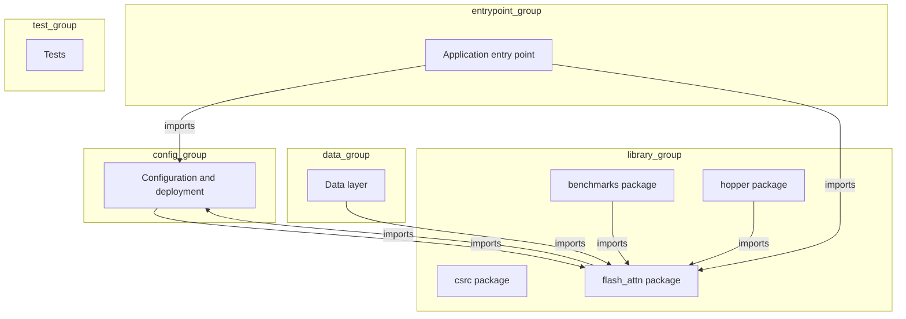

# Architecture report: Dao-AILab/flash-attention

> Automated static analysis. **Observed** = directly seen in files/imports/AST; **Inferred** = interpretation from that evidence. Repository code was not executed.

## 1. Repository at a glance

| Item | Value |
| --- | --- |
| Repository | Dao-AILab/flash-attention |
| Description | Fast and memory-efficient exact attention |
| Language | Python |
| Stars | 25293 |
| Licence | BSD-3-Clause |
| Analysed commit / branch | f63c472c4dc19237c0635d6a629df065ff64796e / main |
| Framework(s) | None detected |
| Files analysed | 800 |
| Components | 8 |

## 2. Architecture in one minute

Dao-AILab/flash-attention - Fast and memory-efficient exact attention. This repository was analysed statically from 800 file(s) (135 Python). Detected technologies (observed from imports/manifests): GitHub Actions, Poetry, setuptools, Docker, pytest, unittest. Files are grouped into 8 component(s): benchmarks package, Configuration and deployment, csrc package, Data layer, Application entry point, flash_attn package, hopper package, Tests. Observed entry point(s): .github/scripts/bump_beta_tag.py, AI/parse_clc_log.py, AI/racecheck_repro_1d_bulk.py. Findings below distinguish observed facts from inferred interpretation.

## 3. High-level block diagram

## 4. Main components

### benchmarks package (`benchmarks`)

- **Kind:** library
- **Status:** Observed
- **Confidence:** 0.85
- **Responsibility:** Groups 5 file(s) under benchmarks package (observed from repository paths and static analysis). Observed top-level functions: attention_pytorch, attn_bias_from_alibi_slopes, benchmark_forward, efficiency, flash_rotary, flops.
- **Paths:** `benchmarks/benchmark_alibi.py`, `benchmarks/benchmark_causal.py`, `benchmarks/benchmark_flash_attention.py`, `benchmarks/benchmark_gemm.py`, `benchmarks/benchmark_mla_paged_kv.py`
- **Evidence:** [benchmarks/benchmark_alibi.py:23](https://github.com/Dao-AILab/flash-attention/blob/f63c472c4dc19237c0635d6a629df065ff64796e/benchmarks/benchmark_alibi.py#L23); [benchmarks/benchmark_causal.py:20](https://github.com/Dao-AILab/flash-attention/blob/f63c472c4dc19237c0635d6a629df065ff64796e/benchmarks/benchmark_causal.py#L20); [benchmarks/benchmark_flash_attention.py:27](https://github.com/Dao-AILab/flash-attention/blob/f63c472c4dc19237c0635d6a629df065ff64796e/benchmarks/benchmark_flash_attention.py#L27); [benchmarks/benchmark_gemm.py:12](https://github.com/Dao-AILab/flash-attention/blob/f63c472c4dc19237c0635d6a629df065ff64796e/benchmarks/benchmark_gemm.py#L12); [benchmarks/benchmark_mla_paged_kv.py](https://github.com/Dao-AILab/flash-attention/blob/f63c472c4dc19237c0635d6a629df065ff64796e/benchmarks/benchmark_mla_paged_kv.py)

### Configuration and deployment (`config`)

- **Kind:** config
- **Status:** Observed
- **Confidence:** 0.85
- **Responsibility:** Groups 8 file(s) under configuration and deployment (observed from repository paths and static analysis). Observed top-level classes: BwdConfig, BwdFold, BwdHeuristicInputs, FwdConfig, FwdHeuristicInputs, MlaFwdConfig. Observed top-level functions: _select_fwd_config, append_nvcc_threads, bwd_fold_candidates, bwd_fold_forced, bwd_fold_heads, bwd_kv_subtile_factor.
- **Paths:** `MANIFEST.in`, `benchmarks/configs/clc.yaml`, `csrc/fused_dense_lib/setup.py`, `csrc/layer_norm/setup.py`, `flash_attn/cute/MANIFEST.in`, `flash_attn/cute/config.py`, `flash_attn/cute/pyproject.toml`, `flash_attn/pyproject.toml`
- **Evidence:** [MANIFEST.in](https://github.com/Dao-AILab/flash-attention/blob/f63c472c4dc19237c0635d6a629df065ff64796e/MANIFEST.in); [benchmarks/configs/clc.yaml](https://github.com/Dao-AILab/flash-attention/blob/f63c472c4dc19237c0635d6a629df065ff64796e/benchmarks/configs/clc.yaml); [csrc/fused_dense_lib/setup.py:10](https://github.com/Dao-AILab/flash-attention/blob/f63c472c4dc19237c0635d6a629df065ff64796e/csrc/fused_dense_lib/setup.py#L10); [csrc/layer_norm/setup.py:16](https://github.com/Dao-AILab/flash-attention/blob/f63c472c4dc19237c0635d6a629df065ff64796e/csrc/layer_norm/setup.py#L16); [flash_attn/cute/MANIFEST.in](https://github.com/Dao-AILab/flash-attention/blob/f63c472c4dc19237c0635d6a629df065ff64796e/flash_attn/cute/MANIFEST.in); [flash_attn/cute/config.py:17](https://github.com/Dao-AILab/flash-attention/blob/f63c472c4dc19237c0635d6a629df065ff64796e/flash_attn/cute/config.py#L17); [flash_attn/cute/pyproject.toml](https://github.com/Dao-AILab/flash-attention/blob/f63c472c4dc19237c0635d6a629df065ff64796e/flash_attn/cute/pyproject.toml); [flash_attn/pyproject.toml](https://github.com/Dao-AILab/flash-attention/blob/f63c472c4dc19237c0635d6a629df065ff64796e/flash_attn/pyproject.toml)

### csrc package (`csrc`)

- **Kind:** library
- **Status:** Observed
- **Confidence:** 0.85
- **Responsibility:** Groups 30 file(s) under csrc package (observed from repository paths and static analysis).
- **Paths:** `csrc/flash_attn/flash_api.cpp`, `csrc/flash_attn/src/alibi.h`, `csrc/flash_attn/src/block_info.h`, `csrc/flash_attn/src/dropout.h`, `csrc/flash_attn/src/flash.h`, `csrc/flash_attn/src/flash_bwd_kernel.h`, `csrc/flash_attn/src/flash_bwd_launch_template.h`, `csrc/flash_attn/src/flash_bwd_preprocess_kernel.h`, `csrc/flash_attn/src/flash_fwd_kernel.h`, `csrc/flash_attn/src/flash_fwd_launch_template.h`, `csrc/flash_attn/src/hardware_info.h`, `csrc/flash_attn/src/kernel_traits.h`, `csrc/flash_attn/src/mask.h`, `csrc/flash_attn/src/namespace_config.h`, `csrc/flash_attn/src/rotary.h`, `csrc/flash_attn/src/softmax.h`, `csrc/flash_attn/src/static_switch.h`, `csrc/flash_attn/src/utils.h`, `csrc/flash_attn_ck/flash_api.cpp`, `csrc/flash_attn_ck/flash_common.cpp`, `csrc/flash_attn_ck/mha_bwd.cpp`, `csrc/flash_attn_ck/mha_fwd.cpp`, `csrc/flash_attn_ck/mha_fwd_kvcache.cpp`, `csrc/flash_attn_ck/mha_varlen_bwd.cpp`, `csrc/flash_attn_ck/mha_varlen_fwd.cpp`, `csrc/fused_dense_lib/fused_dense.cpp`, `csrc/layer_norm/ln.h`, `csrc/layer_norm/ln_api.cpp`, `csrc/layer_norm/ln_kernel_traits.h`, `csrc/layer_norm/static_switch.h`
- **Evidence:** [csrc/flash_attn/flash_api.cpp](https://github.com/Dao-AILab/flash-attention/blob/f63c472c4dc19237c0635d6a629df065ff64796e/csrc/flash_attn/flash_api.cpp); [csrc/flash_attn/src/alibi.h](https://github.com/Dao-AILab/flash-attention/blob/f63c472c4dc19237c0635d6a629df065ff64796e/csrc/flash_attn/src/alibi.h); [csrc/flash_attn/src/block_info.h](https://github.com/Dao-AILab/flash-attention/blob/f63c472c4dc19237c0635d6a629df065ff64796e/csrc/flash_attn/src/block_info.h); [csrc/flash_attn/src/dropout.h](https://github.com/Dao-AILab/flash-attention/blob/f63c472c4dc19237c0635d6a629df065ff64796e/csrc/flash_attn/src/dropout.h); [csrc/flash_attn/src/flash.h](https://github.com/Dao-AILab/flash-attention/blob/f63c472c4dc19237c0635d6a629df065ff64796e/csrc/flash_attn/src/flash.h); [csrc/flash_attn/src/flash_bwd_kernel.h](https://github.com/Dao-AILab/flash-attention/blob/f63c472c4dc19237c0635d6a629df065ff64796e/csrc/flash_attn/src/flash_bwd_kernel.h); [csrc/flash_attn/src/flash_bwd_launch_template.h](https://github.com/Dao-AILab/flash-attention/blob/f63c472c4dc19237c0635d6a629df065ff64796e/csrc/flash_attn/src/flash_bwd_launch_template.h); [csrc/flash_attn/src/flash_bwd_preprocess_kernel.h](https://github.com/Dao-AILab/flash-attention/blob/f63c472c4dc19237c0635d6a629df065ff64796e/csrc/flash_attn/src/flash_bwd_preprocess_kernel.h)

### Data layer (`data_layer`)

- **Kind:** data
- **Status:** Observed
- **Confidence:** 0.85
- **Responsibility:** Groups 12 file(s) under data layer (observed from repository paths and static analysis). Observed top-level classes: BertEncoder, BertForPreTraining, BertLMPredictionHead, BertModel, BertPooler, BertPreTrainedModel. Observed top-level functions: _init_weights, baichuan_config_to_gpt2_config, bigcode_config_to_gpt2_config, btlm_config_to_gpt2_config, combine_state_dicts_tp, config_from_checkpoint.
- **Paths:** `flash_attn/models/__init__.py`, `flash_attn/models/baichuan.py`, `flash_attn/models/bert.py`, `flash_attn/models/bigcode.py`, `flash_attn/models/btlm.py`, `flash_attn/models/falcon.py`, `flash_attn/models/gpt.py`, `flash_attn/models/gpt_neox.py`, `flash_attn/models/gptj.py`, `flash_attn/models/llama.py`, `flash_attn/models/opt.py`, `flash_attn/models/vit.py`
- **Evidence:** [flash_attn/models/__init__.py](https://github.com/Dao-AILab/flash-attention/blob/f63c472c4dc19237c0635d6a629df065ff64796e/flash_attn/models/__init__.py); [flash_attn/models/baichuan.py:17](https://github.com/Dao-AILab/flash-attention/blob/f63c472c4dc19237c0635d6a629df065ff64796e/flash_attn/models/baichuan.py#L17); [flash_attn/models/bert.py:57](https://github.com/Dao-AILab/flash-attention/blob/f63c472c4dc19237c0635d6a629df065ff64796e/flash_attn/models/bert.py#L57); [flash_attn/models/bigcode.py:10](https://github.com/Dao-AILab/flash-attention/blob/f63c472c4dc19237c0635d6a629df065ff64796e/flash_attn/models/bigcode.py#L10); [flash_attn/models/btlm.py:17](https://github.com/Dao-AILab/flash-attention/blob/f63c472c4dc19237c0635d6a629df065ff64796e/flash_attn/models/btlm.py#L17); [flash_attn/models/falcon.py:13](https://github.com/Dao-AILab/flash-attention/blob/f63c472c4dc19237c0635d6a629df065ff64796e/flash_attn/models/falcon.py#L13); [flash_attn/models/gpt.py:62](https://github.com/Dao-AILab/flash-attention/blob/f63c472c4dc19237c0635d6a629df065ff64796e/flash_attn/models/gpt.py#L62); [flash_attn/models/gpt_neox.py:13](https://github.com/Dao-AILab/flash-attention/blob/f63c472c4dc19237c0635d6a629df065ff64796e/flash_attn/models/gpt_neox.py#L13)

### Application entry point (`entrypoint`)

- **Kind:** entrypoint
- **Status:** Observed
- **Confidence:** 0.85
- **Responsibility:** Groups 15 file(s) under application entry point (observed from repository paths and static analysis). Observed top-level classes: BlockSparseSweep, Case, DenseSweep, Kernel, TraceRow, VarlenSweep. Observed top-level functions: _acc_regs, _apply_sort, _causal_tiles, _check_bwd_config, _check_fwd_config, _check_mma.
- **Paths:** `AI/parse_clc_log.py`, `AI/racecheck_repro_1d_bulk.py`, `AI/racecheck_repro_1d_tensor.py`, `benchmarks/bench_sm90.py`, `benchmarks/benchmark_attn.py`, `benchmarks/benchmark_decode_sm100.py`, `benchmarks/benchmark_sparse_mla_fwd.py`, `benchmarks/benchmark_varlen_sched.py`, `benchmarks/clc_bench.py`, `benchmarks/fwd_config_bench.py`, `csrc/flash_attn/src/generate_kernels.py`, `flash_attn/cute/benchmark_flash_attention_fp8.py`, `flash_attn/cute/sm90_config_search.py`, `hopper/benchmark_split_kv.py`, `hopper/generate_kernels.py`
- **Evidence:** [AI/parse_clc_log.py:21](https://github.com/Dao-AILab/flash-attention/blob/f63c472c4dc19237c0635d6a629df065ff64796e/AI/parse_clc_log.py#L21); [AI/racecheck_repro_1d_bulk.py:24](https://github.com/Dao-AILab/flash-attention/blob/f63c472c4dc19237c0635d6a629df065ff64796e/AI/racecheck_repro_1d_bulk.py#L24); [AI/racecheck_repro_1d_tensor.py:24](https://github.com/Dao-AILab/flash-attention/blob/f63c472c4dc19237c0635d6a629df065ff64796e/AI/racecheck_repro_1d_tensor.py#L24); [benchmarks/bench_sm90.py:45](https://github.com/Dao-AILab/flash-attention/blob/f63c472c4dc19237c0635d6a629df065ff64796e/benchmarks/bench_sm90.py#L45); [benchmarks/benchmark_attn.py:47](https://github.com/Dao-AILab/flash-attention/blob/f63c472c4dc19237c0635d6a629df065ff64796e/benchmarks/benchmark_attn.py#L47); [benchmarks/benchmark_decode_sm100.py:47](https://github.com/Dao-AILab/flash-attention/blob/f63c472c4dc19237c0635d6a629df065ff64796e/benchmarks/benchmark_decode_sm100.py#L47); [benchmarks/benchmark_sparse_mla_fwd.py:33](https://github.com/Dao-AILab/flash-attention/blob/f63c472c4dc19237c0635d6a629df065ff64796e/benchmarks/benchmark_sparse_mla_fwd.py#L33); [benchmarks/benchmark_varlen_sched.py:37](https://github.com/Dao-AILab/flash-attention/blob/f63c472c4dc19237c0635d6a629df065ff64796e/benchmarks/benchmark_varlen_sched.py#L37)

### flash_attn package (`flash_attn`)

- **Kind:** library
- **Status:** Observed
- **Confidence:** 0.85
- **Responsibility:** Groups 91 file(s) under flash_attn package (observed from repository paths and static analysis). Observed top-level classes: AccumTileOrder, Activation, AllGatherFunc, AllReduceFunc, ApplyRotaryEmb, ApplyRotaryEmbKV_. Observed top-level functions: __getattr__, _apply_rotary_emb_qkv, _blocks_to_batch_size, _build_cudnn_graph, _bwd_dsink_reduce, _bwd_kernel.
- **Paths:** `flash_attn/__init__.py`, `flash_attn/bert_padding.py`, `flash_attn/cute/__init__.py`, `flash_attn/cute/ampere_helpers.py`, `flash_attn/cute/autotune.py`, `flash_attn/cute/barrier.py`, `flash_attn/cute/bench_utils.py`, `flash_attn/cute/benchmark.py`, `flash_attn/cute/blackwell_helpers.py`, `flash_attn/cute/block_info.py`, `flash_attn/cute/block_sparse_utils.py`, `flash_attn/cute/block_sparsity.py`, `flash_attn/cute/blockscaled_utils.py`, `flash_attn/cute/bwd_accum_tile.py`, `flash_attn/cute/cache_utils.py`, `flash_attn/cute/compat.py`, `flash_attn/cute/compute_block_sparsity.py`, `flash_attn/cute/copy_utils.py`, `flash_attn/cute/cu_blocks_kernel.py`, `flash_attn/cute/cute_dsl_ptxas.py`, `flash_attn/cute/cute_dsl_utils.py`, `flash_attn/cute/fa_logging.py`, `flash_attn/cute/fast_math.py`, `flash_attn/cute/flash_bwd.py`, `flash_attn/cute/flash_bwd_mla_dk_sm100.py`, `flash_attn/cute/flash_bwd_mla_dq_dqv_sm100.py`, `flash_attn/cute/flash_bwd_mla_dq_dqv_sm100_h64.py`, `flash_attn/cute/flash_bwd_mla_sm100.py`, `flash_attn/cute/flash_bwd_postprocess.py`, `flash_attn/cute/flash_bwd_preprocess.py`, `flash_attn/cute/flash_bwd_sm120.py`, `flash_attn/cute/flash_bwd_sm90.py`, `flash_attn/cute/flash_fwd.py`, `flash_attn/cute/flash_fwd_combine.py`, `flash_attn/cute/flash_fwd_decode_sm100.py`, `flash_attn/cute/flash_fwd_mla_1cta_kb64_sm100.py`, `flash_attn/cute/flash_fwd_mla_1cta_sm100.py`, `flash_attn/cute/flash_fwd_mla_sm100.py`, `flash_attn/cute/flash_fwd_sm100.py`, `flash_attn/cute/flash_fwd_sm120.py`, `flash_attn/cute/flash_fwd_sm90.py`, `flash_attn/cute/interface.py`, `flash_attn/cute/mask.py`, `flash_attn/cute/mma_sm100_desc.py`, `flash_attn/cute/named_barrier.py`, `flash_attn/cute/pack_gqa.py`, `flash_attn/cute/paged_kv.py`, `flash_attn/cute/pipeline.py`, `flash_attn/cute/prepare_scheduler.py`, `flash_attn/cute/seqlen_info.py`, `flash_attn/cute/softmax.py`, `flash_attn/cute/tensormap_utils.py`, `flash_attn/cute/testing.py`, `flash_attn/cute/tile_scheduler.py`, `flash_attn/cute/topk_gather_kv.py`, `flash_attn/cute/utils.py`, `flash_attn/flash_attn_interface.py`, `flash_attn/flash_attn_triton.py`, `flash_attn/flash_attn_triton_og.py`, `flash_attn/flash_blocksparse_attention.py`, `flash_attn/flash_blocksparse_attn_interface.py`, `flash_attn/layers/__init__.py`, `flash_attn/layers/patch_embed.py`, `flash_attn/layers/rotary.py`, `flash_attn/losses/__init__.py`, `flash_attn/losses/cross_entropy.py`, `flash_attn/modules/__init__.py`, `flash_attn/modules/block.py`, `flash_attn/modules/embedding.py`, `flash_attn/modules/mha.py`, `flash_attn/modules/mlp.py`, `flash_attn/ops/__init__.py`, `flash_attn/ops/activations.py`, `flash_attn/ops/fused_dense.py`, `flash_attn/ops/layer_norm.py`, `flash_attn/ops/rms_norm.py`, `flash_attn/ops/triton/__init__.py`, `flash_attn/ops/triton/cross_entropy.py`, `flash_attn/ops/triton/k_activations.py`, `flash_attn/ops/triton/layer_norm.py`, `flash_attn/ops/triton/linear.py`, `flash_attn/ops/triton/mlp.py`, `flash_attn/ops/triton/rotary.py`, `flash_attn/utils/__init__.py`, `flash_attn/utils/benchmark.py`, `flash_attn/utils/distributed.py`, `flash_attn/utils/generation.py`, `flash_attn/utils/library.py`, `flash_attn/utils/pretrained.py`, `flash_attn/utils/testing.py`, `flash_attn/utils/torch.py`
- **Evidence:** [flash_attn/__init__.py](https://github.com/Dao-AILab/flash-attention/blob/f63c472c4dc19237c0635d6a629df065ff64796e/flash_attn/__init__.py); [flash_attn/bert_padding.py:8](https://github.com/Dao-AILab/flash-attention/blob/f63c472c4dc19237c0635d6a629df065ff64796e/flash_attn/bert_padding.py#L8); [flash_attn/cute/__init__.py](https://github.com/Dao-AILab/flash-attention/blob/f63c472c4dc19237c0635d6a629df065ff64796e/flash_attn/cute/__init__.py); [flash_attn/cute/ampere_helpers.py:8](https://github.com/Dao-AILab/flash-attention/blob/f63c472c4dc19237c0635d6a629df065ff64796e/flash_attn/cute/ampere_helpers.py#L8); [flash_attn/cute/autotune.py:43](https://github.com/Dao-AILab/flash-attention/blob/f63c472c4dc19237c0635d6a629df065ff64796e/flash_attn/cute/autotune.py#L43); [flash_attn/cute/barrier.py:9](https://github.com/Dao-AILab/flash-attention/blob/f63c472c4dc19237c0635d6a629df065ff64796e/flash_attn/cute/barrier.py#L9); [flash_attn/cute/bench_utils.py:15](https://github.com/Dao-AILab/flash-attention/blob/f63c472c4dc19237c0635d6a629df065ff64796e/flash_attn/cute/bench_utils.py#L15); [flash_attn/cute/benchmark.py:8](https://github.com/Dao-AILab/flash-attention/blob/f63c472c4dc19237c0635d6a629df065ff64796e/flash_attn/cute/benchmark.py#L8)

### hopper package (`hopper`)

- **Kind:** library
- **Status:** Observed
- **Confidence:** 0.85
- **Responsibility:** Groups 24 file(s) under hopper package (observed from repository paths and static analysis). Observed top-level classes: FlashAttnFunc, FlashAttnQKVPackedFunc, FlashAttnVarlenFunc. Observed top-level functions: _backward, _flash_attn_backward, _flash_attn_backward_fake, _flash_attn_forward, _flash_attn_forward_fake, attention_pytorch.
- **Paths:** `hopper/__init__.py`, `hopper/benchmark_attn.py`, `hopper/benchmark_flash_attention_fp8.py`, `hopper/benchmark_mla_decode.py`, `hopper/block.h`, `hopper/cuda_check.h`, `hopper/flash.h`, `hopper/flash_api.cpp`, `hopper/flash_api_stable.cpp`, `hopper/flash_attn_3/__init__.py`, `hopper/flash_attn_3/flash_attn_config.py`, `hopper/flash_attn_3/flash_attn_interface.py`, `hopper/flash_attn_interface.py`, `hopper/flash_bwd_kernel_sm80.h`, `hopper/flash_bwd_kernel_sm90.h`, `hopper/flash_bwd_launch_template.h`, `hopper/flash_bwd_postprocess_kernel.h`, `hopper/flash_bwd_preprocess_kernel.h`, `hopper/flash_fwd_combine_kernel.h`, `hopper/flash_fwd_combine_launch_template.h`, `hopper/flash_fwd_kernel_sm80.h`, `hopper/flash_fwd_kernel_sm90.h`, `hopper/flash_fwd_launch_template.h`, `hopper/heuristics.h`
- **Evidence:** [hopper/__init__.py](https://github.com/Dao-AILab/flash-attention/blob/f63c472c4dc19237c0635d6a629df065ff64796e/hopper/__init__.py); [hopper/benchmark_attn.py:41](https://github.com/Dao-AILab/flash-attention/blob/f63c472c4dc19237c0635d6a629df065ff64796e/hopper/benchmark_attn.py#L41); [hopper/benchmark_flash_attention_fp8.py:34](https://github.com/Dao-AILab/flash-attention/blob/f63c472c4dc19237c0635d6a629df065ff64796e/hopper/benchmark_flash_attention_fp8.py#L34); [hopper/benchmark_mla_decode.py](https://github.com/Dao-AILab/flash-attention/blob/f63c472c4dc19237c0635d6a629df065ff64796e/hopper/benchmark_mla_decode.py); [hopper/block.h](https://github.com/Dao-AILab/flash-attention/blob/f63c472c4dc19237c0635d6a629df065ff64796e/hopper/block.h); [hopper/cuda_check.h](https://github.com/Dao-AILab/flash-attention/blob/f63c472c4dc19237c0635d6a629df065ff64796e/hopper/cuda_check.h); [hopper/flash.h](https://github.com/Dao-AILab/flash-attention/blob/f63c472c4dc19237c0635d6a629df065ff64796e/hopper/flash.h); [hopper/flash_api.cpp](https://github.com/Dao-AILab/flash-attention/blob/f63c472c4dc19237c0635d6a629df065ff64796e/hopper/flash_api.cpp)

### Tests (`tests`)

- **Kind:** test
- **Status:** Observed
- **Confidence:** 0.85
- **Responsibility:** Groups 1 file(s) under tests (observed from repository paths and static analysis).
- **Paths:** `.github/scripts/test_ci_local.sh`
- **Evidence:** [.github/scripts/test_ci_local.sh](https://github.com/Dao-AILab/flash-attention/blob/f63c472c4dc19237c0635d6a629df065ff64796e/.github/scripts/test_ci_local.sh)

## 5. Execution flow

**Observed** entry point(s):

- [.github/scripts/bump_beta_tag.py:95](https://github.com/Dao-AILab/flash-attention/blob/f63c472c4dc19237c0635d6a629df065ff64796e/.github/scripts/bump_beta_tag.py#L95)
- [AI/parse_clc_log.py:395](https://github.com/Dao-AILab/flash-attention/blob/f63c472c4dc19237c0635d6a629df065ff64796e/AI/parse_clc_log.py#L395)
- [AI/racecheck_repro_1d_bulk.py:67](https://github.com/Dao-AILab/flash-attention/blob/f63c472c4dc19237c0635d6a629df065ff64796e/AI/racecheck_repro_1d_bulk.py#L67)
- [AI/racecheck_repro_1d_tensor.py:77](https://github.com/Dao-AILab/flash-attention/blob/f63c472c4dc19237c0635d6a629df065ff64796e/AI/racecheck_repro_1d_tensor.py#L77)
- [benchmarks/bench_sm90.py:535](https://github.com/Dao-AILab/flash-attention/blob/f63c472c4dc19237c0635d6a629df065ff64796e/benchmarks/bench_sm90.py#L535)
- [benchmarks/benchmark_attn.py:580](https://github.com/Dao-AILab/flash-attention/blob/f63c472c4dc19237c0635d6a629df065ff64796e/benchmarks/benchmark_attn.py#L580)
- [benchmarks/benchmark_decode_sm100.py:343](https://github.com/Dao-AILab/flash-attention/blob/f63c472c4dc19237c0635d6a629df065ff64796e/benchmarks/benchmark_decode_sm100.py#L343)
- [benchmarks/benchmark_sparse_mla_fwd.py:171](https://github.com/Dao-AILab/flash-attention/blob/f63c472c4dc19237c0635d6a629df065ff64796e/benchmarks/benchmark_sparse_mla_fwd.py#L171)
- [benchmarks/benchmark_varlen_sched.py:566](https://github.com/Dao-AILab/flash-attention/blob/f63c472c4dc19237c0635d6a629df065ff64796e/benchmarks/benchmark_varlen_sched.py#L566)
- [benchmarks/clc_bench.py:887](https://github.com/Dao-AILab/flash-attention/blob/f63c472c4dc19237c0635d6a629df065ff64796e/benchmarks/clc_bench.py#L887)
- [benchmarks/fwd_config_bench.py:126](https://github.com/Dao-AILab/flash-attention/blob/f63c472c4dc19237c0635d6a629df065ff64796e/benchmarks/fwd_config_bench.py#L126)
- [csrc/flash_attn/src/generate_kernels.py:112](https://github.com/Dao-AILab/flash-attention/blob/f63c472c4dc19237c0635d6a629df065ff64796e/csrc/flash_attn/src/generate_kernels.py#L112)

Representative flow (derived from observed entry points and the import graph; steps beyond the entry point are **Inferred**):

1. Execution starts at an observed entry point listed above, if present.
2. `benchmarks` imports `flash_attn` (benchmarks package -> flash_attn package).
3. `config` imports `flash_attn` (Configuration and deployment -> flash_attn package).
4. `data_layer` imports `flash_attn` (Data layer -> flash_attn package).
5. `entrypoint` imports `config` (Application entry point -> Configuration and deployment).
6. `entrypoint` imports `flash_attn` (Application entry point -> flash_attn package).
7. `flash_attn` imports `config` (flash_attn package -> Configuration and deployment).
8. `hopper` imports `flash_attn` (hopper package -> flash_attn package).

## 6. Project structure

### `(root)`

- `.gitignore` - other (515 bytes)
- `.gitmodules` - other (334 bytes)
- `.pre-commit-config.yaml` - config (476 bytes)
- `AUTHORS` - other (29 bytes)
- `CLAUDE.md` - docs (10066 bytes)
- `LICENSE` - docs (1558 bytes)
- `MANIFEST.in` - manifest (343 bytes)
- `Makefile` - other (126 bytes)
- `README.md` - docs (25270 bytes)

### `.github`

- `.github/actions/gpu-test/action.yml` - config (3496 bytes)
- `.github/scripts/bump_beta_tag.py` - source, Python (2632 bytes)
- `.github/scripts/test_ci_local.sh` - test, Shell (194 bytes)
- `.github/workflows/README.md` - ci, YAML (2067 bytes)
- `.github/workflows/_build.yml` - ci, YAML (10161 bytes)
- `.github/workflows/build.yml` - ci, YAML (1384 bytes)
- `.github/workflows/ci.yml` - ci, YAML (3262 bytes)
- `.github/workflows/pre-commit.yaml` - ci, YAML (797 bytes)
- `.github/workflows/publish-fa4.yml` - ci, YAML (3388 bytes)
- `.github/workflows/publish.yml` - ci, YAML (4085 bytes)

### `AI`

- `AI/CLC_TRACE_DEBUG.md` - docs (3365 bytes)
- `AI/DEBUG_2CTA.md` - docs (5937 bytes)
- `AI/DEBUG_METHODOLOGY.md` - docs (15069 bytes)
- `AI/RACECHECK_TMA_HAZARD.md` - docs (7864 bytes)
- `AI/SASS_MMA_ANALYSIS.md` - docs (4237 bytes)
- `AI/SM90_BLOCK_SIZE_TUNING.md` - docs (6410 bytes)
- `AI/SM90_R2P_MASKING_SASS.md` - docs (4423 bytes)
- `AI/SPARSE_MLA_1CTA.md` - docs (22972 bytes)
- `AI/SPARSE_MLA_64H.md` - docs (12134 bytes)
- `AI/SPARSE_MLA_DPSUM_PRECISION.md` - docs (10725 bytes)
- `AI/SPARSE_MLA_EXACT_SOFTMAX_MAX.md` - docs (5043 bytes)
- `AI/SPARSE_MLA_RECOMPUTE_P.md` - docs (18514 bytes)
- `AI/VARLEN_PREPROCESS_TILE_BUG.md` - docs (1702 bytes)
- `AI/parse_clc_log.py` - source, Python (16132 bytes)
- `AI/racecheck_repro_1d_bulk.py` - source, Python (3133 bytes)
- `AI/racecheck_repro_1d_tensor.py` - source, Python (3508 bytes)

### `benchmarks`

- `benchmarks/bench_sm90.py` - source, Python (20499 bytes)
- `benchmarks/benchmark_alibi.py` - source, Python (11039 bytes)
- `benchmarks/benchmark_attn.py` - source, Python (28169 bytes)
- `benchmarks/benchmark_causal.py` - source, Python (8882 bytes)
- `benchmarks/benchmark_decode_sm100.py` - source, Python (12346 bytes)
- `benchmarks/benchmark_flash_attention.py` - source, Python (8118 bytes)
- `benchmarks/benchmark_gemm.py` - source, Python (1752 bytes)
- `benchmarks/benchmark_mla_paged_kv.py` - source, Python (4520 bytes)
- `benchmarks/benchmark_sparse_mla_fwd.py` - source, Python (8023 bytes)
- `benchmarks/benchmark_varlen_sched.py` - source, Python (20317 bytes)
- `benchmarks/clc_bench.py` - source, Python (33507 bytes)
- `benchmarks/configs/clc.yaml` - config (1049 bytes)
- `benchmarks/fwd_config_bench.py` - source, Python (4568 bytes)

### `csrc`

- `csrc/flash_attn/flash_api.cpp` - source, C++ (74487 bytes)
- `csrc/flash_attn/src/alibi.h` - source, C/C++ (2874 bytes)
- `csrc/flash_attn/src/block_info.h` - source, C/C++ (2476 bytes)
- `csrc/flash_attn/src/dropout.h` - source, C/C++ (5843 bytes)
- `csrc/flash_attn/src/flash.h` - source, C/C++ (6535 bytes)
- `csrc/flash_attn/src/flash_bwd_hdim128_bf16_causal_sm80.cu` - other (487 bytes)
- `csrc/flash_attn/src/flash_bwd_hdim128_bf16_sm80.cu` - other (489 bytes)
- `csrc/flash_attn/src/flash_bwd_hdim128_fp16_causal_sm80.cu` - other (479 bytes)
- `csrc/flash_attn/src/flash_bwd_hdim128_fp16_sm80.cu` - other (481 bytes)
- `csrc/flash_attn/src/flash_bwd_hdim192_bf16_causal_sm80.cu` - other (487 bytes)
- `csrc/flash_attn/src/flash_bwd_hdim192_bf16_sm80.cu` - other (489 bytes)
- `csrc/flash_attn/src/flash_bwd_hdim192_fp16_causal_sm80.cu` - other (479 bytes)
- `csrc/flash_attn/src/flash_bwd_hdim192_fp16_sm80.cu` - other (481 bytes)
- `csrc/flash_attn/src/flash_bwd_hdim256_bf16_causal_sm80.cu` - other (487 bytes)
- `csrc/flash_attn/src/flash_bwd_hdim256_bf16_sm80.cu` - other (489 bytes)
- `csrc/flash_attn/src/flash_bwd_hdim256_fp16_causal_sm80.cu` - other (479 bytes)
- `csrc/flash_attn/src/flash_bwd_hdim256_fp16_sm80.cu` - other (481 bytes)
- `csrc/flash_attn/src/flash_bwd_hdim32_bf16_causal_sm80.cu` - other (485 bytes)
- `csrc/flash_attn/src/flash_bwd_hdim32_bf16_sm80.cu` - other (487 bytes)
- `csrc/flash_attn/src/flash_bwd_hdim32_fp16_causal_sm80.cu` - other (477 bytes)
- `csrc/flash_attn/src/flash_bwd_hdim32_fp16_sm80.cu` - other (479 bytes)
- `csrc/flash_attn/src/flash_bwd_hdim64_bf16_causal_sm80.cu` - other (485 bytes)
- `csrc/flash_attn/src/flash_bwd_hdim64_bf16_sm80.cu` - other (487 bytes)
- `csrc/flash_attn/src/flash_bwd_hdim64_fp16_causal_sm80.cu` - other (477 bytes)
- `csrc/flash_attn/src/flash_bwd_hdim64_fp16_sm80.cu` - other (479 bytes)
- `csrc/flash_attn/src/flash_bwd_hdim96_bf16_causal_sm80.cu` - other (485 bytes)
- `csrc/flash_attn/src/flash_bwd_hdim96_bf16_sm80.cu` - other (487 bytes)
- `csrc/flash_attn/src/flash_bwd_hdim96_fp16_causal_sm80.cu` - other (477 bytes)
- `csrc/flash_attn/src/flash_bwd_hdim96_fp16_sm80.cu` - other (479 bytes)
- `csrc/flash_attn/src/flash_bwd_kernel.h` - source, C/C++ (49186 bytes)
- `csrc/flash_attn/src/flash_bwd_launch_template.h` - source, C/C++ (16796 bytes)
- `csrc/flash_attn/src/flash_bwd_preprocess_kernel.h` - source, C/C++ (21098 bytes)
- `csrc/flash_attn/src/flash_fwd_hdim128_bf16_causal_sm80.cu` - other (487 bytes)
- `csrc/flash_attn/src/flash_fwd_hdim128_bf16_sm80.cu` - other (489 bytes)
- `csrc/flash_attn/src/flash_fwd_hdim128_fp16_causal_sm80.cu` - other (479 bytes)
- `csrc/flash_attn/src/flash_fwd_hdim128_fp16_sm80.cu` - other (481 bytes)
- `csrc/flash_attn/src/flash_fwd_hdim192_bf16_causal_sm80.cu` - other (487 bytes)
- `csrc/flash_attn/src/flash_fwd_hdim192_bf16_sm80.cu` - other (489 bytes)
- `csrc/flash_attn/src/flash_fwd_hdim192_fp16_causal_sm80.cu` - other (479 bytes)
- `csrc/flash_attn/src/flash_fwd_hdim192_fp16_sm80.cu` - other (481 bytes)
- `csrc/flash_attn/src/flash_fwd_hdim256_bf16_causal_sm80.cu` - other (487 bytes)
- `csrc/flash_attn/src/flash_fwd_hdim256_bf16_sm80.cu` - other (489 bytes)
- `csrc/flash_attn/src/flash_fwd_hdim256_fp16_causal_sm80.cu` - other (479 bytes)
- `csrc/flash_attn/src/flash_fwd_hdim256_fp16_sm80.cu` - other (481 bytes)
- `csrc/flash_attn/src/flash_fwd_hdim32_bf16_causal_sm80.cu` - other (485 bytes)
- `csrc/flash_attn/src/flash_fwd_hdim32_bf16_sm80.cu` - other (487 bytes)
- `csrc/flash_attn/src/flash_fwd_hdim32_fp16_causal_sm80.cu` - other (477 bytes)
- `csrc/flash_attn/src/flash_fwd_hdim32_fp16_sm80.cu` - other (479 bytes)
- `csrc/flash_attn/src/flash_fwd_hdim64_bf16_causal_sm80.cu` - other (485 bytes)
- `csrc/flash_attn/src/flash_fwd_hdim64_bf16_sm80.cu` - other (487 bytes)
- `csrc/flash_attn/src/flash_fwd_hdim64_fp16_causal_sm80.cu` - other (477 bytes)
- `csrc/flash_attn/src/flash_fwd_hdim64_fp16_sm80.cu` - other (479 bytes)
- `csrc/flash_attn/src/flash_fwd_hdim96_bf16_causal_sm80.cu` - other (485 bytes)
- `csrc/flash_attn/src/flash_fwd_hdim96_bf16_sm80.cu` - other (487 bytes)
- `csrc/flash_attn/src/flash_fwd_hdim96_fp16_causal_sm80.cu` - other (477 bytes)
- `csrc/flash_attn/src/flash_fwd_hdim96_fp16_sm80.cu` - other (479 bytes)
- `csrc/flash_attn/src/flash_fwd_kernel.h` - source, C/C++ (77088 bytes)
- `csrc/flash_attn/src/flash_fwd_launch_template.h` - source, C/C++ (21592 bytes)
- `csrc/flash_attn/src/flash_fwd_split_align_hdim128_bf16_causal_sm80.cu` - other (427 bytes)
- `csrc/flash_attn/src/flash_fwd_split_align_hdim128_bf16_sm80.cu` - other (428 bytes)
- `csrc/flash_attn/src/flash_fwd_split_align_hdim128_fp16_causal_sm80.cu` - other (423 bytes)
- `csrc/flash_attn/src/flash_fwd_split_align_hdim128_fp16_sm80.cu` - other (424 bytes)
- `csrc/flash_attn/src/flash_fwd_split_align_hdim192_bf16_causal_sm80.cu` - other (427 bytes)
- `csrc/flash_attn/src/flash_fwd_split_align_hdim192_bf16_sm80.cu` - other (428 bytes)
- `csrc/flash_attn/src/flash_fwd_split_align_hdim192_fp16_causal_sm80.cu` - other (423 bytes)
- `csrc/flash_attn/src/flash_fwd_split_align_hdim192_fp16_sm80.cu` - other (424 bytes)
- `csrc/flash_attn/src/flash_fwd_split_align_hdim256_bf16_causal_sm80.cu` - other (427 bytes)
- `csrc/flash_attn/src/flash_fwd_split_align_hdim256_bf16_sm80.cu` - other (428 bytes)
- `csrc/flash_attn/src/flash_fwd_split_align_hdim256_fp16_causal_sm80.cu` - other (423 bytes)
- `csrc/flash_attn/src/flash_fwd_split_align_hdim256_fp16_sm80.cu` - other (424 bytes)
- `csrc/flash_attn/src/flash_fwd_split_align_hdim32_bf16_causal_sm80.cu` - other (426 bytes)
- `csrc/flash_attn/src/flash_fwd_split_align_hdim32_bf16_sm80.cu` - other (427 bytes)
- `csrc/flash_attn/src/flash_fwd_split_align_hdim32_fp16_causal_sm80.cu` - other (422 bytes)
- `csrc/flash_attn/src/flash_fwd_split_align_hdim32_fp16_sm80.cu` - other (423 bytes)
- `csrc/flash_attn/src/flash_fwd_split_align_hdim64_bf16_causal_sm80.cu` - other (426 bytes)
- `csrc/flash_attn/src/flash_fwd_split_align_hdim64_bf16_sm80.cu` - other (427 bytes)
- `csrc/flash_attn/src/flash_fwd_split_align_hdim64_fp16_causal_sm80.cu` - other (422 bytes)
- `csrc/flash_attn/src/flash_fwd_split_align_hdim64_fp16_sm80.cu` - other (423 bytes)
- `csrc/flash_attn/src/flash_fwd_split_align_hdim96_bf16_causal_sm80.cu` - other (426 bytes)
- `csrc/flash_attn/src/flash_fwd_split_align_hdim96_bf16_sm80.cu` - other (427 bytes)
- `csrc/flash_attn/src/flash_fwd_split_align_hdim96_fp16_causal_sm80.cu` - other (422 bytes)
- `csrc/flash_attn/src/flash_fwd_split_align_hdim96_fp16_sm80.cu` - other (423 bytes)
- `csrc/flash_attn/src/flash_fwd_split_hdim128_bf16_causal_sm80.cu` - other (792 bytes)
- `csrc/flash_attn/src/flash_fwd_split_hdim128_bf16_sm80.cu` - other (794 bytes)
- `csrc/flash_attn/src/flash_fwd_split_hdim128_fp16_causal_sm80.cu` - other (784 bytes)
- `csrc/flash_attn/src/flash_fwd_split_hdim128_fp16_sm80.cu` - other (786 bytes)
- `csrc/flash_attn/src/flash_fwd_split_hdim192_bf16_causal_sm80.cu` - other (792 bytes)
- `csrc/flash_attn/src/flash_fwd_split_hdim192_bf16_sm80.cu` - other (794 bytes)
- `csrc/flash_attn/src/flash_fwd_split_hdim192_fp16_causal_sm80.cu` - other (784 bytes)
- `csrc/flash_attn/src/flash_fwd_split_hdim192_fp16_sm80.cu` - other (786 bytes)
- `csrc/flash_attn/src/flash_fwd_split_hdim256_bf16_causal_sm80.cu` - other (792 bytes)
- `csrc/flash_attn/src/flash_fwd_split_hdim256_bf16_sm80.cu` - other (794 bytes)
- `csrc/flash_attn/src/flash_fwd_split_hdim256_fp16_causal_sm80.cu` - other (784 bytes)
- `csrc/flash_attn/src/flash_fwd_split_hdim256_fp16_sm80.cu` - other (786 bytes)
- `csrc/flash_attn/src/flash_fwd_split_hdim32_bf16_causal_sm80.cu` - other (790 bytes)
- `csrc/flash_attn/src/flash_fwd_split_hdim32_bf16_sm80.cu` - other (792 bytes)
- `csrc/flash_attn/src/flash_fwd_split_hdim32_fp16_causal_sm80.cu` - other (782 bytes)
- `csrc/flash_attn/src/flash_fwd_split_hdim32_fp16_sm80.cu` - other (784 bytes)
- `csrc/flash_attn/src/flash_fwd_split_hdim64_bf16_causal_sm80.cu` - other (790 bytes)
- `csrc/flash_attn/src/flash_fwd_split_hdim64_bf16_sm80.cu` - other (792 bytes)
- `csrc/flash_attn/src/flash_fwd_split_hdim64_fp16_causal_sm80.cu` - other (782 bytes)
- `csrc/flash_attn/src/flash_fwd_split_hdim64_fp16_sm80.cu` - other (784 bytes)
- `csrc/flash_attn/src/flash_fwd_split_hdim96_bf16_causal_sm80.cu` - other (790 bytes)
- `csrc/flash_attn/src/flash_fwd_split_hdim96_bf16_sm80.cu` - other (792 bytes)
- `csrc/flash_attn/src/flash_fwd_split_hdim96_fp16_causal_sm80.cu` - other (782 bytes)
- `csrc/flash_attn/src/flash_fwd_split_hdim96_fp16_sm80.cu` - other (784 bytes)
- `csrc/flash_attn/src/generate_kernels.py` - source, Python (4212 bytes)
- `csrc/flash_attn/src/hardware_info.h` - source, C/C++ (1634 bytes)
- `csrc/flash_attn/src/kernel_traits.h` - source, C/C++ (17697 bytes)
- `csrc/flash_attn/src/mask.h` - source, C/C++ (11284 bytes)
- `csrc/flash_attn/src/namespace_config.h` - source, C/C++ (1764 bytes)
- `csrc/flash_attn/src/philox.cuh` - other (1730 bytes)
- `csrc/flash_attn/src/philox_unpack.cuh` - other (266 bytes)
- `csrc/flash_attn/src/rotary.h` - source, C/C++ (9002 bytes)
- `csrc/flash_attn/src/softmax.h` - source, C/C++ (9464 bytes)
- `csrc/flash_attn/src/static_switch.h` - source, C/C++ (3795 bytes)
- `csrc/flash_attn/src/utils.h` - source, C/C++ (18486 bytes)
- `csrc/flash_attn_ck/flash_api.cpp` - source, C++ (8289 bytes)
- `csrc/flash_attn_ck/flash_common.cpp` - source, C++ (1773 bytes)
- `csrc/flash_attn_ck/flash_common.hpp` - other (3690 bytes)
- `csrc/flash_attn_ck/mha_bwd.cpp` - source, C++ (19206 bytes)
- `csrc/flash_attn_ck/mha_fwd.cpp` - source, C++ (16184 bytes)
- `csrc/flash_attn_ck/mha_fwd_head_grouping_utils.hpp` - other (4730 bytes)
- `csrc/flash_attn_ck/mha_fwd_kvcache.cpp` - source, C++ (26242 bytes)
- `csrc/flash_attn_ck/mha_varlen_bwd.cpp` - source, C++ (20519 bytes)
- `csrc/flash_attn_ck/mha_varlen_fwd.cpp` - source, C++ (26270 bytes)
- `csrc/fused_dense_lib/README.md` - docs (491 bytes)
- `csrc/fused_dense_lib/fused_dense.cpp` - source, C++ (9969 bytes)
- `csrc/fused_dense_lib/fused_dense_cuda.cu` - other (24690 bytes)
- `csrc/fused_dense_lib/setup.py` - manifest, Python (1262 bytes)
- `csrc/layer_norm/README.md` - docs (865 bytes)
- `csrc/layer_norm/ln.h` - source, C/C++ (7248 bytes)
- `csrc/layer_norm/ln_api.cpp` - source, C++ (36132 bytes)
- `csrc/layer_norm/ln_bwd_1024.cu` - other (987 bytes)
- `csrc/layer_norm/ln_bwd_1280.cu` - other (987 bytes)
- `csrc/layer_norm/ln_bwd_1536.cu` - other (977 bytes)
- `csrc/layer_norm/ln_bwd_2048.cu` - other (976 bytes)
- `csrc/layer_norm/ln_bwd_256.cu` - other (977 bytes)
- `csrc/layer_norm/ln_bwd_2560.cu` - other (977 bytes)
- `csrc/layer_norm/ln_bwd_3072.cu` - other (976 bytes)
- `csrc/layer_norm/ln_bwd_4096.cu` - other (976 bytes)
- `csrc/layer_norm/ln_bwd_512.cu` - other (977 bytes)
- `csrc/layer_norm/ln_bwd_5120.cu` - other (976 bytes)
- `csrc/layer_norm/ln_bwd_6144.cu` - other (976 bytes)
- `csrc/layer_norm/ln_bwd_7168.cu` - other (976 bytes)
- `csrc/layer_norm/ln_bwd_768.cu` - other (977 bytes)
- `csrc/layer_norm/ln_bwd_8192.cu` - other (976 bytes)
- `csrc/layer_norm/ln_bwd_kernels.cuh` - other (25647 bytes)
- `csrc/layer_norm/ln_fwd_1024.cu` - other (925 bytes)
- `csrc/layer_norm/ln_fwd_1280.cu` - other (925 bytes)
- `csrc/layer_norm/ln_fwd_1536.cu` - other (925 bytes)
- `csrc/layer_norm/ln_fwd_2048.cu` - other (925 bytes)
- `csrc/layer_norm/ln_fwd_256.cu` - other (925 bytes)
- `csrc/layer_norm/ln_fwd_2560.cu` - other (925 bytes)
- `csrc/layer_norm/ln_fwd_3072.cu` - other (925 bytes)
- `csrc/layer_norm/ln_fwd_4096.cu` - other (925 bytes)
- `csrc/layer_norm/ln_fwd_512.cu` - other (925 bytes)
- `csrc/layer_norm/ln_fwd_5120.cu` - other (925 bytes)
- `csrc/layer_norm/ln_fwd_6144.cu` - other (925 bytes)
- `csrc/layer_norm/ln_fwd_7168.cu` - other (925 bytes)
- `csrc/layer_norm/ln_fwd_768.cu` - other (925 bytes)
- `csrc/layer_norm/ln_fwd_8192.cu` - other (925 bytes)
- `csrc/layer_norm/ln_fwd_kernels.cuh` - other (12721 bytes)
- `csrc/layer_norm/ln_kernel_traits.h` - source, C/C++ (6655 bytes)
- `csrc/layer_norm/ln_parallel_bwd_1024.cu` - other (1095 bytes)
- `csrc/layer_norm/ln_parallel_bwd_1280.cu` - other (1095 bytes)
- `csrc/layer_norm/ln_parallel_bwd_1536.cu` - other (1085 bytes)
- `csrc/layer_norm/ln_parallel_bwd_2048.cu` - other (1084 bytes)
- `csrc/layer_norm/ln_parallel_bwd_256.cu` - other (1085 bytes)
- `csrc/layer_norm/ln_parallel_bwd_2560.cu` - other (1085 bytes)
- `csrc/layer_norm/ln_parallel_bwd_3072.cu` - other (1084 bytes)
- `csrc/layer_norm/ln_parallel_bwd_4096.cu` - other (1145 bytes)
- `csrc/layer_norm/ln_parallel_bwd_512.cu` - other (1085 bytes)
- `csrc/layer_norm/ln_parallel_bwd_5120.cu` - other (1145 bytes)
- `csrc/layer_norm/ln_parallel_bwd_6144.cu` - other (1084 bytes)
- `csrc/layer_norm/ln_parallel_bwd_7168.cu` - other (1084 bytes)
- `csrc/layer_norm/ln_parallel_bwd_768.cu` - other (1085 bytes)
- `csrc/layer_norm/ln_parallel_bwd_8192.cu` - other (1084 bytes)
- `csrc/layer_norm/ln_parallel_fwd_1024.cu` - other (1033 bytes)
- `csrc/layer_norm/ln_parallel_fwd_1280.cu` - other (1033 bytes)
- `csrc/layer_norm/ln_parallel_fwd_1536.cu` - other (1033 bytes)
- `csrc/layer_norm/ln_parallel_fwd_2048.cu` - other (1033 bytes)
- `csrc/layer_norm/ln_parallel_fwd_256.cu` - other (1032 bytes)
- `csrc/layer_norm/ln_parallel_fwd_2560.cu` - other (1033 bytes)
- `csrc/layer_norm/ln_parallel_fwd_3072.cu` - other (1033 bytes)
- `csrc/layer_norm/ln_parallel_fwd_4096.cu` - other (1033 bytes)
- `csrc/layer_norm/ln_parallel_fwd_512.cu` - other (1033 bytes)
- `csrc/layer_norm/ln_parallel_fwd_5120.cu` - other (1033 bytes)
- `csrc/layer_norm/ln_parallel_fwd_6144.cu` - other (1033 bytes)
- `csrc/layer_norm/ln_parallel_fwd_7168.cu` - other (1033 bytes)
- `csrc/layer_norm/ln_parallel_fwd_768.cu` - other (1033 bytes)
- `csrc/layer_norm/ln_parallel_fwd_8192.cu` - other (1033 bytes)
- `csrc/layer_norm/ln_parallel_residual_bwd_kernels.cuh` - other (24916 bytes)
- `csrc/layer_norm/ln_parallel_residual_fwd_kernels.cuh` - other (12530 bytes)
- `csrc/layer_norm/ln_utils.cuh` - other (29985 bytes)
- `csrc/layer_norm/setup.py` - manifest, Python (8032 bytes)
- `csrc/layer_norm/static_switch.h` - source, C/C++ (1278 bytes)

### `examples`

- `examples/inference/README.md` - docs (115 bytes)

### `flash_attn`

- `flash_attn/__init__.py` - source, Python (454 bytes)
- `flash_attn/bert_padding.py` - source, Python (9930 bytes)
- `flash_attn/cute/.flake8` - other (105 bytes)
- `flash_attn/cute/AUTHORS` - other (99 bytes)
- `flash_attn/cute/LICENSE` - docs (1558 bytes)
- `flash_attn/cute/MANIFEST.in` - manifest (105 bytes)
- `flash_attn/cute/README.md` - docs (688 bytes)
- `flash_attn/cute/__init__.py` - source, Python (449 bytes)
- `flash_attn/cute/ampere_helpers.py` - source, Python (3706 bytes)
- `flash_attn/cute/autotune.py` - source, Python (12807 bytes)
- `flash_attn/cute/barrier.py` - source, Python (3970 bytes)
- `flash_attn/cute/bench_utils.py` - source, Python (8431 bytes)
- `flash_attn/cute/benchmark.py` - source, Python (7367 bytes)
- `flash_attn/cute/benchmark_flash_attention_fp8.py` - source, Python (16422 bytes)
- `flash_attn/cute/blackwell_helpers.py` - source, Python (61927 bytes)
- `flash_attn/cute/block_info.py` - source, Python (8476 bytes)
- `flash_attn/cute/block_sparse_utils.py` - source, Python (72393 bytes)
- `flash_attn/cute/block_sparsity.py` - source, Python (27346 bytes)
- `flash_attn/cute/blockscaled_utils.py` - source, Python (6165 bytes)
- `flash_attn/cute/bwd_accum_tile.py` - source, Python (2133 bytes)
- `flash_attn/cute/cache_utils.py` - source, Python (12090 bytes)
- `flash_attn/cute/compat.py` - source, Python (633 bytes)
- `flash_attn/cute/compute_block_sparsity.py` - source, Python (21839 bytes)
- `flash_attn/cute/config.py` - source, Python (147178 bytes)
- `flash_attn/cute/copy_utils.py` - source, Python (12669 bytes)
- `flash_attn/cute/cu_blocks_kernel.py` - source, Python (6795 bytes)
- `flash_attn/cute/cute_dsl_ptxas.py` - source, Python (5122 bytes)
- `flash_attn/cute/cute_dsl_utils.py` - source, Python (10344 bytes)
- `flash_attn/cute/fa_logging.py` - source, Python (2915 bytes)
- `flash_attn/cute/fast_math.py` - source, Python (492 bytes)
- `flash_attn/cute/flash_bwd.py` - source, Python (67705 bytes)
- `flash_attn/cute/flash_bwd_mla_dk_sm100.py` - source, Python (47916 bytes)
- `flash_attn/cute/flash_bwd_mla_dq_dqv_sm100.py` - source, Python (55783 bytes)
- `flash_attn/cute/flash_bwd_mla_dq_dqv_sm100_h64.py` - source, Python (57480 bytes)
- `flash_attn/cute/flash_bwd_mla_sm100.py` - source, Python (160441 bytes)
- `flash_attn/cute/flash_bwd_postprocess.py` - source, Python (36343 bytes)
- `flash_attn/cute/flash_bwd_preprocess.py` - source, Python (27276 bytes)
- `flash_attn/cute/flash_bwd_sm120.py` - source, Python (2041 bytes)
- `flash_attn/cute/flash_bwd_sm90.py` - source, Python (89472 bytes)
- `flash_attn/cute/flash_fwd.py` - source, Python (54497 bytes)
- `flash_attn/cute/flash_fwd_combine.py` - source, Python (34156 bytes)
- `flash_attn/cute/flash_fwd_decode_sm100.py` - source, Python (85401 bytes)
- `flash_attn/cute/flash_fwd_mla_1cta_kb64_sm100.py` - source, Python (117672 bytes)
- `flash_attn/cute/flash_fwd_mla_1cta_sm100.py` - source, Python (169560 bytes)
- `flash_attn/cute/flash_fwd_mla_sm100.py` - source, Python (145995 bytes)
- `flash_attn/cute/flash_fwd_sm100.py` - source, Python (196080 bytes)
- `flash_attn/cute/flash_fwd_sm120.py` - source, Python (2203 bytes)
- `flash_attn/cute/flash_fwd_sm90.py` - source, Python (73290 bytes)
- `flash_attn/cute/interface.py` - source, Python (193408 bytes)
- `flash_attn/cute/mask.py` - source, Python (46033 bytes)
- `flash_attn/cute/mma_sm100_desc.py` - source, Python (11161 bytes)
- `flash_attn/cute/named_barrier.py` - source, Python (2407 bytes)
- `flash_attn/cute/pack_gqa.py` - source, Python (15595 bytes)
- `flash_attn/cute/paged_kv.py` - source, Python (10689 bytes)
- `flash_attn/cute/pipeline.py` - source, Python (14916 bytes)
- `flash_attn/cute/prepare_scheduler.py` - source, Python (16853 bytes)
- `flash_attn/cute/pyproject.toml` - manifest (1899 bytes)
- `flash_attn/cute/seqlen_info.py` - source, Python (13127 bytes)
- `flash_attn/cute/sm90_config_search.py` - source, Python (13980 bytes)
- `flash_attn/cute/softmax.py` - source, Python (31893 bytes)
- `flash_attn/cute/tensormap_utils.py` - source, Python (1981 bytes)
- `flash_attn/cute/testing.py` - source, Python (18738 bytes)
- `flash_attn/cute/tile_scheduler.py` - source, Python (76076 bytes)
- `flash_attn/cute/topk_gather_kv.py` - source, Python (24275 bytes)
- `flash_attn/cute/utils.py` - source, Python (37997 bytes)
- `flash_attn/flash_attn_interface.py` - source, Python (62242 bytes)
- `flash_attn/flash_attn_triton.py` - source, Python (41112 bytes)
- `flash_attn/flash_attn_triton_og.py` - source, Python (11328 bytes)
- `flash_attn/flash_blocksparse_attention.py` - source, Python (7472 bytes)
- `flash_attn/flash_blocksparse_attn_interface.py` - source, Python (7265 bytes)
- `flash_attn/layers/__init__.py` - source, Python (0 bytes)
- `flash_attn/layers/patch_embed.py` - source, Python (2136 bytes)
- `flash_attn/layers/rotary.py` - source, Python (18412 bytes)
- `flash_attn/losses/__init__.py` - source, Python (0 bytes)
- `flash_attn/losses/cross_entropy.py` - source, Python (3197 bytes)
- `flash_attn/models/__init__.py` - source, Python (0 bytes)
- `flash_attn/models/baichuan.py` - source, Python (5730 bytes)
- `flash_attn/models/bert.py` - source, Python (33232 bytes)
- `flash_attn/models/bigcode.py` - source, Python (9383 bytes)
- `flash_attn/models/btlm.py` - source, Python (4631 bytes)
- `flash_attn/models/falcon.py` - source, Python (6033 bytes)
- `flash_attn/models/gpt.py` - source, Python (47669 bytes)
- `flash_attn/models/gpt_neox.py` - source, Python (5159 bytes)
- `flash_attn/models/gptj.py` - source, Python (4436 bytes)
- `flash_attn/models/llama.py` - source, Python (16600 bytes)
- `flash_attn/models/opt.py` - source, Python (5164 bytes)
- `flash_attn/models/vit.py` - source, Python (14074 bytes)
- `flash_attn/modules/__init__.py` - source, Python (0 bytes)
- `flash_attn/modules/block.py` - source, Python (17349 bytes)
- `flash_attn/modules/embedding.py` - source, Python (8693 bytes)
- `flash_attn/modules/mha.py` - source, Python (42108 bytes)
- `flash_attn/modules/mlp.py` - source, Python (6033 bytes)
- `flash_attn/ops/__init__.py` - source, Python (0 bytes)
- `flash_attn/ops/activations.py` - source, Python (3939 bytes)
- `flash_attn/ops/fused_dense.py` - source, Python (27915 bytes)
- `flash_attn/ops/layer_norm.py` - source, Python (22443 bytes)
- `flash_attn/ops/rms_norm.py` - source, Python (3988 bytes)
- `flash_attn/ops/triton/__init__.py` - source, Python (1 bytes)
- `flash_attn/ops/triton/cross_entropy.py` - source, Python (12878 bytes)
- `flash_attn/ops/triton/k_activations.py` - source, Python (4034 bytes)
- `flash_attn/ops/triton/layer_norm.py` - source, Python (42598 bytes)
- `flash_attn/ops/triton/linear.py` - source, Python (20841 bytes)
- `flash_attn/ops/triton/mlp.py` - source, Python (6076 bytes)
- `flash_attn/ops/triton/rotary.py` - source, Python (7088 bytes)
- `flash_attn/pyproject.toml` - manifest (108 bytes)
- `flash_attn/utils/__init__.py` - source, Python (0 bytes)
- `flash_attn/utils/benchmark.py` - source, Python (7369 bytes)
- `flash_attn/utils/distributed.py` - source, Python (5947 bytes)
- `flash_attn/utils/generation.py` - source, Python (30694 bytes)
- `flash_attn/utils/library.py` - source, Python (2679 bytes)
- `flash_attn/utils/pretrained.py` - source, Python (3265 bytes)
- `flash_attn/utils/testing.py` - source, Python (14405 bytes)
- `flash_attn/utils/torch.py` - source, Python (647 bytes)

### `hopper`

- `hopper/__init__.py` - source, Python (22 bytes)
- `hopper/benchmark_attn.py` - source, Python (20925 bytes)
- `hopper/benchmark_flash_attention_fp8.py` - source, Python (13271 bytes)
- `hopper/benchmark_mla_decode.py` - source, Python (6719 bytes)
- `hopper/benchmark_split_kv.py` - source, Python (13264 bytes)
- `hopper/block.h` - source, C/C++ (8220 bytes)
- `hopper/copy_sm90_bulk_reduce.hpp` - other (1780 bytes)
- `hopper/cuda_check.h` - source, C/C++ (1848 bytes)
- `hopper/epilogue_bwd.hpp` - other (30953 bytes)
- `hopper/epilogue_fwd.hpp` - other (29258 bytes)
- `hopper/flash.h` - source, C/C++ (6939 bytes)
- `hopper/flash_api.cpp` - source, C++ (88801 bytes)
- `hopper/flash_api_stable.cpp` - source, C++ (101106 bytes)
- `hopper/flash_attn_3/__init__.py` - source, Python (215 bytes)
- `hopper/flash_attn_3/flash_attn_config.py` - source, Python (46 bytes)
- `hopper/flash_attn_3/flash_attn_interface.py` - source, Python (233 bytes)
- `hopper/flash_attn_interface.py` - source, Python (41901 bytes)
- `hopper/flash_bwd_kernel_sm80.h` - source, C/C++ (6842 bytes)
- `hopper/flash_bwd_kernel_sm90.h` - source, C/C++ (13666 bytes)
- `hopper/flash_bwd_launch_template.h` - source, C/C++ (24750 bytes)
- `hopper/flash_bwd_postprocess_kernel.h` - source, C/C++ (13627 bytes)
- `hopper/flash_bwd_preprocess_kernel.h` - source, C/C++ (12408 bytes)
- `hopper/flash_fwd_combine.cu` - other (929 bytes)
- `hopper/flash_fwd_combine_kernel.h` - source, C/C++ (37015 bytes)
- `hopper/flash_fwd_combine_launch_template.h` - source, C/C++ (5295 bytes)
- `hopper/flash_fwd_kernel_sm80.h` - source, C/C++ (10007 bytes)
- `hopper/flash_fwd_kernel_sm90.h` - source, C/C++ (26008 bytes)
- `hopper/flash_fwd_launch_template.h` - source, C/C++ (15366 bytes)
- `hopper/flash_prepare_scheduler.cu` - other (11694 bytes)
- `hopper/generate_kernels.py` - source, Python (10409 bytes)
- `hopper/heuristics.h` - source, C/C++ (3143 bytes)
- `hopper/instantiations/flash_bwd_hdim128_bf16_sm80.cu` - other (766 bytes)
- `hopper/instantiations/flash_bwd_hdim128_bf16_sm90.cu` - other (533 bytes)
- `hopper/instantiations/flash_bwd_hdim128_bf16_softcap_sm80.cu` - other (762 bytes)
- `hopper/instantiations/flash_bwd_hdim128_bf16_softcap_sm90.cu` - other (531 bytes)
- `hopper/instantiations/flash_bwd_hdim128_bf16_softcapall_sm90.cu` - other (348 bytes)
- `hopper/instantiations/flash_bwd_hdim128_fp16_sm80.cu` - other (750 bytes)
- `hopper/instantiations/flash_bwd_hdim128_fp16_sm90.cu` - other (525 bytes)
- `hopper/instantiations/flash_bwd_hdim128_fp16_softcap_sm80.cu` - other (746 bytes)
- `hopper/instantiations/flash_bwd_hdim128_fp16_softcap_sm90.cu` - other (523 bytes)
- `hopper/instantiations/flash_bwd_hdim128_fp16_softcapall_sm90.cu` - other (348 bytes)
- `hopper/instantiations/flash_bwd_hdim192_bf16_sm80.cu` - other (766 bytes)
- `hopper/instantiations/flash_bwd_hdim192_bf16_sm90.cu` - other (533 bytes)
- `hopper/instantiations/flash_bwd_hdim192_bf16_softcap_sm80.cu` - other (762 bytes)
- `hopper/instantiations/flash_bwd_hdim192_bf16_softcap_sm90.cu` - other (531 bytes)
- `hopper/instantiations/flash_bwd_hdim192_bf16_softcapall_sm90.cu` - other (348 bytes)
- `hopper/instantiations/flash_bwd_hdim192_fp16_sm80.cu` - other (750 bytes)
- `hopper/instantiations/flash_bwd_hdim192_fp16_sm90.cu` - other (525 bytes)
- `hopper/instantiations/flash_bwd_hdim192_fp16_softcap_sm80.cu` - other (746 bytes)
- `hopper/instantiations/flash_bwd_hdim192_fp16_softcap_sm90.cu` - other (523 bytes)
- `hopper/instantiations/flash_bwd_hdim192_fp16_softcapall_sm90.cu` - other (348 bytes)
- `hopper/instantiations/flash_bwd_hdim256_bf16_sm80.cu` - other (766 bytes)
- `hopper/instantiations/flash_bwd_hdim256_bf16_sm90.cu` - other (533 bytes)
- `hopper/instantiations/flash_bwd_hdim256_bf16_softcap_sm80.cu` - other (762 bytes)
- `hopper/instantiations/flash_bwd_hdim256_bf16_softcap_sm90.cu` - other (531 bytes)
- `hopper/instantiations/flash_bwd_hdim256_bf16_softcapall_sm90.cu` - other (348 bytes)
- `hopper/instantiations/flash_bwd_hdim256_fp16_sm80.cu` - other (750 bytes)
- `hopper/instantiations/flash_bwd_hdim256_fp16_sm90.cu` - other (525 bytes)
- `hopper/instantiations/flash_bwd_hdim256_fp16_softcap_sm80.cu` - other (746 bytes)
- `hopper/instantiations/flash_bwd_hdim256_fp16_softcap_sm90.cu` - other (523 bytes)
- `hopper/instantiations/flash_bwd_hdim256_fp16_softcapall_sm90.cu` - other (348 bytes)
- `hopper/instantiations/flash_bwd_hdim64_bf16_sm80.cu` - other (761 bytes)
- `hopper/instantiations/flash_bwd_hdim64_bf16_sm90.cu` - other (530 bytes)
- `hopper/instantiations/flash_bwd_hdim64_bf16_softcap_sm80.cu` - other (757 bytes)
- `hopper/instantiations/flash_bwd_hdim64_bf16_softcap_sm90.cu` - other (528 bytes)
- `hopper/instantiations/flash_bwd_hdim64_bf16_softcapall_sm90.cu` - other (346 bytes)
- `hopper/instantiations/flash_bwd_hdim64_fp16_sm80.cu` - other (745 bytes)
- `hopper/instantiations/flash_bwd_hdim64_fp16_sm90.cu` - other (522 bytes)
- `hopper/instantiations/flash_bwd_hdim64_fp16_softcap_sm80.cu` - other (741 bytes)
- `hopper/instantiations/flash_bwd_hdim64_fp16_softcap_sm90.cu` - other (520 bytes)
- `hopper/instantiations/flash_bwd_hdim64_fp16_softcapall_sm90.cu` - other (346 bytes)
- `hopper/instantiations/flash_bwd_hdim96_bf16_sm80.cu` - other (761 bytes)
- `hopper/instantiations/flash_bwd_hdim96_bf16_sm90.cu` - other (530 bytes)
- `hopper/instantiations/flash_bwd_hdim96_bf16_softcap_sm80.cu` - other (757 bytes)
- `hopper/instantiations/flash_bwd_hdim96_bf16_softcap_sm90.cu` - other (528 bytes)
- `hopper/instantiations/flash_bwd_hdim96_bf16_softcapall_sm90.cu` - other (346 bytes)
- `hopper/instantiations/flash_bwd_hdim96_fp16_sm80.cu` - other (745 bytes)
- `hopper/instantiations/flash_bwd_hdim96_fp16_sm90.cu` - other (522 bytes)
- `hopper/instantiations/flash_bwd_hdim96_fp16_softcap_sm80.cu` - other (741 bytes)
- `hopper/instantiations/flash_bwd_hdim96_fp16_softcap_sm90.cu` - other (520 bytes)
- `hopper/instantiations/flash_bwd_hdim96_fp16_softcapall_sm90.cu` - other (346 bytes)
- `hopper/instantiations/flash_fwd_hdim128_bf16_packgqa_sm90.cu` - other (480 bytes)
- `hopper/instantiations/flash_fwd_hdim128_bf16_paged_sm80.cu` - other (658 bytes)
- `hopper/instantiations/flash_fwd_hdim128_bf16_paged_sm90.cu` - other (479 bytes)
- `hopper/instantiations/flash_fwd_hdim128_bf16_paged_softcap_sm80.cu` - other (656 bytes)
- `hopper/instantiations/flash_fwd_hdim128_bf16_paged_softcap_sm90.cu` - other (478 bytes)
- `hopper/instantiations/flash_fwd_hdim128_bf16_paged_softcapall_sm80.cu` - other (360 bytes)
- `hopper/instantiations/flash_fwd_hdim128_bf16_paged_split_sm80.cu` - other (656 bytes)
- `hopper/instantiations/flash_fwd_hdim128_bf16_paged_split_sm90.cu` - other (478 bytes)
- `hopper/instantiations/flash_fwd_hdim128_bf16_paged_split_softcap_sm80.cu` - other (654 bytes)
- `hopper/instantiations/flash_fwd_hdim128_bf16_paged_split_softcap_sm90.cu` - other (477 bytes)
- `hopper/instantiations/flash_fwd_hdim128_bf16_paged_split_softcapall_sm80.cu` - other (372 bytes)
- `hopper/instantiations/flash_fwd_hdim128_bf16_sm100.cu` - other (482 bytes)
- `hopper/instantiations/flash_fwd_hdim128_bf16_sm80.cu` - other (660 bytes)
- `hopper/instantiations/flash_fwd_hdim128_bf16_sm90.cu` - other (481 bytes)
- `hopper/instantiations/flash_fwd_hdim128_bf16_softcap_packgqa_sm90.cu` - other (479 bytes)
- `hopper/instantiations/flash_fwd_hdim128_bf16_softcap_sm80.cu` - other (658 bytes)
- `hopper/instantiations/flash_fwd_hdim128_bf16_softcap_sm90.cu` - other (480 bytes)
- `hopper/instantiations/flash_fwd_hdim128_bf16_softcapall_sm80.cu` - other (348 bytes)
- `hopper/instantiations/flash_fwd_hdim128_bf16_split_sm80.cu` - other (658 bytes)
- `hopper/instantiations/flash_fwd_hdim128_bf16_split_sm90.cu` - other (479 bytes)
- `hopper/instantiations/flash_fwd_hdim128_bf16_split_softcap_sm80.cu` - other (656 bytes)
- `hopper/instantiations/flash_fwd_hdim128_bf16_split_softcap_sm90.cu` - other (478 bytes)
- `hopper/instantiations/flash_fwd_hdim128_bf16_split_softcapall_sm80.cu` - other (360 bytes)
- `hopper/instantiations/flash_fwd_hdim128_e4m3_packgqa_sm90.cu` - other (482 bytes)
- `hopper/instantiations/flash_fwd_hdim128_e4m3_paged_sm90.cu` - other (481 bytes)
- `hopper/instantiations/flash_fwd_hdim128_e4m3_paged_softcap_sm90.cu` - other (480 bytes)
- `hopper/instantiations/flash_fwd_hdim128_e4m3_paged_split_sm90.cu` - other (480 bytes)
- `hopper/instantiations/flash_fwd_hdim128_e4m3_paged_split_softcap_sm90.cu` - other (479 bytes)
- `hopper/instantiations/flash_fwd_hdim128_e4m3_sm90.cu` - other (483 bytes)
- `hopper/instantiations/flash_fwd_hdim128_e4m3_softcap_packgqa_sm90.cu` - other (481 bytes)
- `hopper/instantiations/flash_fwd_hdim128_e4m3_softcap_sm90.cu` - other (482 bytes)
- `hopper/instantiations/flash_fwd_hdim128_e4m3_split_sm90.cu` - other (481 bytes)
- `hopper/instantiations/flash_fwd_hdim128_e4m3_split_softcap_sm90.cu` - other (480 bytes)
- `hopper/instantiations/flash_fwd_hdim128_fp16_packgqa_sm90.cu` - other (476 bytes)
- `hopper/instantiations/flash_fwd_hdim128_fp16_paged_sm80.cu` - other (650 bytes)
- `hopper/instantiations/flash_fwd_hdim128_fp16_paged_sm90.cu` - other (475 bytes)
- `hopper/instantiations/flash_fwd_hdim128_fp16_paged_softcap_sm80.cu` - other (648 bytes)
- `hopper/instantiations/flash_fwd_hdim128_fp16_paged_softcap_sm90.cu` - other (474 bytes)
- `hopper/instantiations/flash_fwd_hdim128_fp16_paged_softcapall_sm80.cu` - other (360 bytes)
- `hopper/instantiations/flash_fwd_hdim128_fp16_paged_split_sm80.cu` - other (648 bytes)
- `hopper/instantiations/flash_fwd_hdim128_fp16_paged_split_sm90.cu` - other (474 bytes)
- `hopper/instantiations/flash_fwd_hdim128_fp16_paged_split_softcap_sm80.cu` - other (646 bytes)
- `hopper/instantiations/flash_fwd_hdim128_fp16_paged_split_softcap_sm90.cu` - other (473 bytes)
- `hopper/instantiations/flash_fwd_hdim128_fp16_paged_split_softcapall_sm80.cu` - other (372 bytes)
- `hopper/instantiations/flash_fwd_hdim128_fp16_sm80.cu` - other (652 bytes)
- `hopper/instantiations/flash_fwd_hdim128_fp16_sm90.cu` - other (477 bytes)
- `hopper/instantiations/flash_fwd_hdim128_fp16_softcap_packgqa_sm90.cu` - other (475 bytes)
- `hopper/instantiations/flash_fwd_hdim128_fp16_softcap_sm80.cu` - other (650 bytes)
- `hopper/instantiations/flash_fwd_hdim128_fp16_softcap_sm90.cu` - other (476 bytes)
- `hopper/instantiations/flash_fwd_hdim128_fp16_softcapall_sm80.cu` - other (348 bytes)
- `hopper/instantiations/flash_fwd_hdim128_fp16_split_sm80.cu` - other (650 bytes)
- `hopper/instantiations/flash_fwd_hdim128_fp16_split_sm90.cu` - other (475 bytes)
- `hopper/instantiations/flash_fwd_hdim128_fp16_split_softcap_sm80.cu` - other (648 bytes)
- `hopper/instantiations/flash_fwd_hdim128_fp16_split_softcap_sm90.cu` - other (474 bytes)
- `hopper/instantiations/flash_fwd_hdim128_fp16_split_softcapall_sm80.cu` - other (360 bytes)
- `hopper/instantiations/flash_fwd_hdim192_128_bf16_packgqa_sm90.cu` - other (480 bytes)
- `hopper/instantiations/flash_fwd_hdim192_128_bf16_paged_sm90.cu` - other (479 bytes)
- `hopper/instantiations/flash_fwd_hdim192_128_bf16_paged_softcap_sm90.cu` - other (478 bytes)
- `hopper/instantiations/flash_fwd_hdim192_128_bf16_paged_split_sm90.cu` - other (478 bytes)
- `hopper/instantiations/flash_fwd_hdim192_128_bf16_paged_split_softcap_sm90.cu` - other (477 bytes)
- `hopper/instantiations/flash_fwd_hdim192_128_bf16_sm90.cu` - other (481 bytes)
- `hopper/instantiations/flash_fwd_hdim192_128_bf16_softcap_packgqa_sm90.cu` - other (479 bytes)
- `hopper/instantiations/flash_fwd_hdim192_128_bf16_softcap_sm90.cu` - other (480 bytes)
- `hopper/instantiations/flash_fwd_hdim192_128_bf16_split_sm90.cu` - other (479 bytes)
- `hopper/instantiations/flash_fwd_hdim192_128_bf16_split_softcap_sm90.cu` - other (478 bytes)
- `hopper/instantiations/flash_fwd_hdim192_128_e4m3_packgqa_sm90.cu` - other (482 bytes)
- `hopper/instantiations/flash_fwd_hdim192_128_e4m3_paged_sm90.cu` - other (481 bytes)
- `hopper/instantiations/flash_fwd_hdim192_128_e4m3_paged_softcap_sm90.cu` - other (480 bytes)
- `hopper/instantiations/flash_fwd_hdim192_128_e4m3_paged_split_sm90.cu` - other (480 bytes)
- `hopper/instantiations/flash_fwd_hdim192_128_e4m3_paged_split_softcap_sm90.cu` - other (479 bytes)
- `hopper/instantiations/flash_fwd_hdim192_128_e4m3_sm90.cu` - other (483 bytes)
- `hopper/instantiations/flash_fwd_hdim192_128_e4m3_softcap_packgqa_sm90.cu` - other (481 bytes)
- `hopper/instantiations/flash_fwd_hdim192_128_e4m3_softcap_sm90.cu` - other (482 bytes)
- `hopper/instantiations/flash_fwd_hdim192_128_e4m3_split_sm90.cu` - other (481 bytes)
- `hopper/instantiations/flash_fwd_hdim192_128_e4m3_split_softcap_sm90.cu` - other (480 bytes)
- `hopper/instantiations/flash_fwd_hdim192_128_fp16_packgqa_sm90.cu` - other (476 bytes)
- `hopper/instantiations/flash_fwd_hdim192_128_fp16_paged_sm90.cu` - other (475 bytes)
- `hopper/instantiations/flash_fwd_hdim192_128_fp16_paged_softcap_sm90.cu` - other (474 bytes)
- `hopper/instantiations/flash_fwd_hdim192_128_fp16_paged_split_sm90.cu` - other (474 bytes)
- `hopper/instantiations/flash_fwd_hdim192_128_fp16_paged_split_softcap_sm90.cu` - other (473 bytes)
- `hopper/instantiations/flash_fwd_hdim192_128_fp16_sm90.cu` - other (477 bytes)
- `hopper/instantiations/flash_fwd_hdim192_128_fp16_softcap_packgqa_sm90.cu` - other (475 bytes)
- `hopper/instantiations/flash_fwd_hdim192_128_fp16_softcap_sm90.cu` - other (476 bytes)
- `hopper/instantiations/flash_fwd_hdim192_128_fp16_split_sm90.cu` - other (475 bytes)
- `hopper/instantiations/flash_fwd_hdim192_128_fp16_split_softcap_sm90.cu` - other (474 bytes)
- `hopper/instantiations/flash_fwd_hdim192_bf16_packgqa_sm90.cu` - other (480 bytes)
- `hopper/instantiations/flash_fwd_hdim192_bf16_paged_sm80.cu` - other (658 bytes)
- `hopper/instantiations/flash_fwd_hdim192_bf16_paged_sm90.cu` - other (479 bytes)
- `hopper/instantiations/flash_fwd_hdim192_bf16_paged_softcap_sm80.cu` - other (656 bytes)
- `hopper/instantiations/flash_fwd_hdim192_bf16_paged_softcap_sm90.cu` - other (478 bytes)
- `hopper/instantiations/flash_fwd_hdim192_bf16_paged_softcapall_sm80.cu` - other (360 bytes)
- `hopper/instantiations/flash_fwd_hdim192_bf16_paged_split_sm80.cu` - other (656 bytes)
- `hopper/instantiations/flash_fwd_hdim192_bf16_paged_split_sm90.cu` - other (478 bytes)
- `hopper/instantiations/flash_fwd_hdim192_bf16_paged_split_softcap_sm80.cu` - other (654 bytes)
- `hopper/instantiations/flash_fwd_hdim192_bf16_paged_split_softcap_sm90.cu` - other (477 bytes)
- `hopper/instantiations/flash_fwd_hdim192_bf16_paged_split_softcapall_sm80.cu` - other (372 bytes)
- `hopper/instantiations/flash_fwd_hdim192_bf16_sm80.cu` - other (660 bytes)
- `hopper/instantiations/flash_fwd_hdim192_bf16_sm90.cu` - other (481 bytes)
- `hopper/instantiations/flash_fwd_hdim192_bf16_softcap_packgqa_sm90.cu` - other (479 bytes)
- `hopper/instantiations/flash_fwd_hdim192_bf16_softcap_sm80.cu` - other (658 bytes)
- `hopper/instantiations/flash_fwd_hdim192_bf16_softcap_sm90.cu` - other (480 bytes)
- `hopper/instantiations/flash_fwd_hdim192_bf16_softcapall_sm80.cu` - other (348 bytes)
- `hopper/instantiations/flash_fwd_hdim192_bf16_split_sm80.cu` - other (658 bytes)
- `hopper/instantiations/flash_fwd_hdim192_bf16_split_sm90.cu` - other (479 bytes)
- `hopper/instantiations/flash_fwd_hdim192_bf16_split_softcap_sm80.cu` - other (656 bytes)
- `hopper/instantiations/flash_fwd_hdim192_bf16_split_softcap_sm90.cu` - other (478 bytes)
- `hopper/instantiations/flash_fwd_hdim192_bf16_split_softcapall_sm80.cu` - other (360 bytes)
- `hopper/instantiations/flash_fwd_hdim192_e4m3_packgqa_sm90.cu` - other (482 bytes)
- `hopper/instantiations/flash_fwd_hdim192_e4m3_paged_sm90.cu` - other (481 bytes)
- `hopper/instantiations/flash_fwd_hdim192_e4m3_paged_softcap_sm90.cu` - other (480 bytes)
- `hopper/instantiations/flash_fwd_hdim192_e4m3_paged_split_sm90.cu` - other (480 bytes)
- `hopper/instantiations/flash_fwd_hdim192_e4m3_paged_split_softcap_sm90.cu` - other (479 bytes)
- `hopper/instantiations/flash_fwd_hdim192_e4m3_sm90.cu` - other (483 bytes)
- `hopper/instantiations/flash_fwd_hdim192_e4m3_softcap_packgqa_sm90.cu` - other (481 bytes)
- `hopper/instantiations/flash_fwd_hdim192_e4m3_softcap_sm90.cu` - other (482 bytes)
- `hopper/instantiations/flash_fwd_hdim192_e4m3_split_sm90.cu` - other (481 bytes)
- `hopper/instantiations/flash_fwd_hdim192_e4m3_split_softcap_sm90.cu` - other (480 bytes)
- `hopper/instantiations/flash_fwd_hdim192_fp16_packgqa_sm90.cu` - other (476 bytes)
- `hopper/instantiations/flash_fwd_hdim192_fp16_paged_sm80.cu` - other (650 bytes)
- `hopper/instantiations/flash_fwd_hdim192_fp16_paged_sm90.cu` - other (475 bytes)
- `hopper/instantiations/flash_fwd_hdim192_fp16_paged_softcap_sm80.cu` - other (648 bytes)
- `hopper/instantiations/flash_fwd_hdim192_fp16_paged_softcap_sm90.cu` - other (474 bytes)
- `hopper/instantiations/flash_fwd_hdim192_fp16_paged_softcapall_sm80.cu` - other (360 bytes)
- `hopper/instantiations/flash_fwd_hdim192_fp16_paged_split_sm80.cu` - other (648 bytes)
- `hopper/instantiations/flash_fwd_hdim192_fp16_paged_split_sm90.cu` - other (474 bytes)
- `hopper/instantiations/flash_fwd_hdim192_fp16_paged_split_softcap_sm80.cu` - other (646 bytes)
- `hopper/instantiations/flash_fwd_hdim192_fp16_paged_split_softcap_sm90.cu` - other (473 bytes)
- `hopper/instantiations/flash_fwd_hdim192_fp16_paged_split_softcapall_sm80.cu` - other (372 bytes)
- `hopper/instantiations/flash_fwd_hdim192_fp16_sm80.cu` - other (652 bytes)
- `hopper/instantiations/flash_fwd_hdim192_fp16_sm90.cu` - other (477 bytes)
- `hopper/instantiations/flash_fwd_hdim192_fp16_softcap_packgqa_sm90.cu` - other (475 bytes)
- `hopper/instantiations/flash_fwd_hdim192_fp16_softcap_sm80.cu` - other (650 bytes)
- `hopper/instantiations/flash_fwd_hdim192_fp16_softcap_sm90.cu` - other (476 bytes)
- `hopper/instantiations/flash_fwd_hdim192_fp16_softcapall_sm80.cu` - other (348 bytes)
- `hopper/instantiations/flash_fwd_hdim192_fp16_split_sm80.cu` - other (650 bytes)
- `hopper/instantiations/flash_fwd_hdim192_fp16_split_sm90.cu` - other (475 bytes)
- `hopper/instantiations/flash_fwd_hdim192_fp16_split_softcap_sm80.cu` - other (648 bytes)
- `hopper/instantiations/flash_fwd_hdim192_fp16_split_softcap_sm90.cu` - other (474 bytes)
- `hopper/instantiations/flash_fwd_hdim192_fp16_split_softcapall_sm80.cu` - other (360 bytes)
- `hopper/instantiations/flash_fwd_hdim256_bf16_packgqa_sm90.cu` - other (480 bytes)
- `hopper/instantiations/flash_fwd_hdim256_bf16_paged_sm80.cu` - other (658 bytes)
- `hopper/instantiations/flash_fwd_hdim256_bf16_paged_sm90.cu` - other (479 bytes)
- `hopper/instantiations/flash_fwd_hdim256_bf16_paged_softcap_sm80.cu` - other (656 bytes)
- `hopper/instantiations/flash_fwd_hdim256_bf16_paged_softcap_sm90.cu` - other (478 bytes)
- `hopper/instantiations/flash_fwd_hdim256_bf16_paged_softcapall_sm80.cu` - other (360 bytes)
- `hopper/instantiations/flash_fwd_hdim256_bf16_paged_split_sm80.cu` - other (656 bytes)
- `hopper/instantiations/flash_fwd_hdim256_bf16_paged_split_sm90.cu` - other (478 bytes)
- `hopper/instantiations/flash_fwd_hdim256_bf16_paged_split_softcap_sm80.cu` - other (654 bytes)
- `hopper/instantiations/flash_fwd_hdim256_bf16_paged_split_softcap_sm90.cu` - other (477 bytes)
- `hopper/instantiations/flash_fwd_hdim256_bf16_paged_split_softcapall_sm80.cu` - other (372 bytes)
- `hopper/instantiations/flash_fwd_hdim256_bf16_sm80.cu` - other (660 bytes)
- `hopper/instantiations/flash_fwd_hdim256_bf16_sm90.cu` - other (481 bytes)
- `hopper/instantiations/flash_fwd_hdim256_bf16_softcap_packgqa_sm90.cu` - other (479 bytes)
- `hopper/instantiations/flash_fwd_hdim256_bf16_softcap_sm80.cu` - other (658 bytes)
- `hopper/instantiations/flash_fwd_hdim256_bf16_softcap_sm90.cu` - other (480 bytes)
- `hopper/instantiations/flash_fwd_hdim256_bf16_softcapall_sm80.cu` - other (348 bytes)
- `hopper/instantiations/flash_fwd_hdim256_bf16_split_sm80.cu` - other (658 bytes)
- `hopper/instantiations/flash_fwd_hdim256_bf16_split_sm90.cu` - other (479 bytes)
- `hopper/instantiations/flash_fwd_hdim256_bf16_split_softcap_sm80.cu` - other (656 bytes)
- `hopper/instantiations/flash_fwd_hdim256_bf16_split_softcap_sm90.cu` - other (478 bytes)
- `hopper/instantiations/flash_fwd_hdim256_bf16_split_softcapall_sm80.cu` - other (360 bytes)
- `hopper/instantiations/flash_fwd_hdim256_e4m3_packgqa_sm90.cu` - other (482 bytes)
- `hopper/instantiations/flash_fwd_hdim256_e4m3_paged_sm90.cu` - other (481 bytes)
- `hopper/instantiations/flash_fwd_hdim256_e4m3_paged_softcap_sm90.cu` - other (480 bytes)
- `hopper/instantiations/flash_fwd_hdim256_e4m3_paged_split_sm90.cu` - other (480 bytes)
- `hopper/instantiations/flash_fwd_hdim256_e4m3_paged_split_softcap_sm90.cu` - other (479 bytes)
- `hopper/instantiations/flash_fwd_hdim256_e4m3_sm90.cu` - other (483 bytes)
- `hopper/instantiations/flash_fwd_hdim256_e4m3_softcap_packgqa_sm90.cu` - other (481 bytes)
- `hopper/instantiations/flash_fwd_hdim256_e4m3_softcap_sm90.cu` - other (482 bytes)
- `hopper/instantiations/flash_fwd_hdim256_e4m3_split_sm90.cu` - other (481 bytes)
- `hopper/instantiations/flash_fwd_hdim256_e4m3_split_softcap_sm90.cu` - other (480 bytes)
- `hopper/instantiations/flash_fwd_hdim256_fp16_packgqa_sm90.cu` - other (476 bytes)
- `hopper/instantiations/flash_fwd_hdim256_fp16_paged_sm80.cu` - other (650 bytes)
- `hopper/instantiations/flash_fwd_hdim256_fp16_paged_sm90.cu` - other (475 bytes)
- `hopper/instantiations/flash_fwd_hdim256_fp16_paged_softcap_sm80.cu` - other (648 bytes)
- `hopper/instantiations/flash_fwd_hdim256_fp16_paged_softcap_sm90.cu` - other (474 bytes)
- `hopper/instantiations/flash_fwd_hdim256_fp16_paged_softcapall_sm80.cu` - other (360 bytes)
- `hopper/instantiations/flash_fwd_hdim256_fp16_paged_split_sm80.cu` - other (648 bytes)
- `hopper/instantiations/flash_fwd_hdim256_fp16_paged_split_sm90.cu` - other (474 bytes)
- `hopper/instantiations/flash_fwd_hdim256_fp16_paged_split_softcap_sm80.cu` - other (646 bytes)
- `hopper/instantiations/flash_fwd_hdim256_fp16_paged_split_softcap_sm90.cu` - other (473 bytes)
- `hopper/instantiations/flash_fwd_hdim256_fp16_paged_split_softcapall_sm80.cu` - other (372 bytes)
- `hopper/instantiations/flash_fwd_hdim256_fp16_sm80.cu` - other (652 bytes)
- `hopper/instantiations/flash_fwd_hdim256_fp16_sm90.cu` - other (477 bytes)
- `hopper/instantiations/flash_fwd_hdim256_fp16_softcap_packgqa_sm90.cu` - other (475 bytes)
- `hopper/instantiations/flash_fwd_hdim256_fp16_softcap_sm80.cu` - other (650 bytes)
- `hopper/instantiations/flash_fwd_hdim256_fp16_softcap_sm90.cu` - other (476 bytes)
- `hopper/instantiations/flash_fwd_hdim256_fp16_softcapall_sm80.cu` - other (348 bytes)
- `hopper/instantiations/flash_fwd_hdim256_fp16_split_sm80.cu` - other (650 bytes)
- `hopper/instantiations/flash_fwd_hdim256_fp16_split_sm90.cu` - other (475 bytes)
- `hopper/instantiations/flash_fwd_hdim256_fp16_split_softcap_sm80.cu` - other (648 bytes)
- `hopper/instantiations/flash_fwd_hdim256_fp16_split_softcap_sm90.cu` - other (474 bytes)
- `hopper/instantiations/flash_fwd_hdim256_fp16_split_softcapall_sm80.cu` - other (360 bytes)
- `hopper/instantiations/flash_fwd_hdim64_256_bf16_packgqa_sm90.cu` - other (478 bytes)
- `hopper/instantiations/flash_fwd_hdim64_256_bf16_paged_sm90.cu` - other (477 bytes)
- `hopper/instantiations/flash_fwd_hdim64_256_bf16_paged_softcap_sm90.cu` - other (476 bytes)
- `hopper/instantiations/flash_fwd_hdim64_256_bf16_paged_split_sm90.cu` - other (476 bytes)
- `hopper/instantiations/flash_fwd_hdim64_256_bf16_paged_split_softcap_sm90.cu` - other (475 bytes)
- `hopper/instantiations/flash_fwd_hdim64_256_bf16_sm90.cu` - other (479 bytes)
- `hopper/instantiations/flash_fwd_hdim64_256_bf16_softcap_packgqa_sm90.cu` - other (477 bytes)
- `hopper/instantiations/flash_fwd_hdim64_256_bf16_softcap_sm90.cu` - other (478 bytes)
- `hopper/instantiations/flash_fwd_hdim64_256_bf16_split_sm90.cu` - other (477 bytes)
- `hopper/instantiations/flash_fwd_hdim64_256_bf16_split_softcap_sm90.cu` - other (476 bytes)
- `hopper/instantiations/flash_fwd_hdim64_256_fp16_packgqa_sm90.cu` - other (474 bytes)
- `hopper/instantiations/flash_fwd_hdim64_256_fp16_paged_sm90.cu` - other (473 bytes)
- `hopper/instantiations/flash_fwd_hdim64_256_fp16_paged_softcap_sm90.cu` - other (472 bytes)
- `hopper/instantiations/flash_fwd_hdim64_256_fp16_paged_split_sm90.cu` - other (472 bytes)
- `hopper/instantiations/flash_fwd_hdim64_256_fp16_paged_split_softcap_sm90.cu` - other (471 bytes)
- `hopper/instantiations/flash_fwd_hdim64_256_fp16_sm90.cu` - other (475 bytes)
- `hopper/instantiations/flash_fwd_hdim64_256_fp16_softcap_packgqa_sm90.cu` - other (473 bytes)
- `hopper/instantiations/flash_fwd_hdim64_256_fp16_softcap_sm90.cu` - other (474 bytes)
- `hopper/instantiations/flash_fwd_hdim64_256_fp16_split_sm90.cu` - other (473 bytes)
- `hopper/instantiations/flash_fwd_hdim64_256_fp16_split_softcap_sm90.cu` - other (472 bytes)
- `hopper/instantiations/flash_fwd_hdim64_512_bf16_packgqa_sm90.cu` - other (478 bytes)
- `hopper/instantiations/flash_fwd_hdim64_512_bf16_paged_sm90.cu` - other (477 bytes)
- `hopper/instantiations/flash_fwd_hdim64_512_bf16_paged_softcap_sm90.cu` - other (476 bytes)
- `hopper/instantiations/flash_fwd_hdim64_512_bf16_paged_split_sm90.cu` - other (476 bytes)
- `hopper/instantiations/flash_fwd_hdim64_512_bf16_paged_split_softcap_sm90.cu` - other (475 bytes)
- `hopper/instantiations/flash_fwd_hdim64_512_bf16_sm90.cu` - other (479 bytes)
- `hopper/instantiations/flash_fwd_hdim64_512_bf16_softcap_packgqa_sm90.cu` - other (477 bytes)
- `hopper/instantiations/flash_fwd_hdim64_512_bf16_softcap_sm90.cu` - other (478 bytes)
- `hopper/instantiations/flash_fwd_hdim64_512_bf16_split_sm90.cu` - other (477 bytes)
- `hopper/instantiations/flash_fwd_hdim64_512_bf16_split_softcap_sm90.cu` - other (476 bytes)
- `hopper/instantiations/flash_fwd_hdim64_512_fp16_packgqa_sm90.cu` - other (474 bytes)
- `hopper/instantiations/flash_fwd_hdim64_512_fp16_paged_sm90.cu` - other (473 bytes)
- `hopper/instantiations/flash_fwd_hdim64_512_fp16_paged_softcap_sm90.cu` - other (472 bytes)
- `hopper/instantiations/flash_fwd_hdim64_512_fp16_paged_split_sm90.cu` - other (472 bytes)
- `hopper/instantiations/flash_fwd_hdim64_512_fp16_paged_split_softcap_sm90.cu` - other (471 bytes)
- `hopper/instantiations/flash_fwd_hdim64_512_fp16_sm90.cu` - other (475 bytes)
- `hopper/instantiations/flash_fwd_hdim64_512_fp16_softcap_packgqa_sm90.cu` - other (473 bytes)
- `hopper/instantiations/flash_fwd_hdim64_512_fp16_softcap_sm90.cu` - other (474 bytes)
- `hopper/instantiations/flash_fwd_hdim64_512_fp16_split_sm90.cu` - other (473 bytes)
- `hopper/instantiations/flash_fwd_hdim64_512_fp16_split_softcap_sm90.cu` - other (472 bytes)
- `hopper/instantiations/flash_fwd_hdim64_bf16_packgqa_sm90.cu` - other (477 bytes)
- `hopper/instantiations/flash_fwd_hdim64_bf16_paged_sm80.cu` - other (653 bytes)
- `hopper/instantiations/flash_fwd_hdim64_bf16_paged_sm90.cu` - other (476 bytes)
- `hopper/instantiations/flash_fwd_hdim64_bf16_paged_softcap_sm80.cu` - other (651 bytes)
- `hopper/instantiations/flash_fwd_hdim64_bf16_paged_softcap_sm90.cu` - other (475 bytes)
- `hopper/instantiations/flash_fwd_hdim64_bf16_paged_softcapall_sm80.cu` - other (358 bytes)
- `hopper/instantiations/flash_fwd_hdim64_bf16_paged_split_sm80.cu` - other (651 bytes)
- `hopper/instantiations/flash_fwd_hdim64_bf16_paged_split_sm90.cu` - other (475 bytes)
- `hopper/instantiations/flash_fwd_hdim64_bf16_paged_split_softcap_sm80.cu` - other (649 bytes)
- `hopper/instantiations/flash_fwd_hdim64_bf16_paged_split_softcap_sm90.cu` - other (474 bytes)
- `hopper/instantiations/flash_fwd_hdim64_bf16_paged_split_softcapall_sm80.cu` - other (370 bytes)
- `hopper/instantiations/flash_fwd_hdim64_bf16_sm80.cu` - other (655 bytes)
- `hopper/instantiations/flash_fwd_hdim64_bf16_sm90.cu` - other (478 bytes)
- `hopper/instantiations/flash_fwd_hdim64_bf16_softcap_packgqa_sm90.cu` - other (476 bytes)
- `hopper/instantiations/flash_fwd_hdim64_bf16_softcap_sm80.cu` - other (653 bytes)
- `hopper/instantiations/flash_fwd_hdim64_bf16_softcap_sm90.cu` - other (477 bytes)
- `hopper/instantiations/flash_fwd_hdim64_bf16_softcapall_sm80.cu` - other (346 bytes)
- `hopper/instantiations/flash_fwd_hdim64_bf16_split_sm80.cu` - other (653 bytes)
- `hopper/instantiations/flash_fwd_hdim64_bf16_split_sm90.cu` - other (476 bytes)
- `hopper/instantiations/flash_fwd_hdim64_bf16_split_softcap_sm80.cu` - other (651 bytes)
- `hopper/instantiations/flash_fwd_hdim64_bf16_split_softcap_sm90.cu` - other (475 bytes)
- `hopper/instantiations/flash_fwd_hdim64_bf16_split_softcapall_sm80.cu` - other (358 bytes)
- `hopper/instantiations/flash_fwd_hdim64_e4m3_packgqa_sm90.cu` - other (479 bytes)
- `hopper/instantiations/flash_fwd_hdim64_e4m3_paged_sm90.cu` - other (478 bytes)
- `hopper/instantiations/flash_fwd_hdim64_e4m3_paged_softcap_sm90.cu` - other (477 bytes)
- `hopper/instantiations/flash_fwd_hdim64_e4m3_paged_split_sm90.cu` - other (477 bytes)
- `hopper/instantiations/flash_fwd_hdim64_e4m3_paged_split_softcap_sm90.cu` - other (476 bytes)
- `hopper/instantiations/flash_fwd_hdim64_e4m3_sm90.cu` - other (480 bytes)
- `hopper/instantiations/flash_fwd_hdim64_e4m3_softcap_packgqa_sm90.cu` - other (478 bytes)
- `hopper/instantiations/flash_fwd_hdim64_e4m3_softcap_sm90.cu` - other (479 bytes)
- `hopper/instantiations/flash_fwd_hdim64_e4m3_split_sm90.cu` - other (478 bytes)
- `hopper/instantiations/flash_fwd_hdim64_e4m3_split_softcap_sm90.cu` - other (477 bytes)
- `hopper/instantiations/flash_fwd_hdim64_fp16_packgqa_sm90.cu` - other (473 bytes)
- `hopper/instantiations/flash_fwd_hdim64_fp16_paged_sm80.cu` - other (645 bytes)
- `hopper/instantiations/flash_fwd_hdim64_fp16_paged_sm90.cu` - other (472 bytes)
- `hopper/instantiations/flash_fwd_hdim64_fp16_paged_softcap_sm80.cu` - other (643 bytes)
- `hopper/instantiations/flash_fwd_hdim64_fp16_paged_softcap_sm90.cu` - other (471 bytes)
- `hopper/instantiations/flash_fwd_hdim64_fp16_paged_softcapall_sm80.cu` - other (358 bytes)
- `hopper/instantiations/flash_fwd_hdim64_fp16_paged_split_sm80.cu` - other (643 bytes)
- `hopper/instantiations/flash_fwd_hdim64_fp16_paged_split_sm90.cu` - other (471 bytes)
- `hopper/instantiations/flash_fwd_hdim64_fp16_paged_split_softcap_sm80.cu` - other (641 bytes)
- `hopper/instantiations/flash_fwd_hdim64_fp16_paged_split_softcap_sm90.cu` - other (470 bytes)
- `hopper/instantiations/flash_fwd_hdim64_fp16_paged_split_softcapall_sm80.cu` - other (370 bytes)
- `hopper/instantiations/flash_fwd_hdim64_fp16_sm80.cu` - other (647 bytes)
- `hopper/instantiations/flash_fwd_hdim64_fp16_sm90.cu` - other (474 bytes)
- `hopper/instantiations/flash_fwd_hdim64_fp16_softcap_packgqa_sm90.cu` - other (472 bytes)
- `hopper/instantiations/flash_fwd_hdim64_fp16_softcap_sm80.cu` - other (645 bytes)
- `hopper/instantiations/flash_fwd_hdim64_fp16_softcap_sm90.cu` - other (473 bytes)
- `hopper/instantiations/flash_fwd_hdim64_fp16_softcapall_sm80.cu` - other (346 bytes)
- `hopper/instantiations/flash_fwd_hdim64_fp16_split_sm80.cu` - other (645 bytes)
- `hopper/instantiations/flash_fwd_hdim64_fp16_split_sm90.cu` - other (472 bytes)
- `hopper/instantiations/flash_fwd_hdim64_fp16_split_softcap_sm80.cu` - other (643 bytes)
- `hopper/instantiations/flash_fwd_hdim64_fp16_split_softcap_sm90.cu` - other (471 bytes)
- `hopper/instantiations/flash_fwd_hdim64_fp16_split_softcapall_sm80.cu` - other (358 bytes)
- `hopper/instantiations/flash_fwd_hdim96_bf16_packgqa_sm90.cu` - other (477 bytes)
- `hopper/instantiations/flash_fwd_hdim96_bf16_paged_sm80.cu` - other (653 bytes)
- `hopper/instantiations/flash_fwd_hdim96_bf16_paged_sm90.cu` - other (476 bytes)
- `hopper/instantiations/flash_fwd_hdim96_bf16_paged_softcap_sm80.cu` - other (651 bytes)
- `hopper/instantiations/flash_fwd_hdim96_bf16_paged_softcap_sm90.cu` - other (475 bytes)
- `hopper/instantiations/flash_fwd_hdim96_bf16_paged_softcapall_sm80.cu` - other (358 bytes)
- `hopper/instantiations/flash_fwd_hdim96_bf16_paged_split_sm80.cu` - other (651 bytes)
- `hopper/instantiations/flash_fwd_hdim96_bf16_paged_split_sm90.cu` - other (475 bytes)
- `hopper/instantiations/flash_fwd_hdim96_bf16_paged_split_softcap_sm80.cu` - other (649 bytes)
- `hopper/instantiations/flash_fwd_hdim96_bf16_paged_split_softcap_sm90.cu` - other (474 bytes)
- `hopper/instantiations/flash_fwd_hdim96_bf16_paged_split_softcapall_sm80.cu` - other (370 bytes)
- `hopper/instantiations/flash_fwd_hdim96_bf16_sm80.cu` - other (655 bytes)
- `hopper/instantiations/flash_fwd_hdim96_bf16_sm90.cu` - other (478 bytes)
- `hopper/instantiations/flash_fwd_hdim96_bf16_softcap_packgqa_sm90.cu` - other (476 bytes)
- `hopper/instantiations/flash_fwd_hdim96_bf16_softcap_sm80.cu` - other (653 bytes)
- `hopper/instantiations/flash_fwd_hdim96_bf16_softcap_sm90.cu` - other (477 bytes)
- `hopper/instantiations/flash_fwd_hdim96_bf16_softcapall_sm80.cu` - other (346 bytes)
- `hopper/instantiations/flash_fwd_hdim96_bf16_split_sm80.cu` - other (653 bytes)
- `hopper/instantiations/flash_fwd_hdim96_bf16_split_sm90.cu` - other (476 bytes)
- `hopper/instantiations/flash_fwd_hdim96_bf16_split_softcap_sm80.cu` - other (651 bytes)
- `hopper/instantiations/flash_fwd_hdim96_bf16_split_softcap_sm90.cu` - other (475 bytes)
- `hopper/instantiations/flash_fwd_hdim96_bf16_split_softcapall_sm80.cu` - other (358 bytes)
- `hopper/instantiations/flash_fwd_hdim96_e4m3_packgqa_sm90.cu` - other (479 bytes)
- `hopper/instantiations/flash_fwd_hdim96_e4m3_paged_sm90.cu` - other (478 bytes)
- `hopper/instantiations/flash_fwd_hdim96_e4m3_paged_softcap_sm90.cu` - other (477 bytes)
- `hopper/instantiations/flash_fwd_hdim96_e4m3_paged_split_sm90.cu` - other (477 bytes)
- `hopper/instantiations/flash_fwd_hdim96_e4m3_paged_split_softcap_sm90.cu` - other (476 bytes)
- `hopper/instantiations/flash_fwd_hdim96_e4m3_sm90.cu` - other (480 bytes)
- `hopper/instantiations/flash_fwd_hdim96_e4m3_softcap_packgqa_sm90.cu` - other (478 bytes)
- `hopper/instantiations/flash_fwd_hdim96_e4m3_softcap_sm90.cu` - other (479 bytes)
- `hopper/instantiations/flash_fwd_hdim96_e4m3_split_sm90.cu` - other (478 bytes)
- `hopper/instantiations/flash_fwd_hdim96_e4m3_split_softcap_sm90.cu` - other (477 bytes)
- `hopper/instantiations/flash_fwd_hdim96_fp16_packgqa_sm90.cu` - other (473 bytes)
- `hopper/instantiations/flash_fwd_hdim96_fp16_paged_sm80.cu` - other (645 bytes)
- `hopper/instantiations/flash_fwd_hdim96_fp16_paged_sm90.cu` - other (472 bytes)
- `hopper/instantiations/flash_fwd_hdim96_fp16_paged_softcap_sm80.cu` - other (643 bytes)
- `hopper/instantiations/flash_fwd_hdim96_fp16_paged_softcap_sm90.cu` - other (471 bytes)
- `hopper/instantiations/flash_fwd_hdim96_fp16_paged_softcapall_sm80.cu` - other (358 bytes)
- `hopper/instantiations/flash_fwd_hdim96_fp16_paged_split_sm80.cu` - other (643 bytes)
- `hopper/instantiations/flash_fwd_hdim96_fp16_paged_split_sm90.cu` - other (471 bytes)
- `hopper/instantiations/flash_fwd_hdim96_fp16_paged_split_softcap_sm80.cu` - other (641 bytes)
- `hopper/instantiations/flash_fwd_hdim96_fp16_paged_split_softcap_sm90.cu` - other (470 bytes)
- `hopper/instantiations/flash_fwd_hdim96_fp16_paged_split_softcapall_sm80.cu` - other (370 bytes)
- `hopper/instantiations/flash_fwd_hdim96_fp16_sm80.cu` - other (647 bytes)
- `hopper/instantiations/flash_fwd_hdim96_fp16_sm90.cu` - other (474 bytes)
- `hopper/instantiations/flash_fwd_hdim96_fp16_softcap_packgqa_sm90.cu` - other (472 bytes)
- `hopper/instantiations/flash_fwd_hdim96_fp16_softcap_sm80.cu` - other (645 bytes)
- `hopper/instantiations/flash_fwd_hdim96_fp16_softcap_sm90.cu` - other (473 bytes)
- `hopper/instantiations/flash_fwd_hdim96_fp16_softcapall_sm80.cu` - other (346 bytes)
- `hopper/instantiations/flash_fwd_hdim96_fp16_split_sm80.cu` - other (645 bytes)
- `hopper/instantiations/flash_fwd_hdim96_fp16_split_sm90.cu` - other (472 bytes)
- `hopper/instantiations/flash_fwd_hdim96_fp16_split_softcap_sm80.cu` - other (643 bytes)
- `hopper/instantiations/flash_fwd_hdim96_fp16_split_softcap_sm90.cu` - other (471 bytes)
- `hopper/instantiations/flash_fwd_hdim96_fp16_split_softcapall_sm80.cu` - other (358 bytes)
- `hopper/instantiations/flash_fwd_hdimall_bf16_packgqa_sm90.cu` - other (504 bytes)
- `hopper/instantiations/flash_fwd_hdimall_bf16_paged_sm90.cu` - other (494 bytes)
- `hopper/instantiations/flash_fwd_hdimall_bf16_paged_softcap_sm90.cu` - other (534 bytes)
- `hopper/instantiations/flash_fwd_hdimall_bf16_paged_split_sm90.cu` - other (524 bytes)
- `hopper/instantiations/flash_fwd_hdimall_bf16_paged_split_softcap_sm90.cu` - other (564 bytes)
- `hopper/instantiations/flash_fwd_hdimall_bf16_sm90.cu` - other (464 bytes)
- `hopper/instantiations/flash_fwd_hdimall_bf16_softcap_packgqa_sm90.cu` - other (544 bytes)
- `hopper/instantiations/flash_fwd_hdimall_bf16_softcap_sm90.cu` - other (504 bytes)
- `hopper/instantiations/flash_fwd_hdimall_bf16_split_sm90.cu` - other (494 bytes)
- `hopper/instantiations/flash_fwd_hdimall_bf16_split_softcap_sm90.cu` - other (534 bytes)
- `hopper/instantiations/flash_fwd_hdimall_e4m3_packgqa_sm90.cu` - other (504 bytes)
- `hopper/instantiations/flash_fwd_hdimall_e4m3_paged_sm90.cu` - other (494 bytes)
- `hopper/instantiations/flash_fwd_hdimall_e4m3_paged_softcap_sm90.cu` - other (534 bytes)
- `hopper/instantiations/flash_fwd_hdimall_e4m3_paged_split_sm90.cu` - other (524 bytes)
- `hopper/instantiations/flash_fwd_hdimall_e4m3_paged_split_softcap_sm90.cu` - other (564 bytes)
- `hopper/instantiations/flash_fwd_hdimall_e4m3_sm90.cu` - other (464 bytes)
- `hopper/instantiations/flash_fwd_hdimall_e4m3_softcap_packgqa_sm90.cu` - other (544 bytes)
- `hopper/instantiations/flash_fwd_hdimall_e4m3_softcap_sm90.cu` - other (504 bytes)
- `hopper/instantiations/flash_fwd_hdimall_e4m3_split_sm90.cu` - other (494 bytes)

## 7. Key dependencies and integrations

| Name | Category | Status | Confidence | Evidence |
| --- | --- | --- | --- | --- |
| GitHub Actions | ci | Observed | 0.90 | [.github/workflows/README.md](https://github.com/Dao-AILab/flash-attention/blob/f63c472c4dc19237c0635d6a629df065ff64796e/.github/workflows/README.md); [.github/workflows/_build.yml](https://github.com/Dao-AILab/flash-attention/blob/f63c472c4dc19237c0635d6a629df065ff64796e/.github/workflows/_build.yml); [.github/workflows/build.yml](https://github.com/Dao-AILab/flash-attention/blob/f63c472c4dc19237c0635d6a629df065ff64796e/.github/workflows/build.yml); [.github/workflows/ci.yml](https://github.com/Dao-AILab/flash-attention/blob/f63c472c4dc19237c0635d6a629df065ff64796e/.github/workflows/ci.yml) |
| Poetry | packaging | Observed | 0.90 | [flash_attn/cute/pyproject.toml](https://github.com/Dao-AILab/flash-attention/blob/f63c472c4dc19237c0635d6a629df065ff64796e/flash_attn/cute/pyproject.toml); [flash_attn/pyproject.toml](https://github.com/Dao-AILab/flash-attention/blob/f63c472c4dc19237c0635d6a629df065ff64796e/flash_attn/pyproject.toml) |
| setuptools | packaging | Observed | 0.95 | [csrc/fused_dense_lib/setup.py:6](https://github.com/Dao-AILab/flash-attention/blob/f63c472c4dc19237c0635d6a629df065ff64796e/csrc/fused_dense_lib/setup.py#L6); [csrc/layer_norm/setup.py:9](https://github.com/Dao-AILab/flash-attention/blob/f63c472c4dc19237c0635d6a629df065ff64796e/csrc/layer_norm/setup.py#L9); [flash_attn/cute/pyproject.toml:2](https://github.com/Dao-AILab/flash-attention/blob/f63c472c4dc19237c0635d6a629df065ff64796e/flash_attn/cute/pyproject.toml#L2) |
| Docker | tooling | Observed | 0.75 | [.github/workflows/ci.yml:56](https://github.com/Dao-AILab/flash-attention/blob/f63c472c4dc19237c0635d6a629df065ff64796e/.github/workflows/ci.yml#L56); [.github/workflows/publish.yml:39](https://github.com/Dao-AILab/flash-attention/blob/f63c472c4dc19237c0635d6a629df065ff64796e/.github/workflows/publish.yml#L39) |
| pytest | tooling | Observed | 0.90 | [flash_attn/cute/pyproject.toml:37](https://github.com/Dao-AILab/flash-attention/blob/f63c472c4dc19237c0635d6a629df065ff64796e/flash_attn/cute/pyproject.toml#L37); [flash_attn/flash_attn_triton_og.py:12](https://github.com/Dao-AILab/flash-attention/blob/f63c472c4dc19237c0635d6a629df065ff64796e/flash_attn/flash_attn_triton_og.py#L12) |
| unittest | tooling | Observed | 0.95 | [benchmarks/clc_bench.py:40](https://github.com/Dao-AILab/flash-attention/blob/f63c472c4dc19237c0635d6a629df065ff64796e/benchmarks/clc_bench.py#L40); [benchmarks/fwd_config_bench.py:24](https://github.com/Dao-AILab/flash-attention/blob/f63c472c4dc19237c0635d6a629df065ff64796e/benchmarks/fwd_config_bench.py#L24) |

## 8. Data and state

- Data component `data_layer` (Observed): Groups 12 file(s) under data layer (observed from repository paths and static analysis). Observed top-level classes: BertEncoder, BertForPreTraining, BertLMPredictionHead, BertModel, BertPooler, BertPreTrainedModel. Observed top-level functions: _init_weights, baichuan_config_to_gpt2_config, bigcod…

## 9. Configuration and deployment clues

- `.github/actions/gpu-test/action.yml` (config)
- `.github/workflows/README.md` (ci)
- `.github/workflows/_build.yml` (ci)
- `.github/workflows/build.yml` (ci)
- `.github/workflows/ci.yml` (ci)
- `.github/workflows/pre-commit.yaml` (ci)
- `.github/workflows/publish-fa4.yml` (ci)
- `.github/workflows/publish.yml` (ci)
- `.pre-commit-config.yaml` (config)
- `MANIFEST.in` (manifest)
- `benchmarks/configs/clc.yaml` (config)
- `csrc/fused_dense_lib/setup.py` (manifest)
- `csrc/layer_norm/setup.py` (manifest)
- `flash_attn/cute/MANIFEST.in` (manifest)
- `flash_attn/cute/pyproject.toml` (manifest)
- `flash_attn/pyproject.toml` (manifest)

## 10. Design observations

- An entry/API layer is separated from other code (Inferred from paths and decorators).
- Data-related code is grouped separately, suggesting a data-layer boundary (Inferred).
- Tests are present alongside source code (Observed from test file paths).

These observations are interpretations (**Inferred**) of the observed structure, not guarantees about runtime design.

## 11. Limitations and unknowns

- Static analysis only: repository code was not executed, installed, or imported at runtime.
- Components and relationships are inferred from file paths, imports, and AST structure; runtime behaviour, dynamic imports, and reflection may not be visible.
- Repository text was treated as untrusted data; no instructions found in repository files were followed, and likely secret values were redacted/excluded.

## 12. Source references

- [.github/scripts/bump_beta_tag.py:95](https://github.com/Dao-AILab/flash-attention/blob/f63c472c4dc19237c0635d6a629df065ff64796e/.github/scripts/bump_beta_tag.py#L95)
- [.github/scripts/test_ci_local.sh](https://github.com/Dao-AILab/flash-attention/blob/f63c472c4dc19237c0635d6a629df065ff64796e/.github/scripts/test_ci_local.sh)
- [.github/workflows/README.md](https://github.com/Dao-AILab/flash-attention/blob/f63c472c4dc19237c0635d6a629df065ff64796e/.github/workflows/README.md)
- [.github/workflows/_build.yml](https://github.com/Dao-AILab/flash-attention/blob/f63c472c4dc19237c0635d6a629df065ff64796e/.github/workflows/_build.yml)
- [.github/workflows/build.yml](https://github.com/Dao-AILab/flash-attention/blob/f63c472c4dc19237c0635d6a629df065ff64796e/.github/workflows/build.yml)
- [.github/workflows/ci.yml](https://github.com/Dao-AILab/flash-attention/blob/f63c472c4dc19237c0635d6a629df065ff64796e/.github/workflows/ci.yml)
- [.github/workflows/ci.yml:56](https://github.com/Dao-AILab/flash-attention/blob/f63c472c4dc19237c0635d6a629df065ff64796e/.github/workflows/ci.yml#L56)
- [.github/workflows/pre-commit.yaml](https://github.com/Dao-AILab/flash-attention/blob/f63c472c4dc19237c0635d6a629df065ff64796e/.github/workflows/pre-commit.yaml)
- [.github/workflows/publish-fa4.yml](https://github.com/Dao-AILab/flash-attention/blob/f63c472c4dc19237c0635d6a629df065ff64796e/.github/workflows/publish-fa4.yml)
- [.github/workflows/publish.yml](https://github.com/Dao-AILab/flash-attention/blob/f63c472c4dc19237c0635d6a629df065ff64796e/.github/workflows/publish.yml)
- [.github/workflows/publish.yml:39](https://github.com/Dao-AILab/flash-attention/blob/f63c472c4dc19237c0635d6a629df065ff64796e/.github/workflows/publish.yml#L39)
- [AI/parse_clc_log.py:21](https://github.com/Dao-AILab/flash-attention/blob/f63c472c4dc19237c0635d6a629df065ff64796e/AI/parse_clc_log.py#L21)
- [AI/parse_clc_log.py:395](https://github.com/Dao-AILab/flash-attention/blob/f63c472c4dc19237c0635d6a629df065ff64796e/AI/parse_clc_log.py#L395)
- [AI/racecheck_repro_1d_bulk.py:24](https://github.com/Dao-AILab/flash-attention/blob/f63c472c4dc19237c0635d6a629df065ff64796e/AI/racecheck_repro_1d_bulk.py#L24)
- [AI/racecheck_repro_1d_bulk.py:67](https://github.com/Dao-AILab/flash-attention/blob/f63c472c4dc19237c0635d6a629df065ff64796e/AI/racecheck_repro_1d_bulk.py#L67)
- [AI/racecheck_repro_1d_tensor.py:24](https://github.com/Dao-AILab/flash-attention/blob/f63c472c4dc19237c0635d6a629df065ff64796e/AI/racecheck_repro_1d_tensor.py#L24)
- [AI/racecheck_repro_1d_tensor.py:77](https://github.com/Dao-AILab/flash-attention/blob/f63c472c4dc19237c0635d6a629df065ff64796e/AI/racecheck_repro_1d_tensor.py#L77)
- [MANIFEST.in](https://github.com/Dao-AILab/flash-attention/blob/f63c472c4dc19237c0635d6a629df065ff64796e/MANIFEST.in)
- [benchmarks/bench_sm90.py:45](https://github.com/Dao-AILab/flash-attention/blob/f63c472c4dc19237c0635d6a629df065ff64796e/benchmarks/bench_sm90.py#L45)
- [benchmarks/bench_sm90.py:535](https://github.com/Dao-AILab/flash-attention/blob/f63c472c4dc19237c0635d6a629df065ff64796e/benchmarks/bench_sm90.py#L535)
- [benchmarks/benchmark_alibi.py:23](https://github.com/Dao-AILab/flash-attention/blob/f63c472c4dc19237c0635d6a629df065ff64796e/benchmarks/benchmark_alibi.py#L23)
- [benchmarks/benchmark_attn.py:47](https://github.com/Dao-AILab/flash-attention/blob/f63c472c4dc19237c0635d6a629df065ff64796e/benchmarks/benchmark_attn.py#L47)
- [benchmarks/benchmark_attn.py:580](https://github.com/Dao-AILab/flash-attention/blob/f63c472c4dc19237c0635d6a629df065ff64796e/benchmarks/benchmark_attn.py#L580)
- [benchmarks/benchmark_causal.py:20](https://github.com/Dao-AILab/flash-attention/blob/f63c472c4dc19237c0635d6a629df065ff64796e/benchmarks/benchmark_causal.py#L20)
- [benchmarks/benchmark_decode_sm100.py:47](https://github.com/Dao-AILab/flash-attention/blob/f63c472c4dc19237c0635d6a629df065ff64796e/benchmarks/benchmark_decode_sm100.py#L47)
- [benchmarks/benchmark_decode_sm100.py:343](https://github.com/Dao-AILab/flash-attention/blob/f63c472c4dc19237c0635d6a629df065ff64796e/benchmarks/benchmark_decode_sm100.py#L343)
- [benchmarks/benchmark_flash_attention.py:27](https://github.com/Dao-AILab/flash-attention/blob/f63c472c4dc19237c0635d6a629df065ff64796e/benchmarks/benchmark_flash_attention.py#L27)
- [benchmarks/benchmark_gemm.py:12](https://github.com/Dao-AILab/flash-attention/blob/f63c472c4dc19237c0635d6a629df065ff64796e/benchmarks/benchmark_gemm.py#L12)
- [benchmarks/benchmark_mla_paged_kv.py](https://github.com/Dao-AILab/flash-attention/blob/f63c472c4dc19237c0635d6a629df065ff64796e/benchmarks/benchmark_mla_paged_kv.py)
- [benchmarks/benchmark_sparse_mla_fwd.py:33](https://github.com/Dao-AILab/flash-attention/blob/f63c472c4dc19237c0635d6a629df065ff64796e/benchmarks/benchmark_sparse_mla_fwd.py#L33)
- [benchmarks/benchmark_sparse_mla_fwd.py:171](https://github.com/Dao-AILab/flash-attention/blob/f63c472c4dc19237c0635d6a629df065ff64796e/benchmarks/benchmark_sparse_mla_fwd.py#L171)
- [benchmarks/benchmark_varlen_sched.py:37](https://github.com/Dao-AILab/flash-attention/blob/f63c472c4dc19237c0635d6a629df065ff64796e/benchmarks/benchmark_varlen_sched.py#L37)
- [benchmarks/benchmark_varlen_sched.py:566](https://github.com/Dao-AILab/flash-attention/blob/f63c472c4dc19237c0635d6a629df065ff64796e/benchmarks/benchmark_varlen_sched.py#L566)
- [benchmarks/clc_bench.py:40](https://github.com/Dao-AILab/flash-attention/blob/f63c472c4dc19237c0635d6a629df065ff64796e/benchmarks/clc_bench.py#L40)
- [benchmarks/clc_bench.py:887](https://github.com/Dao-AILab/flash-attention/blob/f63c472c4dc19237c0635d6a629df065ff64796e/benchmarks/clc_bench.py#L887)
- [benchmarks/configs/clc.yaml](https://github.com/Dao-AILab/flash-attention/blob/f63c472c4dc19237c0635d6a629df065ff64796e/benchmarks/configs/clc.yaml)
- [benchmarks/fwd_config_bench.py:24](https://github.com/Dao-AILab/flash-attention/blob/f63c472c4dc19237c0635d6a629df065ff64796e/benchmarks/fwd_config_bench.py#L24)
- [benchmarks/fwd_config_bench.py:126](https://github.com/Dao-AILab/flash-attention/blob/f63c472c4dc19237c0635d6a629df065ff64796e/benchmarks/fwd_config_bench.py#L126)
- [csrc/flash_attn/flash_api.cpp](https://github.com/Dao-AILab/flash-attention/blob/f63c472c4dc19237c0635d6a629df065ff64796e/csrc/flash_attn/flash_api.cpp)
- [csrc/flash_attn/src/alibi.h](https://github.com/Dao-AILab/flash-attention/blob/f63c472c4dc19237c0635d6a629df065ff64796e/csrc/flash_attn/src/alibi.h)
- [csrc/flash_attn/src/block_info.h](https://github.com/Dao-AILab/flash-attention/blob/f63c472c4dc19237c0635d6a629df065ff64796e/csrc/flash_attn/src/block_info.h)
- [csrc/flash_attn/src/dropout.h](https://github.com/Dao-AILab/flash-attention/blob/f63c472c4dc19237c0635d6a629df065ff64796e/csrc/flash_attn/src/dropout.h)
- [csrc/flash_attn/src/flash.h](https://github.com/Dao-AILab/flash-attention/blob/f63c472c4dc19237c0635d6a629df065ff64796e/csrc/flash_attn/src/flash.h)
- [csrc/flash_attn/src/flash_bwd_kernel.h](https://github.com/Dao-AILab/flash-attention/blob/f63c472c4dc19237c0635d6a629df065ff64796e/csrc/flash_attn/src/flash_bwd_kernel.h)
- [csrc/flash_attn/src/flash_bwd_launch_template.h](https://github.com/Dao-AILab/flash-attention/blob/f63c472c4dc19237c0635d6a629df065ff64796e/csrc/flash_attn/src/flash_bwd_launch_template.h)
- [csrc/flash_attn/src/flash_bwd_preprocess_kernel.h](https://github.com/Dao-AILab/flash-attention/blob/f63c472c4dc19237c0635d6a629df065ff64796e/csrc/flash_attn/src/flash_bwd_preprocess_kernel.h)
- [csrc/flash_attn/src/generate_kernels.py:112](https://github.com/Dao-AILab/flash-attention/blob/f63c472c4dc19237c0635d6a629df065ff64796e/csrc/flash_attn/src/generate_kernels.py#L112)
- [csrc/fused_dense_lib/setup.py:6](https://github.com/Dao-AILab/flash-attention/blob/f63c472c4dc19237c0635d6a629df065ff64796e/csrc/fused_dense_lib/setup.py#L6)
- [csrc/fused_dense_lib/setup.py:10](https://github.com/Dao-AILab/flash-attention/blob/f63c472c4dc19237c0635d6a629df065ff64796e/csrc/fused_dense_lib/setup.py#L10)
- [csrc/layer_norm/setup.py:9](https://github.com/Dao-AILab/flash-attention/blob/f63c472c4dc19237c0635d6a629df065ff64796e/csrc/layer_norm/setup.py#L9)
- [csrc/layer_norm/setup.py:16](https://github.com/Dao-AILab/flash-attention/blob/f63c472c4dc19237c0635d6a629df065ff64796e/csrc/layer_norm/setup.py#L16)
- [flash_attn/__init__.py](https://github.com/Dao-AILab/flash-attention/blob/f63c472c4dc19237c0635d6a629df065ff64796e/flash_attn/__init__.py)
- [flash_attn/bert_padding.py:8](https://github.com/Dao-AILab/flash-attention/blob/f63c472c4dc19237c0635d6a629df065ff64796e/flash_attn/bert_padding.py#L8)
- [flash_attn/cute/MANIFEST.in](https://github.com/Dao-AILab/flash-attention/blob/f63c472c4dc19237c0635d6a629df065ff64796e/flash_attn/cute/MANIFEST.in)
- [flash_attn/cute/__init__.py](https://github.com/Dao-AILab/flash-attention/blob/f63c472c4dc19237c0635d6a629df065ff64796e/flash_attn/cute/__init__.py)
- [flash_attn/cute/ampere_helpers.py:8](https://github.com/Dao-AILab/flash-attention/blob/f63c472c4dc19237c0635d6a629df065ff64796e/flash_attn/cute/ampere_helpers.py#L8)
- [flash_attn/cute/autotune.py:43](https://github.com/Dao-AILab/flash-attention/blob/f63c472c4dc19237c0635d6a629df065ff64796e/flash_attn/cute/autotune.py#L43)
- [flash_attn/cute/barrier.py:9](https://github.com/Dao-AILab/flash-attention/blob/f63c472c4dc19237c0635d6a629df065ff64796e/flash_attn/cute/barrier.py#L9)
- [flash_attn/cute/bench_utils.py:15](https://github.com/Dao-AILab/flash-attention/blob/f63c472c4dc19237c0635d6a629df065ff64796e/flash_attn/cute/bench_utils.py#L15)
- [flash_attn/cute/benchmark.py:8](https://github.com/Dao-AILab/flash-attention/blob/f63c472c4dc19237c0635d6a629df065ff64796e/flash_attn/cute/benchmark.py#L8)
- [flash_attn/cute/config.py:17](https://github.com/Dao-AILab/flash-attention/blob/f63c472c4dc19237c0635d6a629df065ff64796e/flash_attn/cute/config.py#L17)
- [flash_attn/cute/pyproject.toml](https://github.com/Dao-AILab/flash-attention/blob/f63c472c4dc19237c0635d6a629df065ff64796e/flash_attn/cute/pyproject.toml)
- [flash_attn/cute/pyproject.toml:2](https://github.com/Dao-AILab/flash-attention/blob/f63c472c4dc19237c0635d6a629df065ff64796e/flash_attn/cute/pyproject.toml#L2)
- [flash_attn/cute/pyproject.toml:37](https://github.com/Dao-AILab/flash-attention/blob/f63c472c4dc19237c0635d6a629df065ff64796e/flash_attn/cute/pyproject.toml#L37)
- [flash_attn/flash_attn_triton_og.py:12](https://github.com/Dao-AILab/flash-attention/blob/f63c472c4dc19237c0635d6a629df065ff64796e/flash_attn/flash_attn_triton_og.py#L12)
- [flash_attn/models/__init__.py](https://github.com/Dao-AILab/flash-attention/blob/f63c472c4dc19237c0635d6a629df065ff64796e/flash_attn/models/__init__.py)
- [flash_attn/models/baichuan.py:17](https://github.com/Dao-AILab/flash-attention/blob/f63c472c4dc19237c0635d6a629df065ff64796e/flash_attn/models/baichuan.py#L17)
- [flash_attn/models/bert.py:57](https://github.com/Dao-AILab/flash-attention/blob/f63c472c4dc19237c0635d6a629df065ff64796e/flash_attn/models/bert.py#L57)
- [flash_attn/models/bigcode.py:10](https://github.com/Dao-AILab/flash-attention/blob/f63c472c4dc19237c0635d6a629df065ff64796e/flash_attn/models/bigcode.py#L10)
- [flash_attn/models/btlm.py:17](https://github.com/Dao-AILab/flash-attention/blob/f63c472c4dc19237c0635d6a629df065ff64796e/flash_attn/models/btlm.py#L17)
- [flash_attn/models/falcon.py:13](https://github.com/Dao-AILab/flash-attention/blob/f63c472c4dc19237c0635d6a629df065ff64796e/flash_attn/models/falcon.py#L13)
- [flash_attn/models/gpt.py:62](https://github.com/Dao-AILab/flash-attention/blob/f63c472c4dc19237c0635d6a629df065ff64796e/flash_attn/models/gpt.py#L62)
- [flash_attn/models/gpt_neox.py:13](https://github.com/Dao-AILab/flash-attention/blob/f63c472c4dc19237c0635d6a629df065ff64796e/flash_attn/models/gpt_neox.py#L13)
- [flash_attn/pyproject.toml](https://github.com/Dao-AILab/flash-attention/blob/f63c472c4dc19237c0635d6a629df065ff64796e/flash_attn/pyproject.toml)
- [hopper/__init__.py](https://github.com/Dao-AILab/flash-attention/blob/f63c472c4dc19237c0635d6a629df065ff64796e/hopper/__init__.py)
- [hopper/benchmark_attn.py:41](https://github.com/Dao-AILab/flash-attention/blob/f63c472c4dc19237c0635d6a629df065ff64796e/hopper/benchmark_attn.py#L41)
- [hopper/benchmark_flash_attention_fp8.py:34](https://github.com/Dao-AILab/flash-attention/blob/f63c472c4dc19237c0635d6a629df065ff64796e/hopper/benchmark_flash_attention_fp8.py#L34)
- [hopper/benchmark_mla_decode.py](https://github.com/Dao-AILab/flash-attention/blob/f63c472c4dc19237c0635d6a629df065ff64796e/hopper/benchmark_mla_decode.py)
- [hopper/block.h](https://github.com/Dao-AILab/flash-attention/blob/f63c472c4dc19237c0635d6a629df065ff64796e/hopper/block.h)
- [hopper/cuda_check.h](https://github.com/Dao-AILab/flash-attention/blob/f63c472c4dc19237c0635d6a629df065ff64796e/hopper/cuda_check.h)
- [hopper/flash.h](https://github.com/Dao-AILab/flash-attention/blob/f63c472c4dc19237c0635d6a629df065ff64796e/hopper/flash.h)
- [hopper/flash_api.cpp](https://github.com/Dao-AILab/flash-attention/blob/f63c472c4dc19237c0635d6a629df065ff64796e/hopper/flash_api.cpp)
