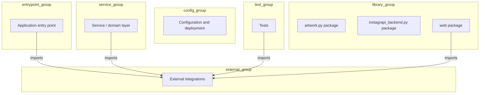

# Architecture report: Datalux/Osintgram

> Automated static analysis. **Observed** = directly seen in files/imports/AST; **Inferred** = interpretation from that evidence. Repository code was not executed.

## 1. Repository at a glance

| Item | Value |
| --- | --- |
| Repository | Datalux/Osintgram |
| Description | Osintgram is a OSINT tool on Instagram. It offers an interactive shell to perform analysis on Instagram account of any users by its nickname |
| Language | Python |
| Stars | 15628 |
| Licence | GPL-3.0 |
| Analysed commit / branch | a560498be79a3bf40d7f3b203ad174661b8e81e7 / master |
| Framework(s) | FastAPI |
| Files analysed | 39 |
| Components | 8 |

## 2. Architecture in one minute

Datalux/Osintgram - Osintgram is a OSINT tool on Instagram. It offers an interactive shell to perform analysis on Instagram account of any users by its nickname. This repository was analysed statically from 39 file(s) (23 Python). Detected technologies (observed from imports/manifests): GitHub Actions, SQLite, FastAPI, httpx, Pydantic, Uvicorn. Files are grouped into 8 component(s): artwork.py package, Configuration and deployment, Application entry point, External integrations, instagrapi_backend.py package, Service / domain layer, Tests, web package. Observed entry point(s): scripts/instagrapi_login.py, scripts/set_session.py, src/web/app.py. Findings below distinguish observed facts from inferred interpretation.

## 3. High-level block diagram

## 4. Main components

### artwork.py package (`artwork_py`)

- **Kind:** library
- **Status:** Observed
- **Confidence:** 0.85
- **Responsibility:** Groups 1 file(s) under artwork.py package (observed from repository paths and static analysis).
- **Paths:** `src/artwork.py`
- **Evidence:** [src/artwork.py](https://github.com/Datalux/Osintgram/blob/a560498be79a3bf40d7f3b203ad174661b8e81e7/src/artwork.py)

### Configuration and deployment (`config`)

- **Kind:** config
- **Status:** Observed
- **Confidence:** 0.85
- **Responsibility:** Groups 5 file(s) under configuration and deployment (observed from repository paths and static analysis).
- **Paths:** `Dockerfile`, `docker-compose.yml`, `pytest.ini`, `requirements-dev.txt`, `requirements.txt`
- **Evidence:** [Dockerfile](https://github.com/Datalux/Osintgram/blob/a560498be79a3bf40d7f3b203ad174661b8e81e7/Dockerfile); [docker-compose.yml](https://github.com/Datalux/Osintgram/blob/a560498be79a3bf40d7f3b203ad174661b8e81e7/docker-compose.yml); [pytest.ini](https://github.com/Datalux/Osintgram/blob/a560498be79a3bf40d7f3b203ad174661b8e81e7/pytest.ini); [requirements-dev.txt](https://github.com/Datalux/Osintgram/blob/a560498be79a3bf40d7f3b203ad174661b8e81e7/requirements-dev.txt); [requirements.txt](https://github.com/Datalux/Osintgram/blob/a560498be79a3bf40d7f3b203ad174661b8e81e7/requirements.txt)

### Application entry point (`entrypoint`)

- **Kind:** entrypoint
- **Status:** Observed
- **Confidence:** 0.85
- **Responsibility:** Groups 3 file(s) under application entry point (observed from repository paths and static analysis). Observed application object created via FastAPI. Observed routes: GET /api/about, GET /api/balance, DELETE /api/cache, GET /api/tools, POST /api/query. Observed top-level classes: CancelRequest, DownloadRequest, QueryRequest, QueryResponse, RunRequest, TokenRequest. Observed top-level functions: _build_service_or_http_error, _cancellation, _describe_api_call, _detect_wsl_host, _execute_tool_events, _history_or_404.
- **Paths:** `scripts/instagrapi_login.py`, `scripts/set_session.py`, `src/web/app.py`
- **Evidence:** [scripts/instagrapi_login.py:23](https://github.com/Datalux/Osintgram/blob/a560498be79a3bf40d7f3b203ad174661b8e81e7/scripts/instagrapi_login.py#L23); [scripts/set_session.py:12](https://github.com/Datalux/Osintgram/blob/a560498be79a3bf40d7f3b203ad174661b8e81e7/scripts/set_session.py#L12); [src/web/app.py:217](https://github.com/Datalux/Osintgram/blob/a560498be79a3bf40d7f3b203ad174661b8e81e7/src/web/app.py#L217)

### External integrations (`external_integrations`)

- **Kind:** external
- **Status:** Inferred
- **Confidence:** 0.70
- **Responsibility:** Groups 0 file(s) under external integrations (observed from repository paths and static analysis).
- **Evidence:** [src/osint_service.py:22](https://github.com/Datalux/Osintgram/blob/a560498be79a3bf40d7f3b203ad174661b8e81e7/src/osint_service.py#L22); [src/web/app.py:24](https://github.com/Datalux/Osintgram/blob/a560498be79a3bf40d7f3b203ad174661b8e81e7/src/web/app.py#L24); [src/web/download.py:18](https://github.com/Datalux/Osintgram/blob/a560498be79a3bf40d7f3b203ad174661b8e81e7/src/web/download.py#L18); [src/web/request_cache.py:19](https://github.com/Datalux/Osintgram/blob/a560498be79a3bf40d7f3b203ad174661b8e81e7/src/web/request_cache.py#L19); [tests/test_download.py:5](https://github.com/Datalux/Osintgram/blob/a560498be79a3bf40d7f3b203ad174661b8e81e7/tests/test_download.py#L5); [tests/test_osint_service.py:2](https://github.com/Datalux/Osintgram/blob/a560498be79a3bf40d7f3b203ad174661b8e81e7/tests/test_osint_service.py#L2)

### instagrapi_backend.py package (`instagrapi_backend_py`)

- **Kind:** library
- **Status:** Observed
- **Confidence:** 0.85
- **Responsibility:** Groups 1 file(s) under instagrapi_backend.py package (observed from repository paths and static analysis). Observed top-level classes: InstagrapiBackendError, InstagrapiClient. Observed top-level functions: resolve_instagrapi_credentials, session_exists.
- **Paths:** `src/instagrapi_backend.py`
- **Evidence:** [src/instagrapi_backend.py:33](https://github.com/Datalux/Osintgram/blob/a560498be79a3bf40d7f3b203ad174661b8e81e7/src/instagrapi_backend.py#L33)

### Service / domain layer (`service_layer`)

- **Kind:** service
- **Status:** Observed
- **Confidence:** 0.85
- **Responsibility:** Groups 1 file(s) under service / domain layer (observed from repository paths and static analysis). Observed top-level classes: HikerAPIError, OsintServiceError, OsintgramService, PrivateProfileError, QueryCancelledError, RequestLimitReachedError. Observed top-level functions: _error_detail, _retry_delay, _token_from_file, _transient_error_detail, build_service, check_hiker_token.
- **Paths:** `src/osint_service.py`
- **Evidence:** [src/osint_service.py:28](https://github.com/Datalux/Osintgram/blob/a560498be79a3bf40d7f3b203ad174661b8e81e7/src/osint_service.py#L28)

### Tests (`tests`)

- **Kind:** test
- **Status:** Observed
- **Confidence:** 0.85
- **Responsibility:** Groups 10 file(s) under tests (observed from repository paths and static analysis). Observed top-level classes: FakeHiker, FakeInstagrapi, SearchClient, _Flaky. Observed top-level functions: _client, _comment_page, _fake_transport, _hashtag_page, _img, _media.
- **Paths:** `tests/conftest.py`, `tests/test_app_endpoints.py`, `tests/test_cost.py`, `tests/test_docs.py`, `tests/test_dossier.py`, `tests/test_download.py`, `tests/test_instagrapi_backend.py`, `tests/test_osint_service.py`, `tests/test_request_cache.py`, `tests/test_token_endpoint.py`
- **Evidence:** [tests/conftest.py:19](https://github.com/Datalux/Osintgram/blob/a560498be79a3bf40d7f3b203ad174661b8e81e7/tests/conftest.py#L19); [tests/test_app_endpoints.py:14](https://github.com/Datalux/Osintgram/blob/a560498be79a3bf40d7f3b203ad174661b8e81e7/tests/test_app_endpoints.py#L14); [tests/test_cost.py:7](https://github.com/Datalux/Osintgram/blob/a560498be79a3bf40d7f3b203ad174661b8e81e7/tests/test_cost.py#L7); [tests/test_docs.py:20](https://github.com/Datalux/Osintgram/blob/a560498be79a3bf40d7f3b203ad174661b8e81e7/tests/test_docs.py#L20); [tests/test_dossier.py:8](https://github.com/Datalux/Osintgram/blob/a560498be79a3bf40d7f3b203ad174661b8e81e7/tests/test_dossier.py#L8); [tests/test_download.py:23](https://github.com/Datalux/Osintgram/blob/a560498be79a3bf40d7f3b203ad174661b8e81e7/tests/test_download.py#L23); [tests/test_instagrapi_backend.py:16](https://github.com/Datalux/Osintgram/blob/a560498be79a3bf40d7f3b203ad174661b8e81e7/tests/test_instagrapi_backend.py#L16); [tests/test_osint_service.py:16](https://github.com/Datalux/Osintgram/blob/a560498be79a3bf40d7f3b203ad174661b8e81e7/tests/test_osint_service.py#L16)

### web package (`web`)

- **Kind:** library
- **Status:** Observed
- **Confidence:** 0.85
- **Responsibility:** Groups 7 file(s) under web package (observed from repository paths and static analysis). Observed top-level classes: DownloadError, History, PersistentRequestCache. Observed top-level functions: _capped, _coerce_int, _diff_dicts, _diff_lists, _filename, _identity.
- **Paths:** `src/web/__init__.py`, `src/web/cost.py`, `src/web/dossier.py`, `src/web/download.py`, `src/web/history.py`, `src/web/request_cache.py`, `src/web/tools.py`
- **Evidence:** [src/web/__init__.py](https://github.com/Datalux/Osintgram/blob/a560498be79a3bf40d7f3b203ad174661b8e81e7/src/web/__init__.py); [src/web/cost.py:42](https://github.com/Datalux/Osintgram/blob/a560498be79a3bf40d7f3b203ad174661b8e81e7/src/web/cost.py#L42); [src/web/dossier.py:30](https://github.com/Datalux/Osintgram/blob/a560498be79a3bf40d7f3b203ad174661b8e81e7/src/web/dossier.py#L30); [src/web/download.py:28](https://github.com/Datalux/Osintgram/blob/a560498be79a3bf40d7f3b203ad174661b8e81e7/src/web/download.py#L28); [src/web/history.py:22](https://github.com/Datalux/Osintgram/blob/a560498be79a3bf40d7f3b203ad174661b8e81e7/src/web/history.py#L22); [src/web/request_cache.py:30](https://github.com/Datalux/Osintgram/blob/a560498be79a3bf40d7f3b203ad174661b8e81e7/src/web/request_cache.py#L30); [src/web/tools.py:27](https://github.com/Datalux/Osintgram/blob/a560498be79a3bf40d7f3b203ad174661b8e81e7/src/web/tools.py#L27)

## 5. Execution flow

**Observed** entry point(s):

- [scripts/instagrapi_login.py:56](https://github.com/Datalux/Osintgram/blob/a560498be79a3bf40d7f3b203ad174661b8e81e7/scripts/instagrapi_login.py#L56)
- [scripts/set_session.py:36](https://github.com/Datalux/Osintgram/blob/a560498be79a3bf40d7f3b203ad174661b8e81e7/scripts/set_session.py#L36)
- [src/web/app.py:217](https://github.com/Datalux/Osintgram/blob/a560498be79a3bf40d7f3b203ad174661b8e81e7/src/web/app.py#L217)

**Observed** routes (from decorators):

- `GET /api/about` -> `about` in `src/web/app.py:895`
- `GET /api/balance` -> `balance` in `src/web/app.py:915`
- `DELETE /api/cache` -> `clear_cache` in `src/web/app.py:926`
- `GET /api/tools` -> `list_tools` in `src/web/app.py:937`
- `POST /api/query` -> `query` in `src/web/app.py:943`
- `POST /api/run` -> `run` in `src/web/app.py:961`
- `GET /api/history/{kind}` -> `get_history` in `src/web/app.py:990`
- `DELETE /api/history/{kind}` -> `delete_history_entry` in `src/web/app.py:997`
- `GET /api/token` -> `get_token_state` in `src/web/app.py:1036`
- `POST /api/token` -> `set_token` in `src/web/app.py:1041`
- `DELETE /api/token` -> `clear_token` in `src/web/app.py:1072`
- `POST /api/download` -> `download_media` in `src/web/app.py:1087`
- `POST /api/dossier` -> `save_dossier` in `src/web/app.py:1107`
- `GET /api/dossier` -> `list_dossiers` in `src/web/app.py:1117`
- `GET /api/dossier/{target}/{dossier_id}` -> `get_dossier` in `src/web/app.py:1123`
- `DELETE /api/dossier/{target}/{dossier_id}` -> `delete_dossier` in `src/web/app.py:1132`
- `GET /api/dossier/{target}/{before_id}/diff/{after_id}` -> `diff_dossiers` in `src/web/app.py:1138`
- `POST /api/estimate` -> `estimate_cost` in `src/web/app.py:1150`
- `POST /api/cancel` -> `cancel` in `src/web/app.py:1173`

Representative flow (derived from observed entry points and the import graph; steps beyond the entry point are **Inferred**):

1. Execution starts at an observed entry point listed above, if present.
2. `entrypoint` imports `external_integrations` (Application entry point -> External integrations).
3. `service_layer` imports `external_integrations` (Service / domain layer -> External integrations).
4. `tests` imports `external_integrations` (Tests -> External integrations).
5. `web` imports `external_integrations` (web package -> External integrations).

## 6. Project structure

### `(root)`

- `.dockerignore` - container (262 bytes)
- `.gitignore` - other (765 bytes)
- `Dockerfile` - container (1638 bytes)
- `LICENSE` - docs (35149 bytes)
- `Makefile` - other (432 bytes)
- `README.md` - docs (7977 bytes)
- `SECURITY.md` - docs (3994 bytes)
- `docker-compose.yml` - container (926 bytes)
- `pytest.ini` - config (65 bytes)
- `requirements-dev.txt` - manifest (150 bytes)
- `requirements.txt` - manifest (288 bytes)

### `.github`

- `.github/workflows/tests.yml` - ci, YAML (1007 bytes)

### `config`

- `config/credentials.ini.example` - other (596 bytes)

### `doc`

- `doc/CHANGELOG.md` - docs (8464 bytes)
- `doc/web-ui.md` - docs (27319 bytes)

### `scripts`

- `scripts/instagrapi_login.py` - source, Python (1955 bytes)
- `scripts/set_session.py` - source, Python (1086 bytes)

### `src`

- `src/artwork.py` - source, Python (512 bytes)
- `src/instagrapi_backend.py` - source, Python (16660 bytes)
- `src/osint_service.py` - source, Python (68366 bytes)
- `src/web/__init__.py` - source, Python (0 bytes)
- `src/web/app.py` - source, Python (54630 bytes)
- `src/web/cost.py` - source, Python (6781 bytes)
- `src/web/dossier.py` - source, Python (8244 bytes)
- `src/web/download.py` - source, Python (3449 bytes)
- `src/web/history.py` - source, Python (4069 bytes)
- `src/web/request_cache.py` - source, Python (5961 bytes)
- `src/web/static/index.html` - other (175550 bytes)
- `src/web/tools.py` - source, Python (21323 bytes)

### `tests`

- `tests/conftest.py` - test, Python (6397 bytes)
- `tests/test_app_endpoints.py` - test, Python (16955 bytes)
- `tests/test_cost.py` - test, Python (3208 bytes)
- `tests/test_docs.py` - test, Python (2705 bytes)
- `tests/test_dossier.py` - test, Python (6807 bytes)
- `tests/test_download.py` - test, Python (3361 bytes)
- `tests/test_instagrapi_backend.py` - test, Python (6811 bytes)
- `tests/test_osint_service.py` - test, Python (24827 bytes)
- `tests/test_request_cache.py` - test, Python (2192 bytes)
- `tests/test_token_endpoint.py` - test, Python (4551 bytes)

## 7. Key dependencies and integrations

| Name | Category | Status | Confidence | Evidence |
| --- | --- | --- | --- | --- |
| GitHub Actions | ci | Observed | 0.85 | [.github/workflows/tests.yml](https://github.com/Datalux/Osintgram/blob/a560498be79a3bf40d7f3b203ad174661b8e81e7/.github/workflows/tests.yml) |
| SQLite | database | Observed | 0.90 | [src/web/request_cache.py:19](https://github.com/Datalux/Osintgram/blob/a560498be79a3bf40d7f3b203ad174661b8e81e7/src/web/request_cache.py#L19) |
| FastAPI | framework | Observed | 0.95 | [requirements.txt:2](https://github.com/Datalux/Osintgram/blob/a560498be79a3bf40d7f3b203ad174661b8e81e7/requirements.txt#L2); [src/web/app.py:31](https://github.com/Datalux/Osintgram/blob/a560498be79a3bf40d7f3b203ad174661b8e81e7/src/web/app.py#L31); [src/web/app.py:32](https://github.com/Datalux/Osintgram/blob/a560498be79a3bf40d7f3b203ad174661b8e81e7/src/web/app.py#L32); [src/web/app.py:33](https://github.com/Datalux/Osintgram/blob/a560498be79a3bf40d7f3b203ad174661b8e81e7/src/web/app.py#L33) |
| httpx | library | Observed | 0.95 | [requirements-dev.txt:5](https://github.com/Datalux/Osintgram/blob/a560498be79a3bf40d7f3b203ad174661b8e81e7/requirements-dev.txt#L5); [src/osint_service.py:22](https://github.com/Datalux/Osintgram/blob/a560498be79a3bf40d7f3b203ad174661b8e81e7/src/osint_service.py#L22); [src/web/app.py:24](https://github.com/Datalux/Osintgram/blob/a560498be79a3bf40d7f3b203ad174661b8e81e7/src/web/app.py#L24); [src/web/download.py:18](https://github.com/Datalux/Osintgram/blob/a560498be79a3bf40d7f3b203ad174661b8e81e7/src/web/download.py#L18) |
| Pydantic | library | Observed | 0.90 | [src/web/app.py:34](https://github.com/Datalux/Osintgram/blob/a560498be79a3bf40d7f3b203ad174661b8e81e7/src/web/app.py#L34) |
| Uvicorn | library | Observed | 0.85 | [requirements.txt:3](https://github.com/Datalux/Osintgram/blob/a560498be79a3bf40d7f3b203ad174661b8e81e7/requirements.txt#L3) |
| Docker | tooling | Observed | 0.85 | [Dockerfile](https://github.com/Datalux/Osintgram/blob/a560498be79a3bf40d7f3b203ad174661b8e81e7/Dockerfile) |
| Docker Compose | tooling | Observed | 0.85 | [docker-compose.yml](https://github.com/Datalux/Osintgram/blob/a560498be79a3bf40d7f3b203ad174661b8e81e7/docker-compose.yml) |
| pytest | tooling | Observed | 0.95 | [.github/workflows/tests.yml:8](https://github.com/Datalux/Osintgram/blob/a560498be79a3bf40d7f3b203ad174661b8e81e7/.github/workflows/tests.yml#L8); [requirements-dev.txt:2](https://github.com/Datalux/Osintgram/blob/a560498be79a3bf40d7f3b203ad174661b8e81e7/requirements-dev.txt#L2); [tests/conftest.py:11](https://github.com/Datalux/Osintgram/blob/a560498be79a3bf40d7f3b203ad174661b8e81e7/tests/conftest.py#L11); [tests/test_app_endpoints.py:7](https://github.com/Datalux/Osintgram/blob/a560498be79a3bf40d7f3b203ad174661b8e81e7/tests/test_app_endpoints.py#L7) |

## 8. Data and state

- **SQLite** (Observed, confidence 0.90) - evidence: [src/web/request_cache.py:19](https://github.com/Datalux/Osintgram/blob/a560498be79a3bf40d7f3b203ad174661b8e81e7/src/web/request_cache.py#L19)

## 9. Configuration and deployment clues

- `.dockerignore` (container)
- `.github/workflows/tests.yml` (ci)
- `Dockerfile` (container)
- `docker-compose.yml` (container)
- `pytest.ini` (config)
- `requirements-dev.txt` (manifest)
- `requirements.txt` (manifest)

## 10. Design observations

- An entry/API layer is separated from other code (Inferred from paths and decorators).
- Service/domain code is distinct from entry and data code, suggesting layered separation (Inferred).
- Tests are present alongside source code (Observed from test file paths).
- External integrations appear isolated behind a boundary component (Inferred from imports/paths).

These observations are interpretations (**Inferred**) of the observed structure, not guarantees about runtime design.

## 11. Limitations and unknowns

- Static analysis only: repository code was not executed, installed, or imported at runtime.
- Components and relationships are inferred from file paths, imports, and AST structure; runtime behaviour, dynamic imports, and reflection may not be visible.
- Repository text was treated as untrusted data; no instructions found in repository files were followed, and likely secret values were redacted/excluded.

## 12. Source references

- [.github/workflows/tests.yml](https://github.com/Datalux/Osintgram/blob/a560498be79a3bf40d7f3b203ad174661b8e81e7/.github/workflows/tests.yml)
- [.github/workflows/tests.yml:8](https://github.com/Datalux/Osintgram/blob/a560498be79a3bf40d7f3b203ad174661b8e81e7/.github/workflows/tests.yml#L8)
- [Dockerfile](https://github.com/Datalux/Osintgram/blob/a560498be79a3bf40d7f3b203ad174661b8e81e7/Dockerfile)
- [docker-compose.yml](https://github.com/Datalux/Osintgram/blob/a560498be79a3bf40d7f3b203ad174661b8e81e7/docker-compose.yml)
- [pytest.ini](https://github.com/Datalux/Osintgram/blob/a560498be79a3bf40d7f3b203ad174661b8e81e7/pytest.ini)
- [requirements-dev.txt](https://github.com/Datalux/Osintgram/blob/a560498be79a3bf40d7f3b203ad174661b8e81e7/requirements-dev.txt)
- [requirements-dev.txt:2](https://github.com/Datalux/Osintgram/blob/a560498be79a3bf40d7f3b203ad174661b8e81e7/requirements-dev.txt#L2)
- [requirements-dev.txt:5](https://github.com/Datalux/Osintgram/blob/a560498be79a3bf40d7f3b203ad174661b8e81e7/requirements-dev.txt#L5)
- [requirements.txt](https://github.com/Datalux/Osintgram/blob/a560498be79a3bf40d7f3b203ad174661b8e81e7/requirements.txt)
- [requirements.txt:2](https://github.com/Datalux/Osintgram/blob/a560498be79a3bf40d7f3b203ad174661b8e81e7/requirements.txt#L2)
- [requirements.txt:3](https://github.com/Datalux/Osintgram/blob/a560498be79a3bf40d7f3b203ad174661b8e81e7/requirements.txt#L3)
- [scripts/instagrapi_login.py:23](https://github.com/Datalux/Osintgram/blob/a560498be79a3bf40d7f3b203ad174661b8e81e7/scripts/instagrapi_login.py#L23)
- [scripts/instagrapi_login.py:56](https://github.com/Datalux/Osintgram/blob/a560498be79a3bf40d7f3b203ad174661b8e81e7/scripts/instagrapi_login.py#L56)
- [scripts/set_session.py:12](https://github.com/Datalux/Osintgram/blob/a560498be79a3bf40d7f3b203ad174661b8e81e7/scripts/set_session.py#L12)
- [scripts/set_session.py:36](https://github.com/Datalux/Osintgram/blob/a560498be79a3bf40d7f3b203ad174661b8e81e7/scripts/set_session.py#L36)
- [src/artwork.py](https://github.com/Datalux/Osintgram/blob/a560498be79a3bf40d7f3b203ad174661b8e81e7/src/artwork.py)
- [src/instagrapi_backend.py:33](https://github.com/Datalux/Osintgram/blob/a560498be79a3bf40d7f3b203ad174661b8e81e7/src/instagrapi_backend.py#L33)
- [src/osint_service.py:22](https://github.com/Datalux/Osintgram/blob/a560498be79a3bf40d7f3b203ad174661b8e81e7/src/osint_service.py#L22)
- [src/osint_service.py:28](https://github.com/Datalux/Osintgram/blob/a560498be79a3bf40d7f3b203ad174661b8e81e7/src/osint_service.py#L28)
- [src/web/__init__.py](https://github.com/Datalux/Osintgram/blob/a560498be79a3bf40d7f3b203ad174661b8e81e7/src/web/__init__.py)
- [src/web/app.py:24](https://github.com/Datalux/Osintgram/blob/a560498be79a3bf40d7f3b203ad174661b8e81e7/src/web/app.py#L24)
- [src/web/app.py:31](https://github.com/Datalux/Osintgram/blob/a560498be79a3bf40d7f3b203ad174661b8e81e7/src/web/app.py#L31)
- [src/web/app.py:32](https://github.com/Datalux/Osintgram/blob/a560498be79a3bf40d7f3b203ad174661b8e81e7/src/web/app.py#L32)
- [src/web/app.py:33](https://github.com/Datalux/Osintgram/blob/a560498be79a3bf40d7f3b203ad174661b8e81e7/src/web/app.py#L33)
- [src/web/app.py:34](https://github.com/Datalux/Osintgram/blob/a560498be79a3bf40d7f3b203ad174661b8e81e7/src/web/app.py#L34)
- [src/web/app.py:217](https://github.com/Datalux/Osintgram/blob/a560498be79a3bf40d7f3b203ad174661b8e81e7/src/web/app.py#L217)
- [src/web/cost.py:42](https://github.com/Datalux/Osintgram/blob/a560498be79a3bf40d7f3b203ad174661b8e81e7/src/web/cost.py#L42)
- [src/web/dossier.py:30](https://github.com/Datalux/Osintgram/blob/a560498be79a3bf40d7f3b203ad174661b8e81e7/src/web/dossier.py#L30)
- [src/web/download.py:18](https://github.com/Datalux/Osintgram/blob/a560498be79a3bf40d7f3b203ad174661b8e81e7/src/web/download.py#L18)
- [src/web/download.py:28](https://github.com/Datalux/Osintgram/blob/a560498be79a3bf40d7f3b203ad174661b8e81e7/src/web/download.py#L28)
- [src/web/history.py:22](https://github.com/Datalux/Osintgram/blob/a560498be79a3bf40d7f3b203ad174661b8e81e7/src/web/history.py#L22)
- [src/web/request_cache.py:19](https://github.com/Datalux/Osintgram/blob/a560498be79a3bf40d7f3b203ad174661b8e81e7/src/web/request_cache.py#L19)
- [src/web/request_cache.py:30](https://github.com/Datalux/Osintgram/blob/a560498be79a3bf40d7f3b203ad174661b8e81e7/src/web/request_cache.py#L30)
- [src/web/tools.py:27](https://github.com/Datalux/Osintgram/blob/a560498be79a3bf40d7f3b203ad174661b8e81e7/src/web/tools.py#L27)
- [tests/conftest.py:11](https://github.com/Datalux/Osintgram/blob/a560498be79a3bf40d7f3b203ad174661b8e81e7/tests/conftest.py#L11)
- [tests/conftest.py:19](https://github.com/Datalux/Osintgram/blob/a560498be79a3bf40d7f3b203ad174661b8e81e7/tests/conftest.py#L19)
- [tests/test_app_endpoints.py:7](https://github.com/Datalux/Osintgram/blob/a560498be79a3bf40d7f3b203ad174661b8e81e7/tests/test_app_endpoints.py#L7)
- [tests/test_app_endpoints.py:8](https://github.com/Datalux/Osintgram/blob/a560498be79a3bf40d7f3b203ad174661b8e81e7/tests/test_app_endpoints.py#L8)
- [tests/test_app_endpoints.py:14](https://github.com/Datalux/Osintgram/blob/a560498be79a3bf40d7f3b203ad174661b8e81e7/tests/test_app_endpoints.py#L14)
- [tests/test_cost.py:7](https://github.com/Datalux/Osintgram/blob/a560498be79a3bf40d7f3b203ad174661b8e81e7/tests/test_cost.py#L7)
- [tests/test_docs.py:10](https://github.com/Datalux/Osintgram/blob/a560498be79a3bf40d7f3b203ad174661b8e81e7/tests/test_docs.py#L10)
- [tests/test_docs.py:20](https://github.com/Datalux/Osintgram/blob/a560498be79a3bf40d7f3b203ad174661b8e81e7/tests/test_docs.py#L20)
- [tests/test_dossier.py:2](https://github.com/Datalux/Osintgram/blob/a560498be79a3bf40d7f3b203ad174661b8e81e7/tests/test_dossier.py#L2)
- [tests/test_dossier.py:8](https://github.com/Datalux/Osintgram/blob/a560498be79a3bf40d7f3b203ad174661b8e81e7/tests/test_dossier.py#L8)
- [tests/test_download.py:5](https://github.com/Datalux/Osintgram/blob/a560498be79a3bf40d7f3b203ad174661b8e81e7/tests/test_download.py#L5)
- [tests/test_download.py:6](https://github.com/Datalux/Osintgram/blob/a560498be79a3bf40d7f3b203ad174661b8e81e7/tests/test_download.py#L6)
- [tests/test_download.py:23](https://github.com/Datalux/Osintgram/blob/a560498be79a3bf40d7f3b203ad174661b8e81e7/tests/test_download.py#L23)
- [tests/test_instagrapi_backend.py:10](https://github.com/Datalux/Osintgram/blob/a560498be79a3bf40d7f3b203ad174661b8e81e7/tests/test_instagrapi_backend.py#L10)
- [tests/test_instagrapi_backend.py:16](https://github.com/Datalux/Osintgram/blob/a560498be79a3bf40d7f3b203ad174661b8e81e7/tests/test_instagrapi_backend.py#L16)
- [tests/test_osint_service.py:2](https://github.com/Datalux/Osintgram/blob/a560498be79a3bf40d7f3b203ad174661b8e81e7/tests/test_osint_service.py#L2)
- [tests/test_osint_service.py:16](https://github.com/Datalux/Osintgram/blob/a560498be79a3bf40d7f3b203ad174661b8e81e7/tests/test_osint_service.py#L16)
- [tests/test_token_endpoint.py:7](https://github.com/Datalux/Osintgram/blob/a560498be79a3bf40d7f3b203ad174661b8e81e7/tests/test_token_endpoint.py#L7)
