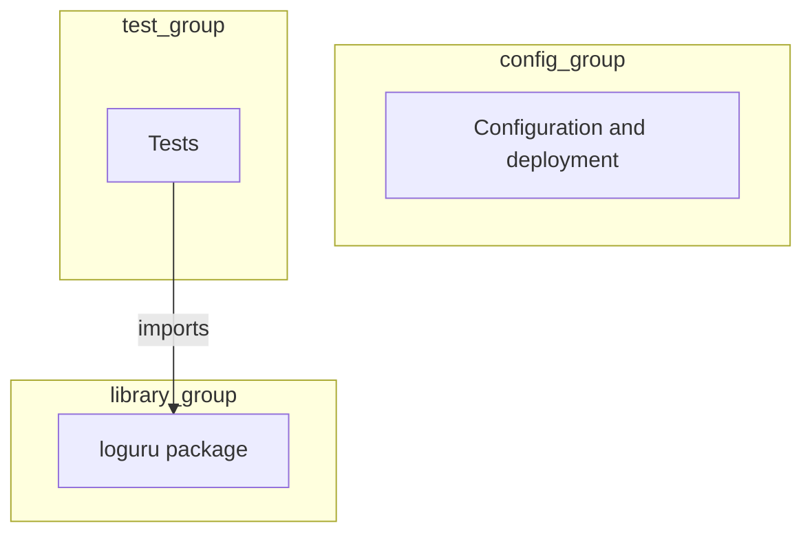

# Architecture report: Delgan/loguru

> Automated static analysis. **Observed** = directly seen in files/imports/AST; **Inferred** = interpretation from that evidence. Repository code was not executed.

## 1. Repository at a glance

| Item | Value |
| --- | --- |
| Repository | Delgan/loguru |
| Description | Python logging made (stupidly) simple |
| Language | Python |
| Stars | 24157 |
| Licence | MIT |
| Analysed commit / branch | 28349be3cd740867bc947eef741c69370ca45735 / master |
| Framework(s) | None detected |
| Files analysed | 313 |
| Components | 3 |

## 2. Architecture in one minute

Delgan/loguru - Python logging made (stupidly) simple. This repository was analysed statically from 313 file(s) (173 Python). Detected technologies (observed from imports/manifests): GitHub Actions, Poetry, pytest, unittest. Files are grouped into 3 component(s): Configuration and deployment, loguru package, Tests. Findings below distinguish observed facts from inferred interpretation.

## 3. High-level block diagram

## 4. Main components

### Configuration and deployment (`config`)

- **Kind:** config
- **Status:** Observed
- **Confidence:** 0.85
- **Responsibility:** Groups 2 file(s) under configuration and deployment (observed from repository paths and static analysis).
- **Paths:** `pyproject.toml`, `tox.ini`
- **Evidence:** [pyproject.toml](https://github.com/Delgan/loguru/blob/28349be3cd740867bc947eef741c69370ca45735/pyproject.toml); [tox.ini](https://github.com/Delgan/loguru/blob/28349be3cd740867bc947eef741c69370ca45735/tox.ini)

### loguru package (`loguru`)

- **Kind:** library
- **Status:** Observed
- **Confidence:** 0.85
- **Responsibility:** Groups 19 file(s) under loguru package (observed from repository paths and static analysis). Observed top-level classes: AnsiParser, AsyncSink, Back, CallableSink, ColoredFormat, ColoredMessage. Observed top-level functions: _builtin_datetime_formatter, _compile_format, _default_datetime_formatter, _fallback_tzinfo, _format_timezone, _get_string_tokens.
- **Paths:** `loguru/__init__.py`, `loguru/_asyncio_loop.py`, `loguru/_better_exceptions.py`, `loguru/_colorama.py`, `loguru/_colorizer.py`, `loguru/_contextvars.py`, `loguru/_ctime_functions.py`, `loguru/_datetime.py`, `loguru/_defaults.py`, `loguru/_error_interceptor.py`, `loguru/_file_sink.py`, `loguru/_filters.py`, `loguru/_get_frame.py`, `loguru/_handler.py`, `loguru/_locks_machinery.py`, `loguru/_logger.py`, `loguru/_recattrs.py`, `loguru/_simple_sinks.py`, `loguru/_string_parsers.py`
- **Evidence:** [loguru/__init__.py](https://github.com/Delgan/loguru/blob/28349be3cd740867bc947eef741c69370ca45735/loguru/__init__.py); [loguru/_asyncio_loop.py:5](https://github.com/Delgan/loguru/blob/28349be3cd740867bc947eef741c69370ca45735/loguru/_asyncio_loop.py#L5); [loguru/_better_exceptions.py:32](https://github.com/Delgan/loguru/blob/28349be3cd740867bc947eef741c69370ca45735/loguru/_better_exceptions.py#L32); [loguru/_colorama.py:6](https://github.com/Delgan/loguru/blob/28349be3cd740867bc947eef741c69370ca45735/loguru/_colorama.py#L6); [loguru/_colorizer.py:7](https://github.com/Delgan/loguru/blob/28349be3cd740867bc947eef741c69370ca45735/loguru/_colorizer.py#L7); [loguru/_contextvars.py:4](https://github.com/Delgan/loguru/blob/28349be3cd740867bc947eef741c69370ca45735/loguru/_contextvars.py#L4); [loguru/_ctime_functions.py:4](https://github.com/Delgan/loguru/blob/28349be3cd740867bc947eef741c69370ca45735/loguru/_ctime_functions.py#L4); [loguru/_datetime.py:14](https://github.com/Delgan/loguru/blob/28349be3cd740867bc947eef741c69370ca45735/loguru/_datetime.py#L14)

### Tests (`tests`)

- **Kind:** test
- **Status:** Observed
- **Confidence:** 0.85
- **Responsibility:** Groups 253 file(s) under tests (observed from repository paths and static analysis). Observed top-level classes: A, AsyncWriter, Bar, CyclicReference, Foo, HandlerIdSubclass. Observed top-level functions: _deep, _expected_fallback_time_zone, _pickle_sink, _remove_cyclic_references, _simulate_f_globals_name_absent, _simulate_no_frame_available.
- **Paths:** `tests/__init__.py`, `tests/conftest.py`, `tests/exceptions/output/backtrace/chained_expression_direct.txt`, `tests/exceptions/output/backtrace/chained_expression_indirect.txt`, `tests/exceptions/output/backtrace/chaining_first.txt`, `tests/exceptions/output/backtrace/chaining_second.txt`, `tests/exceptions/output/backtrace/chaining_third.txt`, `tests/exceptions/output/backtrace/enqueue.txt`, `tests/exceptions/output/backtrace/enqueue_with_others_handlers.txt`, `tests/exceptions/output/backtrace/frame_values_backward.txt`, `tests/exceptions/output/backtrace/frame_values_forward.txt`, `tests/exceptions/output/backtrace/function.txt`, `tests/exceptions/output/backtrace/head_recursion.txt`, `tests/exceptions/output/backtrace/missing_attributes_traceback_objects.txt`, `tests/exceptions/output/backtrace/missing_lineno_frame_objects.txt`, `tests/exceptions/output/backtrace/nested.txt`, `tests/exceptions/output/backtrace/nested_chained_catch_up.txt`, `tests/exceptions/output/backtrace/nested_decorator_catch_up.txt`, `tests/exceptions/output/backtrace/nested_explicit_catch_up.txt`, `tests/exceptions/output/backtrace/nested_wrapping.txt`, `tests/exceptions/output/backtrace/no_tb.txt`, `tests/exceptions/output/backtrace/not_enough_arguments.txt`, `tests/exceptions/output/backtrace/raising_recursion.txt`, `tests/exceptions/output/backtrace/suppressed_expression_direct.txt`, `tests/exceptions/output/backtrace/suppressed_expression_indirect.txt`, `tests/exceptions/output/backtrace/tail_recursion.txt`, `tests/exceptions/output/backtrace/too_many_arguments.txt`, `tests/exceptions/output/diagnose/assertion_error.txt`, `tests/exceptions/output/diagnose/assertion_error_custom.txt`, `tests/exceptions/output/diagnose/assertion_error_in_string.txt`, `tests/exceptions/output/diagnose/attributes.txt`, `tests/exceptions/output/diagnose/chained_both.txt`, `tests/exceptions/output/diagnose/encoding.txt`, `tests/exceptions/output/diagnose/global_variable.txt`, `tests/exceptions/output/diagnose/indentation_error.txt`, `tests/exceptions/output/diagnose/keyword_argument.txt`, `tests/exceptions/output/diagnose/multilines_repr.txt`, `tests/exceptions/output/diagnose/no_error_message.txt`, `tests/exceptions/output/diagnose/parenthesis.txt`, `tests/exceptions/output/diagnose/source_multilines.txt`, `tests/exceptions/output/diagnose/source_strings.txt`, `tests/exceptions/output/diagnose/syntax_error.txt`, `tests/exceptions/output/diagnose/syntax_highlighting.txt`, `tests/exceptions/output/diagnose/truncating.txt`, `tests/exceptions/output/diagnose/unprintable_object.txt`, `tests/exceptions/output/modern/decorate_async_generator.txt`, `tests/exceptions/output/modern/exception_formatting_async_generator.txt`, `tests/exceptions/output/modern/exception_formatting_async_generator_throw.txt`, `tests/exceptions/output/modern/exception_group_catch.txt`, `tests/exceptions/output/modern/f_string.txt`, `tests/exceptions/output/modern/grouped_as_cause_and_context.txt`, `tests/exceptions/output/modern/grouped_max_depth.txt`, `tests/exceptions/output/modern/grouped_max_length.txt`, `tests/exceptions/output/modern/grouped_max_length_nested.txt`, `tests/exceptions/output/modern/grouped_nested.txt`, `tests/exceptions/output/modern/grouped_simple.txt`, `tests/exceptions/output/modern/grouped_with_cause_and_context.txt`, `tests/exceptions/output/modern/match_statement.txt`, `tests/exceptions/output/modern/notes.txt`, `tests/exceptions/output/modern/positional_only_argument.txt`, `tests/exceptions/output/modern/t_string.txt`, `tests/exceptions/output/modern/type_hints.txt`, `tests/exceptions/output/modern/walrus_operator.txt`, `tests/exceptions/output/others/assertionerror_without_traceback.txt`, `tests/exceptions/output/others/broken_but_decorated_repr.txt`, `tests/exceptions/output/others/catch_as_context_manager.txt`, `tests/exceptions/output/others/catch_as_decorator_with_parentheses.txt`, `tests/exceptions/output/others/catch_as_decorator_without_parentheses.txt`, `tests/exceptions/output/others/catch_as_function.txt`, `tests/exceptions/output/others/catch_message.txt`, `tests/exceptions/output/others/exception_formatting_coroutine.txt`, `tests/exceptions/output/others/exception_formatting_function.txt`, `tests/exceptions/output/others/exception_formatting_generator.txt`, `tests/exceptions/output/others/exception_in_property.txt`, `tests/exceptions/output/others/handler_formatting_with_context_manager.txt`, `tests/exceptions/output/others/handler_formatting_with_decorator.txt`, `tests/exceptions/output/others/level_name.txt`, `tests/exceptions/output/others/level_number.txt`, `tests/exceptions/output/others/message_formatting_with_context_manager.txt`, `tests/exceptions/output/others/message_formatting_with_decorator.txt`, `tests/exceptions/output/others/nested_with_reraise.txt`, `tests/exceptions/output/others/one_liner_recursion.txt`, `tests/exceptions/output/others/recursion_error.txt`, `tests/exceptions/output/others/repeated_lines.txt`, `tests/exceptions/output/others/syntaxerror_without_traceback.txt`, `tests/exceptions/output/others/sys_tracebacklimit.txt`, `tests/exceptions/output/others/sys_tracebacklimit_negative.txt`, `tests/exceptions/output/others/sys_tracebacklimit_none.txt`, `tests/exceptions/output/others/sys_tracebacklimit_unset.txt`, `tests/exceptions/output/others/zerodivisionerror_without_traceback.txt`, `tests/exceptions/output/ownership/assertion_from_lib.txt`, `tests/exceptions/output/ownership/assertion_from_local.txt`, `tests/exceptions/output/ownership/callback.txt`, `tests/exceptions/output/ownership/catch_decorator.txt`, `tests/exceptions/output/ownership/catch_decorator_from_lib.txt`, `tests/exceptions/output/ownership/decorated_callback.txt`, `tests/exceptions/output/ownership/direct.txt`, `tests/exceptions/output/ownership/indirect.txt`, `tests/exceptions/output/ownership/string_lib.txt`, `tests/exceptions/output/ownership/string_source.txt`, `tests/exceptions/output/ownership/syntaxerror.txt`, `tests/exceptions/source/backtrace/chained_expression_direct.py`, `tests/exceptions/source/backtrace/chained_expression_indirect.py`, `tests/exceptions/source/backtrace/chaining_first.py`, `tests/exceptions/source/backtrace/chaining_second.py`, `tests/exceptions/source/backtrace/chaining_third.py`, `tests/exceptions/source/backtrace/enqueue.py`, `tests/exceptions/source/backtrace/enqueue_with_others_handlers.py`, `tests/exceptions/source/backtrace/frame_values_backward.py`, `tests/exceptions/source/backtrace/frame_values_forward.py`, `tests/exceptions/source/backtrace/function.py`, `tests/exceptions/source/backtrace/head_recursion.py`, `tests/exceptions/source/backtrace/missing_attributes_traceback_objects.py`, `tests/exceptions/source/backtrace/missing_lineno_frame_objects.py`, `tests/exceptions/source/backtrace/nested.py`, `tests/exceptions/source/backtrace/nested_chained_catch_up.py`, `tests/exceptions/source/backtrace/nested_decorator_catch_up.py`, `tests/exceptions/source/backtrace/nested_explicit_catch_up.py`, `tests/exceptions/source/backtrace/nested_wrapping.py`, `tests/exceptions/source/backtrace/no_tb.py`, `tests/exceptions/source/backtrace/not_enough_arguments.py`, `tests/exceptions/source/backtrace/raising_recursion.py`, `tests/exceptions/source/backtrace/suppressed_expression_direct.py`, `tests/exceptions/source/backtrace/suppressed_expression_indirect.py`, `tests/exceptions/source/backtrace/tail_recursion.py`, `tests/exceptions/source/backtrace/too_many_arguments.py`, `tests/exceptions/source/diagnose/assertion_error.py`, `tests/exceptions/source/diagnose/assertion_error_custom.py`, `tests/exceptions/source/diagnose/assertion_error_in_string.py`, `tests/exceptions/source/diagnose/attributes.py`, `tests/exceptions/source/diagnose/chained_both.py`, `tests/exceptions/source/diagnose/encoding.py`, `tests/exceptions/source/diagnose/global_variable.py`, `tests/exceptions/source/diagnose/indentation_error.py`, `tests/exceptions/source/diagnose/keyword_argument.py`, `tests/exceptions/source/diagnose/multilines_repr.py`, `tests/exceptions/source/diagnose/no_error_message.py`, `tests/exceptions/source/diagnose/parenthesis.py`, `tests/exceptions/source/diagnose/source_multilines.py`, `tests/exceptions/source/diagnose/source_strings.py`, `tests/exceptions/source/diagnose/syntax_error.py`, `tests/exceptions/source/diagnose/syntax_highlighting.py`, `tests/exceptions/source/diagnose/truncating.py`, `tests/exceptions/source/diagnose/unprintable_object.py`, `tests/exceptions/source/modern/decorate_async_generator.py`, `tests/exceptions/source/modern/exception_formatting_async_generator.py`, `tests/exceptions/source/modern/exception_formatting_async_generator_throw.py`, `tests/exceptions/source/modern/exception_group_catch.py`, `tests/exceptions/source/modern/f_string.py`, `tests/exceptions/source/modern/grouped_as_cause_and_context.py`, `tests/exceptions/source/modern/grouped_max_depth.py`, `tests/exceptions/source/modern/grouped_max_length.py`, `tests/exceptions/source/modern/grouped_max_length_nested.py`, `tests/exceptions/source/modern/grouped_nested.py`, `tests/exceptions/source/modern/grouped_simple.py`, `tests/exceptions/source/modern/grouped_with_cause_and_context.py`, `tests/exceptions/source/modern/match_statement.py`, `tests/exceptions/source/modern/notes.py`, `tests/exceptions/source/modern/positional_only_argument.py`, `tests/exceptions/source/modern/t_string.py`, `tests/exceptions/source/modern/type_hints.py`, `tests/exceptions/source/modern/walrus_operator.py`, `tests/exceptions/source/others/assertionerror_without_traceback.py`, `tests/exceptions/source/others/broken_but_decorated_repr.py`, `tests/exceptions/source/others/catch_as_context_manager.py`, `tests/exceptions/source/others/catch_as_decorator_with_parentheses.py`, `tests/exceptions/source/others/catch_as_decorator_without_parentheses.py`, `tests/exceptions/source/others/catch_as_function.py`, `tests/exceptions/source/others/catch_message.py`, `tests/exceptions/source/others/exception_formatting_coroutine.py`, `tests/exceptions/source/others/exception_formatting_function.py`, `tests/exceptions/source/others/exception_formatting_generator.py`, `tests/exceptions/source/others/exception_in_property.py`, `tests/exceptions/source/others/handler_formatting_with_context_manager.py`, `tests/exceptions/source/others/handler_formatting_with_decorator.py`, `tests/exceptions/source/others/level_name.py`, `tests/exceptions/source/others/level_number.py`, `tests/exceptions/source/others/message_formatting_with_context_manager.py`, `tests/exceptions/source/others/message_formatting_with_decorator.py`, `tests/exceptions/source/others/nested_with_reraise.py`, `tests/exceptions/source/others/one_liner_recursion.py`, `tests/exceptions/source/others/recursion_error.py`, `tests/exceptions/source/others/repeated_lines.py`, `tests/exceptions/source/others/syntaxerror_without_traceback.py`, `tests/exceptions/source/others/sys_tracebacklimit.py`, `tests/exceptions/source/others/sys_tracebacklimit_negative.py`, `tests/exceptions/source/others/sys_tracebacklimit_none.py`, `tests/exceptions/source/others/sys_tracebacklimit_unset.py`, `tests/exceptions/source/others/zerodivisionerror_without_traceback.py`, `tests/exceptions/source/ownership/_init.py`, `tests/exceptions/source/ownership/assertion_from_lib.py`, `tests/exceptions/source/ownership/assertion_from_local.py`, `tests/exceptions/source/ownership/callback.py`, `tests/exceptions/source/ownership/catch_decorator.py`, `tests/exceptions/source/ownership/catch_decorator_from_lib.py`, `tests/exceptions/source/ownership/decorated_callback.py`, `tests/exceptions/source/ownership/direct.py`, `tests/exceptions/source/ownership/indirect.py`, `tests/exceptions/source/ownership/string_lib.py`, `tests/exceptions/source/ownership/string_source.py`, `tests/exceptions/source/ownership/syntaxerror.py`, `tests/exceptions/source/ownership/usersite/somelib/__init__.py`, `tests/test_activation.py`, `tests/test_add_option_backtrace.py`, `tests/test_add_option_catch.py`, `tests/test_add_option_colorize.py`, `tests/test_add_option_context.py`, `tests/test_add_option_diagnose.py`, `tests/test_add_option_enqueue.py`, `tests/test_add_option_filter.py`, `tests/test_add_option_format.py`, `tests/test_add_option_kwargs.py`, `tests/test_add_option_level.py`, `tests/test_add_option_serialize.py`, `tests/test_add_sinks.py`, `tests/test_ansimarkup_basic.py`, `tests/test_ansimarkup_extended.py`, `tests/test_bind.py`, `tests/test_colorama.py`, `tests/test_configure.py`, `tests/test_contextualize.py`, `tests/test_coroutine_sink.py`, `tests/test_datetime.py`, `tests/test_deepcopy.py`, `tests/test_defaults.py`, `tests/test_exceptions_catch.py`, `tests/test_exceptions_formatting.py`, `tests/test_filesink_compression.py`, `tests/test_filesink_delay.py`, `tests/test_filesink_permissions.py`, `tests/test_filesink_retention.py`, `tests/test_filesink_rotation.py`, `tests/test_filesink_watch.py`, `tests/test_formatting.py`, `tests/test_get_frame.py`, `tests/test_interception.py`, `tests/test_levels.py`, `tests/test_locks.py`, `tests/test_multiprocessing.py`, `tests/test_opt.py`, `tests/test_parse.py`, `tests/test_patch.py`, `tests/test_pickling.py`, `tests/test_propagation.py`, `tests/test_recattr.py`, `tests/test_reinstall.py`, `tests/test_remove.py`, `tests/test_repr.py`, `tests/test_standard_handler.py`, `tests/test_template_strings.py`, `tests/test_threading.py`, `tests/test_type_hinting.py`, `tests/typesafety/test_logger.yml`
- **Evidence:** [tests/__init__.py](https://github.com/Delgan/loguru/blob/28349be3cd740867bc947eef741c69370ca45735/tests/__init__.py); [tests/conftest.py:52](https://github.com/Delgan/loguru/blob/28349be3cd740867bc947eef741c69370ca45735/tests/conftest.py#L52); [tests/exceptions/output/backtrace/chained_expression_direct.txt](https://github.com/Delgan/loguru/blob/28349be3cd740867bc947eef741c69370ca45735/tests/exceptions/output/backtrace/chained_expression_direct.txt); [tests/exceptions/output/backtrace/chained_expression_indirect.txt](https://github.com/Delgan/loguru/blob/28349be3cd740867bc947eef741c69370ca45735/tests/exceptions/output/backtrace/chained_expression_indirect.txt); [tests/exceptions/output/backtrace/chaining_first.txt](https://github.com/Delgan/loguru/blob/28349be3cd740867bc947eef741c69370ca45735/tests/exceptions/output/backtrace/chaining_first.txt); [tests/exceptions/output/backtrace/chaining_second.txt](https://github.com/Delgan/loguru/blob/28349be3cd740867bc947eef741c69370ca45735/tests/exceptions/output/backtrace/chaining_second.txt); [tests/exceptions/output/backtrace/chaining_third.txt](https://github.com/Delgan/loguru/blob/28349be3cd740867bc947eef741c69370ca45735/tests/exceptions/output/backtrace/chaining_third.txt); [tests/exceptions/output/backtrace/enqueue.txt](https://github.com/Delgan/loguru/blob/28349be3cd740867bc947eef741c69370ca45735/tests/exceptions/output/backtrace/enqueue.txt)

## 5. Execution flow

No entry point was observed; the startup flow below is therefore limited.

Representative flow (derived from observed entry points and the import graph; steps beyond the entry point are **Inferred**):

1. Execution starts at an observed entry point listed above, if present.
2. `tests` imports `loguru` (Tests -> loguru package).

## 6. Project structure

### `(root)`

- `.codecov.yml` - config (134 bytes)
- `.gitignore` - other (1195 bytes)
- `.pre-commit-config.yaml` - config (848 bytes)
- `.readthedocs.yml` - config (236 bytes)
- `CHANGELOG.rst` - docs (28164 bytes)
- `CONTRIBUTING.rst` - docs (3968 bytes)
- `LICENSE` - docs (1056 bytes)
- `README.md` - docs (19825 bytes)
- `pyproject.toml` - manifest (5137 bytes)
- `tox.ini` - config (697 bytes)

### `.github`

- `.github/SECURITY.md` - docs (761 bytes)
- `.github/dependabot.yml` - config (419 bytes)
- `.github/workflows/codeql-analysis.yml` - ci, YAML (745 bytes)
- `.github/workflows/docs.yml` - ci, YAML (561 bytes)
- `.github/workflows/lint.yml` - ci, YAML (553 bytes)
- `.github/workflows/packaging.yml` - ci, YAML (1154 bytes)
- `.github/workflows/tests.yml` - ci, YAML (2347 bytes)

### `docs`

- `docs/Makefile` - docs (604 bytes)
- `docs/_static/css/loguru.css` - docs (163 bytes)
- `docs/_static/img/logo.svg` - docs (194111 bytes)
- `docs/_static/img/sadhu.svg` - docs (86461 bytes)
- `docs/_static/js/copybutton.js` - docs (2772 bytes)
- `docs/_templates/breadcrumbs.html` - docs (97 bytes)
- `docs/_templates/layout.html` - docs (3828 bytes)
- `docs/api.rst` - docs (1396 bytes)
- `docs/api/logger.rst` - docs (121 bytes)
- `docs/api/type_hints.rst` - docs (4099 bytes)
- `docs/api/type_hints_source.rst` - docs (139 bytes)
- `docs/conf.py` - docs (5655 bytes)
- `docs/index.rst` - docs (249 bytes)
- `docs/overview.rst` - docs (168 bytes)
- `docs/project.rst` - docs (131 bytes)
- `docs/project/changelog.rst` - docs (54 bytes)
- `docs/project/contributing.rst` - docs (63 bytes)
- `docs/project/license.rst` - docs (71 bytes)
- `docs/resources.rst` - docs (128 bytes)
- `docs/resources/migration.rst` - docs (19449 bytes)
- `docs/resources/recipes.rst` - docs (49631 bytes)
- `docs/resources/troubleshooting.rst` - docs (31017 bytes)

### `loguru`

- `loguru/__init__.py` - source, Python (627 bytes)
- `loguru/__init__.pyi` - other (12311 bytes)
- `loguru/_asyncio_loop.py` - source, Python (597 bytes)
- `loguru/_better_exceptions.py` - source, Python (22368 bytes)
- `loguru/_colorama.py` - source, Python (2374 bytes)
- `loguru/_colorizer.py` - source, Python (16348 bytes)
- `loguru/_contextvars.py` - source, Python (321 bytes)
- `loguru/_ctime_functions.py` - source, Python (1527 bytes)
- `loguru/_datetime.py` - source, Python (6168 bytes)
- `loguru/_defaults.py` - source, Python (3009 bytes)
- `loguru/_error_interceptor.py` - source, Python (1107 bytes)
- `loguru/_file_sink.py` - source, Python (17465 bytes)
- `loguru/_filters.py` - source, Python (618 bytes)
- `loguru/_get_frame.py` - source, Python (458 bytes)
- `loguru/_handler.py` - source, Python (13780 bytes)
- `loguru/_locks_machinery.py` - source, Python (1307 bytes)
- `loguru/_logger.py` - source, Python (104531 bytes)
- `loguru/_recattrs.py` - source, Python (7333 bytes)
- `loguru/_simple_sinks.py` - source, Python (6969 bytes)
- `loguru/_string_parsers.py` - source, Python (9559 bytes)
- `loguru/py.typed` - other (0 bytes)

### `tests`

- `tests/__init__.py` - test, Python (0 bytes)
- `tests/conftest.py` - test, Python (10751 bytes)
- `tests/exceptions/output/backtrace/chained_expression_direct.txt` - test (1990 bytes)
- `tests/exceptions/output/backtrace/chained_expression_indirect.txt` - test (1636 bytes)
- `tests/exceptions/output/backtrace/chaining_first.txt` - test (1327 bytes)
- `tests/exceptions/output/backtrace/chaining_second.txt` - test (1409 bytes)
- `tests/exceptions/output/backtrace/chaining_third.txt` - test (1467 bytes)
- `tests/exceptions/output/backtrace/enqueue.txt` - test (157 bytes)
- `tests/exceptions/output/backtrace/enqueue_with_others_handlers.txt` - test (179 bytes)
- `tests/exceptions/output/backtrace/frame_values_backward.txt` - test (456 bytes)
- `tests/exceptions/output/backtrace/frame_values_forward.txt` - test (452 bytes)
- `tests/exceptions/output/backtrace/function.txt` - test (711 bytes)
- `tests/exceptions/output/backtrace/head_recursion.txt` - test (3852 bytes)
- `tests/exceptions/output/backtrace/missing_attributes_traceback_objects.txt` - test (411 bytes)
- `tests/exceptions/output/backtrace/missing_lineno_frame_objects.txt` - test (367 bytes)
- `tests/exceptions/output/backtrace/nested.txt` - test (963 bytes)
- `tests/exceptions/output/backtrace/nested_chained_catch_up.txt` - test (1428 bytes)
- `tests/exceptions/output/backtrace/nested_decorator_catch_up.txt` - test (748 bytes)
- `tests/exceptions/output/backtrace/nested_explicit_catch_up.txt` - test (742 bytes)
- `tests/exceptions/output/backtrace/nested_wrapping.txt` - test (842 bytes)
- `tests/exceptions/output/backtrace/no_tb.txt` - test (42 bytes)
- `tests/exceptions/output/backtrace/not_enough_arguments.txt` - test (670 bytes)
- `tests/exceptions/output/backtrace/raising_recursion.txt` - test (9672 bytes)
- `tests/exceptions/output/backtrace/suppressed_expression_direct.txt` - test (2356 bytes)
- `tests/exceptions/output/backtrace/suppressed_expression_indirect.txt` - test (2278 bytes)
- `tests/exceptions/output/backtrace/tail_recursion.txt` - test (3852 bytes)
- `tests/exceptions/output/backtrace/too_many_arguments.txt` - test (640 bytes)
- `tests/exceptions/output/diagnose/assertion_error.txt` - test (800 bytes)
- `tests/exceptions/output/diagnose/assertion_error_custom.txt` - test (760 bytes)
- `tests/exceptions/output/diagnose/assertion_error_in_string.txt` - test (588 bytes)
- `tests/exceptions/output/diagnose/attributes.txt` - test (1931 bytes)
- `tests/exceptions/output/diagnose/chained_both.txt` - test (2027 bytes)
- `tests/exceptions/output/diagnose/encoding.txt` - test (820 bytes)
- `tests/exceptions/output/diagnose/global_variable.txt` - test (712 bytes)
- `tests/exceptions/output/diagnose/indentation_error.txt` - test (502 bytes)
- `tests/exceptions/output/diagnose/keyword_argument.txt` - test (1232 bytes)
- `tests/exceptions/output/diagnose/multilines_repr.txt` - test (780 bytes)
- `tests/exceptions/output/diagnose/no_error_message.txt` - test (696 bytes)
- `tests/exceptions/output/diagnose/parenthesis.txt` - test (3109 bytes)
- `tests/exceptions/output/diagnose/source_multilines.txt` - test (2589 bytes)
- `tests/exceptions/output/diagnose/source_strings.txt` - test (543 bytes)
- `tests/exceptions/output/diagnose/syntax_error.txt` - test (393 bytes)
- `tests/exceptions/output/diagnose/syntax_highlighting.txt` - test (2717 bytes)
- `tests/exceptions/output/diagnose/truncating.txt` - test (695 bytes)
- `tests/exceptions/output/diagnose/unprintable_object.txt` - test (368 bytes)
- `tests/exceptions/output/modern/decorate_async_generator.txt` - test (5 bytes)
- `tests/exceptions/output/modern/exception_formatting_async_generator.txt` - test (1632 bytes)
- `tests/exceptions/output/modern/exception_formatting_async_generator_throw.txt` - test (1548 bytes)
- `tests/exceptions/output/modern/exception_group_catch.txt` - test (1556 bytes)
- `tests/exceptions/output/modern/f_string.txt` - test (1291 bytes)
- `tests/exceptions/output/modern/grouped_as_cause_and_context.txt` - test (10188 bytes)
- `tests/exceptions/output/modern/grouped_max_depth.txt` - test (17230 bytes)
- `tests/exceptions/output/modern/grouped_max_length.txt` - test (3518 bytes)
- `tests/exceptions/output/modern/grouped_max_length_nested.txt` - test (3540 bytes)
- `tests/exceptions/output/modern/grouped_nested.txt` - test (8544 bytes)
- `tests/exceptions/output/modern/grouped_simple.txt` - test (5139 bytes)
- `tests/exceptions/output/modern/grouped_with_cause_and_context.txt` - test (6415 bytes)
- `tests/exceptions/output/modern/match_statement.txt` - test (1043 bytes)
- `tests/exceptions/output/modern/notes.txt` - test (3478 bytes)
- `tests/exceptions/output/modern/positional_only_argument.txt` - test (1277 bytes)
- `tests/exceptions/output/modern/t_string.txt` - test (1291 bytes)
- `tests/exceptions/output/modern/type_hints.txt` - test (1541 bytes)
- `tests/exceptions/output/modern/walrus_operator.txt` - test (918 bytes)
- `tests/exceptions/output/others/assertionerror_without_traceback.txt` - test (116 bytes)
- `tests/exceptions/output/others/broken_but_decorated_repr.txt` - test (726 bytes)
- `tests/exceptions/output/others/catch_as_context_manager.txt` - test (172 bytes)
- `tests/exceptions/output/others/catch_as_decorator_with_parentheses.txt` - test (291 bytes)
- `tests/exceptions/output/others/catch_as_decorator_without_parentheses.txt` - test (292 bytes)
- `tests/exceptions/output/others/catch_as_function.txt` - test (249 bytes)
- `tests/exceptions/output/others/catch_message.txt` - test (526 bytes)
- `tests/exceptions/output/others/exception_formatting_coroutine.txt` - test (1394 bytes)
- `tests/exceptions/output/others/exception_formatting_function.txt` - test (1236 bytes)
- `tests/exceptions/output/others/exception_formatting_generator.txt` - test (1330 bytes)
- `tests/exceptions/output/others/exception_in_property.txt` - test (378 bytes)
- `tests/exceptions/output/others/handler_formatting_with_context_manager.txt` - test (236 bytes)
- `tests/exceptions/output/others/handler_formatting_with_decorator.txt` - test (338 bytes)
- `tests/exceptions/output/others/level_name.txt` - test (161 bytes)
- `tests/exceptions/output/others/level_number.txt` - test (166 bytes)
- `tests/exceptions/output/others/message_formatting_with_context_manager.txt` - test (236 bytes)
- `tests/exceptions/output/others/message_formatting_with_decorator.txt` - test (338 bytes)
- `tests/exceptions/output/others/nested_with_reraise.txt` - test (4582 bytes)
- `tests/exceptions/output/others/one_liner_recursion.txt` - test (6296 bytes)
- `tests/exceptions/output/others/recursion_error.txt` - test (2539 bytes)
- `tests/exceptions/output/others/repeated_lines.txt` - test (31529 bytes)
- `tests/exceptions/output/others/syntaxerror_without_traceback.txt` - test (388 bytes)
- `tests/exceptions/output/others/sys_tracebacklimit.txt` - test (2356 bytes)
- `tests/exceptions/output/others/sys_tracebacklimit_negative.txt` - test (148 bytes)
- `tests/exceptions/output/others/sys_tracebacklimit_none.txt` - test (5076 bytes)
- `tests/exceptions/output/others/sys_tracebacklimit_unset.txt` - test (5120 bytes)
- `tests/exceptions/output/others/zerodivisionerror_without_traceback.txt` - test (232 bytes)
- `tests/exceptions/output/ownership/assertion_from_lib.txt` - test (2964 bytes)
- `tests/exceptions/output/ownership/assertion_from_local.txt` - test (2204 bytes)
- `tests/exceptions/output/ownership/callback.txt` - test (4172 bytes)
- `tests/exceptions/output/ownership/catch_decorator.txt` - test (3478 bytes)
- `tests/exceptions/output/ownership/catch_decorator_from_lib.txt` - test (3740 bytes)
- `tests/exceptions/output/ownership/decorated_callback.txt` - test (3127 bytes)
- `tests/exceptions/output/ownership/direct.txt` - test (2573 bytes)
- `tests/exceptions/output/ownership/indirect.txt` - test (3268 bytes)
- `tests/exceptions/output/ownership/string_lib.txt` - test (3095 bytes)
- `tests/exceptions/output/ownership/string_source.txt` - test (2922 bytes)
- `tests/exceptions/output/ownership/syntaxerror.txt` - test (2693 bytes)
- `tests/exceptions/source/backtrace/chained_expression_direct.py` - test, Python (642 bytes)
- `tests/exceptions/source/backtrace/chained_expression_indirect.py` - test, Python (360 bytes)
- `tests/exceptions/source/backtrace/chaining_first.py` - test, Python (393 bytes)
- `tests/exceptions/source/backtrace/chaining_second.py` - test, Python (516 bytes)
- `tests/exceptions/source/backtrace/chaining_third.py` - test, Python (624 bytes)
- `tests/exceptions/source/backtrace/enqueue.py` - test, Python (223 bytes)
- `tests/exceptions/source/backtrace/enqueue_with_others_handlers.py` - test, Python (618 bytes)
- `tests/exceptions/source/backtrace/frame_values_backward.py` - test, Python (237 bytes)
- `tests/exceptions/source/backtrace/frame_values_forward.py` - test, Python (237 bytes)
- `tests/exceptions/source/backtrace/function.py` - test, Python (317 bytes)
- `tests/exceptions/source/backtrace/head_recursion.py` - test, Python (466 bytes)
- `tests/exceptions/source/backtrace/missing_attributes_traceback_objects.py` - test, Python (1136 bytes)
- `tests/exceptions/source/backtrace/missing_lineno_frame_objects.py` - test, Python (1062 bytes)
- `tests/exceptions/source/backtrace/nested.py` - test, Python (457 bytes)
- `tests/exceptions/source/backtrace/nested_chained_catch_up.py` - test, Python (418 bytes)
- `tests/exceptions/source/backtrace/nested_decorator_catch_up.py` - test, Python (342 bytes)
- `tests/exceptions/source/backtrace/nested_explicit_catch_up.py` - test, Python (369 bytes)
- `tests/exceptions/source/backtrace/nested_wrapping.py` - test, Python (409 bytes)
- `tests/exceptions/source/backtrace/no_tb.py` - test, Python (335 bytes)
- `tests/exceptions/source/backtrace/not_enough_arguments.py` - test, Python (353 bytes)
- `tests/exceptions/source/backtrace/raising_recursion.py` - test, Python (464 bytes)
- `tests/exceptions/source/backtrace/suppressed_expression_direct.py` - test, Python (693 bytes)
- `tests/exceptions/source/backtrace/suppressed_expression_indirect.py` - test, Python (480 bytes)
- `tests/exceptions/source/backtrace/tail_recursion.py` - test, Python (408 bytes)
- `tests/exceptions/source/backtrace/too_many_arguments.py` - test, Python (339 bytes)
- `tests/exceptions/source/diagnose/assertion_error.py` - test, Python (261 bytes)
- `tests/exceptions/source/diagnose/assertion_error_custom.py` - test, Python (285 bytes)
- `tests/exceptions/source/diagnose/assertion_error_in_string.py` - test, Python (269 bytes)
- `tests/exceptions/source/diagnose/attributes.py` - test, Python (430 bytes)
- `tests/exceptions/source/diagnose/chained_both.py` - test, Python (467 bytes)
- `tests/exceptions/source/diagnose/encoding.py` - test, Python (270 bytes)
- `tests/exceptions/source/diagnose/global_variable.py` - test, Python (296 bytes)
- `tests/exceptions/source/diagnose/indentation_error.py` - test, Python (316 bytes)
- `tests/exceptions/source/diagnose/keyword_argument.py` - test, Python (246 bytes)
- `tests/exceptions/source/diagnose/multilines_repr.py` - test, Python (341 bytes)
- `tests/exceptions/source/diagnose/no_error_message.py` - test, Python (258 bytes)
- `tests/exceptions/source/diagnose/parenthesis.py` - test, Python (626 bytes)
- `tests/exceptions/source/diagnose/source_multilines.py` - test, Python (772 bytes)
- `tests/exceptions/source/diagnose/source_strings.py` - test, Python (260 bytes)
- `tests/exceptions/source/diagnose/syntax_error.py` - test, Python (251 bytes)
- `tests/exceptions/source/diagnose/syntax_highlighting.py` - test, Python (503 bytes)
- `tests/exceptions/source/diagnose/truncating.py` - test, Python (248 bytes)
- `tests/exceptions/source/diagnose/unprintable_object.py` - test, Python (307 bytes)
- `tests/exceptions/source/modern/decorate_async_generator.py` - test, Python (3265 bytes)
- `tests/exceptions/source/modern/exception_formatting_async_generator.py` - test, Python (523 bytes)
- `tests/exceptions/source/modern/exception_formatting_async_generator_throw.py` - test, Python (633 bytes)
- `tests/exceptions/source/modern/exception_group_catch.py` - test, Python (410 bytes)
- `tests/exceptions/source/modern/f_string.py` - test, Python (347 bytes)
- `tests/exceptions/source/modern/grouped_as_cause_and_context.py` - test, Python (829 bytes)
- `tests/exceptions/source/modern/grouped_max_depth.py` - test, Python (780 bytes)
- `tests/exceptions/source/modern/grouped_max_length.py` - test, Python (345 bytes)
- `tests/exceptions/source/modern/grouped_max_length_nested.py` - test, Python (406 bytes)
- `tests/exceptions/source/modern/grouped_nested.py` - test, Python (844 bytes)
- `tests/exceptions/source/modern/grouped_simple.py` - test, Python (718 bytes)
- `tests/exceptions/source/modern/grouped_with_cause_and_context.py` - test, Python (937 bytes)
- `tests/exceptions/source/modern/match_statement.py` - test, Python (318 bytes)
- `tests/exceptions/source/modern/notes.py` - test, Python (934 bytes)
- `tests/exceptions/source/modern/positional_only_argument.py` - test, Python (251 bytes)
- `tests/exceptions/source/modern/t_string.py` - test, Python (347 bytes)
- `tests/exceptions/source/modern/type_hints.py` - test, Python (352 bytes)
- `tests/exceptions/source/modern/walrus_operator.py` - test, Python (343 bytes)
- `tests/exceptions/source/others/assertionerror_without_traceback.py` - test, Python (418 bytes)
- `tests/exceptions/source/others/broken_but_decorated_repr.py` - test, Python (532 bytes)
- `tests/exceptions/source/others/catch_as_context_manager.py` - test, Python (171 bytes)
- `tests/exceptions/source/others/catch_as_decorator_with_parentheses.py` - test, Python (191 bytes)
- `tests/exceptions/source/others/catch_as_decorator_without_parentheses.py` - test, Python (186 bytes)
- `tests/exceptions/source/others/catch_as_function.py` - test, Python (187 bytes)
- `tests/exceptions/source/others/catch_message.py` - test, Python (290 bytes)
- `tests/exceptions/source/others/exception_formatting_coroutine.py` - test, Python (500 bytes)
- `tests/exceptions/source/others/exception_formatting_function.py` - test, Python (432 bytes)
- `tests/exceptions/source/others/exception_formatting_generator.py` - test, Python (495 bytes)
- `tests/exceptions/source/others/exception_in_property.py` - test, Python (373 bytes)
- `tests/exceptions/source/others/handler_formatting_with_context_manager.py` - test, Python (253 bytes)
- `tests/exceptions/source/others/handler_formatting_with_decorator.py` - test, Python (238 bytes)
- `tests/exceptions/source/others/level_name.py` - test, Python (238 bytes)
- `tests/exceptions/source/others/level_number.py` - test, Python (233 bytes)
- `tests/exceptions/source/others/message_formatting_with_context_manager.py` - test, Python (295 bytes)
- `tests/exceptions/source/others/message_formatting_with_decorator.py` - test, Python (268 bytes)
- `tests/exceptions/source/others/nested_with_reraise.py` - test, Python (625 bytes)
- `tests/exceptions/source/others/one_liner_recursion.py` - test, Python (520 bytes)
- `tests/exceptions/source/others/recursion_error.py` - test, Python (518 bytes)
- `tests/exceptions/source/others/repeated_lines.py` - test, Python (670 bytes)
- `tests/exceptions/source/others/syntaxerror_without_traceback.py` - test, Python (416 bytes)
- `tests/exceptions/source/others/sys_tracebacklimit.py` - test, Python (673 bytes)
- `tests/exceptions/source/others/sys_tracebacklimit_negative.py` - test, Python (674 bytes)
- `tests/exceptions/source/others/sys_tracebacklimit_none.py` - test, Python (676 bytes)
- `tests/exceptions/source/others/sys_tracebacklimit_unset.py` - test, Python (714 bytes)
- `tests/exceptions/source/others/zerodivisionerror_without_traceback.py` - test, Python (414 bytes)
- `tests/exceptions/source/ownership/_init.py` - test, Python (208 bytes)
- `tests/exceptions/source/ownership/assertion_from_lib.py` - test, Python (629 bytes)
- `tests/exceptions/source/ownership/assertion_from_local.py` - test, Python (622 bytes)
- `tests/exceptions/source/ownership/callback.py` - test, Python (650 bytes)
- `tests/exceptions/source/ownership/catch_decorator.py` - test, Python (572 bytes)
- `tests/exceptions/source/ownership/catch_decorator_from_lib.py` - test, Python (596 bytes)
- `tests/exceptions/source/ownership/decorated_callback.py` - test, Python (609 bytes)
- `tests/exceptions/source/ownership/direct.py` - test, Python (597 bytes)
- `tests/exceptions/source/ownership/indirect.py` - test, Python (615 bytes)
- `tests/exceptions/source/ownership/string_lib.py` - test, Python (594 bytes)
- `tests/exceptions/source/ownership/string_source.py` - test, Python (586 bytes)
- `tests/exceptions/source/ownership/syntaxerror.py` - test, Python (596 bytes)
- `tests/exceptions/source/ownership/usersite/somelib/__init__.py` - test, Python (240 bytes)
- `tests/test_activation.py` - test, Python (3693 bytes)
- `tests/test_add_option_backtrace.py` - test, Python (607 bytes)
- `tests/test_add_option_catch.py` - test, Python (3837 bytes)
- `tests/test_add_option_colorize.py` - test, Python (3537 bytes)
- `tests/test_add_option_context.py` - test, Python (2563 bytes)
- `tests/test_add_option_diagnose.py` - test, Python (604 bytes)
- `tests/test_add_option_enqueue.py` - test, Python (8480 bytes)
- `tests/test_add_option_filter.py` - test, Python (4339 bytes)
- `tests/test_add_option_format.py` - test, Python (2685 bytes)
- `tests/test_add_option_kwargs.py` - test, Python (2539 bytes)
- `tests/test_add_option_level.py` - test, Python (1006 bytes)
- `tests/test_add_option_serialize.py` - test, Python (4199 bytes)
- `tests/test_add_sinks.py` - test, Python (5941 bytes)
- `tests/test_ansimarkup_basic.py` - test, Python (6924 bytes)
- `tests/test_ansimarkup_extended.py` - test, Python (8013 bytes)
- `tests/test_bind.py` - test, Python (2046 bytes)
- `tests/test_colorama.py` - test, Python (13727 bytes)
- `tests/test_configure.py` - test, Python (5358 bytes)
- `tests/test_contextualize.py` - test, Python (5667 bytes)
- `tests/test_coroutine_sink.py` - test, Python (16966 bytes)
- `tests/test_datetime.py` - test, Python (10486 bytes)
- `tests/test_deepcopy.py` - test, Python (1173 bytes)
- `tests/test_defaults.py` - test, Python (1984 bytes)
- `tests/test_exceptions_catch.py` - test, Python (16701 bytes)
- `tests/test_exceptions_formatting.py` - test, Python (10703 bytes)
- `tests/test_filesink_compression.py` - test, Python (11294 bytes)
- `tests/test_filesink_delay.py` - test, Python (3435 bytes)
- `tests/test_filesink_permissions.py` - test, Python (1304 bytes)
- `tests/test_filesink_retention.py` - test, Python (11911 bytes)
- `tests/test_filesink_rotation.py` - test, Python (39238 bytes)
- `tests/test_filesink_watch.py` - test, Python (4502 bytes)
- `tests/test_formatting.py` - test, Python (10041 bytes)
- `tests/test_get_frame.py` - test, Python (912 bytes)
- `tests/test_interception.py` - test, Python (5443 bytes)
- `tests/test_levels.py` - test, Python (9005 bytes)
- `tests/test_locks.py` - test, Python (3791 bytes)
- `tests/test_multiprocessing.py` - test, Python (16900 bytes)
- `tests/test_opt.py` - test, Python (22076 bytes)
- `tests/test_parse.py` - test, Python (5233 bytes)
- `tests/test_patch.py` - test, Python (2702 bytes)
- `tests/test_pickling.py` - test, Python (10656 bytes)
- `tests/test_propagation.py` - test, Python (2739 bytes)
- `tests/test_recattr.py` - test, Python (2164 bytes)
- `tests/test_reinstall.py` - test, Python (2332 bytes)
- `tests/test_remove.py` - test, Python (3547 bytes)
- `tests/test_repr.py` - test, Python (4984 bytes)
- `tests/test_standard_handler.py` - test, Python (8592 bytes)
- `tests/test_template_strings.py` - test, Python (6849 bytes)
- `tests/test_threading.py` - test, Python (4996 bytes)
- `tests/test_type_hinting.py` - test, Python (695 bytes)
- `tests/typesafety/test_logger.yml` - test (10868 bytes)

## 7. Key dependencies and integrations

| Name | Category | Status | Confidence | Evidence |
| --- | --- | --- | --- | --- |
| GitHub Actions | ci | Observed | 0.90 | [.github/workflows/codeql-analysis.yml](https://github.com/Delgan/loguru/blob/28349be3cd740867bc947eef741c69370ca45735/.github/workflows/codeql-analysis.yml); [.github/workflows/docs.yml](https://github.com/Delgan/loguru/blob/28349be3cd740867bc947eef741c69370ca45735/.github/workflows/docs.yml); [.github/workflows/lint.yml](https://github.com/Delgan/loguru/blob/28349be3cd740867bc947eef741c69370ca45735/.github/workflows/lint.yml); [.github/workflows/packaging.yml](https://github.com/Delgan/loguru/blob/28349be3cd740867bc947eef741c69370ca45735/.github/workflows/packaging.yml) |
| Poetry | packaging | Observed | 0.85 | [pyproject.toml](https://github.com/Delgan/loguru/blob/28349be3cd740867bc947eef741c69370ca45735/pyproject.toml) |
| pytest | tooling | Observed | 0.95 | [pyproject.toml:52](https://github.com/Delgan/loguru/blob/28349be3cd740867bc947eef741c69370ca45735/pyproject.toml#L52); [tests/conftest.py:18](https://github.com/Delgan/loguru/blob/28349be3cd740867bc947eef741c69370ca45735/tests/conftest.py#L18); [tests/test_activation.py:1](https://github.com/Delgan/loguru/blob/28349be3cd740867bc947eef741c69370ca45735/tests/test_activation.py#L1); [tests/test_add_option_catch.py:5](https://github.com/Delgan/loguru/blob/28349be3cd740867bc947eef741c69370ca45735/tests/test_add_option_catch.py#L5) |
| unittest | tooling | Observed | 0.95 | [tests/test_add_option_context.py:3](https://github.com/Delgan/loguru/blob/28349be3cd740867bc947eef741c69370ca45735/tests/test_add_option_context.py#L3); [tests/test_colorama.py:4](https://github.com/Delgan/loguru/blob/28349be3cd740867bc947eef741c69370ca45735/tests/test_colorama.py#L4); [tests/test_contextualize.py:4](https://github.com/Delgan/loguru/blob/28349be3cd740867bc947eef741c69370ca45735/tests/test_contextualize.py#L4); [tests/test_datetime.py:5](https://github.com/Delgan/loguru/blob/28349be3cd740867bc947eef741c69370ca45735/tests/test_datetime.py#L5) |

## 8. Data and state

No database, cache, queue, or persistent-state usage was observed in the analysed files. State handling, if any, may be in-memory or in files that were not analysed.

## 9. Configuration and deployment clues

- `.codecov.yml` (config)
- `.github/dependabot.yml` (config)
- `.github/workflows/codeql-analysis.yml` (ci)
- `.github/workflows/docs.yml` (ci)
- `.github/workflows/lint.yml` (ci)
- `.github/workflows/packaging.yml` (ci)
- `.github/workflows/tests.yml` (ci)
- `.pre-commit-config.yaml` (config)
- `.readthedocs.yml` (config)
- `pyproject.toml` (manifest)
- `tox.ini` (config)

## 10. Design observations

- Tests are present alongside source code (Observed from test file paths).

These observations are interpretations (**Inferred**) of the observed structure, not guarantees about runtime design.

## 11. Limitations and unknowns

- Static analysis only: repository code was not executed, installed, or imported at runtime.
- Components and relationships are inferred from file paths, imports, and AST structure; runtime behaviour, dynamic imports, and reflection may not be visible.
- No clear application entry point was observed in the analysed files.
- Repository text was treated as untrusted data; no instructions found in repository files were followed, and likely secret values were redacted/excluded.

## 12. Source references

- [.github/workflows/codeql-analysis.yml](https://github.com/Delgan/loguru/blob/28349be3cd740867bc947eef741c69370ca45735/.github/workflows/codeql-analysis.yml)
- [.github/workflows/docs.yml](https://github.com/Delgan/loguru/blob/28349be3cd740867bc947eef741c69370ca45735/.github/workflows/docs.yml)
- [.github/workflows/lint.yml](https://github.com/Delgan/loguru/blob/28349be3cd740867bc947eef741c69370ca45735/.github/workflows/lint.yml)
- [.github/workflows/packaging.yml](https://github.com/Delgan/loguru/blob/28349be3cd740867bc947eef741c69370ca45735/.github/workflows/packaging.yml)
- [.github/workflows/tests.yml](https://github.com/Delgan/loguru/blob/28349be3cd740867bc947eef741c69370ca45735/.github/workflows/tests.yml)
- [loguru/__init__.py](https://github.com/Delgan/loguru/blob/28349be3cd740867bc947eef741c69370ca45735/loguru/__init__.py)
- [loguru/_asyncio_loop.py:5](https://github.com/Delgan/loguru/blob/28349be3cd740867bc947eef741c69370ca45735/loguru/_asyncio_loop.py#L5)
- [loguru/_better_exceptions.py:32](https://github.com/Delgan/loguru/blob/28349be3cd740867bc947eef741c69370ca45735/loguru/_better_exceptions.py#L32)
- [loguru/_colorama.py:6](https://github.com/Delgan/loguru/blob/28349be3cd740867bc947eef741c69370ca45735/loguru/_colorama.py#L6)
- [loguru/_colorizer.py:7](https://github.com/Delgan/loguru/blob/28349be3cd740867bc947eef741c69370ca45735/loguru/_colorizer.py#L7)
- [loguru/_contextvars.py:4](https://github.com/Delgan/loguru/blob/28349be3cd740867bc947eef741c69370ca45735/loguru/_contextvars.py#L4)
- [loguru/_ctime_functions.py:4](https://github.com/Delgan/loguru/blob/28349be3cd740867bc947eef741c69370ca45735/loguru/_ctime_functions.py#L4)
- [loguru/_datetime.py:14](https://github.com/Delgan/loguru/blob/28349be3cd740867bc947eef741c69370ca45735/loguru/_datetime.py#L14)
- [pyproject.toml](https://github.com/Delgan/loguru/blob/28349be3cd740867bc947eef741c69370ca45735/pyproject.toml)
- [pyproject.toml:52](https://github.com/Delgan/loguru/blob/28349be3cd740867bc947eef741c69370ca45735/pyproject.toml#L52)
- [tests/__init__.py](https://github.com/Delgan/loguru/blob/28349be3cd740867bc947eef741c69370ca45735/tests/__init__.py)
- [tests/conftest.py:18](https://github.com/Delgan/loguru/blob/28349be3cd740867bc947eef741c69370ca45735/tests/conftest.py#L18)
- [tests/conftest.py:52](https://github.com/Delgan/loguru/blob/28349be3cd740867bc947eef741c69370ca45735/tests/conftest.py#L52)
- [tests/exceptions/output/backtrace/chained_expression_direct.txt](https://github.com/Delgan/loguru/blob/28349be3cd740867bc947eef741c69370ca45735/tests/exceptions/output/backtrace/chained_expression_direct.txt)
- [tests/exceptions/output/backtrace/chained_expression_indirect.txt](https://github.com/Delgan/loguru/blob/28349be3cd740867bc947eef741c69370ca45735/tests/exceptions/output/backtrace/chained_expression_indirect.txt)
- [tests/exceptions/output/backtrace/chaining_first.txt](https://github.com/Delgan/loguru/blob/28349be3cd740867bc947eef741c69370ca45735/tests/exceptions/output/backtrace/chaining_first.txt)
- [tests/exceptions/output/backtrace/chaining_second.txt](https://github.com/Delgan/loguru/blob/28349be3cd740867bc947eef741c69370ca45735/tests/exceptions/output/backtrace/chaining_second.txt)
- [tests/exceptions/output/backtrace/chaining_third.txt](https://github.com/Delgan/loguru/blob/28349be3cd740867bc947eef741c69370ca45735/tests/exceptions/output/backtrace/chaining_third.txt)
- [tests/exceptions/output/backtrace/enqueue.txt](https://github.com/Delgan/loguru/blob/28349be3cd740867bc947eef741c69370ca45735/tests/exceptions/output/backtrace/enqueue.txt)
- [tests/test_activation.py:1](https://github.com/Delgan/loguru/blob/28349be3cd740867bc947eef741c69370ca45735/tests/test_activation.py#L1)
- [tests/test_add_option_catch.py:5](https://github.com/Delgan/loguru/blob/28349be3cd740867bc947eef741c69370ca45735/tests/test_add_option_catch.py#L5)
- [tests/test_add_option_colorize.py:4](https://github.com/Delgan/loguru/blob/28349be3cd740867bc947eef741c69370ca45735/tests/test_add_option_colorize.py#L4)
- [tests/test_add_option_context.py:3](https://github.com/Delgan/loguru/blob/28349be3cd740867bc947eef741c69370ca45735/tests/test_add_option_context.py#L3)
- [tests/test_add_option_context.py:5](https://github.com/Delgan/loguru/blob/28349be3cd740867bc947eef741c69370ca45735/tests/test_add_option_context.py#L5)
- [tests/test_add_option_enqueue.py:6](https://github.com/Delgan/loguru/blob/28349be3cd740867bc947eef741c69370ca45735/tests/test_add_option_enqueue.py#L6)
- [tests/test_add_option_filter.py:3](https://github.com/Delgan/loguru/blob/28349be3cd740867bc947eef741c69370ca45735/tests/test_add_option_filter.py#L3)
- [tests/test_colorama.py:4](https://github.com/Delgan/loguru/blob/28349be3cd740867bc947eef741c69370ca45735/tests/test_colorama.py#L4)
- [tests/test_contextualize.py:4](https://github.com/Delgan/loguru/blob/28349be3cd740867bc947eef741c69370ca45735/tests/test_contextualize.py#L4)
- [tests/test_datetime.py:5](https://github.com/Delgan/loguru/blob/28349be3cd740867bc947eef741c69370ca45735/tests/test_datetime.py#L5)
- [tests/test_exceptions_formatting.py:7](https://github.com/Delgan/loguru/blob/28349be3cd740867bc947eef741c69370ca45735/tests/test_exceptions_formatting.py#L7)
- [tests/test_filesink_compression.py:5](https://github.com/Delgan/loguru/blob/28349be3cd740867bc947eef741c69370ca45735/tests/test_filesink_compression.py#L5)
- [tests/test_filesink_retention.py:3](https://github.com/Delgan/loguru/blob/28349be3cd740867bc947eef741c69370ca45735/tests/test_filesink_retention.py#L3)
- [tests/test_filesink_rotation.py:6](https://github.com/Delgan/loguru/blob/28349be3cd740867bc947eef741c69370ca45735/tests/test_filesink_rotation.py#L6)
- [tox.ini](https://github.com/Delgan/loguru/blob/28349be3cd740867bc947eef741c69370ca45735/tox.ini)
