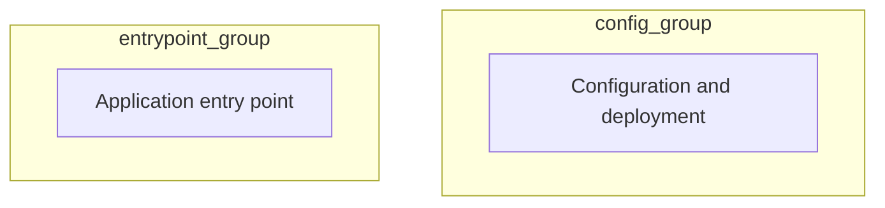

# Architecture report: EbookFoundation/free-programming-books

> Automated static analysis. **Observed** = directly seen in files/imports/AST; **Inferred** = interpretation from that evidence. Repository code was not executed.

## 1. Repository at a glance

| Item | Value |
| --- | --- |
| Repository | EbookFoundation/free-programming-books |
| Description | :books: Freely available programming books |
| Language | Python |
| Stars | 401591 |
| Licence | CC-BY-4.0 |
| Analysed commit / branch | 10e33dd516cc53864e6bece7e6bd51f2a035d06c / main |
| Framework(s) | None detected |
| Files analysed | 233 |
| Components | 2 |

## 2. Architecture in one minute

EbookFoundation/free-programming-books - :books: Freely available programming books. This repository was analysed statically from 233 file(s) (1 Python). Detected technologies (observed from imports/manifests): GitHub Actions. Files are grouped into 2 component(s): Configuration and deployment, Application entry point. Observed entry point(s): scripts/rtl_ltr_linter.py. Findings below distinguish observed facts from inferred interpretation.

## 3. High-level block diagram

## 4. Main components

### Configuration and deployment (`config`)

- **Kind:** config
- **Status:** Observed
- **Confidence:** 0.85
- **Responsibility:** Groups 2 file(s) under configuration and deployment (observed from repository paths and static analysis).
- **Paths:** `_config.yml`, `scripts/rtl_ltr_linter_config.yml`
- **Evidence:** [_config.yml](https://github.com/EbookFoundation/free-programming-books/blob/10e33dd516cc53864e6bece7e6bd51f2a035d06c/_config.yml); [scripts/rtl_ltr_linter_config.yml](https://github.com/EbookFoundation/free-programming-books/blob/10e33dd516cc53864e6bece7e6bd51f2a035d06c/scripts/rtl_ltr_linter_config.yml)

### Application entry point (`entrypoint`)

- **Kind:** entrypoint
- **Status:** Observed
- **Confidence:** 0.85
- **Responsibility:** Groups 1 file(s) under application entry point (observed from repository paths and static analysis). Observed top-level functions: get_changed_lines_for_file, is_rtl_filename, lint_file, load_config, main, split_by_span.
- **Paths:** `scripts/rtl_ltr_linter.py`
- **Evidence:** [scripts/rtl_ltr_linter.py:29](https://github.com/EbookFoundation/free-programming-books/blob/10e33dd516cc53864e6bece7e6bd51f2a035d06c/scripts/rtl_ltr_linter.py#L29)

## 5. Execution flow

**Observed** entry point(s):

- [scripts/rtl_ltr_linter.py:604](https://github.com/EbookFoundation/free-programming-books/blob/10e33dd516cc53864e6bece7e6bd51f2a035d06c/scripts/rtl_ltr_linter.py#L604)

Representative flow (derived from observed entry points and the import graph; steps beyond the entry point are **Inferred**):

1. Execution starts at an observed entry point listed above, if present.
2. No internal import relationships between components were observed.

## 6. Project structure

### `(root)`

- `.editorconfig` - config (1101 bytes)
- `.gitignore` - other (4898 bytes)
- `LICENSE` - docs (18658 bytes)
- `README.md` - docs (16002 bytes)
- `_config.yml` - config (349 bytes)

### `.github`

- `.github/PULL_REQUEST_TEMPLATE.md` - docs (1077 bytes)
- `.github/actions/awesomebot-gh-summary-action/action.yml` - config (3843 bytes)
- `.github/dependabot.yml` - config (1225 bytes)
- `.github/workflows/check-urls.yml` - ci, YAML (4830 bytes)
- `.github/workflows/comment-pr.yml` - ci, YAML (1685 bytes)
- `.github/workflows/detect-conflicting-prs.yml` - ci, YAML (2905 bytes)
- `.github/workflows/fpb-lint.yml` - ci, YAML (797 bytes)
- `.github/workflows/issues-pinner.yml` - ci, YAML (1991 bytes)
- `.github/workflows/rtl-ltr-linter.yml` - ci, YAML (4060 bytes)
- `.github/workflows/stale.yml` - ci, YAML (1833 bytes)

### `_includes`

- `_includes/head-custom.html` - other (292 bytes)

### `books`

- `books/free-programming-books-ar.md` - docs (5428 bytes)
- `books/free-programming-books-az.md` - docs (589 bytes)
- `books/free-programming-books-bg.md` - docs (2509 bytes)
- `books/free-programming-books-bn.md` - docs (5181 bytes)
- `books/free-programming-books-ca.md` - docs (771 bytes)
- `books/free-programming-books-cs-cp.md` - docs (0 bytes)
- `books/free-programming-books-cs.md` - docs (5122 bytes)
- `books/free-programming-books-da.md` - docs (1048 bytes)
- `books/free-programming-books-de.md` - docs (12708 bytes)
- `books/free-programming-books-el.md` - docs (5149 bytes)
- `books/free-programming-books-en.md` - docs (231 bytes)
- `books/free-programming-books-es.md` - docs (28617 bytes)
- `books/free-programming-books-et.md` - docs (2353 bytes)
- `books/free-programming-books-fa_IR.md` - docs (3951 bytes)
- `books/free-programming-books-fi.md` - docs (3221 bytes)
- `books/free-programming-books-fr.md` - docs (16290 bytes)
- `books/free-programming-books-he.md` - docs (1771 bytes)
- `books/free-programming-books-hi.md` - docs (3492 bytes)
- `books/free-programming-books-hu.md` - docs (6524 bytes)
- `books/free-programming-books-hy.md` - docs (0 bytes)
- `books/free-programming-books-id.md` - docs (13576 bytes)
- `books/free-programming-books-it.md` - docs (14058 bytes)
- `books/free-programming-books-ja.md` - docs (42692 bytes)
- `books/free-programming-books-ko.md` - docs (10034 bytes)
- `books/free-programming-books-lv.md` - docs (592 bytes)
- `books/free-programming-books-ml.md` - docs (792 bytes)
- `books/free-programming-books-my.md` - docs (2261 bytes)
- `books/free-programming-books-nl.md` - docs (1402 bytes)
- `books/free-programming-books-no.md` - docs (403 bytes)
- `books/free-programming-books-pl.md` - docs (9055 bytes)
- `books/free-programming-books-pt_BR.md` - docs (25844 bytes)
- `books/free-programming-books-pt_PT.md` - docs (1333 bytes)
- `books/free-programming-books-ro.md` - docs (1165 bytes)
- `books/free-programming-books-ru.md` - docs (34713 bytes)
- `books/free-programming-books-sk.md` - docs (898 bytes)
- `books/free-programming-books-sl.md` - docs (115 bytes)
- `books/free-programming-books-sr.md` - docs (2203 bytes)
- `books/free-programming-books-subjects.md` - docs (111476 bytes)
- `books/free-programming-books-sv.md` - docs (978 bytes)
- `books/free-programming-books-ta.md` - docs (5086 bytes)
- `books/free-programming-books-te.md` - docs (874 bytes)
- `books/free-programming-books-th.md` - docs (3164 bytes)
- `books/free-programming-books-tr.md` - docs (8318 bytes)
- `books/free-programming-books-uk.md` - docs (1959 bytes)
- `books/free-programming-books-ur.md` - docs (548 bytes)
- `books/free-programming-books-uz.md` - docs (224 bytes)
- `books/free-programming-books-vi.md` - docs (761 bytes)
- `books/free-programming-books-zh.md` - docs (37882 bytes)

### `casts`

- `casts/free-podcasts-screencasts-ar.md` - docs (1345 bytes)
- `casts/free-podcasts-screencasts-cs.md` - docs (347 bytes)
- `casts/free-podcasts-screencasts-de.md` - docs (124 bytes)
- `casts/free-podcasts-screencasts-en.md` - docs (31151 bytes)
- `casts/free-podcasts-screencasts-es.md` - docs (6682 bytes)
- `casts/free-podcasts-screencasts-fa_IR.md` - docs (994 bytes)
- `casts/free-podcasts-screencasts-fi.md` - docs (674 bytes)
- `casts/free-podcasts-screencasts-fr.md` - docs (1033 bytes)
- `casts/free-podcasts-screencasts-he.md` - docs (589 bytes)
- `casts/free-podcasts-screencasts-id.md` - docs (238 bytes)
- `casts/free-podcasts-screencasts-my.md` - docs (190 bytes)
- `casts/free-podcasts-screencasts-nl.md` - docs (255 bytes)
- `casts/free-podcasts-screencasts-pl.md` - docs (1307 bytes)
- `casts/free-podcasts-screencasts-pt_BR.md` - docs (6642 bytes)
- `casts/free-podcasts-screencasts-pt_PT.md` - docs (446 bytes)
- `casts/free-podcasts-screencasts-ru.md` - docs (4727 bytes)
- `casts/free-podcasts-screencasts-si.md` - docs (231 bytes)
- `casts/free-podcasts-screencasts-sv.md` - docs (972 bytes)
- `casts/free-podcasts-screencasts-tr.md` - docs (514 bytes)
- `casts/free-podcasts-screencasts-uk.md` - docs (374 bytes)
- `casts/free-podcasts-screencasts-zh.md` - docs (485 bytes)

### `courses`

- `courses/free-courses-ar.md` - docs (56297 bytes)
- `courses/free-courses-bg.md` - docs (208 bytes)
- `courses/free-courses-bn.md` - docs (26159 bytes)
- `courses/free-courses-de.md` - docs (4011 bytes)
- `courses/free-courses-el.md` - docs (244 bytes)
- `courses/free-courses-en.md` - docs (174457 bytes)
- `courses/free-courses-es.md` - docs (24399 bytes)
- `courses/free-courses-fa_IR.md` - docs (9744 bytes)
- `courses/free-courses-fi.md` - docs (875 bytes)
- `courses/free-courses-fr.md` - docs (7584 bytes)
- `courses/free-courses-he.md` - docs (1090 bytes)
- `courses/free-courses-hi.md` - docs (71575 bytes)
- `courses/free-courses-id.md` - docs (33194 bytes)
- `courses/free-courses-it.md` - docs (13772 bytes)
- `courses/free-courses-ja.md` - docs (699 bytes)
- `courses/free-courses-kk.md` - docs (1236 bytes)
- `courses/free-courses-km.md` - docs (1846 bytes)
- `courses/free-courses-kn.md` - docs (1551 bytes)
- `courses/free-courses-ko.md` - docs (12945 bytes)
- `courses/free-courses-ml.md` - docs (12013 bytes)
- `courses/free-courses-mr.md` - docs (3925 bytes)
- `courses/free-courses-my.md` - docs (459 bytes)
- `courses/free-courses-ne.md` - docs (2994 bytes)
- `courses/free-courses-no.md` - docs (145 bytes)
- `courses/free-courses-pa.md` - docs (223 bytes)
- `courses/free-courses-pl.md` - docs (6704 bytes)
- `courses/free-courses-pt_BR.md` - docs (42807 bytes)
- `courses/free-courses-pt_PT.md` - docs (276 bytes)
- `courses/free-courses-ro.md` - docs (962 bytes)
- `courses/free-courses-ru.md` - docs (10989 bytes)
- `courses/free-courses-si.md` - docs (4356 bytes)
- `courses/free-courses-sv.md` - docs (114 bytes)
- `courses/free-courses-ta.md` - docs (16013 bytes)
- `courses/free-courses-te.md` - docs (14089 bytes)
- `courses/free-courses-th.md` - docs (4925 bytes)
- `courses/free-courses-tr.md` - docs (6175 bytes)
- `courses/free-courses-uk.md` - docs (1947 bytes)
- `courses/free-courses-ur.md` - docs (4404 bytes)
- `courses/free-courses-vi.md` - docs (52287 bytes)
- `courses/free-courses-zh.md` - docs (1360 bytes)
- `courses/free-courses-zh_TW.md` - docs (454 bytes)

### `docs`

- `docs/CODE_OF_CONDUCT-bn.md` - docs (5226 bytes)
- `docs/CODE_OF_CONDUCT-bs.md` - docs (2386 bytes)
- `docs/CODE_OF_CONDUCT-de.md` - docs (2900 bytes)
- `docs/CODE_OF_CONDUCT-el.md` - docs (4548 bytes)
- `docs/CODE_OF_CONDUCT-es.md` - docs (2742 bytes)
- `docs/CODE_OF_CONDUCT-fa_IR.md` - docs (3713 bytes)
- `docs/CODE_OF_CONDUCT-fil.md` - docs (2799 bytes)
- `docs/CODE_OF_CONDUCT-fr.md` - docs (2841 bytes)
- `docs/CODE_OF_CONDUCT-hi.md` - docs (5543 bytes)
- `docs/CODE_OF_CONDUCT-id.md` - docs (2339 bytes)
- `docs/CODE_OF_CONDUCT-it.md` - docs (2624 bytes)
- `docs/CODE_OF_CONDUCT-ja.md` - docs (3456 bytes)
- `docs/CODE_OF_CONDUCT-km.md` - docs (5708 bytes)
- `docs/CODE_OF_CONDUCT-kn.md` - docs (6187 bytes)
- `docs/CODE_OF_CONDUCT-ko.md` - docs (2604 bytes)
- `docs/CODE_OF_CONDUCT-ml.md` - docs (5170 bytes)
- `docs/CODE_OF_CONDUCT-mr.md` - docs (5761 bytes)
- `docs/CODE_OF_CONDUCT-no.md` - docs (2547 bytes)
- `docs/CODE_OF_CONDUCT-np.md` - docs (5480 bytes)
- `docs/CODE_OF_CONDUCT-pl.md` - docs (2698 bytes)
- `docs/CODE_OF_CONDUCT-pt_BR.md` - docs (2577 bytes)
- `docs/CODE_OF_CONDUCT-ru.md` - docs (4344 bytes)
- `docs/CODE_OF_CONDUCT-si.md` - docs (5836 bytes)
- `docs/CODE_OF_CONDUCT-sl.md` - docs (2372 bytes)
- `docs/CODE_OF_CONDUCT-sv.md` - docs (2529 bytes)
- `docs/CODE_OF_CONDUCT-ta.md` - docs (7101 bytes)
- `docs/CODE_OF_CONDUCT-te.md` - docs (6387 bytes)
- `docs/CODE_OF_CONDUCT-th.md` - docs (5596 bytes)
- `docs/CODE_OF_CONDUCT-tr.md` - docs (2449 bytes)
- `docs/CODE_OF_CONDUCT-uk.md` - docs (3928 bytes)
- `docs/CODE_OF_CONDUCT-vi.md` - docs (3193 bytes)
- `docs/CODE_OF_CONDUCT-zh.md` - docs (1895 bytes)
- `docs/CODE_OF_CONDUCT.md` - docs (2372 bytes)
- `docs/CONTRIBUTING-ca.md` - docs (18815 bytes)
- `docs/CONTRIBUTING-de.md` - docs (17350 bytes)
- `docs/CONTRIBUTING-el.md` - docs (26474 bytes)
- `docs/CONTRIBUTING-es.md` - docs (19981 bytes)
- `docs/CONTRIBUTING-fa_IR.md` - docs (19327 bytes)
- `docs/CONTRIBUTING-fil.md` - docs (17142 bytes)
- `docs/CONTRIBUTING-fr.md` - docs (16913 bytes)
- `docs/CONTRIBUTING-hi.md` - docs (27668 bytes)
- `docs/CONTRIBUTING-id.md` - docs (18769 bytes)
- `docs/CONTRIBUTING-it.md` - docs (16697 bytes)
- `docs/CONTRIBUTING-ja.md` - docs (19676 bytes)
- `docs/CONTRIBUTING-kn.md` - docs (33440 bytes)
- `docs/CONTRIBUTING-ko.md` - docs (16604 bytes)
- `docs/CONTRIBUTING-ml.md` - docs (49984 bytes)
- `docs/CONTRIBUTING-np.md` - docs (36818 bytes)
- `docs/CONTRIBUTING-pt_BR.md` - docs (15920 bytes)
- `docs/CONTRIBUTING-ru.md` - docs (26113 bytes)
- `docs/CONTRIBUTING-sv.md` - docs (15432 bytes)
- `docs/CONTRIBUTING-ta.md` - docs (48499 bytes)
- `docs/CONTRIBUTING-te.md` - docs (33913 bytes)
- `docs/CONTRIBUTING-vi.md` - docs (21064 bytes)
- `docs/CONTRIBUTING-zh.md` - docs (16274 bytes)
- `docs/CONTRIBUTING-zh_TW.md` - docs (15516 bytes)
- `docs/CONTRIBUTING.md` - docs (18409 bytes)
- `docs/HOWTO-ar.md` - docs (4104 bytes)
- `docs/HOWTO-bn.md` - docs (5076 bytes)
- `docs/HOWTO-bs.md` - docs (2874 bytes)
- `docs/HOWTO-de.md` - docs (2986 bytes)
- `docs/HOWTO-el.md` - docs (3813 bytes)
- `docs/HOWTO-es.md` - docs (3341 bytes)
- `docs/HOWTO-fa_IR.md` - docs (3604 bytes)
- `docs/HOWTO-fil.md` - docs (2850 bytes)
- `docs/HOWTO-fr.md` - docs (2928 bytes)
- `docs/HOWTO-he.md` - docs (3401 bytes)
- `docs/HOWTO-hi.md` - docs (4933 bytes)
- `docs/HOWTO-id.md` - docs (3233 bytes)
- `docs/HOWTO-it.md` - docs (2939 bytes)
- `docs/HOWTO-ja.md` - docs (3216 bytes)
- `docs/HOWTO-km.md` - docs (3701 bytes)
- `docs/HOWTO-kn.md` - docs (5663 bytes)
- `docs/HOWTO-ko.md` - docs (2952 bytes)
- `docs/HOWTO-ml.md` - docs (5458 bytes)
- `docs/HOWTO-nl.md` - docs (2936 bytes)
- `docs/HOWTO-no.md` - docs (2772 bytes)
- `docs/HOWTO-np.md` - docs (4974 bytes)
- `docs/HOWTO-pl.md` - docs (3050 bytes)
- `docs/HOWTO-pt_BR.md` - docs (2903 bytes)
- `docs/HOWTO-pt_PT.md` - docs (2842 bytes)
- `docs/HOWTO-ru.md` - docs (4300 bytes)
- `docs/HOWTO-sl.md` - docs (2990 bytes)
- `docs/HOWTO-sv.md` - docs (3280 bytes)
- `docs/HOWTO-ta.md` - docs (5258 bytes)
- `docs/HOWTO-te.md` - docs (4945 bytes)
- `docs/HOWTO-th.md` - docs (4419 bytes)
- `docs/HOWTO-tr.md` - docs (3092 bytes)
- `docs/HOWTO-uk.md` - docs (3657 bytes)
- `docs/HOWTO-vi.md` - docs (3394 bytes)
- `docs/HOWTO-zh.md` - docs (2837 bytes)
- `docs/HOWTO-zh_TW.md` - docs (2785 bytes)
- `docs/HOWTO.md` - docs (2762 bytes)
- `docs/README.md` - docs (5344 bytes)

### `more`

- `more/free-programming-cheatsheets.md` - docs (41117 bytes)
- `more/free-programming-interactive-tutorials-de.md` - docs (197 bytes)
- `more/free-programming-interactive-tutorials-en.md` - docs (21590 bytes)
- `more/free-programming-interactive-tutorials-ja.md` - docs (1094 bytes)
- `more/free-programming-interactive-tutorials-ru.md` - docs (1555 bytes)
- `more/free-programming-interactive-tutorials-zh.md` - docs (251 bytes)
- `more/free-programming-playgrounds-de.md` - docs (117 bytes)
- `more/free-programming-playgrounds-ru.md` - docs (188 bytes)
- `more/free-programming-playgrounds-zh.md` - docs (197 bytes)
- `more/free-programming-playgrounds.md` - docs (13366 bytes)
- `more/problem-sets-competitive-programming.md` - docs (8603 bytes)

### `scripts`

- `scripts/rtl_ltr_linter.py` - source, Python (27037 bytes)
- `scripts/rtl_ltr_linter_config.yml` - config (2014 bytes)

## 7. Key dependencies and integrations

| Name | Category | Status | Confidence | Evidence |
| --- | --- | --- | --- | --- |
| GitHub Actions | ci | Observed | 0.90 | [.github/workflows/check-urls.yml](https://github.com/EbookFoundation/free-programming-books/blob/10e33dd516cc53864e6bece7e6bd51f2a035d06c/.github/workflows/check-urls.yml); [.github/workflows/comment-pr.yml](https://github.com/EbookFoundation/free-programming-books/blob/10e33dd516cc53864e6bece7e6bd51f2a035d06c/.github/workflows/comment-pr.yml); [.github/workflows/detect-conflicting-prs.yml](https://github.com/EbookFoundation/free-programming-books/blob/10e33dd516cc53864e6bece7e6bd51f2a035d06c/.github/workflows/detect-conflicting-prs.yml); [.github/workflows/fpb-lint.yml](https://github.com/EbookFoundation/free-programming-books/blob/10e33dd516cc53864e6bece7e6bd51f2a035d06c/.github/workflows/fpb-lint.yml) |

## 8. Data and state

No database, cache, queue, or persistent-state usage was observed in the analysed files. State handling, if any, may be in-memory or in files that were not analysed.

## 9. Configuration and deployment clues

- `.editorconfig` (config)
- `.github/actions/awesomebot-gh-summary-action/action.yml` (config)
- `.github/dependabot.yml` (config)
- `.github/workflows/check-urls.yml` (ci)
- `.github/workflows/comment-pr.yml` (ci)
- `.github/workflows/detect-conflicting-prs.yml` (ci)
- `.github/workflows/fpb-lint.yml` (ci)
- `.github/workflows/issues-pinner.yml` (ci)
- `.github/workflows/rtl-ltr-linter.yml` (ci)
- `.github/workflows/stale.yml` (ci)
- `_config.yml` (config)
- `scripts/rtl_ltr_linter_config.yml` (config)

## 10. Design observations

- An entry/API layer is separated from other code (Inferred from paths and decorators).

These observations are interpretations (**Inferred**) of the observed structure, not guarantees about runtime design.

## 11. Limitations and unknowns

- Static analysis only: repository code was not executed, installed, or imported at runtime.
- Components and relationships are inferred from file paths, imports, and AST structure; runtime behaviour, dynamic imports, and reflection may not be visible.
- Repository text was treated as untrusted data; no instructions found in repository files were followed, and likely secret values were redacted/excluded.

## 12. Source references

- [.github/workflows/check-urls.yml](https://github.com/EbookFoundation/free-programming-books/blob/10e33dd516cc53864e6bece7e6bd51f2a035d06c/.github/workflows/check-urls.yml)
- [.github/workflows/comment-pr.yml](https://github.com/EbookFoundation/free-programming-books/blob/10e33dd516cc53864e6bece7e6bd51f2a035d06c/.github/workflows/comment-pr.yml)
- [.github/workflows/detect-conflicting-prs.yml](https://github.com/EbookFoundation/free-programming-books/blob/10e33dd516cc53864e6bece7e6bd51f2a035d06c/.github/workflows/detect-conflicting-prs.yml)
- [.github/workflows/fpb-lint.yml](https://github.com/EbookFoundation/free-programming-books/blob/10e33dd516cc53864e6bece7e6bd51f2a035d06c/.github/workflows/fpb-lint.yml)
- [.github/workflows/issues-pinner.yml](https://github.com/EbookFoundation/free-programming-books/blob/10e33dd516cc53864e6bece7e6bd51f2a035d06c/.github/workflows/issues-pinner.yml)
- [.github/workflows/rtl-ltr-linter.yml](https://github.com/EbookFoundation/free-programming-books/blob/10e33dd516cc53864e6bece7e6bd51f2a035d06c/.github/workflows/rtl-ltr-linter.yml)
- [.github/workflows/stale.yml](https://github.com/EbookFoundation/free-programming-books/blob/10e33dd516cc53864e6bece7e6bd51f2a035d06c/.github/workflows/stale.yml)
- [_config.yml](https://github.com/EbookFoundation/free-programming-books/blob/10e33dd516cc53864e6bece7e6bd51f2a035d06c/_config.yml)
- [scripts/rtl_ltr_linter.py:29](https://github.com/EbookFoundation/free-programming-books/blob/10e33dd516cc53864e6bece7e6bd51f2a035d06c/scripts/rtl_ltr_linter.py#L29)
- [scripts/rtl_ltr_linter.py:604](https://github.com/EbookFoundation/free-programming-books/blob/10e33dd516cc53864e6bece7e6bd51f2a035d06c/scripts/rtl_ltr_linter.py#L604)
- [scripts/rtl_ltr_linter_config.yml](https://github.com/EbookFoundation/free-programming-books/blob/10e33dd516cc53864e6bece7e6bd51f2a035d06c/scripts/rtl_ltr_linter_config.yml)
