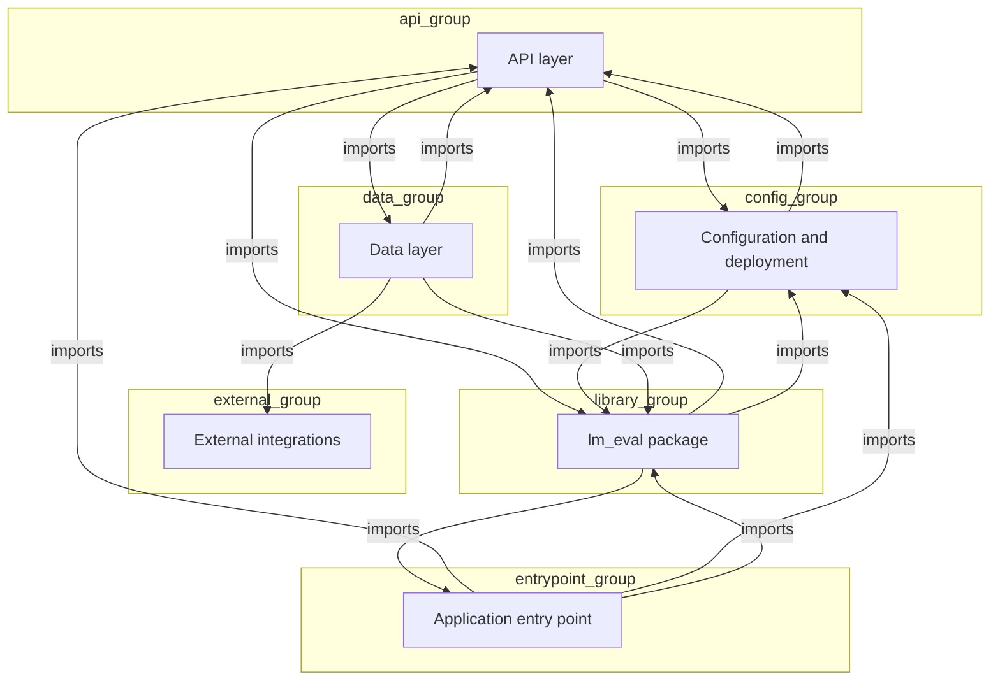

# Architecture report: EleutherAI/lm-evaluation-harness

> Automated static analysis. **Observed** = directly seen in files/imports/AST; **Inferred** = interpretation from that evidence. Repository code was not executed.

## 1. Repository at a glance

| Item | Value |
| --- | --- |
| Repository | EleutherAI/lm-evaluation-harness |
| Description | A framework for few-shot evaluation of language models. |
| Language | Python |
| Stars | 14465 |
| Licence | MIT |
| Analysed commit / branch | d6de81643928d653435c431bae19945d41d32520 / main |
| Framework(s) | None detected |
| Files analysed | 800 |
| Components | 6 |

## 2. Architecture in one minute

EleutherAI/lm-evaluation-harness - A framework for few-shot evaluation of language models.. This repository was analysed statically from 800 file(s) (100 Python). Detected technologies (observed from imports/manifests): GitHub Actions, aiohttp, NumPy, pandas, requests, pytest. Files are grouped into 6 component(s): API layer, Configuration and deployment, Data layer, Application entry point, External integrations, lm_eval package. Observed entry point(s): lm_eval/__main__.py, lm_eval/tasks/aclue/_generate_configs.py, lm_eval/tasks/afrimgsm/gen_utils.py. Findings below distinguish observed facts from inferred interpretation.

## 3. High-level block diagram

## 4. Main components

### API layer (`api_layer`)

- **Kind:** api
- **Status:** Observed
- **Confidence:** 0.85
- **Responsibility:** Groups 10 file(s) under api layer (observed from repository paths and static analysis). Observed top-level classes: BalancedSampler, CacheHook, CachingLM, ConfigurableGroup, ConfigurableTask, ContextSampler. Observed top-level functions: _bootstrap_internal_no_mp, _build_key_error_msg, _materialise_metric_side_effects, _materialise_placeholder, _multimodal_cache_default, _placeholder_path.
- **Paths:** `lm_eval/api/__init__.py`, `lm_eval/api/filter.py`, `lm_eval/api/group.py`, `lm_eval/api/instance.py`, `lm_eval/api/metrics.py`, `lm_eval/api/model.py`, `lm_eval/api/registry.py`, `lm_eval/api/samplers.py`, `lm_eval/api/task.py`, `lm_eval/api/utils.py`
- **Evidence:** [lm_eval/api/__init__.py](https://github.com/EleutherAI/lm-evaluation-harness/blob/d6de81643928d653435c431bae19945d41d32520/lm_eval/api/__init__.py); [lm_eval/api/filter.py:8](https://github.com/EleutherAI/lm-evaluation-harness/blob/d6de81643928d653435c431bae19945d41d32520/lm_eval/api/filter.py#L8); [lm_eval/api/group.py:34](https://github.com/EleutherAI/lm-evaluation-harness/blob/d6de81643928d653435c431bae19945d41d32520/lm_eval/api/group.py#L34); [lm_eval/api/instance.py:11](https://github.com/EleutherAI/lm-evaluation-harness/blob/d6de81643928d653435c431bae19945d41d32520/lm_eval/api/instance.py#L11); [lm_eval/api/metrics.py:23](https://github.com/EleutherAI/lm-evaluation-harness/blob/d6de81643928d653435c431bae19945d41d32520/lm_eval/api/metrics.py#L23); [lm_eval/api/model.py:25](https://github.com/EleutherAI/lm-evaluation-harness/blob/d6de81643928d653435c431bae19945d41d32520/lm_eval/api/model.py#L25); [lm_eval/api/registry.py:95](https://github.com/EleutherAI/lm-evaluation-harness/blob/d6de81643928d653435c431bae19945d41d32520/lm_eval/api/registry.py#L95); [lm_eval/api/samplers.py:17](https://github.com/EleutherAI/lm-evaluation-harness/blob/d6de81643928d653435c431bae19945d41d32520/lm_eval/api/samplers.py#L17)

### Configuration and deployment (`config`)

- **Kind:** config
- **Status:** Observed
- **Confidence:** 0.85
- **Responsibility:** Groups 629 file(s) under configuration and deployment (observed from repository paths and static analysis). Observed top-level classes: AggMetricConfig, EvaluatorConfig, FewshotConfig, GroupConfig, TaskConfig.
- **Paths:** `MANIFEST.in`, `lm_eval/config/__init__.py`, `lm_eval/config/evaluate_config.py`, `lm_eval/config/group.py`, `lm_eval/config/task.py`, `lm_eval/tasks/aclue/_aclue.yaml`, `lm_eval/tasks/aclue/aclue_ancient_chinese_culture.yaml`, `lm_eval/tasks/aclue/aclue_ancient_literature.yaml`, `lm_eval/tasks/aclue/aclue_ancient_medical.yaml`, `lm_eval/tasks/aclue/aclue_ancient_phonetics.yaml`, `lm_eval/tasks/aclue/aclue_basic_ancient_chinese.yaml`, `lm_eval/tasks/aclue/aclue_couplet_prediction.yaml`, `lm_eval/tasks/aclue/aclue_homographic_character_resolution.yaml`, `lm_eval/tasks/aclue/aclue_named_entity_recognition.yaml`, `lm_eval/tasks/aclue/aclue_poetry_appreciate.yaml`, `lm_eval/tasks/aclue/aclue_poetry_context_prediction.yaml`, `lm_eval/tasks/aclue/aclue_poetry_quality_assessment.yaml`, `lm_eval/tasks/aclue/aclue_poetry_sentiment_analysis.yaml`, `lm_eval/tasks/aclue/aclue_polysemy_resolution.yaml`, `lm_eval/tasks/aclue/aclue_reading_comprehension.yaml`, `lm_eval/tasks/aclue/aclue_sentence_segmentation.yaml`, `lm_eval/tasks/acpbench/boolq_cot_2shot/act_reach.yaml`, `lm_eval/tasks/acpbench/boolq_cot_2shot/app.yaml`, `lm_eval/tasks/acpbench/boolq_cot_2shot/just.yaml`, `lm_eval/tasks/acpbench/boolq_cot_2shot/land.yaml`, `lm_eval/tasks/acpbench/boolq_cot_2shot/prog.yaml`, `lm_eval/tasks/acpbench/boolq_cot_2shot/reach.yaml`, `lm_eval/tasks/acpbench/boolq_cot_2shot/val.yaml`, `lm_eval/tasks/acpbench/gen_2shot/act_reach.yaml`, `lm_eval/tasks/acpbench/gen_2shot/app.yaml`, `lm_eval/tasks/acpbench/gen_2shot/just.yaml`, `lm_eval/tasks/acpbench/gen_2shot/land.yaml`, `lm_eval/tasks/acpbench/gen_2shot/next_act.yaml`, `lm_eval/tasks/acpbench/gen_2shot/prog.yaml`, `lm_eval/tasks/acpbench/gen_2shot/reach.yaml`, `lm_eval/tasks/acpbench/gen_2shot/val.yaml`, `lm_eval/tasks/acpbench/gen_2shot_with_pddl/act_reach.yaml`, `lm_eval/tasks/acpbench/gen_2shot_with_pddl/app.yaml`, `lm_eval/tasks/acpbench/gen_2shot_with_pddl/just.yaml`, `lm_eval/tasks/acpbench/gen_2shot_with_pddl/land.yaml`, `lm_eval/tasks/acpbench/gen_2shot_with_pddl/next_act.yaml`, `lm_eval/tasks/acpbench/gen_2shot_with_pddl/prog.yaml`, `lm_eval/tasks/acpbench/gen_2shot_with_pddl/reach.yaml`, `lm_eval/tasks/acpbench/gen_2shot_with_pddl/val.yaml`, `lm_eval/tasks/acpbench/mcq_cot_2shot/act_reach.yaml`, `lm_eval/tasks/acpbench/mcq_cot_2shot/app.yaml`, `lm_eval/tasks/acpbench/mcq_cot_2shot/just.yaml`, `lm_eval/tasks/acpbench/mcq_cot_2shot/land.yaml`, `lm_eval/tasks/acpbench/mcq_cot_2shot/prog.yaml`, `lm_eval/tasks/acpbench/mcq_cot_2shot/reach.yaml`, `lm_eval/tasks/acpbench/mcq_cot_2shot/val.yaml`, `lm_eval/tasks/aexams/_aexams.yaml`, `lm_eval/tasks/aexams/aexams_Biology.yaml`, `lm_eval/tasks/aexams/aexams_IslamicStudies.yaml`, `lm_eval/tasks/aexams/aexams_Physics.yaml`, `lm_eval/tasks/aexams/aexams_Science.yaml`, `lm_eval/tasks/aexams/aexams_Social.yaml`, `lm_eval/tasks/afrimgsm/direct/afrimgsm.yaml`, `lm_eval/tasks/afrimgsm/direct/prompt_1/afrimgsm_amh.yaml`, `lm_eval/tasks/afrimgsm/direct/prompt_1/afrimgsm_eng.yaml`, `lm_eval/tasks/afrimgsm/direct/prompt_1/afrimgsm_ewe.yaml`, `lm_eval/tasks/afrimgsm/direct/prompt_1/afrimgsm_fra.yaml`, `lm_eval/tasks/afrimgsm/direct/prompt_1/afrimgsm_hau.yaml`, `lm_eval/tasks/afrimgsm/direct/prompt_1/afrimgsm_ibo.yaml`, `lm_eval/tasks/afrimgsm/direct/prompt_1/afrimgsm_kin.yaml`, `lm_eval/tasks/afrimgsm/direct/prompt_1/afrimgsm_lin.yaml`, `lm_eval/tasks/afrimgsm/direct/prompt_1/afrimgsm_lug.yaml`, `lm_eval/tasks/afrimgsm/direct/prompt_1/afrimgsm_orm.yaml`, `lm_eval/tasks/afrimgsm/direct/prompt_1/afrimgsm_sna.yaml`, `lm_eval/tasks/afrimgsm/direct/prompt_1/afrimgsm_sot.yaml`, `lm_eval/tasks/afrimgsm/direct/prompt_1/afrimgsm_swa.yaml`, `lm_eval/tasks/afrimgsm/direct/prompt_1/afrimgsm_twi.yaml`, `lm_eval/tasks/afrimgsm/direct/prompt_1/afrimgsm_vai.yaml`, `lm_eval/tasks/afrimgsm/direct/prompt_1/afrimgsm_wol.yaml`, `lm_eval/tasks/afrimgsm/direct/prompt_1/afrimgsm_xho.yaml`, `lm_eval/tasks/afrimgsm/direct/prompt_1/afrimgsm_yor.yaml`, `lm_eval/tasks/afrimgsm/direct/prompt_1/afrimgsm_zul.yaml`, `lm_eval/tasks/afrimgsm/direct/prompt_2/afrimgsm_amh.yaml`, `lm_eval/tasks/afrimgsm/direct/prompt_2/afrimgsm_eng.yaml`, `lm_eval/tasks/afrimgsm/direct/prompt_2/afrimgsm_ewe.yaml`, `lm_eval/tasks/afrimgsm/direct/prompt_2/afrimgsm_fra.yaml`, `lm_eval/tasks/afrimgsm/direct/prompt_2/afrimgsm_hau.yaml`, `lm_eval/tasks/afrimgsm/direct/prompt_2/afrimgsm_ibo.yaml`, `lm_eval/tasks/afrimgsm/direct/prompt_2/afrimgsm_kin.yaml`, `lm_eval/tasks/afrimgsm/direct/prompt_2/afrimgsm_lin.yaml`, `lm_eval/tasks/afrimgsm/direct/prompt_2/afrimgsm_lug.yaml`, `lm_eval/tasks/afrimgsm/direct/prompt_2/afrimgsm_orm.yaml`, `lm_eval/tasks/afrimgsm/direct/prompt_2/afrimgsm_sna.yaml`, `lm_eval/tasks/afrimgsm/direct/prompt_2/afrimgsm_sot.yaml`, `lm_eval/tasks/afrimgsm/direct/prompt_2/afrimgsm_swa.yaml`, `lm_eval/tasks/afrimgsm/direct/prompt_2/afrimgsm_twi.yaml`, `lm_eval/tasks/afrimgsm/direct/prompt_2/afrimgsm_vai.yaml`, `lm_eval/tasks/afrimgsm/direct/prompt_2/afrimgsm_wol.yaml`, `lm_eval/tasks/afrimgsm/direct/prompt_2/afrimgsm_xho.yaml`, `lm_eval/tasks/afrimgsm/direct/prompt_2/afrimgsm_yor.yaml`, `lm_eval/tasks/afrimgsm/direct/prompt_2/afrimgsm_zul.yaml`, `lm_eval/tasks/afrimgsm/direct/prompt_3/afrimgsm_amh.yaml`, `lm_eval/tasks/afrimgsm/direct/prompt_3/afrimgsm_eng.yaml`, `lm_eval/tasks/afrimgsm/direct/prompt_3/afrimgsm_ewe.yaml`, `lm_eval/tasks/afrimgsm/direct/prompt_3/afrimgsm_fra.yaml`, `lm_eval/tasks/afrimgsm/direct/prompt_3/afrimgsm_hau.yaml`, `lm_eval/tasks/afrimgsm/direct/prompt_3/afrimgsm_ibo.yaml`, `lm_eval/tasks/afrimgsm/direct/prompt_3/afrimgsm_kin.yaml`, `lm_eval/tasks/afrimgsm/direct/prompt_3/afrimgsm_lin.yaml`, `lm_eval/tasks/afrimgsm/direct/prompt_3/afrimgsm_lug.yaml`, `lm_eval/tasks/afrimgsm/direct/prompt_3/afrimgsm_orm.yaml`, `lm_eval/tasks/afrimgsm/direct/prompt_3/afrimgsm_sna.yaml`, `lm_eval/tasks/afrimgsm/direct/prompt_3/afrimgsm_sot.yaml`, `lm_eval/tasks/afrimgsm/direct/prompt_3/afrimgsm_swa.yaml`, `lm_eval/tasks/afrimgsm/direct/prompt_3/afrimgsm_twi.yaml`, `lm_eval/tasks/afrimgsm/direct/prompt_3/afrimgsm_vai.yaml`, `lm_eval/tasks/afrimgsm/direct/prompt_3/afrimgsm_wol.yaml`, `lm_eval/tasks/afrimgsm/direct/prompt_3/afrimgsm_xho.yaml`, `lm_eval/tasks/afrimgsm/direct/prompt_3/afrimgsm_yor.yaml`, `lm_eval/tasks/afrimgsm/direct/prompt_3/afrimgsm_zul.yaml`, `lm_eval/tasks/afrimgsm/direct/prompt_4/afrimgsm_amh.yaml`, `lm_eval/tasks/afrimgsm/direct/prompt_4/afrimgsm_eng.yaml`, `lm_eval/tasks/afrimgsm/direct/prompt_4/afrimgsm_ewe.yaml`, `lm_eval/tasks/afrimgsm/direct/prompt_4/afrimgsm_fra.yaml`, `lm_eval/tasks/afrimgsm/direct/prompt_4/afrimgsm_hau.yaml`, `lm_eval/tasks/afrimgsm/direct/prompt_4/afrimgsm_ibo.yaml`, `lm_eval/tasks/afrimgsm/direct/prompt_4/afrimgsm_kin.yaml`, `lm_eval/tasks/afrimgsm/direct/prompt_4/afrimgsm_lin.yaml`, `lm_eval/tasks/afrimgsm/direct/prompt_4/afrimgsm_lug.yaml`, `lm_eval/tasks/afrimgsm/direct/prompt_4/afrimgsm_orm.yaml`, `lm_eval/tasks/afrimgsm/direct/prompt_4/afrimgsm_sna.yaml`, `lm_eval/tasks/afrimgsm/direct/prompt_4/afrimgsm_sot.yaml`, `lm_eval/tasks/afrimgsm/direct/prompt_4/afrimgsm_swa.yaml`, `lm_eval/tasks/afrimgsm/direct/prompt_4/afrimgsm_twi.yaml`, `lm_eval/tasks/afrimgsm/direct/prompt_4/afrimgsm_vai.yaml`, `lm_eval/tasks/afrimgsm/direct/prompt_4/afrimgsm_wol.yaml`, `lm_eval/tasks/afrimgsm/direct/prompt_4/afrimgsm_xho.yaml`, `lm_eval/tasks/afrimgsm/direct/prompt_4/afrimgsm_yor.yaml`, `lm_eval/tasks/afrimgsm/direct/prompt_4/afrimgsm_zul.yaml`, `lm_eval/tasks/afrimgsm/direct/prompt_5/afrimgsm_amh.yaml`, `lm_eval/tasks/afrimgsm/direct/prompt_5/afrimgsm_eng.yaml`, `lm_eval/tasks/afrimgsm/direct/prompt_5/afrimgsm_ewe.yaml`, `lm_eval/tasks/afrimgsm/direct/prompt_5/afrimgsm_fra.yaml`, `lm_eval/tasks/afrimgsm/direct/prompt_5/afrimgsm_hau.yaml`, `lm_eval/tasks/afrimgsm/direct/prompt_5/afrimgsm_ibo.yaml`, `lm_eval/tasks/afrimgsm/direct/prompt_5/afrimgsm_kin.yaml`, `lm_eval/tasks/afrimgsm/direct/prompt_5/afrimgsm_lin.yaml`, `lm_eval/tasks/afrimgsm/direct/prompt_5/afrimgsm_lug.yaml`, `lm_eval/tasks/afrimgsm/direct/prompt_5/afrimgsm_orm.yaml`, `lm_eval/tasks/afrimgsm/direct/prompt_5/afrimgsm_sna.yaml`, `lm_eval/tasks/afrimgsm/direct/prompt_5/afrimgsm_sot.yaml`, `lm_eval/tasks/afrimgsm/direct/prompt_5/afrimgsm_swa.yaml`, `lm_eval/tasks/afrimgsm/direct/prompt_5/afrimgsm_twi.yaml`, `lm_eval/tasks/afrimgsm/direct/prompt_5/afrimgsm_vai.yaml`, `lm_eval/tasks/afrimgsm/direct/prompt_5/afrimgsm_wol.yaml`, `lm_eval/tasks/afrimgsm/direct/prompt_5/afrimgsm_xho.yaml`, `lm_eval/tasks/afrimgsm/direct/prompt_5/afrimgsm_yor.yaml`, `lm_eval/tasks/afrimgsm/direct/prompt_5/afrimgsm_zul.yaml`, `lm_eval/tasks/afrimgsm/direct_cot/afrimgsm_cot.yaml`, `lm_eval/tasks/afrimgsm/direct_cot/prompt_1/afrimgsm_cot_amh.yaml`, `lm_eval/tasks/afrimgsm/direct_cot/prompt_1/afrimgsm_cot_eng.yaml`, `lm_eval/tasks/afrimgsm/direct_cot/prompt_1/afrimgsm_cot_ewe.yaml`, `lm_eval/tasks/afrimgsm/direct_cot/prompt_1/afrimgsm_cot_fra.yaml`, `lm_eval/tasks/afrimgsm/direct_cot/prompt_1/afrimgsm_cot_hau.yaml`, `lm_eval/tasks/afrimgsm/direct_cot/prompt_1/afrimgsm_cot_ibo.yaml`, `lm_eval/tasks/afrimgsm/direct_cot/prompt_1/afrimgsm_cot_kin.yaml`, `lm_eval/tasks/afrimgsm/direct_cot/prompt_1/afrimgsm_cot_lin.yaml`, `lm_eval/tasks/afrimgsm/direct_cot/prompt_1/afrimgsm_cot_lug.yaml`, `lm_eval/tasks/afrimgsm/direct_cot/prompt_1/afrimgsm_cot_orm.yaml`, `lm_eval/tasks/afrimgsm/direct_cot/prompt_1/afrimgsm_cot_sna.yaml`, `lm_eval/tasks/afrimgsm/direct_cot/prompt_1/afrimgsm_cot_sot.yaml`, `lm_eval/tasks/afrimgsm/direct_cot/prompt_1/afrimgsm_cot_swa.yaml`, `lm_eval/tasks/afrimgsm/direct_cot/prompt_1/afrimgsm_cot_twi.yaml`, `lm_eval/tasks/afrimgsm/direct_cot/prompt_1/afrimgsm_cot_vai.yaml`, `lm_eval/tasks/afrimgsm/direct_cot/prompt_1/afrimgsm_cot_wol.yaml`, `lm_eval/tasks/afrimgsm/direct_cot/prompt_1/afrimgsm_cot_xho.yaml`, `lm_eval/tasks/afrimgsm/direct_cot/prompt_1/afrimgsm_cot_yor.yaml`, `lm_eval/tasks/afrimgsm/direct_cot/prompt_1/afrimgsm_cot_zul.yaml`, `lm_eval/tasks/afrimgsm/direct_cot/prompt_2/afrimgsm_cot_amh.yaml`, `lm_eval/tasks/afrimgsm/direct_cot/prompt_2/afrimgsm_cot_eng.yaml`, `lm_eval/tasks/afrimgsm/direct_cot/prompt_2/afrimgsm_cot_ewe.yaml`, `lm_eval/tasks/afrimgsm/direct_cot/prompt_2/afrimgsm_cot_fra.yaml`, `lm_eval/tasks/afrimgsm/direct_cot/prompt_2/afrimgsm_cot_hau.yaml`, `lm_eval/tasks/afrimgsm/direct_cot/prompt_2/afrimgsm_cot_ibo.yaml`, `lm_eval/tasks/afrimgsm/direct_cot/prompt_2/afrimgsm_cot_kin.yaml`, `lm_eval/tasks/afrimgsm/direct_cot/prompt_2/afrimgsm_cot_lin.yaml`, `lm_eval/tasks/afrimgsm/direct_cot/prompt_2/afrimgsm_cot_lug.yaml`, `lm_eval/tasks/afrimgsm/direct_cot/prompt_2/afrimgsm_cot_orm.yaml`, `lm_eval/tasks/afrimgsm/direct_cot/prompt_2/afrimgsm_cot_sna.yaml`, `lm_eval/tasks/afrimgsm/direct_cot/prompt_2/afrimgsm_cot_sot.yaml`, `lm_eval/tasks/afrimgsm/direct_cot/prompt_2/afrimgsm_cot_swa.yaml`, `lm_eval/tasks/afrimgsm/direct_cot/prompt_2/afrimgsm_cot_twi.yaml`, `lm_eval/tasks/afrimgsm/direct_cot/prompt_2/afrimgsm_cot_vai.yaml`, `lm_eval/tasks/afrimgsm/direct_cot/prompt_2/afrimgsm_cot_wol.yaml`, `lm_eval/tasks/afrimgsm/direct_cot/prompt_2/afrimgsm_cot_xho.yaml`, `lm_eval/tasks/afrimgsm/direct_cot/prompt_2/afrimgsm_cot_yor.yaml`, `lm_eval/tasks/afrimgsm/direct_cot/prompt_2/afrimgsm_cot_zul.yaml`, `lm_eval/tasks/afrimgsm/direct_cot/prompt_3/afrimgsm_cot_amh.yaml`, `lm_eval/tasks/afrimgsm/direct_cot/prompt_3/afrimgsm_cot_eng.yaml`, `lm_eval/tasks/afrimgsm/direct_cot/prompt_3/afrimgsm_cot_ewe.yaml`, `lm_eval/tasks/afrimgsm/direct_cot/prompt_3/afrimgsm_cot_fra.yaml`, `lm_eval/tasks/afrimgsm/direct_cot/prompt_3/afrimgsm_cot_hau.yaml`, `lm_eval/tasks/afrimgsm/direct_cot/prompt_3/afrimgsm_cot_ibo.yaml`, `lm_eval/tasks/afrimgsm/direct_cot/prompt_3/afrimgsm_cot_kin.yaml`, `lm_eval/tasks/afrimgsm/direct_cot/prompt_3/afrimgsm_cot_lin.yaml`, `lm_eval/tasks/afrimgsm/direct_cot/prompt_3/afrimgsm_cot_lug.yaml`, `lm_eval/tasks/afrimgsm/direct_cot/prompt_3/afrimgsm_cot_orm.yaml`, `lm_eval/tasks/afrimgsm/direct_cot/prompt_3/afrimgsm_cot_sna.yaml`, `lm_eval/tasks/afrimgsm/direct_cot/prompt_3/afrimgsm_cot_sot.yaml`, `lm_eval/tasks/afrimgsm/direct_cot/prompt_3/afrimgsm_cot_swa.yaml`, `lm_eval/tasks/afrimgsm/direct_cot/prompt_3/afrimgsm_cot_twi.yaml`, `lm_eval/tasks/afrimgsm/direct_cot/prompt_3/afrimgsm_cot_vai.yaml`, `lm_eval/tasks/afrimgsm/direct_cot/prompt_3/afrimgsm_cot_wol.yaml`, `lm_eval/tasks/afrimgsm/direct_cot/prompt_3/afrimgsm_cot_xho.yaml`, `lm_eval/tasks/afrimgsm/direct_cot/prompt_3/afrimgsm_cot_yor.yaml`, `lm_eval/tasks/afrimgsm/direct_cot/prompt_3/afrimgsm_cot_zul.yaml`, `lm_eval/tasks/afrimgsm/direct_cot/prompt_4/afrimgsm_cot_amh.yaml`, `lm_eval/tasks/afrimgsm/direct_cot/prompt_4/afrimgsm_cot_eng.yaml`, `lm_eval/tasks/afrimgsm/direct_cot/prompt_4/afrimgsm_cot_ewe.yaml`, `lm_eval/tasks/afrimgsm/direct_cot/prompt_4/afrimgsm_cot_fra.yaml`, `lm_eval/tasks/afrimgsm/direct_cot/prompt_4/afrimgsm_cot_hau.yaml`, `lm_eval/tasks/afrimgsm/direct_cot/prompt_4/afrimgsm_cot_ibo.yaml`, `lm_eval/tasks/afrimgsm/direct_cot/prompt_4/afrimgsm_cot_kin.yaml`, `lm_eval/tasks/afrimgsm/direct_cot/prompt_4/afrimgsm_cot_lin.yaml`, `lm_eval/tasks/afrimgsm/direct_cot/prompt_4/afrimgsm_cot_lug.yaml`, `lm_eval/tasks/afrimgsm/direct_cot/prompt_4/afrimgsm_cot_orm.yaml`, `lm_eval/tasks/afrimgsm/direct_cot/prompt_4/afrimgsm_cot_sna.yaml`, `lm_eval/tasks/afrimgsm/direct_cot/prompt_4/afrimgsm_cot_sot.yaml`, `lm_eval/tasks/afrimgsm/direct_cot/prompt_4/afrimgsm_cot_swa.yaml`, `lm_eval/tasks/afrimgsm/direct_cot/prompt_4/afrimgsm_cot_twi.yaml`, `lm_eval/tasks/afrimgsm/direct_cot/prompt_4/afrimgsm_cot_vai.yaml`, `lm_eval/tasks/afrimgsm/direct_cot/prompt_4/afrimgsm_cot_wol.yaml`, `lm_eval/tasks/afrimgsm/direct_cot/prompt_4/afrimgsm_cot_xho.yaml`, `lm_eval/tasks/afrimgsm/direct_cot/prompt_4/afrimgsm_cot_yor.yaml`, `lm_eval/tasks/afrimgsm/direct_cot/prompt_4/afrimgsm_cot_zul.yaml`, `lm_eval/tasks/afrimgsm/direct_cot/prompt_5/afrimgsm_cot_amh.yaml`, `lm_eval/tasks/afrimgsm/direct_cot/prompt_5/afrimgsm_cot_eng.yaml`, `lm_eval/tasks/afrimgsm/direct_cot/prompt_5/afrimgsm_cot_ewe.yaml`, `lm_eval/tasks/afrimgsm/direct_cot/prompt_5/afrimgsm_cot_fra.yaml`, `lm_eval/tasks/afrimgsm/direct_cot/prompt_5/afrimgsm_cot_hau.yaml`, `lm_eval/tasks/afrimgsm/direct_cot/prompt_5/afrimgsm_cot_ibo.yaml`, `lm_eval/tasks/afrimgsm/direct_cot/prompt_5/afrimgsm_cot_kin.yaml`, `lm_eval/tasks/afrimgsm/direct_cot/prompt_5/afrimgsm_cot_lin.yaml`, `lm_eval/tasks/afrimgsm/direct_cot/prompt_5/afrimgsm_cot_lug.yaml`, `lm_eval/tasks/afrimgsm/direct_cot/prompt_5/afrimgsm_cot_orm.yaml`, `lm_eval/tasks/afrimgsm/direct_cot/prompt_5/afrimgsm_cot_sna.yaml`, `lm_eval/tasks/afrimgsm/direct_cot/prompt_5/afrimgsm_cot_sot.yaml`, `lm_eval/tasks/afrimgsm/direct_cot/prompt_5/afrimgsm_cot_swa.yaml`, `lm_eval/tasks/afrimgsm/direct_cot/prompt_5/afrimgsm_cot_twi.yaml`, `lm_eval/tasks/afrimgsm/direct_cot/prompt_5/afrimgsm_cot_vai.yaml`, `lm_eval/tasks/afrimgsm/direct_cot/prompt_5/afrimgsm_cot_wol.yaml`, `lm_eval/tasks/afrimgsm/direct_cot/prompt_5/afrimgsm_cot_xho.yaml`, `lm_eval/tasks/afrimgsm/direct_cot/prompt_5/afrimgsm_cot_yor.yaml`, `lm_eval/tasks/afrimgsm/direct_cot/prompt_5/afrimgsm_cot_zul.yaml`, `lm_eval/tasks/afrimgsm/translate/afrimgsm_tt.yaml`, `lm_eval/tasks/afrimgsm/translate/prompt_1/afrimgsm_translate_amh.yaml`, `lm_eval/tasks/afrimgsm/translate/prompt_1/afrimgsm_translate_ewe.yaml`, `lm_eval/tasks/afrimgsm/translate/prompt_1/afrimgsm_translate_fra.yaml`, `lm_eval/tasks/afrimgsm/translate/prompt_1/afrimgsm_translate_hau.yaml`, `lm_eval/tasks/afrimgsm/translate/prompt_1/afrimgsm_translate_ibo.yaml`, `lm_eval/tasks/afrimgsm/translate/prompt_1/afrimgsm_translate_kin.yaml`, `lm_eval/tasks/afrimgsm/translate/prompt_1/afrimgsm_translate_lin.yaml`, `lm_eval/tasks/afrimgsm/translate/prompt_1/afrimgsm_translate_lug.yaml`, `lm_eval/tasks/afrimgsm/translate/prompt_1/afrimgsm_translate_orm.yaml`, `lm_eval/tasks/afrimgsm/translate/prompt_1/afrimgsm_translate_sna.yaml`, `lm_eval/tasks/afrimgsm/translate/prompt_1/afrimgsm_translate_sot.yaml`, `lm_eval/tasks/afrimgsm/translate/prompt_1/afrimgsm_translate_swa.yaml`, `lm_eval/tasks/afrimgsm/translate/prompt_1/afrimgsm_translate_twi.yaml`, `lm_eval/tasks/afrimgsm/translate/prompt_1/afrimgsm_translate_wol.yaml`, `lm_eval/tasks/afrimgsm/translate/prompt_1/afrimgsm_translate_xho.yaml`, `lm_eval/tasks/afrimgsm/translate/prompt_1/afrimgsm_translate_yor.yaml`, `lm_eval/tasks/afrimgsm/translate/prompt_1/afrimgsm_translate_zul.yaml`, `lm_eval/tasks/afrimgsm/translate/prompt_2/afrimgsm_translate_amh.yaml`, `lm_eval/tasks/afrimgsm/translate/prompt_2/afrimgsm_translate_ewe.yaml`, `lm_eval/tasks/afrimgsm/translate/prompt_2/afrimgsm_translate_fra.yaml`, `lm_eval/tasks/afrimgsm/translate/prompt_2/afrimgsm_translate_hau.yaml`, `lm_eval/tasks/afrimgsm/translate/prompt_2/afrimgsm_translate_ibo.yaml`, `lm_eval/tasks/afrimgsm/translate/prompt_2/afrimgsm_translate_kin.yaml`, `lm_eval/tasks/afrimgsm/translate/prompt_2/afrimgsm_translate_lin.yaml`, `lm_eval/tasks/afrimgsm/translate/prompt_2/afrimgsm_translate_lug.yaml`, `lm_eval/tasks/afrimgsm/translate/prompt_2/afrimgsm_translate_orm.yaml`, `lm_eval/tasks/afrimgsm/translate/prompt_2/afrimgsm_translate_sna.yaml`, `lm_eval/tasks/afrimgsm/translate/prompt_2/afrimgsm_translate_sot.yaml`, `lm_eval/tasks/afrimgsm/translate/prompt_2/afrimgsm_translate_swa.yaml`, `lm_eval/tasks/afrimgsm/translate/prompt_2/afrimgsm_translate_twi.yaml`, `lm_eval/tasks/afrimgsm/translate/prompt_2/afrimgsm_translate_wol.yaml`, `lm_eval/tasks/afrimgsm/translate/prompt_2/afrimgsm_translate_xho.yaml`, `lm_eval/tasks/afrimgsm/translate/prompt_2/afrimgsm_translate_yor.yaml`, `lm_eval/tasks/afrimgsm/translate/prompt_2/afrimgsm_translate_zul.yaml`, `lm_eval/tasks/afrimgsm/translate/prompt_3/afrimgsm_translate_amh.yaml`, `lm_eval/tasks/afrimgsm/translate/prompt_3/afrimgsm_translate_ewe.yaml`, `lm_eval/tasks/afrimgsm/translate/prompt_3/afrimgsm_translate_fra.yaml`, `lm_eval/tasks/afrimgsm/translate/prompt_3/afrimgsm_translate_hau.yaml`, `lm_eval/tasks/afrimgsm/translate/prompt_3/afrimgsm_translate_ibo.yaml`, `lm_eval/tasks/afrimgsm/translate/prompt_3/afrimgsm_translate_kin.yaml`, `lm_eval/tasks/afrimgsm/translate/prompt_3/afrimgsm_translate_lin.yaml`, `lm_eval/tasks/afrimgsm/translate/prompt_3/afrimgsm_translate_lug.yaml`, `lm_eval/tasks/afrimgsm/translate/prompt_3/afrimgsm_translate_orm.yaml`, `lm_eval/tasks/afrimgsm/translate/prompt_3/afrimgsm_translate_sna.yaml`, `lm_eval/tasks/afrimgsm/translate/prompt_3/afrimgsm_translate_sot.yaml`, `lm_eval/tasks/afrimgsm/translate/prompt_3/afrimgsm_translate_swa.yaml`, `lm_eval/tasks/afrimgsm/translate/prompt_3/afrimgsm_translate_twi.yaml`, `lm_eval/tasks/afrimgsm/translate/prompt_3/afrimgsm_translate_wol.yaml`, `lm_eval/tasks/afrimgsm/translate/prompt_3/afrimgsm_translate_xho.yaml`, `lm_eval/tasks/afrimgsm/translate/prompt_3/afrimgsm_translate_yor.yaml`, `lm_eval/tasks/afrimgsm/translate/prompt_3/afrimgsm_translate_zul.yaml`, `lm_eval/tasks/afrimgsm/translate/prompt_4/afrimgsm_translate_amh.yaml`, `lm_eval/tasks/afrimgsm/translate/prompt_4/afrimgsm_translate_ewe.yaml`, `lm_eval/tasks/afrimgsm/translate/prompt_4/afrimgsm_translate_fra.yaml`, `lm_eval/tasks/afrimgsm/translate/prompt_4/afrimgsm_translate_hau.yaml`, `lm_eval/tasks/afrimgsm/translate/prompt_4/afrimgsm_translate_ibo.yaml`, `lm_eval/tasks/afrimgsm/translate/prompt_4/afrimgsm_translate_kin.yaml`, `lm_eval/tasks/afrimgsm/translate/prompt_4/afrimgsm_translate_lin.yaml`, `lm_eval/tasks/afrimgsm/translate/prompt_4/afrimgsm_translate_lug.yaml`, `lm_eval/tasks/afrimgsm/translate/prompt_4/afrimgsm_translate_orm.yaml`, `lm_eval/tasks/afrimgsm/translate/prompt_4/afrimgsm_translate_sna.yaml`, `lm_eval/tasks/afrimgsm/translate/prompt_4/afrimgsm_translate_sot.yaml`, `lm_eval/tasks/afrimgsm/translate/prompt_4/afrimgsm_translate_swa.yaml`, `lm_eval/tasks/afrimgsm/translate/prompt_4/afrimgsm_translate_twi.yaml`, `lm_eval/tasks/afrimgsm/translate/prompt_4/afrimgsm_translate_wol.yaml`, `lm_eval/tasks/afrimgsm/translate/prompt_4/afrimgsm_translate_xho.yaml`, `lm_eval/tasks/afrimgsm/translate/prompt_4/afrimgsm_translate_yor.yaml`, `lm_eval/tasks/afrimgsm/translate/prompt_4/afrimgsm_translate_zul.yaml`, `lm_eval/tasks/afrimgsm/translate/prompt_5/afrimgsm_translate_amh.yaml`, `lm_eval/tasks/afrimgsm/translate/prompt_5/afrimgsm_translate_ewe.yaml`, `lm_eval/tasks/afrimgsm/translate/prompt_5/afrimgsm_translate_fra.yaml`, `lm_eval/tasks/afrimgsm/translate/prompt_5/afrimgsm_translate_hau.yaml`, `lm_eval/tasks/afrimgsm/translate/prompt_5/afrimgsm_translate_ibo.yaml`, `lm_eval/tasks/afrimgsm/translate/prompt_5/afrimgsm_translate_kin.yaml`, `lm_eval/tasks/afrimgsm/translate/prompt_5/afrimgsm_translate_lin.yaml`, `lm_eval/tasks/afrimgsm/translate/prompt_5/afrimgsm_translate_lug.yaml`, `lm_eval/tasks/afrimgsm/translate/prompt_5/afrimgsm_translate_orm.yaml`, `lm_eval/tasks/afrimgsm/translate/prompt_5/afrimgsm_translate_sna.yaml`, `lm_eval/tasks/afrimgsm/translate/prompt_5/afrimgsm_translate_sot.yaml`, `lm_eval/tasks/afrimgsm/translate/prompt_5/afrimgsm_translate_swa.yaml`, `lm_eval/tasks/afrimgsm/translate/prompt_5/afrimgsm_translate_twi.yaml`, `lm_eval/tasks/afrimgsm/translate/prompt_5/afrimgsm_translate_wol.yaml`, `lm_eval/tasks/afrimgsm/translate/prompt_5/afrimgsm_translate_xho.yaml`, `lm_eval/tasks/afrimgsm/translate/prompt_5/afrimgsm_translate_yor.yaml`, `lm_eval/tasks/afrimgsm/translate/prompt_5/afrimgsm_translate_zul.yaml`, `lm_eval/tasks/afrimgsm/translate_cot/afrimgsm_tt_cot.yaml`, `lm_eval/tasks/afrimgsm/translate_cot/prompt_1/afrimgsm_cot_translate_amh.yaml`, `lm_eval/tasks/afrimgsm/translate_cot/prompt_1/afrimgsm_cot_translate_ewe.yaml`, `lm_eval/tasks/afrimgsm/translate_cot/prompt_1/afrimgsm_cot_translate_fra.yaml`, `lm_eval/tasks/afrimgsm/translate_cot/prompt_1/afrimgsm_cot_translate_hau.yaml`, `lm_eval/tasks/afrimgsm/translate_cot/prompt_1/afrimgsm_cot_translate_ibo.yaml`, `lm_eval/tasks/afrimgsm/translate_cot/prompt_1/afrimgsm_cot_translate_kin.yaml`, `lm_eval/tasks/afrimgsm/translate_cot/prompt_1/afrimgsm_cot_translate_lin.yaml`, `lm_eval/tasks/afrimgsm/translate_cot/prompt_1/afrimgsm_cot_translate_lug.yaml`, `lm_eval/tasks/afrimgsm/translate_cot/prompt_1/afrimgsm_cot_translate_orm.yaml`, `lm_eval/tasks/afrimgsm/translate_cot/prompt_1/afrimgsm_cot_translate_sna.yaml`, `lm_eval/tasks/afrimgsm/translate_cot/prompt_1/afrimgsm_cot_translate_sot.yaml`, `lm_eval/tasks/afrimgsm/translate_cot/prompt_1/afrimgsm_cot_translate_swa.yaml`, `lm_eval/tasks/afrimgsm/translate_cot/prompt_1/afrimgsm_cot_translate_twi.yaml`, `lm_eval/tasks/afrimgsm/translate_cot/prompt_1/afrimgsm_cot_translate_vai.yaml`, `lm_eval/tasks/afrimgsm/translate_cot/prompt_1/afrimgsm_cot_translate_wol.yaml`, `lm_eval/tasks/afrimgsm/translate_cot/prompt_1/afrimgsm_cot_translate_xho.yaml`, `lm_eval/tasks/afrimgsm/translate_cot/prompt_1/afrimgsm_cot_translate_yor.yaml`, `lm_eval/tasks/afrimgsm/translate_cot/prompt_1/afrimgsm_cot_translate_zul.yaml`, `lm_eval/tasks/afrimgsm/translate_cot/prompt_2/afrimgsm_cot_translate_amh.yaml`, `lm_eval/tasks/afrimgsm/translate_cot/prompt_2/afrimgsm_cot_translate_ewe.yaml`, `lm_eval/tasks/afrimgsm/translate_cot/prompt_2/afrimgsm_cot_translate_fra.yaml`, `lm_eval/tasks/afrimgsm/translate_cot/prompt_2/afrimgsm_cot_translate_hau.yaml`, `lm_eval/tasks/afrimgsm/translate_cot/prompt_2/afrimgsm_cot_translate_ibo.yaml`, `lm_eval/tasks/afrimgsm/translate_cot/prompt_2/afrimgsm_cot_translate_kin.yaml`, `lm_eval/tasks/afrimgsm/translate_cot/prompt_2/afrimgsm_cot_translate_lin.yaml`, `lm_eval/tasks/afrimgsm/translate_cot/prompt_2/afrimgsm_cot_translate_lug.yaml`, `lm_eval/tasks/afrimgsm/translate_cot/prompt_2/afrimgsm_cot_translate_orm.yaml`, `lm_eval/tasks/afrimgsm/translate_cot/prompt_2/afrimgsm_cot_translate_sna.yaml`, `lm_eval/tasks/afrimgsm/translate_cot/prompt_2/afrimgsm_cot_translate_sot.yaml`, `lm_eval/tasks/afrimgsm/translate_cot/prompt_2/afrimgsm_cot_translate_swa.yaml`, `lm_eval/tasks/afrimgsm/translate_cot/prompt_2/afrimgsm_cot_translate_twi.yaml`, `lm_eval/tasks/afrimgsm/translate_cot/prompt_2/afrimgsm_cot_translate_vai.yaml`, `lm_eval/tasks/afrimgsm/translate_cot/prompt_2/afrimgsm_cot_translate_wol.yaml`, `lm_eval/tasks/afrimgsm/translate_cot/prompt_2/afrimgsm_cot_translate_xho.yaml`, `lm_eval/tasks/afrimgsm/translate_cot/prompt_2/afrimgsm_cot_translate_yor.yaml`, `lm_eval/tasks/afrimgsm/translate_cot/prompt_2/afrimgsm_cot_translate_zul.yaml`, `lm_eval/tasks/afrimgsm/translate_cot/prompt_3/afrimgsm_cot_translate_amh.yaml`, `lm_eval/tasks/afrimgsm/translate_cot/prompt_3/afrimgsm_cot_translate_ewe.yaml`, `lm_eval/tasks/afrimgsm/translate_cot/prompt_3/afrimgsm_cot_translate_fra.yaml`, `lm_eval/tasks/afrimgsm/translate_cot/prompt_3/afrimgsm_cot_translate_hau.yaml`, `lm_eval/tasks/afrimgsm/translate_cot/prompt_3/afrimgsm_cot_translate_ibo.yaml`, `lm_eval/tasks/afrimgsm/translate_cot/prompt_3/afrimgsm_cot_translate_kin.yaml`, `lm_eval/tasks/afrimgsm/translate_cot/prompt_3/afrimgsm_cot_translate_lin.yaml`, `lm_eval/tasks/afrimgsm/translate_cot/prompt_3/afrimgsm_cot_translate_lug.yaml`, `lm_eval/tasks/afrimgsm/translate_cot/prompt_3/afrimgsm_cot_translate_orm.yaml`, `lm_eval/tasks/afrimgsm/translate_cot/prompt_3/afrimgsm_cot_translate_sna.yaml`, `lm_eval/tasks/afrimgsm/translate_cot/prompt_3/afrimgsm_cot_translate_sot.yaml`, `lm_eval/tasks/afrimgsm/translate_cot/prompt_3/afrimgsm_cot_translate_swa.yaml`, `lm_eval/tasks/afrimgsm/translate_cot/prompt_3/afrimgsm_cot_translate_twi.yaml`, `lm_eval/tasks/afrimgsm/translate_cot/prompt_3/afrimgsm_cot_translate_vai.yaml`, `lm_eval/tasks/afrimgsm/translate_cot/prompt_3/afrimgsm_cot_translate_wol.yaml`, `lm_eval/tasks/afrimgsm/translate_cot/prompt_3/afrimgsm_cot_translate_xho.yaml`, `lm_eval/tasks/afrimgsm/translate_cot/prompt_3/afrimgsm_cot_translate_yor.yaml`, `lm_eval/tasks/afrimgsm/translate_cot/prompt_3/afrimgsm_cot_translate_zul.yaml`, `lm_eval/tasks/afrimgsm/translate_cot/prompt_4/afrimgsm_cot_translate_amh.yaml`, `lm_eval/tasks/afrimgsm/translate_cot/prompt_4/afrimgsm_cot_translate_ewe.yaml`, `lm_eval/tasks/afrimgsm/translate_cot/prompt_4/afrimgsm_cot_translate_fra.yaml`, `lm_eval/tasks/afrimgsm/translate_cot/prompt_4/afrimgsm_cot_translate_hau.yaml`, `lm_eval/tasks/afrimgsm/translate_cot/prompt_4/afrimgsm_cot_translate_ibo.yaml`, `lm_eval/tasks/afrimgsm/translate_cot/prompt_4/afrimgsm_cot_translate_kin.yaml`, `lm_eval/tasks/afrimgsm/translate_cot/prompt_4/afrimgsm_cot_translate_lin.yaml`, `lm_eval/tasks/afrimgsm/translate_cot/prompt_4/afrimgsm_cot_translate_lug.yaml`, `lm_eval/tasks/afrimgsm/translate_cot/prompt_4/afrimgsm_cot_translate_orm.yaml`, `lm_eval/tasks/afrimgsm/translate_cot/prompt_4/afrimgsm_cot_translate_sna.yaml`, `lm_eval/tasks/afrimgsm/translate_cot/prompt_4/afrimgsm_cot_translate_sot.yaml`, `lm_eval/tasks/afrimgsm/translate_cot/prompt_4/afrimgsm_cot_translate_swa.yaml`, `lm_eval/tasks/afrimgsm/translate_cot/prompt_4/afrimgsm_cot_translate_twi.yaml`, `lm_eval/tasks/afrimgsm/translate_cot/prompt_4/afrimgsm_cot_translate_vai.yaml`, `lm_eval/tasks/afrimgsm/translate_cot/prompt_4/afrimgsm_cot_translate_wol.yaml`, `lm_eval/tasks/afrimgsm/translate_cot/prompt_4/afrimgsm_cot_translate_xho.yaml`, `lm_eval/tasks/afrimgsm/translate_cot/prompt_4/afrimgsm_cot_translate_yor.yaml`, `lm_eval/tasks/afrimgsm/translate_cot/prompt_4/afrimgsm_cot_translate_zul.yaml`, `lm_eval/tasks/afrimgsm/translate_cot/prompt_5/afrimgsm_cot_translate_amh.yaml`, `lm_eval/tasks/afrimgsm/translate_cot/prompt_5/afrimgsm_cot_translate_ewe.yaml`, `lm_eval/tasks/afrimgsm/translate_cot/prompt_5/afrimgsm_cot_translate_fra.yaml`, `lm_eval/tasks/afrimgsm/translate_cot/prompt_5/afrimgsm_cot_translate_hau.yaml`, `lm_eval/tasks/afrimgsm/translate_cot/prompt_5/afrimgsm_cot_translate_ibo.yaml`, `lm_eval/tasks/afrimgsm/translate_cot/prompt_5/afrimgsm_cot_translate_kin.yaml`, `lm_eval/tasks/afrimgsm/translate_cot/prompt_5/afrimgsm_cot_translate_lin.yaml`, `lm_eval/tasks/afrimgsm/translate_cot/prompt_5/afrimgsm_cot_translate_lug.yaml`, `lm_eval/tasks/afrimgsm/translate_cot/prompt_5/afrimgsm_cot_translate_orm.yaml`, `lm_eval/tasks/afrimgsm/translate_cot/prompt_5/afrimgsm_cot_translate_sna.yaml`, `lm_eval/tasks/afrimgsm/translate_cot/prompt_5/afrimgsm_cot_translate_sot.yaml`, `lm_eval/tasks/afrimgsm/translate_cot/prompt_5/afrimgsm_cot_translate_swa.yaml`, `lm_eval/tasks/afrimgsm/translate_cot/prompt_5/afrimgsm_cot_translate_twi.yaml`, `lm_eval/tasks/afrimgsm/translate_cot/prompt_5/afrimgsm_cot_translate_vai.yaml`, `lm_eval/tasks/afrimgsm/translate_cot/prompt_5/afrimgsm_cot_translate_wol.yaml`, `lm_eval/tasks/afrimgsm/translate_cot/prompt_5/afrimgsm_cot_translate_xho.yaml`, `lm_eval/tasks/afrimgsm/translate_cot/prompt_5/afrimgsm_cot_translate_yor.yaml`, `lm_eval/tasks/afrimgsm/translate_cot/prompt_5/afrimgsm_cot_translate_zul.yaml`, `lm_eval/tasks/afrimmlu/direct/afrimmlu.yaml`, `lm_eval/tasks/afrimmlu/direct/prompt_1/afrimmlu_direct_amh.yaml`, `lm_eval/tasks/afrimmlu/direct/prompt_1/afrimmlu_direct_eng.yaml`, `lm_eval/tasks/afrimmlu/direct/prompt_1/afrimmlu_direct_ewe.yaml`, `lm_eval/tasks/afrimmlu/direct/prompt_1/afrimmlu_direct_fra.yaml`, `lm_eval/tasks/afrimmlu/direct/prompt_1/afrimmlu_direct_hau.yaml`, `lm_eval/tasks/afrimmlu/direct/prompt_1/afrimmlu_direct_ibo.yaml`, `lm_eval/tasks/afrimmlu/direct/prompt_1/afrimmlu_direct_kin.yaml`, `lm_eval/tasks/afrimmlu/direct/prompt_1/afrimmlu_direct_lin.yaml`, `lm_eval/tasks/afrimmlu/direct/prompt_1/afrimmlu_direct_lug.yaml`, `lm_eval/tasks/afrimmlu/direct/prompt_1/afrimmlu_direct_orm.yaml`, `lm_eval/tasks/afrimmlu/direct/prompt_1/afrimmlu_direct_sna.yaml`, `lm_eval/tasks/afrimmlu/direct/prompt_1/afrimmlu_direct_sot.yaml`, `lm_eval/tasks/afrimmlu/direct/prompt_1/afrimmlu_direct_swa.yaml`, `lm_eval/tasks/afrimmlu/direct/prompt_1/afrimmlu_direct_twi.yaml`, `lm_eval/tasks/afrimmlu/direct/prompt_1/afrimmlu_direct_wol.yaml`, `lm_eval/tasks/afrimmlu/direct/prompt_1/afrimmlu_direct_xho.yaml`, `lm_eval/tasks/afrimmlu/direct/prompt_1/afrimmlu_direct_yor.yaml`, `lm_eval/tasks/afrimmlu/direct/prompt_1/afrimmlu_direct_zul.yaml`, `lm_eval/tasks/afrimmlu/direct/prompt_2/afrimmlu_direct_amh.yaml`, `lm_eval/tasks/afrimmlu/direct/prompt_2/afrimmlu_direct_eng.yaml`, `lm_eval/tasks/afrimmlu/direct/prompt_2/afrimmlu_direct_ewe.yaml`, `lm_eval/tasks/afrimmlu/direct/prompt_2/afrimmlu_direct_fra.yaml`, `lm_eval/tasks/afrimmlu/direct/prompt_2/afrimmlu_direct_hau.yaml`, `lm_eval/tasks/afrimmlu/direct/prompt_2/afrimmlu_direct_ibo.yaml`, `lm_eval/tasks/afrimmlu/direct/prompt_2/afrimmlu_direct_kin.yaml`, `lm_eval/tasks/afrimmlu/direct/prompt_2/afrimmlu_direct_lin.yaml`, `lm_eval/tasks/afrimmlu/direct/prompt_2/afrimmlu_direct_lug.yaml`, `lm_eval/tasks/afrimmlu/direct/prompt_2/afrimmlu_direct_orm.yaml`, `lm_eval/tasks/afrimmlu/direct/prompt_2/afrimmlu_direct_sna.yaml`, `lm_eval/tasks/afrimmlu/direct/prompt_2/afrimmlu_direct_sot.yaml`, `lm_eval/tasks/afrimmlu/direct/prompt_2/afrimmlu_direct_swa.yaml`, `lm_eval/tasks/afrimmlu/direct/prompt_2/afrimmlu_direct_twi.yaml`, `lm_eval/tasks/afrimmlu/direct/prompt_2/afrimmlu_direct_wol.yaml`, `lm_eval/tasks/afrimmlu/direct/prompt_2/afrimmlu_direct_xho.yaml`, `lm_eval/tasks/afrimmlu/direct/prompt_2/afrimmlu_direct_yor.yaml`, `lm_eval/tasks/afrimmlu/direct/prompt_2/afrimmlu_direct_zul.yaml`, `lm_eval/tasks/afrimmlu/direct/prompt_3/afrimmlu_direct_amh.yaml`, `lm_eval/tasks/afrimmlu/direct/prompt_3/afrimmlu_direct_eng.yaml`, `lm_eval/tasks/afrimmlu/direct/prompt_3/afrimmlu_direct_ewe.yaml`, `lm_eval/tasks/afrimmlu/direct/prompt_3/afrimmlu_direct_fra.yaml`, `lm_eval/tasks/afrimmlu/direct/prompt_3/afrimmlu_direct_hau.yaml`, `lm_eval/tasks/afrimmlu/direct/prompt_3/afrimmlu_direct_ibo.yaml`, `lm_eval/tasks/afrimmlu/direct/prompt_3/afrimmlu_direct_kin.yaml`, `lm_eval/tasks/afrimmlu/direct/prompt_3/afrimmlu_direct_lin.yaml`, `lm_eval/tasks/afrimmlu/direct/prompt_3/afrimmlu_direct_lug.yaml`, `lm_eval/tasks/afrimmlu/direct/prompt_3/afrimmlu_direct_orm.yaml`, `lm_eval/tasks/afrimmlu/direct/prompt_3/afrimmlu_direct_sna.yaml`, `lm_eval/tasks/afrimmlu/direct/prompt_3/afrimmlu_direct_sot.yaml`, `lm_eval/tasks/afrimmlu/direct/prompt_3/afrimmlu_direct_swa.yaml`, `lm_eval/tasks/afrimmlu/direct/prompt_3/afrimmlu_direct_twi.yaml`, `lm_eval/tasks/afrimmlu/direct/prompt_3/afrimmlu_direct_wol.yaml`, `lm_eval/tasks/afrimmlu/direct/prompt_3/afrimmlu_direct_xho.yaml`, `lm_eval/tasks/afrimmlu/direct/prompt_3/afrimmlu_direct_yor.yaml`, `lm_eval/tasks/afrimmlu/direct/prompt_3/afrimmlu_direct_zul.yaml`, `lm_eval/tasks/afrimmlu/direct/prompt_4/afrimmlu_direct_amh.yaml`, `lm_eval/tasks/afrimmlu/direct/prompt_4/afrimmlu_direct_eng.yaml`, `lm_eval/tasks/afrimmlu/direct/prompt_4/afrimmlu_direct_ewe.yaml`, `lm_eval/tasks/afrimmlu/direct/prompt_4/afrimmlu_direct_fra.yaml`, `lm_eval/tasks/afrimmlu/direct/prompt_4/afrimmlu_direct_hau.yaml`, `lm_eval/tasks/afrimmlu/direct/prompt_4/afrimmlu_direct_ibo.yaml`, `lm_eval/tasks/afrimmlu/direct/prompt_4/afrimmlu_direct_kin.yaml`, `lm_eval/tasks/afrimmlu/direct/prompt_4/afrimmlu_direct_lin.yaml`, `lm_eval/tasks/afrimmlu/direct/prompt_4/afrimmlu_direct_lug.yaml`, `lm_eval/tasks/afrimmlu/direct/prompt_4/afrimmlu_direct_orm.yaml`, `lm_eval/tasks/afrimmlu/direct/prompt_4/afrimmlu_direct_sna.yaml`, `lm_eval/tasks/afrimmlu/direct/prompt_4/afrimmlu_direct_sot.yaml`, `lm_eval/tasks/afrimmlu/direct/prompt_4/afrimmlu_direct_swa.yaml`, `lm_eval/tasks/afrimmlu/direct/prompt_4/afrimmlu_direct_twi.yaml`, `lm_eval/tasks/afrimmlu/direct/prompt_4/afrimmlu_direct_wol.yaml`, `lm_eval/tasks/afrimmlu/direct/prompt_4/afrimmlu_direct_xho.yaml`, `lm_eval/tasks/afrimmlu/direct/prompt_4/afrimmlu_direct_yor.yaml`, `lm_eval/tasks/afrimmlu/direct/prompt_4/afrimmlu_direct_zul.yaml`, `lm_eval/tasks/afrimmlu/direct/prompt_5/afrimmlu_direct_amh.yaml`, `lm_eval/tasks/afrimmlu/direct/prompt_5/afrimmlu_direct_eng.yaml`, `lm_eval/tasks/afrimmlu/direct/prompt_5/afrimmlu_direct_ewe.yaml`, `lm_eval/tasks/afrimmlu/direct/prompt_5/afrimmlu_direct_fra.yaml`, `lm_eval/tasks/afrimmlu/direct/prompt_5/afrimmlu_direct_hau.yaml`, `lm_eval/tasks/afrimmlu/direct/prompt_5/afrimmlu_direct_ibo.yaml`, `lm_eval/tasks/afrimmlu/direct/prompt_5/afrimmlu_direct_kin.yaml`, `lm_eval/tasks/afrimmlu/direct/prompt_5/afrimmlu_direct_lin.yaml`, `lm_eval/tasks/afrimmlu/direct/prompt_5/afrimmlu_direct_lug.yaml`, `lm_eval/tasks/afrimmlu/direct/prompt_5/afrimmlu_direct_orm.yaml`, `lm_eval/tasks/afrimmlu/direct/prompt_5/afrimmlu_direct_sna.yaml`, `lm_eval/tasks/afrimmlu/direct/prompt_5/afrimmlu_direct_sot.yaml`, `lm_eval/tasks/afrimmlu/direct/prompt_5/afrimmlu_direct_swa.yaml`, `lm_eval/tasks/afrimmlu/direct/prompt_5/afrimmlu_direct_twi.yaml`, `lm_eval/tasks/afrimmlu/direct/prompt_5/afrimmlu_direct_wol.yaml`, `lm_eval/tasks/afrimmlu/direct/prompt_5/afrimmlu_direct_xho.yaml`, `lm_eval/tasks/afrimmlu/direct/prompt_5/afrimmlu_direct_yor.yaml`, `lm_eval/tasks/afrimmlu/direct/prompt_5/afrimmlu_direct_zul.yaml`, `lm_eval/tasks/afrimmlu/translate/afrimmlu_tt.yaml`, `lm_eval/tasks/afrimmlu/translate/prompt_1/afrimmlu_translate_amh.yaml`, `lm_eval/tasks/afrimmlu/translate/prompt_1/afrimmlu_translate_ewe.yaml`, `lm_eval/tasks/afrimmlu/translate/prompt_1/afrimmlu_translate_fra.yaml`, `lm_eval/tasks/afrimmlu/translate/prompt_1/afrimmlu_translate_hau.yaml`, `lm_eval/tasks/afrimmlu/translate/prompt_1/afrimmlu_translate_ibo.yaml`, `lm_eval/tasks/afrimmlu/translate/prompt_1/afrimmlu_translate_kin.yaml`, `lm_eval/tasks/afrimmlu/translate/prompt_1/afrimmlu_translate_lin.yaml`, `lm_eval/tasks/afrimmlu/translate/prompt_1/afrimmlu_translate_lug.yaml`, `lm_eval/tasks/afrimmlu/translate/prompt_1/afrimmlu_translate_orm.yaml`, `lm_eval/tasks/afrimmlu/translate/prompt_1/afrimmlu_translate_sna.yaml`, `lm_eval/tasks/afrimmlu/translate/prompt_1/afrimmlu_translate_sot.yaml`, `lm_eval/tasks/afrimmlu/translate/prompt_1/afrimmlu_translate_swa.yaml`, `lm_eval/tasks/afrimmlu/translate/prompt_1/afrimmlu_translate_twi.yaml`, `lm_eval/tasks/afrimmlu/translate/prompt_1/afrimmlu_translate_wol.yaml`, `lm_eval/tasks/afrimmlu/translate/prompt_1/afrimmlu_translate_xho.yaml`, `lm_eval/tasks/afrimmlu/translate/prompt_1/afrimmlu_translate_yor.yaml`, `lm_eval/tasks/afrimmlu/translate/prompt_1/afrimmlu_translate_zul.yaml`, `lm_eval/tasks/afrimmlu/translate/prompt_2/afrimmlu_translate_amh.yaml`, `lm_eval/tasks/afrimmlu/translate/prompt_2/afrimmlu_translate_ewe.yaml`, `lm_eval/tasks/afrimmlu/translate/prompt_2/afrimmlu_translate_fra.yaml`, `lm_eval/tasks/afrimmlu/translate/prompt_2/afrimmlu_translate_hau.yaml`, `lm_eval/tasks/afrimmlu/translate/prompt_2/afrimmlu_translate_ibo.yaml`, `lm_eval/tasks/afrimmlu/translate/prompt_2/afrimmlu_translate_kin.yaml`, `lm_eval/tasks/afrimmlu/translate/prompt_2/afrimmlu_translate_lin.yaml`, `lm_eval/tasks/afrimmlu/translate/prompt_2/afrimmlu_translate_lug.yaml`, `lm_eval/tasks/afrimmlu/translate/prompt_2/afrimmlu_translate_orm.yaml`, `lm_eval/tasks/afrimmlu/translate/prompt_2/afrimmlu_translate_sna.yaml`, `lm_eval/tasks/afrimmlu/translate/prompt_2/afrimmlu_translate_sot.yaml`, `lm_eval/tasks/afrimmlu/translate/prompt_2/afrimmlu_translate_swa.yaml`, `lm_eval/tasks/afrimmlu/translate/prompt_2/afrimmlu_translate_twi.yaml`, `lm_eval/tasks/afrimmlu/translate/prompt_2/afrimmlu_translate_wol.yaml`, `lm_eval/tasks/afrimmlu/translate/prompt_2/afrimmlu_translate_xho.yaml`, `lm_eval/tasks/afrimmlu/translate/prompt_2/afrimmlu_translate_yor.yaml`, `lm_eval/tasks/afrimmlu/translate/prompt_2/afrimmlu_translate_zul.yaml`, `lm_eval/tasks/afrimmlu/translate/prompt_3/afrimmlu_translate_amh.yaml`, `lm_eval/tasks/afrimmlu/translate/prompt_3/afrimmlu_translate_ewe.yaml`, `lm_eval/tasks/afrimmlu/translate/prompt_3/afrimmlu_translate_fra.yaml`, `lm_eval/tasks/afrimmlu/translate/prompt_3/afrimmlu_translate_hau.yaml`, `lm_eval/tasks/afrimmlu/translate/prompt_3/afrimmlu_translate_ibo.yaml`, `lm_eval/tasks/afrimmlu/translate/prompt_3/afrimmlu_translate_kin.yaml`, `lm_eval/tasks/afrimmlu/translate/prompt_3/afrimmlu_translate_lin.yaml`, `lm_eval/tasks/afrimmlu/translate/prompt_3/afrimmlu_translate_lug.yaml`, `lm_eval/tasks/afrimmlu/translate/prompt_3/afrimmlu_translate_orm.yaml`, `lm_eval/tasks/afrimmlu/translate/prompt_3/afrimmlu_translate_sna.yaml`, `lm_eval/tasks/afrimmlu/translate/prompt_3/afrimmlu_translate_sot.yaml`, `lm_eval/tasks/afrimmlu/translate/prompt_3/afrimmlu_translate_swa.yaml`, `lm_eval/tasks/afrimmlu/translate/prompt_3/afrimmlu_translate_twi.yaml`, `lm_eval/tasks/afrimmlu/translate/prompt_3/afrimmlu_translate_wol.yaml`, `lm_eval/tasks/afrimmlu/translate/prompt_3/afrimmlu_translate_xho.yaml`, `lm_eval/tasks/afrimmlu/translate/prompt_3/afrimmlu_translate_yor.yaml`, `lm_eval/tasks/afrimmlu/translate/prompt_3/afrimmlu_translate_zul.yaml`, `lm_eval/tasks/afrimmlu/translate/prompt_4/afrimmlu_translate_amh.yaml`, `lm_eval/tasks/afrimmlu/translate/prompt_4/afrimmlu_translate_ewe.yaml`, `lm_eval/tasks/afrimmlu/translate/prompt_4/afrimmlu_translate_fra.yaml`, `lm_eval/tasks/afrimmlu/translate/prompt_4/afrimmlu_translate_hau.yaml`, `lm_eval/tasks/afrimmlu/translate/prompt_4/afrimmlu_translate_ibo.yaml`, `lm_eval/tasks/afrimmlu/translate/prompt_4/afrimmlu_translate_kin.yaml`, `lm_eval/tasks/afrimmlu/translate/prompt_4/afrimmlu_translate_lin.yaml`, `lm_eval/tasks/afrimmlu/translate/prompt_4/afrimmlu_translate_lug.yaml`, `lm_eval/tasks/afrimmlu/translate/prompt_4/afrimmlu_translate_orm.yaml`, `lm_eval/tasks/afrimmlu/translate/prompt_4/afrimmlu_translate_sna.yaml`, `lm_eval/tasks/afrimmlu/translate/prompt_4/afrimmlu_translate_sot.yaml`, `lm_eval/tasks/afrimmlu/translate/prompt_4/afrimmlu_translate_swa.yaml`, `lm_eval/tasks/afrimmlu/translate/prompt_4/afrimmlu_translate_twi.yaml`, `lm_eval/tasks/afrimmlu/translate/prompt_4/afrimmlu_translate_wol.yaml`, `lm_eval/tasks/afrimmlu/translate/prompt_4/afrimmlu_translate_xho.yaml`, `lm_eval/tasks/afrimmlu/translate/prompt_4/afrimmlu_translate_yor.yaml`, `lm_eval/tasks/afrimmlu/translate/prompt_4/afrimmlu_translate_zul.yaml`, `lm_eval/tasks/afrimmlu/translate/prompt_5/afrimmlu_translate_amh.yaml`, `lm_eval/tasks/afrimmlu/translate/prompt_5/afrimmlu_translate_ewe.yaml`, `lm_eval/tasks/afrimmlu/translate/prompt_5/afrimmlu_translate_fra.yaml`, `lm_eval/tasks/afrimmlu/translate/prompt_5/afrimmlu_translate_hau.yaml`, `lm_eval/tasks/afrimmlu/translate/prompt_5/afrimmlu_translate_ibo.yaml`, `lm_eval/tasks/afrimmlu/translate/prompt_5/afrimmlu_translate_kin.yaml`, `lm_eval/tasks/afrimmlu/translate/prompt_5/afrimmlu_translate_lin.yaml`, `lm_eval/tasks/afrimmlu/translate/prompt_5/afrimmlu_translate_lug.yaml`, `lm_eval/tasks/afrimmlu/translate/prompt_5/afrimmlu_translate_orm.yaml`, `lm_eval/tasks/afrimmlu/translate/prompt_5/afrimmlu_translate_sna.yaml`, `lm_eval/tasks/afrimmlu/translate/prompt_5/afrimmlu_translate_sot.yaml`, `lm_eval/tasks/afrimmlu/translate/prompt_5/afrimmlu_translate_swa.yaml`, `lm_eval/tasks/afrimmlu/translate/prompt_5/afrimmlu_translate_twi.yaml`, `lm_eval/tasks/afrimmlu/translate/prompt_5/afrimmlu_translate_wol.yaml`, `lm_eval/tasks/afrimmlu/translate/prompt_5/afrimmlu_translate_xho.yaml`, `lm_eval/tasks/afrimmlu/translate/prompt_5/afrimmlu_translate_yor.yaml`, `lm_eval/tasks/afrimmlu/translate/prompt_5/afrimmlu_translate_zul.yaml`, `lm_eval/tasks/afrixnli/anli prompt/en-direct/afrixnli_en_direct_amh.yaml`, `lm_eval/tasks/afrixnli/anli prompt/en-direct/afrixnli_en_direct_eng.yaml`, `lm_eval/tasks/afrixnli/anli prompt/en-direct/afrixnli_en_direct_ewe.yaml`, `lm_eval/tasks/afrixnli/anli prompt/en-direct/afrixnli_en_direct_fra.yaml`, `lm_eval/tasks/afrixnli/anli prompt/en-direct/afrixnli_en_direct_hau.yaml`, `lm_eval/tasks/afrixnli/anli prompt/en-direct/afrixnli_en_direct_ibo.yaml`, `lm_eval/tasks/afrixnli/anli prompt/en-direct/afrixnli_en_direct_kin.yaml`, `lm_eval/tasks/afrixnli/anli prompt/en-direct/afrixnli_en_direct_lin.yaml`, `lm_eval/tasks/afrixnli/anli prompt/en-direct/afrixnli_en_direct_lug.yaml`, `lm_eval/tasks/afrixnli/anli prompt/en-direct/afrixnli_en_direct_orm.yaml`, `lm_eval/tasks/afrixnli/anli prompt/en-direct/afrixnli_en_direct_sna.yaml`, `lm_eval/tasks/afrixnli/anli prompt/en-direct/afrixnli_en_direct_sot.yaml`, `lm_eval/tasks/afrixnli/anli prompt/en-direct/afrixnli_en_direct_swa.yaml`, `lm_eval/tasks/afrixnli/anli prompt/en-direct/afrixnli_en_direct_twi.yaml`, `lm_eval/tasks/afrixnli/anli prompt/en-direct/afrixnli_en_direct_wol.yaml`, `lm_eval/tasks/afrixnli/anli prompt/en-direct/afrixnli_en_direct_xho.yaml`, `lm_eval/tasks/afrixnli/anli prompt/en-direct/afrixnli_en_direct_yor.yaml`, `lm_eval/tasks/afrixnli/anli prompt/en-direct/afrixnli_en_direct_zul.yaml`, `lm_eval/tasks/afrixnli/anli prompt/native-direct/afrixnli_native_direct_amh.yaml`, `lm_eval/tasks/afrixnli/anli prompt/native-direct/afrixnli_native_direct_eng.yaml`, `lm_eval/tasks/afrixnli/anli prompt/native-direct/afrixnli_native_direct_ewe.yaml`, `lm_eval/tasks/afrixnli/anli prompt/native-direct/afrixnli_native_direct_fra.yaml`, `lm_eval/tasks/afrixnli/anli prompt/native-direct/afrixnli_native_direct_hau.yaml`, `lm_eval/tasks/afrixnli/anli prompt/native-direct/afrixnli_native_direct_ibo.yaml`, `lm_eval/tasks/afrixnli/anli prompt/native-direct/afrixnli_native_direct_kin.yaml`, `lm_eval/tasks/afrixnli/anli prompt/native-direct/afrixnli_native_direct_lin.yaml`
- **Evidence:** [MANIFEST.in](https://github.com/EleutherAI/lm-evaluation-harness/blob/d6de81643928d653435c431bae19945d41d32520/MANIFEST.in); [lm_eval/config/__init__.py](https://github.com/EleutherAI/lm-evaluation-harness/blob/d6de81643928d653435c431bae19945d41d32520/lm_eval/config/__init__.py); [lm_eval/config/evaluate_config.py:35](https://github.com/EleutherAI/lm-evaluation-harness/blob/d6de81643928d653435c431bae19945d41d32520/lm_eval/config/evaluate_config.py#L35); [lm_eval/config/group.py:7](https://github.com/EleutherAI/lm-evaluation-harness/blob/d6de81643928d653435c431bae19945d41d32520/lm_eval/config/group.py#L7); [lm_eval/config/task.py:21](https://github.com/EleutherAI/lm-evaluation-harness/blob/d6de81643928d653435c431bae19945d41d32520/lm_eval/config/task.py#L21); [lm_eval/tasks/aclue/_aclue.yaml](https://github.com/EleutherAI/lm-evaluation-harness/blob/d6de81643928d653435c431bae19945d41d32520/lm_eval/tasks/aclue/_aclue.yaml); [lm_eval/tasks/aclue/aclue_ancient_chinese_culture.yaml](https://github.com/EleutherAI/lm-evaluation-harness/blob/d6de81643928d653435c431bae19945d41d32520/lm_eval/tasks/aclue/aclue_ancient_chinese_culture.yaml); [lm_eval/tasks/aclue/aclue_ancient_literature.yaml](https://github.com/EleutherAI/lm-evaluation-harness/blob/d6de81643928d653435c431bae19945d41d32520/lm_eval/tasks/aclue/aclue_ancient_literature.yaml)

### Data layer (`data_layer`)

- **Kind:** data
- **Status:** Observed
- **Confidence:** 0.85
- **Responsibility:** Groups 32 file(s) under data layer (observed from repository paths and static analysis). Observed top-level classes: AnthropicChat, AnthropicLM, AzureOpenaiChatCompletionsLM, Collator, CustomNeuronModelForCausalLM, DummyLM. Observed top-level functions: _add_megatron_to_path, _add_special_kwargs, _check_dist_ckpt, _get_target_from_class, _log_softmax, _parse_extra_args.
- **Paths:** `lm_eval/models/__init__.py`, `lm_eval/models/_onnx_base.py`, `lm_eval/models/anthropic_llms.py`, `lm_eval/models/api_models.py`, `lm_eval/models/dummy.py`, `lm_eval/models/gguf.py`, `lm_eval/models/hf_audiolm.py`, `lm_eval/models/hf_steered.py`, `lm_eval/models/hf_vlms.py`, `lm_eval/models/huggingface.py`, `lm_eval/models/ibm_watsonx_ai.py`, `lm_eval/models/litellm_llms.py`, `lm_eval/models/mamba_lm.py`, `lm_eval/models/megatron_lm.py`, `lm_eval/models/mistral3.py`, `lm_eval/models/nemo_lm.py`, `lm_eval/models/neuron_optimum.py`, `lm_eval/models/onnxruntime_genai.py`, `lm_eval/models/onnxruntime_ort.py`, `lm_eval/models/openai_completions.py`, `lm_eval/models/optimum_habana.py`, `lm_eval/models/optimum_ipex.py`, `lm_eval/models/optimum_lm.py`, `lm_eval/models/sglang_causallms.py`, `lm_eval/models/sglang_generate_API.py`, `lm_eval/models/textsynth.py`, `lm_eval/models/trtllm_causallms.py`, `lm_eval/models/utils.py`, `lm_eval/models/utils_hf.py`, `lm_eval/models/vllm_causallms.py`, `lm_eval/models/vllm_vlms.py`, `lm_eval/models/winml.py`
- **Evidence:** [lm_eval/models/__init__.py:66](https://github.com/EleutherAI/lm-evaluation-harness/blob/d6de81643928d653435c431bae19945d41d32520/lm_eval/models/__init__.py#L66); [lm_eval/models/_onnx_base.py:43](https://github.com/EleutherAI/lm-evaluation-harness/blob/d6de81643928d653435c431bae19945d41d32520/lm_eval/models/_onnx_base.py#L43); [lm_eval/models/anthropic_llms.py:17](https://github.com/EleutherAI/lm-evaluation-harness/blob/d6de81643928d653435c431bae19945d41d32520/lm_eval/models/anthropic_llms.py#L17); [lm_eval/models/api_models.py:55](https://github.com/EleutherAI/lm-evaluation-harness/blob/d6de81643928d653435c431bae19945d41d32520/lm_eval/models/api_models.py#L55); [lm_eval/models/dummy.py:11](https://github.com/EleutherAI/lm-evaluation-harness/blob/d6de81643928d653435c431bae19945d41d32520/lm_eval/models/dummy.py#L11); [lm_eval/models/gguf.py:24](https://github.com/EleutherAI/lm-evaluation-harness/blob/d6de81643928d653435c431bae19945d41d32520/lm_eval/models/gguf.py#L24); [lm_eval/models/hf_audiolm.py:22](https://github.com/EleutherAI/lm-evaluation-harness/blob/d6de81643928d653435c431bae19945d41d32520/lm_eval/models/hf_audiolm.py#L22); [lm_eval/models/hf_steered.py:23](https://github.com/EleutherAI/lm-evaluation-harness/blob/d6de81643928d653435c431bae19945d41d32520/lm_eval/models/hf_steered.py#L23)

### Application entry point (`entrypoint`)

- **Kind:** entrypoint
- **Status:** Observed
- **Confidence:** 0.85
- **Responsibility:** Groups 6 file(s) under application entry point (observed from repository paths and static analysis). Observed top-level classes: FunctionTag, Run. Observed top-level functions: add_regex_pattern, cli_evaluate, gen_lang_yamls, main, parse_args, prompt_func.
- **Paths:** `lm_eval/__main__.py`, `lm_eval/_cli/run.py`, `lm_eval/tasks/aclue/_generate_configs.py`, `lm_eval/tasks/afrimgsm/gen_utils.py`, `lm_eval/tasks/afrimgsm/utils.py`, `lm_eval/tasks/afrimmlu/gen_utils.py`
- **Evidence:** [lm_eval/__main__.py:5](https://github.com/EleutherAI/lm-evaluation-harness/blob/d6de81643928d653435c431bae19945d41d32520/lm_eval/__main__.py#L5); [lm_eval/_cli/run.py:18](https://github.com/EleutherAI/lm-evaluation-harness/blob/d6de81643928d653435c431bae19945d41d32520/lm_eval/_cli/run.py#L18); [lm_eval/tasks/aclue/_generate_configs.py:35](https://github.com/EleutherAI/lm-evaluation-harness/blob/d6de81643928d653435c431bae19945d41d32520/lm_eval/tasks/aclue/_generate_configs.py#L35); [lm_eval/tasks/afrimgsm/gen_utils.py:7](https://github.com/EleutherAI/lm-evaluation-harness/blob/d6de81643928d653435c431bae19945d41d32520/lm_eval/tasks/afrimgsm/gen_utils.py#L7); [lm_eval/tasks/afrimgsm/utils.py:75](https://github.com/EleutherAI/lm-evaluation-harness/blob/d6de81643928d653435c431bae19945d41d32520/lm_eval/tasks/afrimgsm/utils.py#L75); [lm_eval/tasks/afrimmlu/gen_utils.py:7](https://github.com/EleutherAI/lm-evaluation-harness/blob/d6de81643928d653435c431bae19945d41d32520/lm_eval/tasks/afrimmlu/gen_utils.py#L7)

### External integrations (`external_integrations`)

- **Kind:** external
- **Status:** Inferred
- **Confidence:** 0.70
- **Responsibility:** Groups 0 file(s) under external integrations (observed from repository paths and static analysis).
- **Evidence:** [lm_eval/models/api_models.py:19](https://github.com/EleutherAI/lm-evaluation-harness/blob/d6de81643928d653435c431bae19945d41d32520/lm_eval/models/api_models.py#L19); [lm_eval/models/api_models.py:20](https://github.com/EleutherAI/lm-evaluation-harness/blob/d6de81643928d653435c431bae19945d41d32520/lm_eval/models/api_models.py#L20); [lm_eval/models/gguf.py:6](https://github.com/EleutherAI/lm-evaluation-harness/blob/d6de81643928d653435c431bae19945d41d32520/lm_eval/models/gguf.py#L6); [lm_eval/models/gguf.py:7](https://github.com/EleutherAI/lm-evaluation-harness/blob/d6de81643928d653435c431bae19945d41d32520/lm_eval/models/gguf.py#L7); [lm_eval/models/textsynth.py:18](https://github.com/EleutherAI/lm-evaluation-harness/blob/d6de81643928d653435c431bae19945d41d32520/lm_eval/models/textsynth.py#L18)

### lm_eval package (`lm_eval`)

- **Kind:** library
- **Status:** Observed
- **Confidence:** 0.85
- **Responsibility:** Groups 50 file(s) under lm_eval package (observed from repository paths and static analysis). Observed top-level classes: ACPBench_Visitor, ACPGrammarFilter, ACPGrammarParser, Action, ActionReachabilityEvaluator, ApplicabilityEvaluator. Observed top-level functions: __getattr__, _cache_file_path, _check_duplicates, _collect_groups_bottom_up, _collect_results, _compute_task_aggregations.
- **Paths:** `lm_eval/__init__.py`, `lm_eval/_cli/__init__.py`, `lm_eval/_cli/harness.py`, `lm_eval/_cli/ls.py`, `lm_eval/_cli/subcommand.py`, `lm_eval/_cli/utils.py`, `lm_eval/_cli/validate.py`, `lm_eval/caching/__init__.py`, `lm_eval/caching/cache.py`, `lm_eval/decontamination/__init__.py`, `lm_eval/decontamination/archiver.py`, `lm_eval/decontamination/decontaminate.py`, `lm_eval/decontamination/janitor.py`, `lm_eval/defaults.py`, `lm_eval/evaluator.py`, `lm_eval/evaluator_utils.py`, `lm_eval/filters/__init__.py`, `lm_eval/filters/custom.py`, `lm_eval/filters/decontamination.py`, `lm_eval/filters/extraction.py`, `lm_eval/filters/selection.py`, `lm_eval/filters/transformation.py`, `lm_eval/loggers/__init__.py`, `lm_eval/loggers/evaluation_tracker.py`, `lm_eval/loggers/trackio_logger.py`, `lm_eval/loggers/utils.py`, `lm_eval/loggers/wandb_logger.py`, `lm_eval/prompts/__init__.py`, `lm_eval/result_schema.py`, `lm_eval/tasks/__init__.py`, `lm_eval/tasks/_factory.py`, `lm_eval/tasks/_index.py`, `lm_eval/tasks/_yaml_loader.py`, `lm_eval/tasks/acpbench/gen_2shot/acp_utils.py`, `lm_eval/tasks/acpbench/gen_2shot_with_pddl/acp_utils.py`, `lm_eval/tasks/afrimgsm/gen_yaml.sh`, `lm_eval/tasks/afrimgsm/run.sh`, `lm_eval/tasks/afrimmlu/direct/prompt_1/utils.py`, `lm_eval/tasks/afrimmlu/direct/prompt_2/utils.py`, `lm_eval/tasks/afrimmlu/direct/prompt_3/utils.py`, `lm_eval/tasks/afrimmlu/direct/prompt_4/utils.py`, `lm_eval/tasks/afrimmlu/direct/prompt_5/utils.py`, `lm_eval/tasks/afrimmlu/fewshot.sh`, `lm_eval/tasks/afrimmlu/translate/prompt_1/utils.py`, `lm_eval/tasks/afrimmlu/translate/prompt_2/utils.py`, `lm_eval/tasks/afrimmlu/translate/prompt_3/utils.py`, `lm_eval/tasks/afrimmlu/translate/prompt_4/utils.py`, `lm_eval/tasks/afrimmlu/translate/prompt_5/utils.py`, `lm_eval/tasks/afrimmlu/utils.py`, `lm_eval/tasks/afrixnli/anli prompt/en-direct/utils.py`
- **Evidence:** [lm_eval/__init__.py:17](https://github.com/EleutherAI/lm-evaluation-harness/blob/d6de81643928d653435c431bae19945d41d32520/lm_eval/__init__.py#L17); [lm_eval/_cli/__init__.py](https://github.com/EleutherAI/lm-evaluation-harness/blob/d6de81643928d653435c431bae19945d41d32520/lm_eval/_cli/__init__.py); [lm_eval/_cli/harness.py:10](https://github.com/EleutherAI/lm-evaluation-harness/blob/d6de81643928d653435c431bae19945d41d32520/lm_eval/_cli/harness.py#L10); [lm_eval/_cli/ls.py:7](https://github.com/EleutherAI/lm-evaluation-harness/blob/d6de81643928d653435c431bae19945d41d32520/lm_eval/_cli/ls.py#L7); [lm_eval/_cli/subcommand.py:5](https://github.com/EleutherAI/lm-evaluation-harness/blob/d6de81643928d653435c431bae19945d41d32520/lm_eval/_cli/subcommand.py#L5); [lm_eval/_cli/utils.py:17](https://github.com/EleutherAI/lm-evaluation-harness/blob/d6de81643928d653435c431bae19945d41d32520/lm_eval/_cli/utils.py#L17); [lm_eval/_cli/validate.py:8](https://github.com/EleutherAI/lm-evaluation-harness/blob/d6de81643928d653435c431bae19945d41d32520/lm_eval/_cli/validate.py#L8); [lm_eval/caching/__init__.py](https://github.com/EleutherAI/lm-evaluation-harness/blob/d6de81643928d653435c431bae19945d41d32520/lm_eval/caching/__init__.py)

## 5. Execution flow

**Observed** entry point(s):

- [lm_eval/__main__.py:13](https://github.com/EleutherAI/lm-evaluation-harness/blob/d6de81643928d653435c431bae19945d41d32520/lm_eval/__main__.py#L13)
- [lm_eval/tasks/aclue/_generate_configs.py:44](https://github.com/EleutherAI/lm-evaluation-harness/blob/d6de81643928d653435c431bae19945d41d32520/lm_eval/tasks/aclue/_generate_configs.py#L44)
- [lm_eval/tasks/afrimgsm/gen_utils.py:121](https://github.com/EleutherAI/lm-evaluation-harness/blob/d6de81643928d653435c431bae19945d41d32520/lm_eval/tasks/afrimgsm/gen_utils.py#L121)
- [lm_eval/tasks/afrimgsm/utils.py:218](https://github.com/EleutherAI/lm-evaluation-harness/blob/d6de81643928d653435c431bae19945d41d32520/lm_eval/tasks/afrimgsm/utils.py#L218)
- [lm_eval/tasks/afrimmlu/gen_utils.py:102](https://github.com/EleutherAI/lm-evaluation-harness/blob/d6de81643928d653435c431bae19945d41d32520/lm_eval/tasks/afrimmlu/gen_utils.py#L102)

Representative flow (derived from observed entry points and the import graph; steps beyond the entry point are **Inferred**):

1. Execution starts at an observed entry point listed above, if present.
2. `api_layer` imports `config` (API layer -> Configuration and deployment).
3. `api_layer` imports `data_layer` (API layer -> Data layer).
4. `api_layer` imports `lm_eval` (API layer -> lm_eval package).
5. `config` imports `api_layer` (Configuration and deployment -> API layer).
6. `config` imports `lm_eval` (Configuration and deployment -> lm_eval package).
7. `data_layer` imports `api_layer` (Data layer -> API layer).
8. `data_layer` imports `external_integrations` (Data layer -> External integrations).
9. `data_layer` imports `lm_eval` (Data layer -> lm_eval package).

## 6. Project structure

### `(root)`

- `.gitignore` - other (779 bytes)
- `.pre-commit-config.yaml` - config (1562 bytes)
- `CITATION.bib` - other (744 bytes)
- `CODEOWNERS` - other (19 bytes)
- `LICENSE.md` - docs (1067 bytes)
- `MANIFEST.in` - manifest (24 bytes)
- `README.md` - docs (60912 bytes)
- `ignore.txt` - docs (45 bytes)

### `.github`

- `.github/workflows/new_tasks.yml` - ci, YAML (2865 bytes)
- `.github/workflows/publish.yml` - ci, YAML (2125 bytes)
- `.github/workflows/unit_tests.yml` - ci, YAML (4092 bytes)

### `docs`

- `docs/API_guide.md` - docs (8177 bytes)
- `docs/CONTRIBUTING.md` - docs (6148 bytes)
- `docs/README.md` - docs (1008 bytes)
- `docs/chat-template-readme.md` - docs (1331 bytes)
- `docs/config_files.md` - docs (3620 bytes)
- `docs/decontamination.md` - docs (3506 bytes)
- `docs/footguns.md` - docs (1831 bytes)
- `docs/interface.md` - docs (12248 bytes)
- `docs/model_guide.md` - docs (12384 bytes)
- `docs/new_task_guide.md` - docs (27332 bytes)
- `docs/plugins.md` - docs (4121 bytes)
- `docs/python-api.md` - docs (7379 bytes)
- `docs/task_guide.md` - docs (21034 bytes)

### `examples`

- `examples/lm-eval-overview.ipynb` - other (51103 bytes)
- `examples/transformer-lens.py` - source, Python (1985 bytes)
- `examples/visualize-wandb.ipynb` - other (5374 bytes)
- `examples/visualize-zeno.ipynb` - other (3563 bytes)

### `lm_eval`

- `lm_eval/__init__.py` - source, Python (805 bytes)
- `lm_eval/__main__.py` - source, Python (288 bytes)
- `lm_eval/_cli/__init__.py` - source, Python (110 bytes)
- `lm_eval/_cli/harness.py` - source, Python (2416 bytes)
- `lm_eval/_cli/ls.py` - source, Python (3402 bytes)
- `lm_eval/_cli/run.py` - source, Python (19068 bytes)
- `lm_eval/_cli/subcommand.py` - source, Python (480 bytes)
- `lm_eval/_cli/utils.py` - source, Python (6830 bytes)
- `lm_eval/_cli/validate.py` - source, Python (4987 bytes)
- `lm_eval/api/__init__.py` - source, Python (0 bytes)
- `lm_eval/api/filter.py` - source, Python (2149 bytes)
- `lm_eval/api/group.py` - source, Python (14717 bytes)
- `lm_eval/api/instance.py` - source, Python (1060 bytes)
- `lm_eval/api/metrics.py` - source, Python (20788 bytes)
- `lm_eval/api/model.py` - source, Python (21823 bytes)
- `lm_eval/api/registry.py` - source, Python (29269 bytes)
- `lm_eval/api/samplers.py` - source, Python (4545 bytes)
- `lm_eval/api/task.py` - source, Python (71925 bytes)
- `lm_eval/api/utils.py` - source, Python (3465 bytes)
- `lm_eval/caching/__init__.py` - source, Python (0 bytes)
- `lm_eval/caching/cache.py` - source, Python (2632 bytes)
- `lm_eval/config/__init__.py` - source, Python (166 bytes)
- `lm_eval/config/evaluate_config.py` - source, Python (18336 bytes)
- `lm_eval/config/group.py` - source, Python (4631 bytes)
- `lm_eval/config/task.py` - source, Python (8259 bytes)
- `lm_eval/decontamination/__init__.py` - source, Python (0 bytes)
- `lm_eval/decontamination/archiver.py` - source, Python (5789 bytes)
- `lm_eval/decontamination/decontaminate.py` - source, Python (6821 bytes)
- `lm_eval/decontamination/janitor.py` - source, Python (13039 bytes)
- `lm_eval/defaults.py` - source, Python (1351 bytes)
- `lm_eval/evaluator.py` - source, Python (30396 bytes)
- `lm_eval/evaluator_utils.py` - source, Python (19054 bytes)
- `lm_eval/filters/__init__.py` - source, Python (803 bytes)
- `lm_eval/filters/custom.py` - source, Python (453 bytes)
- `lm_eval/filters/decontamination.py` - source, Python (712 bytes)
- `lm_eval/filters/extraction.py` - source, Python (9001 bytes)
- `lm_eval/filters/selection.py` - source, Python (2105 bytes)
- `lm_eval/filters/transformation.py` - source, Python (4086 bytes)
- `lm_eval/loggers/__init__.py` - source, Python (130 bytes)
- `lm_eval/loggers/evaluation_tracker.py` - source, Python (26111 bytes)
- `lm_eval/loggers/trackio_logger.py` - source, Python (7253 bytes)
- `lm_eval/loggers/utils.py` - source, Python (5688 bytes)
- `lm_eval/loggers/wandb_logger.py` - source, Python (13912 bytes)
- `lm_eval/models/__init__.py` - source, Python (3688 bytes)
- `lm_eval/models/_onnx_base.py` - source, Python (11907 bytes)
- `lm_eval/models/anthropic_llms.py` - source, Python (12903 bytes)
- `lm_eval/models/api_models.py` - source, Python (35495 bytes)
- `lm_eval/models/dummy.py` - source, Python (1991 bytes)
- `lm_eval/models/gguf.py` - source, Python (12485 bytes)
- `lm_eval/models/hf_audiolm.py` - source, Python (11704 bytes)
- `lm_eval/models/hf_steered.py` - source, Python (10010 bytes)
- `lm_eval/models/hf_vlms.py` - source, Python (31685 bytes)
- `lm_eval/models/huggingface.py` - source, Python (78180 bytes)
- `lm_eval/models/ibm_watsonx_ai.py` - source, Python (18489 bytes)
- `lm_eval/models/litellm_llms.py` - source, Python (5074 bytes)
- `lm_eval/models/mamba_lm.py` - source, Python (6237 bytes)
- `lm_eval/models/megatron_lm.py` - source, Python (55317 bytes)
- `lm_eval/models/mistral3.py` - source, Python (3110 bytes)
- `lm_eval/models/nemo_lm.py` - source, Python (19598 bytes)
- `lm_eval/models/neuron_optimum.py` - source, Python (29165 bytes)
- `lm_eval/models/onnxruntime_genai.py` - source, Python (6664 bytes)
- `lm_eval/models/onnxruntime_ort.py` - source, Python (12897 bytes)
- `lm_eval/models/openai_completions.py` - source, Python (14022 bytes)
- `lm_eval/models/optimum_habana.py` - source, Python (6930 bytes)
- `lm_eval/models/optimum_ipex.py` - source, Python (2342 bytes)
- `lm_eval/models/optimum_lm.py` - source, Python (3056 bytes)
- `lm_eval/models/sglang_causallms.py` - source, Python (21270 bytes)
- `lm_eval/models/sglang_generate_API.py` - source, Python (3360 bytes)
- `lm_eval/models/textsynth.py` - source, Python (5877 bytes)
- `lm_eval/models/trtllm_causallms.py` - source, Python (24730 bytes)
- `lm_eval/models/utils.py` - source, Python (38148 bytes)
- `lm_eval/models/utils_hf.py` - source, Python (4805 bytes)
- `lm_eval/models/vllm_causallms.py` - source, Python (34028 bytes)
- `lm_eval/models/vllm_vlms.py` - source, Python (12270 bytes)
- `lm_eval/models/winml.py` - source, Python (5871 bytes)
- `lm_eval/prompts/__init__.py` - source, Python (4575 bytes)
- `lm_eval/result_schema.py` - source, Python (8325 bytes)
- `lm_eval/tasks/README.md` - docs (138078 bytes)
- `lm_eval/tasks/__init__.py` - source, Python (6321 bytes)
- `lm_eval/tasks/_factory.py` - source, Python (10677 bytes)
- `lm_eval/tasks/_index.py` - source, Python (6605 bytes)
- `lm_eval/tasks/_yaml_loader.py` - source, Python (7317 bytes)
- `lm_eval/tasks/aclue/README.md` - docs (2288 bytes)
- `lm_eval/tasks/aclue/_aclue.yaml` - config (684 bytes)
- `lm_eval/tasks/aclue/_default_template_yaml` - other (481 bytes)
- `lm_eval/tasks/aclue/_generate_configs.py` - source, Python (2756 bytes)
- `lm_eval/tasks/aclue/aclue_ancient_chinese_culture.yaml` - config (227 bytes)
- `lm_eval/tasks/aclue/aclue_ancient_literature.yaml` - config (223 bytes)
- `lm_eval/tasks/aclue/aclue_ancient_medical.yaml` - config (208 bytes)
- `lm_eval/tasks/aclue/aclue_ancient_phonetics.yaml` - config (212 bytes)
- `lm_eval/tasks/aclue/aclue_basic_ancient_chinese.yaml` - config (226 bytes)
- `lm_eval/tasks/aclue/aclue_couplet_prediction.yaml` - config (211 bytes)
- `lm_eval/tasks/aclue/aclue_homographic_character_resolution.yaml` - config (242 bytes)
- `lm_eval/tasks/aclue/aclue_named_entity_recognition.yaml` - config (241 bytes)
- `lm_eval/tasks/aclue/aclue_poetry_appreciate.yaml` - config (221 bytes)
- `lm_eval/tasks/aclue/aclue_poetry_context_prediction.yaml` - config (243 bytes)
- `lm_eval/tasks/aclue/aclue_poetry_quality_assessment.yaml` - config (240 bytes)
- `lm_eval/tasks/aclue/aclue_poetry_sentiment_analysis.yaml` - config (237 bytes)
- `lm_eval/tasks/aclue/aclue_polysemy_resolution.yaml` - config (225 bytes)
- `lm_eval/tasks/aclue/aclue_reading_comprehension.yaml` - config (229 bytes)
- `lm_eval/tasks/aclue/aclue_sentence_segmentation.yaml` - config (223 bytes)
- `lm_eval/tasks/acpbench/README.md` - docs (5770 bytes)
- `lm_eval/tasks/acpbench/boolq_cot_2shot/_boolq_cot_2shot_yaml` - other (920 bytes)
- `lm_eval/tasks/acpbench/boolq_cot_2shot/act_reach.yaml` - config (2393 bytes)
- `lm_eval/tasks/acpbench/boolq_cot_2shot/app.yaml` - config (2109 bytes)
- `lm_eval/tasks/acpbench/boolq_cot_2shot/just.yaml` - config (3967 bytes)
- `lm_eval/tasks/acpbench/boolq_cot_2shot/land.yaml` - config (2898 bytes)
- `lm_eval/tasks/acpbench/boolq_cot_2shot/prog.yaml` - config (2532 bytes)
- `lm_eval/tasks/acpbench/boolq_cot_2shot/reach.yaml` - config (2637 bytes)
- `lm_eval/tasks/acpbench/boolq_cot_2shot/val.yaml` - config (3070 bytes)
- `lm_eval/tasks/acpbench/gen_2shot/_gen_yaml_2shot` - other (503 bytes)
- `lm_eval/tasks/acpbench/gen_2shot/acp_grammar.lark` - other (383 bytes)
- `lm_eval/tasks/acpbench/gen_2shot/acp_utils.py` - source, Python (37056 bytes)
- `lm_eval/tasks/acpbench/gen_2shot/act_reach.yaml` - config (3462 bytes)
- `lm_eval/tasks/acpbench/gen_2shot/app.yaml` - config (3713 bytes)
- `lm_eval/tasks/acpbench/gen_2shot/just.yaml` - config (4868 bytes)
- `lm_eval/tasks/acpbench/gen_2shot/land.yaml` - config (2692 bytes)
- `lm_eval/tasks/acpbench/gen_2shot/next_act.yaml` - config (3553 bytes)
- `lm_eval/tasks/acpbench/gen_2shot/prog.yaml` - config (3145 bytes)
- `lm_eval/tasks/acpbench/gen_2shot/reach.yaml` - config (2373 bytes)
- `lm_eval/tasks/acpbench/gen_2shot/val.yaml` - config (4131 bytes)
- `lm_eval/tasks/acpbench/gen_2shot_with_pddl/_gen_yaml_2shot` - other (690 bytes)
- `lm_eval/tasks/acpbench/gen_2shot_with_pddl/acp_grammar.lark` - other (383 bytes)
- `lm_eval/tasks/acpbench/gen_2shot_with_pddl/acp_utils.py` - source, Python (37056 bytes)
- `lm_eval/tasks/acpbench/gen_2shot_with_pddl/act_reach.yaml` - config (10049 bytes)
- `lm_eval/tasks/acpbench/gen_2shot_with_pddl/app.yaml` - config (10370 bytes)
- `lm_eval/tasks/acpbench/gen_2shot_with_pddl/just.yaml` - config (11547 bytes)
- `lm_eval/tasks/acpbench/gen_2shot_with_pddl/land.yaml` - config (9311 bytes)
- `lm_eval/tasks/acpbench/gen_2shot_with_pddl/next_act.yaml` - config (10202 bytes)
- `lm_eval/tasks/acpbench/gen_2shot_with_pddl/prog.yaml` - config (9871 bytes)
- `lm_eval/tasks/acpbench/gen_2shot_with_pddl/reach.yaml` - config (8996 bytes)
- `lm_eval/tasks/acpbench/gen_2shot_with_pddl/val.yaml` - config (10729 bytes)
- `lm_eval/tasks/acpbench/mcq_cot_2shot/_mcq_cot_2shot_yaml` - other (997 bytes)
- `lm_eval/tasks/acpbench/mcq_cot_2shot/act_reach.yaml` - config (2836 bytes)
- `lm_eval/tasks/acpbench/mcq_cot_2shot/app.yaml` - config (2545 bytes)
- `lm_eval/tasks/acpbench/mcq_cot_2shot/just.yaml` - config (4556 bytes)
- `lm_eval/tasks/acpbench/mcq_cot_2shot/land.yaml` - config (2394 bytes)
- `lm_eval/tasks/acpbench/mcq_cot_2shot/prog.yaml` - config (2572 bytes)
- `lm_eval/tasks/acpbench/mcq_cot_2shot/reach.yaml` - config (2712 bytes)
- `lm_eval/tasks/acpbench/mcq_cot_2shot/val.yaml` - config (4240 bytes)
- `lm_eval/tasks/aexams/README.md` - docs (1896 bytes)
- `lm_eval/tasks/aexams/_aexams.yaml` - config (300 bytes)
- `lm_eval/tasks/aexams/_default_template_yaml` - other (487 bytes)
- `lm_eval/tasks/aexams/aexams_Biology.yaml` - config (190 bytes)
- `lm_eval/tasks/aexams/aexams_IslamicStudies.yaml` - config (209 bytes)
- `lm_eval/tasks/aexams/aexams_Physics.yaml` - config (180 bytes)
- `lm_eval/tasks/aexams/aexams_Science.yaml` - config (176 bytes)
- `lm_eval/tasks/aexams/aexams_Social.yaml` - config (195 bytes)
- `lm_eval/tasks/afrimgsm/README.md` - docs (3897 bytes)
- `lm_eval/tasks/afrimgsm/direct/afrimgsm.yaml` - config (282 bytes)
- `lm_eval/tasks/afrimgsm/direct/prompt_1/afrimgsm_amh.yaml` - config (93 bytes)
- `lm_eval/tasks/afrimgsm/direct/prompt_1/afrimgsm_eng.yaml` - config (93 bytes)
- `lm_eval/tasks/afrimgsm/direct/prompt_1/afrimgsm_ewe.yaml` - config (93 bytes)
- `lm_eval/tasks/afrimgsm/direct/prompt_1/afrimgsm_fra.yaml` - config (93 bytes)
- `lm_eval/tasks/afrimgsm/direct/prompt_1/afrimgsm_hau.yaml` - config (93 bytes)
- `lm_eval/tasks/afrimgsm/direct/prompt_1/afrimgsm_ibo.yaml` - config (93 bytes)
- `lm_eval/tasks/afrimgsm/direct/prompt_1/afrimgsm_kin.yaml` - config (93 bytes)
- `lm_eval/tasks/afrimgsm/direct/prompt_1/afrimgsm_lin.yaml` - config (93 bytes)
- `lm_eval/tasks/afrimgsm/direct/prompt_1/afrimgsm_lug.yaml` - config (93 bytes)
- `lm_eval/tasks/afrimgsm/direct/prompt_1/afrimgsm_orm.yaml` - config (93 bytes)
- `lm_eval/tasks/afrimgsm/direct/prompt_1/afrimgsm_sna.yaml` - config (93 bytes)
- `lm_eval/tasks/afrimgsm/direct/prompt_1/afrimgsm_sot.yaml` - config (93 bytes)
- `lm_eval/tasks/afrimgsm/direct/prompt_1/afrimgsm_swa.yaml` - config (93 bytes)
- `lm_eval/tasks/afrimgsm/direct/prompt_1/afrimgsm_twi.yaml` - config (93 bytes)
- `lm_eval/tasks/afrimgsm/direct/prompt_1/afrimgsm_vai.yaml` - config (93 bytes)
- `lm_eval/tasks/afrimgsm/direct/prompt_1/afrimgsm_wol.yaml` - config (93 bytes)
- `lm_eval/tasks/afrimgsm/direct/prompt_1/afrimgsm_xho.yaml` - config (93 bytes)
- `lm_eval/tasks/afrimgsm/direct/prompt_1/afrimgsm_yaml` - other (974 bytes)
- `lm_eval/tasks/afrimgsm/direct/prompt_1/afrimgsm_yor.yaml` - config (93 bytes)
- `lm_eval/tasks/afrimgsm/direct/prompt_1/afrimgsm_zul.yaml` - config (93 bytes)
- `lm_eval/tasks/afrimgsm/direct/prompt_2/afrimgsm_amh.yaml` - config (93 bytes)
- `lm_eval/tasks/afrimgsm/direct/prompt_2/afrimgsm_eng.yaml` - config (93 bytes)
- `lm_eval/tasks/afrimgsm/direct/prompt_2/afrimgsm_ewe.yaml` - config (93 bytes)
- `lm_eval/tasks/afrimgsm/direct/prompt_2/afrimgsm_fra.yaml` - config (93 bytes)
- `lm_eval/tasks/afrimgsm/direct/prompt_2/afrimgsm_hau.yaml` - config (93 bytes)
- `lm_eval/tasks/afrimgsm/direct/prompt_2/afrimgsm_ibo.yaml` - config (93 bytes)
- `lm_eval/tasks/afrimgsm/direct/prompt_2/afrimgsm_kin.yaml` - config (93 bytes)
- `lm_eval/tasks/afrimgsm/direct/prompt_2/afrimgsm_lin.yaml` - config (93 bytes)
- `lm_eval/tasks/afrimgsm/direct/prompt_2/afrimgsm_lug.yaml` - config (93 bytes)
- `lm_eval/tasks/afrimgsm/direct/prompt_2/afrimgsm_orm.yaml` - config (93 bytes)
- `lm_eval/tasks/afrimgsm/direct/prompt_2/afrimgsm_sna.yaml` - config (93 bytes)
- `lm_eval/tasks/afrimgsm/direct/prompt_2/afrimgsm_sot.yaml` - config (93 bytes)
- `lm_eval/tasks/afrimgsm/direct/prompt_2/afrimgsm_swa.yaml` - config (93 bytes)
- `lm_eval/tasks/afrimgsm/direct/prompt_2/afrimgsm_twi.yaml` - config (93 bytes)
- `lm_eval/tasks/afrimgsm/direct/prompt_2/afrimgsm_vai.yaml` - config (93 bytes)
- `lm_eval/tasks/afrimgsm/direct/prompt_2/afrimgsm_wol.yaml` - config (93 bytes)
- `lm_eval/tasks/afrimgsm/direct/prompt_2/afrimgsm_xho.yaml` - config (93 bytes)
- `lm_eval/tasks/afrimgsm/direct/prompt_2/afrimgsm_yaml` - other (897 bytes)
- `lm_eval/tasks/afrimgsm/direct/prompt_2/afrimgsm_yor.yaml` - config (93 bytes)
- `lm_eval/tasks/afrimgsm/direct/prompt_2/afrimgsm_zul.yaml` - config (93 bytes)
- `lm_eval/tasks/afrimgsm/direct/prompt_3/afrimgsm_amh.yaml` - config (93 bytes)
- `lm_eval/tasks/afrimgsm/direct/prompt_3/afrimgsm_eng.yaml` - config (93 bytes)
- `lm_eval/tasks/afrimgsm/direct/prompt_3/afrimgsm_ewe.yaml` - config (93 bytes)
- `lm_eval/tasks/afrimgsm/direct/prompt_3/afrimgsm_fra.yaml` - config (93 bytes)
- `lm_eval/tasks/afrimgsm/direct/prompt_3/afrimgsm_hau.yaml` - config (93 bytes)
- `lm_eval/tasks/afrimgsm/direct/prompt_3/afrimgsm_ibo.yaml` - config (93 bytes)
- `lm_eval/tasks/afrimgsm/direct/prompt_3/afrimgsm_kin.yaml` - config (93 bytes)
- `lm_eval/tasks/afrimgsm/direct/prompt_3/afrimgsm_lin.yaml` - config (93 bytes)
- `lm_eval/tasks/afrimgsm/direct/prompt_3/afrimgsm_lug.yaml` - config (93 bytes)
- `lm_eval/tasks/afrimgsm/direct/prompt_3/afrimgsm_orm.yaml` - config (93 bytes)
- `lm_eval/tasks/afrimgsm/direct/prompt_3/afrimgsm_sna.yaml` - config (93 bytes)
- `lm_eval/tasks/afrimgsm/direct/prompt_3/afrimgsm_sot.yaml` - config (93 bytes)
- `lm_eval/tasks/afrimgsm/direct/prompt_3/afrimgsm_swa.yaml` - config (93 bytes)
- `lm_eval/tasks/afrimgsm/direct/prompt_3/afrimgsm_twi.yaml` - config (93 bytes)
- `lm_eval/tasks/afrimgsm/direct/prompt_3/afrimgsm_vai.yaml` - config (93 bytes)
- `lm_eval/tasks/afrimgsm/direct/prompt_3/afrimgsm_wol.yaml` - config (93 bytes)
- `lm_eval/tasks/afrimgsm/direct/prompt_3/afrimgsm_xho.yaml` - config (93 bytes)
- `lm_eval/tasks/afrimgsm/direct/prompt_3/afrimgsm_yaml` - other (874 bytes)
- `lm_eval/tasks/afrimgsm/direct/prompt_3/afrimgsm_yor.yaml` - config (93 bytes)
- `lm_eval/tasks/afrimgsm/direct/prompt_3/afrimgsm_zul.yaml` - config (93 bytes)
- `lm_eval/tasks/afrimgsm/direct/prompt_4/afrimgsm_amh.yaml` - config (299 bytes)
- `lm_eval/tasks/afrimgsm/direct/prompt_4/afrimgsm_eng.yaml` - config (299 bytes)
- `lm_eval/tasks/afrimgsm/direct/prompt_4/afrimgsm_ewe.yaml` - config (299 bytes)
- `lm_eval/tasks/afrimgsm/direct/prompt_4/afrimgsm_fra.yaml` - config (299 bytes)
- `lm_eval/tasks/afrimgsm/direct/prompt_4/afrimgsm_hau.yaml` - config (299 bytes)
- `lm_eval/tasks/afrimgsm/direct/prompt_4/afrimgsm_ibo.yaml` - config (299 bytes)
- `lm_eval/tasks/afrimgsm/direct/prompt_4/afrimgsm_kin.yaml` - config (299 bytes)
- `lm_eval/tasks/afrimgsm/direct/prompt_4/afrimgsm_lin.yaml` - config (299 bytes)
- `lm_eval/tasks/afrimgsm/direct/prompt_4/afrimgsm_lug.yaml` - config (299 bytes)
- `lm_eval/tasks/afrimgsm/direct/prompt_4/afrimgsm_orm.yaml` - config (299 bytes)
- `lm_eval/tasks/afrimgsm/direct/prompt_4/afrimgsm_sna.yaml` - config (299 bytes)
- `lm_eval/tasks/afrimgsm/direct/prompt_4/afrimgsm_sot.yaml` - config (299 bytes)
- `lm_eval/tasks/afrimgsm/direct/prompt_4/afrimgsm_swa.yaml` - config (299 bytes)
- `lm_eval/tasks/afrimgsm/direct/prompt_4/afrimgsm_twi.yaml` - config (299 bytes)
- `lm_eval/tasks/afrimgsm/direct/prompt_4/afrimgsm_vai.yaml` - config (299 bytes)
- `lm_eval/tasks/afrimgsm/direct/prompt_4/afrimgsm_wol.yaml` - config (299 bytes)
- `lm_eval/tasks/afrimgsm/direct/prompt_4/afrimgsm_xho.yaml` - config (299 bytes)
- `lm_eval/tasks/afrimgsm/direct/prompt_4/afrimgsm_yaml` - other (787 bytes)
- `lm_eval/tasks/afrimgsm/direct/prompt_4/afrimgsm_yor.yaml` - config (299 bytes)
- `lm_eval/tasks/afrimgsm/direct/prompt_4/afrimgsm_zul.yaml` - config (299 bytes)
- `lm_eval/tasks/afrimgsm/direct/prompt_5/afrimgsm_amh.yaml` - config (273 bytes)
- `lm_eval/tasks/afrimgsm/direct/prompt_5/afrimgsm_eng.yaml` - config (273 bytes)
- `lm_eval/tasks/afrimgsm/direct/prompt_5/afrimgsm_ewe.yaml` - config (265 bytes)
- `lm_eval/tasks/afrimgsm/direct/prompt_5/afrimgsm_fra.yaml` - config (268 bytes)
- `lm_eval/tasks/afrimgsm/direct/prompt_5/afrimgsm_hau.yaml` - config (267 bytes)
- `lm_eval/tasks/afrimgsm/direct/prompt_5/afrimgsm_ibo.yaml` - config (266 bytes)
- `lm_eval/tasks/afrimgsm/direct/prompt_5/afrimgsm_kin.yaml` - config (278 bytes)
- `lm_eval/tasks/afrimgsm/direct/prompt_5/afrimgsm_lin.yaml` - config (273 bytes)
- `lm_eval/tasks/afrimgsm/direct/prompt_5/afrimgsm_lug.yaml` - config (273 bytes)
- `lm_eval/tasks/afrimgsm/direct/prompt_5/afrimgsm_orm.yaml` - config (267 bytes)
- `lm_eval/tasks/afrimgsm/direct/prompt_5/afrimgsm_sna.yaml` - config (274 bytes)
- `lm_eval/tasks/afrimgsm/direct/prompt_5/afrimgsm_sot.yaml` - config (273 bytes)
- `lm_eval/tasks/afrimgsm/direct/prompt_5/afrimgsm_swa.yaml` - config (273 bytes)
- `lm_eval/tasks/afrimgsm/direct/prompt_5/afrimgsm_twi.yaml` - config (265 bytes)
- `lm_eval/tasks/afrimgsm/direct/prompt_5/afrimgsm_vai.yaml` - config (265 bytes)
- `lm_eval/tasks/afrimgsm/direct/prompt_5/afrimgsm_wol.yaml` - config (267 bytes)
- `lm_eval/tasks/afrimgsm/direct/prompt_5/afrimgsm_xho.yaml` - config (274 bytes)
- `lm_eval/tasks/afrimgsm/direct/prompt_5/afrimgsm_yaml` - other (787 bytes)
- `lm_eval/tasks/afrimgsm/direct/prompt_5/afrimgsm_yor.yaml` - config (268 bytes)
- `lm_eval/tasks/afrimgsm/direct/prompt_5/afrimgsm_zul.yaml` - config (266 bytes)
- `lm_eval/tasks/afrimgsm/direct_cot/afrimgsm_cot.yaml` - config (169 bytes)
- `lm_eval/tasks/afrimgsm/direct_cot/prompt_1/afrimgsm_cot_amh.yaml` - config (101 bytes)
- `lm_eval/tasks/afrimgsm/direct_cot/prompt_1/afrimgsm_cot_eng.yaml` - config (101 bytes)
- `lm_eval/tasks/afrimgsm/direct_cot/prompt_1/afrimgsm_cot_ewe.yaml` - config (101 bytes)
- `lm_eval/tasks/afrimgsm/direct_cot/prompt_1/afrimgsm_cot_fra.yaml` - config (101 bytes)
- `lm_eval/tasks/afrimgsm/direct_cot/prompt_1/afrimgsm_cot_hau.yaml` - config (101 bytes)
- `lm_eval/tasks/afrimgsm/direct_cot/prompt_1/afrimgsm_cot_ibo.yaml` - config (101 bytes)
- `lm_eval/tasks/afrimgsm/direct_cot/prompt_1/afrimgsm_cot_kin.yaml` - config (101 bytes)
- `lm_eval/tasks/afrimgsm/direct_cot/prompt_1/afrimgsm_cot_lin.yaml` - config (101 bytes)
- `lm_eval/tasks/afrimgsm/direct_cot/prompt_1/afrimgsm_cot_lug.yaml` - config (101 bytes)
- `lm_eval/tasks/afrimgsm/direct_cot/prompt_1/afrimgsm_cot_orm.yaml` - config (101 bytes)
- `lm_eval/tasks/afrimgsm/direct_cot/prompt_1/afrimgsm_cot_sna.yaml` - config (101 bytes)
- `lm_eval/tasks/afrimgsm/direct_cot/prompt_1/afrimgsm_cot_sot.yaml` - config (101 bytes)
- `lm_eval/tasks/afrimgsm/direct_cot/prompt_1/afrimgsm_cot_swa.yaml` - config (101 bytes)
- `lm_eval/tasks/afrimgsm/direct_cot/prompt_1/afrimgsm_cot_twi.yaml` - config (101 bytes)
- `lm_eval/tasks/afrimgsm/direct_cot/prompt_1/afrimgsm_cot_vai.yaml` - config (101 bytes)
- `lm_eval/tasks/afrimgsm/direct_cot/prompt_1/afrimgsm_cot_wol.yaml` - config (101 bytes)
- `lm_eval/tasks/afrimgsm/direct_cot/prompt_1/afrimgsm_cot_xho.yaml` - config (101 bytes)
- `lm_eval/tasks/afrimgsm/direct_cot/prompt_1/afrimgsm_cot_yaml` - other (1071 bytes)
- `lm_eval/tasks/afrimgsm/direct_cot/prompt_1/afrimgsm_cot_yor.yaml` - config (101 bytes)
- `lm_eval/tasks/afrimgsm/direct_cot/prompt_1/afrimgsm_cot_zul.yaml` - config (101 bytes)
- `lm_eval/tasks/afrimgsm/direct_cot/prompt_2/afrimgsm_cot_amh.yaml` - config (101 bytes)
- `lm_eval/tasks/afrimgsm/direct_cot/prompt_2/afrimgsm_cot_eng.yaml` - config (101 bytes)
- `lm_eval/tasks/afrimgsm/direct_cot/prompt_2/afrimgsm_cot_ewe.yaml` - config (101 bytes)
- `lm_eval/tasks/afrimgsm/direct_cot/prompt_2/afrimgsm_cot_fra.yaml` - config (101 bytes)
- `lm_eval/tasks/afrimgsm/direct_cot/prompt_2/afrimgsm_cot_hau.yaml` - config (101 bytes)
- `lm_eval/tasks/afrimgsm/direct_cot/prompt_2/afrimgsm_cot_ibo.yaml` - config (101 bytes)
- `lm_eval/tasks/afrimgsm/direct_cot/prompt_2/afrimgsm_cot_kin.yaml` - config (101 bytes)
- `lm_eval/tasks/afrimgsm/direct_cot/prompt_2/afrimgsm_cot_lin.yaml` - config (101 bytes)
- `lm_eval/tasks/afrimgsm/direct_cot/prompt_2/afrimgsm_cot_lug.yaml` - config (101 bytes)
- `lm_eval/tasks/afrimgsm/direct_cot/prompt_2/afrimgsm_cot_orm.yaml` - config (101 bytes)
- `lm_eval/tasks/afrimgsm/direct_cot/prompt_2/afrimgsm_cot_sna.yaml` - config (101 bytes)
- `lm_eval/tasks/afrimgsm/direct_cot/prompt_2/afrimgsm_cot_sot.yaml` - config (101 bytes)
- `lm_eval/tasks/afrimgsm/direct_cot/prompt_2/afrimgsm_cot_swa.yaml` - config (101 bytes)
- `lm_eval/tasks/afrimgsm/direct_cot/prompt_2/afrimgsm_cot_twi.yaml` - config (101 bytes)
- `lm_eval/tasks/afrimgsm/direct_cot/prompt_2/afrimgsm_cot_vai.yaml` - config (101 bytes)
- `lm_eval/tasks/afrimgsm/direct_cot/prompt_2/afrimgsm_cot_wol.yaml` - config (101 bytes)
- `lm_eval/tasks/afrimgsm/direct_cot/prompt_2/afrimgsm_cot_xho.yaml` - config (101 bytes)
- `lm_eval/tasks/afrimgsm/direct_cot/prompt_2/afrimgsm_cot_yaml` - other (1042 bytes)
- `lm_eval/tasks/afrimgsm/direct_cot/prompt_2/afrimgsm_cot_yor.yaml` - config (101 bytes)
- `lm_eval/tasks/afrimgsm/direct_cot/prompt_2/afrimgsm_cot_zul.yaml` - config (101 bytes)
- `lm_eval/tasks/afrimgsm/direct_cot/prompt_3/afrimgsm_cot_amh.yaml` - config (101 bytes)
- `lm_eval/tasks/afrimgsm/direct_cot/prompt_3/afrimgsm_cot_eng.yaml` - config (101 bytes)
- `lm_eval/tasks/afrimgsm/direct_cot/prompt_3/afrimgsm_cot_ewe.yaml` - config (101 bytes)
- `lm_eval/tasks/afrimgsm/direct_cot/prompt_3/afrimgsm_cot_fra.yaml` - config (101 bytes)
- `lm_eval/tasks/afrimgsm/direct_cot/prompt_3/afrimgsm_cot_hau.yaml` - config (101 bytes)
- `lm_eval/tasks/afrimgsm/direct_cot/prompt_3/afrimgsm_cot_ibo.yaml` - config (101 bytes)
- `lm_eval/tasks/afrimgsm/direct_cot/prompt_3/afrimgsm_cot_kin.yaml` - config (101 bytes)
- `lm_eval/tasks/afrimgsm/direct_cot/prompt_3/afrimgsm_cot_lin.yaml` - config (101 bytes)
- `lm_eval/tasks/afrimgsm/direct_cot/prompt_3/afrimgsm_cot_lug.yaml` - config (101 bytes)
- `lm_eval/tasks/afrimgsm/direct_cot/prompt_3/afrimgsm_cot_orm.yaml` - config (101 bytes)
- `lm_eval/tasks/afrimgsm/direct_cot/prompt_3/afrimgsm_cot_sna.yaml` - config (101 bytes)
- `lm_eval/tasks/afrimgsm/direct_cot/prompt_3/afrimgsm_cot_sot.yaml` - config (101 bytes)
- `lm_eval/tasks/afrimgsm/direct_cot/prompt_3/afrimgsm_cot_swa.yaml` - config (101 bytes)
- `lm_eval/tasks/afrimgsm/direct_cot/prompt_3/afrimgsm_cot_twi.yaml` - config (101 bytes)
- `lm_eval/tasks/afrimgsm/direct_cot/prompt_3/afrimgsm_cot_vai.yaml` - config (101 bytes)
- `lm_eval/tasks/afrimgsm/direct_cot/prompt_3/afrimgsm_cot_wol.yaml` - config (101 bytes)
- `lm_eval/tasks/afrimgsm/direct_cot/prompt_3/afrimgsm_cot_xho.yaml` - config (101 bytes)
- `lm_eval/tasks/afrimgsm/direct_cot/prompt_3/afrimgsm_cot_yaml` - other (1020 bytes)
- `lm_eval/tasks/afrimgsm/direct_cot/prompt_3/afrimgsm_cot_yor.yaml` - config (101 bytes)
- `lm_eval/tasks/afrimgsm/direct_cot/prompt_3/afrimgsm_cot_zul.yaml` - config (101 bytes)
- `lm_eval/tasks/afrimgsm/direct_cot/prompt_4/afrimgsm_cot_amh.yaml` - config (342 bytes)
- `lm_eval/tasks/afrimgsm/direct_cot/prompt_4/afrimgsm_cot_eng.yaml` - config (342 bytes)
- `lm_eval/tasks/afrimgsm/direct_cot/prompt_4/afrimgsm_cot_ewe.yaml` - config (342 bytes)
- `lm_eval/tasks/afrimgsm/direct_cot/prompt_4/afrimgsm_cot_fra.yaml` - config (342 bytes)
- `lm_eval/tasks/afrimgsm/direct_cot/prompt_4/afrimgsm_cot_hau.yaml` - config (342 bytes)
- `lm_eval/tasks/afrimgsm/direct_cot/prompt_4/afrimgsm_cot_ibo.yaml` - config (342 bytes)
- `lm_eval/tasks/afrimgsm/direct_cot/prompt_4/afrimgsm_cot_kin.yaml` - config (342 bytes)
- `lm_eval/tasks/afrimgsm/direct_cot/prompt_4/afrimgsm_cot_lin.yaml` - config (342 bytes)
- `lm_eval/tasks/afrimgsm/direct_cot/prompt_4/afrimgsm_cot_lug.yaml` - config (342 bytes)
- `lm_eval/tasks/afrimgsm/direct_cot/prompt_4/afrimgsm_cot_orm.yaml` - config (342 bytes)
- `lm_eval/tasks/afrimgsm/direct_cot/prompt_4/afrimgsm_cot_sna.yaml` - config (342 bytes)
- `lm_eval/tasks/afrimgsm/direct_cot/prompt_4/afrimgsm_cot_sot.yaml` - config (342 bytes)
- `lm_eval/tasks/afrimgsm/direct_cot/prompt_4/afrimgsm_cot_swa.yaml` - config (342 bytes)
- `lm_eval/tasks/afrimgsm/direct_cot/prompt_4/afrimgsm_cot_twi.yaml` - config (342 bytes)
- `lm_eval/tasks/afrimgsm/direct_cot/prompt_4/afrimgsm_cot_vai.yaml` - config (342 bytes)
- `lm_eval/tasks/afrimgsm/direct_cot/prompt_4/afrimgsm_cot_wol.yaml` - config (342 bytes)
- `lm_eval/tasks/afrimgsm/direct_cot/prompt_4/afrimgsm_cot_xho.yaml` - config (342 bytes)
- `lm_eval/tasks/afrimgsm/direct_cot/prompt_4/afrimgsm_cot_yaml` - other (920 bytes)
- `lm_eval/tasks/afrimgsm/direct_cot/prompt_4/afrimgsm_cot_yor.yaml` - config (342 bytes)
- `lm_eval/tasks/afrimgsm/direct_cot/prompt_4/afrimgsm_cot_zul.yaml` - config (342 bytes)
- `lm_eval/tasks/afrimgsm/direct_cot/prompt_5/afrimgsm_cot_amh.yaml` - config (300 bytes)
- `lm_eval/tasks/afrimgsm/direct_cot/prompt_5/afrimgsm_cot_eng.yaml` - config (300 bytes)
- `lm_eval/tasks/afrimgsm/direct_cot/prompt_5/afrimgsm_cot_ewe.yaml` - config (296 bytes)
- `lm_eval/tasks/afrimgsm/direct_cot/prompt_5/afrimgsm_cot_fra.yaml` - config (299 bytes)
- `lm_eval/tasks/afrimgsm/direct_cot/prompt_5/afrimgsm_cot_hau.yaml` - config (298 bytes)
- `lm_eval/tasks/afrimgsm/direct_cot/prompt_5/afrimgsm_cot_ibo.yaml` - config (297 bytes)
- `lm_eval/tasks/afrimgsm/direct_cot/prompt_5/afrimgsm_cot_kin.yaml` - config (304 bytes)
- `lm_eval/tasks/afrimgsm/direct_cot/prompt_5/afrimgsm_cot_lin.yaml` - config (300 bytes)
- `lm_eval/tasks/afrimgsm/direct_cot/prompt_5/afrimgsm_cot_lug.yaml` - config (300 bytes)
- `lm_eval/tasks/afrimgsm/direct_cot/prompt_5/afrimgsm_cot_orm.yaml` - config (298 bytes)
- `lm_eval/tasks/afrimgsm/direct_cot/prompt_5/afrimgsm_cot_sna.yaml` - config (301 bytes)
- `lm_eval/tasks/afrimgsm/direct_cot/prompt_5/afrimgsm_cot_sot.yaml` - config (300 bytes)
- `lm_eval/tasks/afrimgsm/direct_cot/prompt_5/afrimgsm_cot_swa.yaml` - config (300 bytes)
- `lm_eval/tasks/afrimgsm/direct_cot/prompt_5/afrimgsm_cot_twi.yaml` - config (296 bytes)
- `lm_eval/tasks/afrimgsm/direct_cot/prompt_5/afrimgsm_cot_vai.yaml` - config (296 bytes)
- `lm_eval/tasks/afrimgsm/direct_cot/prompt_5/afrimgsm_cot_wol.yaml` - config (298 bytes)
- `lm_eval/tasks/afrimgsm/direct_cot/prompt_5/afrimgsm_cot_xho.yaml` - config (301 bytes)
- `lm_eval/tasks/afrimgsm/direct_cot/prompt_5/afrimgsm_cot_yaml` - other (920 bytes)
- `lm_eval/tasks/afrimgsm/direct_cot/prompt_5/afrimgsm_cot_yor.yaml` - config (299 bytes)
- `lm_eval/tasks/afrimgsm/direct_cot/prompt_5/afrimgsm_cot_zul.yaml` - config (297 bytes)
- `lm_eval/tasks/afrimgsm/gen_utils.py` - source, Python (3837 bytes)
- `lm_eval/tasks/afrimgsm/gen_yaml.sh` - source, Shell (373 bytes)
- `lm_eval/tasks/afrimgsm/run.sh` - source, Shell (327 bytes)
- `lm_eval/tasks/afrimgsm/translate/afrimgsm_tt.yaml` - config (167 bytes)
- `lm_eval/tasks/afrimgsm/translate/prompt_1/afrimgsm_translate_amh.yaml` - config (113 bytes)
- `lm_eval/tasks/afrimgsm/translate/prompt_1/afrimgsm_translate_ewe.yaml` - config (113 bytes)
- `lm_eval/tasks/afrimgsm/translate/prompt_1/afrimgsm_translate_fra.yaml` - config (113 bytes)
- `lm_eval/tasks/afrimgsm/translate/prompt_1/afrimgsm_translate_hau.yaml` - config (113 bytes)
- `lm_eval/tasks/afrimgsm/translate/prompt_1/afrimgsm_translate_ibo.yaml` - config (113 bytes)
- `lm_eval/tasks/afrimgsm/translate/prompt_1/afrimgsm_translate_kin.yaml` - config (113 bytes)
- `lm_eval/tasks/afrimgsm/translate/prompt_1/afrimgsm_translate_lin.yaml` - config (113 bytes)
- `lm_eval/tasks/afrimgsm/translate/prompt_1/afrimgsm_translate_lug.yaml` - config (113 bytes)
- `lm_eval/tasks/afrimgsm/translate/prompt_1/afrimgsm_translate_orm.yaml` - config (113 bytes)
- `lm_eval/tasks/afrimgsm/translate/prompt_1/afrimgsm_translate_sna.yaml` - config (113 bytes)
- `lm_eval/tasks/afrimgsm/translate/prompt_1/afrimgsm_translate_sot.yaml` - config (113 bytes)
- `lm_eval/tasks/afrimgsm/translate/prompt_1/afrimgsm_translate_swa.yaml` - config (113 bytes)
- `lm_eval/tasks/afrimgsm/translate/prompt_1/afrimgsm_translate_twi.yaml` - config (113 bytes)
- `lm_eval/tasks/afrimgsm/translate/prompt_1/afrimgsm_translate_wol.yaml` - config (113 bytes)
- `lm_eval/tasks/afrimgsm/translate/prompt_1/afrimgsm_translate_xho.yaml` - config (113 bytes)
- `lm_eval/tasks/afrimgsm/translate/prompt_1/afrimgsm_translate_yaml` - other (894 bytes)
- `lm_eval/tasks/afrimgsm/translate/prompt_1/afrimgsm_translate_yor.yaml` - config (113 bytes)
- `lm_eval/tasks/afrimgsm/translate/prompt_1/afrimgsm_translate_zul.yaml` - config (113 bytes)
- `lm_eval/tasks/afrimgsm/translate/prompt_2/afrimgsm_translate_amh.yaml` - config (113 bytes)
- `lm_eval/tasks/afrimgsm/translate/prompt_2/afrimgsm_translate_ewe.yaml` - config (113 bytes)
- `lm_eval/tasks/afrimgsm/translate/prompt_2/afrimgsm_translate_fra.yaml` - config (113 bytes)
- `lm_eval/tasks/afrimgsm/translate/prompt_2/afrimgsm_translate_hau.yaml` - config (113 bytes)
- `lm_eval/tasks/afrimgsm/translate/prompt_2/afrimgsm_translate_ibo.yaml` - config (113 bytes)
- `lm_eval/tasks/afrimgsm/translate/prompt_2/afrimgsm_translate_kin.yaml` - config (113 bytes)
- `lm_eval/tasks/afrimgsm/translate/prompt_2/afrimgsm_translate_lin.yaml` - config (113 bytes)
- `lm_eval/tasks/afrimgsm/translate/prompt_2/afrimgsm_translate_lug.yaml` - config (113 bytes)
- `lm_eval/tasks/afrimgsm/translate/prompt_2/afrimgsm_translate_orm.yaml` - config (113 bytes)
- `lm_eval/tasks/afrimgsm/translate/prompt_2/afrimgsm_translate_sna.yaml` - config (113 bytes)
- `lm_eval/tasks/afrimgsm/translate/prompt_2/afrimgsm_translate_sot.yaml` - config (113 bytes)
- `lm_eval/tasks/afrimgsm/translate/prompt_2/afrimgsm_translate_swa.yaml` - config (113 bytes)
- `lm_eval/tasks/afrimgsm/translate/prompt_2/afrimgsm_translate_twi.yaml` - config (113 bytes)
- `lm_eval/tasks/afrimgsm/translate/prompt_2/afrimgsm_translate_wol.yaml` - config (113 bytes)
- `lm_eval/tasks/afrimgsm/translate/prompt_2/afrimgsm_translate_xho.yaml` - config (113 bytes)
- `lm_eval/tasks/afrimgsm/translate/prompt_2/afrimgsm_translate_yaml` - other (947 bytes)
- `lm_eval/tasks/afrimgsm/translate/prompt_2/afrimgsm_translate_yor.yaml` - config (113 bytes)
- `lm_eval/tasks/afrimgsm/translate/prompt_2/afrimgsm_translate_zul.yaml` - config (113 bytes)
- `lm_eval/tasks/afrimgsm/translate/prompt_3/afrimgsm_translate_amh.yaml` - config (113 bytes)
- `lm_eval/tasks/afrimgsm/translate/prompt_3/afrimgsm_translate_ewe.yaml` - config (113 bytes)
- `lm_eval/tasks/afrimgsm/translate/prompt_3/afrimgsm_translate_fra.yaml` - config (113 bytes)
- `lm_eval/tasks/afrimgsm/translate/prompt_3/afrimgsm_translate_hau.yaml` - config (113 bytes)
- `lm_eval/tasks/afrimgsm/translate/prompt_3/afrimgsm_translate_ibo.yaml` - config (113 bytes)
- `lm_eval/tasks/afrimgsm/translate/prompt_3/afrimgsm_translate_kin.yaml` - config (113 bytes)
- `lm_eval/tasks/afrimgsm/translate/prompt_3/afrimgsm_translate_lin.yaml` - config (113 bytes)
- `lm_eval/tasks/afrimgsm/translate/prompt_3/afrimgsm_translate_lug.yaml` - config (113 bytes)
- `lm_eval/tasks/afrimgsm/translate/prompt_3/afrimgsm_translate_orm.yaml` - config (113 bytes)
- `lm_eval/tasks/afrimgsm/translate/prompt_3/afrimgsm_translate_sna.yaml` - config (113 bytes)
- `lm_eval/tasks/afrimgsm/translate/prompt_3/afrimgsm_translate_sot.yaml` - config (113 bytes)
- `lm_eval/tasks/afrimgsm/translate/prompt_3/afrimgsm_translate_swa.yaml` - config (113 bytes)
- `lm_eval/tasks/afrimgsm/translate/prompt_3/afrimgsm_translate_twi.yaml` - config (113 bytes)
- `lm_eval/tasks/afrimgsm/translate/prompt_3/afrimgsm_translate_wol.yaml` - config (113 bytes)
- `lm_eval/tasks/afrimgsm/translate/prompt_3/afrimgsm_translate_xho.yaml` - config (113 bytes)
- `lm_eval/tasks/afrimgsm/translate/prompt_3/afrimgsm_translate_yaml` - other (856 bytes)
- `lm_eval/tasks/afrimgsm/translate/prompt_3/afrimgsm_translate_yor.yaml` - config (113 bytes)
- `lm_eval/tasks/afrimgsm/translate/prompt_3/afrimgsm_translate_zul.yaml` - config (113 bytes)
- `lm_eval/tasks/afrimgsm/translate/prompt_4/afrimgsm_translate_amh.yaml` - config (319 bytes)
- `lm_eval/tasks/afrimgsm/translate/prompt_4/afrimgsm_translate_ewe.yaml` - config (319 bytes)
- `lm_eval/tasks/afrimgsm/translate/prompt_4/afrimgsm_translate_fra.yaml` - config (319 bytes)
- `lm_eval/tasks/afrimgsm/translate/prompt_4/afrimgsm_translate_hau.yaml` - config (319 bytes)
- `lm_eval/tasks/afrimgsm/translate/prompt_4/afrimgsm_translate_ibo.yaml` - config (319 bytes)
- `lm_eval/tasks/afrimgsm/translate/prompt_4/afrimgsm_translate_kin.yaml` - config (319 bytes)
- `lm_eval/tasks/afrimgsm/translate/prompt_4/afrimgsm_translate_lin.yaml` - config (319 bytes)
- `lm_eval/tasks/afrimgsm/translate/prompt_4/afrimgsm_translate_lug.yaml` - config (319 bytes)
- `lm_eval/tasks/afrimgsm/translate/prompt_4/afrimgsm_translate_orm.yaml` - config (319 bytes)
- `lm_eval/tasks/afrimgsm/translate/prompt_4/afrimgsm_translate_sna.yaml` - config (319 bytes)
- `lm_eval/tasks/afrimgsm/translate/prompt_4/afrimgsm_translate_sot.yaml` - config (319 bytes)
- `lm_eval/tasks/afrimgsm/translate/prompt_4/afrimgsm_translate_swa.yaml` - config (319 bytes)
- `lm_eval/tasks/afrimgsm/translate/prompt_4/afrimgsm_translate_twi.yaml` - config (319 bytes)
- `lm_eval/tasks/afrimgsm/translate/prompt_4/afrimgsm_translate_wol.yaml` - config (319 bytes)
- `lm_eval/tasks/afrimgsm/translate/prompt_4/afrimgsm_translate_xho.yaml` - config (319 bytes)
- `lm_eval/tasks/afrimgsm/translate/prompt_4/afrimgsm_translate_yaml` - other (769 bytes)
- `lm_eval/tasks/afrimgsm/translate/prompt_4/afrimgsm_translate_yor.yaml` - config (319 bytes)
- `lm_eval/tasks/afrimgsm/translate/prompt_4/afrimgsm_translate_zul.yaml` - config (319 bytes)
- `lm_eval/tasks/afrimgsm/translate/prompt_5/afrimgsm_translate_amh.yaml` - config (293 bytes)
- `lm_eval/tasks/afrimgsm/translate/prompt_5/afrimgsm_translate_ewe.yaml` - config (285 bytes)
- `lm_eval/tasks/afrimgsm/translate/prompt_5/afrimgsm_translate_fra.yaml` - config (288 bytes)
- `lm_eval/tasks/afrimgsm/translate/prompt_5/afrimgsm_translate_hau.yaml` - config (287 bytes)
- `lm_eval/tasks/afrimgsm/translate/prompt_5/afrimgsm_translate_ibo.yaml` - config (286 bytes)
- `lm_eval/tasks/afrimgsm/translate/prompt_5/afrimgsm_translate_kin.yaml` - config (298 bytes)
- `lm_eval/tasks/afrimgsm/translate/prompt_5/afrimgsm_translate_lin.yaml` - config (293 bytes)
- `lm_eval/tasks/afrimgsm/translate/prompt_5/afrimgsm_translate_lug.yaml` - config (293 bytes)
- `lm_eval/tasks/afrimgsm/translate/prompt_5/afrimgsm_translate_orm.yaml` - config (287 bytes)
- `lm_eval/tasks/afrimgsm/translate/prompt_5/afrimgsm_translate_sna.yaml` - config (294 bytes)
- `lm_eval/tasks/afrimgsm/translate/prompt_5/afrimgsm_translate_sot.yaml` - config (293 bytes)
- `lm_eval/tasks/afrimgsm/translate/prompt_5/afrimgsm_translate_swa.yaml` - config (293 bytes)
- `lm_eval/tasks/afrimgsm/translate/prompt_5/afrimgsm_translate_twi.yaml` - config (285 bytes)
- `lm_eval/tasks/afrimgsm/translate/prompt_5/afrimgsm_translate_wol.yaml` - config (287 bytes)
- `lm_eval/tasks/afrimgsm/translate/prompt_5/afrimgsm_translate_xho.yaml` - config (294 bytes)
- `lm_eval/tasks/afrimgsm/translate/prompt_5/afrimgsm_translate_yaml` - other (769 bytes)
- `lm_eval/tasks/afrimgsm/translate/prompt_5/afrimgsm_translate_yor.yaml` - config (288 bytes)
- `lm_eval/tasks/afrimgsm/translate/prompt_5/afrimgsm_translate_zul.yaml` - config (286 bytes)
- `lm_eval/tasks/afrimgsm/translate_cot/afrimgsm_tt_cot.yaml` - config (175 bytes)
- `lm_eval/tasks/afrimgsm/translate_cot/prompt_1/afrimgsm_cot_translate_amh.yaml` - config (121 bytes)
- `lm_eval/tasks/afrimgsm/translate_cot/prompt_1/afrimgsm_cot_translate_ewe.yaml` - config (121 bytes)
- `lm_eval/tasks/afrimgsm/translate_cot/prompt_1/afrimgsm_cot_translate_fra.yaml` - config (121 bytes)
- `lm_eval/tasks/afrimgsm/translate_cot/prompt_1/afrimgsm_cot_translate_hau.yaml` - config (121 bytes)
- `lm_eval/tasks/afrimgsm/translate_cot/prompt_1/afrimgsm_cot_translate_ibo.yaml` - config (121 bytes)
- `lm_eval/tasks/afrimgsm/translate_cot/prompt_1/afrimgsm_cot_translate_kin.yaml` - config (121 bytes)
- `lm_eval/tasks/afrimgsm/translate_cot/prompt_1/afrimgsm_cot_translate_lin.yaml` - config (121 bytes)
- `lm_eval/tasks/afrimgsm/translate_cot/prompt_1/afrimgsm_cot_translate_lug.yaml` - config (121 bytes)
- `lm_eval/tasks/afrimgsm/translate_cot/prompt_1/afrimgsm_cot_translate_orm.yaml` - config (121 bytes)
- `lm_eval/tasks/afrimgsm/translate_cot/prompt_1/afrimgsm_cot_translate_sna.yaml` - config (121 bytes)
- `lm_eval/tasks/afrimgsm/translate_cot/prompt_1/afrimgsm_cot_translate_sot.yaml` - config (121 bytes)
- `lm_eval/tasks/afrimgsm/translate_cot/prompt_1/afrimgsm_cot_translate_swa.yaml` - config (121 bytes)
- `lm_eval/tasks/afrimgsm/translate_cot/prompt_1/afrimgsm_cot_translate_twi.yaml` - config (121 bytes)
- `lm_eval/tasks/afrimgsm/translate_cot/prompt_1/afrimgsm_cot_translate_vai.yaml` - config (121 bytes)
- `lm_eval/tasks/afrimgsm/translate_cot/prompt_1/afrimgsm_cot_translate_wol.yaml` - config (121 bytes)
- `lm_eval/tasks/afrimgsm/translate_cot/prompt_1/afrimgsm_cot_translate_xho.yaml` - config (121 bytes)
- `lm_eval/tasks/afrimgsm/translate_cot/prompt_1/afrimgsm_cot_translate_yaml` - other (1012 bytes)
- `lm_eval/tasks/afrimgsm/translate_cot/prompt_1/afrimgsm_cot_translate_yor.yaml` - config (121 bytes)
- `lm_eval/tasks/afrimgsm/translate_cot/prompt_1/afrimgsm_cot_translate_zul.yaml` - config (121 bytes)
- `lm_eval/tasks/afrimgsm/translate_cot/prompt_2/afrimgsm_cot_translate_amh.yaml` - config (121 bytes)
- `lm_eval/tasks/afrimgsm/translate_cot/prompt_2/afrimgsm_cot_translate_ewe.yaml` - config (121 bytes)
- `lm_eval/tasks/afrimgsm/translate_cot/prompt_2/afrimgsm_cot_translate_fra.yaml` - config (121 bytes)
- `lm_eval/tasks/afrimgsm/translate_cot/prompt_2/afrimgsm_cot_translate_hau.yaml` - config (121 bytes)
- `lm_eval/tasks/afrimgsm/translate_cot/prompt_2/afrimgsm_cot_translate_ibo.yaml` - config (121 bytes)
- `lm_eval/tasks/afrimgsm/translate_cot/prompt_2/afrimgsm_cot_translate_kin.yaml` - config (121 bytes)
- `lm_eval/tasks/afrimgsm/translate_cot/prompt_2/afrimgsm_cot_translate_lin.yaml` - config (121 bytes)
- `lm_eval/tasks/afrimgsm/translate_cot/prompt_2/afrimgsm_cot_translate_lug.yaml` - config (121 bytes)
- `lm_eval/tasks/afrimgsm/translate_cot/prompt_2/afrimgsm_cot_translate_orm.yaml` - config (121 bytes)
- `lm_eval/tasks/afrimgsm/translate_cot/prompt_2/afrimgsm_cot_translate_sna.yaml` - config (121 bytes)
- `lm_eval/tasks/afrimgsm/translate_cot/prompt_2/afrimgsm_cot_translate_sot.yaml` - config (121 bytes)
- `lm_eval/tasks/afrimgsm/translate_cot/prompt_2/afrimgsm_cot_translate_swa.yaml` - config (121 bytes)
- `lm_eval/tasks/afrimgsm/translate_cot/prompt_2/afrimgsm_cot_translate_twi.yaml` - config (121 bytes)
- `lm_eval/tasks/afrimgsm/translate_cot/prompt_2/afrimgsm_cot_translate_vai.yaml` - config (121 bytes)
- `lm_eval/tasks/afrimgsm/translate_cot/prompt_2/afrimgsm_cot_translate_wol.yaml` - config (121 bytes)
- `lm_eval/tasks/afrimgsm/translate_cot/prompt_2/afrimgsm_cot_translate_xho.yaml` - config (121 bytes)
- `lm_eval/tasks/afrimgsm/translate_cot/prompt_2/afrimgsm_cot_translate_yaml` - other (983 bytes)
- `lm_eval/tasks/afrimgsm/translate_cot/prompt_2/afrimgsm_cot_translate_yor.yaml` - config (121 bytes)
- `lm_eval/tasks/afrimgsm/translate_cot/prompt_2/afrimgsm_cot_translate_zul.yaml` - config (121 bytes)
- `lm_eval/tasks/afrimgsm/translate_cot/prompt_3/afrimgsm_cot_translate_amh.yaml` - config (121 bytes)
- `lm_eval/tasks/afrimgsm/translate_cot/prompt_3/afrimgsm_cot_translate_ewe.yaml` - config (121 bytes)
- `lm_eval/tasks/afrimgsm/translate_cot/prompt_3/afrimgsm_cot_translate_fra.yaml` - config (121 bytes)
- `lm_eval/tasks/afrimgsm/translate_cot/prompt_3/afrimgsm_cot_translate_hau.yaml` - config (121 bytes)
- `lm_eval/tasks/afrimgsm/translate_cot/prompt_3/afrimgsm_cot_translate_ibo.yaml` - config (121 bytes)
- `lm_eval/tasks/afrimgsm/translate_cot/prompt_3/afrimgsm_cot_translate_kin.yaml` - config (121 bytes)
- `lm_eval/tasks/afrimgsm/translate_cot/prompt_3/afrimgsm_cot_translate_lin.yaml` - config (121 bytes)
- `lm_eval/tasks/afrimgsm/translate_cot/prompt_3/afrimgsm_cot_translate_lug.yaml` - config (121 bytes)
- `lm_eval/tasks/afrimgsm/translate_cot/prompt_3/afrimgsm_cot_translate_orm.yaml` - config (121 bytes)
- `lm_eval/tasks/afrimgsm/translate_cot/prompt_3/afrimgsm_cot_translate_sna.yaml` - config (121 bytes)
- `lm_eval/tasks/afrimgsm/translate_cot/prompt_3/afrimgsm_cot_translate_sot.yaml` - config (121 bytes)
- `lm_eval/tasks/afrimgsm/translate_cot/prompt_3/afrimgsm_cot_translate_swa.yaml` - config (121 bytes)
- `lm_eval/tasks/afrimgsm/translate_cot/prompt_3/afrimgsm_cot_translate_twi.yaml` - config (121 bytes)
- `lm_eval/tasks/afrimgsm/translate_cot/prompt_3/afrimgsm_cot_translate_vai.yaml` - config (121 bytes)
- `lm_eval/tasks/afrimgsm/translate_cot/prompt_3/afrimgsm_cot_translate_wol.yaml` - config (121 bytes)
- `lm_eval/tasks/afrimgsm/translate_cot/prompt_3/afrimgsm_cot_translate_xho.yaml` - config (121 bytes)
- `lm_eval/tasks/afrimgsm/translate_cot/prompt_3/afrimgsm_cot_translate_yaml` - other (961 bytes)
- `lm_eval/tasks/afrimgsm/translate_cot/prompt_3/afrimgsm_cot_translate_yor.yaml` - config (121 bytes)
- `lm_eval/tasks/afrimgsm/translate_cot/prompt_3/afrimgsm_cot_translate_zul.yaml` - config (121 bytes)
- `lm_eval/tasks/afrimgsm/translate_cot/prompt_4/afrimgsm_cot_translate_amh.yaml` - config (362 bytes)
- `lm_eval/tasks/afrimgsm/translate_cot/prompt_4/afrimgsm_cot_translate_ewe.yaml` - config (362 bytes)
- `lm_eval/tasks/afrimgsm/translate_cot/prompt_4/afrimgsm_cot_translate_fra.yaml` - config (362 bytes)
- `lm_eval/tasks/afrimgsm/translate_cot/prompt_4/afrimgsm_cot_translate_hau.yaml` - config (362 bytes)
- `lm_eval/tasks/afrimgsm/translate_cot/prompt_4/afrimgsm_cot_translate_ibo.yaml` - config (362 bytes)
- `lm_eval/tasks/afrimgsm/translate_cot/prompt_4/afrimgsm_cot_translate_kin.yaml` - config (362 bytes)
- `lm_eval/tasks/afrimgsm/translate_cot/prompt_4/afrimgsm_cot_translate_lin.yaml` - config (362 bytes)
- `lm_eval/tasks/afrimgsm/translate_cot/prompt_4/afrimgsm_cot_translate_lug.yaml` - config (362 bytes)
- `lm_eval/tasks/afrimgsm/translate_cot/prompt_4/afrimgsm_cot_translate_orm.yaml` - config (362 bytes)
- `lm_eval/tasks/afrimgsm/translate_cot/prompt_4/afrimgsm_cot_translate_sna.yaml` - config (362 bytes)
- `lm_eval/tasks/afrimgsm/translate_cot/prompt_4/afrimgsm_cot_translate_sot.yaml` - config (362 bytes)
- `lm_eval/tasks/afrimgsm/translate_cot/prompt_4/afrimgsm_cot_translate_swa.yaml` - config (362 bytes)
- `lm_eval/tasks/afrimgsm/translate_cot/prompt_4/afrimgsm_cot_translate_twi.yaml` - config (362 bytes)
- `lm_eval/tasks/afrimgsm/translate_cot/prompt_4/afrimgsm_cot_translate_vai.yaml` - config (362 bytes)
- `lm_eval/tasks/afrimgsm/translate_cot/prompt_4/afrimgsm_cot_translate_wol.yaml` - config (362 bytes)
- `lm_eval/tasks/afrimgsm/translate_cot/prompt_4/afrimgsm_cot_translate_xho.yaml` - config (362 bytes)
- `lm_eval/tasks/afrimgsm/translate_cot/prompt_4/afrimgsm_cot_translate_yaml` - other (861 bytes)
- `lm_eval/tasks/afrimgsm/translate_cot/prompt_4/afrimgsm_cot_translate_yor.yaml` - config (362 bytes)
- `lm_eval/tasks/afrimgsm/translate_cot/prompt_4/afrimgsm_cot_translate_zul.yaml` - config (362 bytes)
- `lm_eval/tasks/afrimgsm/translate_cot/prompt_5/afrimgsm_cot_translate_amh.yaml` - config (320 bytes)
- `lm_eval/tasks/afrimgsm/translate_cot/prompt_5/afrimgsm_cot_translate_ewe.yaml` - config (316 bytes)
- `lm_eval/tasks/afrimgsm/translate_cot/prompt_5/afrimgsm_cot_translate_fra.yaml` - config (319 bytes)
- `lm_eval/tasks/afrimgsm/translate_cot/prompt_5/afrimgsm_cot_translate_hau.yaml` - config (318 bytes)
- `lm_eval/tasks/afrimgsm/translate_cot/prompt_5/afrimgsm_cot_translate_ibo.yaml` - config (317 bytes)
- `lm_eval/tasks/afrimgsm/translate_cot/prompt_5/afrimgsm_cot_translate_kin.yaml` - config (324 bytes)
- `lm_eval/tasks/afrimgsm/translate_cot/prompt_5/afrimgsm_cot_translate_lin.yaml` - config (320 bytes)
- `lm_eval/tasks/afrimgsm/translate_cot/prompt_5/afrimgsm_cot_translate_lug.yaml` - config (320 bytes)
- `lm_eval/tasks/afrimgsm/translate_cot/prompt_5/afrimgsm_cot_translate_orm.yaml` - config (318 bytes)
- `lm_eval/tasks/afrimgsm/translate_cot/prompt_5/afrimgsm_cot_translate_sna.yaml` - config (321 bytes)
- `lm_eval/tasks/afrimgsm/translate_cot/prompt_5/afrimgsm_cot_translate_sot.yaml` - config (320 bytes)
- `lm_eval/tasks/afrimgsm/translate_cot/prompt_5/afrimgsm_cot_translate_swa.yaml` - config (320 bytes)
- `lm_eval/tasks/afrimgsm/translate_cot/prompt_5/afrimgsm_cot_translate_twi.yaml` - config (316 bytes)
- `lm_eval/tasks/afrimgsm/translate_cot/prompt_5/afrimgsm_cot_translate_vai.yaml` - config (316 bytes)
- `lm_eval/tasks/afrimgsm/translate_cot/prompt_5/afrimgsm_cot_translate_wol.yaml` - config (318 bytes)
- `lm_eval/tasks/afrimgsm/translate_cot/prompt_5/afrimgsm_cot_translate_xho.yaml` - config (321 bytes)
- `lm_eval/tasks/afrimgsm/translate_cot/prompt_5/afrimgsm_cot_translate_yaml` - other (861 bytes)
- `lm_eval/tasks/afrimgsm/translate_cot/prompt_5/afrimgsm_cot_translate_yor.yaml` - config (319 bytes)
- `lm_eval/tasks/afrimgsm/translate_cot/prompt_5/afrimgsm_cot_translate_zul.yaml` - config (317 bytes)
- `lm_eval/tasks/afrimgsm/utils.py` - source, Python (7253 bytes)
- `lm_eval/tasks/afrimmlu/README.md` - docs (3332 bytes)
- `lm_eval/tasks/afrimmlu/direct/afrimmlu.yaml` - config (282 bytes)
- `lm_eval/tasks/afrimmlu/direct/prompt_1/afrimmlu_direct` - other (933 bytes)
- `lm_eval/tasks/afrimmlu/direct/prompt_1/afrimmlu_direct_amh.yaml` - config (102 bytes)
- `lm_eval/tasks/afrimmlu/direct/prompt_1/afrimmlu_direct_eng.yaml` - config (102 bytes)
- `lm_eval/tasks/afrimmlu/direct/prompt_1/afrimmlu_direct_ewe.yaml` - config (102 bytes)
- `lm_eval/tasks/afrimmlu/direct/prompt_1/afrimmlu_direct_fra.yaml` - config (102 bytes)
- `lm_eval/tasks/afrimmlu/direct/prompt_1/afrimmlu_direct_hau.yaml` - config (102 bytes)
- `lm_eval/tasks/afrimmlu/direct/prompt_1/afrimmlu_direct_ibo.yaml` - config (102 bytes)
- `lm_eval/tasks/afrimmlu/direct/prompt_1/afrimmlu_direct_kin.yaml` - config (102 bytes)
- `lm_eval/tasks/afrimmlu/direct/prompt_1/afrimmlu_direct_lin.yaml` - config (102 bytes)
- `lm_eval/tasks/afrimmlu/direct/prompt_1/afrimmlu_direct_lug.yaml` - config (102 bytes)
- `lm_eval/tasks/afrimmlu/direct/prompt_1/afrimmlu_direct_orm.yaml` - config (102 bytes)
- `lm_eval/tasks/afrimmlu/direct/prompt_1/afrimmlu_direct_sna.yaml` - config (102 bytes)
- `lm_eval/tasks/afrimmlu/direct/prompt_1/afrimmlu_direct_sot.yaml` - config (102 bytes)
- `lm_eval/tasks/afrimmlu/direct/prompt_1/afrimmlu_direct_swa.yaml` - config (102 bytes)
- `lm_eval/tasks/afrimmlu/direct/prompt_1/afrimmlu_direct_twi.yaml` - config (102 bytes)
- `lm_eval/tasks/afrimmlu/direct/prompt_1/afrimmlu_direct_wol.yaml` - config (102 bytes)
- `lm_eval/tasks/afrimmlu/direct/prompt_1/afrimmlu_direct_xho.yaml` - config (102 bytes)
- `lm_eval/tasks/afrimmlu/direct/prompt_1/afrimmlu_direct_yor.yaml` - config (102 bytes)
- `lm_eval/tasks/afrimmlu/direct/prompt_1/afrimmlu_direct_zul.yaml` - config (102 bytes)
- `lm_eval/tasks/afrimmlu/direct/prompt_1/utils.py` - source, Python (1013 bytes)
- `lm_eval/tasks/afrimmlu/direct/prompt_2/afrimmlu_direct` - other (933 bytes)
- `lm_eval/tasks/afrimmlu/direct/prompt_2/afrimmlu_direct_amh.yaml` - config (102 bytes)
- `lm_eval/tasks/afrimmlu/direct/prompt_2/afrimmlu_direct_eng.yaml` - config (102 bytes)
- `lm_eval/tasks/afrimmlu/direct/prompt_2/afrimmlu_direct_ewe.yaml` - config (102 bytes)
- `lm_eval/tasks/afrimmlu/direct/prompt_2/afrimmlu_direct_fra.yaml` - config (102 bytes)
- `lm_eval/tasks/afrimmlu/direct/prompt_2/afrimmlu_direct_hau.yaml` - config (102 bytes)
- `lm_eval/tasks/afrimmlu/direct/prompt_2/afrimmlu_direct_ibo.yaml` - config (102 bytes)
- `lm_eval/tasks/afrimmlu/direct/prompt_2/afrimmlu_direct_kin.yaml` - config (102 bytes)
- `lm_eval/tasks/afrimmlu/direct/prompt_2/afrimmlu_direct_lin.yaml` - config (102 bytes)
- `lm_eval/tasks/afrimmlu/direct/prompt_2/afrimmlu_direct_lug.yaml` - config (102 bytes)
- `lm_eval/tasks/afrimmlu/direct/prompt_2/afrimmlu_direct_orm.yaml` - config (102 bytes)
- `lm_eval/tasks/afrimmlu/direct/prompt_2/afrimmlu_direct_sna.yaml` - config (102 bytes)
- `lm_eval/tasks/afrimmlu/direct/prompt_2/afrimmlu_direct_sot.yaml` - config (102 bytes)
- `lm_eval/tasks/afrimmlu/direct/prompt_2/afrimmlu_direct_swa.yaml` - config (102 bytes)
- `lm_eval/tasks/afrimmlu/direct/prompt_2/afrimmlu_direct_twi.yaml` - config (102 bytes)
- `lm_eval/tasks/afrimmlu/direct/prompt_2/afrimmlu_direct_wol.yaml` - config (102 bytes)
- `lm_eval/tasks/afrimmlu/direct/prompt_2/afrimmlu_direct_xho.yaml` - config (102 bytes)
- `lm_eval/tasks/afrimmlu/direct/prompt_2/afrimmlu_direct_yor.yaml` - config (102 bytes)
- `lm_eval/tasks/afrimmlu/direct/prompt_2/afrimmlu_direct_zul.yaml` - config (102 bytes)
- `lm_eval/tasks/afrimmlu/direct/prompt_2/utils.py` - source, Python (944 bytes)
- `lm_eval/tasks/afrimmlu/direct/prompt_3/afrimmlu_direct` - other (933 bytes)
- `lm_eval/tasks/afrimmlu/direct/prompt_3/afrimmlu_direct_amh.yaml` - config (102 bytes)
- `lm_eval/tasks/afrimmlu/direct/prompt_3/afrimmlu_direct_eng.yaml` - config (102 bytes)
- `lm_eval/tasks/afrimmlu/direct/prompt_3/afrimmlu_direct_ewe.yaml` - config (102 bytes)
- `lm_eval/tasks/afrimmlu/direct/prompt_3/afrimmlu_direct_fra.yaml` - config (102 bytes)
- `lm_eval/tasks/afrimmlu/direct/prompt_3/afrimmlu_direct_hau.yaml` - config (102 bytes)
- `lm_eval/tasks/afrimmlu/direct/prompt_3/afrimmlu_direct_ibo.yaml` - config (102 bytes)
- `lm_eval/tasks/afrimmlu/direct/prompt_3/afrimmlu_direct_kin.yaml` - config (102 bytes)
- `lm_eval/tasks/afrimmlu/direct/prompt_3/afrimmlu_direct_lin.yaml` - config (102 bytes)
- `lm_eval/tasks/afrimmlu/direct/prompt_3/afrimmlu_direct_lug.yaml` - config (102 bytes)
- `lm_eval/tasks/afrimmlu/direct/prompt_3/afrimmlu_direct_orm.yaml` - config (102 bytes)
- `lm_eval/tasks/afrimmlu/direct/prompt_3/afrimmlu_direct_sna.yaml` - config (102 bytes)
- `lm_eval/tasks/afrimmlu/direct/prompt_3/afrimmlu_direct_sot.yaml` - config (102 bytes)
- `lm_eval/tasks/afrimmlu/direct/prompt_3/afrimmlu_direct_swa.yaml` - config (102 bytes)
- `lm_eval/tasks/afrimmlu/direct/prompt_3/afrimmlu_direct_twi.yaml` - config (102 bytes)
- `lm_eval/tasks/afrimmlu/direct/prompt_3/afrimmlu_direct_wol.yaml` - config (102 bytes)
- `lm_eval/tasks/afrimmlu/direct/prompt_3/afrimmlu_direct_xho.yaml` - config (102 bytes)
- `lm_eval/tasks/afrimmlu/direct/prompt_3/afrimmlu_direct_yor.yaml` - config (102 bytes)
- `lm_eval/tasks/afrimmlu/direct/prompt_3/afrimmlu_direct_zul.yaml` - config (102 bytes)
- `lm_eval/tasks/afrimmlu/direct/prompt_3/utils.py` - source, Python (925 bytes)
- `lm_eval/tasks/afrimmlu/direct/prompt_4/afrimmlu_direct` - other (933 bytes)
- `lm_eval/tasks/afrimmlu/direct/prompt_4/afrimmlu_direct_amh.yaml` - config (102 bytes)
- `lm_eval/tasks/afrimmlu/direct/prompt_4/afrimmlu_direct_eng.yaml` - config (102 bytes)
- `lm_eval/tasks/afrimmlu/direct/prompt_4/afrimmlu_direct_ewe.yaml` - config (102 bytes)
- `lm_eval/tasks/afrimmlu/direct/prompt_4/afrimmlu_direct_fra.yaml` - config (102 bytes)
- `lm_eval/tasks/afrimmlu/direct/prompt_4/afrimmlu_direct_hau.yaml` - config (102 bytes)
- `lm_eval/tasks/afrimmlu/direct/prompt_4/afrimmlu_direct_ibo.yaml` - config (102 bytes)
- `lm_eval/tasks/afrimmlu/direct/prompt_4/afrimmlu_direct_kin.yaml` - config (102 bytes)
- `lm_eval/tasks/afrimmlu/direct/prompt_4/afrimmlu_direct_lin.yaml` - config (102 bytes)
- `lm_eval/tasks/afrimmlu/direct/prompt_4/afrimmlu_direct_lug.yaml` - config (102 bytes)
- `lm_eval/tasks/afrimmlu/direct/prompt_4/afrimmlu_direct_orm.yaml` - config (102 bytes)
- `lm_eval/tasks/afrimmlu/direct/prompt_4/afrimmlu_direct_sna.yaml` - config (102 bytes)
- `lm_eval/tasks/afrimmlu/direct/prompt_4/afrimmlu_direct_sot.yaml` - config (102 bytes)
- `lm_eval/tasks/afrimmlu/direct/prompt_4/afrimmlu_direct_swa.yaml` - config (102 bytes)
- `lm_eval/tasks/afrimmlu/direct/prompt_4/afrimmlu_direct_twi.yaml` - config (102 bytes)
- `lm_eval/tasks/afrimmlu/direct/prompt_4/afrimmlu_direct_wol.yaml` - config (102 bytes)
- `lm_eval/tasks/afrimmlu/direct/prompt_4/afrimmlu_direct_xho.yaml` - config (102 bytes)
- `lm_eval/tasks/afrimmlu/direct/prompt_4/afrimmlu_direct_yor.yaml` - config (102 bytes)
- `lm_eval/tasks/afrimmlu/direct/prompt_4/afrimmlu_direct_zul.yaml` - config (102 bytes)
- `lm_eval/tasks/afrimmlu/direct/prompt_4/utils.py` - source, Python (844 bytes)
- `lm_eval/tasks/afrimmlu/direct/prompt_5/afrimmlu_direct` - other (933 bytes)
- `lm_eval/tasks/afrimmlu/direct/prompt_5/afrimmlu_direct_amh.yaml` - config (102 bytes)
- `lm_eval/tasks/afrimmlu/direct/prompt_5/afrimmlu_direct_eng.yaml` - config (102 bytes)
- `lm_eval/tasks/afrimmlu/direct/prompt_5/afrimmlu_direct_ewe.yaml` - config (102 bytes)
- `lm_eval/tasks/afrimmlu/direct/prompt_5/afrimmlu_direct_fra.yaml` - config (102 bytes)
- `lm_eval/tasks/afrimmlu/direct/prompt_5/afrimmlu_direct_hau.yaml` - config (102 bytes)
- `lm_eval/tasks/afrimmlu/direct/prompt_5/afrimmlu_direct_ibo.yaml` - config (102 bytes)
- `lm_eval/tasks/afrimmlu/direct/prompt_5/afrimmlu_direct_kin.yaml` - config (102 bytes)
- `lm_eval/tasks/afrimmlu/direct/prompt_5/afrimmlu_direct_lin.yaml` - config (102 bytes)
- `lm_eval/tasks/afrimmlu/direct/prompt_5/afrimmlu_direct_lug.yaml` - config (102 bytes)
- `lm_eval/tasks/afrimmlu/direct/prompt_5/afrimmlu_direct_orm.yaml` - config (102 bytes)
- `lm_eval/tasks/afrimmlu/direct/prompt_5/afrimmlu_direct_sna.yaml` - config (102 bytes)
- `lm_eval/tasks/afrimmlu/direct/prompt_5/afrimmlu_direct_sot.yaml` - config (102 bytes)
- `lm_eval/tasks/afrimmlu/direct/prompt_5/afrimmlu_direct_swa.yaml` - config (102 bytes)
- `lm_eval/tasks/afrimmlu/direct/prompt_5/afrimmlu_direct_twi.yaml` - config (102 bytes)
- `lm_eval/tasks/afrimmlu/direct/prompt_5/afrimmlu_direct_wol.yaml` - config (102 bytes)
- `lm_eval/tasks/afrimmlu/direct/prompt_5/afrimmlu_direct_xho.yaml` - config (102 bytes)
- `lm_eval/tasks/afrimmlu/direct/prompt_5/afrimmlu_direct_yor.yaml` - config (102 bytes)
- `lm_eval/tasks/afrimmlu/direct/prompt_5/afrimmlu_direct_zul.yaml` - config (102 bytes)
- `lm_eval/tasks/afrimmlu/direct/prompt_5/utils.py` - source, Python (874 bytes)
- `lm_eval/tasks/afrimmlu/fewshot.sh` - source, Shell (598 bytes)
- `lm_eval/tasks/afrimmlu/gen_utils.py` - source, Python (2921 bytes)
- `lm_eval/tasks/afrimmlu/translate/afrimmlu_tt.yaml` - config (167 bytes)
- `lm_eval/tasks/afrimmlu/translate/prompt_1/afrimmlu_translate` - other (833 bytes)
- `lm_eval/tasks/afrimmlu/translate/prompt_1/afrimmlu_translate_amh.yaml` - config (108 bytes)
- `lm_eval/tasks/afrimmlu/translate/prompt_1/afrimmlu_translate_ewe.yaml` - config (108 bytes)
- `lm_eval/tasks/afrimmlu/translate/prompt_1/afrimmlu_translate_fra.yaml` - config (108 bytes)
- `lm_eval/tasks/afrimmlu/translate/prompt_1/afrimmlu_translate_hau.yaml` - config (108 bytes)
- `lm_eval/tasks/afrimmlu/translate/prompt_1/afrimmlu_translate_ibo.yaml` - config (108 bytes)
- `lm_eval/tasks/afrimmlu/translate/prompt_1/afrimmlu_translate_kin.yaml` - config (108 bytes)
- `lm_eval/tasks/afrimmlu/translate/prompt_1/afrimmlu_translate_lin.yaml` - config (108 bytes)
- `lm_eval/tasks/afrimmlu/translate/prompt_1/afrimmlu_translate_lug.yaml` - config (108 bytes)
- `lm_eval/tasks/afrimmlu/translate/prompt_1/afrimmlu_translate_orm.yaml` - config (108 bytes)
- `lm_eval/tasks/afrimmlu/translate/prompt_1/afrimmlu_translate_sna.yaml` - config (108 bytes)
- `lm_eval/tasks/afrimmlu/translate/prompt_1/afrimmlu_translate_sot.yaml` - config (108 bytes)
- `lm_eval/tasks/afrimmlu/translate/prompt_1/afrimmlu_translate_swa.yaml` - config (108 bytes)
- `lm_eval/tasks/afrimmlu/translate/prompt_1/afrimmlu_translate_twi.yaml` - config (108 bytes)
- `lm_eval/tasks/afrimmlu/translate/prompt_1/afrimmlu_translate_wol.yaml` - config (108 bytes)
- `lm_eval/tasks/afrimmlu/translate/prompt_1/afrimmlu_translate_xho.yaml` - config (108 bytes)
- `lm_eval/tasks/afrimmlu/translate/prompt_1/afrimmlu_translate_yor.yaml` - config (108 bytes)
- `lm_eval/tasks/afrimmlu/translate/prompt_1/afrimmlu_translate_zul.yaml` - config (108 bytes)
- `lm_eval/tasks/afrimmlu/translate/prompt_1/utils.py` - source, Python (1013 bytes)
- `lm_eval/tasks/afrimmlu/translate/prompt_2/afrimmlu_translate` - other (833 bytes)
- `lm_eval/tasks/afrimmlu/translate/prompt_2/afrimmlu_translate_amh.yaml` - config (108 bytes)
- `lm_eval/tasks/afrimmlu/translate/prompt_2/afrimmlu_translate_ewe.yaml` - config (108 bytes)
- `lm_eval/tasks/afrimmlu/translate/prompt_2/afrimmlu_translate_fra.yaml` - config (108 bytes)
- `lm_eval/tasks/afrimmlu/translate/prompt_2/afrimmlu_translate_hau.yaml` - config (108 bytes)
- `lm_eval/tasks/afrimmlu/translate/prompt_2/afrimmlu_translate_ibo.yaml` - config (108 bytes)
- `lm_eval/tasks/afrimmlu/translate/prompt_2/afrimmlu_translate_kin.yaml` - config (108 bytes)
- `lm_eval/tasks/afrimmlu/translate/prompt_2/afrimmlu_translate_lin.yaml` - config (108 bytes)
- `lm_eval/tasks/afrimmlu/translate/prompt_2/afrimmlu_translate_lug.yaml` - config (108 bytes)
- `lm_eval/tasks/afrimmlu/translate/prompt_2/afrimmlu_translate_orm.yaml` - config (108 bytes)
- `lm_eval/tasks/afrimmlu/translate/prompt_2/afrimmlu_translate_sna.yaml` - config (108 bytes)
- `lm_eval/tasks/afrimmlu/translate/prompt_2/afrimmlu_translate_sot.yaml` - config (108 bytes)
- `lm_eval/tasks/afrimmlu/translate/prompt_2/afrimmlu_translate_swa.yaml` - config (108 bytes)
- `lm_eval/tasks/afrimmlu/translate/prompt_2/afrimmlu_translate_twi.yaml` - config (108 bytes)
- `lm_eval/tasks/afrimmlu/translate/prompt_2/afrimmlu_translate_wol.yaml` - config (108 bytes)
- `lm_eval/tasks/afrimmlu/translate/prompt_2/afrimmlu_translate_xho.yaml` - config (108 bytes)
- `lm_eval/tasks/afrimmlu/translate/prompt_2/afrimmlu_translate_yor.yaml` - config (108 bytes)
- `lm_eval/tasks/afrimmlu/translate/prompt_2/afrimmlu_translate_zul.yaml` - config (108 bytes)
- `lm_eval/tasks/afrimmlu/translate/prompt_2/utils.py` - source, Python (944 bytes)
- `lm_eval/tasks/afrimmlu/translate/prompt_3/afrimmlu_translate` - other (833 bytes)
- `lm_eval/tasks/afrimmlu/translate/prompt_3/afrimmlu_translate_amh.yaml` - config (108 bytes)
- `lm_eval/tasks/afrimmlu/translate/prompt_3/afrimmlu_translate_ewe.yaml` - config (108 bytes)
- `lm_eval/tasks/afrimmlu/translate/prompt_3/afrimmlu_translate_fra.yaml` - config (108 bytes)
- `lm_eval/tasks/afrimmlu/translate/prompt_3/afrimmlu_translate_hau.yaml` - config (108 bytes)
- `lm_eval/tasks/afrimmlu/translate/prompt_3/afrimmlu_translate_ibo.yaml` - config (108 bytes)
- `lm_eval/tasks/afrimmlu/translate/prompt_3/afrimmlu_translate_kin.yaml` - config (108 bytes)
- `lm_eval/tasks/afrimmlu/translate/prompt_3/afrimmlu_translate_lin.yaml` - config (108 bytes)
- `lm_eval/tasks/afrimmlu/translate/prompt_3/afrimmlu_translate_lug.yaml` - config (108 bytes)
- `lm_eval/tasks/afrimmlu/translate/prompt_3/afrimmlu_translate_orm.yaml` - config (108 bytes)
- `lm_eval/tasks/afrimmlu/translate/prompt_3/afrimmlu_translate_sna.yaml` - config (108 bytes)
- `lm_eval/tasks/afrimmlu/translate/prompt_3/afrimmlu_translate_sot.yaml` - config (108 bytes)
- `lm_eval/tasks/afrimmlu/translate/prompt_3/afrimmlu_translate_swa.yaml` - config (108 bytes)
- `lm_eval/tasks/afrimmlu/translate/prompt_3/afrimmlu_translate_twi.yaml` - config (108 bytes)
- `lm_eval/tasks/afrimmlu/translate/prompt_3/afrimmlu_translate_wol.yaml` - config (108 bytes)
- `lm_eval/tasks/afrimmlu/translate/prompt_3/afrimmlu_translate_xho.yaml` - config (108 bytes)
- `lm_eval/tasks/afrimmlu/translate/prompt_3/afrimmlu_translate_yor.yaml` - config (108 bytes)
- `lm_eval/tasks/afrimmlu/translate/prompt_3/afrimmlu_translate_zul.yaml` - config (108 bytes)
- `lm_eval/tasks/afrimmlu/translate/prompt_3/utils.py` - source, Python (933 bytes)
- `lm_eval/tasks/afrimmlu/translate/prompt_4/afrimmlu_translate` - other (833 bytes)
- `lm_eval/tasks/afrimmlu/translate/prompt_4/afrimmlu_translate_amh.yaml` - config (108 bytes)
- `lm_eval/tasks/afrimmlu/translate/prompt_4/afrimmlu_translate_ewe.yaml` - config (108 bytes)
- `lm_eval/tasks/afrimmlu/translate/prompt_4/afrimmlu_translate_fra.yaml` - config (108 bytes)
- `lm_eval/tasks/afrimmlu/translate/prompt_4/afrimmlu_translate_hau.yaml` - config (108 bytes)
- `lm_eval/tasks/afrimmlu/translate/prompt_4/afrimmlu_translate_ibo.yaml` - config (108 bytes)
- `lm_eval/tasks/afrimmlu/translate/prompt_4/afrimmlu_translate_kin.yaml` - config (108 bytes)
- `lm_eval/tasks/afrimmlu/translate/prompt_4/afrimmlu_translate_lin.yaml` - config (108 bytes)
- `lm_eval/tasks/afrimmlu/translate/prompt_4/afrimmlu_translate_lug.yaml` - config (108 bytes)
- `lm_eval/tasks/afrimmlu/translate/prompt_4/afrimmlu_translate_orm.yaml` - config (108 bytes)
- `lm_eval/tasks/afrimmlu/translate/prompt_4/afrimmlu_translate_sna.yaml` - config (108 bytes)
- `lm_eval/tasks/afrimmlu/translate/prompt_4/afrimmlu_translate_sot.yaml` - config (108 bytes)
- `lm_eval/tasks/afrimmlu/translate/prompt_4/afrimmlu_translate_swa.yaml` - config (108 bytes)
- `lm_eval/tasks/afrimmlu/translate/prompt_4/afrimmlu_translate_twi.yaml` - config (108 bytes)
- `lm_eval/tasks/afrimmlu/translate/prompt_4/afrimmlu_translate_wol.yaml` - config (108 bytes)
- `lm_eval/tasks/afrimmlu/translate/prompt_4/afrimmlu_translate_xho.yaml` - config (108 bytes)
- `lm_eval/tasks/afrimmlu/translate/prompt_4/afrimmlu_translate_yor.yaml` - config (108 bytes)
- `lm_eval/tasks/afrimmlu/translate/prompt_4/afrimmlu_translate_zul.yaml` - config (108 bytes)
- `lm_eval/tasks/afrimmlu/translate/prompt_4/utils.py` - source, Python (844 bytes)
- `lm_eval/tasks/afrimmlu/translate/prompt_5/afrimmlu_translate` - other (833 bytes)
- `lm_eval/tasks/afrimmlu/translate/prompt_5/afrimmlu_translate_amh.yaml` - config (108 bytes)
- `lm_eval/tasks/afrimmlu/translate/prompt_5/afrimmlu_translate_ewe.yaml` - config (108 bytes)
- `lm_eval/tasks/afrimmlu/translate/prompt_5/afrimmlu_translate_fra.yaml` - config (108 bytes)
- `lm_eval/tasks/afrimmlu/translate/prompt_5/afrimmlu_translate_hau.yaml` - config (108 bytes)
- `lm_eval/tasks/afrimmlu/translate/prompt_5/afrimmlu_translate_ibo.yaml` - config (108 bytes)
- `lm_eval/tasks/afrimmlu/translate/prompt_5/afrimmlu_translate_kin.yaml` - config (108 bytes)
- `lm_eval/tasks/afrimmlu/translate/prompt_5/afrimmlu_translate_lin.yaml` - config (108 bytes)
- `lm_eval/tasks/afrimmlu/translate/prompt_5/afrimmlu_translate_lug.yaml` - config (108 bytes)
- `lm_eval/tasks/afrimmlu/translate/prompt_5/afrimmlu_translate_orm.yaml` - config (108 bytes)
- `lm_eval/tasks/afrimmlu/translate/prompt_5/afrimmlu_translate_sna.yaml` - config (108 bytes)
- `lm_eval/tasks/afrimmlu/translate/prompt_5/afrimmlu_translate_sot.yaml` - config (108 bytes)
- `lm_eval/tasks/afrimmlu/translate/prompt_5/afrimmlu_translate_swa.yaml` - config (108 bytes)
- `lm_eval/tasks/afrimmlu/translate/prompt_5/afrimmlu_translate_twi.yaml` - config (108 bytes)
- `lm_eval/tasks/afrimmlu/translate/prompt_5/afrimmlu_translate_wol.yaml` - config (108 bytes)
- `lm_eval/tasks/afrimmlu/translate/prompt_5/afrimmlu_translate_xho.yaml` - config (108 bytes)
- `lm_eval/tasks/afrimmlu/translate/prompt_5/afrimmlu_translate_yor.yaml` - config (108 bytes)
- `lm_eval/tasks/afrimmlu/translate/prompt_5/afrimmlu_translate_zul.yaml` - config (108 bytes)
- `lm_eval/tasks/afrimmlu/translate/prompt_5/utils.py` - source, Python (873 bytes)
- `lm_eval/tasks/afrimmlu/utils.py` - source, Python (830 bytes)
- `lm_eval/tasks/afrixnli/README.md` - docs (4160 bytes)
- `lm_eval/tasks/afrixnli/anli prompt/en-direct/afrixnli_en_direct_amh.yaml` - config (104 bytes)
- `lm_eval/tasks/afrixnli/anli prompt/en-direct/afrixnli_en_direct_eng.yaml` - config (104 bytes)
- `lm_eval/tasks/afrixnli/anli prompt/en-direct/afrixnli_en_direct_ewe.yaml` - config (104 bytes)
- `lm_eval/tasks/afrixnli/anli prompt/en-direct/afrixnli_en_direct_fra.yaml` - config (104 bytes)
- `lm_eval/tasks/afrixnli/anli prompt/en-direct/afrixnli_en_direct_hau.yaml` - config (104 bytes)
- `lm_eval/tasks/afrixnli/anli prompt/en-direct/afrixnli_en_direct_ibo.yaml` - config (104 bytes)
- `lm_eval/tasks/afrixnli/anli prompt/en-direct/afrixnli_en_direct_kin.yaml` - config (104 bytes)
- `lm_eval/tasks/afrixnli/anli prompt/en-direct/afrixnli_en_direct_lin.yaml` - config (104 bytes)
- `lm_eval/tasks/afrixnli/anli prompt/en-direct/afrixnli_en_direct_lug.yaml` - config (104 bytes)
- `lm_eval/tasks/afrixnli/anli prompt/en-direct/afrixnli_en_direct_orm.yaml` - config (104 bytes)
- `lm_eval/tasks/afrixnli/anli prompt/en-direct/afrixnli_en_direct_sna.yaml` - config (104 bytes)
- `lm_eval/tasks/afrixnli/anli prompt/en-direct/afrixnli_en_direct_sot.yaml` - config (104 bytes)
- `lm_eval/tasks/afrixnli/anli prompt/en-direct/afrixnli_en_direct_swa.yaml` - config (104 bytes)
- `lm_eval/tasks/afrixnli/anli prompt/en-direct/afrixnli_en_direct_twi.yaml` - config (104 bytes)
- `lm_eval/tasks/afrixnli/anli prompt/en-direct/afrixnli_en_direct_wol.yaml` - config (104 bytes)
- `lm_eval/tasks/afrixnli/anli prompt/en-direct/afrixnli_en_direct_xho.yaml` - config (104 bytes)
- `lm_eval/tasks/afrixnli/anli prompt/en-direct/afrixnli_en_direct_yaml` - other (831 bytes)
- `lm_eval/tasks/afrixnli/anli prompt/en-direct/afrixnli_en_direct_yor.yaml` - config (104 bytes)
- `lm_eval/tasks/afrixnli/anli prompt/en-direct/afrixnli_en_direct_zul.yaml` - config (104 bytes)
- `lm_eval/tasks/afrixnli/anli prompt/en-direct/utils.py` - source, Python (165 bytes)
- `lm_eval/tasks/afrixnli/anli prompt/native-direct/afrixnli_native_direct_amh.yaml` - config (284 bytes)
- `lm_eval/tasks/afrixnli/anli prompt/native-direct/afrixnli_native_direct_eng.yaml` - config (245 bytes)
- `lm_eval/tasks/afrixnli/anli prompt/native-direct/afrixnli_native_direct_ewe.yaml` - config (255 bytes)
- `lm_eval/tasks/afrixnli/anli prompt/native-direct/afrixnli_native_direct_fra.yaml` - config (253 bytes)
- `lm_eval/tasks/afrixnli/anli prompt/native-direct/afrixnli_native_direct_hau.yaml` - config (254 bytes)
- `lm_eval/tasks/afrixnli/anli prompt/native-direct/afrixnli_native_direct_ibo.yaml` - config (262 bytes)
- `lm_eval/tasks/afrixnli/anli prompt/native-direct/afrixnli_native_direct_kin.yaml` - config (250 bytes)
- `lm_eval/tasks/afrixnli/anli prompt/native-direct/afrixnli_native_direct_lin.yaml` - config (250 bytes)

## 7. Key dependencies and integrations

| Name | Category | Status | Confidence | Evidence |
| --- | --- | --- | --- | --- |
| GitHub Actions | ci | Observed | 0.90 | [.github/workflows/new_tasks.yml](https://github.com/EleutherAI/lm-evaluation-harness/blob/d6de81643928d653435c431bae19945d41d32520/.github/workflows/new_tasks.yml); [.github/workflows/publish.yml](https://github.com/EleutherAI/lm-evaluation-harness/blob/d6de81643928d653435c431bae19945d41d32520/.github/workflows/publish.yml); [.github/workflows/unit_tests.yml](https://github.com/EleutherAI/lm-evaluation-harness/blob/d6de81643928d653435c431bae19945d41d32520/.github/workflows/unit_tests.yml) |
| aiohttp | library | Observed | 0.90 | [lm_eval/models/api_models.py:20](https://github.com/EleutherAI/lm-evaluation-harness/blob/d6de81643928d653435c431bae19945d41d32520/lm_eval/models/api_models.py#L20) |
| NumPy | library | Observed | 0.95 | [lm_eval/api/metrics.py:10](https://github.com/EleutherAI/lm-evaluation-harness/blob/d6de81643928d653435c431bae19945d41d32520/lm_eval/api/metrics.py#L10); [lm_eval/api/task.py:19](https://github.com/EleutherAI/lm-evaluation-harness/blob/d6de81643928d653435c431bae19945d41d32520/lm_eval/api/task.py#L19); [lm_eval/evaluator.py:12](https://github.com/EleutherAI/lm-evaluation-harness/blob/d6de81643928d653435c431bae19945d41d32520/lm_eval/evaluator.py#L12); [lm_eval/loggers/trackio_logger.py:59](https://github.com/EleutherAI/lm-evaluation-harness/blob/d6de81643928d653435c431bae19945d41d32520/lm_eval/loggers/trackio_logger.py#L59) |
| pandas | library | Observed | 0.95 | [lm_eval/loggers/wandb_logger.py:7](https://github.com/EleutherAI/lm-evaluation-harness/blob/d6de81643928d653435c431bae19945d41d32520/lm_eval/loggers/wandb_logger.py#L7); [lm_eval/models/hf_steered.py:149](https://github.com/EleutherAI/lm-evaluation-harness/blob/d6de81643928d653435c431bae19945d41d32520/lm_eval/models/hf_steered.py#L149) |
| requests | library | Observed | 0.95 | [lm_eval/models/api_models.py:19](https://github.com/EleutherAI/lm-evaluation-harness/blob/d6de81643928d653435c431bae19945d41d32520/lm_eval/models/api_models.py#L19); [lm_eval/models/gguf.py:6](https://github.com/EleutherAI/lm-evaluation-harness/blob/d6de81643928d653435c431bae19945d41d32520/lm_eval/models/gguf.py#L6); [lm_eval/models/gguf.py:7](https://github.com/EleutherAI/lm-evaluation-harness/blob/d6de81643928d653435c431bae19945d41d32520/lm_eval/models/gguf.py#L7); [lm_eval/models/textsynth.py:18](https://github.com/EleutherAI/lm-evaluation-harness/blob/d6de81643928d653435c431bae19945d41d32520/lm_eval/models/textsynth.py#L18) |
| pytest | tooling | Observed | 0.90 | [.github/workflows/new_tasks.yml:64](https://github.com/EleutherAI/lm-evaluation-harness/blob/d6de81643928d653435c431bae19945d41d32520/.github/workflows/new_tasks.yml#L64); [.github/workflows/unit_tests.yml:82](https://github.com/EleutherAI/lm-evaluation-harness/blob/d6de81643928d653435c431bae19945d41d32520/.github/workflows/unit_tests.yml#L82); [lm_eval/evaluator_utils.py:80](https://github.com/EleutherAI/lm-evaluation-harness/blob/d6de81643928d653435c431bae19945d41d32520/lm_eval/evaluator_utils.py#L80) |

## 8. Data and state

- Data component `data_layer` (Observed): Groups 32 file(s) under data layer (observed from repository paths and static analysis). Observed top-level classes: AnthropicChat, AnthropicLM, AzureOpenaiChatCompletionsLM, Collator, CustomNeuronModelForCausalLM, DummyLM. Observed top-level functions: _add_megatron_to_path, _add_special_kwargs, _…

## 9. Configuration and deployment clues

- `.github/workflows/new_tasks.yml` (ci)
- `.github/workflows/publish.yml` (ci)
- `.github/workflows/unit_tests.yml` (ci)
- `.pre-commit-config.yaml` (config)
- `MANIFEST.in` (manifest)
- `lm_eval/tasks/aclue/_aclue.yaml` (config)
- `lm_eval/tasks/aclue/aclue_ancient_chinese_culture.yaml` (config)
- `lm_eval/tasks/aclue/aclue_ancient_literature.yaml` (config)
- `lm_eval/tasks/aclue/aclue_ancient_medical.yaml` (config)
- `lm_eval/tasks/aclue/aclue_ancient_phonetics.yaml` (config)
- `lm_eval/tasks/aclue/aclue_basic_ancient_chinese.yaml` (config)
- `lm_eval/tasks/aclue/aclue_couplet_prediction.yaml` (config)
- `lm_eval/tasks/aclue/aclue_homographic_character_resolution.yaml` (config)
- `lm_eval/tasks/aclue/aclue_named_entity_recognition.yaml` (config)
- `lm_eval/tasks/aclue/aclue_poetry_appreciate.yaml` (config)
- `lm_eval/tasks/aclue/aclue_poetry_context_prediction.yaml` (config)
- `lm_eval/tasks/aclue/aclue_poetry_quality_assessment.yaml` (config)
- `lm_eval/tasks/aclue/aclue_poetry_sentiment_analysis.yaml` (config)
- `lm_eval/tasks/aclue/aclue_polysemy_resolution.yaml` (config)
- `lm_eval/tasks/aclue/aclue_reading_comprehension.yaml` (config)
- `lm_eval/tasks/aclue/aclue_sentence_segmentation.yaml` (config)
- `lm_eval/tasks/acpbench/boolq_cot_2shot/act_reach.yaml` (config)
- `lm_eval/tasks/acpbench/boolq_cot_2shot/app.yaml` (config)
- `lm_eval/tasks/acpbench/boolq_cot_2shot/just.yaml` (config)
- `lm_eval/tasks/acpbench/boolq_cot_2shot/land.yaml` (config)
- `lm_eval/tasks/acpbench/boolq_cot_2shot/prog.yaml` (config)
- `lm_eval/tasks/acpbench/boolq_cot_2shot/reach.yaml` (config)
- `lm_eval/tasks/acpbench/boolq_cot_2shot/val.yaml` (config)
- `lm_eval/tasks/acpbench/gen_2shot/act_reach.yaml` (config)
- `lm_eval/tasks/acpbench/gen_2shot/app.yaml` (config)
- `lm_eval/tasks/acpbench/gen_2shot/just.yaml` (config)
- `lm_eval/tasks/acpbench/gen_2shot/land.yaml` (config)
- `lm_eval/tasks/acpbench/gen_2shot/next_act.yaml` (config)
- `lm_eval/tasks/acpbench/gen_2shot/prog.yaml` (config)
- `lm_eval/tasks/acpbench/gen_2shot/reach.yaml` (config)
- `lm_eval/tasks/acpbench/gen_2shot/val.yaml` (config)
- `lm_eval/tasks/acpbench/gen_2shot_with_pddl/act_reach.yaml` (config)
- `lm_eval/tasks/acpbench/gen_2shot_with_pddl/app.yaml` (config)
- `lm_eval/tasks/acpbench/gen_2shot_with_pddl/just.yaml` (config)
- `lm_eval/tasks/acpbench/gen_2shot_with_pddl/land.yaml` (config)
- `lm_eval/tasks/acpbench/gen_2shot_with_pddl/next_act.yaml` (config)
- `lm_eval/tasks/acpbench/gen_2shot_with_pddl/prog.yaml` (config)
- `lm_eval/tasks/acpbench/gen_2shot_with_pddl/reach.yaml` (config)
- `lm_eval/tasks/acpbench/gen_2shot_with_pddl/val.yaml` (config)
- `lm_eval/tasks/acpbench/mcq_cot_2shot/act_reach.yaml` (config)
- `lm_eval/tasks/acpbench/mcq_cot_2shot/app.yaml` (config)
- `lm_eval/tasks/acpbench/mcq_cot_2shot/just.yaml` (config)
- `lm_eval/tasks/acpbench/mcq_cot_2shot/land.yaml` (config)
- `lm_eval/tasks/acpbench/mcq_cot_2shot/prog.yaml` (config)
- `lm_eval/tasks/acpbench/mcq_cot_2shot/reach.yaml` (config)
- `lm_eval/tasks/acpbench/mcq_cot_2shot/val.yaml` (config)
- `lm_eval/tasks/aexams/_aexams.yaml` (config)
- `lm_eval/tasks/aexams/aexams_Biology.yaml` (config)
- `lm_eval/tasks/aexams/aexams_IslamicStudies.yaml` (config)
- `lm_eval/tasks/aexams/aexams_Physics.yaml` (config)
- `lm_eval/tasks/aexams/aexams_Science.yaml` (config)
- `lm_eval/tasks/aexams/aexams_Social.yaml` (config)
- `lm_eval/tasks/afrimgsm/direct/afrimgsm.yaml` (config)
- `lm_eval/tasks/afrimgsm/direct/prompt_1/afrimgsm_amh.yaml` (config)
- `lm_eval/tasks/afrimgsm/direct/prompt_1/afrimgsm_eng.yaml` (config)
- `lm_eval/tasks/afrimgsm/direct/prompt_1/afrimgsm_ewe.yaml` (config)
- `lm_eval/tasks/afrimgsm/direct/prompt_1/afrimgsm_fra.yaml` (config)
- `lm_eval/tasks/afrimgsm/direct/prompt_1/afrimgsm_hau.yaml` (config)
- `lm_eval/tasks/afrimgsm/direct/prompt_1/afrimgsm_ibo.yaml` (config)
- `lm_eval/tasks/afrimgsm/direct/prompt_1/afrimgsm_kin.yaml` (config)
- `lm_eval/tasks/afrimgsm/direct/prompt_1/afrimgsm_lin.yaml` (config)
- `lm_eval/tasks/afrimgsm/direct/prompt_1/afrimgsm_lug.yaml` (config)
- `lm_eval/tasks/afrimgsm/direct/prompt_1/afrimgsm_orm.yaml` (config)
- `lm_eval/tasks/afrimgsm/direct/prompt_1/afrimgsm_sna.yaml` (config)
- `lm_eval/tasks/afrimgsm/direct/prompt_1/afrimgsm_sot.yaml` (config)
- `lm_eval/tasks/afrimgsm/direct/prompt_1/afrimgsm_swa.yaml` (config)
- `lm_eval/tasks/afrimgsm/direct/prompt_1/afrimgsm_twi.yaml` (config)
- `lm_eval/tasks/afrimgsm/direct/prompt_1/afrimgsm_vai.yaml` (config)
- `lm_eval/tasks/afrimgsm/direct/prompt_1/afrimgsm_wol.yaml` (config)
- `lm_eval/tasks/afrimgsm/direct/prompt_1/afrimgsm_xho.yaml` (config)
- `lm_eval/tasks/afrimgsm/direct/prompt_1/afrimgsm_yor.yaml` (config)
- `lm_eval/tasks/afrimgsm/direct/prompt_1/afrimgsm_zul.yaml` (config)
- `lm_eval/tasks/afrimgsm/direct/prompt_2/afrimgsm_amh.yaml` (config)
- `lm_eval/tasks/afrimgsm/direct/prompt_2/afrimgsm_eng.yaml` (config)
- `lm_eval/tasks/afrimgsm/direct/prompt_2/afrimgsm_ewe.yaml` (config)
- `lm_eval/tasks/afrimgsm/direct/prompt_2/afrimgsm_fra.yaml` (config)
- `lm_eval/tasks/afrimgsm/direct/prompt_2/afrimgsm_hau.yaml` (config)
- `lm_eval/tasks/afrimgsm/direct/prompt_2/afrimgsm_ibo.yaml` (config)
- `lm_eval/tasks/afrimgsm/direct/prompt_2/afrimgsm_kin.yaml` (config)
- `lm_eval/tasks/afrimgsm/direct/prompt_2/afrimgsm_lin.yaml` (config)
- `lm_eval/tasks/afrimgsm/direct/prompt_2/afrimgsm_lug.yaml` (config)
- `lm_eval/tasks/afrimgsm/direct/prompt_2/afrimgsm_orm.yaml` (config)
- `lm_eval/tasks/afrimgsm/direct/prompt_2/afrimgsm_sna.yaml` (config)
- `lm_eval/tasks/afrimgsm/direct/prompt_2/afrimgsm_sot.yaml` (config)
- `lm_eval/tasks/afrimgsm/direct/prompt_2/afrimgsm_swa.yaml` (config)
- `lm_eval/tasks/afrimgsm/direct/prompt_2/afrimgsm_twi.yaml` (config)
- `lm_eval/tasks/afrimgsm/direct/prompt_2/afrimgsm_vai.yaml` (config)
- `lm_eval/tasks/afrimgsm/direct/prompt_2/afrimgsm_wol.yaml` (config)
- `lm_eval/tasks/afrimgsm/direct/prompt_2/afrimgsm_xho.yaml` (config)
- `lm_eval/tasks/afrimgsm/direct/prompt_2/afrimgsm_yor.yaml` (config)
- `lm_eval/tasks/afrimgsm/direct/prompt_2/afrimgsm_zul.yaml` (config)
- `lm_eval/tasks/afrimgsm/direct/prompt_3/afrimgsm_amh.yaml` (config)
- `lm_eval/tasks/afrimgsm/direct/prompt_3/afrimgsm_eng.yaml` (config)
- `lm_eval/tasks/afrimgsm/direct/prompt_3/afrimgsm_ewe.yaml` (config)
- `lm_eval/tasks/afrimgsm/direct/prompt_3/afrimgsm_fra.yaml` (config)
- `lm_eval/tasks/afrimgsm/direct/prompt_3/afrimgsm_hau.yaml` (config)
- `lm_eval/tasks/afrimgsm/direct/prompt_3/afrimgsm_ibo.yaml` (config)
- `lm_eval/tasks/afrimgsm/direct/prompt_3/afrimgsm_kin.yaml` (config)
- `lm_eval/tasks/afrimgsm/direct/prompt_3/afrimgsm_lin.yaml` (config)
- `lm_eval/tasks/afrimgsm/direct/prompt_3/afrimgsm_lug.yaml` (config)
- `lm_eval/tasks/afrimgsm/direct/prompt_3/afrimgsm_orm.yaml` (config)
- `lm_eval/tasks/afrimgsm/direct/prompt_3/afrimgsm_sna.yaml` (config)
- `lm_eval/tasks/afrimgsm/direct/prompt_3/afrimgsm_sot.yaml` (config)
- `lm_eval/tasks/afrimgsm/direct/prompt_3/afrimgsm_swa.yaml` (config)
- `lm_eval/tasks/afrimgsm/direct/prompt_3/afrimgsm_twi.yaml` (config)
- `lm_eval/tasks/afrimgsm/direct/prompt_3/afrimgsm_vai.yaml` (config)
- `lm_eval/tasks/afrimgsm/direct/prompt_3/afrimgsm_wol.yaml` (config)
- `lm_eval/tasks/afrimgsm/direct/prompt_3/afrimgsm_xho.yaml` (config)
- `lm_eval/tasks/afrimgsm/direct/prompt_3/afrimgsm_yor.yaml` (config)
- `lm_eval/tasks/afrimgsm/direct/prompt_3/afrimgsm_zul.yaml` (config)
- `lm_eval/tasks/afrimgsm/direct/prompt_4/afrimgsm_amh.yaml` (config)
- `lm_eval/tasks/afrimgsm/direct/prompt_4/afrimgsm_eng.yaml` (config)
- `lm_eval/tasks/afrimgsm/direct/prompt_4/afrimgsm_ewe.yaml` (config)
- `lm_eval/tasks/afrimgsm/direct/prompt_4/afrimgsm_fra.yaml` (config)
- `lm_eval/tasks/afrimgsm/direct/prompt_4/afrimgsm_hau.yaml` (config)
- `lm_eval/tasks/afrimgsm/direct/prompt_4/afrimgsm_ibo.yaml` (config)
- `lm_eval/tasks/afrimgsm/direct/prompt_4/afrimgsm_kin.yaml` (config)
- `lm_eval/tasks/afrimgsm/direct/prompt_4/afrimgsm_lin.yaml` (config)
- `lm_eval/tasks/afrimgsm/direct/prompt_4/afrimgsm_lug.yaml` (config)
- `lm_eval/tasks/afrimgsm/direct/prompt_4/afrimgsm_orm.yaml` (config)
- `lm_eval/tasks/afrimgsm/direct/prompt_4/afrimgsm_sna.yaml` (config)
- `lm_eval/tasks/afrimgsm/direct/prompt_4/afrimgsm_sot.yaml` (config)
- `lm_eval/tasks/afrimgsm/direct/prompt_4/afrimgsm_swa.yaml` (config)
- `lm_eval/tasks/afrimgsm/direct/prompt_4/afrimgsm_twi.yaml` (config)
- `lm_eval/tasks/afrimgsm/direct/prompt_4/afrimgsm_vai.yaml` (config)
- `lm_eval/tasks/afrimgsm/direct/prompt_4/afrimgsm_wol.yaml` (config)
- `lm_eval/tasks/afrimgsm/direct/prompt_4/afrimgsm_xho.yaml` (config)
- `lm_eval/tasks/afrimgsm/direct/prompt_4/afrimgsm_yor.yaml` (config)
- `lm_eval/tasks/afrimgsm/direct/prompt_4/afrimgsm_zul.yaml` (config)
- `lm_eval/tasks/afrimgsm/direct/prompt_5/afrimgsm_amh.yaml` (config)
- `lm_eval/tasks/afrimgsm/direct/prompt_5/afrimgsm_eng.yaml` (config)
- `lm_eval/tasks/afrimgsm/direct/prompt_5/afrimgsm_ewe.yaml` (config)
- `lm_eval/tasks/afrimgsm/direct/prompt_5/afrimgsm_fra.yaml` (config)
- `lm_eval/tasks/afrimgsm/direct/prompt_5/afrimgsm_hau.yaml` (config)
- `lm_eval/tasks/afrimgsm/direct/prompt_5/afrimgsm_ibo.yaml` (config)
- `lm_eval/tasks/afrimgsm/direct/prompt_5/afrimgsm_kin.yaml` (config)
- `lm_eval/tasks/afrimgsm/direct/prompt_5/afrimgsm_lin.yaml` (config)
- `lm_eval/tasks/afrimgsm/direct/prompt_5/afrimgsm_lug.yaml` (config)
- `lm_eval/tasks/afrimgsm/direct/prompt_5/afrimgsm_orm.yaml` (config)
- `lm_eval/tasks/afrimgsm/direct/prompt_5/afrimgsm_sna.yaml` (config)
- `lm_eval/tasks/afrimgsm/direct/prompt_5/afrimgsm_sot.yaml` (config)
- `lm_eval/tasks/afrimgsm/direct/prompt_5/afrimgsm_swa.yaml` (config)
- `lm_eval/tasks/afrimgsm/direct/prompt_5/afrimgsm_twi.yaml` (config)
- `lm_eval/tasks/afrimgsm/direct/prompt_5/afrimgsm_vai.yaml` (config)
- `lm_eval/tasks/afrimgsm/direct/prompt_5/afrimgsm_wol.yaml` (config)
- `lm_eval/tasks/afrimgsm/direct/prompt_5/afrimgsm_xho.yaml` (config)
- `lm_eval/tasks/afrimgsm/direct/prompt_5/afrimgsm_yor.yaml` (config)
- `lm_eval/tasks/afrimgsm/direct/prompt_5/afrimgsm_zul.yaml` (config)
- `lm_eval/tasks/afrimgsm/direct_cot/afrimgsm_cot.yaml` (config)
- `lm_eval/tasks/afrimgsm/direct_cot/prompt_1/afrimgsm_cot_amh.yaml` (config)
- `lm_eval/tasks/afrimgsm/direct_cot/prompt_1/afrimgsm_cot_eng.yaml` (config)
- `lm_eval/tasks/afrimgsm/direct_cot/prompt_1/afrimgsm_cot_ewe.yaml` (config)
- `lm_eval/tasks/afrimgsm/direct_cot/prompt_1/afrimgsm_cot_fra.yaml` (config)
- `lm_eval/tasks/afrimgsm/direct_cot/prompt_1/afrimgsm_cot_hau.yaml` (config)
- `lm_eval/tasks/afrimgsm/direct_cot/prompt_1/afrimgsm_cot_ibo.yaml` (config)
- `lm_eval/tasks/afrimgsm/direct_cot/prompt_1/afrimgsm_cot_kin.yaml` (config)
- `lm_eval/tasks/afrimgsm/direct_cot/prompt_1/afrimgsm_cot_lin.yaml` (config)
- `lm_eval/tasks/afrimgsm/direct_cot/prompt_1/afrimgsm_cot_lug.yaml` (config)
- `lm_eval/tasks/afrimgsm/direct_cot/prompt_1/afrimgsm_cot_orm.yaml` (config)
- `lm_eval/tasks/afrimgsm/direct_cot/prompt_1/afrimgsm_cot_sna.yaml` (config)
- `lm_eval/tasks/afrimgsm/direct_cot/prompt_1/afrimgsm_cot_sot.yaml` (config)
- `lm_eval/tasks/afrimgsm/direct_cot/prompt_1/afrimgsm_cot_swa.yaml` (config)
- `lm_eval/tasks/afrimgsm/direct_cot/prompt_1/afrimgsm_cot_twi.yaml` (config)
- `lm_eval/tasks/afrimgsm/direct_cot/prompt_1/afrimgsm_cot_vai.yaml` (config)
- `lm_eval/tasks/afrimgsm/direct_cot/prompt_1/afrimgsm_cot_wol.yaml` (config)
- `lm_eval/tasks/afrimgsm/direct_cot/prompt_1/afrimgsm_cot_xho.yaml` (config)
- `lm_eval/tasks/afrimgsm/direct_cot/prompt_1/afrimgsm_cot_yor.yaml` (config)
- `lm_eval/tasks/afrimgsm/direct_cot/prompt_1/afrimgsm_cot_zul.yaml` (config)
- `lm_eval/tasks/afrimgsm/direct_cot/prompt_2/afrimgsm_cot_amh.yaml` (config)
- `lm_eval/tasks/afrimgsm/direct_cot/prompt_2/afrimgsm_cot_eng.yaml` (config)
- `lm_eval/tasks/afrimgsm/direct_cot/prompt_2/afrimgsm_cot_ewe.yaml` (config)
- `lm_eval/tasks/afrimgsm/direct_cot/prompt_2/afrimgsm_cot_fra.yaml` (config)
- `lm_eval/tasks/afrimgsm/direct_cot/prompt_2/afrimgsm_cot_hau.yaml` (config)
- `lm_eval/tasks/afrimgsm/direct_cot/prompt_2/afrimgsm_cot_ibo.yaml` (config)
- `lm_eval/tasks/afrimgsm/direct_cot/prompt_2/afrimgsm_cot_kin.yaml` (config)
- `lm_eval/tasks/afrimgsm/direct_cot/prompt_2/afrimgsm_cot_lin.yaml` (config)
- `lm_eval/tasks/afrimgsm/direct_cot/prompt_2/afrimgsm_cot_lug.yaml` (config)
- `lm_eval/tasks/afrimgsm/direct_cot/prompt_2/afrimgsm_cot_orm.yaml` (config)
- `lm_eval/tasks/afrimgsm/direct_cot/prompt_2/afrimgsm_cot_sna.yaml` (config)
- `lm_eval/tasks/afrimgsm/direct_cot/prompt_2/afrimgsm_cot_sot.yaml` (config)
- `lm_eval/tasks/afrimgsm/direct_cot/prompt_2/afrimgsm_cot_swa.yaml` (config)
- `lm_eval/tasks/afrimgsm/direct_cot/prompt_2/afrimgsm_cot_twi.yaml` (config)
- `lm_eval/tasks/afrimgsm/direct_cot/prompt_2/afrimgsm_cot_vai.yaml` (config)
- `lm_eval/tasks/afrimgsm/direct_cot/prompt_2/afrimgsm_cot_wol.yaml` (config)
- `lm_eval/tasks/afrimgsm/direct_cot/prompt_2/afrimgsm_cot_xho.yaml` (config)
- `lm_eval/tasks/afrimgsm/direct_cot/prompt_2/afrimgsm_cot_yor.yaml` (config)
- `lm_eval/tasks/afrimgsm/direct_cot/prompt_2/afrimgsm_cot_zul.yaml` (config)
- `lm_eval/tasks/afrimgsm/direct_cot/prompt_3/afrimgsm_cot_amh.yaml` (config)
- `lm_eval/tasks/afrimgsm/direct_cot/prompt_3/afrimgsm_cot_eng.yaml` (config)
- `lm_eval/tasks/afrimgsm/direct_cot/prompt_3/afrimgsm_cot_ewe.yaml` (config)
- `lm_eval/tasks/afrimgsm/direct_cot/prompt_3/afrimgsm_cot_fra.yaml` (config)
- `lm_eval/tasks/afrimgsm/direct_cot/prompt_3/afrimgsm_cot_hau.yaml` (config)
- `lm_eval/tasks/afrimgsm/direct_cot/prompt_3/afrimgsm_cot_ibo.yaml` (config)
- `lm_eval/tasks/afrimgsm/direct_cot/prompt_3/afrimgsm_cot_kin.yaml` (config)
- `lm_eval/tasks/afrimgsm/direct_cot/prompt_3/afrimgsm_cot_lin.yaml` (config)
- `lm_eval/tasks/afrimgsm/direct_cot/prompt_3/afrimgsm_cot_lug.yaml` (config)
- `lm_eval/tasks/afrimgsm/direct_cot/prompt_3/afrimgsm_cot_orm.yaml` (config)
- `lm_eval/tasks/afrimgsm/direct_cot/prompt_3/afrimgsm_cot_sna.yaml` (config)
- `lm_eval/tasks/afrimgsm/direct_cot/prompt_3/afrimgsm_cot_sot.yaml` (config)
- `lm_eval/tasks/afrimgsm/direct_cot/prompt_3/afrimgsm_cot_swa.yaml` (config)
- `lm_eval/tasks/afrimgsm/direct_cot/prompt_3/afrimgsm_cot_twi.yaml` (config)
- `lm_eval/tasks/afrimgsm/direct_cot/prompt_3/afrimgsm_cot_vai.yaml` (config)
- `lm_eval/tasks/afrimgsm/direct_cot/prompt_3/afrimgsm_cot_wol.yaml` (config)
- `lm_eval/tasks/afrimgsm/direct_cot/prompt_3/afrimgsm_cot_xho.yaml` (config)
- `lm_eval/tasks/afrimgsm/direct_cot/prompt_3/afrimgsm_cot_yor.yaml` (config)
- `lm_eval/tasks/afrimgsm/direct_cot/prompt_3/afrimgsm_cot_zul.yaml` (config)
- `lm_eval/tasks/afrimgsm/direct_cot/prompt_4/afrimgsm_cot_amh.yaml` (config)
- `lm_eval/tasks/afrimgsm/direct_cot/prompt_4/afrimgsm_cot_eng.yaml` (config)
- `lm_eval/tasks/afrimgsm/direct_cot/prompt_4/afrimgsm_cot_ewe.yaml` (config)
- `lm_eval/tasks/afrimgsm/direct_cot/prompt_4/afrimgsm_cot_fra.yaml` (config)
- `lm_eval/tasks/afrimgsm/direct_cot/prompt_4/afrimgsm_cot_hau.yaml` (config)
- `lm_eval/tasks/afrimgsm/direct_cot/prompt_4/afrimgsm_cot_ibo.yaml` (config)
- `lm_eval/tasks/afrimgsm/direct_cot/prompt_4/afrimgsm_cot_kin.yaml` (config)
- `lm_eval/tasks/afrimgsm/direct_cot/prompt_4/afrimgsm_cot_lin.yaml` (config)
- `lm_eval/tasks/afrimgsm/direct_cot/prompt_4/afrimgsm_cot_lug.yaml` (config)
- `lm_eval/tasks/afrimgsm/direct_cot/prompt_4/afrimgsm_cot_orm.yaml` (config)
- `lm_eval/tasks/afrimgsm/direct_cot/prompt_4/afrimgsm_cot_sna.yaml` (config)
- `lm_eval/tasks/afrimgsm/direct_cot/prompt_4/afrimgsm_cot_sot.yaml` (config)
- `lm_eval/tasks/afrimgsm/direct_cot/prompt_4/afrimgsm_cot_swa.yaml` (config)
- `lm_eval/tasks/afrimgsm/direct_cot/prompt_4/afrimgsm_cot_twi.yaml` (config)
- `lm_eval/tasks/afrimgsm/direct_cot/prompt_4/afrimgsm_cot_vai.yaml` (config)
- `lm_eval/tasks/afrimgsm/direct_cot/prompt_4/afrimgsm_cot_wol.yaml` (config)
- `lm_eval/tasks/afrimgsm/direct_cot/prompt_4/afrimgsm_cot_xho.yaml` (config)
- `lm_eval/tasks/afrimgsm/direct_cot/prompt_4/afrimgsm_cot_yor.yaml` (config)
- `lm_eval/tasks/afrimgsm/direct_cot/prompt_4/afrimgsm_cot_zul.yaml` (config)
- `lm_eval/tasks/afrimgsm/direct_cot/prompt_5/afrimgsm_cot_amh.yaml` (config)
- `lm_eval/tasks/afrimgsm/direct_cot/prompt_5/afrimgsm_cot_eng.yaml` (config)
- `lm_eval/tasks/afrimgsm/direct_cot/prompt_5/afrimgsm_cot_ewe.yaml` (config)
- `lm_eval/tasks/afrimgsm/direct_cot/prompt_5/afrimgsm_cot_fra.yaml` (config)
- `lm_eval/tasks/afrimgsm/direct_cot/prompt_5/afrimgsm_cot_hau.yaml` (config)
- `lm_eval/tasks/afrimgsm/direct_cot/prompt_5/afrimgsm_cot_ibo.yaml` (config)
- `lm_eval/tasks/afrimgsm/direct_cot/prompt_5/afrimgsm_cot_kin.yaml` (config)
- `lm_eval/tasks/afrimgsm/direct_cot/prompt_5/afrimgsm_cot_lin.yaml` (config)
- `lm_eval/tasks/afrimgsm/direct_cot/prompt_5/afrimgsm_cot_lug.yaml` (config)
- `lm_eval/tasks/afrimgsm/direct_cot/prompt_5/afrimgsm_cot_orm.yaml` (config)
- `lm_eval/tasks/afrimgsm/direct_cot/prompt_5/afrimgsm_cot_sna.yaml` (config)
- `lm_eval/tasks/afrimgsm/direct_cot/prompt_5/afrimgsm_cot_sot.yaml` (config)
- `lm_eval/tasks/afrimgsm/direct_cot/prompt_5/afrimgsm_cot_swa.yaml` (config)
- `lm_eval/tasks/afrimgsm/direct_cot/prompt_5/afrimgsm_cot_twi.yaml` (config)
- `lm_eval/tasks/afrimgsm/direct_cot/prompt_5/afrimgsm_cot_vai.yaml` (config)
- `lm_eval/tasks/afrimgsm/direct_cot/prompt_5/afrimgsm_cot_wol.yaml` (config)
- `lm_eval/tasks/afrimgsm/direct_cot/prompt_5/afrimgsm_cot_xho.yaml` (config)
- `lm_eval/tasks/afrimgsm/direct_cot/prompt_5/afrimgsm_cot_yor.yaml` (config)
- `lm_eval/tasks/afrimgsm/direct_cot/prompt_5/afrimgsm_cot_zul.yaml` (config)
- `lm_eval/tasks/afrimgsm/translate/afrimgsm_tt.yaml` (config)
- `lm_eval/tasks/afrimgsm/translate/prompt_1/afrimgsm_translate_amh.yaml` (config)
- `lm_eval/tasks/afrimgsm/translate/prompt_1/afrimgsm_translate_ewe.yaml` (config)
- `lm_eval/tasks/afrimgsm/translate/prompt_1/afrimgsm_translate_fra.yaml` (config)
- `lm_eval/tasks/afrimgsm/translate/prompt_1/afrimgsm_translate_hau.yaml` (config)
- `lm_eval/tasks/afrimgsm/translate/prompt_1/afrimgsm_translate_ibo.yaml` (config)
- `lm_eval/tasks/afrimgsm/translate/prompt_1/afrimgsm_translate_kin.yaml` (config)
- `lm_eval/tasks/afrimgsm/translate/prompt_1/afrimgsm_translate_lin.yaml` (config)
- `lm_eval/tasks/afrimgsm/translate/prompt_1/afrimgsm_translate_lug.yaml` (config)
- `lm_eval/tasks/afrimgsm/translate/prompt_1/afrimgsm_translate_orm.yaml` (config)
- `lm_eval/tasks/afrimgsm/translate/prompt_1/afrimgsm_translate_sna.yaml` (config)
- `lm_eval/tasks/afrimgsm/translate/prompt_1/afrimgsm_translate_sot.yaml` (config)
- `lm_eval/tasks/afrimgsm/translate/prompt_1/afrimgsm_translate_swa.yaml` (config)
- `lm_eval/tasks/afrimgsm/translate/prompt_1/afrimgsm_translate_twi.yaml` (config)
- `lm_eval/tasks/afrimgsm/translate/prompt_1/afrimgsm_translate_wol.yaml` (config)
- `lm_eval/tasks/afrimgsm/translate/prompt_1/afrimgsm_translate_xho.yaml` (config)
- `lm_eval/tasks/afrimgsm/translate/prompt_1/afrimgsm_translate_yor.yaml` (config)
- `lm_eval/tasks/afrimgsm/translate/prompt_1/afrimgsm_translate_zul.yaml` (config)
- `lm_eval/tasks/afrimgsm/translate/prompt_2/afrimgsm_translate_amh.yaml` (config)
- `lm_eval/tasks/afrimgsm/translate/prompt_2/afrimgsm_translate_ewe.yaml` (config)
- `lm_eval/tasks/afrimgsm/translate/prompt_2/afrimgsm_translate_fra.yaml` (config)
- `lm_eval/tasks/afrimgsm/translate/prompt_2/afrimgsm_translate_hau.yaml` (config)
- `lm_eval/tasks/afrimgsm/translate/prompt_2/afrimgsm_translate_ibo.yaml` (config)
- `lm_eval/tasks/afrimgsm/translate/prompt_2/afrimgsm_translate_kin.yaml` (config)
- `lm_eval/tasks/afrimgsm/translate/prompt_2/afrimgsm_translate_lin.yaml` (config)
- `lm_eval/tasks/afrimgsm/translate/prompt_2/afrimgsm_translate_lug.yaml` (config)
- `lm_eval/tasks/afrimgsm/translate/prompt_2/afrimgsm_translate_orm.yaml` (config)
- `lm_eval/tasks/afrimgsm/translate/prompt_2/afrimgsm_translate_sna.yaml` (config)
- `lm_eval/tasks/afrimgsm/translate/prompt_2/afrimgsm_translate_sot.yaml` (config)
- `lm_eval/tasks/afrimgsm/translate/prompt_2/afrimgsm_translate_swa.yaml` (config)
- `lm_eval/tasks/afrimgsm/translate/prompt_2/afrimgsm_translate_twi.yaml` (config)
- `lm_eval/tasks/afrimgsm/translate/prompt_2/afrimgsm_translate_wol.yaml` (config)
- `lm_eval/tasks/afrimgsm/translate/prompt_2/afrimgsm_translate_xho.yaml` (config)
- `lm_eval/tasks/afrimgsm/translate/prompt_2/afrimgsm_translate_yor.yaml` (config)
- `lm_eval/tasks/afrimgsm/translate/prompt_2/afrimgsm_translate_zul.yaml` (config)
- `lm_eval/tasks/afrimgsm/translate/prompt_3/afrimgsm_translate_amh.yaml` (config)
- `lm_eval/tasks/afrimgsm/translate/prompt_3/afrimgsm_translate_ewe.yaml` (config)
- `lm_eval/tasks/afrimgsm/translate/prompt_3/afrimgsm_translate_fra.yaml` (config)
- `lm_eval/tasks/afrimgsm/translate/prompt_3/afrimgsm_translate_hau.yaml` (config)
- `lm_eval/tasks/afrimgsm/translate/prompt_3/afrimgsm_translate_ibo.yaml` (config)
- `lm_eval/tasks/afrimgsm/translate/prompt_3/afrimgsm_translate_kin.yaml` (config)
- `lm_eval/tasks/afrimgsm/translate/prompt_3/afrimgsm_translate_lin.yaml` (config)
- `lm_eval/tasks/afrimgsm/translate/prompt_3/afrimgsm_translate_lug.yaml` (config)
- `lm_eval/tasks/afrimgsm/translate/prompt_3/afrimgsm_translate_orm.yaml` (config)
- `lm_eval/tasks/afrimgsm/translate/prompt_3/afrimgsm_translate_sna.yaml` (config)
- `lm_eval/tasks/afrimgsm/translate/prompt_3/afrimgsm_translate_sot.yaml` (config)
- `lm_eval/tasks/afrimgsm/translate/prompt_3/afrimgsm_translate_swa.yaml` (config)
- `lm_eval/tasks/afrimgsm/translate/prompt_3/afrimgsm_translate_twi.yaml` (config)
- `lm_eval/tasks/afrimgsm/translate/prompt_3/afrimgsm_translate_wol.yaml` (config)
- `lm_eval/tasks/afrimgsm/translate/prompt_3/afrimgsm_translate_xho.yaml` (config)
- `lm_eval/tasks/afrimgsm/translate/prompt_3/afrimgsm_translate_yor.yaml` (config)
- `lm_eval/tasks/afrimgsm/translate/prompt_3/afrimgsm_translate_zul.yaml` (config)
- `lm_eval/tasks/afrimgsm/translate/prompt_4/afrimgsm_translate_amh.yaml` (config)
- `lm_eval/tasks/afrimgsm/translate/prompt_4/afrimgsm_translate_ewe.yaml` (config)
- `lm_eval/tasks/afrimgsm/translate/prompt_4/afrimgsm_translate_fra.yaml` (config)
- `lm_eval/tasks/afrimgsm/translate/prompt_4/afrimgsm_translate_hau.yaml` (config)
- `lm_eval/tasks/afrimgsm/translate/prompt_4/afrimgsm_translate_ibo.yaml` (config)
- `lm_eval/tasks/afrimgsm/translate/prompt_4/afrimgsm_translate_kin.yaml` (config)
- `lm_eval/tasks/afrimgsm/translate/prompt_4/afrimgsm_translate_lin.yaml` (config)
- `lm_eval/tasks/afrimgsm/translate/prompt_4/afrimgsm_translate_lug.yaml` (config)
- `lm_eval/tasks/afrimgsm/translate/prompt_4/afrimgsm_translate_orm.yaml` (config)
- `lm_eval/tasks/afrimgsm/translate/prompt_4/afrimgsm_translate_sna.yaml` (config)
- `lm_eval/tasks/afrimgsm/translate/prompt_4/afrimgsm_translate_sot.yaml` (config)
- `lm_eval/tasks/afrimgsm/translate/prompt_4/afrimgsm_translate_swa.yaml` (config)
- `lm_eval/tasks/afrimgsm/translate/prompt_4/afrimgsm_translate_twi.yaml` (config)
- `lm_eval/tasks/afrimgsm/translate/prompt_4/afrimgsm_translate_wol.yaml` (config)
- `lm_eval/tasks/afrimgsm/translate/prompt_4/afrimgsm_translate_xho.yaml` (config)
- `lm_eval/tasks/afrimgsm/translate/prompt_4/afrimgsm_translate_yor.yaml` (config)
- `lm_eval/tasks/afrimgsm/translate/prompt_4/afrimgsm_translate_zul.yaml` (config)
- `lm_eval/tasks/afrimgsm/translate/prompt_5/afrimgsm_translate_amh.yaml` (config)
- `lm_eval/tasks/afrimgsm/translate/prompt_5/afrimgsm_translate_ewe.yaml` (config)
- `lm_eval/tasks/afrimgsm/translate/prompt_5/afrimgsm_translate_fra.yaml` (config)
- `lm_eval/tasks/afrimgsm/translate/prompt_5/afrimgsm_translate_hau.yaml` (config)
- `lm_eval/tasks/afrimgsm/translate/prompt_5/afrimgsm_translate_ibo.yaml` (config)
- `lm_eval/tasks/afrimgsm/translate/prompt_5/afrimgsm_translate_kin.yaml` (config)
- `lm_eval/tasks/afrimgsm/translate/prompt_5/afrimgsm_translate_lin.yaml` (config)
- `lm_eval/tasks/afrimgsm/translate/prompt_5/afrimgsm_translate_lug.yaml` (config)
- `lm_eval/tasks/afrimgsm/translate/prompt_5/afrimgsm_translate_orm.yaml` (config)
- `lm_eval/tasks/afrimgsm/translate/prompt_5/afrimgsm_translate_sna.yaml` (config)
- `lm_eval/tasks/afrimgsm/translate/prompt_5/afrimgsm_translate_sot.yaml` (config)
- `lm_eval/tasks/afrimgsm/translate/prompt_5/afrimgsm_translate_swa.yaml` (config)
- `lm_eval/tasks/afrimgsm/translate/prompt_5/afrimgsm_translate_twi.yaml` (config)
- `lm_eval/tasks/afrimgsm/translate/prompt_5/afrimgsm_translate_wol.yaml` (config)
- `lm_eval/tasks/afrimgsm/translate/prompt_5/afrimgsm_translate_xho.yaml` (config)
- `lm_eval/tasks/afrimgsm/translate/prompt_5/afrimgsm_translate_yor.yaml` (config)
- `lm_eval/tasks/afrimgsm/translate/prompt_5/afrimgsm_translate_zul.yaml` (config)
- `lm_eval/tasks/afrimgsm/translate_cot/afrimgsm_tt_cot.yaml` (config)
- `lm_eval/tasks/afrimgsm/translate_cot/prompt_1/afrimgsm_cot_translate_amh.yaml` (config)
- `lm_eval/tasks/afrimgsm/translate_cot/prompt_1/afrimgsm_cot_translate_ewe.yaml` (config)
- `lm_eval/tasks/afrimgsm/translate_cot/prompt_1/afrimgsm_cot_translate_fra.yaml` (config)
- `lm_eval/tasks/afrimgsm/translate_cot/prompt_1/afrimgsm_cot_translate_hau.yaml` (config)
- `lm_eval/tasks/afrimgsm/translate_cot/prompt_1/afrimgsm_cot_translate_ibo.yaml` (config)
- `lm_eval/tasks/afrimgsm/translate_cot/prompt_1/afrimgsm_cot_translate_kin.yaml` (config)
- `lm_eval/tasks/afrimgsm/translate_cot/prompt_1/afrimgsm_cot_translate_lin.yaml` (config)
- `lm_eval/tasks/afrimgsm/translate_cot/prompt_1/afrimgsm_cot_translate_lug.yaml` (config)
- `lm_eval/tasks/afrimgsm/translate_cot/prompt_1/afrimgsm_cot_translate_orm.yaml` (config)
- `lm_eval/tasks/afrimgsm/translate_cot/prompt_1/afrimgsm_cot_translate_sna.yaml` (config)
- `lm_eval/tasks/afrimgsm/translate_cot/prompt_1/afrimgsm_cot_translate_sot.yaml` (config)
- `lm_eval/tasks/afrimgsm/translate_cot/prompt_1/afrimgsm_cot_translate_swa.yaml` (config)
- `lm_eval/tasks/afrimgsm/translate_cot/prompt_1/afrimgsm_cot_translate_twi.yaml` (config)
- `lm_eval/tasks/afrimgsm/translate_cot/prompt_1/afrimgsm_cot_translate_vai.yaml` (config)
- `lm_eval/tasks/afrimgsm/translate_cot/prompt_1/afrimgsm_cot_translate_wol.yaml` (config)
- `lm_eval/tasks/afrimgsm/translate_cot/prompt_1/afrimgsm_cot_translate_xho.yaml` (config)
- `lm_eval/tasks/afrimgsm/translate_cot/prompt_1/afrimgsm_cot_translate_yor.yaml` (config)
- `lm_eval/tasks/afrimgsm/translate_cot/prompt_1/afrimgsm_cot_translate_zul.yaml` (config)
- `lm_eval/tasks/afrimgsm/translate_cot/prompt_2/afrimgsm_cot_translate_amh.yaml` (config)
- `lm_eval/tasks/afrimgsm/translate_cot/prompt_2/afrimgsm_cot_translate_ewe.yaml` (config)
- `lm_eval/tasks/afrimgsm/translate_cot/prompt_2/afrimgsm_cot_translate_fra.yaml` (config)
- `lm_eval/tasks/afrimgsm/translate_cot/prompt_2/afrimgsm_cot_translate_hau.yaml` (config)
- `lm_eval/tasks/afrimgsm/translate_cot/prompt_2/afrimgsm_cot_translate_ibo.yaml` (config)
- `lm_eval/tasks/afrimgsm/translate_cot/prompt_2/afrimgsm_cot_translate_kin.yaml` (config)
- `lm_eval/tasks/afrimgsm/translate_cot/prompt_2/afrimgsm_cot_translate_lin.yaml` (config)
- `lm_eval/tasks/afrimgsm/translate_cot/prompt_2/afrimgsm_cot_translate_lug.yaml` (config)
- `lm_eval/tasks/afrimgsm/translate_cot/prompt_2/afrimgsm_cot_translate_orm.yaml` (config)
- `lm_eval/tasks/afrimgsm/translate_cot/prompt_2/afrimgsm_cot_translate_sna.yaml` (config)
- `lm_eval/tasks/afrimgsm/translate_cot/prompt_2/afrimgsm_cot_translate_sot.yaml` (config)
- `lm_eval/tasks/afrimgsm/translate_cot/prompt_2/afrimgsm_cot_translate_swa.yaml` (config)
- `lm_eval/tasks/afrimgsm/translate_cot/prompt_2/afrimgsm_cot_translate_twi.yaml` (config)
- `lm_eval/tasks/afrimgsm/translate_cot/prompt_2/afrimgsm_cot_translate_vai.yaml` (config)
- `lm_eval/tasks/afrimgsm/translate_cot/prompt_2/afrimgsm_cot_translate_wol.yaml` (config)
- `lm_eval/tasks/afrimgsm/translate_cot/prompt_2/afrimgsm_cot_translate_xho.yaml` (config)
- `lm_eval/tasks/afrimgsm/translate_cot/prompt_2/afrimgsm_cot_translate_yor.yaml` (config)
- `lm_eval/tasks/afrimgsm/translate_cot/prompt_2/afrimgsm_cot_translate_zul.yaml` (config)
- `lm_eval/tasks/afrimgsm/translate_cot/prompt_3/afrimgsm_cot_translate_amh.yaml` (config)
- `lm_eval/tasks/afrimgsm/translate_cot/prompt_3/afrimgsm_cot_translate_ewe.yaml` (config)
- `lm_eval/tasks/afrimgsm/translate_cot/prompt_3/afrimgsm_cot_translate_fra.yaml` (config)
- `lm_eval/tasks/afrimgsm/translate_cot/prompt_3/afrimgsm_cot_translate_hau.yaml` (config)
- `lm_eval/tasks/afrimgsm/translate_cot/prompt_3/afrimgsm_cot_translate_ibo.yaml` (config)
- `lm_eval/tasks/afrimgsm/translate_cot/prompt_3/afrimgsm_cot_translate_kin.yaml` (config)
- `lm_eval/tasks/afrimgsm/translate_cot/prompt_3/afrimgsm_cot_translate_lin.yaml` (config)
- `lm_eval/tasks/afrimgsm/translate_cot/prompt_3/afrimgsm_cot_translate_lug.yaml` (config)
- `lm_eval/tasks/afrimgsm/translate_cot/prompt_3/afrimgsm_cot_translate_orm.yaml` (config)
- `lm_eval/tasks/afrimgsm/translate_cot/prompt_3/afrimgsm_cot_translate_sna.yaml` (config)
- `lm_eval/tasks/afrimgsm/translate_cot/prompt_3/afrimgsm_cot_translate_sot.yaml` (config)
- `lm_eval/tasks/afrimgsm/translate_cot/prompt_3/afrimgsm_cot_translate_swa.yaml` (config)
- `lm_eval/tasks/afrimgsm/translate_cot/prompt_3/afrimgsm_cot_translate_twi.yaml` (config)
- `lm_eval/tasks/afrimgsm/translate_cot/prompt_3/afrimgsm_cot_translate_vai.yaml` (config)
- `lm_eval/tasks/afrimgsm/translate_cot/prompt_3/afrimgsm_cot_translate_wol.yaml` (config)
- `lm_eval/tasks/afrimgsm/translate_cot/prompt_3/afrimgsm_cot_translate_xho.yaml` (config)
- `lm_eval/tasks/afrimgsm/translate_cot/prompt_3/afrimgsm_cot_translate_yor.yaml` (config)
- `lm_eval/tasks/afrimgsm/translate_cot/prompt_3/afrimgsm_cot_translate_zul.yaml` (config)
- `lm_eval/tasks/afrimgsm/translate_cot/prompt_4/afrimgsm_cot_translate_amh.yaml` (config)
- `lm_eval/tasks/afrimgsm/translate_cot/prompt_4/afrimgsm_cot_translate_ewe.yaml` (config)
- `lm_eval/tasks/afrimgsm/translate_cot/prompt_4/afrimgsm_cot_translate_fra.yaml` (config)
- `lm_eval/tasks/afrimgsm/translate_cot/prompt_4/afrimgsm_cot_translate_hau.yaml` (config)
- `lm_eval/tasks/afrimgsm/translate_cot/prompt_4/afrimgsm_cot_translate_ibo.yaml` (config)
- `lm_eval/tasks/afrimgsm/translate_cot/prompt_4/afrimgsm_cot_translate_kin.yaml` (config)
- `lm_eval/tasks/afrimgsm/translate_cot/prompt_4/afrimgsm_cot_translate_lin.yaml` (config)
- `lm_eval/tasks/afrimgsm/translate_cot/prompt_4/afrimgsm_cot_translate_lug.yaml` (config)
- `lm_eval/tasks/afrimgsm/translate_cot/prompt_4/afrimgsm_cot_translate_orm.yaml` (config)
- `lm_eval/tasks/afrimgsm/translate_cot/prompt_4/afrimgsm_cot_translate_sna.yaml` (config)
- `lm_eval/tasks/afrimgsm/translate_cot/prompt_4/afrimgsm_cot_translate_sot.yaml` (config)
- `lm_eval/tasks/afrimgsm/translate_cot/prompt_4/afrimgsm_cot_translate_swa.yaml` (config)
- `lm_eval/tasks/afrimgsm/translate_cot/prompt_4/afrimgsm_cot_translate_twi.yaml` (config)
- `lm_eval/tasks/afrimgsm/translate_cot/prompt_4/afrimgsm_cot_translate_vai.yaml` (config)
- `lm_eval/tasks/afrimgsm/translate_cot/prompt_4/afrimgsm_cot_translate_wol.yaml` (config)
- `lm_eval/tasks/afrimgsm/translate_cot/prompt_4/afrimgsm_cot_translate_xho.yaml` (config)
- `lm_eval/tasks/afrimgsm/translate_cot/prompt_4/afrimgsm_cot_translate_yor.yaml` (config)
- `lm_eval/tasks/afrimgsm/translate_cot/prompt_4/afrimgsm_cot_translate_zul.yaml` (config)
- `lm_eval/tasks/afrimgsm/translate_cot/prompt_5/afrimgsm_cot_translate_amh.yaml` (config)
- `lm_eval/tasks/afrimgsm/translate_cot/prompt_5/afrimgsm_cot_translate_ewe.yaml` (config)
- `lm_eval/tasks/afrimgsm/translate_cot/prompt_5/afrimgsm_cot_translate_fra.yaml` (config)
- `lm_eval/tasks/afrimgsm/translate_cot/prompt_5/afrimgsm_cot_translate_hau.yaml` (config)
- `lm_eval/tasks/afrimgsm/translate_cot/prompt_5/afrimgsm_cot_translate_ibo.yaml` (config)
- `lm_eval/tasks/afrimgsm/translate_cot/prompt_5/afrimgsm_cot_translate_kin.yaml` (config)
- `lm_eval/tasks/afrimgsm/translate_cot/prompt_5/afrimgsm_cot_translate_lin.yaml` (config)
- `lm_eval/tasks/afrimgsm/translate_cot/prompt_5/afrimgsm_cot_translate_lug.yaml` (config)
- `lm_eval/tasks/afrimgsm/translate_cot/prompt_5/afrimgsm_cot_translate_orm.yaml` (config)
- `lm_eval/tasks/afrimgsm/translate_cot/prompt_5/afrimgsm_cot_translate_sna.yaml` (config)
- `lm_eval/tasks/afrimgsm/translate_cot/prompt_5/afrimgsm_cot_translate_sot.yaml` (config)
- `lm_eval/tasks/afrimgsm/translate_cot/prompt_5/afrimgsm_cot_translate_swa.yaml` (config)
- `lm_eval/tasks/afrimgsm/translate_cot/prompt_5/afrimgsm_cot_translate_twi.yaml` (config)
- `lm_eval/tasks/afrimgsm/translate_cot/prompt_5/afrimgsm_cot_translate_vai.yaml` (config)
- `lm_eval/tasks/afrimgsm/translate_cot/prompt_5/afrimgsm_cot_translate_wol.yaml` (config)
- `lm_eval/tasks/afrimgsm/translate_cot/prompt_5/afrimgsm_cot_translate_xho.yaml` (config)
- `lm_eval/tasks/afrimgsm/translate_cot/prompt_5/afrimgsm_cot_translate_yor.yaml` (config)
- `lm_eval/tasks/afrimgsm/translate_cot/prompt_5/afrimgsm_cot_translate_zul.yaml` (config)
- `lm_eval/tasks/afrimmlu/direct/afrimmlu.yaml` (config)
- `lm_eval/tasks/afrimmlu/direct/prompt_1/afrimmlu_direct_amh.yaml` (config)
- `lm_eval/tasks/afrimmlu/direct/prompt_1/afrimmlu_direct_eng.yaml` (config)
- `lm_eval/tasks/afrimmlu/direct/prompt_1/afrimmlu_direct_ewe.yaml` (config)
- `lm_eval/tasks/afrimmlu/direct/prompt_1/afrimmlu_direct_fra.yaml` (config)
- `lm_eval/tasks/afrimmlu/direct/prompt_1/afrimmlu_direct_hau.yaml` (config)
- `lm_eval/tasks/afrimmlu/direct/prompt_1/afrimmlu_direct_ibo.yaml` (config)
- `lm_eval/tasks/afrimmlu/direct/prompt_1/afrimmlu_direct_kin.yaml` (config)
- `lm_eval/tasks/afrimmlu/direct/prompt_1/afrimmlu_direct_lin.yaml` (config)
- `lm_eval/tasks/afrimmlu/direct/prompt_1/afrimmlu_direct_lug.yaml` (config)
- `lm_eval/tasks/afrimmlu/direct/prompt_1/afrimmlu_direct_orm.yaml` (config)
- `lm_eval/tasks/afrimmlu/direct/prompt_1/afrimmlu_direct_sna.yaml` (config)
- `lm_eval/tasks/afrimmlu/direct/prompt_1/afrimmlu_direct_sot.yaml` (config)
- `lm_eval/tasks/afrimmlu/direct/prompt_1/afrimmlu_direct_swa.yaml` (config)
- `lm_eval/tasks/afrimmlu/direct/prompt_1/afrimmlu_direct_twi.yaml` (config)
- `lm_eval/tasks/afrimmlu/direct/prompt_1/afrimmlu_direct_wol.yaml` (config)
- `lm_eval/tasks/afrimmlu/direct/prompt_1/afrimmlu_direct_xho.yaml` (config)
- `lm_eval/tasks/afrimmlu/direct/prompt_1/afrimmlu_direct_yor.yaml` (config)
- `lm_eval/tasks/afrimmlu/direct/prompt_1/afrimmlu_direct_zul.yaml` (config)
- `lm_eval/tasks/afrimmlu/direct/prompt_2/afrimmlu_direct_amh.yaml` (config)
- `lm_eval/tasks/afrimmlu/direct/prompt_2/afrimmlu_direct_eng.yaml` (config)
- `lm_eval/tasks/afrimmlu/direct/prompt_2/afrimmlu_direct_ewe.yaml` (config)
- `lm_eval/tasks/afrimmlu/direct/prompt_2/afrimmlu_direct_fra.yaml` (config)
- `lm_eval/tasks/afrimmlu/direct/prompt_2/afrimmlu_direct_hau.yaml` (config)
- `lm_eval/tasks/afrimmlu/direct/prompt_2/afrimmlu_direct_ibo.yaml` (config)
- `lm_eval/tasks/afrimmlu/direct/prompt_2/afrimmlu_direct_kin.yaml` (config)
- `lm_eval/tasks/afrimmlu/direct/prompt_2/afrimmlu_direct_lin.yaml` (config)
- `lm_eval/tasks/afrimmlu/direct/prompt_2/afrimmlu_direct_lug.yaml` (config)
- `lm_eval/tasks/afrimmlu/direct/prompt_2/afrimmlu_direct_orm.yaml` (config)
- `lm_eval/tasks/afrimmlu/direct/prompt_2/afrimmlu_direct_sna.yaml` (config)
- `lm_eval/tasks/afrimmlu/direct/prompt_2/afrimmlu_direct_sot.yaml` (config)
- `lm_eval/tasks/afrimmlu/direct/prompt_2/afrimmlu_direct_swa.yaml` (config)
- `lm_eval/tasks/afrimmlu/direct/prompt_2/afrimmlu_direct_twi.yaml` (config)
- `lm_eval/tasks/afrimmlu/direct/prompt_2/afrimmlu_direct_wol.yaml` (config)
- `lm_eval/tasks/afrimmlu/direct/prompt_2/afrimmlu_direct_xho.yaml` (config)
- `lm_eval/tasks/afrimmlu/direct/prompt_2/afrimmlu_direct_yor.yaml` (config)
- `lm_eval/tasks/afrimmlu/direct/prompt_2/afrimmlu_direct_zul.yaml` (config)
- `lm_eval/tasks/afrimmlu/direct/prompt_3/afrimmlu_direct_amh.yaml` (config)
- `lm_eval/tasks/afrimmlu/direct/prompt_3/afrimmlu_direct_eng.yaml` (config)
- `lm_eval/tasks/afrimmlu/direct/prompt_3/afrimmlu_direct_ewe.yaml` (config)
- `lm_eval/tasks/afrimmlu/direct/prompt_3/afrimmlu_direct_fra.yaml` (config)
- `lm_eval/tasks/afrimmlu/direct/prompt_3/afrimmlu_direct_hau.yaml` (config)
- `lm_eval/tasks/afrimmlu/direct/prompt_3/afrimmlu_direct_ibo.yaml` (config)
- `lm_eval/tasks/afrimmlu/direct/prompt_3/afrimmlu_direct_kin.yaml` (config)
- `lm_eval/tasks/afrimmlu/direct/prompt_3/afrimmlu_direct_lin.yaml` (config)
- `lm_eval/tasks/afrimmlu/direct/prompt_3/afrimmlu_direct_lug.yaml` (config)
- `lm_eval/tasks/afrimmlu/direct/prompt_3/afrimmlu_direct_orm.yaml` (config)
- `lm_eval/tasks/afrimmlu/direct/prompt_3/afrimmlu_direct_sna.yaml` (config)
- `lm_eval/tasks/afrimmlu/direct/prompt_3/afrimmlu_direct_sot.yaml` (config)
- `lm_eval/tasks/afrimmlu/direct/prompt_3/afrimmlu_direct_swa.yaml` (config)
- `lm_eval/tasks/afrimmlu/direct/prompt_3/afrimmlu_direct_twi.yaml` (config)
- `lm_eval/tasks/afrimmlu/direct/prompt_3/afrimmlu_direct_wol.yaml` (config)
- `lm_eval/tasks/afrimmlu/direct/prompt_3/afrimmlu_direct_xho.yaml` (config)
- `lm_eval/tasks/afrimmlu/direct/prompt_3/afrimmlu_direct_yor.yaml` (config)
- `lm_eval/tasks/afrimmlu/direct/prompt_3/afrimmlu_direct_zul.yaml` (config)
- `lm_eval/tasks/afrimmlu/direct/prompt_4/afrimmlu_direct_amh.yaml` (config)
- `lm_eval/tasks/afrimmlu/direct/prompt_4/afrimmlu_direct_eng.yaml` (config)
- `lm_eval/tasks/afrimmlu/direct/prompt_4/afrimmlu_direct_ewe.yaml` (config)
- `lm_eval/tasks/afrimmlu/direct/prompt_4/afrimmlu_direct_fra.yaml` (config)
- `lm_eval/tasks/afrimmlu/direct/prompt_4/afrimmlu_direct_hau.yaml` (config)
- `lm_eval/tasks/afrimmlu/direct/prompt_4/afrimmlu_direct_ibo.yaml` (config)
- `lm_eval/tasks/afrimmlu/direct/prompt_4/afrimmlu_direct_kin.yaml` (config)
- `lm_eval/tasks/afrimmlu/direct/prompt_4/afrimmlu_direct_lin.yaml` (config)
- `lm_eval/tasks/afrimmlu/direct/prompt_4/afrimmlu_direct_lug.yaml` (config)
- `lm_eval/tasks/afrimmlu/direct/prompt_4/afrimmlu_direct_orm.yaml` (config)
- `lm_eval/tasks/afrimmlu/direct/prompt_4/afrimmlu_direct_sna.yaml` (config)
- `lm_eval/tasks/afrimmlu/direct/prompt_4/afrimmlu_direct_sot.yaml` (config)
- `lm_eval/tasks/afrimmlu/direct/prompt_4/afrimmlu_direct_swa.yaml` (config)
- `lm_eval/tasks/afrimmlu/direct/prompt_4/afrimmlu_direct_twi.yaml` (config)
- `lm_eval/tasks/afrimmlu/direct/prompt_4/afrimmlu_direct_wol.yaml` (config)
- `lm_eval/tasks/afrimmlu/direct/prompt_4/afrimmlu_direct_xho.yaml` (config)
- `lm_eval/tasks/afrimmlu/direct/prompt_4/afrimmlu_direct_yor.yaml` (config)
- `lm_eval/tasks/afrimmlu/direct/prompt_4/afrimmlu_direct_zul.yaml` (config)
- `lm_eval/tasks/afrimmlu/direct/prompt_5/afrimmlu_direct_amh.yaml` (config)
- `lm_eval/tasks/afrimmlu/direct/prompt_5/afrimmlu_direct_eng.yaml` (config)
- `lm_eval/tasks/afrimmlu/direct/prompt_5/afrimmlu_direct_ewe.yaml` (config)
- `lm_eval/tasks/afrimmlu/direct/prompt_5/afrimmlu_direct_fra.yaml` (config)
- `lm_eval/tasks/afrimmlu/direct/prompt_5/afrimmlu_direct_hau.yaml` (config)
- `lm_eval/tasks/afrimmlu/direct/prompt_5/afrimmlu_direct_ibo.yaml` (config)
- `lm_eval/tasks/afrimmlu/direct/prompt_5/afrimmlu_direct_kin.yaml` (config)
- `lm_eval/tasks/afrimmlu/direct/prompt_5/afrimmlu_direct_lin.yaml` (config)
- `lm_eval/tasks/afrimmlu/direct/prompt_5/afrimmlu_direct_lug.yaml` (config)
- `lm_eval/tasks/afrimmlu/direct/prompt_5/afrimmlu_direct_orm.yaml` (config)
- `lm_eval/tasks/afrimmlu/direct/prompt_5/afrimmlu_direct_sna.yaml` (config)
- `lm_eval/tasks/afrimmlu/direct/prompt_5/afrimmlu_direct_sot.yaml` (config)
- `lm_eval/tasks/afrimmlu/direct/prompt_5/afrimmlu_direct_swa.yaml` (config)
- `lm_eval/tasks/afrimmlu/direct/prompt_5/afrimmlu_direct_twi.yaml` (config)
- `lm_eval/tasks/afrimmlu/direct/prompt_5/afrimmlu_direct_wol.yaml` (config)
- `lm_eval/tasks/afrimmlu/direct/prompt_5/afrimmlu_direct_xho.yaml` (config)
- `lm_eval/tasks/afrimmlu/direct/prompt_5/afrimmlu_direct_yor.yaml` (config)
- `lm_eval/tasks/afrimmlu/direct/prompt_5/afrimmlu_direct_zul.yaml` (config)
- `lm_eval/tasks/afrimmlu/translate/afrimmlu_tt.yaml` (config)
- `lm_eval/tasks/afrimmlu/translate/prompt_1/afrimmlu_translate_amh.yaml` (config)
- `lm_eval/tasks/afrimmlu/translate/prompt_1/afrimmlu_translate_ewe.yaml` (config)
- `lm_eval/tasks/afrimmlu/translate/prompt_1/afrimmlu_translate_fra.yaml` (config)
- `lm_eval/tasks/afrimmlu/translate/prompt_1/afrimmlu_translate_hau.yaml` (config)
- `lm_eval/tasks/afrimmlu/translate/prompt_1/afrimmlu_translate_ibo.yaml` (config)
- `lm_eval/tasks/afrimmlu/translate/prompt_1/afrimmlu_translate_kin.yaml` (config)
- `lm_eval/tasks/afrimmlu/translate/prompt_1/afrimmlu_translate_lin.yaml` (config)
- `lm_eval/tasks/afrimmlu/translate/prompt_1/afrimmlu_translate_lug.yaml` (config)
- `lm_eval/tasks/afrimmlu/translate/prompt_1/afrimmlu_translate_orm.yaml` (config)
- `lm_eval/tasks/afrimmlu/translate/prompt_1/afrimmlu_translate_sna.yaml` (config)
- `lm_eval/tasks/afrimmlu/translate/prompt_1/afrimmlu_translate_sot.yaml` (config)
- `lm_eval/tasks/afrimmlu/translate/prompt_1/afrimmlu_translate_swa.yaml` (config)
- `lm_eval/tasks/afrimmlu/translate/prompt_1/afrimmlu_translate_twi.yaml` (config)
- `lm_eval/tasks/afrimmlu/translate/prompt_1/afrimmlu_translate_wol.yaml` (config)
- `lm_eval/tasks/afrimmlu/translate/prompt_1/afrimmlu_translate_xho.yaml` (config)
- `lm_eval/tasks/afrimmlu/translate/prompt_1/afrimmlu_translate_yor.yaml` (config)
- `lm_eval/tasks/afrimmlu/translate/prompt_1/afrimmlu_translate_zul.yaml` (config)
- `lm_eval/tasks/afrimmlu/translate/prompt_2/afrimmlu_translate_amh.yaml` (config)
- `lm_eval/tasks/afrimmlu/translate/prompt_2/afrimmlu_translate_ewe.yaml` (config)
- `lm_eval/tasks/afrimmlu/translate/prompt_2/afrimmlu_translate_fra.yaml` (config)
- `lm_eval/tasks/afrimmlu/translate/prompt_2/afrimmlu_translate_hau.yaml` (config)
- `lm_eval/tasks/afrimmlu/translate/prompt_2/afrimmlu_translate_ibo.yaml` (config)
- `lm_eval/tasks/afrimmlu/translate/prompt_2/afrimmlu_translate_kin.yaml` (config)
- `lm_eval/tasks/afrimmlu/translate/prompt_2/afrimmlu_translate_lin.yaml` (config)
- `lm_eval/tasks/afrimmlu/translate/prompt_2/afrimmlu_translate_lug.yaml` (config)
- `lm_eval/tasks/afrimmlu/translate/prompt_2/afrimmlu_translate_orm.yaml` (config)
- `lm_eval/tasks/afrimmlu/translate/prompt_2/afrimmlu_translate_sna.yaml` (config)
- `lm_eval/tasks/afrimmlu/translate/prompt_2/afrimmlu_translate_sot.yaml` (config)
- `lm_eval/tasks/afrimmlu/translate/prompt_2/afrimmlu_translate_swa.yaml` (config)
- `lm_eval/tasks/afrimmlu/translate/prompt_2/afrimmlu_translate_twi.yaml` (config)
- `lm_eval/tasks/afrimmlu/translate/prompt_2/afrimmlu_translate_wol.yaml` (config)
- `lm_eval/tasks/afrimmlu/translate/prompt_2/afrimmlu_translate_xho.yaml` (config)
- `lm_eval/tasks/afrimmlu/translate/prompt_2/afrimmlu_translate_yor.yaml` (config)
- `lm_eval/tasks/afrimmlu/translate/prompt_2/afrimmlu_translate_zul.yaml` (config)
- `lm_eval/tasks/afrimmlu/translate/prompt_3/afrimmlu_translate_amh.yaml` (config)
- `lm_eval/tasks/afrimmlu/translate/prompt_3/afrimmlu_translate_ewe.yaml` (config)
- `lm_eval/tasks/afrimmlu/translate/prompt_3/afrimmlu_translate_fra.yaml` (config)
- `lm_eval/tasks/afrimmlu/translate/prompt_3/afrimmlu_translate_hau.yaml` (config)
- `lm_eval/tasks/afrimmlu/translate/prompt_3/afrimmlu_translate_ibo.yaml` (config)
- `lm_eval/tasks/afrimmlu/translate/prompt_3/afrimmlu_translate_kin.yaml` (config)
- `lm_eval/tasks/afrimmlu/translate/prompt_3/afrimmlu_translate_lin.yaml` (config)
- `lm_eval/tasks/afrimmlu/translate/prompt_3/afrimmlu_translate_lug.yaml` (config)
- `lm_eval/tasks/afrimmlu/translate/prompt_3/afrimmlu_translate_orm.yaml` (config)
- `lm_eval/tasks/afrimmlu/translate/prompt_3/afrimmlu_translate_sna.yaml` (config)
- `lm_eval/tasks/afrimmlu/translate/prompt_3/afrimmlu_translate_sot.yaml` (config)
- `lm_eval/tasks/afrimmlu/translate/prompt_3/afrimmlu_translate_swa.yaml` (config)
- `lm_eval/tasks/afrimmlu/translate/prompt_3/afrimmlu_translate_twi.yaml` (config)
- `lm_eval/tasks/afrimmlu/translate/prompt_3/afrimmlu_translate_wol.yaml` (config)
- `lm_eval/tasks/afrimmlu/translate/prompt_3/afrimmlu_translate_xho.yaml` (config)
- `lm_eval/tasks/afrimmlu/translate/prompt_3/afrimmlu_translate_yor.yaml` (config)
- `lm_eval/tasks/afrimmlu/translate/prompt_3/afrimmlu_translate_zul.yaml` (config)
- `lm_eval/tasks/afrimmlu/translate/prompt_4/afrimmlu_translate_amh.yaml` (config)
- `lm_eval/tasks/afrimmlu/translate/prompt_4/afrimmlu_translate_ewe.yaml` (config)
- `lm_eval/tasks/afrimmlu/translate/prompt_4/afrimmlu_translate_fra.yaml` (config)
- `lm_eval/tasks/afrimmlu/translate/prompt_4/afrimmlu_translate_hau.yaml` (config)
- `lm_eval/tasks/afrimmlu/translate/prompt_4/afrimmlu_translate_ibo.yaml` (config)
- `lm_eval/tasks/afrimmlu/translate/prompt_4/afrimmlu_translate_kin.yaml` (config)
- `lm_eval/tasks/afrimmlu/translate/prompt_4/afrimmlu_translate_lin.yaml` (config)
- `lm_eval/tasks/afrimmlu/translate/prompt_4/afrimmlu_translate_lug.yaml` (config)
- `lm_eval/tasks/afrimmlu/translate/prompt_4/afrimmlu_translate_orm.yaml` (config)
- `lm_eval/tasks/afrimmlu/translate/prompt_4/afrimmlu_translate_sna.yaml` (config)
- `lm_eval/tasks/afrimmlu/translate/prompt_4/afrimmlu_translate_sot.yaml` (config)
- `lm_eval/tasks/afrimmlu/translate/prompt_4/afrimmlu_translate_swa.yaml` (config)
- `lm_eval/tasks/afrimmlu/translate/prompt_4/afrimmlu_translate_twi.yaml` (config)
- `lm_eval/tasks/afrimmlu/translate/prompt_4/afrimmlu_translate_wol.yaml` (config)
- `lm_eval/tasks/afrimmlu/translate/prompt_4/afrimmlu_translate_xho.yaml` (config)
- `lm_eval/tasks/afrimmlu/translate/prompt_4/afrimmlu_translate_yor.yaml` (config)
- `lm_eval/tasks/afrimmlu/translate/prompt_4/afrimmlu_translate_zul.yaml` (config)
- `lm_eval/tasks/afrimmlu/translate/prompt_5/afrimmlu_translate_amh.yaml` (config)
- `lm_eval/tasks/afrimmlu/translate/prompt_5/afrimmlu_translate_ewe.yaml` (config)
- `lm_eval/tasks/afrimmlu/translate/prompt_5/afrimmlu_translate_fra.yaml` (config)
- `lm_eval/tasks/afrimmlu/translate/prompt_5/afrimmlu_translate_hau.yaml` (config)
- `lm_eval/tasks/afrimmlu/translate/prompt_5/afrimmlu_translate_ibo.yaml` (config)
- `lm_eval/tasks/afrimmlu/translate/prompt_5/afrimmlu_translate_kin.yaml` (config)
- `lm_eval/tasks/afrimmlu/translate/prompt_5/afrimmlu_translate_lin.yaml` (config)
- `lm_eval/tasks/afrimmlu/translate/prompt_5/afrimmlu_translate_lug.yaml` (config)
- `lm_eval/tasks/afrimmlu/translate/prompt_5/afrimmlu_translate_orm.yaml` (config)
- `lm_eval/tasks/afrimmlu/translate/prompt_5/afrimmlu_translate_sna.yaml` (config)
- `lm_eval/tasks/afrimmlu/translate/prompt_5/afrimmlu_translate_sot.yaml` (config)
- `lm_eval/tasks/afrimmlu/translate/prompt_5/afrimmlu_translate_swa.yaml` (config)
- `lm_eval/tasks/afrimmlu/translate/prompt_5/afrimmlu_translate_twi.yaml` (config)
- `lm_eval/tasks/afrimmlu/translate/prompt_5/afrimmlu_translate_wol.yaml` (config)
- `lm_eval/tasks/afrimmlu/translate/prompt_5/afrimmlu_translate_xho.yaml` (config)
- `lm_eval/tasks/afrimmlu/translate/prompt_5/afrimmlu_translate_yor.yaml` (config)
- `lm_eval/tasks/afrimmlu/translate/prompt_5/afrimmlu_translate_zul.yaml` (config)
- `lm_eval/tasks/afrixnli/anli prompt/en-direct/afrixnli_en_direct_amh.yaml` (config)
- `lm_eval/tasks/afrixnli/anli prompt/en-direct/afrixnli_en_direct_eng.yaml` (config)
- `lm_eval/tasks/afrixnli/anli prompt/en-direct/afrixnli_en_direct_ewe.yaml` (config)
- `lm_eval/tasks/afrixnli/anli prompt/en-direct/afrixnli_en_direct_fra.yaml` (config)
- `lm_eval/tasks/afrixnli/anli prompt/en-direct/afrixnli_en_direct_hau.yaml` (config)
- `lm_eval/tasks/afrixnli/anli prompt/en-direct/afrixnli_en_direct_ibo.yaml` (config)
- `lm_eval/tasks/afrixnli/anli prompt/en-direct/afrixnli_en_direct_kin.yaml` (config)
- `lm_eval/tasks/afrixnli/anli prompt/en-direct/afrixnli_en_direct_lin.yaml` (config)
- `lm_eval/tasks/afrixnli/anli prompt/en-direct/afrixnli_en_direct_lug.yaml` (config)
- `lm_eval/tasks/afrixnli/anli prompt/en-direct/afrixnli_en_direct_orm.yaml` (config)
- `lm_eval/tasks/afrixnli/anli prompt/en-direct/afrixnli_en_direct_sna.yaml` (config)
- `lm_eval/tasks/afrixnli/anli prompt/en-direct/afrixnli_en_direct_sot.yaml` (config)
- `lm_eval/tasks/afrixnli/anli prompt/en-direct/afrixnli_en_direct_swa.yaml` (config)
- `lm_eval/tasks/afrixnli/anli prompt/en-direct/afrixnli_en_direct_twi.yaml` (config)
- `lm_eval/tasks/afrixnli/anli prompt/en-direct/afrixnli_en_direct_wol.yaml` (config)
- `lm_eval/tasks/afrixnli/anli prompt/en-direct/afrixnli_en_direct_xho.yaml` (config)
- `lm_eval/tasks/afrixnli/anli prompt/en-direct/afrixnli_en_direct_yor.yaml` (config)
- `lm_eval/tasks/afrixnli/anli prompt/en-direct/afrixnli_en_direct_zul.yaml` (config)
- `lm_eval/tasks/afrixnli/anli prompt/native-direct/afrixnli_native_direct_amh.yaml` (config)
- `lm_eval/tasks/afrixnli/anli prompt/native-direct/afrixnli_native_direct_eng.yaml` (config)
- `lm_eval/tasks/afrixnli/anli prompt/native-direct/afrixnli_native_direct_ewe.yaml` (config)
- `lm_eval/tasks/afrixnli/anli prompt/native-direct/afrixnli_native_direct_fra.yaml` (config)
- `lm_eval/tasks/afrixnli/anli prompt/native-direct/afrixnli_native_direct_hau.yaml` (config)
- `lm_eval/tasks/afrixnli/anli prompt/native-direct/afrixnli_native_direct_ibo.yaml` (config)
- `lm_eval/tasks/afrixnli/anli prompt/native-direct/afrixnli_native_direct_kin.yaml` (config)
- `lm_eval/tasks/afrixnli/anli prompt/native-direct/afrixnli_native_direct_lin.yaml` (config)

## 10. Design observations

- An entry/API layer is separated from other code (Inferred from paths and decorators).
- Data-related code is grouped separately, suggesting a data-layer boundary (Inferred).
- External integrations appear isolated behind a boundary component (Inferred from imports/paths).

These observations are interpretations (**Inferred**) of the observed structure, not guarantees about runtime design.

## 11. Limitations and unknowns

- Static analysis only: repository code was not executed, installed, or imported at runtime.
- Components and relationships are inferred from file paths, imports, and AST structure; runtime behaviour, dynamic imports, and reflection may not be visible.
- Repository text was treated as untrusted data; no instructions found in repository files were followed, and likely secret values were redacted/excluded.

## 12. Source references

- [.github/workflows/new_tasks.yml](https://github.com/EleutherAI/lm-evaluation-harness/blob/d6de81643928d653435c431bae19945d41d32520/.github/workflows/new_tasks.yml)
- [.github/workflows/new_tasks.yml:64](https://github.com/EleutherAI/lm-evaluation-harness/blob/d6de81643928d653435c431bae19945d41d32520/.github/workflows/new_tasks.yml#L64)
- [.github/workflows/publish.yml](https://github.com/EleutherAI/lm-evaluation-harness/blob/d6de81643928d653435c431bae19945d41d32520/.github/workflows/publish.yml)
- [.github/workflows/unit_tests.yml](https://github.com/EleutherAI/lm-evaluation-harness/blob/d6de81643928d653435c431bae19945d41d32520/.github/workflows/unit_tests.yml)
- [.github/workflows/unit_tests.yml:82](https://github.com/EleutherAI/lm-evaluation-harness/blob/d6de81643928d653435c431bae19945d41d32520/.github/workflows/unit_tests.yml#L82)
- [MANIFEST.in](https://github.com/EleutherAI/lm-evaluation-harness/blob/d6de81643928d653435c431bae19945d41d32520/MANIFEST.in)
- [lm_eval/__init__.py:17](https://github.com/EleutherAI/lm-evaluation-harness/blob/d6de81643928d653435c431bae19945d41d32520/lm_eval/__init__.py#L17)
- [lm_eval/__main__.py:5](https://github.com/EleutherAI/lm-evaluation-harness/blob/d6de81643928d653435c431bae19945d41d32520/lm_eval/__main__.py#L5)
- [lm_eval/__main__.py:13](https://github.com/EleutherAI/lm-evaluation-harness/blob/d6de81643928d653435c431bae19945d41d32520/lm_eval/__main__.py#L13)
- [lm_eval/_cli/__init__.py](https://github.com/EleutherAI/lm-evaluation-harness/blob/d6de81643928d653435c431bae19945d41d32520/lm_eval/_cli/__init__.py)
- [lm_eval/_cli/harness.py:10](https://github.com/EleutherAI/lm-evaluation-harness/blob/d6de81643928d653435c431bae19945d41d32520/lm_eval/_cli/harness.py#L10)
- [lm_eval/_cli/ls.py:7](https://github.com/EleutherAI/lm-evaluation-harness/blob/d6de81643928d653435c431bae19945d41d32520/lm_eval/_cli/ls.py#L7)
- [lm_eval/_cli/run.py:18](https://github.com/EleutherAI/lm-evaluation-harness/blob/d6de81643928d653435c431bae19945d41d32520/lm_eval/_cli/run.py#L18)
- [lm_eval/_cli/subcommand.py:5](https://github.com/EleutherAI/lm-evaluation-harness/blob/d6de81643928d653435c431bae19945d41d32520/lm_eval/_cli/subcommand.py#L5)
- [lm_eval/_cli/utils.py:17](https://github.com/EleutherAI/lm-evaluation-harness/blob/d6de81643928d653435c431bae19945d41d32520/lm_eval/_cli/utils.py#L17)
- [lm_eval/_cli/validate.py:8](https://github.com/EleutherAI/lm-evaluation-harness/blob/d6de81643928d653435c431bae19945d41d32520/lm_eval/_cli/validate.py#L8)
- [lm_eval/api/__init__.py](https://github.com/EleutherAI/lm-evaluation-harness/blob/d6de81643928d653435c431bae19945d41d32520/lm_eval/api/__init__.py)
- [lm_eval/api/filter.py:8](https://github.com/EleutherAI/lm-evaluation-harness/blob/d6de81643928d653435c431bae19945d41d32520/lm_eval/api/filter.py#L8)
- [lm_eval/api/group.py:34](https://github.com/EleutherAI/lm-evaluation-harness/blob/d6de81643928d653435c431bae19945d41d32520/lm_eval/api/group.py#L34)
- [lm_eval/api/instance.py:11](https://github.com/EleutherAI/lm-evaluation-harness/blob/d6de81643928d653435c431bae19945d41d32520/lm_eval/api/instance.py#L11)
- [lm_eval/api/metrics.py:10](https://github.com/EleutherAI/lm-evaluation-harness/blob/d6de81643928d653435c431bae19945d41d32520/lm_eval/api/metrics.py#L10)
- [lm_eval/api/metrics.py:23](https://github.com/EleutherAI/lm-evaluation-harness/blob/d6de81643928d653435c431bae19945d41d32520/lm_eval/api/metrics.py#L23)
- [lm_eval/api/model.py:25](https://github.com/EleutherAI/lm-evaluation-harness/blob/d6de81643928d653435c431bae19945d41d32520/lm_eval/api/model.py#L25)
- [lm_eval/api/registry.py:95](https://github.com/EleutherAI/lm-evaluation-harness/blob/d6de81643928d653435c431bae19945d41d32520/lm_eval/api/registry.py#L95)
- [lm_eval/api/samplers.py:17](https://github.com/EleutherAI/lm-evaluation-harness/blob/d6de81643928d653435c431bae19945d41d32520/lm_eval/api/samplers.py#L17)
- [lm_eval/api/task.py:19](https://github.com/EleutherAI/lm-evaluation-harness/blob/d6de81643928d653435c431bae19945d41d32520/lm_eval/api/task.py#L19)
- [lm_eval/caching/__init__.py](https://github.com/EleutherAI/lm-evaluation-harness/blob/d6de81643928d653435c431bae19945d41d32520/lm_eval/caching/__init__.py)
- [lm_eval/config/__init__.py](https://github.com/EleutherAI/lm-evaluation-harness/blob/d6de81643928d653435c431bae19945d41d32520/lm_eval/config/__init__.py)
- [lm_eval/config/evaluate_config.py:35](https://github.com/EleutherAI/lm-evaluation-harness/blob/d6de81643928d653435c431bae19945d41d32520/lm_eval/config/evaluate_config.py#L35)
- [lm_eval/config/group.py:7](https://github.com/EleutherAI/lm-evaluation-harness/blob/d6de81643928d653435c431bae19945d41d32520/lm_eval/config/group.py#L7)
- [lm_eval/config/task.py:21](https://github.com/EleutherAI/lm-evaluation-harness/blob/d6de81643928d653435c431bae19945d41d32520/lm_eval/config/task.py#L21)
- [lm_eval/evaluator.py:12](https://github.com/EleutherAI/lm-evaluation-harness/blob/d6de81643928d653435c431bae19945d41d32520/lm_eval/evaluator.py#L12)
- [lm_eval/evaluator_utils.py:80](https://github.com/EleutherAI/lm-evaluation-harness/blob/d6de81643928d653435c431bae19945d41d32520/lm_eval/evaluator_utils.py#L80)
- [lm_eval/loggers/trackio_logger.py:59](https://github.com/EleutherAI/lm-evaluation-harness/blob/d6de81643928d653435c431bae19945d41d32520/lm_eval/loggers/trackio_logger.py#L59)
- [lm_eval/loggers/utils.py:9](https://github.com/EleutherAI/lm-evaluation-harness/blob/d6de81643928d653435c431bae19945d41d32520/lm_eval/loggers/utils.py#L9)
- [lm_eval/loggers/wandb_logger.py:6](https://github.com/EleutherAI/lm-evaluation-harness/blob/d6de81643928d653435c431bae19945d41d32520/lm_eval/loggers/wandb_logger.py#L6)
- [lm_eval/loggers/wandb_logger.py:7](https://github.com/EleutherAI/lm-evaluation-harness/blob/d6de81643928d653435c431bae19945d41d32520/lm_eval/loggers/wandb_logger.py#L7)
- [lm_eval/models/__init__.py:66](https://github.com/EleutherAI/lm-evaluation-harness/blob/d6de81643928d653435c431bae19945d41d32520/lm_eval/models/__init__.py#L66)
- [lm_eval/models/_onnx_base.py:29](https://github.com/EleutherAI/lm-evaluation-harness/blob/d6de81643928d653435c431bae19945d41d32520/lm_eval/models/_onnx_base.py#L29)
- [lm_eval/models/_onnx_base.py:43](https://github.com/EleutherAI/lm-evaluation-harness/blob/d6de81643928d653435c431bae19945d41d32520/lm_eval/models/_onnx_base.py#L43)
- [lm_eval/models/anthropic_llms.py:17](https://github.com/EleutherAI/lm-evaluation-harness/blob/d6de81643928d653435c431bae19945d41d32520/lm_eval/models/anthropic_llms.py#L17)
- [lm_eval/models/api_models.py:19](https://github.com/EleutherAI/lm-evaluation-harness/blob/d6de81643928d653435c431bae19945d41d32520/lm_eval/models/api_models.py#L19)
- [lm_eval/models/api_models.py:20](https://github.com/EleutherAI/lm-evaluation-harness/blob/d6de81643928d653435c431bae19945d41d32520/lm_eval/models/api_models.py#L20)
- [lm_eval/models/api_models.py:55](https://github.com/EleutherAI/lm-evaluation-harness/blob/d6de81643928d653435c431bae19945d41d32520/lm_eval/models/api_models.py#L55)
- [lm_eval/models/dummy.py:11](https://github.com/EleutherAI/lm-evaluation-harness/blob/d6de81643928d653435c431bae19945d41d32520/lm_eval/models/dummy.py#L11)
- [lm_eval/models/gguf.py:6](https://github.com/EleutherAI/lm-evaluation-harness/blob/d6de81643928d653435c431bae19945d41d32520/lm_eval/models/gguf.py#L6)
- [lm_eval/models/gguf.py:7](https://github.com/EleutherAI/lm-evaluation-harness/blob/d6de81643928d653435c431bae19945d41d32520/lm_eval/models/gguf.py#L7)
- [lm_eval/models/gguf.py:24](https://github.com/EleutherAI/lm-evaluation-harness/blob/d6de81643928d653435c431bae19945d41d32520/lm_eval/models/gguf.py#L24)
- [lm_eval/models/hf_audiolm.py:22](https://github.com/EleutherAI/lm-evaluation-harness/blob/d6de81643928d653435c431bae19945d41d32520/lm_eval/models/hf_audiolm.py#L22)
- [lm_eval/models/hf_steered.py:23](https://github.com/EleutherAI/lm-evaluation-harness/blob/d6de81643928d653435c431bae19945d41d32520/lm_eval/models/hf_steered.py#L23)
- [lm_eval/models/hf_steered.py:149](https://github.com/EleutherAI/lm-evaluation-harness/blob/d6de81643928d653435c431bae19945d41d32520/lm_eval/models/hf_steered.py#L149)
- [lm_eval/models/nemo_lm.py:24](https://github.com/EleutherAI/lm-evaluation-harness/blob/d6de81643928d653435c431bae19945d41d32520/lm_eval/models/nemo_lm.py#L24)
- [lm_eval/models/textsynth.py:18](https://github.com/EleutherAI/lm-evaluation-harness/blob/d6de81643928d653435c431bae19945d41d32520/lm_eval/models/textsynth.py#L18)
- [lm_eval/tasks/aclue/_aclue.yaml](https://github.com/EleutherAI/lm-evaluation-harness/blob/d6de81643928d653435c431bae19945d41d32520/lm_eval/tasks/aclue/_aclue.yaml)
- [lm_eval/tasks/aclue/_generate_configs.py:35](https://github.com/EleutherAI/lm-evaluation-harness/blob/d6de81643928d653435c431bae19945d41d32520/lm_eval/tasks/aclue/_generate_configs.py#L35)
- [lm_eval/tasks/aclue/_generate_configs.py:44](https://github.com/EleutherAI/lm-evaluation-harness/blob/d6de81643928d653435c431bae19945d41d32520/lm_eval/tasks/aclue/_generate_configs.py#L44)
- [lm_eval/tasks/aclue/aclue_ancient_chinese_culture.yaml](https://github.com/EleutherAI/lm-evaluation-harness/blob/d6de81643928d653435c431bae19945d41d32520/lm_eval/tasks/aclue/aclue_ancient_chinese_culture.yaml)
- [lm_eval/tasks/aclue/aclue_ancient_literature.yaml](https://github.com/EleutherAI/lm-evaluation-harness/blob/d6de81643928d653435c431bae19945d41d32520/lm_eval/tasks/aclue/aclue_ancient_literature.yaml)
- [lm_eval/tasks/afrimgsm/gen_utils.py:7](https://github.com/EleutherAI/lm-evaluation-harness/blob/d6de81643928d653435c431bae19945d41d32520/lm_eval/tasks/afrimgsm/gen_utils.py#L7)
- [lm_eval/tasks/afrimgsm/gen_utils.py:121](https://github.com/EleutherAI/lm-evaluation-harness/blob/d6de81643928d653435c431bae19945d41d32520/lm_eval/tasks/afrimgsm/gen_utils.py#L121)
- [lm_eval/tasks/afrimgsm/utils.py:75](https://github.com/EleutherAI/lm-evaluation-harness/blob/d6de81643928d653435c431bae19945d41d32520/lm_eval/tasks/afrimgsm/utils.py#L75)
- [lm_eval/tasks/afrimgsm/utils.py:218](https://github.com/EleutherAI/lm-evaluation-harness/blob/d6de81643928d653435c431bae19945d41d32520/lm_eval/tasks/afrimgsm/utils.py#L218)
- [lm_eval/tasks/afrimmlu/gen_utils.py:7](https://github.com/EleutherAI/lm-evaluation-harness/blob/d6de81643928d653435c431bae19945d41d32520/lm_eval/tasks/afrimmlu/gen_utils.py#L7)
- [lm_eval/tasks/afrimmlu/gen_utils.py:102](https://github.com/EleutherAI/lm-evaluation-harness/blob/d6de81643928d653435c431bae19945d41d32520/lm_eval/tasks/afrimmlu/gen_utils.py#L102)
