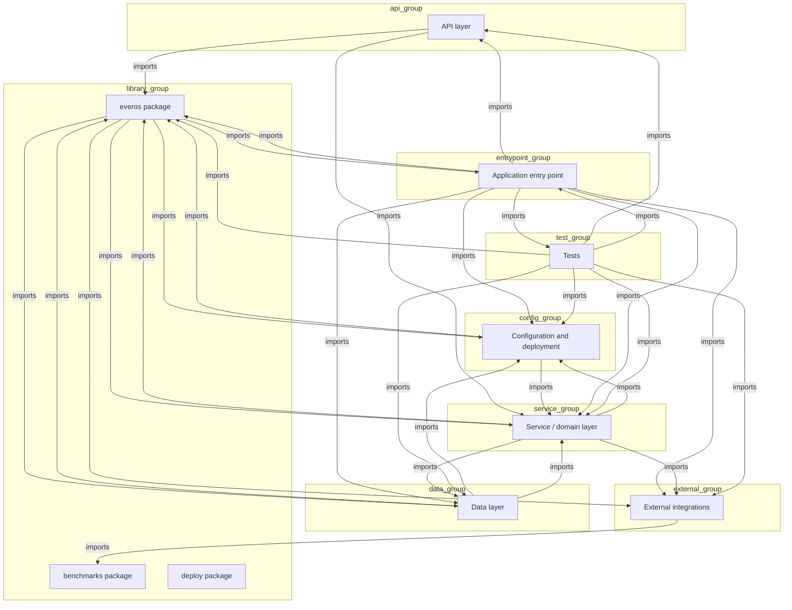

# Architecture report: EverMind-AI/EverOS

> Automated static analysis. **Observed** = directly seen in files/imports/AST; **Inferred** = interpretation from that evidence. Repository code was not executed.

## 1. Repository at a glance

| Item | Value |
| --- | --- |
| Repository | EverMind-AI/EverOS |
| Description | One portable memory layer for every AI agent: local-first, Markdown-native, user-owned, and self-evolving across apps, tools, and workflows. |
| Language | Python |
| Stars | 13913 |
| Licence | Apache-2.0 |
| Analysed commit / branch | 489ac7e921a81cf82cc9273674a0fa2429b861eb / main |
| Framework(s) | FastAPI, Starlette, Typer |
| Files analysed | 799 |
| Components | 10 |

## 2. Architecture in one minute

EverMind-AI/EverOS - One portable memory layer for every AI agent: local-first, Markdown-native, user-owned, and self-evolving across apps, tools, and workflows.. This repository was analysed statically from 799 file(s) (643 Python). Detected technologies (observed from imports/manifests): GitHub Actions, SQLite, FastAPI, Starlette, Typer, Click. Files are grouped into 10 component(s): API layer, benchmarks package, Configuration and deployment, Data layer, deploy package, Application entry point, everos package, External integrations. Observed entry point(s): benchmarks/adapters/evermembench.py, benchmarks/decider_probe.py, scripts/check_cjk.py. Findings below distinguish observed facts from inferred interpretation.

## 3. High-level block diagram

## 4. Main components

### API layer (`api_layer`)

- **Kind:** api
- **Status:** Observed
- **Confidence:** 0.85
- **Responsibility:** Groups 31 file(s) under api layer (observed from repository paths and static analysis). Observed routes: POST /quiesce, POST /delete, POST /delete_by_ids, POST /get, GET /health. Observed top-level classes: AcceptedResponseData, AddResponseData, CascadeHealthBlock, CategoryDTO, CategoryListResponse, ContentItemDTO. Observed top-level functions: _accepted, _error_response, _exception_fields, _normalize_path, _one_trimmed_line, _profiling_enabled.
- **Paths:** `src/everos/entrypoints/api/__init__.py`, `src/everos/entrypoints/api/dependencies.py`, `src/everos/entrypoints/api/exception_handlers.py`, `src/everos/entrypoints/api/middleware/__init__.py`, `src/everos/entrypoints/api/middleware/cors.py`, `src/everos/entrypoints/api/middleware/profile.py`, `src/everos/entrypoints/api/middleware/prometheus.py`, `src/everos/entrypoints/api/middleware/request_id.py`, `src/everos/entrypoints/api/middleware/write_tracking.py`, `src/everos/entrypoints/api/routes/__init__.py`, `src/everos/entrypoints/api/routes/cascade.py`, `src/everos/entrypoints/api/routes/delete.py`, `src/everos/entrypoints/api/routes/get.py`, `src/everos/entrypoints/api/routes/health.py`, `src/everos/entrypoints/api/routes/knowledge.py`, `src/everos/entrypoints/api/routes/memorize.py`, `src/everos/entrypoints/api/routes/metrics.py`, `src/everos/entrypoints/api/routes/ome.py`, `src/everos/entrypoints/api/routes/purge.py`, `src/everos/entrypoints/api/routes/search.py`, `src/everos/entrypoints/api/routes/tasks.py`, `src/everos/entrypoints/api/schemas/__init__.py`, `src/everos/entrypoints/api/schemas/cascade.py`, `src/everos/entrypoints/api/schemas/delete.py`, `src/everos/entrypoints/api/schemas/envelope.py`, `src/everos/entrypoints/api/schemas/health.py`, `src/everos/entrypoints/api/schemas/ids.py`, `src/everos/entrypoints/api/schemas/knowledge.py`, `src/everos/entrypoints/api/schemas/memorize.py`, `src/everos/entrypoints/api/schemas/ome.py`, `src/everos/entrypoints/api/schemas/purge.py`
- **Evidence:** [src/everos/entrypoints/api/__init__.py](https://github.com/EverMind-AI/EverOS/blob/489ac7e921a81cf82cc9273674a0fa2429b861eb/src/everos/entrypoints/api/__init__.py); [src/everos/entrypoints/api/dependencies.py:18](https://github.com/EverMind-AI/EverOS/blob/489ac7e921a81cf82cc9273674a0fa2429b861eb/src/everos/entrypoints/api/dependencies.py#L18); [src/everos/entrypoints/api/exception_handlers.py:39](https://github.com/EverMind-AI/EverOS/blob/489ac7e921a81cf82cc9273674a0fa2429b861eb/src/everos/entrypoints/api/exception_handlers.py#L39); [src/everos/entrypoints/api/middleware/__init__.py](https://github.com/EverMind-AI/EverOS/blob/489ac7e921a81cf82cc9273674a0fa2429b861eb/src/everos/entrypoints/api/middleware/__init__.py); [src/everos/entrypoints/api/middleware/cors.py](https://github.com/EverMind-AI/EverOS/blob/489ac7e921a81cf82cc9273674a0fa2429b861eb/src/everos/entrypoints/api/middleware/cors.py); [src/everos/entrypoints/api/middleware/profile.py:25](https://github.com/EverMind-AI/EverOS/blob/489ac7e921a81cf82cc9273674a0fa2429b861eb/src/everos/entrypoints/api/middleware/profile.py#L25); [src/everos/entrypoints/api/middleware/prometheus.py:44](https://github.com/EverMind-AI/EverOS/blob/489ac7e921a81cf82cc9273674a0fa2429b861eb/src/everos/entrypoints/api/middleware/prometheus.py#L44); [src/everos/entrypoints/api/middleware/request_id.py:32](https://github.com/EverMind-AI/EverOS/blob/489ac7e921a81cf82cc9273674a0fa2429b861eb/src/everos/entrypoints/api/middleware/request_id.py#L32)

### benchmarks package (`benchmarks`)

- **Kind:** library
- **Status:** Observed
- **Confidence:** 0.85
- **Responsibility:** Groups 7 file(s) under benchmarks package (observed from repository paths and static analysis). Observed top-level functions: _dcg, _is_unset, _missing_data, _missing_keys, _required_server_keys, blocking_problems.
- **Paths:** `benchmarks/__init__.py`, `benchmarks/download_data.sh`, `benchmarks/metrics/__init__.py`, `benchmarks/metrics/core.py`, `benchmarks/metrics/ir.py`, `benchmarks/preflight.py`, `benchmarks/reproduce.sh`
- **Evidence:** [benchmarks/__init__.py](https://github.com/EverMind-AI/EverOS/blob/489ac7e921a81cf82cc9273674a0fa2429b861eb/benchmarks/__init__.py); [benchmarks/download_data.sh](https://github.com/EverMind-AI/EverOS/blob/489ac7e921a81cf82cc9273674a0fa2429b861eb/benchmarks/download_data.sh); [benchmarks/metrics/__init__.py](https://github.com/EverMind-AI/EverOS/blob/489ac7e921a81cf82cc9273674a0fa2429b861eb/benchmarks/metrics/__init__.py); [benchmarks/metrics/core.py:30](https://github.com/EverMind-AI/EverOS/blob/489ac7e921a81cf82cc9273674a0fa2429b861eb/benchmarks/metrics/core.py#L30); [benchmarks/metrics/ir.py:32](https://github.com/EverMind-AI/EverOS/blob/489ac7e921a81cf82cc9273674a0fa2429b861eb/benchmarks/metrics/ir.py#L32); [benchmarks/preflight.py:93](https://github.com/EverMind-AI/EverOS/blob/489ac7e921a81cf82cc9273674a0fa2429b861eb/benchmarks/preflight.py#L93); [benchmarks/reproduce.sh](https://github.com/EverMind-AI/EverOS/blob/489ac7e921a81cf82cc9273674a0fa2429b861eb/benchmarks/reproduce.sh)

### Configuration and deployment (`config`)

- **Kind:** config
- **Status:** Observed
- **Confidence:** 0.85
- **Responsibility:** Groups 35 file(s) under configuration and deployment (observed from repository paths and static analysis). Observed top-level classes: AgentMemorySettings, AnswerResult, ApiSettings, AsyncQueueSettings, BenchmarkConfig, BoundaryDetectionSettings. Observed top-level functions: _blank_to_none, _expand_env, _file_digest, _reject_unknown_keys, _server_setting, identity_diff.
- **Paths:** `benchmarks/.env.example`, `benchmarks/config.py`, `benchmarks/config_hybrid.toml`, `benchmarks/config_hybrid_judge4o.toml`, `benchmarks/config_keyword.toml`, `benchmarks/config_vector.toml`, `benchmarks/config_vector_judge4o.toml`, `benchmarks/configs/default.toml`, `benchmarks/configs/evermembench.toml`, `benchmarks/configs/locomo-step.toml`, `benchmarks/configs/locomo.toml`, `benchmarks/configs/longmemeval.toml`, `benchmarks/configs/subtlememory.toml`, `config.example.toml`, `data/solo_chat_en.json`, `data/solo_chat_zh.json`, `data/team_chat_en.json`, `data/team_chat_zh.json`, `deploy/netlify_relay/netlify.toml`, `deploy/netlify_relay/package.json`, `pyproject.toml`, `scripts/e2e_memorize/fixtures/agent_session.json`, `scripts/e2e_memorize/fixtures/chat_session.json`, `src/everos/config/__init__.py`, `src/everos/config/custom_instructions/__init__.py`, `src/everos/config/custom_instructions/boundary_detection.yaml`, `src/everos/config/custom_instructions/episode_extract.yaml`, `src/everos/config/custom_instructions/profile_extract.yaml`, `src/everos/config/custom_instructions/reflect.yaml`, `src/everos/config/default.toml`, `src/everos/config/default_ome.toml`, `src/everos/config/hints.py`, `src/everos/config/search_runtime.py`, `src/everos/config/settings.py`, `src/everos/infra/ome/config.py`
- **Evidence:** [benchmarks/.env.example](https://github.com/EverMind-AI/EverOS/blob/489ac7e921a81cf82cc9273674a0fa2429b861eb/benchmarks/.env.example); [benchmarks/config.py:22](https://github.com/EverMind-AI/EverOS/blob/489ac7e921a81cf82cc9273674a0fa2429b861eb/benchmarks/config.py#L22); [benchmarks/config_hybrid.toml](https://github.com/EverMind-AI/EverOS/blob/489ac7e921a81cf82cc9273674a0fa2429b861eb/benchmarks/config_hybrid.toml); [benchmarks/config_hybrid_judge4o.toml](https://github.com/EverMind-AI/EverOS/blob/489ac7e921a81cf82cc9273674a0fa2429b861eb/benchmarks/config_hybrid_judge4o.toml); [benchmarks/config_keyword.toml](https://github.com/EverMind-AI/EverOS/blob/489ac7e921a81cf82cc9273674a0fa2429b861eb/benchmarks/config_keyword.toml); [benchmarks/config_vector.toml](https://github.com/EverMind-AI/EverOS/blob/489ac7e921a81cf82cc9273674a0fa2429b861eb/benchmarks/config_vector.toml); [benchmarks/config_vector_judge4o.toml](https://github.com/EverMind-AI/EverOS/blob/489ac7e921a81cf82cc9273674a0fa2429b861eb/benchmarks/config_vector_judge4o.toml); [benchmarks/configs/default.toml](https://github.com/EverMind-AI/EverOS/blob/489ac7e921a81cf82cc9273674a0fa2429b861eb/benchmarks/configs/default.toml)

### Data layer (`data_layer`)

- **Kind:** data
- **Status:** Observed
- **Confidence:** 0.85
- **Responsibility:** Groups 129 file(s) under data layer (observed from repository paths and static analysis). Observed top-level classes: AgentCase, AgentCaseDailyFrontmatter, AgentCaseIndexAdapter, AgentCaseReader, AgentCaseWriter, AgentScopedFrontmatter. Observed top-level functions: _add_column_ddl, _add_missing_columns, _agent_case_entry, _arrow_type, _atomic_fact_entry, _back_up.
- **Paths:** `src/everos/infra/cascade/models.py`, `src/everos/infra/persistence/__init__.py`, `src/everos/infra/persistence/factories.py`, `src/everos/infra/persistence/index/__init__.py`, `src/everos/infra/persistence/index/_provenance.py`, `src/everos/infra/persistence/index/adapters.py`, `src/everos/infra/persistence/index/derived_index.py`, `src/everos/infra/persistence/index/maintenance.py`, `src/everos/infra/persistence/index/predicate.py`, `src/everos/infra/persistence/index/protocols.py`, `src/everos/infra/persistence/index/repositories.py`, `src/everos/infra/persistence/index/schema.py`, `src/everos/infra/persistence/index/vector_backfill.py`, `src/everos/infra/persistence/index/vector_projection.py`, `src/everos/infra/persistence/lancedb/__init__.py`, `src/everos/infra/persistence/lancedb/_base/__init__.py`, `src/everos/infra/persistence/lancedb/_base/arrow.py`, `src/everos/infra/persistence/lancedb/_base/connection.py`, `src/everos/infra/persistence/lancedb/_base/indexes.py`, `src/everos/infra/persistence/lancedb/_base/repository.py`, `src/everos/infra/persistence/lancedb/_repos/__init__.py`, `src/everos/infra/persistence/lancedb/_repos/_contract.py`, `src/everos/infra/persistence/lancedb/_repos/agent_case.py`, `src/everos/infra/persistence/lancedb/_repos/agent_skill.py`, `src/everos/infra/persistence/lancedb/_repos/atomic_fact.py`, `src/everos/infra/persistence/lancedb/_repos/episode.py`, `src/everos/infra/persistence/lancedb/_repos/foresight.py`, `src/everos/infra/persistence/lancedb/_repos/knowledge_topic.py`, `src/everos/infra/persistence/lancedb/_repos/user_profile.py`, `src/everos/infra/persistence/lancedb/backend.py`, `src/everos/infra/persistence/lancedb/lancedb_manager.py`, `src/everos/infra/persistence/locking.py`, `src/everos/infra/persistence/markdown/__init__.py`, `src/everos/infra/persistence/markdown/_base/__init__.py`, `src/everos/infra/persistence/markdown/_base/entries.py`, `src/everos/infra/persistence/markdown/_base/frontmatter.py`, `src/everos/infra/persistence/markdown/_base/parsed.py`, `src/everos/infra/persistence/markdown/_base/path_safety.py`, `src/everos/infra/persistence/markdown/_base/reader.py`, `src/everos/infra/persistence/markdown/_base/writer.py`, `src/everos/infra/persistence/markdown/_mds/__init__.py`, `src/everos/infra/persistence/markdown/_mds/agent_case.py`, `src/everos/infra/persistence/markdown/_mds/agent_skill.py`, `src/everos/infra/persistence/markdown/_mds/atomic_fact.py`, `src/everos/infra/persistence/markdown/_mds/episode.py`, `src/everos/infra/persistence/markdown/_mds/foresight.py`, `src/everos/infra/persistence/markdown/_mds/knowledge_document.py`, `src/everos/infra/persistence/markdown/_mds/knowledge_topic.py`, `src/everos/infra/persistence/markdown/_mds/profile.py`, `src/everos/infra/persistence/markdown/_readers/__init__.py`, `src/everos/infra/persistence/markdown/_readers/agent_case_reader.py`, `src/everos/infra/persistence/markdown/_readers/agent_skill_reader.py`, `src/everos/infra/persistence/markdown/_readers/atomic_fact_reader.py`, `src/everos/infra/persistence/markdown/_readers/base.py`, `src/everos/infra/persistence/markdown/_readers/episode_reader.py`, `src/everos/infra/persistence/markdown/_readers/foresight_reader.py`, `src/everos/infra/persistence/markdown/_readers/profile_reader.py`, `src/everos/infra/persistence/markdown/_readers/taxonomy_reader.py`, `src/everos/infra/persistence/markdown/_writers/__init__.py`, `src/everos/infra/persistence/markdown/_writers/agent_case_writer.py`, `src/everos/infra/persistence/markdown/_writers/agent_skill_writer.py`, `src/everos/infra/persistence/markdown/_writers/atomic_fact_writer.py`, `src/everos/infra/persistence/markdown/_writers/base.py`, `src/everos/infra/persistence/markdown/_writers/episode_writer.py`, `src/everos/infra/persistence/markdown/_writers/foresight_writer.py`, `src/everos/infra/persistence/markdown/_writers/knowledge_writer.py`, `src/everos/infra/persistence/markdown/_writers/profile_writer.py`, `src/everos/infra/persistence/markdown/knowledge_store.py`, `src/everos/infra/persistence/markdown/owner_dir.py`, `src/everos/infra/persistence/markdown/scope_purge.py`, `src/everos/infra/persistence/markdown/stores.py`, `src/everos/infra/persistence/memory_root.py`, `src/everos/infra/persistence/milvus/__init__.py`, `src/everos/infra/persistence/milvus/_codec.py`, `src/everos/infra/persistence/milvus/_columns.py`, `src/everos/infra/persistence/milvus/_layout.py`, `src/everos/infra/persistence/milvus/milvus_manager.py`, `src/everos/infra/persistence/milvus/predicate.py`, `src/everos/infra/persistence/milvus/repos.py`, `src/everos/infra/persistence/milvus/repository.py`, `src/everos/infra/persistence/records/__init__.py`, `src/everos/infra/persistence/records/_parent_type.py`, `src/everos/infra/persistence/records/_provenance_key.py`, `src/everos/infra/persistence/records/agent_case.py`, `src/everos/infra/persistence/records/agent_skill.py`, `src/everos/infra/persistence/records/atomic_fact.py`, `src/everos/infra/persistence/records/base.py`, `src/everos/infra/persistence/records/episode.py`, `src/everos/infra/persistence/records/foresight.py`, `src/everos/infra/persistence/records/index_record.py`, `src/everos/infra/persistence/records/knowledge_topic.py`, `src/everos/infra/persistence/records/user_profile.py`, `src/everos/infra/persistence/records/vector.py`, `src/everos/infra/persistence/sqlite/__init__.py`, `src/everos/infra/persistence/sqlite/_base/__init__.py`, `src/everos/infra/persistence/sqlite/_base/base.py`, `src/everos/infra/persistence/sqlite/_base/engine.py`, `src/everos/infra/persistence/sqlite/_base/repository.py`, `src/everos/infra/persistence/sqlite/_base/session.py`, `src/everos/infra/persistence/sqlite/_repos/__init__.py`, `src/everos/infra/persistence/sqlite/_repos/cluster.py`, `src/everos/infra/persistence/sqlite/_repos/knowledge.py`, `src/everos/infra/persistence/sqlite/_repos/md_change_state.py`, `src/everos/infra/persistence/sqlite/_repos/memcell.py`, `src/everos/infra/persistence/sqlite/_repos/memorize_inbox.py`, `src/everos/infra/persistence/sqlite/_repos/purge_job.py`, `src/everos/infra/persistence/sqlite/_repos/reflection_report.py`, `src/everos/infra/persistence/sqlite/_repos/scope_purge.py`, `src/everos/infra/persistence/sqlite/_repos/sender_name.py`, `src/everos/infra/persistence/sqlite/_repos/session_cut.py`, `src/everos/infra/persistence/sqlite/_repos/session_purge.py`, `src/everos/infra/persistence/sqlite/_repos/unprocessed_buffer.py`, `src/everos/infra/persistence/sqlite/_tables/__init__.py`, `src/everos/infra/persistence/sqlite/_tables/cluster.py`, `src/everos/infra/persistence/sqlite/_tables/conversation_status.py`, `src/everos/infra/persistence/sqlite/_tables/knowledge.py`, `src/everos/infra/persistence/sqlite/_tables/md_change_state.py`, `src/everos/infra/persistence/sqlite/_tables/memcell.py`, `src/everos/infra/persistence/sqlite/_tables/memorize_inbox.py`, `src/everos/infra/persistence/sqlite/_tables/purge_job.py`, `src/everos/infra/persistence/sqlite/_tables/reflection_report.py`, `src/everos/infra/persistence/sqlite/_tables/sender_name.py`, `src/everos/infra/persistence/sqlite/_tables/unprocessed_buffer.py`, `src/everos/infra/persistence/sqlite/knowledge_catalog.py`, `src/everos/infra/persistence/sqlite/repositories.py`, `src/everos/infra/persistence/sqlite/schema.py`, `src/everos/infra/persistence/sqlite/sqlite_manager.py`, `src/everos/infra/persistence/sqlite/stores.py`, `src/everos/memory/models.py`
- **Evidence:** [src/everos/infra/cascade/models.py:17](https://github.com/EverMind-AI/EverOS/blob/489ac7e921a81cf82cc9273674a0fa2429b861eb/src/everos/infra/cascade/models.py#L17); [src/everos/infra/persistence/__init__.py](https://github.com/EverMind-AI/EverOS/blob/489ac7e921a81cf82cc9273674a0fa2429b861eb/src/everos/infra/persistence/__init__.py); [src/everos/infra/persistence/factories.py:51](https://github.com/EverMind-AI/EverOS/blob/489ac7e921a81cf82cc9273674a0fa2429b861eb/src/everos/infra/persistence/factories.py#L51); [src/everos/infra/persistence/index/__init__.py](https://github.com/EverMind-AI/EverOS/blob/489ac7e921a81cf82cc9273674a0fa2429b861eb/src/everos/infra/persistence/index/__init__.py); [src/everos/infra/persistence/index/_provenance.py:70](https://github.com/EverMind-AI/EverOS/blob/489ac7e921a81cf82cc9273674a0fa2429b861eb/src/everos/infra/persistence/index/_provenance.py#L70); [src/everos/infra/persistence/index/adapters.py:65](https://github.com/EverMind-AI/EverOS/blob/489ac7e921a81cf82cc9273674a0fa2429b861eb/src/everos/infra/persistence/index/adapters.py#L65); [src/everos/infra/persistence/index/derived_index.py:24](https://github.com/EverMind-AI/EverOS/blob/489ac7e921a81cf82cc9273674a0fa2429b861eb/src/everos/infra/persistence/index/derived_index.py#L24); [src/everos/infra/persistence/index/maintenance.py:23](https://github.com/EverMind-AI/EverOS/blob/489ac7e921a81cf82cc9273674a0fa2429b861eb/src/everos/infra/persistence/index/maintenance.py#L23)

### deploy package (`deploy`)

- **Kind:** library
- **Status:** Observed
- **Confidence:** 0.85
- **Responsibility:** Groups 1 file(s) under deploy package (observed from repository paths and static analysis).
- **Paths:** `deploy/netlify_relay/netlify/functions/relay.mjs`
- **Evidence:** [deploy/netlify_relay/netlify/functions/relay.mjs](https://github.com/EverMind-AI/EverOS/blob/489ac7e921a81cf82cc9273674a0fa2429b861eb/deploy/netlify_relay/netlify/functions/relay.mjs)

### Application entry point (`entrypoint`)

- **Kind:** entrypoint
- **Status:** Observed
- **Confidence:** 0.85
- **Responsibility:** Groups 22 file(s) under application entry point (observed from repository paths and static analysis). Observed application object created via FastAPI, Typer. Observed top-level classes: BaseRefError, DeciderProbeReply, EverOSDemoApp, FramePlan, MonotonicityReport, OpacitySchedule. Observed top-level functions: _allowed, _apply_root_env, _ask, _build_animation_svg, _build_application, _build_schema.
- **Paths:** `benchmarks/adapters/evermembench.py`, `benchmarks/decider_probe.py`, `scripts/check_cjk.py`, `scripts/check_commit_messages.py`, `scripts/check_consistency.py`, `scripts/check_datetime_discipline.py`, `scripts/check_deprecated_names.py`, `scripts/check_docs.py`, `scripts/check_file_sizes.py`, `scripts/check_github_contributor_docs.py`, `scripts/check_pr_title.py`, `scripts/check_repo_assets.py`, `scripts/check_singletons.py`, `scripts/dump_openapi.py`, `scripts/e2e_memorize/run.py`, `src/everos/entrypoints/api/app.py`, `src/everos/entrypoints/cli/commands/cascade.py`, `src/everos/entrypoints/cli/commands/config.py`, `src/everos/entrypoints/cli/commands/server.py`, `src/everos/entrypoints/cli/main.py`, `src/everos/entrypoints/tui/demo/app.py`, `src/everos/entrypoints/tui/demo/readme_media.py`
- **Evidence:** [benchmarks/adapters/evermembench.py:56](https://github.com/EverMind-AI/EverOS/blob/489ac7e921a81cf82cc9273674a0fa2429b861eb/benchmarks/adapters/evermembench.py#L56); [benchmarks/decider_probe.py:60](https://github.com/EverMind-AI/EverOS/blob/489ac7e921a81cf82cc9273674a0fa2429b861eb/benchmarks/decider_probe.py#L60); [scripts/check_cjk.py:33](https://github.com/EverMind-AI/EverOS/blob/489ac7e921a81cf82cc9273674a0fa2429b861eb/scripts/check_cjk.py#L33); [scripts/check_commit_messages.py:28](https://github.com/EverMind-AI/EverOS/blob/489ac7e921a81cf82cc9273674a0fa2429b861eb/scripts/check_commit_messages.py#L28); [scripts/check_consistency.py:57](https://github.com/EverMind-AI/EverOS/blob/489ac7e921a81cf82cc9273674a0fa2429b861eb/scripts/check_consistency.py#L57); [scripts/check_datetime_discipline.py:92](https://github.com/EverMind-AI/EverOS/blob/489ac7e921a81cf82cc9273674a0fa2429b861eb/scripts/check_datetime_discipline.py#L92); [scripts/check_deprecated_names.py:32](https://github.com/EverMind-AI/EverOS/blob/489ac7e921a81cf82cc9273674a0fa2429b861eb/scripts/check_deprecated_names.py#L32); [scripts/check_docs.py:21](https://github.com/EverMind-AI/EverOS/blob/489ac7e921a81cf82cc9273674a0fa2429b861eb/scripts/check_docs.py#L21)

### everos package (`everos`)

- **Kind:** library
- **Status:** Observed
- **Confidence:** 0.85
- **Responsibility:** Groups 188 file(s) under everos package (observed from repository paths and static analysis). Observed top-level classes: AgentCaseExtracted, AgentCaseHandler, AgentCaseIndex, AgentCaseRecaller, AgentCaseStore, AgentMemoryPipeline. Observed top-level functions: _add_braille_dot, _append_round_trace, _applies, _apply_enabled, _apply_one_strategy, _as_children.
- **Paths:** `src/everos/__init__.py`, `src/everos/component/__init__.py`, `src/everos/component/embedding/__init__.py`, `src/everos/component/embedding/factory.py`, `src/everos/component/embedding/openai_provider.py`, `src/everos/component/embedding/protocol.py`, `src/everos/component/llm/__init__.py`, `src/everos/component/llm/_tracing_observer.py`, `src/everos/component/llm/case_judge.py`, `src/everos/component/llm/errors.py`, `src/everos/component/llm/factory.py`, `src/everos/component/llm/observer.py`, `src/everos/component/llm/openai_provider.py`, `src/everos/component/parser/__init__.py`, `src/everos/component/parser/_core.py`, `src/everos/component/parser/input.py`, `src/everos/component/rerank/__init__.py`, `src/everos/component/rerank/_errors.py`, `src/everos/component/rerank/dashscope_provider.py`, `src/everos/component/rerank/deepinfra_provider.py`, `src/everos/component/rerank/factory.py`, `src/everos/component/rerank/protocol.py`, `src/everos/component/rerank/vllm_provider.py`, `src/everos/component/tokenizer/__init__.py`, `src/everos/component/tokenizer/factory.py`, `src/everos/component/tokenizer/jieba_provider.py`, `src/everos/component/tokenizer/nltk_provider.py`, `src/everos/component/tokenizer/protocol.py`, `src/everos/component/yaml_loader/__init__.py`, `src/everos/component/yaml_loader/loader.py`, `src/everos/entrypoints/__init__.py`, `src/everos/entrypoints/cli/__init__.py`, `src/everos/entrypoints/cli/_process.py`, `src/everos/entrypoints/cli/commands/__init__.py`, `src/everos/entrypoints/cli/commands/_backfill.py`, `src/everos/entrypoints/cli/commands/demo.py`, `src/everos/entrypoints/cli/commands/init.py`, `src/everos/entrypoints/cli/launcher.py`, `src/everos/entrypoints/tui/__init__.py`, `src/everos/entrypoints/tui/demo/__init__.py`, `src/everos/entrypoints/tui/demo/_styles.py`, `src/everos/entrypoints/tui/demo/cloud.py`, `src/everos/entrypoints/tui/demo/copy_text.py`, `src/everos/entrypoints/tui/demo/data.py`, `src/everos/entrypoints/tui/demo/theme.py`, `src/everos/entrypoints/tui/demo/widgets/__init__.py`, `src/everos/entrypoints/tui/demo/widgets/answer_bar.py`, `src/everos/entrypoints/tui/demo/widgets/dot_sphere.py`, `src/everos/entrypoints/tui/demo/widgets/sphere/__init__.py`, `src/everos/entrypoints/tui/demo/widgets/sphere/_geometry.py`, `src/everos/entrypoints/tui/demo/widgets/sphere/_models.py`, `src/everos/entrypoints/tui/demo/widgets/sphere/_render.py`, `src/everos/entrypoints/tui/demo/widgets/sphere/_styles.py`, `src/everos/entrypoints/tui/demo/widgets/sphere/_supernova.py`, `src/everos/entrypoints/tui/demo/widgets/sphere/_working.py`, `src/everos/infra/__init__.py`, `src/everos/infra/cascade/__init__.py`, `src/everos/infra/cascade/_eraser.py`, `src/everos/infra/cascade/_fence.py`, `src/everos/infra/cascade/_projections/__init__.py`, `src/everos/infra/cascade/_projections/_common.py`, `src/everos/infra/cascade/_projections/_daily_log_base.py`, `src/everos/infra/cascade/_projections/agent_case.py`, `src/everos/infra/cascade/_projections/agent_skill.py`, `src/everos/infra/cascade/_projections/atomic_fact.py`, `src/everos/infra/cascade/_projections/base.py`, `src/everos/infra/cascade/_projections/episode.py`, `src/everos/infra/cascade/_projections/foresight.py`, `src/everos/infra/cascade/_projections/knowledge_document.py`, `src/everos/infra/cascade/_projections/knowledge_topic.py`, `src/everos/infra/cascade/_projections/user_profile.py`, `src/everos/infra/cascade/_worker/__init__.py`, `src/everos/infra/cascade/_worker/_health.py`, `src/everos/infra/cascade/_worker/_kind_state.py`, `src/everos/infra/cascade/_worker/_maintenance.py`, `src/everos/infra/cascade/_worker/_stop.py`, `src/everos/infra/cascade/_worker/_supervision.py`, `src/everos/infra/cascade/_worker/_tuning.py`, `src/everos/infra/cascade/_worker/_worker.py`, `src/everos/infra/cascade/admin.py`, `src/everos/infra/cascade/orchestrator.py`, `src/everos/infra/cascade/reconciler.py`, `src/everos/infra/cascade/registry.py`, `src/everos/infra/cascade/scanner.py`, `src/everos/infra/cascade/watcher.py`, `src/everos/infra/ome/__init__.py`, `src/everos/infra/ome/_background/__init__.py`, `src/everos/infra/ome/_background/config_reloader.py`, `src/everos/infra/ome/_background/crash_recovery.py`, `src/everos/infra/ome/_background/idle_scanner.py`, `src/everos/infra/ome/_dispatch/__init__.py`, `src/everos/infra/ome/_dispatch/_state.py`, `src/everos/infra/ome/_dispatch/dispatcher.py`, `src/everos/infra/ome/_dispatch/in_flight.py`, `src/everos/infra/ome/_dispatch/registry.py`, `src/everos/infra/ome/_dispatch/runner.py`, `src/everos/infra/ome/_dispatch/scheduling.py`, `src/everos/infra/ome/_dispatch/strategy.py`, `src/everos/infra/ome/_stores/__init__.py`, `src/everos/infra/ome/_stores/counter.py`, `src/everos/infra/ome/_stores/idle.py`, `src/everos/infra/ome/_stores/run_record.py`, `src/everos/infra/ome/_stores/storage.py`, `src/everos/infra/ome/adapter.py`, `src/everos/infra/ome/engine.py`, `src/everos/infra/ome/event_bus.py`, `src/everos/infra/ome/events.py`, `src/everos/infra/ome/exceptions.py`, `src/everos/infra/ome/gate.py`, `src/everos/infra/ome/lock.py`, `src/everos/infra/ome/records.py`, `src/everos/memory/__init__.py`, `src/everos/memory/_partition_locks.py`, `src/everos/memory/custom_instructions/__init__.py`, `src/everos/memory/custom_instructions/loader.py`, `src/everos/memory/deps.py`, `src/everos/memory/events.py`, `src/everos/memory/extract/__init__.py`, `src/everos/memory/extract/boundary/__init__.py`, `src/everos/memory/extract/boundary/detection.py`, `src/everos/memory/extract/boundary/messages.py`, `src/everos/memory/extract/boundary/quarantine.py`, `src/everos/memory/extract/ingest/__init__.py`, `src/everos/memory/extract/ingest/id_gen.py`, `src/everos/memory/extract/ingest/multimodal.py`, `src/everos/memory/extract/ingest/sender_names.py`, `src/everos/memory/extract/llm_retry.py`, `src/everos/memory/extract/parser/__init__.py`, `src/everos/memory/extract/parser/availability.py`, `src/everos/memory/extract/parser/enrich.py`, `src/everos/memory/extract/pipeline/__init__.py`, `src/everos/memory/extract/pipeline/agent_memory.py`, `src/everos/memory/extract/pipeline/base.py`, `src/everos/memory/extract/pipeline/user_memory.py`, `src/everos/memory/get/__init__.py`, `src/everos/memory/get/dto.py`, `src/everos/memory/get/filters_adapter.py`, `src/everos/memory/get/manager.py`, `src/everos/memory/mappers/__init__.py`, `src/everos/memory/mappers/agent_case.py`, `src/everos/memory/mappers/agent_skill.py`, `src/everos/memory/mappers/cluster.py`, `src/everos/memory/mappers/episode.py`, `src/everos/memory/mappers/knowledge.py`, `src/everos/memory/mappers/profile.py`, `src/everos/memory/ports/__init__.py`, `src/everos/memory/ports/event_bus.py`, `src/everos/memory/ports/events.py`, `src/everos/memory/ports/indexes.py`, `src/everos/memory/ports/query.py`, `src/everos/memory/ports/stores.py`, `src/everos/memory/ports/strategy.py`, `src/everos/memory/profile_batcher.py`, `src/everos/memory/reflection/__init__.py`, `src/everos/memory/reflection/orchestrator.py`, `src/everos/memory/search/__init__.py`, `src/everos/memory/search/_candidates.py`, `src/everos/memory/search/adapter.py`, `src/everos/memory/search/agentic.py`, `src/everos/memory/search/agentic_agent.py`, `src/everos/memory/search/callbacks.py`, `src/everos/memory/search/dto.py`, `src/everos/memory/search/filters.py`, `src/everos/memory/search/hierarchy.py`, `src/everos/memory/search/llm_multiround.py`, `src/everos/memory/search/manager.py`, `src/everos/memory/search/recall/__init__.py`, `src/everos/memory/search/recall/agent_case.py`, `src/everos/memory/search/recall/agent_skill.py`, `src/everos/memory/search/recall/atomic_fact.py`, `src/everos/memory/search/recall/base.py`, `src/everos/memory/search/recall/episode.py`, `src/everos/memory/search/recall/knowledge_topic.py`, `src/everos/memory/search/recall/maxsim.py`, `src/everos/memory/search/recall/profile.py`, `src/everos/memory/search/shaper.py`, `src/everos/memory/search/skill_hybrid.py`, `src/everos/memory/strategies/__init__.py`, `src/everos/memory/strategies/extract_agent_case.py`, `src/everos/memory/strategies/extract_agent_skill.py`, `src/everos/memory/strategies/extract_atomic_facts.py`, `src/everos/memory/strategies/extract_foresight.py`, `src/everos/memory/strategies/extract_user_profile.py`, `src/everos/memory/strategies/finish_reflection.py`, `src/everos/memory/strategies/reflect_episodes.py`, `src/everos/memory/strategies/trigger_profile_clustering.py`, `src/everos/memory/strategies/trigger_skill_clustering.py`, `src/everos/templates/__init__.py`
- **Evidence:** [src/everos/__init__.py:24](https://github.com/EverMind-AI/EverOS/blob/489ac7e921a81cf82cc9273674a0fa2429b861eb/src/everos/__init__.py#L24); [src/everos/component/__init__.py](https://github.com/EverMind-AI/EverOS/blob/489ac7e921a81cf82cc9273674a0fa2429b861eb/src/everos/component/__init__.py); [src/everos/component/embedding/__init__.py](https://github.com/EverMind-AI/EverOS/blob/489ac7e921a81cf82cc9273674a0fa2429b861eb/src/everos/component/embedding/__init__.py); [src/everos/component/embedding/factory.py:11](https://github.com/EverMind-AI/EverOS/blob/489ac7e921a81cf82cc9273674a0fa2429b861eb/src/everos/component/embedding/factory.py#L11); [src/everos/component/embedding/openai_provider.py:44](https://github.com/EverMind-AI/EverOS/blob/489ac7e921a81cf82cc9273674a0fa2429b861eb/src/everos/component/embedding/openai_provider.py#L44); [src/everos/component/embedding/protocol.py:23](https://github.com/EverMind-AI/EverOS/blob/489ac7e921a81cf82cc9273674a0fa2429b861eb/src/everos/component/embedding/protocol.py#L23); [src/everos/component/llm/__init__.py](https://github.com/EverMind-AI/EverOS/blob/489ac7e921a81cf82cc9273674a0fa2429b861eb/src/everos/component/llm/__init__.py); [src/everos/component/llm/_tracing_observer.py:21](https://github.com/EverMind-AI/EverOS/blob/489ac7e921a81cf82cc9273674a0fa2429b861eb/src/everos/component/llm/_tracing_observer.py#L21)

### External integrations (`external_integrations`)

- **Kind:** external
- **Status:** Observed
- **Confidence:** 0.85
- **Responsibility:** Groups 6 file(s) under external integrations (observed from repository paths and static analysis). Observed top-level classes: DatasetAdapter. Observed top-level functions: _build_context, _deterministic_verdict, _extract_json, _has_relation_meta, _meta_from_qa, _norm.
- **Paths:** `benchmarks/adapters/__init__.py`, `benchmarks/adapters/_profile.py`, `benchmarks/adapters/base.py`, `benchmarks/adapters/locomo.py`, `benchmarks/adapters/longmemeval.py`, `benchmarks/adapters/subtlememory.py`
- **Evidence:** [benchmarks/adapters/__init__.py:22](https://github.com/EverMind-AI/EverOS/blob/489ac7e921a81cf82cc9273674a0fa2429b861eb/benchmarks/adapters/__init__.py#L22); [benchmarks/adapters/_profile.py:19](https://github.com/EverMind-AI/EverOS/blob/489ac7e921a81cf82cc9273674a0fa2429b861eb/benchmarks/adapters/_profile.py#L19); [benchmarks/adapters/base.py:32](https://github.com/EverMind-AI/EverOS/blob/489ac7e921a81cf82cc9273674a0fa2429b861eb/benchmarks/adapters/base.py#L32); [benchmarks/adapters/locomo.py:40](https://github.com/EverMind-AI/EverOS/blob/489ac7e921a81cf82cc9273674a0fa2429b861eb/benchmarks/adapters/locomo.py#L40); [benchmarks/adapters/longmemeval.py:43](https://github.com/EverMind-AI/EverOS/blob/489ac7e921a81cf82cc9273674a0fa2429b861eb/benchmarks/adapters/longmemeval.py#L43); [benchmarks/adapters/subtlememory.py:41](https://github.com/EverMind-AI/EverOS/blob/489ac7e921a81cf82cc9273674a0fa2429b861eb/benchmarks/adapters/subtlememory.py#L41)

### Service / domain layer (`service_layer`)

- **Kind:** service
- **Status:** Observed
- **Confidence:** 0.85
- **Responsibility:** Groups 60 file(s) under service / domain layer (observed from repository paths and static analysis). Observed top-level classes: AppError, Application, BackfillDeps, BackfillOutcome, BackfillPresenter, BackfillSummary. Observed top-level functions: _agent_case_row_to_event, _backoff, _build_engine, _build_knowledge_service, _build_llm_clients, _build_memory_service.
- **Paths:** `src/everos/core/__init__.py`, `src/everos/core/concurrency.py`, `src/everos/core/context/__init__.py`, `src/everos/core/context/request.py`, `src/everos/core/errors.py`, `src/everos/core/failpoints.py`, `src/everos/core/locks.py`, `src/everos/core/observability/__init__.py`, `src/everos/core/observability/logging/__init__.py`, `src/everos/core/observability/logging/factory.py`, `src/everos/core/observability/metrics/__init__.py`, `src/everos/core/observability/metrics/counter.py`, `src/everos/core/observability/metrics/gauge.py`, `src/everos/core/observability/metrics/histogram.py`, `src/everos/core/observability/metrics/registry.py`, `src/everos/core/observability/tracing/__init__.py`, `src/everos/core/observability/tracing/attributes.py`, `src/everos/core/observability/tracing/ids.py`, `src/everos/core/observability/tracing/provider.py`, `src/everos/core/observability/tracing/scores.py`, `src/everos/core/purge_marks.py`, `src/everos/core/utils/__init__.py`, `src/everos/core/utils/datetime.py`, `src/everos/core/utils/language.py`, `src/everos/core/utils/open_files.py`, `src/everos/memory/extract/ingest/service.py`, `src/everos/service/__init__.py`, `src/everos/service/_warmup.py`, `src/everos/service/bootstrap.py`, `src/everos/service/knowledge/__init__.py`, `src/everos/service/knowledge/_documents.py`, `src/everos/service/knowledge/_models.py`, `src/everos/service/knowledge/_queries.py`, `src/everos/service/knowledge/_search.py`, `src/everos/service/knowledge/_upload.py`, `src/everos/service/memory/__init__.py`, `src/everos/service/memory/_delete.py`, `src/everos/service/memory/_extraction.py`, `src/everos/service/memory/_memorize.py`, `src/everos/service/memory/_models.py`, `src/everos/service/memory/_queue.py`, `src/everos/service/memory/_queue_models.py`, `src/everos/service/memory/_queue_steps.py`, `src/everos/service/ops/__init__.py`, `src/everos/service/ops/_cascade.py`, `src/everos/service/ops/_health.py`, `src/everos/service/ops/_models.py`, `src/everos/service/ops/_ome.py`, `src/everos/service/ops/_tasks.py`, `src/everos/service/ops/backfill/__init__.py`, `src/everos/service/ops/backfill/_clusters.py`, `src/everos/service/ops/backfill/_deps.py`, `src/everos/service/ops/backfill/_run.py`, `src/everos/service/ops/backfill/_skills.py`, `src/everos/service/ops/backfill/_vectors.py`, `src/everos/service/purge/__init__.py`, `src/everos/service/purge/_gate.py`, `src/everos/service/purge/_runner.py`, `src/everos/service/purge/_service.py`, `src/everos/service/purge/_views.py`
- **Evidence:** [src/everos/core/__init__.py](https://github.com/EverMind-AI/EverOS/blob/489ac7e921a81cf82cc9273674a0fa2429b861eb/src/everos/core/__init__.py); [src/everos/core/concurrency.py:21](https://github.com/EverMind-AI/EverOS/blob/489ac7e921a81cf82cc9273674a0fa2429b861eb/src/everos/core/concurrency.py#L21); [src/everos/core/context/__init__.py](https://github.com/EverMind-AI/EverOS/blob/489ac7e921a81cf82cc9273674a0fa2429b861eb/src/everos/core/context/__init__.py); [src/everos/core/context/request.py:17](https://github.com/EverMind-AI/EverOS/blob/489ac7e921a81cf82cc9273674a0fa2429b861eb/src/everos/core/context/request.py#L17); [src/everos/core/errors.py:23](https://github.com/EverMind-AI/EverOS/blob/489ac7e921a81cf82cc9273674a0fa2429b861eb/src/everos/core/errors.py#L23); [src/everos/core/failpoints.py:43](https://github.com/EverMind-AI/EverOS/blob/489ac7e921a81cf82cc9273674a0fa2429b861eb/src/everos/core/failpoints.py#L43); [src/everos/core/locks.py:86](https://github.com/EverMind-AI/EverOS/blob/489ac7e921a81cf82cc9273674a0fa2429b861eb/src/everos/core/locks.py#L86); [src/everos/core/observability/__init__.py](https://github.com/EverMind-AI/EverOS/blob/489ac7e921a81cf82cc9273674a0fa2429b861eb/src/everos/core/observability/__init__.py)

### Tests (`tests`)

- **Kind:** test
- **Status:** Observed
- **Confidence:** 0.85
- **Responsibility:** Groups 236 file(s) under tests (observed from repository paths and static analysis). Observed application object created via FastAPI. Observed top-level classes: Evidence, FakeEmbeddingProvider, FakeOmeLock, FakeUpstream, InMemoryAgentCaseIndex, InMemoryAgentCaseStore. Observed top-level functions: StubKnowledgeService, _ac_item, _adapter, _add, _admin, _af_item.
- **Paths:** `deploy/netlify_relay/tests/relay.test.mjs`, `tests/__init__.py`, `tests/_consistency_assertions.py`, `tests/_dotenv_guard.py`, `tests/acceptance/__init__.py`, `tests/acceptance/memory_delete/__init__.py`, `tests/acceptance/memory_delete/conftest.py`, `tests/acceptance/memory_delete/mcp_driver.py`, `tests/acceptance/memory_delete/observe.py`, `tests/acceptance/memory_delete/proxy.py`, `tests/acceptance/memory_delete/seed.py`, `tests/acceptance/memory_delete/test_milvus.py`, `tests/acceptance/memory_delete/test_reflection.py`, `tests/acceptance/memory_delete/test_t10_1_mixed.py`, `tests/acceptance/memory_delete/test_t12_tb5_tb6.py`, `tests/acceptance/memory_delete/test_t17_1_journey.py`, `tests/acceptance/memory_delete/test_t18_1_tb11_1_perf.py`, `tests/acceptance/memory_delete/test_t1_scopes.py`, `tests/acceptance/memory_delete/test_t20_tb9.py`, `tests/acceptance/memory_delete/test_t21_docs.py`, `tests/acceptance/memory_delete/test_t2_validation.py`, `tests/acceptance/memory_delete/test_t3_t14_tb.py`, `tests/acceptance/memory_delete/test_t4_t5_t11_t13_t23.py`, `tests/acceptance/memory_delete/test_t7_t16_t19.py`, `tests/acceptance/memory_delete/test_t8_1_mcp.py`, `tests/acceptance/memory_delete/test_t8_2_claude_code.py`, `tests/acceptance/memory_delete/test_t9_1.py`, `tests/acceptance/purge/__init__.py`, `tests/acceptance/purge/conftest.py`, `tests/acceptance/purge/fake_upstream.py`, `tests/acceptance/purge/journey.py`, `tests/acceptance/purge/observe.py`, `tests/acceptance/purge/seed.py`, `tests/acceptance/purge/test_baseline_parity.py`, `tests/acceptance/purge/test_docs_live.py`, `tests/acceptance/purge/test_drain.py`, `tests/acceptance/purge/test_failures.py`, `tests/acceptance/purge/test_inbox.py`, `tests/acceptance/purge/test_inflight.py`, `tests/acceptance/purge/test_milvus.py`, `tests/acceptance/purge/test_no_blocking.py`, `tests/acceptance/purge/test_ome.py`, `tests/acceptance/purge/test_perf.py`, `tests/acceptance/purge/test_replay.py`, `tests/acceptance/purge/test_restart.py`, `tests/acceptance/purge/test_scopes.py`, `tests/acceptance/purge/test_seed_selfcheck.py`, `tests/acceptance/purge/test_validation.py`, `tests/acceptance/purge/test_yardstick.py`, `tests/conftest.py`, `tests/e2e/__init__.py`, `tests/e2e/conftest.py`, `tests/e2e/test_add_flush_agent_pipeline_e2e.py`, `tests/e2e/test_add_flush_user_pipeline_e2e.py`, `tests/e2e/test_full_pipeline_timezone_e2e.py`, `tests/e2e/test_get_endpoint_e2e.py`, `tests/e2e/test_knowledge_e2e.py`, `tests/e2e/test_multimodal_add_e2e.py`, `tests/e2e/test_openapi_endpoint_matches_docs.py`, `tests/e2e/test_ops_endpoints_e2e.py`, `tests/e2e/test_reflection_e2e.py`, `tests/e2e/test_search_endpoint_e2e.py`, `tests/fakes/__init__.py`, `tests/fakes/_filter.py`, `tests/fakes/application.py`, `tests/fakes/backfill.py`, `tests/fakes/deps.py`, `tests/fakes/embedding.py`, `tests/fakes/indexes.py`, `tests/fakes/llm.py`, `tests/fakes/llm_scripts/agent_track/boundary.json`, `tests/fakes/llm_scripts/agent_track/boundary_empty.json`, `tests/fakes/llm_scripts/agent_track/case_compress.json`, `tests/fakes/llm_scripts/agent_track/case_compress_empty.json`, `tests/fakes/llm_scripts/agent_track/case_filter.json`, `tests/fakes/llm_scripts/agent_track/case_filter_empty.json`, `tests/fakes/llm_scripts/agent_track/case_gate.json`, `tests/fakes/llm_scripts/agent_track/case_gate_empty.json`, `tests/fakes/llm_scripts/agent_track/skill_cluster.json`, `tests/fakes/llm_scripts/agent_track/skill_cluster_empty.json`, `tests/fakes/llm_scripts/agent_track/skill_extract.json`, `tests/fakes/llm_scripts/agent_track/skill_extract_empty.json`, `tests/fakes/llm_scripts/agent_track/skill_extract_out_of_range.json`, `tests/fakes/llm_scripts/knowledge/category.json`, `tests/fakes/llm_scripts/knowledge/topic_split.json`, `tests/fakes/llm_scripts/knowledge/topic_tree.json`, `tests/fakes/llm_scripts/knowledge/uncovered_assign.json`, `tests/fakes/llm_scripts/user_track/atomic_facts.json`, `tests/fakes/llm_scripts/user_track/atomic_facts_empty.json`, `tests/fakes/llm_scripts/user_track/boundary.json`, `tests/fakes/llm_scripts/user_track/boundary_empty.json`, `tests/fakes/llm_scripts/user_track/boundary_split.json`, `tests/fakes/llm_scripts/user_track/episode.json`, `tests/fakes/llm_scripts/user_track/episode_blank.json`, `tests/fakes/llm_scripts/user_track/episode_summary.json`, `tests/fakes/llm_scripts/user_track/episode_summary_blank.json`, `tests/fakes/llm_scripts/user_track/foresights.json`, `tests/fakes/llm_scripts/user_track/profile_init.json`, `tests/fakes/llm_scripts/user_track/profile_init_empty.json`, `tests/fakes/llm_scripts/user_track/profile_update.json`, `tests/fakes/llm_scripts/user_track/profile_update_empty.json`, `tests/fakes/llm_scripts/user_track/reflect.json`, `tests/fakes/sources.py`, `tests/fakes/storage.py`, `tests/fakes/stores.py`, `tests/fakes/trajectories.py`, `tests/fixtures/README.md`, `tests/fixtures/_dump_search_seed.py`, `tests/fixtures/agent_trajectories/session_django_14311.json`, `tests/fixtures/agent_trajectories/session_django_16255.json`, `tests/fixtures/agent_trajectories/session_sympy_18763.json`, `tests/fixtures/allocator_probe/sitecustomize.py`, `tests/fixtures/compatibility/head_0d3b502_core_0_6_0/README.md`, `tests/fixtures/compatibility/head_0d3b502_core_0_6_0/agent_case_extracted.json`, `tests/fixtures/compatibility/head_0d3b502_core_0_6_0/memcell.json`, `tests/fixtures/compatibility/head_0d3b502_core_0_6_0/skill_cluster_updated.json`, `tests/fixtures/compatibility/head_0d3b502_core_0_6_0/user_pipeline_started.json`, `tests/fixtures/long_conversation_locomo_caroline_melanie.json`, `tests/fixtures/search_seed/user_profile.json`, `tests/helpers/__init__.py`, `tests/helpers/knowledge_md.py`, `tests/helpers/ome.py`, `tests/integration/__init__.py`, `tests/integration/search/__init__.py`, `tests/integration/search/_helpers.py`, `tests/integration/search/_rerun_probes.py`, `tests/integration/search/_run_full_report.py`, `tests/integration/search/conftest.py`, `tests/integration/search/test_search_e2e.py`, `tests/integration/test_api/__init__.py`, `tests/integration/test_api/test_health_capabilities.py`, `tests/integration/test_api/test_knowledge_gates.py`, `tests/integration/test_api/test_provider_error_mapping.py`, `tests/integration/test_api/test_startup_banner.py`, `tests/integration/test_cascade_all_kinds_consistency.py`, `tests/integration/test_cascade_cli_integration.py`, `tests/integration/test_cascade_fsevents_repro.py`, `tests/integration/test_cascade_integration.py`, `tests/integration/test_cascade_scenarios.py`, `tests/integration/test_cli/__init__.py`, `tests/integration/test_cli/test_allocator_startup.py`, `tests/integration/test_cli/test_backfill_flags.py`, `tests/integration/test_cli/test_backfill_phase1.py`, `tests/integration/test_cli/test_backfill_phase2.py`, `tests/integration/test_cli/test_backfill_phase3.py`, `tests/integration/test_cli/test_demo_plain_smoke.py`, `tests/integration/test_delete_api.py`, `tests/integration/test_infra/__init__.py`, `tests/integration/test_infra/test_lancedb_schema_migration.py`, `tests/integration/test_knowledge_integration.py`, `tests/integration/test_memorize_agent_mode.py`, `tests/integration/test_memorize_async_order.py`, `tests/integration/test_memorize_concurrent_session_lock.py`, `tests/integration/test_memorize_integration.py`, `tests/integration/test_memorize_window_segmentation.py`, `tests/integration/test_milvus_remote.py`, `tests/integration/test_ome_partition_admission.py`, `tests/integration/test_ome_strategies_integration.py`, `tests/integration/test_purge_interleavings.py`, `tests/integration/test_reflection_integration.py`, `tests/integration/test_session_delete_cluster_cleanup.py`, `tests/integration/test_startup_root_lock.py`, `tests/integration/test_tiers/__init__.py`, `tests/integration/test_tiers/conftest.py`, `tests/integration/test_tiers/test_tier1_keyword_only.py`, `tests/integration/test_tiers/test_tier2_no_rerank.py`, `tests/integration/test_tiers/test_tier3_full.py`, `tests/integration/test_tiers/test_upgrade_path.py`, `tests/integration/test_vector_projection_backfill.py`, `tests/unit/__init__.py`, `tests/unit/test_benchmark_add_failure_gate.py`, `tests/unit/test_benchmark_answer_route.py`, `tests/unit/test_benchmark_cli_portability.py`, `tests/unit/test_benchmark_config.py`, `tests/unit/test_benchmark_decider_endpoint.py`, `tests/unit/test_benchmark_decider_trace_gate.py`, `tests/unit/test_benchmark_evermembench_owner_mapping.py`, `tests/unit/test_benchmark_fleet_shard_guard.py`, `tests/unit/test_benchmark_flush_scope.py`, `tests/unit/test_benchmark_gold_audit.py`, `tests/unit/test_benchmark_harness_own.py`, `tests/unit/test_benchmark_headline_definition.py`, `tests/unit/test_benchmark_last_seventeen.py`, `tests/unit/test_benchmark_locomo_image_caption.py`, `tests/unit/test_benchmark_locomo_step_config.py`, `tests/unit/test_benchmark_message_owner.py`, `tests/unit/test_benchmark_metrics_definitions.py`, `tests/unit/test_benchmark_no_exemptions.py`, `tests/unit/test_benchmark_ome_strategies.py`, `tests/unit/test_benchmark_onboarding.py`, `tests/unit/test_benchmark_operational.py`, `tests/unit/test_benchmark_owner_in_store.py`, `tests/unit/test_benchmark_pipeline.py`, `tests/unit/test_benchmark_profile_injection.py`, `tests/unit/test_benchmark_profile_trace_config.py`, `tests/unit/test_benchmark_prompts.py`, `tests/unit/test_benchmark_quiesce_between_passes.py`, `tests/unit/test_benchmark_run_identity.py`, `tests/unit/test_benchmark_store_default.py`, `tests/unit/test_component/__init__.py`, `tests/unit/test_component/test_decider_client_retries.py`, `tests/unit/test_component/test_embedding/__init__.py`, `tests/unit/test_component/test_embedding/test_factory.py`, `tests/unit/test_component/test_embedding/test_factory_dim.py`, `tests/unit/test_component/test_embedding/test_openai_provider.py`, `tests/unit/test_component/test_embedding/test_usage_span.py`, `tests/unit/test_component/test_embedding_error_classification.py`, `tests/unit/test_component/test_llm/__init__.py`, `tests/unit/test_component/test_llm/test_case_judge.py`, `tests/unit/test_component/test_llm/test_client.py`, `tests/unit/test_component/test_llm/test_conformance.py`, `tests/unit/test_component/test_llm/test_factory.py`, `tests/unit/test_component/test_llm/test_llm_task_resolution.py`, `tests/unit/test_component/test_llm/test_openai_provider.py`, `tests/unit/test_component/test_llm/test_tracing_observer.py`, `tests/unit/test_component/test_llm_timeout_and_extra.py`, `tests/unit/test_component/test_parser_available_memoized.py`, `tests/unit/test_component/test_parser_input.py`, `tests/unit/test_component/test_rerank/__init__.py`, `tests/unit/test_component/test_rerank/test_dashscope_provider.py`, `tests/unit/test_component/test_rerank/test_deepinfra_provider.py`, `tests/unit/test_component/test_rerank/test_factory.py`, `tests/unit/test_component/test_rerank/test_vllm_provider.py`, `tests/unit/test_component/test_tokenizer/__init__.py`, `tests/unit/test_component/test_tokenizer/test_jieba.py`, `tests/unit/test_component/test_tokenizer/test_nltk.py`, `tests/unit/test_component/test_utils/__init__.py`, `tests/unit/test_component/test_utils/test_datetime.py`, `tests/unit/test_component/test_yaml_loader/__init__.py`, `tests/unit/test_component/test_yaml_loader/test_loader.py`, `tests/unit/test_config/__init__.py`, `tests/unit/test_config/test_hints.py`, `tests/unit/test_config/test_knowledge_settings.py`, `tests/unit/test_config/test_llm_task_settings.py`, `tests/unit/test_config/test_observability_settings.py`, `tests/unit/test_config/test_purge_settings.py`
- **Evidence:** [deploy/netlify_relay/tests/relay.test.mjs](https://github.com/EverMind-AI/EverOS/blob/489ac7e921a81cf82cc9273674a0fa2429b861eb/deploy/netlify_relay/tests/relay.test.mjs); [tests/__init__.py](https://github.com/EverMind-AI/EverOS/blob/489ac7e921a81cf82cc9273674a0fa2429b861eb/tests/__init__.py); [tests/_consistency_assertions.py:66](https://github.com/EverMind-AI/EverOS/blob/489ac7e921a81cf82cc9273674a0fa2429b861eb/tests/_consistency_assertions.py#L66); [tests/_dotenv_guard.py:18](https://github.com/EverMind-AI/EverOS/blob/489ac7e921a81cf82cc9273674a0fa2429b861eb/tests/_dotenv_guard.py#L18); [tests/acceptance/__init__.py](https://github.com/EverMind-AI/EverOS/blob/489ac7e921a81cf82cc9273674a0fa2429b861eb/tests/acceptance/__init__.py); [tests/acceptance/memory_delete/__init__.py](https://github.com/EverMind-AI/EverOS/blob/489ac7e921a81cf82cc9273674a0fa2429b861eb/tests/acceptance/memory_delete/__init__.py); [tests/acceptance/memory_delete/conftest.py:31](https://github.com/EverMind-AI/EverOS/blob/489ac7e921a81cf82cc9273674a0fa2429b861eb/tests/acceptance/memory_delete/conftest.py#L31); [tests/acceptance/memory_delete/mcp_driver.py:18](https://github.com/EverMind-AI/EverOS/blob/489ac7e921a81cf82cc9273674a0fa2429b861eb/tests/acceptance/memory_delete/mcp_driver.py#L18)

## 5. Execution flow

**Observed** entry point(s):

- [benchmarks/adapters/evermembench.py:694](https://github.com/EverMind-AI/EverOS/blob/489ac7e921a81cf82cc9273674a0fa2429b861eb/benchmarks/adapters/evermembench.py#L694)
- [benchmarks/decider_probe.py:161](https://github.com/EverMind-AI/EverOS/blob/489ac7e921a81cf82cc9273674a0fa2429b861eb/benchmarks/decider_probe.py#L161)
- [scripts/check_cjk.py:100](https://github.com/EverMind-AI/EverOS/blob/489ac7e921a81cf82cc9273674a0fa2429b861eb/scripts/check_cjk.py#L100)
- [scripts/check_commit_messages.py:137](https://github.com/EverMind-AI/EverOS/blob/489ac7e921a81cf82cc9273674a0fa2429b861eb/scripts/check_commit_messages.py#L137)
- [scripts/check_consistency.py:349](https://github.com/EverMind-AI/EverOS/blob/489ac7e921a81cf82cc9273674a0fa2429b861eb/scripts/check_consistency.py#L349)
- [src/everos/entrypoints/api/app.py:97](https://github.com/EverMind-AI/EverOS/blob/489ac7e921a81cf82cc9273674a0fa2429b861eb/src/everos/entrypoints/api/app.py#L97)
- [src/everos/entrypoints/cli/commands/cascade.py:59](https://github.com/EverMind-AI/EverOS/blob/489ac7e921a81cf82cc9273674a0fa2429b861eb/src/everos/entrypoints/cli/commands/cascade.py#L59)
- [src/everos/entrypoints/cli/commands/config.py:26](https://github.com/EverMind-AI/EverOS/blob/489ac7e921a81cf82cc9273674a0fa2429b861eb/src/everos/entrypoints/cli/commands/config.py#L26)
- [src/everos/entrypoints/cli/commands/server.py:23](https://github.com/EverMind-AI/EverOS/blob/489ac7e921a81cf82cc9273674a0fa2429b861eb/src/everos/entrypoints/cli/commands/server.py#L23)
- [src/everos/entrypoints/cli/launcher.py](https://github.com/EverMind-AI/EverOS/blob/489ac7e921a81cf82cc9273674a0fa2429b861eb/src/everos/entrypoints/cli/launcher.py)
- [src/everos/entrypoints/cli/main.py:18](https://github.com/EverMind-AI/EverOS/blob/489ac7e921a81cf82cc9273674a0fa2429b861eb/src/everos/entrypoints/cli/main.py#L18)
- [src/everos/entrypoints/tui/demo/readme_media.py:268](https://github.com/EverMind-AI/EverOS/blob/489ac7e921a81cf82cc9273674a0fa2429b861eb/src/everos/entrypoints/tui/demo/readme_media.py#L268)

**Observed** routes (from decorators):

- `POST /quiesce` -> `quiesce` in `src/everos/entrypoints/api/routes/cascade.py:47`
- `POST /delete` -> `delete_memory` in `src/everos/entrypoints/api/routes/delete.py:34`
- `POST /delete_by_ids` -> `delete_memories_by_ids` in `src/everos/entrypoints/api/routes/delete.py:52`
- `POST /get` -> `post_get` in `src/everos/entrypoints/api/routes/get.py:19`
- `GET /health` -> `health` in `src/everos/entrypoints/api/routes/health.py:23`
- `POST /documents` -> `create_document_route` in `src/everos/entrypoints/api/routes/knowledge.py:95`
- `PUT /documents/{doc_id}` -> `replace_document_route` in `src/everos/entrypoints/api/routes/knowledge.py:127`
- `DELETE /documents/{doc_id}` -> `delete_document_route` in `src/everos/entrypoints/api/routes/knowledge.py:155`
- `GET /documents` -> `list_documents_route` in `src/everos/entrypoints/api/routes/knowledge.py:179`
- `GET /documents/{doc_id}` -> `get_document_route` in `src/everos/entrypoints/api/routes/knowledge.py:206`
- `GET /topics/{topic_id}` -> `get_topic_route` in `src/everos/entrypoints/api/routes/knowledge.py:221`
- `POST /search` -> `search_knowledge_route` in `src/everos/entrypoints/api/routes/knowledge.py:239`
- `GET /categories` -> `list_categories_route` in `src/everos/entrypoints/api/routes/knowledge.py:260`
- `PATCH /documents/{doc_id}` -> `patch_document_route` in `src/everos/entrypoints/api/routes/knowledge.py:283`
- `POST /add` -> `add_memory` in `src/everos/entrypoints/api/routes/memorize.py:64`
- `POST /flush` -> `flush_memory` in `src/everos/entrypoints/api/routes/memorize.py:90`
- `GET /metrics` -> `metrics` in `src/everos/entrypoints/api/routes/metrics.py:15`
- `POST /trigger` -> `trigger` in `src/everos/entrypoints/api/routes/ome.py:14`
- `POST /purge` -> `request_purge` in `src/everos/entrypoints/api/routes/purge.py:67`
- `POST /purge/confirm` -> `confirm_purge` in `src/everos/entrypoints/api/routes/purge.py:97`
- `GET /purge/{job_id}` -> `get_purge` in `src/everos/entrypoints/api/routes/purge.py:113`
- `POST /search` -> `post_search` in `src/everos/entrypoints/api/routes/search.py:20`
- `GET ` -> `task_list` in `src/everos/entrypoints/api/routes/tasks.py:24`
- `GET /{task_id}` -> `task_status` in `src/everos/entrypoints/api/routes/tasks.py:52`

Representative flow (derived from observed entry points and the import graph; steps beyond the entry point are **Inferred**):

1. Execution starts at an observed entry point listed above, if present.
2. `api_layer` imports `everos` (API layer -> everos package).
3. `api_layer` imports `service_layer` (API layer -> Service / domain layer).
4. `config` imports `everos` (Configuration and deployment -> everos package).
5. `config` imports `service_layer` (Configuration and deployment -> Service / domain layer).
6. `data_layer` imports `config` (Data layer -> Configuration and deployment).
7. `data_layer` imports `everos` (Data layer -> everos package).
8. `data_layer` imports `service_layer` (Data layer -> Service / domain layer).
9. `entrypoint` imports `api_layer` (Application entry point -> API layer).

## 6. Project structure

### `(root)`

- `.env.example` - config (4707 bytes)
- `.gitignore` - other (9361 bytes)
- `.gitlint` - other (1011 bytes)
- `.pre-commit-config.yaml` - config (883 bytes)
- `ACKNOWLEDGMENTS.md` - docs (3850 bytes)
- `CHANGELOG.md` - docs (161505 bytes)
- `CITATION.md` - docs (2106 bytes)
- `CLAUDE.md` - docs (4706 bytes)
- `CODE_OF_CONDUCT.md` - docs (5478 bytes)
- `CONTRIBUTING.md` - docs (5733 bytes)
- `LICENSE` - docs (11341 bytes)
- `Makefile` - other (7911 bytes)
- `NOTICE` - docs (2634 bytes)
- `QUICKSTART.md` - docs (7992 bytes)
- `README.md` - docs (29420 bytes)
- `README.zh-CN.md` - docs (29349 bytes)
- `SECURITY.md` - docs (3055 bytes)
- `config.example.toml` - config (2429 bytes)
- `pyproject.toml` - manifest (25430 bytes)

### `.claude`

- `.claude/rules/architecture.md` - docs (4028 bytes)
- `.claude/rules/async-programming.md` - docs (957 bytes)
- `.claude/rules/code-style.md` - docs (1095 bytes)
- `.claude/rules/datetime-handling.md` - docs (1174 bytes)
- `.claude/rules/imports.md` - docs (847 bytes)
- `.claude/rules/init-py-and-reexport.md` - docs (1160 bytes)
- `.claude/rules/language-policy.md` - docs (816 bytes)
- `.claude/rules/logging-observability.md` - docs (1574 bytes)
- `.claude/rules/module-docstring.md` - docs (1191 bytes)
- `.claude/rules/testing.md` - docs (1238 bytes)
- `.claude/settings.json` - config (377 bytes)
- `.claude/skills/add-memory-kind/SKILL.md` - docs (11712 bytes)
- `.claude/skills/commit/SKILL.md` - docs (1777 bytes)
- `.claude/skills/new-branch/SKILL.md` - docs (1091 bytes)
- `.claude/skills/pr/SKILL.md` - docs (1407 bytes)
- `.claude/skills/release/SKILL.md` - docs (5166 bytes)
- `.claude/skills/verify-everos/SKILL.md` - docs (8972 bytes)

### `.github`

- `.github/BRANCH_PROTECTION.md` - docs (1026 bytes)
- `.github/ISSUE_TEMPLATE/bug_report.yml` - config (1206 bytes)
- `.github/ISSUE_TEMPLATE/config.yml` - config (197 bytes)
- `.github/ISSUE_TEMPLATE/docs.yml` - config (538 bytes)
- `.github/ISSUE_TEMPLATE/feature_request.yml` - config (958 bytes)
- `.github/ISSUE_TEMPLATE/use_case.yml` - config (1142 bytes)
- `.github/PULL_REQUEST_TEMPLATE.md` - docs (976 bytes)
- `.github/dependabot.yml` - config (1230 bytes)
- `.github/workflows/ci.yml` - ci, YAML (8040 bytes)
- `.github/workflows/commits.yml` - ci, YAML (1061 bytes)
- `.github/workflows/docs.yml` - ci, YAML (714 bytes)
- `.github/workflows/release.yml` - ci, YAML (8889 bytes)

### `benchmarks`

- `benchmarks/.env.example` - config (5569 bytes)
- `benchmarks/README.md` - docs (23244 bytes)
- `benchmarks/README.zh.md` - docs (23087 bytes)
- `benchmarks/__init__.py` - source, Python (0 bytes)
- `benchmarks/adapters/__init__.py` - source, Python (903 bytes)
- `benchmarks/adapters/_profile.py` - source, Python (2810 bytes)
- `benchmarks/adapters/base.py` - source, Python (7773 bytes)
- `benchmarks/adapters/evermembench.py` - source, Python (29247 bytes)
- `benchmarks/adapters/locomo.py` - source, Python (10320 bytes)
- `benchmarks/adapters/longmemeval.py` - source, Python (17476 bytes)
- `benchmarks/adapters/subtlememory.py` - source, Python (29939 bytes)
- `benchmarks/config.py` - source, Python (33211 bytes)
- `benchmarks/config_hybrid.toml` - config (1913 bytes)
- `benchmarks/config_hybrid_judge4o.toml` - config (1858 bytes)
- `benchmarks/config_keyword.toml` - config (1914 bytes)
- `benchmarks/config_vector.toml` - config (1913 bytes)
- `benchmarks/config_vector_judge4o.toml` - config (1858 bytes)
- `benchmarks/configs/default.toml` - config (1603 bytes)
- `benchmarks/configs/evermembench.toml` - config (7141 bytes)
- `benchmarks/configs/locomo-step.toml` - config (6481 bytes)
- `benchmarks/configs/locomo.toml` - config (6009 bytes)
- `benchmarks/configs/longmemeval.toml` - config (3959 bytes)
- `benchmarks/configs/subtlememory.toml` - config (4465 bytes)
- `benchmarks/data/.gitkeep` - other (0 bytes)
- `benchmarks/decider_probe.py` - source, Python (6096 bytes)
- `benchmarks/download_data.sh` - source, Shell (3144 bytes)
- `benchmarks/metrics/__init__.py` - source, Python (210 bytes)
- `benchmarks/metrics/core.py` - source, Python (6088 bytes)
- `benchmarks/metrics/ir.py` - source, Python (3832 bytes)
- `benchmarks/preflight.py` - source, Python (8007 bytes)
- `benchmarks/reproduce.sh` - source, Shell (4959 bytes)

### `data`

- `data/solo_chat_en.json` - config (71465 bytes)
- `data/solo_chat_zh.json` - config (62279 bytes)
- `data/team_chat_en.json` - config (150472 bytes)
- `data/team_chat_zh.json` - config (139052 bytes)

### `deploy`

- `deploy/netlify_relay/README.md` - docs (2075 bytes)
- `deploy/netlify_relay/netlify.toml` - config (255 bytes)
- `deploy/netlify_relay/netlify/functions/relay.mjs` - source, JavaScript (5891 bytes)
- `deploy/netlify_relay/package.json` - manifest (294 bytes)
- `deploy/netlify_relay/public/index.html` - other (447 bytes)
- `deploy/netlify_relay/tests/relay.test.mjs` - test, JavaScript (6054 bytes)

### `docs`

- `docs/api.md` - docs (84429 bytes)
- `docs/architecture.md` - docs (35138 bytes)
- `docs/cascade_runbook.md` - docs (21750 bytes)
- `docs/cli.md` - docs (7368 bytes)
- `docs/configuration.md` - docs (31487 bytes)
- `docs/custom_instructions.md` - docs (3251 bytes)
- `docs/datetime.md` - docs (10578 bytes)
- `docs/engineering.md` - docs (9073 bytes)
- `docs/everos-demo.md` - docs (2748 bytes)
- `docs/github-sync.md` - docs (5240 bytes)
- `docs/how-memory-works.md` - docs (17961 bytes)
- `docs/index.md` - docs (4130 bytes)
- `docs/knowledge.md` - docs (21556 bytes)
- `docs/mcp.md` - docs (3797 bytes)
- `docs/migration-to-1.0.0.md` - docs (2269 bytes)
- `docs/multimodal.md` - docs (12049 bytes)
- `docs/openapi.json` - config (180270 bytes)
- `docs/overview.md` - docs (4036 bytes)
- `docs/reflection.md` - docs (14514 bytes)
- `docs/release-notes-1.1.0.md` - docs (2255 bytes)
- `docs/storage_layout.md` - docs (15206 bytes)
- `docs/use-cases.md` - docs (10053 bytes)
- `docs/windows.md` - docs (12526 bytes)
- `docs/windows.zh.md` - docs (13270 bytes)

### `examples`

- `examples/langfuse/.gitignore` - other (20 bytes)
- `examples/langfuse/README.md` - docs (6188 bytes)
- `examples/langfuse/demo.py` - source, Python (18730 bytes)
- `examples/langfuse/record_trace.py` - source, Python (8131 bytes)
- `examples/langfuse/replay.py` - source, Python (9763 bytes)

### `scripts`

- `scripts/check_cjk.py` - source, Python (3927 bytes)
- `scripts/check_commit_messages.py` - source, Python (4095 bytes)
- `scripts/check_consistency.py` - source, Python (12614 bytes)
- `scripts/check_datetime_discipline.py` - source, Python (4638 bytes)
- `scripts/check_deprecated_names.py` - source, Python (2194 bytes)
- `scripts/check_docs.py` - source, Python (4019 bytes)
- `scripts/check_file_sizes.py` - source, Python (7443 bytes)
- `scripts/check_github_contributor_docs.py` - source, Python (3577 bytes)
- `scripts/check_pr_title.py` - source, Python (3331 bytes)
- `scripts/check_repo_assets.py` - source, Python (2652 bytes)
- `scripts/check_singletons.py` - source, Python (2806 bytes)
- `scripts/dump_openapi.py` - source, Python (4275 bytes)
- `scripts/e2e_memorize/README.md` - docs (4724 bytes)
- `scripts/e2e_memorize/fixtures/agent_session.json` - config (10767 bytes)
- `scripts/e2e_memorize/fixtures/chat_session.json` - config (6468 bytes)
- `scripts/e2e_memorize/run.py` - source, Python (6071 bytes)

### `src`

- `src/everos/README.md` - docs (1199 bytes)
- `src/everos/__init__.py` - source, Python (2584 bytes)
- `src/everos/component/__init__.py` - source, Python (107 bytes)
- `src/everos/component/embedding/__init__.py` - source, Python (1620 bytes)
- `src/everos/component/embedding/factory.py` - source, Python (2160 bytes)
- `src/everos/component/embedding/openai_provider.py` - source, Python (7585 bytes)
- `src/everos/component/embedding/protocol.py` - source, Python (2347 bytes)
- `src/everos/component/llm/__init__.py` - source, Python (3084 bytes)
- `src/everos/component/llm/_tracing_observer.py` - source, Python (1443 bytes)
- `src/everos/component/llm/case_judge.py` - source, Python (2416 bytes)
- `src/everos/component/llm/errors.py` - source, Python (1757 bytes)
- `src/everos/component/llm/factory.py` - source, Python (10843 bytes)
- `src/everos/component/llm/observer.py` - source, Python (1815 bytes)
- `src/everos/component/llm/openai_provider.py` - source, Python (13744 bytes)
- `src/everos/component/parser/__init__.py` - source, Python (586 bytes)
- `src/everos/component/parser/_core.py` - source, Python (3251 bytes)
- `src/everos/component/parser/input.py` - source, Python (6132 bytes)
- `src/everos/component/rerank/__init__.py` - source, Python (1822 bytes)
- `src/everos/component/rerank/_errors.py` - source, Python (2361 bytes)
- `src/everos/component/rerank/dashscope_provider.py` - source, Python (6986 bytes)
- `src/everos/component/rerank/deepinfra_provider.py` - source, Python (7054 bytes)
- `src/everos/component/rerank/factory.py` - source, Python (3050 bytes)
- `src/everos/component/rerank/protocol.py` - source, Python (2051 bytes)
- `src/everos/component/rerank/vllm_provider.py` - source, Python (5961 bytes)
- `src/everos/component/tokenizer/__init__.py` - source, Python (708 bytes)
- `src/everos/component/tokenizer/factory.py` - source, Python (1571 bytes)
- `src/everos/component/tokenizer/jieba_provider.py` - source, Python (4315 bytes)
- `src/everos/component/tokenizer/nltk_provider.py` - source, Python (2997 bytes)
- `src/everos/component/tokenizer/protocol.py` - source, Python (1432 bytes)
- `src/everos/component/yaml_loader/__init__.py` - source, Python (253 bytes)
- `src/everos/component/yaml_loader/loader.py` - source, Python (5685 bytes)
- `src/everos/config/__init__.py` - source, Python (2577 bytes)
- `src/everos/config/custom_instructions/__init__.py` - source, Python (474 bytes)
- `src/everos/config/custom_instructions/boundary_detection.yaml` - config (674 bytes)
- `src/everos/config/custom_instructions/episode_extract.yaml` - config (682 bytes)
- `src/everos/config/custom_instructions/profile_extract.yaml` - config (695 bytes)
- `src/everos/config/custom_instructions/reflect.yaml` - config (660 bytes)
- `src/everos/config/default.toml` - config (18423 bytes)
- `src/everos/config/default_ome.toml` - config (3454 bytes)
- `src/everos/config/hints.py` - source, Python (1055 bytes)
- `src/everos/config/search_runtime.py` - source, Python (2456 bytes)
- `src/everos/config/settings.py` - source, Python (55779 bytes)
- `src/everos/core/__init__.py` - source, Python (0 bytes)
- `src/everos/core/concurrency.py` - source, Python (3216 bytes)
- `src/everos/core/context/__init__.py` - source, Python (549 bytes)
- `src/everos/core/context/request.py` - source, Python (1368 bytes)
- `src/everos/core/errors.py` - source, Python (14162 bytes)
- `src/everos/core/failpoints.py` - source, Python (3107 bytes)
- `src/everos/core/locks.py` - source, Python (8237 bytes)
- `src/everos/core/observability/__init__.py` - source, Python (460 bytes)
- `src/everos/core/observability/logging/__init__.py` - source, Python (551 bytes)
- `src/everos/core/observability/logging/factory.py` - source, Python (6816 bytes)
- `src/everos/core/observability/metrics/__init__.py` - source, Python (1043 bytes)
- `src/everos/core/observability/metrics/counter.py` - source, Python (1309 bytes)
- `src/everos/core/observability/metrics/gauge.py` - source, Python (1697 bytes)
- `src/everos/core/observability/metrics/histogram.py` - source, Python (2319 bytes)
- `src/everos/core/observability/metrics/registry.py` - source, Python (1604 bytes)
- `src/everos/core/observability/tracing/__init__.py` - source, Python (2016 bytes)
- `src/everos/core/observability/tracing/attributes.py` - source, Python (8677 bytes)
- `src/everos/core/observability/tracing/ids.py` - source, Python (742 bytes)
- `src/everos/core/observability/tracing/provider.py` - source, Python (6876 bytes)
- `src/everos/core/observability/tracing/scores.py` - source, Python (8486 bytes)
- `src/everos/core/purge_marks.py` - source, Python (5719 bytes)
- `src/everos/core/utils/__init__.py` - source, Python (318 bytes)
- `src/everos/core/utils/datetime.py` - source, Python (10853 bytes)
- `src/everos/core/utils/language.py` - source, Python (2176 bytes)
- `src/everos/core/utils/open_files.py` - source, Python (2333 bytes)
- `src/everos/entrypoints/__init__.py` - source, Python (124 bytes)
- `src/everos/entrypoints/api/__init__.py` - source, Python (220 bytes)
- `src/everos/entrypoints/api/app.py` - source, Python (6232 bytes)
- `src/everos/entrypoints/api/dependencies.py` - source, Python (1113 bytes)
- `src/everos/entrypoints/api/exception_handlers.py` - source, Python (8651 bytes)
- `src/everos/entrypoints/api/middleware/__init__.py` - source, Python (1196 bytes)
- `src/everos/entrypoints/api/middleware/cors.py` - source, Python (399 bytes)
- `src/everos/entrypoints/api/middleware/profile.py` - source, Python (2316 bytes)
- `src/everos/entrypoints/api/middleware/prometheus.py` - source, Python (3278 bytes)
- `src/everos/entrypoints/api/middleware/request_id.py` - source, Python (2337 bytes)
- `src/everos/entrypoints/api/middleware/write_tracking.py` - source, Python (1598 bytes)
- `src/everos/entrypoints/api/routes/__init__.py` - source, Python (175 bytes)
- `src/everos/entrypoints/api/routes/cascade.py` - source, Python (3349 bytes)
- `src/everos/entrypoints/api/routes/delete.py` - source, Python (2328 bytes)
- `src/everos/entrypoints/api/routes/get.py` - source, Python (716 bytes)
- `src/everos/entrypoints/api/routes/health.py` - source, Python (1826 bytes)
- `src/everos/entrypoints/api/routes/knowledge.py` - source, Python (10512 bytes)
- `src/everos/entrypoints/api/routes/memorize.py` - source, Python (3752 bytes)
- `src/everos/entrypoints/api/routes/metrics.py` - source, Python (541 bytes)
- `src/everos/entrypoints/api/routes/ome.py` - source, Python (1212 bytes)
- `src/everos/entrypoints/api/routes/purge.py` - source, Python (3966 bytes)
- `src/everos/entrypoints/api/routes/search.py` - source, Python (771 bytes)
- `src/everos/entrypoints/api/routes/tasks.py` - source, Python (2094 bytes)
- `src/everos/entrypoints/api/schemas/__init__.py` - source, Python (4277 bytes)
- `src/everos/entrypoints/api/schemas/cascade.py` - source, Python (1039 bytes)
- `src/everos/entrypoints/api/schemas/delete.py` - source, Python (4423 bytes)
- `src/everos/entrypoints/api/schemas/envelope.py` - source, Python (843 bytes)
- `src/everos/entrypoints/api/schemas/health.py` - source, Python (5064 bytes)
- `src/everos/entrypoints/api/schemas/ids.py` - source, Python (3631 bytes)
- `src/everos/entrypoints/api/schemas/knowledge.py` - source, Python (8083 bytes)
- `src/everos/entrypoints/api/schemas/memorize.py` - source, Python (4381 bytes)
- `src/everos/entrypoints/api/schemas/ome.py` - source, Python (2056 bytes)
- `src/everos/entrypoints/api/schemas/purge.py` - source, Python (6546 bytes)
- `src/everos/entrypoints/cli/__init__.py` - source, Python (140 bytes)
- `src/everos/entrypoints/cli/_process.py` - source, Python (1672 bytes)
- `src/everos/entrypoints/cli/commands/__init__.py` - source, Python (167 bytes)
- `src/everos/entrypoints/cli/commands/_backfill.py` - source, Python (13307 bytes)
- `src/everos/entrypoints/cli/commands/cascade.py` - source, Python (25145 bytes)
- `src/everos/entrypoints/cli/commands/config.py` - source, Python (4357 bytes)
- `src/everos/entrypoints/cli/commands/demo.py` - source, Python (5945 bytes)
- `src/everos/entrypoints/cli/commands/init.py` - source, Python (3528 bytes)
- `src/everos/entrypoints/cli/commands/server.py` - source, Python (4449 bytes)
- `src/everos/entrypoints/cli/launcher.py` - source, Python (1621 bytes)
- `src/everos/entrypoints/cli/main.py` - source, Python (1122 bytes)
- `src/everos/entrypoints/tui/__init__.py` - source, Python (31 bytes)
- `src/everos/entrypoints/tui/demo/__init__.py` - source, Python (35 bytes)
- `src/everos/entrypoints/tui/demo/_styles.py` - source, Python (3573 bytes)
- `src/everos/entrypoints/tui/demo/app.py` - source, Python (20157 bytes)
- `src/everos/entrypoints/tui/demo/cloud.py` - source, Python (23239 bytes)
- `src/everos/entrypoints/tui/demo/copy_text.py` - source, Python (8544 bytes)
- `src/everos/entrypoints/tui/demo/data.py` - source, Python (1121 bytes)
- `src/everos/entrypoints/tui/demo/readme_media.py` - source, Python (8335 bytes)
- `src/everos/entrypoints/tui/demo/theme.py` - source, Python (941 bytes)
- `src/everos/entrypoints/tui/demo/widgets/__init__.py` - source, Python (64 bytes)
- `src/everos/entrypoints/tui/demo/widgets/answer_bar.py` - source, Python (1549 bytes)
- `src/everos/entrypoints/tui/demo/widgets/dot_sphere.py` - source, Python (8060 bytes)
- `src/everos/entrypoints/tui/demo/widgets/sphere/__init__.py` - source, Python (1732 bytes)
- `src/everos/entrypoints/tui/demo/widgets/sphere/_geometry.py` - source, Python (8668 bytes)
- `src/everos/entrypoints/tui/demo/widgets/sphere/_models.py` - source, Python (2942 bytes)
- `src/everos/entrypoints/tui/demo/widgets/sphere/_render.py` - source, Python (4828 bytes)
- `src/everos/entrypoints/tui/demo/widgets/sphere/_styles.py` - source, Python (3969 bytes)
- `src/everos/entrypoints/tui/demo/widgets/sphere/_supernova.py` - source, Python (15993 bytes)
- `src/everos/entrypoints/tui/demo/widgets/sphere/_working.py` - source, Python (14670 bytes)
- `src/everos/infra/__init__.py` - source, Python (113 bytes)
- `src/everos/infra/cascade/__init__.py` - source, Python (1959 bytes)
- `src/everos/infra/cascade/_eraser.py` - source, Python (3846 bytes)
- `src/everos/infra/cascade/_fence.py` - source, Python (4826 bytes)
- `src/everos/infra/cascade/_projections/__init__.py` - source, Python (1452 bytes)
- `src/everos/infra/cascade/_projections/_common.py` - source, Python (4862 bytes)
- `src/everos/infra/cascade/_projections/_daily_log_base.py` - source, Python (14246 bytes)
- `src/everos/infra/cascade/_projections/agent_case.py` - source, Python (3752 bytes)
- `src/everos/infra/cascade/_projections/agent_skill.py` - source, Python (9099 bytes)
- `src/everos/infra/cascade/_projections/atomic_fact.py` - source, Python (2918 bytes)
- `src/everos/infra/cascade/_projections/base.py` - source, Python (3526 bytes)
- `src/everos/infra/cascade/_projections/episode.py` - source, Python (4376 bytes)
- `src/everos/infra/cascade/_projections/foresight.py` - source, Python (4038 bytes)
- `src/everos/infra/cascade/_projections/knowledge_document.py` - source, Python (3205 bytes)
- `src/everos/infra/cascade/_projections/knowledge_topic.py` - source, Python (9011 bytes)
- `src/everos/infra/cascade/_projections/user_profile.py` - source, Python (5028 bytes)
- `src/everos/infra/cascade/_worker/__init__.py` - source, Python (2098 bytes)
- `src/everos/infra/cascade/_worker/_health.py` - source, Python (4232 bytes)
- `src/everos/infra/cascade/_worker/_kind_state.py` - source, Python (4272 bytes)
- `src/everos/infra/cascade/_worker/_maintenance.py` - source, Python (29706 bytes)
- `src/everos/infra/cascade/_worker/_stop.py` - source, Python (648 bytes)
- `src/everos/infra/cascade/_worker/_supervision.py` - source, Python (5909 bytes)
- `src/everos/infra/cascade/_worker/_tuning.py` - source, Python (15308 bytes)
- `src/everos/infra/cascade/_worker/_worker.py` - source, Python (25859 bytes)
- `src/everos/infra/cascade/admin.py` - source, Python (5978 bytes)
- `src/everos/infra/cascade/models.py` - source, Python (1686 bytes)
- `src/everos/infra/cascade/orchestrator.py` - source, Python (21374 bytes)
- `src/everos/infra/cascade/reconciler.py` - source, Python (5713 bytes)
- `src/everos/infra/cascade/registry.py` - source, Python (6606 bytes)
- `src/everos/infra/cascade/scanner.py` - source, Python (10012 bytes)
- `src/everos/infra/cascade/watcher.py` - source, Python (9129 bytes)
- `src/everos/infra/ome/__init__.py` - source, Python (1854 bytes)
- `src/everos/infra/ome/_background/__init__.py` - source, Python (79 bytes)
- `src/everos/infra/ome/_background/config_reloader.py` - source, Python (9718 bytes)
- `src/everos/infra/ome/_background/crash_recovery.py` - source, Python (2733 bytes)
- `src/everos/infra/ome/_background/idle_scanner.py` - source, Python (1982 bytes)
- `src/everos/infra/ome/_dispatch/__init__.py` - source, Python (70 bytes)
- `src/everos/infra/ome/_dispatch/_state.py` - source, Python (2383 bytes)
- `src/everos/infra/ome/_dispatch/dispatcher.py` - source, Python (9555 bytes)
- `src/everos/infra/ome/_dispatch/in_flight.py` - source, Python (2937 bytes)
- `src/everos/infra/ome/_dispatch/registry.py` - source, Python (6206 bytes)
- `src/everos/infra/ome/_dispatch/runner.py` - source, Python (12454 bytes)
- `src/everos/infra/ome/_dispatch/scheduling.py` - source, Python (7740 bytes)
- `src/everos/infra/ome/_dispatch/strategy.py` - source, Python (2115 bytes)
- `src/everos/infra/ome/_stores/__init__.py` - source, Python (74 bytes)
- `src/everos/infra/ome/_stores/counter.py` - source, Python (6106 bytes)
- `src/everos/infra/ome/_stores/idle.py` - source, Python (2982 bytes)
- `src/everos/infra/ome/_stores/run_record.py` - source, Python (8408 bytes)
- `src/everos/infra/ome/_stores/storage.py` - source, Python (8272 bytes)
- `src/everos/infra/ome/adapter.py` - source, Python (2555 bytes)
- `src/everos/infra/ome/config.py` - source, Python (8604 bytes)
- `src/everos/infra/ome/engine.py` - source, Python (30015 bytes)
- `src/everos/infra/ome/event_bus.py` - source, Python (717 bytes)
- `src/everos/infra/ome/events.py` - source, Python (1260 bytes)
- `src/everos/infra/ome/exceptions.py` - source, Python (2318 bytes)
- `src/everos/infra/ome/gate.py` - source, Python (879 bytes)
- `src/everos/infra/ome/lock.py` - source, Python (3597 bytes)
- `src/everos/infra/ome/records.py` - source, Python (4684 bytes)
- `src/everos/infra/persistence/__init__.py` - source, Python (1291 bytes)
- `src/everos/infra/persistence/factories.py` - source, Python (3700 bytes)
- `src/everos/infra/persistence/index/__init__.py` - source, Python (3541 bytes)
- `src/everos/infra/persistence/index/_provenance.py` - source, Python (11982 bytes)
- `src/everos/infra/persistence/index/adapters.py` - source, Python (14740 bytes)
- `src/everos/infra/persistence/index/derived_index.py` - source, Python (5999 bytes)
- `src/everos/infra/persistence/index/maintenance.py` - source, Python (1533 bytes)
- `src/everos/infra/persistence/index/predicate.py` - source, Python (1731 bytes)
- `src/everos/infra/persistence/index/protocols.py` - source, Python (7808 bytes)
- `src/everos/infra/persistence/index/repositories.py` - source, Python (2422 bytes)
- `src/everos/infra/persistence/index/schema.py` - source, Python (5382 bytes)
- `src/everos/infra/persistence/index/vector_backfill.py` - source, Python (26143 bytes)
- `src/everos/infra/persistence/index/vector_projection.py` - source, Python (2959 bytes)
- `src/everos/infra/persistence/lancedb/__init__.py` - source, Python (2781 bytes)
- `src/everos/infra/persistence/lancedb/_base/__init__.py` - source, Python (1722 bytes)
- `src/everos/infra/persistence/lancedb/_base/arrow.py` - source, Python (1920 bytes)
- `src/everos/infra/persistence/lancedb/_base/connection.py` - source, Python (2838 bytes)
- `src/everos/infra/persistence/lancedb/_base/indexes.py` - source, Python (8007 bytes)
- `src/everos/infra/persistence/lancedb/_base/repository.py` - source, Python (55223 bytes)
- `src/everos/infra/persistence/lancedb/_repos/__init__.py` - source, Python (540 bytes)
- `src/everos/infra/persistence/lancedb/_repos/_contract.py` - source, Python (13110 bytes)
- `src/everos/infra/persistence/lancedb/_repos/agent_case.py` - source, Python (375 bytes)
- `src/everos/infra/persistence/lancedb/_repos/agent_skill.py` - source, Python (2855 bytes)
- `src/everos/infra/persistence/lancedb/_repos/atomic_fact.py` - source, Python (388 bytes)
- `src/everos/infra/persistence/lancedb/_repos/episode.py` - source, Python (3071 bytes)
- `src/everos/infra/persistence/lancedb/_repos/foresight.py` - source, Python (373 bytes)
- `src/everos/infra/persistence/lancedb/_repos/knowledge_topic.py` - source, Python (465 bytes)
- `src/everos/infra/persistence/lancedb/_repos/user_profile.py` - source, Python (373 bytes)
- `src/everos/infra/persistence/lancedb/backend.py` - source, Python (22711 bytes)
- `src/everos/infra/persistence/lancedb/lancedb_manager.py` - source, Python (6087 bytes)
- `src/everos/infra/persistence/locking.py` - source, Python (6539 bytes)
- `src/everos/infra/persistence/markdown/__init__.py` - source, Python (5893 bytes)
- `src/everos/infra/persistence/markdown/_base/__init__.py` - source, Python (2934 bytes)
- `src/everos/infra/persistence/markdown/_base/entries.py` - source, Python (12541 bytes)
- `src/everos/infra/persistence/markdown/_base/frontmatter.py` - source, Python (17737 bytes)
- `src/everos/infra/persistence/markdown/_base/parsed.py` - source, Python (954 bytes)
- `src/everos/infra/persistence/markdown/_base/path_safety.py` - source, Python (4483 bytes)
- `src/everos/infra/persistence/markdown/_base/reader.py` - source, Python (3778 bytes)
- `src/everos/infra/persistence/markdown/_base/writer.py` - source, Python (16652 bytes)
- `src/everos/infra/persistence/markdown/_mds/__init__.py` - source, Python (2078 bytes)
- `src/everos/infra/persistence/markdown/_mds/agent_case.py` - source, Python (1297 bytes)
- `src/everos/infra/persistence/markdown/_mds/agent_skill.py` - source, Python (4225 bytes)
- `src/everos/infra/persistence/markdown/_mds/atomic_fact.py` - source, Python (1465 bytes)
- `src/everos/infra/persistence/markdown/_mds/episode.py` - source, Python (1177 bytes)
- `src/everos/infra/persistence/markdown/_mds/foresight.py` - source, Python (1333 bytes)
- `src/everos/infra/persistence/markdown/_mds/knowledge_document.py` - source, Python (666 bytes)
- `src/everos/infra/persistence/markdown/_mds/knowledge_topic.py` - source, Python (789 bytes)
- `src/everos/infra/persistence/markdown/_mds/profile.py` - source, Python (2307 bytes)
- `src/everos/infra/persistence/markdown/_readers/__init__.py` - source, Python (2093 bytes)
- `src/everos/infra/persistence/markdown/_readers/agent_case_reader.py` - source, Python (873 bytes)
- `src/everos/infra/persistence/markdown/_readers/agent_skill_reader.py` - source, Python (12395 bytes)
- `src/everos/infra/persistence/markdown/_readers/atomic_fact_reader.py` - source, Python (880 bytes)
- `src/everos/infra/persistence/markdown/_readers/base.py` - source, Python (6699 bytes)
- `src/everos/infra/persistence/markdown/_readers/episode_reader.py` - source, Python (1258 bytes)
- `src/everos/infra/persistence/markdown/_readers/foresight_reader.py` - source, Python (871 bytes)
- `src/everos/infra/persistence/markdown/_readers/profile_reader.py` - source, Python (3797 bytes)
- `src/everos/infra/persistence/markdown/_readers/taxonomy_reader.py` - source, Python (6429 bytes)
- `src/everos/infra/persistence/markdown/_writers/__init__.py` - source, Python (1609 bytes)
- `src/everos/infra/persistence/markdown/_writers/agent_case_writer.py` - source, Python (1818 bytes)
- `src/everos/infra/persistence/markdown/_writers/agent_skill_writer.py` - source, Python (9727 bytes)
- `src/everos/infra/persistence/markdown/_writers/atomic_fact_writer.py` - source, Python (1629 bytes)
- `src/everos/infra/persistence/markdown/_writers/base.py` - source, Python (16715 bytes)
- `src/everos/infra/persistence/markdown/_writers/episode_writer.py` - source, Python (2093 bytes)
- `src/everos/infra/persistence/markdown/_writers/foresight_writer.py` - source, Python (1629 bytes)
- `src/everos/infra/persistence/markdown/_writers/knowledge_writer.py` - source, Python (8231 bytes)
- `src/everos/infra/persistence/markdown/_writers/profile_writer.py` - source, Python (5106 bytes)
- `src/everos/infra/persistence/markdown/knowledge_store.py` - source, Python (16155 bytes)
- `src/everos/infra/persistence/markdown/owner_dir.py` - source, Python (14134 bytes)
- `src/everos/infra/persistence/markdown/scope_purge.py` - source, Python (9264 bytes)
- `src/everos/infra/persistence/markdown/stores.py` - source, Python (27643 bytes)
- `src/everos/infra/persistence/memory_root.py` - source, Python (11302 bytes)
- `src/everos/infra/persistence/milvus/__init__.py` - source, Python (5607 bytes)
- `src/everos/infra/persistence/milvus/_codec.py` - source, Python (9086 bytes)
- `src/everos/infra/persistence/milvus/_columns.py` - source, Python (1316 bytes)
- `src/everos/infra/persistence/milvus/_layout.py` - source, Python (18567 bytes)
- `src/everos/infra/persistence/milvus/milvus_manager.py` - source, Python (3705 bytes)
- `src/everos/infra/persistence/milvus/predicate.py` - source, Python (3254 bytes)
- `src/everos/infra/persistence/milvus/repos.py` - source, Python (3752 bytes)
- `src/everos/infra/persistence/milvus/repository.py` - source, Python (23382 bytes)
- `src/everos/infra/persistence/records/__init__.py` - source, Python (1832 bytes)
- `src/everos/infra/persistence/records/_parent_type.py` - source, Python (971 bytes)
- `src/everos/infra/persistence/records/_provenance_key.py` - source, Python (608 bytes)
- `src/everos/infra/persistence/records/agent_case.py` - source, Python (2785 bytes)
- `src/everos/infra/persistence/records/agent_skill.py` - source, Python (2869 bytes)
- `src/everos/infra/persistence/records/atomic_fact.py` - source, Python (2279 bytes)
- `src/everos/infra/persistence/records/base.py` - source, Python (1950 bytes)
- `src/everos/infra/persistence/records/episode.py` - source, Python (3177 bytes)
- `src/everos/infra/persistence/records/foresight.py` - source, Python (2638 bytes)
- `src/everos/infra/persistence/records/index_record.py` - source, Python (1540 bytes)
- `src/everos/infra/persistence/records/knowledge_topic.py` - source, Python (966 bytes)
- `src/everos/infra/persistence/records/user_profile.py` - source, Python (2895 bytes)
- `src/everos/infra/persistence/records/vector.py` - source, Python (1500 bytes)
- `src/everos/infra/persistence/sqlite/__init__.py` - source, Python (4688 bytes)
- `src/everos/infra/persistence/sqlite/_base/__init__.py` - source, Python (1402 bytes)
- `src/everos/infra/persistence/sqlite/_base/base.py` - source, Python (4160 bytes)
- `src/everos/infra/persistence/sqlite/_base/engine.py` - source, Python (6762 bytes)
- `src/everos/infra/persistence/sqlite/_base/repository.py` - source, Python (5389 bytes)
- `src/everos/infra/persistence/sqlite/_base/session.py` - source, Python (3198 bytes)
- `src/everos/infra/persistence/sqlite/_repos/__init__.py` - source, Python (1882 bytes)
- `src/everos/infra/persistence/sqlite/_repos/cluster.py` - source, Python (16055 bytes)
- `src/everos/infra/persistence/sqlite/_repos/knowledge.py` - source, Python (11412 bytes)
- `src/everos/infra/persistence/sqlite/_repos/md_change_state.py` - source, Python (26893 bytes)
- `src/everos/infra/persistence/sqlite/_repos/memcell.py` - source, Python (3330 bytes)
- `src/everos/infra/persistence/sqlite/_repos/memorize_inbox.py` - source, Python (10044 bytes)
- `src/everos/infra/persistence/sqlite/_repos/purge_job.py` - source, Python (3000 bytes)
- `src/everos/infra/persistence/sqlite/_repos/reflection_report.py` - source, Python (3101 bytes)
- `src/everos/infra/persistence/sqlite/_repos/scope_purge.py` - source, Python (6376 bytes)
- `src/everos/infra/persistence/sqlite/_repos/sender_name.py` - source, Python (2960 bytes)
- `src/everos/infra/persistence/sqlite/_repos/session_cut.py` - source, Python (4009 bytes)
- `src/everos/infra/persistence/sqlite/_repos/session_purge.py` - source, Python (2286 bytes)
- `src/everos/infra/persistence/sqlite/_repos/unprocessed_buffer.py` - source, Python (4528 bytes)
- `src/everos/infra/persistence/sqlite/_tables/__init__.py` - source, Python (1255 bytes)
- `src/everos/infra/persistence/sqlite/_tables/cluster.py` - source, Python (4244 bytes)
- `src/everos/infra/persistence/sqlite/_tables/conversation_status.py` - source, Python (1396 bytes)
- `src/everos/infra/persistence/sqlite/_tables/knowledge.py` - source, Python (2340 bytes)
- `src/everos/infra/persistence/sqlite/_tables/md_change_state.py` - source, Python (4808 bytes)
- `src/everos/infra/persistence/sqlite/_tables/memcell.py` - source, Python (3023 bytes)
- `src/everos/infra/persistence/sqlite/_tables/memorize_inbox.py` - source, Python (2191 bytes)
- `src/everos/infra/persistence/sqlite/_tables/purge_job.py` - source, Python (1508 bytes)
- `src/everos/infra/persistence/sqlite/_tables/reflection_report.py` - source, Python (1587 bytes)
- `src/everos/infra/persistence/sqlite/_tables/sender_name.py` - source, Python (745 bytes)
- `src/everos/infra/persistence/sqlite/_tables/unprocessed_buffer.py` - source, Python (2009 bytes)
- `src/everos/infra/persistence/sqlite/knowledge_catalog.py` - source, Python (4807 bytes)
- `src/everos/infra/persistence/sqlite/repositories.py` - source, Python (2022 bytes)
- `src/everos/infra/persistence/sqlite/schema.py` - source, Python (2692 bytes)
- `src/everos/infra/persistence/sqlite/sqlite_manager.py` - source, Python (2152 bytes)
- `src/everos/infra/persistence/sqlite/stores.py` - source, Python (19361 bytes)
- `src/everos/memory/__init__.py` - source, Python (1375 bytes)
- `src/everos/memory/_partition_locks.py` - source, Python (2603 bytes)
- `src/everos/memory/custom_instructions/__init__.py` - source, Python (452 bytes)
- `src/everos/memory/custom_instructions/loader.py` - source, Python (1796 bytes)
- `src/everos/memory/deps.py` - source, Python (4929 bytes)
- `src/everos/memory/events.py` - source, Python (7843 bytes)
- `src/everos/memory/extract/__init__.py` - source, Python (263 bytes)
- `src/everos/memory/extract/boundary/__init__.py` - source, Python (499 bytes)
- `src/everos/memory/extract/boundary/detection.py` - source, Python (16721 bytes)
- `src/everos/memory/extract/boundary/messages.py` - source, Python (5552 bytes)
- `src/everos/memory/extract/boundary/quarantine.py` - source, Python (3169 bytes)
- `src/everos/memory/extract/ingest/__init__.py` - source, Python (500 bytes)
- `src/everos/memory/extract/ingest/id_gen.py` - source, Python (663 bytes)
- `src/everos/memory/extract/ingest/multimodal.py` - source, Python (3326 bytes)
- `src/everos/memory/extract/ingest/sender_names.py` - source, Python (2158 bytes)
- `src/everos/memory/extract/ingest/service.py` - source, Python (4277 bytes)
- `src/everos/memory/extract/llm_retry.py` - source, Python (1818 bytes)
- `src/everos/memory/extract/parser/__init__.py` - source, Python (937 bytes)
- `src/everos/memory/extract/parser/availability.py` - source, Python (1331 bytes)
- `src/everos/memory/extract/parser/enrich.py` - source, Python (2707 bytes)
- `src/everos/memory/extract/pipeline/__init__.py` - source, Python (913 bytes)
- `src/everos/memory/extract/pipeline/agent_memory.py` - source, Python (1406 bytes)
- `src/everos/memory/extract/pipeline/base.py` - source, Python (2758 bytes)
- `src/everos/memory/extract/pipeline/user_memory.py` - source, Python (11323 bytes)
- `src/everos/memory/get/__init__.py` - source, Python (1512 bytes)
- `src/everos/memory/get/dto.py` - source, Python (7807 bytes)
- `src/everos/memory/get/filters_adapter.py` - source, Python (1419 bytes)
- `src/everos/memory/get/manager.py` - source, Python (8494 bytes)
- `src/everos/memory/mappers/__init__.py` - source, Python (777 bytes)
- `src/everos/memory/mappers/agent_case.py` - source, Python (1685 bytes)
- `src/everos/memory/mappers/agent_skill.py` - source, Python (609 bytes)
- `src/everos/memory/mappers/cluster.py` - source, Python (1113 bytes)
- `src/everos/memory/mappers/episode.py` - source, Python (710 bytes)
- `src/everos/memory/mappers/knowledge.py` - source, Python (749 bytes)
- `src/everos/memory/mappers/profile.py` - source, Python (1705 bytes)
- `src/everos/memory/models.py` - source, Python (22584 bytes)
- `src/everos/memory/ports/__init__.py` - source, Python (5228 bytes)
- `src/everos/memory/ports/event_bus.py` - source, Python (717 bytes)
- `src/everos/memory/ports/events.py` - source, Python (2089 bytes)
- `src/everos/memory/ports/indexes.py` - source, Python (5903 bytes)
- `src/everos/memory/ports/query.py` - source, Python (8621 bytes)
- `src/everos/memory/ports/stores.py` - source, Python (23544 bytes)
- `src/everos/memory/ports/strategy.py` - source, Python (7129 bytes)
- `src/everos/memory/profile_batcher.py` - source, Python (2526 bytes)
- `src/everos/memory/reflection/__init__.py` - source, Python (624 bytes)
- `src/everos/memory/reflection/orchestrator.py` - source, Python (29959 bytes)
- `src/everos/memory/search/__init__.py` - source, Python (3393 bytes)
- `src/everos/memory/search/_candidates.py` - source, Python (1236 bytes)
- `src/everos/memory/search/adapter.py` - source, Python (2175 bytes)
- `src/everos/memory/search/agentic.py` - source, Python (11459 bytes)
- `src/everos/memory/search/agentic_agent.py` - source, Python (10038 bytes)
- `src/everos/memory/search/callbacks.py` - source, Python (8913 bytes)
- `src/everos/memory/search/dto.py` - source, Python (11490 bytes)
- `src/everos/memory/search/filters.py` - source, Python (6607 bytes)
- `src/everos/memory/search/hierarchy.py` - source, Python (6685 bytes)
- `src/everos/memory/search/llm_multiround.py` - source, Python (43977 bytes)
- `src/everos/memory/search/manager.py` - source, Python (38879 bytes)
- `src/everos/memory/search/recall/__init__.py` - source, Python (1713 bytes)
- `src/everos/memory/search/recall/agent_case.py` - source, Python (2322 bytes)
- `src/everos/memory/search/recall/agent_skill.py` - source, Python (3554 bytes)
- `src/everos/memory/search/recall/atomic_fact.py` - source, Python (6582 bytes)
- `src/everos/memory/search/recall/base.py` - source, Python (5970 bytes)
- `src/everos/memory/search/recall/episode.py` - source, Python (5518 bytes)
- `src/everos/memory/search/recall/knowledge_topic.py` - source, Python (5947 bytes)
- `src/everos/memory/search/recall/maxsim.py` - source, Python (2878 bytes)
- `src/everos/memory/search/recall/profile.py` - source, Python (2592 bytes)
- `src/everos/memory/search/shaper.py` - source, Python (9260 bytes)
- `src/everos/memory/search/skill_hybrid.py` - source, Python (2541 bytes)
- `src/everos/memory/strategies/__init__.py` - source, Python (3033 bytes)
- `src/everos/memory/strategies/extract_agent_case.py` - source, Python (7767 bytes)
- `src/everos/memory/strategies/extract_agent_skill.py` - source, Python (20663 bytes)
- `src/everos/memory/strategies/extract_atomic_facts.py` - source, Python (3509 bytes)
- `src/everos/memory/strategies/extract_foresight.py` - source, Python (4850 bytes)
- `src/everos/memory/strategies/extract_user_profile.py` - source, Python (9037 bytes)
- `src/everos/memory/strategies/finish_reflection.py` - source, Python (2760 bytes)
- `src/everos/memory/strategies/reflect_episodes.py` - source, Python (2942 bytes)
- `src/everos/memory/strategies/trigger_profile_clustering.py` - source, Python (7595 bytes)
- `src/everos/memory/strategies/trigger_skill_clustering.py` - source, Python (6752 bytes)
- `src/everos/py.typed` - other (0 bytes)
- `src/everos/service/__init__.py` - source, Python (5674 bytes)
- `src/everos/service/_warmup.py` - source, Python (1700 bytes)
- `src/everos/service/bootstrap.py` - source, Python (26684 bytes)
- `src/everos/service/knowledge/__init__.py` - source, Python (11546 bytes)
- `src/everos/service/knowledge/_documents.py` - source, Python (10466 bytes)
- `src/everos/service/knowledge/_models.py` - source, Python (5078 bytes)
- `src/everos/service/knowledge/_queries.py` - source, Python (5204 bytes)
- `src/everos/service/knowledge/_search.py` - source, Python (6070 bytes)
- `src/everos/service/knowledge/_upload.py` - source, Python (3277 bytes)
- `src/everos/service/memory/__init__.py` - source, Python (14798 bytes)
- `src/everos/service/memory/_delete.py` - source, Python (16761 bytes)
- `src/everos/service/memory/_extraction.py` - source, Python (3467 bytes)
- `src/everos/service/memory/_memorize.py` - source, Python (13625 bytes)
- `src/everos/service/memory/_models.py` - source, Python (865 bytes)
- `src/everos/service/memory/_queue.py` - source, Python (17514 bytes)
- `src/everos/service/memory/_queue_models.py` - source, Python (4312 bytes)
- `src/everos/service/memory/_queue_steps.py` - source, Python (11104 bytes)
- `src/everos/service/ops/__init__.py` - source, Python (11858 bytes)
- `src/everos/service/ops/_cascade.py` - source, Python (8319 bytes)
- `src/everos/service/ops/_health.py` - source, Python (6321 bytes)
- `src/everos/service/ops/_models.py` - source, Python (3383 bytes)
- `src/everos/service/ops/_ome.py` - source, Python (1607 bytes)
- `src/everos/service/ops/_tasks.py` - source, Python (1818 bytes)
- `src/everos/service/ops/backfill/__init__.py` - source, Python (1326 bytes)
- `src/everos/service/ops/backfill/_clusters.py` - source, Python (11214 bytes)
- `src/everos/service/ops/backfill/_deps.py` - source, Python (11119 bytes)
- `src/everos/service/ops/backfill/_run.py` - source, Python (3334 bytes)
- `src/everos/service/ops/backfill/_skills.py` - source, Python (10291 bytes)
- `src/everos/service/ops/backfill/_vectors.py` - source, Python (3862 bytes)
- `src/everos/service/purge/__init__.py` - source, Python (595 bytes)
- `src/everos/service/purge/_gate.py` - source, Python (1974 bytes)
- `src/everos/service/purge/_runner.py` - source, Python (19719 bytes)
- `src/everos/service/purge/_service.py` - source, Python (12743 bytes)
- `src/everos/service/purge/_views.py` - source, Python (2077 bytes)
- `src/everos/templates/__init__.py` - source, Python (0 bytes)
- `src/everos/templates/env.template` - other (4707 bytes)

### `tests`

- `tests/__init__.py` - test, Python (0 bytes)
- `tests/_consistency_assertions.py` - test, Python (14603 bytes)
- `tests/_dotenv_guard.py` - test, Python (801 bytes)
- `tests/acceptance/__init__.py` - test, Python (84 bytes)
- `tests/acceptance/memory_delete/__init__.py` - test, Python (540 bytes)
- `tests/acceptance/memory_delete/conftest.py` - test, Python (8343 bytes)
- `tests/acceptance/memory_delete/mcp_driver.py` - test, Python (2107 bytes)
- `tests/acceptance/memory_delete/observe.py` - test, Python (6167 bytes)
- `tests/acceptance/memory_delete/proxy.py` - test, Python (6755 bytes)
- `tests/acceptance/memory_delete/seed.py` - test, Python (16083 bytes)
- `tests/acceptance/memory_delete/test_milvus.py` - test, Python (8633 bytes)
- `tests/acceptance/memory_delete/test_reflection.py` - test, Python (15267 bytes)
- `tests/acceptance/memory_delete/test_t10_1_mixed.py` - test, Python (7165 bytes)
- `tests/acceptance/memory_delete/test_t12_tb5_tb6.py` - test, Python (6925 bytes)
- `tests/acceptance/memory_delete/test_t17_1_journey.py` - test, Python (6052 bytes)
- `tests/acceptance/memory_delete/test_t18_1_tb11_1_perf.py` - test, Python (14031 bytes)
- `tests/acceptance/memory_delete/test_t1_scopes.py` - test, Python (5219 bytes)
- `tests/acceptance/memory_delete/test_t20_tb9.py` - test, Python (6785 bytes)
- `tests/acceptance/memory_delete/test_t21_docs.py` - test, Python (1667 bytes)
- `tests/acceptance/memory_delete/test_t2_validation.py` - test, Python (2323 bytes)
- `tests/acceptance/memory_delete/test_t3_t14_tb.py` - test, Python (8703 bytes)
- `tests/acceptance/memory_delete/test_t4_t5_t11_t13_t23.py` - test, Python (10582 bytes)
- `tests/acceptance/memory_delete/test_t7_t16_t19.py` - test, Python (7117 bytes)
- `tests/acceptance/memory_delete/test_t8_1_mcp.py` - test, Python (3358 bytes)
- `tests/acceptance/memory_delete/test_t8_2_claude_code.py` - test, Python (4798 bytes)
- `tests/acceptance/memory_delete/test_t9_1.py` - test, Python (4203 bytes)
- `tests/acceptance/purge/__init__.py` - test, Python (533 bytes)
- `tests/acceptance/purge/conftest.py` - test, Python (6330 bytes)
- `tests/acceptance/purge/fake_upstream.py` - test, Python (8003 bytes)
- `tests/acceptance/purge/journey.py` - test, Python (4341 bytes)
- `tests/acceptance/purge/observe.py` - test, Python (9712 bytes)
- `tests/acceptance/purge/seed.py` - test, Python (6270 bytes)
- `tests/acceptance/purge/test_baseline_parity.py` - test, Python (12626 bytes)
- `tests/acceptance/purge/test_docs_live.py` - test, Python (4075 bytes)
- `tests/acceptance/purge/test_drain.py` - test, Python (10857 bytes)
- `tests/acceptance/purge/test_failures.py` - test, Python (8927 bytes)
- `tests/acceptance/purge/test_inbox.py` - test, Python (4307 bytes)
- `tests/acceptance/purge/test_inflight.py` - test, Python (9681 bytes)
- `tests/acceptance/purge/test_milvus.py` - test, Python (4635 bytes)
- `tests/acceptance/purge/test_no_blocking.py` - test, Python (6430 bytes)
- `tests/acceptance/purge/test_ome.py` - test, Python (11073 bytes)
- `tests/acceptance/purge/test_perf.py` - test, Python (9100 bytes)
- `tests/acceptance/purge/test_replay.py` - test, Python (2275 bytes)
- `tests/acceptance/purge/test_restart.py` - test, Python (8075 bytes)
- `tests/acceptance/purge/test_scopes.py` - test, Python (6286 bytes)
- `tests/acceptance/purge/test_seed_selfcheck.py` - test, Python (2007 bytes)
- `tests/acceptance/purge/test_validation.py` - test, Python (8596 bytes)
- `tests/acceptance/purge/test_yardstick.py` - test, Python (1625 bytes)
- `tests/conftest.py` - test, Python (6458 bytes)
- `tests/e2e/__init__.py` - test, Python (0 bytes)
- `tests/e2e/conftest.py` - test, Python (12223 bytes)
- `tests/e2e/test_add_flush_agent_pipeline_e2e.py` - test, Python (18375 bytes)
- `tests/e2e/test_add_flush_user_pipeline_e2e.py` - test, Python (27541 bytes)
- `tests/e2e/test_full_pipeline_timezone_e2e.py` - test, Python (8636 bytes)
- `tests/e2e/test_get_endpoint_e2e.py` - test, Python (29946 bytes)
- `tests/e2e/test_knowledge_e2e.py` - test, Python (12227 bytes)
- `tests/e2e/test_multimodal_add_e2e.py` - test, Python (6010 bytes)
- `tests/e2e/test_openapi_endpoint_matches_docs.py` - test, Python (3322 bytes)
- `tests/e2e/test_ops_endpoints_e2e.py` - test, Python (4730 bytes)
- `tests/e2e/test_reflection_e2e.py` - test, Python (30212 bytes)
- `tests/e2e/test_search_endpoint_e2e.py` - test, Python (81961 bytes)
- `tests/fakes/__init__.py` - test, Python (6451 bytes)
- `tests/fakes/_filter.py` - test, Python (1386 bytes)
- `tests/fakes/application.py` - test, Python (21029 bytes)
- `tests/fakes/backfill.py` - test, Python (6690 bytes)
- `tests/fakes/deps.py` - test, Python (6636 bytes)
- `tests/fakes/embedding.py` - test, Python (1001 bytes)
- `tests/fakes/indexes.py` - test, Python (6810 bytes)
- `tests/fakes/llm.py` - test, Python (8530 bytes)
- `tests/fakes/llm_scripts/agent_track/boundary.json` - test (154 bytes)
- `tests/fakes/llm_scripts/agent_track/boundary_empty.json` - test (72 bytes)
- `tests/fakes/llm_scripts/agent_track/case_compress.json` - test (387 bytes)
- `tests/fakes/llm_scripts/agent_track/case_compress_empty.json` - test (87 bytes)
- `tests/fakes/llm_scripts/agent_track/case_filter.json` - test (158 bytes)
- `tests/fakes/llm_scripts/agent_track/case_filter_empty.json` - test (135 bytes)
- `tests/fakes/llm_scripts/agent_track/case_gate.json` - test (25 bytes)
- `tests/fakes/llm_scripts/agent_track/case_gate_empty.json` - test (25 bytes)
- `tests/fakes/llm_scripts/agent_track/skill_cluster.json` - test (69 bytes)
- `tests/fakes/llm_scripts/agent_track/skill_cluster_empty.json` - test (71 bytes)
- `tests/fakes/llm_scripts/agent_track/skill_extract.json` - test (610 bytes)
- `tests/fakes/llm_scripts/agent_track/skill_extract_empty.json` - test (89 bytes)
- `tests/fakes/llm_scripts/agent_track/skill_extract_out_of_range.json` - test (210 bytes)
- `tests/fakes/llm_scripts/knowledge/category.json` - test (26 bytes)
- `tests/fakes/llm_scripts/knowledge/topic_split.json` - test (16 bytes)
- `tests/fakes/llm_scripts/knowledge/topic_tree.json` - test (336 bytes)
- `tests/fakes/llm_scripts/knowledge/uncovered_assign.json` - test (20 bytes)
- `tests/fakes/llm_scripts/user_track/atomic_facts.json` - test (253 bytes)
- `tests/fakes/llm_scripts/user_track/atomic_facts_empty.json` - test (50 bytes)
- `tests/fakes/llm_scripts/user_track/boundary.json` - test (126 bytes)
- `tests/fakes/llm_scripts/user_track/boundary_empty.json` - test (108 bytes)
- `tests/fakes/llm_scripts/user_track/boundary_split.json` - test (108 bytes)
- `tests/fakes/llm_scripts/user_track/episode.json` - test (508 bytes)
- `tests/fakes/llm_scripts/user_track/episode_blank.json` - test (35 bytes)
- `tests/fakes/llm_scripts/user_track/episode_summary.json` - test (163 bytes)
- `tests/fakes/llm_scripts/user_track/episode_summary_blank.json` - test (23 bytes)
- `tests/fakes/llm_scripts/user_track/foresights.json` - test (340 bytes)
- `tests/fakes/llm_scripts/user_track/profile_init.json` - test (1154 bytes)
- `tests/fakes/llm_scripts/user_track/profile_init_empty.json` - test (74 bytes)
- `tests/fakes/llm_scripts/user_track/profile_update.json` - test (412 bytes)
- `tests/fakes/llm_scripts/user_track/profile_update_empty.json` - test (23 bytes)
- `tests/fakes/llm_scripts/user_track/reflect.json` - test (364 bytes)
- `tests/fakes/sources.py` - test, Python (963 bytes)
- `tests/fakes/storage.py` - test, Python (6234 bytes)
- `tests/fakes/stores.py` - test, Python (16765 bytes)
- `tests/fakes/trajectories.py` - test, Python (3462 bytes)
- `tests/fixtures/README.md` - test (1545 bytes)
- `tests/fixtures/_dump_search_seed.py` - test, Python (5799 bytes)
- `tests/fixtures/agent_trajectories/session_django_14311.json` - test (70828 bytes)
- `tests/fixtures/agent_trajectories/session_django_16255.json` - test (22501 bytes)
- `tests/fixtures/agent_trajectories/session_sympy_18763.json` - test (62037 bytes)
- `tests/fixtures/allocator_probe/sitecustomize.py` - test, Python (3345 bytes)
- `tests/fixtures/compatibility/head_0d3b502_core_0_6_0/README.md` - test (1319 bytes)
- `tests/fixtures/compatibility/head_0d3b502_core_0_6_0/agent_case_extracted.json` - test (264 bytes)
- `tests/fixtures/compatibility/head_0d3b502_core_0_6_0/memcell.json` - test (415 bytes)
- `tests/fixtures/compatibility/head_0d3b502_core_0_6_0/skill_cluster_updated.json` - test (177 bytes)
- `tests/fixtures/compatibility/head_0d3b502_core_0_6_0/user_pipeline_started.json` - test (436 bytes)
- `tests/fixtures/long_conversation_locomo_caroline_melanie.json` - test (157145 bytes)
- `tests/fixtures/search_seed/user_profile.json` - test (26485 bytes)
- `tests/helpers/__init__.py` - test, Python (72 bytes)
- `tests/helpers/knowledge_md.py` - test, Python (2034 bytes)
- `tests/helpers/ome.py` - test, Python (5822 bytes)
- `tests/integration/__init__.py` - test, Python (0 bytes)
- `tests/integration/search/__init__.py` - test, Python (0 bytes)
- `tests/integration/search/_helpers.py` - test, Python (9186 bytes)
- `tests/integration/search/_rerun_probes.py` - test, Python (2446 bytes)
- `tests/integration/search/_run_full_report.py` - test, Python (24283 bytes)
- `tests/integration/search/conftest.py` - test, Python (8843 bytes)
- `tests/integration/search/test_search_e2e.py` - test, Python (9159 bytes)
- `tests/integration/test_api/__init__.py` - test, Python (0 bytes)
- `tests/integration/test_api/test_health_capabilities.py` - test, Python (9801 bytes)
- `tests/integration/test_api/test_knowledge_gates.py` - test, Python (14711 bytes)
- `tests/integration/test_api/test_provider_error_mapping.py` - test, Python (2453 bytes)
- `tests/integration/test_api/test_startup_banner.py` - test, Python (4266 bytes)
- `tests/integration/test_cascade_all_kinds_consistency.py` - test, Python (9994 bytes)
- `tests/integration/test_cascade_cli_integration.py` - test, Python (15921 bytes)
- `tests/integration/test_cascade_fsevents_repro.py` - test, Python (6372 bytes)
- `tests/integration/test_cascade_integration.py` - test, Python (8352 bytes)
- `tests/integration/test_cascade_scenarios.py` - test, Python (29864 bytes)
- `tests/integration/test_cli/__init__.py` - test, Python (0 bytes)
- `tests/integration/test_cli/test_allocator_startup.py` - test, Python (4146 bytes)
- `tests/integration/test_cli/test_backfill_flags.py` - test, Python (13524 bytes)
- `tests/integration/test_cli/test_backfill_phase1.py` - test, Python (9907 bytes)
- `tests/integration/test_cli/test_backfill_phase2.py` - test, Python (13550 bytes)
- `tests/integration/test_cli/test_backfill_phase3.py` - test, Python (9852 bytes)
- `tests/integration/test_cli/test_demo_plain_smoke.py` - test, Python (879 bytes)
- `tests/integration/test_delete_api.py` - test, Python (12051 bytes)
- `tests/integration/test_infra/__init__.py` - test, Python (0 bytes)
- `tests/integration/test_infra/test_lancedb_schema_migration.py` - test, Python (5103 bytes)
- `tests/integration/test_knowledge_integration.py` - test, Python (43959 bytes)
- `tests/integration/test_memorize_agent_mode.py` - test, Python (10323 bytes)
- `tests/integration/test_memorize_async_order.py` - test, Python (4172 bytes)
- `tests/integration/test_memorize_concurrent_session_lock.py` - test, Python (9637 bytes)
- `tests/integration/test_memorize_integration.py` - test, Python (22139 bytes)
- `tests/integration/test_memorize_window_segmentation.py` - test, Python (14490 bytes)
- `tests/integration/test_milvus_remote.py` - test, Python (24864 bytes)
- `tests/integration/test_ome_partition_admission.py` - test, Python (5460 bytes)
- `tests/integration/test_ome_strategies_integration.py` - test, Python (19988 bytes)
- `tests/integration/test_purge_interleavings.py` - test, Python (20635 bytes)
- `tests/integration/test_reflection_integration.py` - test, Python (12920 bytes)
- `tests/integration/test_session_delete_cluster_cleanup.py` - test, Python (5654 bytes)
- `tests/integration/test_startup_root_lock.py` - test, Python (3183 bytes)
- `tests/integration/test_tiers/__init__.py` - test, Python (456 bytes)
- `tests/integration/test_tiers/conftest.py` - test, Python (17030 bytes)
- `tests/integration/test_tiers/test_tier1_keyword_only.py` - test, Python (5659 bytes)
- `tests/integration/test_tiers/test_tier2_no_rerank.py` - test, Python (6078 bytes)
- `tests/integration/test_tiers/test_tier3_full.py` - test, Python (7575 bytes)
- `tests/integration/test_tiers/test_upgrade_path.py` - test, Python (9326 bytes)
- `tests/integration/test_vector_projection_backfill.py` - test, Python (6215 bytes)
- `tests/unit/__init__.py` - test, Python (0 bytes)
- `tests/unit/test_benchmark_add_failure_gate.py` - test, Python (4039 bytes)
- `tests/unit/test_benchmark_answer_route.py` - test, Python (5539 bytes)
- `tests/unit/test_benchmark_cli_portability.py` - test, Python (3799 bytes)
- `tests/unit/test_benchmark_config.py` - test, Python (7758 bytes)
- `tests/unit/test_benchmark_decider_endpoint.py` - test, Python (27009 bytes)
- `tests/unit/test_benchmark_decider_trace_gate.py` - test, Python (1915 bytes)
- `tests/unit/test_benchmark_evermembench_owner_mapping.py` - test, Python (2596 bytes)
- `tests/unit/test_benchmark_fleet_shard_guard.py` - test, Python (5755 bytes)
- `tests/unit/test_benchmark_flush_scope.py` - test, Python (3723 bytes)
- `tests/unit/test_benchmark_gold_audit.py` - test, Python (12992 bytes)
- `tests/unit/test_benchmark_harness_own.py` - test, Python (25935 bytes)
- `tests/unit/test_benchmark_headline_definition.py` - test, Python (5513 bytes)
- `tests/unit/test_benchmark_last_seventeen.py` - test, Python (15695 bytes)
- `tests/unit/test_benchmark_locomo_image_caption.py` - test, Python (3451 bytes)
- `tests/unit/test_benchmark_locomo_step_config.py` - test, Python (1508 bytes)
- `tests/unit/test_benchmark_message_owner.py` - test, Python (2638 bytes)
- `tests/unit/test_benchmark_metrics_definitions.py` - test, Python (6917 bytes)
- `tests/unit/test_benchmark_no_exemptions.py` - test, Python (15735 bytes)
- `tests/unit/test_benchmark_ome_strategies.py` - test, Python (2922 bytes)
- `tests/unit/test_benchmark_onboarding.py` - test, Python (24208 bytes)
- `tests/unit/test_benchmark_operational.py` - test, Python (25180 bytes)
- `tests/unit/test_benchmark_owner_in_store.py` - test, Python (4521 bytes)
- `tests/unit/test_benchmark_pipeline.py` - test, Python (11277 bytes)
- `tests/unit/test_benchmark_profile_injection.py` - test, Python (5197 bytes)
- `tests/unit/test_benchmark_profile_trace_config.py` - test, Python (7464 bytes)
- `tests/unit/test_benchmark_prompts.py` - test, Python (3829 bytes)
- `tests/unit/test_benchmark_quiesce_between_passes.py` - test, Python (4769 bytes)
- `tests/unit/test_benchmark_run_identity.py` - test, Python (16525 bytes)
- `tests/unit/test_benchmark_store_default.py` - test, Python (2948 bytes)
- `tests/unit/test_component/__init__.py` - test, Python (0 bytes)
- `tests/unit/test_component/test_decider_client_retries.py` - test, Python (9171 bytes)
- `tests/unit/test_component/test_embedding/__init__.py` - test, Python (0 bytes)
- `tests/unit/test_component/test_embedding/test_factory.py` - test, Python (1669 bytes)
- `tests/unit/test_component/test_embedding/test_factory_dim.py` - test, Python (2055 bytes)
- `tests/unit/test_component/test_embedding/test_openai_provider.py` - test, Python (3708 bytes)
- `tests/unit/test_component/test_embedding/test_usage_span.py` - test, Python (3007 bytes)
- `tests/unit/test_component/test_embedding_error_classification.py` - test, Python (2775 bytes)
- `tests/unit/test_component/test_llm/__init__.py` - test, Python (0 bytes)
- `tests/unit/test_component/test_llm/test_case_judge.py` - test, Python (1466 bytes)
- `tests/unit/test_component/test_llm/test_client.py` - test, Python (4326 bytes)
- `tests/unit/test_component/test_llm/test_conformance.py` - test, Python (3458 bytes)
- `tests/unit/test_component/test_llm/test_factory.py` - test, Python (1610 bytes)
- `tests/unit/test_component/test_llm/test_llm_task_resolution.py` - test, Python (15099 bytes)
- `tests/unit/test_component/test_llm/test_openai_provider.py` - test, Python (9493 bytes)
- `tests/unit/test_component/test_llm/test_tracing_observer.py` - test, Python (3980 bytes)
- `tests/unit/test_component/test_llm_timeout_and_extra.py` - test, Python (8585 bytes)
- `tests/unit/test_component/test_parser_available_memoized.py` - test, Python (4597 bytes)
- `tests/unit/test_component/test_parser_input.py` - test, Python (6794 bytes)
- `tests/unit/test_component/test_rerank/__init__.py` - test, Python (0 bytes)
- `tests/unit/test_component/test_rerank/test_dashscope_provider.py` - test, Python (6896 bytes)
- `tests/unit/test_component/test_rerank/test_deepinfra_provider.py` - test, Python (9200 bytes)
- `tests/unit/test_component/test_rerank/test_factory.py` - test, Python (1920 bytes)
- `tests/unit/test_component/test_rerank/test_vllm_provider.py` - test, Python (7769 bytes)
- `tests/unit/test_component/test_tokenizer/__init__.py` - test, Python (0 bytes)
- `tests/unit/test_component/test_tokenizer/test_jieba.py` - test, Python (4581 bytes)
- `tests/unit/test_component/test_tokenizer/test_nltk.py` - test, Python (3480 bytes)
- `tests/unit/test_component/test_utils/__init__.py` - test, Python (0 bytes)
- `tests/unit/test_component/test_utils/test_datetime.py` - test, Python (50618 bytes)
- `tests/unit/test_component/test_yaml_loader/__init__.py` - test, Python (0 bytes)
- `tests/unit/test_component/test_yaml_loader/test_loader.py` - test, Python (5634 bytes)
- `tests/unit/test_config/__init__.py` - test, Python (0 bytes)
- `tests/unit/test_config/test_hints.py` - test, Python (992 bytes)
- `tests/unit/test_config/test_knowledge_settings.py` - test, Python (476 bytes)
- `tests/unit/test_config/test_llm_task_settings.py` - test, Python (6217 bytes)
- `tests/unit/test_config/test_observability_settings.py` - test, Python (3034 bytes)
- `tests/unit/test_config/test_purge_settings.py` - test, Python (1311 bytes)

## 7. Key dependencies and integrations

| Name | Category | Status | Confidence | Evidence |
| --- | --- | --- | --- | --- |
| GitHub Actions | ci | Observed | 0.90 | [.github/workflows/ci.yml](https://github.com/EverMind-AI/EverOS/blob/489ac7e921a81cf82cc9273674a0fa2429b861eb/.github/workflows/ci.yml); [.github/workflows/commits.yml](https://github.com/EverMind-AI/EverOS/blob/489ac7e921a81cf82cc9273674a0fa2429b861eb/.github/workflows/commits.yml); [.github/workflows/docs.yml](https://github.com/EverMind-AI/EverOS/blob/489ac7e921a81cf82cc9273674a0fa2429b861eb/.github/workflows/docs.yml); [.github/workflows/release.yml](https://github.com/EverMind-AI/EverOS/blob/489ac7e921a81cf82cc9273674a0fa2429b861eb/.github/workflows/release.yml) |
| SQLite | database | Observed | 0.95 | [pyproject.toml:45](https://github.com/EverMind-AI/EverOS/blob/489ac7e921a81cf82cc9273674a0fa2429b861eb/pyproject.toml#L45); [src/everos/core/failpoints.py:28](https://github.com/EverMind-AI/EverOS/blob/489ac7e921a81cf82cc9273674a0fa2429b861eb/src/everos/core/failpoints.py#L28); [src/everos/infra/ome/_stores/storage.py:28](https://github.com/EverMind-AI/EverOS/blob/489ac7e921a81cf82cc9273674a0fa2429b861eb/src/everos/infra/ome/_stores/storage.py#L28); [src/everos/infra/persistence/sqlite/_base/session.py:5](https://github.com/EverMind-AI/EverOS/blob/489ac7e921a81cf82cc9273674a0fa2429b861eb/src/everos/infra/persistence/sqlite/_base/session.py#L5) |
| FastAPI | framework | Observed | 0.95 | [pyproject.toml:62](https://github.com/EverMind-AI/EverOS/blob/489ac7e921a81cf82cc9273674a0fa2429b861eb/pyproject.toml#L62); [src/everos/entrypoints/api/app.py:18](https://github.com/EverMind-AI/EverOS/blob/489ac7e921a81cf82cc9273674a0fa2429b861eb/src/everos/entrypoints/api/app.py#L18); [src/everos/entrypoints/api/app.py:19](https://github.com/EverMind-AI/EverOS/blob/489ac7e921a81cf82cc9273674a0fa2429b861eb/src/everos/entrypoints/api/app.py#L19); [src/everos/entrypoints/api/dependencies.py:12](https://github.com/EverMind-AI/EverOS/blob/489ac7e921a81cf82cc9273674a0fa2429b861eb/src/everos/entrypoints/api/dependencies.py#L12) |
| Starlette | framework | Observed | 0.95 | [src/everos/entrypoints/api/middleware/profile.py:14](https://github.com/EverMind-AI/EverOS/blob/489ac7e921a81cf82cc9273674a0fa2429b861eb/src/everos/entrypoints/api/middleware/profile.py#L14); [src/everos/entrypoints/api/middleware/profile.py:15](https://github.com/EverMind-AI/EverOS/blob/489ac7e921a81cf82cc9273674a0fa2429b861eb/src/everos/entrypoints/api/middleware/profile.py#L15); [src/everos/entrypoints/api/middleware/profile.py:16](https://github.com/EverMind-AI/EverOS/blob/489ac7e921a81cf82cc9273674a0fa2429b861eb/src/everos/entrypoints/api/middleware/profile.py#L16); [src/everos/entrypoints/api/middleware/prometheus.py:15](https://github.com/EverMind-AI/EverOS/blob/489ac7e921a81cf82cc9273674a0fa2429b861eb/src/everos/entrypoints/api/middleware/prometheus.py#L15) |
| Typer | framework | Observed | 0.95 | [pyproject.toml:71](https://github.com/EverMind-AI/EverOS/blob/489ac7e921a81cf82cc9273674a0fa2429b861eb/pyproject.toml#L71); [src/everos/entrypoints/cli/commands/_backfill.py:28](https://github.com/EverMind-AI/EverOS/blob/489ac7e921a81cf82cc9273674a0fa2429b861eb/src/everos/entrypoints/cli/commands/_backfill.py#L28); [src/everos/entrypoints/cli/commands/cascade.py:42](https://github.com/EverMind-AI/EverOS/blob/489ac7e921a81cf82cc9273674a0fa2429b861eb/src/everos/entrypoints/cli/commands/cascade.py#L42); [src/everos/entrypoints/cli/commands/config.py:14](https://github.com/EverMind-AI/EverOS/blob/489ac7e921a81cf82cc9273674a0fa2429b861eb/src/everos/entrypoints/cli/commands/config.py#L14) |
| Click | library | Observed | 0.90 | [pyproject.toml:72](https://github.com/EverMind-AI/EverOS/blob/489ac7e921a81cf82cc9273674a0fa2429b861eb/pyproject.toml#L72); [src/everos/entrypoints/cli/commands/_backfill.py:27](https://github.com/EverMind-AI/EverOS/blob/489ac7e921a81cf82cc9273674a0fa2429b861eb/src/everos/entrypoints/cli/commands/_backfill.py#L27) |
| httpx | library | Observed | 0.95 | [src/everos/component/llm/openai_provider.py:43](https://github.com/EverMind-AI/EverOS/blob/489ac7e921a81cf82cc9273674a0fa2429b861eb/src/everos/component/llm/openai_provider.py#L43); [src/everos/component/rerank/_errors.py:8](https://github.com/EverMind-AI/EverOS/blob/489ac7e921a81cf82cc9273674a0fa2429b861eb/src/everos/component/rerank/_errors.py#L8); [src/everos/component/rerank/dashscope_provider.py:48](https://github.com/EverMind-AI/EverOS/blob/489ac7e921a81cf82cc9273674a0fa2429b861eb/src/everos/component/rerank/dashscope_provider.py#L48); [src/everos/component/rerank/deepinfra_provider.py:36](https://github.com/EverMind-AI/EverOS/blob/489ac7e921a81cf82cc9273674a0fa2429b861eb/src/everos/component/rerank/deepinfra_provider.py#L36) |
| NumPy | library | Observed | 0.95 | [src/everos/infra/persistence/sqlite/_repos/cluster.py:25](https://github.com/EverMind-AI/EverOS/blob/489ac7e921a81cf82cc9273674a0fa2429b861eb/src/everos/infra/persistence/sqlite/_repos/cluster.py#L25); [src/everos/infra/persistence/sqlite/stores.py:26](https://github.com/EverMind-AI/EverOS/blob/489ac7e921a81cf82cc9273674a0fa2429b861eb/src/everos/infra/persistence/sqlite/stores.py#L26); [src/everos/memory/mappers/cluster.py:12](https://github.com/EverMind-AI/EverOS/blob/489ac7e921a81cf82cc9273674a0fa2429b861eb/src/everos/memory/mappers/cluster.py#L12); [src/everos/memory/strategies/trigger_profile_clustering.py:13](https://github.com/EverMind-AI/EverOS/blob/489ac7e921a81cf82cc9273674a0fa2429b861eb/src/everos/memory/strategies/trigger_profile_clustering.py#L13) |
| Pydantic | library | Observed | 0.95 | [benchmarks/config.py:19](https://github.com/EverMind-AI/EverOS/blob/489ac7e921a81cf82cc9273674a0fa2429b861eb/benchmarks/config.py#L19); [pyproject.toml:25](https://github.com/EverMind-AI/EverOS/blob/489ac7e921a81cf82cc9273674a0fa2429b861eb/pyproject.toml#L25); [src/everos/component/llm/factory.py:43](https://github.com/EverMind-AI/EverOS/blob/489ac7e921a81cf82cc9273674a0fa2429b861eb/src/everos/component/llm/factory.py#L43); [src/everos/component/llm/openai_provider.py:35](https://github.com/EverMind-AI/EverOS/blob/489ac7e921a81cf82cc9273674a0fa2429b861eb/src/everos/component/llm/openai_provider.py#L35) |
| SQLAlchemy | library | Observed | 0.95 | [src/everos/core/failpoints.py:32](https://github.com/EverMind-AI/EverOS/blob/489ac7e921a81cf82cc9273674a0fa2429b861eb/src/everos/core/failpoints.py#L32); [src/everos/infra/persistence/sqlite/_base/base.py:46](https://github.com/EverMind-AI/EverOS/blob/489ac7e921a81cf82cc9273674a0fa2429b861eb/src/everos/infra/persistence/sqlite/_base/base.py#L46); [src/everos/infra/persistence/sqlite/_base/base.py:47](https://github.com/EverMind-AI/EverOS/blob/489ac7e921a81cf82cc9273674a0fa2429b861eb/src/everos/infra/persistence/sqlite/_base/base.py#L47); [src/everos/infra/persistence/sqlite/_base/engine.py:13](https://github.com/EverMind-AI/EverOS/blob/489ac7e921a81cf82cc9273674a0fa2429b861eb/src/everos/infra/persistence/sqlite/_base/engine.py#L13) |
| Uvicorn | library | Observed | 0.95 | [pyproject.toml:64](https://github.com/EverMind-AI/EverOS/blob/489ac7e921a81cf82cc9273674a0fa2429b861eb/pyproject.toml#L64); [src/everos/entrypoints/cli/commands/server.py:15](https://github.com/EverMind-AI/EverOS/blob/489ac7e921a81cf82cc9273674a0fa2429b861eb/src/everos/entrypoints/cli/commands/server.py#L15); [tests/acceptance/memory_delete/proxy.py:22](https://github.com/EverMind-AI/EverOS/blob/489ac7e921a81cf82cc9273674a0fa2429b861eb/tests/acceptance/memory_delete/proxy.py#L22); [tests/acceptance/purge/fake_upstream.py:30](https://github.com/EverMind-AI/EverOS/blob/489ac7e921a81cf82cc9273674a0fa2429b861eb/tests/acceptance/purge/fake_upstream.py#L30) |
| Poetry | packaging | Observed | 0.85 | [pyproject.toml](https://github.com/EverMind-AI/EverOS/blob/489ac7e921a81cf82cc9273674a0fa2429b861eb/pyproject.toml) |
| Alembic | tooling | Observed | 0.85 | [pyproject.toml:47](https://github.com/EverMind-AI/EverOS/blob/489ac7e921a81cf82cc9273674a0fa2429b861eb/pyproject.toml#L47) |
| Docker | tooling | Observed | 0.70 | [.github/workflows/ci.yml:182](https://github.com/EverMind-AI/EverOS/blob/489ac7e921a81cf82cc9273674a0fa2429b861eb/.github/workflows/ci.yml#L182) |
| pytest | tooling | Observed | 0.95 | [.github/workflows/ci.yml:96](https://github.com/EverMind-AI/EverOS/blob/489ac7e921a81cf82cc9273674a0fa2429b861eb/.github/workflows/ci.yml#L96); [tests/acceptance/memory_delete/conftest.py:18](https://github.com/EverMind-AI/EverOS/blob/489ac7e921a81cf82cc9273674a0fa2429b861eb/tests/acceptance/memory_delete/conftest.py#L18); [tests/acceptance/memory_delete/test_milvus.py:15](https://github.com/EverMind-AI/EverOS/blob/489ac7e921a81cf82cc9273674a0fa2429b861eb/tests/acceptance/memory_delete/test_milvus.py#L15); [tests/acceptance/memory_delete/test_reflection.py:18](https://github.com/EverMind-AI/EverOS/blob/489ac7e921a81cf82cc9273674a0fa2429b861eb/tests/acceptance/memory_delete/test_reflection.py#L18) |
| unittest | tooling | Observed | 0.95 | [tests/fakes/application.py:40](https://github.com/EverMind-AI/EverOS/blob/489ac7e921a81cf82cc9273674a0fa2429b861eb/tests/fakes/application.py#L40); [tests/integration/test_cli/test_backfill_phase3.py:35](https://github.com/EverMind-AI/EverOS/blob/489ac7e921a81cf82cc9273674a0fa2429b861eb/tests/integration/test_cli/test_backfill_phase3.py#L35); [tests/integration/test_knowledge_integration.py:25](https://github.com/EverMind-AI/EverOS/blob/489ac7e921a81cf82cc9273674a0fa2429b861eb/tests/integration/test_knowledge_integration.py#L25); [tests/integration/test_memorize_concurrent_session_lock.py:38](https://github.com/EverMind-AI/EverOS/blob/489ac7e921a81cf82cc9273674a0fa2429b861eb/tests/integration/test_memorize_concurrent_session_lock.py#L38) |

## 8. Data and state

- **SQLite** (Observed, confidence 0.95) - evidence: [pyproject.toml:45](https://github.com/EverMind-AI/EverOS/blob/489ac7e921a81cf82cc9273674a0fa2429b861eb/pyproject.toml#L45); [src/everos/core/failpoints.py:28](https://github.com/EverMind-AI/EverOS/blob/489ac7e921a81cf82cc9273674a0fa2429b861eb/src/everos/core/failpoints.py#L28); [src/everos/infra/ome/_stores/storage.py:28](https://github.com/EverMind-AI/EverOS/blob/489ac7e921a81cf82cc9273674a0fa2429b861eb/src/everos/infra/ome/_stores/storage.py#L28); [src/everos/infra/persistence/sqlite/_base/session.py:5](https://github.com/EverMind-AI/EverOS/blob/489ac7e921a81cf82cc9273674a0fa2429b861eb/src/everos/infra/persistence/sqlite/_base/session.py#L5)
- Data component `data_layer` (Observed): Groups 129 file(s) under data layer (observed from repository paths and static analysis). Observed top-level classes: AgentCase, AgentCaseDailyFrontmatter, AgentCaseIndexAdapter, AgentCaseReader, AgentCaseWriter, AgentScopedFrontmatter. Observed top-level functions: _add_column_ddl, _add_missing_co…

## 9. Configuration and deployment clues

- `.claude/settings.json` (config)
- `.env.example` (config)
- `.github/ISSUE_TEMPLATE/bug_report.yml` (config)
- `.github/ISSUE_TEMPLATE/config.yml` (config)
- `.github/ISSUE_TEMPLATE/docs.yml` (config)
- `.github/ISSUE_TEMPLATE/feature_request.yml` (config)
- `.github/ISSUE_TEMPLATE/use_case.yml` (config)
- `.github/dependabot.yml` (config)
- `.github/workflows/ci.yml` (ci)
- `.github/workflows/commits.yml` (ci)
- `.github/workflows/docs.yml` (ci)
- `.github/workflows/release.yml` (ci)
- `.pre-commit-config.yaml` (config)
- `benchmarks/.env.example` (config)
- `benchmarks/config_hybrid.toml` (config)
- `benchmarks/config_hybrid_judge4o.toml` (config)
- `benchmarks/config_keyword.toml` (config)
- `benchmarks/config_vector.toml` (config)
- `benchmarks/config_vector_judge4o.toml` (config)
- `benchmarks/configs/default.toml` (config)
- `benchmarks/configs/evermembench.toml` (config)
- `benchmarks/configs/locomo-step.toml` (config)
- `benchmarks/configs/locomo.toml` (config)
- `benchmarks/configs/longmemeval.toml` (config)
- `benchmarks/configs/subtlememory.toml` (config)
- `config.example.toml` (config)
- `data/solo_chat_en.json` (config)
- `data/solo_chat_zh.json` (config)
- `data/team_chat_en.json` (config)
- `data/team_chat_zh.json` (config)
- `deploy/netlify_relay/netlify.toml` (config)
- `deploy/netlify_relay/package.json` (manifest)
- `docs/openapi.json` (config)
- `pyproject.toml` (manifest)
- `scripts/e2e_memorize/fixtures/agent_session.json` (config)
- `scripts/e2e_memorize/fixtures/chat_session.json` (config)
- `src/everos/config/custom_instructions/boundary_detection.yaml` (config)
- `src/everos/config/custom_instructions/episode_extract.yaml` (config)
- `src/everos/config/custom_instructions/profile_extract.yaml` (config)
- `src/everos/config/custom_instructions/reflect.yaml` (config)
- `src/everos/config/default.toml` (config)
- `src/everos/config/default_ome.toml` (config)

Environment variable *names* seen in example env files (values never recorded):

- `.env.example`: `EVEROS_EMBEDDING__API_KEY`, `EVEROS_EMBEDDING__BASE_URL`, `EVEROS_EMBEDDING__MODEL`, `EVEROS_LLM__API_KEY`, `EVEROS_LLM__BASE_URL`, `EVEROS_LLM__MODEL`, `EVEROS_LOG_FORMAT`, `EVEROS_LOG_LEVEL`, `EVEROS_MULTIMODAL__API_KEY`, `EVEROS_MULTIMODAL__BASE_URL`, `EVEROS_MULTIMODAL__MODEL`, `EVEROS_RERANK__API_KEY`, `EVEROS_RERANK__BASE_URL`, `EVEROS_RERANK__MODEL`, `TZ`
- `benchmarks/.env.example`: `ANSWER_API_KEY`, `ANSWER_BASE_URL`, `BENCH_DATA_EVERMEMBENCH`, `BENCH_DATA_LOCOMO`, `BENCH_DATA_LOCOMO_AUDIT`, `BENCH_DATA_LONGMEMEVAL`, `BENCH_DATA_SUBTLEMEMORY`, `BENCH_DECIDER_API_KEY`, `BENCH_DECIDER_BASE_URL`, `BENCH_DECIDER_MODEL`, `BENCH_EVAL_ROOT`, `EVERMEMBENCH_RAW_ROOT`, `EVEROS_EMBEDDING__API_KEY`, `EVEROS_LLM__API_KEY`, `EVEROS_LLM__BASE_URL`, `EVEROS_LLM__TIMEOUT_SECONDS`, `EVEROS_OME__MAX_CONCURRENT_RUNS`, `EVEROS_RERANK__API_KEY`, `JUDGE_API_KEY`, `JUDGE_BASE_URL`

Console scripts declared in packaging metadata (**Observed**):

- `everos` -> `everos.entrypoints.cli.launcher:main`

## 10. Design observations

- An entry/API layer is separated from other code (Inferred from paths and decorators).
- Data-related code is grouped separately, suggesting a data-layer boundary (Inferred).
- Service/domain code is distinct from entry and data code, suggesting layered separation (Inferred).
- Tests are present alongside source code (Observed from test file paths).
- External integrations appear isolated behind a boundary component (Inferred from imports/paths).

These observations are interpretations (**Inferred**) of the observed structure, not guarantees about runtime design.

## 11. Limitations and unknowns

- Static analysis only: repository code was not executed, installed, or imported at runtime.
- Components and relationships are inferred from file paths, imports, and AST structure; runtime behaviour, dynamic imports, and reflection may not be visible.
- 1 file(s) were skipped during inventory (1 x lockfile excluded).
- Repository text was treated as untrusted data; no instructions found in repository files were followed, and likely secret values were redacted/excluded.

## 12. Source references

- [.github/workflows/ci.yml](https://github.com/EverMind-AI/EverOS/blob/489ac7e921a81cf82cc9273674a0fa2429b861eb/.github/workflows/ci.yml)
- [.github/workflows/ci.yml:96](https://github.com/EverMind-AI/EverOS/blob/489ac7e921a81cf82cc9273674a0fa2429b861eb/.github/workflows/ci.yml#L96)
- [.github/workflows/ci.yml:182](https://github.com/EverMind-AI/EverOS/blob/489ac7e921a81cf82cc9273674a0fa2429b861eb/.github/workflows/ci.yml#L182)
- [.github/workflows/commits.yml](https://github.com/EverMind-AI/EverOS/blob/489ac7e921a81cf82cc9273674a0fa2429b861eb/.github/workflows/commits.yml)
- [.github/workflows/docs.yml](https://github.com/EverMind-AI/EverOS/blob/489ac7e921a81cf82cc9273674a0fa2429b861eb/.github/workflows/docs.yml)
- [.github/workflows/release.yml](https://github.com/EverMind-AI/EverOS/blob/489ac7e921a81cf82cc9273674a0fa2429b861eb/.github/workflows/release.yml)
- [benchmarks/.env.example](https://github.com/EverMind-AI/EverOS/blob/489ac7e921a81cf82cc9273674a0fa2429b861eb/benchmarks/.env.example)
- [benchmarks/__init__.py](https://github.com/EverMind-AI/EverOS/blob/489ac7e921a81cf82cc9273674a0fa2429b861eb/benchmarks/__init__.py)
- [benchmarks/adapters/__init__.py:22](https://github.com/EverMind-AI/EverOS/blob/489ac7e921a81cf82cc9273674a0fa2429b861eb/benchmarks/adapters/__init__.py#L22)
- [benchmarks/adapters/_profile.py:19](https://github.com/EverMind-AI/EverOS/blob/489ac7e921a81cf82cc9273674a0fa2429b861eb/benchmarks/adapters/_profile.py#L19)
- [benchmarks/adapters/base.py:32](https://github.com/EverMind-AI/EverOS/blob/489ac7e921a81cf82cc9273674a0fa2429b861eb/benchmarks/adapters/base.py#L32)
- [benchmarks/adapters/evermembench.py:56](https://github.com/EverMind-AI/EverOS/blob/489ac7e921a81cf82cc9273674a0fa2429b861eb/benchmarks/adapters/evermembench.py#L56)
- [benchmarks/adapters/evermembench.py:694](https://github.com/EverMind-AI/EverOS/blob/489ac7e921a81cf82cc9273674a0fa2429b861eb/benchmarks/adapters/evermembench.py#L694)
- [benchmarks/adapters/locomo.py:40](https://github.com/EverMind-AI/EverOS/blob/489ac7e921a81cf82cc9273674a0fa2429b861eb/benchmarks/adapters/locomo.py#L40)
- [benchmarks/adapters/longmemeval.py:43](https://github.com/EverMind-AI/EverOS/blob/489ac7e921a81cf82cc9273674a0fa2429b861eb/benchmarks/adapters/longmemeval.py#L43)
- [benchmarks/adapters/subtlememory.py:41](https://github.com/EverMind-AI/EverOS/blob/489ac7e921a81cf82cc9273674a0fa2429b861eb/benchmarks/adapters/subtlememory.py#L41)
- [benchmarks/config.py:19](https://github.com/EverMind-AI/EverOS/blob/489ac7e921a81cf82cc9273674a0fa2429b861eb/benchmarks/config.py#L19)
- [benchmarks/config.py:22](https://github.com/EverMind-AI/EverOS/blob/489ac7e921a81cf82cc9273674a0fa2429b861eb/benchmarks/config.py#L22)
- [benchmarks/config_hybrid.toml](https://github.com/EverMind-AI/EverOS/blob/489ac7e921a81cf82cc9273674a0fa2429b861eb/benchmarks/config_hybrid.toml)
- [benchmarks/config_hybrid_judge4o.toml](https://github.com/EverMind-AI/EverOS/blob/489ac7e921a81cf82cc9273674a0fa2429b861eb/benchmarks/config_hybrid_judge4o.toml)
- [benchmarks/config_keyword.toml](https://github.com/EverMind-AI/EverOS/blob/489ac7e921a81cf82cc9273674a0fa2429b861eb/benchmarks/config_keyword.toml)
- [benchmarks/config_vector.toml](https://github.com/EverMind-AI/EverOS/blob/489ac7e921a81cf82cc9273674a0fa2429b861eb/benchmarks/config_vector.toml)
- [benchmarks/config_vector_judge4o.toml](https://github.com/EverMind-AI/EverOS/blob/489ac7e921a81cf82cc9273674a0fa2429b861eb/benchmarks/config_vector_judge4o.toml)
- [benchmarks/configs/default.toml](https://github.com/EverMind-AI/EverOS/blob/489ac7e921a81cf82cc9273674a0fa2429b861eb/benchmarks/configs/default.toml)
- [benchmarks/decider_probe.py:60](https://github.com/EverMind-AI/EverOS/blob/489ac7e921a81cf82cc9273674a0fa2429b861eb/benchmarks/decider_probe.py#L60)
- [benchmarks/decider_probe.py:161](https://github.com/EverMind-AI/EverOS/blob/489ac7e921a81cf82cc9273674a0fa2429b861eb/benchmarks/decider_probe.py#L161)
- [benchmarks/download_data.sh](https://github.com/EverMind-AI/EverOS/blob/489ac7e921a81cf82cc9273674a0fa2429b861eb/benchmarks/download_data.sh)
- [benchmarks/metrics/__init__.py](https://github.com/EverMind-AI/EverOS/blob/489ac7e921a81cf82cc9273674a0fa2429b861eb/benchmarks/metrics/__init__.py)
- [benchmarks/metrics/core.py:30](https://github.com/EverMind-AI/EverOS/blob/489ac7e921a81cf82cc9273674a0fa2429b861eb/benchmarks/metrics/core.py#L30)
- [benchmarks/metrics/ir.py:32](https://github.com/EverMind-AI/EverOS/blob/489ac7e921a81cf82cc9273674a0fa2429b861eb/benchmarks/metrics/ir.py#L32)
- [benchmarks/preflight.py:93](https://github.com/EverMind-AI/EverOS/blob/489ac7e921a81cf82cc9273674a0fa2429b861eb/benchmarks/preflight.py#L93)
- [benchmarks/reproduce.sh](https://github.com/EverMind-AI/EverOS/blob/489ac7e921a81cf82cc9273674a0fa2429b861eb/benchmarks/reproduce.sh)
- [deploy/netlify_relay/netlify/functions/relay.mjs](https://github.com/EverMind-AI/EverOS/blob/489ac7e921a81cf82cc9273674a0fa2429b861eb/deploy/netlify_relay/netlify/functions/relay.mjs)
- [deploy/netlify_relay/tests/relay.test.mjs](https://github.com/EverMind-AI/EverOS/blob/489ac7e921a81cf82cc9273674a0fa2429b861eb/deploy/netlify_relay/tests/relay.test.mjs)
- [pyproject.toml](https://github.com/EverMind-AI/EverOS/blob/489ac7e921a81cf82cc9273674a0fa2429b861eb/pyproject.toml)
- [pyproject.toml:25](https://github.com/EverMind-AI/EverOS/blob/489ac7e921a81cf82cc9273674a0fa2429b861eb/pyproject.toml#L25)
- [pyproject.toml:45](https://github.com/EverMind-AI/EverOS/blob/489ac7e921a81cf82cc9273674a0fa2429b861eb/pyproject.toml#L45)
- [pyproject.toml:47](https://github.com/EverMind-AI/EverOS/blob/489ac7e921a81cf82cc9273674a0fa2429b861eb/pyproject.toml#L47)
- [pyproject.toml:62](https://github.com/EverMind-AI/EverOS/blob/489ac7e921a81cf82cc9273674a0fa2429b861eb/pyproject.toml#L62)
- [pyproject.toml:64](https://github.com/EverMind-AI/EverOS/blob/489ac7e921a81cf82cc9273674a0fa2429b861eb/pyproject.toml#L64)
- [pyproject.toml:71](https://github.com/EverMind-AI/EverOS/blob/489ac7e921a81cf82cc9273674a0fa2429b861eb/pyproject.toml#L71)
- [pyproject.toml:72](https://github.com/EverMind-AI/EverOS/blob/489ac7e921a81cf82cc9273674a0fa2429b861eb/pyproject.toml#L72)
- [scripts/check_cjk.py:33](https://github.com/EverMind-AI/EverOS/blob/489ac7e921a81cf82cc9273674a0fa2429b861eb/scripts/check_cjk.py#L33)
- [scripts/check_cjk.py:100](https://github.com/EverMind-AI/EverOS/blob/489ac7e921a81cf82cc9273674a0fa2429b861eb/scripts/check_cjk.py#L100)
- [scripts/check_commit_messages.py:28](https://github.com/EverMind-AI/EverOS/blob/489ac7e921a81cf82cc9273674a0fa2429b861eb/scripts/check_commit_messages.py#L28)
- [scripts/check_commit_messages.py:137](https://github.com/EverMind-AI/EverOS/blob/489ac7e921a81cf82cc9273674a0fa2429b861eb/scripts/check_commit_messages.py#L137)
- [scripts/check_consistency.py:57](https://github.com/EverMind-AI/EverOS/blob/489ac7e921a81cf82cc9273674a0fa2429b861eb/scripts/check_consistency.py#L57)
- [scripts/check_consistency.py:349](https://github.com/EverMind-AI/EverOS/blob/489ac7e921a81cf82cc9273674a0fa2429b861eb/scripts/check_consistency.py#L349)
- [scripts/check_datetime_discipline.py:92](https://github.com/EverMind-AI/EverOS/blob/489ac7e921a81cf82cc9273674a0fa2429b861eb/scripts/check_datetime_discipline.py#L92)
- [scripts/check_deprecated_names.py:32](https://github.com/EverMind-AI/EverOS/blob/489ac7e921a81cf82cc9273674a0fa2429b861eb/scripts/check_deprecated_names.py#L32)
- [scripts/check_docs.py:21](https://github.com/EverMind-AI/EverOS/blob/489ac7e921a81cf82cc9273674a0fa2429b861eb/scripts/check_docs.py#L21)
- [src/everos/__init__.py:24](https://github.com/EverMind-AI/EverOS/blob/489ac7e921a81cf82cc9273674a0fa2429b861eb/src/everos/__init__.py#L24)
- [src/everos/component/__init__.py](https://github.com/EverMind-AI/EverOS/blob/489ac7e921a81cf82cc9273674a0fa2429b861eb/src/everos/component/__init__.py)
- [src/everos/component/embedding/__init__.py](https://github.com/EverMind-AI/EverOS/blob/489ac7e921a81cf82cc9273674a0fa2429b861eb/src/everos/component/embedding/__init__.py)
- [src/everos/component/embedding/factory.py:11](https://github.com/EverMind-AI/EverOS/blob/489ac7e921a81cf82cc9273674a0fa2429b861eb/src/everos/component/embedding/factory.py#L11)
- [src/everos/component/embedding/openai_provider.py:44](https://github.com/EverMind-AI/EverOS/blob/489ac7e921a81cf82cc9273674a0fa2429b861eb/src/everos/component/embedding/openai_provider.py#L44)
- [src/everos/component/embedding/protocol.py:23](https://github.com/EverMind-AI/EverOS/blob/489ac7e921a81cf82cc9273674a0fa2429b861eb/src/everos/component/embedding/protocol.py#L23)
- [src/everos/component/llm/__init__.py](https://github.com/EverMind-AI/EverOS/blob/489ac7e921a81cf82cc9273674a0fa2429b861eb/src/everos/component/llm/__init__.py)
- [src/everos/component/llm/_tracing_observer.py:21](https://github.com/EverMind-AI/EverOS/blob/489ac7e921a81cf82cc9273674a0fa2429b861eb/src/everos/component/llm/_tracing_observer.py#L21)
- [src/everos/component/llm/factory.py:43](https://github.com/EverMind-AI/EverOS/blob/489ac7e921a81cf82cc9273674a0fa2429b861eb/src/everos/component/llm/factory.py#L43)
- [src/everos/component/llm/openai_provider.py:35](https://github.com/EverMind-AI/EverOS/blob/489ac7e921a81cf82cc9273674a0fa2429b861eb/src/everos/component/llm/openai_provider.py#L35)
- [src/everos/component/llm/openai_provider.py:43](https://github.com/EverMind-AI/EverOS/blob/489ac7e921a81cf82cc9273674a0fa2429b861eb/src/everos/component/llm/openai_provider.py#L43)
- [src/everos/component/rerank/_errors.py:8](https://github.com/EverMind-AI/EverOS/blob/489ac7e921a81cf82cc9273674a0fa2429b861eb/src/everos/component/rerank/_errors.py#L8)
- [src/everos/component/rerank/dashscope_provider.py:48](https://github.com/EverMind-AI/EverOS/blob/489ac7e921a81cf82cc9273674a0fa2429b861eb/src/everos/component/rerank/dashscope_provider.py#L48)
- [src/everos/component/rerank/deepinfra_provider.py:36](https://github.com/EverMind-AI/EverOS/blob/489ac7e921a81cf82cc9273674a0fa2429b861eb/src/everos/component/rerank/deepinfra_provider.py#L36)
- [src/everos/component/rerank/vllm_provider.py:42](https://github.com/EverMind-AI/EverOS/blob/489ac7e921a81cf82cc9273674a0fa2429b861eb/src/everos/component/rerank/vllm_provider.py#L42)
- [src/everos/config/settings.py:35](https://github.com/EverMind-AI/EverOS/blob/489ac7e921a81cf82cc9273674a0fa2429b861eb/src/everos/config/settings.py#L35)
- [src/everos/core/__init__.py](https://github.com/EverMind-AI/EverOS/blob/489ac7e921a81cf82cc9273674a0fa2429b861eb/src/everos/core/__init__.py)
- [src/everos/core/concurrency.py:21](https://github.com/EverMind-AI/EverOS/blob/489ac7e921a81cf82cc9273674a0fa2429b861eb/src/everos/core/concurrency.py#L21)
- [src/everos/core/context/__init__.py](https://github.com/EverMind-AI/EverOS/blob/489ac7e921a81cf82cc9273674a0fa2429b861eb/src/everos/core/context/__init__.py)
- [src/everos/core/context/request.py:17](https://github.com/EverMind-AI/EverOS/blob/489ac7e921a81cf82cc9273674a0fa2429b861eb/src/everos/core/context/request.py#L17)
- [src/everos/core/errors.py:23](https://github.com/EverMind-AI/EverOS/blob/489ac7e921a81cf82cc9273674a0fa2429b861eb/src/everos/core/errors.py#L23)
- [src/everos/core/failpoints.py:28](https://github.com/EverMind-AI/EverOS/blob/489ac7e921a81cf82cc9273674a0fa2429b861eb/src/everos/core/failpoints.py#L28)
- [src/everos/core/failpoints.py:32](https://github.com/EverMind-AI/EverOS/blob/489ac7e921a81cf82cc9273674a0fa2429b861eb/src/everos/core/failpoints.py#L32)
- [src/everos/core/failpoints.py:43](https://github.com/EverMind-AI/EverOS/blob/489ac7e921a81cf82cc9273674a0fa2429b861eb/src/everos/core/failpoints.py#L43)
- [src/everos/core/locks.py:86](https://github.com/EverMind-AI/EverOS/blob/489ac7e921a81cf82cc9273674a0fa2429b861eb/src/everos/core/locks.py#L86)
- [src/everos/core/observability/__init__.py](https://github.com/EverMind-AI/EverOS/blob/489ac7e921a81cf82cc9273674a0fa2429b861eb/src/everos/core/observability/__init__.py)
- [src/everos/core/observability/tracing/scores.py:185](https://github.com/EverMind-AI/EverOS/blob/489ac7e921a81cf82cc9273674a0fa2429b861eb/src/everos/core/observability/tracing/scores.py#L185)
- [src/everos/core/utils/datetime.py:38](https://github.com/EverMind-AI/EverOS/blob/489ac7e921a81cf82cc9273674a0fa2429b861eb/src/everos/core/utils/datetime.py#L38)
- [src/everos/entrypoints/api/__init__.py](https://github.com/EverMind-AI/EverOS/blob/489ac7e921a81cf82cc9273674a0fa2429b861eb/src/everos/entrypoints/api/__init__.py)
- [src/everos/entrypoints/api/app.py:18](https://github.com/EverMind-AI/EverOS/blob/489ac7e921a81cf82cc9273674a0fa2429b861eb/src/everos/entrypoints/api/app.py#L18)
- [src/everos/entrypoints/api/app.py:19](https://github.com/EverMind-AI/EverOS/blob/489ac7e921a81cf82cc9273674a0fa2429b861eb/src/everos/entrypoints/api/app.py#L19)
- [src/everos/entrypoints/api/app.py:97](https://github.com/EverMind-AI/EverOS/blob/489ac7e921a81cf82cc9273674a0fa2429b861eb/src/everos/entrypoints/api/app.py#L97)
- [src/everos/entrypoints/api/dependencies.py:12](https://github.com/EverMind-AI/EverOS/blob/489ac7e921a81cf82cc9273674a0fa2429b861eb/src/everos/entrypoints/api/dependencies.py#L12)
- [src/everos/entrypoints/api/dependencies.py:18](https://github.com/EverMind-AI/EverOS/blob/489ac7e921a81cf82cc9273674a0fa2429b861eb/src/everos/entrypoints/api/dependencies.py#L18)
- [src/everos/entrypoints/api/exception_handlers.py:20](https://github.com/EverMind-AI/EverOS/blob/489ac7e921a81cf82cc9273674a0fa2429b861eb/src/everos/entrypoints/api/exception_handlers.py#L20)
- [src/everos/entrypoints/api/exception_handlers.py:21](https://github.com/EverMind-AI/EverOS/blob/489ac7e921a81cf82cc9273674a0fa2429b861eb/src/everos/entrypoints/api/exception_handlers.py#L21)
- [src/everos/entrypoints/api/exception_handlers.py:22](https://github.com/EverMind-AI/EverOS/blob/489ac7e921a81cf82cc9273674a0fa2429b861eb/src/everos/entrypoints/api/exception_handlers.py#L22)
- [src/everos/entrypoints/api/exception_handlers.py:39](https://github.com/EverMind-AI/EverOS/blob/489ac7e921a81cf82cc9273674a0fa2429b861eb/src/everos/entrypoints/api/exception_handlers.py#L39)
- [src/everos/entrypoints/api/middleware/__init__.py](https://github.com/EverMind-AI/EverOS/blob/489ac7e921a81cf82cc9273674a0fa2429b861eb/src/everos/entrypoints/api/middleware/__init__.py)
- [src/everos/entrypoints/api/middleware/cors.py](https://github.com/EverMind-AI/EverOS/blob/489ac7e921a81cf82cc9273674a0fa2429b861eb/src/everos/entrypoints/api/middleware/cors.py)
- [src/everos/entrypoints/api/middleware/profile.py:12](https://github.com/EverMind-AI/EverOS/blob/489ac7e921a81cf82cc9273674a0fa2429b861eb/src/everos/entrypoints/api/middleware/profile.py#L12)
- [src/everos/entrypoints/api/middleware/profile.py:14](https://github.com/EverMind-AI/EverOS/blob/489ac7e921a81cf82cc9273674a0fa2429b861eb/src/everos/entrypoints/api/middleware/profile.py#L14)
- [src/everos/entrypoints/api/middleware/profile.py:15](https://github.com/EverMind-AI/EverOS/blob/489ac7e921a81cf82cc9273674a0fa2429b861eb/src/everos/entrypoints/api/middleware/profile.py#L15)
- [src/everos/entrypoints/api/middleware/profile.py:16](https://github.com/EverMind-AI/EverOS/blob/489ac7e921a81cf82cc9273674a0fa2429b861eb/src/everos/entrypoints/api/middleware/profile.py#L16)
- [src/everos/entrypoints/api/middleware/profile.py:25](https://github.com/EverMind-AI/EverOS/blob/489ac7e921a81cf82cc9273674a0fa2429b861eb/src/everos/entrypoints/api/middleware/profile.py#L25)
- [src/everos/entrypoints/api/middleware/prometheus.py:15](https://github.com/EverMind-AI/EverOS/blob/489ac7e921a81cf82cc9273674a0fa2429b861eb/src/everos/entrypoints/api/middleware/prometheus.py#L15)
- [src/everos/entrypoints/api/middleware/prometheus.py:16](https://github.com/EverMind-AI/EverOS/blob/489ac7e921a81cf82cc9273674a0fa2429b861eb/src/everos/entrypoints/api/middleware/prometheus.py#L16)
- [src/everos/entrypoints/api/middleware/prometheus.py:17](https://github.com/EverMind-AI/EverOS/blob/489ac7e921a81cf82cc9273674a0fa2429b861eb/src/everos/entrypoints/api/middleware/prometheus.py#L17)
- [src/everos/entrypoints/api/middleware/prometheus.py:44](https://github.com/EverMind-AI/EverOS/blob/489ac7e921a81cf82cc9273674a0fa2429b861eb/src/everos/entrypoints/api/middleware/prometheus.py#L44)
- [src/everos/entrypoints/api/middleware/request_id.py:21](https://github.com/EverMind-AI/EverOS/blob/489ac7e921a81cf82cc9273674a0fa2429b861eb/src/everos/entrypoints/api/middleware/request_id.py#L21)
- [src/everos/entrypoints/api/middleware/request_id.py:22](https://github.com/EverMind-AI/EverOS/blob/489ac7e921a81cf82cc9273674a0fa2429b861eb/src/everos/entrypoints/api/middleware/request_id.py#L22)
- [src/everos/entrypoints/api/middleware/request_id.py:32](https://github.com/EverMind-AI/EverOS/blob/489ac7e921a81cf82cc9273674a0fa2429b861eb/src/everos/entrypoints/api/middleware/request_id.py#L32)
- [src/everos/entrypoints/api/schemas/cascade.py:5](https://github.com/EverMind-AI/EverOS/blob/489ac7e921a81cf82cc9273674a0fa2429b861eb/src/everos/entrypoints/api/schemas/cascade.py#L5)
- [src/everos/entrypoints/api/schemas/delete.py:9](https://github.com/EverMind-AI/EverOS/blob/489ac7e921a81cf82cc9273674a0fa2429b861eb/src/everos/entrypoints/api/schemas/delete.py#L9)
- [src/everos/entrypoints/cli/commands/_backfill.py:27](https://github.com/EverMind-AI/EverOS/blob/489ac7e921a81cf82cc9273674a0fa2429b861eb/src/everos/entrypoints/cli/commands/_backfill.py#L27)
- [src/everos/entrypoints/cli/commands/_backfill.py:28](https://github.com/EverMind-AI/EverOS/blob/489ac7e921a81cf82cc9273674a0fa2429b861eb/src/everos/entrypoints/cli/commands/_backfill.py#L28)
- [src/everos/entrypoints/cli/commands/cascade.py:42](https://github.com/EverMind-AI/EverOS/blob/489ac7e921a81cf82cc9273674a0fa2429b861eb/src/everos/entrypoints/cli/commands/cascade.py#L42)
- [src/everos/entrypoints/cli/commands/cascade.py:59](https://github.com/EverMind-AI/EverOS/blob/489ac7e921a81cf82cc9273674a0fa2429b861eb/src/everos/entrypoints/cli/commands/cascade.py#L59)
- [src/everos/entrypoints/cli/commands/config.py:14](https://github.com/EverMind-AI/EverOS/blob/489ac7e921a81cf82cc9273674a0fa2429b861eb/src/everos/entrypoints/cli/commands/config.py#L14)
- [src/everos/entrypoints/cli/commands/config.py:26](https://github.com/EverMind-AI/EverOS/blob/489ac7e921a81cf82cc9273674a0fa2429b861eb/src/everos/entrypoints/cli/commands/config.py#L26)
- [src/everos/entrypoints/cli/commands/demo.py:17](https://github.com/EverMind-AI/EverOS/blob/489ac7e921a81cf82cc9273674a0fa2429b861eb/src/everos/entrypoints/cli/commands/demo.py#L17)
- [src/everos/entrypoints/cli/commands/init.py:17](https://github.com/EverMind-AI/EverOS/blob/489ac7e921a81cf82cc9273674a0fa2429b861eb/src/everos/entrypoints/cli/commands/init.py#L17)
- [src/everos/entrypoints/cli/commands/server.py:14](https://github.com/EverMind-AI/EverOS/blob/489ac7e921a81cf82cc9273674a0fa2429b861eb/src/everos/entrypoints/cli/commands/server.py#L14)
- [src/everos/entrypoints/cli/commands/server.py:15](https://github.com/EverMind-AI/EverOS/blob/489ac7e921a81cf82cc9273674a0fa2429b861eb/src/everos/entrypoints/cli/commands/server.py#L15)
- [src/everos/entrypoints/cli/commands/server.py:23](https://github.com/EverMind-AI/EverOS/blob/489ac7e921a81cf82cc9273674a0fa2429b861eb/src/everos/entrypoints/cli/commands/server.py#L23)
- [src/everos/entrypoints/cli/launcher.py](https://github.com/EverMind-AI/EverOS/blob/489ac7e921a81cf82cc9273674a0fa2429b861eb/src/everos/entrypoints/cli/launcher.py)
- [src/everos/entrypoints/cli/main.py:14](https://github.com/EverMind-AI/EverOS/blob/489ac7e921a81cf82cc9273674a0fa2429b861eb/src/everos/entrypoints/cli/main.py#L14)
- [src/everos/entrypoints/cli/main.py:18](https://github.com/EverMind-AI/EverOS/blob/489ac7e921a81cf82cc9273674a0fa2429b861eb/src/everos/entrypoints/cli/main.py#L18)
- [src/everos/entrypoints/tui/demo/readme_media.py:268](https://github.com/EverMind-AI/EverOS/blob/489ac7e921a81cf82cc9273674a0fa2429b861eb/src/everos/entrypoints/tui/demo/readme_media.py#L268)
- [src/everos/infra/cascade/models.py:17](https://github.com/EverMind-AI/EverOS/blob/489ac7e921a81cf82cc9273674a0fa2429b861eb/src/everos/infra/cascade/models.py#L17)
- [src/everos/infra/ome/_stores/storage.py:28](https://github.com/EverMind-AI/EverOS/blob/489ac7e921a81cf82cc9273674a0fa2429b861eb/src/everos/infra/ome/_stores/storage.py#L28)
- [src/everos/infra/persistence/__init__.py](https://github.com/EverMind-AI/EverOS/blob/489ac7e921a81cf82cc9273674a0fa2429b861eb/src/everos/infra/persistence/__init__.py)
- [src/everos/infra/persistence/factories.py:51](https://github.com/EverMind-AI/EverOS/blob/489ac7e921a81cf82cc9273674a0fa2429b861eb/src/everos/infra/persistence/factories.py#L51)
- [src/everos/infra/persistence/index/__init__.py](https://github.com/EverMind-AI/EverOS/blob/489ac7e921a81cf82cc9273674a0fa2429b861eb/src/everos/infra/persistence/index/__init__.py)
- [src/everos/infra/persistence/index/_provenance.py:70](https://github.com/EverMind-AI/EverOS/blob/489ac7e921a81cf82cc9273674a0fa2429b861eb/src/everos/infra/persistence/index/_provenance.py#L70)
- [src/everos/infra/persistence/index/adapters.py:65](https://github.com/EverMind-AI/EverOS/blob/489ac7e921a81cf82cc9273674a0fa2429b861eb/src/everos/infra/persistence/index/adapters.py#L65)
- [src/everos/infra/persistence/index/derived_index.py:24](https://github.com/EverMind-AI/EverOS/blob/489ac7e921a81cf82cc9273674a0fa2429b861eb/src/everos/infra/persistence/index/derived_index.py#L24)
- [src/everos/infra/persistence/index/maintenance.py:23](https://github.com/EverMind-AI/EverOS/blob/489ac7e921a81cf82cc9273674a0fa2429b861eb/src/everos/infra/persistence/index/maintenance.py#L23)
- [src/everos/infra/persistence/sqlite/_base/base.py:46](https://github.com/EverMind-AI/EverOS/blob/489ac7e921a81cf82cc9273674a0fa2429b861eb/src/everos/infra/persistence/sqlite/_base/base.py#L46)
- [src/everos/infra/persistence/sqlite/_base/base.py:47](https://github.com/EverMind-AI/EverOS/blob/489ac7e921a81cf82cc9273674a0fa2429b861eb/src/everos/infra/persistence/sqlite/_base/base.py#L47)
- [src/everos/infra/persistence/sqlite/_base/engine.py:13](https://github.com/EverMind-AI/EverOS/blob/489ac7e921a81cf82cc9273674a0fa2429b861eb/src/everos/infra/persistence/sqlite/_base/engine.py#L13)
- [src/everos/infra/persistence/sqlite/_base/engine.py:14](https://github.com/EverMind-AI/EverOS/blob/489ac7e921a81cf82cc9273674a0fa2429b861eb/src/everos/infra/persistence/sqlite/_base/engine.py#L14)
- [src/everos/infra/persistence/sqlite/_base/repository.py:17](https://github.com/EverMind-AI/EverOS/blob/489ac7e921a81cf82cc9273674a0fa2429b861eb/src/everos/infra/persistence/sqlite/_base/repository.py#L17)
- [src/everos/infra/persistence/sqlite/_base/repository.py:18](https://github.com/EverMind-AI/EverOS/blob/489ac7e921a81cf82cc9273674a0fa2429b861eb/src/everos/infra/persistence/sqlite/_base/repository.py#L18)
- [src/everos/infra/persistence/sqlite/_base/session.py:5](https://github.com/EverMind-AI/EverOS/blob/489ac7e921a81cf82cc9273674a0fa2429b861eb/src/everos/infra/persistence/sqlite/_base/session.py#L5)
- [src/everos/infra/persistence/sqlite/_base/session.py:9](https://github.com/EverMind-AI/EverOS/blob/489ac7e921a81cf82cc9273674a0fa2429b861eb/src/everos/infra/persistence/sqlite/_base/session.py#L9)
- [src/everos/infra/persistence/sqlite/_repos/cluster.py:25](https://github.com/EverMind-AI/EverOS/blob/489ac7e921a81cf82cc9273674a0fa2429b861eb/src/everos/infra/persistence/sqlite/_repos/cluster.py#L25)
- [src/everos/infra/persistence/sqlite/stores.py:26](https://github.com/EverMind-AI/EverOS/blob/489ac7e921a81cf82cc9273674a0fa2429b861eb/src/everos/infra/persistence/sqlite/stores.py#L26)
- [src/everos/memory/mappers/cluster.py:12](https://github.com/EverMind-AI/EverOS/blob/489ac7e921a81cf82cc9273674a0fa2429b861eb/src/everos/memory/mappers/cluster.py#L12)
- [src/everos/memory/strategies/trigger_profile_clustering.py:13](https://github.com/EverMind-AI/EverOS/blob/489ac7e921a81cf82cc9273674a0fa2429b861eb/src/everos/memory/strategies/trigger_profile_clustering.py#L13)
- [src/everos/memory/strategies/trigger_skill_clustering.py:22](https://github.com/EverMind-AI/EverOS/blob/489ac7e921a81cf82cc9273674a0fa2429b861eb/src/everos/memory/strategies/trigger_skill_clustering.py#L22)
- [tests/__init__.py](https://github.com/EverMind-AI/EverOS/blob/489ac7e921a81cf82cc9273674a0fa2429b861eb/tests/__init__.py)
- [tests/_consistency_assertions.py:66](https://github.com/EverMind-AI/EverOS/blob/489ac7e921a81cf82cc9273674a0fa2429b861eb/tests/_consistency_assertions.py#L66)
- [tests/_dotenv_guard.py:18](https://github.com/EverMind-AI/EverOS/blob/489ac7e921a81cf82cc9273674a0fa2429b861eb/tests/_dotenv_guard.py#L18)
- [tests/acceptance/__init__.py](https://github.com/EverMind-AI/EverOS/blob/489ac7e921a81cf82cc9273674a0fa2429b861eb/tests/acceptance/__init__.py)
- [tests/acceptance/memory_delete/__init__.py](https://github.com/EverMind-AI/EverOS/blob/489ac7e921a81cf82cc9273674a0fa2429b861eb/tests/acceptance/memory_delete/__init__.py)
- [tests/acceptance/memory_delete/conftest.py:17](https://github.com/EverMind-AI/EverOS/blob/489ac7e921a81cf82cc9273674a0fa2429b861eb/tests/acceptance/memory_delete/conftest.py#L17)
- [tests/acceptance/memory_delete/conftest.py:18](https://github.com/EverMind-AI/EverOS/blob/489ac7e921a81cf82cc9273674a0fa2429b861eb/tests/acceptance/memory_delete/conftest.py#L18)
- [tests/acceptance/memory_delete/conftest.py:31](https://github.com/EverMind-AI/EverOS/blob/489ac7e921a81cf82cc9273674a0fa2429b861eb/tests/acceptance/memory_delete/conftest.py#L31)
- [tests/acceptance/memory_delete/mcp_driver.py:18](https://github.com/EverMind-AI/EverOS/blob/489ac7e921a81cf82cc9273674a0fa2429b861eb/tests/acceptance/memory_delete/mcp_driver.py#L18)
- [tests/acceptance/memory_delete/observe.py:9](https://github.com/EverMind-AI/EverOS/blob/489ac7e921a81cf82cc9273674a0fa2429b861eb/tests/acceptance/memory_delete/observe.py#L9)
- [tests/acceptance/memory_delete/observe.py:15](https://github.com/EverMind-AI/EverOS/blob/489ac7e921a81cf82cc9273674a0fa2429b861eb/tests/acceptance/memory_delete/observe.py#L15)
- [tests/acceptance/memory_delete/proxy.py:22](https://github.com/EverMind-AI/EverOS/blob/489ac7e921a81cf82cc9273674a0fa2429b861eb/tests/acceptance/memory_delete/proxy.py#L22)
- [tests/acceptance/memory_delete/test_milvus.py:15](https://github.com/EverMind-AI/EverOS/blob/489ac7e921a81cf82cc9273674a0fa2429b861eb/tests/acceptance/memory_delete/test_milvus.py#L15)
- [tests/acceptance/memory_delete/test_reflection.py:18](https://github.com/EverMind-AI/EverOS/blob/489ac7e921a81cf82cc9273674a0fa2429b861eb/tests/acceptance/memory_delete/test_reflection.py#L18)
- [tests/acceptance/memory_delete/test_t10_1_mixed.py:20](https://github.com/EverMind-AI/EverOS/blob/489ac7e921a81cf82cc9273674a0fa2429b861eb/tests/acceptance/memory_delete/test_t10_1_mixed.py#L20)
- [tests/acceptance/memory_delete/test_t12_tb5_tb6.py:11](https://github.com/EverMind-AI/EverOS/blob/489ac7e921a81cf82cc9273674a0fa2429b861eb/tests/acceptance/memory_delete/test_t12_tb5_tb6.py#L11)
- [tests/acceptance/memory_delete/test_t17_1_journey.py:21](https://github.com/EverMind-AI/EverOS/blob/489ac7e921a81cf82cc9273674a0fa2429b861eb/tests/acceptance/memory_delete/test_t17_1_journey.py#L21)
- [tests/acceptance/memory_delete/test_t18_1_tb11_1_perf.py:29](https://github.com/EverMind-AI/EverOS/blob/489ac7e921a81cf82cc9273674a0fa2429b861eb/tests/acceptance/memory_delete/test_t18_1_tb11_1_perf.py#L29)
- [tests/acceptance/purge/fake_upstream.py:30](https://github.com/EverMind-AI/EverOS/blob/489ac7e921a81cf82cc9273674a0fa2429b861eb/tests/acceptance/purge/fake_upstream.py#L30)
- [tests/acceptance/purge/observe.py:13](https://github.com/EverMind-AI/EverOS/blob/489ac7e921a81cf82cc9273674a0fa2429b861eb/tests/acceptance/purge/observe.py#L13)
- [tests/acceptance/purge/test_perf.py:11](https://github.com/EverMind-AI/EverOS/blob/489ac7e921a81cf82cc9273674a0fa2429b861eb/tests/acceptance/purge/test_perf.py#L11)
- [tests/acceptance/purge/test_yardstick.py:12](https://github.com/EverMind-AI/EverOS/blob/489ac7e921a81cf82cc9273674a0fa2429b861eb/tests/acceptance/purge/test_yardstick.py#L12)
- [tests/e2e/test_search_endpoint_e2e.py:37](https://github.com/EverMind-AI/EverOS/blob/489ac7e921a81cf82cc9273674a0fa2429b861eb/tests/e2e/test_search_endpoint_e2e.py#L37)
- [tests/fakes/application.py:40](https://github.com/EverMind-AI/EverOS/blob/489ac7e921a81cf82cc9273674a0fa2429b861eb/tests/fakes/application.py#L40)
- [tests/integration/test_cli/test_backfill_phase3.py:35](https://github.com/EverMind-AI/EverOS/blob/489ac7e921a81cf82cc9273674a0fa2429b861eb/tests/integration/test_cli/test_backfill_phase3.py#L35)
- [tests/integration/test_cli/test_backfill_phase3.py:37](https://github.com/EverMind-AI/EverOS/blob/489ac7e921a81cf82cc9273674a0fa2429b861eb/tests/integration/test_cli/test_backfill_phase3.py#L37)
- [tests/integration/test_knowledge_integration.py:25](https://github.com/EverMind-AI/EverOS/blob/489ac7e921a81cf82cc9273674a0fa2429b861eb/tests/integration/test_knowledge_integration.py#L25)
- [tests/integration/test_memorize_concurrent_session_lock.py:38](https://github.com/EverMind-AI/EverOS/blob/489ac7e921a81cf82cc9273674a0fa2429b861eb/tests/integration/test_memorize_concurrent_session_lock.py#L38)
- [tests/integration/test_memorize_integration.py:26](https://github.com/EverMind-AI/EverOS/blob/489ac7e921a81cf82cc9273674a0fa2429b861eb/tests/integration/test_memorize_integration.py#L26)
- [tests/integration/test_memorize_window_segmentation.py:40](https://github.com/EverMind-AI/EverOS/blob/489ac7e921a81cf82cc9273674a0fa2429b861eb/tests/integration/test_memorize_window_segmentation.py#L40)
- [tests/integration/test_ome_strategies_integration.py:11](https://github.com/EverMind-AI/EverOS/blob/489ac7e921a81cf82cc9273674a0fa2429b861eb/tests/integration/test_ome_strategies_integration.py#L11)
- [tests/integration/test_ome_strategies_integration.py:13](https://github.com/EverMind-AI/EverOS/blob/489ac7e921a81cf82cc9273674a0fa2429b861eb/tests/integration/test_ome_strategies_integration.py#L13)
- [tests/unit/test_component/test_embedding/test_openai_provider.py:5](https://github.com/EverMind-AI/EverOS/blob/489ac7e921a81cf82cc9273674a0fa2429b861eb/tests/unit/test_component/test_embedding/test_openai_provider.py#L5)
