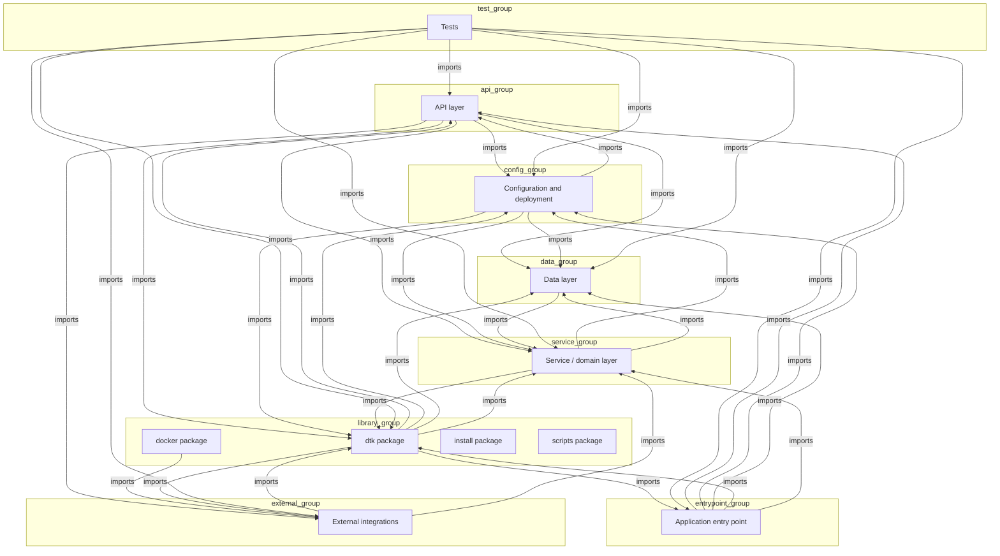

# Architecture report: Evil0ctal/Douyin_TikTok_Download_API

> Automated static analysis. **Observed** = directly seen in files/imports/AST; **Inferred** = interpretation from that evidence. Repository code was not executed.

## 1. Repository at a glance

| Item | Value |
| --- | --- |
| Repository | Evil0ctal/Douyin_TikTok_Download_API |
| Description | 🚀 自托管的抖音、TikTok、B 站数据采集与无水印视频下载 API，支持 AI agent 通过 MCP 调用与离线语音转文字，Docker 一键部署。| Self-hosted TikTok, Douyin & Bilibili scraper and no-watermark video downloader — async REST API, MCP server for AI agents, CLI and web console, plus offline speech-to-text for downloaded videos. Self-healing identity p… |
| Language | Python |
| Stars | 21402 |
| Licence | Apache-2.0 |
| Analysed commit / branch | 3c045e11aecd58ab076562f1246931b9dd5d909b / main |
| Framework(s) | FastAPI, Starlette, Typer |
| Files analysed | 584 |
| Components | 11 |

## 2. Architecture in one minute

Evil0ctal/Douyin_TikTok_Download_API - 🚀 自托管的抖音、TikTok、B 站数据采集与无水印视频下载 API，支持 AI agent 通过 MCP 调用与离线语音转文字，Docker 一键部署。| Self-hosted TikTok, Douyin & Bilibili scraper and no-watermark video downloader — async REST API, MCP server for AI age…. This repository was analysed statically from 584 file(s) (357 Python). Detected technologies (observed from imports/manifests): GitHub Actions, PostgreSQL, Redis, FastAPI, Starlette, Typer. Files are grouped into 11 component(s): API layer, Configuration and deployment, Data layer, docker package, dtk package, Application entry point, External integrations, install package. Observed entry point(s): docker/browser_rpc/__main__.py, docker/browser_rpc/main.py, docker/transcriber/app.py. Findings below distinguish observed facts from inferred interpretation.

## 3. High-level block diagram

## 4. Main components

### API layer (`api_layer`)

- **Kind:** api
- **Status:** Observed
- **Confidence:** 0.85
- **Responsibility:** Groups 39 file(s) under api layer (observed from repository paths and static analysis). Observed routes: GET /endpoints/access, GET (path not a literal), POST (path not a literal), PATCH /{key_id}, DELETE /{key_id}. Observed top-level classes: ApiKeyCreate, ApiKeyUpdate, ArchiveDelete, BackfillRequest, BackupRequest, BatchItem. Observed top-level functions: _accepts_author, _admin_count, _annotate_wait, _anonymous_if_opened, _apply_demo_switch, _archive_path.
- **Paths:** `src/dtk/api/__init__.py`, `src/dtk/api/console.py`, `src/dtk/api/demo_readonly.py`, `src/dtk/api/deps.py`, `src/dtk/api/envelope.py`, `src/dtk/api/middleware.py`, `src/dtk/api/public_endpoints.py`, `src/dtk/api/request_proxy.py`, `src/dtk/api/routes/__init__.py`, `src/dtk/api/routes/admin/__init__.py`, `src/dtk/api/routes/admin/access.py`, `src/dtk/api/routes/admin/api_keys.py`, `src/dtk/api/routes/admin/demo.py`, `src/dtk/api/routes/admin/health.py`, `src/dtk/api/routes/admin/identities.py`, `src/dtk/api/routes/admin/logs.py`, `src/dtk/api/routes/admin/maintenance.py`, `src/dtk/api/routes/admin/proxies.py`, `src/dtk/api/routes/admin/proxy_urls.py`, `src/dtk/api/routes/admin/settings.py`, `src/dtk/api/routes/admin/users.py`, `src/dtk/api/routes/admin/watchlist.py`, `src/dtk/api/routes/archive.py`, `src/dtk/api/routes/auth.py`, `src/dtk/api/routes/capabilities.py`, `src/dtk/api/routes/content.py`, `src/dtk/api/routes/discovery.py`, `src/dtk/api/routes/downloads.py`, `src/dtk/api/routes/ios.py`, `src/dtk/api/routes/openapi.py`, `src/dtk/api/routes/operations.py`, `src/dtk/api/routes/passwords.py`, `src/dtk/api/routes/schemas.py`, `src/dtk/api/routes/sessions.py`, `src/dtk/api/routes/support.py`, `src/dtk/api/routes/system.py`, `src/dtk/api/routes/tasks.py`, `src/dtk/api/routes/tools.py`, `src/dtk/api/routes/transcriptions.py`
- **Evidence:** [src/dtk/api/__init__.py](https://github.com/Evil0ctal/Douyin_TikTok_Download_API/blob/3c045e11aecd58ab076562f1246931b9dd5d909b/src/dtk/api/__init__.py); [src/dtk/api/console.py:37](https://github.com/Evil0ctal/Douyin_TikTok_Download_API/blob/3c045e11aecd58ab076562f1246931b9dd5d909b/src/dtk/api/console.py#L37); [src/dtk/api/demo_readonly.py:69](https://github.com/Evil0ctal/Douyin_TikTok_Download_API/blob/3c045e11aecd58ab076562f1246931b9dd5d909b/src/dtk/api/demo_readonly.py#L69); [src/dtk/api/deps.py:38](https://github.com/Evil0ctal/Douyin_TikTok_Download_API/blob/3c045e11aecd58ab076562f1246931b9dd5d909b/src/dtk/api/deps.py#L38); [src/dtk/api/envelope.py:24](https://github.com/Evil0ctal/Douyin_TikTok_Download_API/blob/3c045e11aecd58ab076562f1246931b9dd5d909b/src/dtk/api/envelope.py#L24); [src/dtk/api/middleware.py:66](https://github.com/Evil0ctal/Douyin_TikTok_Download_API/blob/3c045e11aecd58ab076562f1246931b9dd5d909b/src/dtk/api/middleware.py#L66); [src/dtk/api/public_endpoints.py:58](https://github.com/Evil0ctal/Douyin_TikTok_Download_API/blob/3c045e11aecd58ab076562f1246931b9dd5d909b/src/dtk/api/public_endpoints.py#L58); [src/dtk/api/request_proxy.py:75](https://github.com/Evil0ctal/Douyin_TikTok_Download_API/blob/3c045e11aecd58ab076562f1246931b9dd5d909b/src/dtk/api/request_proxy.py#L75)

### Configuration and deployment (`config`)

- **Kind:** config
- **Status:** Observed
- **Confidence:** 0.85
- **Responsibility:** Groups 21 file(s) under configuration and deployment (observed from repository paths and static analysis). Observed routes: GET /status, POST /init. Observed top-level classes: BootstrapSettings, Config, Scope, SettingSpec, Settings. Observed top-level functions: _as_declared_type, _banner, _byte_ceiling, _percent, _pool_egress_settings, _pool_login_settings.
- **Paths:** `alembic.ini`, `docker/Dockerfile`, `docker/Dockerfile.browser`, `docker/Dockerfile.downloader`, `docker/Dockerfile.transcriber`, `docker/browser_rpc/requirements.txt`, `docker/browser_rpc/settings.py`, `docker/compose.test.yml`, `docker/compose.yml`, `docker/downloader/go.mod`, `docker/transcriber/requirements.txt`, `pyproject.toml`, `src/dtk/api/routes/data/ios_shortcut.json`, `src/dtk/api/routes/setup.py`, `src/dtk/core/config.py`, `src/dtk/i18n/locales/en.json`, `src/dtk/i18n/locales/errors.en.json`, `src/dtk/i18n/locales/errors.zh.json`, `src/dtk/i18n/locales/format.en.json`, `src/dtk/i18n/locales/format.zh.json`, `src/dtk/i18n/locales/zh.json`
- **Evidence:** [alembic.ini](https://github.com/Evil0ctal/Douyin_TikTok_Download_API/blob/3c045e11aecd58ab076562f1246931b9dd5d909b/alembic.ini); [docker/Dockerfile](https://github.com/Evil0ctal/Douyin_TikTok_Download_API/blob/3c045e11aecd58ab076562f1246931b9dd5d909b/docker/Dockerfile); [docker/Dockerfile.browser](https://github.com/Evil0ctal/Douyin_TikTok_Download_API/blob/3c045e11aecd58ab076562f1246931b9dd5d909b/docker/Dockerfile.browser); [docker/Dockerfile.downloader](https://github.com/Evil0ctal/Douyin_TikTok_Download_API/blob/3c045e11aecd58ab076562f1246931b9dd5d909b/docker/Dockerfile.downloader); [docker/Dockerfile.transcriber](https://github.com/Evil0ctal/Douyin_TikTok_Download_API/blob/3c045e11aecd58ab076562f1246931b9dd5d909b/docker/Dockerfile.transcriber); [docker/browser_rpc/requirements.txt](https://github.com/Evil0ctal/Douyin_TikTok_Download_API/blob/3c045e11aecd58ab076562f1246931b9dd5d909b/docker/browser_rpc/requirements.txt); [docker/browser_rpc/settings.py:24](https://github.com/Evil0ctal/Douyin_TikTok_Download_API/blob/3c045e11aecd58ab076562f1246931b9dd5d909b/docker/browser_rpc/settings.py#L24); [docker/compose.test.yml](https://github.com/Evil0ctal/Douyin_TikTok_Download_API/blob/3c045e11aecd58ab076562f1246931b9dd5d909b/docker/compose.test.yml)

### Data layer (`data_layer`)

- **Kind:** data
- **Status:** Observed
- **Confidence:** 0.85
- **Responsibility:** Groups 27 file(s) under data layer (observed from repository paths and static analysis). Observed top-level classes: AlbumImage, ApiKey, ApiKeyRepository, ArchivedAuthor, ArchivedContent, AuditLog. Observed top-level functions: _cagg_exists, _create_continuous_aggregates, _create_hypertable, _create_policies, _create_relational_tables, _create_timeseries_tables.
- **Paths:** `docker/browser_rpc/models.py`, `src/dtk/core/db.py`, `src/dtk/db/__init__.py`, `src/dtk/db/base.py`, `src/dtk/db/migrate.py`, `src/dtk/db/migrations/env.py`, `src/dtk/db/migrations/versions/0001_initial_schema.py`, `src/dtk/db/migrations/versions/0002_content_archive.py`, `src/dtk/db/migrations/versions/0003_media_downloads.py`, `src/dtk/db/migrations/versions/0004_watchlist.py`, `src/dtk/db/migrations/versions/0005_availability_checks.py`, `src/dtk/db/migrations/versions/0006_collections.py`, `src/dtk/db/migrations/versions/0007_one_live_download_per_post.py`, `src/dtk/db/migrations/versions/0008_demo_tasks.py`, `src/dtk/db/migrations/versions/0009_demo_readable_credentials.py`, `src/dtk/db/migrations/versions/0010_transcriptions.py`, `src/dtk/db/migrations/versions/0011_identity_rotation_endpoints.py`, `src/dtk/db/migrations/versions/0012_proxy_last_error.py`, `src/dtk/db/migrations/versions/0013_bilibili_platform.py`, `src/dtk/db/migrations/versions/0014_download_parts.py`, `src/dtk/db/migrations/versions/0015_request_log_proxy_index.py`, `src/dtk/db/migrations/versions/0016_identity_notes.py`, `src/dtk/db/models.py`, `src/dtk/db/repositories.py`, `src/dtk/db/timeseries.py`, `src/dtk/models/__init__.py`, `src/dtk/models/content.py`
- **Evidence:** [docker/browser_rpc/models.py:20](https://github.com/Evil0ctal/Douyin_TikTok_Download_API/blob/3c045e11aecd58ab076562f1246931b9dd5d909b/docker/browser_rpc/models.py#L20); [src/dtk/core/db.py:18](https://github.com/Evil0ctal/Douyin_TikTok_Download_API/blob/3c045e11aecd58ab076562f1246931b9dd5d909b/src/dtk/core/db.py#L18); [src/dtk/db/__init__.py](https://github.com/Evil0ctal/Douyin_TikTok_Download_API/blob/3c045e11aecd58ab076562f1246931b9dd5d909b/src/dtk/db/__init__.py); [src/dtk/db/base.py:15](https://github.com/Evil0ctal/Douyin_TikTok_Download_API/blob/3c045e11aecd58ab076562f1246931b9dd5d909b/src/dtk/db/base.py#L15); [src/dtk/db/migrate.py:27](https://github.com/Evil0ctal/Douyin_TikTok_Download_API/blob/3c045e11aecd58ab076562f1246931b9dd5d909b/src/dtk/db/migrate.py#L27); [src/dtk/db/migrations/env.py:76](https://github.com/Evil0ctal/Douyin_TikTok_Download_API/blob/3c045e11aecd58ab076562f1246931b9dd5d909b/src/dtk/db/migrations/env.py#L76); [src/dtk/db/migrations/versions/0001_initial_schema.py:135](https://github.com/Evil0ctal/Douyin_TikTok_Download_API/blob/3c045e11aecd58ab076562f1246931b9dd5d909b/src/dtk/db/migrations/versions/0001_initial_schema.py#L135); [src/dtk/db/migrations/versions/0002_content_archive.py:36](https://github.com/Evil0ctal/Douyin_TikTok_Download_API/blob/3c045e11aecd58ab076562f1246931b9dd5d909b/src/dtk/db/migrations/versions/0002_content_archive.py#L36)

### docker package (`docker`)

- **Kind:** library
- **Status:** Observed
- **Confidence:** 0.85
- **Responsibility:** Groups 24 file(s) under docker package (observed from repository paths and static analysis). Observed top-level classes: BackendFailure, BackendInfo, BackendUnavailable, BrowserBackend, CloakBackend, CloakSigningContext. Observed top-level functions: _as_int, _await_sdk, _collect_cookies, _digest, _first_str, _is_ip_literal.
- **Paths:** `docker/browser-entrypoint.sh`, `docker/browser_rpc/__init__.py`, `docker/browser_rpc/backends/__init__.py`, `docker/browser_rpc/backends/base.py`, `docker/browser_rpc/backends/cloak.py`, `docker/browser_rpc/backends/fake.py`, `docker/browser_rpc/errors.py`, `docker/browser_rpc/geo.py`, `docker/browser_rpc/validation.py`, `docker/downloader/api.go`, `docker/downloader/api_test.go`, `docker/downloader/download.go`, `docker/downloader/download_test.go`, `docker/downloader/main.go`, `docker/downloader/progress.go`, `docker/downloader/progress_test.go`, `docker/downloader/queue.go`, `docker/downloader/resume_test.go`, `docker/downloader/safety.go`, `docker/downloader/safety_test.go`, `docker/downloader/store.go`, `docker/downloader/store_test.go`, `docker/entrypoint.sh`, `docker/package-mirrors.sh`
- **Evidence:** [docker/browser-entrypoint.sh](https://github.com/Evil0ctal/Douyin_TikTok_Download_API/blob/3c045e11aecd58ab076562f1246931b9dd5d909b/docker/browser-entrypoint.sh); [docker/browser_rpc/__init__.py](https://github.com/Evil0ctal/Douyin_TikTok_Download_API/blob/3c045e11aecd58ab076562f1246931b9dd5d909b/docker/browser_rpc/__init__.py); [docker/browser_rpc/backends/__init__.py:32](https://github.com/Evil0ctal/Douyin_TikTok_Download_API/blob/3c045e11aecd58ab076562f1246931b9dd5d909b/docker/browser_rpc/backends/__init__.py#L32); [docker/browser_rpc/backends/base.py:25](https://github.com/Evil0ctal/Douyin_TikTok_Download_API/blob/3c045e11aecd58ab076562f1246931b9dd5d909b/docker/browser_rpc/backends/base.py#L25); [docker/browser_rpc/backends/cloak.py:288](https://github.com/Evil0ctal/Douyin_TikTok_Download_API/blob/3c045e11aecd58ab076562f1246931b9dd5d909b/docker/browser_rpc/backends/cloak.py#L288); [docker/browser_rpc/backends/fake.py:60](https://github.com/Evil0ctal/Douyin_TikTok_Download_API/blob/3c045e11aecd58ab076562f1246931b9dd5d909b/docker/browser_rpc/backends/fake.py#L60); [docker/browser_rpc/errors.py:14](https://github.com/Evil0ctal/Douyin_TikTok_Download_API/blob/3c045e11aecd58ab076562f1246931b9dd5d909b/docker/browser_rpc/errors.py#L14); [docker/browser_rpc/geo.py:32](https://github.com/Evil0ctal/Douyin_TikTok_Download_API/blob/3c045e11aecd58ab076562f1246931b9dd5d909b/docker/browser_rpc/geo.py#L32)

### dtk package (`dtk`)

- **Kind:** library
- **Status:** Observed
- **Confidence:** 0.85
- **Responsibility:** Groups 118 file(s) under dtk package (observed from repository paths and static analysis). Observed top-level classes: ABogus, ABogusComparator, Alerter, ApiKeyGuard, BackupError, BackupInfo. Observed top-level functions: _add_bytes, _album_images, _alive, _allow_any_platform, _answered, _appended_text.
- **Paths:** `src/dtk/__init__.py`, `src/dtk/cli/__init__.py`, `src/dtk/cli/diagnose_cmd.py`, `src/dtk/cli/fetch_cmd.py`, `src/dtk/cli/output.py`, `src/dtk/cli/runtime.py`, `src/dtk/cli/worker.py`, `src/dtk/i18n/__init__.py`, `src/dtk/i18n/_loader.py`, `src/dtk/i18n/catalog.py`, `src/dtk/i18n/format.py`, `src/dtk/i18n/messages.py`, `src/dtk/i18n/negotiate.py`, `src/dtk/identity/__init__.py`, `src/dtk/identity/importing.py`, `src/dtk/identity/marks.py`, `src/dtk/identity/mint_log.py`, `src/dtk/identity/minting/__init__.py`, `src/dtk/identity/minting/native.py`, `src/dtk/identity/pool.py`, `src/dtk/mcp/__init__.py`, `src/dtk/mcp/context.py`, `src/dtk/mcp/gateway.py`, `src/dtk/mcp/http.py`, `src/dtk/mcp/prose.py`, `src/dtk/mcp/routing.py`, `src/dtk/mcp/tools.py`, `src/dtk/media/__init__.py`, `src/dtk/media/domains.py`, `src/dtk/media/plan.py`, `src/dtk/ops/__init__.py`, `src/dtk/ops/_sql.py`, `src/dtk/ops/backup.py`, `src/dtk/ops/capacity.py`, `src/dtk/ops/channels.py`, `src/dtk/ops/diagnose.py`, `src/dtk/ops/health.py`, `src/dtk/ops/masking.py`, `src/dtk/ops/notify.py`, `src/dtk/ops/pipeline.py`, `src/dtk/ops/probes.py`, `src/dtk/ops/retention.py`, `src/dtk/ops/sidecars.py`, `src/dtk/ops/webhooks.py`, `src/dtk/platforms/__init__.py`, `src/dtk/platforms/base.py`, `src/dtk/platforms/bilibili/__init__.py`, `src/dtk/platforms/bilibili/adapter.py`, `src/dtk/platforms/bilibili/endpoints.py`, `src/dtk/platforms/bilibili/ids.py`, `src/dtk/platforms/bilibili/params.py`, `src/dtk/platforms/bilibili/parser.py`, `src/dtk/platforms/common.py`, `src/dtk/platforms/douyin/__init__.py`, `src/dtk/platforms/douyin/adapter.py`, `src/dtk/platforms/douyin/endpoints.py`, `src/dtk/platforms/douyin/params.py`, `src/dtk/platforms/douyin/parser.py`, `src/dtk/platforms/paging.py`, `src/dtk/platforms/registry.py`, `src/dtk/platforms/tiktok/__init__.py`, `src/dtk/platforms/tiktok/adapter.py`, `src/dtk/platforms/tiktok/endpoints.py`, `src/dtk/platforms/tiktok/params.py`, `src/dtk/platforms/tiktok/parser.py`, `src/dtk/scheduler/__init__.py`, `src/dtk/scheduler/circuit.py`, `src/dtk/scheduler/health.py`, `src/dtk/scheduler/leases.py`, `src/dtk/scheduler/policies.py`, `src/dtk/scheduler/scheduler.py`, `src/dtk/signing/__init__.py`, `src/dtk/signing/base.py`, `src/dtk/signing/native/__init__.py`, `src/dtk/signing/native/abogus.py`, `src/dtk/signing/native/decoding.py`, `src/dtk/signing/native/signer.py`, `src/dtk/signing/native/sm3.py`, `src/dtk/signing/native/tiktok_sign.py`, `src/dtk/signing/native/tokens.py`, `src/dtk/signing/native/wbi.py`, `src/dtk/signing/native/wbi_keys.py`, `src/dtk/signing/native/websign.py`, `src/dtk/signing/native/xbogus.py`, `src/dtk/signing/protection.py`, `src/dtk/signing/registry.py`, `src/dtk/signing/rpc.py`, `src/dtk/transcriber.py`, `src/dtk/transport/__init__.py`, `src/dtk/transport/base.py`, `src/dtk/transport/classify.py`, `src/dtk/transport/emulation.py`, `src/dtk/transport/headers.py`, `src/dtk/transport/wreq_transport.py`, `src/dtk/urls/__init__.py`, `src/dtk/urls/expand.py`, `src/dtk/urls/ids.py`, `src/dtk/urls/parse.py`, `src/dtk/urls/patterns.py`, `src/dtk/worker/__init__.py`, `src/dtk/worker/alerts.py`, `src/dtk/worker/loop.py`, `src/dtk/worker/maintenance.py`, `src/dtk/worker/ops/__init__.py`, `src/dtk/worker/ops/archive_sweep.py`, `src/dtk/worker/ops/backup.py`, `src/dtk/worker/ops/diagnose.py`, `src/dtk/worker/ops/identity_mint.py`, `src/dtk/worker/ops/identity_session.py`, `src/dtk/worker/ops/media_download.py`, `src/dtk/worker/ops/media_transcribe.py`, `src/dtk/worker/ops/restore.py`, `src/dtk/worker/parsing.py`, `src/dtk/worker/pool_filler.py`, `src/dtk/worker/proxy_prober.py`, `src/dtk/worker/registry.py`, `src/dtk/worker/runtime.py`, `src/dtk/worker/watcher.py`
- **Evidence:** [src/dtk/__init__.py](https://github.com/Evil0ctal/Douyin_TikTok_Download_API/blob/3c045e11aecd58ab076562f1246931b9dd5d909b/src/dtk/__init__.py); [src/dtk/cli/__init__.py](https://github.com/Evil0ctal/Douyin_TikTok_Download_API/blob/3c045e11aecd58ab076562f1246931b9dd5d909b/src/dtk/cli/__init__.py); [src/dtk/cli/diagnose_cmd.py:42](https://github.com/Evil0ctal/Douyin_TikTok_Download_API/blob/3c045e11aecd58ab076562f1246931b9dd5d909b/src/dtk/cli/diagnose_cmd.py#L42); [src/dtk/cli/fetch_cmd.py:32](https://github.com/Evil0ctal/Douyin_TikTok_Download_API/blob/3c045e11aecd58ab076562f1246931b9dd5d909b/src/dtk/cli/fetch_cmd.py#L32); [src/dtk/cli/output.py:67](https://github.com/Evil0ctal/Douyin_TikTok_Download_API/blob/3c045e11aecd58ab076562f1246931b9dd5d909b/src/dtk/cli/output.py#L67); [src/dtk/cli/runtime.py:38](https://github.com/Evil0ctal/Douyin_TikTok_Download_API/blob/3c045e11aecd58ab076562f1246931b9dd5d909b/src/dtk/cli/runtime.py#L38); [src/dtk/cli/worker.py:23](https://github.com/Evil0ctal/Douyin_TikTok_Download_API/blob/3c045e11aecd58ab076562f1246931b9dd5d909b/src/dtk/cli/worker.py#L23); [src/dtk/i18n/__init__.py](https://github.com/Evil0ctal/Douyin_TikTok_Download_API/blob/3c045e11aecd58ab076562f1246931b9dd5d909b/src/dtk/i18n/__init__.py)

### Application entry point (`entrypoint`)

- **Kind:** entrypoint
- **Status:** Observed
- **Confidence:** 0.85
- **Responsibility:** Groups 14 file(s) under application entry point (observed from repository paths and static analysis). Observed application object created via FastAPI, Typer. Observed top-level classes: Backend, DatabaseTaskStore, FunASRBackend, JobCancelled, JobRequest, NormalizationFailed. Observed top-level functions: _as_uuid, _first_text, _health_body, _install_error_handlers, _install_routes, _log_to_stderr.
- **Paths:** `docker/browser_rpc/__main__.py`, `docker/browser_rpc/main.py`, `docker/transcriber/app.py`, `src/dtk/api/app.py`, `src/dtk/cli/backup.py`, `src/dtk/cli/identities.py`, `src/dtk/cli/main.py`, `src/dtk/cli/proxies.py`, `src/dtk/cli/settings_cmd.py`, `src/dtk/cli/users.py`, `src/dtk/mcp/__main__.py`, `src/dtk/mcp/server.py`, `src/dtk/worker/__main__.py`, `src/dtk/worker/main.py`
- **Evidence:** [docker/browser_rpc/__main__.py:19](https://github.com/Evil0ctal/Douyin_TikTok_Download_API/blob/3c045e11aecd58ab076562f1246931b9dd5d909b/docker/browser_rpc/__main__.py#L19); [docker/browser_rpc/main.py:72](https://github.com/Evil0ctal/Douyin_TikTok_Download_API/blob/3c045e11aecd58ab076562f1246931b9dd5d909b/docker/browser_rpc/main.py#L72); [docker/transcriber/app.py:537](https://github.com/Evil0ctal/Douyin_TikTok_Download_API/blob/3c045e11aecd58ab076562f1246931b9dd5d909b/docker/transcriber/app.py#L537); [src/dtk/api/app.py:147](https://github.com/Evil0ctal/Douyin_TikTok_Download_API/blob/3c045e11aecd58ab076562f1246931b9dd5d909b/src/dtk/api/app.py#L147); [src/dtk/cli/backup.py:36](https://github.com/Evil0ctal/Douyin_TikTok_Download_API/blob/3c045e11aecd58ab076562f1246931b9dd5d909b/src/dtk/cli/backup.py#L36); [src/dtk/cli/identities.py:33](https://github.com/Evil0ctal/Douyin_TikTok_Download_API/blob/3c045e11aecd58ab076562f1246931b9dd5d909b/src/dtk/cli/identities.py#L33); [src/dtk/cli/main.py:47](https://github.com/Evil0ctal/Douyin_TikTok_Download_API/blob/3c045e11aecd58ab076562f1246931b9dd5d909b/src/dtk/cli/main.py#L47); [src/dtk/cli/proxies.py:33](https://github.com/Evil0ctal/Douyin_TikTok_Download_API/blob/3c045e11aecd58ab076562f1246931b9dd5d909b/src/dtk/cli/proxies.py#L33)

### External integrations (`external_integrations`)

- **Kind:** external
- **Status:** Observed
- **Confidence:** 0.85
- **Responsibility:** Groups 2 file(s) under external integrations (observed from repository paths and static analysis). Observed top-level classes: BrowserRpcClient, BrowserRpcUnavailable, DownloaderBusy, DownloaderClient, DownloaderHealth, DownloaderUnavailable. Observed top-level functions: _as_int, _body_of, _error_of.
- **Paths:** `src/dtk/identity/minting/client.py`, `src/dtk/media/client.py`
- **Evidence:** [src/dtk/identity/minting/client.py:35](https://github.com/Evil0ctal/Douyin_TikTok_Download_API/blob/3c045e11aecd58ab076562f1246931b9dd5d909b/src/dtk/identity/minting/client.py#L35); [src/dtk/media/client.py:33](https://github.com/Evil0ctal/Douyin_TikTok_Download_API/blob/3c045e11aecd58ab076562f1246931b9dd5d909b/src/dtk/media/client.py#L33)

### install package (`install`)

- **Kind:** library
- **Status:** Observed
- **Confidence:** 0.85
- **Responsibility:** Groups 2 file(s) under install package (observed from repository paths and static analysis).
- **Paths:** `install/install.sh`, `install/install.zh.sh`
- **Evidence:** [install/install.sh](https://github.com/Evil0ctal/Douyin_TikTok_Download_API/blob/3c045e11aecd58ab076562f1246931b9dd5d909b/install/install.sh); [install/install.zh.sh](https://github.com/Evil0ctal/Douyin_TikTok_Download_API/blob/3c045e11aecd58ab076562f1246931b9dd5d909b/install/install.zh.sh)

### scripts package (`scripts`)

- **Kind:** library
- **Status:** Observed
- **Confidence:** 0.85
- **Responsibility:** Groups 1 file(s) under scripts package (observed from repository paths and static analysis).
- **Paths:** `scripts/smoke.sh`
- **Evidence:** [scripts/smoke.sh](https://github.com/Evil0ctal/Douyin_TikTok_Download_API/blob/3c045e11aecd58ab076562f1246931b9dd5d909b/scripts/smoke.sh)

### Service / domain layer (`service_layer`)

- **Kind:** service
- **Status:** Observed
- **Confidence:** 0.85
- **Responsibility:** Groups 22 file(s) under service / domain layer (observed from repository paths and static analysis). Observed top-level classes: AlreadyInFlight, ArchiveFilter, Availability, BrowserFamily, BrowserRpcService, Cipher. Observed top-level functions: _all_none, _announce, _apply, _archived, _bump_version, _cookie_header.
- **Paths:** `docker/browser_rpc/service.py`, `src/dtk/core/__init__.py`, `src/dtk/core/crypto.py`, `src/dtk/core/errors.py`, `src/dtk/core/logging.py`, `src/dtk/core/redis.py`, `src/dtk/core/types.py`, `src/dtk/services/__init__.py`, `src/dtk/services/archive.py`, `src/dtk/services/cache.py`, `src/dtk/services/collections.py`, `src/dtk/services/demo.py`, `src/dtk/services/download_requests.py`, `src/dtk/services/downloads.py`, `src/dtk/services/fetch.py`, `src/dtk/services/settings_store.py`, `src/dtk/services/snapshots.py`, `src/dtk/services/tasks.py`, `src/dtk/services/transcription_progress.py`, `src/dtk/services/transcription_requests.py`, `src/dtk/services/transcriptions.py`, `src/dtk/services/watchlist.py`
- **Evidence:** [docker/browser_rpc/service.py:62](https://github.com/Evil0ctal/Douyin_TikTok_Download_API/blob/3c045e11aecd58ab076562f1246931b9dd5d909b/docker/browser_rpc/service.py#L62); [src/dtk/core/__init__.py](https://github.com/Evil0ctal/Douyin_TikTok_Download_API/blob/3c045e11aecd58ab076562f1246931b9dd5d909b/src/dtk/core/__init__.py); [src/dtk/core/crypto.py:23](https://github.com/Evil0ctal/Douyin_TikTok_Download_API/blob/3c045e11aecd58ab076562f1246931b9dd5d909b/src/dtk/core/crypto.py#L23); [src/dtk/core/errors.py:14](https://github.com/Evil0ctal/Douyin_TikTok_Download_API/blob/3c045e11aecd58ab076562f1246931b9dd5d909b/src/dtk/core/errors.py#L14); [src/dtk/core/logging.py:54](https://github.com/Evil0ctal/Douyin_TikTok_Download_API/blob/3c045e11aecd58ab076562f1246931b9dd5d909b/src/dtk/core/logging.py#L54); [src/dtk/core/redis.py:32](https://github.com/Evil0ctal/Douyin_TikTok_Download_API/blob/3c045e11aecd58ab076562f1246931b9dd5d909b/src/dtk/core/redis.py#L32); [src/dtk/core/types.py:12](https://github.com/Evil0ctal/Douyin_TikTok_Download_API/blob/3c045e11aecd58ab076562f1246931b9dd5d909b/src/dtk/core/types.py#L12); [src/dtk/services/__init__.py](https://github.com/Evil0ctal/Douyin_TikTok_Download_API/blob/3c045e11aecd58ab076562f1246931b9dd5d909b/src/dtk/services/__init__.py)

### Tests (`tests`)

- **Kind:** test
- **Status:** Observed
- **Confidence:** 0.85
- **Responsibility:** Groups 219 file(s) under tests (observed from repository paths and static analysis). Observed application object created via FastAPI. Observed top-level classes: AdvancingClock, BothReadFirst, BrokenContext, Clock, ConcurrencyBackend, CountingBackend. Observed top-level functions: _access_rows, _all_migration_source, _api_key, _app, _archive_bytes, _authenticate.
- **Paths:** `docker/browser_rpc/tests/conftest.py`, `docker/browser_rpc/tests/test_backends.py`, `docker/browser_rpc/tests/test_geo.py`, `docker/browser_rpc/tests/test_rpc_api.py`, `docker/browser_rpc/tests/test_service.py`, `docker/browser_rpc/tests/test_settings.py`, `docker/browser_rpc/tests/test_validation.py`, `src/dtk/worker/ops/identity_test.py`, `src/dtk/worker/ops/notify_test.py`, `src/dtk/worker/ops/proxy_test.py`, `tests/__init__.py`, `tests/conftest.py`, `tests/contract/README.md`, `tests/contract/__init__.py`, `tests/contract/subjects.py`, `tests/contract/test_live_endpoints.py`, `tests/fixtures/README.md`, `tests/fixtures/bilibili/author_mixes.json`, `tests/fixtures/bilibili/collection_posts_page1.json`, `tests/fixtures/bilibili/comment_replies_page1.json`, `tests/fixtures/bilibili/comments_guest_first_page.json`, `tests/fixtures/bilibili/comments_with_replies.json`, `tests/fixtures/bilibili/content_parts.json`, `tests/fixtures/bilibili/content_parts_missing.json`, `tests/fixtures/bilibili/content_streams.json`, `tests/fixtures/bilibili/live_room_missing.json`, `tests/fixtures/bilibili/live_room_off.json`, `tests/fixtures/bilibili/live_room_on.json`, `tests/fixtures/bilibili/live_streams.json`, `tests/fixtures/bilibili/mix_posts_missing.json`, `tests/fixtures/bilibili/mix_posts_page1.json`, `tests/fixtures/bilibili/popular_hot_end.json`, `tests/fixtures/bilibili/popular_hot_page1.json`, `tests/fixtures/bilibili/popular_precious.json`, `tests/fixtures/bilibili/popular_weekly_index.json`, `tests/fixtures/bilibili/popular_weekly_issue.json`, `tests/fixtures/bilibili/popular_weekly_missing.json`, `tests/fixtures/bilibili/ranking_all.json`, `tests/fixtures/bilibili/related_posts.json`, `tests/fixtures/bilibili/risk_control_voucher.json`, `tests/fixtures/bilibili/search_authors_none.json`, `tests/fixtures/bilibili/search_authors_page1.json`, `tests/fixtures/bilibili/search_posts_page1.json`, `tests/fixtures/bilibili/trending.json`, `tests/fixtures/bilibili/user_collections.json`, `tests/fixtures/bilibili/user_collections_none.json`, `tests/fixtures/bilibili/user_posts_empty.json`, `tests/fixtures/bilibili/user_posts_page1.json`, `tests/fixtures/bilibili/user_profile.json`, `tests/fixtures/bilibili/video_long_desc.json`, `tests/fixtures/bilibili/video_multipart.json`, `tests/fixtures/bilibili/video_normal.json`, `tests/fixtures/douyin/author_mixes.json`, `tests/fixtures/douyin/comment_replies_page1.json`, `tests/fixtures/douyin/comments_with_replies.json`, `tests/fixtures/douyin/hashtag_detail.json`, `tests/fixtures/douyin/hashtag_detail_missing.json`, `tests/fixtures/douyin/live_ranking.json`, `tests/fixtures/douyin/live_ranking_missing.json`, `tests/fixtures/douyin/live_room_by_id_missing.json`, `tests/fixtures/douyin/live_room_by_id_on.json`, `tests/fixtures/douyin/live_room_missing.json`, `tests/fixtures/douyin/live_room_off.json`, `tests/fixtures/douyin/live_room_on.json`, `tests/fixtures/douyin/live_status.json`, `tests/fixtures/douyin/music_detail.json`, `tests/fixtures/douyin/music_detail_missing.json`, `tests/fixtures/douyin/music_posts_page1.json`, `tests/fixtures/douyin/related_posts.json`, `tests/fixtures/douyin/risk_control_captcha.json`, `tests/fixtures/douyin/risk_control_empty.json`, `tests/fixtures/douyin/trending_hot.json`, `tests/fixtures/douyin/user_posts_page1.json`, `tests/fixtures/douyin/user_profile.json`, `tests/fixtures/douyin/video_deleted.json`, `tests/fixtures/douyin/video_image_album.json`, `tests/fixtures/douyin/video_live_photo.json`, `tests/fixtures/douyin/video_long_desc.json`, `tests/fixtures/douyin/video_normal.json`, `tests/fixtures/douyin/video_private.json`, `tests/fixtures/signing/abogus_browser.json`, `tests/fixtures/tiktok/author_mixes.json`, `tests/fixtures/tiktok/author_mixes_none.json`, `tests/fixtures/tiktok/comment_replies_page1.json`, `tests/fixtures/tiktok/comments_with_replies.json`, `tests/fixtures/tiktok/hashtag_detail.json`, `tests/fixtures/tiktok/hashtag_detail_missing.json`, `tests/fixtures/tiktok/hashtag_posts_page1.json`, `tests/fixtures/tiktok/live_room_by_id_missing.json`, `tests/fixtures/tiktok/live_room_by_id_on.json`, `tests/fixtures/tiktok/live_room_missing.json`, `tests/fixtures/tiktok/live_room_off.json`, `tests/fixtures/tiktok/live_room_on.json`, `tests/fixtures/tiktok/live_status.json`, `tests/fixtures/tiktok/music_detail.json`, `tests/fixtures/tiktok/music_detail_missing.json`, `tests/fixtures/tiktok/music_posts_page1.json`, `tests/fixtures/tiktok/related_posts.json`, `tests/fixtures/tiktok/risk_control_captcha.json`, `tests/fixtures/tiktok/risk_control_empty.json`, `tests/fixtures/tiktok/search_authors_page1.json`, `tests/fixtures/tiktok/search_posts_end.json`, `tests/fixtures/tiktok/search_posts_page1.json`, `tests/fixtures/tiktok/user_posts_page1.json`, `tests/fixtures/tiktok/user_profile.json`, `tests/fixtures/tiktok/video_deleted.json`, `tests/fixtures/tiktok/video_image_album.json`, `tests/fixtures/tiktok/video_long_desc.json`, `tests/fixtures/tiktok/video_normal.json`, `tests/fixtures/tiktok/video_private.json`, `tests/integration/__init__.py`, `tests/integration/conftest.py`, `tests/integration/test_api_admin.py`, `tests/integration/test_api_auth.py`, `tests/integration/test_api_backup.py`, `tests/integration/test_api_capabilities.py`, `tests/integration/test_api_collections.py`, `tests/integration/test_api_content.py`, `tests/integration/test_api_content_links.py`, `tests/integration/test_api_cors_and_limits.py`, `tests/integration/test_api_credential_roles.py`, `tests/integration/test_api_demo.py`, `tests/integration/test_api_discovery.py`, `tests/integration/test_api_downloads.py`, `tests/integration/test_api_identities_listing.py`, `tests/integration/test_api_identities_paging.py`, `tests/integration/test_api_identity_cookies.py`, `tests/integration/test_api_identity_notes.py`, `tests/integration/test_api_identity_pin.py`, `tests/integration/test_api_identity_rotation.py`, `tests/integration/test_api_logs.py`, `tests/integration/test_api_setup.py`, `tests/integration/test_api_support.py`, `tests/integration/test_api_system.py`, `tests/integration/test_api_tasks.py`, `tests/integration/test_api_transcriptions.py`, `tests/integration/test_api_watchlist.py`, `tests/integration/test_archive_sweep.py`, `tests/integration/test_config_hot_reload.py`, `tests/integration/test_console.py`, `tests/integration/test_db_connections.py`, `tests/integration/test_end_to_end.py`, `tests/integration/test_migrations.py`, `tests/integration/test_mint_log.py`, `tests/integration/test_scheduler_concurrency.py`, `tests/integration/test_scheduler_fairness.py`, `tests/integration/test_tasks_queue.py`, `tests/integration/test_transcription_requests.py`, `tests/integration/test_worker.py`, `tests/replay/__init__.py`, `tests/replay/support.py`, `tests/replay/test_bilibili_parser.py`, `tests/replay/test_discovery_parsers.py`, `tests/replay/test_douyin_parser.py`, `tests/replay/test_platform_contract.py`, `tests/replay/test_tiktok_parser.py`, `tests/support/__init__.py`, `tests/support/marks.py`, `tests/support/shell_code.py`, `tests/unit/__init__.py`, `tests/unit/test_absence_matrix.py`, `tests/unit/test_admin_account_rules.py`, `tests/unit/test_api_middleware.py`, `tests/unit/test_archive.py`, `tests/unit/test_bilibili.py`, `tests/unit/test_bilibili_redaction.py`, `tests/unit/test_capabilities_route.py`, `tests/unit/test_capacity.py`, `tests/unit/test_classify_status_keys.py`, `tests/unit/test_cli.py`, `tests/unit/test_client_profile.py`, `tests/unit/test_console_api_seam.py`, `tests/unit/test_console_notify_triggers.py`, `tests/unit/test_console_reason_codes.py`, `tests/unit/test_console_shell.py`, `tests/unit/test_content_ids.py`, `tests/unit/test_db_models.py`, `tests/unit/test_db_pool.py`, `tests/unit/test_demo.py`, `tests/unit/test_discovery_absence.py`, `tests/unit/test_discovery_params.py`, `tests/unit/test_download_progress.py`, `tests/unit/test_download_requests.py`, `tests/unit/test_downloads.py`, `tests/unit/test_endpoint_form.py`, `tests/unit/test_endpoint_login.py`, `tests/unit/test_explain_scope.py`, `tests/unit/test_fetch_classification.py`, `tests/unit/test_fetch_follow_up.py`, `tests/unit/test_i18n.py`, `tests/unit/test_identities_admin_helpers.py`, `tests/unit/test_identity_importing.py`, `tests/unit/test_identity_marks.py`, `tests/unit/test_identity_pool.py`, `tests/unit/test_mcp.py`, `tests/unit/test_media_client.py`, `tests/unit/test_media_domains.py`, `tests/unit/test_media_plan.py`, `tests/unit/test_mint_backoff_record.py`, `tests/unit/test_mint_skip_record.py`, `tests/unit/test_minting_client.py`, `tests/unit/test_native_minter.py`, `tests/unit/test_openapi_completeness.py`, `tests/unit/test_openapi_contract.py`, `tests/unit/test_ops_backup.py`, `tests/unit/test_ops_channels.py`, `tests/unit/test_ops_diagnose.py`, `tests/unit/test_ops_health.py`, `tests/unit/test_ops_masking.py`, `tests/unit/test_ops_notify.py`, `tests/unit/test_ops_retention.py`, `tests/unit/test_ops_sidecars.py`, `tests/unit/test_package_mirrors.py`, `tests/unit/test_paging.py`, `tests/unit/test_password_rule.py`, `tests/unit/test_policy_coverage.py`, `tests/unit/test_proxy_probe_client.py`, `tests/unit/test_public_endpoints.py`, `tests/unit/test_repo_hygiene.py`
- **Evidence:** [docker/browser_rpc/tests/conftest.py:27](https://github.com/Evil0ctal/Douyin_TikTok_Download_API/blob/3c045e11aecd58ab076562f1246931b9dd5d909b/docker/browser_rpc/tests/conftest.py#L27); [docker/browser_rpc/tests/test_backends.py:45](https://github.com/Evil0ctal/Douyin_TikTok_Download_API/blob/3c045e11aecd58ab076562f1246931b9dd5d909b/docker/browser_rpc/tests/test_backends.py#L45); [docker/browser_rpc/tests/test_geo.py:11](https://github.com/Evil0ctal/Douyin_TikTok_Download_API/blob/3c045e11aecd58ab076562f1246931b9dd5d909b/docker/browser_rpc/tests/test_geo.py#L11); [docker/browser_rpc/tests/test_rpc_api.py:35](https://github.com/Evil0ctal/Douyin_TikTok_Download_API/blob/3c045e11aecd58ab076562f1246931b9dd5d909b/docker/browser_rpc/tests/test_rpc_api.py#L35); [docker/browser_rpc/tests/test_service.py:32](https://github.com/Evil0ctal/Douyin_TikTok_Download_API/blob/3c045e11aecd58ab076562f1246931b9dd5d909b/docker/browser_rpc/tests/test_service.py#L32); [docker/browser_rpc/tests/test_settings.py:15](https://github.com/Evil0ctal/Douyin_TikTok_Download_API/blob/3c045e11aecd58ab076562f1246931b9dd5d909b/docker/browser_rpc/tests/test_settings.py#L15); [docker/browser_rpc/tests/test_validation.py:16](https://github.com/Evil0ctal/Douyin_TikTok_Download_API/blob/3c045e11aecd58ab076562f1246931b9dd5d909b/docker/browser_rpc/tests/test_validation.py#L16); [src/dtk/worker/ops/identity_test.py:46](https://github.com/Evil0ctal/Douyin_TikTok_Download_API/blob/3c045e11aecd58ab076562f1246931b9dd5d909b/src/dtk/worker/ops/identity_test.py#L46)

## 5. Execution flow

**Observed** entry point(s):

- [docker/browser_rpc/__main__.py:45](https://github.com/Evil0ctal/Douyin_TikTok_Download_API/blob/3c045e11aecd58ab076562f1246931b9dd5d909b/docker/browser_rpc/__main__.py#L45)
- [docker/browser_rpc/main.py:72](https://github.com/Evil0ctal/Douyin_TikTok_Download_API/blob/3c045e11aecd58ab076562f1246931b9dd5d909b/docker/browser_rpc/main.py#L72)
- [docker/transcriber/app.py:537](https://github.com/Evil0ctal/Douyin_TikTok_Download_API/blob/3c045e11aecd58ab076562f1246931b9dd5d909b/docker/transcriber/app.py#L537)
- [src/dtk/api/app.py:147](https://github.com/Evil0ctal/Douyin_TikTok_Download_API/blob/3c045e11aecd58ab076562f1246931b9dd5d909b/src/dtk/api/app.py#L147)
- [src/dtk/cli/backup.py:36](https://github.com/Evil0ctal/Douyin_TikTok_Download_API/blob/3c045e11aecd58ab076562f1246931b9dd5d909b/src/dtk/cli/backup.py#L36)
- [src/dtk/cli/identities.py:33](https://github.com/Evil0ctal/Douyin_TikTok_Download_API/blob/3c045e11aecd58ab076562f1246931b9dd5d909b/src/dtk/cli/identities.py#L33)
- [src/dtk/cli/main.py](https://github.com/Evil0ctal/Douyin_TikTok_Download_API/blob/3c045e11aecd58ab076562f1246931b9dd5d909b/src/dtk/cli/main.py)
- [src/dtk/cli/proxies.py:33](https://github.com/Evil0ctal/Douyin_TikTok_Download_API/blob/3c045e11aecd58ab076562f1246931b9dd5d909b/src/dtk/cli/proxies.py#L33)
- [src/dtk/cli/settings_cmd.py:27](https://github.com/Evil0ctal/Douyin_TikTok_Download_API/blob/3c045e11aecd58ab076562f1246931b9dd5d909b/src/dtk/cli/settings_cmd.py#L27)
- [src/dtk/cli/users.py:37](https://github.com/Evil0ctal/Douyin_TikTok_Download_API/blob/3c045e11aecd58ab076562f1246931b9dd5d909b/src/dtk/cli/users.py#L37)
- [src/dtk/mcp/__main__.py:12](https://github.com/Evil0ctal/Douyin_TikTok_Download_API/blob/3c045e11aecd58ab076562f1246931b9dd5d909b/src/dtk/mcp/__main__.py#L12)
- [src/dtk/worker/__main__.py:9](https://github.com/Evil0ctal/Douyin_TikTok_Download_API/blob/3c045e11aecd58ab076562f1246931b9dd5d909b/src/dtk/worker/__main__.py#L9)

**Observed** routes (from decorators):

- `GET /endpoints/access` -> `endpoint_access` in `src/dtk/api/routes/admin/access.py:148`
- `GET ` -> `list_keys` in `src/dtk/api/routes/admin/api_keys.py:78`
- `POST ` -> `create_key` in `src/dtk/api/routes/admin/api_keys.py:162`
- `PATCH /{key_id}` -> `update_key` in `src/dtk/api/routes/admin/api_keys.py:232`
- `DELETE /{key_id}` -> `revoke_key` in `src/dtk/api/routes/admin/api_keys.py:316`
- `GET ` -> `show_demo` in `src/dtk/api/routes/admin/demo.py:74`
- `POST /rotate` -> `rotate_demo` in `src/dtk/api/routes/admin/demo.py:91`
- `GET /endpoints/health` -> `endpoint_health` in `src/dtk/api/routes/admin/health.py:71`
- `GET /metrics/timeseries` -> `metrics_timeseries` in `src/dtk/api/routes/admin/health.py:119`
- `GET ` -> `list_identities` in `src/dtk/api/routes/admin/identities.py:434`
- `GET /pool` -> `pool_level` in `src/dtk/api/routes/admin/identities.py:665`
- `POST /mint` -> `mint` in `src/dtk/api/routes/admin/identities.py:776`
- `POST /import` -> `import_identity` in `src/dtk/api/routes/admin/identities.py:815`
- `GET /{identity_id}/cookies` -> `identity_cookies` in `src/dtk/api/routes/admin/identities.py:910`
- `POST /import/bundle` -> `import_bundle` in `src/dtk/api/routes/admin/identities.py:984`
- `GET /{identity_id}/cookies/reveal` -> `reveal_cookies` in `src/dtk/api/routes/admin/identities.py:1111`
- `POST /export` -> `export_identities` in `src/dtk/api/routes/admin/identities.py:1171`
- `POST /{identity_id}/test` -> `test_identity` in `src/dtk/api/routes/admin/identities.py:1260`
- `POST /{identity_id}/session` -> `check_session` in `src/dtk/api/routes/admin/identities.py:1289`
- `POST /{identity_id}/reset` -> `reset_identity` in `src/dtk/api/routes/admin/identities.py:1334`
- `POST /{identity_id}/rotation` -> `set_rotation` in `src/dtk/api/routes/admin/identities.py:1393`
- `PATCH /{identity_id}` -> `update_identity` in `src/dtk/api/routes/admin/identities.py:1475`
- `GET /coverage` -> `rotation_coverage` in `src/dtk/api/routes/admin/identities.py:1532`
- `DELETE /{identity_id}` -> `retire_identity` in `src/dtk/api/routes/admin/identities.py:1612`
- `GET /logs/requests` -> `list_request_log` in `src/dtk/api/routes/admin/logs.py:94`
- `GET /audit` -> `list_audit` in `src/dtk/api/routes/admin/maintenance.py:74`
- `POST /diagnose` -> `diagnose` in `src/dtk/api/routes/admin/maintenance.py:162`
- `POST /notifications/test` -> `test_notification` in `src/dtk/api/routes/admin/maintenance.py:198`
- `GET /backup` -> `list_backup_archives` in `src/dtk/api/routes/admin/maintenance.py:322`
- `POST /backup` -> `create_backup` in `src/dtk/api/routes/admin/maintenance.py:352`
- `POST /backup/restore` -> `restore_backup_archive` in `src/dtk/api/routes/admin/maintenance.py:398`
- `GET ` -> `list_proxies` in `src/dtk/api/routes/admin/proxies.py:83`
- `GET /{proxy_id}` -> `get_proxy` in `src/dtk/api/routes/admin/proxies.py:129`
- `POST ` -> `create_proxy` in `src/dtk/api/routes/admin/proxies.py:186`
- `POST /import` -> `import_proxies` in `src/dtk/api/routes/admin/proxies.py:227`
- `PUT /{proxy_id}` -> `update_proxy` in `src/dtk/api/routes/admin/proxies.py:277`
- `POST /{proxy_id}/test` -> `test_proxy` in `src/dtk/api/routes/admin/proxies.py:334`
- `DELETE /{proxy_id}` -> `delete_proxy` in `src/dtk/api/routes/admin/proxies.py:357`
- `GET ` -> `list_settings` in `src/dtk/api/routes/admin/settings.py:86`
- `PUT /{key}` -> `update_setting` in `src/dtk/api/routes/admin/settings.py:134`
- `DELETE /{key}` -> `reset_setting` in `src/dtk/api/routes/admin/settings.py:286`
- `GET ` -> `list_users` in `src/dtk/api/routes/admin/users.py:60`
- `POST ` -> `create_user` in `src/dtk/api/routes/admin/users.py:135`
- `PUT /{user_id}` -> `update_user` in `src/dtk/api/routes/admin/users.py:184`
- `DELETE /{user_id}` -> `delete_user` in `src/dtk/api/routes/admin/users.py:246`
- `GET ` -> `list_watchlist` in `src/dtk/api/routes/admin/watchlist.py:55`
- `POST ` -> `add_watch` in `src/dtk/api/routes/admin/watchlist.py:87`
- `PATCH /{entry_id}` -> `update_watch` in `src/dtk/api/routes/admin/watchlist.py:135`
- `DELETE /{entry_id}` -> `remove_watch` in `src/dtk/api/routes/admin/watchlist.py:178`
- `POST /pause` -> `pause_watchlist` in `src/dtk/api/routes/admin/watchlist.py:207`
- `GET ` -> `list_archive` in `src/dtk/api/routes/archive.py:179`
- `GET /stats` -> `archive_stats` in `src/dtk/api/routes/archive.py:292`
- `GET /export` -> `export_archive` in `src/dtk/api/routes/archive.py:320`
- `POST /export` -> `export_selected` in `src/dtk/api/routes/archive.py:376`
- `POST /recheck` -> `recheck` in `src/dtk/api/routes/archive.py:441`
- `POST /backfill` -> `backfill` in `src/dtk/api/routes/archive.py:487`
- `GET /collections` -> `list_collections` in `src/dtk/api/routes/archive.py:542`
- `POST /collections` -> `create_collection` in `src/dtk/api/routes/archive.py:565`
- `PATCH /collections/{collection_id}` -> `update_collection` in `src/dtk/api/routes/archive.py:594`
- `DELETE /collections/{collection_id}` -> `delete_collection` in `src/dtk/api/routes/archive.py:630`
- `POST /collections/{collection_id}/items` -> `add_to_collection` in `src/dtk/api/routes/archive.py:655`
- `POST /collections/{collection_id}/items/remove` -> `remove_from_collection` in `src/dtk/api/routes/archive.py:689`
- `POST /delete` -> `delete_archived` in `src/dtk/api/routes/archive.py:713`
- `GET /{platform}/{content_id}` -> `get_archived` in `src/dtk/api/routes/archive.py:797`
- `POST /login` -> `login` in `src/dtk/api/routes/auth.py:206`
- `GET /demo` -> `demo_credentials` in `src/dtk/api/routes/auth.py:281`
- `POST /logout` -> `logout` in `src/dtk/api/routes/auth.py:324`
- `GET /me` -> `me` in `src/dtk/api/routes/auth.py:335`
- `POST /password` -> `change_password` in `src/dtk/api/routes/auth.py:373`
- `GET /sessions` -> `list_sessions` in `src/dtk/api/routes/auth.py:421`
- `DELETE /sessions` -> `revoke_other_sessions` in `src/dtk/api/routes/auth.py:439`
- `DELETE /sessions/{session_ref}` -> `revoke_one_session` in `src/dtk/api/routes/auth.py:469`
- `GET /api/v1/system/capabilities` -> `capabilities` in `src/dtk/api/routes/capabilities.py:87`
- `POST /parse` -> `parse` in `src/dtk/api/routes/content.py:320`
- `POST /tasks/batch` -> `batch` in `src/dtk/api/routes/content.py:375`
- `GET /{platform}/video` -> `video` in `src/dtk/api/routes/content.py:461`
- `GET /{platform}/video/comments` -> `comments` in `src/dtk/api/routes/content.py:529`
- `GET /{platform}/video/comments/replies` -> `comment_replies` in `src/dtk/api/routes/content.py:606`
- `GET /{platform}/video/parts` -> `video_parts` in `src/dtk/api/routes/content.py:682`
- `GET /{platform}/popular` -> `popular` in `src/dtk/api/routes/content.py:746`
- `GET /{platform}/user` -> `user` in `src/dtk/api/routes/content.py:810`
- `GET /{platform}/user/posts` -> `user_posts` in `src/dtk/api/routes/content.py:870`
- `GET /{platform}/user/likes` -> `user_likes` in `src/dtk/api/routes/content.py:943`
- `GET /{platform}/user/reposts` -> `user_reposts` in `src/dtk/api/routes/content.py:1020`
- `GET /{platform}/user/collections` -> `user_collections` in `src/dtk/api/routes/content.py:1095`
- `GET /{platform}/user/bookmarks` -> `user_bookmarks` in `src/dtk/api/routes/content.py:1184`
- `GET /{platform}/collection` -> `collection_detail` in `src/dtk/api/routes/content.py:1272`
- `GET /{platform}/collection/posts` -> `collection_posts` in `src/dtk/api/routes/content.py:1334`
- `GET /{platform}/mix/posts` -> `mix_posts` in `src/dtk/api/routes/content.py:1407`
- `GET /{platform}/user/followers` -> `user_followers` in `src/dtk/api/routes/content.py:1476`
- `GET /{platform}/user/following` -> `user_following` in `src/dtk/api/routes/content.py:1550`
- `GET /{platform}/video/related` -> `video_related` in `src/dtk/api/routes/discovery.py:179`
- `GET /{platform}/music` -> `music` in `src/dtk/api/routes/discovery.py:244`
- `GET /{platform}/music/posts` -> `music_posts` in `src/dtk/api/routes/discovery.py:304`
- `GET /{platform}/hashtag` -> `hashtag` in `src/dtk/api/routes/discovery.py:367`
- `GET /{platform}/hashtag/posts` -> `hashtag_posts` in `src/dtk/api/routes/discovery.py:455`
- `GET /{platform}/user/mixes` -> `user_mixes` in `src/dtk/api/routes/discovery.py:534`
- `GET /{platform}/live` -> `live` in `src/dtk/api/routes/discovery.py:602`
- `GET /{platform}/live/status` -> `live_status` in `src/dtk/api/routes/discovery.py:709`
- `GET /{platform}/live/ranking` -> `live_ranking` in `src/dtk/api/routes/discovery.py:767`
- `GET /{platform}/trending` -> `trending` in `src/dtk/api/routes/discovery.py:825`
- `GET /{platform}/search/posts` -> `search_posts` in `src/dtk/api/routes/discovery.py:920`
- `GET /{platform}/search/users` -> `search_users` in `src/dtk/api/routes/discovery.py:991`
- `POST ` -> `start_download` in `src/dtk/api/routes/downloads.py:86`
- `POST /retry` -> `retry_download` in `src/dtk/api/routes/downloads.py:254`
- `POST /deduplicate` -> `deduplicate` in `src/dtk/api/routes/downloads.py:312`
- `GET ` -> `list_downloads` in `src/dtk/api/routes/downloads.py:410`
- `GET /storage` -> `storage` in `src/dtk/api/routes/downloads.py:500`
- `GET /{download_id}` -> `get_download` in `src/dtk/api/routes/downloads.py:551`
- `GET /{download_id}/files/{name}` -> `get_file` in `src/dtk/api/routes/downloads.py:583`
- `POST /{download_id}/pin` -> `pin_download` in `src/dtk/api/routes/downloads.py:660`
- `DELETE /{download_id}/files` -> `delete_download_files` in `src/dtk/api/routes/downloads.py:690`
- `DELETE /{download_id}` -> `cancel_download` in `src/dtk/api/routes/downloads.py:777`
- `GET /shortcut` -> `shortcut` in `src/dtk/api/routes/ios.py:65`
- `GET /status` -> `setup_status` in `src/dtk/api/routes/setup.py:149`
- `POST /init` -> `setup_init` in `src/dtk/api/routes/setup.py:159`
- `GET /healthz` -> `healthz` in `src/dtk/api/routes/system.py:101`
- `GET /readyz` -> `readyz` in `src/dtk/api/routes/system.py:112`
- `GET /api/v1/system/status` -> `system_status` in `src/dtk/api/routes/system.py:135`
- `GET /{task_id}` -> `get_task` in `src/dtk/api/routes/tasks.py:210`
- `DELETE /{task_id}` -> `cancel_task` in `src/dtk/api/routes/tasks.py:244`
- `GET /{task_id}/events` -> `task_events` in `src/dtk/api/routes/tasks.py:276`
- `POST /sign` -> `sign` in `src/dtk/api/routes/tools.py:333`
- `POST /decode` -> `decode` in `src/dtk/api/routes/tools.py:546`
- `GET /parse-url` -> `parse_url` in `src/dtk/api/routes/tools.py:632`
- `POST /parse-batch` -> `parse_batch` in `src/dtk/api/routes/tools.py:710`
- `POST /identity` -> `mint_identity` in `src/dtk/api/routes/tools.py:888`
- `POST ` -> `start_transcription` in `src/dtk/api/routes/transcriptions.py:111`
- `GET ` -> `list_transcriptions` in `src/dtk/api/routes/transcriptions.py:138`
- `POST /delete` -> `delete_transcriptions` in `src/dtk/api/routes/transcriptions.py:194`
- `GET /{transcription_id}` -> `get_transcription` in `src/dtk/api/routes/transcriptions.py:211`
- `DELETE /{transcription_id}` -> `cancel_transcription` in `src/dtk/api/routes/transcriptions.py:237`

Representative flow (derived from observed entry points and the import graph; steps beyond the entry point are **Inferred**):

1. Execution starts at an observed entry point listed above, if present.
2. `api_layer` imports `config` (API layer -> Configuration and deployment).
3. `api_layer` imports `data_layer` (API layer -> Data layer).
4. `api_layer` imports `dtk` (API layer -> dtk package).
5. `api_layer` imports `external_integrations` (API layer -> External integrations).
6. `api_layer` imports `service_layer` (API layer -> Service / domain layer).
7. `config` imports `api_layer` (Configuration and deployment -> API layer).
8. `config` imports `data_layer` (Configuration and deployment -> Data layer).
9. `config` imports `dtk` (Configuration and deployment -> dtk package).

## 6. Project structure

### `(root)`

- `.dockerignore` - container (1961 bytes)
- `.env.example` - config (11313 bytes)
- `.gitattributes` - other (1228 bytes)
- `.gitignore` - other (1508 bytes)
- `CODE_OF_CONDUCT.md` - docs (10067 bytes)
- `CONTRIBUTING.md` - docs (4777 bytes)
- `LICENSE` - docs (11357 bytes)
- `Makefile` - other (1852 bytes)
- `NOTICE` - docs (235 bytes)
- `README.md` - docs (37762 bytes)
- `README.zh-CN.md` - docs (36409 bytes)
- `SECURITY.md` - docs (7779 bytes)
- `alembic.ini` - config (1174 bytes)
- `llms.txt` - docs (8671 bytes)
- `pyproject.toml` - manifest (2138 bytes)

### `.github`

- `.github/CODEOWNERS` - other (308 bytes)
- `.github/FUNDING.yml` - config (231 bytes)
- `.github/ISSUE_TEMPLATE/1-bug-en.yml` - config (3396 bytes)
- `.github/ISSUE_TEMPLATE/1-bug-zh.yml` - config (3224 bytes)
- `.github/ISSUE_TEMPLATE/2-endpoint-en.yml` - config (3446 bytes)
- `.github/ISSUE_TEMPLATE/2-endpoint-zh.yml` - config (3312 bytes)
- `.github/ISSUE_TEMPLATE/3-feature-en.yml` - config (2028 bytes)
- `.github/ISSUE_TEMPLATE/3-feature-zh.yml` - config (1923 bytes)
- `.github/ISSUE_TEMPLATE/4-docs-en.yml` - config (1451 bytes)
- `.github/ISSUE_TEMPLATE/4-docs-zh.yml` - config (1352 bytes)
- `.github/ISSUE_TEMPLATE/config.yml` - config (2201 bytes)
- `.github/PULL_REQUEST_TEMPLATE/en.md` - docs (1498 bytes)
- `.github/PULL_REQUEST_TEMPLATE/zh.md` - docs (1523 bytes)
- `.github/RELEASE_TEMPLATE.md` - docs (5881 bytes)
- `.github/RELEASE_v5.0.0.md` - docs (8548 bytes)
- `.github/RELEASE_v5.0.1.md` - docs (9289 bytes)
- `.github/RELEASE_v5.0.2.md` - docs (7741 bytes)
- `.github/RELEASE_v5.0.3.md` - docs (5073 bytes)
- `.github/RELEASE_v5.1.0.md` - docs (10544 bytes)
- `.github/RELEASE_v5.1.1.md` - docs (8219 bytes)
- `.github/RELEASE_v5.1.10.md` - docs (10808 bytes)
- `.github/RELEASE_v5.1.11.md` - docs (10812 bytes)
- `.github/RELEASE_v5.1.2.md` - docs (8092 bytes)
- `.github/RELEASE_v5.1.3.md` - docs (6386 bytes)
- `.github/RELEASE_v5.1.4.md` - docs (15028 bytes)
- `.github/RELEASE_v5.1.5.md` - docs (9125 bytes)
- `.github/RELEASE_v5.1.6.md` - docs (39851 bytes)
- `.github/RELEASE_v5.1.7.md` - docs (19501 bytes)
- `.github/RELEASE_v5.1.8.md` - docs (10389 bytes)
- `.github/RELEASE_v5.1.9.md` - docs (11292 bytes)
- `.github/dependabot.yml` - config (1570 bytes)
- `.github/pull_request_template.md` - docs (2817 bytes)
- `.github/workflows/ci.yml` - ci, YAML (5216 bytes)
- `.github/workflows/codeql.yml` - ci, YAML (2990 bytes)
- `.github/workflows/docker-publish.yml` - ci, YAML (11486 bytes)

### `docker`

- `docker/Dockerfile` - container (5378 bytes)
- `docker/Dockerfile.browser` - container (9644 bytes)
- `docker/Dockerfile.downloader` - container (3237 bytes)
- `docker/Dockerfile.transcriber` - container (3900 bytes)
- `docker/README.md` - docs (29872 bytes)
- `docker/browser-entrypoint.sh` - source, Shell (871 bytes)
- `docker/browser_rpc/__init__.py` - source, Python (1106 bytes)
- `docker/browser_rpc/__main__.py` - source, Python (1129 bytes)
- `docker/browser_rpc/backends/__init__.py` - source, Python (1485 bytes)
- `docker/browser_rpc/backends/base.py` - source, Python (5883 bytes)
- `docker/browser_rpc/backends/cloak.py` - source, Python (36280 bytes)
- `docker/browser_rpc/backends/fake.py` - source, Python (7339 bytes)
- `docker/browser_rpc/errors.py` - source, Python (2169 bytes)
- `docker/browser_rpc/geo.py` - source, Python (7673 bytes)
- `docker/browser_rpc/main.py` - source, Python (6169 bytes)
- `docker/browser_rpc/models.py` - source, Python (5604 bytes)
- `docker/browser_rpc/requirements.txt` - manifest (1468 bytes)
- `docker/browser_rpc/service.py` - source, Python (22401 bytes)
- `docker/browser_rpc/settings.py` - source, Python (8059 bytes)
- `docker/browser_rpc/tests/conftest.py` - test, Python (2640 bytes)
- `docker/browser_rpc/tests/test_backends.py` - test, Python (20344 bytes)
- `docker/browser_rpc/tests/test_geo.py` - test, Python (4502 bytes)
- `docker/browser_rpc/tests/test_rpc_api.py` - test, Python (11265 bytes)
- `docker/browser_rpc/tests/test_service.py` - test, Python (26387 bytes)
- `docker/browser_rpc/tests/test_settings.py` - test, Python (2932 bytes)
- `docker/browser_rpc/tests/test_validation.py` - test, Python (3898 bytes)
- `docker/browser_rpc/validation.py` - source, Python (8370 bytes)
- `docker/compose.test.yml` - config (966 bytes)
- `docker/compose.yml` - container (27308 bytes)
- `docker/downloader/api.go` - source, Go (9958 bytes)
- `docker/downloader/api_test.go` - source, Go (9306 bytes)
- `docker/downloader/download.go` - source, Go (15494 bytes)
- `docker/downloader/download_test.go` - source, Go (7701 bytes)
- `docker/downloader/go.mod` - manifest (451 bytes)
- `docker/downloader/main.go` - source, Go (5284 bytes)
- `docker/downloader/progress.go` - source, Go (3254 bytes)
- `docker/downloader/progress_test.go` - source, Go (7966 bytes)
- `docker/downloader/queue.go` - source, Go (11029 bytes)
- `docker/downloader/resume_test.go` - source, Go (6631 bytes)
- `docker/downloader/safety.go` - source, Go (6171 bytes)
- `docker/downloader/safety_test.go` - source, Go (3274 bytes)
- `docker/downloader/store.go` - source, Go (5563 bytes)
- `docker/downloader/store_test.go` - source, Go (3355 bytes)
- `docker/entrypoint.sh` - source, Shell (5465 bytes)
- `docker/package-mirrors.sh` - source, Shell (4175 bytes)
- `docker/transcriber/app.py` - source, Python (25634 bytes)
- `docker/transcriber/requirements.txt` - manifest (634 bytes)

### `documents`

- `documents/README.md` - docs (7644 bytes)
- `documents/README.zh-CN.md` - docs (7516 bytes)
- `documents/en/01-quickstart.md` - docs (26716 bytes)
- `documents/en/02-installation.md` - docs (107686 bytes)
- `documents/en/03-configuration.md` - docs (48249 bytes)
- `documents/en/04-concepts.md` - docs (52444 bytes)
- `documents/en/05-console-overview.md` - docs (52574 bytes)
- `documents/en/06-identities-and-proxies.md` - docs (93074 bytes)
- `documents/en/07-playground-and-tools.md` - docs (56404 bytes)
- `documents/en/08-downloads-and-library.md` - docs (62666 bytes)
- `documents/en/09-users-and-api-keys.md` - docs (41224 bytes)
- `documents/en/10-operations.md` - docs (50347 bytes)
- `documents/en/11-api.md` - docs (77739 bytes)
- `documents/en/12-mcp.md` - docs (35994 bytes)
- `documents/en/13-cli.md` - docs (52598 bytes)
- `documents/en/14-troubleshooting.md` - docs (90603 bytes)
- `documents/en/15-security.md` - docs (44741 bytes)
- `documents/en/16-contributing.md` - docs (47372 bytes)
- `documents/en/17-faq.md` - docs (52836 bytes)
- `documents/en/18-funasr-models.md` - docs (11447 bytes)
- `documents/zh/01-quickstart.md` - docs (26231 bytes)
- `documents/zh/02-installation.md` - docs (104107 bytes)
- `documents/zh/03-configuration.md` - docs (46919 bytes)
- `documents/zh/04-concepts.md` - docs (51444 bytes)
- `documents/zh/05-console-overview.md` - docs (52002 bytes)
- `documents/zh/06-identities-and-proxies.md` - docs (92919 bytes)
- `documents/zh/07-playground-and-tools.md` - docs (56426 bytes)
- `documents/zh/08-downloads-and-library.md` - docs (61609 bytes)
- `documents/zh/09-users-and-api-keys.md` - docs (41339 bytes)
- `documents/zh/10-operations.md` - docs (49904 bytes)
- `documents/zh/11-api.md` - docs (76808 bytes)
- `documents/zh/12-mcp.md` - docs (35271 bytes)
- `documents/zh/13-cli.md` - docs (51288 bytes)
- `documents/zh/14-troubleshooting.md` - docs (86833 bytes)
- `documents/zh/15-security.md` - docs (44719 bytes)
- `documents/zh/16-contributing.md` - docs (47367 bytes)
- `documents/zh/17-faq.md` - docs (52381 bytes)
- `documents/zh/18-funasr-models.md` - docs (10758 bytes)

### `install`

- `install/README.md` - docs (41906 bytes)
- `install/install.sh` - source, Shell (131704 bytes)
- `install/install.zh.sh` - source, Shell (133667 bytes)

### `logo`

- `logo/logo.svg` - other (1168 bytes)
- `logo/logo.txt` - docs (46 bytes)

### `screenshots`

- `screenshots/README.md` - docs (910 bytes)

### `scripts`

- `scripts/smoke.sh` - source, Shell (6928 bytes)

### `src`

- `src/dtk/__init__.py` - source, Python (555 bytes)
- `src/dtk/api/__init__.py` - source, Python (0 bytes)
- `src/dtk/api/app.py` - source, Python (12527 bytes)
- `src/dtk/api/console.py` - source, Python (7754 bytes)
- `src/dtk/api/demo_readonly.py` - source, Python (4962 bytes)
- `src/dtk/api/deps.py` - source, Python (13520 bytes)
- `src/dtk/api/envelope.py` - source, Python (3459 bytes)
- `src/dtk/api/middleware.py` - source, Python (14525 bytes)
- `src/dtk/api/public_endpoints.py` - source, Python (4735 bytes)
- `src/dtk/api/request_proxy.py` - source, Python (11546 bytes)
- `src/dtk/api/routes/__init__.py` - source, Python (3079 bytes)
- `src/dtk/api/routes/admin/__init__.py` - source, Python (1394 bytes)
- `src/dtk/api/routes/admin/access.py` - source, Python (7619 bytes)
- `src/dtk/api/routes/admin/api_keys.py` - source, Python (13200 bytes)
- `src/dtk/api/routes/admin/demo.py` - source, Python (4958 bytes)
- `src/dtk/api/routes/admin/health.py` - source, Python (6322 bytes)
- `src/dtk/api/routes/admin/identities.py` - source, Python (66804 bytes)
- `src/dtk/api/routes/admin/logs.py` - source, Python (7385 bytes)
- `src/dtk/api/routes/admin/maintenance.py` - source, Python (18016 bytes)
- `src/dtk/api/routes/admin/proxies.py` - source, Python (14321 bytes)
- `src/dtk/api/routes/admin/proxy_urls.py` - source, Python (5763 bytes)
- `src/dtk/api/routes/admin/settings.py` - source, Python (14927 bytes)
- `src/dtk/api/routes/admin/users.py` - source, Python (10530 bytes)
- `src/dtk/api/routes/admin/watchlist.py` - source, Python (7917 bytes)
- `src/dtk/api/routes/archive.py` - source, Python (30379 bytes)
- `src/dtk/api/routes/auth.py` - source, Python (19834 bytes)
- `src/dtk/api/routes/capabilities.py` - source, Python (4258 bytes)
- `src/dtk/api/routes/content.py` - source, Python (69529 bytes)
- `src/dtk/api/routes/data/ios_shortcut.json` - config (962 bytes)
- `src/dtk/api/routes/discovery.py` - source, Python (39259 bytes)
- `src/dtk/api/routes/downloads.py` - source, Python (33643 bytes)
- `src/dtk/api/routes/ios.py` - source, Python (2735 bytes)
- `src/dtk/api/routes/openapi.py` - source, Python (24570 bytes)
- `src/dtk/api/routes/operations.py` - source, Python (21156 bytes)
- `src/dtk/api/routes/passwords.py` - source, Python (2146 bytes)
- `src/dtk/api/routes/schemas.py` - source, Python (31163 bytes)
- `src/dtk/api/routes/sessions.py` - source, Python (7779 bytes)
- `src/dtk/api/routes/setup.py` - manifest, Python (9912 bytes)
- `src/dtk/api/routes/support.py` - source, Python (22530 bytes)
- `src/dtk/api/routes/system.py` - source, Python (17515 bytes)
- `src/dtk/api/routes/tasks.py` - source, Python (16236 bytes)
- `src/dtk/api/routes/tools.py` - source, Python (40475 bytes)
- `src/dtk/api/routes/transcriptions.py` - source, Python (10271 bytes)
- `src/dtk/cli/__init__.py` - source, Python (339 bytes)
- `src/dtk/cli/backup.py` - source, Python (5748 bytes)
- `src/dtk/cli/diagnose_cmd.py` - source, Python (6706 bytes)
- `src/dtk/cli/fetch_cmd.py` - source, Python (6368 bytes)
- `src/dtk/cli/identities.py` - source, Python (12471 bytes)
- `src/dtk/cli/main.py` - source, Python (4445 bytes)
- `src/dtk/cli/output.py` - source, Python (4941 bytes)
- `src/dtk/cli/proxies.py` - source, Python (10182 bytes)
- `src/dtk/cli/runtime.py` - source, Python (5315 bytes)
- `src/dtk/cli/settings_cmd.py` - source, Python (6378 bytes)
- `src/dtk/cli/users.py` - source, Python (6017 bytes)
- `src/dtk/cli/worker.py` - source, Python (1181 bytes)
- `src/dtk/core/__init__.py` - source, Python (0 bytes)
- `src/dtk/core/config.py` - source, Python (34516 bytes)
- `src/dtk/core/crypto.py` - source, Python (2926 bytes)
- `src/dtk/core/db.py` - source, Python (3016 bytes)
- `src/dtk/core/errors.py` - source, Python (10255 bytes)
- `src/dtk/core/logging.py` - source, Python (3679 bytes)
- `src/dtk/core/redis.py` - source, Python (3040 bytes)
- `src/dtk/core/types.py` - source, Python (8138 bytes)
- `src/dtk/db/__init__.py` - source, Python (1629 bytes)
- `src/dtk/db/base.py` - source, Python (1166 bytes)
- `src/dtk/db/migrate.py` - source, Python (2435 bytes)
- `src/dtk/db/migrations/env.py` - source, Python (6350 bytes)
- `src/dtk/db/migrations/script.py.mako` - other (1017 bytes)
- `src/dtk/db/migrations/versions/0001_initial_schema.py` - source, Python (25249 bytes)
- `src/dtk/db/migrations/versions/0002_content_archive.py` - source, Python (7071 bytes)
- `src/dtk/db/migrations/versions/0003_media_downloads.py` - source, Python (3699 bytes)
- `src/dtk/db/migrations/versions/0004_watchlist.py` - source, Python (3328 bytes)
- `src/dtk/db/migrations/versions/0005_availability_checks.py` - source, Python (1683 bytes)
- `src/dtk/db/migrations/versions/0006_collections.py` - source, Python (3674 bytes)
- `src/dtk/db/migrations/versions/0007_one_live_download_per_post.py` - source, Python (2612 bytes)
- `src/dtk/db/migrations/versions/0008_demo_tasks.py` - source, Python (2622 bytes)
- `src/dtk/db/migrations/versions/0009_demo_readable_credentials.py` - source, Python (1810 bytes)
- `src/dtk/db/migrations/versions/0010_transcriptions.py` - source, Python (3886 bytes)
- `src/dtk/db/migrations/versions/0011_identity_rotation_endpoints.py` - source, Python (830 bytes)
- `src/dtk/db/migrations/versions/0012_proxy_last_error.py` - source, Python (694 bytes)
- `src/dtk/db/migrations/versions/0013_bilibili_platform.py` - source, Python (1095 bytes)
- `src/dtk/db/migrations/versions/0014_download_parts.py` - source, Python (2035 bytes)
- `src/dtk/db/migrations/versions/0015_request_log_proxy_index.py` - source, Python (1192 bytes)
- `src/dtk/db/migrations/versions/0016_identity_notes.py` - source, Python (1743 bytes)
- `src/dtk/db/models.py` - source, Python (49732 bytes)
- `src/dtk/db/repositories.py` - source, Python (30207 bytes)
- `src/dtk/db/timeseries.py` - source, Python (9342 bytes)
- `src/dtk/i18n/__init__.py` - source, Python (1617 bytes)
- `src/dtk/i18n/_loader.py` - source, Python (3059 bytes)
- `src/dtk/i18n/catalog.py` - source, Python (6666 bytes)
- `src/dtk/i18n/format.py` - source, Python (9303 bytes)
- `src/dtk/i18n/locales/en.json` - config (94615 bytes)
- `src/dtk/i18n/locales/errors.en.json` - config (2622 bytes)
- `src/dtk/i18n/locales/errors.zh.json` - config (2352 bytes)
- `src/dtk/i18n/locales/format.en.json` - config (775 bytes)
- `src/dtk/i18n/locales/format.zh.json` - config (715 bytes)
- `src/dtk/i18n/locales/zh.json` - config (93934 bytes)
- `src/dtk/i18n/messages.py` - source, Python (6143 bytes)
- `src/dtk/i18n/negotiate.py` - source, Python (4277 bytes)
- `src/dtk/identity/__init__.py` - source, Python (468 bytes)
- `src/dtk/identity/importing.py` - source, Python (16248 bytes)
- `src/dtk/identity/marks.py` - source, Python (3457 bytes)
- `src/dtk/identity/mint_log.py` - source, Python (10699 bytes)
- `src/dtk/identity/minting/__init__.py` - source, Python (342 bytes)
- `src/dtk/identity/minting/client.py` - source, Python (7336 bytes)
- `src/dtk/identity/minting/native.py` - source, Python (5783 bytes)
- `src/dtk/identity/pool.py` - source, Python (31076 bytes)
- `src/dtk/mcp/__init__.py` - source, Python (2558 bytes)
- `src/dtk/mcp/__main__.py` - source, Python (405 bytes)
- `src/dtk/mcp/context.py` - source, Python (8757 bytes)
- `src/dtk/mcp/gateway.py` - source, Python (12504 bytes)
- `src/dtk/mcp/http.py` - source, Python (12483 bytes)
- `src/dtk/mcp/prose.py` - source, Python (12123 bytes)
- `src/dtk/mcp/routing.py` - source, Python (10883 bytes)
- `src/dtk/mcp/server.py` - source, Python (7290 bytes)
- `src/dtk/mcp/tools.py` - source, Python (46363 bytes)
- `src/dtk/media/__init__.py` - source, Python (1323 bytes)
- `src/dtk/media/client.py` - source, Python (7000 bytes)
- `src/dtk/media/domains.py` - source, Python (8145 bytes)
- `src/dtk/media/plan.py` - source, Python (14370 bytes)
- `src/dtk/models/__init__.py` - source, Python (696 bytes)
- `src/dtk/models/content.py` - source, Python (14864 bytes)
- `src/dtk/ops/__init__.py` - source, Python (1983 bytes)
- `src/dtk/ops/_sql.py` - source, Python (2483 bytes)
- `src/dtk/ops/backup.py` - source, Python (38906 bytes)
- `src/dtk/ops/capacity.py` - source, Python (6101 bytes)
- `src/dtk/ops/channels.py` - source, Python (14798 bytes)
- `src/dtk/ops/diagnose.py` - source, Python (39466 bytes)
- `src/dtk/ops/health.py` - source, Python (18240 bytes)
- `src/dtk/ops/masking.py` - source, Python (19480 bytes)
- `src/dtk/ops/notify.py` - source, Python (29469 bytes)
- `src/dtk/ops/pipeline.py` - source, Python (18583 bytes)
- `src/dtk/ops/probes.py` - source, Python (14787 bytes)
- `src/dtk/ops/retention.py` - source, Python (14514 bytes)
- `src/dtk/ops/sidecars.py` - source, Python (5389 bytes)
- `src/dtk/ops/webhooks.py` - source, Python (9503 bytes)
- `src/dtk/platforms/__init__.py` - source, Python (676 bytes)
- `src/dtk/platforms/base.py` - source, Python (26927 bytes)
- `src/dtk/platforms/bilibili/__init__.py` - source, Python (148 bytes)
- `src/dtk/platforms/bilibili/adapter.py` - source, Python (10783 bytes)
- `src/dtk/platforms/bilibili/endpoints.py` - source, Python (16021 bytes)
- `src/dtk/platforms/bilibili/ids.py` - source, Python (3674 bytes)
- `src/dtk/platforms/bilibili/params.py` - source, Python (15694 bytes)
- `src/dtk/platforms/bilibili/parser.py` - source, Python (42236 bytes)
- `src/dtk/platforms/common.py` - source, Python (11727 bytes)
- `src/dtk/platforms/douyin/__init__.py` - source, Python (140 bytes)
- `src/dtk/platforms/douyin/adapter.py` - source, Python (9774 bytes)
- `src/dtk/platforms/douyin/endpoints.py` - source, Python (21233 bytes)
- `src/dtk/platforms/douyin/params.py` - source, Python (22464 bytes)
- `src/dtk/platforms/douyin/parser.py` - source, Python (40430 bytes)
- `src/dtk/platforms/paging.py` - source, Python (2268 bytes)
- `src/dtk/platforms/registry.py` - source, Python (2528 bytes)
- `src/dtk/platforms/tiktok/__init__.py` - source, Python (140 bytes)
- `src/dtk/platforms/tiktok/adapter.py` - source, Python (7281 bytes)
- `src/dtk/platforms/tiktok/endpoints.py` - source, Python (20892 bytes)
- `src/dtk/platforms/tiktok/params.py` - source, Python (30684 bytes)
- `src/dtk/platforms/tiktok/parser.py` - source, Python (43962 bytes)
- `src/dtk/scheduler/__init__.py` - source, Python (740 bytes)
- `src/dtk/scheduler/circuit.py` - source, Python (12036 bytes)
- `src/dtk/scheduler/health.py` - source, Python (2768 bytes)
- `src/dtk/scheduler/leases.py` - source, Python (8493 bytes)
- `src/dtk/scheduler/policies.py` - source, Python (12951 bytes)
- `src/dtk/scheduler/scheduler.py` - source, Python (24742 bytes)
- `src/dtk/services/__init__.py` - source, Python (0 bytes)
- `src/dtk/services/archive.py` - source, Python (26855 bytes)
- `src/dtk/services/cache.py` - source, Python (4904 bytes)
- `src/dtk/services/collections.py` - source, Python (10742 bytes)
- `src/dtk/services/demo.py` - source, Python (12745 bytes)
- `src/dtk/services/download_requests.py` - source, Python (14775 bytes)
- `src/dtk/services/downloads.py` - source, Python (39881 bytes)
- `src/dtk/services/fetch.py` - source, Python (41716 bytes)
- `src/dtk/services/settings_store.py` - source, Python (7466 bytes)
- `src/dtk/services/snapshots.py` - source, Python (3755 bytes)
- `src/dtk/services/tasks.py` - source, Python (13339 bytes)
- `src/dtk/services/transcription_progress.py` - source, Python (3171 bytes)
- `src/dtk/services/transcription_requests.py` - source, Python (3991 bytes)
- `src/dtk/services/transcriptions.py` - source, Python (16488 bytes)
- `src/dtk/services/watchlist.py` - source, Python (18081 bytes)
- `src/dtk/signing/__init__.py` - source, Python (1408 bytes)
- `src/dtk/signing/base.py` - source, Python (17051 bytes)
- `src/dtk/signing/native/__init__.py` - source, Python (895 bytes)
- `src/dtk/signing/native/abogus.py` - source, Python (35272 bytes)
- `src/dtk/signing/native/decoding.py` - source, Python (42435 bytes)
- `src/dtk/signing/native/signer.py` - source, Python (18006 bytes)
- `src/dtk/signing/native/sm3.py` - source, Python (3821 bytes)
- `src/dtk/signing/native/tiktok_sign.py` - source, Python (29791 bytes)
- `src/dtk/signing/native/tokens.py` - source, Python (10992 bytes)
- `src/dtk/signing/native/wbi.py` - source, Python (4360 bytes)
- `src/dtk/signing/native/wbi_keys.py` - source, Python (3798 bytes)
- `src/dtk/signing/native/websign.py` - source, Python (5347 bytes)
- `src/dtk/signing/native/xbogus.py` - source, Python (10636 bytes)
- `src/dtk/signing/protection.py` - source, Python (4832 bytes)
- `src/dtk/signing/registry.py` - source, Python (40381 bytes)
- `src/dtk/signing/rpc.py` - source, Python (15953 bytes)
- `src/dtk/transcriber.py` - source, Python (2973 bytes)
- `src/dtk/transport/__init__.py` - source, Python (1744 bytes)
- `src/dtk/transport/base.py` - source, Python (13395 bytes)
- `src/dtk/transport/classify.py` - source, Python (35861 bytes)
- `src/dtk/transport/emulation.py` - source, Python (10170 bytes)
- `src/dtk/transport/headers.py` - source, Python (5261 bytes)
- `src/dtk/transport/wreq_transport.py` - source, Python (21335 bytes)
- `src/dtk/urls/__init__.py` - source, Python (1226 bytes)
- `src/dtk/urls/expand.py` - source, Python (9016 bytes)
- `src/dtk/urls/ids.py` - source, Python (5822 bytes)
- `src/dtk/urls/parse.py` - source, Python (21043 bytes)
- `src/dtk/urls/patterns.py` - source, Python (22828 bytes)
- `src/dtk/worker/__init__.py` - source, Python (1658 bytes)
- `src/dtk/worker/__main__.py` - source, Python (292 bytes)
- `src/dtk/worker/alerts.py` - source, Python (1604 bytes)
- `src/dtk/worker/loop.py` - source, Python (3764 bytes)
- `src/dtk/worker/main.py` - source, Python (40946 bytes)
- `src/dtk/worker/maintenance.py` - source, Python (31853 bytes)
- `src/dtk/worker/ops/__init__.py` - source, Python (7991 bytes)
- `src/dtk/worker/ops/archive_sweep.py` - source, Python (10616 bytes)
- `src/dtk/worker/ops/backup.py` - source, Python (5306 bytes)
- `src/dtk/worker/ops/diagnose.py` - source, Python (5810 bytes)
- `src/dtk/worker/ops/identity_mint.py` - source, Python (7156 bytes)
- `src/dtk/worker/ops/identity_session.py` - source, Python (4588 bytes)
- `src/dtk/worker/ops/identity_test.py` - test, Python (3699 bytes)
- `src/dtk/worker/ops/media_download.py` - source, Python (13615 bytes)
- `src/dtk/worker/ops/media_transcribe.py` - source, Python (7417 bytes)
- `src/dtk/worker/ops/notify_test.py` - test, Python (5233 bytes)
- `src/dtk/worker/ops/proxy_test.py` - test, Python (4262 bytes)
- `src/dtk/worker/ops/restore.py` - source, Python (4158 bytes)
- `src/dtk/worker/parsing.py` - source, Python (20607 bytes)
- `src/dtk/worker/pool_filler.py` - source, Python (25962 bytes)
- `src/dtk/worker/proxy_prober.py` - source, Python (14436 bytes)
- `src/dtk/worker/registry.py` - source, Python (39688 bytes)
- `src/dtk/worker/runtime.py` - source, Python (18152 bytes)
- `src/dtk/worker/watcher.py` - source, Python (10335 bytes)

### `tests`

- `tests/__init__.py` - test, Python (0 bytes)
- `tests/conftest.py` - test, Python (600 bytes)
- `tests/contract/README.md` - test (1875 bytes)
- `tests/contract/__init__.py` - test, Python (0 bytes)
- `tests/contract/subjects.py` - test, Python (826 bytes)
- `tests/contract/test_live_endpoints.py` - test, Python (3362 bytes)
- `tests/fixtures/README.md` - test (5090 bytes)
- `tests/fixtures/bilibili/author_mixes.json` - test (4047 bytes)
- `tests/fixtures/bilibili/collection_posts_page1.json` - test (4323 bytes)
- `tests/fixtures/bilibili/comment_replies_page1.json` - test (15937 bytes)
- `tests/fixtures/bilibili/comments_guest_first_page.json` - test (25581 bytes)
- `tests/fixtures/bilibili/comments_with_replies.json` - test (18395 bytes)
- `tests/fixtures/bilibili/content_parts.json` - test (945 bytes)
- `tests/fixtures/bilibili/content_parts_missing.json` - test (60 bytes)
- `tests/fixtures/bilibili/content_streams.json` - test (1562 bytes)
- `tests/fixtures/bilibili/live_room_missing.json` - test (95 bytes)
- `tests/fixtures/bilibili/live_room_off.json` - test (854 bytes)
- `tests/fixtures/bilibili/live_room_on.json` - test (895 bytes)
- `tests/fixtures/bilibili/live_streams.json` - test (3444 bytes)
- `tests/fixtures/bilibili/mix_posts_missing.json` - test (76 bytes)
- `tests/fixtures/bilibili/mix_posts_page1.json` - test (1666 bytes)
- `tests/fixtures/bilibili/popular_hot_end.json` - test (101 bytes)
- `tests/fixtures/bilibili/popular_hot_page1.json` - test (7037 bytes)
- `tests/fixtures/bilibili/popular_precious.json` - test (6651 bytes)
- `tests/fixtures/bilibili/popular_weekly_index.json` - test (506 bytes)
- `tests/fixtures/bilibili/popular_weekly_issue.json` - test (7341 bytes)
- `tests/fixtures/bilibili/popular_weekly_missing.json` - test (60 bytes)
- `tests/fixtures/bilibili/ranking_all.json` - test (6461 bytes)
- `tests/fixtures/bilibili/related_posts.json` - test (4150 bytes)
- `tests/fixtures/bilibili/risk_control_voucher.json` - test (120 bytes)
- `tests/fixtures/bilibili/search_authors_none.json` - test (314 bytes)
- `tests/fixtures/bilibili/search_authors_page1.json` - test (1719 bytes)
- `tests/fixtures/bilibili/search_posts_page1.json` - test (4288 bytes)
- `tests/fixtures/bilibili/trending.json` - test (962 bytes)
- `tests/fixtures/bilibili/user_collections.json` - test (655 bytes)
- `tests/fixtures/bilibili/user_collections_none.json` - test (63 bytes)
- `tests/fixtures/bilibili/user_posts_empty.json` - test (282 bytes)
- `tests/fixtures/bilibili/user_posts_page1.json` - test (4086 bytes)
- `tests/fixtures/bilibili/user_profile.json` - test (3047 bytes)
- `tests/fixtures/bilibili/video_long_desc.json` - test (11328 bytes)
- `tests/fixtures/bilibili/video_multipart.json` - test (19701 bytes)
- `tests/fixtures/bilibili/video_normal.json` - test (9156 bytes)
- `tests/fixtures/douyin/author_mixes.json` - test (3494 bytes)
- `tests/fixtures/douyin/comment_replies_page1.json` - test (3878 bytes)
- `tests/fixtures/douyin/comments_with_replies.json` - test (6950 bytes)
- `tests/fixtures/douyin/hashtag_detail.json` - test (1390 bytes)
- `tests/fixtures/douyin/hashtag_detail_missing.json` - test (333 bytes)
- `tests/fixtures/douyin/live_ranking.json` - test (3758 bytes)
- `tests/fixtures/douyin/live_ranking_missing.json` - test (180 bytes)
- `tests/fixtures/douyin/live_room_by_id_missing.json` - test (166 bytes)
- `tests/fixtures/douyin/live_room_by_id_on.json` - test (2544 bytes)
- `tests/fixtures/douyin/live_room_missing.json` - test (140 bytes)
- `tests/fixtures/douyin/live_room_off.json` - test (1345 bytes)
- `tests/fixtures/douyin/live_room_on.json` - test (2621 bytes)
- `tests/fixtures/douyin/live_status.json` - test (243 bytes)
- `tests/fixtures/douyin/music_detail.json` - test (3063 bytes)
- `tests/fixtures/douyin/music_detail_missing.json` - test (601 bytes)
- `tests/fixtures/douyin/music_posts_page1.json` - test (16261 bytes)
- `tests/fixtures/douyin/related_posts.json` - test (16173 bytes)
- `tests/fixtures/douyin/risk_control_captcha.json` - test (265 bytes)
- `tests/fixtures/douyin/risk_control_empty.json` - test (122 bytes)
- `tests/fixtures/douyin/trending_hot.json` - test (3467 bytes)
- `tests/fixtures/douyin/user_posts_page1.json` - test (16219 bytes)
- `tests/fixtures/douyin/user_profile.json` - test (2136 bytes)
- `tests/fixtures/douyin/video_deleted.json` - test (2930 bytes)
- `tests/fixtures/douyin/video_image_album.json` - test (7209 bytes)
- `tests/fixtures/douyin/video_live_photo.json` - test (12946 bytes)
- `tests/fixtures/douyin/video_long_desc.json` - test (8801 bytes)
- `tests/fixtures/douyin/video_normal.json` - test (8109 bytes)
- `tests/fixtures/douyin/video_private.json` - test (4809 bytes)
- `tests/fixtures/signing/abogus_browser.json` - test (3304 bytes)
- `tests/fixtures/tiktok/author_mixes.json` - test (2501 bytes)
- `tests/fixtures/tiktok/author_mixes_none.json` - test (298 bytes)
- `tests/fixtures/tiktok/comment_replies_page1.json` - test (2840 bytes)
- `tests/fixtures/tiktok/comments_with_replies.json` - test (5760 bytes)
- `tests/fixtures/tiktok/hashtag_detail.json` - test (1263 bytes)
- `tests/fixtures/tiktok/hashtag_detail_missing.json` - test (265 bytes)
- `tests/fixtures/tiktok/hashtag_posts_page1.json` - test (13168 bytes)
- `tests/fixtures/tiktok/live_room_by_id_missing.json` - test (164 bytes)
- `tests/fixtures/tiktok/live_room_by_id_on.json` - test (2368 bytes)
- `tests/fixtures/tiktok/live_room_missing.json` - test (145 bytes)
- `tests/fixtures/tiktok/live_room_off.json` - test (1311 bytes)
- `tests/fixtures/tiktok/live_room_on.json` - test (3365 bytes)
- `tests/fixtures/tiktok/live_status.json` - test (356 bytes)
- `tests/fixtures/tiktok/music_detail.json` - test (1902 bytes)
- `tests/fixtures/tiktok/music_detail_missing.json` - test (265 bytes)
- `tests/fixtures/tiktok/music_posts_page1.json` - test (13168 bytes)
- `tests/fixtures/tiktok/related_posts.json` - test (13149 bytes)
- `tests/fixtures/tiktok/risk_control_captcha.json` - test (230 bytes)
- `tests/fixtures/tiktok/risk_control_empty.json` - test (232 bytes)
- `tests/fixtures/tiktok/search_authors_page1.json` - test (4085 bytes)
- `tests/fixtures/tiktok/search_posts_end.json` - test (482 bytes)
- `tests/fixtures/tiktok/search_posts_page1.json` - test (13202 bytes)
- `tests/fixtures/tiktok/user_posts_page1.json` - test (13035 bytes)
- `tests/fixtures/tiktok/user_profile.json` - test (1638 bytes)
- `tests/fixtures/tiktok/video_deleted.json` - test (4039 bytes)
- `tests/fixtures/tiktok/video_image_album.json` - test (6635 bytes)
- `tests/fixtures/tiktok/video_long_desc.json` - test (8832 bytes)
- `tests/fixtures/tiktok/video_normal.json` - test (6857 bytes)
- `tests/fixtures/tiktok/video_private.json` - test (4088 bytes)
- `tests/integration/__init__.py` - test, Python (0 bytes)
- `tests/integration/conftest.py` - test, Python (2834 bytes)
- `tests/integration/test_api_admin.py` - test, Python (54249 bytes)
- `tests/integration/test_api_auth.py` - test, Python (12720 bytes)
- `tests/integration/test_api_backup.py` - test, Python (15364 bytes)
- `tests/integration/test_api_capabilities.py` - test, Python (3144 bytes)
- `tests/integration/test_api_collections.py` - test, Python (19898 bytes)
- `tests/integration/test_api_content.py` - test, Python (38404 bytes)
- `tests/integration/test_api_content_links.py` - test, Python (12964 bytes)
- `tests/integration/test_api_cors_and_limits.py` - test, Python (6723 bytes)
- `tests/integration/test_api_credential_roles.py` - test, Python (7056 bytes)
- `tests/integration/test_api_demo.py` - test, Python (30774 bytes)
- `tests/integration/test_api_discovery.py` - test, Python (18706 bytes)
- `tests/integration/test_api_downloads.py` - test, Python (68379 bytes)
- `tests/integration/test_api_identities_listing.py` - test, Python (7045 bytes)
- `tests/integration/test_api_identities_paging.py` - test, Python (7047 bytes)
- `tests/integration/test_api_identity_cookies.py` - test, Python (9489 bytes)
- `tests/integration/test_api_identity_notes.py` - test, Python (14305 bytes)
- `tests/integration/test_api_identity_pin.py` - test, Python (11916 bytes)
- `tests/integration/test_api_identity_rotation.py` - test, Python (7141 bytes)
- `tests/integration/test_api_logs.py` - test, Python (19231 bytes)
- `tests/integration/test_api_setup.py` - test, Python (7975 bytes)
- `tests/integration/test_api_support.py` - test, Python (7593 bytes)
- `tests/integration/test_api_system.py` - test, Python (12015 bytes)
- `tests/integration/test_api_tasks.py` - test, Python (11641 bytes)
- `tests/integration/test_api_transcriptions.py` - test, Python (7534 bytes)
- `tests/integration/test_api_watchlist.py` - test, Python (13186 bytes)
- `tests/integration/test_archive_sweep.py` - test, Python (13874 bytes)
- `tests/integration/test_config_hot_reload.py` - test, Python (13891 bytes)
- `tests/integration/test_console.py` - test, Python (4310 bytes)
- `tests/integration/test_db_connections.py` - test, Python (396 bytes)
- `tests/integration/test_end_to_end.py` - test, Python (11949 bytes)
- `tests/integration/test_migrations.py` - test, Python (4941 bytes)
- `tests/integration/test_mint_log.py` - test, Python (5105 bytes)
- `tests/integration/test_scheduler_concurrency.py` - test, Python (28932 bytes)
- `tests/integration/test_scheduler_fairness.py` - test, Python (11933 bytes)
- `tests/integration/test_tasks_queue.py` - test, Python (3793 bytes)
- `tests/integration/test_transcription_requests.py` - test, Python (5034 bytes)
- `tests/integration/test_worker.py` - test, Python (48641 bytes)
- `tests/replay/__init__.py` - test, Python (0 bytes)
- `tests/replay/support.py` - test, Python (7674 bytes)
- `tests/replay/test_bilibili_parser.py` - test, Python (21998 bytes)
- `tests/replay/test_discovery_parsers.py` - test, Python (40293 bytes)
- `tests/replay/test_douyin_parser.py` - test, Python (42081 bytes)
- `tests/replay/test_platform_contract.py` - test, Python (13680 bytes)
- `tests/replay/test_tiktok_parser.py` - test, Python (48692 bytes)
- `tests/support/__init__.py` - test, Python (43 bytes)
- `tests/support/marks.py` - test, Python (2623 bytes)
- `tests/support/shell_code.py` - test, Python (5870 bytes)
- `tests/unit/__init__.py` - test, Python (0 bytes)
- `tests/unit/test_absence_matrix.py` - test, Python (11761 bytes)
- `tests/unit/test_admin_account_rules.py` - test, Python (8881 bytes)
- `tests/unit/test_api_middleware.py` - test, Python (11260 bytes)
- `tests/unit/test_archive.py` - test, Python (10788 bytes)
- `tests/unit/test_bilibili.py` - test, Python (16443 bytes)
- `tests/unit/test_bilibili_redaction.py` - test, Python (1844 bytes)
- `tests/unit/test_capabilities_route.py` - test, Python (4957 bytes)
- `tests/unit/test_capacity.py` - test, Python (3701 bytes)
- `tests/unit/test_classify_status_keys.py` - test, Python (3955 bytes)
- `tests/unit/test_cli.py` - test, Python (43924 bytes)
- `tests/unit/test_client_profile.py` - test, Python (12151 bytes)
- `tests/unit/test_console_api_seam.py` - test, Python (25064 bytes)
- `tests/unit/test_console_notify_triggers.py` - test, Python (2672 bytes)
- `tests/unit/test_console_reason_codes.py` - test, Python (5736 bytes)
- `tests/unit/test_console_shell.py` - test, Python (2676 bytes)
- `tests/unit/test_content_ids.py` - test, Python (5269 bytes)
- `tests/unit/test_db_models.py` - test, Python (29968 bytes)
- `tests/unit/test_db_pool.py` - test, Python (2129 bytes)
- `tests/unit/test_demo.py` - test, Python (7927 bytes)
- `tests/unit/test_discovery_absence.py` - test, Python (5610 bytes)
- `tests/unit/test_discovery_params.py` - test, Python (14946 bytes)
- `tests/unit/test_download_progress.py` - test, Python (3533 bytes)
- `tests/unit/test_download_requests.py` - test, Python (3209 bytes)
- `tests/unit/test_downloads.py` - test, Python (16339 bytes)
- `tests/unit/test_endpoint_form.py` - test, Python (2482 bytes)
- `tests/unit/test_endpoint_login.py` - test, Python (3521 bytes)
- `tests/unit/test_explain_scope.py` - test, Python (7356 bytes)
- `tests/unit/test_fetch_classification.py` - test, Python (52131 bytes)
- `tests/unit/test_fetch_follow_up.py` - test, Python (9704 bytes)
- `tests/unit/test_i18n.py` - test, Python (31170 bytes)
- `tests/unit/test_identities_admin_helpers.py` - test, Python (7256 bytes)
- `tests/unit/test_identity_importing.py` - test, Python (17111 bytes)
- `tests/unit/test_identity_marks.py` - test, Python (2632 bytes)
- `tests/unit/test_identity_pool.py` - test, Python (12669 bytes)
- `tests/unit/test_mcp.py` - test, Python (69303 bytes)
- `tests/unit/test_media_client.py` - test, Python (4958 bytes)
- `tests/unit/test_media_domains.py` - test, Python (4020 bytes)
- `tests/unit/test_media_plan.py` - test, Python (9949 bytes)
- `tests/unit/test_mint_backoff_record.py` - test, Python (6114 bytes)
- `tests/unit/test_mint_skip_record.py` - test, Python (3815 bytes)
- `tests/unit/test_minting_client.py` - test, Python (6827 bytes)
- `tests/unit/test_native_minter.py` - test, Python (3834 bytes)
- `tests/unit/test_openapi_completeness.py` - test, Python (9865 bytes)
- `tests/unit/test_openapi_contract.py` - test, Python (3981 bytes)
- `tests/unit/test_ops_backup.py` - test, Python (24988 bytes)
- `tests/unit/test_ops_channels.py` - test, Python (8581 bytes)
- `tests/unit/test_ops_diagnose.py` - test, Python (28598 bytes)
- `tests/unit/test_ops_health.py` - test, Python (14294 bytes)
- `tests/unit/test_ops_masking.py` - test, Python (4953 bytes)
- `tests/unit/test_ops_notify.py` - test, Python (27811 bytes)
- `tests/unit/test_ops_retention.py` - test, Python (9585 bytes)
- `tests/unit/test_ops_sidecars.py` - test, Python (8427 bytes)
- `tests/unit/test_package_mirrors.py` - test, Python (7750 bytes)
- `tests/unit/test_paging.py` - test, Python (3713 bytes)
- `tests/unit/test_password_rule.py` - test, Python (1809 bytes)
- `tests/unit/test_policy_coverage.py` - test, Python (4609 bytes)
- `tests/unit/test_proxy_probe_client.py` - test, Python (1266 bytes)
- `tests/unit/test_public_endpoints.py` - test, Python (7424 bytes)
- `tests/unit/test_repo_hygiene.py` - test, Python (63328 bytes)

### `web`

- `web/.gitignore` - other (54 bytes)
- `web/src/components/CompactProgress.module.css` - other (357 bytes)
- `web/src/styles/index.css` - other (73 bytes)

## 7. Key dependencies and integrations

| Name | Category | Status | Confidence | Evidence |
| --- | --- | --- | --- | --- |
| GitHub Actions | ci | Observed | 0.90 | [.github/workflows/ci.yml](https://github.com/Evil0ctal/Douyin_TikTok_Download_API/blob/3c045e11aecd58ab076562f1246931b9dd5d909b/.github/workflows/ci.yml); [.github/workflows/codeql.yml](https://github.com/Evil0ctal/Douyin_TikTok_Download_API/blob/3c045e11aecd58ab076562f1246931b9dd5d909b/.github/workflows/codeql.yml); [.github/workflows/docker-publish.yml](https://github.com/Evil0ctal/Douyin_TikTok_Download_API/blob/3c045e11aecd58ab076562f1246931b9dd5d909b/.github/workflows/docker-publish.yml) |
| PostgreSQL | database | Observed | 0.85 | [.env.example:37](https://github.com/Evil0ctal/Douyin_TikTok_Download_API/blob/3c045e11aecd58ab076562f1246931b9dd5d909b/.env.example#L37); [docker/compose.yml:7](https://github.com/Evil0ctal/Douyin_TikTok_Download_API/blob/3c045e11aecd58ab076562f1246931b9dd5d909b/docker/compose.yml#L7); [pyproject.toml:15](https://github.com/Evil0ctal/Douyin_TikTok_Download_API/blob/3c045e11aecd58ab076562f1246931b9dd5d909b/pyproject.toml#L15) |
| Redis | database | Observed | 0.95 | [.env.example:38](https://github.com/Evil0ctal/Douyin_TikTok_Download_API/blob/3c045e11aecd58ab076562f1246931b9dd5d909b/.env.example#L38); [.env.example:48](https://github.com/Evil0ctal/Douyin_TikTok_Download_API/blob/3c045e11aecd58ab076562f1246931b9dd5d909b/.env.example#L48); [.env.example:138](https://github.com/Evil0ctal/Douyin_TikTok_Download_API/blob/3c045e11aecd58ab076562f1246931b9dd5d909b/.env.example#L138); [docker/compose.yml:7](https://github.com/Evil0ctal/Douyin_TikTok_Download_API/blob/3c045e11aecd58ab076562f1246931b9dd5d909b/docker/compose.yml#L7) |
| FastAPI | framework | Observed | 0.95 | [docker/browser_rpc/main.py:21](https://github.com/Evil0ctal/Douyin_TikTok_Download_API/blob/3c045e11aecd58ab076562f1246931b9dd5d909b/docker/browser_rpc/main.py#L21); [docker/browser_rpc/main.py:22](https://github.com/Evil0ctal/Douyin_TikTok_Download_API/blob/3c045e11aecd58ab076562f1246931b9dd5d909b/docker/browser_rpc/main.py#L22); [docker/browser_rpc/requirements.txt:12](https://github.com/Evil0ctal/Douyin_TikTok_Download_API/blob/3c045e11aecd58ab076562f1246931b9dd5d909b/docker/browser_rpc/requirements.txt#L12); [docker/transcriber/app.py:18](https://github.com/Evil0ctal/Douyin_TikTok_Download_API/blob/3c045e11aecd58ab076562f1246931b9dd5d909b/docker/transcriber/app.py#L18) |
| Starlette | framework | Observed | 0.95 | [src/dtk/api/app.py:31](https://github.com/Evil0ctal/Douyin_TikTok_Download_API/blob/3c045e11aecd58ab076562f1246931b9dd5d909b/src/dtk/api/app.py#L31); [src/dtk/api/middleware.py:18](https://github.com/Evil0ctal/Douyin_TikTok_Download_API/blob/3c045e11aecd58ab076562f1246931b9dd5d909b/src/dtk/api/middleware.py#L18); [src/dtk/api/middleware.py:19](https://github.com/Evil0ctal/Douyin_TikTok_Download_API/blob/3c045e11aecd58ab076562f1246931b9dd5d909b/src/dtk/api/middleware.py#L19); [src/dtk/api/middleware.py:20](https://github.com/Evil0ctal/Douyin_TikTok_Download_API/blob/3c045e11aecd58ab076562f1246931b9dd5d909b/src/dtk/api/middleware.py#L20) |
| Typer | framework | Observed | 0.95 | [pyproject.toml:23](https://github.com/Evil0ctal/Douyin_TikTok_Download_API/blob/3c045e11aecd58ab076562f1246931b9dd5d909b/pyproject.toml#L23); [src/dtk/cli/backup.py:21](https://github.com/Evil0ctal/Douyin_TikTok_Download_API/blob/3c045e11aecd58ab076562f1246931b9dd5d909b/src/dtk/cli/backup.py#L21); [src/dtk/cli/diagnose_cmd.py:17](https://github.com/Evil0ctal/Douyin_TikTok_Download_API/blob/3c045e11aecd58ab076562f1246931b9dd5d909b/src/dtk/cli/diagnose_cmd.py#L17); [src/dtk/cli/fetch_cmd.py:17](https://github.com/Evil0ctal/Douyin_TikTok_Download_API/blob/3c045e11aecd58ab076562f1246931b9dd5d909b/src/dtk/cli/fetch_cmd.py#L17) |
| httpx | library | Observed | 0.95 | [docker/browser_rpc/geo.py:26](https://github.com/Evil0ctal/Douyin_TikTok_Download_API/blob/3c045e11aecd58ab076562f1246931b9dd5d909b/docker/browser_rpc/geo.py#L26); [docker/browser_rpc/requirements.txt:15](https://github.com/Evil0ctal/Douyin_TikTok_Download_API/blob/3c045e11aecd58ab076562f1246931b9dd5d909b/docker/browser_rpc/requirements.txt#L15); [docker/browser_rpc/tests/conftest.py:16](https://github.com/Evil0ctal/Douyin_TikTok_Download_API/blob/3c045e11aecd58ab076562f1246931b9dd5d909b/docker/browser_rpc/tests/conftest.py#L16); [docker/browser_rpc/tests/test_geo.py:7](https://github.com/Evil0ctal/Douyin_TikTok_Download_API/blob/3c045e11aecd58ab076562f1246931b9dd5d909b/docker/browser_rpc/tests/test_geo.py#L7) |
| NumPy | library | Observed | 0.90 | [docker/transcriber/app.py:142](https://github.com/Evil0ctal/Douyin_TikTok_Download_API/blob/3c045e11aecd58ab076562f1246931b9dd5d909b/docker/transcriber/app.py#L142); [docker/transcriber/requirements.txt:12](https://github.com/Evil0ctal/Douyin_TikTok_Download_API/blob/3c045e11aecd58ab076562f1246931b9dd5d909b/docker/transcriber/requirements.txt#L12) |
| Pydantic | library | Observed | 0.95 | [docker/browser_rpc/models.py:17](https://github.com/Evil0ctal/Douyin_TikTok_Download_API/blob/3c045e11aecd58ab076562f1246931b9dd5d909b/docker/browser_rpc/models.py#L17); [docker/browser_rpc/requirements.txt:14](https://github.com/Evil0ctal/Douyin_TikTok_Download_API/blob/3c045e11aecd58ab076562f1246931b9dd5d909b/docker/browser_rpc/requirements.txt#L14); [docker/transcriber/app.py:19](https://github.com/Evil0ctal/Douyin_TikTok_Download_API/blob/3c045e11aecd58ab076562f1246931b9dd5d909b/docker/transcriber/app.py#L19); [docker/transcriber/requirements.txt:6](https://github.com/Evil0ctal/Douyin_TikTok_Download_API/blob/3c045e11aecd58ab076562f1246931b9dd5d909b/docker/transcriber/requirements.txt#L6) |
| SQLAlchemy | library | Observed | 0.95 | [pyproject.toml:14](https://github.com/Evil0ctal/Douyin_TikTok_Download_API/blob/3c045e11aecd58ab076562f1246931b9dd5d909b/pyproject.toml#L14); [src/dtk/api/deps.py:17](https://github.com/Evil0ctal/Douyin_TikTok_Download_API/blob/3c045e11aecd58ab076562f1246931b9dd5d909b/src/dtk/api/deps.py#L17); [src/dtk/api/deps.py:18](https://github.com/Evil0ctal/Douyin_TikTok_Download_API/blob/3c045e11aecd58ab076562f1246931b9dd5d909b/src/dtk/api/deps.py#L18); [src/dtk/api/routes/admin/api_keys.py:22](https://github.com/Evil0ctal/Douyin_TikTok_Download_API/blob/3c045e11aecd58ab076562f1246931b9dd5d909b/src/dtk/api/routes/admin/api_keys.py#L22) |
| Uvicorn | library | Observed | 0.95 | [docker/browser_rpc/__main__.py:12](https://github.com/Evil0ctal/Douyin_TikTok_Download_API/blob/3c045e11aecd58ab076562f1246931b9dd5d909b/docker/browser_rpc/__main__.py#L12); [docker/browser_rpc/requirements.txt:13](https://github.com/Evil0ctal/Douyin_TikTok_Download_API/blob/3c045e11aecd58ab076562f1246931b9dd5d909b/docker/browser_rpc/requirements.txt#L13); [docker/transcriber/requirements.txt:10](https://github.com/Evil0ctal/Douyin_TikTok_Download_API/blob/3c045e11aecd58ab076562f1246931b9dd5d909b/docker/transcriber/requirements.txt#L10); [pyproject.toml:11](https://github.com/Evil0ctal/Douyin_TikTok_Download_API/blob/3c045e11aecd58ab076562f1246931b9dd5d909b/pyproject.toml#L11) |
| Poetry | packaging | Observed | 0.85 | [pyproject.toml](https://github.com/Evil0ctal/Douyin_TikTok_Download_API/blob/3c045e11aecd58ab076562f1246931b9dd5d909b/pyproject.toml) |
| Alembic | tooling | Observed | 0.95 | [pyproject.toml:16](https://github.com/Evil0ctal/Douyin_TikTok_Download_API/blob/3c045e11aecd58ab076562f1246931b9dd5d909b/pyproject.toml#L16); [src/dtk/db/migrate.py:16](https://github.com/Evil0ctal/Douyin_TikTok_Download_API/blob/3c045e11aecd58ab076562f1246931b9dd5d909b/src/dtk/db/migrate.py#L16); [src/dtk/db/migrate.py:17](https://github.com/Evil0ctal/Douyin_TikTok_Download_API/blob/3c045e11aecd58ab076562f1246931b9dd5d909b/src/dtk/db/migrate.py#L17); [src/dtk/db/migrate.py:18](https://github.com/Evil0ctal/Douyin_TikTok_Download_API/blob/3c045e11aecd58ab076562f1246931b9dd5d909b/src/dtk/db/migrate.py#L18) |
| Docker | tooling | Observed | 0.90 | [.github/workflows/ci.yml:135](https://github.com/Evil0ctal/Douyin_TikTok_Download_API/blob/3c045e11aecd58ab076562f1246931b9dd5d909b/.github/workflows/ci.yml#L135); [.github/workflows/codeql.yml:70](https://github.com/Evil0ctal/Douyin_TikTok_Download_API/blob/3c045e11aecd58ab076562f1246931b9dd5d909b/.github/workflows/codeql.yml#L70); [.github/workflows/docker-publish.yml:1](https://github.com/Evil0ctal/Douyin_TikTok_Download_API/blob/3c045e11aecd58ab076562f1246931b9dd5d909b/.github/workflows/docker-publish.yml#L1); [docker/Dockerfile](https://github.com/Evil0ctal/Douyin_TikTok_Download_API/blob/3c045e11aecd58ab076562f1246931b9dd5d909b/docker/Dockerfile) |
| Docker Compose | tooling | Observed | 0.85 | [docker/compose.yml](https://github.com/Evil0ctal/Douyin_TikTok_Download_API/blob/3c045e11aecd58ab076562f1246931b9dd5d909b/docker/compose.yml) |
| pytest | tooling | Observed | 0.95 | [.github/workflows/ci.yml:48](https://github.com/Evil0ctal/Douyin_TikTok_Download_API/blob/3c045e11aecd58ab076562f1246931b9dd5d909b/.github/workflows/ci.yml#L48); [docker/browser_rpc/tests/conftest.py:17](https://github.com/Evil0ctal/Douyin_TikTok_Download_API/blob/3c045e11aecd58ab076562f1246931b9dd5d909b/docker/browser_rpc/tests/conftest.py#L17); [docker/browser_rpc/tests/test_backends.py:15](https://github.com/Evil0ctal/Douyin_TikTok_Download_API/blob/3c045e11aecd58ab076562f1246931b9dd5d909b/docker/browser_rpc/tests/test_backends.py#L15); [docker/browser_rpc/tests/test_rpc_api.py:15](https://github.com/Evil0ctal/Douyin_TikTok_Download_API/blob/3c045e11aecd58ab076562f1246931b9dd5d909b/docker/browser_rpc/tests/test_rpc_api.py#L15) |

## 8. Data and state

- **PostgreSQL** (Observed, confidence 0.85) - evidence: [.env.example:37](https://github.com/Evil0ctal/Douyin_TikTok_Download_API/blob/3c045e11aecd58ab076562f1246931b9dd5d909b/.env.example#L37); [docker/compose.yml:7](https://github.com/Evil0ctal/Douyin_TikTok_Download_API/blob/3c045e11aecd58ab076562f1246931b9dd5d909b/docker/compose.yml#L7); [pyproject.toml:15](https://github.com/Evil0ctal/Douyin_TikTok_Download_API/blob/3c045e11aecd58ab076562f1246931b9dd5d909b/pyproject.toml#L15)
- **Redis** (Observed, confidence 0.95) - evidence: [.env.example:38](https://github.com/Evil0ctal/Douyin_TikTok_Download_API/blob/3c045e11aecd58ab076562f1246931b9dd5d909b/.env.example#L38); [.env.example:48](https://github.com/Evil0ctal/Douyin_TikTok_Download_API/blob/3c045e11aecd58ab076562f1246931b9dd5d909b/.env.example#L48); [.env.example:138](https://github.com/Evil0ctal/Douyin_TikTok_Download_API/blob/3c045e11aecd58ab076562f1246931b9dd5d909b/.env.example#L138); [docker/compose.yml:7](https://github.com/Evil0ctal/Douyin_TikTok_Download_API/blob/3c045e11aecd58ab076562f1246931b9dd5d909b/docker/compose.yml#L7)
- Data component `data_layer` (Observed): Groups 27 file(s) under data layer (observed from repository paths and static analysis). Observed top-level classes: AlbumImage, ApiKey, ApiKeyRepository, ArchivedAuthor, ArchivedContent, AuditLog. Observed top-level functions: _cagg_exists, _create_continuous_aggregates, _create_hypertable, _creat…

## 9. Configuration and deployment clues

- `.dockerignore` (container)
- `.env.example` (config)
- `.github/FUNDING.yml` (config)
- `.github/ISSUE_TEMPLATE/1-bug-en.yml` (config)
- `.github/ISSUE_TEMPLATE/1-bug-zh.yml` (config)
- `.github/ISSUE_TEMPLATE/2-endpoint-en.yml` (config)
- `.github/ISSUE_TEMPLATE/2-endpoint-zh.yml` (config)
- `.github/ISSUE_TEMPLATE/3-feature-en.yml` (config)
- `.github/ISSUE_TEMPLATE/3-feature-zh.yml` (config)
- `.github/ISSUE_TEMPLATE/4-docs-en.yml` (config)
- `.github/ISSUE_TEMPLATE/4-docs-zh.yml` (config)
- `.github/ISSUE_TEMPLATE/config.yml` (config)
- `.github/dependabot.yml` (config)
- `.github/workflows/ci.yml` (ci)
- `.github/workflows/codeql.yml` (ci)
- `.github/workflows/docker-publish.yml` (ci)
- `alembic.ini` (config)
- `docker/Dockerfile` (container)
- `docker/Dockerfile.browser` (container)
- `docker/Dockerfile.downloader` (container)
- `docker/Dockerfile.transcriber` (container)
- `docker/browser_rpc/requirements.txt` (manifest)
- `docker/compose.test.yml` (config)
- `docker/compose.yml` (container)
- `docker/downloader/go.mod` (manifest)
- `docker/transcriber/requirements.txt` (manifest)
- `pyproject.toml` (manifest)
- `src/dtk/api/routes/data/ios_shortcut.json` (config)
- `src/dtk/api/routes/setup.py` (manifest)
- `src/dtk/i18n/locales/en.json` (config)
- `src/dtk/i18n/locales/errors.en.json` (config)
- `src/dtk/i18n/locales/errors.zh.json` (config)
- `src/dtk/i18n/locales/format.en.json` (config)
- `src/dtk/i18n/locales/format.zh.json` (config)
- `src/dtk/i18n/locales/zh.json` (config)

Environment variable *names* seen in example env files (values never recorded):

- `.env.example`: `DTK_BIND_HOST`, `DTK_BIND_PORT`, `DTK_BROWSER_RPC_URL`, `DTK_BROWSER_WARM_CONTEXTS`, `DTK_DATABASE_URL`, `DTK_DOWNLOADER_IMAGE`, `DTK_DOWNLOADER_ITEM_WORKERS`, `DTK_DOWNLOADER_TOKEN`, `DTK_DOWNLOADER_URL`, `DTK_DOWNLOADER_WORKERS`, `DTK_FORWARDED_ALLOW_IPS`, `DTK_IMAGE`, `DTK_IMAGE_TAG`, `DTK_LOG_JSON`, `DTK_LOG_LEVEL`, `DTK_REDIS_MAXMEMORY`, `DTK_REDIS_URL`, `DTK_SECRET_KEY`, `DTK_TRANSCRIBER_JOB_HISTORY`, `DTK_TRANSCRIBER_MODEL_PATH`, `DTK_TRANSCRIBER_NORMALIZATION_FAILURE_POLICY`, `DTK_TRANSCRIBER_PROGRESS_LOG_SECONDS`, `DTK_TRANSCRIBER_QUEUE`, `DTK_TRANSCRIBER_THREADS`, `DTK_TRANSCRIBER_TIMEOUT_SECONDS`, `DTK_TRANSCRIBER_TOKEN`, `DTK_TRANSCRIBER_URL`, `DTK_TRANSCRIBER_WORKERS`, `POSTGRES_PASSWORD`, `REDIS_PASSWORD`

Console scripts declared in packaging metadata (**Observed**):

- `dtk` -> `dtk.cli.main:app`

## 10. Design observations

- An entry/API layer is separated from other code (Inferred from paths and decorators).
- Data-related code is grouped separately, suggesting a data-layer boundary (Inferred).
- Service/domain code is distinct from entry and data code, suggesting layered separation (Inferred).
- Tests are present alongside source code (Observed from test file paths).
- External integrations appear isolated behind a boundary component (Inferred from imports/paths).

These observations are interpretations (**Inferred**) of the observed structure, not guarantees about runtime design.

## 11. Limitations and unknowns

- Static analysis only: repository code was not executed, installed, or imported at runtime.
- Components and relationships are inferred from file paths, imports, and AST structure; runtime behaviour, dynamic imports, and reflection may not be visible.
- Repository text was treated as untrusted data; no instructions found in repository files were followed, and likely secret values were redacted/excluded.

## 12. Source references

- [.env.example:37](https://github.com/Evil0ctal/Douyin_TikTok_Download_API/blob/3c045e11aecd58ab076562f1246931b9dd5d909b/.env.example#L37)
- [.env.example:38](https://github.com/Evil0ctal/Douyin_TikTok_Download_API/blob/3c045e11aecd58ab076562f1246931b9dd5d909b/.env.example#L38)
- [.env.example:48](https://github.com/Evil0ctal/Douyin_TikTok_Download_API/blob/3c045e11aecd58ab076562f1246931b9dd5d909b/.env.example#L48)
- [.env.example:138](https://github.com/Evil0ctal/Douyin_TikTok_Download_API/blob/3c045e11aecd58ab076562f1246931b9dd5d909b/.env.example#L138)
- [.github/workflows/ci.yml](https://github.com/Evil0ctal/Douyin_TikTok_Download_API/blob/3c045e11aecd58ab076562f1246931b9dd5d909b/.github/workflows/ci.yml)
- [.github/workflows/ci.yml:48](https://github.com/Evil0ctal/Douyin_TikTok_Download_API/blob/3c045e11aecd58ab076562f1246931b9dd5d909b/.github/workflows/ci.yml#L48)
- [.github/workflows/ci.yml:135](https://github.com/Evil0ctal/Douyin_TikTok_Download_API/blob/3c045e11aecd58ab076562f1246931b9dd5d909b/.github/workflows/ci.yml#L135)
- [.github/workflows/codeql.yml](https://github.com/Evil0ctal/Douyin_TikTok_Download_API/blob/3c045e11aecd58ab076562f1246931b9dd5d909b/.github/workflows/codeql.yml)
- [.github/workflows/codeql.yml:70](https://github.com/Evil0ctal/Douyin_TikTok_Download_API/blob/3c045e11aecd58ab076562f1246931b9dd5d909b/.github/workflows/codeql.yml#L70)
- [.github/workflows/docker-publish.yml](https://github.com/Evil0ctal/Douyin_TikTok_Download_API/blob/3c045e11aecd58ab076562f1246931b9dd5d909b/.github/workflows/docker-publish.yml)
- [.github/workflows/docker-publish.yml:1](https://github.com/Evil0ctal/Douyin_TikTok_Download_API/blob/3c045e11aecd58ab076562f1246931b9dd5d909b/.github/workflows/docker-publish.yml#L1)
- [alembic.ini](https://github.com/Evil0ctal/Douyin_TikTok_Download_API/blob/3c045e11aecd58ab076562f1246931b9dd5d909b/alembic.ini)
- [docker/Dockerfile](https://github.com/Evil0ctal/Douyin_TikTok_Download_API/blob/3c045e11aecd58ab076562f1246931b9dd5d909b/docker/Dockerfile)
- [docker/Dockerfile.browser](https://github.com/Evil0ctal/Douyin_TikTok_Download_API/blob/3c045e11aecd58ab076562f1246931b9dd5d909b/docker/Dockerfile.browser)
- [docker/Dockerfile.downloader](https://github.com/Evil0ctal/Douyin_TikTok_Download_API/blob/3c045e11aecd58ab076562f1246931b9dd5d909b/docker/Dockerfile.downloader)
- [docker/Dockerfile.transcriber](https://github.com/Evil0ctal/Douyin_TikTok_Download_API/blob/3c045e11aecd58ab076562f1246931b9dd5d909b/docker/Dockerfile.transcriber)
- [docker/browser-entrypoint.sh](https://github.com/Evil0ctal/Douyin_TikTok_Download_API/blob/3c045e11aecd58ab076562f1246931b9dd5d909b/docker/browser-entrypoint.sh)
- [docker/browser_rpc/__init__.py](https://github.com/Evil0ctal/Douyin_TikTok_Download_API/blob/3c045e11aecd58ab076562f1246931b9dd5d909b/docker/browser_rpc/__init__.py)
- [docker/browser_rpc/__main__.py:12](https://github.com/Evil0ctal/Douyin_TikTok_Download_API/blob/3c045e11aecd58ab076562f1246931b9dd5d909b/docker/browser_rpc/__main__.py#L12)
- [docker/browser_rpc/__main__.py:19](https://github.com/Evil0ctal/Douyin_TikTok_Download_API/blob/3c045e11aecd58ab076562f1246931b9dd5d909b/docker/browser_rpc/__main__.py#L19)
- [docker/browser_rpc/__main__.py:45](https://github.com/Evil0ctal/Douyin_TikTok_Download_API/blob/3c045e11aecd58ab076562f1246931b9dd5d909b/docker/browser_rpc/__main__.py#L45)
- [docker/browser_rpc/backends/__init__.py:32](https://github.com/Evil0ctal/Douyin_TikTok_Download_API/blob/3c045e11aecd58ab076562f1246931b9dd5d909b/docker/browser_rpc/backends/__init__.py#L32)
- [docker/browser_rpc/backends/base.py:25](https://github.com/Evil0ctal/Douyin_TikTok_Download_API/blob/3c045e11aecd58ab076562f1246931b9dd5d909b/docker/browser_rpc/backends/base.py#L25)
- [docker/browser_rpc/backends/cloak.py:288](https://github.com/Evil0ctal/Douyin_TikTok_Download_API/blob/3c045e11aecd58ab076562f1246931b9dd5d909b/docker/browser_rpc/backends/cloak.py#L288)
- [docker/browser_rpc/backends/fake.py:60](https://github.com/Evil0ctal/Douyin_TikTok_Download_API/blob/3c045e11aecd58ab076562f1246931b9dd5d909b/docker/browser_rpc/backends/fake.py#L60)
- [docker/browser_rpc/errors.py:14](https://github.com/Evil0ctal/Douyin_TikTok_Download_API/blob/3c045e11aecd58ab076562f1246931b9dd5d909b/docker/browser_rpc/errors.py#L14)
- [docker/browser_rpc/geo.py:26](https://github.com/Evil0ctal/Douyin_TikTok_Download_API/blob/3c045e11aecd58ab076562f1246931b9dd5d909b/docker/browser_rpc/geo.py#L26)
- [docker/browser_rpc/geo.py:32](https://github.com/Evil0ctal/Douyin_TikTok_Download_API/blob/3c045e11aecd58ab076562f1246931b9dd5d909b/docker/browser_rpc/geo.py#L32)
- [docker/browser_rpc/main.py:21](https://github.com/Evil0ctal/Douyin_TikTok_Download_API/blob/3c045e11aecd58ab076562f1246931b9dd5d909b/docker/browser_rpc/main.py#L21)
- [docker/browser_rpc/main.py:22](https://github.com/Evil0ctal/Douyin_TikTok_Download_API/blob/3c045e11aecd58ab076562f1246931b9dd5d909b/docker/browser_rpc/main.py#L22)
- [docker/browser_rpc/main.py:72](https://github.com/Evil0ctal/Douyin_TikTok_Download_API/blob/3c045e11aecd58ab076562f1246931b9dd5d909b/docker/browser_rpc/main.py#L72)
- [docker/browser_rpc/models.py:17](https://github.com/Evil0ctal/Douyin_TikTok_Download_API/blob/3c045e11aecd58ab076562f1246931b9dd5d909b/docker/browser_rpc/models.py#L17)
- [docker/browser_rpc/models.py:20](https://github.com/Evil0ctal/Douyin_TikTok_Download_API/blob/3c045e11aecd58ab076562f1246931b9dd5d909b/docker/browser_rpc/models.py#L20)
- [docker/browser_rpc/requirements.txt](https://github.com/Evil0ctal/Douyin_TikTok_Download_API/blob/3c045e11aecd58ab076562f1246931b9dd5d909b/docker/browser_rpc/requirements.txt)
- [docker/browser_rpc/requirements.txt:12](https://github.com/Evil0ctal/Douyin_TikTok_Download_API/blob/3c045e11aecd58ab076562f1246931b9dd5d909b/docker/browser_rpc/requirements.txt#L12)
- [docker/browser_rpc/requirements.txt:13](https://github.com/Evil0ctal/Douyin_TikTok_Download_API/blob/3c045e11aecd58ab076562f1246931b9dd5d909b/docker/browser_rpc/requirements.txt#L13)
- [docker/browser_rpc/requirements.txt:14](https://github.com/Evil0ctal/Douyin_TikTok_Download_API/blob/3c045e11aecd58ab076562f1246931b9dd5d909b/docker/browser_rpc/requirements.txt#L14)
- [docker/browser_rpc/requirements.txt:15](https://github.com/Evil0ctal/Douyin_TikTok_Download_API/blob/3c045e11aecd58ab076562f1246931b9dd5d909b/docker/browser_rpc/requirements.txt#L15)
- [docker/browser_rpc/service.py:62](https://github.com/Evil0ctal/Douyin_TikTok_Download_API/blob/3c045e11aecd58ab076562f1246931b9dd5d909b/docker/browser_rpc/service.py#L62)
- [docker/browser_rpc/settings.py:24](https://github.com/Evil0ctal/Douyin_TikTok_Download_API/blob/3c045e11aecd58ab076562f1246931b9dd5d909b/docker/browser_rpc/settings.py#L24)
- [docker/browser_rpc/tests/conftest.py:16](https://github.com/Evil0ctal/Douyin_TikTok_Download_API/blob/3c045e11aecd58ab076562f1246931b9dd5d909b/docker/browser_rpc/tests/conftest.py#L16)
- [docker/browser_rpc/tests/conftest.py:17](https://github.com/Evil0ctal/Douyin_TikTok_Download_API/blob/3c045e11aecd58ab076562f1246931b9dd5d909b/docker/browser_rpc/tests/conftest.py#L17)
- [docker/browser_rpc/tests/conftest.py:27](https://github.com/Evil0ctal/Douyin_TikTok_Download_API/blob/3c045e11aecd58ab076562f1246931b9dd5d909b/docker/browser_rpc/tests/conftest.py#L27)
- [docker/browser_rpc/tests/test_backends.py:15](https://github.com/Evil0ctal/Douyin_TikTok_Download_API/blob/3c045e11aecd58ab076562f1246931b9dd5d909b/docker/browser_rpc/tests/test_backends.py#L15)
- [docker/browser_rpc/tests/test_backends.py:45](https://github.com/Evil0ctal/Douyin_TikTok_Download_API/blob/3c045e11aecd58ab076562f1246931b9dd5d909b/docker/browser_rpc/tests/test_backends.py#L45)
- [docker/browser_rpc/tests/test_geo.py:7](https://github.com/Evil0ctal/Douyin_TikTok_Download_API/blob/3c045e11aecd58ab076562f1246931b9dd5d909b/docker/browser_rpc/tests/test_geo.py#L7)
- [docker/browser_rpc/tests/test_geo.py:11](https://github.com/Evil0ctal/Douyin_TikTok_Download_API/blob/3c045e11aecd58ab076562f1246931b9dd5d909b/docker/browser_rpc/tests/test_geo.py#L11)
- [docker/browser_rpc/tests/test_rpc_api.py:14](https://github.com/Evil0ctal/Douyin_TikTok_Download_API/blob/3c045e11aecd58ab076562f1246931b9dd5d909b/docker/browser_rpc/tests/test_rpc_api.py#L14)
- [docker/browser_rpc/tests/test_rpc_api.py:15](https://github.com/Evil0ctal/Douyin_TikTok_Download_API/blob/3c045e11aecd58ab076562f1246931b9dd5d909b/docker/browser_rpc/tests/test_rpc_api.py#L15)
- [docker/browser_rpc/tests/test_rpc_api.py:35](https://github.com/Evil0ctal/Douyin_TikTok_Download_API/blob/3c045e11aecd58ab076562f1246931b9dd5d909b/docker/browser_rpc/tests/test_rpc_api.py#L35)
- [docker/browser_rpc/tests/test_service.py:15](https://github.com/Evil0ctal/Douyin_TikTok_Download_API/blob/3c045e11aecd58ab076562f1246931b9dd5d909b/docker/browser_rpc/tests/test_service.py#L15)
- [docker/browser_rpc/tests/test_service.py:32](https://github.com/Evil0ctal/Douyin_TikTok_Download_API/blob/3c045e11aecd58ab076562f1246931b9dd5d909b/docker/browser_rpc/tests/test_service.py#L32)
- [docker/browser_rpc/tests/test_settings.py:10](https://github.com/Evil0ctal/Douyin_TikTok_Download_API/blob/3c045e11aecd58ab076562f1246931b9dd5d909b/docker/browser_rpc/tests/test_settings.py#L10)
- [docker/browser_rpc/tests/test_settings.py:15](https://github.com/Evil0ctal/Douyin_TikTok_Download_API/blob/3c045e11aecd58ab076562f1246931b9dd5d909b/docker/browser_rpc/tests/test_settings.py#L15)
- [docker/browser_rpc/tests/test_validation.py:5](https://github.com/Evil0ctal/Douyin_TikTok_Download_API/blob/3c045e11aecd58ab076562f1246931b9dd5d909b/docker/browser_rpc/tests/test_validation.py#L5)
- [docker/browser_rpc/tests/test_validation.py:16](https://github.com/Evil0ctal/Douyin_TikTok_Download_API/blob/3c045e11aecd58ab076562f1246931b9dd5d909b/docker/browser_rpc/tests/test_validation.py#L16)
- [docker/compose.test.yml](https://github.com/Evil0ctal/Douyin_TikTok_Download_API/blob/3c045e11aecd58ab076562f1246931b9dd5d909b/docker/compose.test.yml)
- [docker/compose.yml](https://github.com/Evil0ctal/Douyin_TikTok_Download_API/blob/3c045e11aecd58ab076562f1246931b9dd5d909b/docker/compose.yml)
- [docker/compose.yml:7](https://github.com/Evil0ctal/Douyin_TikTok_Download_API/blob/3c045e11aecd58ab076562f1246931b9dd5d909b/docker/compose.yml#L7)
- [docker/transcriber/app.py:18](https://github.com/Evil0ctal/Douyin_TikTok_Download_API/blob/3c045e11aecd58ab076562f1246931b9dd5d909b/docker/transcriber/app.py#L18)
- [docker/transcriber/app.py:19](https://github.com/Evil0ctal/Douyin_TikTok_Download_API/blob/3c045e11aecd58ab076562f1246931b9dd5d909b/docker/transcriber/app.py#L19)
- [docker/transcriber/app.py:142](https://github.com/Evil0ctal/Douyin_TikTok_Download_API/blob/3c045e11aecd58ab076562f1246931b9dd5d909b/docker/transcriber/app.py#L142)
- [docker/transcriber/app.py:537](https://github.com/Evil0ctal/Douyin_TikTok_Download_API/blob/3c045e11aecd58ab076562f1246931b9dd5d909b/docker/transcriber/app.py#L537)
- [docker/transcriber/requirements.txt:5](https://github.com/Evil0ctal/Douyin_TikTok_Download_API/blob/3c045e11aecd58ab076562f1246931b9dd5d909b/docker/transcriber/requirements.txt#L5)
- [docker/transcriber/requirements.txt:6](https://github.com/Evil0ctal/Douyin_TikTok_Download_API/blob/3c045e11aecd58ab076562f1246931b9dd5d909b/docker/transcriber/requirements.txt#L6)
- [docker/transcriber/requirements.txt:10](https://github.com/Evil0ctal/Douyin_TikTok_Download_API/blob/3c045e11aecd58ab076562f1246931b9dd5d909b/docker/transcriber/requirements.txt#L10)
- [docker/transcriber/requirements.txt:12](https://github.com/Evil0ctal/Douyin_TikTok_Download_API/blob/3c045e11aecd58ab076562f1246931b9dd5d909b/docker/transcriber/requirements.txt#L12)
- [install/install.sh](https://github.com/Evil0ctal/Douyin_TikTok_Download_API/blob/3c045e11aecd58ab076562f1246931b9dd5d909b/install/install.sh)
- [install/install.zh.sh](https://github.com/Evil0ctal/Douyin_TikTok_Download_API/blob/3c045e11aecd58ab076562f1246931b9dd5d909b/install/install.zh.sh)
- [pyproject.toml](https://github.com/Evil0ctal/Douyin_TikTok_Download_API/blob/3c045e11aecd58ab076562f1246931b9dd5d909b/pyproject.toml)
- [pyproject.toml:10](https://github.com/Evil0ctal/Douyin_TikTok_Download_API/blob/3c045e11aecd58ab076562f1246931b9dd5d909b/pyproject.toml#L10)
- [pyproject.toml:11](https://github.com/Evil0ctal/Douyin_TikTok_Download_API/blob/3c045e11aecd58ab076562f1246931b9dd5d909b/pyproject.toml#L11)
- [pyproject.toml:12](https://github.com/Evil0ctal/Douyin_TikTok_Download_API/blob/3c045e11aecd58ab076562f1246931b9dd5d909b/pyproject.toml#L12)
- [pyproject.toml:14](https://github.com/Evil0ctal/Douyin_TikTok_Download_API/blob/3c045e11aecd58ab076562f1246931b9dd5d909b/pyproject.toml#L14)
- [pyproject.toml:15](https://github.com/Evil0ctal/Douyin_TikTok_Download_API/blob/3c045e11aecd58ab076562f1246931b9dd5d909b/pyproject.toml#L15)
- [pyproject.toml:16](https://github.com/Evil0ctal/Douyin_TikTok_Download_API/blob/3c045e11aecd58ab076562f1246931b9dd5d909b/pyproject.toml#L16)
- [pyproject.toml:17](https://github.com/Evil0ctal/Douyin_TikTok_Download_API/blob/3c045e11aecd58ab076562f1246931b9dd5d909b/pyproject.toml#L17)
- [pyproject.toml:19](https://github.com/Evil0ctal/Douyin_TikTok_Download_API/blob/3c045e11aecd58ab076562f1246931b9dd5d909b/pyproject.toml#L19)
- [pyproject.toml:23](https://github.com/Evil0ctal/Douyin_TikTok_Download_API/blob/3c045e11aecd58ab076562f1246931b9dd5d909b/pyproject.toml#L23)
- [pyproject.toml:31](https://github.com/Evil0ctal/Douyin_TikTok_Download_API/blob/3c045e11aecd58ab076562f1246931b9dd5d909b/pyproject.toml#L31)
- [scripts/smoke.sh](https://github.com/Evil0ctal/Douyin_TikTok_Download_API/blob/3c045e11aecd58ab076562f1246931b9dd5d909b/scripts/smoke.sh)
- [src/dtk/__init__.py](https://github.com/Evil0ctal/Douyin_TikTok_Download_API/blob/3c045e11aecd58ab076562f1246931b9dd5d909b/src/dtk/__init__.py)
- [src/dtk/api/__init__.py](https://github.com/Evil0ctal/Douyin_TikTok_Download_API/blob/3c045e11aecd58ab076562f1246931b9dd5d909b/src/dtk/api/__init__.py)
- [src/dtk/api/app.py:28](https://github.com/Evil0ctal/Douyin_TikTok_Download_API/blob/3c045e11aecd58ab076562f1246931b9dd5d909b/src/dtk/api/app.py#L28)
- [src/dtk/api/app.py:29](https://github.com/Evil0ctal/Douyin_TikTok_Download_API/blob/3c045e11aecd58ab076562f1246931b9dd5d909b/src/dtk/api/app.py#L29)
- [src/dtk/api/app.py:31](https://github.com/Evil0ctal/Douyin_TikTok_Download_API/blob/3c045e11aecd58ab076562f1246931b9dd5d909b/src/dtk/api/app.py#L31)
- [src/dtk/api/app.py:147](https://github.com/Evil0ctal/Douyin_TikTok_Download_API/blob/3c045e11aecd58ab076562f1246931b9dd5d909b/src/dtk/api/app.py#L147)
- [src/dtk/api/console.py:37](https://github.com/Evil0ctal/Douyin_TikTok_Download_API/blob/3c045e11aecd58ab076562f1246931b9dd5d909b/src/dtk/api/console.py#L37)
- [src/dtk/api/demo_readonly.py:69](https://github.com/Evil0ctal/Douyin_TikTok_Download_API/blob/3c045e11aecd58ab076562f1246931b9dd5d909b/src/dtk/api/demo_readonly.py#L69)
- [src/dtk/api/deps.py:17](https://github.com/Evil0ctal/Douyin_TikTok_Download_API/blob/3c045e11aecd58ab076562f1246931b9dd5d909b/src/dtk/api/deps.py#L17)
- [src/dtk/api/deps.py:18](https://github.com/Evil0ctal/Douyin_TikTok_Download_API/blob/3c045e11aecd58ab076562f1246931b9dd5d909b/src/dtk/api/deps.py#L18)
- [src/dtk/api/deps.py:38](https://github.com/Evil0ctal/Douyin_TikTok_Download_API/blob/3c045e11aecd58ab076562f1246931b9dd5d909b/src/dtk/api/deps.py#L38)
- [src/dtk/api/envelope.py:24](https://github.com/Evil0ctal/Douyin_TikTok_Download_API/blob/3c045e11aecd58ab076562f1246931b9dd5d909b/src/dtk/api/envelope.py#L24)
- [src/dtk/api/middleware.py:18](https://github.com/Evil0ctal/Douyin_TikTok_Download_API/blob/3c045e11aecd58ab076562f1246931b9dd5d909b/src/dtk/api/middleware.py#L18)
- [src/dtk/api/middleware.py:19](https://github.com/Evil0ctal/Douyin_TikTok_Download_API/blob/3c045e11aecd58ab076562f1246931b9dd5d909b/src/dtk/api/middleware.py#L19)
- [src/dtk/api/middleware.py:20](https://github.com/Evil0ctal/Douyin_TikTok_Download_API/blob/3c045e11aecd58ab076562f1246931b9dd5d909b/src/dtk/api/middleware.py#L20)
- [src/dtk/api/middleware.py:21](https://github.com/Evil0ctal/Douyin_TikTok_Download_API/blob/3c045e11aecd58ab076562f1246931b9dd5d909b/src/dtk/api/middleware.py#L21)
- [src/dtk/api/middleware.py:22](https://github.com/Evil0ctal/Douyin_TikTok_Download_API/blob/3c045e11aecd58ab076562f1246931b9dd5d909b/src/dtk/api/middleware.py#L22)
- [src/dtk/api/middleware.py:23](https://github.com/Evil0ctal/Douyin_TikTok_Download_API/blob/3c045e11aecd58ab076562f1246931b9dd5d909b/src/dtk/api/middleware.py#L23)
- [src/dtk/api/middleware.py:66](https://github.com/Evil0ctal/Douyin_TikTok_Download_API/blob/3c045e11aecd58ab076562f1246931b9dd5d909b/src/dtk/api/middleware.py#L66)
- [src/dtk/api/public_endpoints.py:58](https://github.com/Evil0ctal/Douyin_TikTok_Download_API/blob/3c045e11aecd58ab076562f1246931b9dd5d909b/src/dtk/api/public_endpoints.py#L58)
- [src/dtk/api/request_proxy.py:75](https://github.com/Evil0ctal/Douyin_TikTok_Download_API/blob/3c045e11aecd58ab076562f1246931b9dd5d909b/src/dtk/api/request_proxy.py#L75)
- [src/dtk/api/routes/admin/api_keys.py:22](https://github.com/Evil0ctal/Douyin_TikTok_Download_API/blob/3c045e11aecd58ab076562f1246931b9dd5d909b/src/dtk/api/routes/admin/api_keys.py#L22)
- [src/dtk/api/routes/admin/api_keys.py:23](https://github.com/Evil0ctal/Douyin_TikTok_Download_API/blob/3c045e11aecd58ab076562f1246931b9dd5d909b/src/dtk/api/routes/admin/api_keys.py#L23)
- [src/dtk/api/routes/admin/health.py:24](https://github.com/Evil0ctal/Douyin_TikTok_Download_API/blob/3c045e11aecd58ab076562f1246931b9dd5d909b/src/dtk/api/routes/admin/health.py#L24)
- [src/dtk/api/routes/admin/identities.py:25](https://github.com/Evil0ctal/Douyin_TikTok_Download_API/blob/3c045e11aecd58ab076562f1246931b9dd5d909b/src/dtk/api/routes/admin/identities.py#L25)
- [src/dtk/api/routes/admin/identities.py:26](https://github.com/Evil0ctal/Douyin_TikTok_Download_API/blob/3c045e11aecd58ab076562f1246931b9dd5d909b/src/dtk/api/routes/admin/identities.py#L26)
- [src/dtk/api/routes/schemas.py:18](https://github.com/Evil0ctal/Douyin_TikTok_Download_API/blob/3c045e11aecd58ab076562f1246931b9dd5d909b/src/dtk/api/routes/schemas.py#L18)
- [src/dtk/api/routes/system.py:23](https://github.com/Evil0ctal/Douyin_TikTok_Download_API/blob/3c045e11aecd58ab076562f1246931b9dd5d909b/src/dtk/api/routes/system.py#L23)
- [src/dtk/api/routes/tools.py:31](https://github.com/Evil0ctal/Douyin_TikTok_Download_API/blob/3c045e11aecd58ab076562f1246931b9dd5d909b/src/dtk/api/routes/tools.py#L31)
- [src/dtk/cli/__init__.py](https://github.com/Evil0ctal/Douyin_TikTok_Download_API/blob/3c045e11aecd58ab076562f1246931b9dd5d909b/src/dtk/cli/__init__.py)
- [src/dtk/cli/backup.py:21](https://github.com/Evil0ctal/Douyin_TikTok_Download_API/blob/3c045e11aecd58ab076562f1246931b9dd5d909b/src/dtk/cli/backup.py#L21)
- [src/dtk/cli/backup.py:36](https://github.com/Evil0ctal/Douyin_TikTok_Download_API/blob/3c045e11aecd58ab076562f1246931b9dd5d909b/src/dtk/cli/backup.py#L36)
- [src/dtk/cli/diagnose_cmd.py:17](https://github.com/Evil0ctal/Douyin_TikTok_Download_API/blob/3c045e11aecd58ab076562f1246931b9dd5d909b/src/dtk/cli/diagnose_cmd.py#L17)
- [src/dtk/cli/diagnose_cmd.py:42](https://github.com/Evil0ctal/Douyin_TikTok_Download_API/blob/3c045e11aecd58ab076562f1246931b9dd5d909b/src/dtk/cli/diagnose_cmd.py#L42)
- [src/dtk/cli/diagnose_cmd.py:69](https://github.com/Evil0ctal/Douyin_TikTok_Download_API/blob/3c045e11aecd58ab076562f1246931b9dd5d909b/src/dtk/cli/diagnose_cmd.py#L69)
- [src/dtk/cli/fetch_cmd.py:17](https://github.com/Evil0ctal/Douyin_TikTok_Download_API/blob/3c045e11aecd58ab076562f1246931b9dd5d909b/src/dtk/cli/fetch_cmd.py#L17)
- [src/dtk/cli/fetch_cmd.py:32](https://github.com/Evil0ctal/Douyin_TikTok_Download_API/blob/3c045e11aecd58ab076562f1246931b9dd5d909b/src/dtk/cli/fetch_cmd.py#L32)
- [src/dtk/cli/identities.py:19](https://github.com/Evil0ctal/Douyin_TikTok_Download_API/blob/3c045e11aecd58ab076562f1246931b9dd5d909b/src/dtk/cli/identities.py#L19)
- [src/dtk/cli/identities.py:33](https://github.com/Evil0ctal/Douyin_TikTok_Download_API/blob/3c045e11aecd58ab076562f1246931b9dd5d909b/src/dtk/cli/identities.py#L33)
- [src/dtk/cli/main.py](https://github.com/Evil0ctal/Douyin_TikTok_Download_API/blob/3c045e11aecd58ab076562f1246931b9dd5d909b/src/dtk/cli/main.py)
- [src/dtk/cli/main.py:31](https://github.com/Evil0ctal/Douyin_TikTok_Download_API/blob/3c045e11aecd58ab076562f1246931b9dd5d909b/src/dtk/cli/main.py#L31)
- [src/dtk/cli/main.py:47](https://github.com/Evil0ctal/Douyin_TikTok_Download_API/blob/3c045e11aecd58ab076562f1246931b9dd5d909b/src/dtk/cli/main.py#L47)
- [src/dtk/cli/main.py:120](https://github.com/Evil0ctal/Douyin_TikTok_Download_API/blob/3c045e11aecd58ab076562f1246931b9dd5d909b/src/dtk/cli/main.py#L120)
- [src/dtk/cli/output.py:22](https://github.com/Evil0ctal/Douyin_TikTok_Download_API/blob/3c045e11aecd58ab076562f1246931b9dd5d909b/src/dtk/cli/output.py#L22)
- [src/dtk/cli/output.py:67](https://github.com/Evil0ctal/Douyin_TikTok_Download_API/blob/3c045e11aecd58ab076562f1246931b9dd5d909b/src/dtk/cli/output.py#L67)
- [src/dtk/cli/proxies.py:19](https://github.com/Evil0ctal/Douyin_TikTok_Download_API/blob/3c045e11aecd58ab076562f1246931b9dd5d909b/src/dtk/cli/proxies.py#L19)
- [src/dtk/cli/proxies.py:33](https://github.com/Evil0ctal/Douyin_TikTok_Download_API/blob/3c045e11aecd58ab076562f1246931b9dd5d909b/src/dtk/cli/proxies.py#L33)
- [src/dtk/cli/runtime.py:24](https://github.com/Evil0ctal/Douyin_TikTok_Download_API/blob/3c045e11aecd58ab076562f1246931b9dd5d909b/src/dtk/cli/runtime.py#L24)
- [src/dtk/cli/runtime.py:25](https://github.com/Evil0ctal/Douyin_TikTok_Download_API/blob/3c045e11aecd58ab076562f1246931b9dd5d909b/src/dtk/cli/runtime.py#L25)
- [src/dtk/cli/runtime.py:38](https://github.com/Evil0ctal/Douyin_TikTok_Download_API/blob/3c045e11aecd58ab076562f1246931b9dd5d909b/src/dtk/cli/runtime.py#L38)
- [src/dtk/cli/settings_cmd.py:27](https://github.com/Evil0ctal/Douyin_TikTok_Download_API/blob/3c045e11aecd58ab076562f1246931b9dd5d909b/src/dtk/cli/settings_cmd.py#L27)
- [src/dtk/cli/users.py:37](https://github.com/Evil0ctal/Douyin_TikTok_Download_API/blob/3c045e11aecd58ab076562f1246931b9dd5d909b/src/dtk/cli/users.py#L37)
- [src/dtk/cli/worker.py:23](https://github.com/Evil0ctal/Douyin_TikTok_Download_API/blob/3c045e11aecd58ab076562f1246931b9dd5d909b/src/dtk/cli/worker.py#L23)
- [src/dtk/core/__init__.py](https://github.com/Evil0ctal/Douyin_TikTok_Download_API/blob/3c045e11aecd58ab076562f1246931b9dd5d909b/src/dtk/core/__init__.py)
- [src/dtk/core/crypto.py:23](https://github.com/Evil0ctal/Douyin_TikTok_Download_API/blob/3c045e11aecd58ab076562f1246931b9dd5d909b/src/dtk/core/crypto.py#L23)
- [src/dtk/core/db.py:18](https://github.com/Evil0ctal/Douyin_TikTok_Download_API/blob/3c045e11aecd58ab076562f1246931b9dd5d909b/src/dtk/core/db.py#L18)
- [src/dtk/core/errors.py:14](https://github.com/Evil0ctal/Douyin_TikTok_Download_API/blob/3c045e11aecd58ab076562f1246931b9dd5d909b/src/dtk/core/errors.py#L14)
- [src/dtk/core/logging.py:54](https://github.com/Evil0ctal/Douyin_TikTok_Download_API/blob/3c045e11aecd58ab076562f1246931b9dd5d909b/src/dtk/core/logging.py#L54)
- [src/dtk/core/redis.py:13](https://github.com/Evil0ctal/Douyin_TikTok_Download_API/blob/3c045e11aecd58ab076562f1246931b9dd5d909b/src/dtk/core/redis.py#L13)
- [src/dtk/core/redis.py:14](https://github.com/Evil0ctal/Douyin_TikTok_Download_API/blob/3c045e11aecd58ab076562f1246931b9dd5d909b/src/dtk/core/redis.py#L14)
- [src/dtk/core/redis.py:32](https://github.com/Evil0ctal/Douyin_TikTok_Download_API/blob/3c045e11aecd58ab076562f1246931b9dd5d909b/src/dtk/core/redis.py#L32)
- [src/dtk/core/types.py:12](https://github.com/Evil0ctal/Douyin_TikTok_Download_API/blob/3c045e11aecd58ab076562f1246931b9dd5d909b/src/dtk/core/types.py#L12)
- [src/dtk/db/__init__.py](https://github.com/Evil0ctal/Douyin_TikTok_Download_API/blob/3c045e11aecd58ab076562f1246931b9dd5d909b/src/dtk/db/__init__.py)
- [src/dtk/db/base.py:15](https://github.com/Evil0ctal/Douyin_TikTok_Download_API/blob/3c045e11aecd58ab076562f1246931b9dd5d909b/src/dtk/db/base.py#L15)
- [src/dtk/db/migrate.py:16](https://github.com/Evil0ctal/Douyin_TikTok_Download_API/blob/3c045e11aecd58ab076562f1246931b9dd5d909b/src/dtk/db/migrate.py#L16)
- [src/dtk/db/migrate.py:17](https://github.com/Evil0ctal/Douyin_TikTok_Download_API/blob/3c045e11aecd58ab076562f1246931b9dd5d909b/src/dtk/db/migrate.py#L17)
- [src/dtk/db/migrate.py:18](https://github.com/Evil0ctal/Douyin_TikTok_Download_API/blob/3c045e11aecd58ab076562f1246931b9dd5d909b/src/dtk/db/migrate.py#L18)
- [src/dtk/db/migrate.py:27](https://github.com/Evil0ctal/Douyin_TikTok_Download_API/blob/3c045e11aecd58ab076562f1246931b9dd5d909b/src/dtk/db/migrate.py#L27)
- [src/dtk/db/migrations/env.py:39](https://github.com/Evil0ctal/Douyin_TikTok_Download_API/blob/3c045e11aecd58ab076562f1246931b9dd5d909b/src/dtk/db/migrations/env.py#L39)
- [src/dtk/db/migrations/env.py:76](https://github.com/Evil0ctal/Douyin_TikTok_Download_API/blob/3c045e11aecd58ab076562f1246931b9dd5d909b/src/dtk/db/migrations/env.py#L76)
- [src/dtk/db/migrations/versions/0001_initial_schema.py:47](https://github.com/Evil0ctal/Douyin_TikTok_Download_API/blob/3c045e11aecd58ab076562f1246931b9dd5d909b/src/dtk/db/migrations/versions/0001_initial_schema.py#L47)
- [src/dtk/db/migrations/versions/0001_initial_schema.py:135](https://github.com/Evil0ctal/Douyin_TikTok_Download_API/blob/3c045e11aecd58ab076562f1246931b9dd5d909b/src/dtk/db/migrations/versions/0001_initial_schema.py#L135)
- [src/dtk/db/migrations/versions/0002_content_archive.py:27](https://github.com/Evil0ctal/Douyin_TikTok_Download_API/blob/3c045e11aecd58ab076562f1246931b9dd5d909b/src/dtk/db/migrations/versions/0002_content_archive.py#L27)
- [src/dtk/db/migrations/versions/0002_content_archive.py:36](https://github.com/Evil0ctal/Douyin_TikTok_Download_API/blob/3c045e11aecd58ab076562f1246931b9dd5d909b/src/dtk/db/migrations/versions/0002_content_archive.py#L36)
- [src/dtk/db/migrations/versions/0003_media_downloads.py:21](https://github.com/Evil0ctal/Douyin_TikTok_Download_API/blob/3c045e11aecd58ab076562f1246931b9dd5d909b/src/dtk/db/migrations/versions/0003_media_downloads.py#L21)
- [src/dtk/i18n/__init__.py](https://github.com/Evil0ctal/Douyin_TikTok_Download_API/blob/3c045e11aecd58ab076562f1246931b9dd5d909b/src/dtk/i18n/__init__.py)
- [src/dtk/identity/minting/client.py:35](https://github.com/Evil0ctal/Douyin_TikTok_Download_API/blob/3c045e11aecd58ab076562f1246931b9dd5d909b/src/dtk/identity/minting/client.py#L35)
- [src/dtk/mcp/__main__.py:12](https://github.com/Evil0ctal/Douyin_TikTok_Download_API/blob/3c045e11aecd58ab076562f1246931b9dd5d909b/src/dtk/mcp/__main__.py#L12)
- [src/dtk/mcp/http.py:28](https://github.com/Evil0ctal/Douyin_TikTok_Download_API/blob/3c045e11aecd58ab076562f1246931b9dd5d909b/src/dtk/mcp/http.py#L28)
- [src/dtk/media/client.py:33](https://github.com/Evil0ctal/Douyin_TikTok_Download_API/blob/3c045e11aecd58ab076562f1246931b9dd5d909b/src/dtk/media/client.py#L33)
- [src/dtk/services/__init__.py](https://github.com/Evil0ctal/Douyin_TikTok_Download_API/blob/3c045e11aecd58ab076562f1246931b9dd5d909b/src/dtk/services/__init__.py)
- [src/dtk/worker/__main__.py:9](https://github.com/Evil0ctal/Douyin_TikTok_Download_API/blob/3c045e11aecd58ab076562f1246931b9dd5d909b/src/dtk/worker/__main__.py#L9)
- [src/dtk/worker/ops/identity_test.py:46](https://github.com/Evil0ctal/Douyin_TikTok_Download_API/blob/3c045e11aecd58ab076562f1246931b9dd5d909b/src/dtk/worker/ops/identity_test.py#L46)
