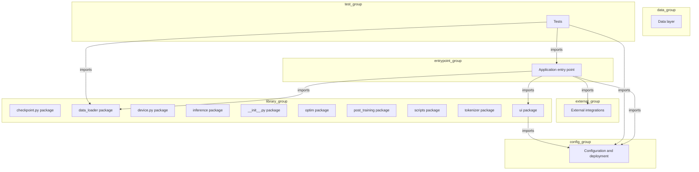

# Architecture report: FareedKhan-dev/train-llm-from-scratch

> Automated static analysis. **Observed** = directly seen in files/imports/AST; **Inferred** = interpretation from that evidence. Repository code was not executed.

## 1. Repository at a glance

| Item | Value |
| --- | --- |
| Repository | FareedKhan-dev/train-llm-from-scratch |
| Description | A straightforward method for training your LLM, from downloading data to generating text. |
| Language | Python |
| Stars | 13222 |
| Licence | MIT |
| Analysed commit / branch | bdd480a518094ca834e05ab32131dc126b522d3d / main |
| Framework(s) | None detected |
| Files analysed | 243 |
| Components | 15 |

## 2. Architecture in one minute

FareedKhan-dev/train-llm-from-scratch - A straightforward method for training your LLM, from downloading data to generating text.. This repository was analysed statically from 243 file(s) (126 Python). Detected technologies (observed from imports/manifests): GitHub Actions, NumPy, pandas, requests, Poetry, setuptools. Files are grouped into 15 component(s): checkpoint.py package, Configuration and deployment, Data layer, data_loader package, device.py package, Application entry point, External integrations, inference package. Observed entry point(s): data_loader/data_loader.py, images/make_diagrams.py, images/plot_artifacts.py. Findings below distinguish observed facts from inferred interpretation.

## 3. High-level block diagram

## 4. Main components

### checkpoint.py package (`checkpoint_py`)

- **Kind:** library
- **Status:** Observed
- **Confidence:** 0.85
- **Responsibility:** Groups 1 file(s) under checkpoint.py package (observed from repository paths and static analysis). Observed top-level functions: atomic_save, load_checkpoint, load_model_weights, model_config_from_checkpoint, model_state_from_checkpoint, strip_wrapper_prefixes.
- **Paths:** `src/checkpoint.py`
- **Evidence:** [src/checkpoint.py:30](https://github.com/FareedKhan-dev/train-llm-from-scratch/blob/bdd480a518094ca834e05ab32131dc126b522d3d/src/checkpoint.py#L30)

### Configuration and deployment (`config`)

- **Kind:** config
- **Status:** Observed
- **Confidence:** 0.85
- **Responsibility:** Groups 26 file(s) under configuration and deployment (observed from repository paths and static analysis). Observed top-level classes: BaseModelConfig, ConfigError, DPOConfig, GRPOConfig, PPOConfig, PretrainConfig. Observed top-level functions: _check, _cpu, _deep_merge, _resolve_base, apply_preset, coerce.
- **Paths:** `config/__init__.py`, `config/config.py`, `config/loader.py`, `config/paths.py`, `config/post_training_config.py`, `config/presets.py`, `configs/base.json`, `configs/dpo.json`, `configs/grpo.json`, `configs/ppo.json`, `configs/pretrain.json`, `configs/reward.json`, `configs/sft.json`, `configs/smoke/base.json`, `configs/smoke/dpo.json`, `configs/smoke/grpo.json`, `configs/smoke/ppo.json`, `configs/smoke/pretrain.json`, `configs/smoke/reward.json`, `configs/smoke/sft.json`, `images/mmdc.json`, `images/puppeteer.json`, `mkdocs.yml`, `pyproject.toml`, `requirements-post.txt`, `requirements.txt`
- **Evidence:** [config/__init__.py](https://github.com/FareedKhan-dev/train-llm-from-scratch/blob/bdd480a518094ca834e05ab32131dc126b522d3d/config/__init__.py); [config/config.py](https://github.com/FareedKhan-dev/train-llm-from-scratch/blob/bdd480a518094ca834e05ab32131dc126b522d3d/config/config.py); [config/loader.py:46](https://github.com/FareedKhan-dev/train-llm-from-scratch/blob/bdd480a518094ca834e05ab32131dc126b522d3d/config/loader.py#L46); [config/paths.py](https://github.com/FareedKhan-dev/train-llm-from-scratch/blob/bdd480a518094ca834e05ab32131dc126b522d3d/config/paths.py); [config/post_training_config.py:39](https://github.com/FareedKhan-dev/train-llm-from-scratch/blob/bdd480a518094ca834e05ab32131dc126b522d3d/config/post_training_config.py#L39); [config/presets.py:37](https://github.com/FareedKhan-dev/train-llm-from-scratch/blob/bdd480a518094ca834e05ab32131dc126b522d3d/config/presets.py#L37); [configs/base.json](https://github.com/FareedKhan-dev/train-llm-from-scratch/blob/bdd480a518094ca834e05ab32131dc126b522d3d/configs/base.json); [configs/dpo.json](https://github.com/FareedKhan-dev/train-llm-from-scratch/blob/bdd480a518094ca834e05ab32131dc126b522d3d/configs/dpo.json)

### Data layer (`data_layer`)

- **Kind:** data
- **Status:** Observed
- **Confidence:** 0.85
- **Responsibility:** Groups 13 file(s) under data layer (observed from repository paths and static analysis). Observed top-level classes: GroupedQueryAttention, KVCache, LoRALinear, MoE, ModernBlock, ModernConfig. Observed top-level functions: apply_lora, apply_rope, attention_mask, build_model, config_as_dict, count_parameters.
- **Paths:** `src/models/__init__.py`, `src/models/factory.py`, `src/models/lora.py`, `src/models/modern/__init__.py`, `src/models/modern/attention.py`, `src/models/modern/block.py`, `src/models/modern/config.py`, `src/models/modern/kv_cache.py`, `src/models/modern/mlp.py`, `src/models/modern/model.py`, `src/models/modern/moe.py`, `src/models/modern/norm.py`, `src/models/modern/rope.py`
- **Evidence:** [src/models/__init__.py](https://github.com/FareedKhan-dev/train-llm-from-scratch/blob/bdd480a518094ca834e05ab32131dc126b522d3d/src/models/__init__.py); [src/models/factory.py:33](https://github.com/FareedKhan-dev/train-llm-from-scratch/blob/bdd480a518094ca834e05ab32131dc126b522d3d/src/models/factory.py#L33); [src/models/lora.py:34](https://github.com/FareedKhan-dev/train-llm-from-scratch/blob/bdd480a518094ca834e05ab32131dc126b522d3d/src/models/lora.py#L34); [src/models/modern/__init__.py](https://github.com/FareedKhan-dev/train-llm-from-scratch/blob/bdd480a518094ca834e05ab32131dc126b522d3d/src/models/modern/__init__.py); [src/models/modern/attention.py:37](https://github.com/FareedKhan-dev/train-llm-from-scratch/blob/bdd480a518094ca834e05ab32131dc126b522d3d/src/models/modern/attention.py#L37); [src/models/modern/block.py:25](https://github.com/FareedKhan-dev/train-llm-from-scratch/blob/bdd480a518094ca834e05ab32131dc126b522d3d/src/models/modern/block.py#L25); [src/models/modern/config.py:30](https://github.com/FareedKhan-dev/train-llm-from-scratch/blob/bdd480a518094ca834e05ab32131dc126b522d3d/src/models/modern/config.py#L30); [src/models/modern/kv_cache.py:21](https://github.com/FareedKhan-dev/train-llm-from-scratch/blob/bdd480a518094ca834e05ab32131dc126b522d3d/src/models/modern/kv_cache.py#L21)

### data_loader package (`data_loader`)

- **Kind:** library
- **Status:** Observed
- **Confidence:** 0.85
- **Responsibility:** Groups 4 file(s) under data_loader package (observed from repository paths and static analysis). Observed top-level functions: _collate, _encode_response, _first_difference, encode_preference_pair, get_preference_iterator, get_prompt_iterator.
- **Paths:** `data_loader/__init__.py`, `data_loader/preference_dataset.py`, `data_loader/prompt_dataset.py`, `data_loader/sft_dataset.py`
- **Evidence:** [data_loader/__init__.py](https://github.com/FareedKhan-dev/train-llm-from-scratch/blob/bdd480a518094ca834e05ab32131dc126b522d3d/data_loader/__init__.py); [data_loader/preference_dataset.py:35](https://github.com/FareedKhan-dev/train-llm-from-scratch/blob/bdd480a518094ca834e05ab32131dc126b522d3d/data_loader/preference_dataset.py#L35); [data_loader/prompt_dataset.py:15](https://github.com/FareedKhan-dev/train-llm-from-scratch/blob/bdd480a518094ca834e05ab32131dc126b522d3d/data_loader/prompt_dataset.py#L15); [data_loader/sft_dataset.py:18](https://github.com/FareedKhan-dev/train-llm-from-scratch/blob/bdd480a518094ca834e05ab32131dc126b522d3d/data_loader/sft_dataset.py#L18)

### device.py package (`device_py`)

- **Kind:** library
- **Status:** Observed
- **Confidence:** 0.85
- **Responsibility:** Groups 1 file(s) under device.py package (observed from repository paths and static analysis). Observed top-level functions: _mps_available, _xla_available, autocast, configure_cpu_threads, describe_device, device_type.
- **Paths:** `src/device.py`
- **Evidence:** [src/device.py:24](https://github.com/FareedKhan-dev/train-llm-from-scratch/blob/bdd480a518094ca834e05ab32131dc126b522d3d/src/device.py#L24)

### Application entry point (`entrypoint`)

- **Kind:** entrypoint
- **Status:** Observed
- **Confidence:** 0.85
- **Responsibility:** Groups 28 file(s) under application entry point (observed from repository paths and static analysis). Observed top-level classes: Block, Head, MLP, MultiHeadAttention, Transformer. Observed top-level functions: _build_parser, _compute_losses, _logps, _pair_rewards, _split_hh, actor_logp_values.
- **Paths:** `data_loader/data_loader.py`, `images/make_diagrams.py`, `images/plot_artifacts.py`, `scripts/benchmark.py`, `scripts/chat.py`, `scripts/data_download.py`, `scripts/data_preprocess.py`, `scripts/eval_post_training.py`, `scripts/generate_text.py`, `scripts/model_report.py`, `scripts/prepare_preference_data.py`, `scripts/prepare_pretrain_data.py`, `scripts/prepare_rl_prompts.py`, `scripts/prepare_sft_data.py`, `scripts/prepare_tiny_data.py`, `scripts/pretrain_base.py`, `scripts/train_dpo.py`, `scripts/train_grpo.py`, `scripts/train_ppo.py`, `scripts/train_reward.py`, `scripts/train_sft.py`, `scripts/train_transformer.py`, `src/models/attention.py`, `src/models/mlp.py`, `src/models/transformer.py`, `src/models/transformer_block.py`, `src/post_training/cli.py`, `ui/app.py`
- **Evidence:** [data_loader/data_loader.py:8](https://github.com/FareedKhan-dev/train-llm-from-scratch/blob/bdd480a518094ca834e05ab32131dc126b522d3d/data_loader/data_loader.py#L8); [images/make_diagrams.py:152](https://github.com/FareedKhan-dev/train-llm-from-scratch/blob/bdd480a518094ca834e05ab32131dc126b522d3d/images/make_diagrams.py#L152); [images/plot_artifacts.py:26](https://github.com/FareedKhan-dev/train-llm-from-scratch/blob/bdd480a518094ca834e05ab32131dc126b522d3d/images/plot_artifacts.py#L26); [scripts/benchmark.py:32](https://github.com/FareedKhan-dev/train-llm-from-scratch/blob/bdd480a518094ca834e05ab32131dc126b522d3d/scripts/benchmark.py#L32); [scripts/chat.py:30](https://github.com/FareedKhan-dev/train-llm-from-scratch/blob/bdd480a518094ca834e05ab32131dc126b522d3d/scripts/chat.py#L30); [scripts/data_download.py:12](https://github.com/FareedKhan-dev/train-llm-from-scratch/blob/bdd480a518094ca834e05ab32131dc126b522d3d/scripts/data_download.py#L12); [scripts/data_preprocess.py:11](https://github.com/FareedKhan-dev/train-llm-from-scratch/blob/bdd480a518094ca834e05ab32131dc126b522d3d/scripts/data_preprocess.py#L11); [scripts/eval_post_training.py:36](https://github.com/FareedKhan-dev/train-llm-from-scratch/blob/bdd480a518094ca834e05ab32131dc126b522d3d/scripts/eval_post_training.py#L36)

### External integrations (`external_integrations`)

- **Kind:** external
- **Status:** Inferred
- **Confidence:** 0.70
- **Responsibility:** Groups 0 file(s) under external integrations (observed from repository paths and static analysis).
- **Evidence:** [scripts/data_download.py:4](https://github.com/FareedKhan-dev/train-llm-from-scratch/blob/bdd480a518094ca834e05ab32131dc126b522d3d/scripts/data_download.py#L4); [scripts/prepare_pretrain_data.py:27](https://github.com/FareedKhan-dev/train-llm-from-scratch/blob/bdd480a518094ca834e05ab32131dc126b522d3d/scripts/prepare_pretrain_data.py#L27); [scripts/prepare_tiny_data.py:40](https://github.com/FareedKhan-dev/train-llm-from-scratch/blob/bdd480a518094ca834e05ab32131dc126b522d3d/scripts/prepare_tiny_data.py#L40)

### inference package (`inference`)

- **Kind:** library
- **Status:** Observed
- **Confidence:** 0.85
- **Responsibility:** Groups 4 file(s) under inference package (observed from repository paths and static analysis). Observed top-level classes: Int8Linear, SpeculativeStats. Observed top-level functions: _logits, _probs, filter_logits, model_size_bytes, quantize_int8, sample_next_token.
- **Paths:** `src/inference/__init__.py`, `src/inference/quantize.py`, `src/inference/sampling.py`, `src/inference/speculative.py`
- **Evidence:** [src/inference/__init__.py](https://github.com/FareedKhan-dev/train-llm-from-scratch/blob/bdd480a518094ca834e05ab32131dc126b522d3d/src/inference/__init__.py); [src/inference/quantize.py:32](https://github.com/FareedKhan-dev/train-llm-from-scratch/blob/bdd480a518094ca834e05ab32131dc126b522d3d/src/inference/quantize.py#L32); [src/inference/sampling.py:25](https://github.com/FareedKhan-dev/train-llm-from-scratch/blob/bdd480a518094ca834e05ab32131dc126b522d3d/src/inference/sampling.py#L25); [src/inference/speculative.py:37](https://github.com/FareedKhan-dev/train-llm-from-scratch/blob/bdd480a518094ca834e05ab32131dc126b522d3d/src/inference/speculative.py#L37)

### __init__.py package (`init_py`)

- **Kind:** library
- **Status:** Observed
- **Confidence:** 0.85
- **Responsibility:** Groups 1 file(s) under __init__.py package (observed from repository paths and static analysis).
- **Paths:** `src/__init__.py`
- **Evidence:** [src/__init__.py](https://github.com/FareedKhan-dev/train-llm-from-scratch/blob/bdd480a518094ca834e05ab32131dc126b522d3d/src/__init__.py)

### optim package (`optim`)

- **Kind:** library
- **Status:** Observed
- **Confidence:** 0.85
- **Responsibility:** Groups 3 file(s) under optim package (observed from repository paths and static analysis). Observed top-level classes: Muon. Observed top-level functions: _warmup, adamw_param_groups, adjusted_lr, build_optimizer, cosine_lr, linear_lr.
- **Paths:** `src/optim/__init__.py`, `src/optim/muon.py`, `src/optim/schedules.py`
- **Evidence:** [src/optim/__init__.py:12](https://github.com/FareedKhan-dev/train-llm-from-scratch/blob/bdd480a518094ca834e05ab32131dc126b522d3d/src/optim/__init__.py#L12); [src/optim/muon.py:41](https://github.com/FareedKhan-dev/train-llm-from-scratch/blob/bdd480a518094ca834e05ab32131dc126b522d3d/src/optim/muon.py#L41); [src/optim/schedules.py:26](https://github.com/FareedKhan-dev/train-llm-from-scratch/blob/bdd480a518094ca834e05ab32131dc126b522d3d/src/optim/schedules.py#L26)

### post_training package (`post_training`)

- **Kind:** library
- **Status:** Observed
- **Confidence:** 0.85
- **Responsibility:** Groups 19 file(s) under post_training package (observed from repository paths and static analysis). Observed top-level classes: DDPContext, MetricsLogger, RewardModel, RolloutBatch, TransformerWithValueHead. Observed top-level functions: _answers_match, _cap_of, _cfg_get, _cfg_to_dict, _encode_ordinary, _header_for.
- **Paths:** `src/post_training/__init__.py`, `src/post_training/chat_template.py`, `src/post_training/distributed.py`, `src/post_training/dpo.py`, `src/post_training/evaluation.py`, `src/post_training/grpo.py`, `src/post_training/inference.py`, `src/post_training/logging_utils.py`, `src/post_training/optim.py`, `src/post_training/ppo.py`, `src/post_training/reward_model.py`, `src/post_training/reward_train.py`, `src/post_training/rewards/__init__.py`, `src/post_training/rewards/parsing.py`, `src/post_training/rewards/verifiers.py`, `src/post_training/rollout.py`, `src/post_training/sft.py`, `src/post_training/utils.py`, `src/post_training/value_head.py`
- **Evidence:** [src/post_training/__init__.py](https://github.com/FareedKhan-dev/train-llm-from-scratch/blob/bdd480a518094ca834e05ab32131dc126b522d3d/src/post_training/__init__.py); [src/post_training/chat_template.py:53](https://github.com/FareedKhan-dev/train-llm-from-scratch/blob/bdd480a518094ca834e05ab32131dc126b522d3d/src/post_training/chat_template.py#L53); [src/post_training/distributed.py:24](https://github.com/FareedKhan-dev/train-llm-from-scratch/blob/bdd480a518094ca834e05ab32131dc126b522d3d/src/post_training/distributed.py#L24); [src/post_training/dpo.py:35](https://github.com/FareedKhan-dev/train-llm-from-scratch/blob/bdd480a518094ca834e05ab32131dc126b522d3d/src/post_training/dpo.py#L35); [src/post_training/evaluation.py:18](https://github.com/FareedKhan-dev/train-llm-from-scratch/blob/bdd480a518094ca834e05ab32131dc126b522d3d/src/post_training/evaluation.py#L18); [src/post_training/grpo.py:47](https://github.com/FareedKhan-dev/train-llm-from-scratch/blob/bdd480a518094ca834e05ab32131dc126b522d3d/src/post_training/grpo.py#L47); [src/post_training/inference.py:25](https://github.com/FareedKhan-dev/train-llm-from-scratch/blob/bdd480a518094ca834e05ab32131dc126b522d3d/src/post_training/inference.py#L25); [src/post_training/logging_utils.py:18](https://github.com/FareedKhan-dev/train-llm-from-scratch/blob/bdd480a518094ca834e05ab32131dc126b522d3d/src/post_training/logging_utils.py#L18)

### scripts package (`scripts`)

- **Kind:** library
- **Status:** Observed
- **Confidence:** 0.85
- **Responsibility:** Groups 2 file(s) under scripts package (observed from repository paths and static analysis).
- **Paths:** `scripts/render_diagrams.sh`, `scripts/run_posttraining.sh`
- **Evidence:** [scripts/render_diagrams.sh](https://github.com/FareedKhan-dev/train-llm-from-scratch/blob/bdd480a518094ca834e05ab32131dc126b522d3d/scripts/render_diagrams.sh); [scripts/run_posttraining.sh](https://github.com/FareedKhan-dev/train-llm-from-scratch/blob/bdd480a518094ca834e05ab32131dc126b522d3d/scripts/run_posttraining.sh)

### Tests (`tests`)

- **Kind:** test
- **Status:** Observed
- **Confidence:** 0.85
- **Responsibility:** Groups 27 file(s) under tests (observed from repository paths and static analysis). Observed top-level functions: _classic, _greedy, _json, _kept, _model, _modern.
- **Paths:** `tests/_typecheck.py`, `tests/conftest.py`, `tests/gpu_verify.sh`, `tests/grpo_live.py`, `tests/test_checkpoint_io.py`, `tests/test_checkpoint_resume.py`, `tests/test_classic_model.py`, `tests/test_config.py`, `tests/test_ddp_moe.py`, `tests/test_device.py`, `tests/test_factory.py`, `tests/test_inference.py`, `tests/test_lora.py`, `tests/test_model_report.py`, `tests/test_modern_model.py`, `tests/test_optim.py`, `tests/test_pipeline_e2e.py`, `tests/test_post_training_losses.py`, `tests/test_post_training_smoke.py`, `tests/test_preference_truncation.py`, `tests/test_rl_math.py`, `tests/test_sampling.py`, `tests/test_student_track.py`, `tests/test_tokenizer.py`, `tests/test_type_checks.py`, `tests/verify_data_and_eval.py`, `tests/verify_rl_optimizes.py`
- **Evidence:** [tests/_typecheck.py](https://github.com/FareedKhan-dev/train-llm-from-scratch/blob/bdd480a518094ca834e05ab32131dc126b522d3d/tests/_typecheck.py); [tests/conftest.py](https://github.com/FareedKhan-dev/train-llm-from-scratch/blob/bdd480a518094ca834e05ab32131dc126b522d3d/tests/conftest.py); [tests/gpu_verify.sh](https://github.com/FareedKhan-dev/train-llm-from-scratch/blob/bdd480a518094ca834e05ab32131dc126b522d3d/tests/gpu_verify.sh); [tests/grpo_live.py](https://github.com/FareedKhan-dev/train-llm-from-scratch/blob/bdd480a518094ca834e05ab32131dc126b522d3d/tests/grpo_live.py); [tests/test_checkpoint_io.py:32](https://github.com/FareedKhan-dev/train-llm-from-scratch/blob/bdd480a518094ca834e05ab32131dc126b522d3d/tests/test_checkpoint_io.py#L32); [tests/test_checkpoint_resume.py:27](https://github.com/FareedKhan-dev/train-llm-from-scratch/blob/bdd480a518094ca834e05ab32131dc126b522d3d/tests/test_checkpoint_resume.py#L27); [tests/test_classic_model.py:10](https://github.com/FareedKhan-dev/train-llm-from-scratch/blob/bdd480a518094ca834e05ab32131dc126b522d3d/tests/test_classic_model.py#L10); [tests/test_config.py:33](https://github.com/FareedKhan-dev/train-llm-from-scratch/blob/bdd480a518094ca834e05ab32131dc126b522d3d/tests/test_config.py#L33)

### tokenizer package (`tokenizer`)

- **Kind:** library
- **Status:** Observed
- **Confidence:** 0.85
- **Responsibility:** Groups 2 file(s) under tokenizer package (observed from repository paths and static analysis). Observed top-level classes: BPETokenizer, Tokenizer. Observed top-level functions: _merge, _tiktoken, safe_decode, tokenizer_from_spec, tokenizer_spec.
- **Paths:** `src/tokenizer/__init__.py`, `src/tokenizer/bpe.py`
- **Evidence:** [src/tokenizer/__init__.py:25](https://github.com/FareedKhan-dev/train-llm-from-scratch/blob/bdd480a518094ca834e05ab32131dc126b522d3d/src/tokenizer/__init__.py#L25); [src/tokenizer/bpe.py:47](https://github.com/FareedKhan-dev/train-llm-from-scratch/blob/bdd480a518094ca834e05ab32131dc126b522d3d/src/tokenizer/bpe.py#L47)

### ui package (`ui`)

- **Kind:** library
- **Status:** Observed
- **Confidence:** 0.85
- **Responsibility:** Groups 17 file(s) under ui package (observed from repository paths and static analysis). Observed top-level classes: Stage. Observed top-level functions: _alive, _alive_windows, _clean_markdown, _coerce_blank, _ensure_job_dir, _load.
- **Paths:** `ui/__init__.py`, `ui/config_forms.py`, `ui/docs_render.py`, `ui/jobs.py`, `ui/metrics.py`, `ui/pages/1_Data.py`, `ui/pages/2_Pretrain.py`, `ui/pages/3_SFT.py`, `ui/pages/4_Reward_Model.py`, `ui/pages/5_DPO.py`, `ui/pages/6_PPO.py`, `ui/pages/7_GRPO.py`, `ui/pages/8_Evaluate.py`, `ui/pages/9_Chat.py`, `ui/stage_page.py`, `ui/stages.py`, `ui/theme.py`
- **Evidence:** [ui/__init__.py](https://github.com/FareedKhan-dev/train-llm-from-scratch/blob/bdd480a518094ca834e05ab32131dc126b522d3d/ui/__init__.py); [ui/config_forms.py:25](https://github.com/FareedKhan-dev/train-llm-from-scratch/blob/bdd480a518094ca834e05ab32131dc126b522d3d/ui/config_forms.py#L25); [ui/docs_render.py:19](https://github.com/FareedKhan-dev/train-llm-from-scratch/blob/bdd480a518094ca834e05ab32131dc126b522d3d/ui/docs_render.py#L19); [ui/jobs.py:25](https://github.com/FareedKhan-dev/train-llm-from-scratch/blob/bdd480a518094ca834e05ab32131dc126b522d3d/ui/jobs.py#L25); [ui/metrics.py:12](https://github.com/FareedKhan-dev/train-llm-from-scratch/blob/bdd480a518094ca834e05ab32131dc126b522d3d/ui/metrics.py#L12); [ui/pages/1_Data.py](https://github.com/FareedKhan-dev/train-llm-from-scratch/blob/bdd480a518094ca834e05ab32131dc126b522d3d/ui/pages/1_Data.py); [ui/pages/2_Pretrain.py](https://github.com/FareedKhan-dev/train-llm-from-scratch/blob/bdd480a518094ca834e05ab32131dc126b522d3d/ui/pages/2_Pretrain.py); [ui/pages/3_SFT.py](https://github.com/FareedKhan-dev/train-llm-from-scratch/blob/bdd480a518094ca834e05ab32131dc126b522d3d/ui/pages/3_SFT.py)

## 5. Execution flow

**Observed** entry point(s):

- [data_loader/data_loader.py:66](https://github.com/FareedKhan-dev/train-llm-from-scratch/blob/bdd480a518094ca834e05ab32131dc126b522d3d/data_loader/data_loader.py#L66)
- [images/make_diagrams.py:160](https://github.com/FareedKhan-dev/train-llm-from-scratch/blob/bdd480a518094ca834e05ab32131dc126b522d3d/images/make_diagrams.py#L160)
- [images/plot_artifacts.py:70](https://github.com/FareedKhan-dev/train-llm-from-scratch/blob/bdd480a518094ca834e05ab32131dc126b522d3d/images/plot_artifacts.py#L70)
- [scripts/benchmark.py:105](https://github.com/FareedKhan-dev/train-llm-from-scratch/blob/bdd480a518094ca834e05ab32131dc126b522d3d/scripts/benchmark.py#L105)
- [scripts/chat.py:74](https://github.com/FareedKhan-dev/train-llm-from-scratch/blob/bdd480a518094ca834e05ab32131dc126b522d3d/scripts/chat.py#L74)
- [scripts/data_download.py:79](https://github.com/FareedKhan-dev/train-llm-from-scratch/blob/bdd480a518094ca834e05ab32131dc126b522d3d/scripts/data_download.py#L79)
- [scripts/data_preprocess.py:116](https://github.com/FareedKhan-dev/train-llm-from-scratch/blob/bdd480a518094ca834e05ab32131dc126b522d3d/scripts/data_preprocess.py#L116)
- [scripts/eval_post_training.py:77](https://github.com/FareedKhan-dev/train-llm-from-scratch/blob/bdd480a518094ca834e05ab32131dc126b522d3d/scripts/eval_post_training.py#L77)
- [src/models/attention.py:104](https://github.com/FareedKhan-dev/train-llm-from-scratch/blob/bdd480a518094ca834e05ab32131dc126b522d3d/src/models/attention.py#L104)
- [src/models/mlp.py:69](https://github.com/FareedKhan-dev/train-llm-from-scratch/blob/bdd480a518094ca834e05ab32131dc126b522d3d/src/models/mlp.py#L69)
- [src/models/transformer.py:180](https://github.com/FareedKhan-dev/train-llm-from-scratch/blob/bdd480a518094ca834e05ab32131dc126b522d3d/src/models/transformer.py#L180)
- [src/models/transformer_block.py:63](https://github.com/FareedKhan-dev/train-llm-from-scratch/blob/bdd480a518094ca834e05ab32131dc126b522d3d/src/models/transformer_block.py#L63)

Representative flow (derived from observed entry points and the import graph; steps beyond the entry point are **Inferred**):

1. Execution starts at an observed entry point listed above, if present.
2. `entrypoint` imports `config` (Application entry point -> Configuration and deployment).
3. `entrypoint` imports `data_loader` (Application entry point -> data_loader package).
4. `entrypoint` imports `external_integrations` (Application entry point -> External integrations).
5. `entrypoint` imports `ui` (Application entry point -> ui package).
6. `tests` imports `config` (Tests -> Configuration and deployment).
7. `tests` imports `data_loader` (Tests -> data_loader package).
8. `tests` imports `entrypoint` (Tests -> Application entry point).
9. `ui` imports `config` (ui package -> Configuration and deployment).

## 6. Project structure

### `(root)`

- `.gitattributes` - other (247 bytes)
- `.gitignore` - other (530 bytes)
- `.pre-commit-config.yaml` - config (605 bytes)
- `CHANGELOG.md` - docs (5119 bytes)
- `CONTRIBUTING.md` - docs (2775 bytes)
- `LICENSE` - docs (1068 bytes)
- `POST_TRAINING.md` - docs (10832 bytes)
- `README.md` - docs (48087 bytes)
- `mkdocs.yml` - config (3739 bytes)
- `pyproject.toml` - manifest (3700 bytes)
- `requirements-post.txt` - manifest (742 bytes)
- `requirements.txt` - manifest (321 bytes)
- `sft_rlhf_guide.ipynb` - other (152690 bytes)

### `.github`

- `.github/ISSUE_TEMPLATE/bug_report.yml` - config (868 bytes)
- `.github/ISSUE_TEMPLATE/config.yml` - config (190 bytes)
- `.github/ISSUE_TEMPLATE/feature_request.yml` - config (535 bytes)
- `.github/pull_request_template.md` - docs (384 bytes)
- `.github/workflows/ci.yml` - ci, YAML (2780 bytes)
- `.github/workflows/docs.yml` - ci, YAML (1380 bytes)

### `.streamlit`

- `.streamlit/config.toml` - config (219 bytes)

### `config`

- `config/__init__.py` - source, Python (166 bytes)
- `config/config.py` - source, Python (3557 bytes)
- `config/loader.py` - source, Python (8070 bytes)
- `config/paths.py` - source, Python (617 bytes)
- `config/post_training_config.py` - source, Python (11437 bytes)
- `config/presets.py` - source, Python (4543 bytes)
- `config/py.typed` - other (0 bytes)

### `configs`

- `configs/base.json` - config (574 bytes)
- `configs/dpo.json` - config (433 bytes)
- `configs/grpo.json` - config (625 bytes)
- `configs/ppo.json` - config (587 bytes)
- `configs/pretrain.json` - config (399 bytes)
- `configs/reward.json` - config (329 bytes)
- `configs/sft.json` - config (439 bytes)
- `configs/smoke/base.json` - config (219 bytes)
- `configs/smoke/dpo.json` - config (196 bytes)
- `configs/smoke/grpo.json` - config (253 bytes)
- `configs/smoke/ppo.json` - config (273 bytes)
- `configs/smoke/pretrain.json` - config (250 bytes)
- `configs/smoke/reward.json` - config (199 bytes)
- `configs/smoke/sft.json` - config (201 bytes)

### `data_loader`

- `data_loader/__init__.py` - source, Python (88 bytes)
- `data_loader/data_loader.py` - source, Python (3271 bytes)
- `data_loader/preference_dataset.py` - source, Python (5972 bytes)
- `data_loader/prompt_dataset.py` - source, Python (1089 bytes)
- `data_loader/py.typed` - other (0 bytes)
- `data_loader/sft_dataset.py` - source, Python (1775 bytes)

### `docs`

- `docs/01_data_pipeline.md` - docs (7901 bytes)
- `docs/02_pretraining.md` - docs (5760 bytes)
- `docs/03_sft.md` - docs (4669 bytes)
- `docs/04_reward_model.md` - docs (4966 bytes)
- `docs/05_dpo.md` - docs (5372 bytes)
- `docs/06_ppo.md` - docs (5670 bytes)
- `docs/07_grpo.md` - docs (5076 bytes)
- `docs/08_evaluation.md` - docs (4702 bytes)
- `docs/09_inference.md` - docs (4797 bytes)
- `docs/README.md` - docs (6455 bytes)
- `docs/diagrams/README.md` - docs (2313 bytes)
- `docs/diagrams/make_plots.py` - docs (12680 bytes)
- `docs/diagrams/src/00_overview.mmd` - docs (1119 bytes)
- `docs/diagrams/src/01_data_pipeline.mmd` - docs (1467 bytes)
- `docs/diagrams/src/02_pretraining.mmd` - docs (915 bytes)
- `docs/diagrams/src/03_sft.mmd` - docs (881 bytes)
- `docs/diagrams/src/04_reward_model.mmd` - docs (896 bytes)
- `docs/diagrams/src/05_dpo.mmd` - docs (870 bytes)
- `docs/diagrams/src/06_ppo.mmd` - docs (956 bytes)
- `docs/diagrams/src/07_grpo.mmd` - docs (926 bytes)
- `docs/diagrams/src/08_evaluation.mmd` - docs (773 bytes)
- `docs/diagrams/src/09_inference.mmd` - docs (795 bytes)
- `docs/diagrams/src/16_modern_block.mmd` - docs (1108 bytes)
- `docs/diagrams/src/17_gqa.mmd` - docs (1194 bytes)
- `docs/diagrams/src/18_kv_cache.mmd` - docs (808 bytes)
- `docs/diagrams/src/19_moe.mmd` - docs (1091 bytes)
- `docs/diagrams/src/20_grpo_variants.mmd` - docs (1248 bytes)
- `docs/diagrams/src/21_student_track.mmd` - docs (951 bytes)
- `docs/diagrams/src/22_lora.mmd` - docs (887 bytes)
- `docs/diagrams/src/23_speculative.mmd` - docs (1016 bytes)
- `docs/diagrams/src/24_bpe.mmd` - docs (1076 bytes)
- `docs/diagrams/src/25_typed_config.mmd` - docs (996 bytes)
- `docs/diagrams/src/README.mmd` - docs (1092 bytes)
- `docs/foundations/README.md` - docs (5376 bytes)
- `docs/foundations/attention.md` - docs (4536 bytes)
- `docs/foundations/bpe.md` - docs (7724 bytes)
- `docs/foundations/generation.md` - docs (4149 bytes)
- `docs/foundations/objectives.md` - docs (6231 bytes)
- `docs/foundations/optimization.md` - docs (5690 bytes)
- `docs/foundations/scaling.md` - docs (6476 bytes)
- `docs/foundations/tokenization.md` - docs (5180 bytes)
- `docs/foundations/transformer.md` - docs (5731 bytes)
- `docs/howto/commands.md` - docs (236 bytes)
- `docs/howto/configs.md` - docs (2340 bytes)
- `docs/howto/hardware.md` - docs (5342 bytes)
- `docs/howto/train.md` - docs (2667 bytes)
- `docs/howto/type_safety.md` - docs (6213 bytes)
- `docs/howto/ui.md` - docs (1953 bytes)
- `docs/javascripts/mathjax.js` - docs (241 bytes)
- `docs/modern/README.md` - docs (7464 bytes)
- `docs/modern/attention.md` - docs (7212 bytes)
- `docs/modern/blocks.md` - docs (4411 bytes)
- `docs/modern/inference.md` - docs (11227 bytes)
- `docs/modern/lora.md` - docs (3905 bytes)
- `docs/modern/moe.md` - docs (4315 bytes)
- `docs/modern/optimizers.md` - docs (4966 bytes)
- `docs/modern/preference.md` - docs (4716 bytes)
- `docs/modern/rl_reasoning.md` - docs (4917 bytes)
- `docs/modern/rope.md` - docs (4656 bytes)
- `docs/student/README.md` - docs (8418 bytes)

### `images`

- `images/00_pipeline.mmd` - other (1139 bytes)
- `images/01_data.mmd` - other (1309 bytes)
- `images/02_tokenization.mmd` - other (1101 bytes)
- `images/03_mlp.mmd` - other (983 bytes)
- `images/04_attention_head.mmd` - other (1089 bytes)
- `images/05_multi_head_attention.mmd` - other (1059 bytes)
- `images/06_transformer_block.mmd` - other (1000 bytes)
- `images/07_transformer.mmd` - other (1176 bytes)
- `images/08_training_loop.mmd` - other (1117 bytes)
- `images/09_sft.mmd` - other (1086 bytes)
- `images/10_reward_model.mmd` - other (1088 bytes)
- `images/11_dpo.mmd` - other (1031 bytes)
- `images/12_ppo.mmd` - other (1095 bytes)
- `images/13_grpo.mmd` - other (1056 bytes)
- `images/14_evaluation.mmd` - other (991 bytes)
- `images/15_inference.mmd` - other (1067 bytes)
- `images/make_diagrams.py` - source, Python (7315 bytes)
- `images/mmdc.json` - config (453 bytes)
- `images/plot_artifacts.py` - source, Python (3291 bytes)
- `images/puppeteer.json` - config (57 bytes)

### `scripts`

- `scripts/benchmark.py` - source, Python (4458 bytes)
- `scripts/chat.py` - source, Python (3125 bytes)
- `scripts/data_download.py` - source, Python (4201 bytes)
- `scripts/data_preprocess.py` - source, Python (5954 bytes)
- `scripts/eval_post_training.py` - source, Python (3000 bytes)
- `scripts/generate_text.py` - source, Python (8077 bytes)
- `scripts/model_report.py` - source, Python (6796 bytes)
- `scripts/prepare_preference_data.py` - source, Python (3834 bytes)
- `scripts/prepare_pretrain_data.py` - source, Python (4763 bytes)
- `scripts/prepare_rl_prompts.py` - source, Python (2684 bytes)
- `scripts/prepare_sft_data.py` - source, Python (5236 bytes)
- `scripts/prepare_tiny_data.py` - source, Python (8770 bytes)
- `scripts/pretrain_base.py` - source, Python (6998 bytes)
- `scripts/render_diagrams.sh` - source, Shell (1379 bytes)
- `scripts/run_posttraining.sh` - source, Shell (1941 bytes)
- `scripts/train_dpo.py` - source, Python (7152 bytes)
- `scripts/train_grpo.py` - source, Python (8650 bytes)
- `scripts/train_ppo.py` - source, Python (8973 bytes)
- `scripts/train_reward.py` - source, Python (5882 bytes)
- `scripts/train_sft.py` - source, Python (6989 bytes)
- `scripts/train_transformer.py` - source, Python (32052 bytes)

### `src`

- `src/__init__.py` - source, Python (0 bytes)
- `src/checkpoint.py` - source, Python (5727 bytes)
- `src/device.py` - source, Python (4685 bytes)
- `src/inference/__init__.py` - source, Python (200 bytes)
- `src/inference/quantize.py` - source, Python (3032 bytes)
- `src/inference/sampling.py` - source, Python (2841 bytes)
- `src/inference/speculative.py` - source, Python (6032 bytes)
- `src/models/__init__.py` - source, Python (205 bytes)
- `src/models/attention.py` - source, Python (4840 bytes)
- `src/models/factory.py` - source, Python (2158 bytes)
- `src/models/lora.py` - source, Python (4802 bytes)
- `src/models/mlp.py` - source, Python (2490 bytes)
- `src/models/modern/__init__.py` - source, Python (866 bytes)
- `src/models/modern/attention.py` - source, Python (8443 bytes)
- `src/models/modern/block.py` - source, Python (1728 bytes)
- `src/models/modern/config.py` - source, Python (4970 bytes)
- `src/models/modern/kv_cache.py` - source, Python (2589 bytes)
- `src/models/modern/mlp.py` - source, Python (1131 bytes)
- `src/models/modern/model.py` - source, Python (9482 bytes)
- `src/models/modern/moe.py` - source, Python (3156 bytes)
- `src/models/modern/norm.py` - source, Python (1011 bytes)
- `src/models/modern/rope.py` - source, Python (1989 bytes)
- `src/models/transformer.py` - source, Python (8635 bytes)
- `src/models/transformer_block.py` - source, Python (2611 bytes)
- `src/optim/__init__.py` - source, Python (1621 bytes)
- `src/optim/muon.py` - source, Python (7077 bytes)
- `src/optim/schedules.py` - source, Python (3398 bytes)
- `src/post_training/__init__.py` - source, Python (982 bytes)
- `src/post_training/chat_template.py` - source, Python (5653 bytes)
- `src/post_training/cli.py` - source, Python (4034 bytes)
- `src/post_training/distributed.py` - source, Python (4299 bytes)
- `src/post_training/dpo.py` - source, Python (7557 bytes)
- `src/post_training/evaluation.py` - source, Python (4092 bytes)
- `src/post_training/grpo.py` - source, Python (7670 bytes)
- `src/post_training/inference.py` - source, Python (3088 bytes)
- `src/post_training/logging_utils.py` - source, Python (2007 bytes)
- `src/post_training/optim.py` - source, Python (1119 bytes)
- `src/post_training/ppo.py` - source, Python (3853 bytes)
- `src/post_training/reward_model.py` - source, Python (2480 bytes)
- `src/post_training/reward_train.py` - source, Python (1221 bytes)
- `src/post_training/rewards/__init__.py` - source, Python (540 bytes)
- `src/post_training/rewards/parsing.py` - source, Python (2592 bytes)
- `src/post_training/rewards/verifiers.py` - source, Python (1817 bytes)
- `src/post_training/rollout.py` - source, Python (11965 bytes)
- `src/post_training/sft.py` - source, Python (2299 bytes)
- `src/post_training/utils.py` - source, Python (6727 bytes)
- `src/post_training/value_head.py` - source, Python (2161 bytes)
- `src/py.typed` - other (0 bytes)
- `src/tokenizer/__init__.py` - source, Python (2868 bytes)
- `src/tokenizer/bpe.py` - source, Python (10670 bytes)

### `tests`

- `tests/_typecheck.py` - test, Python (402 bytes)
- `tests/conftest.py` - test, Python (1288 bytes)
- `tests/gpu_verify.sh` - test, Shell (3257 bytes)
- `tests/grpo_live.py` - test, Python (1744 bytes)
- `tests/test_checkpoint_io.py` - test, Python (6721 bytes)
- `tests/test_checkpoint_resume.py` - test, Python (3179 bytes)
- `tests/test_classic_model.py` - test, Python (2535 bytes)
- `tests/test_config.py` - test, Python (4284 bytes)
- `tests/test_ddp_moe.py` - test, Python (1494 bytes)
- `tests/test_device.py` - test, Python (1098 bytes)
- `tests/test_factory.py` - test, Python (2093 bytes)
- `tests/test_inference.py` - test, Python (4779 bytes)
- `tests/test_lora.py` - test, Python (2568 bytes)
- `tests/test_model_report.py` - test, Python (1395 bytes)
- `tests/test_modern_model.py` - test, Python (11949 bytes)
- `tests/test_optim.py` - test, Python (4792 bytes)
- `tests/test_pipeline_e2e.py` - test, Python (5656 bytes)
- `tests/test_post_training_losses.py` - test, Python (6130 bytes)
- `tests/test_post_training_smoke.py` - test, Python (8070 bytes)
- `tests/test_preference_truncation.py` - test, Python (4347 bytes)
- `tests/test_rl_math.py` - test, Python (3305 bytes)
- `tests/test_sampling.py` - test, Python (1405 bytes)
- `tests/test_student_track.py` - test, Python (4275 bytes)
- `tests/test_tokenizer.py` - test, Python (3691 bytes)
- `tests/test_type_checks.py` - test, Python (827 bytes)
- `tests/verify_data_and_eval.py` - test, Python (6902 bytes)
- `tests/verify_rl_optimizes.py` - test, Python (4699 bytes)

### `ui`

- `ui/__init__.py` - source, Python (65 bytes)
- `ui/app.py` - source, Python (2283 bytes)
- `ui/config_forms.py` - source, Python (3098 bytes)
- `ui/docs_render.py` - source, Python (1514 bytes)
- `ui/jobs.py` - source, Python (6150 bytes)
- `ui/metrics.py` - source, Python (907 bytes)
- `ui/pages/1_Data.py` - source, Python (2226 bytes)
- `ui/pages/2_Pretrain.py` - source, Python (104 bytes)
- `ui/pages/3_SFT.py` - source, Python (94 bytes)
- `ui/pages/4_Reward_Model.py` - source, Python (106 bytes)
- `ui/pages/5_DPO.py` - source, Python (94 bytes)
- `ui/pages/6_PPO.py` - source, Python (94 bytes)
- `ui/pages/7_GRPO.py` - source, Python (96 bytes)
- `ui/pages/8_Evaluate.py` - source, Python (1790 bytes)
- `ui/pages/9_Chat.py` - source, Python (2553 bytes)
- `ui/stage_page.py` - source, Python (3539 bytes)
- `ui/stages.py` - source, Python (3803 bytes)
- `ui/theme.py` - source, Python (2595 bytes)

## 7. Key dependencies and integrations

| Name | Category | Status | Confidence | Evidence |
| --- | --- | --- | --- | --- |
| GitHub Actions | ci | Observed | 0.90 | [.github/workflows/ci.yml](https://github.com/FareedKhan-dev/train-llm-from-scratch/blob/bdd480a518094ca834e05ab32131dc126b522d3d/.github/workflows/ci.yml); [.github/workflows/docs.yml](https://github.com/FareedKhan-dev/train-llm-from-scratch/blob/bdd480a518094ca834e05ab32131dc126b522d3d/.github/workflows/docs.yml) |
| NumPy | library | Observed | 0.95 | [data_loader/data_loader.py:4](https://github.com/FareedKhan-dev/train-llm-from-scratch/blob/bdd480a518094ca834e05ab32131dc126b522d3d/data_loader/data_loader.py#L4); [data_loader/preference_dataset.py:27](https://github.com/FareedKhan-dev/train-llm-from-scratch/blob/bdd480a518094ca834e05ab32131dc126b522d3d/data_loader/preference_dataset.py#L27); [data_loader/prompt_dataset.py:12](https://github.com/FareedKhan-dev/train-llm-from-scratch/blob/bdd480a518094ca834e05ab32131dc126b522d3d/data_loader/prompt_dataset.py#L12); [data_loader/sft_dataset.py:14](https://github.com/FareedKhan-dev/train-llm-from-scratch/blob/bdd480a518094ca834e05ab32131dc126b522d3d/data_loader/sft_dataset.py#L14) |
| pandas | library | Observed | 0.90 | [pyproject.toml:31](https://github.com/FareedKhan-dev/train-llm-from-scratch/blob/bdd480a518094ca834e05ab32131dc126b522d3d/pyproject.toml#L31); [ui/metrics.py:18](https://github.com/FareedKhan-dev/train-llm-from-scratch/blob/bdd480a518094ca834e05ab32131dc126b522d3d/ui/metrics.py#L18) |
| requests | library | Observed | 0.95 | [pyproject.toml:22](https://github.com/FareedKhan-dev/train-llm-from-scratch/blob/bdd480a518094ca834e05ab32131dc126b522d3d/pyproject.toml#L22); [requirements.txt:9](https://github.com/FareedKhan-dev/train-llm-from-scratch/blob/bdd480a518094ca834e05ab32131dc126b522d3d/requirements.txt#L9); [scripts/data_download.py:4](https://github.com/FareedKhan-dev/train-llm-from-scratch/blob/bdd480a518094ca834e05ab32131dc126b522d3d/scripts/data_download.py#L4); [scripts/prepare_pretrain_data.py:27](https://github.com/FareedKhan-dev/train-llm-from-scratch/blob/bdd480a518094ca834e05ab32131dc126b522d3d/scripts/prepare_pretrain_data.py#L27) |
| Poetry | packaging | Observed | 0.85 | [pyproject.toml](https://github.com/FareedKhan-dev/train-llm-from-scratch/blob/bdd480a518094ca834e05ab32131dc126b522d3d/pyproject.toml) |
| setuptools | packaging | Observed | 0.85 | [pyproject.toml:2](https://github.com/FareedKhan-dev/train-llm-from-scratch/blob/bdd480a518094ca834e05ab32131dc126b522d3d/pyproject.toml#L2) |
| pytest | tooling | Observed | 0.95 | [.github/workflows/ci.yml:69](https://github.com/FareedKhan-dev/train-llm-from-scratch/blob/bdd480a518094ca834e05ab32131dc126b522d3d/.github/workflows/ci.yml#L69); [tests/test_checkpoint_io.py:14](https://github.com/FareedKhan-dev/train-llm-from-scratch/blob/bdd480a518094ca834e05ab32131dc126b522d3d/tests/test_checkpoint_io.py#L14); [tests/test_config.py:10](https://github.com/FareedKhan-dev/train-llm-from-scratch/blob/bdd480a518094ca834e05ab32131dc126b522d3d/tests/test_config.py#L10); [tests/test_ddp_moe.py:7](https://github.com/FareedKhan-dev/train-llm-from-scratch/blob/bdd480a518094ca834e05ab32131dc126b522d3d/tests/test_ddp_moe.py#L7) |
| unittest | tooling | Observed | 0.90 | [tests/test_checkpoint_resume.py:12](https://github.com/FareedKhan-dev/train-llm-from-scratch/blob/bdd480a518094ca834e05ab32131dc126b522d3d/tests/test_checkpoint_resume.py#L12) |

## 8. Data and state

- Data component `data_layer` (Observed): Groups 13 file(s) under data layer (observed from repository paths and static analysis). Observed top-level classes: GroupedQueryAttention, KVCache, LoRALinear, MoE, ModernBlock, ModernConfig. Observed top-level functions: apply_lora, apply_rope, attention_mask, build_model, config_as_dict, count_p…

## 9. Configuration and deployment clues

- `.github/ISSUE_TEMPLATE/bug_report.yml` (config)
- `.github/ISSUE_TEMPLATE/config.yml` (config)
- `.github/ISSUE_TEMPLATE/feature_request.yml` (config)
- `.github/workflows/ci.yml` (ci)
- `.github/workflows/docs.yml` (ci)
- `.pre-commit-config.yaml` (config)
- `.streamlit/config.toml` (config)
- `configs/base.json` (config)
- `configs/dpo.json` (config)
- `configs/grpo.json` (config)
- `configs/ppo.json` (config)
- `configs/pretrain.json` (config)
- `configs/reward.json` (config)
- `configs/sft.json` (config)
- `configs/smoke/base.json` (config)
- `configs/smoke/dpo.json` (config)
- `configs/smoke/grpo.json` (config)
- `configs/smoke/ppo.json` (config)
- `configs/smoke/pretrain.json` (config)
- `configs/smoke/reward.json` (config)
- `configs/smoke/sft.json` (config)
- `images/mmdc.json` (config)
- `images/puppeteer.json` (config)
- `mkdocs.yml` (config)
- `pyproject.toml` (manifest)
- `requirements-post.txt` (manifest)
- `requirements.txt` (manifest)

## 10. Design observations

- An entry/API layer is separated from other code (Inferred from paths and decorators).
- Data-related code is grouped separately, suggesting a data-layer boundary (Inferred).
- Tests are present alongside source code (Observed from test file paths).
- External integrations appear isolated behind a boundary component (Inferred from imports/paths).

These observations are interpretations (**Inferred**) of the observed structure, not guarantees about runtime design.

## 11. Limitations and unknowns

- Static analysis only: repository code was not executed, installed, or imported at runtime.
- Components and relationships are inferred from file paths, imports, and AST structure; runtime behaviour, dynamic imports, and reflection may not be visible.
- Repository text was treated as untrusted data; no instructions found in repository files were followed, and likely secret values were redacted/excluded.

## 12. Source references

- [.github/workflows/ci.yml](https://github.com/FareedKhan-dev/train-llm-from-scratch/blob/bdd480a518094ca834e05ab32131dc126b522d3d/.github/workflows/ci.yml)
- [.github/workflows/ci.yml:69](https://github.com/FareedKhan-dev/train-llm-from-scratch/blob/bdd480a518094ca834e05ab32131dc126b522d3d/.github/workflows/ci.yml#L69)
- [.github/workflows/docs.yml](https://github.com/FareedKhan-dev/train-llm-from-scratch/blob/bdd480a518094ca834e05ab32131dc126b522d3d/.github/workflows/docs.yml)
- [config/__init__.py](https://github.com/FareedKhan-dev/train-llm-from-scratch/blob/bdd480a518094ca834e05ab32131dc126b522d3d/config/__init__.py)
- [config/config.py](https://github.com/FareedKhan-dev/train-llm-from-scratch/blob/bdd480a518094ca834e05ab32131dc126b522d3d/config/config.py)
- [config/loader.py:46](https://github.com/FareedKhan-dev/train-llm-from-scratch/blob/bdd480a518094ca834e05ab32131dc126b522d3d/config/loader.py#L46)
- [config/paths.py](https://github.com/FareedKhan-dev/train-llm-from-scratch/blob/bdd480a518094ca834e05ab32131dc126b522d3d/config/paths.py)
- [config/post_training_config.py:39](https://github.com/FareedKhan-dev/train-llm-from-scratch/blob/bdd480a518094ca834e05ab32131dc126b522d3d/config/post_training_config.py#L39)
- [config/presets.py:37](https://github.com/FareedKhan-dev/train-llm-from-scratch/blob/bdd480a518094ca834e05ab32131dc126b522d3d/config/presets.py#L37)
- [configs/base.json](https://github.com/FareedKhan-dev/train-llm-from-scratch/blob/bdd480a518094ca834e05ab32131dc126b522d3d/configs/base.json)
- [configs/dpo.json](https://github.com/FareedKhan-dev/train-llm-from-scratch/blob/bdd480a518094ca834e05ab32131dc126b522d3d/configs/dpo.json)
- [data_loader/__init__.py](https://github.com/FareedKhan-dev/train-llm-from-scratch/blob/bdd480a518094ca834e05ab32131dc126b522d3d/data_loader/__init__.py)
- [data_loader/data_loader.py:4](https://github.com/FareedKhan-dev/train-llm-from-scratch/blob/bdd480a518094ca834e05ab32131dc126b522d3d/data_loader/data_loader.py#L4)
- [data_loader/data_loader.py:8](https://github.com/FareedKhan-dev/train-llm-from-scratch/blob/bdd480a518094ca834e05ab32131dc126b522d3d/data_loader/data_loader.py#L8)
- [data_loader/data_loader.py:66](https://github.com/FareedKhan-dev/train-llm-from-scratch/blob/bdd480a518094ca834e05ab32131dc126b522d3d/data_loader/data_loader.py#L66)
- [data_loader/preference_dataset.py:27](https://github.com/FareedKhan-dev/train-llm-from-scratch/blob/bdd480a518094ca834e05ab32131dc126b522d3d/data_loader/preference_dataset.py#L27)
- [data_loader/preference_dataset.py:35](https://github.com/FareedKhan-dev/train-llm-from-scratch/blob/bdd480a518094ca834e05ab32131dc126b522d3d/data_loader/preference_dataset.py#L35)
- [data_loader/prompt_dataset.py:12](https://github.com/FareedKhan-dev/train-llm-from-scratch/blob/bdd480a518094ca834e05ab32131dc126b522d3d/data_loader/prompt_dataset.py#L12)
- [data_loader/prompt_dataset.py:15](https://github.com/FareedKhan-dev/train-llm-from-scratch/blob/bdd480a518094ca834e05ab32131dc126b522d3d/data_loader/prompt_dataset.py#L15)
- [data_loader/sft_dataset.py:14](https://github.com/FareedKhan-dev/train-llm-from-scratch/blob/bdd480a518094ca834e05ab32131dc126b522d3d/data_loader/sft_dataset.py#L14)
- [data_loader/sft_dataset.py:18](https://github.com/FareedKhan-dev/train-llm-from-scratch/blob/bdd480a518094ca834e05ab32131dc126b522d3d/data_loader/sft_dataset.py#L18)
- [images/make_diagrams.py:152](https://github.com/FareedKhan-dev/train-llm-from-scratch/blob/bdd480a518094ca834e05ab32131dc126b522d3d/images/make_diagrams.py#L152)
- [images/make_diagrams.py:160](https://github.com/FareedKhan-dev/train-llm-from-scratch/blob/bdd480a518094ca834e05ab32131dc126b522d3d/images/make_diagrams.py#L160)
- [images/plot_artifacts.py:26](https://github.com/FareedKhan-dev/train-llm-from-scratch/blob/bdd480a518094ca834e05ab32131dc126b522d3d/images/plot_artifacts.py#L26)
- [images/plot_artifacts.py:70](https://github.com/FareedKhan-dev/train-llm-from-scratch/blob/bdd480a518094ca834e05ab32131dc126b522d3d/images/plot_artifacts.py#L70)
- [pyproject.toml](https://github.com/FareedKhan-dev/train-llm-from-scratch/blob/bdd480a518094ca834e05ab32131dc126b522d3d/pyproject.toml)
- [pyproject.toml:2](https://github.com/FareedKhan-dev/train-llm-from-scratch/blob/bdd480a518094ca834e05ab32131dc126b522d3d/pyproject.toml#L2)
- [pyproject.toml:17](https://github.com/FareedKhan-dev/train-llm-from-scratch/blob/bdd480a518094ca834e05ab32131dc126b522d3d/pyproject.toml#L17)
- [pyproject.toml:22](https://github.com/FareedKhan-dev/train-llm-from-scratch/blob/bdd480a518094ca834e05ab32131dc126b522d3d/pyproject.toml#L22)
- [pyproject.toml:31](https://github.com/FareedKhan-dev/train-llm-from-scratch/blob/bdd480a518094ca834e05ab32131dc126b522d3d/pyproject.toml#L31)
- [requirements-post.txt:13](https://github.com/FareedKhan-dev/train-llm-from-scratch/blob/bdd480a518094ca834e05ab32131dc126b522d3d/requirements-post.txt#L13)
- [requirements.txt:7](https://github.com/FareedKhan-dev/train-llm-from-scratch/blob/bdd480a518094ca834e05ab32131dc126b522d3d/requirements.txt#L7)
- [requirements.txt:9](https://github.com/FareedKhan-dev/train-llm-from-scratch/blob/bdd480a518094ca834e05ab32131dc126b522d3d/requirements.txt#L9)
- [scripts/benchmark.py:32](https://github.com/FareedKhan-dev/train-llm-from-scratch/blob/bdd480a518094ca834e05ab32131dc126b522d3d/scripts/benchmark.py#L32)
- [scripts/benchmark.py:105](https://github.com/FareedKhan-dev/train-llm-from-scratch/blob/bdd480a518094ca834e05ab32131dc126b522d3d/scripts/benchmark.py#L105)
- [scripts/chat.py:30](https://github.com/FareedKhan-dev/train-llm-from-scratch/blob/bdd480a518094ca834e05ab32131dc126b522d3d/scripts/chat.py#L30)
- [scripts/chat.py:74](https://github.com/FareedKhan-dev/train-llm-from-scratch/blob/bdd480a518094ca834e05ab32131dc126b522d3d/scripts/chat.py#L74)
- [scripts/data_download.py:4](https://github.com/FareedKhan-dev/train-llm-from-scratch/blob/bdd480a518094ca834e05ab32131dc126b522d3d/scripts/data_download.py#L4)
- [scripts/data_download.py:12](https://github.com/FareedKhan-dev/train-llm-from-scratch/blob/bdd480a518094ca834e05ab32131dc126b522d3d/scripts/data_download.py#L12)
- [scripts/data_download.py:79](https://github.com/FareedKhan-dev/train-llm-from-scratch/blob/bdd480a518094ca834e05ab32131dc126b522d3d/scripts/data_download.py#L79)
- [scripts/data_preprocess.py:11](https://github.com/FareedKhan-dev/train-llm-from-scratch/blob/bdd480a518094ca834e05ab32131dc126b522d3d/scripts/data_preprocess.py#L11)
- [scripts/data_preprocess.py:116](https://github.com/FareedKhan-dev/train-llm-from-scratch/blob/bdd480a518094ca834e05ab32131dc126b522d3d/scripts/data_preprocess.py#L116)
- [scripts/eval_post_training.py:36](https://github.com/FareedKhan-dev/train-llm-from-scratch/blob/bdd480a518094ca834e05ab32131dc126b522d3d/scripts/eval_post_training.py#L36)
- [scripts/eval_post_training.py:77](https://github.com/FareedKhan-dev/train-llm-from-scratch/blob/bdd480a518094ca834e05ab32131dc126b522d3d/scripts/eval_post_training.py#L77)
- [scripts/prepare_pretrain_data.py:26](https://github.com/FareedKhan-dev/train-llm-from-scratch/blob/bdd480a518094ca834e05ab32131dc126b522d3d/scripts/prepare_pretrain_data.py#L26)
- [scripts/prepare_pretrain_data.py:27](https://github.com/FareedKhan-dev/train-llm-from-scratch/blob/bdd480a518094ca834e05ab32131dc126b522d3d/scripts/prepare_pretrain_data.py#L27)
- [scripts/prepare_tiny_data.py:40](https://github.com/FareedKhan-dev/train-llm-from-scratch/blob/bdd480a518094ca834e05ab32131dc126b522d3d/scripts/prepare_tiny_data.py#L40)
- [scripts/render_diagrams.sh](https://github.com/FareedKhan-dev/train-llm-from-scratch/blob/bdd480a518094ca834e05ab32131dc126b522d3d/scripts/render_diagrams.sh)
- [scripts/run_posttraining.sh](https://github.com/FareedKhan-dev/train-llm-from-scratch/blob/bdd480a518094ca834e05ab32131dc126b522d3d/scripts/run_posttraining.sh)
- [src/__init__.py](https://github.com/FareedKhan-dev/train-llm-from-scratch/blob/bdd480a518094ca834e05ab32131dc126b522d3d/src/__init__.py)
- [src/checkpoint.py:30](https://github.com/FareedKhan-dev/train-llm-from-scratch/blob/bdd480a518094ca834e05ab32131dc126b522d3d/src/checkpoint.py#L30)
- [src/device.py:24](https://github.com/FareedKhan-dev/train-llm-from-scratch/blob/bdd480a518094ca834e05ab32131dc126b522d3d/src/device.py#L24)
- [src/inference/__init__.py](https://github.com/FareedKhan-dev/train-llm-from-scratch/blob/bdd480a518094ca834e05ab32131dc126b522d3d/src/inference/__init__.py)
- [src/inference/quantize.py:32](https://github.com/FareedKhan-dev/train-llm-from-scratch/blob/bdd480a518094ca834e05ab32131dc126b522d3d/src/inference/quantize.py#L32)
- [src/inference/sampling.py:25](https://github.com/FareedKhan-dev/train-llm-from-scratch/blob/bdd480a518094ca834e05ab32131dc126b522d3d/src/inference/sampling.py#L25)
- [src/inference/speculative.py:37](https://github.com/FareedKhan-dev/train-llm-from-scratch/blob/bdd480a518094ca834e05ab32131dc126b522d3d/src/inference/speculative.py#L37)
- [src/models/__init__.py](https://github.com/FareedKhan-dev/train-llm-from-scratch/blob/bdd480a518094ca834e05ab32131dc126b522d3d/src/models/__init__.py)
- [src/models/attention.py:104](https://github.com/FareedKhan-dev/train-llm-from-scratch/blob/bdd480a518094ca834e05ab32131dc126b522d3d/src/models/attention.py#L104)
- [src/models/factory.py:33](https://github.com/FareedKhan-dev/train-llm-from-scratch/blob/bdd480a518094ca834e05ab32131dc126b522d3d/src/models/factory.py#L33)
- [src/models/lora.py:34](https://github.com/FareedKhan-dev/train-llm-from-scratch/blob/bdd480a518094ca834e05ab32131dc126b522d3d/src/models/lora.py#L34)
- [src/models/mlp.py:69](https://github.com/FareedKhan-dev/train-llm-from-scratch/blob/bdd480a518094ca834e05ab32131dc126b522d3d/src/models/mlp.py#L69)
- [src/models/modern/__init__.py](https://github.com/FareedKhan-dev/train-llm-from-scratch/blob/bdd480a518094ca834e05ab32131dc126b522d3d/src/models/modern/__init__.py)
- [src/models/modern/attention.py:37](https://github.com/FareedKhan-dev/train-llm-from-scratch/blob/bdd480a518094ca834e05ab32131dc126b522d3d/src/models/modern/attention.py#L37)
- [src/models/modern/block.py:25](https://github.com/FareedKhan-dev/train-llm-from-scratch/blob/bdd480a518094ca834e05ab32131dc126b522d3d/src/models/modern/block.py#L25)
- [src/models/modern/config.py:30](https://github.com/FareedKhan-dev/train-llm-from-scratch/blob/bdd480a518094ca834e05ab32131dc126b522d3d/src/models/modern/config.py#L30)
- [src/models/modern/kv_cache.py:21](https://github.com/FareedKhan-dev/train-llm-from-scratch/blob/bdd480a518094ca834e05ab32131dc126b522d3d/src/models/modern/kv_cache.py#L21)
- [src/models/transformer.py:180](https://github.com/FareedKhan-dev/train-llm-from-scratch/blob/bdd480a518094ca834e05ab32131dc126b522d3d/src/models/transformer.py#L180)
- [src/models/transformer_block.py:63](https://github.com/FareedKhan-dev/train-llm-from-scratch/blob/bdd480a518094ca834e05ab32131dc126b522d3d/src/models/transformer_block.py#L63)
- [src/optim/__init__.py:12](https://github.com/FareedKhan-dev/train-llm-from-scratch/blob/bdd480a518094ca834e05ab32131dc126b522d3d/src/optim/__init__.py#L12)
- [src/optim/muon.py:41](https://github.com/FareedKhan-dev/train-llm-from-scratch/blob/bdd480a518094ca834e05ab32131dc126b522d3d/src/optim/muon.py#L41)
- [src/optim/schedules.py:26](https://github.com/FareedKhan-dev/train-llm-from-scratch/blob/bdd480a518094ca834e05ab32131dc126b522d3d/src/optim/schedules.py#L26)
- [src/post_training/__init__.py](https://github.com/FareedKhan-dev/train-llm-from-scratch/blob/bdd480a518094ca834e05ab32131dc126b522d3d/src/post_training/__init__.py)
- [src/post_training/chat_template.py:53](https://github.com/FareedKhan-dev/train-llm-from-scratch/blob/bdd480a518094ca834e05ab32131dc126b522d3d/src/post_training/chat_template.py#L53)
- [src/post_training/distributed.py:24](https://github.com/FareedKhan-dev/train-llm-from-scratch/blob/bdd480a518094ca834e05ab32131dc126b522d3d/src/post_training/distributed.py#L24)
- [src/post_training/dpo.py:35](https://github.com/FareedKhan-dev/train-llm-from-scratch/blob/bdd480a518094ca834e05ab32131dc126b522d3d/src/post_training/dpo.py#L35)
- [src/post_training/evaluation.py:18](https://github.com/FareedKhan-dev/train-llm-from-scratch/blob/bdd480a518094ca834e05ab32131dc126b522d3d/src/post_training/evaluation.py#L18)
- [src/post_training/grpo.py:47](https://github.com/FareedKhan-dev/train-llm-from-scratch/blob/bdd480a518094ca834e05ab32131dc126b522d3d/src/post_training/grpo.py#L47)
- [src/post_training/inference.py:25](https://github.com/FareedKhan-dev/train-llm-from-scratch/blob/bdd480a518094ca834e05ab32131dc126b522d3d/src/post_training/inference.py#L25)
- [src/post_training/logging_utils.py:18](https://github.com/FareedKhan-dev/train-llm-from-scratch/blob/bdd480a518094ca834e05ab32131dc126b522d3d/src/post_training/logging_utils.py#L18)
- [src/tokenizer/__init__.py:25](https://github.com/FareedKhan-dev/train-llm-from-scratch/blob/bdd480a518094ca834e05ab32131dc126b522d3d/src/tokenizer/__init__.py#L25)
- [src/tokenizer/bpe.py:47](https://github.com/FareedKhan-dev/train-llm-from-scratch/blob/bdd480a518094ca834e05ab32131dc126b522d3d/src/tokenizer/bpe.py#L47)
- [tests/_typecheck.py](https://github.com/FareedKhan-dev/train-llm-from-scratch/blob/bdd480a518094ca834e05ab32131dc126b522d3d/tests/_typecheck.py)
- [tests/conftest.py](https://github.com/FareedKhan-dev/train-llm-from-scratch/blob/bdd480a518094ca834e05ab32131dc126b522d3d/tests/conftest.py)
- [tests/gpu_verify.sh](https://github.com/FareedKhan-dev/train-llm-from-scratch/blob/bdd480a518094ca834e05ab32131dc126b522d3d/tests/gpu_verify.sh)
- [tests/grpo_live.py](https://github.com/FareedKhan-dev/train-llm-from-scratch/blob/bdd480a518094ca834e05ab32131dc126b522d3d/tests/grpo_live.py)
- [tests/test_checkpoint_io.py:14](https://github.com/FareedKhan-dev/train-llm-from-scratch/blob/bdd480a518094ca834e05ab32131dc126b522d3d/tests/test_checkpoint_io.py#L14)
- [tests/test_checkpoint_io.py:32](https://github.com/FareedKhan-dev/train-llm-from-scratch/blob/bdd480a518094ca834e05ab32131dc126b522d3d/tests/test_checkpoint_io.py#L32)
- [tests/test_checkpoint_resume.py:12](https://github.com/FareedKhan-dev/train-llm-from-scratch/blob/bdd480a518094ca834e05ab32131dc126b522d3d/tests/test_checkpoint_resume.py#L12)
- [tests/test_checkpoint_resume.py:27](https://github.com/FareedKhan-dev/train-llm-from-scratch/blob/bdd480a518094ca834e05ab32131dc126b522d3d/tests/test_checkpoint_resume.py#L27)
- [tests/test_classic_model.py:10](https://github.com/FareedKhan-dev/train-llm-from-scratch/blob/bdd480a518094ca834e05ab32131dc126b522d3d/tests/test_classic_model.py#L10)
- [tests/test_config.py:10](https://github.com/FareedKhan-dev/train-llm-from-scratch/blob/bdd480a518094ca834e05ab32131dc126b522d3d/tests/test_config.py#L10)
- [tests/test_config.py:33](https://github.com/FareedKhan-dev/train-llm-from-scratch/blob/bdd480a518094ca834e05ab32131dc126b522d3d/tests/test_config.py#L33)
- [tests/test_ddp_moe.py:7](https://github.com/FareedKhan-dev/train-llm-from-scratch/blob/bdd480a518094ca834e05ab32131dc126b522d3d/tests/test_ddp_moe.py#L7)
- [tests/test_device.py:7](https://github.com/FareedKhan-dev/train-llm-from-scratch/blob/bdd480a518094ca834e05ab32131dc126b522d3d/tests/test_device.py#L7)
- [tests/test_factory.py:8](https://github.com/FareedKhan-dev/train-llm-from-scratch/blob/bdd480a518094ca834e05ab32131dc126b522d3d/tests/test_factory.py#L8)
- [tests/test_inference.py:7](https://github.com/FareedKhan-dev/train-llm-from-scratch/blob/bdd480a518094ca834e05ab32131dc126b522d3d/tests/test_inference.py#L7)
- [tests/test_lora.py:5](https://github.com/FareedKhan-dev/train-llm-from-scratch/blob/bdd480a518094ca834e05ab32131dc126b522d3d/tests/test_lora.py#L5)
- [ui/__init__.py](https://github.com/FareedKhan-dev/train-llm-from-scratch/blob/bdd480a518094ca834e05ab32131dc126b522d3d/ui/__init__.py)
- [ui/config_forms.py:25](https://github.com/FareedKhan-dev/train-llm-from-scratch/blob/bdd480a518094ca834e05ab32131dc126b522d3d/ui/config_forms.py#L25)
- [ui/docs_render.py:19](https://github.com/FareedKhan-dev/train-llm-from-scratch/blob/bdd480a518094ca834e05ab32131dc126b522d3d/ui/docs_render.py#L19)
- [ui/jobs.py:25](https://github.com/FareedKhan-dev/train-llm-from-scratch/blob/bdd480a518094ca834e05ab32131dc126b522d3d/ui/jobs.py#L25)
- [ui/metrics.py:12](https://github.com/FareedKhan-dev/train-llm-from-scratch/blob/bdd480a518094ca834e05ab32131dc126b522d3d/ui/metrics.py#L12)
- [ui/metrics.py:18](https://github.com/FareedKhan-dev/train-llm-from-scratch/blob/bdd480a518094ca834e05ab32131dc126b522d3d/ui/metrics.py#L18)
- [ui/pages/1_Data.py](https://github.com/FareedKhan-dev/train-llm-from-scratch/blob/bdd480a518094ca834e05ab32131dc126b522d3d/ui/pages/1_Data.py)
- [ui/pages/2_Pretrain.py](https://github.com/FareedKhan-dev/train-llm-from-scratch/blob/bdd480a518094ca834e05ab32131dc126b522d3d/ui/pages/2_Pretrain.py)
- [ui/pages/3_SFT.py](https://github.com/FareedKhan-dev/train-llm-from-scratch/blob/bdd480a518094ca834e05ab32131dc126b522d3d/ui/pages/3_SFT.py)
