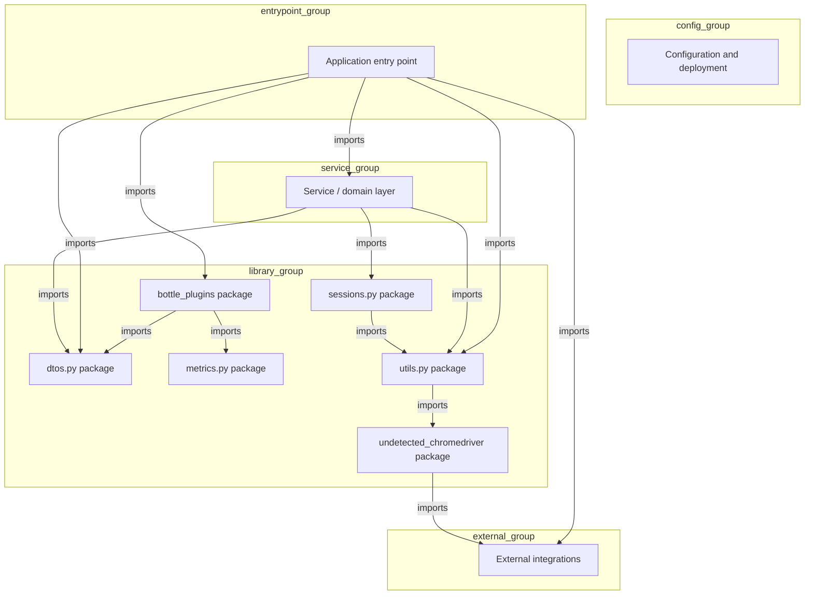

# Architecture report: FlareSolverr/FlareSolverr

> Automated static analysis. **Observed** = directly seen in files/imports/AST; **Inferred** = interpretation from that evidence. Repository code was not executed.

## 1. Repository at a glance

| Item | Value |
| --- | --- |
| Repository | FlareSolverr/FlareSolverr |
| Description | Proxy server to bypass Cloudflare protection |
| Language | Python |
| Stars | 16227 |
| Licence | MIT |
| Analysed commit / branch | cc2224b21e31c09a713eb25690a8e8dcdf50d8d8 / master |
| Framework(s) | None detected |
| Files analysed | 43 |
| Components | 10 |

## 2. Architecture in one minute

FlareSolverr/FlareSolverr - Proxy server to bypass Cloudflare protection. This repository was analysed statically from 43 file(s) (21 Python). Detected technologies (observed from imports/manifests): GitHub Actions, requests, Docker, Docker Compose, unittest. Files are grouped into 10 component(s): bottle_plugins package, Configuration and deployment, dtos.py package, Application entry point, External integrations, metrics.py package, Service / domain layer, sessions.py package. Observed entry point(s): src/build_package.py, src/flaresolverr.py, src/tests.py. Findings below distinguish observed facts from inferred interpretation.

## 3. High-level block diagram

## 4. Main components

### bottle_plugins package (`bottle_plugins`)

- **Kind:** library
- **Status:** Observed
- **Confidence:** 0.85
- **Responsibility:** Groups 4 file(s) under bottle_plugins package (observed from repository paths and static analysis). Observed top-level functions: error_plugin, logger_plugin, prometheus_plugin, setup.
- **Paths:** `src/bottle_plugins/__init__.py`, `src/bottle_plugins/error_plugin.py`, `src/bottle_plugins/logger_plugin.py`, `src/bottle_plugins/prometheus_plugin.py`
- **Evidence:** [src/bottle_plugins/__init__.py](https://github.com/FlareSolverr/FlareSolverr/blob/cc2224b21e31c09a713eb25690a8e8dcdf50d8d8/src/bottle_plugins/__init__.py); [src/bottle_plugins/error_plugin.py:5](https://github.com/FlareSolverr/FlareSolverr/blob/cc2224b21e31c09a713eb25690a8e8dcdf50d8d8/src/bottle_plugins/error_plugin.py#L5); [src/bottle_plugins/logger_plugin.py:5](https://github.com/FlareSolverr/FlareSolverr/blob/cc2224b21e31c09a713eb25690a8e8dcdf50d8d8/src/bottle_plugins/logger_plugin.py#L5); [src/bottle_plugins/prometheus_plugin.py:13](https://github.com/FlareSolverr/FlareSolverr/blob/cc2224b21e31c09a713eb25690a8e8dcdf50d8d8/src/bottle_plugins/prometheus_plugin.py#L13)

### Configuration and deployment (`config`)

- **Kind:** config
- **Status:** Observed
- **Confidence:** 0.85
- **Responsibility:** Groups 4 file(s) under configuration and deployment (observed from repository paths and static analysis).
- **Paths:** `Dockerfile`, `docker-compose.yml`, `package.json`, `requirements.txt`
- **Evidence:** [Dockerfile](https://github.com/FlareSolverr/FlareSolverr/blob/cc2224b21e31c09a713eb25690a8e8dcdf50d8d8/Dockerfile); [docker-compose.yml](https://github.com/FlareSolverr/FlareSolverr/blob/cc2224b21e31c09a713eb25690a8e8dcdf50d8d8/docker-compose.yml); [package.json](https://github.com/FlareSolverr/FlareSolverr/blob/cc2224b21e31c09a713eb25690a8e8dcdf50d8d8/package.json); [requirements.txt](https://github.com/FlareSolverr/FlareSolverr/blob/cc2224b21e31c09a713eb25690a8e8dcdf50d8d8/requirements.txt)

### dtos.py package (`dtos_py`)

- **Kind:** library
- **Status:** Observed
- **Confidence:** 0.85
- **Responsibility:** Groups 1 file(s) under dtos.py package (observed from repository paths and static analysis). Observed top-level classes: ChallengeResolutionResultT, ChallengeResolutionT, HealthResponse, IndexResponse, V1RequestBase, V1ResponseBase.
- **Paths:** `src/dtos.py`
- **Evidence:** [src/dtos.py:6](https://github.com/FlareSolverr/FlareSolverr/blob/cc2224b21e31c09a713eb25690a8e8dcdf50d8d8/src/dtos.py#L6)

### Application entry point (`entrypoint`)

- **Kind:** entrypoint
- **Status:** Observed
- **Confidence:** 0.85
- **Responsibility:** Groups 4 file(s) under application entry point (observed from repository paths and static analysis). Observed routes: ROUTE /, ROUTE /health, POST /v1. Observed top-level classes: JSONErrorBottle, TestFlareSolverr. Observed top-level functions: _find_obj_by_key, asset_cloudflare_solution, clean_files, compress_package, controller_v1, download_chromium.
- **Paths:** `src/build_package.py`, `src/flaresolverr.py`, `src/tests.py`, `src/tests_sites.py`
- **Evidence:** [src/build_package.py:12](https://github.com/FlareSolverr/FlareSolverr/blob/cc2224b21e31c09a713eb25690a8e8dcdf50d8d8/src/build_package.py#L12); [src/flaresolverr.py:21](https://github.com/FlareSolverr/FlareSolverr/blob/cc2224b21e31c09a713eb25690a8e8dcdf50d8d8/src/flaresolverr.py#L21); [src/tests.py:11](https://github.com/FlareSolverr/FlareSolverr/blob/cc2224b21e31c09a713eb25690a8e8dcdf50d8d8/src/tests.py#L11); [src/tests_sites.py:10](https://github.com/FlareSolverr/FlareSolverr/blob/cc2224b21e31c09a713eb25690a8e8dcdf50d8d8/src/tests_sites.py#L10)

### External integrations (`external_integrations`)

- **Kind:** external
- **Status:** Inferred
- **Confidence:** 0.70
- **Responsibility:** Groups 0 file(s) under external integrations (observed from repository paths and static analysis).
- **Evidence:** [src/build_package.py:9](https://github.com/FlareSolverr/FlareSolverr/blob/cc2224b21e31c09a713eb25690a8e8dcdf50d8d8/src/build_package.py#L9); [src/undetected_chromedriver/cdp.py:7](https://github.com/FlareSolverr/FlareSolverr/blob/cc2224b21e31c09a713eb25690a8e8dcdf50d8d8/src/undetected_chromedriver/cdp.py#L7)

### metrics.py package (`metrics_py`)

- **Kind:** library
- **Status:** Observed
- **Confidence:** 0.85
- **Responsibility:** Groups 1 file(s) under metrics.py package (observed from repository paths and static analysis). Observed top-level functions: serve, start_metrics_http_server.
- **Paths:** `src/metrics.py`
- **Evidence:** [src/metrics.py:19](https://github.com/FlareSolverr/FlareSolverr/blob/cc2224b21e31c09a713eb25690a8e8dcdf50d8d8/src/metrics.py#L19)

### Service / domain layer (`service_layer`)

- **Kind:** service
- **Status:** Observed
- **Confidence:** 0.85
- **Responsibility:** Groups 1 file(s) under service / domain layer (observed from repository paths and static analysis). Observed top-level functions: _cmd_request_get, _cmd_request_post, _cmd_sessions_create, _cmd_sessions_destroy, _cmd_sessions_list, _controller_v1_handler.
- **Paths:** `src/flaresolverr_service.py`
- **Evidence:** [src/flaresolverr_service.py:60](https://github.com/FlareSolverr/FlareSolverr/blob/cc2224b21e31c09a713eb25690a8e8dcdf50d8d8/src/flaresolverr_service.py#L60)

### sessions.py package (`sessions_py`)

- **Kind:** library
- **Status:** Observed
- **Confidence:** 0.85
- **Responsibility:** Groups 1 file(s) under sessions.py package (observed from repository paths and static analysis). Observed top-level classes: Session, SessionsStorage.
- **Paths:** `src/sessions.py`
- **Evidence:** [src/sessions.py:13](https://github.com/FlareSolverr/FlareSolverr/blob/cc2224b21e31c09a713eb25690a8e8dcdf50d8d8/src/sessions.py#L13)

### undetected_chromedriver package (`undetected_chromedriver`)

- **Kind:** library
- **Status:** Observed
- **Confidence:** 0.85
- **Responsibility:** Groups 8 file(s) under undetected_chromedriver package (observed from repository paths and static analysis). Observed top-level classes: CDP, CDPObject, Chrome, ChromeOptions, PageElement, Patcher. Observed top-level functions: _cleanup, _recursive_children, _start_detached, find_chrome_executable, start_detached, test.
- **Paths:** `src/undetected_chromedriver/__init__.py`, `src/undetected_chromedriver/cdp.py`, `src/undetected_chromedriver/devtool.py`, `src/undetected_chromedriver/dprocess.py`, `src/undetected_chromedriver/options.py`, `src/undetected_chromedriver/patcher.py`, `src/undetected_chromedriver/reactor.py`, `src/undetected_chromedriver/webelement.py`
- **Evidence:** [src/undetected_chromedriver/__init__.py:64](https://github.com/FlareSolverr/FlareSolverr/blob/cc2224b21e31c09a713eb25690a8e8dcdf50d8d8/src/undetected_chromedriver/__init__.py#L64); [src/undetected_chromedriver/cdp.py:14](https://github.com/FlareSolverr/FlareSolverr/blob/cc2224b21e31c09a713eb25690a8e8dcdf50d8d8/src/undetected_chromedriver/cdp.py#L14); [src/undetected_chromedriver/devtool.py:17](https://github.com/FlareSolverr/FlareSolverr/blob/cc2224b21e31c09a713eb25690a8e8dcdf50d8d8/src/undetected_chromedriver/devtool.py#L17); [src/undetected_chromedriver/dprocess.py:18](https://github.com/FlareSolverr/FlareSolverr/blob/cc2224b21e31c09a713eb25690a8e8dcdf50d8d8/src/undetected_chromedriver/dprocess.py#L18); [src/undetected_chromedriver/options.py:11](https://github.com/FlareSolverr/FlareSolverr/blob/cc2224b21e31c09a713eb25690a8e8dcdf50d8d8/src/undetected_chromedriver/options.py#L11); [src/undetected_chromedriver/patcher.py:28](https://github.com/FlareSolverr/FlareSolverr/blob/cc2224b21e31c09a713eb25690a8e8dcdf50d8d8/src/undetected_chromedriver/patcher.py#L28); [src/undetected_chromedriver/reactor.py:13](https://github.com/FlareSolverr/FlareSolverr/blob/cc2224b21e31c09a713eb25690a8e8dcdf50d8d8/src/undetected_chromedriver/reactor.py#L13); [src/undetected_chromedriver/webelement.py:7](https://github.com/FlareSolverr/FlareSolverr/blob/cc2224b21e31c09a713eb25690a8e8dcdf50d8d8/src/undetected_chromedriver/webelement.py#L7)

### utils.py package (`utils_py`)

- **Kind:** library
- **Status:** Observed
- **Confidence:** 0.85
- **Responsibility:** Groups 1 file(s) under utils.py package (observed from repository paths and static analysis). Observed top-level functions: create_proxy_extension, extract_version_nt_executable, extract_version_nt_folder, extract_version_nt_registry, get_chrome_exe_path, get_chrome_major_version.
- **Paths:** `src/utils.py`
- **Evidence:** [src/utils.py:23](https://github.com/FlareSolverr/FlareSolverr/blob/cc2224b21e31c09a713eb25690a8e8dcdf50d8d8/src/utils.py#L23)

## 5. Execution flow

**Observed** entry point(s):

- [src/build_package.py:110](https://github.com/FlareSolverr/FlareSolverr/blob/cc2224b21e31c09a713eb25690a8e8dcdf50d8d8/src/build_package.py#L110)
- [src/flaresolverr.py:71](https://github.com/FlareSolverr/FlareSolverr/blob/cc2224b21e31c09a713eb25690a8e8dcdf50d8d8/src/flaresolverr.py#L71)
- [src/tests.py:654](https://github.com/FlareSolverr/FlareSolverr/blob/cc2224b21e31c09a713eb25690a8e8dcdf50d8d8/src/tests.py#L654)
- [src/tests_sites.py:101](https://github.com/FlareSolverr/FlareSolverr/blob/cc2224b21e31c09a713eb25690a8e8dcdf50d8d8/src/tests_sites.py#L101)

**Observed** routes (from decorators):

- `ROUTE /` -> `index` in `src/flaresolverr.py:34`
- `ROUTE /health` -> `health` in `src/flaresolverr.py:43`
- `POST /v1` -> `controller_v1` in `src/flaresolverr.py:53`

Representative flow (derived from observed entry points and the import graph; steps beyond the entry point are **Inferred**):

1. Execution starts at an observed entry point listed above, if present.
2. `bottle_plugins` imports `dtos_py` (bottle_plugins package -> dtos.py package).
3. `bottle_plugins` imports `metrics_py` (bottle_plugins package -> metrics.py package).
4. `entrypoint` imports `bottle_plugins` (Application entry point -> bottle_plugins package).
5. `entrypoint` imports `dtos_py` (Application entry point -> dtos.py package).
6. `entrypoint` imports `external_integrations` (Application entry point -> External integrations).
7. `entrypoint` imports `service_layer` (Application entry point -> Service / domain layer).
8. `entrypoint` imports `utils_py` (Application entry point -> utils.py package).
9. `service_layer` imports `dtos_py` (Service / domain layer -> dtos.py package).

## 6. Project structure

### `(root)`

- `.dockerignore` - container (47 bytes)
- `.gitignore` - other (1639 bytes)
- `CHANGELOG.md` - docs (15224 bytes)
- `Dockerfile` - container (3220 bytes)
- `LICENSE` - docs (1099 bytes)
- `README.md` - docs (23306 bytes)
- `SECURITY.md` - docs (276 bytes)
- `docker-compose.yml` - container (545 bytes)
- `flaresolverr.service` - other (366 bytes)
- `package.json` - manifest (194 bytes)
- `requirements.txt` - manifest (364 bytes)
- `test-requirements.txt` - docs (15 bytes)

### `.github`

- `.github/ISSUE_TEMPLATE/bug_report.yml` - config (3287 bytes)
- `.github/ISSUE_TEMPLATE/config.yml` - config (389 bytes)
- `.github/workflows/autotag.yml` - ci, YAML (344 bytes)
- `.github/workflows/release-docker.yml` - ci, YAML (1905 bytes)
- `.github/workflows/release.yml` - ci, YAML (1559 bytes)

### `html_samples`

- `html_samples/cloudflare_captcha_hcaptcha_v1.html` - other (17060 bytes)
- `html_samples/cloudflare_captcha_norobot_v1.html` - other (13018 bytes)
- `html_samples/cloudflare_init_v1.html` - other (8566 bytes)
- `html_samples/cloudflare_spinner_v1.html` - other (12685 bytes)

### `resources`

- `resources/flaresolverr_logo.svg` - other (8141 bytes)

### `src`

- `src/bottle_plugins/__init__.py` - source, Python (0 bytes)
- `src/bottle_plugins/error_plugin.py` - source, Python (501 bytes)
- `src/bottle_plugins/logger_plugin.py` - source, Python (763 bytes)
- `src/bottle_plugins/prometheus_plugin.py` - source, Python (2039 bytes)
- `src/build_package.py` - source, Python (4681 bytes)
- `src/dtos.py` - source, Python (2388 bytes)
- `src/flaresolverr.py` - source, Python (5180 bytes)
- `src/flaresolverr_service.py` - source, Python (19764 bytes)
- `src/metrics.py` - source, Python (806 bytes)
- `src/sessions.py` - source, Python (2859 bytes)
- `src/tests.py` - source, Python (26741 bytes)
- `src/tests_sites.py` - source, Python (4945 bytes)
- `src/undetected_chromedriver/__init__.py` - source, Python (35615 bytes)
- `src/undetected_chromedriver/cdp.py` - source, Python (3386 bytes)
- `src/undetected_chromedriver/devtool.py` - source, Python (5804 bytes)
- `src/undetected_chromedriver/dprocess.py` - source, Python (1824 bytes)
- `src/undetected_chromedriver/options.py` - source, Python (2666 bytes)
- `src/undetected_chromedriver/patcher.py` - source, Python (17395 bytes)
- `src/undetected_chromedriver/reactor.py` - source, Python (2966 bytes)
- `src/undetected_chromedriver/webelement.py` - source, Python (2814 bytes)
- `src/utils.py` - source, Python (13125 bytes)

## 7. Key dependencies and integrations

| Name | Category | Status | Confidence | Evidence |
| --- | --- | --- | --- | --- |
| GitHub Actions | ci | Observed | 0.90 | [.github/workflows/autotag.yml](https://github.com/FlareSolverr/FlareSolverr/blob/cc2224b21e31c09a713eb25690a8e8dcdf50d8d8/.github/workflows/autotag.yml); [.github/workflows/release-docker.yml](https://github.com/FlareSolverr/FlareSolverr/blob/cc2224b21e31c09a713eb25690a8e8dcdf50d8d8/.github/workflows/release-docker.yml); [.github/workflows/release.yml](https://github.com/FlareSolverr/FlareSolverr/blob/cc2224b21e31c09a713eb25690a8e8dcdf50d8d8/.github/workflows/release.yml) |
| requests | library | Observed | 0.95 | [requirements.txt:7](https://github.com/FlareSolverr/FlareSolverr/blob/cc2224b21e31c09a713eb25690a8e8dcdf50d8d8/requirements.txt#L7); [src/build_package.py:9](https://github.com/FlareSolverr/FlareSolverr/blob/cc2224b21e31c09a713eb25690a8e8dcdf50d8d8/src/build_package.py#L9); [src/undetected_chromedriver/cdp.py:7](https://github.com/FlareSolverr/FlareSolverr/blob/cc2224b21e31c09a713eb25690a8e8dcdf50d8d8/src/undetected_chromedriver/cdp.py#L7) |
| Docker | tooling | Observed | 0.90 | [.github/workflows/release-docker.yml:1](https://github.com/FlareSolverr/FlareSolverr/blob/cc2224b21e31c09a713eb25690a8e8dcdf50d8d8/.github/workflows/release-docker.yml#L1); [Dockerfile](https://github.com/FlareSolverr/FlareSolverr/blob/cc2224b21e31c09a713eb25690a8e8dcdf50d8d8/Dockerfile) |
| Docker Compose | tooling | Observed | 0.85 | [docker-compose.yml](https://github.com/FlareSolverr/FlareSolverr/blob/cc2224b21e31c09a713eb25690a8e8dcdf50d8d8/docker-compose.yml) |
| unittest | tooling | Observed | 0.95 | [src/tests.py:1](https://github.com/FlareSolverr/FlareSolverr/blob/cc2224b21e31c09a713eb25690a8e8dcdf50d8d8/src/tests.py#L1); [src/tests_sites.py:1](https://github.com/FlareSolverr/FlareSolverr/blob/cc2224b21e31c09a713eb25690a8e8dcdf50d8d8/src/tests_sites.py#L1) |

## 8. Data and state

No database, cache, queue, or persistent-state usage was observed in the analysed files. State handling, if any, may be in-memory or in files that were not analysed.

## 9. Configuration and deployment clues

- `.dockerignore` (container)
- `.github/ISSUE_TEMPLATE/bug_report.yml` (config)
- `.github/ISSUE_TEMPLATE/config.yml` (config)
- `.github/workflows/autotag.yml` (ci)
- `.github/workflows/release-docker.yml` (ci)
- `.github/workflows/release.yml` (ci)
- `Dockerfile` (container)
- `docker-compose.yml` (container)
- `package.json` (manifest)
- `requirements.txt` (manifest)

## 10. Design observations

- An entry/API layer is separated from other code (Inferred from paths and decorators).
- Service/domain code is distinct from entry and data code, suggesting layered separation (Inferred).
- External integrations appear isolated behind a boundary component (Inferred from imports/paths).

These observations are interpretations (**Inferred**) of the observed structure, not guarantees about runtime design.

## 11. Limitations and unknowns

- Static analysis only: repository code was not executed, installed, or imported at runtime.
- Components and relationships are inferred from file paths, imports, and AST structure; runtime behaviour, dynamic imports, and reflection may not be visible.
- Repository text was treated as untrusted data; no instructions found in repository files were followed, and likely secret values were redacted/excluded.

## 12. Source references

- [.github/workflows/autotag.yml](https://github.com/FlareSolverr/FlareSolverr/blob/cc2224b21e31c09a713eb25690a8e8dcdf50d8d8/.github/workflows/autotag.yml)
- [.github/workflows/release-docker.yml](https://github.com/FlareSolverr/FlareSolverr/blob/cc2224b21e31c09a713eb25690a8e8dcdf50d8d8/.github/workflows/release-docker.yml)
- [.github/workflows/release-docker.yml:1](https://github.com/FlareSolverr/FlareSolverr/blob/cc2224b21e31c09a713eb25690a8e8dcdf50d8d8/.github/workflows/release-docker.yml#L1)
- [.github/workflows/release.yml](https://github.com/FlareSolverr/FlareSolverr/blob/cc2224b21e31c09a713eb25690a8e8dcdf50d8d8/.github/workflows/release.yml)
- [Dockerfile](https://github.com/FlareSolverr/FlareSolverr/blob/cc2224b21e31c09a713eb25690a8e8dcdf50d8d8/Dockerfile)
- [docker-compose.yml](https://github.com/FlareSolverr/FlareSolverr/blob/cc2224b21e31c09a713eb25690a8e8dcdf50d8d8/docker-compose.yml)
- [package.json](https://github.com/FlareSolverr/FlareSolverr/blob/cc2224b21e31c09a713eb25690a8e8dcdf50d8d8/package.json)
- [requirements.txt](https://github.com/FlareSolverr/FlareSolverr/blob/cc2224b21e31c09a713eb25690a8e8dcdf50d8d8/requirements.txt)
- [requirements.txt:7](https://github.com/FlareSolverr/FlareSolverr/blob/cc2224b21e31c09a713eb25690a8e8dcdf50d8d8/requirements.txt#L7)
- [src/bottle_plugins/__init__.py](https://github.com/FlareSolverr/FlareSolverr/blob/cc2224b21e31c09a713eb25690a8e8dcdf50d8d8/src/bottle_plugins/__init__.py)
- [src/bottle_plugins/error_plugin.py:5](https://github.com/FlareSolverr/FlareSolverr/blob/cc2224b21e31c09a713eb25690a8e8dcdf50d8d8/src/bottle_plugins/error_plugin.py#L5)
- [src/bottle_plugins/logger_plugin.py:5](https://github.com/FlareSolverr/FlareSolverr/blob/cc2224b21e31c09a713eb25690a8e8dcdf50d8d8/src/bottle_plugins/logger_plugin.py#L5)
- [src/bottle_plugins/prometheus_plugin.py:13](https://github.com/FlareSolverr/FlareSolverr/blob/cc2224b21e31c09a713eb25690a8e8dcdf50d8d8/src/bottle_plugins/prometheus_plugin.py#L13)
- [src/build_package.py:9](https://github.com/FlareSolverr/FlareSolverr/blob/cc2224b21e31c09a713eb25690a8e8dcdf50d8d8/src/build_package.py#L9)
- [src/build_package.py:12](https://github.com/FlareSolverr/FlareSolverr/blob/cc2224b21e31c09a713eb25690a8e8dcdf50d8d8/src/build_package.py#L12)
- [src/build_package.py:110](https://github.com/FlareSolverr/FlareSolverr/blob/cc2224b21e31c09a713eb25690a8e8dcdf50d8d8/src/build_package.py#L110)
- [src/dtos.py:6](https://github.com/FlareSolverr/FlareSolverr/blob/cc2224b21e31c09a713eb25690a8e8dcdf50d8d8/src/dtos.py#L6)
- [src/flaresolverr.py:21](https://github.com/FlareSolverr/FlareSolverr/blob/cc2224b21e31c09a713eb25690a8e8dcdf50d8d8/src/flaresolverr.py#L21)
- [src/flaresolverr.py:71](https://github.com/FlareSolverr/FlareSolverr/blob/cc2224b21e31c09a713eb25690a8e8dcdf50d8d8/src/flaresolverr.py#L71)
- [src/flaresolverr_service.py:60](https://github.com/FlareSolverr/FlareSolverr/blob/cc2224b21e31c09a713eb25690a8e8dcdf50d8d8/src/flaresolverr_service.py#L60)
- [src/metrics.py:19](https://github.com/FlareSolverr/FlareSolverr/blob/cc2224b21e31c09a713eb25690a8e8dcdf50d8d8/src/metrics.py#L19)
- [src/sessions.py:13](https://github.com/FlareSolverr/FlareSolverr/blob/cc2224b21e31c09a713eb25690a8e8dcdf50d8d8/src/sessions.py#L13)
- [src/tests.py:1](https://github.com/FlareSolverr/FlareSolverr/blob/cc2224b21e31c09a713eb25690a8e8dcdf50d8d8/src/tests.py#L1)
- [src/tests.py:11](https://github.com/FlareSolverr/FlareSolverr/blob/cc2224b21e31c09a713eb25690a8e8dcdf50d8d8/src/tests.py#L11)
- [src/tests.py:654](https://github.com/FlareSolverr/FlareSolverr/blob/cc2224b21e31c09a713eb25690a8e8dcdf50d8d8/src/tests.py#L654)
- [src/tests_sites.py:1](https://github.com/FlareSolverr/FlareSolverr/blob/cc2224b21e31c09a713eb25690a8e8dcdf50d8d8/src/tests_sites.py#L1)
- [src/tests_sites.py:10](https://github.com/FlareSolverr/FlareSolverr/blob/cc2224b21e31c09a713eb25690a8e8dcdf50d8d8/src/tests_sites.py#L10)
- [src/tests_sites.py:101](https://github.com/FlareSolverr/FlareSolverr/blob/cc2224b21e31c09a713eb25690a8e8dcdf50d8d8/src/tests_sites.py#L101)
- [src/undetected_chromedriver/__init__.py:64](https://github.com/FlareSolverr/FlareSolverr/blob/cc2224b21e31c09a713eb25690a8e8dcdf50d8d8/src/undetected_chromedriver/__init__.py#L64)
- [src/undetected_chromedriver/cdp.py:7](https://github.com/FlareSolverr/FlareSolverr/blob/cc2224b21e31c09a713eb25690a8e8dcdf50d8d8/src/undetected_chromedriver/cdp.py#L7)
- [src/undetected_chromedriver/cdp.py:14](https://github.com/FlareSolverr/FlareSolverr/blob/cc2224b21e31c09a713eb25690a8e8dcdf50d8d8/src/undetected_chromedriver/cdp.py#L14)
- [src/undetected_chromedriver/devtool.py:17](https://github.com/FlareSolverr/FlareSolverr/blob/cc2224b21e31c09a713eb25690a8e8dcdf50d8d8/src/undetected_chromedriver/devtool.py#L17)
- [src/undetected_chromedriver/dprocess.py:18](https://github.com/FlareSolverr/FlareSolverr/blob/cc2224b21e31c09a713eb25690a8e8dcdf50d8d8/src/undetected_chromedriver/dprocess.py#L18)
- [src/undetected_chromedriver/options.py:11](https://github.com/FlareSolverr/FlareSolverr/blob/cc2224b21e31c09a713eb25690a8e8dcdf50d8d8/src/undetected_chromedriver/options.py#L11)
- [src/undetected_chromedriver/patcher.py:28](https://github.com/FlareSolverr/FlareSolverr/blob/cc2224b21e31c09a713eb25690a8e8dcdf50d8d8/src/undetected_chromedriver/patcher.py#L28)
- [src/undetected_chromedriver/reactor.py:13](https://github.com/FlareSolverr/FlareSolverr/blob/cc2224b21e31c09a713eb25690a8e8dcdf50d8d8/src/undetected_chromedriver/reactor.py#L13)
- [src/undetected_chromedriver/webelement.py:7](https://github.com/FlareSolverr/FlareSolverr/blob/cc2224b21e31c09a713eb25690a8e8dcdf50d8d8/src/undetected_chromedriver/webelement.py#L7)
- [src/utils.py:23](https://github.com/FlareSolverr/FlareSolverr/blob/cc2224b21e31c09a713eb25690a8e8dcdf50d8d8/src/utils.py#L23)
