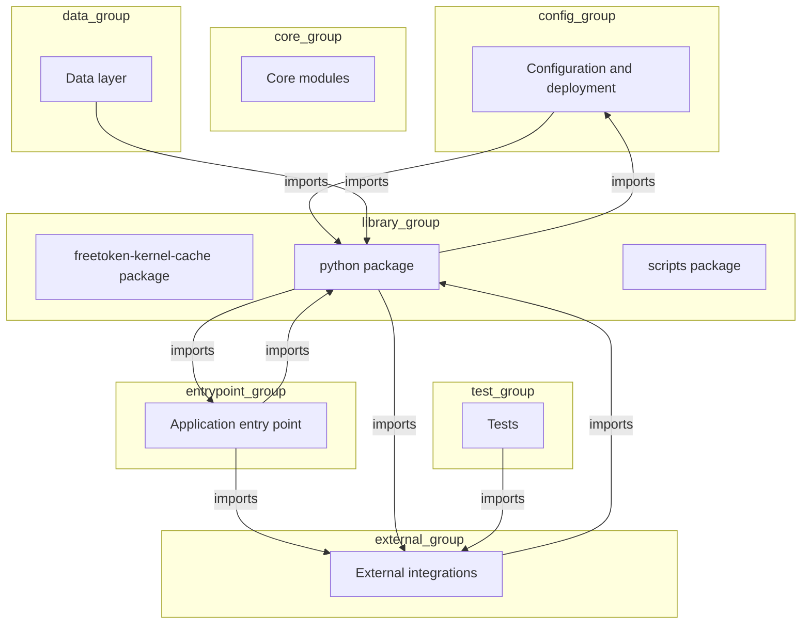

# Architecture report: FlashML-org/FreeToken

> Automated static analysis. **Observed** = directly seen in files/imports/AST; **Inferred** = interpretation from that evidence. Repository code was not executed.

## 1. Repository at a glance

| Item | Value |
| --- | --- |
| Repository | FlashML-org/FreeToken |
| Description | FreeToken brings datacenter-scale model serving to your desktop. Run massive models locally, fast and efficiently. |
| Language | Python |
| Stars | 17188 |
| Licence | Apache-2.0 |
| Analysed commit / branch | 4b71d4d928e968c7036024c089f81050134a680b / main |
| Framework(s) | FastAPI, Starlette |
| Files analysed | 794 |
| Components | 9 |

## 2. Architecture in one minute

FlashML-org/FreeToken - FreeToken brings datacenter-scale model serving to your desktop. Run massive models locally, fast and efficiently.. This repository was analysed statically from 794 file(s) (629 Python). Detected technologies (observed from imports/manifests): GitHub Actions, FastAPI, Starlette, httpx, NumPy, Pydantic. Files are grouped into 9 component(s): Configuration and deployment, Core modules, Data layer, Application entry point, External integrations, freetoken-kernel-cache package, python package, scripts package. Observed entry point(s): benchmarks/bench_decode_moe.py, benchmarks/bench_load_weight_generic.py, benchmarks/bench_offload_cache_copy.py. Findings below distinguish observed facts from inferred interpretation.

## 3. High-level block diagram

## 4. Main components

### Configuration and deployment (`config`)

- **Kind:** config
- **Status:** Observed
- **Confidence:** 0.85
- **Responsibility:** Groups 15 file(s) under configuration and deployment (observed from repository paths and static analysis). Observed top-level classes: BuildClib, BuildExt, CompressedTensorsConfig, EngineConfig, Fp8BlockConfig, GGUFConfig. Observed top-level functions: _check_toolchain, _cuda_runtime_paths, _get_pid_suffix, _ggml_cpu_targets, _ggml_variant_flags, _is_rocm.
- **Paths:** `freetoken-kernel-cache/pyproject.toml`, `freetoken-kernel-cache/setup.py`, `pyproject.toml`, `python/freetoken/engine/config.py`, `python/freetoken/layers/quantization/configs/__init__.py`, `python/freetoken/layers/quantization/configs/base.py`, `python/freetoken/layers/quantization/configs/compressed_tensors.py`, `python/freetoken/layers/quantization/configs/fp8.py`, `python/freetoken/layers/quantization/configs/gguf.py`, `python/freetoken/layers/quantization/configs/modelopt.py`, `python/freetoken/layers/quantization/configs/mxfp4.py`, `python/freetoken/mm/config.py`, `python/freetoken/moe/configs/triton_3_5_1/E=128,N=704,device_name=NVIDIA_H100_80GB_HBM3.json`, `python/freetoken/scheduler/config.py`, `setup.py`
- **Evidence:** [freetoken-kernel-cache/pyproject.toml](https://github.com/FlashML-org/FreeToken/blob/4b71d4d928e968c7036024c089f81050134a680b/freetoken-kernel-cache/pyproject.toml); [freetoken-kernel-cache/setup.py:7](https://github.com/FlashML-org/FreeToken/blob/4b71d4d928e968c7036024c089f81050134a680b/freetoken-kernel-cache/setup.py#L7); [pyproject.toml](https://github.com/FlashML-org/FreeToken/blob/4b71d4d928e968c7036024c089f81050134a680b/pyproject.toml); [python/freetoken/engine/config.py:24](https://github.com/FlashML-org/FreeToken/blob/4b71d4d928e968c7036024c089f81050134a680b/python/freetoken/engine/config.py#L24); [python/freetoken/layers/quantization/configs/__init__.py:14](https://github.com/FlashML-org/FreeToken/blob/4b71d4d928e968c7036024c089f81050134a680b/python/freetoken/layers/quantization/configs/__init__.py#L14); [python/freetoken/layers/quantization/configs/base.py:26](https://github.com/FlashML-org/FreeToken/blob/4b71d4d928e968c7036024c089f81050134a680b/python/freetoken/layers/quantization/configs/base.py#L26); [python/freetoken/layers/quantization/configs/compressed_tensors.py:13](https://github.com/FlashML-org/FreeToken/blob/4b71d4d928e968c7036024c089f81050134a680b/python/freetoken/layers/quantization/configs/compressed_tensors.py#L13); [python/freetoken/layers/quantization/configs/fp8.py:16](https://github.com/FlashML-org/FreeToken/blob/4b71d4d928e968c7036024c089f81050134a680b/python/freetoken/layers/quantization/configs/fp8.py#L16)

### Core modules (`core`)

- **Kind:** core
- **Status:** Observed
- **Confidence:** 0.85
- **Responsibility:** Groups 1 file(s) under core modules (observed from repository paths and static analysis).
- **Paths:** `install.sh`
- **Evidence:** [install.sh](https://github.com/FlashML-org/FreeToken/blob/4b71d4d928e968c7036024c089f81050134a680b/install.sh)

### Data layer (`data_layer`)

- **Kind:** data
- **Status:** Observed
- **Confidence:** 0.85
- **Responsibility:** Groups 181 file(s) under data layer (observed from repository paths and static analysis). Observed top-level classes: Attention, BaseAttentionGroupConfig, BaseLLMModel, Block, BlockWeightStreamer, Compressor. Observed top-level functions: _activation_scale, _add_bos, _apply_multidim_rope, _apply_vision_rope, _args_from_metadata, _attn_geometry.
- **Paths:** `python/freetoken/models/__init__.py`, `python/freetoken/models/blocks.py`, `python/freetoken/models/config.py`, `python/freetoken/models/deepseek_v4/__init__.py`, `python/freetoken/models/deepseek_v4/args.py`, `python/freetoken/models/deepseek_v4/attention.py`, `python/freetoken/models/deepseek_v4/compress.py`, `python/freetoken/models/deepseek_v4/config.py`, `python/freetoken/models/deepseek_v4/gguf.py`, `python/freetoken/models/deepseek_v4/image_processor.py`, `python/freetoken/models/deepseek_v4/layers.py`, `python/freetoken/models/deepseek_v4/model.py`, `python/freetoken/models/deepseek_v4/moe.py`, `python/freetoken/models/deepseek_v4/ops.py`, `python/freetoken/models/deepseek_v4/vision.py`, `python/freetoken/models/deepseek_v4/weight.py`, `python/freetoken/models/deepseek_v41/__init__.py`, `python/freetoken/models/deepseek_v41/args.py`, `python/freetoken/models/deepseek_v41/attention.py`, `python/freetoken/models/deepseek_v41/compressor.py`, `python/freetoken/models/deepseek_v41/config.py`, `python/freetoken/models/deepseek_v41/engram.py`, `python/freetoken/models/deepseek_v41/engram_table.py`, `python/freetoken/models/deepseek_v41/gguf.py`, `python/freetoken/models/deepseek_v41/indexer.py`, `python/freetoken/models/deepseek_v41/model.py`, `python/freetoken/models/deepseek_v41/moe.py`, `python/freetoken/models/deepseek_v41/rope.py`, `python/freetoken/models/deepseek_v41/vision.py`, `python/freetoken/models/deepseek_v41/weight.py`, `python/freetoken/models/dflash/__init__.py`, `python/freetoken/models/dflash/config.py`, `python/freetoken/models/dflash/model.py`, `python/freetoken/models/dflash/weight.py`, `python/freetoken/models/flint/__init__.py`, `python/freetoken/models/flint/attention.py`, `python/freetoken/models/flint/config.py`, `python/freetoken/models/flint/gguf.py`, `python/freetoken/models/flint/model.py`, `python/freetoken/models/flint/moe.py`, `python/freetoken/models/flint/weight.py`, `python/freetoken/models/gemma4/__init__.py`, `python/freetoken/models/gemma4/attention.py`, `python/freetoken/models/gemma4/config.py`, `python/freetoken/models/gemma4/gguf.py`, `python/freetoken/models/gemma4/model.py`, `python/freetoken/models/gemma4/moe.py`, `python/freetoken/models/gemma4/mtp.py`, `python/freetoken/models/gemma4/vision.py`, `python/freetoken/models/gemma4/weight.py`, `python/freetoken/models/gguf/__init__.py`, `python/freetoken/models/gguf/config.py`, `python/freetoken/models/gguf/experts.py`, `python/freetoken/models/gguf/mmproj.py`, `python/freetoken/models/gguf/reader.py`, `python/freetoken/models/gguf/tensors.py`, `python/freetoken/models/gguf/tokenizer.py`, `python/freetoken/models/glm4_moe/__init__.py`, `python/freetoken/models/glm4_moe/attention.py`, `python/freetoken/models/glm4_moe/config.py`, `python/freetoken/models/glm4_moe/gguf.py`, `python/freetoken/models/glm4_moe/mlp.py`, `python/freetoken/models/glm4_moe/model.py`, `python/freetoken/models/glm4_moe/moe.py`, `python/freetoken/models/glm4_moe/weight.py`, `python/freetoken/models/glm5_next/__init__.py`, `python/freetoken/models/glm5_next/args.py`, `python/freetoken/models/glm5_next/attention.py`, `python/freetoken/models/glm5_next/config.py`, `python/freetoken/models/glm5_next/gguf.py`, `python/freetoken/models/glm5_next/kda.py`, `python/freetoken/models/glm5_next/mlp.py`, `python/freetoken/models/glm5_next/model.py`, `python/freetoken/models/glm5_next/moe.py`, `python/freetoken/models/glm5_next/vision.py`, `python/freetoken/models/glm5_next/weight.py`, `python/freetoken/models/glm_moe_dsa/__init__.py`, `python/freetoken/models/glm_moe_dsa/args.py`, `python/freetoken/models/glm_moe_dsa/attention.py`, `python/freetoken/models/glm_moe_dsa/config.py`, `python/freetoken/models/glm_moe_dsa/mlp.py`, `python/freetoken/models/glm_moe_dsa/model.py`, `python/freetoken/models/glm_moe_dsa/moe.py`, `python/freetoken/models/glm_moe_dsa/weight.py`, `python/freetoken/models/gpt_oss/__init__.py`, `python/freetoken/models/gpt_oss/attention.py`, `python/freetoken/models/gpt_oss/config.py`, `python/freetoken/models/gpt_oss/gguf.py`, `python/freetoken/models/gpt_oss/model.py`, `python/freetoken/models/gpt_oss/moe.py`, `python/freetoken/models/gpt_oss/weight.py`, `python/freetoken/models/llama/__init__.py`, `python/freetoken/models/llama/attention.py`, `python/freetoken/models/llama/config.py`, `python/freetoken/models/llama/gguf.py`, `python/freetoken/models/llama/model.py`, `python/freetoken/models/llama/weight.py`, `python/freetoken/models/loader.py`, `python/freetoken/models/minimax_m2/__init__.py`, `python/freetoken/models/minimax_m2/attention.py`, `python/freetoken/models/minimax_m2/config.py`, `python/freetoken/models/minimax_m2/gguf.py`, `python/freetoken/models/minimax_m2/model.py`, `python/freetoken/models/minimax_m2/moe.py`, `python/freetoken/models/minimax_m2/weight.py`, `python/freetoken/models/minimax_m3/__init__.py`, `python/freetoken/models/minimax_m3/args.py`, `python/freetoken/models/minimax_m3/attention.py`, `python/freetoken/models/minimax_m3/config.py`, `python/freetoken/models/minimax_m3/gguf.py`, `python/freetoken/models/minimax_m3/mlp.py`, `python/freetoken/models/minimax_m3/model.py`, `python/freetoken/models/minimax_m3/moe.py`, `python/freetoken/models/minimax_m3/vision.py`, `python/freetoken/models/minimax_m3/weight.py`, `python/freetoken/models/mistral/__init__.py`, `python/freetoken/models/mistral/attention.py`, `python/freetoken/models/mistral/config.py`, `python/freetoken/models/mistral/model.py`, `python/freetoken/models/mistral/weight.py`, `python/freetoken/models/muse_glimmer/__init__.py`, `python/freetoken/models/muse_glimmer/attention.py`, `python/freetoken/models/muse_glimmer/config.py`, `python/freetoken/models/muse_glimmer/gguf.py`, `python/freetoken/models/muse_glimmer/model.py`, `python/freetoken/models/muse_glimmer/vision.py`, `python/freetoken/models/muse_glimmer/weight.py`, `python/freetoken/models/nvfp4_banks.py`, `python/freetoken/models/qwen2/__init__.py`, `python/freetoken/models/qwen2/attention.py`, `python/freetoken/models/qwen2/config.py`, `python/freetoken/models/qwen2/gguf.py`, `python/freetoken/models/qwen2/model.py`, `python/freetoken/models/qwen2/weight.py`, `python/freetoken/models/qwen3/__init__.py`, `python/freetoken/models/qwen3/attention.py`, `python/freetoken/models/qwen3/config.py`, `python/freetoken/models/qwen3/gguf.py`, `python/freetoken/models/qwen3/model.py`, `python/freetoken/models/qwen3/weight.py`, `python/freetoken/models/qwen3_5_moe/__init__.py`, `python/freetoken/models/qwen3_5_moe/attention.py`, `python/freetoken/models/qwen3_5_moe/config.py`, `python/freetoken/models/qwen3_5_moe/gguf.py`, `python/freetoken/models/qwen3_5_moe/model.py`, `python/freetoken/models/qwen3_5_moe/moe.py`, `python/freetoken/models/qwen3_5_moe/mtp.py`, `python/freetoken/models/qwen3_5_moe/weight.py`, `python/freetoken/models/qwen3_moe/__init__.py`, `python/freetoken/models/qwen3_moe/attention.py`, `python/freetoken/models/qwen3_moe/config.py`, `python/freetoken/models/qwen3_moe/gguf.py`, `python/freetoken/models/qwen3_moe/model.py`, `python/freetoken/models/qwen3_moe/moe.py`, `python/freetoken/models/qwen3_moe/weight.py`, `python/freetoken/models/qwen3_vl/__init__.py`, `python/freetoken/models/qwen3_vl/config.py`, `python/freetoken/models/qwen3_vl/gguf.py`, `python/freetoken/models/qwen3_vl/model.py`, `python/freetoken/models/qwen3_vl/vision.py`, `python/freetoken/models/qwen3_vl/weight.py`, `python/freetoken/models/qwen4_exp/__init__.py`, `python/freetoken/models/qwen4_exp/attention.py`, `python/freetoken/models/qwen4_exp/config.py`, `python/freetoken/models/qwen4_exp/gguf.py`, `python/freetoken/models/qwen4_exp/hc.py`, `python/freetoken/models/qwen4_exp/model.py`, `python/freetoken/models/qwen4_exp/moe.py`, `python/freetoken/models/qwen4_exp/mtp.py`, `python/freetoken/models/qwen4_exp/ple.py`, `python/freetoken/models/qwen4_exp/ple_disk.py`, `python/freetoken/models/qwen4_exp/weight.py`, `python/freetoken/models/register.py`, `python/freetoken/models/ricursive/__init__.py`, `python/freetoken/models/ricursive/attention.py`, `python/freetoken/models/ricursive/config.py`, `python/freetoken/models/ricursive/gguf.py`, `python/freetoken/models/ricursive/model.py`, `python/freetoken/models/ricursive/weight.py`, `python/freetoken/models/weight.py`, `python/freetoken/models/weight_stream.py`
- **Evidence:** [python/freetoken/models/__init__.py:17](https://github.com/FlashML-org/FreeToken/blob/4b71d4d928e968c7036024c089f81050134a680b/python/freetoken/models/__init__.py#L17); [python/freetoken/models/blocks.py:28](https://github.com/FlashML-org/FreeToken/blob/4b71d4d928e968c7036024c089f81050134a680b/python/freetoken/models/blocks.py#L28); [python/freetoken/models/config.py:11](https://github.com/FlashML-org/FreeToken/blob/4b71d4d928e968c7036024c089f81050134a680b/python/freetoken/models/config.py#L11); [python/freetoken/models/deepseek_v4/__init__.py](https://github.com/FlashML-org/FreeToken/blob/4b71d4d928e968c7036024c089f81050134a680b/python/freetoken/models/deepseek_v4/__init__.py); [python/freetoken/models/deepseek_v4/args.py:18](https://github.com/FlashML-org/FreeToken/blob/4b71d4d928e968c7036024c089f81050134a680b/python/freetoken/models/deepseek_v4/args.py#L18); [python/freetoken/models/deepseek_v4/attention.py:20](https://github.com/FlashML-org/FreeToken/blob/4b71d4d928e968c7036024c089f81050134a680b/python/freetoken/models/deepseek_v4/attention.py#L20); [python/freetoken/models/deepseek_v4/compress.py:19](https://github.com/FlashML-org/FreeToken/blob/4b71d4d928e968c7036024c089f81050134a680b/python/freetoken/models/deepseek_v4/compress.py#L19); [python/freetoken/models/deepseek_v4/config.py:30](https://github.com/FlashML-org/FreeToken/blob/4b71d4d928e968c7036024c089f81050134a680b/python/freetoken/models/deepseek_v4/config.py#L30)

### Application entry point (`entrypoint`)

- **Kind:** entrypoint
- **Status:** Observed
- **Confidence:** 0.85
- **Responsibility:** Groups 30 file(s) under application entry point (observed from repository paths and static analysis). Observed application object created via FastAPI. Observed routes: POST /v1/cache/rebuild, API_ROUTE /v1/cache/flush, GET /v1/cache/status, POST /generate. Observed top-level classes: AccountingAckBody, AgentInstaller, BenchBody, CacheRebuildRequest, CancelBody, CheckpointBody. Observed top-level functions: _accepts_images, _add_rebuild_args, _agent_binary_fallbacks, _agent_binary_filename, _atomic_write_json, _available_ram_bytes.
- **Paths:** `benchmarks/bench_decode_moe.py`, `benchmarks/bench_load_weight_generic.py`, `benchmarks/bench_offload_cache_copy.py`, `python/freetoken/__main__.py`, `python/freetoken/checkpoint/__main__.py`, `python/freetoken/cli.py`, `python/freetoken/control_cli.py`, `python/freetoken/daemon/__main__.py`, `python/freetoken/daemon/app.py`, `python/freetoken/daemon/client.py`, `python/freetoken/daemon/server.py`, `python/freetoken/kernel/__main__.py`, `python/freetoken/launch.py`, `python/freetoken/moe/benchbw.py`, `python/freetoken/server/api_server.py`, `python/freetoken/server/launch.py`, `python/freetoken/shell/__main__.py`, `python/freetoken/third_party/gguf/gguf_reader.py`, `python/freetoken/tokenizer/server.py`, `scripts/checkpoint_diagnose/diagnose.py`, `scripts/checkpoint_diagnose/fetch_headers.py`, `scripts/checkpoint_diagnose/fix_config.py`, `scripts/checkpoint_diagnose/rename_tensors.py`, `scripts/ci/retag-manylinux.py`, `scripts/ftw_hotfix.py`, `scripts/gguf_check/check.py`, `scripts/gguf_check/fetch_headers.py`, `scripts/gguf_check/probe_kernels.py`, `scripts/gguf_check/tok_compare.py`, `scripts/make_token_map.py`
- **Evidence:** [benchmarks/bench_decode_moe.py:75](https://github.com/FlashML-org/FreeToken/blob/4b71d4d928e968c7036024c089f81050134a680b/benchmarks/bench_decode_moe.py#L75); [benchmarks/bench_load_weight_generic.py:48](https://github.com/FlashML-org/FreeToken/blob/4b71d4d928e968c7036024c089f81050134a680b/benchmarks/bench_load_weight_generic.py#L48); [benchmarks/bench_offload_cache_copy.py:27](https://github.com/FlashML-org/FreeToken/blob/4b71d4d928e968c7036024c089f81050134a680b/benchmarks/bench_offload_cache_copy.py#L27); [python/freetoken/__main__.py](https://github.com/FlashML-org/FreeToken/blob/4b71d4d928e968c7036024c089f81050134a680b/python/freetoken/__main__.py); [python/freetoken/checkpoint/__main__.py:24](https://github.com/FlashML-org/FreeToken/blob/4b71d4d928e968c7036024c089f81050134a680b/python/freetoken/checkpoint/__main__.py#L24); [python/freetoken/cli.py:8](https://github.com/FlashML-org/FreeToken/blob/4b71d4d928e968c7036024c089f81050134a680b/python/freetoken/cli.py#L8); [python/freetoken/control_cli.py:28](https://github.com/FlashML-org/FreeToken/blob/4b71d4d928e968c7036024c089f81050134a680b/python/freetoken/control_cli.py#L28); [python/freetoken/daemon/__main__.py](https://github.com/FlashML-org/FreeToken/blob/4b71d4d928e968c7036024c089f81050134a680b/python/freetoken/daemon/__main__.py)

### External integrations (`external_integrations`)

- **Kind:** external
- **Status:** Observed
- **Confidence:** 0.85
- **Responsibility:** Groups 6 file(s) under external integrations (observed from repository paths and static analysis). Observed top-level classes: BenchOneResult, BenchmarkResult, BenchmarkTrace, Console, ContentDelta, Counter. Observed top-level functions: _all_tool_dicts, _anthropic_error_response, _anthropic_stop, _anthropic_usage, _chat_chunk, _completion_unsupported_reason.
- **Paths:** `python/freetoken/benchmark/client.py`, `python/freetoken/server/anthropic_api.py`, `python/freetoken/server/control_api.py`, `python/freetoken/server/openai_api.py`, `python/freetoken/server/responses_api.py`, `python/freetoken/shell/client.py`
- **Evidence:** [python/freetoken/benchmark/client.py:19](https://github.com/FlashML-org/FreeToken/blob/4b71d4d928e968c7036024c089f81050134a680b/python/freetoken/benchmark/client.py#L19); [python/freetoken/server/anthropic_api.py:70](https://github.com/FlashML-org/FreeToken/blob/4b71d4d928e968c7036024c089f81050134a680b/python/freetoken/server/anthropic_api.py#L70); [python/freetoken/server/control_api.py:16](https://github.com/FlashML-org/FreeToken/blob/4b71d4d928e968c7036024c089f81050134a680b/python/freetoken/server/control_api.py#L16); [python/freetoken/server/openai_api.py:50](https://github.com/FlashML-org/FreeToken/blob/4b71d4d928e968c7036024c089f81050134a680b/python/freetoken/server/openai_api.py#L50); [python/freetoken/server/responses_api.py:89](https://github.com/FlashML-org/FreeToken/blob/4b71d4d928e968c7036024c089f81050134a680b/python/freetoken/server/responses_api.py#L89); [python/freetoken/shell/client.py:39](https://github.com/FlashML-org/FreeToken/blob/4b71d4d928e968c7036024c089f81050134a680b/python/freetoken/shell/client.py#L39)

### freetoken-kernel-cache package (`freetoken_kernel_cache`)

- **Kind:** library
- **Status:** Observed
- **Confidence:** 0.85
- **Responsibility:** Groups 2 file(s) under freetoken-kernel-cache package (observed from repository paths and static analysis). Observed top-level functions: _build_jit_cache, _check_toolchain, _cuda_version_suffix, _ensure_freetoken_importable, _selected_specs, _write_build_meta.
- **Paths:** `freetoken-kernel-cache/build_backend.py`, `freetoken-kernel-cache/freetoken_kernel_cache/__init__.py`
- **Evidence:** [freetoken-kernel-cache/build_backend.py:15](https://github.com/FlashML-org/FreeToken/blob/4b71d4d928e968c7036024c089f81050134a680b/freetoken-kernel-cache/build_backend.py#L15); [freetoken-kernel-cache/freetoken_kernel_cache/__init__.py:13](https://github.com/FlashML-org/FreeToken/blob/4b71d4d928e968c7036024c089f81050134a680b/freetoken-kernel-cache/freetoken_kernel_cache/__init__.py#L13)

### python package (`python`)

- **Kind:** library
- **Status:** Observed
- **Confidence:** 0.85
- **Responsibility:** Groups 351 file(s) under python package (observed from repository paths and static analysis). Observed top-level classes: AbortBackendMsg, AbortMsg, AccountingDrainError, AccountingError, AccountingOutbox, AccountingOutboxError. Observed top-level functions: _PARSE_MEM_BYTES, _accepts_integer_budget, _act_and_mul, _act_and_mul_kernel, _act_quant_fp8_kernel, _act_quant_inplace_kernel.
- **Paths:** `python/freetoken/__init__.py`, `python/freetoken/attention/__init__.py`, `python/freetoken/attention/base.py`, `python/freetoken/attention/dsa.py`, `python/freetoken/attention/dsa_indexer.py`, `python/freetoken/attention/dsa_indexer_kpool.py`, `python/freetoken/attention/dsv41_sparse.py`, `python/freetoken/attention/dsv4_compress.py`, `python/freetoken/attention/dsv4_indexer.py`, `python/freetoken/attention/dsv4_sparse.py`, `python/freetoken/attention/fa.py`, `python/freetoken/attention/fi.py`, `python/freetoken/attention/linear.py`, `python/freetoken/attention/m3_sparse.py`, `python/freetoken/attention/qsa_sparse.py`, `python/freetoken/attention/triton.py`, `python/freetoken/attention/trtllm.py`, `python/freetoken/attention/utils.py`, `python/freetoken/benchmark/perf.py`, `python/freetoken/cache_report.py`, `python/freetoken/checkpoint/__init__.py`, `python/freetoken/checkpoint/convert.py`, `python/freetoken/checkpoint/ftw.py`, `python/freetoken/core.py`, `python/freetoken/daemon/__init__.py`, `python/freetoken/daemon/accounting.py`, `python/freetoken/daemon/checkpoint.py`, `python/freetoken/daemon/logfmt.py`, `python/freetoken/daemon/logring.py`, `python/freetoken/daemon/metrics.py`, `python/freetoken/daemon/osproc.py`, `python/freetoken/daemon/pidfile.py`, `python/freetoken/daemon/proxy.py`, `python/freetoken/daemon/serve_manager.py`, `python/freetoken/daemon/tailer.py`, `python/freetoken/daemon/version.py`, `python/freetoken/distributed/__init__.py`, `python/freetoken/distributed/impl.py`, `python/freetoken/distributed/info.py`, `python/freetoken/engine/__init__.py`, `python/freetoken/engine/cache_budget.py`, `python/freetoken/engine/engine.py`, `python/freetoken/engine/graph.py`, `python/freetoken/engine/sample.py`, `python/freetoken/engine/spec_protocol.py`, `python/freetoken/env.py`, `python/freetoken/gpu_select.py`, `python/freetoken/kernel/__init__.py`, `python/freetoken/kernel/_toolchain.py`, `python/freetoken/kernel/aot.py`, `python/freetoken/kernel/aot_models.py`, `python/freetoken/kernel/backend.py`, `python/freetoken/kernel/batch_memcpy.py`, `python/freetoken/kernel/causal_conv1d.py`, `python/freetoken/kernel/csrc/cpu_moe/common.h`, `python/freetoken/kernel/csrc/cpu_moe/cpu_moe_ext.cpp`, `python/freetoken/kernel/csrc/cpu_moe/format.h`, `python/freetoken/kernel/csrc/cpu_moe/gpu_sync.h`, `python/freetoken/kernel/csrc/cpu_moe/gpu_sync_cuda.cpp`, `python/freetoken/kernel/csrc/cpu_moe/gpu_sync_hip.cpp`, `python/freetoken/kernel/csrc/cpu_moe/gpu_sync_io.h`, `python/freetoken/kernel/csrc/cpu_moe/kernels/bf16.cpp`, `python/freetoken/kernel/csrc/cpu_moe/kernels/ds_fp4.cpp`, `python/freetoken/kernel/csrc/cpu_moe/kernels/fp8_block.cpp`, `python/freetoken/kernel/csrc/cpu_moe/kernels/gguf.cpp`, `python/freetoken/kernel/csrc/cpu_moe/kernels/mxfp4.cpp`, `python/freetoken/kernel/csrc/cpu_moe/kernels/nvfp4.cpp`, `python/freetoken/kernel/csrc/cpu_moe/locked_fetch.cpp`, `python/freetoken/kernel/csrc/cpu_moe/locked_fetch_io.h`, `python/freetoken/kernel/csrc/cpu_moe/threads.h`, `python/freetoken/kernel/csrc/ggml/freetoken/cpu_kernels.c`, `python/freetoken/kernel/csrc/ggml/freetoken/cpu_kernels.h`, `python/freetoken/kernel/csrc/ggml/freetoken/variant_module.cpp`, `python/freetoken/kernel/csrc/ggml/ggml-cpu/arch-fallback.h`, `python/freetoken/kernel/csrc/ggml/ggml-cpu/arch/x86/cpu-feats.cpp`, `python/freetoken/kernel/csrc/ggml/ggml-cpu/ggml-cpu-impl.h`, `python/freetoken/kernel/csrc/ggml/ggml-cpu/quants.c`, `python/freetoken/kernel/csrc/ggml/ggml-cpu/quants.h`, `python/freetoken/kernel/csrc/ggml/ggml-cpu/simd-mappings.h`, `python/freetoken/kernel/csrc/ggml/ggml-cpu/vec.cpp`, `python/freetoken/kernel/csrc/ggml/ggml-cpu/vec.h`, `python/freetoken/kernel/csrc/ggml/ggml-cuda/vendors/cuda.h`, `python/freetoken/kernel/csrc/ggml/ggml-cuda/vendors/hip.h`, `python/freetoken/kernel/csrc/ggml/ggml-cuda/vendors/musa.h`, `python/freetoken/kernel/csrc/ggml/include/ggml-alloc.h`, `python/freetoken/kernel/csrc/ggml/include/ggml-backend.h`, `python/freetoken/kernel/csrc/ggml/include/ggml-cpu.h`, `python/freetoken/kernel/csrc/ggml/include/ggml-cuda.h`, `python/freetoken/kernel/csrc/ggml/include/ggml.h`, `python/freetoken/kernel/csrc/ggml/include/gguf.h`, `python/freetoken/kernel/csrc/ggml/src/ggml-backend-impl.h`, `python/freetoken/kernel/csrc/ggml/src/ggml-common.h`, `python/freetoken/kernel/csrc/ggml/src/ggml-impl.h`, `python/freetoken/kernel/csrc/ggml/src/ggml-quants.h`, `python/freetoken/kernel/csrc/include/freetoken/hip_compat.h`, `python/freetoken/kernel/csrc/include/freetoken/nccl227.h`, `python/freetoken/kernel/csrc/include/freetoken/pinned.h`, `python/freetoken/kernel/csrc/include/freetoken/tensor.h`, `python/freetoken/kernel/csrc/include/freetoken/utils.h`, `python/freetoken/kernel/csrc/pinned_tensor.cpp`, `python/freetoken/kernel/csrc/row_store/row_store_ext.cpp`, `python/freetoken/kernel/csrc/src/radix.cpp`, `python/freetoken/kernel/csrc/src/tensor.cpp`, `python/freetoken/kernel/fast_index_copy.py`, `python/freetoken/kernel/fla/__init__.py`, `python/freetoken/kernel/fla/chunk.py`, `python/freetoken/kernel/fla/chunk_delta_h.py`, `python/freetoken/kernel/fla/chunk_fwd.py`, `python/freetoken/kernel/fla/chunk_o.py`, `python/freetoken/kernel/fla/cumsum.py`, `python/freetoken/kernel/fla/fused_recurrent.py`, `python/freetoken/kernel/fla/fused_sigmoid_gating_recurrent.py`, `python/freetoken/kernel/fla/index.py`, `python/freetoken/kernel/fla/kda.py`, `python/freetoken/kernel/fla/kda_chunk_delta_h.py`, `python/freetoken/kernel/fla/l2norm.py`, `python/freetoken/kernel/fla/layernorm_gated.py`, `python/freetoken/kernel/fla/op.py`, `python/freetoken/kernel/fla/solve_tril.py`, `python/freetoken/kernel/fla/utils.py`, `python/freetoken/kernel/fla/wy_fast.py`, `python/freetoken/kernel/ggml.py`, `python/freetoken/kernel/ggml_cpu/__init__.py`, `python/freetoken/kernel/gluon/__init__.py`, `python/freetoken/kernel/gluon/nvfp4/linear/sm120_gemv.py`, `python/freetoken/kernel/gluon/nvfp4/moe/sm120.py`, `python/freetoken/kernel/gluon/nvfp4/moe/sm120_w4a4.py`, `python/freetoken/kernel/gluon/nvfp4/utils.py`, `python/freetoken/kernel/index.py`, `python/freetoken/kernel/moe_impl.py`, `python/freetoken/kernel/nvfp4_moe.py`, `python/freetoken/kernel/pinned.py`, `python/freetoken/kernel/pynccl.py`, `python/freetoken/kernel/radix.py`, `python/freetoken/kernel/row_store.py`, `python/freetoken/kernel/store.py`, `python/freetoken/kernel/tensor.py`, `python/freetoken/kernel/triton/activation.py`, `python/freetoken/kernel/triton/attention.py`, `python/freetoken/kernel/triton/autotune_cache.py`, `python/freetoken/kernel/triton/causal_conv1d_triton.py`, `python/freetoken/kernel/triton/decode_moe.py`, `python/freetoken/kernel/triton/df11.py`, `python/freetoken/kernel/triton/df11_decode.py`, `python/freetoken/kernel/triton/dflash.py`, `python/freetoken/kernel/triton/dsv4/bf16_linear.py`, `python/freetoken/kernel/triton/dsv4/compress.py`, `python/freetoken/kernel/triton/dsv4/fp8_linear.py`, `python/freetoken/kernel/triton/dsv4/fused_moe.py`, `python/freetoken/kernel/triton/dsv4/hadamard.py`, `python/freetoken/kernel/triton/dsv4/hc.py`, `python/freetoken/kernel/triton/dsv4/indexer.py`, `python/freetoken/kernel/triton/dsv4/norm.py`, `python/freetoken/kernel/triton/dsv4/rope.py`, `python/freetoken/kernel/triton/dsv4/router.py`, `python/freetoken/kernel/triton/dsv4/sinkhorn.py`, `python/freetoken/kernel/triton/dsv4/sparse_attn.py`, `python/freetoken/kernel/triton/dsv4/swiglu.py`, `python/freetoken/kernel/triton/dsv41/__init__.py`, `python/freetoken/kernel/triton/dsv41/indexer.py`, `python/freetoken/kernel/triton/dsv41/pack.py`, `python/freetoken/kernel/triton/dsv41/row_format.py`, `python/freetoken/kernel/triton/dsv41/sparse_attn.py`, `python/freetoken/kernel/triton/dsv41/topk.py`, `python/freetoken/kernel/triton/e4m3_compat.py`, `python/freetoken/kernel/triton/fp8_block_linear.py`, `python/freetoken/kernel/triton/fp8_blockscale_moe.py`, `python/freetoken/kernel/triton/fp8_pertensor_linear.py`, `python/freetoken/kernel/triton/fused_moe.py`, `python/freetoken/kernel/triton/gemma4_fused.py`, `python/freetoken/kernel/triton/glm_dsa_sparse.py`, `python/freetoken/kernel/triton/hc.py`, `python/freetoken/kernel/triton/kpool_compress.py`, `python/freetoken/kernel/triton/kv_rows.py`, `python/freetoken/kernel/triton/mhc.py`, `python/freetoken/kernel/triton/minimax_m3_sparse.py`, `python/freetoken/kernel/triton/moe_align.py`, `python/freetoken/kernel/triton/moe_router.py`, `python/freetoken/kernel/triton/moe_shared_gate.py`, `python/freetoken/kernel/triton/mxfp4_moe.py`, `python/freetoken/kernel/triton/mxfp8_linear.py`, `python/freetoken/kernel/triton/norm.py`, `python/freetoken/kernel/triton/nvfp4_act_quant.py`, `python/freetoken/kernel/triton/nvfp4_dequant.py`, `python/freetoken/kernel/triton/nvfp4_fused_moe.py`, `python/freetoken/kernel/triton/nvfp4_linear.py`, `python/freetoken/kernel/triton/ple.py`, `python/freetoken/kernel/triton/qsa/__init__.py`, `python/freetoken/kernel/triton/qsa/attend.py`, `python/freetoken/kernel/triton/qsa/compress.py`, `python/freetoken/kernel/triton/qsa/expand.py`, `python/freetoken/kernel/triton/qsa/score.py`, `python/freetoken/kernel/triton/qsa/topk.py`, `python/freetoken/kernel/triton/rope.py`, `python/freetoken/kernel/triton/sampling.py`, `python/freetoken/kernel/utils.py`, `python/freetoken/kvcache/__init__.py`, `python/freetoken/kvcache/base.py`, `python/freetoken/kvcache/bsa_pool.py`, `python/freetoken/kvcache/cache_status.py`, `python/freetoken/kvcache/dsa_pool.py`, `python/freetoken/kvcache/dsv4/__init__.py`, `python/freetoken/kvcache/dsv4/v41_cost_model.py`, `python/freetoken/kvcache/dsv4/v41_pool.py`, `python/freetoken/kvcache/dsv4/v41_row_format.py`, `python/freetoken/kvcache/dsv4/v4_cost_model.py`, `python/freetoken/kvcache/dsv4/v4_pool.py`, `python/freetoken/kvcache/dsv4/window_tier.py`, `python/freetoken/kvcache/format.py`, `python/freetoken/kvcache/hybrid_radix_cache.py`, `python/freetoken/kvcache/hybrid_swa_pool.py`, `python/freetoken/kvcache/linear_state_pool.py`, `python/freetoken/kvcache/mha_pool.py`, `python/freetoken/kvcache/naive_cache.py`, `python/freetoken/kvcache/qsa_pool.py`, `python/freetoken/kvcache/radix_cache.py`, `python/freetoken/kvcache/swa_radix_cache.py`, `python/freetoken/layers/__init__.py`, `python/freetoken/layers/activation.py`, `python/freetoken/layers/base.py`, `python/freetoken/layers/embedding.py`, `python/freetoken/layers/linear.py`, `python/freetoken/layers/linear_attn/__init__.py`, `python/freetoken/layers/linear_attn/gdn.py`, `python/freetoken/layers/linear_attn/gdn_reference.py`, `python/freetoken/layers/mhc.py`, `python/freetoken/layers/moe.py`, `python/freetoken/layers/norm.py`, `python/freetoken/layers/quantization/__init__.py`, `python/freetoken/layers/quantization/embedding/__init__.py`, `python/freetoken/layers/quantization/embedding/base.py`, `python/freetoken/layers/quantization/embedding/df11.py`, `python/freetoken/layers/quantization/embedding/gguf.py`, `python/freetoken/layers/quantization/embedding/unquantized.py`, `python/freetoken/layers/quantization/ggml_types.py`, `python/freetoken/layers/quantization/linear/__init__.py`, `python/freetoken/layers/quantization/linear/base.py`, `python/freetoken/layers/quantization/linear/df11.py`, `python/freetoken/layers/quantization/linear/fp8_block.py`, `python/freetoken/layers/quantization/linear/fp8_tensor.py`, `python/freetoken/layers/quantization/linear/gguf.py`, `python/freetoken/layers/quantization/linear/mxfp8.py`, `python/freetoken/layers/quantization/linear/nvfp4.py`, `python/freetoken/layers/quantization/linear/unquantized.py`, `python/freetoken/layers/quantization/method.py`, `python/freetoken/layers/quantization/moe/__init__.py`, `python/freetoken/layers/quantization/moe/base.py`, `python/freetoken/layers/quantization/moe/fp8_block.py`, `python/freetoken/layers/quantization/moe/gguf.py`, `python/freetoken/layers/quantization/moe/mxfp4.py`, `python/freetoken/layers/quantization/moe/mxfp8.py`, `python/freetoken/layers/quantization/moe/nvfp4.py`, `python/freetoken/layers/quantization/moe/unquantized.py`, `python/freetoken/layers/quantization/names.py`, `python/freetoken/layers/quantization/quant_backend.py`, `python/freetoken/layers/quantization/registry.py`, `python/freetoken/layers/quantization/scheme.py`, `python/freetoken/layers/rotary.py`, `python/freetoken/llm/__init__.py`, `python/freetoken/llm/llm.py`, `python/freetoken/message/__init__.py`, `python/freetoken/message/backend.py`, `python/freetoken/message/frontend.py`, `python/freetoken/message/tokenizer.py`, `python/freetoken/message/utils.py`, `python/freetoken/mm/__init__.py`, `python/freetoken/mm/encoder_cache.py`, `python/freetoken/mm/media.py`, `python/freetoken/mm/processor.py`, `python/freetoken/mm/processors/deepseek_v4.py`, `python/freetoken/mm/processors/deepseek_v41.py`, `python/freetoken/mm/processors/gemma4.py`, `python/freetoken/mm/processors/glm5_next.py`, `python/freetoken/mm/processors/minimax_m3.py`, `python/freetoken/mm/processors/muse_glimmer.py`, `python/freetoken/mm/processors/qwen_vl.py`, `python/freetoken/moe/__init__.py`, `python/freetoken/moe/bench_profile.py`, `python/freetoken/moe/cpu_executor.py`, `python/freetoken/moe/expert_banks.py`, `python/freetoken/moe/expert_pieces.py`, `python/freetoken/moe/fused.py`, `python/freetoken/moe/fused_ds_fp4.py`, `python/freetoken/moe/fused_fp8_block.py`, `python/freetoken/moe/fused_mxfp4.py`, `python/freetoken/moe/fused_nvfp4.py`, `python/freetoken/moe/host_banks.py`, `python/freetoken/moe/legacy_format.py`, `python/freetoken/moe/locked_fetch.py`, `python/freetoken/moe/offload_cache.py`, `python/freetoken/moe/offload_kernels.py`, `python/freetoken/moe/pool_policy.py`, `python/freetoken/scheduler/__init__.py`, `python/freetoken/scheduler/cache.py`, `python/freetoken/scheduler/decode.py`, `python/freetoken/scheduler/io.py`, `python/freetoken/scheduler/mm.py`, `python/freetoken/scheduler/prefill.py`, `python/freetoken/scheduler/scheduler.py`, `python/freetoken/scheduler/status.py`, `python/freetoken/scheduler/table.py`, `python/freetoken/scheduler/utils.py`, `python/freetoken/server/__init__.py`, `python/freetoken/server/access_log_filter.py`, `python/freetoken/server/accounting.py`, `python/freetoken/server/anthropic_models.py`, `python/freetoken/server/api_models.py`, `python/freetoken/server/args.py`, `python/freetoken/server/function_call_parser.py`, `python/freetoken/server/generation.py`, `python/freetoken/server/model_meta.py`, `python/freetoken/server/reasoning_parser.py`, `python/freetoken/server/request_logger.py`, `python/freetoken/server/request_ring.py`, `python/freetoken/server/stats.py`, `python/freetoken/server/supervisor.py`, `python/freetoken/shell/__init__.py`, `python/freetoken/shell/render.py`, `python/freetoken/shell/tui.py`, `python/freetoken/spec/__init__.py`, `python/freetoken/spec/dflash/__init__.py`, `python/freetoken/spec/dflash/proposer.py`, `python/freetoken/spec/dflash/window.py`, `python/freetoken/spec/mtp/__init__.py`, `python/freetoken/spec/mtp/chain_graph.py`, `python/freetoken/spec/mtp/proposer.py`, `python/freetoken/spec/mtp/relay.py`, `python/freetoken/spec/mtp/shared_kv.py`, `python/freetoken/spec/mtp/shared_proposer.py`, `python/freetoken/spec/proposer.py`, `python/freetoken/spec/rejection.py`, `python/freetoken/spec/runner.py`, `python/freetoken/third_party/__init__.py`, `python/freetoken/third_party/gguf/__init__.py`, `python/freetoken/third_party/gguf/lazy.py`, `python/freetoken/third_party/gguf/quants.py`, `python/freetoken/tokenizer/__init__.py`, `python/freetoken/tokenizer/detokenize.py`, `python/freetoken/tokenizer/effort.py`, `python/freetoken/tokenizer/inline_system.py`, `python/freetoken/tokenizer/tokenize.py`, `python/freetoken/utils/__init__.py`, `python/freetoken/utils/arch.py`, `python/freetoken/utils/hf.py`, `python/freetoken/utils/logger.py`, `python/freetoken/utils/misc.py`, `python/freetoken/utils/mp.py`, `python/freetoken/utils/progress.py`, `python/freetoken/utils/registry.py`, `python/freetoken/utils/torch_utils.py`, `python/freetoken/version.py`
- **Evidence:** [python/freetoken/__init__.py](https://github.com/FlashML-org/FreeToken/blob/4b71d4d928e968c7036024c089f81050134a680b/python/freetoken/__init__.py); [python/freetoken/attention/__init__.py:17](https://github.com/FlashML-org/FreeToken/blob/4b71d4d928e968c7036024c089f81050134a680b/python/freetoken/attention/__init__.py#L17); [python/freetoken/attention/base.py:13](https://github.com/FlashML-org/FreeToken/blob/4b71d4d928e968c7036024c089f81050134a680b/python/freetoken/attention/base.py#L13); [python/freetoken/attention/dsa.py:53](https://github.com/FlashML-org/FreeToken/blob/4b71d4d928e968c7036024c089f81050134a680b/python/freetoken/attention/dsa.py#L53); [python/freetoken/attention/dsa_indexer.py:24](https://github.com/FlashML-org/FreeToken/blob/4b71d4d928e968c7036024c089f81050134a680b/python/freetoken/attention/dsa_indexer.py#L24); [python/freetoken/attention/dsa_indexer_kpool.py:44](https://github.com/FlashML-org/FreeToken/blob/4b71d4d928e968c7036024c089f81050134a680b/python/freetoken/attention/dsa_indexer_kpool.py#L44); [python/freetoken/attention/dsv41_sparse.py:37](https://github.com/FlashML-org/FreeToken/blob/4b71d4d928e968c7036024c089f81050134a680b/python/freetoken/attention/dsv41_sparse.py#L37); [python/freetoken/attention/dsv4_compress.py:25](https://github.com/FlashML-org/FreeToken/blob/4b71d4d928e968c7036024c089f81050134a680b/python/freetoken/attention/dsv4_compress.py#L25)

### scripts package (`scripts`)

- **Kind:** library
- **Status:** Observed
- **Confidence:** 0.85
- **Responsibility:** Groups 6 file(s) under scripts package (observed from repository paths and static analysis). Observed top-level classes: Checkpoint. Observed top-level functions: _copy_range, _fsync_dir, _shared, check_out_dir, confirm, encode_header.
- **Paths:** `scripts/build-release-wheels.sh`, `scripts/checkpoint_diagnose/ckpt_edit.py`, `scripts/ci/fetch-nightly-pair.sh`, `scripts/ci/manylinux-build.sh`, `scripts/publish-wheels.sh`, `scripts/sync-llama-cpp.sh`
- **Evidence:** [scripts/build-release-wheels.sh](https://github.com/FlashML-org/FreeToken/blob/4b71d4d928e968c7036024c089f81050134a680b/scripts/build-release-wheels.sh); [scripts/checkpoint_diagnose/ckpt_edit.py:41](https://github.com/FlashML-org/FreeToken/blob/4b71d4d928e968c7036024c089f81050134a680b/scripts/checkpoint_diagnose/ckpt_edit.py#L41); [scripts/ci/fetch-nightly-pair.sh](https://github.com/FlashML-org/FreeToken/blob/4b71d4d928e968c7036024c089f81050134a680b/scripts/ci/fetch-nightly-pair.sh); [scripts/ci/manylinux-build.sh](https://github.com/FlashML-org/FreeToken/blob/4b71d4d928e968c7036024c089f81050134a680b/scripts/ci/manylinux-build.sh); [scripts/publish-wheels.sh](https://github.com/FlashML-org/FreeToken/blob/4b71d4d928e968c7036024c089f81050134a680b/scripts/publish-wheels.sh); [scripts/sync-llama-cpp.sh](https://github.com/FlashML-org/FreeToken/blob/4b71d4d928e968c7036024c089f81050134a680b/scripts/sync-llama-cpp.sh)

### Tests (`tests`)

- **Kind:** test
- **Status:** Observed
- **Confidence:** 0.85
- **Responsibility:** Groups 98 file(s) under tests (observed from repository paths and static analysis). Observed top-level classes: Adapter, Aligner, Attention, Block, CacheSpec, EngramLayout. Observed top-level functions: _activation, _allocated_mask, _args, _assert_close, _attend, _attend_case.
- **Paths:** `tests/README.md`, `tests/attention/test_capture_rows_per_req.py`, `tests/attention/test_dsa_kpool.py`, `tests/attention/test_dsv41_backend.py`, `tests/checkpoint/test_ftw_hotfix_vision.py`, `tests/checkpoint/test_ftw_weights.py`, `tests/conftest.py`, `tests/daemon/__init__.py`, `tests/daemon/test_daemon_import_safety.py`, `tests/daemon/test_daemon_serve_manager.py`, `tests/dsv4/test_dsv4_attn_backend.py`, `tests/e2e/__init__.py`, `tests/e2e/test_aime.py`, `tests/e2e/test_cache_rebuild.py`, `tests/engine/__init__.py`, `tests/engine/test_attention_backend_arch.py`, `tests/engine/test_attention_backend_matrix.py`, `tests/engine/test_cache_budget.py`, `tests/engine/test_graph.py`, `tests/engine/test_mm_encoder.py`, `tests/engine/test_mm_repeated_image.py`, `tests/engine/test_moe_cpu_layers.py`, `tests/kernels/__init__.py`, `tests/kernels/test_dflash.py`, `tests/kernels/test_dsv41_indexer.py`, `tests/kernels/test_dsv41_pack.py`, `tests/kernels/test_dsv41_sparse_attn.py`, `tests/kernels/test_dsv41_topk.py`, `tests/kernels/test_dsv4_fp8_block_linear.py`, `tests/kernels/test_dsv4_indexer_decode.py`, `tests/kernels/test_dsv4_router_select.py`, `tests/kernels/test_dsv4_sparse_attn.py`, `tests/kernels/test_e4m3_compat.py`, `tests/kernels/test_fp8_blockscale_moe.py`, `tests/kernels/test_fp8_pertensor_linear.py`, `tests/kernels/test_gemma4_fused_ops.py`, `tests/kernels/test_ggml.py`, `tests/kernels/test_kda.py`, `tests/kernels/test_kernel_cache_version.py`, `tests/kernels/test_minimax_m3_sparse.py`, `tests/kernels/test_mrope.py`, `tests/kernels/test_mxfp8_linear.py`, `tests/kernels/test_nvfp4_w4a4_linear.py`, `tests/kernels/test_pinned_tensor.py`, `tests/kernels/test_rocm_launch_kwargs.py`, `tests/kernels/test_rotary.py`, `tests/kernels/test_row_store.py`, `tests/kernels/test_swiglu_clamp.py`, `tests/kernels/test_triton_attention.py`, `tests/kernels/test_triton_fallbacks.py`, `tests/kvcache/__init__.py`, `tests/kvcache/radix/README.md`, `tests/kvcache/radix/__init__.py`, `tests/kvcache/radix/adapters.py`, `tests/kvcache/radix/conftest.py`, `tests/kvcache/radix/driver.py`, `tests/kvcache/radix/model.py`, `tests/kvcache/radix/test_hybrid_radix.py`, `tests/kvcache/radix/test_plain_radix.py`, `tests/kvcache/radix/test_swa_radix.py`, `tests/kvcache/radix/test_tree_and_harness.py`, `tests/kvcache/test_bsa_pool.py`, `tests/kvcache/test_cache_unit_bytes.py`, `tests/kvcache/test_dsa_pool.py`, `tests/kvcache/test_dsv41_pool.py`, `tests/kvcache/test_dsv4_free_list.py`, `tests/kvcache/test_dsv4_pool.py`, `tests/kvcache/test_hybrid_linear_paged_pools.py`, `tests/kvcache/test_hybrid_swa_kv_cache.py`, `tests/kvcache/test_kv_cache_rebuild.py`, `tests/kvcache/test_linear_state_pool_alloc.py`, `tests/kvcache/test_pool_sizing_surface.py`, `tests/kvcache/test_qsa_pool.py`, `tests/kvcache/test_swa_paged_pool.py`, `tests/layers/test_gdn.py`, `tests/layers/test_mhc.py`, `tests/mm/test_encoder_cache.py`, `tests/mm/test_processor.py`, `tests/models/__init__.py`, `tests/models/deepseek_v41/__init__.py`, `tests/models/deepseek_v41/common.py`, `tests/models/deepseek_v41/harness.py`, `tests/models/deepseek_v41/reference/LICENSE`, `tests/models/deepseek_v41/reference/__init__.py`, `tests/models/deepseek_v41/reference/engram.py`, `tests/models/deepseek_v41/reference/kernel.py`, `tests/models/deepseek_v41/reference/vision.py`, `tests/models/deepseek_v41/test_config.py`, `tests/models/dflash/__init__.py`, `tests/models/gemma4/__init__.py`, `tests/models/qwen4_exp/__init__.py`, `tests/models/qwen4_exp/conftest.py`, `tests/models/ricursive/__init__.py`, `tests/models/test_models_registry.py`, `tests/moe/__init__.py`, `tests/scheduler/__init__.py`, `tests/server/__init__.py`, `tests/tokenizer/__init__.py`
- **Evidence:** [tests/README.md](https://github.com/FlashML-org/FreeToken/blob/4b71d4d928e968c7036024c089f81050134a680b/tests/README.md); [tests/attention/test_capture_rows_per_req.py:20](https://github.com/FlashML-org/FreeToken/blob/4b71d4d928e968c7036024c089f81050134a680b/tests/attention/test_capture_rows_per_req.py#L20); [tests/attention/test_dsa_kpool.py:30](https://github.com/FlashML-org/FreeToken/blob/4b71d4d928e968c7036024c089f81050134a680b/tests/attention/test_dsa_kpool.py#L30); [tests/attention/test_dsv41_backend.py:26](https://github.com/FlashML-org/FreeToken/blob/4b71d4d928e968c7036024c089f81050134a680b/tests/attention/test_dsv41_backend.py#L26); [tests/checkpoint/test_ftw_hotfix_vision.py:21](https://github.com/FlashML-org/FreeToken/blob/4b71d4d928e968c7036024c089f81050134a680b/tests/checkpoint/test_ftw_hotfix_vision.py#L21); [tests/checkpoint/test_ftw_weights.py:9](https://github.com/FlashML-org/FreeToken/blob/4b71d4d928e968c7036024c089f81050134a680b/tests/checkpoint/test_ftw_weights.py#L9); [tests/conftest.py:5](https://github.com/FlashML-org/FreeToken/blob/4b71d4d928e968c7036024c089f81050134a680b/tests/conftest.py#L5); [tests/daemon/__init__.py](https://github.com/FlashML-org/FreeToken/blob/4b71d4d928e968c7036024c089f81050134a680b/tests/daemon/__init__.py)

## 5. Execution flow

**Observed** entry point(s):

- [benchmarks/bench_decode_moe.py:452](https://github.com/FlashML-org/FreeToken/blob/4b71d4d928e968c7036024c089f81050134a680b/benchmarks/bench_decode_moe.py#L452)
- [benchmarks/bench_load_weight_generic.py:366](https://github.com/FlashML-org/FreeToken/blob/4b71d4d928e968c7036024c089f81050134a680b/benchmarks/bench_load_weight_generic.py#L366)
- [benchmarks/bench_offload_cache_copy.py:252](https://github.com/FlashML-org/FreeToken/blob/4b71d4d928e968c7036024c089f81050134a680b/benchmarks/bench_offload_cache_copy.py#L252)
- [python/freetoken/checkpoint/__main__.py:76](https://github.com/FlashML-org/FreeToken/blob/4b71d4d928e968c7036024c089f81050134a680b/python/freetoken/checkpoint/__main__.py#L76)
- [python/freetoken/cli.py:129](https://github.com/FlashML-org/FreeToken/blob/4b71d4d928e968c7036024c089f81050134a680b/python/freetoken/cli.py#L129)
- [python/freetoken/control_cli.py:507](https://github.com/FlashML-org/FreeToken/blob/4b71d4d928e968c7036024c089f81050134a680b/python/freetoken/control_cli.py#L507)
- [python/freetoken/daemon/app.py:135](https://github.com/FlashML-org/FreeToken/blob/4b71d4d928e968c7036024c089f81050134a680b/python/freetoken/daemon/app.py#L135)
- [python/freetoken/daemon/client.py:205](https://github.com/FlashML-org/FreeToken/blob/4b71d4d928e968c7036024c089f81050134a680b/python/freetoken/daemon/client.py#L205)
- [python/freetoken/launch.py:1108](https://github.com/FlashML-org/FreeToken/blob/4b71d4d928e968c7036024c089f81050134a680b/python/freetoken/launch.py#L1108)
- [python/freetoken/moe/benchbw.py:1146](https://github.com/FlashML-org/FreeToken/blob/4b71d4d928e968c7036024c089f81050134a680b/python/freetoken/moe/benchbw.py#L1146)
- [python/freetoken/server/api_server.py:470](https://github.com/FlashML-org/FreeToken/blob/4b71d4d928e968c7036024c089f81050134a680b/python/freetoken/server/api_server.py#L470)
- [python/freetoken/server/launch.py:227](https://github.com/FlashML-org/FreeToken/blob/4b71d4d928e968c7036024c089f81050134a680b/python/freetoken/server/launch.py#L227)

**Observed** routes (from decorators):

- `POST /v1/cache/rebuild` -> `cache_rebuild` in `python/freetoken/server/api_server.py:652`
- `API_ROUTE /v1/cache/flush` -> `cache_flush` in `python/freetoken/server/api_server.py:687`
- `GET /v1/cache/status` -> `cache_status` in `python/freetoken/server/api_server.py:905`
- `POST /generate` -> `generate` in `python/freetoken/server/api_server.py:915`

Representative flow (derived from observed entry points and the import graph; steps beyond the entry point are **Inferred**):

1. Execution starts at an observed entry point listed above, if present.
2. `config` imports `python` (Configuration and deployment -> python package).
3. `data_layer` imports `python` (Data layer -> python package).
4. `entrypoint` imports `external_integrations` (Application entry point -> External integrations).
5. `entrypoint` imports `python` (Application entry point -> python package).
6. `external_integrations` imports `python` (External integrations -> python package).
7. `python` imports `config` (python package -> Configuration and deployment).
8. `python` imports `entrypoint` (python package -> Application entry point).
9. `python` imports `external_integrations` (python package -> External integrations).

## 6. Project structure

### `(root)`

- `.gitignore` - other (4753 bytes)
- `AGENTS.md` - docs (5719 bytes)
- `CLAUDE.md` - docs (73 bytes)
- `CONTRIBUTING.md` - docs (5560 bytes)
- `LICENSE` - docs (11347 bytes)
- `README.md` - docs (5037 bytes)
- `SECURITY.md` - docs (627 bytes)
- `install.sh` - source, Shell (12868 bytes)
- `pyproject.toml` - manifest (5018 bytes)
- `setup.py` - manifest, Python (14290 bytes)

### `.github`

- `.github/ISSUE_TEMPLATE/bug_desktop.yml` - config (3525 bytes)
- `.github/ISSUE_TEMPLATE/bug_engine.yml` - config (3763 bytes)
- `.github/ISSUE_TEMPLATE/config.yml` - config (918 bytes)
- `.github/ISSUE_TEMPLATE/feature_request.yml` - config (1786 bytes)
- `.github/ISSUE_TEMPLATE/model_checkpoint.yml` - config (3120 bytes)
- `.github/issue-labeler.yml` - config (360 bytes)
- `.github/issue-title-labeler.yml` - config (927 bytes)
- `.github/workflows/issue-labels.yml` - ci, YAML (806 bytes)
- `.github/workflows/nightly-wheels.yml` - ci, YAML (6039 bytes)
- `.github/workflows/promote-beta.yml` - ci, YAML (3694 bytes)
- `.github/workflows/release.yml` - ci, YAML (9250 bytes)

### `assets`

- `assets/freetoken-icon.svg` - other (2588 bytes)
- `assets/freetoken-logo-dark.svg` - other (7944 bytes)
- `assets/freetoken-logo-light.svg` - other (7944 bytes)
- `assets/freetoken-logo.svg` - other (8006 bytes)

### `benchmarks`

- `benchmarks/README.md` - docs (1248 bytes)
- `benchmarks/bench_decode_moe.py` - source, Python (19949 bytes)
- `benchmarks/bench_load_weight_generic.py` - source, Python (15601 bytes)
- `benchmarks/bench_offload_cache_copy.py` - source, Python (9980 bytes)

### `docs`

- `docs/cli.md` - docs (23140 bytes)
- `docs/ftw-hotfix.md` - docs (5279 bytes)
- `docs/ggml-kernels.md` - docs (4103 bytes)
- `docs/install.md` - docs (1939 bytes)
- `docs/install_amd.md` - docs (3997 bytes)
- `docs/models.md` - docs (17784 bytes)
- `docs/performance/decode.md` - docs (14179 bytes)
- `docs/performance/prefill.md` - docs (7504 bytes)
- `docs/quickstart.md` - docs (1783 bytes)

### `freetoken-kernel-cache`

- `freetoken-kernel-cache/README.md` - docs (1924 bytes)
- `freetoken-kernel-cache/build_backend.py` - source, Python (5357 bytes)
- `freetoken-kernel-cache/freetoken_kernel_cache/__init__.py` - source, Python (349 bytes)
- `freetoken-kernel-cache/pyproject.toml` - manifest (1673 bytes)
- `freetoken-kernel-cache/setup.py` - manifest, Python (452 bytes)

### `python`

- `python/freetoken/__init__.py` - source, Python (105 bytes)
- `python/freetoken/__main__.py` - source, Python (108 bytes)
- `python/freetoken/attention/__init__.py` - source, Python (7366 bytes)
- `python/freetoken/attention/base.py` - source, Python (4929 bytes)
- `python/freetoken/attention/dsa.py` - source, Python (20619 bytes)
- `python/freetoken/attention/dsa_indexer.py` - source, Python (2730 bytes)
- `python/freetoken/attention/dsa_indexer_kpool.py` - source, Python (15097 bytes)
- `python/freetoken/attention/dsv41_sparse.py` - source, Python (24160 bytes)
- `python/freetoken/attention/dsv4_compress.py` - source, Python (7744 bytes)
- `python/freetoken/attention/dsv4_indexer.py` - source, Python (4272 bytes)
- `python/freetoken/attention/dsv4_sparse.py` - source, Python (15164 bytes)
- `python/freetoken/attention/fa.py` - source, Python (7829 bytes)
- `python/freetoken/attention/fi.py` - source, Python (14482 bytes)
- `python/freetoken/attention/linear.py` - source, Python (10586 bytes)
- `python/freetoken/attention/m3_sparse.py` - source, Python (21352 bytes)
- `python/freetoken/attention/qsa_sparse.py` - source, Python (26758 bytes)
- `python/freetoken/attention/triton.py` - source, Python (16142 bytes)
- `python/freetoken/attention/trtllm.py` - source, Python (6896 bytes)
- `python/freetoken/attention/utils.py` - source, Python (954 bytes)
- `python/freetoken/benchmark/client.py` - source, Python (15283 bytes)
- `python/freetoken/benchmark/perf.py` - source, Python (2058 bytes)
- `python/freetoken/cache_report.py` - source, Python (10088 bytes)
- `python/freetoken/checkpoint/__init__.py` - source, Python (547 bytes)
- `python/freetoken/checkpoint/__main__.py` - source, Python (3247 bytes)
- `python/freetoken/checkpoint/convert.py` - source, Python (16616 bytes)
- `python/freetoken/checkpoint/ftw.py` - source, Python (36578 bytes)
- `python/freetoken/cli.py` - source, Python (3299 bytes)
- `python/freetoken/control_cli.py` - source, Python (17466 bytes)
- `python/freetoken/core.py` - source, Python (14289 bytes)
- `python/freetoken/daemon/README.md` - docs (6322 bytes)
- `python/freetoken/daemon/__init__.py` - source, Python (1124 bytes)
- `python/freetoken/daemon/__main__.py` - source, Python (190 bytes)
- `python/freetoken/daemon/accounting.py` - source, Python (6270 bytes)
- `python/freetoken/daemon/app.py` - source, Python (20758 bytes)
- `python/freetoken/daemon/checkpoint.py` - source, Python (7090 bytes)
- `python/freetoken/daemon/client.py` - source, Python (8729 bytes)
- `python/freetoken/daemon/ft-daemon.service` - other (1972 bytes)
- `python/freetoken/daemon/logfmt.py` - source, Python (3355 bytes)
- `python/freetoken/daemon/logring.py` - source, Python (2829 bytes)
- `python/freetoken/daemon/metrics.py` - source, Python (4750 bytes)
- `python/freetoken/daemon/osproc.py` - source, Python (7227 bytes)
- `python/freetoken/daemon/pidfile.py` - source, Python (3767 bytes)
- `python/freetoken/daemon/proxy.py` - source, Python (5548 bytes)
- `python/freetoken/daemon/serve_manager.py` - source, Python (38532 bytes)
- `python/freetoken/daemon/server.py` - source, Python (9695 bytes)
- `python/freetoken/daemon/tailer.py` - source, Python (4684 bytes)
- `python/freetoken/daemon/version.py` - source, Python (306 bytes)
- `python/freetoken/distributed/__init__.py` - source, Python (357 bytes)
- `python/freetoken/distributed/impl.py` - source, Python (2659 bytes)
- `python/freetoken/distributed/info.py` - source, Python (841 bytes)
- `python/freetoken/engine/__init__.py` - source, Python (189 bytes)
- `python/freetoken/engine/cache_budget.py` - source, Python (6323 bytes)
- `python/freetoken/engine/config.py` - source, Python (12473 bytes)
- `python/freetoken/engine/engine.py` - source, Python (123533 bytes)
- `python/freetoken/engine/graph.py` - source, Python (12377 bytes)
- `python/freetoken/engine/sample.py` - source, Python (8891 bytes)
- `python/freetoken/engine/spec_protocol.py` - source, Python (1841 bytes)
- `python/freetoken/env.py` - source, Python (2751 bytes)
- `python/freetoken/gpu_select.py` - source, Python (12594 bytes)
- `python/freetoken/kernel/__init__.py` - source, Python (1144 bytes)
- `python/freetoken/kernel/__main__.py` - source, Python (1812 bytes)
- `python/freetoken/kernel/_toolchain.py` - source, Python (2280 bytes)
- `python/freetoken/kernel/aot.py` - source, Python (10051 bytes)
- `python/freetoken/kernel/aot_models.py` - source, Python (19702 bytes)
- `python/freetoken/kernel/backend.py` - source, Python (2549 bytes)
- `python/freetoken/kernel/batch_memcpy.py` - source, Python (2669 bytes)
- `python/freetoken/kernel/causal_conv1d.py` - source, Python (3955 bytes)
- `python/freetoken/kernel/csrc/cpu_moe/common.h` - source, C/C++ (7926 bytes)
- `python/freetoken/kernel/csrc/cpu_moe/cpu_moe_ext.cpp` - source, C++ (26854 bytes)
- `python/freetoken/kernel/csrc/cpu_moe/format.h` - source, C/C++ (5884 bytes)
- `python/freetoken/kernel/csrc/cpu_moe/gpu_sync.h` - source, C/C++ (3262 bytes)
- `python/freetoken/kernel/csrc/cpu_moe/gpu_sync_cuda.cpp` - source, C++ (7590 bytes)
- `python/freetoken/kernel/csrc/cpu_moe/gpu_sync_hip.cpp` - source, C++ (12080 bytes)
- `python/freetoken/kernel/csrc/cpu_moe/gpu_sync_io.cu` - other (8337 bytes)
- `python/freetoken/kernel/csrc/cpu_moe/gpu_sync_io.h` - source, C/C++ (1713 bytes)
- `python/freetoken/kernel/csrc/cpu_moe/kernels/bf16.cpp` - source, C++ (6725 bytes)
- `python/freetoken/kernel/csrc/cpu_moe/kernels/ds_fp4.cpp` - source, C++ (11965 bytes)
- `python/freetoken/kernel/csrc/cpu_moe/kernels/fp8_block.cpp` - source, C++ (9678 bytes)
- `python/freetoken/kernel/csrc/cpu_moe/kernels/gguf.cpp` - source, C++ (5403 bytes)
- `python/freetoken/kernel/csrc/cpu_moe/kernels/mxfp4.cpp` - source, C++ (11670 bytes)
- `python/freetoken/kernel/csrc/cpu_moe/kernels/nvfp4.cpp` - source, C++ (27849 bytes)
- `python/freetoken/kernel/csrc/cpu_moe/locked_fetch.cpp` - source, C++ (8410 bytes)
- `python/freetoken/kernel/csrc/cpu_moe/locked_fetch_io.cu` - other (1833 bytes)
- `python/freetoken/kernel/csrc/cpu_moe/locked_fetch_io.h` - source, C/C++ (741 bytes)
- `python/freetoken/kernel/csrc/cpu_moe/threads.h` - source, C/C++ (684 bytes)
- `python/freetoken/kernel/csrc/ggml/LICENSE` - docs (1078 bytes)
- `python/freetoken/kernel/csrc/ggml/VERSION` - other (134 bytes)
- `python/freetoken/kernel/csrc/ggml/freetoken/cpu_kernels.c` - source, C (7423 bytes)
- `python/freetoken/kernel/csrc/ggml/freetoken/cpu_kernels.h` - source, C/C++ (1602 bytes)
- `python/freetoken/kernel/csrc/ggml/freetoken/ggml_ops.cu` - other (24474 bytes)
- `python/freetoken/kernel/csrc/ggml/freetoken/ggml_shim.cu` - other (10051 bytes)
- `python/freetoken/kernel/csrc/ggml/freetoken/variant_module.cpp` - source, C++ (1431 bytes)
- `python/freetoken/kernel/csrc/ggml/ggml-cpu/arch-fallback.h` - source, C/C++ (23135 bytes)
- `python/freetoken/kernel/csrc/ggml/ggml-cpu/arch/x86/cpu-feats.cpp` - source, C++ (10727 bytes)
- `python/freetoken/kernel/csrc/ggml/ggml-cpu/ggml-cpu-impl.h` - source, C/C++ (13727 bytes)
- `python/freetoken/kernel/csrc/ggml/ggml-cpu/quants.c` - source, C (45124 bytes)
- `python/freetoken/kernel/csrc/ggml/ggml-cpu/quants.h` - source, C/C++ (10862 bytes)
- `python/freetoken/kernel/csrc/ggml/ggml-cpu/simd-mappings.h` - source, C/C++ (57036 bytes)
- `python/freetoken/kernel/csrc/ggml/ggml-cpu/vec.cpp` - source, C++ (25373 bytes)
- `python/freetoken/kernel/csrc/ggml/ggml-cpu/vec.h` - source, C/C++ (68484 bytes)
- `python/freetoken/kernel/csrc/ggml/ggml-cuda/common.cuh` - other (65772 bytes)
- `python/freetoken/kernel/csrc/ggml/ggml-cuda/convert.cu` - other (27186 bytes)
- `python/freetoken/kernel/csrc/ggml/ggml-cuda/convert.cuh` - other (2440 bytes)
- `python/freetoken/kernel/csrc/ggml/ggml-cuda/dequantize.cuh` - other (18207 bytes)
- `python/freetoken/kernel/csrc/ggml/ggml-cuda/getrows.cu` - other (23319 bytes)
- `python/freetoken/kernel/csrc/ggml/ggml-cuda/getrows.cuh` - other (622 bytes)
- `python/freetoken/kernel/csrc/ggml/ggml-cuda/mma.cuh` - other (69407 bytes)
- `python/freetoken/kernel/csrc/ggml/ggml-cuda/mmid.cu` - other (11993 bytes)
- `python/freetoken/kernel/csrc/ggml/ggml-cuda/mmid.cuh` - other (622 bytes)
- `python/freetoken/kernel/csrc/ggml/ggml-cuda/mmq-config-ampere.cuh` - other (36295 bytes)
- `python/freetoken/kernel/csrc/ggml/ggml-cuda/mmq-config-blackwell.cuh` - other (3550 bytes)
- `python/freetoken/kernel/csrc/ggml/ggml-cuda/mmq-config-cdna.cuh` - other (16177 bytes)
- `python/freetoken/kernel/csrc/ggml/ggml-cuda/mmq-config-gcn.cuh` - other (26167 bytes)
- `python/freetoken/kernel/csrc/ggml/ggml-cuda/mmq-config-pascal-dp4a.cuh` - other (25122 bytes)
- `python/freetoken/kernel/csrc/ggml/ggml-cuda/mmq-config-pascal-older.cuh` - other (25123 bytes)
- `python/freetoken/kernel/csrc/ggml/ggml-cuda/mmq-config-rdna2.cuh` - other (25358 bytes)
- `python/freetoken/kernel/csrc/ggml/ggml-cuda/mmq-config-rdna3-5.cuh` - other (27214 bytes)
- `python/freetoken/kernel/csrc/ggml/ggml-cuda/mmq-config-rdna3.cuh` - other (25439 bytes)
- `python/freetoken/kernel/csrc/ggml/ggml-cuda/mmq-config-rdna4.cuh` - other (27212 bytes)
- `python/freetoken/kernel/csrc/ggml/ggml-cuda/mmq-load-tiles.cuh` - other (85887 bytes)
- `python/freetoken/kernel/csrc/ggml/ggml-cuda/mmq-vec-dot.cuh` - other (48816 bytes)
- `python/freetoken/kernel/csrc/ggml/ggml-cuda/mmq.cu` - other (23211 bytes)
- `python/freetoken/kernel/csrc/ggml/ggml-cuda/mmq.cuh` - other (79477 bytes)
- `python/freetoken/kernel/csrc/ggml/ggml-cuda/mmvq.cu` - other (78517 bytes)
- `python/freetoken/kernel/csrc/ggml/ggml-cuda/mmvq.cuh` - other (1098 bytes)
- `python/freetoken/kernel/csrc/ggml/ggml-cuda/quantize.cu` - other (32730 bytes)
- `python/freetoken/kernel/csrc/ggml/ggml-cuda/quantize.cuh` - other (3594 bytes)
- `python/freetoken/kernel/csrc/ggml/ggml-cuda/template-instances/mmq-instance-iq1_m.cu` - other (113 bytes)
- `python/freetoken/kernel/csrc/ggml/ggml-cuda/template-instances/mmq-instance-iq1_s.cu` - other (139 bytes)
- `python/freetoken/kernel/csrc/ggml/ggml-cuda/template-instances/mmq-instance-iq2_s.cu` - other (139 bytes)
- `python/freetoken/kernel/csrc/ggml/ggml-cuda/template-instances/mmq-instance-iq2_xs.cu` - other (140 bytes)
- `python/freetoken/kernel/csrc/ggml/ggml-cuda/template-instances/mmq-instance-iq2_xxs.cu` - other (141 bytes)
- `python/freetoken/kernel/csrc/ggml/ggml-cuda/template-instances/mmq-instance-iq3_s.cu` - other (139 bytes)
- `python/freetoken/kernel/csrc/ggml/ggml-cuda/template-instances/mmq-instance-iq3_xxs.cu` - other (141 bytes)
- `python/freetoken/kernel/csrc/ggml/ggml-cuda/template-instances/mmq-instance-iq4_nl.cu` - other (140 bytes)
- `python/freetoken/kernel/csrc/ggml/ggml-cuda/template-instances/mmq-instance-iq4_xs.cu` - other (140 bytes)
- `python/freetoken/kernel/csrc/ggml/ggml-cuda/template-instances/mmq-instance-mxfp4.cu` - other (177 bytes)
- `python/freetoken/kernel/csrc/ggml/ggml-cuda/template-instances/mmq-instance-nvfp4.cu` - other (177 bytes)
- `python/freetoken/kernel/csrc/ggml/ggml-cuda/template-instances/mmq-instance-q1_0.cu` - other (138 bytes)
- `python/freetoken/kernel/csrc/ggml/ggml-cuda/template-instances/mmq-instance-q2_0.cu` - other (138 bytes)
- `python/freetoken/kernel/csrc/ggml/ggml-cuda/template-instances/mmq-instance-q2_k.cu` - other (138 bytes)
- `python/freetoken/kernel/csrc/ggml/ggml-cuda/template-instances/mmq-instance-q3_k.cu` - other (138 bytes)
- `python/freetoken/kernel/csrc/ggml/ggml-cuda/template-instances/mmq-instance-q4_0.cu` - other (138 bytes)
- `python/freetoken/kernel/csrc/ggml/ggml-cuda/template-instances/mmq-instance-q4_1.cu` - other (138 bytes)
- `python/freetoken/kernel/csrc/ggml/ggml-cuda/template-instances/mmq-instance-q4_k.cu` - other (138 bytes)
- `python/freetoken/kernel/csrc/ggml/ggml-cuda/template-instances/mmq-instance-q5_0.cu` - other (138 bytes)
- `python/freetoken/kernel/csrc/ggml/ggml-cuda/template-instances/mmq-instance-q5_1.cu` - other (138 bytes)
- `python/freetoken/kernel/csrc/ggml/ggml-cuda/template-instances/mmq-instance-q5_k.cu` - other (138 bytes)
- `python/freetoken/kernel/csrc/ggml/ggml-cuda/template-instances/mmq-instance-q6_k.cu` - other (138 bytes)
- `python/freetoken/kernel/csrc/ggml/ggml-cuda/template-instances/mmq-instance-q8_0.cu` - other (138 bytes)
- `python/freetoken/kernel/csrc/ggml/ggml-cuda/unary.cuh` - other (4586 bytes)
- `python/freetoken/kernel/csrc/ggml/ggml-cuda/vecdotq.cuh` - other (49721 bytes)
- `python/freetoken/kernel/csrc/ggml/ggml-cuda/vendors/cuda.h` - source, C/C++ (741 bytes)
- `python/freetoken/kernel/csrc/ggml/ggml-cuda/vendors/hip.h` - source, C/C++ (12960 bytes)
- `python/freetoken/kernel/csrc/ggml/ggml-cuda/vendors/musa.h` - source, C/C++ (7287 bytes)
- `python/freetoken/kernel/csrc/ggml/include/ggml-alloc.h` - source, C/C++ (3689 bytes)
- `python/freetoken/kernel/csrc/ggml/include/ggml-backend.h` - source, C/C++ (27570 bytes)
- `python/freetoken/kernel/csrc/ggml/include/ggml-cpu.h` - source, C/C++ (7753 bytes)
- `python/freetoken/kernel/csrc/ggml/include/ggml-cuda.h` - source, C/C++ (1565 bytes)
- `python/freetoken/kernel/csrc/ggml/include/ggml.h` - source, C/C++ (116499 bytes)
- `python/freetoken/kernel/csrc/ggml/include/gguf.h` - source, C/C++ (11355 bytes)
- `python/freetoken/kernel/csrc/ggml/src/ggml-backend-impl.h` - source, C/C++ (15095 bytes)
- `python/freetoken/kernel/csrc/ggml/src/ggml-common.h` - source, C/C++ (135161 bytes)
- `python/freetoken/kernel/csrc/ggml/src/ggml-impl.h` - source, C/C++ (25821 bytes)
- `python/freetoken/kernel/csrc/ggml/src/ggml-quants.h` - source, C/C++ (9803 bytes)
- `python/freetoken/kernel/csrc/include/freetoken/hip_compat.h` - source, C/C++ (4324 bytes)
- `python/freetoken/kernel/csrc/include/freetoken/nccl227.h` - source, C/C++ (24962 bytes)
- `python/freetoken/kernel/csrc/include/freetoken/pinned.h` - source, C/C++ (1463 bytes)
- `python/freetoken/kernel/csrc/include/freetoken/tensor.h` - source, C/C++ (15091 bytes)
- `python/freetoken/kernel/csrc/include/freetoken/utils.cuh` - other (4552 bytes)
- `python/freetoken/kernel/csrc/include/freetoken/utils.h` - source, C/C++ (3287 bytes)
- `python/freetoken/kernel/csrc/include/freetoken/warp.cuh` - other (2502 bytes)
- `python/freetoken/kernel/csrc/jit/batch_memcpy.cuh` - other (2981 bytes)
- `python/freetoken/kernel/csrc/jit/fast_index_copy.cuh` - other (22449 bytes)
- `python/freetoken/kernel/csrc/jit/index.cu` - other (7032 bytes)
- `python/freetoken/kernel/csrc/jit/store.cu` - other (4558 bytes)
- `python/freetoken/kernel/csrc/pinned_tensor.cpp` - source, C++ (5732 bytes)
- `python/freetoken/kernel/csrc/row_store/row_store_ext.cpp` - source, C++ (30439 bytes)
- `python/freetoken/kernel/csrc/src/pynccl.cu` - other (6413 bytes)
- `python/freetoken/kernel/csrc/src/radix.cpp` - source, C++ (1640 bytes)
- `python/freetoken/kernel/csrc/src/tensor.cpp` - source, C++ (843 bytes)
- `python/freetoken/kernel/fast_index_copy.py` - source, Python (7732 bytes)
- `python/freetoken/kernel/fla/__init__.py` - source, Python (3328 bytes)
- `python/freetoken/kernel/fla/chunk.py` - source, Python (9213 bytes)
- `python/freetoken/kernel/fla/chunk_delta_h.py` - source, Python (12873 bytes)
- `python/freetoken/kernel/fla/chunk_fwd.py` - source, Python (15884 bytes)
- `python/freetoken/kernel/fla/chunk_o.py` - source, Python (4868 bytes)
- `python/freetoken/kernel/fla/cumsum.py` - source, Python (8567 bytes)
- `python/freetoken/kernel/fla/fused_recurrent.py` - source, Python (23469 bytes)
- `python/freetoken/kernel/fla/fused_sigmoid_gating_recurrent.py` - source, Python (17728 bytes)
- `python/freetoken/kernel/fla/index.py` - source, Python (978 bytes)
- `python/freetoken/kernel/fla/kda.py` - source, Python (40452 bytes)
- `python/freetoken/kernel/fla/kda_chunk_delta_h.py` - source, Python (14124 bytes)
- `python/freetoken/kernel/fla/l2norm.py` - source, Python (3708 bytes)
- `python/freetoken/kernel/fla/layernorm_gated.py` - source, Python (8384 bytes)
- `python/freetoken/kernel/fla/op.py` - source, Python (1684 bytes)
- `python/freetoken/kernel/fla/solve_tril.py` - source, Python (19864 bytes)
- `python/freetoken/kernel/fla/utils.py` - source, Python (11388 bytes)
- `python/freetoken/kernel/fla/wy_fast.py` - source, Python (4296 bytes)
- `python/freetoken/kernel/ggml.py` - source, Python (6789 bytes)
- `python/freetoken/kernel/ggml_cpu/__init__.py` - source, Python (1457 bytes)
- `python/freetoken/kernel/gluon/__init__.py` - source, Python (1331 bytes)
- `python/freetoken/kernel/gluon/nvfp4/linear/sm120_gemv.py` - source, Python (12059 bytes)
- `python/freetoken/kernel/gluon/nvfp4/moe/sm120.py` - source, Python (18907 bytes)
- `python/freetoken/kernel/gluon/nvfp4/moe/sm120_w4a4.py` - source, Python (29900 bytes)
- `python/freetoken/kernel/gluon/nvfp4/utils.py` - source, Python (3587 bytes)
- `python/freetoken/kernel/index.py` - source, Python (1552 bytes)
- `python/freetoken/kernel/moe_impl.py` - source, Python (15299 bytes)
- `python/freetoken/kernel/nvfp4_moe.py` - source, Python (21460 bytes)
- `python/freetoken/kernel/pinned.py` - source, Python (2659 bytes)
- `python/freetoken/kernel/pynccl.py` - source, Python (2006 bytes)
- `python/freetoken/kernel/radix.py` - source, Python (460 bytes)
- `python/freetoken/kernel/row_store.py` - source, Python (2585 bytes)
- `python/freetoken/kernel/store.py` - source, Python (1080 bytes)
- `python/freetoken/kernel/tensor.py` - source, Python (413 bytes)
- `python/freetoken/kernel/triton/activation.py` - source, Python (6734 bytes)
- `python/freetoken/kernel/triton/attention.py` - source, Python (51051 bytes)
- `python/freetoken/kernel/triton/autotune_cache.py` - source, Python (1510 bytes)
- `python/freetoken/kernel/triton/causal_conv1d_triton.py` - source, Python (29429 bytes)
- `python/freetoken/kernel/triton/decode_moe.py` - source, Python (2199 bytes)
- `python/freetoken/kernel/triton/df11.py` - source, Python (13245 bytes)
- `python/freetoken/kernel/triton/df11_decode.py` - source, Python (7724 bytes)
- `python/freetoken/kernel/triton/dflash.py` - source, Python (13300 bytes)
- `python/freetoken/kernel/triton/dsv4/bf16_linear.py` - source, Python (2772 bytes)
- `python/freetoken/kernel/triton/dsv4/compress.py` - source, Python (2834 bytes)
- `python/freetoken/kernel/triton/dsv4/fp8_linear.py` - source, Python (25145 bytes)
- `python/freetoken/kernel/triton/dsv4/fused_moe.py` - source, Python (14367 bytes)
- `python/freetoken/kernel/triton/dsv4/hadamard.py` - source, Python (1789 bytes)
- `python/freetoken/kernel/triton/dsv4/hc.py` - source, Python (3792 bytes)
- `python/freetoken/kernel/triton/dsv4/indexer.py` - source, Python (8689 bytes)
- `python/freetoken/kernel/triton/dsv4/norm.py` - source, Python (1910 bytes)
- `python/freetoken/kernel/triton/dsv4/rope.py` - source, Python (3508 bytes)
- `python/freetoken/kernel/triton/dsv4/router.py` - source, Python (3933 bytes)
- `python/freetoken/kernel/triton/dsv4/sinkhorn.py` - source, Python (2959 bytes)
- `python/freetoken/kernel/triton/dsv4/sparse_attn.py` - source, Python (17718 bytes)
- `python/freetoken/kernel/triton/dsv4/swiglu.py` - source, Python (1738 bytes)
- `python/freetoken/kernel/triton/dsv41/__init__.py` - source, Python (653 bytes)
- `python/freetoken/kernel/triton/dsv41/indexer.py` - source, Python (9967 bytes)
- `python/freetoken/kernel/triton/dsv41/pack.py` - source, Python (7977 bytes)
- `python/freetoken/kernel/triton/dsv41/row_format.py` - source, Python (3603 bytes)
- `python/freetoken/kernel/triton/dsv41/sparse_attn.py` - source, Python (14011 bytes)
- `python/freetoken/kernel/triton/dsv41/topk.py` - source, Python (14690 bytes)
- `python/freetoken/kernel/triton/e4m3_compat.py` - source, Python (7223 bytes)
- `python/freetoken/kernel/triton/fp8_block_linear.py` - source, Python (12677 bytes)
- `python/freetoken/kernel/triton/fp8_blockscale_moe.py` - source, Python (12903 bytes)
- `python/freetoken/kernel/triton/fp8_pertensor_linear.py` - source, Python (17049 bytes)
- `python/freetoken/kernel/triton/fused_moe.py` - source, Python (10903 bytes)
- `python/freetoken/kernel/triton/gemma4_fused.py` - source, Python (5775 bytes)
- `python/freetoken/kernel/triton/glm_dsa_sparse.py` - source, Python (20174 bytes)
- `python/freetoken/kernel/triton/hc.py` - source, Python (11177 bytes)
- `python/freetoken/kernel/triton/kpool_compress.py` - source, Python (5855 bytes)
- `python/freetoken/kernel/triton/kv_rows.py` - source, Python (10335 bytes)
- `python/freetoken/kernel/triton/mhc.py` - source, Python (14705 bytes)
- `python/freetoken/kernel/triton/minimax_m3_sparse.py` - source, Python (48066 bytes)
- `python/freetoken/kernel/triton/moe_align.py` - source, Python (12571 bytes)
- `python/freetoken/kernel/triton/moe_router.py` - source, Python (9385 bytes)
- `python/freetoken/kernel/triton/moe_shared_gate.py` - source, Python (4044 bytes)
- `python/freetoken/kernel/triton/mxfp4_moe.py` - source, Python (10863 bytes)
- `python/freetoken/kernel/triton/mxfp8_linear.py` - source, Python (11443 bytes)
- `python/freetoken/kernel/triton/norm.py` - source, Python (7612 bytes)
- `python/freetoken/kernel/triton/nvfp4_act_quant.py` - source, Python (3410 bytes)
- `python/freetoken/kernel/triton/nvfp4_dequant.py` - source, Python (4704 bytes)
- `python/freetoken/kernel/triton/nvfp4_fused_moe.py` - source, Python (24260 bytes)
- `python/freetoken/kernel/triton/nvfp4_linear.py` - source, Python (38992 bytes)
- `python/freetoken/kernel/triton/ple.py` - source, Python (3230 bytes)
- `python/freetoken/kernel/triton/qsa/__init__.py` - source, Python (570 bytes)
- `python/freetoken/kernel/triton/qsa/attend.py` - source, Python (14933 bytes)
- `python/freetoken/kernel/triton/qsa/compress.py` - source, Python (10935 bytes)
- `python/freetoken/kernel/triton/qsa/expand.py` - source, Python (4207 bytes)
- `python/freetoken/kernel/triton/qsa/score.py` - source, Python (6474 bytes)
- `python/freetoken/kernel/triton/qsa/topk.py` - source, Python (23183 bytes)
- `python/freetoken/kernel/triton/rope.py` - source, Python (10346 bytes)
- `python/freetoken/kernel/triton/sampling.py` - source, Python (28191 bytes)
- `python/freetoken/kernel/utils.py` - source, Python (15337 bytes)
- `python/freetoken/kvcache/__init__.py` - source, Python (12509 bytes)
- `python/freetoken/kvcache/base.py` - source, Python (12089 bytes)
- `python/freetoken/kvcache/bsa_pool.py` - source, Python (5422 bytes)
- `python/freetoken/kvcache/cache_status.py` - source, Python (9721 bytes)
- `python/freetoken/kvcache/dsa_pool.py` - source, Python (11762 bytes)
- `python/freetoken/kvcache/dsv4/__init__.py` - source, Python (49 bytes)
- `python/freetoken/kvcache/dsv4/v41_cost_model.py` - source, Python (9321 bytes)
- `python/freetoken/kvcache/dsv4/v41_pool.py` - source, Python (13456 bytes)
- `python/freetoken/kvcache/dsv4/v41_row_format.py` - source, Python (3014 bytes)
- `python/freetoken/kvcache/dsv4/v4_cost_model.py` - source, Python (16077 bytes)
- `python/freetoken/kvcache/dsv4/v4_pool.py` - source, Python (16461 bytes)
- `python/freetoken/kvcache/dsv4/window_tier.py` - source, Python (15195 bytes)
- `python/freetoken/kvcache/format.py` - source, Python (3985 bytes)
- `python/freetoken/kvcache/hybrid_radix_cache.py` - source, Python (13435 bytes)
- `python/freetoken/kvcache/hybrid_swa_pool.py` - source, Python (20423 bytes)
- `python/freetoken/kvcache/linear_state_pool.py` - source, Python (18041 bytes)
- `python/freetoken/kvcache/mha_pool.py` - source, Python (6793 bytes)
- `python/freetoken/kvcache/naive_cache.py` - source, Python (1397 bytes)
- `python/freetoken/kvcache/qsa_pool.py` - source, Python (10500 bytes)
- `python/freetoken/kvcache/radix_cache.py` - source, Python (10313 bytes)
- `python/freetoken/kvcache/swa_radix_cache.py` - source, Python (24371 bytes)
- `python/freetoken/launch.py` - source, Python (39074 bytes)
- `python/freetoken/layers/__init__.py` - source, Python (1411 bytes)
- `python/freetoken/layers/activation.py` - source, Python (3339 bytes)
- `python/freetoken/layers/base.py` - source, Python (3870 bytes)
- `python/freetoken/layers/embedding.py` - source, Python (8752 bytes)
- `python/freetoken/layers/linear.py` - source, Python (5810 bytes)
- `python/freetoken/layers/linear_attn/__init__.py` - source, Python (60 bytes)
- `python/freetoken/layers/linear_attn/gdn.py` - source, Python (12960 bytes)
- `python/freetoken/layers/linear_attn/gdn_reference.py` - source, Python (7498 bytes)
- `python/freetoken/layers/mhc.py` - source, Python (10475 bytes)
- `python/freetoken/layers/moe.py` - source, Python (19548 bytes)
- `python/freetoken/layers/norm.py` - source, Python (7604 bytes)
- `python/freetoken/layers/quantization/__init__.py` - source, Python (2222 bytes)
- `python/freetoken/layers/quantization/configs/__init__.py` - source, Python (1796 bytes)
- `python/freetoken/layers/quantization/configs/base.py` - source, Python (7840 bytes)
- `python/freetoken/layers/quantization/configs/compressed_tensors.py` - source, Python (3581 bytes)
- `python/freetoken/layers/quantization/configs/fp8.py` - source, Python (4059 bytes)
- `python/freetoken/layers/quantization/configs/gguf.py` - source, Python (4228 bytes)
- `python/freetoken/layers/quantization/configs/modelopt.py` - source, Python (4233 bytes)
- `python/freetoken/layers/quantization/configs/mxfp4.py` - source, Python (1096 bytes)
- `python/freetoken/layers/quantization/embedding/__init__.py` - source, Python (425 bytes)
- `python/freetoken/layers/quantization/embedding/base.py` - source, Python (2040 bytes)
- `python/freetoken/layers/quantization/embedding/df11.py` - source, Python (1638 bytes)
- `python/freetoken/layers/quantization/embedding/gguf.py` - source, Python (2043 bytes)
- `python/freetoken/layers/quantization/embedding/unquantized.py` - source, Python (1196 bytes)
- `python/freetoken/layers/quantization/ggml_types.py` - source, Python (4656 bytes)
- `python/freetoken/layers/quantization/linear/__init__.py` - source, Python (726 bytes)
- `python/freetoken/layers/quantization/linear/base.py` - source, Python (1998 bytes)
- `python/freetoken/layers/quantization/linear/df11.py` - source, Python (2931 bytes)
- `python/freetoken/layers/quantization/linear/fp8_block.py` - source, Python (2858 bytes)
- `python/freetoken/layers/quantization/linear/fp8_tensor.py` - source, Python (3273 bytes)
- `python/freetoken/layers/quantization/linear/gguf.py` - source, Python (2636 bytes)
- `python/freetoken/layers/quantization/linear/mxfp8.py` - source, Python (1723 bytes)
- `python/freetoken/layers/quantization/linear/nvfp4.py` - source, Python (14028 bytes)
- `python/freetoken/layers/quantization/linear/unquantized.py` - source, Python (997 bytes)
- `python/freetoken/layers/quantization/method.py` - source, Python (2825 bytes)
- `python/freetoken/layers/quantization/moe/__init__.py` - source, Python (628 bytes)
- `python/freetoken/layers/quantization/moe/base.py` - source, Python (8725 bytes)
- `python/freetoken/layers/quantization/moe/fp8_block.py` - source, Python (3060 bytes)
- `python/freetoken/layers/quantization/moe/gguf.py` - source, Python (11479 bytes)
- `python/freetoken/layers/quantization/moe/mxfp4.py` - source, Python (5268 bytes)
- `python/freetoken/layers/quantization/moe/mxfp8.py` - source, Python (613 bytes)
- `python/freetoken/layers/quantization/moe/nvfp4.py` - source, Python (28514 bytes)
- `python/freetoken/layers/quantization/moe/unquantized.py` - source, Python (1810 bytes)
- `python/freetoken/layers/quantization/names.py` - source, Python (4151 bytes)
- `python/freetoken/layers/quantization/quant_backend.py` - source, Python (2859 bytes)
- `python/freetoken/layers/quantization/registry.py` - source, Python (1856 bytes)
- `python/freetoken/layers/quantization/scheme.py` - source, Python (4515 bytes)
- `python/freetoken/layers/rotary.py` - source, Python (14450 bytes)
- `python/freetoken/llm/__init__.py` - source, Python (40 bytes)
- `python/freetoken/llm/llm.py` - source, Python (4915 bytes)
- `python/freetoken/message/__init__.py` - source, Python (1111 bytes)
- `python/freetoken/message/backend.py` - source, Python (3315 bytes)
- `python/freetoken/message/frontend.py` - source, Python (3185 bytes)
- `python/freetoken/message/tokenizer.py` - source, Python (4787 bytes)
- `python/freetoken/message/utils.py` - source, Python (3429 bytes)
- `python/freetoken/mm/__init__.py` - source, Python (1160 bytes)
- `python/freetoken/mm/config.py` - source, Python (1691 bytes)
- `python/freetoken/mm/encoder_cache.py` - source, Python (3242 bytes)
- `python/freetoken/mm/media.py` - source, Python (4736 bytes)
- `python/freetoken/mm/processor.py` - source, Python (8820 bytes)
- `python/freetoken/mm/processors/deepseek_v4.py` - source, Python (5836 bytes)
- `python/freetoken/mm/processors/deepseek_v41.py` - source, Python (4469 bytes)
- `python/freetoken/mm/processors/gemma4.py` - source, Python (4708 bytes)
- `python/freetoken/mm/processors/glm5_next.py` - source, Python (3146 bytes)
- `python/freetoken/mm/processors/minimax_m3.py` - source, Python (4145 bytes)
- `python/freetoken/mm/processors/muse_glimmer.py` - source, Python (3261 bytes)
- `python/freetoken/mm/processors/qwen_vl.py` - source, Python (4087 bytes)
- `python/freetoken/models/__init__.py` - source, Python (825 bytes)
- `python/freetoken/models/blocks.py` - source, Python (4412 bytes)
- `python/freetoken/models/config.py` - source, Python (25350 bytes)
- `python/freetoken/models/deepseek_v4/__init__.py` - source, Python (1696 bytes)
- `python/freetoken/models/deepseek_v4/args.py` - source, Python (3828 bytes)
- `python/freetoken/models/deepseek_v4/attention.py` - source, Python (23122 bytes)
- `python/freetoken/models/deepseek_v4/compress.py` - source, Python (28028 bytes)
- `python/freetoken/models/deepseek_v4/config.py` - source, Python (6973 bytes)
- `python/freetoken/models/deepseek_v4/gguf.py` - source, Python (24674 bytes)
- `python/freetoken/models/deepseek_v4/image_processor.py` - source, Python (2169 bytes)
- `python/freetoken/models/deepseek_v4/layers.py` - source, Python (1176 bytes)
- `python/freetoken/models/deepseek_v4/model.py` - source, Python (16369 bytes)
- `python/freetoken/models/deepseek_v4/moe.py` - source, Python (8492 bytes)
- `python/freetoken/models/deepseek_v4/ops.py` - source, Python (5366 bytes)
- `python/freetoken/models/deepseek_v4/vision.py` - source, Python (14058 bytes)
- `python/freetoken/models/deepseek_v4/weight.py` - source, Python (11183 bytes)
- `python/freetoken/models/deepseek_v41/__init__.py` - source, Python (1052 bytes)
- `python/freetoken/models/deepseek_v41/args.py` - source, Python (9796 bytes)
- `python/freetoken/models/deepseek_v41/attention.py` - source, Python (17327 bytes)
- `python/freetoken/models/deepseek_v41/compressor.py` - source, Python (6623 bytes)
- `python/freetoken/models/deepseek_v41/config.py` - source, Python (3887 bytes)
- `python/freetoken/models/deepseek_v41/engram.py` - source, Python (11937 bytes)
- `python/freetoken/models/deepseek_v41/engram_table.py` - source, Python (16352 bytes)
- `python/freetoken/models/deepseek_v41/gguf.py` - source, Python (16318 bytes)
- `python/freetoken/models/deepseek_v41/indexer.py` - source, Python (7469 bytes)
- `python/freetoken/models/deepseek_v41/model.py` - source, Python (16036 bytes)
- `python/freetoken/models/deepseek_v41/moe.py` - source, Python (4177 bytes)
- `python/freetoken/models/deepseek_v41/rope.py` - source, Python (2841 bytes)
- `python/freetoken/models/deepseek_v41/vision.py` - source, Python (5757 bytes)
- `python/freetoken/models/deepseek_v41/weight.py` - source, Python (12219 bytes)
- `python/freetoken/models/dflash/__init__.py` - source, Python (234 bytes)
- `python/freetoken/models/dflash/config.py` - source, Python (5103 bytes)
- `python/freetoken/models/dflash/model.py` - source, Python (13869 bytes)
- `python/freetoken/models/dflash/weight.py` - source, Python (1102 bytes)
- `python/freetoken/models/flint/__init__.py` - source, Python (334 bytes)
- `python/freetoken/models/flint/attention.py` - source, Python (2971 bytes)
- `python/freetoken/models/flint/config.py` - source, Python (3405 bytes)
- `python/freetoken/models/flint/gguf.py` - source, Python (5712 bytes)
- `python/freetoken/models/flint/model.py` - source, Python (2826 bytes)
- `python/freetoken/models/flint/moe.py` - source, Python (1699 bytes)
- `python/freetoken/models/flint/weight.py` - source, Python (3419 bytes)
- `python/freetoken/models/gemma4/__init__.py` - source, Python (966 bytes)
- `python/freetoken/models/gemma4/attention.py` - source, Python (6132 bytes)
- `python/freetoken/models/gemma4/config.py` - source, Python (10779 bytes)
- `python/freetoken/models/gemma4/gguf.py` - source, Python (32972 bytes)
- `python/freetoken/models/gemma4/model.py` - source, Python (9329 bytes)
- `python/freetoken/models/gemma4/moe.py` - source, Python (4965 bytes)
- `python/freetoken/models/gemma4/mtp.py` - source, Python (7870 bytes)
- `python/freetoken/models/gemma4/vision.py` - source, Python (12387 bytes)
- `python/freetoken/models/gemma4/weight.py` - source, Python (14376 bytes)
- `python/freetoken/models/gguf/__init__.py` - source, Python (373 bytes)
- `python/freetoken/models/gguf/config.py` - source, Python (8464 bytes)
- `python/freetoken/models/gguf/experts.py` - source, Python (9768 bytes)
- `python/freetoken/models/gguf/mmproj.py` - source, Python (8407 bytes)
- `python/freetoken/models/gguf/reader.py` - source, Python (7756 bytes)
- `python/freetoken/models/gguf/tensors.py` - source, Python (6252 bytes)
- `python/freetoken/models/gguf/tokenizer.py` - source, Python (8239 bytes)
- `python/freetoken/models/glm4_moe/__init__.py` - source, Python (358 bytes)
- `python/freetoken/models/glm4_moe/attention.py` - source, Python (3093 bytes)
- `python/freetoken/models/glm4_moe/config.py` - source, Python (3855 bytes)
- `python/freetoken/models/glm4_moe/gguf.py` - source, Python (8468 bytes)
- `python/freetoken/models/glm4_moe/mlp.py` - source, Python (1418 bytes)
- `python/freetoken/models/glm4_moe/model.py` - source, Python (3846 bytes)
- `python/freetoken/models/glm4_moe/moe.py` - source, Python (3249 bytes)
- `python/freetoken/models/glm4_moe/weight.py` - source, Python (7229 bytes)
- `python/freetoken/models/glm5_next/__init__.py` - source, Python (763 bytes)
- `python/freetoken/models/glm5_next/args.py` - source, Python (9521 bytes)
- `python/freetoken/models/glm5_next/attention.py` - source, Python (9470 bytes)
- `python/freetoken/models/glm5_next/config.py` - source, Python (10063 bytes)
- `python/freetoken/models/glm5_next/gguf.py` - source, Python (25171 bytes)
- `python/freetoken/models/glm5_next/kda.py` - source, Python (9454 bytes)
- `python/freetoken/models/glm5_next/mlp.py` - source, Python (1804 bytes)
- `python/freetoken/models/glm5_next/model.py` - source, Python (8417 bytes)
- `python/freetoken/models/glm5_next/moe.py` - source, Python (3349 bytes)
- `python/freetoken/models/glm5_next/vision.py` - source, Python (7690 bytes)
- `python/freetoken/models/glm5_next/weight.py` - source, Python (13807 bytes)
- `python/freetoken/models/glm_moe_dsa/__init__.py` - source, Python (246 bytes)
- `python/freetoken/models/glm_moe_dsa/args.py` - source, Python (3012 bytes)
- `python/freetoken/models/glm_moe_dsa/attention.py` - source, Python (12149 bytes)
- `python/freetoken/models/glm_moe_dsa/config.py` - source, Python (5241 bytes)
- `python/freetoken/models/glm_moe_dsa/mlp.py` - source, Python (1365 bytes)
- `python/freetoken/models/glm_moe_dsa/model.py` - source, Python (3861 bytes)
- `python/freetoken/models/glm_moe_dsa/moe.py` - source, Python (3150 bytes)
- `python/freetoken/models/glm_moe_dsa/weight.py` - source, Python (5226 bytes)
- `python/freetoken/models/gpt_oss/__init__.py` - source, Python (358 bytes)
- `python/freetoken/models/gpt_oss/attention.py` - source, Python (3447 bytes)
- `python/freetoken/models/gpt_oss/config.py` - source, Python (4050 bytes)
- `python/freetoken/models/gpt_oss/gguf.py` - source, Python (9497 bytes)
- `python/freetoken/models/gpt_oss/model.py` - source, Python (3445 bytes)
- `python/freetoken/models/gpt_oss/moe.py` - source, Python (3135 bytes)
- `python/freetoken/models/gpt_oss/weight.py` - source, Python (12258 bytes)
- `python/freetoken/models/llama/__init__.py` - source, Python (283 bytes)
- `python/freetoken/models/llama/attention.py` - source, Python (3062 bytes)
- `python/freetoken/models/llama/config.py` - source, Python (1705 bytes)
- `python/freetoken/models/llama/gguf.py` - source, Python (8734 bytes)
- `python/freetoken/models/llama/model.py` - source, Python (3193 bytes)
- `python/freetoken/models/llama/weight.py` - source, Python (1957 bytes)
- `python/freetoken/models/loader.py` - source, Python (12666 bytes)
- `python/freetoken/models/minimax_m2/__init__.py` - source, Python (362 bytes)
- `python/freetoken/models/minimax_m2/attention.py` - source, Python (3779 bytes)
- `python/freetoken/models/minimax_m2/config.py` - source, Python (3032 bytes)
- `python/freetoken/models/minimax_m2/gguf.py` - source, Python (7260 bytes)
- `python/freetoken/models/minimax_m2/model.py` - source, Python (3147 bytes)
- `python/freetoken/models/minimax_m2/moe.py` - source, Python (2127 bytes)
- `python/freetoken/models/minimax_m2/weight.py` - source, Python (3309 bytes)
- `python/freetoken/models/minimax_m3/__init__.py` - source, Python (740 bytes)
- `python/freetoken/models/minimax_m3/args.py` - source, Python (12259 bytes)
- `python/freetoken/models/minimax_m3/attention.py` - source, Python (5641 bytes)
- `python/freetoken/models/minimax_m3/config.py` - source, Python (10874 bytes)
- `python/freetoken/models/minimax_m3/gguf.py` - source, Python (17411 bytes)
- `python/freetoken/models/minimax_m3/mlp.py` - source, Python (2038 bytes)
- `python/freetoken/models/minimax_m3/model.py` - source, Python (4729 bytes)
- `python/freetoken/models/minimax_m3/moe.py` - source, Python (4034 bytes)
- `python/freetoken/models/minimax_m3/vision.py` - source, Python (7732 bytes)
- `python/freetoken/models/minimax_m3/weight.py` - source, Python (12081 bytes)
- `python/freetoken/models/mistral/__init__.py` - source, Python (170 bytes)
- `python/freetoken/models/mistral/attention.py` - source, Python (3066 bytes)
- `python/freetoken/models/mistral/config.py` - source, Python (1709 bytes)
- `python/freetoken/models/mistral/model.py` - source, Python (3149 bytes)
- `python/freetoken/models/mistral/weight.py` - source, Python (1959 bytes)
- `python/freetoken/models/muse_glimmer/__init__.py` - source, Python (763 bytes)
- `python/freetoken/models/muse_glimmer/attention.py` - source, Python (4465 bytes)
- `python/freetoken/models/muse_glimmer/config.py` - source, Python (7911 bytes)
- `python/freetoken/models/muse_glimmer/gguf.py` - source, Python (16527 bytes)
- `python/freetoken/models/muse_glimmer/model.py` - source, Python (7209 bytes)
- `python/freetoken/models/muse_glimmer/vision.py` - source, Python (9804 bytes)
- `python/freetoken/models/muse_glimmer/weight.py` - source, Python (7732 bytes)
- `python/freetoken/models/nvfp4_banks.py` - source, Python (6893 bytes)
- `python/freetoken/models/qwen2/__init__.py` - source, Python (283 bytes)
- `python/freetoken/models/qwen2/attention.py` - source, Python (3062 bytes)
- `python/freetoken/models/qwen2/config.py` - source, Python (1705 bytes)
- `python/freetoken/models/qwen2/gguf.py` - source, Python (6138 bytes)
- `python/freetoken/models/qwen2/model.py` - source, Python (3215 bytes)
- `python/freetoken/models/qwen2/weight.py` - source, Python (1957 bytes)
- `python/freetoken/models/qwen3/__init__.py` - source, Python (283 bytes)
- `python/freetoken/models/qwen3/attention.py` - source, Python (3326 bytes)
- `python/freetoken/models/qwen3/config.py` - source, Python (1705 bytes)
- `python/freetoken/models/qwen3/gguf.py` - source, Python (5773 bytes)
- `python/freetoken/models/qwen3/model.py` - source, Python (3226 bytes)
- `python/freetoken/models/qwen3/weight.py` - source, Python (1957 bytes)
- `python/freetoken/models/qwen3_5_moe/__init__.py` - source, Python (765 bytes)
- `python/freetoken/models/qwen3_5_moe/attention.py` - source, Python (4241 bytes)
- `python/freetoken/models/qwen3_5_moe/config.py` - source, Python (5829 bytes)
- `python/freetoken/models/qwen3_5_moe/gguf.py` - source, Python (16127 bytes)
- `python/freetoken/models/qwen3_5_moe/model.py` - source, Python (6135 bytes)
- `python/freetoken/models/qwen3_5_moe/moe.py` - source, Python (3476 bytes)
- `python/freetoken/models/qwen3_5_moe/mtp.py` - source, Python (8015 bytes)
- `python/freetoken/models/qwen3_5_moe/weight.py` - source, Python (22972 bytes)
- `python/freetoken/models/qwen3_moe/__init__.py` - source, Python (368 bytes)
- `python/freetoken/models/qwen3_moe/attention.py` - source, Python (3332 bytes)
- `python/freetoken/models/qwen3_moe/config.py` - source, Python (1937 bytes)
- `python/freetoken/models/qwen3_moe/gguf.py` - source, Python (6322 bytes)
- `python/freetoken/models/qwen3_moe/model.py` - source, Python (3237 bytes)
- `python/freetoken/models/qwen3_moe/moe.py` - source, Python (1159 bytes)
- `python/freetoken/models/qwen3_moe/weight.py` - source, Python (4038 bytes)
- `python/freetoken/models/qwen3_vl/__init__.py` - source, Python (798 bytes)
- `python/freetoken/models/qwen3_vl/config.py` - source, Python (3664 bytes)
- `python/freetoken/models/qwen3_vl/gguf.py` - source, Python (15549 bytes)
- `python/freetoken/models/qwen3_vl/model.py` - source, Python (3168 bytes)
- `python/freetoken/models/qwen3_vl/vision.py` - source, Python (17287 bytes)
- `python/freetoken/models/qwen3_vl/weight.py` - source, Python (5139 bytes)
- `python/freetoken/models/qwen4_exp/__init__.py` - source, Python (2072 bytes)
- `python/freetoken/models/qwen4_exp/attention.py` - source, Python (10976 bytes)
- `python/freetoken/models/qwen4_exp/config.py` - source, Python (10561 bytes)
- `python/freetoken/models/qwen4_exp/gguf.py` - source, Python (15045 bytes)
- `python/freetoken/models/qwen4_exp/hc.py` - source, Python (7903 bytes)
- `python/freetoken/models/qwen4_exp/model.py` - source, Python (11711 bytes)
- `python/freetoken/models/qwen4_exp/moe.py` - source, Python (1176 bytes)
- `python/freetoken/models/qwen4_exp/mtp.py` - source, Python (11083 bytes)
- `python/freetoken/models/qwen4_exp/ple.py` - source, Python (36416 bytes)
- `python/freetoken/models/qwen4_exp/ple_disk.py` - source, Python (17779 bytes)
- `python/freetoken/models/qwen4_exp/weight.py` - source, Python (26283 bytes)
- `python/freetoken/models/register.py` - source, Python (29192 bytes)
- `python/freetoken/models/ricursive/__init__.py` - source, Python (291 bytes)
- `python/freetoken/models/ricursive/attention.py` - source, Python (3444 bytes)
- `python/freetoken/models/ricursive/config.py` - source, Python (2427 bytes)
- `python/freetoken/models/ricursive/gguf.py` - source, Python (5044 bytes)
- `python/freetoken/models/ricursive/model.py` - source, Python (4246 bytes)
- `python/freetoken/models/ricursive/weight.py` - source, Python (7176 bytes)
- `python/freetoken/models/weight.py` - source, Python (11359 bytes)
- `python/freetoken/models/weight_stream.py` - source, Python (4808 bytes)
- `python/freetoken/moe/__init__.py` - source, Python (880 bytes)
- `python/freetoken/moe/bench_profile.py` - source, Python (6022 bytes)
- `python/freetoken/moe/benchbw.py` - source, Python (52019 bytes)
- `python/freetoken/moe/configs/triton_3_5_1/E=128,N=704,device_name=NVIDIA_H100_80GB_HBM3.json` - config (2889 bytes)
- `python/freetoken/moe/cpu_executor.py` - source, Python (42614 bytes)
- `python/freetoken/moe/expert_banks.py` - source, Python (27240 bytes)
- `python/freetoken/moe/expert_pieces.py` - source, Python (10181 bytes)
- `python/freetoken/moe/fused.py` - source, Python (15035 bytes)
- `python/freetoken/moe/fused_ds_fp4.py` - source, Python (9869 bytes)
- `python/freetoken/moe/fused_fp8_block.py` - source, Python (2332 bytes)
- `python/freetoken/moe/fused_mxfp4.py` - source, Python (9537 bytes)
- `python/freetoken/moe/fused_nvfp4.py` - source, Python (8454 bytes)
- `python/freetoken/moe/host_banks.py` - source, Python (23964 bytes)
- `python/freetoken/moe/legacy_format.py` - source, Python (1672 bytes)
- `python/freetoken/moe/locked_fetch.py` - source, Python (12052 bytes)
- `python/freetoken/moe/offload_cache.py` - source, Python (75929 bytes)
- `python/freetoken/moe/offload_kernels.py` - source, Python (20035 bytes)
- `python/freetoken/moe/pool_policy.py` - source, Python (6402 bytes)
- `python/freetoken/scheduler/__init__.py` - source, Python (113 bytes)
- `python/freetoken/scheduler/cache.py` - source, Python (41262 bytes)
- `python/freetoken/scheduler/config.py` - source, Python (1064 bytes)
- `python/freetoken/scheduler/decode.py` - source, Python (1434 bytes)
- `python/freetoken/scheduler/io.py` - source, Python (5206 bytes)
- `python/freetoken/scheduler/mm.py` - source, Python (4239 bytes)
- `python/freetoken/scheduler/prefill.py` - source, Python (18689 bytes)
- `python/freetoken/scheduler/scheduler.py` - source, Python (56690 bytes)
- `python/freetoken/scheduler/status.py` - source, Python (6543 bytes)
- `python/freetoken/scheduler/table.py` - source, Python (1146 bytes)
- `python/freetoken/scheduler/utils.py` - source, Python (1012 bytes)
- `python/freetoken/server/__init__.py` - source, Python (63 bytes)
- `python/freetoken/server/access_log_filter.py` - source, Python (3880 bytes)
- `python/freetoken/server/accounting.py` - source, Python (6580 bytes)
- `python/freetoken/server/anthropic_api.py` - source, Python (27348 bytes)
- `python/freetoken/server/anthropic_models.py` - source, Python (5763 bytes)
- `python/freetoken/server/api_models.py` - source, Python (5352 bytes)
- `python/freetoken/server/api_server.py` - source, Python (55025 bytes)
- `python/freetoken/server/args.py` - source, Python (45916 bytes)
- `python/freetoken/server/control_api.py` - source, Python (2809 bytes)
- `python/freetoken/server/function_call_parser.py` - source, Python (167997 bytes)
- `python/freetoken/server/generation.py` - source, Python (39080 bytes)
- `python/freetoken/server/launch.py` - source, Python (9076 bytes)
- `python/freetoken/server/model_meta.py` - source, Python (6319 bytes)
- `python/freetoken/server/openai_api.py` - source, Python (30450 bytes)
- `python/freetoken/server/reasoning_parser.py` - source, Python (49262 bytes)
- `python/freetoken/server/request_logger.py` - source, Python (6466 bytes)
- `python/freetoken/server/request_ring.py` - source, Python (3114 bytes)
- `python/freetoken/server/responses_api.py` - source, Python (34561 bytes)
- `python/freetoken/server/stats.py` - source, Python (7551 bytes)
- `python/freetoken/server/supervisor.py` - source, Python (7040 bytes)
- `python/freetoken/shell/__init__.py` - source, Python (2890 bytes)
- `python/freetoken/shell/__main__.py` - source, Python (122 bytes)
- `python/freetoken/shell/client.py` - source, Python (13194 bytes)
- `python/freetoken/shell/render.py` - source, Python (11549 bytes)
- `python/freetoken/shell/tui.py` - source, Python (31028 bytes)
- `python/freetoken/spec/__init__.py` - source, Python (788 bytes)
- `python/freetoken/spec/dflash/__init__.py` - source, Python (0 bytes)
- `python/freetoken/spec/dflash/proposer.py` - source, Python (19628 bytes)
- `python/freetoken/spec/dflash/window.py` - source, Python (2115 bytes)
- `python/freetoken/spec/mtp/__init__.py` - source, Python (0 bytes)
- `python/freetoken/spec/mtp/chain_graph.py` - source, Python (7826 bytes)
- `python/freetoken/spec/mtp/proposer.py` - source, Python (20434 bytes)
- `python/freetoken/spec/mtp/relay.py` - source, Python (654 bytes)
- `python/freetoken/spec/mtp/shared_kv.py` - source, Python (5025 bytes)
- `python/freetoken/spec/mtp/shared_proposer.py` - source, Python (12135 bytes)
- `python/freetoken/spec/proposer.py` - source, Python (5161 bytes)
- `python/freetoken/spec/rejection.py` - source, Python (3584 bytes)
- `python/freetoken/spec/runner.py` - source, Python (6184 bytes)
- `python/freetoken/third_party/__init__.py` - source, Python (86 bytes)
- `python/freetoken/third_party/gguf/LICENSE` - docs (1072 bytes)
- `python/freetoken/third_party/gguf/VERSION` - other (310 bytes)
- `python/freetoken/third_party/gguf/__init__.py` - source, Python (201 bytes)
- `python/freetoken/third_party/gguf/gguf_reader.py` - source, Python (16397 bytes)
- `python/freetoken/third_party/gguf/lazy.py` - source, Python (12015 bytes)
- `python/freetoken/third_party/gguf/quants.py` - source, Python (64946 bytes)
- `python/freetoken/tokenizer/__init__.py` - source, Python (67 bytes)
- `python/freetoken/tokenizer/detokenize.py` - source, Python (6353 bytes)
- `python/freetoken/tokenizer/effort.py` - source, Python (12541 bytes)
- `python/freetoken/tokenizer/inline_system.py` - source, Python (7895 bytes)
- `python/freetoken/tokenizer/server.py` - source, Python (10952 bytes)
- `python/freetoken/tokenizer/tokenize.py` - source, Python (15188 bytes)
- `python/freetoken/utils/__init__.py` - source, Python (1390 bytes)
- `python/freetoken/utils/arch.py` - source, Python (2977 bytes)
- `python/freetoken/utils/hf.py` - source, Python (12860 bytes)
- `python/freetoken/utils/logger.py` - source, Python (4978 bytes)
- `python/freetoken/utils/misc.py` - source, Python (1489 bytes)
- `python/freetoken/utils/mp.py` - source, Python (3972 bytes)
- `python/freetoken/utils/progress.py` - source, Python (3583 bytes)
- `python/freetoken/utils/registry.py` - source, Python (1463 bytes)
- `python/freetoken/utils/torch_utils.py` - source, Python (922 bytes)
- `python/freetoken/version.py` - source, Python (22 bytes)

### `scripts`

- `scripts/build-release-wheels.sh` - source, Shell (12348 bytes)
- `scripts/checkpoint_diagnose/README.md` - docs (14137 bytes)
- `scripts/checkpoint_diagnose/ckpt_edit.py` - source, Python (23914 bytes)
- `scripts/checkpoint_diagnose/diagnose.py` - source, Python (49826 bytes)
- `scripts/checkpoint_diagnose/fetch_headers.py` - source, Python (5404 bytes)
- `scripts/checkpoint_diagnose/fix_config.py` - source, Python (5320 bytes)
- `scripts/checkpoint_diagnose/rename_tensors.py` - source, Python (6358 bytes)
- `scripts/ci/fetch-nightly-pair.sh` - source, Shell (5405 bytes)
- `scripts/ci/manylinux-build.sh` - source, Shell (6150 bytes)
- `scripts/ci/retag-manylinux.py` - source, Python (4232 bytes)
- `scripts/ftw_hotfix.py` - source, Python (54162 bytes)
- `scripts/gguf_check/README.md` - docs (2441 bytes)
- `scripts/gguf_check/check.py` - source, Python (27070 bytes)
- `scripts/gguf_check/fetch_headers.py` - source, Python (7903 bytes)
- `scripts/gguf_check/probe_kernels.py` - source, Python (4290 bytes)
- `scripts/gguf_check/tok_compare.py` - source, Python (3673 bytes)
- `scripts/make_token_map.py` - source, Python (3446 bytes)
- `scripts/publish-wheels.sh` - source, Shell (11814 bytes)
- `scripts/sync-llama-cpp.sh` - source, Shell (2652 bytes)

### `tests`

- `tests/README.md` - test (14414 bytes)
- `tests/attention/test_capture_rows_per_req.py` - test, Python (4580 bytes)
- `tests/attention/test_dsa_kpool.py` - test, Python (15503 bytes)
- `tests/attention/test_dsv41_backend.py` - test, Python (10839 bytes)
- `tests/checkpoint/test_ftw_hotfix_vision.py` - test, Python (3676 bytes)
- `tests/checkpoint/test_ftw_weights.py` - test, Python (2365 bytes)
- `tests/conftest.py` - test, Python (287 bytes)
- `tests/daemon/__init__.py` - test, Python (0 bytes)
- `tests/daemon/test_daemon_import_safety.py` - test, Python (3862 bytes)
- `tests/daemon/test_daemon_serve_manager.py` - test, Python (29441 bytes)
- `tests/dsv4/test_dsv4_attn_backend.py` - test, Python (9850 bytes)
- `tests/e2e/__init__.py` - test, Python (0 bytes)
- `tests/e2e/test_aime.py` - test, Python (13746 bytes)
- `tests/e2e/test_cache_rebuild.py` - test, Python (9763 bytes)
- `tests/engine/__init__.py` - test, Python (0 bytes)
- `tests/engine/test_attention_backend_arch.py` - test, Python (6146 bytes)
- `tests/engine/test_attention_backend_matrix.py` - test, Python (17752 bytes)
- `tests/engine/test_cache_budget.py` - test, Python (22698 bytes)
- `tests/engine/test_graph.py` - test, Python (2247 bytes)
- `tests/engine/test_mm_encoder.py` - test, Python (3393 bytes)
- `tests/engine/test_mm_repeated_image.py` - test, Python (2205 bytes)
- `tests/engine/test_moe_cpu_layers.py` - test, Python (3002 bytes)
- `tests/kernels/__init__.py` - test, Python (0 bytes)
- `tests/kernels/test_dflash.py` - test, Python (4570 bytes)
- `tests/kernels/test_dsv41_indexer.py` - test, Python (6779 bytes)
- `tests/kernels/test_dsv41_pack.py` - test, Python (4960 bytes)
- `tests/kernels/test_dsv41_sparse_attn.py` - test, Python (4814 bytes)
- `tests/kernels/test_dsv41_topk.py` - test, Python (7354 bytes)
- `tests/kernels/test_dsv4_fp8_block_linear.py` - test, Python (4888 bytes)
- `tests/kernels/test_dsv4_indexer_decode.py` - test, Python (4866 bytes)
- `tests/kernels/test_dsv4_router_select.py` - test, Python (2249 bytes)
- `tests/kernels/test_dsv4_sparse_attn.py` - test, Python (8088 bytes)
- `tests/kernels/test_e4m3_compat.py` - test, Python (15537 bytes)
- `tests/kernels/test_fp8_blockscale_moe.py` - test, Python (3603 bytes)
- `tests/kernels/test_fp8_pertensor_linear.py` - test, Python (8009 bytes)
- `tests/kernels/test_gemma4_fused_ops.py` - test, Python (4458 bytes)
- `tests/kernels/test_ggml.py` - test, Python (9376 bytes)
- `tests/kernels/test_kda.py` - test, Python (4181 bytes)
- `tests/kernels/test_kernel_cache_version.py` - test, Python (1804 bytes)
- `tests/kernels/test_minimax_m3_sparse.py` - test, Python (21232 bytes)
- `tests/kernels/test_mrope.py` - test, Python (5098 bytes)
- `tests/kernels/test_mxfp8_linear.py` - test, Python (3749 bytes)
- `tests/kernels/test_nvfp4_w4a4_linear.py` - test, Python (8405 bytes)
- `tests/kernels/test_pinned_tensor.py` - test, Python (5471 bytes)
- `tests/kernels/test_rocm_launch_kwargs.py` - test, Python (1516 bytes)
- `tests/kernels/test_rotary.py` - test, Python (9289 bytes)
- `tests/kernels/test_row_store.py` - test, Python (4052 bytes)
- `tests/kernels/test_swiglu_clamp.py` - test, Python (1557 bytes)
- `tests/kernels/test_triton_attention.py` - test, Python (54996 bytes)
- `tests/kernels/test_triton_fallbacks.py` - test, Python (3135 bytes)
- `tests/kvcache/__init__.py` - test, Python (0 bytes)
- `tests/kvcache/radix/README.md` - test (4717 bytes)
- `tests/kvcache/radix/__init__.py` - test, Python (290 bytes)
- `tests/kvcache/radix/adapters.py` - test, Python (15182 bytes)
- `tests/kvcache/radix/conftest.py` - test, Python (1304 bytes)
- `tests/kvcache/radix/driver.py` - test, Python (9798 bytes)
- `tests/kvcache/radix/model.py` - test, Python (34796 bytes)
- `tests/kvcache/radix/test_hybrid_radix.py` - test, Python (15378 bytes)
- `tests/kvcache/radix/test_plain_radix.py` - test, Python (17482 bytes)
- `tests/kvcache/radix/test_swa_radix.py` - test, Python (28012 bytes)
- `tests/kvcache/radix/test_tree_and_harness.py` - test, Python (12200 bytes)
- `tests/kvcache/test_bsa_pool.py` - test, Python (3764 bytes)
- `tests/kvcache/test_cache_unit_bytes.py` - test, Python (11378 bytes)
- `tests/kvcache/test_dsa_pool.py` - test, Python (6729 bytes)
- `tests/kvcache/test_dsv41_pool.py` - test, Python (10536 bytes)
- `tests/kvcache/test_dsv4_free_list.py` - test, Python (1786 bytes)
- `tests/kvcache/test_dsv4_pool.py` - test, Python (24040 bytes)
- `tests/kvcache/test_hybrid_linear_paged_pools.py` - test, Python (4561 bytes)
- `tests/kvcache/test_hybrid_swa_kv_cache.py` - test, Python (5082 bytes)
- `tests/kvcache/test_kv_cache_rebuild.py` - test, Python (18345 bytes)
- `tests/kvcache/test_linear_state_pool_alloc.py` - test, Python (6983 bytes)
- `tests/kvcache/test_pool_sizing_surface.py` - test, Python (14323 bytes)
- `tests/kvcache/test_qsa_pool.py` - test, Python (8004 bytes)
- `tests/kvcache/test_swa_paged_pool.py` - test, Python (5465 bytes)
- `tests/layers/test_gdn.py` - test, Python (7092 bytes)
- `tests/layers/test_mhc.py` - test, Python (12142 bytes)
- `tests/mm/test_encoder_cache.py` - test, Python (1459 bytes)
- `tests/mm/test_processor.py` - test, Python (23884 bytes)
- `tests/models/__init__.py` - test, Python (0 bytes)
- `tests/models/deepseek_v41/__init__.py` - test, Python (0 bytes)
- `tests/models/deepseek_v41/common.py` - test, Python (20378 bytes)
- `tests/models/deepseek_v41/harness.py` - test, Python (10374 bytes)
- `tests/models/deepseek_v41/reference/LICENSE` - test (1064 bytes)
- `tests/models/deepseek_v41/reference/__init__.py` - test, Python (206 bytes)
- `tests/models/deepseek_v41/reference/engram.py` - test, Python (8291 bytes)
- `tests/models/deepseek_v41/reference/kernel.py` - test, Python (5588 bytes)
- `tests/models/deepseek_v41/reference/vision.py` - test, Python (4592 bytes)
- `tests/models/deepseek_v41/test_config.py` - test, Python (12139 bytes)
- `tests/models/dflash/__init__.py` - test, Python (0 bytes)
- `tests/models/gemma4/__init__.py` - test, Python (0 bytes)
- `tests/models/qwen4_exp/__init__.py` - test, Python (0 bytes)
- `tests/models/qwen4_exp/conftest.py` - test, Python (396 bytes)
- `tests/models/ricursive/__init__.py` - test, Python (0 bytes)
- `tests/models/test_models_registry.py` - test, Python (1000 bytes)
- `tests/moe/__init__.py` - test, Python (0 bytes)
- `tests/scheduler/__init__.py` - test, Python (0 bytes)
- `tests/server/__init__.py` - test, Python (0 bytes)
- `tests/tokenizer/__init__.py` - test, Python (0 bytes)

## 7. Key dependencies and integrations

| Name | Category | Status | Confidence | Evidence |
| --- | --- | --- | --- | --- |
| GitHub Actions | ci | Observed | 0.90 | [.github/workflows/issue-labels.yml](https://github.com/FlashML-org/FreeToken/blob/4b71d4d928e968c7036024c089f81050134a680b/.github/workflows/issue-labels.yml); [.github/workflows/nightly-wheels.yml](https://github.com/FlashML-org/FreeToken/blob/4b71d4d928e968c7036024c089f81050134a680b/.github/workflows/nightly-wheels.yml); [.github/workflows/promote-beta.yml](https://github.com/FlashML-org/FreeToken/blob/4b71d4d928e968c7036024c089f81050134a680b/.github/workflows/promote-beta.yml); [.github/workflows/release.yml](https://github.com/FlashML-org/FreeToken/blob/4b71d4d928e968c7036024c089f81050134a680b/.github/workflows/release.yml) |
| FastAPI | framework | Observed | 0.95 | [pyproject.toml:39](https://github.com/FlashML-org/FreeToken/blob/4b71d4d928e968c7036024c089f81050134a680b/pyproject.toml#L39); [python/freetoken/daemon/app.py:20](https://github.com/FlashML-org/FreeToken/blob/4b71d4d928e968c7036024c089f81050134a680b/python/freetoken/daemon/app.py#L20); [python/freetoken/daemon/app.py:21](https://github.com/FlashML-org/FreeToken/blob/4b71d4d928e968c7036024c089f81050134a680b/python/freetoken/daemon/app.py#L21); [python/freetoken/server/accounting.py:17](https://github.com/FlashML-org/FreeToken/blob/4b71d4d928e968c7036024c089f81050134a680b/python/freetoken/server/accounting.py#L17) |
| Starlette | framework | Observed | 0.95 | [python/freetoken/server/api_server.py:41](https://github.com/FlashML-org/FreeToken/blob/4b71d4d928e968c7036024c089f81050134a680b/python/freetoken/server/api_server.py#L41); [python/freetoken/server/api_server.py:427](https://github.com/FlashML-org/FreeToken/blob/4b71d4d928e968c7036024c089f81050134a680b/python/freetoken/server/api_server.py#L427) |
| httpx | library | Observed | 0.90 | [python/freetoken/mm/media.py:94](https://github.com/FlashML-org/FreeToken/blob/4b71d4d928e968c7036024c089f81050134a680b/python/freetoken/mm/media.py#L94) |
| NumPy | library | Observed | 0.95 | [pyproject.toml:45](https://github.com/FlashML-org/FreeToken/blob/4b71d4d928e968c7036024c089f81050134a680b/pyproject.toml#L45); [python/freetoken/message/utils.py:5](https://github.com/FlashML-org/FreeToken/blob/4b71d4d928e968c7036024c089f81050134a680b/python/freetoken/message/utils.py#L5); [python/freetoken/mm/processors/deepseek_v41.py:8](https://github.com/FlashML-org/FreeToken/blob/4b71d4d928e968c7036024c089f81050134a680b/python/freetoken/mm/processors/deepseek_v41.py#L8); [python/freetoken/models/deepseek_v4/gguf.py:31](https://github.com/FlashML-org/FreeToken/blob/4b71d4d928e968c7036024c089f81050134a680b/python/freetoken/models/deepseek_v4/gguf.py#L31) |
| Pydantic | library | Observed | 0.95 | [pyproject.toml:50](https://github.com/FlashML-org/FreeToken/blob/4b71d4d928e968c7036024c089f81050134a680b/pyproject.toml#L50); [python/freetoken/benchmark/client.py:12](https://github.com/FlashML-org/FreeToken/blob/4b71d4d928e968c7036024c089f81050134a680b/python/freetoken/benchmark/client.py#L12); [python/freetoken/daemon/app.py:22](https://github.com/FlashML-org/FreeToken/blob/4b71d4d928e968c7036024c089f81050134a680b/python/freetoken/daemon/app.py#L22); [python/freetoken/server/accounting.py:19](https://github.com/FlashML-org/FreeToken/blob/4b71d4d928e968c7036024c089f81050134a680b/python/freetoken/server/accounting.py#L19) |
| requests | library | Observed | 0.95 | [scripts/checkpoint_diagnose/fetch_headers.py:21](https://github.com/FlashML-org/FreeToken/blob/4b71d4d928e968c7036024c089f81050134a680b/scripts/checkpoint_diagnose/fetch_headers.py#L21); [scripts/ftw_hotfix.py:129](https://github.com/FlashML-org/FreeToken/blob/4b71d4d928e968c7036024c089f81050134a680b/scripts/ftw_hotfix.py#L129); [scripts/gguf_check/fetch_headers.py:20](https://github.com/FlashML-org/FreeToken/blob/4b71d4d928e968c7036024c089f81050134a680b/scripts/gguf_check/fetch_headers.py#L20) |
| Uvicorn | library | Observed | 0.95 | [pyproject.toml:64](https://github.com/FlashML-org/FreeToken/blob/4b71d4d928e968c7036024c089f81050134a680b/pyproject.toml#L64); [python/freetoken/daemon/server.py:203](https://github.com/FlashML-org/FreeToken/blob/4b71d4d928e968c7036024c089f81050134a680b/python/freetoken/daemon/server.py#L203); [python/freetoken/server/api_server.py:17](https://github.com/FlashML-org/FreeToken/blob/4b71d4d928e968c7036024c089f81050134a680b/python/freetoken/server/api_server.py#L17) |
| Poetry | packaging | Observed | 0.90 | [freetoken-kernel-cache/pyproject.toml](https://github.com/FlashML-org/FreeToken/blob/4b71d4d928e968c7036024c089f81050134a680b/freetoken-kernel-cache/pyproject.toml); [pyproject.toml](https://github.com/FlashML-org/FreeToken/blob/4b71d4d928e968c7036024c089f81050134a680b/pyproject.toml) |
| setuptools | packaging | Observed | 0.95 | [freetoken-kernel-cache/build_backend.py:7](https://github.com/FlashML-org/FreeToken/blob/4b71d4d928e968c7036024c089f81050134a680b/freetoken-kernel-cache/build_backend.py#L7); [freetoken-kernel-cache/pyproject.toml:9](https://github.com/FlashML-org/FreeToken/blob/4b71d4d928e968c7036024c089f81050134a680b/freetoken-kernel-cache/pyproject.toml#L9); [freetoken-kernel-cache/setup.py:3](https://github.com/FlashML-org/FreeToken/blob/4b71d4d928e968c7036024c089f81050134a680b/freetoken-kernel-cache/setup.py#L3); [pyproject.toml:4](https://github.com/FlashML-org/FreeToken/blob/4b71d4d928e968c7036024c089f81050134a680b/pyproject.toml#L4) |
| Docker | tooling | Observed | 0.75 | [.github/workflows/nightly-wheels.yml:98](https://github.com/FlashML-org/FreeToken/blob/4b71d4d928e968c7036024c089f81050134a680b/.github/workflows/nightly-wheels.yml#L98); [.github/workflows/release.yml:71](https://github.com/FlashML-org/FreeToken/blob/4b71d4d928e968c7036024c089f81050134a680b/.github/workflows/release.yml#L71) |
| pytest | tooling | Observed | 0.95 | [pyproject.toml:76](https://github.com/FlashML-org/FreeToken/blob/4b71d4d928e968c7036024c089f81050134a680b/pyproject.toml#L76); [tests/attention/test_capture_rows_per_req.py:5](https://github.com/FlashML-org/FreeToken/blob/4b71d4d928e968c7036024c089f81050134a680b/tests/attention/test_capture_rows_per_req.py#L5); [tests/attention/test_dsa_kpool.py:18](https://github.com/FlashML-org/FreeToken/blob/4b71d4d928e968c7036024c089f81050134a680b/tests/attention/test_dsa_kpool.py#L18); [tests/attention/test_dsv41_backend.py:13](https://github.com/FlashML-org/FreeToken/blob/4b71d4d928e968c7036024c089f81050134a680b/tests/attention/test_dsv41_backend.py#L13) |
| unittest | tooling | Observed | 0.90 | [tests/engine/test_cache_budget.py:553](https://github.com/FlashML-org/FreeToken/blob/4b71d4d928e968c7036024c089f81050134a680b/tests/engine/test_cache_budget.py#L553) |

## 8. Data and state

- Data component `data_layer` (Observed): Groups 181 file(s) under data layer (observed from repository paths and static analysis). Observed top-level classes: Attention, BaseAttentionGroupConfig, BaseLLMModel, Block, BlockWeightStreamer, Compressor. Observed top-level functions: _activation_scale, _add_bos, _apply_multidim_rope, _apply_vi…

## 9. Configuration and deployment clues

- `.github/ISSUE_TEMPLATE/bug_desktop.yml` (config)
- `.github/ISSUE_TEMPLATE/bug_engine.yml` (config)
- `.github/ISSUE_TEMPLATE/config.yml` (config)
- `.github/ISSUE_TEMPLATE/feature_request.yml` (config)
- `.github/ISSUE_TEMPLATE/model_checkpoint.yml` (config)
- `.github/issue-labeler.yml` (config)
- `.github/issue-title-labeler.yml` (config)
- `.github/workflows/issue-labels.yml` (ci)
- `.github/workflows/nightly-wheels.yml` (ci)
- `.github/workflows/promote-beta.yml` (ci)
- `.github/workflows/release.yml` (ci)
- `freetoken-kernel-cache/pyproject.toml` (manifest)
- `freetoken-kernel-cache/setup.py` (manifest)
- `pyproject.toml` (manifest)
- `python/freetoken/moe/configs/triton_3_5_1/E=128,N=704,device_name=NVIDIA_H100_80GB_HBM3.json` (config)
- `setup.py` (manifest)

Console scripts declared in packaging metadata (**Observed**):

- `ft` -> `freetoken.cli:main`

## 10. Design observations

- An entry/API layer is separated from other code (Inferred from paths and decorators).
- Data-related code is grouped separately, suggesting a data-layer boundary (Inferred).
- Tests are present alongside source code (Observed from test file paths).
- External integrations appear isolated behind a boundary component (Inferred from imports/paths).

These observations are interpretations (**Inferred**) of the observed structure, not guarantees about runtime design.

## 11. Limitations and unknowns

- Static analysis only: repository code was not executed, installed, or imported at runtime.
- Components and relationships are inferred from file paths, imports, and AST structure; runtime behaviour, dynamic imports, and reflection may not be visible.
- Repository text was treated as untrusted data; no instructions found in repository files were followed, and likely secret values were redacted/excluded.

## 12. Source references

- [.github/workflows/issue-labels.yml](https://github.com/FlashML-org/FreeToken/blob/4b71d4d928e968c7036024c089f81050134a680b/.github/workflows/issue-labels.yml)
- [.github/workflows/nightly-wheels.yml](https://github.com/FlashML-org/FreeToken/blob/4b71d4d928e968c7036024c089f81050134a680b/.github/workflows/nightly-wheels.yml)
- [.github/workflows/nightly-wheels.yml:98](https://github.com/FlashML-org/FreeToken/blob/4b71d4d928e968c7036024c089f81050134a680b/.github/workflows/nightly-wheels.yml#L98)
- [.github/workflows/promote-beta.yml](https://github.com/FlashML-org/FreeToken/blob/4b71d4d928e968c7036024c089f81050134a680b/.github/workflows/promote-beta.yml)
- [.github/workflows/release.yml](https://github.com/FlashML-org/FreeToken/blob/4b71d4d928e968c7036024c089f81050134a680b/.github/workflows/release.yml)
- [.github/workflows/release.yml:71](https://github.com/FlashML-org/FreeToken/blob/4b71d4d928e968c7036024c089f81050134a680b/.github/workflows/release.yml#L71)
- [benchmarks/bench_decode_moe.py:75](https://github.com/FlashML-org/FreeToken/blob/4b71d4d928e968c7036024c089f81050134a680b/benchmarks/bench_decode_moe.py#L75)
- [benchmarks/bench_decode_moe.py:452](https://github.com/FlashML-org/FreeToken/blob/4b71d4d928e968c7036024c089f81050134a680b/benchmarks/bench_decode_moe.py#L452)
- [benchmarks/bench_load_weight_generic.py:48](https://github.com/FlashML-org/FreeToken/blob/4b71d4d928e968c7036024c089f81050134a680b/benchmarks/bench_load_weight_generic.py#L48)
- [benchmarks/bench_load_weight_generic.py:366](https://github.com/FlashML-org/FreeToken/blob/4b71d4d928e968c7036024c089f81050134a680b/benchmarks/bench_load_weight_generic.py#L366)
- [benchmarks/bench_offload_cache_copy.py:27](https://github.com/FlashML-org/FreeToken/blob/4b71d4d928e968c7036024c089f81050134a680b/benchmarks/bench_offload_cache_copy.py#L27)
- [benchmarks/bench_offload_cache_copy.py:252](https://github.com/FlashML-org/FreeToken/blob/4b71d4d928e968c7036024c089f81050134a680b/benchmarks/bench_offload_cache_copy.py#L252)
- [freetoken-kernel-cache/build_backend.py:7](https://github.com/FlashML-org/FreeToken/blob/4b71d4d928e968c7036024c089f81050134a680b/freetoken-kernel-cache/build_backend.py#L7)
- [freetoken-kernel-cache/build_backend.py:15](https://github.com/FlashML-org/FreeToken/blob/4b71d4d928e968c7036024c089f81050134a680b/freetoken-kernel-cache/build_backend.py#L15)
- [freetoken-kernel-cache/freetoken_kernel_cache/__init__.py:13](https://github.com/FlashML-org/FreeToken/blob/4b71d4d928e968c7036024c089f81050134a680b/freetoken-kernel-cache/freetoken_kernel_cache/__init__.py#L13)
- [freetoken-kernel-cache/pyproject.toml](https://github.com/FlashML-org/FreeToken/blob/4b71d4d928e968c7036024c089f81050134a680b/freetoken-kernel-cache/pyproject.toml)
- [freetoken-kernel-cache/pyproject.toml:9](https://github.com/FlashML-org/FreeToken/blob/4b71d4d928e968c7036024c089f81050134a680b/freetoken-kernel-cache/pyproject.toml#L9)
- [freetoken-kernel-cache/setup.py:3](https://github.com/FlashML-org/FreeToken/blob/4b71d4d928e968c7036024c089f81050134a680b/freetoken-kernel-cache/setup.py#L3)
- [freetoken-kernel-cache/setup.py:7](https://github.com/FlashML-org/FreeToken/blob/4b71d4d928e968c7036024c089f81050134a680b/freetoken-kernel-cache/setup.py#L7)
- [install.sh](https://github.com/FlashML-org/FreeToken/blob/4b71d4d928e968c7036024c089f81050134a680b/install.sh)
- [pyproject.toml](https://github.com/FlashML-org/FreeToken/blob/4b71d4d928e968c7036024c089f81050134a680b/pyproject.toml)
- [pyproject.toml:4](https://github.com/FlashML-org/FreeToken/blob/4b71d4d928e968c7036024c089f81050134a680b/pyproject.toml#L4)
- [pyproject.toml:39](https://github.com/FlashML-org/FreeToken/blob/4b71d4d928e968c7036024c089f81050134a680b/pyproject.toml#L39)
- [pyproject.toml:45](https://github.com/FlashML-org/FreeToken/blob/4b71d4d928e968c7036024c089f81050134a680b/pyproject.toml#L45)
- [pyproject.toml:50](https://github.com/FlashML-org/FreeToken/blob/4b71d4d928e968c7036024c089f81050134a680b/pyproject.toml#L50)
- [pyproject.toml:64](https://github.com/FlashML-org/FreeToken/blob/4b71d4d928e968c7036024c089f81050134a680b/pyproject.toml#L64)
- [pyproject.toml:76](https://github.com/FlashML-org/FreeToken/blob/4b71d4d928e968c7036024c089f81050134a680b/pyproject.toml#L76)
- [python/freetoken/__init__.py](https://github.com/FlashML-org/FreeToken/blob/4b71d4d928e968c7036024c089f81050134a680b/python/freetoken/__init__.py)
- [python/freetoken/__main__.py](https://github.com/FlashML-org/FreeToken/blob/4b71d4d928e968c7036024c089f81050134a680b/python/freetoken/__main__.py)
- [python/freetoken/attention/__init__.py:17](https://github.com/FlashML-org/FreeToken/blob/4b71d4d928e968c7036024c089f81050134a680b/python/freetoken/attention/__init__.py#L17)
- [python/freetoken/attention/base.py:13](https://github.com/FlashML-org/FreeToken/blob/4b71d4d928e968c7036024c089f81050134a680b/python/freetoken/attention/base.py#L13)
- [python/freetoken/attention/dsa.py:53](https://github.com/FlashML-org/FreeToken/blob/4b71d4d928e968c7036024c089f81050134a680b/python/freetoken/attention/dsa.py#L53)
- [python/freetoken/attention/dsa_indexer.py:24](https://github.com/FlashML-org/FreeToken/blob/4b71d4d928e968c7036024c089f81050134a680b/python/freetoken/attention/dsa_indexer.py#L24)
- [python/freetoken/attention/dsa_indexer_kpool.py:44](https://github.com/FlashML-org/FreeToken/blob/4b71d4d928e968c7036024c089f81050134a680b/python/freetoken/attention/dsa_indexer_kpool.py#L44)
- [python/freetoken/attention/dsv41_sparse.py:37](https://github.com/FlashML-org/FreeToken/blob/4b71d4d928e968c7036024c089f81050134a680b/python/freetoken/attention/dsv41_sparse.py#L37)
- [python/freetoken/attention/dsv4_compress.py:25](https://github.com/FlashML-org/FreeToken/blob/4b71d4d928e968c7036024c089f81050134a680b/python/freetoken/attention/dsv4_compress.py#L25)
- [python/freetoken/benchmark/client.py:12](https://github.com/FlashML-org/FreeToken/blob/4b71d4d928e968c7036024c089f81050134a680b/python/freetoken/benchmark/client.py#L12)
- [python/freetoken/benchmark/client.py:19](https://github.com/FlashML-org/FreeToken/blob/4b71d4d928e968c7036024c089f81050134a680b/python/freetoken/benchmark/client.py#L19)
- [python/freetoken/checkpoint/__main__.py:24](https://github.com/FlashML-org/FreeToken/blob/4b71d4d928e968c7036024c089f81050134a680b/python/freetoken/checkpoint/__main__.py#L24)
- [python/freetoken/checkpoint/__main__.py:76](https://github.com/FlashML-org/FreeToken/blob/4b71d4d928e968c7036024c089f81050134a680b/python/freetoken/checkpoint/__main__.py#L76)
- [python/freetoken/cli.py:8](https://github.com/FlashML-org/FreeToken/blob/4b71d4d928e968c7036024c089f81050134a680b/python/freetoken/cli.py#L8)
- [python/freetoken/cli.py:129](https://github.com/FlashML-org/FreeToken/blob/4b71d4d928e968c7036024c089f81050134a680b/python/freetoken/cli.py#L129)
- [python/freetoken/control_cli.py:28](https://github.com/FlashML-org/FreeToken/blob/4b71d4d928e968c7036024c089f81050134a680b/python/freetoken/control_cli.py#L28)
- [python/freetoken/control_cli.py:507](https://github.com/FlashML-org/FreeToken/blob/4b71d4d928e968c7036024c089f81050134a680b/python/freetoken/control_cli.py#L507)
- [python/freetoken/daemon/__main__.py](https://github.com/FlashML-org/FreeToken/blob/4b71d4d928e968c7036024c089f81050134a680b/python/freetoken/daemon/__main__.py)
- [python/freetoken/daemon/app.py:20](https://github.com/FlashML-org/FreeToken/blob/4b71d4d928e968c7036024c089f81050134a680b/python/freetoken/daemon/app.py#L20)
- [python/freetoken/daemon/app.py:21](https://github.com/FlashML-org/FreeToken/blob/4b71d4d928e968c7036024c089f81050134a680b/python/freetoken/daemon/app.py#L21)
- [python/freetoken/daemon/app.py:22](https://github.com/FlashML-org/FreeToken/blob/4b71d4d928e968c7036024c089f81050134a680b/python/freetoken/daemon/app.py#L22)
- [python/freetoken/daemon/app.py:135](https://github.com/FlashML-org/FreeToken/blob/4b71d4d928e968c7036024c089f81050134a680b/python/freetoken/daemon/app.py#L135)
- [python/freetoken/daemon/client.py:205](https://github.com/FlashML-org/FreeToken/blob/4b71d4d928e968c7036024c089f81050134a680b/python/freetoken/daemon/client.py#L205)
- [python/freetoken/daemon/server.py:203](https://github.com/FlashML-org/FreeToken/blob/4b71d4d928e968c7036024c089f81050134a680b/python/freetoken/daemon/server.py#L203)
- [python/freetoken/engine/config.py:24](https://github.com/FlashML-org/FreeToken/blob/4b71d4d928e968c7036024c089f81050134a680b/python/freetoken/engine/config.py#L24)
- [python/freetoken/launch.py:1108](https://github.com/FlashML-org/FreeToken/blob/4b71d4d928e968c7036024c089f81050134a680b/python/freetoken/launch.py#L1108)
- [python/freetoken/layers/quantization/configs/__init__.py:14](https://github.com/FlashML-org/FreeToken/blob/4b71d4d928e968c7036024c089f81050134a680b/python/freetoken/layers/quantization/configs/__init__.py#L14)
- [python/freetoken/layers/quantization/configs/base.py:26](https://github.com/FlashML-org/FreeToken/blob/4b71d4d928e968c7036024c089f81050134a680b/python/freetoken/layers/quantization/configs/base.py#L26)
- [python/freetoken/layers/quantization/configs/compressed_tensors.py:13](https://github.com/FlashML-org/FreeToken/blob/4b71d4d928e968c7036024c089f81050134a680b/python/freetoken/layers/quantization/configs/compressed_tensors.py#L13)
- [python/freetoken/layers/quantization/configs/fp8.py:16](https://github.com/FlashML-org/FreeToken/blob/4b71d4d928e968c7036024c089f81050134a680b/python/freetoken/layers/quantization/configs/fp8.py#L16)
- [python/freetoken/message/utils.py:5](https://github.com/FlashML-org/FreeToken/blob/4b71d4d928e968c7036024c089f81050134a680b/python/freetoken/message/utils.py#L5)
- [python/freetoken/mm/media.py:94](https://github.com/FlashML-org/FreeToken/blob/4b71d4d928e968c7036024c089f81050134a680b/python/freetoken/mm/media.py#L94)
- [python/freetoken/mm/processors/deepseek_v41.py:8](https://github.com/FlashML-org/FreeToken/blob/4b71d4d928e968c7036024c089f81050134a680b/python/freetoken/mm/processors/deepseek_v41.py#L8)
- [python/freetoken/models/__init__.py:17](https://github.com/FlashML-org/FreeToken/blob/4b71d4d928e968c7036024c089f81050134a680b/python/freetoken/models/__init__.py#L17)
- [python/freetoken/models/blocks.py:28](https://github.com/FlashML-org/FreeToken/blob/4b71d4d928e968c7036024c089f81050134a680b/python/freetoken/models/blocks.py#L28)
- [python/freetoken/models/config.py:11](https://github.com/FlashML-org/FreeToken/blob/4b71d4d928e968c7036024c089f81050134a680b/python/freetoken/models/config.py#L11)
- [python/freetoken/models/deepseek_v4/__init__.py](https://github.com/FlashML-org/FreeToken/blob/4b71d4d928e968c7036024c089f81050134a680b/python/freetoken/models/deepseek_v4/__init__.py)
- [python/freetoken/models/deepseek_v4/args.py:18](https://github.com/FlashML-org/FreeToken/blob/4b71d4d928e968c7036024c089f81050134a680b/python/freetoken/models/deepseek_v4/args.py#L18)
- [python/freetoken/models/deepseek_v4/attention.py:20](https://github.com/FlashML-org/FreeToken/blob/4b71d4d928e968c7036024c089f81050134a680b/python/freetoken/models/deepseek_v4/attention.py#L20)
- [python/freetoken/models/deepseek_v4/compress.py:19](https://github.com/FlashML-org/FreeToken/blob/4b71d4d928e968c7036024c089f81050134a680b/python/freetoken/models/deepseek_v4/compress.py#L19)
- [python/freetoken/models/deepseek_v4/config.py:30](https://github.com/FlashML-org/FreeToken/blob/4b71d4d928e968c7036024c089f81050134a680b/python/freetoken/models/deepseek_v4/config.py#L30)
- [python/freetoken/models/deepseek_v4/gguf.py:31](https://github.com/FlashML-org/FreeToken/blob/4b71d4d928e968c7036024c089f81050134a680b/python/freetoken/models/deepseek_v4/gguf.py#L31)
- [python/freetoken/models/deepseek_v4/image_processor.py:11](https://github.com/FlashML-org/FreeToken/blob/4b71d4d928e968c7036024c089f81050134a680b/python/freetoken/models/deepseek_v4/image_processor.py#L11)
- [python/freetoken/models/deepseek_v41/engram.py:23](https://github.com/FlashML-org/FreeToken/blob/4b71d4d928e968c7036024c089f81050134a680b/python/freetoken/models/deepseek_v41/engram.py#L23)
- [python/freetoken/models/gemma4/gguf.py:18](https://github.com/FlashML-org/FreeToken/blob/4b71d4d928e968c7036024c089f81050134a680b/python/freetoken/models/gemma4/gguf.py#L18)
- [python/freetoken/models/gguf/mmproj.py:14](https://github.com/FlashML-org/FreeToken/blob/4b71d4d928e968c7036024c089f81050134a680b/python/freetoken/models/gguf/mmproj.py#L14)
- [python/freetoken/moe/benchbw.py:1146](https://github.com/FlashML-org/FreeToken/blob/4b71d4d928e968c7036024c089f81050134a680b/python/freetoken/moe/benchbw.py#L1146)
- [python/freetoken/server/accounting.py:17](https://github.com/FlashML-org/FreeToken/blob/4b71d4d928e968c7036024c089f81050134a680b/python/freetoken/server/accounting.py#L17)
- [python/freetoken/server/accounting.py:18](https://github.com/FlashML-org/FreeToken/blob/4b71d4d928e968c7036024c089f81050134a680b/python/freetoken/server/accounting.py#L18)
- [python/freetoken/server/accounting.py:19](https://github.com/FlashML-org/FreeToken/blob/4b71d4d928e968c7036024c089f81050134a680b/python/freetoken/server/accounting.py#L19)
- [python/freetoken/server/anthropic_api.py:18](https://github.com/FlashML-org/FreeToken/blob/4b71d4d928e968c7036024c089f81050134a680b/python/freetoken/server/anthropic_api.py#L18)
- [python/freetoken/server/anthropic_api.py:19](https://github.com/FlashML-org/FreeToken/blob/4b71d4d928e968c7036024c089f81050134a680b/python/freetoken/server/anthropic_api.py#L19)
- [python/freetoken/server/anthropic_api.py:20](https://github.com/FlashML-org/FreeToken/blob/4b71d4d928e968c7036024c089f81050134a680b/python/freetoken/server/anthropic_api.py#L20)
- [python/freetoken/server/anthropic_api.py:70](https://github.com/FlashML-org/FreeToken/blob/4b71d4d928e968c7036024c089f81050134a680b/python/freetoken/server/anthropic_api.py#L70)
- [python/freetoken/server/anthropic_models.py:14](https://github.com/FlashML-org/FreeToken/blob/4b71d4d928e968c7036024c089f81050134a680b/python/freetoken/server/anthropic_models.py#L14)
- [python/freetoken/server/api_models.py:6](https://github.com/FlashML-org/FreeToken/blob/4b71d4d928e968c7036024c089f81050134a680b/python/freetoken/server/api_models.py#L6)
- [python/freetoken/server/api_server.py:17](https://github.com/FlashML-org/FreeToken/blob/4b71d4d928e968c7036024c089f81050134a680b/python/freetoken/server/api_server.py#L17)
- [python/freetoken/server/api_server.py:40](https://github.com/FlashML-org/FreeToken/blob/4b71d4d928e968c7036024c089f81050134a680b/python/freetoken/server/api_server.py#L40)
- [python/freetoken/server/api_server.py:41](https://github.com/FlashML-org/FreeToken/blob/4b71d4d928e968c7036024c089f81050134a680b/python/freetoken/server/api_server.py#L41)
- [python/freetoken/server/api_server.py:427](https://github.com/FlashML-org/FreeToken/blob/4b71d4d928e968c7036024c089f81050134a680b/python/freetoken/server/api_server.py#L427)
- [python/freetoken/server/api_server.py:470](https://github.com/FlashML-org/FreeToken/blob/4b71d4d928e968c7036024c089f81050134a680b/python/freetoken/server/api_server.py#L470)
- [python/freetoken/server/control_api.py:16](https://github.com/FlashML-org/FreeToken/blob/4b71d4d928e968c7036024c089f81050134a680b/python/freetoken/server/control_api.py#L16)
- [python/freetoken/server/function_call_parser.py:27](https://github.com/FlashML-org/FreeToken/blob/4b71d4d928e968c7036024c089f81050134a680b/python/freetoken/server/function_call_parser.py#L27)
- [python/freetoken/server/launch.py:227](https://github.com/FlashML-org/FreeToken/blob/4b71d4d928e968c7036024c089f81050134a680b/python/freetoken/server/launch.py#L227)
- [python/freetoken/server/openai_api.py:50](https://github.com/FlashML-org/FreeToken/blob/4b71d4d928e968c7036024c089f81050134a680b/python/freetoken/server/openai_api.py#L50)
- [python/freetoken/server/responses_api.py:89](https://github.com/FlashML-org/FreeToken/blob/4b71d4d928e968c7036024c089f81050134a680b/python/freetoken/server/responses_api.py#L89)
- [python/freetoken/shell/client.py:39](https://github.com/FlashML-org/FreeToken/blob/4b71d4d928e968c7036024c089f81050134a680b/python/freetoken/shell/client.py#L39)
- [scripts/build-release-wheels.sh](https://github.com/FlashML-org/FreeToken/blob/4b71d4d928e968c7036024c089f81050134a680b/scripts/build-release-wheels.sh)
- [scripts/checkpoint_diagnose/ckpt_edit.py:41](https://github.com/FlashML-org/FreeToken/blob/4b71d4d928e968c7036024c089f81050134a680b/scripts/checkpoint_diagnose/ckpt_edit.py#L41)
- [scripts/checkpoint_diagnose/fetch_headers.py:21](https://github.com/FlashML-org/FreeToken/blob/4b71d4d928e968c7036024c089f81050134a680b/scripts/checkpoint_diagnose/fetch_headers.py#L21)
- [scripts/ci/fetch-nightly-pair.sh](https://github.com/FlashML-org/FreeToken/blob/4b71d4d928e968c7036024c089f81050134a680b/scripts/ci/fetch-nightly-pair.sh)
- [scripts/ci/manylinux-build.sh](https://github.com/FlashML-org/FreeToken/blob/4b71d4d928e968c7036024c089f81050134a680b/scripts/ci/manylinux-build.sh)
- [scripts/ftw_hotfix.py:129](https://github.com/FlashML-org/FreeToken/blob/4b71d4d928e968c7036024c089f81050134a680b/scripts/ftw_hotfix.py#L129)
- [scripts/gguf_check/fetch_headers.py:20](https://github.com/FlashML-org/FreeToken/blob/4b71d4d928e968c7036024c089f81050134a680b/scripts/gguf_check/fetch_headers.py#L20)
- [scripts/publish-wheels.sh](https://github.com/FlashML-org/FreeToken/blob/4b71d4d928e968c7036024c089f81050134a680b/scripts/publish-wheels.sh)
- [scripts/sync-llama-cpp.sh](https://github.com/FlashML-org/FreeToken/blob/4b71d4d928e968c7036024c089f81050134a680b/scripts/sync-llama-cpp.sh)
- [setup.py:10](https://github.com/FlashML-org/FreeToken/blob/4b71d4d928e968c7036024c089f81050134a680b/setup.py#L10)
- [setup.py:11](https://github.com/FlashML-org/FreeToken/blob/4b71d4d928e968c7036024c089f81050134a680b/setup.py#L11)
- [tests/README.md](https://github.com/FlashML-org/FreeToken/blob/4b71d4d928e968c7036024c089f81050134a680b/tests/README.md)
- [tests/attention/test_capture_rows_per_req.py:5](https://github.com/FlashML-org/FreeToken/blob/4b71d4d928e968c7036024c089f81050134a680b/tests/attention/test_capture_rows_per_req.py#L5)
- [tests/attention/test_capture_rows_per_req.py:20](https://github.com/FlashML-org/FreeToken/blob/4b71d4d928e968c7036024c089f81050134a680b/tests/attention/test_capture_rows_per_req.py#L20)
- [tests/attention/test_dsa_kpool.py:18](https://github.com/FlashML-org/FreeToken/blob/4b71d4d928e968c7036024c089f81050134a680b/tests/attention/test_dsa_kpool.py#L18)
- [tests/attention/test_dsa_kpool.py:30](https://github.com/FlashML-org/FreeToken/blob/4b71d4d928e968c7036024c089f81050134a680b/tests/attention/test_dsa_kpool.py#L30)
- [tests/attention/test_dsv41_backend.py:13](https://github.com/FlashML-org/FreeToken/blob/4b71d4d928e968c7036024c089f81050134a680b/tests/attention/test_dsv41_backend.py#L13)
- [tests/attention/test_dsv41_backend.py:26](https://github.com/FlashML-org/FreeToken/blob/4b71d4d928e968c7036024c089f81050134a680b/tests/attention/test_dsv41_backend.py#L26)
- [tests/checkpoint/test_ftw_hotfix_vision.py:9](https://github.com/FlashML-org/FreeToken/blob/4b71d4d928e968c7036024c089f81050134a680b/tests/checkpoint/test_ftw_hotfix_vision.py#L9)
- [tests/checkpoint/test_ftw_hotfix_vision.py:21](https://github.com/FlashML-org/FreeToken/blob/4b71d4d928e968c7036024c089f81050134a680b/tests/checkpoint/test_ftw_hotfix_vision.py#L21)
- [tests/checkpoint/test_ftw_weights.py:9](https://github.com/FlashML-org/FreeToken/blob/4b71d4d928e968c7036024c089f81050134a680b/tests/checkpoint/test_ftw_weights.py#L9)
- [tests/conftest.py:1](https://github.com/FlashML-org/FreeToken/blob/4b71d4d928e968c7036024c089f81050134a680b/tests/conftest.py#L1)
- [tests/conftest.py:5](https://github.com/FlashML-org/FreeToken/blob/4b71d4d928e968c7036024c089f81050134a680b/tests/conftest.py#L5)
- [tests/daemon/__init__.py](https://github.com/FlashML-org/FreeToken/blob/4b71d4d928e968c7036024c089f81050134a680b/tests/daemon/__init__.py)
- [tests/daemon/test_daemon_serve_manager.py:10](https://github.com/FlashML-org/FreeToken/blob/4b71d4d928e968c7036024c089f81050134a680b/tests/daemon/test_daemon_serve_manager.py#L10)
- [tests/e2e/test_aime.py:45](https://github.com/FlashML-org/FreeToken/blob/4b71d4d928e968c7036024c089f81050134a680b/tests/e2e/test_aime.py#L45)
- [tests/engine/test_cache_budget.py:553](https://github.com/FlashML-org/FreeToken/blob/4b71d4d928e968c7036024c089f81050134a680b/tests/engine/test_cache_budget.py#L553)
