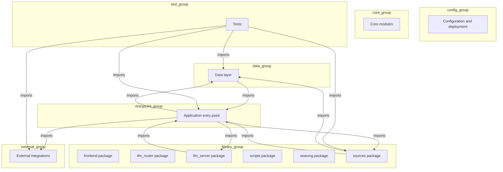

# Architecture report: Fosowl/agenticSeek

> Automated static analysis. **Observed** = directly seen in files/imports/AST; **Inferred** = interpretation from that evidence. Repository code was not executed.

## 1. Repository at a glance

| Item | Value |
| --- | --- |
| Repository | Fosowl/agenticSeek |
| Description | Fully Local Manus AI. No APIs, No $200 monthly bills. Enjoy an autonomous agent that thinks, browses the web, and code for the sole cost of electricity. |
| Language | Python |
| Stars | 27658 |
| Licence | GPL-3.0 |
| Analysed commit / branch | 4f5f924c1eb326b4163d3bf942954dcc7dd7875b / main |
| Framework(s) | FastAPI, Flask, React, Starlette |
| Files analysed | 164 |
| Components | 12 |

## 2. Architecture in one minute

Fosowl/agenticSeek - Fully Local Manus AI. No APIs, No $200 monthly bills. Enjoy an autonomous agent that thinks, browses the web, and code for the sole cost of electricity.. This repository was analysed statically from 164 file(s) (77 Python). Detected technologies (observed from imports/manifests): Redis, FastAPI, Flask, React, Starlette, axios. Files are grouped into 12 component(s): Configuration and deployment, Core modules, Data layer, Application entry point, External integrations, frontend package, llm_router package, llm_server package. Observed entry point(s): api.py, cli.py, llm_server/app.py. Findings below distinguish observed facts from inferred interpretation.

## 3. High-level block diagram

## 4. Main components

### Configuration and deployment (`config`)

- **Kind:** config
- **Status:** Observed
- **Confidence:** 0.85
- **Responsibility:** Groups 15 file(s) under configuration and deployment (observed from repository paths and static analysis).
- **Paths:** `Dockerfile.backend`, `config.ini`, `docker-compose.yml`, `frontend/Dockerfile.frontend`, `frontend/agentic-seek-front/package.json`, `frontend/agentic-seek-front/public/manifest.json`, `llm_router/config.json`, `llm_server/Dockerfile`, `llm_server/requirements.txt`, `pyproject.toml`, `requirements.txt`, `searxng/docker-compose.yml`, `searxng/limiter.toml`, `searxng/settings.yml`, `setup.py`
- **Evidence:** [Dockerfile.backend](https://github.com/Fosowl/agenticSeek/blob/4f5f924c1eb326b4163d3bf942954dcc7dd7875b/Dockerfile.backend); [config.ini](https://github.com/Fosowl/agenticSeek/blob/4f5f924c1eb326b4163d3bf942954dcc7dd7875b/config.ini); [docker-compose.yml](https://github.com/Fosowl/agenticSeek/blob/4f5f924c1eb326b4163d3bf942954dcc7dd7875b/docker-compose.yml); [frontend/Dockerfile.frontend](https://github.com/Fosowl/agenticSeek/blob/4f5f924c1eb326b4163d3bf942954dcc7dd7875b/frontend/Dockerfile.frontend); [frontend/agentic-seek-front/package.json](https://github.com/Fosowl/agenticSeek/blob/4f5f924c1eb326b4163d3bf942954dcc7dd7875b/frontend/agentic-seek-front/package.json); [frontend/agentic-seek-front/public/manifest.json](https://github.com/Fosowl/agenticSeek/blob/4f5f924c1eb326b4163d3bf942954dcc7dd7875b/frontend/agentic-seek-front/public/manifest.json); [llm_router/config.json](https://github.com/Fosowl/agenticSeek/blob/4f5f924c1eb326b4163d3bf942954dcc7dd7875b/llm_router/config.json); [llm_server/Dockerfile](https://github.com/Fosowl/agenticSeek/blob/4f5f924c1eb326b4163d3bf942954dcc7dd7875b/llm_server/Dockerfile)

### Core modules (`core`)

- **Kind:** core
- **Status:** Observed
- **Confidence:** 0.85
- **Responsibility:** Groups 2 file(s) under core modules (observed from repository paths and static analysis).
- **Paths:** `install.sh`, `start_services.sh`
- **Evidence:** [install.sh](https://github.com/Fosowl/agenticSeek/blob/4f5f924c1eb326b4163d3bf942954dcc7dd7875b/install.sh); [start_services.sh](https://github.com/Fosowl/agenticSeek/blob/4f5f924c1eb326b4163d3bf942954dcc7dd7875b/start_services.sh)

### Data layer (`data_layer`)

- **Kind:** data
- **Status:** Observed
- **Confidence:** 0.85
- **Responsibility:** Groups 1 file(s) under data layer (observed from repository paths and static analysis). Observed top-level classes: QueryRequest, QueryResponse, executorResult.
- **Paths:** `sources/schemas.py`
- **Evidence:** [sources/schemas.py:6](https://github.com/Fosowl/agenticSeek/blob/4f5f924c1eb326b4163d3bf942954dcc7dd7875b/sources/schemas.py#L6)

### Application entry point (`entrypoint`)

- **Kind:** entrypoint
- **Status:** Observed
- **Confidence:** 0.85
- **Responsibility:** Groups 35 file(s) under application entry point (observed from repository paths and static analysis). Observed application object created via Celery, FastAPI, Flask. Observed routes: GET /screenshot, GET /health, GET /is_active, GET /stop, GET /latest_answer. Observed top-level classes: Action, AgentRouter, BashInterpreter, Browser, BrowserAgent, CInterpreter. Observed top-level functions: _agent_profile_in_use, _binary_user_data_dir, _browser_process_names, _browser_process_running, _chrome_override_path, _clean_upload_name.
- **Paths:** `api.py`, `cli.py`, `llm_server/app.py`, `llm_server/sources/generator.py`, `llm_server/sources/ollama_handler.py`, `sources/agents/browser_agent.py`, `sources/agents/casual_agent.py`, `sources/agents/code_agent.py`, `sources/agents/file_agent.py`, `sources/agents/mcp_agent.py`, `sources/api_auth.py`, `sources/browser.py`, `sources/browser_session_import.py`, `sources/files_api.py`, `sources/language.py`, `sources/llm_provider.py`, `sources/logger.py`, `sources/memory.py`, `sources/router.py`, `sources/speech_to_text.py`, `sources/text_to_speech.py`, `sources/tools/BashInterpreter.py`, `sources/tools/C_Interpreter.py`, `sources/tools/GoInterpreter.py`, `sources/tools/JavaInterpreter.py`, `sources/tools/PyInterpreter.py`, `sources/tools/fileFinder.py`, `sources/tools/flightSearch.py`, `sources/tools/mcpFinder.py`, `sources/tools/safety.py`, `sources/tools/sandbox.py`, `sources/tools/searxSearch.py`, `sources/tools/tools.py`, `sources/tools/webSearch.py`, `sources/utility.py`
- **Evidence:** [api.py:51](https://github.com/Fosowl/agenticSeek/blob/4f5f924c1eb326b4163d3bf942954dcc7dd7875b/api.py#L51); [cli.py:21](https://github.com/Fosowl/agenticSeek/blob/4f5f924c1eb326b4163d3bf942954dcc7dd7875b/cli.py#L21); [llm_server/app.py:15](https://github.com/Fosowl/agenticSeek/blob/4f5f924c1eb326b4163d3bf942954dcc7dd7875b/llm_server/app.py#L15); [llm_server/sources/generator.py:7](https://github.com/Fosowl/agenticSeek/blob/4f5f924c1eb326b4163d3bf942954dcc7dd7875b/llm_server/sources/generator.py#L7); [llm_server/sources/ollama_handler.py:7](https://github.com/Fosowl/agenticSeek/blob/4f5f924c1eb326b4163d3bf942954dcc7dd7875b/llm_server/sources/ollama_handler.py#L7); [sources/agents/browser_agent.py:15](https://github.com/Fosowl/agenticSeek/blob/4f5f924c1eb326b4163d3bf942954dcc7dd7875b/sources/agents/browser_agent.py#L15); [sources/agents/casual_agent.py:11](https://github.com/Fosowl/agenticSeek/blob/4f5f924c1eb326b4163d3bf942954dcc7dd7875b/sources/agents/casual_agent.py#L11); [sources/agents/code_agent.py:15](https://github.com/Fosowl/agenticSeek/blob/4f5f924c1eb326b4163d3bf942954dcc7dd7875b/sources/agents/code_agent.py#L15)

### External integrations (`external_integrations`)

- **Kind:** external
- **Status:** Inferred
- **Confidence:** 0.70
- **Responsibility:** Groups 0 file(s) under external integrations (observed from repository paths and static analysis).
- **Evidence:** [sources/browser.py:20](https://github.com/Fosowl/agenticSeek/blob/4f5f924c1eb326b4163d3bf942954dcc7dd7875b/sources/browser.py#L20); [sources/browser_session_import.py:219](https://github.com/Fosowl/agenticSeek/blob/4f5f924c1eb326b4163d3bf942954dcc7dd7875b/sources/browser_session_import.py#L219); [sources/llm_provider.py:3](https://github.com/Fosowl/agenticSeek/blob/4f5f924c1eb326b4163d3bf942954dcc7dd7875b/sources/llm_provider.py#L3); [sources/llm_provider.py:8](https://github.com/Fosowl/agenticSeek/blob/4f5f924c1eb326b4163d3bf942954dcc7dd7875b/sources/llm_provider.py#L8); [sources/tools/flightSearch.py:2](https://github.com/Fosowl/agenticSeek/blob/4f5f924c1eb326b4163d3bf942954dcc7dd7875b/sources/tools/flightSearch.py#L2); [sources/tools/mcpFinder.py:2](https://github.com/Fosowl/agenticSeek/blob/4f5f924c1eb326b4163d3bf942954dcc7dd7875b/sources/tools/mcpFinder.py#L2)

### frontend package (`frontend`)

- **Kind:** library
- **Status:** Observed
- **Confidence:** 0.85
- **Responsibility:** Groups 18 file(s) under frontend package (observed from repository paths and static analysis).
- **Paths:** `frontend/agentic-seek-front/mock-backend.js`, `frontend/agentic-seek-front/src/App.js`, `frontend/agentic-seek-front/src/App.test.js`, `frontend/agentic-seek-front/src/apiAuth.js`, `frontend/agentic-seek-front/src/blocks.js`, `frontend/agentic-seek-front/src/blocks.test.js`, `frontend/agentic-seek-front/src/components/Agent.js`, `frontend/agentic-seek-front/src/components/DockLayout.js`, `frontend/agentic-seek-front/src/components/FileExplorer.js`, `frontend/agentic-seek-front/src/components/SettingsDialog.js`, `frontend/agentic-seek-front/src/components/ThemeToggle.js`, `frontend/agentic-seek-front/src/components/TokenPrompt.js`, `frontend/agentic-seek-front/src/contexts/ThemeContext.js`, `frontend/agentic-seek-front/src/index.js`, `frontend/agentic-seek-front/src/reportWebVitals.js`, `frontend/agentic-seek-front/src/settings.js`, `frontend/agentic-seek-front/src/settings.test.js`, `frontend/agentic-seek-front/src/setupTests.js`
- **Evidence:** [frontend/agentic-seek-front/mock-backend.js](https://github.com/Fosowl/agenticSeek/blob/4f5f924c1eb326b4163d3bf942954dcc7dd7875b/frontend/agentic-seek-front/mock-backend.js); [frontend/agentic-seek-front/src/App.js](https://github.com/Fosowl/agenticSeek/blob/4f5f924c1eb326b4163d3bf942954dcc7dd7875b/frontend/agentic-seek-front/src/App.js); [frontend/agentic-seek-front/src/App.test.js](https://github.com/Fosowl/agenticSeek/blob/4f5f924c1eb326b4163d3bf942954dcc7dd7875b/frontend/agentic-seek-front/src/App.test.js); [frontend/agentic-seek-front/src/apiAuth.js](https://github.com/Fosowl/agenticSeek/blob/4f5f924c1eb326b4163d3bf942954dcc7dd7875b/frontend/agentic-seek-front/src/apiAuth.js); [frontend/agentic-seek-front/src/blocks.js](https://github.com/Fosowl/agenticSeek/blob/4f5f924c1eb326b4163d3bf942954dcc7dd7875b/frontend/agentic-seek-front/src/blocks.js); [frontend/agentic-seek-front/src/blocks.test.js](https://github.com/Fosowl/agenticSeek/blob/4f5f924c1eb326b4163d3bf942954dcc7dd7875b/frontend/agentic-seek-front/src/blocks.test.js); [frontend/agentic-seek-front/src/components/Agent.js](https://github.com/Fosowl/agenticSeek/blob/4f5f924c1eb326b4163d3bf942954dcc7dd7875b/frontend/agentic-seek-front/src/components/Agent.js); [frontend/agentic-seek-front/src/components/DockLayout.js](https://github.com/Fosowl/agenticSeek/blob/4f5f924c1eb326b4163d3bf942954dcc7dd7875b/frontend/agentic-seek-front/src/components/DockLayout.js)

### llm_router package (`llm_router`)

- **Kind:** library
- **Status:** Observed
- **Confidence:** 0.85
- **Responsibility:** Groups 1 file(s) under llm_router package (observed from repository paths and static analysis).
- **Paths:** `llm_router/dl_safetensors.sh`
- **Evidence:** [llm_router/dl_safetensors.sh](https://github.com/Fosowl/agenticSeek/blob/4f5f924c1eb326b4163d3bf942954dcc7dd7875b/llm_router/dl_safetensors.sh)

### llm_server package (`llm_server`)

- **Kind:** library
- **Status:** Observed
- **Confidence:** 0.85
- **Responsibility:** Groups 4 file(s) under llm_server package (observed from repository paths and static analysis). Observed top-level classes: Cache, LlamacppLLM. Observed top-level functions: timer_decorator.
- **Paths:** `llm_server/install.sh`, `llm_server/sources/cache.py`, `llm_server/sources/decorator.py`, `llm_server/sources/llamacpp_handler.py`
- **Evidence:** [llm_server/install.sh](https://github.com/Fosowl/agenticSeek/blob/4f5f924c1eb326b4163d3bf942954dcc7dd7875b/llm_server/install.sh); [llm_server/sources/cache.py:5](https://github.com/Fosowl/agenticSeek/blob/4f5f924c1eb326b4163d3bf942954dcc7dd7875b/llm_server/sources/cache.py#L5); [llm_server/sources/decorator.py:2](https://github.com/Fosowl/agenticSeek/blob/4f5f924c1eb326b4163d3bf942954dcc7dd7875b/llm_server/sources/decorator.py#L2); [llm_server/sources/llamacpp_handler.py:6](https://github.com/Fosowl/agenticSeek/blob/4f5f924c1eb326b4163d3bf942954dcc7dd7875b/llm_server/sources/llamacpp_handler.py#L6)

### scripts package (`scripts`)

- **Kind:** library
- **Status:** Observed
- **Confidence:** 0.85
- **Responsibility:** Groups 3 file(s) under scripts package (observed from repository paths and static analysis).
- **Paths:** `scripts/docker_start.sh`, `scripts/linux_install.sh`, `scripts/macos_install.sh`
- **Evidence:** [scripts/docker_start.sh](https://github.com/Fosowl/agenticSeek/blob/4f5f924c1eb326b4163d3bf942954dcc7dd7875b/scripts/docker_start.sh); [scripts/linux_install.sh](https://github.com/Fosowl/agenticSeek/blob/4f5f924c1eb326b4163d3bf942954dcc7dd7875b/scripts/linux_install.sh); [scripts/macos_install.sh](https://github.com/Fosowl/agenticSeek/blob/4f5f924c1eb326b4163d3bf942954dcc7dd7875b/scripts/macos_install.sh)

### searxng package (`searxng`)

- **Kind:** library
- **Status:** Observed
- **Confidence:** 0.85
- **Responsibility:** Groups 1 file(s) under searxng package (observed from repository paths and static analysis).
- **Paths:** `searxng/setup_searxng.sh`
- **Evidence:** [searxng/setup_searxng.sh](https://github.com/Fosowl/agenticSeek/blob/4f5f924c1eb326b4163d3bf942954dcc7dd7875b/searxng/setup_searxng.sh)

### sources package (`sources`)

- **Kind:** library
- **Status:** Observed
- **Confidence:** 0.85
- **Responsibility:** Groups 12 file(s) under sources package (observed from repository paths and static analysis). Observed top-level classes: Agent, AgenticSeekError, BrowserIdentity, Interaction, PlannerAgent, ProviderContext. Observed top-level functions: _atomic_write_json, _attr, _connection_help, _detail, _exception_chain, _explain.
- **Paths:** `sources/agents/__init__.py`, `sources/agents/agent.py`, `sources/agents/planner_agent.py`, `sources/browser_identity.py`, `sources/crx_utils.py`, `sources/echo_filter.py`, `sources/errors.py`, `sources/interaction.py`, `sources/tools/__init__.py`, `sources/web_scripts/find_inputs.js`, `sources/web_scripts/spoofing.js`, `sources/workspace.py`
- **Evidence:** [sources/agents/__init__.py](https://github.com/Fosowl/agenticSeek/blob/4f5f924c1eb326b4163d3bf942954dcc7dd7875b/sources/agents/__init__.py); [sources/agents/agent.py:19](https://github.com/Fosowl/agenticSeek/blob/4f5f924c1eb326b4163d3bf942954dcc7dd7875b/sources/agents/agent.py#L19); [sources/agents/planner_agent.py:14](https://github.com/Fosowl/agenticSeek/blob/4f5f924c1eb326b4163d3bf942954dcc7dd7875b/sources/agents/planner_agent.py#L14); [sources/browser_identity.py:120](https://github.com/Fosowl/agenticSeek/blob/4f5f924c1eb326b4163d3bf942954dcc7dd7875b/sources/browser_identity.py#L120); [sources/crx_utils.py:24](https://github.com/Fosowl/agenticSeek/blob/4f5f924c1eb326b4163d3bf942954dcc7dd7875b/sources/crx_utils.py#L24); [sources/echo_filter.py:8](https://github.com/Fosowl/agenticSeek/blob/4f5f924c1eb326b4163d3bf942954dcc7dd7875b/sources/echo_filter.py#L8); [sources/errors.py:22](https://github.com/Fosowl/agenticSeek/blob/4f5f924c1eb326b4163d3bf942954dcc7dd7875b/sources/errors.py#L22); [sources/interaction.py:21](https://github.com/Fosowl/agenticSeek/blob/4f5f924c1eb326b4163d3bf942954dcc7dd7875b/sources/interaction.py#L21)

### Tests (`tests`)

- **Kind:** test
- **Status:** Observed
- **Confidence:** 0.85
- **Responsibility:** Groups 27 file(s) under tests (observed from repository paths and static analysis). Observed application object created via FastAPI. Observed routes: PATCH sources.browser.subprocess.run, PATCH sources.browser.subprocess.run, PATCH sources.browser.subprocess.run, PATCH sources.browser.chromedriver_autoinstaller.get_chrome_version, PATCH sources.browser.get_chromedriver_version. Observed top-level classes: FakeDriver, FilesApiTestCase, InterpreterTestCase, TestAgentAddTool, TestBashInterpreter, TestBrowserAgentFormFilling. Observed top-level functions: _build_protected_app, bare_browser, html_…
- **Paths:** `tests/test_agent_regressions.py`, `tests/test_api_auth.py`, `tests/test_browser_agent_parsing.py`, `tests/test_browser_identity.py`, `tests/test_browser_profile.py`, `tests/test_browser_realism.py`, `tests/test_browser_session_import.py`, `tests/test_chromedriver_update.py`, `tests/test_crx_utils.py`, `tests/test_deepseek_provider.py`, `tests/test_errors.py`, `tests/test_files_api.py`, `tests/test_interpreters.py`, `tests/test_litellm_provider.py`, `tests/test_logger.py`, `tests/test_memory.py`, `tests/test_minimax_provider.py`, `tests/test_planner_agent_parsing.py`, `tests/test_provider.py`, `tests/test_safe_mode.py`, `tests/test_safety.py`, `tests/test_sandbox.py`, `tests/test_searx_search.py`, `tests/test_spoofing_static.py`, `tests/test_tools_parsing.py`, `tests/test_utility.py`, `tests/test_workspace.py`
- **Evidence:** [tests/test_agent_regressions.py:30](https://github.com/Fosowl/agenticSeek/blob/4f5f924c1eb326b4163d3bf942954dcc7dd7875b/tests/test_agent_regressions.py#L30); [tests/test_api_auth.py:26](https://github.com/Fosowl/agenticSeek/blob/4f5f924c1eb326b4163d3bf942954dcc7dd7875b/tests/test_api_auth.py#L26); [tests/test_browser_agent_parsing.py:25](https://github.com/Fosowl/agenticSeek/blob/4f5f924c1eb326b4163d3bf942954dcc7dd7875b/tests/test_browser_agent_parsing.py#L25); [tests/test_browser_identity.py:16](https://github.com/Fosowl/agenticSeek/blob/4f5f924c1eb326b4163d3bf942954dcc7dd7875b/tests/test_browser_identity.py#L16); [tests/test_browser_profile.py:31](https://github.com/Fosowl/agenticSeek/blob/4f5f924c1eb326b4163d3bf942954dcc7dd7875b/tests/test_browser_profile.py#L31); [tests/test_browser_realism.py:25](https://github.com/Fosowl/agenticSeek/blob/4f5f924c1eb326b4163d3bf942954dcc7dd7875b/tests/test_browser_realism.py#L25); [tests/test_browser_session_import.py:34](https://github.com/Fosowl/agenticSeek/blob/4f5f924c1eb326b4163d3bf942954dcc7dd7875b/tests/test_browser_session_import.py#L34); [tests/test_chromedriver_update.py:26](https://github.com/Fosowl/agenticSeek/blob/4f5f924c1eb326b4163d3bf942954dcc7dd7875b/tests/test_chromedriver_update.py#L26)

## 5. Execution flow

**Observed** entry point(s):

- [api.py:51](https://github.com/Fosowl/agenticSeek/blob/4f5f924c1eb326b4163d3bf942954dcc7dd7875b/api.py#L51)
- [cli.py:79](https://github.com/Fosowl/agenticSeek/blob/4f5f924c1eb326b4163d3bf942954dcc7dd7875b/cli.py#L79)
- [llm_server/app.py:15](https://github.com/Fosowl/agenticSeek/blob/4f5f924c1eb326b4163d3bf942954dcc7dd7875b/llm_server/app.py#L15)
- [llm_server/sources/generator.py:65](https://github.com/Fosowl/agenticSeek/blob/4f5f924c1eb326b4163d3bf942954dcc7dd7875b/llm_server/sources/generator.py#L65)
- [llm_server/sources/ollama_handler.py:49](https://github.com/Fosowl/agenticSeek/blob/4f5f924c1eb326b4163d3bf942954dcc7dd7875b/llm_server/sources/ollama_handler.py#L49)
- [sources/agents/browser_agent.py:447](https://github.com/Fosowl/agenticSeek/blob/4f5f924c1eb326b4163d3bf942954dcc7dd7875b/sources/agents/browser_agent.py#L447)
- [sources/agents/casual_agent.py:34](https://github.com/Fosowl/agenticSeek/blob/4f5f924c1eb326b4163d3bf942954dcc7dd7875b/sources/agents/casual_agent.py#L34)
- [sources/agents/code_agent.py:88](https://github.com/Fosowl/agenticSeek/blob/4f5f924c1eb326b4163d3bf942954dcc7dd7875b/sources/agents/code_agent.py#L88)
- [sources/agents/file_agent.py:89](https://github.com/Fosowl/agenticSeek/blob/4f5f924c1eb326b4163d3bf942954dcc7dd7875b/sources/agents/file_agent.py#L89)
- [sources/agents/mcp_agent.py:77](https://github.com/Fosowl/agenticSeek/blob/4f5f924c1eb326b4163d3bf942954dcc7dd7875b/sources/agents/mcp_agent.py#L77)
- [sources/api_auth.py:183](https://github.com/Fosowl/agenticSeek/blob/4f5f924c1eb326b4163d3bf942954dcc7dd7875b/sources/api_auth.py#L183)
- [sources/browser.py:1318](https://github.com/Fosowl/agenticSeek/blob/4f5f924c1eb326b4163d3bf942954dcc7dd7875b/sources/browser.py#L1318)

**Observed** routes (from decorators):

- `GET /screenshot` -> `get_screenshot` in `api.py:159`
- `GET /health` -> `health_check` in `api.py:171`
- `GET /is_active` -> `is_active` in `api.py:176`
- `GET /stop` -> `stop` in `api.py:181`
- `GET /latest_answer` -> `get_latest_answer` in `api.py:187`
- `POST /query` -> `process_query` in `api.py:234`
- `ROUTE /generate` -> `start_generation` in `llm_server/app.py:27`
- `ROUTE /setup` -> `setup` in `llm_server/app.py:37`
- `ROUTE /get_updated_sentence` -> `get_updated_sentence` in `llm_server/app.py:46`
- `GET /list` -> `list_directory` in `sources/files_api.py:90`
- `GET /content` -> `read_file` in `sources/files_api.py:124`
- `GET /raw` -> `raw_image` in `sources/files_api.py:161`
- `POST /upload` -> `upload_files` in `sources/files_api.py:303`
- `PATCH sources.browser.subprocess.run` -> `test_get_chromedriver_version_success` in `tests/test_chromedriver_update.py:40`
- `PATCH sources.browser.subprocess.run` -> `test_get_chromedriver_version_failure` in `tests/test_chromedriver_update.py:48`
- `PATCH sources.browser.subprocess.run` -> `test_get_chromedriver_version_timeout` in `tests/test_chromedriver_update.py:54`
- `PATCH sources.browser.chromedriver_autoinstaller.get_chrome_version` -> `test_compatible_versions` in `tests/test_chromedriver_update.py:62`
- `PATCH sources.browser.get_chromedriver_version` -> `test_compatible_versions` in `tests/test_chromedriver_update.py:62`
- `PATCH sources.browser.chromedriver_autoinstaller.get_chrome_version` -> `test_incompatible_versions` in `tests/test_chromedriver_update.py:70`
- `PATCH sources.browser.get_chromedriver_version` -> `test_incompatible_versions` in `tests/test_chromedriver_update.py:70`
- `PATCH sources.browser.chromedriver_autoinstaller.get_chrome_version` -> `test_no_chrome_version_assumes_compatible` in `tests/test_chromedriver_update.py:77`
- `PATCH sources.browser.chromedriver_autoinstaller.get_chrome_version` -> `test_no_driver_version_assumes_compatible` in `tests/test_chromedriver_update.py:84`
- `PATCH sources.browser.get_chromedriver_version` -> `test_no_driver_version_assumes_compatible` in `tests/test_chromedriver_update.py:84`
- `PATCH sources.browser.subprocess.run` -> `test_override_browser_version_drives_compatibility` in `tests/test_chromedriver_update.py:91`
- `PATCH sources.llm_provider.OpenAI` -> `test_deepseek_forwards_configured_model` in `tests/test_deepseek_provider.py:17`
- `PATCH sources.llm_provider.OpenAI` -> `test_deepseek_local_not_supported` in `tests/test_deepseek_provider.py:35`
- `PATCH sources.llm_provider.OpenAI` -> `test_deepseek_returns_response_content` in `tests/test_deepseek_provider.py:46`
- `PATCH litellm.completion` -> `test_litellm_fn_returns_content` in `tests/test_litellm_provider.py:39`
- `PATCH litellm.completion` -> `test_litellm_fn_passes_drop_params` in `tests/test_litellm_provider.py:52`
- `PATCH litellm.completion` -> `test_litellm_fn_passes_model` in `tests/test_litellm_provider.py:65`
- `PATCH litellm.completion` -> `test_litellm_fn_passes_api_key_from_env` in `tests/test_litellm_provider.py:79`
- `PATCH litellm.completion` -> `test_litellm_fn_omits_api_key_when_not_set` in `tests/test_litellm_provider.py:93`
- `PATCH litellm.completion` -> `test_litellm_fn_raises_on_empty_response` in `tests/test_litellm_provider.py:106`
- `PATCH litellm.completion` -> `test_respond_explains_api_error` in `tests/test_litellm_provider.py:116`
- `PATCH sources.llm_provider.OpenAI` -> `test_minimax_local_not_supported` in `tests/test_minimax_provider.py:36`
- `PATCH sources.llm_provider.OpenAI` -> `test_minimax_uses_correct_base_url` in `tests/test_minimax_provider.py:47`
- `PATCH sources.llm_provider.OpenAI` -> `test_minimax_custom_base_url` in `tests/test_minimax_provider.py:70`
- `PATCH sources.llm_provider.requests.post` -> `test_minimax_anthropic_compatible_base_urls` in `tests/test_minimax_provider.py:89`
- `PATCH sources.llm_provider.OpenAI` -> `test_minimax_uses_temperature_one` in `tests/test_minimax_provider.py:133`
- `PATCH sources.llm_provider.OpenAI` -> `test_minimax_returns_response_content` in `tests/test_minimax_provider.py:151`
- `PATCH sources.llm_provider.OpenAI` -> `test_minimax_handles_empty_response` in `tests/test_minimax_provider.py:168`
- `PATCH sources.llm_provider.OpenAI` -> `test_minimax_respond_explains_api_error` in `tests/test_minimax_provider.py:184`
- `PATCH sources.llm_provider.OpenAI` -> `test_minimax_m3_model` in `tests/test_minimax_provider.py:204`
- `PATCH sources.llm_provider.OpenAI` -> `test_minimax_m27_model` in `tests/test_minimax_provider.py:222`
- `PATCH sources.llm_provider.OpenAI` -> `test_minimax_m27_highspeed_model` in `tests/test_minimax_provider.py:240`
- `PATCH sources.tools.searxSearch.requests.post` -> `test_dropped_connection_is_retried` in `tests/test_searx_search.py:118`
- `PATCH sources.tools.searxSearch.requests.post` -> `test_http_429_is_retried_honouring_retry_after` in `tests/test_searx_search.py:125`
- `PATCH sources.tools.searxSearch.requests.get` -> `test_blocked_engines_retry_then_raise` in `tests/test_searx_search.py:134`
- `PATCH sources.tools.searxSearch.requests.post` -> `test_blocked_engines_retry_then_raise` in `tests/test_searx_search.py:134`
- `PATCH sources.tools.searxSearch.requests.get` -> `test_no_results_with_healthy_engines_raises_without_retry` in `tests/test_searx_search.py:148`
- `PATCH sources.tools.searxSearch.requests.post` -> `test_no_results_with_healthy_engines_raises_without_retry` in `tests/test_searx_search.py:148`

Representative flow (derived from observed entry points and the import graph; steps beyond the entry point are **Inferred**):

1. Execution starts at an observed entry point listed above, if present.
2. `data_layer` imports `entrypoint` (Data layer -> Application entry point).
3. `entrypoint` imports `data_layer` (Application entry point -> Data layer).
4. `entrypoint` imports `external_integrations` (Application entry point -> External integrations).
5. `entrypoint` imports `llm_server` (Application entry point -> llm_server package).
6. `entrypoint` imports `sources` (Application entry point -> sources package).
7. `llm_server` imports `entrypoint` (llm_server package -> Application entry point).
8. `sources` imports `data_layer` (sources package -> Data layer).
9. `sources` imports `entrypoint` (sources package -> Application entry point).

## 6. Project structure

### `(root)`

- `.dockerignore` - container (183 bytes)
- `.env.example` - config (3115 bytes)
- `.gitignore` - other (3854 bytes)
- `.pre-commit-config.yaml` - config (299 bytes)
- `.python-version` - other (5 bytes)
- `Dockerfile.backend` - container (3214 bytes)
- `LICENSE` - docs (35149 bytes)
- `README.md` - docs (44172 bytes)
- `README_CHS.md` - docs (38699 bytes)
- `README_CHT.md` - docs (38594 bytes)
- `README_ES.md` - docs (43175 bytes)
- `README_FR.md` - docs (45031 bytes)
- `README_JP.md` - docs (50800 bytes)
- `README_PTBR.md` - docs (42913 bytes)
- `README_TR.md` - docs (44564 bytes)
- `SECURITY.md` - docs (1257 bytes)
- `api.py` - source, Python (12768 bytes)
- `cli.py` - source, Python (3449 bytes)
- `config.ini` - config (384 bytes)
- `docker-compose.yml` - container (4250 bytes)
- `install.bat` - other (291 bytes)
- `install.sh` - source, Shell (1119 bytes)
- `pyproject.toml` - manifest (1385 bytes)
- `requirements.txt` - manifest (930 bytes)
- `setup.py` - manifest, Python (2225 bytes)
- `start_services.cmd` - other (1258 bytes)
- `start_services.sh` - source, Shell (5908 bytes)

### `.github`

- `.github/FUNDING.yml` - config (143 bytes)
- `.github/ISSUE_TEMPLATE/bug_report.md` - docs (733 bytes)
- `.github/ISSUE_TEMPLATE/feature_request.md` - docs (595 bytes)

### `docker`

- `docker/fonts.local.conf` - other (1844 bytes)

### `docs`

- `docs/CODE_OF_CONDUCT.md` - docs (5533 bytes)
- `docs/CONTRIBUTING.md` - docs (12240 bytes)

### `frontend`

- `frontend/.gitignore` - other (310 bytes)
- `frontend/Dockerfile.frontend` - container (430 bytes)
- `frontend/README.md` - docs (3359 bytes)
- `frontend/agentic-seek-front/mock-backend.js` - source, JavaScript (9767 bytes)
- `frontend/agentic-seek-front/package.json` - manifest (945 bytes)
- `frontend/agentic-seek-front/public/index.html` - other (527 bytes)
- `frontend/agentic-seek-front/public/manifest.json` - config (492 bytes)
- `frontend/agentic-seek-front/public/robots.txt` - docs (67 bytes)
- `frontend/agentic-seek-front/src/App.css` - other (22180 bytes)
- `frontend/agentic-seek-front/src/App.js` - source, JavaScript (32163 bytes)
- `frontend/agentic-seek-front/src/App.test.js` - source, JavaScript (2811 bytes)
- `frontend/agentic-seek-front/src/apiAuth.js` - source, JavaScript (1843 bytes)
- `frontend/agentic-seek-front/src/blocks.js` - source, JavaScript (1734 bytes)
- `frontend/agentic-seek-front/src/blocks.test.js` - source, JavaScript (1551 bytes)
- `frontend/agentic-seek-front/src/components/Agent.js` - source, JavaScript (2186 bytes)
- `frontend/agentic-seek-front/src/components/DockLayout.css` - other (1734 bytes)
- `frontend/agentic-seek-front/src/components/DockLayout.js` - source, JavaScript (3026 bytes)
- `frontend/agentic-seek-front/src/components/FileExplorer.css` - other (4153 bytes)
- `frontend/agentic-seek-front/src/components/FileExplorer.js` - source, JavaScript (8762 bytes)
- `frontend/agentic-seek-front/src/components/SettingsDialog.css` - other (7062 bytes)
- `frontend/agentic-seek-front/src/components/SettingsDialog.js` - source, JavaScript (13963 bytes)
- `frontend/agentic-seek-front/src/components/ThemeToggle.js` - source, JavaScript (1079 bytes)
- `frontend/agentic-seek-front/src/components/TokenPrompt.js` - source, JavaScript (2391 bytes)
- `frontend/agentic-seek-front/src/contexts/ThemeContext.js` - source, JavaScript (1621 bytes)
- `frontend/agentic-seek-front/src/index.js` - source, JavaScript (363 bytes)
- `frontend/agentic-seek-front/src/reportWebVitals.js` - source, JavaScript (362 bytes)
- `frontend/agentic-seek-front/src/settings.js` - source, JavaScript (6139 bytes)
- `frontend/agentic-seek-front/src/settings.test.js` - source, JavaScript (1452 bytes)
- `frontend/agentic-seek-front/src/setupTests.js` - source, JavaScript (241 bytes)
- `frontend/agentic-seek-front/src/styles/globals.css` - other (4438 bytes)

### `llm_router`

- `llm_router/config.json` - config (747 bytes)
- `llm_router/dl_safetensors.sh` - source, Shell (1148 bytes)

### `llm_server`

- `llm_server/Dockerfile` - container (267 bytes)
- `llm_server/app.py` - source, Python (1844 bytes)
- `llm_server/install.sh` - source, Shell (170 bytes)
- `llm_server/requirements.txt` - manifest (61 bytes)
- `llm_server/sources/cache.py` - source, Python (1401 bytes)
- `llm_server/sources/decorator.py` - source, Python (467 bytes)
- `llm_server/sources/generator.py` - source, Python (2007 bytes)
- `llm_server/sources/llamacpp_handler.py` - source, Python (1293 bytes)
- `llm_server/sources/ollama_handler.py` - source, Python (1804 bytes)

### `prompts`

- `prompts/base/browser_agent.txt` - docs (589 bytes)
- `prompts/base/casual_agent.txt` - docs (816 bytes)
- `prompts/base/coder_agent.txt` - docs (1939 bytes)
- `prompts/base/file_agent.txt` - docs (2180 bytes)
- `prompts/base/mcp_agent.txt` - docs (2117 bytes)
- `prompts/base/planner_agent.txt` - docs (3182 bytes)
- `prompts/jarvis/browser_agent.txt` - docs (589 bytes)
- `prompts/jarvis/casual_agent.txt` - docs (2409 bytes)
- `prompts/jarvis/coder_agent.txt` - docs (2667 bytes)
- `prompts/jarvis/file_agent.txt` - docs (2827 bytes)
- `prompts/jarvis/mcp_agent.txt` - docs (2777 bytes)
- `prompts/jarvis/planner_agent.txt` - docs (3089 bytes)

### `scripts`

- `scripts/docker_start.sh` - source, Shell (3465 bytes)
- `scripts/linux_install.sh` - source, Shell (1671 bytes)
- `scripts/macos_install.sh` - source, Shell (1651 bytes)
- `scripts/windows_install.bat` - other (1869 bytes)

### `searxng`

- `searxng/docker-compose.yml` - container (1021 bytes)
- `searxng/limiter.toml` - config (1312 bytes)
- `searxng/settings.yml` - config (1820 bytes)
- `searxng/setup_searxng.sh` - source, Shell (2849 bytes)

### `sources`

- `sources/agents/__init__.py` - source, Python (352 bytes)
- `sources/agents/agent.py` - source, Python (10031 bytes)
- `sources/agents/browser_agent.py` - source, Python (20460 bytes)
- `sources/agents/casual_agent.py` - source, Python (1423 bytes)
- `sources/agents/code_agent.py` - source, Python (3796 bytes)
- `sources/agents/file_agent.py` - source, Python (3783 bytes)
- `sources/agents/mcp_agent.py` - source, Python (2791 bytes)
- `sources/agents/planner_agent.py` - source, Python (14419 bytes)
- `sources/api_auth.py` - source, Python (7060 bytes)
- `sources/browser.py` - source, Python (60836 bytes)
- `sources/browser_identity.py` - source, Python (15716 bytes)
- `sources/browser_session_import.py` - source, Python (23688 bytes)
- `sources/crx_utils.py` - source, Python (3349 bytes)
- `sources/echo_filter.py` - source, Python (2595 bytes)
- `sources/errors.py` - source, Python (20976 bytes)
- `sources/files_api.py` - source, Python (12417 bytes)
- `sources/interaction.py` - source, Python (12151 bytes)
- `sources/language.py` - source, Python (3462 bytes)
- `sources/llm_provider.py` - source, Python (20725 bytes)
- `sources/logger.py` - source, Python (5459 bytes)
- `sources/memory.py` - source, Python (18220 bytes)
- `sources/router.py` - source, Python (33202 bytes)
- `sources/schemas.py` - source, Python (2341 bytes)
- `sources/speech_to_text.py` - source, Python (10041 bytes)
- `sources/text_to_speech.py` - source, Python (8184 bytes)
- `sources/tools/BashInterpreter.py` - source, Python (5117 bytes)
- `sources/tools/C_Interpreter.py` - source, Python (3928 bytes)
- `sources/tools/GoInterpreter.py` - source, Python (3755 bytes)
- `sources/tools/JavaInterpreter.py` - source, Python (6315 bytes)
- `sources/tools/PyInterpreter.py` - source, Python (5029 bytes)
- `sources/tools/__init__.py` - source, Python (262 bytes)
- `sources/tools/fileFinder.py` - source, Python (8385 bytes)
- `sources/tools/flightSearch.py` - source, Python (3596 bytes)
- `sources/tools/mcpFinder.py` - source, Python (4557 bytes)
- `sources/tools/safety.py` - source, Python (9368 bytes)
- `sources/tools/sandbox.py` - source, Python (4941 bytes)
- `sources/tools/searxSearch.py` - source, Python (16965 bytes)
- `sources/tools/tools.py` - source, Python (8158 bytes)
- `sources/tools/webSearch.py` - source, Python (4541 bytes)
- `sources/utility.py` - source, Python (4741 bytes)
- `sources/web_scripts/find_inputs.js` - source, JavaScript (2712 bytes)
- `sources/web_scripts/spoofing.js` - source, JavaScript (7255 bytes)
- `sources/workspace.py` - source, Python (2774 bytes)

### `tests`

- `tests/test_agent_regressions.py` - test, Python (6417 bytes)
- `tests/test_api_auth.py` - test, Python (4941 bytes)
- `tests/test_browser_agent_parsing.py` - test, Python (9136 bytes)
- `tests/test_browser_identity.py` - test, Python (6351 bytes)
- `tests/test_browser_profile.py` - test, Python (3936 bytes)
- `tests/test_browser_realism.py` - test, Python (4807 bytes)
- `tests/test_browser_session_import.py` - test, Python (10361 bytes)
- `tests/test_chromedriver_update.py` - test, Python (4990 bytes)
- `tests/test_crx_utils.py` - test, Python (2409 bytes)
- `tests/test_deepseek_provider.py` - test, Python (2788 bytes)
- `tests/test_errors.py` - test, Python (3929 bytes)
- `tests/test_files_api.py` - test, Python (8762 bytes)
- `tests/test_interpreters.py` - test, Python (6460 bytes)
- `tests/test_litellm_provider.py` - test, Python (5576 bytes)
- `tests/test_logger.py` - test, Python (3233 bytes)
- `tests/test_memory.py` - test, Python (7419 bytes)
- `tests/test_minimax_provider.py` - test, Python (11871 bytes)
- `tests/test_planner_agent_parsing.py` - test, Python (4597 bytes)
- `tests/test_provider.py` - test, Python (2355 bytes)
- `tests/test_safe_mode.py` - test, Python (1634 bytes)
- `tests/test_safety.py` - test, Python (3420 bytes)
- `tests/test_sandbox.py` - test, Python (3525 bytes)
- `tests/test_searx_search.py` - test, Python (7798 bytes)
- `tests/test_spoofing_static.py` - test, Python (1690 bytes)
- `tests/test_tools_parsing.py` - test, Python (7371 bytes)
- `tests/test_utility.py` - test, Python (1468 bytes)
- `tests/test_workspace.py` - test, Python (3506 bytes)

## 7. Key dependencies and integrations

| Name | Category | Status | Confidence | Evidence |
| --- | --- | --- | --- | --- |
| Redis | database | Observed | 0.85 | [.env.example:13](https://github.com/Fosowl/agenticSeek/blob/4f5f924c1eb326b4163d3bf942954dcc7dd7875b/.env.example#L13); [docker-compose.yml:3](https://github.com/Fosowl/agenticSeek/blob/4f5f924c1eb326b4163d3bf942954dcc7dd7875b/docker-compose.yml#L3); [searxng/docker-compose.yml:3](https://github.com/Fosowl/agenticSeek/blob/4f5f924c1eb326b4163d3bf942954dcc7dd7875b/searxng/docker-compose.yml#L3) |
| FastAPI | framework | Observed | 0.95 | [api.py:10](https://github.com/Fosowl/agenticSeek/blob/4f5f924c1eb326b4163d3bf942954dcc7dd7875b/api.py#L10); [api.py:11](https://github.com/Fosowl/agenticSeek/blob/4f5f924c1eb326b4163d3bf942954dcc7dd7875b/api.py#L11); [api.py:12](https://github.com/Fosowl/agenticSeek/blob/4f5f924c1eb326b4163d3bf942954dcc7dd7875b/api.py#L12); [api.py:13](https://github.com/Fosowl/agenticSeek/blob/4f5f924c1eb326b4163d3bf942954dcc7dd7875b/api.py#L13) |
| Flask | framework | Observed | 0.90 | [llm_server/app.py:5](https://github.com/Fosowl/agenticSeek/blob/4f5f924c1eb326b4163d3bf942954dcc7dd7875b/llm_server/app.py#L5); [llm_server/requirements.txt:1](https://github.com/Fosowl/agenticSeek/blob/4f5f924c1eb326b4163d3bf942954dcc7dd7875b/llm_server/requirements.txt#L1); [pyproject.toml:18](https://github.com/Fosowl/agenticSeek/blob/4f5f924c1eb326b4163d3bf942954dcc7dd7875b/pyproject.toml#L18); [requirements.txt:4](https://github.com/Fosowl/agenticSeek/blob/4f5f924c1eb326b4163d3bf942954dcc7dd7875b/requirements.txt#L4) |
| React | framework | Observed | 0.90 | [frontend/agentic-seek-front/package.json:8](https://github.com/Fosowl/agenticSeek/blob/4f5f924c1eb326b4163d3bf942954dcc7dd7875b/frontend/agentic-seek-front/package.json#L8); [frontend/agentic-seek-front/package.json:12](https://github.com/Fosowl/agenticSeek/blob/4f5f924c1eb326b4163d3bf942954dcc7dd7875b/frontend/agentic-seek-front/package.json#L12) |
| Starlette | framework | Observed | 0.95 | [sources/api_auth.py:17](https://github.com/Fosowl/agenticSeek/blob/4f5f924c1eb326b4163d3bf942954dcc7dd7875b/sources/api_auth.py#L17); [sources/api_auth.py:18](https://github.com/Fosowl/agenticSeek/blob/4f5f924c1eb326b4163d3bf942954dcc7dd7875b/sources/api_auth.py#L18) |
| axios | library | Observed | 0.85 | [frontend/agentic-seek-front/package.json:10](https://github.com/Fosowl/agenticSeek/blob/4f5f924c1eb326b4163d3bf942954dcc7dd7875b/frontend/agentic-seek-front/package.json#L10) |
| Celery | library | Observed | 0.90 | [api.py:49](https://github.com/Fosowl/agenticSeek/blob/4f5f924c1eb326b4163d3bf942954dcc7dd7875b/api.py#L49); [pyproject.toml:11](https://github.com/Fosowl/agenticSeek/blob/4f5f924c1eb326b4163d3bf942954dcc7dd7875b/pyproject.toml#L11); [requirements.txt:5](https://github.com/Fosowl/agenticSeek/blob/4f5f924c1eb326b4163d3bf942954dcc7dd7875b/requirements.txt#L5); [setup.py:20](https://github.com/Fosowl/agenticSeek/blob/4f5f924c1eb326b4163d3bf942954dcc7dd7875b/setup.py#L20) |
| Gunicorn | library | Observed | 0.85 | [llm_server/requirements.txt:3](https://github.com/Fosowl/agenticSeek/blob/4f5f924c1eb326b4163d3bf942954dcc7dd7875b/llm_server/requirements.txt#L3) |
| httpx | library | Observed | 0.90 | [pyproject.toml:19](https://github.com/Fosowl/agenticSeek/blob/4f5f924c1eb326b4163d3bf942954dcc7dd7875b/pyproject.toml#L19); [requirements.txt:34](https://github.com/Fosowl/agenticSeek/blob/4f5f924c1eb326b4163d3bf942954dcc7dd7875b/requirements.txt#L34); [setup.py:49](https://github.com/Fosowl/agenticSeek/blob/4f5f924c1eb326b4163d3bf942954dcc7dd7875b/setup.py#L49); [tests/test_errors.py:5](https://github.com/Fosowl/agenticSeek/blob/4f5f924c1eb326b4163d3bf942954dcc7dd7875b/tests/test_errors.py#L5) |
| NumPy | library | Observed | 0.90 | [pyproject.toml:26](https://github.com/Fosowl/agenticSeek/blob/4f5f924c1eb326b4163d3bf942954dcc7dd7875b/pyproject.toml#L26); [requirements.txt:13](https://github.com/Fosowl/agenticSeek/blob/4f5f924c1eb326b4163d3bf942954dcc7dd7875b/requirements.txt#L13); [setup.py:28](https://github.com/Fosowl/agenticSeek/blob/4f5f924c1eb326b4163d3bf942954dcc7dd7875b/setup.py#L28) |
| Pydantic | library | Observed | 0.90 | [pyproject.toml:33](https://github.com/Fosowl/agenticSeek/blob/4f5f924c1eb326b4163d3bf942954dcc7dd7875b/pyproject.toml#L33); [requirements.txt:8](https://github.com/Fosowl/agenticSeek/blob/4f5f924c1eb326b4163d3bf942954dcc7dd7875b/requirements.txt#L8); [setup.py:24](https://github.com/Fosowl/agenticSeek/blob/4f5f924c1eb326b4163d3bf942954dcc7dd7875b/setup.py#L24); [sources/schemas.py:3](https://github.com/Fosowl/agenticSeek/blob/4f5f924c1eb326b4163d3bf942954dcc7dd7875b/sources/schemas.py#L3) |
| requests | library | Observed | 0.95 | [pyproject.toml:40](https://github.com/Fosowl/agenticSeek/blob/4f5f924c1eb326b4163d3bf942954dcc7dd7875b/pyproject.toml#L40); [requirements.txt:12](https://github.com/Fosowl/agenticSeek/blob/4f5f924c1eb326b4163d3bf942954dcc7dd7875b/requirements.txt#L12); [setup.py:26](https://github.com/Fosowl/agenticSeek/blob/4f5f924c1eb326b4163d3bf942954dcc7dd7875b/setup.py#L26); [sources/llm_provider.py:8](https://github.com/Fosowl/agenticSeek/blob/4f5f924c1eb326b4163d3bf942954dcc7dd7875b/sources/llm_provider.py#L8) |
| Uvicorn | library | Observed | 0.90 | [api.py:4](https://github.com/Fosowl/agenticSeek/blob/4f5f924c1eb326b4163d3bf942954dcc7dd7875b/api.py#L4); [pyproject.toml:56](https://github.com/Fosowl/agenticSeek/blob/4f5f924c1eb326b4163d3bf942954dcc7dd7875b/pyproject.toml#L56); [requirements.txt:7](https://github.com/Fosowl/agenticSeek/blob/4f5f924c1eb326b4163d3bf942954dcc7dd7875b/requirements.txt#L7); [setup.py:21](https://github.com/Fosowl/agenticSeek/blob/4f5f924c1eb326b4163d3bf942954dcc7dd7875b/setup.py#L21) |
| Poetry | packaging | Observed | 0.85 | [pyproject.toml](https://github.com/Fosowl/agenticSeek/blob/4f5f924c1eb326b4163d3bf942954dcc7dd7875b/pyproject.toml) |
| setuptools | packaging | Observed | 0.90 | [pyproject.toml:46](https://github.com/Fosowl/agenticSeek/blob/4f5f924c1eb326b4163d3bf942954dcc7dd7875b/pyproject.toml#L46); [requirements.txt:10](https://github.com/Fosowl/agenticSeek/blob/4f5f924c1eb326b4163d3bf942954dcc7dd7875b/requirements.txt#L10); [setup.py:1](https://github.com/Fosowl/agenticSeek/blob/4f5f924c1eb326b4163d3bf942954dcc7dd7875b/setup.py#L1) |
| Docker | tooling | Observed | 0.90 | [Dockerfile.backend](https://github.com/Fosowl/agenticSeek/blob/4f5f924c1eb326b4163d3bf942954dcc7dd7875b/Dockerfile.backend); [frontend/Dockerfile.frontend](https://github.com/Fosowl/agenticSeek/blob/4f5f924c1eb326b4163d3bf942954dcc7dd7875b/frontend/Dockerfile.frontend); [llm_server/Dockerfile](https://github.com/Fosowl/agenticSeek/blob/4f5f924c1eb326b4163d3bf942954dcc7dd7875b/llm_server/Dockerfile) |
| Docker Compose | tooling | Observed | 0.90 | [docker-compose.yml](https://github.com/Fosowl/agenticSeek/blob/4f5f924c1eb326b4163d3bf942954dcc7dd7875b/docker-compose.yml); [searxng/docker-compose.yml](https://github.com/Fosowl/agenticSeek/blob/4f5f924c1eb326b4163d3bf942954dcc7dd7875b/searxng/docker-compose.yml) |
| unittest | tooling | Observed | 0.95 | [tests/test_agent_regressions.py:1](https://github.com/Fosowl/agenticSeek/blob/4f5f924c1eb326b4163d3bf942954dcc7dd7875b/tests/test_agent_regressions.py#L1); [tests/test_agent_regressions.py:5](https://github.com/Fosowl/agenticSeek/blob/4f5f924c1eb326b4163d3bf942954dcc7dd7875b/tests/test_agent_regressions.py#L5); [tests/test_api_auth.py:6](https://github.com/Fosowl/agenticSeek/blob/4f5f924c1eb326b4163d3bf942954dcc7dd7875b/tests/test_api_auth.py#L6); [tests/test_browser_agent_parsing.py:1](https://github.com/Fosowl/agenticSeek/blob/4f5f924c1eb326b4163d3bf942954dcc7dd7875b/tests/test_browser_agent_parsing.py#L1) |

## 8. Data and state

- **Redis** (Observed, confidence 0.85) - evidence: [.env.example:13](https://github.com/Fosowl/agenticSeek/blob/4f5f924c1eb326b4163d3bf942954dcc7dd7875b/.env.example#L13); [docker-compose.yml:3](https://github.com/Fosowl/agenticSeek/blob/4f5f924c1eb326b4163d3bf942954dcc7dd7875b/docker-compose.yml#L3); [searxng/docker-compose.yml:3](https://github.com/Fosowl/agenticSeek/blob/4f5f924c1eb326b4163d3bf942954dcc7dd7875b/searxng/docker-compose.yml#L3)
- Data component `data_layer` (Observed): Groups 1 file(s) under data layer (observed from repository paths and static analysis). Observed top-level classes: QueryRequest, QueryResponse, executorResult.

## 9. Configuration and deployment clues

- `.dockerignore` (container)
- `.env.example` (config)
- `.github/FUNDING.yml` (config)
- `.pre-commit-config.yaml` (config)
- `Dockerfile.backend` (container)
- `config.ini` (config)
- `docker-compose.yml` (container)
- `frontend/Dockerfile.frontend` (container)
- `frontend/agentic-seek-front/package.json` (manifest)
- `frontend/agentic-seek-front/public/manifest.json` (config)
- `llm_router/config.json` (config)
- `llm_server/Dockerfile` (container)
- `llm_server/requirements.txt` (manifest)
- `pyproject.toml` (manifest)
- `requirements.txt` (manifest)
- `searxng/docker-compose.yml` (container)
- `searxng/limiter.toml` (config)
- `searxng/settings.yml` (config)
- `setup.py` (manifest)

Environment variable *names* seen in example env files (values never recorded):

- `.env.example`: `AGENTICSEEK_ALLOWED_HOSTS`, `AGENTICSEEK_API_TOKEN`, `AGENTICSEEK_EXEC_UID`, `AGENT_RUNTIME_DIR`, `ANTHROPIC_API_KEY`, `BACKEND_HOST`, `BACKEND_PORT`, `CUSTOM_ADDITIONAL_LLM_PORT`, `DEEPSEEK_API_KEY`, `FRONTEND_ORIGINS`, `GOOGLE_API_KEY`, `LM_STUDIO_PORT`, `MINIMAX_API_KEY`, `OLLAMA_PORT`, `OPENAI_API_KEY`, `OPENROUTER_API_KEY`, `REACT_APP_BACKEND_URL`, `REDIS_BASE_URL`, `SEARXNG_BASE_URL`, `SEARXNG_PORT`, `TOGETHER_API_KEY`, `TRUSTEDROUTER_API_KEY`, `WORK_DIR`

Console scripts declared in packaging metadata (**Observed**):

- `agenticseek` -> `main:main`

## 10. Design observations

- An entry/API layer is separated from other code (Inferred from paths and decorators).
- Data-related code is grouped separately, suggesting a data-layer boundary (Inferred).
- Tests are present alongside source code (Observed from test file paths).
- External integrations appear isolated behind a boundary component (Inferred from imports/paths).

These observations are interpretations (**Inferred**) of the observed structure, not guarantees about runtime design.

## 11. Limitations and unknowns

- Static analysis only: repository code was not executed, installed, or imported at runtime.
- Components and relationships are inferred from file paths, imports, and AST structure; runtime behaviour, dynamic imports, and reflection may not be visible.
- Repository text was treated as untrusted data; no instructions found in repository files were followed, and likely secret values were redacted/excluded.

## 12. Source references

- [.env.example:13](https://github.com/Fosowl/agenticSeek/blob/4f5f924c1eb326b4163d3bf942954dcc7dd7875b/.env.example#L13)
- [Dockerfile.backend](https://github.com/Fosowl/agenticSeek/blob/4f5f924c1eb326b4163d3bf942954dcc7dd7875b/Dockerfile.backend)
- [api.py:4](https://github.com/Fosowl/agenticSeek/blob/4f5f924c1eb326b4163d3bf942954dcc7dd7875b/api.py#L4)
- [api.py:10](https://github.com/Fosowl/agenticSeek/blob/4f5f924c1eb326b4163d3bf942954dcc7dd7875b/api.py#L10)
- [api.py:11](https://github.com/Fosowl/agenticSeek/blob/4f5f924c1eb326b4163d3bf942954dcc7dd7875b/api.py#L11)
- [api.py:12](https://github.com/Fosowl/agenticSeek/blob/4f5f924c1eb326b4163d3bf942954dcc7dd7875b/api.py#L12)
- [api.py:13](https://github.com/Fosowl/agenticSeek/blob/4f5f924c1eb326b4163d3bf942954dcc7dd7875b/api.py#L13)
- [api.py:49](https://github.com/Fosowl/agenticSeek/blob/4f5f924c1eb326b4163d3bf942954dcc7dd7875b/api.py#L49)
- [api.py:51](https://github.com/Fosowl/agenticSeek/blob/4f5f924c1eb326b4163d3bf942954dcc7dd7875b/api.py#L51)
- [cli.py:21](https://github.com/Fosowl/agenticSeek/blob/4f5f924c1eb326b4163d3bf942954dcc7dd7875b/cli.py#L21)
- [cli.py:79](https://github.com/Fosowl/agenticSeek/blob/4f5f924c1eb326b4163d3bf942954dcc7dd7875b/cli.py#L79)
- [config.ini](https://github.com/Fosowl/agenticSeek/blob/4f5f924c1eb326b4163d3bf942954dcc7dd7875b/config.ini)
- [docker-compose.yml](https://github.com/Fosowl/agenticSeek/blob/4f5f924c1eb326b4163d3bf942954dcc7dd7875b/docker-compose.yml)
- [docker-compose.yml:3](https://github.com/Fosowl/agenticSeek/blob/4f5f924c1eb326b4163d3bf942954dcc7dd7875b/docker-compose.yml#L3)
- [frontend/Dockerfile.frontend](https://github.com/Fosowl/agenticSeek/blob/4f5f924c1eb326b4163d3bf942954dcc7dd7875b/frontend/Dockerfile.frontend)
- [frontend/agentic-seek-front/mock-backend.js](https://github.com/Fosowl/agenticSeek/blob/4f5f924c1eb326b4163d3bf942954dcc7dd7875b/frontend/agentic-seek-front/mock-backend.js)
- [frontend/agentic-seek-front/package.json](https://github.com/Fosowl/agenticSeek/blob/4f5f924c1eb326b4163d3bf942954dcc7dd7875b/frontend/agentic-seek-front/package.json)
- [frontend/agentic-seek-front/package.json:8](https://github.com/Fosowl/agenticSeek/blob/4f5f924c1eb326b4163d3bf942954dcc7dd7875b/frontend/agentic-seek-front/package.json#L8)
- [frontend/agentic-seek-front/package.json:10](https://github.com/Fosowl/agenticSeek/blob/4f5f924c1eb326b4163d3bf942954dcc7dd7875b/frontend/agentic-seek-front/package.json#L10)
- [frontend/agentic-seek-front/package.json:12](https://github.com/Fosowl/agenticSeek/blob/4f5f924c1eb326b4163d3bf942954dcc7dd7875b/frontend/agentic-seek-front/package.json#L12)
- [frontend/agentic-seek-front/public/manifest.json](https://github.com/Fosowl/agenticSeek/blob/4f5f924c1eb326b4163d3bf942954dcc7dd7875b/frontend/agentic-seek-front/public/manifest.json)
- [frontend/agentic-seek-front/src/App.js](https://github.com/Fosowl/agenticSeek/blob/4f5f924c1eb326b4163d3bf942954dcc7dd7875b/frontend/agentic-seek-front/src/App.js)
- [frontend/agentic-seek-front/src/App.test.js](https://github.com/Fosowl/agenticSeek/blob/4f5f924c1eb326b4163d3bf942954dcc7dd7875b/frontend/agentic-seek-front/src/App.test.js)
- [frontend/agentic-seek-front/src/apiAuth.js](https://github.com/Fosowl/agenticSeek/blob/4f5f924c1eb326b4163d3bf942954dcc7dd7875b/frontend/agentic-seek-front/src/apiAuth.js)
- [frontend/agentic-seek-front/src/blocks.js](https://github.com/Fosowl/agenticSeek/blob/4f5f924c1eb326b4163d3bf942954dcc7dd7875b/frontend/agentic-seek-front/src/blocks.js)
- [frontend/agentic-seek-front/src/blocks.test.js](https://github.com/Fosowl/agenticSeek/blob/4f5f924c1eb326b4163d3bf942954dcc7dd7875b/frontend/agentic-seek-front/src/blocks.test.js)
- [frontend/agentic-seek-front/src/components/Agent.js](https://github.com/Fosowl/agenticSeek/blob/4f5f924c1eb326b4163d3bf942954dcc7dd7875b/frontend/agentic-seek-front/src/components/Agent.js)
- [frontend/agentic-seek-front/src/components/DockLayout.js](https://github.com/Fosowl/agenticSeek/blob/4f5f924c1eb326b4163d3bf942954dcc7dd7875b/frontend/agentic-seek-front/src/components/DockLayout.js)
- [install.sh](https://github.com/Fosowl/agenticSeek/blob/4f5f924c1eb326b4163d3bf942954dcc7dd7875b/install.sh)
- [llm_router/config.json](https://github.com/Fosowl/agenticSeek/blob/4f5f924c1eb326b4163d3bf942954dcc7dd7875b/llm_router/config.json)
- [llm_router/dl_safetensors.sh](https://github.com/Fosowl/agenticSeek/blob/4f5f924c1eb326b4163d3bf942954dcc7dd7875b/llm_router/dl_safetensors.sh)
- [llm_server/Dockerfile](https://github.com/Fosowl/agenticSeek/blob/4f5f924c1eb326b4163d3bf942954dcc7dd7875b/llm_server/Dockerfile)
- [llm_server/app.py:5](https://github.com/Fosowl/agenticSeek/blob/4f5f924c1eb326b4163d3bf942954dcc7dd7875b/llm_server/app.py#L5)
- [llm_server/app.py:15](https://github.com/Fosowl/agenticSeek/blob/4f5f924c1eb326b4163d3bf942954dcc7dd7875b/llm_server/app.py#L15)
- [llm_server/install.sh](https://github.com/Fosowl/agenticSeek/blob/4f5f924c1eb326b4163d3bf942954dcc7dd7875b/llm_server/install.sh)
- [llm_server/requirements.txt:1](https://github.com/Fosowl/agenticSeek/blob/4f5f924c1eb326b4163d3bf942954dcc7dd7875b/llm_server/requirements.txt#L1)
- [llm_server/requirements.txt:3](https://github.com/Fosowl/agenticSeek/blob/4f5f924c1eb326b4163d3bf942954dcc7dd7875b/llm_server/requirements.txt#L3)
- [llm_server/sources/cache.py:5](https://github.com/Fosowl/agenticSeek/blob/4f5f924c1eb326b4163d3bf942954dcc7dd7875b/llm_server/sources/cache.py#L5)
- [llm_server/sources/decorator.py:2](https://github.com/Fosowl/agenticSeek/blob/4f5f924c1eb326b4163d3bf942954dcc7dd7875b/llm_server/sources/decorator.py#L2)
- [llm_server/sources/generator.py:7](https://github.com/Fosowl/agenticSeek/blob/4f5f924c1eb326b4163d3bf942954dcc7dd7875b/llm_server/sources/generator.py#L7)
- [llm_server/sources/generator.py:65](https://github.com/Fosowl/agenticSeek/blob/4f5f924c1eb326b4163d3bf942954dcc7dd7875b/llm_server/sources/generator.py#L65)
- [llm_server/sources/llamacpp_handler.py:6](https://github.com/Fosowl/agenticSeek/blob/4f5f924c1eb326b4163d3bf942954dcc7dd7875b/llm_server/sources/llamacpp_handler.py#L6)
- [llm_server/sources/ollama_handler.py:7](https://github.com/Fosowl/agenticSeek/blob/4f5f924c1eb326b4163d3bf942954dcc7dd7875b/llm_server/sources/ollama_handler.py#L7)
- [llm_server/sources/ollama_handler.py:49](https://github.com/Fosowl/agenticSeek/blob/4f5f924c1eb326b4163d3bf942954dcc7dd7875b/llm_server/sources/ollama_handler.py#L49)
- [pyproject.toml](https://github.com/Fosowl/agenticSeek/blob/4f5f924c1eb326b4163d3bf942954dcc7dd7875b/pyproject.toml)
- [pyproject.toml:11](https://github.com/Fosowl/agenticSeek/blob/4f5f924c1eb326b4163d3bf942954dcc7dd7875b/pyproject.toml#L11)
- [pyproject.toml:17](https://github.com/Fosowl/agenticSeek/blob/4f5f924c1eb326b4163d3bf942954dcc7dd7875b/pyproject.toml#L17)
- [pyproject.toml:18](https://github.com/Fosowl/agenticSeek/blob/4f5f924c1eb326b4163d3bf942954dcc7dd7875b/pyproject.toml#L18)
- [pyproject.toml:19](https://github.com/Fosowl/agenticSeek/blob/4f5f924c1eb326b4163d3bf942954dcc7dd7875b/pyproject.toml#L19)
- [pyproject.toml:26](https://github.com/Fosowl/agenticSeek/blob/4f5f924c1eb326b4163d3bf942954dcc7dd7875b/pyproject.toml#L26)
- [pyproject.toml:33](https://github.com/Fosowl/agenticSeek/blob/4f5f924c1eb326b4163d3bf942954dcc7dd7875b/pyproject.toml#L33)
- [pyproject.toml:40](https://github.com/Fosowl/agenticSeek/blob/4f5f924c1eb326b4163d3bf942954dcc7dd7875b/pyproject.toml#L40)
- [pyproject.toml:46](https://github.com/Fosowl/agenticSeek/blob/4f5f924c1eb326b4163d3bf942954dcc7dd7875b/pyproject.toml#L46)
- [pyproject.toml:56](https://github.com/Fosowl/agenticSeek/blob/4f5f924c1eb326b4163d3bf942954dcc7dd7875b/pyproject.toml#L56)
- [requirements.txt:2](https://github.com/Fosowl/agenticSeek/blob/4f5f924c1eb326b4163d3bf942954dcc7dd7875b/requirements.txt#L2)
- [requirements.txt:4](https://github.com/Fosowl/agenticSeek/blob/4f5f924c1eb326b4163d3bf942954dcc7dd7875b/requirements.txt#L4)
- [requirements.txt:5](https://github.com/Fosowl/agenticSeek/blob/4f5f924c1eb326b4163d3bf942954dcc7dd7875b/requirements.txt#L5)
- [requirements.txt:7](https://github.com/Fosowl/agenticSeek/blob/4f5f924c1eb326b4163d3bf942954dcc7dd7875b/requirements.txt#L7)
- [requirements.txt:8](https://github.com/Fosowl/agenticSeek/blob/4f5f924c1eb326b4163d3bf942954dcc7dd7875b/requirements.txt#L8)
- [requirements.txt:10](https://github.com/Fosowl/agenticSeek/blob/4f5f924c1eb326b4163d3bf942954dcc7dd7875b/requirements.txt#L10)
- [requirements.txt:12](https://github.com/Fosowl/agenticSeek/blob/4f5f924c1eb326b4163d3bf942954dcc7dd7875b/requirements.txt#L12)
- [requirements.txt:13](https://github.com/Fosowl/agenticSeek/blob/4f5f924c1eb326b4163d3bf942954dcc7dd7875b/requirements.txt#L13)
- [requirements.txt:34](https://github.com/Fosowl/agenticSeek/blob/4f5f924c1eb326b4163d3bf942954dcc7dd7875b/requirements.txt#L34)
- [scripts/docker_start.sh](https://github.com/Fosowl/agenticSeek/blob/4f5f924c1eb326b4163d3bf942954dcc7dd7875b/scripts/docker_start.sh)
- [scripts/linux_install.sh](https://github.com/Fosowl/agenticSeek/blob/4f5f924c1eb326b4163d3bf942954dcc7dd7875b/scripts/linux_install.sh)
- [scripts/macos_install.sh](https://github.com/Fosowl/agenticSeek/blob/4f5f924c1eb326b4163d3bf942954dcc7dd7875b/scripts/macos_install.sh)
- [searxng/docker-compose.yml](https://github.com/Fosowl/agenticSeek/blob/4f5f924c1eb326b4163d3bf942954dcc7dd7875b/searxng/docker-compose.yml)
- [searxng/docker-compose.yml:3](https://github.com/Fosowl/agenticSeek/blob/4f5f924c1eb326b4163d3bf942954dcc7dd7875b/searxng/docker-compose.yml#L3)
- [searxng/setup_searxng.sh](https://github.com/Fosowl/agenticSeek/blob/4f5f924c1eb326b4163d3bf942954dcc7dd7875b/searxng/setup_searxng.sh)
- [setup.py:1](https://github.com/Fosowl/agenticSeek/blob/4f5f924c1eb326b4163d3bf942954dcc7dd7875b/setup.py#L1)
- [setup.py:18](https://github.com/Fosowl/agenticSeek/blob/4f5f924c1eb326b4163d3bf942954dcc7dd7875b/setup.py#L18)
- [setup.py:20](https://github.com/Fosowl/agenticSeek/blob/4f5f924c1eb326b4163d3bf942954dcc7dd7875b/setup.py#L20)
- [setup.py:21](https://github.com/Fosowl/agenticSeek/blob/4f5f924c1eb326b4163d3bf942954dcc7dd7875b/setup.py#L21)
- [setup.py:22](https://github.com/Fosowl/agenticSeek/blob/4f5f924c1eb326b4163d3bf942954dcc7dd7875b/setup.py#L22)
- [setup.py:24](https://github.com/Fosowl/agenticSeek/blob/4f5f924c1eb326b4163d3bf942954dcc7dd7875b/setup.py#L24)
- [setup.py:26](https://github.com/Fosowl/agenticSeek/blob/4f5f924c1eb326b4163d3bf942954dcc7dd7875b/setup.py#L26)
- [setup.py:28](https://github.com/Fosowl/agenticSeek/blob/4f5f924c1eb326b4163d3bf942954dcc7dd7875b/setup.py#L28)
- [setup.py:49](https://github.com/Fosowl/agenticSeek/blob/4f5f924c1eb326b4163d3bf942954dcc7dd7875b/setup.py#L49)
- [sources/agents/__init__.py](https://github.com/Fosowl/agenticSeek/blob/4f5f924c1eb326b4163d3bf942954dcc7dd7875b/sources/agents/__init__.py)
- [sources/agents/agent.py:19](https://github.com/Fosowl/agenticSeek/blob/4f5f924c1eb326b4163d3bf942954dcc7dd7875b/sources/agents/agent.py#L19)
- [sources/agents/browser_agent.py:15](https://github.com/Fosowl/agenticSeek/blob/4f5f924c1eb326b4163d3bf942954dcc7dd7875b/sources/agents/browser_agent.py#L15)
- [sources/agents/browser_agent.py:447](https://github.com/Fosowl/agenticSeek/blob/4f5f924c1eb326b4163d3bf942954dcc7dd7875b/sources/agents/browser_agent.py#L447)
- [sources/agents/casual_agent.py:11](https://github.com/Fosowl/agenticSeek/blob/4f5f924c1eb326b4163d3bf942954dcc7dd7875b/sources/agents/casual_agent.py#L11)
- [sources/agents/casual_agent.py:34](https://github.com/Fosowl/agenticSeek/blob/4f5f924c1eb326b4163d3bf942954dcc7dd7875b/sources/agents/casual_agent.py#L34)
- [sources/agents/code_agent.py:15](https://github.com/Fosowl/agenticSeek/blob/4f5f924c1eb326b4163d3bf942954dcc7dd7875b/sources/agents/code_agent.py#L15)
- [sources/agents/code_agent.py:88](https://github.com/Fosowl/agenticSeek/blob/4f5f924c1eb326b4163d3bf942954dcc7dd7875b/sources/agents/code_agent.py#L88)
- [sources/agents/file_agent.py:89](https://github.com/Fosowl/agenticSeek/blob/4f5f924c1eb326b4163d3bf942954dcc7dd7875b/sources/agents/file_agent.py#L89)
- [sources/agents/mcp_agent.py:77](https://github.com/Fosowl/agenticSeek/blob/4f5f924c1eb326b4163d3bf942954dcc7dd7875b/sources/agents/mcp_agent.py#L77)
- [sources/agents/planner_agent.py:14](https://github.com/Fosowl/agenticSeek/blob/4f5f924c1eb326b4163d3bf942954dcc7dd7875b/sources/agents/planner_agent.py#L14)
- [sources/api_auth.py:16](https://github.com/Fosowl/agenticSeek/blob/4f5f924c1eb326b4163d3bf942954dcc7dd7875b/sources/api_auth.py#L16)
- [sources/api_auth.py:17](https://github.com/Fosowl/agenticSeek/blob/4f5f924c1eb326b4163d3bf942954dcc7dd7875b/sources/api_auth.py#L17)
- [sources/api_auth.py:18](https://github.com/Fosowl/agenticSeek/blob/4f5f924c1eb326b4163d3bf942954dcc7dd7875b/sources/api_auth.py#L18)
- [sources/api_auth.py:183](https://github.com/Fosowl/agenticSeek/blob/4f5f924c1eb326b4163d3bf942954dcc7dd7875b/sources/api_auth.py#L183)
- [sources/browser.py:20](https://github.com/Fosowl/agenticSeek/blob/4f5f924c1eb326b4163d3bf942954dcc7dd7875b/sources/browser.py#L20)
- [sources/browser.py:1318](https://github.com/Fosowl/agenticSeek/blob/4f5f924c1eb326b4163d3bf942954dcc7dd7875b/sources/browser.py#L1318)
- [sources/browser_identity.py:120](https://github.com/Fosowl/agenticSeek/blob/4f5f924c1eb326b4163d3bf942954dcc7dd7875b/sources/browser_identity.py#L120)
- [sources/browser_session_import.py:219](https://github.com/Fosowl/agenticSeek/blob/4f5f924c1eb326b4163d3bf942954dcc7dd7875b/sources/browser_session_import.py#L219)
- [sources/crx_utils.py:24](https://github.com/Fosowl/agenticSeek/blob/4f5f924c1eb326b4163d3bf942954dcc7dd7875b/sources/crx_utils.py#L24)
- [sources/echo_filter.py:8](https://github.com/Fosowl/agenticSeek/blob/4f5f924c1eb326b4163d3bf942954dcc7dd7875b/sources/echo_filter.py#L8)
- [sources/errors.py:22](https://github.com/Fosowl/agenticSeek/blob/4f5f924c1eb326b4163d3bf942954dcc7dd7875b/sources/errors.py#L22)
- [sources/interaction.py:21](https://github.com/Fosowl/agenticSeek/blob/4f5f924c1eb326b4163d3bf942954dcc7dd7875b/sources/interaction.py#L21)
- [sources/llm_provider.py:3](https://github.com/Fosowl/agenticSeek/blob/4f5f924c1eb326b4163d3bf942954dcc7dd7875b/sources/llm_provider.py#L3)
- [sources/llm_provider.py:8](https://github.com/Fosowl/agenticSeek/blob/4f5f924c1eb326b4163d3bf942954dcc7dd7875b/sources/llm_provider.py#L8)
- [sources/schemas.py:3](https://github.com/Fosowl/agenticSeek/blob/4f5f924c1eb326b4163d3bf942954dcc7dd7875b/sources/schemas.py#L3)
- [sources/schemas.py:6](https://github.com/Fosowl/agenticSeek/blob/4f5f924c1eb326b4163d3bf942954dcc7dd7875b/sources/schemas.py#L6)
- [sources/tools/flightSearch.py:2](https://github.com/Fosowl/agenticSeek/blob/4f5f924c1eb326b4163d3bf942954dcc7dd7875b/sources/tools/flightSearch.py#L2)
- [sources/tools/mcpFinder.py:2](https://github.com/Fosowl/agenticSeek/blob/4f5f924c1eb326b4163d3bf942954dcc7dd7875b/sources/tools/mcpFinder.py#L2)
- [sources/tools/searxSearch.py:3](https://github.com/Fosowl/agenticSeek/blob/4f5f924c1eb326b4163d3bf942954dcc7dd7875b/sources/tools/searxSearch.py#L3)
- [sources/tools/webSearch.py:3](https://github.com/Fosowl/agenticSeek/blob/4f5f924c1eb326b4163d3bf942954dcc7dd7875b/sources/tools/webSearch.py#L3)
- [start_services.sh](https://github.com/Fosowl/agenticSeek/blob/4f5f924c1eb326b4163d3bf942954dcc7dd7875b/start_services.sh)
- [tests/test_agent_regressions.py:1](https://github.com/Fosowl/agenticSeek/blob/4f5f924c1eb326b4163d3bf942954dcc7dd7875b/tests/test_agent_regressions.py#L1)
- [tests/test_agent_regressions.py:5](https://github.com/Fosowl/agenticSeek/blob/4f5f924c1eb326b4163d3bf942954dcc7dd7875b/tests/test_agent_regressions.py#L5)
- [tests/test_agent_regressions.py:30](https://github.com/Fosowl/agenticSeek/blob/4f5f924c1eb326b4163d3bf942954dcc7dd7875b/tests/test_agent_regressions.py#L30)
- [tests/test_api_auth.py:6](https://github.com/Fosowl/agenticSeek/blob/4f5f924c1eb326b4163d3bf942954dcc7dd7875b/tests/test_api_auth.py#L6)
- [tests/test_api_auth.py:26](https://github.com/Fosowl/agenticSeek/blob/4f5f924c1eb326b4163d3bf942954dcc7dd7875b/tests/test_api_auth.py#L26)
- [tests/test_browser_agent_parsing.py:1](https://github.com/Fosowl/agenticSeek/blob/4f5f924c1eb326b4163d3bf942954dcc7dd7875b/tests/test_browser_agent_parsing.py#L1)
- [tests/test_browser_agent_parsing.py:4](https://github.com/Fosowl/agenticSeek/blob/4f5f924c1eb326b4163d3bf942954dcc7dd7875b/tests/test_browser_agent_parsing.py#L4)
- [tests/test_browser_agent_parsing.py:25](https://github.com/Fosowl/agenticSeek/blob/4f5f924c1eb326b4163d3bf942954dcc7dd7875b/tests/test_browser_agent_parsing.py#L25)
- [tests/test_browser_identity.py:1](https://github.com/Fosowl/agenticSeek/blob/4f5f924c1eb326b4163d3bf942954dcc7dd7875b/tests/test_browser_identity.py#L1)
- [tests/test_browser_identity.py:7](https://github.com/Fosowl/agenticSeek/blob/4f5f924c1eb326b4163d3bf942954dcc7dd7875b/tests/test_browser_identity.py#L7)
- [tests/test_browser_identity.py:16](https://github.com/Fosowl/agenticSeek/blob/4f5f924c1eb326b4163d3bf942954dcc7dd7875b/tests/test_browser_identity.py#L16)
- [tests/test_browser_profile.py:1](https://github.com/Fosowl/agenticSeek/blob/4f5f924c1eb326b4163d3bf942954dcc7dd7875b/tests/test_browser_profile.py#L1)
- [tests/test_browser_profile.py:31](https://github.com/Fosowl/agenticSeek/blob/4f5f924c1eb326b4163d3bf942954dcc7dd7875b/tests/test_browser_profile.py#L31)
- [tests/test_browser_realism.py:25](https://github.com/Fosowl/agenticSeek/blob/4f5f924c1eb326b4163d3bf942954dcc7dd7875b/tests/test_browser_realism.py#L25)
- [tests/test_browser_session_import.py:34](https://github.com/Fosowl/agenticSeek/blob/4f5f924c1eb326b4163d3bf942954dcc7dd7875b/tests/test_browser_session_import.py#L34)
- [tests/test_chromedriver_update.py:26](https://github.com/Fosowl/agenticSeek/blob/4f5f924c1eb326b4163d3bf942954dcc7dd7875b/tests/test_chromedriver_update.py#L26)
- [tests/test_errors.py:5](https://github.com/Fosowl/agenticSeek/blob/4f5f924c1eb326b4163d3bf942954dcc7dd7875b/tests/test_errors.py#L5)
