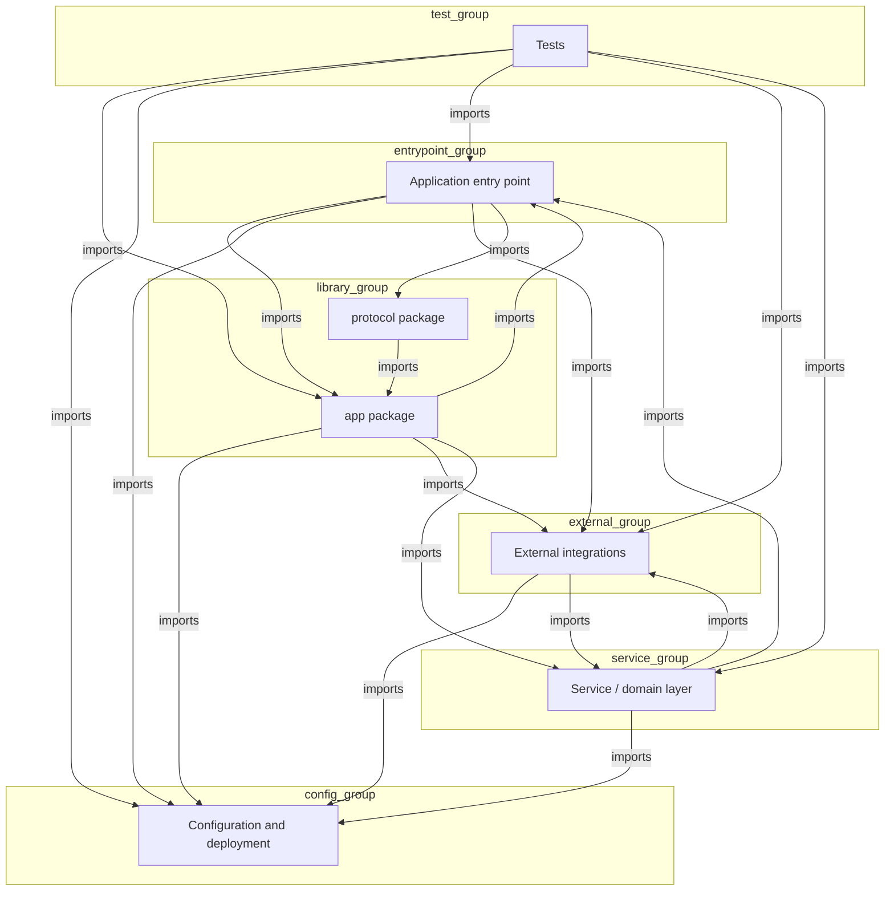

# Architecture report: FoundationAgents/OpenManus

> Automated static analysis. **Observed** = directly seen in files/imports/AST; **Inferred** = interpretation from that evidence. Repository code was not executed.

## 1. Repository at a glance

| Item | Value |
| --- | --- |
| Repository | FoundationAgents/OpenManus |
| Description | No fortress, purely open ground.  OpenManus is Coming. |
| Language | Python |
| Stars | 58967 |
| Licence | MIT |
| Analysed commit / branch | 3309bf4e416fb1c74b008f3e86494439a31bad53 / main |
| Framework(s) | FastAPI |
| Files analysed | 140 |
| Components | 7 |

## 2. Architecture in one minute

FoundationAgents/OpenManus - No fortress, purely open ground.  OpenManus is Coming.. This repository was analysed statically from 140 file(s) (90 Python). Detected technologies (observed from imports/manifests): GitHub Actions, FastAPI, aiohttp, AWS (boto3), httpx, NumPy. Files are grouped into 7 component(s): app package, Configuration and deployment, Application entry point, External integrations, protocol package, Service / domain layer, Tests. Observed entry point(s): app/logger.py, app/mcp/server.py, app/tool/bash.py. Findings below distinguish observed facts from inferred interpretation.

## 3. High-level block diagram

## 4. Main components

### app package (`app`)

- **Kind:** library
- **Status:** Observed
- **Confidence:** 0.85
- **Responsibility:** Groups 62 file(s) under app package (observed from repository paths and static analysis). Observed top-level classes: AgentState, AskHuman, BaiduSearchEngine, BaseAgent, BaseFlow, BaseTool. Observed top-level functions: _browser_use_env, clean_path, create_sandbox, delete_sandbox, get_or_start_sandbox, maybe_truncate.
- **Paths:** `app/__init__.py`, `app/agent/__init__.py`, `app/agent/base.py`, `app/agent/browser.py`, `app/agent/data_analysis.py`, `app/agent/manus.py`, `app/agent/mcp.py`, `app/agent/react.py`, `app/agent/sandbox_agent.py`, `app/agent/swe.py`, `app/agent/toolcall.py`, `app/bedrock.py`, `app/daytona/sandbox.py`, `app/daytona/tool_base.py`, `app/exceptions.py`, `app/flow/__init__.py`, `app/flow/base.py`, `app/flow/flow_factory.py`, `app/flow/planning.py`, `app/llm.py`, `app/mcp/__init__.py`, `app/prompt/__init__.py`, `app/prompt/browser.py`, `app/prompt/manus.py`, `app/prompt/mcp.py`, `app/prompt/planning.py`, `app/prompt/swe.py`, `app/prompt/toolcall.py`, `app/prompt/visualization.py`, `app/sandbox/__init__.py`, `app/schema.py`, `app/tool/__init__.py`, `app/tool/ask_human.py`, `app/tool/base.py`, `app/tool/chart_visualization/__init__.py`, `app/tool/chart_visualization/chart_prepare.py`, `app/tool/chart_visualization/data_visualization.py`, `app/tool/chart_visualization/python_execute.py`, `app/tool/chart_visualization/src/chartVisualize.ts`, `app/tool/computer_use_tool.py`, `app/tool/crawl4ai.py`, `app/tool/create_chat_completion.py`, `app/tool/file_operators.py`, `app/tool/mcp.py`, `app/tool/planning.py`, `app/tool/python_execute.py`, `app/tool/sandbox/sb_browser_tool.py`, `app/tool/sandbox/sb_files_tool.py`, `app/tool/sandbox/sb_shell_tool.py`, `app/tool/sandbox/sb_vision_tool.py`, `app/tool/search/__init__.py`, `app/tool/search/baidu_search.py`, `app/tool/search/base.py`, `app/tool/search/bing_search.py`, `app/tool/search/duckduckgo_search.py`, `app/tool/search/google_search.py`, `app/tool/str_replace_editor.py`, `app/tool/terminate.py`, `app/tool/tool_collection.py`, `app/utils/__init__.py`, `app/utils/files_utils.py`, `app/utils/logger.py`
- **Evidence:** [app/__init__.py](https://github.com/FoundationAgents/OpenManus/blob/3309bf4e416fb1c74b008f3e86494439a31bad53/app/__init__.py); [app/agent/__init__.py](https://github.com/FoundationAgents/OpenManus/blob/3309bf4e416fb1c74b008f3e86494439a31bad53/app/agent/__init__.py); [app/agent/base.py:13](https://github.com/FoundationAgents/OpenManus/blob/3309bf4e416fb1c74b008f3e86494439a31bad53/app/agent/base.py#L13); [app/agent/browser.py:19](https://github.com/FoundationAgents/OpenManus/blob/3309bf4e416fb1c74b008f3e86494439a31bad53/app/agent/browser.py#L19); [app/agent/data_analysis.py:12](https://github.com/FoundationAgents/OpenManus/blob/3309bf4e416fb1c74b008f3e86494439a31bad53/app/agent/data_analysis.py#L12); [app/agent/manus.py:37](https://github.com/FoundationAgents/OpenManus/blob/3309bf4e416fb1c74b008f3e86494439a31bad53/app/agent/manus.py#L37); [app/agent/mcp.py:12](https://github.com/FoundationAgents/OpenManus/blob/3309bf4e416fb1c74b008f3e86494439a31bad53/app/agent/mcp.py#L12); [app/agent/react.py:11](https://github.com/FoundationAgents/OpenManus/blob/3309bf4e416fb1c74b008f3e86494439a31bad53/app/agent/react.py#L11)

### Configuration and deployment (`config`)

- **Kind:** config
- **Status:** Observed
- **Confidence:** 0.85
- **Responsibility:** Groups 15 file(s) under configuration and deployment (observed from repository paths and static analysis). Observed top-level classes: AppConfig, BrowserSettings, Config, DaytonaSettings, LLMSettings, MCPServerConfig. Observed top-level functions: get_project_root.
- **Paths:** `Dockerfile`, `app/config.py`, `app/tool/chart_visualization/package.json`, `app/tool/chart_visualization/tsconfig.json`, `config/config.example-daytona.toml`, `config/config.example-model-anthropic.toml`, `config/config.example-model-azure.toml`, `config/config.example-model-google.toml`, `config/config.example-model-jiekouai.toml`, `config/config.example-model-ollama.toml`, `config/config.example-model-ppio.toml`, `config/config.example.toml`, `config/mcp.example.json`, `requirements.txt`, `setup.py`
- **Evidence:** [Dockerfile](https://github.com/FoundationAgents/OpenManus/blob/3309bf4e416fb1c74b008f3e86494439a31bad53/Dockerfile); [app/config.py:10](https://github.com/FoundationAgents/OpenManus/blob/3309bf4e416fb1c74b008f3e86494439a31bad53/app/config.py#L10); [app/tool/chart_visualization/package.json](https://github.com/FoundationAgents/OpenManus/blob/3309bf4e416fb1c74b008f3e86494439a31bad53/app/tool/chart_visualization/package.json); [app/tool/chart_visualization/tsconfig.json](https://github.com/FoundationAgents/OpenManus/blob/3309bf4e416fb1c74b008f3e86494439a31bad53/app/tool/chart_visualization/tsconfig.json); [config/config.example-daytona.toml](https://github.com/FoundationAgents/OpenManus/blob/3309bf4e416fb1c74b008f3e86494439a31bad53/config/config.example-daytona.toml); [config/config.example-model-anthropic.toml](https://github.com/FoundationAgents/OpenManus/blob/3309bf4e416fb1c74b008f3e86494439a31bad53/config/config.example-model-anthropic.toml); [config/config.example-model-azure.toml](https://github.com/FoundationAgents/OpenManus/blob/3309bf4e416fb1c74b008f3e86494439a31bad53/config/config.example-model-azure.toml); [config/config.example-model-google.toml](https://github.com/FoundationAgents/OpenManus/blob/3309bf4e416fb1c74b008f3e86494439a31bad53/config/config.example-model-google.toml)

### Application entry point (`entrypoint`)

- **Kind:** entrypoint
- **Status:** Observed
- **Confidence:** 0.85
- **Responsibility:** Groups 10 file(s) under application entry point (observed from repository paths and static analysis). Observed top-level classes: Bash, MCPRunner, MCPServer, SearchMetadata, SearchResponse, SearchResult. Observed top-level functions: define_log_level, main, parse_args, run_flow, run_mcp, run_server.
- **Paths:** `app/logger.py`, `app/mcp/server.py`, `app/tool/bash.py`, `app/tool/web_search.py`, `main.py`, `protocol/a2a/app/main.py`, `run_flow.py`, `run_mcp.py`, `run_mcp_server.py`, `sandbox_main.py`
- **Evidence:** [app/logger.py:12](https://github.com/FoundationAgents/OpenManus/blob/3309bf4e416fb1c74b008f3e86494439a31bad53/app/logger.py#L12); [app/mcp/server.py:23](https://github.com/FoundationAgents/OpenManus/blob/3309bf4e416fb1c74b008f3e86494439a31bad53/app/mcp/server.py#L23); [app/tool/bash.py:16](https://github.com/FoundationAgents/OpenManus/blob/3309bf4e416fb1c74b008f3e86494439a31bad53/app/tool/bash.py#L16); [app/tool/web_search.py:22](https://github.com/FoundationAgents/OpenManus/blob/3309bf4e416fb1c74b008f3e86494439a31bad53/app/tool/web_search.py#L22); [main.py:8](https://github.com/FoundationAgents/OpenManus/blob/3309bf4e416fb1c74b008f3e86494439a31bad53/main.py#L8); [protocol/a2a/app/main.py:27](https://github.com/FoundationAgents/OpenManus/blob/3309bf4e416fb1c74b008f3e86494439a31bad53/protocol/a2a/app/main.py#L27); [run_flow.py:11](https://github.com/FoundationAgents/OpenManus/blob/3309bf4e416fb1c74b008f3e86494439a31bad53/run_flow.py#L11); [run_mcp.py:11](https://github.com/FoundationAgents/OpenManus/blob/3309bf4e416fb1c74b008f3e86494439a31bad53/run_mcp.py#L11)

### External integrations (`external_integrations`)

- **Kind:** external
- **Status:** Observed
- **Confidence:** 0.85
- **Responsibility:** Groups 1 file(s) under external integrations (observed from repository paths and static analysis). Observed top-level classes: BaseSandboxClient, LocalSandboxClient, SandboxFileOperations. Observed top-level functions: create_sandbox_client.
- **Paths:** `app/sandbox/client.py`
- **Evidence:** [app/sandbox/client.py:8](https://github.com/FoundationAgents/OpenManus/blob/3309bf4e416fb1c74b008f3e86494439a31bad53/app/sandbox/client.py#L8)

### protocol package (`protocol`)

- **Kind:** library
- **Status:** Observed
- **Confidence:** 0.85
- **Responsibility:** Groups 4 file(s) under protocol package (observed from repository paths and static analysis). Observed top-level classes: A2AManus, ManusExecutor, ResponseFormat.
- **Paths:** `protocol/a2a/__init__.py`, `protocol/a2a/app/__init__.py`, `protocol/a2a/app/agent.py`, `protocol/a2a/app/agent_executor.py`
- **Evidence:** [protocol/a2a/__init__.py](https://github.com/FoundationAgents/OpenManus/blob/3309bf4e416fb1c74b008f3e86494439a31bad53/protocol/a2a/__init__.py); [protocol/a2a/app/__init__.py](https://github.com/FoundationAgents/OpenManus/blob/3309bf4e416fb1c74b008f3e86494439a31bad53/protocol/a2a/app/__init__.py); [protocol/a2a/app/agent.py:8](https://github.com/FoundationAgents/OpenManus/blob/3309bf4e416fb1c74b008f3e86494439a31bad53/protocol/a2a/app/agent.py#L8); [protocol/a2a/app/agent_executor.py:23](https://github.com/FoundationAgents/OpenManus/blob/3309bf4e416fb1c74b008f3e86494439a31bad53/protocol/a2a/app/agent_executor.py#L23)

### Service / domain layer (`service_layer`)

- **Kind:** service
- **Status:** Observed
- **Confidence:** 0.85
- **Responsibility:** Groups 4 file(s) under service / domain layer (observed from repository paths and static analysis). Observed top-level classes: AsyncDockerizedTerminal, DockerSandbox, DockerSession, SandboxError, SandboxManager, SandboxResourceError.
- **Paths:** `app/sandbox/core/exceptions.py`, `app/sandbox/core/manager.py`, `app/sandbox/core/sandbox.py`, `app/sandbox/core/terminal.py`
- **Evidence:** [app/sandbox/core/exceptions.py:8](https://github.com/FoundationAgents/OpenManus/blob/3309bf4e416fb1c74b008f3e86494439a31bad53/app/sandbox/core/exceptions.py#L8); [app/sandbox/core/manager.py:14](https://github.com/FoundationAgents/OpenManus/blob/3309bf4e416fb1c74b008f3e86494439a31bad53/app/sandbox/core/manager.py#L14); [app/sandbox/core/sandbox.py:18](https://github.com/FoundationAgents/OpenManus/blob/3309bf4e416fb1c74b008f3e86494439a31bad53/app/sandbox/core/sandbox.py#L18); [app/sandbox/core/terminal.py:19](https://github.com/FoundationAgents/OpenManus/blob/3309bf4e416fb1c74b008f3e86494439a31bad53/app/sandbox/core/terminal.py#L19)

### Tests (`tests`)

- **Kind:** test
- **Status:** Observed
- **Confidence:** 0.85
- **Responsibility:** Groups 7 file(s) under tests (observed from repository paths and static analysis). Observed top-level classes: FakeSession, ImageTool, TestAsyncDockerizedTerminal. Observed top-level functions: docker_client, docker_container, local_client, main, manager, pytest_configure.
- **Paths:** `app/tool/chart_visualization/test/chart_demo.py`, `app/tool/chart_visualization/test/report_demo.py`, `tests/sandbox/test_client.py`, `tests/sandbox/test_docker_terminal.py`, `tests/sandbox/test_sandbox.py`, `tests/sandbox/test_sandbox_manager.py`, `tests/tools/test_browser_use_mcp.py`
- **Evidence:** [app/tool/chart_visualization/test/chart_demo.py:180](https://github.com/FoundationAgents/OpenManus/blob/3309bf4e416fb1c74b008f3e86494439a31bad53/app/tool/chart_visualization/test/chart_demo.py#L180); [app/tool/chart_visualization/test/report_demo.py:9](https://github.com/FoundationAgents/OpenManus/blob/3309bf4e416fb1c74b008f3e86494439a31bad53/app/tool/chart_visualization/test/report_demo.py#L9); [tests/sandbox/test_client.py:13](https://github.com/FoundationAgents/OpenManus/blob/3309bf4e416fb1c74b008f3e86494439a31bad53/tests/sandbox/test_client.py#L13); [tests/sandbox/test_docker_terminal.py:11](https://github.com/FoundationAgents/OpenManus/blob/3309bf4e416fb1c74b008f3e86494439a31bad53/tests/sandbox/test_docker_terminal.py#L11); [tests/sandbox/test_sandbox.py:8](https://github.com/FoundationAgents/OpenManus/blob/3309bf4e416fb1c74b008f3e86494439a31bad53/tests/sandbox/test_sandbox.py#L8); [tests/sandbox/test_sandbox_manager.py:13](https://github.com/FoundationAgents/OpenManus/blob/3309bf4e416fb1c74b008f3e86494439a31bad53/tests/sandbox/test_sandbox_manager.py#L13); [tests/tools/test_browser_use_mcp.py:29](https://github.com/FoundationAgents/OpenManus/blob/3309bf4e416fb1c74b008f3e86494439a31bad53/tests/tools/test_browser_use_mcp.py#L29)

## 5. Execution flow

**Observed** entry point(s):

- [app/logger.py:32](https://github.com/FoundationAgents/OpenManus/blob/3309bf4e416fb1c74b008f3e86494439a31bad53/app/logger.py#L32)
- [app/mcp/server.py:170](https://github.com/FoundationAgents/OpenManus/blob/3309bf4e416fb1c74b008f3e86494439a31bad53/app/mcp/server.py#L170)
- [app/tool/bash.py:155](https://github.com/FoundationAgents/OpenManus/blob/3309bf4e416fb1c74b008f3e86494439a31bad53/app/tool/bash.py#L155)
- [app/tool/web_search.py:411](https://github.com/FoundationAgents/OpenManus/blob/3309bf4e416fb1c74b008f3e86494439a31bad53/app/tool/web_search.py#L411)
- [main.py](https://github.com/FoundationAgents/OpenManus/blob/3309bf4e416fb1c74b008f3e86494439a31bad53/main.py)
- [protocol/a2a/app/main.py:117](https://github.com/FoundationAgents/OpenManus/blob/3309bf4e416fb1c74b008f3e86494439a31bad53/protocol/a2a/app/main.py#L117)
- [run_flow.py:51](https://github.com/FoundationAgents/OpenManus/blob/3309bf4e416fb1c74b008f3e86494439a31bad53/run_flow.py#L51)
- [run_mcp.py:115](https://github.com/FoundationAgents/OpenManus/blob/3309bf4e416fb1c74b008f3e86494439a31bad53/run_mcp.py#L115)
- [run_mcp_server.py:6](https://github.com/FoundationAgents/OpenManus/blob/3309bf4e416fb1c74b008f3e86494439a31bad53/run_mcp_server.py#L6)
- [sandbox_main.py:35](https://github.com/FoundationAgents/OpenManus/blob/3309bf4e416fb1c74b008f3e86494439a31bad53/sandbox_main.py#L35)

Representative flow (derived from observed entry points and the import graph; steps beyond the entry point are **Inferred**):

1. Execution starts at an observed entry point listed above, if present.
2. `app` imports `config` (app package -> Configuration and deployment).
3. `app` imports `entrypoint` (app package -> Application entry point).
4. `app` imports `external_integrations` (app package -> External integrations).
5. `app` imports `service_layer` (app package -> Service / domain layer).
6. `entrypoint` imports `app` (Application entry point -> app package).
7. `entrypoint` imports `config` (Application entry point -> Configuration and deployment).
8. `entrypoint` imports `external_integrations` (Application entry point -> External integrations).
9. `entrypoint` imports `protocol` (Application entry point -> protocol package).

## 6. Project structure

### `(root)`

- `.gitattributes` - other (901 bytes)
- `.gitignore` - other (3792 bytes)
- `.pre-commit-config.yaml` - config (908 bytes)
- `CODE_OF_CONDUCT.md` - docs (7495 bytes)
- `Dockerfile` - container (305 bytes)
- `LICENSE` - docs (1071 bytes)
- `README.md` - docs (9139 bytes)
- `README_ja.md` - docs (9138 bytes)
- `README_ko.md` - docs (8664 bytes)
- `README_zh.md` - docs (7944 bytes)
- `main.py` - source, Python (1087 bytes)
- `requirements.txt` - manifest (628 bytes)
- `run_flow.py` - source, Python (1576 bytes)
- `run_mcp.py` - source, Python (3620 bytes)
- `run_mcp_server.py` - source, Python (342 bytes)
- `sandbox_main.py` - source, Python (1109 bytes)
- `setup.py` - manifest, Python (1469 bytes)

### `.github`

- `.github/ISSUE_TEMPLATE/config.yml` - config (246 bytes)
- `.github/ISSUE_TEMPLATE/request_new_features.yaml` - config (688 bytes)
- `.github/ISSUE_TEMPLATE/show_me_the_bug.yaml` - config (1316 bytes)
- `.github/PULL_REQUEST_TEMPLATE.md` - docs (464 bytes)
- `.github/dependabot.yml` - config (1327 bytes)
- `.github/workflows/build-package.yaml` - ci, YAML (909 bytes)
- `.github/workflows/environment-corrupt-check.yaml` - ci, YAML (882 bytes)
- `.github/workflows/pr-autodiff.yaml` - ci, YAML (5420 bytes)
- `.github/workflows/pre-commit.yaml` - ci, YAML (616 bytes)
- `.github/workflows/stale.yaml` - ci, YAML (697 bytes)
- `.github/workflows/top-issues.yaml` - ci, YAML (797 bytes)

### `.vscode`

- `.vscode/extensions.json` - config (142 bytes)
- `.vscode/settings.json` - config (651 bytes)

### `app`

- `app/__init__.py` - source, Python (270 bytes)
- `app/agent/__init__.py` - source, Python (358 bytes)
- `app/agent/base.py` - source, Python (7026 bytes)
- `app/agent/browser.py` - source, Python (4561 bytes)
- `app/agent/data_analysis.py` - source, Python (1376 bytes)
- `app/agent/manus.py` - source, Python (7919 bytes)
- `app/agent/mcp.py` - source, Python (7124 bytes)
- `app/agent/react.py` - source, Python (1012 bytes)
- `app/agent/sandbox_agent.py` - source, Python (8777 bytes)
- `app/agent/swe.py` - source, Python (771 bytes)
- `app/agent/toolcall.py` - source, Python (10168 bytes)
- `app/bedrock.py` - source, Python (13106 bytes)
- `app/config.py` - source, Python (13021 bytes)
- `app/daytona/README.md` - docs (2257 bytes)
- `app/daytona/sandbox.py` - source, Python (5138 bytes)
- `app/daytona/tool_base.py` - source, Python (5017 bytes)
- `app/exceptions.py` - source, Python (332 bytes)
- `app/flow/__init__.py` - source, Python (0 bytes)
- `app/flow/base.py` - source, Python (1820 bytes)
- `app/flow/flow_factory.py` - source, Python (771 bytes)
- `app/flow/planning.py` - source, Python (18261 bytes)
- `app/llm.py` - source, Python (29656 bytes)
- `app/logger.py` - source, Python (1074 bytes)
- `app/mcp/__init__.py` - source, Python (0 bytes)
- `app/mcp/server.py` - source, Python (6382 bytes)
- `app/prompt/__init__.py` - source, Python (0 bytes)
- `app/prompt/browser.py` - source, Python (5454 bytes)
- `app/prompt/manus.py` - source, Python (821 bytes)
- `app/prompt/mcp.py` - source, Python (2168 bytes)
- `app/prompt/planning.py` - source, Python (1199 bytes)
- `app/prompt/swe.py` - source, Python (1591 bytes)
- `app/prompt/toolcall.py` - source, Python (162 bytes)
- `app/prompt/visualization.py` - source, Python (668 bytes)
- `app/sandbox/__init__.py` - source, Python (685 bytes)
- `app/sandbox/client.py` - source, Python (5647 bytes)
- `app/sandbox/core/exceptions.py` - source, Python (471 bytes)
- `app/sandbox/core/manager.py` - source, Python (10581 bytes)
- `app/sandbox/core/sandbox.py` - source, Python (15839 bytes)
- `app/sandbox/core/terminal.py` - source, Python (10943 bytes)
- `app/schema.py` - source, Python (5689 bytes)
- `app/tool/__init__.py` - source, Python (601 bytes)
- `app/tool/ask_human.py` - source, Python (572 bytes)
- `app/tool/base.py` - source, Python (5752 bytes)
- `app/tool/bash.py` - source, Python (5754 bytes)
- `app/tool/chart_visualization/README.md` - docs (4503 bytes)
- `app/tool/chart_visualization/README_ja.md` - docs (3706 bytes)
- `app/tool/chart_visualization/README_ko.md` - docs (4171 bytes)
- `app/tool/chart_visualization/README_zh.md` - docs (4029 bytes)
- `app/tool/chart_visualization/__init__.py` - source, Python (311 bytes)
- `app/tool/chart_visualization/chart_prepare.py` - source, Python (1803 bytes)
- `app/tool/chart_visualization/data_visualization.py` - source, Python (9555 bytes)
- `app/tool/chart_visualization/package.json` - manifest (477 bytes)
- `app/tool/chart_visualization/python_execute.py` - source, Python (1800 bytes)
- `app/tool/chart_visualization/src/chartVisualize.ts` - source, TypeScript (9898 bytes)
- `app/tool/chart_visualization/test/chart_demo.py` - test, Python (4418 bytes)
- `app/tool/chart_visualization/test/report_demo.py` - test, Python (718 bytes)
- `app/tool/chart_visualization/tsconfig.json` - config (12379 bytes)
- `app/tool/computer_use_tool.py` - source, Python (17807 bytes)
- `app/tool/crawl4ai.py` - source, Python (10594 bytes)
- `app/tool/create_chat_completion.py` - source, Python (5621 bytes)
- `app/tool/file_operators.py` - source, Python (5618 bytes)
- `app/tool/mcp.py` - source, Python (8529 bytes)
- `app/tool/planning.py` - source, Python (13623 bytes)
- `app/tool/python_execute.py` - source, Python (2497 bytes)
- `app/tool/sandbox/sb_browser_tool.py` - source, Python (19583 bytes)
- `app/tool/sandbox/sb_files_tool.py` - source, Python (14832 bytes)
- `app/tool/sandbox/sb_shell_tool.py` - source, Python (16388 bytes)
- `app/tool/sandbox/sb_vision_tool.py` - source, Python (7630 bytes)
- `app/tool/search/__init__.py` - source, Python (439 bytes)
- `app/tool/search/baidu_search.py` - source, Python (1921 bytes)
- `app/tool/search/base.py` - source, Python (1305 bytes)
- `app/tool/search/bing_search.py` - source, Python (5313 bytes)
- `app/tool/search/duckduckgo_search.py` - source, Python (1987 bytes)
- `app/tool/search/google_search.py` - source, Python (987 bytes)
- `app/tool/str_replace_editor.py` - source, Python (17148 bytes)
- `app/tool/terminate.py` - source, Python (833 bytes)
- `app/tool/tool_collection.py` - source, Python (2241 bytes)
- `app/tool/web_search.py` - source, Python (14837 bytes)
- `app/utils/__init__.py` - source, Python (50 bytes)
- `app/utils/files_utils.py` - source, Python (1993 bytes)
- `app/utils/logger.py` - source, Python (942 bytes)

### `config`

- `config/.gitignore` - other (89 bytes)
- `config/config.example-daytona.toml` - config (4589 bytes)
- `config/config.example-model-anthropic.toml` - config (833 bytes)
- `config/config.example-model-azure.toml` - config (1202 bytes)
- `config/config.example-model-google.toml` - config (1119 bytes)
- `config/config.example-model-jiekouai.toml` - config (1077 bytes)
- `config/config.example-model-ollama.toml` - config (1081 bytes)
- `config/config.example-model-ppio.toml` - config (1073 bytes)
- `config/config.example.toml` - config (4426 bytes)
- `config/mcp.example.json` - config (123 bytes)

### `examples`

- `examples/benchmarks/__init__.py` - source, Python (70 bytes)
- `examples/use_case/japan-travel-plan/japan_travel_guide_instructions.txt` - docs (1871 bytes)
- `examples/use_case/japan-travel-plan/japan_travel_handbook.html` - other (5951 bytes)
- `examples/use_case/japan-travel-plan/japan_travel_handbook_mobile.html` - other (8218 bytes)
- `examples/use_case/japan-travel-plan/japan_travel_handbook_print.html` - other (5863 bytes)
- `examples/use_case/readme.md` - docs (869 bytes)

### `protocol`

- `protocol/a2a/__init__.py` - source, Python (0 bytes)
- `protocol/a2a/app/README.md` - docs (7542 bytes)
- `protocol/a2a/app/README_zh.md` - docs (7527 bytes)
- `protocol/a2a/app/__init__.py` - source, Python (0 bytes)
- `protocol/a2a/app/agent.py` - source, Python (1032 bytes)
- `protocol/a2a/app/agent_executor.py` - source, Python (2144 bytes)
- `protocol/a2a/app/main.py` - source, Python (4701 bytes)

### `tests`

- `tests/sandbox/test_client.py` - test, Python (3494 bytes)
- `tests/sandbox/test_docker_terminal.py` - test, Python (3344 bytes)
- `tests/sandbox/test_sandbox.py` - test, Python (4477 bytes)
- `tests/sandbox/test_sandbox_manager.py` - test, Python (4001 bytes)
- `tests/tools/test_browser_use_mcp.py` - test, Python (4812 bytes)

### `workspace`

- `workspace/example.txt` - docs (97 bytes)

## 7. Key dependencies and integrations

| Name | Category | Status | Confidence | Evidence |
| --- | --- | --- | --- | --- |
| GitHub Actions | ci | Observed | 0.90 | [.github/workflows/build-package.yaml](https://github.com/FoundationAgents/OpenManus/blob/3309bf4e416fb1c74b008f3e86494439a31bad53/.github/workflows/build-package.yaml); [.github/workflows/environment-corrupt-check.yaml](https://github.com/FoundationAgents/OpenManus/blob/3309bf4e416fb1c74b008f3e86494439a31bad53/.github/workflows/environment-corrupt-check.yaml); [.github/workflows/pr-autodiff.yaml](https://github.com/FoundationAgents/OpenManus/blob/3309bf4e416fb1c74b008f3e86494439a31bad53/.github/workflows/pr-autodiff.yaml); [.github/workflows/pre-commit.yaml](https://github.com/FoundationAgents/OpenManus/blob/3309bf4e416fb1c74b008f3e86494439a31bad53/.github/workflows/pre-commit.yaml) |
| FastAPI | framework | Observed | 0.85 | [requirements.txt:9](https://github.com/FoundationAgents/OpenManus/blob/3309bf4e416fb1c74b008f3e86494439a31bad53/requirements.txt#L9) |
| aiohttp | library | Observed | 0.90 | [app/tool/computer_use_tool.py:8](https://github.com/FoundationAgents/OpenManus/blob/3309bf4e416fb1c74b008f3e86494439a31bad53/app/tool/computer_use_tool.py#L8) |
| AWS (boto3) | library | Observed | 0.90 | [app/bedrock.py:8](https://github.com/FoundationAgents/OpenManus/blob/3309bf4e416fb1c74b008f3e86494439a31bad53/app/bedrock.py#L8); [requirements.txt:36](https://github.com/FoundationAgents/OpenManus/blob/3309bf4e416fb1c74b008f3e86494439a31bad53/requirements.txt#L36) |
| httpx | library | Observed | 0.90 | [protocol/a2a/app/main.py:6](https://github.com/FoundationAgents/OpenManus/blob/3309bf4e416fb1c74b008f3e86494439a31bad53/protocol/a2a/app/main.py#L6); [requirements.txt:33](https://github.com/FoundationAgents/OpenManus/blob/3309bf4e416fb1c74b008f3e86494439a31bad53/requirements.txt#L33) |
| NumPy | library | Observed | 0.90 | [requirements.txt:7](https://github.com/FoundationAgents/OpenManus/blob/3309bf4e416fb1c74b008f3e86494439a31bad53/requirements.txt#L7); [setup.py:24](https://github.com/FoundationAgents/OpenManus/blob/3309bf4e416fb1c74b008f3e86494439a31bad53/setup.py#L24) |
| pandas | library | Observed | 0.90 | [app/tool/chart_visualization/data_visualization.py:6](https://github.com/FoundationAgents/OpenManus/blob/3309bf4e416fb1c74b008f3e86494439a31bad53/app/tool/chart_visualization/data_visualization.py#L6) |
| Pydantic | library | Observed | 0.95 | [app/agent/base.py:5](https://github.com/FoundationAgents/OpenManus/blob/3309bf4e416fb1c74b008f3e86494439a31bad53/app/agent/base.py#L5); [app/agent/data_analysis.py:1](https://github.com/FoundationAgents/OpenManus/blob/3309bf4e416fb1c74b008f3e86494439a31bad53/app/agent/data_analysis.py#L1); [app/agent/manus.py:4](https://github.com/FoundationAgents/OpenManus/blob/3309bf4e416fb1c74b008f3e86494439a31bad53/app/agent/manus.py#L4); [app/agent/mcp.py:3](https://github.com/FoundationAgents/OpenManus/blob/3309bf4e416fb1c74b008f3e86494439a31bad53/app/agent/mcp.py#L3) |
| requests | library | Observed | 0.95 | [app/tool/search/bing_search.py:3](https://github.com/FoundationAgents/OpenManus/blob/3309bf4e416fb1c74b008f3e86494439a31bad53/app/tool/search/bing_search.py#L3); [app/tool/web_search.py:4](https://github.com/FoundationAgents/OpenManus/blob/3309bf4e416fb1c74b008f3e86494439a31bad53/app/tool/web_search.py#L4); [requirements.txt:38](https://github.com/FoundationAgents/OpenManus/blob/3309bf4e416fb1c74b008f3e86494439a31bad53/requirements.txt#L38) |
| Uvicorn | library | Observed | 0.90 | [protocol/a2a/app/main.py:105](https://github.com/FoundationAgents/OpenManus/blob/3309bf4e416fb1c74b008f3e86494439a31bad53/protocol/a2a/app/main.py#L105); [requirements.txt:16](https://github.com/FoundationAgents/OpenManus/blob/3309bf4e416fb1c74b008f3e86494439a31bad53/requirements.txt#L16); [setup.py:30](https://github.com/FoundationAgents/OpenManus/blob/3309bf4e416fb1c74b008f3e86494439a31bad53/setup.py#L30) |
| setuptools | packaging | Observed | 0.90 | [requirements.txt:43](https://github.com/FoundationAgents/OpenManus/blob/3309bf4e416fb1c74b008f3e86494439a31bad53/requirements.txt#L43); [setup.py:1](https://github.com/FoundationAgents/OpenManus/blob/3309bf4e416fb1c74b008f3e86494439a31bad53/setup.py#L1) |
| Docker | tooling | Observed | 0.85 | [Dockerfile](https://github.com/FoundationAgents/OpenManus/blob/3309bf4e416fb1c74b008f3e86494439a31bad53/Dockerfile) |
| pytest | tooling | Observed | 0.95 | [requirements.txt:29](https://github.com/FoundationAgents/OpenManus/blob/3309bf4e416fb1c74b008f3e86494439a31bad53/requirements.txt#L29); [tests/sandbox/test_client.py:5](https://github.com/FoundationAgents/OpenManus/blob/3309bf4e416fb1c74b008f3e86494439a31bad53/tests/sandbox/test_client.py#L5); [tests/sandbox/test_docker_terminal.py:4](https://github.com/FoundationAgents/OpenManus/blob/3309bf4e416fb1c74b008f3e86494439a31bad53/tests/sandbox/test_docker_terminal.py#L4); [tests/sandbox/test_sandbox.py:1](https://github.com/FoundationAgents/OpenManus/blob/3309bf4e416fb1c74b008f3e86494439a31bad53/tests/sandbox/test_sandbox.py#L1) |
| TypeScript | tooling | Observed | 0.85 | [app/tool/chart_visualization/package.json:8](https://github.com/FoundationAgents/OpenManus/blob/3309bf4e416fb1c74b008f3e86494439a31bad53/app/tool/chart_visualization/package.json#L8) |

## 8. Data and state

No database, cache, queue, or persistent-state usage was observed in the analysed files. State handling, if any, may be in-memory or in files that were not analysed.

## 9. Configuration and deployment clues

- `.github/ISSUE_TEMPLATE/config.yml` (config)
- `.github/ISSUE_TEMPLATE/request_new_features.yaml` (config)
- `.github/ISSUE_TEMPLATE/show_me_the_bug.yaml` (config)
- `.github/dependabot.yml` (config)
- `.github/workflows/build-package.yaml` (ci)
- `.github/workflows/environment-corrupt-check.yaml` (ci)
- `.github/workflows/pr-autodiff.yaml` (ci)
- `.github/workflows/pre-commit.yaml` (ci)
- `.github/workflows/stale.yaml` (ci)
- `.github/workflows/top-issues.yaml` (ci)
- `.pre-commit-config.yaml` (config)
- `.vscode/extensions.json` (config)
- `.vscode/settings.json` (config)
- `Dockerfile` (container)
- `app/tool/chart_visualization/package.json` (manifest)
- `app/tool/chart_visualization/tsconfig.json` (config)
- `config/config.example-daytona.toml` (config)
- `config/config.example-model-anthropic.toml` (config)
- `config/config.example-model-azure.toml` (config)
- `config/config.example-model-google.toml` (config)
- `config/config.example-model-jiekouai.toml` (config)
- `config/config.example-model-ollama.toml` (config)
- `config/config.example-model-ppio.toml` (config)
- `config/config.example.toml` (config)
- `config/mcp.example.json` (config)
- `requirements.txt` (manifest)
- `setup.py` (manifest)

Console scripts declared in packaging metadata (**Observed**):

- `openmanus` -> `main:main`

## 10. Design observations

- An entry/API layer is separated from other code (Inferred from paths and decorators).
- Service/domain code is distinct from entry and data code, suggesting layered separation (Inferred).
- Tests are present alongside source code (Observed from test file paths).
- External integrations appear isolated behind a boundary component (Inferred from imports/paths).

These observations are interpretations (**Inferred**) of the observed structure, not guarantees about runtime design.

## 11. Limitations and unknowns

- Static analysis only: repository code was not executed, installed, or imported at runtime.
- Components and relationships are inferred from file paths, imports, and AST structure; runtime behaviour, dynamic imports, and reflection may not be visible.
- Repository text was treated as untrusted data; no instructions found in repository files were followed, and likely secret values were redacted/excluded.

## 12. Source references

- [.github/workflows/build-package.yaml](https://github.com/FoundationAgents/OpenManus/blob/3309bf4e416fb1c74b008f3e86494439a31bad53/.github/workflows/build-package.yaml)
- [.github/workflows/environment-corrupt-check.yaml](https://github.com/FoundationAgents/OpenManus/blob/3309bf4e416fb1c74b008f3e86494439a31bad53/.github/workflows/environment-corrupt-check.yaml)
- [.github/workflows/pr-autodiff.yaml](https://github.com/FoundationAgents/OpenManus/blob/3309bf4e416fb1c74b008f3e86494439a31bad53/.github/workflows/pr-autodiff.yaml)
- [.github/workflows/pre-commit.yaml](https://github.com/FoundationAgents/OpenManus/blob/3309bf4e416fb1c74b008f3e86494439a31bad53/.github/workflows/pre-commit.yaml)
- [.github/workflows/stale.yaml](https://github.com/FoundationAgents/OpenManus/blob/3309bf4e416fb1c74b008f3e86494439a31bad53/.github/workflows/stale.yaml)
- [.github/workflows/top-issues.yaml](https://github.com/FoundationAgents/OpenManus/blob/3309bf4e416fb1c74b008f3e86494439a31bad53/.github/workflows/top-issues.yaml)
- [Dockerfile](https://github.com/FoundationAgents/OpenManus/blob/3309bf4e416fb1c74b008f3e86494439a31bad53/Dockerfile)
- [app/__init__.py](https://github.com/FoundationAgents/OpenManus/blob/3309bf4e416fb1c74b008f3e86494439a31bad53/app/__init__.py)
- [app/agent/__init__.py](https://github.com/FoundationAgents/OpenManus/blob/3309bf4e416fb1c74b008f3e86494439a31bad53/app/agent/__init__.py)
- [app/agent/base.py:5](https://github.com/FoundationAgents/OpenManus/blob/3309bf4e416fb1c74b008f3e86494439a31bad53/app/agent/base.py#L5)
- [app/agent/base.py:13](https://github.com/FoundationAgents/OpenManus/blob/3309bf4e416fb1c74b008f3e86494439a31bad53/app/agent/base.py#L13)
- [app/agent/browser.py:19](https://github.com/FoundationAgents/OpenManus/blob/3309bf4e416fb1c74b008f3e86494439a31bad53/app/agent/browser.py#L19)
- [app/agent/data_analysis.py:1](https://github.com/FoundationAgents/OpenManus/blob/3309bf4e416fb1c74b008f3e86494439a31bad53/app/agent/data_analysis.py#L1)
- [app/agent/data_analysis.py:12](https://github.com/FoundationAgents/OpenManus/blob/3309bf4e416fb1c74b008f3e86494439a31bad53/app/agent/data_analysis.py#L12)
- [app/agent/manus.py:4](https://github.com/FoundationAgents/OpenManus/blob/3309bf4e416fb1c74b008f3e86494439a31bad53/app/agent/manus.py#L4)
- [app/agent/manus.py:37](https://github.com/FoundationAgents/OpenManus/blob/3309bf4e416fb1c74b008f3e86494439a31bad53/app/agent/manus.py#L37)
- [app/agent/mcp.py:3](https://github.com/FoundationAgents/OpenManus/blob/3309bf4e416fb1c74b008f3e86494439a31bad53/app/agent/mcp.py#L3)
- [app/agent/mcp.py:12](https://github.com/FoundationAgents/OpenManus/blob/3309bf4e416fb1c74b008f3e86494439a31bad53/app/agent/mcp.py#L12)
- [app/agent/react.py:4](https://github.com/FoundationAgents/OpenManus/blob/3309bf4e416fb1c74b008f3e86494439a31bad53/app/agent/react.py#L4)
- [app/agent/react.py:11](https://github.com/FoundationAgents/OpenManus/blob/3309bf4e416fb1c74b008f3e86494439a31bad53/app/agent/react.py#L11)
- [app/agent/sandbox_agent.py:3](https://github.com/FoundationAgents/OpenManus/blob/3309bf4e416fb1c74b008f3e86494439a31bad53/app/agent/sandbox_agent.py#L3)
- [app/agent/swe.py:3](https://github.com/FoundationAgents/OpenManus/blob/3309bf4e416fb1c74b008f3e86494439a31bad53/app/agent/swe.py#L3)
- [app/agent/toolcall.py:5](https://github.com/FoundationAgents/OpenManus/blob/3309bf4e416fb1c74b008f3e86494439a31bad53/app/agent/toolcall.py#L5)
- [app/bedrock.py:8](https://github.com/FoundationAgents/OpenManus/blob/3309bf4e416fb1c74b008f3e86494439a31bad53/app/bedrock.py#L8)
- [app/config.py:10](https://github.com/FoundationAgents/OpenManus/blob/3309bf4e416fb1c74b008f3e86494439a31bad53/app/config.py#L10)
- [app/logger.py:12](https://github.com/FoundationAgents/OpenManus/blob/3309bf4e416fb1c74b008f3e86494439a31bad53/app/logger.py#L12)
- [app/logger.py:32](https://github.com/FoundationAgents/OpenManus/blob/3309bf4e416fb1c74b008f3e86494439a31bad53/app/logger.py#L32)
- [app/mcp/server.py:23](https://github.com/FoundationAgents/OpenManus/blob/3309bf4e416fb1c74b008f3e86494439a31bad53/app/mcp/server.py#L23)
- [app/mcp/server.py:170](https://github.com/FoundationAgents/OpenManus/blob/3309bf4e416fb1c74b008f3e86494439a31bad53/app/mcp/server.py#L170)
- [app/sandbox/client.py:8](https://github.com/FoundationAgents/OpenManus/blob/3309bf4e416fb1c74b008f3e86494439a31bad53/app/sandbox/client.py#L8)
- [app/sandbox/core/exceptions.py:8](https://github.com/FoundationAgents/OpenManus/blob/3309bf4e416fb1c74b008f3e86494439a31bad53/app/sandbox/core/exceptions.py#L8)
- [app/sandbox/core/manager.py:14](https://github.com/FoundationAgents/OpenManus/blob/3309bf4e416fb1c74b008f3e86494439a31bad53/app/sandbox/core/manager.py#L14)
- [app/sandbox/core/sandbox.py:18](https://github.com/FoundationAgents/OpenManus/blob/3309bf4e416fb1c74b008f3e86494439a31bad53/app/sandbox/core/sandbox.py#L18)
- [app/sandbox/core/terminal.py:19](https://github.com/FoundationAgents/OpenManus/blob/3309bf4e416fb1c74b008f3e86494439a31bad53/app/sandbox/core/terminal.py#L19)
- [app/tool/bash.py:16](https://github.com/FoundationAgents/OpenManus/blob/3309bf4e416fb1c74b008f3e86494439a31bad53/app/tool/bash.py#L16)
- [app/tool/bash.py:155](https://github.com/FoundationAgents/OpenManus/blob/3309bf4e416fb1c74b008f3e86494439a31bad53/app/tool/bash.py#L155)
- [app/tool/chart_visualization/data_visualization.py:6](https://github.com/FoundationAgents/OpenManus/blob/3309bf4e416fb1c74b008f3e86494439a31bad53/app/tool/chart_visualization/data_visualization.py#L6)
- [app/tool/chart_visualization/package.json](https://github.com/FoundationAgents/OpenManus/blob/3309bf4e416fb1c74b008f3e86494439a31bad53/app/tool/chart_visualization/package.json)
- [app/tool/chart_visualization/package.json:8](https://github.com/FoundationAgents/OpenManus/blob/3309bf4e416fb1c74b008f3e86494439a31bad53/app/tool/chart_visualization/package.json#L8)
- [app/tool/chart_visualization/test/chart_demo.py:180](https://github.com/FoundationAgents/OpenManus/blob/3309bf4e416fb1c74b008f3e86494439a31bad53/app/tool/chart_visualization/test/chart_demo.py#L180)
- [app/tool/chart_visualization/test/report_demo.py:9](https://github.com/FoundationAgents/OpenManus/blob/3309bf4e416fb1c74b008f3e86494439a31bad53/app/tool/chart_visualization/test/report_demo.py#L9)
- [app/tool/chart_visualization/tsconfig.json](https://github.com/FoundationAgents/OpenManus/blob/3309bf4e416fb1c74b008f3e86494439a31bad53/app/tool/chart_visualization/tsconfig.json)
- [app/tool/computer_use_tool.py:8](https://github.com/FoundationAgents/OpenManus/blob/3309bf4e416fb1c74b008f3e86494439a31bad53/app/tool/computer_use_tool.py#L8)
- [app/tool/search/bing_search.py:3](https://github.com/FoundationAgents/OpenManus/blob/3309bf4e416fb1c74b008f3e86494439a31bad53/app/tool/search/bing_search.py#L3)
- [app/tool/web_search.py:4](https://github.com/FoundationAgents/OpenManus/blob/3309bf4e416fb1c74b008f3e86494439a31bad53/app/tool/web_search.py#L4)
- [app/tool/web_search.py:22](https://github.com/FoundationAgents/OpenManus/blob/3309bf4e416fb1c74b008f3e86494439a31bad53/app/tool/web_search.py#L22)
- [app/tool/web_search.py:411](https://github.com/FoundationAgents/OpenManus/blob/3309bf4e416fb1c74b008f3e86494439a31bad53/app/tool/web_search.py#L411)
- [config/config.example-daytona.toml](https://github.com/FoundationAgents/OpenManus/blob/3309bf4e416fb1c74b008f3e86494439a31bad53/config/config.example-daytona.toml)
- [config/config.example-model-anthropic.toml](https://github.com/FoundationAgents/OpenManus/blob/3309bf4e416fb1c74b008f3e86494439a31bad53/config/config.example-model-anthropic.toml)
- [config/config.example-model-azure.toml](https://github.com/FoundationAgents/OpenManus/blob/3309bf4e416fb1c74b008f3e86494439a31bad53/config/config.example-model-azure.toml)
- [config/config.example-model-google.toml](https://github.com/FoundationAgents/OpenManus/blob/3309bf4e416fb1c74b008f3e86494439a31bad53/config/config.example-model-google.toml)
- [main.py](https://github.com/FoundationAgents/OpenManus/blob/3309bf4e416fb1c74b008f3e86494439a31bad53/main.py)
- [main.py:8](https://github.com/FoundationAgents/OpenManus/blob/3309bf4e416fb1c74b008f3e86494439a31bad53/main.py#L8)
- [protocol/a2a/__init__.py](https://github.com/FoundationAgents/OpenManus/blob/3309bf4e416fb1c74b008f3e86494439a31bad53/protocol/a2a/__init__.py)
- [protocol/a2a/app/__init__.py](https://github.com/FoundationAgents/OpenManus/blob/3309bf4e416fb1c74b008f3e86494439a31bad53/protocol/a2a/app/__init__.py)
- [protocol/a2a/app/agent.py:8](https://github.com/FoundationAgents/OpenManus/blob/3309bf4e416fb1c74b008f3e86494439a31bad53/protocol/a2a/app/agent.py#L8)
- [protocol/a2a/app/agent_executor.py:23](https://github.com/FoundationAgents/OpenManus/blob/3309bf4e416fb1c74b008f3e86494439a31bad53/protocol/a2a/app/agent_executor.py#L23)
- [protocol/a2a/app/main.py:6](https://github.com/FoundationAgents/OpenManus/blob/3309bf4e416fb1c74b008f3e86494439a31bad53/protocol/a2a/app/main.py#L6)
- [protocol/a2a/app/main.py:27](https://github.com/FoundationAgents/OpenManus/blob/3309bf4e416fb1c74b008f3e86494439a31bad53/protocol/a2a/app/main.py#L27)
- [protocol/a2a/app/main.py:105](https://github.com/FoundationAgents/OpenManus/blob/3309bf4e416fb1c74b008f3e86494439a31bad53/protocol/a2a/app/main.py#L105)
- [protocol/a2a/app/main.py:117](https://github.com/FoundationAgents/OpenManus/blob/3309bf4e416fb1c74b008f3e86494439a31bad53/protocol/a2a/app/main.py#L117)
- [requirements.txt:7](https://github.com/FoundationAgents/OpenManus/blob/3309bf4e416fb1c74b008f3e86494439a31bad53/requirements.txt#L7)
- [requirements.txt:9](https://github.com/FoundationAgents/OpenManus/blob/3309bf4e416fb1c74b008f3e86494439a31bad53/requirements.txt#L9)
- [requirements.txt:16](https://github.com/FoundationAgents/OpenManus/blob/3309bf4e416fb1c74b008f3e86494439a31bad53/requirements.txt#L16)
- [requirements.txt:29](https://github.com/FoundationAgents/OpenManus/blob/3309bf4e416fb1c74b008f3e86494439a31bad53/requirements.txt#L29)
- [requirements.txt:33](https://github.com/FoundationAgents/OpenManus/blob/3309bf4e416fb1c74b008f3e86494439a31bad53/requirements.txt#L33)
- [requirements.txt:36](https://github.com/FoundationAgents/OpenManus/blob/3309bf4e416fb1c74b008f3e86494439a31bad53/requirements.txt#L36)
- [requirements.txt:38](https://github.com/FoundationAgents/OpenManus/blob/3309bf4e416fb1c74b008f3e86494439a31bad53/requirements.txt#L38)
- [requirements.txt:43](https://github.com/FoundationAgents/OpenManus/blob/3309bf4e416fb1c74b008f3e86494439a31bad53/requirements.txt#L43)
- [run_flow.py:11](https://github.com/FoundationAgents/OpenManus/blob/3309bf4e416fb1c74b008f3e86494439a31bad53/run_flow.py#L11)
- [run_flow.py:51](https://github.com/FoundationAgents/OpenManus/blob/3309bf4e416fb1c74b008f3e86494439a31bad53/run_flow.py#L51)
- [run_mcp.py:11](https://github.com/FoundationAgents/OpenManus/blob/3309bf4e416fb1c74b008f3e86494439a31bad53/run_mcp.py#L11)
- [run_mcp.py:115](https://github.com/FoundationAgents/OpenManus/blob/3309bf4e416fb1c74b008f3e86494439a31bad53/run_mcp.py#L115)
- [run_mcp_server.py:6](https://github.com/FoundationAgents/OpenManus/blob/3309bf4e416fb1c74b008f3e86494439a31bad53/run_mcp_server.py#L6)
- [sandbox_main.py:35](https://github.com/FoundationAgents/OpenManus/blob/3309bf4e416fb1c74b008f3e86494439a31bad53/sandbox_main.py#L35)
- [setup.py:1](https://github.com/FoundationAgents/OpenManus/blob/3309bf4e416fb1c74b008f3e86494439a31bad53/setup.py#L1)
- [setup.py:24](https://github.com/FoundationAgents/OpenManus/blob/3309bf4e416fb1c74b008f3e86494439a31bad53/setup.py#L24)
- [setup.py:30](https://github.com/FoundationAgents/OpenManus/blob/3309bf4e416fb1c74b008f3e86494439a31bad53/setup.py#L30)
- [tests/sandbox/test_client.py:5](https://github.com/FoundationAgents/OpenManus/blob/3309bf4e416fb1c74b008f3e86494439a31bad53/tests/sandbox/test_client.py#L5)
- [tests/sandbox/test_client.py:13](https://github.com/FoundationAgents/OpenManus/blob/3309bf4e416fb1c74b008f3e86494439a31bad53/tests/sandbox/test_client.py#L13)
- [tests/sandbox/test_docker_terminal.py:4](https://github.com/FoundationAgents/OpenManus/blob/3309bf4e416fb1c74b008f3e86494439a31bad53/tests/sandbox/test_docker_terminal.py#L4)
- [tests/sandbox/test_docker_terminal.py:11](https://github.com/FoundationAgents/OpenManus/blob/3309bf4e416fb1c74b008f3e86494439a31bad53/tests/sandbox/test_docker_terminal.py#L11)
- [tests/sandbox/test_sandbox.py:1](https://github.com/FoundationAgents/OpenManus/blob/3309bf4e416fb1c74b008f3e86494439a31bad53/tests/sandbox/test_sandbox.py#L1)
- [tests/sandbox/test_sandbox.py:8](https://github.com/FoundationAgents/OpenManus/blob/3309bf4e416fb1c74b008f3e86494439a31bad53/tests/sandbox/test_sandbox.py#L8)
- [tests/sandbox/test_sandbox_manager.py:6](https://github.com/FoundationAgents/OpenManus/blob/3309bf4e416fb1c74b008f3e86494439a31bad53/tests/sandbox/test_sandbox_manager.py#L6)
- [tests/sandbox/test_sandbox_manager.py:13](https://github.com/FoundationAgents/OpenManus/blob/3309bf4e416fb1c74b008f3e86494439a31bad53/tests/sandbox/test_sandbox_manager.py#L13)
- [tests/tools/test_browser_use_mcp.py:4](https://github.com/FoundationAgents/OpenManus/blob/3309bf4e416fb1c74b008f3e86494439a31bad53/tests/tools/test_browser_use_mcp.py#L4)
- [tests/tools/test_browser_use_mcp.py:29](https://github.com/FoundationAgents/OpenManus/blob/3309bf4e416fb1c74b008f3e86494439a31bad53/tests/tools/test_browser_use_mcp.py#L29)
