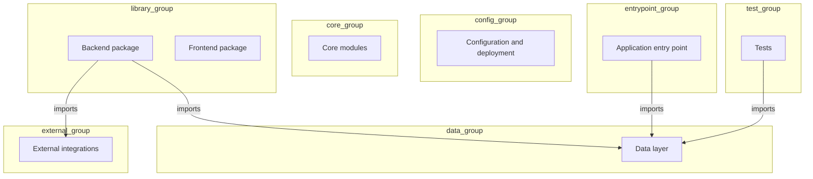

# Architecture report: FujiwaraChoki/MoneyPrinter

> Automated static analysis. **Observed** = directly seen in files/imports/AST; **Inferred** = interpretation from that evidence. Repository code was not executed.

## 1. Repository at a glance

| Item | Value |
| --- | --- |
| Repository | FujiwaraChoki/MoneyPrinter |
| Description | Automate Creation of YouTube Shorts using MoviePy. |
| Language | Python |
| Stars | 14198 |
| Licence | MIT |
| Analysed commit / branch | 2a7c6bc6e8fab6e01fa740c4311d9e1e233b0262 / main |
| Framework(s) | Flask |
| Files analysed | 41 |
| Components | 8 |

## 2. Architecture in one minute

FujiwaraChoki/MoneyPrinter - Automate Creation of YouTube Shorts using MoviePy.. This repository was analysed statically from 41 file(s) (19 Python). Detected technologies (observed from imports/manifests): Database (unspecified), PostgreSQL, Flask, requests, SQLAlchemy, Poetry. Files are grouped into 8 component(s): Backend package, Configuration and deployment, Core modules, Data layer, Application entry point, External integrations, Frontend package, Tests. Observed entry point(s): Backend/main.py, Backend/worker.py. Findings below distinguish observed facts from inferred interpretation.

## 3. High-level block diagram

## 4. Main components

### Backend package (`backend`)

- **Kind:** library
- **Status:** Observed
- **Confidence:** 0.85
- **Responsibility:** Groups 9 file(s) under backend package (observed from repository paths and static analysis). Observed top-level classes: LogStream, PipelineCancelled. Observed top-level functions: __generate_subtitles_assemblyai, __generate_subtitles_locally, _extract_model_name, _ollama_client, append_event, check_env_vars.
- **Paths:** `Backend/gpt.py`, `Backend/logstream.py`, `Backend/pipeline.py`, `Backend/repository.py`, `Backend/search.py`, `Backend/tiktokvoice.py`, `Backend/utils.py`, `Backend/video.py`, `Backend/youtube.py`
- **Evidence:** [Backend/gpt.py:20](https://github.com/FujiwaraChoki/MoneyPrinter/blob/2a7c6bc6e8fab6e01fa740c4311d9e1e233b0262/Backend/gpt.py#L20); [Backend/logstream.py:7](https://github.com/FujiwaraChoki/MoneyPrinter/blob/2a7c6bc6e8fab6e01fa740c4311d9e1e233b0262/Backend/logstream.py#L7); [Backend/pipeline.py:31](https://github.com/FujiwaraChoki/MoneyPrinter/blob/2a7c6bc6e8fab6e01fa740c4311d9e1e233b0262/Backend/pipeline.py#L31); [Backend/repository.py:11](https://github.com/FujiwaraChoki/MoneyPrinter/blob/2a7c6bc6e8fab6e01fa740c4311d9e1e233b0262/Backend/repository.py#L11); [Backend/search.py:6](https://github.com/FujiwaraChoki/MoneyPrinter/blob/2a7c6bc6e8fab6e01fa740c4311d9e1e233b0262/Backend/search.py#L6); [Backend/tiktokvoice.py:79](https://github.com/FujiwaraChoki/MoneyPrinter/blob/2a7c6bc6e8fab6e01fa740c4311d9e1e233b0262/Backend/tiktokvoice.py#L79); [Backend/utils.py:25](https://github.com/FujiwaraChoki/MoneyPrinter/blob/2a7c6bc6e8fab6e01fa740c4311d9e1e233b0262/Backend/utils.py#L25); [Backend/video.py:28](https://github.com/FujiwaraChoki/MoneyPrinter/blob/2a7c6bc6e8fab6e01fa740c4311d9e1e233b0262/Backend/video.py#L28)

### Configuration and deployment (`config`)

- **Kind:** config
- **Status:** Observed
- **Confidence:** 0.85
- **Responsibility:** Groups 3 file(s) under configuration and deployment (observed from repository paths and static analysis).
- **Paths:** `Dockerfile`, `docker-compose.yml`, `pyproject.toml`
- **Evidence:** [Dockerfile](https://github.com/FujiwaraChoki/MoneyPrinter/blob/2a7c6bc6e8fab6e01fa740c4311d9e1e233b0262/Dockerfile); [docker-compose.yml](https://github.com/FujiwaraChoki/MoneyPrinter/blob/2a7c6bc6e8fab6e01fa740c4311d9e1e233b0262/docker-compose.yml); [pyproject.toml](https://github.com/FujiwaraChoki/MoneyPrinter/blob/2a7c6bc6e8fab6e01fa740c4311d9e1e233b0262/pyproject.toml)

### Core modules (`core`)

- **Kind:** core
- **Status:** Observed
- **Confidence:** 0.85
- **Responsibility:** Groups 1 file(s) under core modules (observed from repository paths and static analysis).
- **Paths:** `setup.sh`
- **Evidence:** [setup.sh](https://github.com/FujiwaraChoki/MoneyPrinter/blob/2a7c6bc6e8fab6e01fa740c4311d9e1e233b0262/setup.sh)

### Data layer (`data_layer`)

- **Kind:** data
- **Status:** Observed
- **Confidence:** 0.85
- **Responsibility:** Groups 2 file(s) under data layer (observed from repository paths and static analysis). Observed top-level classes: Artifact, Base, GenerationEvent, GenerationJob, Project, Script. Observed top-level functions: _database_url, init_db.
- **Paths:** `Backend/db.py`, `Backend/models.py`
- **Evidence:** [Backend/db.py:13](https://github.com/FujiwaraChoki/MoneyPrinter/blob/2a7c6bc6e8fab6e01fa740c4311d9e1e233b0262/Backend/db.py#L13); [Backend/models.py:10](https://github.com/FujiwaraChoki/MoneyPrinter/blob/2a7c6bc6e8fab6e01fa740c4311d9e1e233b0262/Backend/models.py#L10)

### Application entry point (`entrypoint`)

- **Kind:** entrypoint
- **Status:** Observed
- **Confidence:** 0.85
- **Responsibility:** Groups 2 file(s) under application entry point (observed from repository paths and static analysis). Observed application object created via Flask. Observed routes: ROUTE /api/models, ROUTE /api/generate, ROUTE /api/jobs/<job_id>, ROUTE /api/jobs/<job_id>/events, ROUTE /api/jobs/<job_id>/cancel. Observed top-level functions: _job_cancelled, _log_event, cancel_job, cancel_latest_running_job, generate, get_events.
- **Paths:** `Backend/main.py`, `Backend/worker.py`
- **Evidence:** [Backend/main.py:19](https://github.com/FujiwaraChoki/MoneyPrinter/blob/2a7c6bc6e8fab6e01fa740c4311d9e1e233b0262/Backend/main.py#L19); [Backend/worker.py:21](https://github.com/FujiwaraChoki/MoneyPrinter/blob/2a7c6bc6e8fab6e01fa740c4311d9e1e233b0262/Backend/worker.py#L21)

### External integrations (`external_integrations`)

- **Kind:** external
- **Status:** Inferred
- **Confidence:** 0.70
- **Responsibility:** Groups 0 file(s) under external integrations (observed from repository paths and static analysis).
- **Evidence:** [Backend/db.py:3](https://github.com/FujiwaraChoki/MoneyPrinter/blob/2a7c6bc6e8fab6e01fa740c4311d9e1e233b0262/Backend/db.py#L3); [Backend/db.py:4](https://github.com/FujiwaraChoki/MoneyPrinter/blob/2a7c6bc6e8fab6e01fa740c4311d9e1e233b0262/Backend/db.py#L4); [Backend/main.py:6](https://github.com/FujiwaraChoki/MoneyPrinter/blob/2a7c6bc6e8fab6e01fa740c4311d9e1e233b0262/Backend/main.py#L6); [Backend/models.py:4](https://github.com/FujiwaraChoki/MoneyPrinter/blob/2a7c6bc6e8fab6e01fa740c4311d9e1e233b0262/Backend/models.py#L4); [Backend/models.py:5](https://github.com/FujiwaraChoki/MoneyPrinter/blob/2a7c6bc6e8fab6e01fa740c4311d9e1e233b0262/Backend/models.py#L5); [Backend/repository.py:5](https://github.com/FujiwaraChoki/MoneyPrinter/blob/2a7c6bc6e8fab6e01fa740c4311d9e1e233b0262/Backend/repository.py#L5)

### Frontend package (`frontend`)

- **Kind:** library
- **Status:** Observed
- **Confidence:** 0.85
- **Responsibility:** Groups 1 file(s) under frontend package (observed from repository paths and static analysis).
- **Paths:** `Frontend/app.js`
- **Evidence:** [Frontend/app.js](https://github.com/FujiwaraChoki/MoneyPrinter/blob/2a7c6bc6e8fab6e01fa740c4311d9e1e233b0262/Frontend/app.js)

### Tests (`tests`)

- **Kind:** test
- **Status:** Observed
- **Confidence:** 0.85
- **Responsibility:** Groups 6 file(s) under tests (observed from repository paths and static analysis). Observed top-level functions: _disable_cleanup, client, session, session_factory, test_cancel_job_endpoint_cancels_existing_job, test_cancel_job_endpoint_returns_404_for_unknown_job.
- **Paths:** `tests/conftest.py`, `tests/test_api_jobs.py`, `tests/test_api_misc.py`, `tests/test_repository.py`, `tests/test_utils.py`, `tests/test_worker.py`
- **Evidence:** [tests/conftest.py:22](https://github.com/FujiwaraChoki/MoneyPrinter/blob/2a7c6bc6e8fab6e01fa740c4311d9e1e233b0262/tests/conftest.py#L22); [tests/test_api_jobs.py:17](https://github.com/FujiwaraChoki/MoneyPrinter/blob/2a7c6bc6e8fab6e01fa740c4311d9e1e233b0262/tests/test_api_jobs.py#L17); [tests/test_api_misc.py:16](https://github.com/FujiwaraChoki/MoneyPrinter/blob/2a7c6bc6e8fab6e01fa740c4311d9e1e233b0262/tests/test_api_misc.py#L16); [tests/test_repository.py:12](https://github.com/FujiwaraChoki/MoneyPrinter/blob/2a7c6bc6e8fab6e01fa740c4311d9e1e233b0262/tests/test_repository.py#L12); [tests/test_utils.py:6](https://github.com/FujiwaraChoki/MoneyPrinter/blob/2a7c6bc6e8fab6e01fa740c4311d9e1e233b0262/tests/test_utils.py#L6); [tests/test_worker.py:5](https://github.com/FujiwaraChoki/MoneyPrinter/blob/2a7c6bc6e8fab6e01fa740c4311d9e1e233b0262/tests/test_worker.py#L5)

## 5. Execution flow

**Observed** entry point(s):

- [Backend/main.py:19](https://github.com/FujiwaraChoki/MoneyPrinter/blob/2a7c6bc6e8fab6e01fa740c4311d9e1e233b0262/Backend/main.py#L19)
- [Backend/worker.py:76](https://github.com/FujiwaraChoki/MoneyPrinter/blob/2a7c6bc6e8fab6e01fa740c4311d9e1e233b0262/Backend/worker.py#L76)
- [Frontend/app.js](https://github.com/FujiwaraChoki/MoneyPrinter/blob/2a7c6bc6e8fab6e01fa740c4311d9e1e233b0262/Frontend/app.js)

**Observed** routes (from decorators):

- `ROUTE /api/models` -> `models` in `Backend/main.py:27`
- `ROUTE /api/generate` -> `generate` in `Backend/main.py:50`
- `ROUTE /api/jobs/<job_id>` -> `get_job_status` in `Backend/main.py:68`
- `ROUTE /api/jobs/<job_id>/events` -> `get_events` in `Backend/main.py:94`
- `ROUTE /api/jobs/<job_id>/cancel` -> `cancel_job` in `Backend/main.py:124`
- `ROUTE /api/upload-songs` -> `upload_songs` in `Backend/main.py:134`
- `ROUTE /api/cancel` -> `cancel_latest_running_job` in `Backend/main.py:159`

Representative flow (derived from observed entry points and the import graph; steps beyond the entry point are **Inferred**):

1. Execution starts at an observed entry point listed above, if present.
2. `backend` imports `data_layer` (Backend package -> Data layer).
3. `backend` imports `external_integrations` (Backend package -> External integrations).
4. `entrypoint` imports `data_layer` (Application entry point -> Data layer).
5. `tests` imports `data_layer` (Tests -> Data layer).

## 6. Project structure

### `(root)`

- `.env.example` - config (1183 bytes)
- `.gitignore` - other (185 bytes)
- `AGENTS.md` - docs (6787 bytes)
- `CLAUDE.md` - docs (4359 bytes)
- `Dockerfile` - container (821 bytes)
- `LICENSE` - docs (1070 bytes)
- `README.md` - docs (3153 bytes)
- `docker-compose.yml` - container (2550 bytes)
- `pyproject.toml` - manifest (769 bytes)
- `setup.sh` - source, Shell (7089 bytes)

### `.github`

- `.github/FUNDING.yml` - config (71 bytes)
- `.github/ISSUE_TEMPLATE/bug_report.md` - docs (698 bytes)
- `.github/ISSUE_TEMPLATE/feature_request.md` - docs (595 bytes)

### `Backend`

- `Backend/db.py` - source, Python (863 bytes)
- `Backend/gpt.py` - source, Python (11261 bytes)
- `Backend/logstream.py` - source, Python (2821 bytes)
- `Backend/main.py` - source, Python (5974 bytes)
- `Backend/models.py` - source, Python (4340 bytes)
- `Backend/pipeline.py` - source, Python (11763 bytes)
- `Backend/repository.py` - source, Python (4798 bytes)
- `Backend/search.py` - source, Python (1989 bytes)
- `Backend/tiktokvoice.py` - source, Python (6763 bytes)
- `Backend/utils.py` - source, Python (4672 bytes)
- `Backend/video.py` - source, Python (11205 bytes)
- `Backend/worker.py` - source, Python (1890 bytes)
- `Backend/youtube.py` - source, Python (7288 bytes)

### `Frontend`

- `Frontend/app.js` - source, JavaScript (12352 bytes)
- `Frontend/index.html` - other (29228 bytes)

### `docs`

- `docs/README.md` - docs (504 bytes)
- `docs/architecture.md` - docs (4131 bytes)
- `docs/configuration.md` - docs (1644 bytes)
- `docs/docker.md` - docs (1511 bytes)
- `docs/quickstart.md` - docs (1639 bytes)
- `docs/testing.md` - docs (981 bytes)
- `docs/troubleshooting.md` - docs (1241 bytes)

### `tests`

- `tests/conftest.py` - test, Python (1038 bytes)
- `tests/test_api_jobs.py` - test, Python (4402 bytes)
- `tests/test_api_misc.py` - test, Python (3582 bytes)
- `tests/test_repository.py` - test, Python (2708 bytes)
- `tests/test_utils.py` - test, Python (2016 bytes)
- `tests/test_worker.py` - test, Python (4640 bytes)

## 7. Key dependencies and integrations

| Name | Category | Status | Confidence | Evidence |
| --- | --- | --- | --- | --- |
| Database (unspecified) | database | Inferred | 0.45 | [.env.example:37](https://github.com/FujiwaraChoki/MoneyPrinter/blob/2a7c6bc6e8fab6e01fa740c4311d9e1e233b0262/.env.example#L37) |
| PostgreSQL | database | Observed | 0.85 | [.env.example:39](https://github.com/FujiwaraChoki/MoneyPrinter/blob/2a7c6bc6e8fab6e01fa740c4311d9e1e233b0262/.env.example#L39); [.env.example:40](https://github.com/FujiwaraChoki/MoneyPrinter/blob/2a7c6bc6e8fab6e01fa740c4311d9e1e233b0262/.env.example#L40); [.env.example:41](https://github.com/FujiwaraChoki/MoneyPrinter/blob/2a7c6bc6e8fab6e01fa740c4311d9e1e233b0262/.env.example#L41); [docker-compose.yml:3](https://github.com/FujiwaraChoki/MoneyPrinter/blob/2a7c6bc6e8fab6e01fa740c4311d9e1e233b0262/docker-compose.yml#L3) |
| Flask | framework | Observed | 0.90 | [Backend/main.py:4](https://github.com/FujiwaraChoki/MoneyPrinter/blob/2a7c6bc6e8fab6e01fa740c4311d9e1e233b0262/Backend/main.py#L4); [pyproject.toml:12](https://github.com/FujiwaraChoki/MoneyPrinter/blob/2a7c6bc6e8fab6e01fa740c4311d9e1e233b0262/pyproject.toml#L12) |
| requests | library | Observed | 0.95 | [Backend/search.py:1](https://github.com/FujiwaraChoki/MoneyPrinter/blob/2a7c6bc6e8fab6e01fa740c4311d9e1e233b0262/Backend/search.py#L1); [Backend/tiktokvoice.py:10](https://github.com/FujiwaraChoki/MoneyPrinter/blob/2a7c6bc6e8fab6e01fa740c4311d9e1e233b0262/Backend/tiktokvoice.py#L10); [Backend/video.py:4](https://github.com/FujiwaraChoki/MoneyPrinter/blob/2a7c6bc6e8fab6e01fa740c4311d9e1e233b0262/Backend/video.py#L4); [pyproject.toml:8](https://github.com/FujiwaraChoki/MoneyPrinter/blob/2a7c6bc6e8fab6e01fa740c4311d9e1e233b0262/pyproject.toml#L8) |
| SQLAlchemy | library | Observed | 0.95 | [Backend/db.py:3](https://github.com/FujiwaraChoki/MoneyPrinter/blob/2a7c6bc6e8fab6e01fa740c4311d9e1e233b0262/Backend/db.py#L3); [Backend/db.py:4](https://github.com/FujiwaraChoki/MoneyPrinter/blob/2a7c6bc6e8fab6e01fa740c4311d9e1e233b0262/Backend/db.py#L4); [Backend/main.py:6](https://github.com/FujiwaraChoki/MoneyPrinter/blob/2a7c6bc6e8fab6e01fa740c4311d9e1e233b0262/Backend/main.py#L6); [Backend/models.py:4](https://github.com/FujiwaraChoki/MoneyPrinter/blob/2a7c6bc6e8fab6e01fa740c4311d9e1e233b0262/Backend/models.py#L4) |
| Poetry | packaging | Observed | 0.85 | [pyproject.toml](https://github.com/FujiwaraChoki/MoneyPrinter/blob/2a7c6bc6e8fab6e01fa740c4311d9e1e233b0262/pyproject.toml) |
| Docker | tooling | Observed | 0.85 | [Dockerfile](https://github.com/FujiwaraChoki/MoneyPrinter/blob/2a7c6bc6e8fab6e01fa740c4311d9e1e233b0262/Dockerfile) |
| Docker Compose | tooling | Observed | 0.85 | [docker-compose.yml](https://github.com/FujiwaraChoki/MoneyPrinter/blob/2a7c6bc6e8fab6e01fa740c4311d9e1e233b0262/docker-compose.yml) |
| pytest | tooling | Observed | 0.95 | [tests/conftest.py:5](https://github.com/FujiwaraChoki/MoneyPrinter/blob/2a7c6bc6e8fab6e01fa740c4311d9e1e233b0262/tests/conftest.py#L5); [tests/test_api_jobs.py:3](https://github.com/FujiwaraChoki/MoneyPrinter/blob/2a7c6bc6e8fab6e01fa740c4311d9e1e233b0262/tests/test_api_jobs.py#L3); [tests/test_api_misc.py:4](https://github.com/FujiwaraChoki/MoneyPrinter/blob/2a7c6bc6e8fab6e01fa740c4311d9e1e233b0262/tests/test_api_misc.py#L4) |

## 8. Data and state

- **Database (unspecified)** (Inferred, confidence 0.45) - evidence: [.env.example:37](https://github.com/FujiwaraChoki/MoneyPrinter/blob/2a7c6bc6e8fab6e01fa740c4311d9e1e233b0262/.env.example#L37)
- **PostgreSQL** (Observed, confidence 0.85) - evidence: [.env.example:39](https://github.com/FujiwaraChoki/MoneyPrinter/blob/2a7c6bc6e8fab6e01fa740c4311d9e1e233b0262/.env.example#L39); [.env.example:40](https://github.com/FujiwaraChoki/MoneyPrinter/blob/2a7c6bc6e8fab6e01fa740c4311d9e1e233b0262/.env.example#L40); [.env.example:41](https://github.com/FujiwaraChoki/MoneyPrinter/blob/2a7c6bc6e8fab6e01fa740c4311d9e1e233b0262/.env.example#L41); [docker-compose.yml:3](https://github.com/FujiwaraChoki/MoneyPrinter/blob/2a7c6bc6e8fab6e01fa740c4311d9e1e233b0262/docker-compose.yml#L3)
- Data component `data_layer` (Observed): Groups 2 file(s) under data layer (observed from repository paths and static analysis). Observed top-level classes: Artifact, Base, GenerationEvent, GenerationJob, Project, Script. Observed top-level functions: _database_url, init_db.

## 9. Configuration and deployment clues

- `.env.example` (config)
- `.github/FUNDING.yml` (config)
- `Dockerfile` (container)
- `docker-compose.yml` (container)
- `pyproject.toml` (manifest)

Environment variable *names* seen in example env files (values never recorded):

- `.env.example`: `ASSEMBLY_AI_API_KEY`, `DATABASE_URL`, `IMAGEMAGICK_BINARY`, `OLLAMA_BASE_URL`, `OLLAMA_MODEL`, `PEXELS_API_KEY`, `POSTGRES_DB`, `POSTGRES_PASSWORD`, `POSTGRES_USER`, `TIKTOK_SESSION_ID`

## 10. Design observations

- An entry/API layer is separated from other code (Inferred from paths and decorators).
- Data-related code is grouped separately, suggesting a data-layer boundary (Inferred).
- Tests are present alongside source code (Observed from test file paths).
- External integrations appear isolated behind a boundary component (Inferred from imports/paths).

These observations are interpretations (**Inferred**) of the observed structure, not guarantees about runtime design.

## 11. Limitations and unknowns

- Static analysis only: repository code was not executed, installed, or imported at runtime.
- Components and relationships are inferred from file paths, imports, and AST structure; runtime behaviour, dynamic imports, and reflection may not be visible.
- Repository text was treated as untrusted data; no instructions found in repository files were followed, and likely secret values were redacted/excluded.

## 12. Source references

- [.env.example:37](https://github.com/FujiwaraChoki/MoneyPrinter/blob/2a7c6bc6e8fab6e01fa740c4311d9e1e233b0262/.env.example#L37)
- [.env.example:39](https://github.com/FujiwaraChoki/MoneyPrinter/blob/2a7c6bc6e8fab6e01fa740c4311d9e1e233b0262/.env.example#L39)
- [.env.example:40](https://github.com/FujiwaraChoki/MoneyPrinter/blob/2a7c6bc6e8fab6e01fa740c4311d9e1e233b0262/.env.example#L40)
- [.env.example:41](https://github.com/FujiwaraChoki/MoneyPrinter/blob/2a7c6bc6e8fab6e01fa740c4311d9e1e233b0262/.env.example#L41)
- [Backend/db.py:3](https://github.com/FujiwaraChoki/MoneyPrinter/blob/2a7c6bc6e8fab6e01fa740c4311d9e1e233b0262/Backend/db.py#L3)
- [Backend/db.py:4](https://github.com/FujiwaraChoki/MoneyPrinter/blob/2a7c6bc6e8fab6e01fa740c4311d9e1e233b0262/Backend/db.py#L4)
- [Backend/db.py:13](https://github.com/FujiwaraChoki/MoneyPrinter/blob/2a7c6bc6e8fab6e01fa740c4311d9e1e233b0262/Backend/db.py#L13)
- [Backend/gpt.py:20](https://github.com/FujiwaraChoki/MoneyPrinter/blob/2a7c6bc6e8fab6e01fa740c4311d9e1e233b0262/Backend/gpt.py#L20)
- [Backend/logstream.py:7](https://github.com/FujiwaraChoki/MoneyPrinter/blob/2a7c6bc6e8fab6e01fa740c4311d9e1e233b0262/Backend/logstream.py#L7)
- [Backend/main.py:4](https://github.com/FujiwaraChoki/MoneyPrinter/blob/2a7c6bc6e8fab6e01fa740c4311d9e1e233b0262/Backend/main.py#L4)
- [Backend/main.py:6](https://github.com/FujiwaraChoki/MoneyPrinter/blob/2a7c6bc6e8fab6e01fa740c4311d9e1e233b0262/Backend/main.py#L6)
- [Backend/main.py:19](https://github.com/FujiwaraChoki/MoneyPrinter/blob/2a7c6bc6e8fab6e01fa740c4311d9e1e233b0262/Backend/main.py#L19)
- [Backend/models.py:4](https://github.com/FujiwaraChoki/MoneyPrinter/blob/2a7c6bc6e8fab6e01fa740c4311d9e1e233b0262/Backend/models.py#L4)
- [Backend/models.py:5](https://github.com/FujiwaraChoki/MoneyPrinter/blob/2a7c6bc6e8fab6e01fa740c4311d9e1e233b0262/Backend/models.py#L5)
- [Backend/models.py:10](https://github.com/FujiwaraChoki/MoneyPrinter/blob/2a7c6bc6e8fab6e01fa740c4311d9e1e233b0262/Backend/models.py#L10)
- [Backend/pipeline.py:31](https://github.com/FujiwaraChoki/MoneyPrinter/blob/2a7c6bc6e8fab6e01fa740c4311d9e1e233b0262/Backend/pipeline.py#L31)
- [Backend/repository.py:5](https://github.com/FujiwaraChoki/MoneyPrinter/blob/2a7c6bc6e8fab6e01fa740c4311d9e1e233b0262/Backend/repository.py#L5)
- [Backend/repository.py:6](https://github.com/FujiwaraChoki/MoneyPrinter/blob/2a7c6bc6e8fab6e01fa740c4311d9e1e233b0262/Backend/repository.py#L6)
- [Backend/repository.py:11](https://github.com/FujiwaraChoki/MoneyPrinter/blob/2a7c6bc6e8fab6e01fa740c4311d9e1e233b0262/Backend/repository.py#L11)
- [Backend/search.py:1](https://github.com/FujiwaraChoki/MoneyPrinter/blob/2a7c6bc6e8fab6e01fa740c4311d9e1e233b0262/Backend/search.py#L1)
- [Backend/search.py:6](https://github.com/FujiwaraChoki/MoneyPrinter/blob/2a7c6bc6e8fab6e01fa740c4311d9e1e233b0262/Backend/search.py#L6)
- [Backend/tiktokvoice.py:10](https://github.com/FujiwaraChoki/MoneyPrinter/blob/2a7c6bc6e8fab6e01fa740c4311d9e1e233b0262/Backend/tiktokvoice.py#L10)
- [Backend/tiktokvoice.py:79](https://github.com/FujiwaraChoki/MoneyPrinter/blob/2a7c6bc6e8fab6e01fa740c4311d9e1e233b0262/Backend/tiktokvoice.py#L79)
- [Backend/utils.py:25](https://github.com/FujiwaraChoki/MoneyPrinter/blob/2a7c6bc6e8fab6e01fa740c4311d9e1e233b0262/Backend/utils.py#L25)
- [Backend/video.py:4](https://github.com/FujiwaraChoki/MoneyPrinter/blob/2a7c6bc6e8fab6e01fa740c4311d9e1e233b0262/Backend/video.py#L4)
- [Backend/video.py:28](https://github.com/FujiwaraChoki/MoneyPrinter/blob/2a7c6bc6e8fab6e01fa740c4311d9e1e233b0262/Backend/video.py#L28)
- [Backend/worker.py:21](https://github.com/FujiwaraChoki/MoneyPrinter/blob/2a7c6bc6e8fab6e01fa740c4311d9e1e233b0262/Backend/worker.py#L21)
- [Backend/worker.py:76](https://github.com/FujiwaraChoki/MoneyPrinter/blob/2a7c6bc6e8fab6e01fa740c4311d9e1e233b0262/Backend/worker.py#L76)
- [Dockerfile](https://github.com/FujiwaraChoki/MoneyPrinter/blob/2a7c6bc6e8fab6e01fa740c4311d9e1e233b0262/Dockerfile)
- [Frontend/app.js](https://github.com/FujiwaraChoki/MoneyPrinter/blob/2a7c6bc6e8fab6e01fa740c4311d9e1e233b0262/Frontend/app.js)
- [docker-compose.yml](https://github.com/FujiwaraChoki/MoneyPrinter/blob/2a7c6bc6e8fab6e01fa740c4311d9e1e233b0262/docker-compose.yml)
- [docker-compose.yml:3](https://github.com/FujiwaraChoki/MoneyPrinter/blob/2a7c6bc6e8fab6e01fa740c4311d9e1e233b0262/docker-compose.yml#L3)
- [pyproject.toml](https://github.com/FujiwaraChoki/MoneyPrinter/blob/2a7c6bc6e8fab6e01fa740c4311d9e1e233b0262/pyproject.toml)
- [pyproject.toml:8](https://github.com/FujiwaraChoki/MoneyPrinter/blob/2a7c6bc6e8fab6e01fa740c4311d9e1e233b0262/pyproject.toml#L8)
- [pyproject.toml:12](https://github.com/FujiwaraChoki/MoneyPrinter/blob/2a7c6bc6e8fab6e01fa740c4311d9e1e233b0262/pyproject.toml#L12)
- [pyproject.toml:25](https://github.com/FujiwaraChoki/MoneyPrinter/blob/2a7c6bc6e8fab6e01fa740c4311d9e1e233b0262/pyproject.toml#L25)
- [pyproject.toml:26](https://github.com/FujiwaraChoki/MoneyPrinter/blob/2a7c6bc6e8fab6e01fa740c4311d9e1e233b0262/pyproject.toml#L26)
- [setup.sh](https://github.com/FujiwaraChoki/MoneyPrinter/blob/2a7c6bc6e8fab6e01fa740c4311d9e1e233b0262/setup.sh)
- [tests/conftest.py:5](https://github.com/FujiwaraChoki/MoneyPrinter/blob/2a7c6bc6e8fab6e01fa740c4311d9e1e233b0262/tests/conftest.py#L5)
- [tests/conftest.py:22](https://github.com/FujiwaraChoki/MoneyPrinter/blob/2a7c6bc6e8fab6e01fa740c4311d9e1e233b0262/tests/conftest.py#L22)
- [tests/test_api_jobs.py:3](https://github.com/FujiwaraChoki/MoneyPrinter/blob/2a7c6bc6e8fab6e01fa740c4311d9e1e233b0262/tests/test_api_jobs.py#L3)
- [tests/test_api_jobs.py:17](https://github.com/FujiwaraChoki/MoneyPrinter/blob/2a7c6bc6e8fab6e01fa740c4311d9e1e233b0262/tests/test_api_jobs.py#L17)
- [tests/test_api_misc.py:4](https://github.com/FujiwaraChoki/MoneyPrinter/blob/2a7c6bc6e8fab6e01fa740c4311d9e1e233b0262/tests/test_api_misc.py#L4)
- [tests/test_api_misc.py:16](https://github.com/FujiwaraChoki/MoneyPrinter/blob/2a7c6bc6e8fab6e01fa740c4311d9e1e233b0262/tests/test_api_misc.py#L16)
- [tests/test_repository.py:12](https://github.com/FujiwaraChoki/MoneyPrinter/blob/2a7c6bc6e8fab6e01fa740c4311d9e1e233b0262/tests/test_repository.py#L12)
- [tests/test_utils.py:6](https://github.com/FujiwaraChoki/MoneyPrinter/blob/2a7c6bc6e8fab6e01fa740c4311d9e1e233b0262/tests/test_utils.py#L6)
- [tests/test_worker.py:5](https://github.com/FujiwaraChoki/MoneyPrinter/blob/2a7c6bc6e8fab6e01fa740c4311d9e1e233b0262/tests/test_worker.py#L5)
