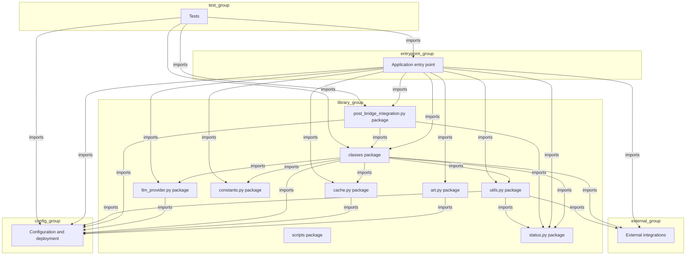

# Architecture report: FujiwaraChoki/MoneyPrinterV2

> Automated static analysis. **Observed** = directly seen in files/imports/AST; **Inferred** = interpretation from that evidence. Repository code was not executed.

## 1. Repository at a glance

| Item | Value |
| --- | --- |
| Repository | FujiwaraChoki/MoneyPrinterV2 |
| Description | Automate the process of making money online. |
| Language | Python |
| Stars | 32426 |
| Licence | AGPL-3.0 |
| Analysed commit / branch | a734fa924adb9ffe5ab8472aa5526e469e42a8b5 / main |
| Framework(s) | None detected |
| Files analysed | 42 |
| Components | 13 |

## 2. Architecture in one minute

FujiwaraChoki/MoneyPrinterV2 - Automate the process of making money online.. This repository was analysed statically from 42 file(s) (22 Python). Detected technologies (observed from imports/manifests): requests, unittest. Files are grouped into 13 component(s): art.py package, cache.py package, classes package, Configuration and deployment, constants.py package, Application entry point, External integrations, llm_provider.py package. Observed entry point(s): scripts/preflight_local.py, src/cron.py, src/main.py. Findings below distinguish observed facts from inferred interpretation.

## 3. High-level block diagram

## 4. Main components

### art.py package (`art_py`)

- **Kind:** library
- **Status:** Observed
- **Confidence:** 0.85
- **Responsibility:** Groups 1 file(s) under art.py package (observed from repository paths and static analysis). Observed top-level functions: print_banner.
- **Paths:** `src/art.py`
- **Evidence:** [src/art.py:4](https://github.com/FujiwaraChoki/MoneyPrinterV2/blob/a734fa924adb9ffe5ab8472aa5526e469e42a8b5/src/art.py#L4)

### cache.py package (`cache_py`)

- **Kind:** library
- **Status:** Observed
- **Confidence:** 0.85
- **Responsibility:** Groups 1 file(s) under cache.py package (observed from repository paths and static analysis). Observed top-level functions: add_account, add_product, get_accounts, get_afm_cache_path, get_cache_path, get_products.
- **Paths:** `src/cache.py`
- **Evidence:** [src/cache.py:7](https://github.com/FujiwaraChoki/MoneyPrinterV2/blob/a734fa924adb9ffe5ab8472aa5526e469e42a8b5/src/cache.py#L7)

### classes package (`classes`)

- **Kind:** library
- **Status:** Observed
- **Confidence:** 0.85
- **Responsibility:** Groups 6 file(s) under classes package (observed from repository paths and static analysis). Observed top-level classes: AffiliateMarketing, Outreach, PostBridge, PostBridgeClientError, TTS, Twitter.
- **Paths:** `src/classes/AFM.py`, `src/classes/Outreach.py`, `src/classes/PostBridge.py`, `src/classes/Tts.py`, `src/classes/Twitter.py`, `src/classes/YouTube.py`
- **Evidence:** [src/classes/AFM.py:18](https://github.com/FujiwaraChoki/MoneyPrinterV2/blob/a734fa924adb9ffe5ab8472aa5526e469e42a8b5/src/classes/AFM.py#L18); [src/classes/Outreach.py:19](https://github.com/FujiwaraChoki/MoneyPrinterV2/blob/a734fa924adb9ffe5ab8472aa5526e469e42a8b5/src/classes/Outreach.py#L19); [src/classes/PostBridge.py:10](https://github.com/FujiwaraChoki/MoneyPrinterV2/blob/a734fa924adb9ffe5ab8472aa5526e469e42a8b5/src/classes/PostBridge.py#L10); [src/classes/Tts.py:10](https://github.com/FujiwaraChoki/MoneyPrinterV2/blob/a734fa924adb9ffe5ab8472aa5526e469e42a8b5/src/classes/Tts.py#L10); [src/classes/Twitter.py:24](https://github.com/FujiwaraChoki/MoneyPrinterV2/blob/a734fa924adb9ffe5ab8472aa5526e469e42a8b5/src/classes/Twitter.py#L24); [src/classes/YouTube.py:35](https://github.com/FujiwaraChoki/MoneyPrinterV2/blob/a734fa924adb9ffe5ab8472aa5526e469e42a8b5/src/classes/YouTube.py#L35)

### Configuration and deployment (`config`)

- **Kind:** config
- **Status:** Observed
- **Confidence:** 0.85
- **Responsibility:** Groups 3 file(s) under configuration and deployment (observed from repository paths and static analysis). Observed top-level functions: assert_folder_structure, equalize_subtitles, get_assemblyai_api_key, get_email_credentials, get_firefox_profile_path, get_first_time_running.
- **Paths:** `config.example.json`, `requirements.txt`, `src/config.py`
- **Evidence:** [config.example.json](https://github.com/FujiwaraChoki/MoneyPrinterV2/blob/a734fa924adb9ffe5ab8472aa5526e469e42a8b5/config.example.json); [requirements.txt](https://github.com/FujiwaraChoki/MoneyPrinterV2/blob/a734fa924adb9ffe5ab8472aa5526e469e42a8b5/requirements.txt); [src/config.py:10](https://github.com/FujiwaraChoki/MoneyPrinterV2/blob/a734fa924adb9ffe5ab8472aa5526e469e42a8b5/src/config.py#L10)

### constants.py package (`constants_py`)

- **Kind:** library
- **Status:** Observed
- **Confidence:** 0.85
- **Responsibility:** Groups 1 file(s) under constants.py package (observed from repository paths and static analysis).
- **Paths:** `src/constants.py`
- **Evidence:** [src/constants.py](https://github.com/FujiwaraChoki/MoneyPrinterV2/blob/a734fa924adb9ffe5ab8472aa5526e469e42a8b5/src/constants.py)

### Application entry point (`entrypoint`)

- **Kind:** entrypoint
- **Status:** Observed
- **Confidence:** 0.85
- **Responsibility:** Groups 3 file(s) under application entry point (observed from repository paths and static analysis). Observed top-level functions: check_url, fail, generate_and_upload_short, main, ok, warn.
- **Paths:** `scripts/preflight_local.py`, `src/cron.py`, `src/main.py`
- **Evidence:** [scripts/preflight_local.py:14](https://github.com/FujiwaraChoki/MoneyPrinterV2/blob/a734fa924adb9ffe5ab8472aa5526e469e42a8b5/scripts/preflight_local.py#L14); [src/cron.py:13](https://github.com/FujiwaraChoki/MoneyPrinterV2/blob/a734fa924adb9ffe5ab8472aa5526e469e42a8b5/src/cron.py#L13); [src/main.py:22](https://github.com/FujiwaraChoki/MoneyPrinterV2/blob/a734fa924adb9ffe5ab8472aa5526e469e42a8b5/src/main.py#L22)

### External integrations (`external_integrations`)

- **Kind:** external
- **Status:** Inferred
- **Confidence:** 0.70
- **Responsibility:** Groups 0 file(s) under external integrations (observed from repository paths and static analysis).
- **Evidence:** [scripts/preflight_local.py:7](https://github.com/FujiwaraChoki/MoneyPrinterV2/blob/a734fa924adb9ffe5ab8472aa5526e469e42a8b5/scripts/preflight_local.py#L7); [src/classes/Outreach.py:10](https://github.com/FujiwaraChoki/MoneyPrinterV2/blob/a734fa924adb9ffe5ab8472aa5526e469e42a8b5/src/classes/Outreach.py#L10); [src/classes/PostBridge.py:7](https://github.com/FujiwaraChoki/MoneyPrinterV2/blob/a734fa924adb9ffe5ab8472aa5526e469e42a8b5/src/classes/PostBridge.py#L7); [src/classes/YouTube.py:6](https://github.com/FujiwaraChoki/MoneyPrinterV2/blob/a734fa924adb9ffe5ab8472aa5526e469e42a8b5/src/classes/YouTube.py#L6); [src/utils.py:4](https://github.com/FujiwaraChoki/MoneyPrinterV2/blob/a734fa924adb9ffe5ab8472aa5526e469e42a8b5/src/utils.py#L4)

### llm_provider.py package (`llm_provider_py`)

- **Kind:** library
- **Status:** Observed
- **Confidence:** 0.85
- **Responsibility:** Groups 1 file(s) under llm_provider.py package (observed from repository paths and static analysis). Observed top-level functions: _client, generate_text, get_active_model, list_models, select_model.
- **Paths:** `src/llm_provider.py`
- **Evidence:** [src/llm_provider.py:8](https://github.com/FujiwaraChoki/MoneyPrinterV2/blob/a734fa924adb9ffe5ab8472aa5526e469e42a8b5/src/llm_provider.py#L8)

### post_bridge_integration.py package (`post_bridge_integration_py`)

- **Kind:** library
- **Status:** Observed
- **Confidence:** 0.85
- **Responsibility:** Groups 1 file(s) under post_bridge_integration.py package (observed from repository paths and static analysis). Observed top-level functions: build_platform_configurations, maybe_crosspost_youtube_short, resolve_social_account_ids.
- **Paths:** `src/post_bridge_integration.py`
- **Evidence:** [src/post_bridge_integration.py:14](https://github.com/FujiwaraChoki/MoneyPrinterV2/blob/a734fa924adb9ffe5ab8472aa5526e469e42a8b5/src/post_bridge_integration.py#L14)

### scripts package (`scripts`)

- **Kind:** library
- **Status:** Observed
- **Confidence:** 0.85
- **Responsibility:** Groups 2 file(s) under scripts package (observed from repository paths and static analysis).
- **Paths:** `scripts/setup_local.sh`, `scripts/upload_video.sh`
- **Evidence:** [scripts/setup_local.sh](https://github.com/FujiwaraChoki/MoneyPrinterV2/blob/a734fa924adb9ffe5ab8472aa5526e469e42a8b5/scripts/setup_local.sh); [scripts/upload_video.sh](https://github.com/FujiwaraChoki/MoneyPrinterV2/blob/a734fa924adb9ffe5ab8472aa5526e469e42a8b5/scripts/upload_video.sh)

### status.py package (`status_py`)

- **Kind:** library
- **Status:** Observed
- **Confidence:** 0.85
- **Responsibility:** Groups 1 file(s) under status.py package (observed from repository paths and static analysis). Observed top-level functions: error, info, question, success, warning.
- **Paths:** `src/status.py`
- **Evidence:** [src/status.py:3](https://github.com/FujiwaraChoki/MoneyPrinterV2/blob/a734fa924adb9ffe5ab8472aa5526e469e42a8b5/src/status.py#L3)

### Tests (`tests`)

- **Kind:** test
- **Status:** Observed
- **Confidence:** 0.85
- **Responsibility:** Groups 5 file(s) under tests (observed from repository paths and static analysis). Observed routes: PATCH cron.maybe_crosspost_youtube_short, PATCH cron.YouTube, PATCH cron.TTS, PATCH cron.get_accounts, PATCH cron.select_model. Observed top-level classes: CronPostBridgeTests, MockResponse, PostBridgeClientTests, PostBridgeConfigTests, PostBridgeIntegrationTests, YouTubeCustomTopicTests. Observed top-level functions: _make_youtube, _stub_module.
- **Paths:** `tests/test_config.py`, `tests/test_cron_post_bridge.py`, `tests/test_post_bridge_client.py`, `tests/test_post_bridge_integration.py`, `tests/test_youtube_custom_topic.py`
- **Evidence:** [tests/test_config.py:18](https://github.com/FujiwaraChoki/MoneyPrinterV2/blob/a734fa924adb9ffe5ab8472aa5526e469e42a8b5/tests/test_config.py#L18); [tests/test_cron_post_bridge.py:42](https://github.com/FujiwaraChoki/MoneyPrinterV2/blob/a734fa924adb9ffe5ab8472aa5526e469e42a8b5/tests/test_cron_post_bridge.py#L42); [tests/test_post_bridge_client.py:17](https://github.com/FujiwaraChoki/MoneyPrinterV2/blob/a734fa924adb9ffe5ab8472aa5526e469e42a8b5/tests/test_post_bridge_client.py#L17); [tests/test_post_bridge_integration.py:19](https://github.com/FujiwaraChoki/MoneyPrinterV2/blob/a734fa924adb9ffe5ab8472aa5526e469e42a8b5/tests/test_post_bridge_integration.py#L19); [tests/test_youtube_custom_topic.py:16](https://github.com/FujiwaraChoki/MoneyPrinterV2/blob/a734fa924adb9ffe5ab8472aa5526e469e42a8b5/tests/test_youtube_custom_topic.py#L16)

### utils.py package (`utils_py`)

- **Kind:** library
- **Status:** Observed
- **Confidence:** 0.85
- **Responsibility:** Groups 1 file(s) under utils.py package (observed from repository paths and static analysis). Observed top-level functions: build_url, choose_random_song, close_running_selenium_instances, fetch_songs, rem_temp_files.
- **Paths:** `src/utils.py`
- **Evidence:** [src/utils.py:13](https://github.com/FujiwaraChoki/MoneyPrinterV2/blob/a734fa924adb9ffe5ab8472aa5526e469e42a8b5/src/utils.py#L13)

## 5. Execution flow

**Observed** entry point(s):

- [scripts/preflight_local.py:123](https://github.com/FujiwaraChoki/MoneyPrinterV2/blob/a734fa924adb9ffe5ab8472aa5526e469e42a8b5/scripts/preflight_local.py#L123)
- [src/cron.py:99](https://github.com/FujiwaraChoki/MoneyPrinterV2/blob/a734fa924adb9ffe5ab8472aa5526e469e42a8b5/src/cron.py#L99)
- [src/main.py:462](https://github.com/FujiwaraChoki/MoneyPrinterV2/blob/a734fa924adb9ffe5ab8472aa5526e469e42a8b5/src/main.py#L462)

**Observed** routes (from decorators):

- `PATCH cron.maybe_crosspost_youtube_short` -> `test_crosspost_does_not_run_when_youtube_upload_fails` in `tests/test_cron_post_bridge.py:49`
- `PATCH cron.YouTube` -> `test_crosspost_does_not_run_when_youtube_upload_fails` in `tests/test_cron_post_bridge.py:49`
- `PATCH cron.TTS` -> `test_crosspost_does_not_run_when_youtube_upload_fails` in `tests/test_cron_post_bridge.py:49`
- `PATCH cron.get_accounts` -> `test_crosspost_does_not_run_when_youtube_upload_fails` in `tests/test_cron_post_bridge.py:49`
- `PATCH cron.select_model` -> `test_crosspost_does_not_run_when_youtube_upload_fails` in `tests/test_cron_post_bridge.py:49`
- `PATCH cron.get_verbose` -> `test_crosspost_does_not_run_when_youtube_upload_fails` in `tests/test_cron_post_bridge.py:49`
- `PATCH classes.PostBridge.time.sleep` -> `test_list_social_accounts_follows_pagination` in `tests/test_post_bridge_client.py:31`
- `PATCH classes.PostBridge.time.sleep` -> `test_create_post_retries_after_rate_limit` in `tests/test_post_bridge_client.py:83`
- `PATCH classes.PostBridge.time.sleep` -> `test_request_rewinds_streamed_upload_body_before_retry` in `tests/test_post_bridge_client.py:130`
- `PATCH post_bridge_integration.PostBridge` -> `test_cron_mode_skips_when_auto_crosspost_is_disabled` in `tests/test_post_bridge_integration.py:58`
- `PATCH post_bridge_integration.get_post_bridge_config` -> `test_cron_mode_skips_when_auto_crosspost_is_disabled` in `tests/test_post_bridge_integration.py:58`
- `PATCH post_bridge_integration.PostBridge` -> `test_interactive_crosspost_uploads_and_posts` in `tests/test_post_bridge_integration.py:83`
- `PATCH post_bridge_integration.get_post_bridge_config` -> `test_interactive_crosspost_uploads_and_posts` in `tests/test_post_bridge_integration.py:83`
- `PATCH post_bridge_integration.PostBridge` -> `test_account_ids_work_without_platform_filters` in `tests/test_post_bridge_integration.py:118`
- `PATCH post_bridge_integration.get_post_bridge_config` -> `test_account_ids_work_without_platform_filters` in `tests/test_post_bridge_integration.py:118`
- `PATCH classes.YouTube.get_verbose` -> `test_custom_topic_skips_llm_topic_generation` in `tests/test_youtube_custom_topic.py:78`
- `PATCH classes.YouTube.get_verbose` -> `test_no_topic_falls_back_to_llm_topic_generation` in `tests/test_youtube_custom_topic.py:89`
- `PATCH classes.YouTube.get_verbose` -> `test_blank_topic_falls_back_to_llm_topic_generation` in `tests/test_youtube_custom_topic.py:98`

Representative flow (derived from observed entry points and the import graph; steps beyond the entry point are **Inferred**):

1. Execution starts at an observed entry point listed above, if present.
2. `art_py` imports `config` (art.py package -> Configuration and deployment).
3. `cache_py` imports `config` (cache.py package -> Configuration and deployment).
4. `classes` imports `cache_py` (classes package -> cache.py package).
5. `classes` imports `config` (classes package -> Configuration and deployment).
6. `classes` imports `constants_py` (classes package -> constants.py package).
7. `classes` imports `external_integrations` (classes package -> External integrations).
8. `classes` imports `llm_provider_py` (classes package -> llm_provider.py package).
9. `classes` imports `status_py` (classes package -> status.py package).

## 6. Project structure

### `(root)`

- `.gitignore` - other (102 bytes)
- `.python-version` - other (5 bytes)
- `AGENTS.md` - docs (2516 bytes)
- `CLAUDE.md` - docs (4311 bytes)
- `CODE_OF_CONDUCT.md` - docs (4009 bytes)
- `CONTRIBUTING.md` - docs (1260 bytes)
- `LICENSE` - docs (34518 bytes)
- `README.md` - docs (4321 bytes)
- `config.example.json` - config (1301 bytes)
- `requirements.txt` - manifest (322 bytes)

### `.github`

- `.github/FUNDING.yml` - config (71 bytes)

### `assets`

- `assets/banner.txt` - docs (649 bytes)

### `docs`

- `docs/AffiliateMarketing.md` - docs (1115 bytes)
- `docs/Configuration.md` - docs (6301 bytes)
- `docs/PostBridge.md` - docs (3978 bytes)
- `docs/Roadmap.md` - docs (680 bytes)
- `docs/TwitterBot.md` - docs (599 bytes)
- `docs/YouTube.md` - docs (1681 bytes)

### `scripts`

- `scripts/preflight_local.py` - source, Python (3662 bytes)
- `scripts/setup_local.sh` - source, Shell (3713 bytes)
- `scripts/upload_video.sh` - source, Shell (774 bytes)

### `src`

- `src/art.py` - source, Python (282 bytes)
- `src/cache.py` - source, Python (4780 bytes)
- `src/classes/AFM.py` - source, Python (5340 bytes)
- `src/classes/Outreach.py` - source, Python (9774 bytes)
- `src/classes/PostBridge.py` - source, Python (8713 bytes)
- `src/classes/Tts.py` - source, Python (563 bytes)
- `src/classes/Twitter.py` - source, Python (6935 bytes)
- `src/classes/YouTube.py` - source, Python (29764 bytes)
- `src/config.py` - source, Python (11684 bytes)
- `src/constants.py` - source, Python (1285 bytes)
- `src/cron.py` - source, Python (3399 bytes)
- `src/llm_provider.py` - source, Python (1490 bytes)
- `src/main.py` - source, Python (20284 bytes)
- `src/post_bridge_integration.py` - source, Python (7168 bytes)
- `src/status.py` - source, Python (1749 bytes)
- `src/utils.py` - source, Python (4754 bytes)

### `tests`

- `tests/test_config.py` - test, Python (2762 bytes)
- `tests/test_cron_post_bridge.py` - test, Python (2663 bytes)
- `tests/test_post_bridge_client.py` - test, Python (5374 bytes)
- `tests/test_post_bridge_integration.py` - test, Python (5166 bytes)
- `tests/test_youtube_custom_topic.py` - test, Python (4510 bytes)

## 7. Key dependencies and integrations

| Name | Category | Status | Confidence | Evidence |
| --- | --- | --- | --- | --- |
| requests | library | Observed | 0.95 | [requirements.txt:4](https://github.com/FujiwaraChoki/MoneyPrinterV2/blob/a734fa924adb9ffe5ab8472aa5526e469e42a8b5/requirements.txt#L4); [scripts/preflight_local.py:7](https://github.com/FujiwaraChoki/MoneyPrinterV2/blob/a734fa924adb9ffe5ab8472aa5526e469e42a8b5/scripts/preflight_local.py#L7); [src/classes/Outreach.py:10](https://github.com/FujiwaraChoki/MoneyPrinterV2/blob/a734fa924adb9ffe5ab8472aa5526e469e42a8b5/src/classes/Outreach.py#L10); [src/classes/PostBridge.py:7](https://github.com/FujiwaraChoki/MoneyPrinterV2/blob/a734fa924adb9ffe5ab8472aa5526e469e42a8b5/src/classes/PostBridge.py#L7) |
| unittest | tooling | Observed | 0.95 | [tests/test_config.py:5](https://github.com/FujiwaraChoki/MoneyPrinterV2/blob/a734fa924adb9ffe5ab8472aa5526e469e42a8b5/tests/test_config.py#L5); [tests/test_config.py:6](https://github.com/FujiwaraChoki/MoneyPrinterV2/blob/a734fa924adb9ffe5ab8472aa5526e469e42a8b5/tests/test_config.py#L6); [tests/test_cron_post_bridge.py:4](https://github.com/FujiwaraChoki/MoneyPrinterV2/blob/a734fa924adb9ffe5ab8472aa5526e469e42a8b5/tests/test_cron_post_bridge.py#L4); [tests/test_cron_post_bridge.py:5](https://github.com/FujiwaraChoki/MoneyPrinterV2/blob/a734fa924adb9ffe5ab8472aa5526e469e42a8b5/tests/test_cron_post_bridge.py#L5) |

## 8. Data and state

No database, cache, queue, or persistent-state usage was observed in the analysed files. State handling, if any, may be in-memory or in files that were not analysed.

## 9. Configuration and deployment clues

- `.github/FUNDING.yml` (config)
- `config.example.json` (config)
- `requirements.txt` (manifest)

## 10. Design observations

- An entry/API layer is separated from other code (Inferred from paths and decorators).
- Tests are present alongside source code (Observed from test file paths).
- External integrations appear isolated behind a boundary component (Inferred from imports/paths).

These observations are interpretations (**Inferred**) of the observed structure, not guarantees about runtime design.

## 11. Limitations and unknowns

- Static analysis only: repository code was not executed, installed, or imported at runtime.
- Components and relationships are inferred from file paths, imports, and AST structure; runtime behaviour, dynamic imports, and reflection may not be visible.
- Repository text was treated as untrusted data; no instructions found in repository files were followed, and likely secret values were redacted/excluded.

## 12. Source references

- [config.example.json](https://github.com/FujiwaraChoki/MoneyPrinterV2/blob/a734fa924adb9ffe5ab8472aa5526e469e42a8b5/config.example.json)
- [requirements.txt](https://github.com/FujiwaraChoki/MoneyPrinterV2/blob/a734fa924adb9ffe5ab8472aa5526e469e42a8b5/requirements.txt)
- [requirements.txt:4](https://github.com/FujiwaraChoki/MoneyPrinterV2/blob/a734fa924adb9ffe5ab8472aa5526e469e42a8b5/requirements.txt#L4)
- [scripts/preflight_local.py:7](https://github.com/FujiwaraChoki/MoneyPrinterV2/blob/a734fa924adb9ffe5ab8472aa5526e469e42a8b5/scripts/preflight_local.py#L7)
- [scripts/preflight_local.py:14](https://github.com/FujiwaraChoki/MoneyPrinterV2/blob/a734fa924adb9ffe5ab8472aa5526e469e42a8b5/scripts/preflight_local.py#L14)
- [scripts/preflight_local.py:123](https://github.com/FujiwaraChoki/MoneyPrinterV2/blob/a734fa924adb9ffe5ab8472aa5526e469e42a8b5/scripts/preflight_local.py#L123)
- [scripts/setup_local.sh](https://github.com/FujiwaraChoki/MoneyPrinterV2/blob/a734fa924adb9ffe5ab8472aa5526e469e42a8b5/scripts/setup_local.sh)
- [scripts/upload_video.sh](https://github.com/FujiwaraChoki/MoneyPrinterV2/blob/a734fa924adb9ffe5ab8472aa5526e469e42a8b5/scripts/upload_video.sh)
- [src/art.py:4](https://github.com/FujiwaraChoki/MoneyPrinterV2/blob/a734fa924adb9ffe5ab8472aa5526e469e42a8b5/src/art.py#L4)
- [src/cache.py:7](https://github.com/FujiwaraChoki/MoneyPrinterV2/blob/a734fa924adb9ffe5ab8472aa5526e469e42a8b5/src/cache.py#L7)
- [src/classes/AFM.py:18](https://github.com/FujiwaraChoki/MoneyPrinterV2/blob/a734fa924adb9ffe5ab8472aa5526e469e42a8b5/src/classes/AFM.py#L18)
- [src/classes/Outreach.py:10](https://github.com/FujiwaraChoki/MoneyPrinterV2/blob/a734fa924adb9ffe5ab8472aa5526e469e42a8b5/src/classes/Outreach.py#L10)
- [src/classes/Outreach.py:19](https://github.com/FujiwaraChoki/MoneyPrinterV2/blob/a734fa924adb9ffe5ab8472aa5526e469e42a8b5/src/classes/Outreach.py#L19)
- [src/classes/PostBridge.py:7](https://github.com/FujiwaraChoki/MoneyPrinterV2/blob/a734fa924adb9ffe5ab8472aa5526e469e42a8b5/src/classes/PostBridge.py#L7)
- [src/classes/PostBridge.py:10](https://github.com/FujiwaraChoki/MoneyPrinterV2/blob/a734fa924adb9ffe5ab8472aa5526e469e42a8b5/src/classes/PostBridge.py#L10)
- [src/classes/Tts.py:10](https://github.com/FujiwaraChoki/MoneyPrinterV2/blob/a734fa924adb9ffe5ab8472aa5526e469e42a8b5/src/classes/Tts.py#L10)
- [src/classes/Twitter.py:24](https://github.com/FujiwaraChoki/MoneyPrinterV2/blob/a734fa924adb9ffe5ab8472aa5526e469e42a8b5/src/classes/Twitter.py#L24)
- [src/classes/YouTube.py:6](https://github.com/FujiwaraChoki/MoneyPrinterV2/blob/a734fa924adb9ffe5ab8472aa5526e469e42a8b5/src/classes/YouTube.py#L6)
- [src/classes/YouTube.py:35](https://github.com/FujiwaraChoki/MoneyPrinterV2/blob/a734fa924adb9ffe5ab8472aa5526e469e42a8b5/src/classes/YouTube.py#L35)
- [src/config.py:10](https://github.com/FujiwaraChoki/MoneyPrinterV2/blob/a734fa924adb9ffe5ab8472aa5526e469e42a8b5/src/config.py#L10)
- [src/constants.py](https://github.com/FujiwaraChoki/MoneyPrinterV2/blob/a734fa924adb9ffe5ab8472aa5526e469e42a8b5/src/constants.py)
- [src/cron.py:13](https://github.com/FujiwaraChoki/MoneyPrinterV2/blob/a734fa924adb9ffe5ab8472aa5526e469e42a8b5/src/cron.py#L13)
- [src/cron.py:99](https://github.com/FujiwaraChoki/MoneyPrinterV2/blob/a734fa924adb9ffe5ab8472aa5526e469e42a8b5/src/cron.py#L99)
- [src/llm_provider.py:8](https://github.com/FujiwaraChoki/MoneyPrinterV2/blob/a734fa924adb9ffe5ab8472aa5526e469e42a8b5/src/llm_provider.py#L8)
- [src/main.py:22](https://github.com/FujiwaraChoki/MoneyPrinterV2/blob/a734fa924adb9ffe5ab8472aa5526e469e42a8b5/src/main.py#L22)
- [src/main.py:462](https://github.com/FujiwaraChoki/MoneyPrinterV2/blob/a734fa924adb9ffe5ab8472aa5526e469e42a8b5/src/main.py#L462)
- [src/post_bridge_integration.py:14](https://github.com/FujiwaraChoki/MoneyPrinterV2/blob/a734fa924adb9ffe5ab8472aa5526e469e42a8b5/src/post_bridge_integration.py#L14)
- [src/status.py:3](https://github.com/FujiwaraChoki/MoneyPrinterV2/blob/a734fa924adb9ffe5ab8472aa5526e469e42a8b5/src/status.py#L3)
- [src/utils.py:4](https://github.com/FujiwaraChoki/MoneyPrinterV2/blob/a734fa924adb9ffe5ab8472aa5526e469e42a8b5/src/utils.py#L4)
- [src/utils.py:13](https://github.com/FujiwaraChoki/MoneyPrinterV2/blob/a734fa924adb9ffe5ab8472aa5526e469e42a8b5/src/utils.py#L13)
- [tests/test_config.py:5](https://github.com/FujiwaraChoki/MoneyPrinterV2/blob/a734fa924adb9ffe5ab8472aa5526e469e42a8b5/tests/test_config.py#L5)
- [tests/test_config.py:6](https://github.com/FujiwaraChoki/MoneyPrinterV2/blob/a734fa924adb9ffe5ab8472aa5526e469e42a8b5/tests/test_config.py#L6)
- [tests/test_config.py:18](https://github.com/FujiwaraChoki/MoneyPrinterV2/blob/a734fa924adb9ffe5ab8472aa5526e469e42a8b5/tests/test_config.py#L18)
- [tests/test_cron_post_bridge.py:4](https://github.com/FujiwaraChoki/MoneyPrinterV2/blob/a734fa924adb9ffe5ab8472aa5526e469e42a8b5/tests/test_cron_post_bridge.py#L4)
- [tests/test_cron_post_bridge.py:5](https://github.com/FujiwaraChoki/MoneyPrinterV2/blob/a734fa924adb9ffe5ab8472aa5526e469e42a8b5/tests/test_cron_post_bridge.py#L5)
- [tests/test_cron_post_bridge.py:6](https://github.com/FujiwaraChoki/MoneyPrinterV2/blob/a734fa924adb9ffe5ab8472aa5526e469e42a8b5/tests/test_cron_post_bridge.py#L6)
- [tests/test_cron_post_bridge.py:42](https://github.com/FujiwaraChoki/MoneyPrinterV2/blob/a734fa924adb9ffe5ab8472aa5526e469e42a8b5/tests/test_cron_post_bridge.py#L42)
- [tests/test_post_bridge_client.py:3](https://github.com/FujiwaraChoki/MoneyPrinterV2/blob/a734fa924adb9ffe5ab8472aa5526e469e42a8b5/tests/test_post_bridge_client.py#L3)
- [tests/test_post_bridge_client.py:4](https://github.com/FujiwaraChoki/MoneyPrinterV2/blob/a734fa924adb9ffe5ab8472aa5526e469e42a8b5/tests/test_post_bridge_client.py#L4)
- [tests/test_post_bridge_client.py:5](https://github.com/FujiwaraChoki/MoneyPrinterV2/blob/a734fa924adb9ffe5ab8472aa5526e469e42a8b5/tests/test_post_bridge_client.py#L5)
- [tests/test_post_bridge_client.py:17](https://github.com/FujiwaraChoki/MoneyPrinterV2/blob/a734fa924adb9ffe5ab8472aa5526e469e42a8b5/tests/test_post_bridge_client.py#L17)
- [tests/test_post_bridge_integration.py:19](https://github.com/FujiwaraChoki/MoneyPrinterV2/blob/a734fa924adb9ffe5ab8472aa5526e469e42a8b5/tests/test_post_bridge_integration.py#L19)
- [tests/test_youtube_custom_topic.py:16](https://github.com/FujiwaraChoki/MoneyPrinterV2/blob/a734fa924adb9ffe5ab8472aa5526e469e42a8b5/tests/test_youtube_custom_topic.py#L16)
