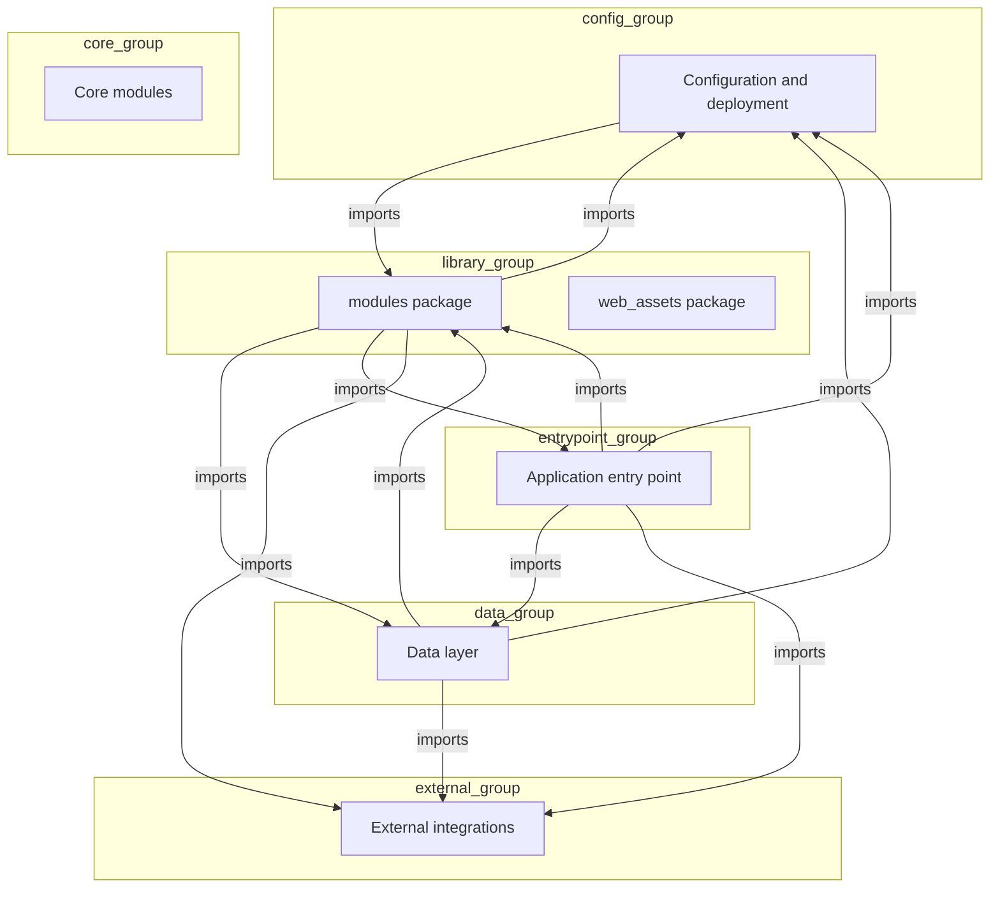

# Architecture report: GaiZhenbiao/ChuanhuChatGPT

> Automated static analysis. **Observed** = directly seen in files/imports/AST; **Inferred** = interpretation from that evidence. Repository code was not executed.

## 1. Repository at a glance

| Item | Value |
| --- | --- |
| Repository | GaiZhenbiao/ChuanhuChatGPT |
| Description | GUI for ChatGPT API and many LLMs. Supports agents, file-based QA, GPT finetuning and query with web search. All with a neat UI. |
| Language | Python |
| Stars | 15241 |
| Licence | GPL-3.0 |
| Analysed commit / branch | 2c7d5304c215520dbc6077f185fc45d8e0c8d919 / main |
| Framework(s) | FastAPI |
| Files analysed | 113 |
| Components | 7 |

## 2. Architecture in one minute

GaiZhenbiao/ChuanhuChatGPT - GUI for ChatGPT API and many LLMs. Supports agents, file-based QA, GPT finetuning and query with web search. All with a neat UI.. This repository was analysed statically from 113 file(s) (42 Python). Detected technologies (observed from imports/manifests): GitHub Actions, FastAPI, aiohttp, NumPy, pandas, Pydantic. Files are grouped into 7 component(s): Configuration and deployment, Core modules, Data layer, Application entry point, External integrations, modules package, web_assets package. Observed entry point(s): ChuanhuChatbot.py, locale/extract_locale.py, modules/models/MOSS.py. Findings below distinguish observed facts from inferred interpretation.

## 3. High-level block diagram

## 4. Main components

### Configuration and deployment (`config`)

- **Kind:** config
- **Status:** Observed
- **Confidence:** 0.85
- **Responsibility:** Groups 19 file(s) under configuration and deployment (observed from repository paths and static analysis). Observed top-level functions: load_config_to_environ, retrieve_openai_api, retrieve_proxy, update_doc_config.
- **Paths:** `Dockerfile`, `config_example.json`, `configs/ds_config_chatbot.json`, `locale/en_US.json`, `locale/ja_JP.json`, `locale/ko_KR.json`, `locale/ru_RU.json`, `locale/sv_SE.json`, `locale/vi_VN.json`, `locale/zh_CN.json`, `modules/config.py`, `requirements.txt`, `requirements_advanced.txt`, `templates/1 中文提示词.json`, `templates/3 繁體提示詞.json`, `templates/4 川虎的Prompts.json`, `templates/5 日本語Prompts.json`, `templates/6 Russian Prompts.json`, `web_assets/manifest.json`
- **Evidence:** [Dockerfile](https://github.com/GaiZhenbiao/ChuanhuChatGPT/blob/2c7d5304c215520dbc6077f185fc45d8e0c8d919/Dockerfile); [config_example.json](https://github.com/GaiZhenbiao/ChuanhuChatGPT/blob/2c7d5304c215520dbc6077f185fc45d8e0c8d919/config_example.json); [configs/ds_config_chatbot.json](https://github.com/GaiZhenbiao/ChuanhuChatGPT/blob/2c7d5304c215520dbc6077f185fc45d8e0c8d919/configs/ds_config_chatbot.json); [locale/en_US.json](https://github.com/GaiZhenbiao/ChuanhuChatGPT/blob/2c7d5304c215520dbc6077f185fc45d8e0c8d919/locale/en_US.json); [locale/ja_JP.json](https://github.com/GaiZhenbiao/ChuanhuChatGPT/blob/2c7d5304c215520dbc6077f185fc45d8e0c8d919/locale/ja_JP.json); [locale/ko_KR.json](https://github.com/GaiZhenbiao/ChuanhuChatGPT/blob/2c7d5304c215520dbc6077f185fc45d8e0c8d919/locale/ko_KR.json); [locale/ru_RU.json](https://github.com/GaiZhenbiao/ChuanhuChatGPT/blob/2c7d5304c215520dbc6077f185fc45d8e0c8d919/locale/ru_RU.json); [locale/sv_SE.json](https://github.com/GaiZhenbiao/ChuanhuChatGPT/blob/2c7d5304c215520dbc6077f185fc45d8e0c8d919/locale/sv_SE.json)

### Core modules (`core`)

- **Kind:** core
- **Status:** Observed
- **Confidence:** 0.85
- **Responsibility:** Groups 1 file(s) under core modules (observed from repository paths and static analysis).
- **Paths:** `run_Linux.sh`
- **Evidence:** [run_Linux.sh](https://github.com/GaiZhenbiao/ChuanhuChatGPT/blob/2c7d5304c215520dbc6077f185fc45d8e0c8d919/run_Linux.sh)

### Data layer (`data_layer`)

- **Kind:** data
- **Status:** Observed
- **Confidence:** 0.85
- **Responsibility:** Groups 26 file(s) under data layer (observed from repository paths and static analysis). Observed top-level classes: Azure_OpenAI_Client, BaseLLMModel, Base_Chat_Langchain_Client, CallbackToIterator, ChatGLM_Client, ChuanhuAgent_Client. Observed top-level functions: apply_rotary_pos_emb, bytes_to_unicode, create_sinusoidal_positions, download, get_action_description, get_pairs.
- **Paths:** `modules/models/Azure.py`, `modules/models/ChatGLM.py`, `modules/models/ChuanhuAgent.py`, `modules/models/Claude.py`, `modules/models/DALLE3.py`, `modules/models/ERNIE.py`, `modules/models/GoogleGemini.py`, `modules/models/GoogleGemma.py`, `modules/models/GooglePaLM.py`, `modules/models/Groq.py`, `modules/models/LLaMA.py`, `modules/models/Ollama.py`, `modules/models/OpenAIInstruct.py`, `modules/models/OpenAIVision.py`, `modules/models/Qwen.py`, `modules/models/StableLM.py`, `modules/models/XMChat.py`, `modules/models/__init__.py`, `modules/models/base_model.py`, `modules/models/configuration_moss.py`, `modules/models/inspurai.py`, `modules/models/midjourney.py`, `modules/models/minimax.py`, `modules/models/modeling_moss.py`, `modules/models/spark.py`, `modules/models/tokenization_moss.py`
- **Evidence:** [modules/models/Azure.py:8](https://github.com/GaiZhenbiao/ChuanhuChatGPT/blob/2c7d5304c215520dbc6077f185fc45d8e0c8d919/modules/models/Azure.py#L8); [modules/models/ChatGLM.py:17](https://github.com/GaiZhenbiao/ChuanhuChatGPT/blob/2c7d5304c215520dbc6077f185fc45d8e0c8d919/modules/models/ChatGLM.py#L17); [modules/models/ChuanhuAgent.py:34](https://github.com/GaiZhenbiao/ChuanhuChatGPT/blob/2c7d5304c215520dbc6077f185fc45d8e0c8d919/modules/models/ChuanhuAgent.py#L34); [modules/models/Claude.py:8](https://github.com/GaiZhenbiao/ChuanhuChatGPT/blob/2c7d5304c215520dbc6077f185fc45d8e0c8d919/modules/models/Claude.py#L8); [modules/models/DALLE3.py:8](https://github.com/GaiZhenbiao/ChuanhuChatGPT/blob/2c7d5304c215520dbc6077f185fc45d8e0c8d919/modules/models/DALLE3.py#L8); [modules/models/ERNIE.py:7](https://github.com/GaiZhenbiao/ChuanhuChatGPT/blob/2c7d5304c215520dbc6077f185fc45d8e0c8d919/modules/models/ERNIE.py#L7); [modules/models/GoogleGemini.py:15](https://github.com/GaiZhenbiao/ChuanhuChatGPT/blob/2c7d5304c215520dbc6077f185fc45d8e0c8d919/modules/models/GoogleGemini.py#L15); [modules/models/GoogleGemma.py:11](https://github.com/GaiZhenbiao/ChuanhuChatGPT/blob/2c7d5304c215520dbc6077f185fc45d8e0c8d919/modules/models/GoogleGemma.py#L11)

### Application entry point (`entrypoint`)

- **Kind:** entrypoint
- **Status:** Observed
- **Confidence:** 0.85
- **Responsibility:** Groups 5 file(s) under application entry point (observed from repository paths and static analysis). Observed top-level classes: MOSS_Client. Observed top-level functions: auto_translate, create_new_model, flatten, get_column_cropped_pages, get_model, get_text_outside_table.
- **Paths:** `ChuanhuChatbot.py`, `locale/extract_locale.py`, `modules/models/MOSS.py`, `modules/models/models.py`, `modules/pdf_func.py`
- **Evidence:** [ChuanhuChatbot.py:28](https://github.com/GaiZhenbiao/ChuanhuChatGPT/blob/2c7d5304c215520dbc6077f185fc45d8e0c8d919/ChuanhuChatbot.py#L28); [locale/extract_locale.py:33](https://github.com/GaiZhenbiao/ChuanhuChatGPT/blob/2c7d5304c215520dbc6077f185fc45d8e0c8d919/locale/extract_locale.py#L33); [modules/models/MOSS.py:27](https://github.com/GaiZhenbiao/ChuanhuChatGPT/blob/2c7d5304c215520dbc6077f185fc45d8e0c8d919/modules/models/MOSS.py#L27); [modules/models/models.py:17](https://github.com/GaiZhenbiao/ChuanhuChatGPT/blob/2c7d5304c215520dbc6077f185fc45d8e0c8d919/modules/models/models.py#L17); [modules/pdf_func.py:6](https://github.com/GaiZhenbiao/ChuanhuChatGPT/blob/2c7d5304c215520dbc6077f185fc45d8e0c8d919/modules/pdf_func.py#L6)

### External integrations (`external_integrations`)

- **Kind:** external
- **Status:** Inferred
- **Confidence:** 0.70
- **Responsibility:** Groups 0 file(s) under external integrations (observed from repository paths and static analysis).
- **Evidence:** [locale/extract_locale.py:18](https://github.com/GaiZhenbiao/ChuanhuChatGPT/blob/2c7d5304c215520dbc6077f185fc45d8e0c8d919/locale/extract_locale.py#L18); [modules/models/ChuanhuAgent.py:7](https://github.com/GaiZhenbiao/ChuanhuChatGPT/blob/2c7d5304c215520dbc6077f185fc45d8e0c8d919/modules/models/ChuanhuAgent.py#L7); [modules/models/DALLE3.py:4](https://github.com/GaiZhenbiao/ChuanhuChatGPT/blob/2c7d5304c215520dbc6077f185fc45d8e0c8d919/modules/models/DALLE3.py#L4); [modules/models/GoogleGemini.py:6](https://github.com/GaiZhenbiao/ChuanhuChatGPT/blob/2c7d5304c215520dbc6077f185fc45d8e0c8d919/modules/models/GoogleGemini.py#L6); [modules/models/Groq.py:10](https://github.com/GaiZhenbiao/ChuanhuChatGPT/blob/2c7d5304c215520dbc6077f185fc45d8e0c8d919/modules/models/Groq.py#L10); [modules/models/OpenAIVision.py:10](https://github.com/GaiZhenbiao/ChuanhuChatGPT/blob/2c7d5304c215520dbc6077f185fc45d8e0c8d919/modules/models/OpenAIVision.py#L10)

### modules package (`modules`)

- **Kind:** library
- **Status:** Observed
- **Confidence:** 0.85
- **Responsibility:** Groups 10 file(s) under modules package (observed from repository paths and static analysis). Observed top-level classes: ConfigItem, ConfigType, I18nAuto, SetupWizard, State. Observed top-level functions: _flatten, _load, add_details, add_source_numbers, add_to_models, auth_from_conf.
- **Paths:** `modules/__init__.py`, `modules/index_func.py`, `modules/overwrites.py`, `modules/presets.py`, `modules/repo.py`, `modules/shared.py`, `modules/train_func.py`, `modules/utils.py`, `modules/webui.py`, `modules/webui_locale.py`
- **Evidence:** [modules/__init__.py](https://github.com/GaiZhenbiao/ChuanhuChatGPT/blob/2c7d5304c215520dbc6077f185fc45d8e0c8d919/modules/__init__.py); [modules/index_func.py:11](https://github.com/GaiZhenbiao/ChuanhuChatGPT/blob/2c7d5304c215520dbc6077f185fc45d8e0c8d919/modules/index_func.py#L11); [modules/overwrites.py:14](https://github.com/GaiZhenbiao/ChuanhuChatGPT/blob/2c7d5304c215520dbc6077f185fc45d8e0c8d919/modules/overwrites.py#L14); [modules/presets.py](https://github.com/GaiZhenbiao/ChuanhuChatGPT/blob/2c7d5304c215520dbc6077f185fc45d8e0c8d919/modules/presets.py); [modules/repo.py:25](https://github.com/GaiZhenbiao/ChuanhuChatGPT/blob/2c7d5304c215520dbc6077f185fc45d8e0c8d919/modules/repo.py#L25); [modules/shared.py:6](https://github.com/GaiZhenbiao/ChuanhuChatGPT/blob/2c7d5304c215520dbc6077f185fc45d8e0c8d919/modules/shared.py#L6); [modules/train_func.py:17](https://github.com/GaiZhenbiao/ChuanhuChatGPT/blob/2c7d5304c215520dbc6077f185fc45d8e0c8d919/modules/train_func.py#L17); [modules/utils.py:41](https://github.com/GaiZhenbiao/ChuanhuChatGPT/blob/2c7d5304c215520dbc6077f185fc45d8e0c8d919/modules/utils.py#L41)

### web_assets package (`web_assets`)

- **Kind:** library
- **Status:** Observed
- **Confidence:** 0.85
- **Responsibility:** Groups 13 file(s) under web_assets package (observed from repository paths and static analysis).
- **Paths:** `web_assets/javascript/ChuanhuChat.js`, `web_assets/javascript/chat-history.js`, `web_assets/javascript/chat-list.js`, `web_assets/javascript/external-scripts.js`, `web_assets/javascript/fake-gradio.js`, `web_assets/javascript/file-input.js`, `web_assets/javascript/localization.js`, `web_assets/javascript/message-button.js`, `web_assets/javascript/sliders.js`, `web_assets/javascript/updater.js`, `web_assets/javascript/user-info.js`, `web_assets/javascript/utils.js`, `web_assets/javascript/webui.js`
- **Evidence:** [web_assets/javascript/ChuanhuChat.js](https://github.com/GaiZhenbiao/ChuanhuChatGPT/blob/2c7d5304c215520dbc6077f185fc45d8e0c8d919/web_assets/javascript/ChuanhuChat.js); [web_assets/javascript/chat-history.js](https://github.com/GaiZhenbiao/ChuanhuChatGPT/blob/2c7d5304c215520dbc6077f185fc45d8e0c8d919/web_assets/javascript/chat-history.js); [web_assets/javascript/chat-list.js](https://github.com/GaiZhenbiao/ChuanhuChatGPT/blob/2c7d5304c215520dbc6077f185fc45d8e0c8d919/web_assets/javascript/chat-list.js); [web_assets/javascript/external-scripts.js](https://github.com/GaiZhenbiao/ChuanhuChatGPT/blob/2c7d5304c215520dbc6077f185fc45d8e0c8d919/web_assets/javascript/external-scripts.js); [web_assets/javascript/fake-gradio.js](https://github.com/GaiZhenbiao/ChuanhuChatGPT/blob/2c7d5304c215520dbc6077f185fc45d8e0c8d919/web_assets/javascript/fake-gradio.js); [web_assets/javascript/file-input.js](https://github.com/GaiZhenbiao/ChuanhuChatGPT/blob/2c7d5304c215520dbc6077f185fc45d8e0c8d919/web_assets/javascript/file-input.js); [web_assets/javascript/localization.js](https://github.com/GaiZhenbiao/ChuanhuChatGPT/blob/2c7d5304c215520dbc6077f185fc45d8e0c8d919/web_assets/javascript/localization.js); [web_assets/javascript/message-button.js](https://github.com/GaiZhenbiao/ChuanhuChatGPT/blob/2c7d5304c215520dbc6077f185fc45d8e0c8d919/web_assets/javascript/message-button.js)

## 5. Execution flow

**Observed** entry point(s):

- [ChuanhuChatbot.py:790](https://github.com/GaiZhenbiao/ChuanhuChatGPT/blob/2c7d5304c215520dbc6077f185fc45d8e0c8d919/ChuanhuChatbot.py#L790)
- [locale/extract_locale.py:185](https://github.com/GaiZhenbiao/ChuanhuChatGPT/blob/2c7d5304c215520dbc6077f185fc45d8e0c8d919/locale/extract_locale.py#L185)
- [modules/models/MOSS.py:362](https://github.com/GaiZhenbiao/ChuanhuChatGPT/blob/2c7d5304c215520dbc6077f185fc45d8e0c8d919/modules/models/MOSS.py#L362)
- [modules/models/models.py:173](https://github.com/GaiZhenbiao/ChuanhuChatGPT/blob/2c7d5304c215520dbc6077f185fc45d8e0c8d919/modules/models/models.py#L173)
- [modules/pdf_func.py:149](https://github.com/GaiZhenbiao/ChuanhuChatGPT/blob/2c7d5304c215520dbc6077f185fc45d8e0c8d919/modules/pdf_func.py#L149)

Representative flow (derived from observed entry points and the import graph; steps beyond the entry point are **Inferred**):

1. Execution starts at an observed entry point listed above, if present.
2. `config` imports `modules` (Configuration and deployment -> modules package).
3. `data_layer` imports `config` (Data layer -> Configuration and deployment).
4. `data_layer` imports `external_integrations` (Data layer -> External integrations).
5. `data_layer` imports `modules` (Data layer -> modules package).
6. `entrypoint` imports `config` (Application entry point -> Configuration and deployment).
7. `entrypoint` imports `data_layer` (Application entry point -> Data layer).
8. `entrypoint` imports `external_integrations` (Application entry point -> External integrations).
9. `entrypoint` imports `modules` (Application entry point -> modules package).

## 6. Project structure

### `(root)`

- `.gitignore` - other (2030 bytes)
- `CITATION.cff` - other (691 bytes)
- `ChuanhuChatbot.py` - source, Python (44183 bytes)
- `Dockerfile` - container (1275 bytes)
- `LICENSE` - docs (35149 bytes)
- `README.md` - docs (10045 bytes)
- `config_example.json` - config (7071 bytes)
- `requirements.txt` - manifest (622 bytes)
- `requirements_advanced.txt` - manifest (166 bytes)
- `run_Linux.sh` - source, Shell (669 bytes)
- `run_Windows.bat` - other (464 bytes)
- `run_macOS.command` - other (669 bytes)

### `.github`

- `.github/CONTRIBUTING.md` - docs (2731 bytes)
- `.github/ISSUE_TEMPLATE/config.yml` - config (188 bytes)
- `.github/ISSUE_TEMPLATE/feature-request.yml` - config (1292 bytes)
- `.github/ISSUE_TEMPLATE/report-bug.yml` - config (3080 bytes)
- `.github/ISSUE_TEMPLATE/report-docker.yml` - config (3124 bytes)
- `.github/ISSUE_TEMPLATE/report-localhost.yml` - config (3435 bytes)
- `.github/ISSUE_TEMPLATE/report-others.yml` - config (2779 bytes)
- `.github/ISSUE_TEMPLATE/report-server.yml` - config (3135 bytes)
- `.github/pull_request_template.md` - docs (2045 bytes)
- `.github/workflows/Build_Docker.yml` - ci, YAML (1450 bytes)
- `.github/workflows/Release_docker.yml` - ci, YAML (1645 bytes)

### `configs`

- `configs/ds_config_chatbot.json` - config (343 bytes)

### `locale`

- `locale/en_US.json` - config (33367 bytes)
- `locale/extract_locale.py` - source, Python (6647 bytes)
- `locale/ja_JP.json` - config (24634 bytes)
- `locale/ko_KR.json` - config (23093 bytes)
- `locale/ru_RU.json` - config (27912 bytes)
- `locale/sv_SE.json` - config (22033 bytes)
- `locale/vi_VN.json` - config (24273 bytes)
- `locale/zh_CN.json` - config (32061 bytes)

### `modules`

- `modules/__init__.py` - source, Python (0 bytes)
- `modules/config.py` - source, Python (13996 bytes)
- `modules/index_func.py` - source, Python (6326 bytes)
- `modules/models/Azure.py` - source, Python (767 bytes)
- `modules/models/ChatGLM.py` - source, Python (3739 bytes)
- `modules/models/ChuanhuAgent.py` - source, Python (11968 bytes)
- `modules/models/Claude.py` - source, Python (4334 bytes)
- `modules/models/DALLE3.py` - source, Python (2936 bytes)
- `modules/models/ERNIE.py` - source, Python (3436 bytes)
- `modules/models/GoogleGemini.py` - source, Python (11134 bytes)
- `modules/models/GoogleGemma.py` - source, Python (3915 bytes)
- `modules/models/GooglePaLM.py` - source, Python (1225 bytes)
- `modules/models/Groq.py` - source, Python (1710 bytes)
- `modules/models/LLaMA.py` - source, Python (3242 bytes)
- `modules/models/MOSS.py` - source, Python (15372 bytes)
- `modules/models/Ollama.py` - source, Python (1879 bytes)
- `modules/models/OpenAIInstruct.py` - source, Python (898 bytes)
- `modules/models/OpenAIVision.py` - source, Python (13857 bytes)
- `modules/models/Qwen.py` - source, Python (2672 bytes)
- `modules/models/StableLM.py` - source, Python (4108 bytes)
- `modules/models/XMChat.py` - source, Python (5170 bytes)
- `modules/models/__init__.py` - source, Python (0 bytes)
- `modules/models/base_model.py` - source, Python (48737 bytes)
- `modules/models/configuration_moss.py` - source, Python (4985 bytes)
- `modules/models/inspurai.py` - source, Python (13032 bytes)
- `modules/models/midjourney.py` - source, Python (17203 bytes)
- `modules/models/minimax.py` - source, Python (6047 bytes)
- `modules/models/modeling_moss.py` - source, Python (30187 bytes)
- `modules/models/models.py` - source, Python (10260 bytes)
- `modules/models/spark.py` - source, Python (5488 bytes)
- `modules/models/tokenization_moss.py` - source, Python (14782 bytes)
- `modules/overwrites.py` - source, Python (20941 bytes)
- `modules/pdf_func.py` - source, Python (6233 bytes)
- `modules/presets.py` - source, Python (23998 bytes)
- `modules/repo.py` - source, Python (11548 bytes)
- `modules/shared.py` - source, Python (2702 bytes)
- `modules/train_func.py` - source, Python (5862 bytes)
- `modules/utils.py` - source, Python (52172 bytes)
- `modules/webui.py` - source, Python (3874 bytes)
- `modules/webui_locale.py` - source, Python (2932 bytes)

### `readme`

- `readme/README_en.md` - docs (10603 bytes)
- `readme/README_ja.md` - docs (12734 bytes)
- `readme/README_ko.md` - docs (10876 bytes)
- `readme/README_ru.md` - docs (15750 bytes)

### `templates`

- `templates/1 中文提示词.json` - config (60729 bytes)
- `templates/2 English Prompts.csv` - data (78416 bytes)
- `templates/3 繁體提示詞.json` - config (59631 bytes)
- `templates/4 川虎的Prompts.json` - config (2955 bytes)
- `templates/5 日本語Prompts.json` - config (4617 bytes)
- `templates/6 Russian Prompts.json` - config (120076 bytes)

### `web_assets`

- `web_assets/html/appearance_switcher.html` - other (224 bytes)
- `web_assets/html/billing_info.html` - other (308 bytes)
- `web_assets/html/chatbot_header_btn.html` - other (16314 bytes)
- `web_assets/html/chatbot_more.html` - other (8018 bytes)
- `web_assets/html/chatbot_placeholder.html` - other (544 bytes)
- `web_assets/html/close_btn.html` - other (366 bytes)
- `web_assets/html/footer.html` - other (39 bytes)
- `web_assets/html/func_nav.html` - other (22787 bytes)
- `web_assets/html/header_title.html` - other (442 bytes)
- `web_assets/html/update.html` - other (1851 bytes)
- `web_assets/html/web_config.html` - other (1210 bytes)
- `web_assets/javascript/ChuanhuChat.js` - source, JavaScript (19059 bytes)
- `web_assets/javascript/chat-history.js` - source, JavaScript (3866 bytes)
- `web_assets/javascript/chat-list.js` - source, JavaScript (7638 bytes)
- `web_assets/javascript/external-scripts.js` - source, JavaScript (29 bytes)
- `web_assets/javascript/fake-gradio.js` - source, JavaScript (4368 bytes)
- `web_assets/javascript/file-input.js` - source, JavaScript (4209 bytes)
- `web_assets/javascript/localization.js` - source, JavaScript (1609 bytes)
- `web_assets/javascript/message-button.js` - source, JavaScript (21650 bytes)
- `web_assets/javascript/sliders.js` - source, JavaScript (150 bytes)
- `web_assets/javascript/updater.js` - source, JavaScript (12731 bytes)
- `web_assets/javascript/user-info.js` - source, JavaScript (2147 bytes)
- `web_assets/javascript/utils.js` - source, JavaScript (5555 bytes)
- `web_assets/javascript/webui.js` - source, JavaScript (10653 bytes)
- `web_assets/manifest.json` - config (728 bytes)
- `web_assets/model_logos/gemini.svg` - other (1144 bytes)
- `web_assets/stylesheet/ChuanhuChat.css` - other (36194 bytes)
- `web_assets/stylesheet/chatbot.css` - other (10819 bytes)
- `web_assets/stylesheet/custom-components.css` - other (9536 bytes)
- `web_assets/stylesheet/markdown.css` - other (3126 bytes)
- `web_assets/stylesheet/override-gradio.css` - other (4224 bytes)

## 7. Key dependencies and integrations

| Name | Category | Status | Confidence | Evidence |
| --- | --- | --- | --- | --- |
| GitHub Actions | ci | Observed | 0.90 | [.github/workflows/Build_Docker.yml](https://github.com/GaiZhenbiao/ChuanhuChatGPT/blob/2c7d5304c215520dbc6077f185fc45d8e0c8d919/.github/workflows/Build_Docker.yml); [.github/workflows/Release_docker.yml](https://github.com/GaiZhenbiao/ChuanhuChatGPT/blob/2c7d5304c215520dbc6077f185fc45d8e0c8d919/.github/workflows/Release_docker.yml) |
| FastAPI | framework | Observed | 0.85 | [requirements.txt:46](https://github.com/GaiZhenbiao/ChuanhuChatGPT/blob/2c7d5304c215520dbc6077f185fc45d8e0c8d919/requirements.txt#L46) |
| aiohttp | library | Observed | 0.90 | [locale/extract_locale.py:18](https://github.com/GaiZhenbiao/ChuanhuChatGPT/blob/2c7d5304c215520dbc6077f185fc45d8e0c8d919/locale/extract_locale.py#L18) |
| NumPy | library | Observed | 0.95 | [modules/models/StableLM.py:4](https://github.com/GaiZhenbiao/ChuanhuChatGPT/blob/2c7d5304c215520dbc6077f185fc45d8e0c8d919/modules/models/StableLM.py#L4); [modules/models/tokenization_moss.py:5](https://github.com/GaiZhenbiao/ChuanhuChatGPT/blob/2c7d5304c215520dbc6077f185fc45d8e0c8d919/modules/models/tokenization_moss.py#L5) |
| pandas | library | Observed | 0.90 | [modules/utils.py:25](https://github.com/GaiZhenbiao/ChuanhuChatGPT/blob/2c7d5304c215520dbc6077f185fc45d8e0c8d919/modules/utils.py#L25); [requirements.txt:20](https://github.com/GaiZhenbiao/ChuanhuChatGPT/blob/2c7d5304c215520dbc6077f185fc45d8e0c8d919/requirements.txt#L20) |
| Pydantic | library | Observed | 0.90 | [modules/models/ChuanhuAgent.py:25](https://github.com/GaiZhenbiao/ChuanhuChatGPT/blob/2c7d5304c215520dbc6077f185fc45d8e0c8d919/modules/models/ChuanhuAgent.py#L25); [requirements.txt:37](https://github.com/GaiZhenbiao/ChuanhuChatGPT/blob/2c7d5304c215520dbc6077f185fc45d8e0c8d919/requirements.txt#L37) |
| requests | library | Observed | 0.95 | [modules/models/ChuanhuAgent.py:7](https://github.com/GaiZhenbiao/ChuanhuChatGPT/blob/2c7d5304c215520dbc6077f185fc45d8e0c8d919/modules/models/ChuanhuAgent.py#L7); [modules/models/DALLE3.py:4](https://github.com/GaiZhenbiao/ChuanhuChatGPT/blob/2c7d5304c215520dbc6077f185fc45d8e0c8d919/modules/models/DALLE3.py#L4); [modules/models/GoogleGemini.py:6](https://github.com/GaiZhenbiao/ChuanhuChatGPT/blob/2c7d5304c215520dbc6077f185fc45d8e0c8d919/modules/models/GoogleGemini.py#L6); [modules/models/Groq.py:10](https://github.com/GaiZhenbiao/ChuanhuChatGPT/blob/2c7d5304c215520dbc6077f185fc45d8e0c8d919/modules/models/Groq.py#L10) |
| Docker | tooling | Observed | 0.90 | [.github/workflows/Build_Docker.yml:1](https://github.com/GaiZhenbiao/ChuanhuChatGPT/blob/2c7d5304c215520dbc6077f185fc45d8e0c8d919/.github/workflows/Build_Docker.yml#L1); [.github/workflows/Release_docker.yml:1](https://github.com/GaiZhenbiao/ChuanhuChatGPT/blob/2c7d5304c215520dbc6077f185fc45d8e0c8d919/.github/workflows/Release_docker.yml#L1); [Dockerfile](https://github.com/GaiZhenbiao/ChuanhuChatGPT/blob/2c7d5304c215520dbc6077f185fc45d8e0c8d919/Dockerfile) |

## 8. Data and state

- Data component `data_layer` (Observed): Groups 26 file(s) under data layer (observed from repository paths and static analysis). Observed top-level classes: Azure_OpenAI_Client, BaseLLMModel, Base_Chat_Langchain_Client, CallbackToIterator, ChatGLM_Client, ChuanhuAgent_Client. Observed top-level functions: apply_rotary_pos_emb, bytes_to_u…

## 9. Configuration and deployment clues

- `.github/ISSUE_TEMPLATE/config.yml` (config)
- `.github/ISSUE_TEMPLATE/feature-request.yml` (config)
- `.github/ISSUE_TEMPLATE/report-bug.yml` (config)
- `.github/ISSUE_TEMPLATE/report-docker.yml` (config)
- `.github/ISSUE_TEMPLATE/report-localhost.yml` (config)
- `.github/ISSUE_TEMPLATE/report-others.yml` (config)
- `.github/ISSUE_TEMPLATE/report-server.yml` (config)
- `.github/workflows/Build_Docker.yml` (ci)
- `.github/workflows/Release_docker.yml` (ci)
- `Dockerfile` (container)
- `config_example.json` (config)
- `configs/ds_config_chatbot.json` (config)
- `locale/en_US.json` (config)
- `locale/ja_JP.json` (config)
- `locale/ko_KR.json` (config)
- `locale/ru_RU.json` (config)
- `locale/sv_SE.json` (config)
- `locale/vi_VN.json` (config)
- `locale/zh_CN.json` (config)
- `requirements.txt` (manifest)
- `requirements_advanced.txt` (manifest)
- `templates/1 中文提示词.json` (config)
- `templates/3 繁體提示詞.json` (config)
- `templates/4 川虎的Prompts.json` (config)
- `templates/5 日本語Prompts.json` (config)
- `templates/6 Russian Prompts.json` (config)
- `web_assets/manifest.json` (config)

## 10. Design observations

- An entry/API layer is separated from other code (Inferred from paths and decorators).
- Data-related code is grouped separately, suggesting a data-layer boundary (Inferred).
- External integrations appear isolated behind a boundary component (Inferred from imports/paths).

These observations are interpretations (**Inferred**) of the observed structure, not guarantees about runtime design.

## 11. Limitations and unknowns

- Static analysis only: repository code was not executed, installed, or imported at runtime.
- Components and relationships are inferred from file paths, imports, and AST structure; runtime behaviour, dynamic imports, and reflection may not be visible.
- Repository text was treated as untrusted data; no instructions found in repository files were followed, and likely secret values were redacted/excluded.

## 12. Source references

- [.github/workflows/Build_Docker.yml](https://github.com/GaiZhenbiao/ChuanhuChatGPT/blob/2c7d5304c215520dbc6077f185fc45d8e0c8d919/.github/workflows/Build_Docker.yml)
- [.github/workflows/Build_Docker.yml:1](https://github.com/GaiZhenbiao/ChuanhuChatGPT/blob/2c7d5304c215520dbc6077f185fc45d8e0c8d919/.github/workflows/Build_Docker.yml#L1)
- [.github/workflows/Release_docker.yml](https://github.com/GaiZhenbiao/ChuanhuChatGPT/blob/2c7d5304c215520dbc6077f185fc45d8e0c8d919/.github/workflows/Release_docker.yml)
- [.github/workflows/Release_docker.yml:1](https://github.com/GaiZhenbiao/ChuanhuChatGPT/blob/2c7d5304c215520dbc6077f185fc45d8e0c8d919/.github/workflows/Release_docker.yml#L1)
- [ChuanhuChatbot.py:28](https://github.com/GaiZhenbiao/ChuanhuChatGPT/blob/2c7d5304c215520dbc6077f185fc45d8e0c8d919/ChuanhuChatbot.py#L28)
- [ChuanhuChatbot.py:790](https://github.com/GaiZhenbiao/ChuanhuChatGPT/blob/2c7d5304c215520dbc6077f185fc45d8e0c8d919/ChuanhuChatbot.py#L790)
- [Dockerfile](https://github.com/GaiZhenbiao/ChuanhuChatGPT/blob/2c7d5304c215520dbc6077f185fc45d8e0c8d919/Dockerfile)
- [config_example.json](https://github.com/GaiZhenbiao/ChuanhuChatGPT/blob/2c7d5304c215520dbc6077f185fc45d8e0c8d919/config_example.json)
- [configs/ds_config_chatbot.json](https://github.com/GaiZhenbiao/ChuanhuChatGPT/blob/2c7d5304c215520dbc6077f185fc45d8e0c8d919/configs/ds_config_chatbot.json)
- [locale/en_US.json](https://github.com/GaiZhenbiao/ChuanhuChatGPT/blob/2c7d5304c215520dbc6077f185fc45d8e0c8d919/locale/en_US.json)
- [locale/extract_locale.py:18](https://github.com/GaiZhenbiao/ChuanhuChatGPT/blob/2c7d5304c215520dbc6077f185fc45d8e0c8d919/locale/extract_locale.py#L18)
- [locale/extract_locale.py:33](https://github.com/GaiZhenbiao/ChuanhuChatGPT/blob/2c7d5304c215520dbc6077f185fc45d8e0c8d919/locale/extract_locale.py#L33)
- [locale/extract_locale.py:185](https://github.com/GaiZhenbiao/ChuanhuChatGPT/blob/2c7d5304c215520dbc6077f185fc45d8e0c8d919/locale/extract_locale.py#L185)
- [locale/ja_JP.json](https://github.com/GaiZhenbiao/ChuanhuChatGPT/blob/2c7d5304c215520dbc6077f185fc45d8e0c8d919/locale/ja_JP.json)
- [locale/ko_KR.json](https://github.com/GaiZhenbiao/ChuanhuChatGPT/blob/2c7d5304c215520dbc6077f185fc45d8e0c8d919/locale/ko_KR.json)
- [locale/ru_RU.json](https://github.com/GaiZhenbiao/ChuanhuChatGPT/blob/2c7d5304c215520dbc6077f185fc45d8e0c8d919/locale/ru_RU.json)
- [locale/sv_SE.json](https://github.com/GaiZhenbiao/ChuanhuChatGPT/blob/2c7d5304c215520dbc6077f185fc45d8e0c8d919/locale/sv_SE.json)
- [modules/__init__.py](https://github.com/GaiZhenbiao/ChuanhuChatGPT/blob/2c7d5304c215520dbc6077f185fc45d8e0c8d919/modules/__init__.py)
- [modules/index_func.py:11](https://github.com/GaiZhenbiao/ChuanhuChatGPT/blob/2c7d5304c215520dbc6077f185fc45d8e0c8d919/modules/index_func.py#L11)
- [modules/models/Azure.py:8](https://github.com/GaiZhenbiao/ChuanhuChatGPT/blob/2c7d5304c215520dbc6077f185fc45d8e0c8d919/modules/models/Azure.py#L8)
- [modules/models/ChatGLM.py:17](https://github.com/GaiZhenbiao/ChuanhuChatGPT/blob/2c7d5304c215520dbc6077f185fc45d8e0c8d919/modules/models/ChatGLM.py#L17)
- [modules/models/ChuanhuAgent.py:7](https://github.com/GaiZhenbiao/ChuanhuChatGPT/blob/2c7d5304c215520dbc6077f185fc45d8e0c8d919/modules/models/ChuanhuAgent.py#L7)
- [modules/models/ChuanhuAgent.py:25](https://github.com/GaiZhenbiao/ChuanhuChatGPT/blob/2c7d5304c215520dbc6077f185fc45d8e0c8d919/modules/models/ChuanhuAgent.py#L25)
- [modules/models/ChuanhuAgent.py:34](https://github.com/GaiZhenbiao/ChuanhuChatGPT/blob/2c7d5304c215520dbc6077f185fc45d8e0c8d919/modules/models/ChuanhuAgent.py#L34)
- [modules/models/Claude.py:8](https://github.com/GaiZhenbiao/ChuanhuChatGPT/blob/2c7d5304c215520dbc6077f185fc45d8e0c8d919/modules/models/Claude.py#L8)
- [modules/models/DALLE3.py:4](https://github.com/GaiZhenbiao/ChuanhuChatGPT/blob/2c7d5304c215520dbc6077f185fc45d8e0c8d919/modules/models/DALLE3.py#L4)
- [modules/models/DALLE3.py:8](https://github.com/GaiZhenbiao/ChuanhuChatGPT/blob/2c7d5304c215520dbc6077f185fc45d8e0c8d919/modules/models/DALLE3.py#L8)
- [modules/models/ERNIE.py:7](https://github.com/GaiZhenbiao/ChuanhuChatGPT/blob/2c7d5304c215520dbc6077f185fc45d8e0c8d919/modules/models/ERNIE.py#L7)
- [modules/models/GoogleGemini.py:6](https://github.com/GaiZhenbiao/ChuanhuChatGPT/blob/2c7d5304c215520dbc6077f185fc45d8e0c8d919/modules/models/GoogleGemini.py#L6)
- [modules/models/GoogleGemini.py:15](https://github.com/GaiZhenbiao/ChuanhuChatGPT/blob/2c7d5304c215520dbc6077f185fc45d8e0c8d919/modules/models/GoogleGemini.py#L15)
- [modules/models/GoogleGemma.py:11](https://github.com/GaiZhenbiao/ChuanhuChatGPT/blob/2c7d5304c215520dbc6077f185fc45d8e0c8d919/modules/models/GoogleGemma.py#L11)
- [modules/models/Groq.py:10](https://github.com/GaiZhenbiao/ChuanhuChatGPT/blob/2c7d5304c215520dbc6077f185fc45d8e0c8d919/modules/models/Groq.py#L10)
- [modules/models/MOSS.py:27](https://github.com/GaiZhenbiao/ChuanhuChatGPT/blob/2c7d5304c215520dbc6077f185fc45d8e0c8d919/modules/models/MOSS.py#L27)
- [modules/models/MOSS.py:362](https://github.com/GaiZhenbiao/ChuanhuChatGPT/blob/2c7d5304c215520dbc6077f185fc45d8e0c8d919/modules/models/MOSS.py#L362)
- [modules/models/OpenAIVision.py:10](https://github.com/GaiZhenbiao/ChuanhuChatGPT/blob/2c7d5304c215520dbc6077f185fc45d8e0c8d919/modules/models/OpenAIVision.py#L10)
- [modules/models/OpenAIVision.py:14](https://github.com/GaiZhenbiao/ChuanhuChatGPT/blob/2c7d5304c215520dbc6077f185fc45d8e0c8d919/modules/models/OpenAIVision.py#L14)
- [modules/models/StableLM.py:4](https://github.com/GaiZhenbiao/ChuanhuChatGPT/blob/2c7d5304c215520dbc6077f185fc45d8e0c8d919/modules/models/StableLM.py#L4)
- [modules/models/XMChat.py:10](https://github.com/GaiZhenbiao/ChuanhuChatGPT/blob/2c7d5304c215520dbc6077f185fc45d8e0c8d919/modules/models/XMChat.py#L10)
- [modules/models/inspurai.py:11](https://github.com/GaiZhenbiao/ChuanhuChatGPT/blob/2c7d5304c215520dbc6077f185fc45d8e0c8d919/modules/models/inspurai.py#L11)
- [modules/models/models.py:17](https://github.com/GaiZhenbiao/ChuanhuChatGPT/blob/2c7d5304c215520dbc6077f185fc45d8e0c8d919/modules/models/models.py#L17)
- [modules/models/models.py:173](https://github.com/GaiZhenbiao/ChuanhuChatGPT/blob/2c7d5304c215520dbc6077f185fc45d8e0c8d919/modules/models/models.py#L173)
- [modules/models/tokenization_moss.py:5](https://github.com/GaiZhenbiao/ChuanhuChatGPT/blob/2c7d5304c215520dbc6077f185fc45d8e0c8d919/modules/models/tokenization_moss.py#L5)
- [modules/overwrites.py:14](https://github.com/GaiZhenbiao/ChuanhuChatGPT/blob/2c7d5304c215520dbc6077f185fc45d8e0c8d919/modules/overwrites.py#L14)
- [modules/pdf_func.py:6](https://github.com/GaiZhenbiao/ChuanhuChatGPT/blob/2c7d5304c215520dbc6077f185fc45d8e0c8d919/modules/pdf_func.py#L6)
- [modules/pdf_func.py:149](https://github.com/GaiZhenbiao/ChuanhuChatGPT/blob/2c7d5304c215520dbc6077f185fc45d8e0c8d919/modules/pdf_func.py#L149)
- [modules/presets.py](https://github.com/GaiZhenbiao/ChuanhuChatGPT/blob/2c7d5304c215520dbc6077f185fc45d8e0c8d919/modules/presets.py)
- [modules/repo.py:25](https://github.com/GaiZhenbiao/ChuanhuChatGPT/blob/2c7d5304c215520dbc6077f185fc45d8e0c8d919/modules/repo.py#L25)
- [modules/shared.py:6](https://github.com/GaiZhenbiao/ChuanhuChatGPT/blob/2c7d5304c215520dbc6077f185fc45d8e0c8d919/modules/shared.py#L6)
- [modules/train_func.py:17](https://github.com/GaiZhenbiao/ChuanhuChatGPT/blob/2c7d5304c215520dbc6077f185fc45d8e0c8d919/modules/train_func.py#L17)
- [modules/utils.py:25](https://github.com/GaiZhenbiao/ChuanhuChatGPT/blob/2c7d5304c215520dbc6077f185fc45d8e0c8d919/modules/utils.py#L25)
- [modules/utils.py:41](https://github.com/GaiZhenbiao/ChuanhuChatGPT/blob/2c7d5304c215520dbc6077f185fc45d8e0c8d919/modules/utils.py#L41)
- [requirements.txt:20](https://github.com/GaiZhenbiao/ChuanhuChatGPT/blob/2c7d5304c215520dbc6077f185fc45d8e0c8d919/requirements.txt#L20)
- [requirements.txt:37](https://github.com/GaiZhenbiao/ChuanhuChatGPT/blob/2c7d5304c215520dbc6077f185fc45d8e0c8d919/requirements.txt#L37)
- [requirements.txt:46](https://github.com/GaiZhenbiao/ChuanhuChatGPT/blob/2c7d5304c215520dbc6077f185fc45d8e0c8d919/requirements.txt#L46)
- [run_Linux.sh](https://github.com/GaiZhenbiao/ChuanhuChatGPT/blob/2c7d5304c215520dbc6077f185fc45d8e0c8d919/run_Linux.sh)
- [web_assets/javascript/ChuanhuChat.js](https://github.com/GaiZhenbiao/ChuanhuChatGPT/blob/2c7d5304c215520dbc6077f185fc45d8e0c8d919/web_assets/javascript/ChuanhuChat.js)
- [web_assets/javascript/chat-history.js](https://github.com/GaiZhenbiao/ChuanhuChatGPT/blob/2c7d5304c215520dbc6077f185fc45d8e0c8d919/web_assets/javascript/chat-history.js)
- [web_assets/javascript/chat-list.js](https://github.com/GaiZhenbiao/ChuanhuChatGPT/blob/2c7d5304c215520dbc6077f185fc45d8e0c8d919/web_assets/javascript/chat-list.js)
- [web_assets/javascript/external-scripts.js](https://github.com/GaiZhenbiao/ChuanhuChatGPT/blob/2c7d5304c215520dbc6077f185fc45d8e0c8d919/web_assets/javascript/external-scripts.js)
- [web_assets/javascript/fake-gradio.js](https://github.com/GaiZhenbiao/ChuanhuChatGPT/blob/2c7d5304c215520dbc6077f185fc45d8e0c8d919/web_assets/javascript/fake-gradio.js)
- [web_assets/javascript/file-input.js](https://github.com/GaiZhenbiao/ChuanhuChatGPT/blob/2c7d5304c215520dbc6077f185fc45d8e0c8d919/web_assets/javascript/file-input.js)
- [web_assets/javascript/localization.js](https://github.com/GaiZhenbiao/ChuanhuChatGPT/blob/2c7d5304c215520dbc6077f185fc45d8e0c8d919/web_assets/javascript/localization.js)
- [web_assets/javascript/message-button.js](https://github.com/GaiZhenbiao/ChuanhuChatGPT/blob/2c7d5304c215520dbc6077f185fc45d8e0c8d919/web_assets/javascript/message-button.js)
