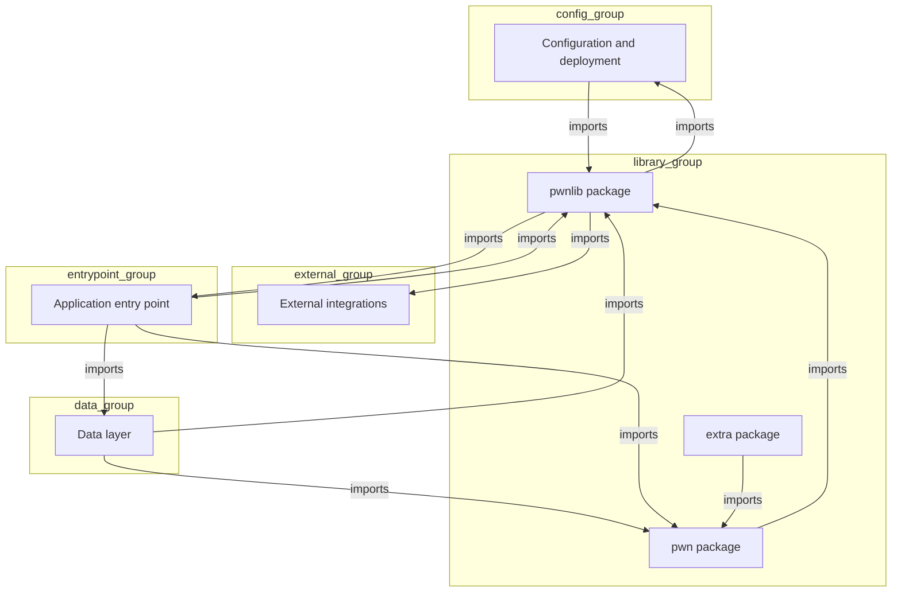

# Architecture report: Gallopsled/pwntools

> Automated static analysis. **Observed** = directly seen in files/imports/AST; **Inferred** = interpretation from that evidence. Repository code was not executed.

## 1. Repository at a glance

| Item | Value |
| --- | --- |
| Repository | Gallopsled/pwntools |
| Description | CTF framework and exploit development library |
| Language | Python |
| Stars | 13860 |
| Licence | Other |
| Analysed commit / branch | af4918c43fe1e605ea4caf98ff9ebb1e70b97bae / dev |
| Framework(s) | None detected |
| Files analysed | 800 |
| Components | 7 |

## 2. Architecture in one minute

Gallopsled/pwntools - CTF framework and exploit development library. This repository was analysed statically from 800 file(s) (164 Python). Detected technologies (observed from imports/manifests): GitHub Actions, requests, Docker. Files are grouped into 7 component(s): Configuration and deployment, Data layer, Application entry point, External integrations, extra package, pwn package, pwnlib package. Observed entry point(s): pwnlib/adb/bootloader.py, pwnlib/commandline/asm.py, pwnlib/commandline/checksec.py. Findings below distinguish observed facts from inferred interpretation.

## 3. High-level block diagram

## 4. Main components

### Configuration and deployment (`config`)

- **Kind:** config
- **Status:** Observed
- **Confidence:** 0.85
- **Responsibility:** Groups 8 file(s) under configuration and deployment (observed from repository paths and static analysis). Observed top-level classes: Disabled, Enabled, EnabledIfPresent, KernelConfig, Minimum. Observed top-level functions: initialize, parse_kconfig, register_config.
- **Paths:** `MANIFEST.in`, `extra/docker/base/Dockerfile`, `extra/docker/beta/Dockerfile`, `extra/docker/dev/Dockerfile`, `extra/docker/develop/Dockerfile`, `extra/docker/stable/Dockerfile`, `pwnlib/config.py`, `pwnlib/elf/config.py`
- **Evidence:** [MANIFEST.in](https://github.com/Gallopsled/pwntools/blob/af4918c43fe1e605ea4caf98ff9ebb1e70b97bae/MANIFEST.in); [extra/docker/base/Dockerfile](https://github.com/Gallopsled/pwntools/blob/af4918c43fe1e605ea4caf98ff9ebb1e70b97bae/extra/docker/base/Dockerfile); [extra/docker/beta/Dockerfile](https://github.com/Gallopsled/pwntools/blob/af4918c43fe1e605ea4caf98ff9ebb1e70b97bae/extra/docker/beta/Dockerfile); [extra/docker/dev/Dockerfile](https://github.com/Gallopsled/pwntools/blob/af4918c43fe1e605ea4caf98ff9ebb1e70b97bae/extra/docker/dev/Dockerfile); [extra/docker/develop/Dockerfile](https://github.com/Gallopsled/pwntools/blob/af4918c43fe1e605ea4caf98ff9ebb1e70b97bae/extra/docker/develop/Dockerfile); [extra/docker/stable/Dockerfile](https://github.com/Gallopsled/pwntools/blob/af4918c43fe1e605ea4caf98ff9ebb1e70b97bae/extra/docker/stable/Dockerfile); [pwnlib/config.py:42](https://github.com/Gallopsled/pwntools/blob/af4918c43fe1e605ea4caf98ff9ebb1e70b97bae/pwnlib/config.py#L42); [pwnlib/elf/config.py:4](https://github.com/Gallopsled/pwntools/blob/af4918c43fe1e605ea4caf98ff9ebb1e70b97bae/pwnlib/elf/config.py#L4)

### Data layer (`data_layer`)

- **Kind:** data
- **Status:** Observed
- **Confidence:** 0.85
- **Responsibility:** Groups 125 file(s) under data layer (observed from repository paths and static analysis). Observed top-level functions: get, getxml, loop.
- **Paths:** `pwnlib/data/__init__.py`, `pwnlib/data/elf/__init__.py`, `pwnlib/data/elf/fmtstr/__init__.py`, `pwnlib/data/elf/fmtstr/vuln.c`, `pwnlib/data/elf/relro/__init__.py`, `pwnlib/data/elf/ret2dlresolve/__init__.py`, `pwnlib/data/elf/ret2dlresolve/vuln.c`, `pwnlib/data/includes/cgc/arm.h`, `pwnlib/data/includes/darwin/aarch64.h`, `pwnlib/data/includes/darwin/amd64.h`, `pwnlib/data/includes/freebsd.h`, `pwnlib/data/includes/generator/freebsd/common.h`, `pwnlib/data/includes/generator/freebsd/machine/_align.h`, `pwnlib/data/includes/generator/freebsd/machine/_limits.h`, `pwnlib/data/includes/generator/freebsd/machine/signal.h`, `pwnlib/data/includes/generator/freebsd/sys/_iovec.h`, `pwnlib/data/includes/generator/freebsd/sys/_sigset.h`, `pwnlib/data/includes/generator/freebsd/sys/_sockaddr_storage.h`, `pwnlib/data/includes/generator/freebsd/sys/_timespec.h`, `pwnlib/data/includes/generator/freebsd/sys/_types.h`, `pwnlib/data/includes/generator/freebsd/sys/cdefs.h`, `pwnlib/data/includes/generator/freebsd/sys/errno.h`, `pwnlib/data/includes/generator/freebsd/sys/fcntl.h`, `pwnlib/data/includes/generator/freebsd/sys/mman.h`, `pwnlib/data/includes/generator/freebsd/sys/signal.h`, `pwnlib/data/includes/generator/freebsd/sys/socket.h`, `pwnlib/data/includes/generator/freebsd/sys/stat.h`, `pwnlib/data/includes/generator/freebsd/sys/syscall.h`, `pwnlib/data/includes/generator/freebsd/sys/time.h`, `pwnlib/data/includes/generator/freebsd/sys/unistd.h`, `pwnlib/data/includes/generator/freebsd/vm/vm.h`, `pwnlib/data/includes/generator/generate_constants.sh`, `pwnlib/data/includes/generator/linux/aarch64.h`, `pwnlib/data/includes/generator/linux/alpha.h`, `pwnlib/data/includes/generator/linux/amd64.h`, `pwnlib/data/includes/generator/linux/arm.h`, `pwnlib/data/includes/generator/linux/common.h`, `pwnlib/data/includes/generator/linux/diet/aarch64/syscalls.h`, `pwnlib/data/includes/generator/linux/diet/alpha/syscalls.h`, `pwnlib/data/includes/generator/linux/diet/arm/syscalls.h`, `pwnlib/data/includes/generator/linux/diet/asm/aarch64-sigcontext.h`, `pwnlib/data/includes/generator/linux/diet/asm/alpha-sigcontext.h`, `pwnlib/data/includes/generator/linux/diet/asm/arm-sigcontext.h`, `pwnlib/data/includes/generator/linux/diet/asm/i386-sigcontext.h`, `pwnlib/data/includes/generator/linux/diet/asm/ia64-sigcontext.h`, `pwnlib/data/includes/generator/linux/diet/asm/mips-sigcontext.h`, `pwnlib/data/includes/generator/linux/diet/asm/parisc-sigcontext.h`, `pwnlib/data/includes/generator/linux/diet/asm/ppc-sigcontext.h`, `pwnlib/data/includes/generator/linux/diet/asm/s390-sigcontext.h`, `pwnlib/data/includes/generator/linux/diet/asm/sigcontext.h`, `pwnlib/data/includes/generator/linux/diet/asm/sparc-sigcontext.h`, `pwnlib/data/includes/generator/linux/diet/asm/types.h`, `pwnlib/data/includes/generator/linux/diet/asm/x86_64-sigcontext.h`, `pwnlib/data/includes/generator/linux/diet/endian.h`, `pwnlib/data/includes/generator/linux/diet/errno.h`, `pwnlib/data/includes/generator/linux/diet/fcntl.h`, `pwnlib/data/includes/generator/linux/diet/i386/syscalls.h`, `pwnlib/data/includes/generator/linux/diet/ia64/syscalls.h`, `pwnlib/data/includes/generator/linux/diet/inttypes.h`, `pwnlib/data/includes/generator/linux/diet/linuxnet.h`, `pwnlib/data/includes/generator/linux/diet/loongarch64/syscalls.h`, `pwnlib/data/includes/generator/linux/diet/mips/mips-asm.h`, `pwnlib/data/includes/generator/linux/diet/mips/syscalls.h`, `pwnlib/data/includes/generator/linux/diet/mips64/syscalls.h`, `pwnlib/data/includes/generator/linux/diet/mipsel/syscalls.h`, `pwnlib/data/includes/generator/linux/diet/parisc/syscalls.h`, `pwnlib/data/includes/generator/linux/diet/ppc/syscalls.h`, `pwnlib/data/includes/generator/linux/diet/ppc64/syscalls.h`, `pwnlib/data/includes/generator/linux/diet/ppc64le/syscalls.h`, `pwnlib/data/includes/generator/linux/diet/riscv64/syscalls.h`, `pwnlib/data/includes/generator/linux/diet/s390/syscalls.h`, `pwnlib/data/includes/generator/linux/diet/s390x/syscalls.h`, `pwnlib/data/includes/generator/linux/diet/signal.h`, `pwnlib/data/includes/generator/linux/diet/sparc/syscalls.h`, `pwnlib/data/includes/generator/linux/diet/sparc64/syscalls.h`, `pwnlib/data/includes/generator/linux/diet/stddef.h`, `pwnlib/data/includes/generator/linux/diet/stdint.h`, `pwnlib/data/includes/generator/linux/diet/string.h`, `pwnlib/data/includes/generator/linux/diet/sys/cdefs.h`, `pwnlib/data/includes/generator/linux/diet/sys/fsuid.h`, `pwnlib/data/includes/generator/linux/diet/sys/mman.h`, `pwnlib/data/includes/generator/linux/diet/sys/ptrace.h`, `pwnlib/data/includes/generator/linux/diet/sys/select.h`, `pwnlib/data/includes/generator/linux/diet/sys/socket.h`, `pwnlib/data/includes/generator/linux/diet/sys/stat.h`, `pwnlib/data/includes/generator/linux/diet/sys/time.h`, `pwnlib/data/includes/generator/linux/diet/sys/types.h`, `pwnlib/data/includes/generator/linux/diet/sys/ucontext.h`, `pwnlib/data/includes/generator/linux/diet/sys/uio.h`, `pwnlib/data/includes/generator/linux/diet/unistd.h`, `pwnlib/data/includes/generator/linux/diet/x32/syscalls.h`, `pwnlib/data/includes/generator/linux/diet/x86_64/syscalls.h`, `pwnlib/data/includes/generator/linux/diet/x86_64/syscalls32.h`, `pwnlib/data/includes/generator/linux/i386.h`, `pwnlib/data/includes/generator/linux/ia64.h`, `pwnlib/data/includes/generator/linux/loongarch64.h`, `pwnlib/data/includes/generator/linux/mips.h`, `pwnlib/data/includes/generator/linux/powerpc.h`, `pwnlib/data/includes/generator/linux/powerpc64.h`, `pwnlib/data/includes/generator/linux/riscv64.h`, `pwnlib/data/includes/generator/linux/s390.h`, `pwnlib/data/includes/generator/linux/s390x.h`, `pwnlib/data/includes/generator/linux/sparc.h`, `pwnlib/data/includes/generator/linux/sparc64.h`, `pwnlib/data/includes/generator/linux/syscall_map.h`, `pwnlib/data/includes/generator/linux/thumb.h`, `pwnlib/data/includes/generator/load_constants.py`, `pwnlib/data/includes/linux/aarch64.h`, `pwnlib/data/includes/linux/alpha.h`, `pwnlib/data/includes/linux/amd64.h`, `pwnlib/data/includes/linux/arm.h`, `pwnlib/data/includes/linux/i386.h`, `pwnlib/data/includes/linux/ia64.h`, `pwnlib/data/includes/linux/loongarch64.h`, `pwnlib/data/includes/linux/mips.h`, `pwnlib/data/includes/linux/powerpc.h`, `pwnlib/data/includes/linux/powerpc64.h`, `pwnlib/data/includes/linux/riscv64.h`, `pwnlib/data/includes/linux/s390.h`, `pwnlib/data/includes/linux/s390x.h`, `pwnlib/data/includes/linux/sparc.h`, `pwnlib/data/includes/linux/sparc64.h`, `pwnlib/data/includes/linux/thumb.h`, `pwnlib/data/syscalls/generate_darwin.py`, `pwnlib/data/useragents/download-useragents.py`
- **Evidence:** [pwnlib/data/__init__.py](https://github.com/Gallopsled/pwntools/blob/af4918c43fe1e605ea4caf98ff9ebb1e70b97bae/pwnlib/data/__init__.py); [pwnlib/data/elf/__init__.py:8](https://github.com/Gallopsled/pwntools/blob/af4918c43fe1e605ea4caf98ff9ebb1e70b97bae/pwnlib/data/elf/__init__.py#L8); [pwnlib/data/elf/fmtstr/__init__.py:4](https://github.com/Gallopsled/pwntools/blob/af4918c43fe1e605ea4caf98ff9ebb1e70b97bae/pwnlib/data/elf/fmtstr/__init__.py#L4); [pwnlib/data/elf/fmtstr/vuln.c](https://github.com/Gallopsled/pwntools/blob/af4918c43fe1e605ea4caf98ff9ebb1e70b97bae/pwnlib/data/elf/fmtstr/vuln.c); [pwnlib/data/elf/relro/__init__.py:4](https://github.com/Gallopsled/pwntools/blob/af4918c43fe1e605ea4caf98ff9ebb1e70b97bae/pwnlib/data/elf/relro/__init__.py#L4); [pwnlib/data/elf/ret2dlresolve/__init__.py:4](https://github.com/Gallopsled/pwntools/blob/af4918c43fe1e605ea4caf98ff9ebb1e70b97bae/pwnlib/data/elf/ret2dlresolve/__init__.py#L4); [pwnlib/data/elf/ret2dlresolve/vuln.c](https://github.com/Gallopsled/pwntools/blob/af4918c43fe1e605ea4caf98ff9ebb1e70b97bae/pwnlib/data/elf/ret2dlresolve/vuln.c); [pwnlib/data/includes/cgc/arm.h](https://github.com/Gallopsled/pwntools/blob/af4918c43fe1e605ea4caf98ff9ebb1e70b97bae/pwnlib/data/includes/cgc/arm.h)

### Application entry point (`entrypoint`)

- **Kind:** entrypoint
- **Status:** Observed
- **Confidence:** 0.85
- **Responsibility:** Groups 23 file(s) under application entry point (observed from repository paths and static analysis). Observed top-level classes: BootloaderImage, bootloader_images_header, img_info. Observed top-level functions: _context_table, _host_table, _iter_known_errnos, _message, _print_errno, _search_errnos.
- **Paths:** `pwnlib/adb/bootloader.py`, `pwnlib/commandline/asm.py`, `pwnlib/commandline/checksec.py`, `pwnlib/commandline/constgrep.py`, `pwnlib/commandline/cyclic.py`, `pwnlib/commandline/debug.py`, `pwnlib/commandline/disablenx.py`, `pwnlib/commandline/disasm.py`, `pwnlib/commandline/elfdiff.py`, `pwnlib/commandline/elfpatch.py`, `pwnlib/commandline/errno.py`, `pwnlib/commandline/hex.py`, `pwnlib/commandline/libcdb.py`, `pwnlib/commandline/main.py`, `pwnlib/commandline/phd.py`, `pwnlib/commandline/pwnstrip.py`, `pwnlib/commandline/scramble.py`, `pwnlib/commandline/shellcraft.py`, `pwnlib/commandline/template.py`, `pwnlib/commandline/unhex.py`, `pwnlib/commandline/update.py`, `pwnlib/commandline/version.py`, `pwnlib/data/syscalls/generate.py`
- **Evidence:** [pwnlib/adb/bootloader.py:10](https://github.com/Gallopsled/pwntools/blob/af4918c43fe1e605ea4caf98ff9ebb1e70b97bae/pwnlib/adb/bootloader.py#L10); [pwnlib/commandline/asm.py:98](https://github.com/Gallopsled/pwntools/blob/af4918c43fe1e605ea4caf98ff9ebb1e70b97bae/pwnlib/commandline/asm.py#L98); [pwnlib/commandline/checksec.py:25](https://github.com/Gallopsled/pwntools/blob/af4918c43fe1e605ea4caf98ff9ebb1e70b97bae/pwnlib/commandline/checksec.py#L25); [pwnlib/commandline/constgrep.py:58](https://github.com/Gallopsled/pwntools/blob/af4918c43fe1e605ea4caf98ff9ebb1e70b97bae/pwnlib/commandline/constgrep.py#L58); [pwnlib/commandline/cyclic.py:58](https://github.com/Gallopsled/pwntools/blob/af4918c43fe1e605ea4caf98ff9ebb1e70b97bae/pwnlib/commandline/cyclic.py#L58); [pwnlib/commandline/debug.py:51](https://github.com/Gallopsled/pwntools/blob/af4918c43fe1e605ea4caf98ff9ebb1e70b97bae/pwnlib/commandline/debug.py#L51); [pwnlib/commandline/disablenx.py:17](https://github.com/Gallopsled/pwntools/blob/af4918c43fe1e605ea4caf98ff9ebb1e70b97bae/pwnlib/commandline/disablenx.py#L17); [pwnlib/commandline/disasm.py:59](https://github.com/Gallopsled/pwntools/blob/af4918c43fe1e605ea4caf98ff9ebb1e70b97bae/pwnlib/commandline/disasm.py#L59)

### External integrations (`external_integrations`)

- **Kind:** external
- **Status:** Inferred
- **Confidence:** 0.70
- **Responsibility:** Groups 0 file(s) under external integrations (observed from repository paths and static analysis).
- **Evidence:** [pwnlib/context/__init__.py:14](https://github.com/Gallopsled/pwntools/blob/af4918c43fe1e605ea4caf98ff9ebb1e70b97bae/pwnlib/context/__init__.py#L14); [pwnlib/elf/corefile.py:68](https://github.com/Gallopsled/pwntools/blob/af4918c43fe1e605ea4caf98ff9ebb1e70b97bae/pwnlib/elf/corefile.py#L68); [pwnlib/gdb.py:144](https://github.com/Gallopsled/pwntools/blob/af4918c43fe1e605ea4caf98ff9ebb1e70b97bae/pwnlib/gdb.py#L144); [pwnlib/gdb_api_bridge.py:4](https://github.com/Gallopsled/pwntools/blob/af4918c43fe1e605ea4caf98ff9ebb1e70b97bae/pwnlib/gdb_api_bridge.py#L4); [pwnlib/libcdb.py:147](https://github.com/Gallopsled/pwntools/blob/af4918c43fe1e605ea4caf98ff9ebb1e70b97bae/pwnlib/libcdb.py#L147); [pwnlib/libcdb.py:174](https://github.com/Gallopsled/pwntools/blob/af4918c43fe1e605ea4caf98ff9ebb1e70b97bae/pwnlib/libcdb.py#L174)

### extra package (`extra`)

- **Kind:** library
- **Status:** Observed
- **Confidence:** 0.85
- **Responsibility:** Groups 3 file(s) under extra package (observed from repository paths and static analysis). Observed top-level classes: ClassicPrompts.
- **Paths:** `extra/bash_completion.d/install.sh`, `extra/docker/develop/10-import.py`, `extra/docker/develop/ipython_config.py`
- **Evidence:** [extra/bash_completion.d/install.sh](https://github.com/Gallopsled/pwntools/blob/af4918c43fe1e605ea4caf98ff9ebb1e70b97bae/extra/bash_completion.d/install.sh); [extra/docker/develop/10-import.py](https://github.com/Gallopsled/pwntools/blob/af4918c43fe1e605ea4caf98ff9ebb1e70b97bae/extra/docker/develop/10-import.py); [extra/docker/develop/ipython_config.py:45](https://github.com/Gallopsled/pwntools/blob/af4918c43fe1e605ea4caf98ff9ebb1e70b97bae/extra/docker/develop/ipython_config.py#L45)

### pwn package (`pwn`)

- **Kind:** library
- **Status:** Observed
- **Confidence:** 0.85
- **Responsibility:** Groups 2 file(s) under pwn package (observed from repository paths and static analysis).
- **Paths:** `pwn/__init__.py`, `pwn/toplevel.py`
- **Evidence:** [pwn/__init__.py](https://github.com/Gallopsled/pwntools/blob/af4918c43fe1e605ea4caf98ff9ebb1e70b97bae/pwn/__init__.py); [pwn/toplevel.py](https://github.com/Gallopsled/pwntools/blob/af4918c43fe1e605ea4caf98ff9ebb1e70b97bae/pwn/toplevel.py)

### pwnlib package (`pwnlib`)

- **Kind:** library
- **Status:** Observed
- **Confidence:** 0.85
- **Responsibility:** Groups 100 file(s) under pwnlib package (observed from repository paths and static analysis). Observed top-level classes: ABI, AdbClient, AdbDevice, AppendedArgument, ArmEncoder, ArmXorEncoder. Observed top-level functions: DEBUG, LOCAL_LIBCDB, LOG_FILE, LOG_LEVEL, LocalContext, LocalNoarchContext.
- **Paths:** `pwnlib/__init__.py`, `pwnlib/abi.py`, `pwnlib/adb/__init__.py`, `pwnlib/adb/adb.py`, `pwnlib/adb/bootimg.py`, `pwnlib/adb/protocol.py`, `pwnlib/args.py`, `pwnlib/asm.py`, `pwnlib/atexception.py`, `pwnlib/atexit.py`, `pwnlib/commandline/__init__.py`, `pwnlib/commandline/common.py`, `pwnlib/constants/__init__.py`, `pwnlib/constants/cgc/__init__.py`, `pwnlib/constants/cgc/thumb.py`, `pwnlib/constants/constant.py`, `pwnlib/constants/darwin/__init__.py`, `pwnlib/constants/darwin/aarch64.py`, `pwnlib/constants/darwin/amd64.py`, `pwnlib/constants/freebsd.py`, `pwnlib/constants/linux/__init__.py`, `pwnlib/constants/linux/aarch64.py`, `pwnlib/constants/linux/alpha.py`, `pwnlib/constants/linux/amd64.py`, `pwnlib/constants/linux/arm.py`, `pwnlib/constants/linux/i386.py`, `pwnlib/constants/linux/ia64.py`, `pwnlib/constants/linux/loongarch64.py`, `pwnlib/constants/linux/mips.py`, `pwnlib/constants/linux/powerpc.py`, `pwnlib/constants/linux/powerpc64.py`, `pwnlib/constants/linux/riscv64.py`, `pwnlib/constants/linux/s390.py`, `pwnlib/constants/linux/s390x.py`, `pwnlib/constants/linux/sparc.py`, `pwnlib/constants/linux/sparc64.py`, `pwnlib/constants/linux/thumb.py`, `pwnlib/context/__init__.py`, `pwnlib/device.py`, `pwnlib/dynelf.py`, `pwnlib/elf/__init__.py`, `pwnlib/elf/corefile.py`, `pwnlib/elf/datatypes.py`, `pwnlib/elf/elf.py`, `pwnlib/elf/maps.py`, `pwnlib/elf/plt.py`, `pwnlib/encoders/__init__.py`, `pwnlib/encoders/amd64/__init__.py`, `pwnlib/encoders/amd64/delta.py`, `pwnlib/encoders/arm/__init__.py`, `pwnlib/encoders/arm/alphanumeric/ARM_Instructions.py`, `pwnlib/encoders/arm/alphanumeric/__init__.py`, `pwnlib/encoders/arm/alphanumeric/alphanum_byte.py`, `pwnlib/encoders/arm/alphanumeric/alphanumeric.py`, `pwnlib/encoders/arm/alphanumeric/builder.py`, `pwnlib/encoders/arm/alphanumeric/random_funcs.py`, `pwnlib/encoders/arm/xor.py`, `pwnlib/encoders/encoder.py`, `pwnlib/encoders/i386/__init__.py`, `pwnlib/encoders/i386/ascii_shellcode.py`, `pwnlib/encoders/i386/delta.py`, `pwnlib/encoders/i386/xor.py`, `pwnlib/encoders/mips/__init__.py`, `pwnlib/encoders/mips/xor.py`, `pwnlib/exception.py`, `pwnlib/filepointer.py`, `pwnlib/filesystem/__init__.py`, `pwnlib/filesystem/path.py`, `pwnlib/filesystem/ssh.py`, `pwnlib/flag/__init__.py`, `pwnlib/flag/flag.py`, `pwnlib/fmtstr.py`, `pwnlib/gdb.py`, `pwnlib/gdb_api_bridge.py`, `pwnlib/gdb_faketerminal.py`, `pwnlib/internal/__init__.py`, `pwnlib/internal/dochelper.py`, `pwnlib/internal/typing.py`, `pwnlib/lexer.py`, `pwnlib/libc/__init__.py`, `pwnlib/libc/glibc.py`, `pwnlib/libcdb.py`, `pwnlib/log.py`, `pwnlib/memleak.py`, `pwnlib/protocols/__init__.py`, `pwnlib/protocols/adb/__init__.py`, `pwnlib/qemu.py`, `pwnlib/regsort.py`, `pwnlib/replacements.py`, `pwnlib/rop/__init__.py`, `pwnlib/rop/call.py`, `pwnlib/rop/gadgets.py`, `pwnlib/rop/ret2csu.py`, `pwnlib/rop/ret2dlresolve.py`, `pwnlib/rop/rop.py`, `pwnlib/rop/srop.py`, `pwnlib/runner.py`, `pwnlib/shellcraft/__init__.py`, `pwnlib/shellcraft/internal.py`, `pwnlib/shellcraft/registers.py`
- **Evidence:** [pwnlib/__init__.py](https://github.com/Gallopsled/pwntools/blob/af4918c43fe1e605ea4caf98ff9ebb1e70b97bae/pwnlib/__init__.py); [pwnlib/abi.py:5](https://github.com/Gallopsled/pwntools/blob/af4918c43fe1e605ea4caf98ff9ebb1e70b97bae/pwnlib/abi.py#L5); [pwnlib/adb/__init__.py](https://github.com/Gallopsled/pwntools/blob/af4918c43fe1e605ea4caf98ff9ebb1e70b97bae/pwnlib/adb/__init__.py); [pwnlib/adb/adb.py:74](https://github.com/Gallopsled/pwntools/blob/af4918c43fe1e605ea4caf98ff9ebb1e70b97bae/pwnlib/adb/adb.py#L74); [pwnlib/adb/bootimg.py:10](https://github.com/Gallopsled/pwntools/blob/af4918c43fe1e605ea4caf98ff9ebb1e70b97bae/pwnlib/adb/bootimg.py#L10); [pwnlib/adb/protocol.py](https://github.com/Gallopsled/pwntools/blob/af4918c43fe1e605ea4caf98ff9ebb1e70b97bae/pwnlib/adb/protocol.py); [pwnlib/args.py:63](https://github.com/Gallopsled/pwntools/blob/af4918c43fe1e605ea4caf98ff9ebb1e70b97bae/pwnlib/args.py#L63); [pwnlib/asm.py:70](https://github.com/Gallopsled/pwntools/blob/af4918c43fe1e605ea4caf98ff9ebb1e70b97bae/pwnlib/asm.py#L70)

## 5. Execution flow

**Observed** entry point(s):

- [pwnlib/adb/bootloader.py:119](https://github.com/Gallopsled/pwntools/blob/af4918c43fe1e605ea4caf98ff9ebb1e70b97bae/pwnlib/adb/bootloader.py#L119)
- [pwnlib/commandline/asm.py:137](https://github.com/Gallopsled/pwntools/blob/af4918c43fe1e605ea4caf98ff9ebb1e70b97bae/pwnlib/commandline/asm.py#L137)
- [pwnlib/commandline/checksec.py:38](https://github.com/Gallopsled/pwntools/blob/af4918c43fe1e605ea4caf98ff9ebb1e70b97bae/pwnlib/commandline/checksec.py#L38)
- [pwnlib/commandline/constgrep.py:132](https://github.com/Gallopsled/pwntools/blob/af4918c43fe1e605ea4caf98ff9ebb1e70b97bae/pwnlib/commandline/constgrep.py#L132)
- [pwnlib/commandline/cyclic.py:102](https://github.com/Gallopsled/pwntools/blob/af4918c43fe1e605ea4caf98ff9ebb1e70b97bae/pwnlib/commandline/cyclic.py#L102)
- [pwnlib/commandline/debug.py:101](https://github.com/Gallopsled/pwntools/blob/af4918c43fe1e605ea4caf98ff9ebb1e70b97bae/pwnlib/commandline/debug.py#L101)
- [pwnlib/commandline/disablenx.py:23](https://github.com/Gallopsled/pwntools/blob/af4918c43fe1e605ea4caf98ff9ebb1e70b97bae/pwnlib/commandline/disablenx.py#L23)
- [pwnlib/commandline/disasm.py:108](https://github.com/Gallopsled/pwntools/blob/af4918c43fe1e605ea4caf98ff9ebb1e70b97bae/pwnlib/commandline/disasm.py#L108)
- [pwnlib/commandline/elfdiff.py:58](https://github.com/Gallopsled/pwntools/blob/af4918c43fe1e605ea4caf98ff9ebb1e70b97bae/pwnlib/commandline/elfdiff.py#L58)
- [pwnlib/commandline/elfpatch.py:33](https://github.com/Gallopsled/pwntools/blob/af4918c43fe1e605ea4caf98ff9ebb1e70b97bae/pwnlib/commandline/elfpatch.py#L33)
- [pwnlib/commandline/errno.py:202](https://github.com/Gallopsled/pwntools/blob/af4918c43fe1e605ea4caf98ff9ebb1e70b97bae/pwnlib/commandline/errno.py#L202)
- [pwnlib/commandline/hex.py:49](https://github.com/Gallopsled/pwntools/blob/af4918c43fe1e605ea4caf98ff9ebb1e70b97bae/pwnlib/commandline/hex.py#L49)

Representative flow (derived from observed entry points and the import graph; steps beyond the entry point are **Inferred**):

1. Execution starts at an observed entry point listed above, if present.
2. `config` imports `pwnlib` (Configuration and deployment -> pwnlib package).
3. `data_layer` imports `pwn` (Data layer -> pwn package).
4. `data_layer` imports `pwnlib` (Data layer -> pwnlib package).
5. `entrypoint` imports `data_layer` (Application entry point -> Data layer).
6. `entrypoint` imports `pwn` (Application entry point -> pwn package).
7. `entrypoint` imports `pwnlib` (Application entry point -> pwnlib package).
8. `extra` imports `pwn` (extra package -> pwn package).
9. `pwn` imports `pwnlib` (pwn package -> pwnlib package).

## 6. Project structure

### `(root)`

- `.gitattributes` - other (32 bytes)
- `.gitignore` - other (187 bytes)
- `.isort.cfg` - config (69 bytes)
- `.readthedocs.yaml` - config (233 bytes)
- `.sublime-settings` - other (183 bytes)
- `CHANGELOG.md` - docs (77363 bytes)
- `CONTRIBUTING.md` - docs (3653 bytes)
- `DOCKER.md` - docs (2354 bytes)
- `LICENSE-pwntools.txt` - docs (1645 bytes)
- `MANIFEST.in` - manifest (303 bytes)
- `README.md` - docs (3042 bytes)
- `SECURITY.md` - docs (1732 bytes)
- `TESTING.md` - docs (2163 bytes)
- `mypy-baseline.txt` - docs (6204 bytes)

### `.github`

- `.github/ISSUE_TEMPLATE.md` - docs (645 bytes)
- `.github/ISSUE_TEMPLATE/bug_report.md` - docs (1415 bytes)
- `.github/ISSUE_TEMPLATE/feature_request.md` - docs (501 bytes)
- `.github/ISSUE_TEMPLATE/question.md` - docs (621 bytes)
- `.github/PULL_REQUEST_TEMPLATE.md` - docs (1501 bytes)
- `.github/dependabot.yml` - config (248 bytes)
- `.github/workflows/changelog.yml` - ci, YAML (804 bytes)
- `.github/workflows/ci.yml` - ci, YAML (14101 bytes)
- `.github/workflows/docker.yml` - ci, YAML (2200 bytes)
- `.github/workflows/lint.yml` - ci, YAML (1356 bytes)
- `.github/workflows/merge-conflict.yml` - ci, YAML (916 bytes)
- `.github/workflows/pylint.yml` - ci, YAML (966 bytes)

### `docs`

- `docs/.gitignore` - docs (17 bytes)
- `docs/Makefile` - docs (5997 bytes)
- `docs/requirements.txt` - manifest (264 bytes)
- `docs/source/about.rst` - docs (2245 bytes)
- `docs/source/adb.rst` - docs (367 bytes)
- `docs/source/args.rst` - docs (188 bytes)
- `docs/source/asm.rst` - docs (585 bytes)
- `docs/source/atexception.rst` - docs (228 bytes)
- `docs/source/atexit.rst` - docs (140 bytes)
- `docs/source/commandline.rst` - docs (603 bytes)
- `docs/source/conf.py` - docs (16944 bytes)
- `docs/source/config.rst` - docs (137 bytes)
- `docs/source/constants.rst` - docs (253 bytes)
- `docs/source/context.rst` - docs (910 bytes)
- `docs/source/dynelf.rst` - docs (172 bytes)
- `docs/source/elf.rst` - docs (309 bytes)
- `docs/source/elf/config.rst` - docs (245 bytes)
- `docs/source/elf/corefile.rst` - docs (1202 bytes)
- `docs/source/elf/elf.rst` - docs (894 bytes)
- `docs/source/encoders.rst` - docs (710 bytes)
- `docs/source/exception.rst` - docs (146 bytes)
- `docs/source/filepointer.rst` - docs (272 bytes)
- `docs/source/filesystem.rst` - docs (616 bytes)
- `docs/source/flag.rst` - docs (169 bytes)
- `docs/source/fmtstr.rst` - docs (223 bytes)
- `docs/source/gdb.rst` - docs (401 bytes)
- `docs/source/globals.rst` - docs (4716 bytes)
- `docs/source/index.rst` - docs (1742 bytes)
- `docs/source/install.rst` - docs (2721 bytes)
- `docs/source/install/binutils.rst` - docs (3078 bytes)
- `docs/source/install/headers.rst` - docs (394 bytes)
- `docs/source/intro.rst` - docs (6470 bytes)
- `docs/source/libc.rst` - docs (196 bytes)
- `docs/source/libc/glibc.rst` - docs (208 bytes)
- `docs/source/libcdb.rst` - docs (320 bytes)
- `docs/source/log.rst` - docs (462 bytes)
- `docs/source/memleak.rst` - docs (203 bytes)
- `docs/source/protocols.rst` - docs (205 bytes)
- `docs/source/qemu.rst` - docs (286 bytes)
- `docs/source/regsort.rst` - docs (200 bytes)
- `docs/source/replacements.rst` - docs (182 bytes)
- `docs/source/rop.rst` - docs (157 bytes)
- `docs/source/rop/ret2dlresolve.rst` - docs (228 bytes)
- `docs/source/rop/rop.rst` - docs (837 bytes)
- `docs/source/rop/srop.rst` - docs (441 bytes)
- `docs/source/runner.rst` - docs (333 bytes)
- `docs/source/shellcraft.rst` - docs (427 bytes)
- `docs/source/shellcraft/aarch64.rst` - docs (542 bytes)
- `docs/source/shellcraft/amd64.rst` - docs (718 bytes)
- `docs/source/shellcraft/arm.rst` - docs (508 bytes)
- `docs/source/shellcraft/common.rst` - docs (201 bytes)
- `docs/source/shellcraft/i386.rst` - docs (660 bytes)
- `docs/source/shellcraft/loongarch64.rst` - docs (585 bytes)
- `docs/source/shellcraft/mips.rst` - docs (739 bytes)
- `docs/source/shellcraft/riscv64.rst` - docs (541 bytes)
- `docs/source/shellcraft/thumb.rst` - docs (533 bytes)
- `docs/source/term.rst` - docs (190 bytes)
- `docs/source/term/readline.rst` - docs (231 bytes)
- `docs/source/testexample.rst` - docs (220 bytes)
- `docs/source/timeout.rst` - docs (243 bytes)
- `docs/source/tubes.rst` - docs (575 bytes)
- `docs/source/tubes/buffer.rst` - docs (232 bytes)
- `docs/source/tubes/processes.rst` - docs (266 bytes)
- `docs/source/tubes/serial.rst` - docs (259 bytes)
- `docs/source/tubes/sockets.rst` - docs (657 bytes)
- `docs/source/tubes/ssh.rst` - docs (701 bytes)
- `docs/source/ui.rst` - docs (283 bytes)
- `docs/source/update.rst` - docs (210 bytes)
- `docs/source/useragents.rst` - docs (224 bytes)
- `docs/source/util/crc.rst` - docs (195 bytes)
- `docs/source/util/cyclic.rst` - docs (248 bytes)
- `docs/source/util/fiddling.rst` - docs (242 bytes)
- `docs/source/util/getdents.rst` - docs (277 bytes)
- `docs/source/util/hashes.rst` - docs (145 bytes)
- `docs/source/util/iters.rst` - docs (2514 bytes)
- `docs/source/util/lists.rst` - docs (200 bytes)
- `docs/source/util/misc.rst` - docs (282 bytes)
- `docs/source/util/net.rst` - docs (285 bytes)
- `docs/source/util/packing.rst` - docs (235 bytes)
- `docs/source/util/proc.rst` - docs (353 bytes)
- `docs/source/util/safeeval.rst` - docs (287 bytes)
- `docs/source/util/sh_string.rst` - docs (250 bytes)
- `docs/source/util/web.rst` - docs (280 bytes)
- `docs/source/windbg.rst` - docs (182 bytes)

### `examples`

- `examples/README.md` - docs (2856 bytes)
- `examples/android.py` - source, Python (577 bytes)
- `examples/args.py` - source, Python (461 bytes)
- `examples/asm.py` - source, Python (265 bytes)
- `examples/attach.py` - source, Python (175 bytes)
- `examples/clean_and_log.py` - source, Python (1009 bytes)
- `examples/exit-handlers/exploit.py` - source, Python (2105 bytes)
- `examples/exit-handlers/vulnerable.c` - source, C (1152 bytes)
- `examples/fmtstr/Makefile` - other (1550 bytes)
- `examples/fmtstr/exploit.py` - source, Python (856 bytes)
- `examples/fmtstr/exploit2.py` - source, Python (1939 bytes)
- `examples/fmtstr/printf-loop.c` - source, C (245 bytes)
- `examples/fmtstr/printf.c` - source, C (794 bytes)
- `examples/gdb_api.py` - source, Python (2811 bytes)
- `examples/gen-README.py` - source, Python (1235 bytes)
- `examples/indented.py` - source, Python (534 bytes)
- `examples/listen_uroboros.py` - source, Python (343 bytes)
- `examples/options.py` - source, Python (178 bytes)
- `examples/port_forward.py` - source, Python (253 bytes)
- `examples/readline_completers.py` - source, Python (769 bytes)
- `examples/remote.py` - source, Python (166 bytes)
- `examples/remote_gdb_debugging.py` - source, Python (333 bytes)
- `examples/sigreturn_corefile_aarch64.py` - source, Python (751 bytes)
- `examples/sigreturn_corefile_amd64.py` - source, Python (795 bytes)
- `examples/sigreturn_corefile_arm.py` - source, Python (775 bytes)
- `examples/sigreturn_corefile_i386.py` - source, Python (730 bytes)
- `examples/spinners.py` - source, Python (369 bytes)
- `examples/splash.py` - source, Python (163 bytes)
- `examples/ssh.py` - source, Python (1380 bytes)
- `examples/text.py` - source, Python (367 bytes)
- `examples/yesno.py` - source, Python (140 bytes)

### `extra`

- `extra/bash_completion.d/README.md` - docs (389 bytes)
- `extra/bash_completion.d/install.sh` - source, Shell (297 bytes)
- `extra/bash_completion.d/pwn` - other (3888 bytes)
- `extra/bash_completion.d/shellcraft` - other (1249 bytes)
- `extra/docker/Makefile` - other (823 bytes)
- `extra/docker/README.md` - docs (1600 bytes)
- `extra/docker/base/Dockerfile` - container (1471 bytes)
- `extra/docker/beta/Dockerfile` - container (277 bytes)
- `extra/docker/dev/Dockerfile` - container (276 bytes)
- `extra/docker/develop/10-import.py` - source, Python (175 bytes)
- `extra/docker/develop/Dockerfile` - container (2358 bytes)
- `extra/docker/develop/ipython_config.py` - source, Python (20510 bytes)
- `extra/docker/stable/Dockerfile` - container (277 bytes)
- `extra/textmate/README.md` - docs (606 bytes)
- `extra/textmate/pwntools.YAML-tmLanguage` - other (11432 bytes)
- `extra/textmate/pwntools.tmLanguage` - other (13414 bytes)
- `extra/zsh_completion/README.md` - docs (198 bytes)
- `extra/zsh_completion/_pwn` - other (16978 bytes)
- `extra/zsh_completion/install.zsh` - other (570 bytes)

### `pwn`

- `pwn/__init__.py` - source, Python (684 bytes)
- `pwn/toplevel.py` - source, Python (3887 bytes)

### `pwnlib`

- `pwnlib/__init__.py` - source, Python (570 bytes)
- `pwnlib/abi.py` - source, Python (9724 bytes)
- `pwnlib/adb/__init__.py` - source, Python (159 bytes)
- `pwnlib/adb/adb.py` - source, Python (45176 bytes)
- `pwnlib/adb/bootimg.py` - source, Python (1303 bytes)
- `pwnlib/adb/bootloader.py` - source, Python (3746 bytes)
- `pwnlib/adb/protocol.py` - source, Python (119 bytes)
- `pwnlib/args.py` - source, Python (5957 bytes)
- `pwnlib/asm.py` - source, Python (32802 bytes)
- `pwnlib/atexception.py` - source, Python (3787 bytes)
- `pwnlib/atexit.py` - source, Python (3027 bytes)
- `pwnlib/commandline/__init__.py` - source, Python (299 bytes)
- `pwnlib/commandline/asm.py` - source, Python (3132 bytes)
- `pwnlib/commandline/checksec.py` - source, Python (768 bytes)
- `pwnlib/commandline/common.py` - source, Python (1508 bytes)
- `pwnlib/commandline/constgrep.py` - source, Python (3931 bytes)
- `pwnlib/commandline/cyclic.py` - source, Python (2650 bytes)
- `pwnlib/commandline/debug.py` - source, Python (2947 bytes)
- `pwnlib/commandline/disablenx.py` - source, Python (523 bytes)
- `pwnlib/commandline/disasm.py` - source, Python (2908 bytes)
- `pwnlib/commandline/elfdiff.py` - source, Python (1301 bytes)
- `pwnlib/commandline/elfpatch.py` - source, Python (810 bytes)
- `pwnlib/commandline/errno.py` - source, Python (6455 bytes)
- `pwnlib/commandline/hex.py` - source, Python (1317 bytes)
- `pwnlib/commandline/libcdb.py` - source, Python (9320 bytes)
- `pwnlib/commandline/main.py` - source, Python (1523 bytes)
- `pwnlib/commandline/phd.py` - source, Python (2341 bytes)
- `pwnlib/commandline/pwnstrip.py` - source, Python (1635 bytes)
- `pwnlib/commandline/scramble.py` - source, Python (2588 bytes)
- `pwnlib/commandline/shellcraft.py` - source, Python (10012 bytes)
- `pwnlib/commandline/template.py` - source, Python (10080 bytes)
- `pwnlib/commandline/unhex.py` - source, Python (879 bytes)
- `pwnlib/commandline/update.py` - source, Python (714 bytes)
- `pwnlib/commandline/version.py` - source, Python (837 bytes)
- `pwnlib/config.py` - source, Python (2165 bytes)
- `pwnlib/constants/LICENSE.txt` - docs (252 bytes)
- `pwnlib/constants/__init__.py` - source, Python (5074 bytes)
- `pwnlib/constants/cgc/__init__.py` - source, Python (0 bytes)
- `pwnlib/constants/cgc/thumb.py` - source, Python (903 bytes)
- `pwnlib/constants/constant.py` - source, Python (262 bytes)
- `pwnlib/constants/darwin/__init__.py` - source, Python (0 bytes)
- `pwnlib/constants/darwin/aarch64.py` - source, Python (171619 bytes)
- `pwnlib/constants/darwin/amd64.py` - source, Python (177091 bytes)
- `pwnlib/constants/freebsd.py` - source, Python (45939 bytes)
- `pwnlib/constants/linux/__init__.py` - source, Python (0 bytes)
- `pwnlib/constants/linux/aarch64.py` - source, Python (61388 bytes)
- `pwnlib/constants/linux/alpha.py` - source, Python (77621 bytes)
- `pwnlib/constants/linux/amd64.py` - source, Python (82270 bytes)
- `pwnlib/constants/linux/arm.py` - source, Python (93819 bytes)
- `pwnlib/constants/linux/i386.py` - source, Python (75685 bytes)
- `pwnlib/constants/linux/ia64.py` - source, Python (70537 bytes)
- `pwnlib/constants/linux/loongarch64.py` - source, Python (58348 bytes)
- `pwnlib/constants/linux/mips.py` - source, Python (79415 bytes)
- `pwnlib/constants/linux/powerpc.py` - source, Python (68181 bytes)
- `pwnlib/constants/linux/powerpc64.py` - source, Python (65069 bytes)
- `pwnlib/constants/linux/riscv64.py` - source, Python (57393 bytes)
- `pwnlib/constants/linux/s390.py` - source, Python (75899 bytes)
- `pwnlib/constants/linux/s390x.py` - source, Python (61993 bytes)
- `pwnlib/constants/linux/sparc.py` - source, Python (74477 bytes)
- `pwnlib/constants/linux/sparc64.py` - source, Python (62242 bytes)
- `pwnlib/constants/linux/thumb.py` - source, Python (93739 bytes)
- `pwnlib/context/__init__.py` - source, Python (57825 bytes)
- `pwnlib/data/__init__.py` - source, Python (218 bytes)
- `pwnlib/data/crcsums.txt` - docs (17318 bytes)
- `pwnlib/data/elf/__init__.py` - source, Python (201 bytes)
- `pwnlib/data/elf/fmtstr/Makefile` - other (75 bytes)
- `pwnlib/data/elf/fmtstr/__init__.py` - source, Python (89 bytes)
- `pwnlib/data/elf/fmtstr/vuln.c` - source, C (712 bytes)
- `pwnlib/data/elf/relro/__init__.py` - source, Python (89 bytes)
- `pwnlib/data/elf/ret2dlresolve/Makefile` - other (141 bytes)
- `pwnlib/data/elf/ret2dlresolve/__init__.py` - source, Python (89 bytes)
- `pwnlib/data/elf/ret2dlresolve/vuln.c` - source, C (137 bytes)
- `pwnlib/data/includes/LICENSE.txt` - docs (1062 bytes)
- `pwnlib/data/includes/cgc/arm.h` - source, C/C++ (456 bytes)
- `pwnlib/data/includes/darwin/aarch64.h` - source, C/C++ (97755 bytes)
- `pwnlib/data/includes/darwin/amd64.h` - source, C/C++ (103227 bytes)
- `pwnlib/data/includes/freebsd.h` - source, C/C++ (26153 bytes)
- `pwnlib/data/includes/generator/freebsd/common.h` - source, C/C++ (591 bytes)
- `pwnlib/data/includes/generator/freebsd/machine/_align.h` - source, C/C++ (0 bytes)
- `pwnlib/data/includes/generator/freebsd/machine/_limits.h` - source, C/C++ (0 bytes)
- `pwnlib/data/includes/generator/freebsd/machine/signal.h` - source, C/C++ (0 bytes)
- `pwnlib/data/includes/generator/freebsd/sys/_iovec.h` - source, C/C++ (0 bytes)
- `pwnlib/data/includes/generator/freebsd/sys/_sigset.h` - source, C/C++ (0 bytes)
- `pwnlib/data/includes/generator/freebsd/sys/_sockaddr_storage.h` - source, C/C++ (0 bytes)
- `pwnlib/data/includes/generator/freebsd/sys/_timespec.h` - source, C/C++ (0 bytes)
- `pwnlib/data/includes/generator/freebsd/sys/_types.h` - source, C/C++ (0 bytes)
- `pwnlib/data/includes/generator/freebsd/sys/cdefs.h` - source, C/C++ (0 bytes)
- `pwnlib/data/includes/generator/freebsd/sys/errno.h` - source, C/C++ (7961 bytes)
- `pwnlib/data/includes/generator/freebsd/sys/fcntl.h` - source, C/C++ (10975 bytes)
- `pwnlib/data/includes/generator/freebsd/sys/mman.h` - source, C/C++ (7614 bytes)
- `pwnlib/data/includes/generator/freebsd/sys/signal.h` - source, C/C++ (14559 bytes)
- `pwnlib/data/includes/generator/freebsd/sys/socket.h` - source, C/C++ (21317 bytes)
- `pwnlib/data/includes/generator/freebsd/sys/stat.h` - source, C/C++ (11238 bytes)
- `pwnlib/data/includes/generator/freebsd/sys/syscall.h` - source, C/C++ (12013 bytes)
- `pwnlib/data/includes/generator/freebsd/sys/time.h` - source, C/C++ (0 bytes)
- `pwnlib/data/includes/generator/freebsd/sys/unistd.h` - source, C/C++ (7395 bytes)
- `pwnlib/data/includes/generator/freebsd/vm/vm.h` - source, C/C++ (0 bytes)
- `pwnlib/data/includes/generator/generate_constants.sh` - source, Shell (954 bytes)
- `pwnlib/data/includes/generator/linux/aarch64.h` - source, C/C++ (86 bytes)
- `pwnlib/data/includes/generator/linux/alpha.h` - source, C/C++ (66 bytes)
- `pwnlib/data/includes/generator/linux/amd64.h` - source, C/C++ (99 bytes)
- `pwnlib/data/includes/generator/linux/arm.h` - source, C/C++ (108 bytes)
- `pwnlib/data/includes/generator/linux/common.h` - source, C/C++ (363 bytes)
- `pwnlib/data/includes/generator/linux/diet/aarch64/syscalls.h` - source, C/C++ (8376 bytes)
- `pwnlib/data/includes/generator/linux/diet/alpha/syscalls.h` - source, C/C++ (15721 bytes)
- `pwnlib/data/includes/generator/linux/diet/arm/syscalls.h` - source, C/C++ (33267 bytes)
- `pwnlib/data/includes/generator/linux/diet/asm/aarch64-sigcontext.h` - source, C/C++ (288 bytes)
- `pwnlib/data/includes/generator/linux/diet/asm/alpha-sigcontext.h` - source, C/C++ (760 bytes)
- `pwnlib/data/includes/generator/linux/diet/asm/arm-sigcontext.h` - source, C/C++ (732 bytes)
- `pwnlib/data/includes/generator/linux/diet/asm/i386-sigcontext.h` - source, C/C++ (1407 bytes)
- `pwnlib/data/includes/generator/linux/diet/asm/ia64-sigcontext.h` - source, C/C++ (584 bytes)
- `pwnlib/data/includes/generator/linux/diet/asm/mips-sigcontext.h` - source, C/C++ (1197 bytes)
- `pwnlib/data/includes/generator/linux/diet/asm/parisc-sigcontext.h` - source, C/C++ (422 bytes)
- `pwnlib/data/includes/generator/linux/diet/asm/ppc-sigcontext.h` - source, C/C++ (1706 bytes)
- `pwnlib/data/includes/generator/linux/diet/asm/s390-sigcontext.h` - source, C/C++ (918 bytes)
- `pwnlib/data/includes/generator/linux/diet/asm/sigcontext.h` - source, C/C++ (799 bytes)
- `pwnlib/data/includes/generator/linux/diet/asm/sparc-sigcontext.h` - source, C/C++ (1266 bytes)
- `pwnlib/data/includes/generator/linux/diet/asm/types.h` - source, C/C++ (923 bytes)
- `pwnlib/data/includes/generator/linux/diet/asm/x86_64-sigcontext.h` - source, C/C++ (1368 bytes)
- `pwnlib/data/includes/generator/linux/diet/endian.h` - source, C/C++ (1774 bytes)
- `pwnlib/data/includes/generator/linux/diet/errno.h` - source, C/C++ (35078 bytes)
- `pwnlib/data/includes/generator/linux/diet/fcntl.h` - source, C/C++ (23272 bytes)
- `pwnlib/data/includes/generator/linux/diet/i386/syscalls.h` - source, C/C++ (13249 bytes)
- `pwnlib/data/includes/generator/linux/diet/ia64/syscalls.h` - source, C/C++ (14541 bytes)
- `pwnlib/data/includes/generator/linux/diet/inttypes.h` - source, C/C++ (7059 bytes)
- `pwnlib/data/includes/generator/linux/diet/linuxnet.h` - source, C/C++ (790 bytes)
- `pwnlib/data/includes/generator/linux/diet/loongarch64/syscalls.h` - source, C/C++ (13912 bytes)
- `pwnlib/data/includes/generator/linux/diet/mips/mips-asm.h` - source, C/C++ (471 bytes)
- `pwnlib/data/includes/generator/linux/diet/mips/syscalls.h` - source, C/C++ (33588 bytes)
- `pwnlib/data/includes/generator/linux/diet/mips64/syscalls.h` - source, C/C++ (30 bytes)
- `pwnlib/data/includes/generator/linux/diet/mipsel/syscalls.h` - source, C/C++ (30 bytes)
- `pwnlib/data/includes/generator/linux/diet/parisc/syscalls.h` - source, C/C++ (10953 bytes)
- `pwnlib/data/includes/generator/linux/diet/ppc/syscalls.h` - source, C/C++ (12196 bytes)
- `pwnlib/data/includes/generator/linux/diet/ppc64/syscalls.h` - source, C/C++ (12634 bytes)
- `pwnlib/data/includes/generator/linux/diet/ppc64le/syscalls.h` - source, C/C++ (31 bytes)
- `pwnlib/data/includes/generator/linux/diet/riscv64/syscalls.h` - source, C/C++ (8222 bytes)
- `pwnlib/data/includes/generator/linux/diet/s390/syscalls.h` - source, C/C++ (12184 bytes)
- `pwnlib/data/includes/generator/linux/diet/s390x/syscalls.h` - source, C/C++ (10628 bytes)
- `pwnlib/data/includes/generator/linux/diet/signal.h` - source, C/C++ (14542 bytes)
- `pwnlib/data/includes/generator/linux/diet/sparc/syscalls.h` - source, C/C++ (25264 bytes)
- `pwnlib/data/includes/generator/linux/diet/sparc64/syscalls.h` - source, C/C++ (24607 bytes)
- `pwnlib/data/includes/generator/linux/diet/stddef.h` - source, C/C++ (666 bytes)
- `pwnlib/data/includes/generator/linux/diet/stdint.h` - source, C/C++ (3638 bytes)
- `pwnlib/data/includes/generator/linux/diet/string.h` - source, C/C++ (6589 bytes)
- `pwnlib/data/includes/generator/linux/diet/sys/cdefs.h` - source, C/C++ (4923 bytes)
- `pwnlib/data/includes/generator/linux/diet/sys/fsuid.h` - source, C/C++ (245 bytes)
- `pwnlib/data/includes/generator/linux/diet/sys/mman.h` - source, C/C++ (12843 bytes)
- `pwnlib/data/includes/generator/linux/diet/sys/ptrace.h` - source, C/C++ (23659 bytes)
- `pwnlib/data/includes/generator/linux/diet/sys/select.h` - source, C/C++ (960 bytes)
- `pwnlib/data/includes/generator/linux/diet/sys/socket.h` - source, C/C++ (24934 bytes)
- `pwnlib/data/includes/generator/linux/diet/sys/stat.h` - source, C/C++ (17970 bytes)
- `pwnlib/data/includes/generator/linux/diet/sys/time.h` - source, C/C++ (2480 bytes)
- `pwnlib/data/includes/generator/linux/diet/sys/types.h` - source, C/C++ (5907 bytes)
- `pwnlib/data/includes/generator/linux/diet/sys/ucontext.h` - source, C/C++ (2954 bytes)
- `pwnlib/data/includes/generator/linux/diet/sys/uio.h` - source, C/C++ (624 bytes)
- `pwnlib/data/includes/generator/linux/diet/unistd.h` - source, C/C++ (14709 bytes)
- `pwnlib/data/includes/generator/linux/diet/x32/syscalls.h` - source, C/C++ (17793 bytes)
- `pwnlib/data/includes/generator/linux/diet/x86_64/syscalls.h` - source, C/C++ (16147 bytes)
- `pwnlib/data/includes/generator/linux/diet/x86_64/syscalls32.h` - source, C/C++ (10637 bytes)
- `pwnlib/data/includes/generator/linux/i386.h` - source, C/C++ (831 bytes)
- `pwnlib/data/includes/generator/linux/ia64.h` - source, C/C++ (64 bytes)
- `pwnlib/data/includes/generator/linux/loongarch64.h` - source, C/C++ (156 bytes)
- `pwnlib/data/includes/generator/linux/mips.h` - source, C/C++ (64 bytes)
- `pwnlib/data/includes/generator/linux/powerpc.h` - source, C/C++ (523 bytes)
- `pwnlib/data/includes/generator/linux/powerpc64.h` - source, C/C++ (527 bytes)
- `pwnlib/data/includes/generator/linux/riscv64.h` - source, C/C++ (146 bytes)
- `pwnlib/data/includes/generator/linux/s390.h` - source, C/C++ (64 bytes)
- `pwnlib/data/includes/generator/linux/s390x.h` - source, C/C++ (66 bytes)
- `pwnlib/data/includes/generator/linux/sparc.h` - source, C/C++ (66 bytes)
- `pwnlib/data/includes/generator/linux/sparc64.h` - source, C/C++ (70 bytes)
- `pwnlib/data/includes/generator/linux/syscall_map.h` - source, C/C++ (25530 bytes)
- `pwnlib/data/includes/generator/linux/thumb.h` - source, C/C++ (80 bytes)
- `pwnlib/data/includes/generator/load_constants.py` - source, Python (1212 bytes)
- `pwnlib/data/includes/linux/aarch64.h` - source, C/C++ (35038 bytes)
- `pwnlib/data/includes/linux/alpha.h` - source, C/C++ (44119 bytes)
- `pwnlib/data/includes/linux/amd64.h` - source, C/C++ (46736 bytes)
- `pwnlib/data/includes/linux/arm.h` - source, C/C++ (54448 bytes)
- `pwnlib/data/includes/linux/i386.h` - source, C/C++ (43046 bytes)
- `pwnlib/data/includes/linux/ia64.h` - source, C/C++ (42883 bytes)
- `pwnlib/data/includes/linux/loongarch64.h` - source, C/C++ (33188 bytes)
- `pwnlib/data/includes/linux/mips.h` - source, C/C++ (48596 bytes)
- `pwnlib/data/includes/linux/powerpc.h` - source, C/C++ (38797 bytes)
- `pwnlib/data/includes/linux/powerpc64.h` - source, C/C++ (37085 bytes)
- `pwnlib/data/includes/linux/riscv64.h` - source, C/C++ (32668 bytes)
- `pwnlib/data/includes/linux/s390.h` - source, C/C++ (43271 bytes)
- `pwnlib/data/includes/linux/s390x.h` - source, C/C++ (35395 bytes)
- `pwnlib/data/includes/linux/sparc.h` - source, C/C++ (42582 bytes)
- `pwnlib/data/includes/linux/sparc64.h` - source, C/C++ (35470 bytes)
- `pwnlib/data/includes/linux/thumb.h` - source, C/C++ (54404 bytes)
- `pwnlib/data/syscalls/Makefile` - other (320 bytes)
- `pwnlib/data/syscalls/generate.py` - source, Python (8871 bytes)
- `pwnlib/data/syscalls/generate_darwin.py` - source, Python (2597 bytes)
- `pwnlib/data/templates/pwnup.mako` - other (4966 bytes)
- `pwnlib/data/useragents/LICENSE.txt` - docs (643 bytes)
- `pwnlib/data/useragents/download-useragents.py` - source, Python (1618 bytes)
- `pwnlib/device.py` - source, Python (423 bytes)
- `pwnlib/dynelf.py` - source, Python (36403 bytes)
- `pwnlib/elf/__init__.py` - source, Python (486 bytes)
- `pwnlib/elf/config.py` - source, Python (8259 bytes)
- `pwnlib/elf/corefile.py` - source, Python (57623 bytes)
- `pwnlib/elf/datatypes.py` - source, Python (22046 bytes)
- `pwnlib/elf/elf.py` - source, Python (97757 bytes)
- `pwnlib/elf/maps.py` - source, Python (2086 bytes)
- `pwnlib/elf/plt.py` - source, Python (7263 bytes)
- `pwnlib/encoders/__init__.py` - source, Python (517 bytes)
- `pwnlib/encoders/amd64/__init__.py` - source, Python (40 bytes)
- `pwnlib/encoders/amd64/delta.py` - source, Python (1086 bytes)
- `pwnlib/encoders/arm/__init__.py` - source, Python (81 bytes)
- `pwnlib/encoders/arm/alphanumeric/ARM_Instructions.py` - source, Python (3230 bytes)
- `pwnlib/encoders/arm/alphanumeric/__init__.py` - source, Python (1471 bytes)
- `pwnlib/encoders/arm/alphanumeric/alphanum_byte.py` - source, Python (1850 bytes)
- `pwnlib/encoders/arm/alphanumeric/alphanumeric.py` - source, Python (0 bytes)
- `pwnlib/encoders/arm/alphanumeric/builder.py` - source, Python (16408 bytes)
- `pwnlib/encoders/arm/alphanumeric/random_funcs.py` - source, Python (1198 bytes)
- `pwnlib/encoders/arm/xor.py` - source, Python (1877 bytes)
- `pwnlib/encoders/encoder.py` - source, Python (4629 bytes)
- `pwnlib/encoders/i386/__init__.py` - source, Python (125 bytes)
- `pwnlib/encoders/i386/ascii_shellcode.py` - source, Python (14020 bytes)
- `pwnlib/encoders/i386/delta.py` - source, Python (1933 bytes)
- `pwnlib/encoders/i386/xor.py` - source, Python (2738 bytes)
- `pwnlib/encoders/mips/__init__.py` - source, Python (37 bytes)
- `pwnlib/encoders/mips/xor.py` - source, Python (5279 bytes)
- `pwnlib/exception.py` - source, Python (1052 bytes)
- `pwnlib/filepointer.py` - source, Python (20606 bytes)
- `pwnlib/filesystem/__init__.py` - source, Python (177 bytes)
- `pwnlib/filesystem/path.py` - source, Python (238 bytes)
- `pwnlib/filesystem/ssh.py` - source, Python (21080 bytes)
- `pwnlib/flag/__init__.py` - source, Python (75 bytes)
- `pwnlib/flag/flag.py` - source, Python (2147 bytes)
- `pwnlib/fmtstr.py` - source, Python (45354 bytes)
- `pwnlib/gdb.py` - source, Python (55791 bytes)
- `pwnlib/gdb_api_bridge.py` - source, Python (3539 bytes)
- `pwnlib/gdb_faketerminal.py` - source, Python (550 bytes)
- `pwnlib/internal/__init__.py` - source, Python (0 bytes)
- `pwnlib/internal/dochelper.py` - source, Python (1191 bytes)
- `pwnlib/internal/typing.py` - source, Python (538 bytes)
- `pwnlib/lexer.py` - source, Python (3321 bytes)
- `pwnlib/libc/__init__.py` - source, Python (120 bytes)
- `pwnlib/libc/glibc.py` - source, Python (15589 bytes)
- `pwnlib/libcdb.py` - source, Python (43281 bytes)
- `pwnlib/log.py` - source, Python (26559 bytes)
- `pwnlib/memleak.py` - source, Python (20581 bytes)
- `pwnlib/protocols/__init__.py` - source, Python (0 bytes)
- `pwnlib/protocols/adb/__init__.py` - source, Python (20009 bytes)
- `pwnlib/qemu.py` - source, Python (5147 bytes)
- `pwnlib/regsort.py` - source, Python (14199 bytes)
- `pwnlib/replacements.py` - source, Python (428 bytes)
- `pwnlib/rop/__init__.py` - source, Python (31 bytes)
- `pwnlib/rop/call.py` - source, Python (8416 bytes)
- `pwnlib/rop/gadgets.py` - source, Python (1699 bytes)
- `pwnlib/rop/ret2csu.py` - source, Python (4386 bytes)
- `pwnlib/rop/ret2dlresolve.py` - source, Python (13683 bytes)
- `pwnlib/rop/rop.py` - source, Python (66816 bytes)
- `pwnlib/rop/srop.py` - source, Python (19052 bytes)
- `pwnlib/runner.py` - source, Python (3009 bytes)
- `pwnlib/shellcraft/__init__.py` - source, Python (6440 bytes)
- `pwnlib/shellcraft/internal.py` - source, Python (4785 bytes)
- `pwnlib/shellcraft/registers.py` - source, Python (7904 bytes)
- `pwnlib/shellcraft/templates/__doc__` - other (149 bytes)
- `pwnlib/shellcraft/templates/aarch64/__doc__` - other (0 bytes)
- `pwnlib/shellcraft/templates/aarch64/breakpoint.asm` - other (197 bytes)
- `pwnlib/shellcraft/templates/aarch64/crash.asm` - other (186 bytes)
- `pwnlib/shellcraft/templates/aarch64/darwin/__doc__` - other (0 bytes)
- `pwnlib/shellcraft/templates/aarch64/darwin/cat.asm` - other (814 bytes)
- `pwnlib/shellcraft/templates/aarch64/darwin/cat2.asm` - other (708 bytes)
- `pwnlib/shellcraft/templates/aarch64/darwin/open.asm` - other (225 bytes)
- `pwnlib/shellcraft/templates/aarch64/darwin/syscall.asm` - other (1822 bytes)
- `pwnlib/shellcraft/templates/aarch64/darwin/syscalls/__doc__` - other (0 bytes)
- `pwnlib/shellcraft/templates/aarch64/darwin/syscalls/execve.asm` - other (3552 bytes)
- `pwnlib/shellcraft/templates/aarch64/darwin/syscalls/exit.asm` - other (3431 bytes)
- `pwnlib/shellcraft/templates/aarch64/darwin/syscalls/getdirentries64.asm` - other (3735 bytes)
- `pwnlib/shellcraft/templates/aarch64/darwin/syscalls/getxattr.asm` - other (3761 bytes)
- `pwnlib/shellcraft/templates/aarch64/darwin/syscalls/lseek.asm` - other (3535 bytes)
- `pwnlib/shellcraft/templates/aarch64/darwin/syscalls/read.asm` - other (3522 bytes)
- `pwnlib/shellcraft/templates/aarch64/darwin/syscalls/write.asm` - other (3497 bytes)
- `pwnlib/shellcraft/templates/aarch64/freebsd/__doc__` - other (0 bytes)
- `pwnlib/shellcraft/templates/aarch64/freebsd/syscall.asm` - other (1823 bytes)
- `pwnlib/shellcraft/templates/aarch64/infloop.asm` - other (274 bytes)
- `pwnlib/shellcraft/templates/aarch64/linux/__doc__` - other (0 bytes)
- `pwnlib/shellcraft/templates/aarch64/linux/cat.asm` - other (570 bytes)
- `pwnlib/shellcraft/templates/aarch64/linux/cat2.asm` - other (708 bytes)
- `pwnlib/shellcraft/templates/aarch64/linux/connect.asm` - other (684 bytes)
- `pwnlib/shellcraft/templates/aarch64/linux/dupio.asm` - other (501 bytes)
- `pwnlib/shellcraft/templates/aarch64/linux/dupsh.asm` - other (241 bytes)
- `pwnlib/shellcraft/templates/aarch64/linux/echo.asm` - other (330 bytes)
- `pwnlib/shellcraft/templates/aarch64/linux/forkexit.asm` - other (335 bytes)
- `pwnlib/shellcraft/templates/aarch64/linux/killparent.asm` - other (385 bytes)
- `pwnlib/shellcraft/templates/aarch64/linux/loader.asm` - other (4870 bytes)
- `pwnlib/shellcraft/templates/aarch64/linux/loader_append.asm` - other (1307 bytes)
- `pwnlib/shellcraft/templates/aarch64/linux/open.asm` - other (259 bytes)
- `pwnlib/shellcraft/templates/aarch64/linux/readn.asm` - other (547 bytes)
- `pwnlib/shellcraft/templates/aarch64/linux/setresuid.asm` - other (460 bytes)
- `pwnlib/shellcraft/templates/aarch64/linux/sh.asm` - other (282 bytes)
- `pwnlib/shellcraft/templates/aarch64/linux/socket.asm` - other (654 bytes)
- `pwnlib/shellcraft/templates/aarch64/linux/stage.asm` - other (1375 bytes)
- `pwnlib/shellcraft/templates/aarch64/linux/syscall.asm` - other (2475 bytes)
- `pwnlib/shellcraft/templates/aarch64/memcpy.asm` - other (486 bytes)
- `pwnlib/shellcraft/templates/aarch64/mov.asm` - other (3374 bytes)
- `pwnlib/shellcraft/templates/aarch64/push.asm` - other (2007 bytes)
- `pwnlib/shellcraft/templates/aarch64/pushstr.asm` - other (2000 bytes)
- `pwnlib/shellcraft/templates/aarch64/pushstr_array.asm` - other (2044 bytes)
- `pwnlib/shellcraft/templates/aarch64/setregs.asm` - other (1140 bytes)
- `pwnlib/shellcraft/templates/aarch64/xor.asm` - other (1974 bytes)
- `pwnlib/shellcraft/templates/amd64/__doc__` - other (62 bytes)
- `pwnlib/shellcraft/templates/amd64/crash.asm` - other (271 bytes)
- `pwnlib/shellcraft/templates/amd64/darwin/__doc__` - other (0 bytes)
- `pwnlib/shellcraft/templates/amd64/darwin/cat.asm` - other (614 bytes)
- `pwnlib/shellcraft/templates/amd64/darwin/cat2.asm` - other (409 bytes)
- `pwnlib/shellcraft/templates/amd64/darwin/open.asm` - other (227 bytes)
- `pwnlib/shellcraft/templates/amd64/darwin/syscall.asm` - other (3530 bytes)
- `pwnlib/shellcraft/templates/amd64/darwin/syscalls/__doc__` - other (0 bytes)
- `pwnlib/shellcraft/templates/amd64/darwin/syscalls/execve.asm` - other (3552 bytes)
- `pwnlib/shellcraft/templates/amd64/darwin/syscalls/exit.asm` - other (3431 bytes)
- `pwnlib/shellcraft/templates/amd64/darwin/syscalls/getdirentries64.asm` - other (3735 bytes)
- `pwnlib/shellcraft/templates/amd64/darwin/syscalls/getxattr.asm` - other (3761 bytes)
- `pwnlib/shellcraft/templates/amd64/darwin/syscalls/lseek.asm` - other (3535 bytes)
- `pwnlib/shellcraft/templates/amd64/darwin/syscalls/read.asm` - other (3522 bytes)
- `pwnlib/shellcraft/templates/amd64/darwin/syscalls/write.asm` - other (3497 bytes)
- `pwnlib/shellcraft/templates/amd64/freebsd/__doc__` - other (66 bytes)
- `pwnlib/shellcraft/templates/amd64/freebsd/amd64_to_i386.asm` - other (360 bytes)
- `pwnlib/shellcraft/templates/amd64/freebsd/syscall.asm` - other (3534 bytes)
- `pwnlib/shellcraft/templates/amd64/infloop.asm` - other (61 bytes)
- `pwnlib/shellcraft/templates/amd64/itoa.asm` - other (1435 bytes)
- `pwnlib/shellcraft/templates/amd64/linux/__doc__` - other (64 bytes)
- `pwnlib/shellcraft/templates/amd64/linux/amd64_to_i386.asm` - other (360 bytes)
- `pwnlib/shellcraft/templates/amd64/linux/bindsh.asm` - other (338 bytes)
- `pwnlib/shellcraft/templates/amd64/linux/cat.asm` - other (365 bytes)
- `pwnlib/shellcraft/templates/amd64/linux/cat2.asm` - other (488 bytes)
- `pwnlib/shellcraft/templates/amd64/linux/connect.asm` - other (682 bytes)
- `pwnlib/shellcraft/templates/amd64/linux/connectstager.asm` - other (402 bytes)
- `pwnlib/shellcraft/templates/amd64/linux/dupio.asm` - other (421 bytes)
- `pwnlib/shellcraft/templates/amd64/linux/dupsh.asm` - other (282 bytes)
- `pwnlib/shellcraft/templates/amd64/linux/echo.asm` - other (248 bytes)
- `pwnlib/shellcraft/templates/amd64/linux/egghunter.asm` - other (1798 bytes)
- `pwnlib/shellcraft/templates/amd64/linux/findpeer.asm` - other (1012 bytes)
- `pwnlib/shellcraft/templates/amd64/linux/findpeersh.asm` - other (281 bytes)
- `pwnlib/shellcraft/templates/amd64/linux/findpeerstager.asm` - other (319 bytes)
- `pwnlib/shellcraft/templates/amd64/linux/forkbomb.asm` - other (243 bytes)
- `pwnlib/shellcraft/templates/amd64/linux/forkexit.asm` - other (333 bytes)
- `pwnlib/shellcraft/templates/amd64/linux/getpid.asm` - other (130 bytes)
- `pwnlib/shellcraft/templates/amd64/linux/killparent.asm` - other (387 bytes)
- `pwnlib/shellcraft/templates/amd64/linux/listen.asm` - other (1125 bytes)
- `pwnlib/shellcraft/templates/amd64/linux/loader.asm` - other (4206 bytes)
- `pwnlib/shellcraft/templates/amd64/linux/loader_append.asm` - other (1201 bytes)
- `pwnlib/shellcraft/templates/amd64/linux/membot.asm` - other (923 bytes)
- `pwnlib/shellcraft/templates/amd64/linux/migrate_stack.asm` - other (242 bytes)
- `pwnlib/shellcraft/templates/amd64/linux/mmap_rwx.asm` - other (346 bytes)
- `pwnlib/shellcraft/templates/amd64/linux/read.asm` - other (284 bytes)
- `pwnlib/shellcraft/templates/amd64/linux/read_upto.asm` - other (247 bytes)
- `pwnlib/shellcraft/templates/amd64/linux/readfile.asm` - other (607 bytes)
- `pwnlib/shellcraft/templates/amd64/linux/readinto.asm` - other (688 bytes)
- `pwnlib/shellcraft/templates/amd64/linux/readloop.asm` - other (748 bytes)
- `pwnlib/shellcraft/templates/amd64/linux/readn.asm` - other (542 bytes)
- `pwnlib/shellcraft/templates/amd64/linux/readptr.asm` - other (220 bytes)
- `pwnlib/shellcraft/templates/amd64/linux/recvsize.asm` - other (509 bytes)
- `pwnlib/shellcraft/templates/amd64/linux/setregid.asm` - other (385 bytes)
- `pwnlib/shellcraft/templates/amd64/linux/setresuid.asm` - other (459 bytes)
- `pwnlib/shellcraft/templates/amd64/linux/setreuid.asm` - other (384 bytes)
- `pwnlib/shellcraft/templates/amd64/linux/sh.asm` - other (266 bytes)
- `pwnlib/shellcraft/templates/amd64/linux/socket.asm` - other (650 bytes)
- `pwnlib/shellcraft/templates/amd64/linux/stage.asm` - other (1312 bytes)
- `pwnlib/shellcraft/templates/amd64/linux/stager.asm` - other (1141 bytes)
- `pwnlib/shellcraft/templates/amd64/linux/strace_dos.asm` - other (841 bytes)
- `pwnlib/shellcraft/templates/amd64/linux/syscall.asm` - other (4331 bytes)
- `pwnlib/shellcraft/templates/amd64/linux/writeloop.asm` - other (779 bytes)
- `pwnlib/shellcraft/templates/amd64/memcpy.asm` - other (348 bytes)
- `pwnlib/shellcraft/templates/amd64/mov.asm` - other (8760 bytes)
- `pwnlib/shellcraft/templates/amd64/nop.asm` - other (64 bytes)
- `pwnlib/shellcraft/templates/amd64/popad.asm` - other (264 bytes)
- `pwnlib/shellcraft/templates/amd64/push.asm` - other (1897 bytes)
- `pwnlib/shellcraft/templates/amd64/pushad.asm` - other (257 bytes)
- `pwnlib/shellcraft/templates/amd64/pushstr.asm` - other (3623 bytes)
- `pwnlib/shellcraft/templates/amd64/pushstr_array.asm` - other (1050 bytes)
- `pwnlib/shellcraft/templates/amd64/ret.asm` - other (263 bytes)
- `pwnlib/shellcraft/templates/amd64/setregs.asm` - other (1707 bytes)
- `pwnlib/shellcraft/templates/amd64/strcpy.asm` - other (838 bytes)
- `pwnlib/shellcraft/templates/amd64/strlen.asm` - other (993 bytes)
- `pwnlib/shellcraft/templates/amd64/trap.asm` - other (54 bytes)
- `pwnlib/shellcraft/templates/amd64/windows/__doc__` - other (66 bytes)
- `pwnlib/shellcraft/templates/amd64/windows/cmd.asm` - other (202 bytes)
- `pwnlib/shellcraft/templates/amd64/windows/getexport.asm` - other (2347 bytes)
- `pwnlib/shellcraft/templates/amd64/windows/getprocaddress.asm` - other (888 bytes)
- `pwnlib/shellcraft/templates/amd64/windows/kernel32base.asm` - other (586 bytes)
- `pwnlib/shellcraft/templates/amd64/windows/ntdllbase.asm` - other (554 bytes)
- `pwnlib/shellcraft/templates/amd64/windows/peb.asm` - other (258 bytes)
- `pwnlib/shellcraft/templates/amd64/windows/teb.asm` - other (611 bytes)
- `pwnlib/shellcraft/templates/amd64/windows/winexec.asm` - other (831 bytes)
- `pwnlib/shellcraft/templates/amd64/xor.asm` - other (2300 bytes)
- `pwnlib/shellcraft/templates/arm/__doc__` - other (67 bytes)
- `pwnlib/shellcraft/templates/arm/crash.asm` - other (208 bytes)
- `pwnlib/shellcraft/templates/arm/freebsd/__doc__` - other (57 bytes)
- `pwnlib/shellcraft/templates/arm/freebsd/syscall.asm` - other (1884 bytes)
- `pwnlib/shellcraft/templates/arm/infloop.asm` - other (155 bytes)
- `pwnlib/shellcraft/templates/arm/itoa.asm` - other (1970 bytes)
- `pwnlib/shellcraft/templates/arm/linux/__doc__` - other (55 bytes)
- `pwnlib/shellcraft/templates/arm/linux/cacheflush.asm` - other (740 bytes)
- `pwnlib/shellcraft/templates/arm/linux/cat.asm` - other (485 bytes)
- `pwnlib/shellcraft/templates/arm/linux/cat2.asm` - other (599 bytes)
- `pwnlib/shellcraft/templates/arm/linux/connect.asm` - other (780 bytes)
- `pwnlib/shellcraft/templates/arm/linux/dir.asm` - other (618 bytes)
- `pwnlib/shellcraft/templates/arm/linux/dupio.asm` - other (482 bytes)
- `pwnlib/shellcraft/templates/arm/linux/dupsh.asm` - other (235 bytes)
- `pwnlib/shellcraft/templates/arm/linux/echo.asm` - other (333 bytes)
- `pwnlib/shellcraft/templates/arm/linux/egghunter.asm` - other (1584 bytes)
- `pwnlib/shellcraft/templates/arm/linux/forkbomb.asm` - other (239 bytes)
- `pwnlib/shellcraft/templates/arm/linux/forkexit.asm` - other (331 bytes)
- `pwnlib/shellcraft/templates/arm/linux/killparent.asm` - other (382 bytes)
- `pwnlib/shellcraft/templates/arm/linux/open_file.asm` - other (1109 bytes)
- `pwnlib/shellcraft/templates/arm/linux/setresuid.asm` - other (456 bytes)
- `pwnlib/shellcraft/templates/arm/linux/sh.asm` - other (264 bytes)
- `pwnlib/shellcraft/templates/arm/linux/syscall.asm` - other (2349 bytes)
- `pwnlib/shellcraft/templates/arm/memcpy.asm` - other (478 bytes)
- `pwnlib/shellcraft/templates/arm/mov.asm` - other (3252 bytes)
- `pwnlib/shellcraft/templates/arm/nop.asm` - other (63 bytes)
- `pwnlib/shellcraft/templates/arm/push.asm` - other (577 bytes)
- `pwnlib/shellcraft/templates/arm/pushstr.asm` - other (1050 bytes)
- `pwnlib/shellcraft/templates/arm/pushstr_array.asm` - other (1023 bytes)
- `pwnlib/shellcraft/templates/arm/ret.asm` - other (530 bytes)
- `pwnlib/shellcraft/templates/arm/setregs.asm` - other (1202 bytes)
- `pwnlib/shellcraft/templates/arm/to_thumb.asm` - other (549 bytes)
- `pwnlib/shellcraft/templates/arm/trap.asm` - other (54 bytes)
- `pwnlib/shellcraft/templates/arm/udiv_10.asm` - other (585 bytes)
- `pwnlib/shellcraft/templates/arm/xor.asm` - other (1968 bytes)
- `pwnlib/shellcraft/templates/common/__doc__` - other (64 bytes)
- `pwnlib/shellcraft/templates/common/freebsd/__doc__` - other (0 bytes)
- `pwnlib/shellcraft/templates/common/label.asm` - other (259 bytes)
- `pwnlib/shellcraft/templates/common/linux/__doc__` - other (0 bytes)
- `pwnlib/shellcraft/templates/common/linux/kill.asm` - other (316 bytes)
- `pwnlib/shellcraft/templates/common/linux/sleep.asm` - other (689 bytes)
- `pwnlib/shellcraft/templates/common/linux/syscalls/__doc__` - other (0 bytes)
- `pwnlib/shellcraft/templates/common/linux/syscalls/_llseek.asm` - other (3774 bytes)
- `pwnlib/shellcraft/templates/common/linux/syscalls/_newselect.asm` - other (3792 bytes)
- `pwnlib/shellcraft/templates/common/linux/syscalls/_sysctl.asm` - other (3774 bytes)
- `pwnlib/shellcraft/templates/common/linux/syscalls/accept.asm` - other (3633 bytes)
- `pwnlib/shellcraft/templates/common/linux/syscalls/accept4.asm` - other (3693 bytes)
- `pwnlib/shellcraft/templates/common/linux/syscalls/access.asm` - other (3565 bytes)
- `pwnlib/shellcraft/templates/common/linux/syscalls/acct.asm` - other (3505 bytes)
- `pwnlib/shellcraft/templates/common/linux/syscalls/add_key.asm` - other (3844 bytes)
- `pwnlib/shellcraft/templates/common/linux/syscalls/adjtimex.asm` - other (3518 bytes)
- `pwnlib/shellcraft/templates/common/linux/syscalls/afs_syscall.asm` - other (3798 bytes)
- `pwnlib/shellcraft/templates/common/linux/syscalls/alarm.asm` - other (3531 bytes)
- `pwnlib/shellcraft/templates/common/linux/syscalls/arch_prctl.asm` - other (3587 bytes)
- `pwnlib/shellcraft/templates/common/linux/syscalls/arch_specific_syscall.asm` - other (3858 bytes)
- `pwnlib/shellcraft/templates/common/linux/syscalls/arm_fadvise64_64.asm` - other (3744 bytes)
- `pwnlib/shellcraft/templates/common/linux/syscalls/arm_sync_file_range.asm` - other (3846 bytes)
- `pwnlib/shellcraft/templates/common/linux/syscalls/bdflush.asm` - other (3564 bytes)
- `pwnlib/shellcraft/templates/common/linux/syscalls/bind.asm` - other (3614 bytes)
- `pwnlib/shellcraft/templates/common/linux/syscalls/bpf.asm` - other (3592 bytes)
- `pwnlib/shellcraft/templates/common/linux/syscalls/break_.asm` - other (3762 bytes)
- `pwnlib/shellcraft/templates/common/linux/syscalls/brk.asm` - other (3499 bytes)
- `pwnlib/shellcraft/templates/common/linux/syscalls/cachectl.asm` - other (3780 bytes)
- `pwnlib/shellcraft/templates/common/linux/syscalls/cacheflush.asm` - other (3655 bytes)
- `pwnlib/shellcraft/templates/common/linux/syscalls/capget.asm` - other (3589 bytes)
- `pwnlib/shellcraft/templates/common/linux/syscalls/capset.asm` - other (3589 bytes)
- `pwnlib/shellcraft/templates/common/linux/syscalls/chdir.asm` - other (3511 bytes)
- `pwnlib/shellcraft/templates/common/linux/syscalls/chmod.asm` - other (3562 bytes)
- `pwnlib/shellcraft/templates/common/linux/syscalls/chown.asm` - other (3623 bytes)
- `pwnlib/shellcraft/templates/common/linux/syscalls/chown32.asm` - other (3774 bytes)
- `pwnlib/shellcraft/templates/common/linux/syscalls/chroot.asm` - other (3517 bytes)
- `pwnlib/shellcraft/templates/common/linux/syscalls/clock_adjtime.asm` - other (3626 bytes)
- `pwnlib/shellcraft/templates/common/linux/syscalls/clock_adjtime64.asm` - other (3822 bytes)
- `pwnlib/shellcraft/templates/common/linux/syscalls/clock_getres.asm` - other (3623 bytes)
- `pwnlib/shellcraft/templates/common/linux/syscalls/clock_getres_time64.asm` - other (3846 bytes)
- `pwnlib/shellcraft/templates/common/linux/syscalls/clock_gettime.asm` - other (3623 bytes)
- `pwnlib/shellcraft/templates/common/linux/syscalls/clock_gettime64.asm` - other (3822 bytes)
- `pwnlib/shellcraft/templates/common/linux/syscalls/clock_nanosleep.asm` - other (3743 bytes)
- `pwnlib/shellcraft/templates/common/linux/syscalls/clock_nanosleep_time64.asm` - other (3864 bytes)
- `pwnlib/shellcraft/templates/common/linux/syscalls/clock_settime.asm` - other (3623 bytes)
- `pwnlib/shellcraft/templates/common/linux/syscalls/clock_settime64.asm` - other (3822 bytes)
- `pwnlib/shellcraft/templates/common/linux/syscalls/clone.asm` - other (4007 bytes)
- `pwnlib/shellcraft/templates/common/linux/syscalls/clone3.asm` - other (3768 bytes)
- `pwnlib/shellcraft/templates/common/linux/syscalls/close.asm` - other (3491 bytes)
- `pwnlib/shellcraft/templates/common/linux/syscalls/close_range.asm` - other (3798 bytes)
- `pwnlib/shellcraft/templates/common/linux/syscalls/connect.asm` - other (3632 bytes)
- `pwnlib/shellcraft/templates/common/linux/syscalls/copy_file_range.asm` - other (3822 bytes)
- `pwnlib/shellcraft/templates/common/linux/syscalls/creat.asm` - other (3562 bytes)
- `pwnlib/shellcraft/templates/common/linux/syscalls/create_module.asm` - other (3614 bytes)
- `pwnlib/shellcraft/templates/common/linux/syscalls/delete_module.asm` - other (3559 bytes)
- `pwnlib/shellcraft/templates/common/linux/syscalls/dup.asm` - other (3479 bytes)
- `pwnlib/shellcraft/templates/common/linux/syscalls/dup2.asm` - other (3527 bytes)
- `pwnlib/shellcraft/templates/common/linux/syscalls/dup3.asm` - other (3581 bytes)
- `pwnlib/shellcraft/templates/common/linux/syscalls/epoll_create.asm` - other (3545 bytes)
- `pwnlib/shellcraft/templates/common/linux/syscalls/epoll_create1.asm` - other (3557 bytes)
- `pwnlib/shellcraft/templates/common/linux/syscalls/epoll_ctl.asm` - other (3662 bytes)
- `pwnlib/shellcraft/templates/common/linux/syscalls/epoll_ctl_old.asm` - other (3810 bytes)
- `pwnlib/shellcraft/templates/common/linux/syscalls/epoll_pwait.asm` - other (3794 bytes)
- `pwnlib/shellcraft/templates/common/linux/syscalls/epoll_pwait2.asm` - other (3804 bytes)
- `pwnlib/shellcraft/templates/common/linux/syscalls/epoll_wait.asm` - other (3746 bytes)
- `pwnlib/shellcraft/templates/common/linux/syscalls/epoll_wait_old.asm` - other (3816 bytes)
- `pwnlib/shellcraft/templates/common/linux/syscalls/eventfd.asm` - other (3580 bytes)
- `pwnlib/shellcraft/templates/common/linux/syscalls/eventfd2.asm` - other (3780 bytes)
- `pwnlib/shellcraft/templates/common/linux/syscalls/execve.asm` - other (3633 bytes)
- `pwnlib/shellcraft/templates/common/linux/syscalls/execveat.asm` - other (3781 bytes)
- `pwnlib/shellcraft/templates/common/linux/syscalls/exit.asm` - other (3510 bytes)
- `pwnlib/shellcraft/templates/common/linux/syscalls/exit_group.asm` - other (3546 bytes)
- `pwnlib/shellcraft/templates/common/linux/syscalls/faccessat.asm` - other (3667 bytes)
- `pwnlib/shellcraft/templates/common/linux/syscalls/faccessat2.asm` - other (3792 bytes)
- `pwnlib/shellcraft/templates/common/linux/syscalls/fadvise64.asm` - other (3786 bytes)
- `pwnlib/shellcraft/templates/common/linux/syscalls/fadvise64_64.asm` - other (3804 bytes)
- `pwnlib/shellcraft/templates/common/linux/syscalls/fallocate.asm` - other (3687 bytes)
- `pwnlib/shellcraft/templates/common/linux/syscalls/fanotify_init.asm` - other (3669 bytes)
- `pwnlib/shellcraft/templates/common/linux/syscalls/fanotify_mark.asm` - other (3831 bytes)
- `pwnlib/shellcraft/templates/common/linux/syscalls/fchdir.asm` - other (3497 bytes)
- `pwnlib/shellcraft/templates/common/linux/syscalls/fchmod.asm` - other (3548 bytes)
- `pwnlib/shellcraft/templates/common/linux/syscalls/fchmodat.asm` - other (3664 bytes)
- `pwnlib/shellcraft/templates/common/linux/syscalls/fchown.asm` - other (3609 bytes)
- `pwnlib/shellcraft/templates/common/linux/syscalls/fchown32.asm` - other (3780 bytes)
- `pwnlib/shellcraft/templates/common/linux/syscalls/fchownat.asm` - other (3725 bytes)
- `pwnlib/shellcraft/templates/common/linux/syscalls/fcntl.asm` - other (3839 bytes)
- `pwnlib/shellcraft/templates/common/linux/syscalls/fcntl64.asm` - other (3774 bytes)
- `pwnlib/shellcraft/templates/common/linux/syscalls/fdatasync.asm` - other (3539 bytes)
- `pwnlib/shellcraft/templates/common/linux/syscalls/fgetxattr.asm` - other (3691 bytes)
- `pwnlib/shellcraft/templates/common/linux/syscalls/finit_module.asm` - other (3699 bytes)
- `pwnlib/shellcraft/templates/common/linux/syscalls/flistxattr.asm` - other (3632 bytes)
- `pwnlib/shellcraft/templates/common/linux/syscalls/flock.asm` - other (3569 bytes)
- `pwnlib/shellcraft/templates/common/linux/syscalls/fork.asm` - other (3460 bytes)
- `pwnlib/shellcraft/templates/common/linux/syscalls/fremovexattr.asm` - other (3589 bytes)
- `pwnlib/shellcraft/templates/common/linux/syscalls/fsconfig.asm` - other (3780 bytes)
- `pwnlib/shellcraft/templates/common/linux/syscalls/fsetxattr.asm` - other (3741 bytes)
- `pwnlib/shellcraft/templates/common/linux/syscalls/fsmount.asm` - other (3774 bytes)
- `pwnlib/shellcraft/templates/common/linux/syscalls/fsopen.asm` - other (3768 bytes)
- `pwnlib/shellcraft/templates/common/linux/syscalls/fspick.asm` - other (3768 bytes)
- `pwnlib/shellcraft/templates/common/linux/syscalls/fstat.asm` - other (3535 bytes)
- `pwnlib/shellcraft/templates/common/linux/syscalls/fstat64.asm` - other (3549 bytes)
- `pwnlib/shellcraft/templates/common/linux/syscalls/fstatat.asm` - other (3651 bytes)
- `pwnlib/shellcraft/templates/common/linux/syscalls/fstatat64.asm` - other (3665 bytes)
- `pwnlib/shellcraft/templates/common/linux/syscalls/fstatfs.asm` - other (3573 bytes)
- `pwnlib/shellcraft/templates/common/linux/syscalls/fstatfs64.asm` - other (3587 bytes)
- `pwnlib/shellcraft/templates/common/linux/syscalls/fsync.asm` - other (3491 bytes)
- `pwnlib/shellcraft/templates/common/linux/syscalls/ftime.asm` - other (3524 bytes)
- `pwnlib/shellcraft/templates/common/linux/syscalls/ftruncate.asm` - other (3577 bytes)
- `pwnlib/shellcraft/templates/common/linux/syscalls/ftruncate64.asm` - other (3591 bytes)
- `pwnlib/shellcraft/templates/common/linux/syscalls/futex.asm` - other (3805 bytes)
- `pwnlib/shellcraft/templates/common/linux/syscalls/futex_time64.asm` - other (3804 bytes)
- `pwnlib/shellcraft/templates/common/linux/syscalls/futimesat.asm` - other (3618 bytes)
- `pwnlib/shellcraft/templates/common/linux/syscalls/get_kernel_syms.asm` - other (3577 bytes)
- `pwnlib/shellcraft/templates/common/linux/syscalls/get_mempolicy.asm` - other (3813 bytes)
- `pwnlib/shellcraft/templates/common/linux/syscalls/get_robust_list.asm` - other (3715 bytes)
- `pwnlib/shellcraft/templates/common/linux/syscalls/get_thread_area.asm` - other (3582 bytes)
- `pwnlib/shellcraft/templates/common/linux/syscalls/getcpu.asm` - other (3633 bytes)
- `pwnlib/shellcraft/templates/common/linux/syscalls/getcwd.asm` - other (3563 bytes)
- `pwnlib/shellcraft/templates/common/linux/syscalls/getdents.asm` - other (3631 bytes)
- `pwnlib/shellcraft/templates/common/linux/syscalls/getdents64.asm` - other (3645 bytes)
- `pwnlib/shellcraft/templates/common/linux/syscalls/getegid.asm` - other (3478 bytes)
- `pwnlib/shellcraft/templates/common/linux/syscalls/getegid32.asm` - other (3786 bytes)
- `pwnlib/shellcraft/templates/common/linux/syscalls/geteuid.asm` - other (3478 bytes)
- `pwnlib/shellcraft/templates/common/linux/syscalls/geteuid32.asm` - other (3786 bytes)
- `pwnlib/shellcraft/templates/common/linux/syscalls/getgid.asm` - other (3472 bytes)
- `pwnlib/shellcraft/templates/common/linux/syscalls/getgid32.asm` - other (3780 bytes)
- `pwnlib/shellcraft/templates/common/linux/syscalls/getgroups.asm` - other (3578 bytes)
- `pwnlib/shellcraft/templates/common/linux/syscalls/getgroups32.asm` - other (3798 bytes)
- `pwnlib/shellcraft/templates/common/linux/syscalls/getitimer.asm` - other (3605 bytes)
- `pwnlib/shellcraft/templates/common/linux/syscalls/getpeername.asm` - other (3651 bytes)
- `pwnlib/shellcraft/templates/common/linux/syscalls/getpgid.asm` - other (3513 bytes)
- `pwnlib/shellcraft/templates/common/linux/syscalls/getpgrp.asm` - other (3478 bytes)
- `pwnlib/shellcraft/templates/common/linux/syscalls/getpid.asm` - other (3472 bytes)
- `pwnlib/shellcraft/templates/common/linux/syscalls/getpmsg.asm` - other (3777 bytes)
- `pwnlib/shellcraft/templates/common/linux/syscalls/getppid.asm` - other (3478 bytes)
- `pwnlib/shellcraft/templates/common/linux/syscalls/getpriority.asm` - other (3601 bytes)
- `pwnlib/shellcraft/templates/common/linux/syscalls/getrandom.asm` - other (3650 bytes)
- `pwnlib/shellcraft/templates/common/linux/syscalls/getresgid.asm` - other (3632 bytes)
- `pwnlib/shellcraft/templates/common/linux/syscalls/getresgid32.asm` - other (3798 bytes)
- `pwnlib/shellcraft/templates/common/linux/syscalls/getresuid.asm` - other (3632 bytes)
- `pwnlib/shellcraft/templates/common/linux/syscalls/getresuid32.asm` - other (3798 bytes)
- `pwnlib/shellcraft/templates/common/linux/syscalls/getrlimit.asm` - other (3635 bytes)
- `pwnlib/shellcraft/templates/common/linux/syscalls/getrusage.asm` - other (3588 bytes)
- `pwnlib/shellcraft/templates/common/linux/syscalls/getsid.asm` - other (3507 bytes)
- `pwnlib/shellcraft/templates/common/linux/syscalls/getsockname.asm` - other (3651 bytes)
- `pwnlib/shellcraft/templates/common/linux/syscalls/getsockopt.asm` - other (3778 bytes)
- `pwnlib/shellcraft/templates/common/linux/syscalls/gettid.asm` - other (3472 bytes)
- `pwnlib/shellcraft/templates/common/linux/syscalls/gettimeofday.asm` - other (3585 bytes)
- `pwnlib/shellcraft/templates/common/linux/syscalls/getuid.asm` - other (3472 bytes)
- `pwnlib/shellcraft/templates/common/linux/syscalls/getuid32.asm` - other (3780 bytes)
- `pwnlib/shellcraft/templates/common/linux/syscalls/getxattr.asm` - other (3707 bytes)
- `pwnlib/shellcraft/templates/common/linux/syscalls/gtty.asm` - other (3549 bytes)
- `pwnlib/shellcraft/templates/common/linux/syscalls/ia32_arch_prctl.asm` - other (3822 bytes)
- `pwnlib/shellcraft/templates/common/linux/syscalls/ia32_io_pgetevents.asm` - other (3840 bytes)
- `pwnlib/shellcraft/templates/common/linux/syscalls/ia32_rseq.asm` - other (3786 bytes)
- `pwnlib/shellcraft/templates/common/linux/syscalls/ia32_statx.asm` - other (3792 bytes)
- `pwnlib/shellcraft/templates/common/linux/syscalls/idle.asm` - other (3458 bytes)
- `pwnlib/shellcraft/templates/common/linux/syscalls/init_module.asm` - other (3605 bytes)
- `pwnlib/shellcraft/templates/common/linux/syscalls/inotify_add_watch.asm` - other (3672 bytes)
- `pwnlib/shellcraft/templates/common/linux/syscalls/inotify_init.asm` - other (3506 bytes)
- `pwnlib/shellcraft/templates/common/linux/syscalls/inotify_init1.asm` - other (3557 bytes)
- `pwnlib/shellcraft/templates/common/linux/syscalls/inotify_rm_watch.asm` - other (3593 bytes)
- `pwnlib/shellcraft/templates/common/linux/syscalls/io_cancel.asm` - other (3665 bytes)
- `pwnlib/shellcraft/templates/common/linux/syscalls/io_destroy.asm` - other (3555 bytes)
- `pwnlib/shellcraft/templates/common/linux/syscalls/io_getevents.asm` - other (3803 bytes)
- `pwnlib/shellcraft/templates/common/linux/syscalls/io_pgetevents.asm` - other (3810 bytes)
- `pwnlib/shellcraft/templates/common/linux/syscalls/io_pgetevents_time64.asm` - other (3852 bytes)
- `pwnlib/shellcraft/templates/common/linux/syscalls/io_setup.asm` - other (3633 bytes)
- `pwnlib/shellcraft/templates/common/linux/syscalls/io_submit.asm` - other (3649 bytes)
- `pwnlib/shellcraft/templates/common/linux/syscalls/io_uring_enter.asm` - other (3816 bytes)
- `pwnlib/shellcraft/templates/common/linux/syscalls/io_uring_register.asm` - other (3834 bytes)
- `pwnlib/shellcraft/templates/common/linux/syscalls/io_uring_setup.asm` - other (3816 bytes)
- `pwnlib/shellcraft/templates/common/linux/syscalls/ioctl.asm` - other (3868 bytes)
- `pwnlib/shellcraft/templates/common/linux/syscalls/ioperm.asm` - other (3631 bytes)
- `pwnlib/shellcraft/templates/common/linux/syscalls/iopl.asm` - other (3503 bytes)
- `pwnlib/shellcraft/templates/common/linux/syscalls/ioprio_get.asm` - other (3581 bytes)
- `pwnlib/shellcraft/templates/common/linux/syscalls/ioprio_set.asm` - other (3641 bytes)
- `pwnlib/shellcraft/templates/common/linux/syscalls/ipc.asm` - other (3768 bytes)
- `pwnlib/shellcraft/templates/common/linux/syscalls/kcmp.asm` - other (3703 bytes)
- `pwnlib/shellcraft/templates/common/linux/syscalls/kexec_file_load.asm` - other (3903 bytes)
- `pwnlib/shellcraft/templates/common/linux/syscalls/kexec_load.asm` - other (3782 bytes)
- `pwnlib/shellcraft/templates/common/linux/syscalls/keyctl.asm` - other (3810 bytes)
- `pwnlib/shellcraft/templates/common/linux/syscalls/kill.asm` - other (3535 bytes)
- `pwnlib/shellcraft/templates/common/linux/syscalls/landlock_add_rule.asm` - other (3834 bytes)
- `pwnlib/shellcraft/templates/common/linux/syscalls/landlock_create_ruleset.asm` - other (3870 bytes)
- `pwnlib/shellcraft/templates/common/linux/syscalls/landlock_restrict_self.asm` - other (3864 bytes)
- `pwnlib/shellcraft/templates/common/linux/syscalls/lchown.asm` - other (3629 bytes)
- `pwnlib/shellcraft/templates/common/linux/syscalls/lchown32.asm` - other (3780 bytes)
- `pwnlib/shellcraft/templates/common/linux/syscalls/lgetxattr.asm` - other (3713 bytes)
- `pwnlib/shellcraft/templates/common/linux/syscalls/link.asm` - other (3553 bytes)
- `pwnlib/shellcraft/templates/common/linux/syscalls/linkat.asm` - other (3727 bytes)
- `pwnlib/shellcraft/templates/common/linux/syscalls/listen.asm` - other (3527 bytes)
- `pwnlib/shellcraft/templates/common/linux/syscalls/listxattr.asm` - other (3648 bytes)
- `pwnlib/shellcraft/templates/common/linux/syscalls/llistxattr.asm` - other (3654 bytes)
- `pwnlib/shellcraft/templates/common/linux/syscalls/lock.asm` - other (3756 bytes)
- `pwnlib/shellcraft/templates/common/linux/syscalls/lookup_dcookie.asm` - other (3702 bytes)
- `pwnlib/shellcraft/templates/common/linux/syscalls/lremovexattr.asm` - other (3611 bytes)
- `pwnlib/shellcraft/templates/common/linux/syscalls/lseek.asm` - other (3615 bytes)
- `pwnlib/shellcraft/templates/common/linux/syscalls/lsetxattr.asm` - other (3763 bytes)
- `pwnlib/shellcraft/templates/common/linux/syscalls/lstat.asm` - other (3555 bytes)
- `pwnlib/shellcraft/templates/common/linux/syscalls/lstat64.asm` - other (3569 bytes)
- `pwnlib/shellcraft/templates/common/linux/syscalls/madvise.asm` - other (3646 bytes)
- `pwnlib/shellcraft/templates/common/linux/syscalls/madvise1.asm` - other (3780 bytes)
- `pwnlib/shellcraft/templates/common/linux/syscalls/mbind.asm` - other (3833 bytes)
- `pwnlib/shellcraft/templates/common/linux/syscalls/membarrier.asm` - other (3581 bytes)
- `pwnlib/shellcraft/templates/common/linux/syscalls/memfd_create.asm` - other (3612 bytes)
- `pwnlib/shellcraft/templates/common/linux/syscalls/migrate_pages.asm` - other (3785 bytes)
- `pwnlib/shellcraft/templates/common/linux/syscalls/mincore.asm` - other (3641 bytes)
- `pwnlib/shellcraft/templates/common/linux/syscalls/mkdir.asm` - other (3562 bytes)
- `pwnlib/shellcraft/templates/common/linux/syscalls/mkdirat.asm` - other (3610 bytes)
- `pwnlib/shellcraft/templates/common/linux/syscalls/mknod.asm` - other (3606 bytes)
- `pwnlib/shellcraft/templates/common/linux/syscalls/mknodat.asm` - other (3654 bytes)
- `pwnlib/shellcraft/templates/common/linux/syscalls/mlock.asm` - other (3574 bytes)
- `pwnlib/shellcraft/templates/common/linux/syscalls/mlock2.asm` - other (3634 bytes)
- `pwnlib/shellcraft/templates/common/linux/syscalls/mlockall.asm` - other (3527 bytes)

## 7. Key dependencies and integrations

| Name | Category | Status | Confidence | Evidence |
| --- | --- | --- | --- | --- |
| GitHub Actions | ci | Observed | 0.90 | [.github/workflows/changelog.yml](https://github.com/Gallopsled/pwntools/blob/af4918c43fe1e605ea4caf98ff9ebb1e70b97bae/.github/workflows/changelog.yml); [.github/workflows/ci.yml](https://github.com/Gallopsled/pwntools/blob/af4918c43fe1e605ea4caf98ff9ebb1e70b97bae/.github/workflows/ci.yml); [.github/workflows/docker.yml](https://github.com/Gallopsled/pwntools/blob/af4918c43fe1e605ea4caf98ff9ebb1e70b97bae/.github/workflows/docker.yml); [.github/workflows/lint.yml](https://github.com/Gallopsled/pwntools/blob/af4918c43fe1e605ea4caf98ff9ebb1e70b97bae/.github/workflows/lint.yml) |
| requests | library | Observed | 0.95 | [docs/requirements.txt:15](https://github.com/Gallopsled/pwntools/blob/af4918c43fe1e605ea4caf98ff9ebb1e70b97bae/docs/requirements.txt#L15); [pwnlib/libcdb.py:147](https://github.com/Gallopsled/pwntools/blob/af4918c43fe1e605ea4caf98ff9ebb1e70b97bae/pwnlib/libcdb.py#L147); [pwnlib/libcdb.py:174](https://github.com/Gallopsled/pwntools/blob/af4918c43fe1e605ea4caf98ff9ebb1e70b97bae/pwnlib/libcdb.py#L174); [pwnlib/libcdb.py:455](https://github.com/Gallopsled/pwntools/blob/af4918c43fe1e605ea4caf98ff9ebb1e70b97bae/pwnlib/libcdb.py#L455) |
| Docker | tooling | Observed | 0.90 | [.github/workflows/ci.yml:56](https://github.com/Gallopsled/pwntools/blob/af4918c43fe1e605ea4caf98ff9ebb1e70b97bae/.github/workflows/ci.yml#L56); [.github/workflows/docker.yml:1](https://github.com/Gallopsled/pwntools/blob/af4918c43fe1e605ea4caf98ff9ebb1e70b97bae/.github/workflows/docker.yml#L1); [extra/docker/base/Dockerfile](https://github.com/Gallopsled/pwntools/blob/af4918c43fe1e605ea4caf98ff9ebb1e70b97bae/extra/docker/base/Dockerfile); [extra/docker/beta/Dockerfile](https://github.com/Gallopsled/pwntools/blob/af4918c43fe1e605ea4caf98ff9ebb1e70b97bae/extra/docker/beta/Dockerfile) |

## 8. Data and state

- Data component `data_layer` (Observed): Groups 125 file(s) under data layer (observed from repository paths and static analysis). Observed top-level functions: get, getxml, loop.

## 9. Configuration and deployment clues

- `.github/dependabot.yml` (config)
- `.github/workflows/changelog.yml` (ci)
- `.github/workflows/ci.yml` (ci)
- `.github/workflows/docker.yml` (ci)
- `.github/workflows/lint.yml` (ci)
- `.github/workflows/merge-conflict.yml` (ci)
- `.github/workflows/pylint.yml` (ci)
- `.isort.cfg` (config)
- `.readthedocs.yaml` (config)
- `MANIFEST.in` (manifest)
- `docs/requirements.txt` (manifest)
- `extra/docker/base/Dockerfile` (container)
- `extra/docker/beta/Dockerfile` (container)
- `extra/docker/dev/Dockerfile` (container)
- `extra/docker/develop/Dockerfile` (container)
- `extra/docker/stable/Dockerfile` (container)

## 10. Design observations

- An entry/API layer is separated from other code (Inferred from paths and decorators).
- Data-related code is grouped separately, suggesting a data-layer boundary (Inferred).
- External integrations appear isolated behind a boundary component (Inferred from imports/paths).

These observations are interpretations (**Inferred**) of the observed structure, not guarantees about runtime design.

## 11. Limitations and unknowns

- Static analysis only: repository code was not executed, installed, or imported at runtime.
- Components and relationships are inferred from file paths, imports, and AST structure; runtime behaviour, dynamic imports, and reflection may not be visible.
- Repository text was treated as untrusted data; no instructions found in repository files were followed, and likely secret values were redacted/excluded.

## 12. Source references

- [.github/workflows/changelog.yml](https://github.com/Gallopsled/pwntools/blob/af4918c43fe1e605ea4caf98ff9ebb1e70b97bae/.github/workflows/changelog.yml)
- [.github/workflows/ci.yml](https://github.com/Gallopsled/pwntools/blob/af4918c43fe1e605ea4caf98ff9ebb1e70b97bae/.github/workflows/ci.yml)
- [.github/workflows/ci.yml:56](https://github.com/Gallopsled/pwntools/blob/af4918c43fe1e605ea4caf98ff9ebb1e70b97bae/.github/workflows/ci.yml#L56)
- [.github/workflows/docker.yml](https://github.com/Gallopsled/pwntools/blob/af4918c43fe1e605ea4caf98ff9ebb1e70b97bae/.github/workflows/docker.yml)
- [.github/workflows/docker.yml:1](https://github.com/Gallopsled/pwntools/blob/af4918c43fe1e605ea4caf98ff9ebb1e70b97bae/.github/workflows/docker.yml#L1)
- [.github/workflows/lint.yml](https://github.com/Gallopsled/pwntools/blob/af4918c43fe1e605ea4caf98ff9ebb1e70b97bae/.github/workflows/lint.yml)
- [.github/workflows/merge-conflict.yml](https://github.com/Gallopsled/pwntools/blob/af4918c43fe1e605ea4caf98ff9ebb1e70b97bae/.github/workflows/merge-conflict.yml)
- [.github/workflows/pylint.yml](https://github.com/Gallopsled/pwntools/blob/af4918c43fe1e605ea4caf98ff9ebb1e70b97bae/.github/workflows/pylint.yml)
- [MANIFEST.in](https://github.com/Gallopsled/pwntools/blob/af4918c43fe1e605ea4caf98ff9ebb1e70b97bae/MANIFEST.in)
- [docs/requirements.txt:15](https://github.com/Gallopsled/pwntools/blob/af4918c43fe1e605ea4caf98ff9ebb1e70b97bae/docs/requirements.txt#L15)
- [extra/bash_completion.d/install.sh](https://github.com/Gallopsled/pwntools/blob/af4918c43fe1e605ea4caf98ff9ebb1e70b97bae/extra/bash_completion.d/install.sh)
- [extra/docker/base/Dockerfile](https://github.com/Gallopsled/pwntools/blob/af4918c43fe1e605ea4caf98ff9ebb1e70b97bae/extra/docker/base/Dockerfile)
- [extra/docker/beta/Dockerfile](https://github.com/Gallopsled/pwntools/blob/af4918c43fe1e605ea4caf98ff9ebb1e70b97bae/extra/docker/beta/Dockerfile)
- [extra/docker/dev/Dockerfile](https://github.com/Gallopsled/pwntools/blob/af4918c43fe1e605ea4caf98ff9ebb1e70b97bae/extra/docker/dev/Dockerfile)
- [extra/docker/develop/10-import.py](https://github.com/Gallopsled/pwntools/blob/af4918c43fe1e605ea4caf98ff9ebb1e70b97bae/extra/docker/develop/10-import.py)
- [extra/docker/develop/Dockerfile](https://github.com/Gallopsled/pwntools/blob/af4918c43fe1e605ea4caf98ff9ebb1e70b97bae/extra/docker/develop/Dockerfile)
- [extra/docker/develop/ipython_config.py:45](https://github.com/Gallopsled/pwntools/blob/af4918c43fe1e605ea4caf98ff9ebb1e70b97bae/extra/docker/develop/ipython_config.py#L45)
- [extra/docker/stable/Dockerfile](https://github.com/Gallopsled/pwntools/blob/af4918c43fe1e605ea4caf98ff9ebb1e70b97bae/extra/docker/stable/Dockerfile)
- [pwn/__init__.py](https://github.com/Gallopsled/pwntools/blob/af4918c43fe1e605ea4caf98ff9ebb1e70b97bae/pwn/__init__.py)
- [pwn/toplevel.py](https://github.com/Gallopsled/pwntools/blob/af4918c43fe1e605ea4caf98ff9ebb1e70b97bae/pwn/toplevel.py)
- [pwnlib/__init__.py](https://github.com/Gallopsled/pwntools/blob/af4918c43fe1e605ea4caf98ff9ebb1e70b97bae/pwnlib/__init__.py)
- [pwnlib/abi.py:5](https://github.com/Gallopsled/pwntools/blob/af4918c43fe1e605ea4caf98ff9ebb1e70b97bae/pwnlib/abi.py#L5)
- [pwnlib/adb/__init__.py](https://github.com/Gallopsled/pwntools/blob/af4918c43fe1e605ea4caf98ff9ebb1e70b97bae/pwnlib/adb/__init__.py)
- [pwnlib/adb/adb.py:74](https://github.com/Gallopsled/pwntools/blob/af4918c43fe1e605ea4caf98ff9ebb1e70b97bae/pwnlib/adb/adb.py#L74)
- [pwnlib/adb/bootimg.py:10](https://github.com/Gallopsled/pwntools/blob/af4918c43fe1e605ea4caf98ff9ebb1e70b97bae/pwnlib/adb/bootimg.py#L10)
- [pwnlib/adb/bootloader.py:10](https://github.com/Gallopsled/pwntools/blob/af4918c43fe1e605ea4caf98ff9ebb1e70b97bae/pwnlib/adb/bootloader.py#L10)
- [pwnlib/adb/bootloader.py:119](https://github.com/Gallopsled/pwntools/blob/af4918c43fe1e605ea4caf98ff9ebb1e70b97bae/pwnlib/adb/bootloader.py#L119)
- [pwnlib/adb/protocol.py](https://github.com/Gallopsled/pwntools/blob/af4918c43fe1e605ea4caf98ff9ebb1e70b97bae/pwnlib/adb/protocol.py)
- [pwnlib/args.py:63](https://github.com/Gallopsled/pwntools/blob/af4918c43fe1e605ea4caf98ff9ebb1e70b97bae/pwnlib/args.py#L63)
- [pwnlib/asm.py:70](https://github.com/Gallopsled/pwntools/blob/af4918c43fe1e605ea4caf98ff9ebb1e70b97bae/pwnlib/asm.py#L70)
- [pwnlib/commandline/asm.py:98](https://github.com/Gallopsled/pwntools/blob/af4918c43fe1e605ea4caf98ff9ebb1e70b97bae/pwnlib/commandline/asm.py#L98)
- [pwnlib/commandline/asm.py:137](https://github.com/Gallopsled/pwntools/blob/af4918c43fe1e605ea4caf98ff9ebb1e70b97bae/pwnlib/commandline/asm.py#L137)
- [pwnlib/commandline/checksec.py:25](https://github.com/Gallopsled/pwntools/blob/af4918c43fe1e605ea4caf98ff9ebb1e70b97bae/pwnlib/commandline/checksec.py#L25)
- [pwnlib/commandline/checksec.py:38](https://github.com/Gallopsled/pwntools/blob/af4918c43fe1e605ea4caf98ff9ebb1e70b97bae/pwnlib/commandline/checksec.py#L38)
- [pwnlib/commandline/constgrep.py:58](https://github.com/Gallopsled/pwntools/blob/af4918c43fe1e605ea4caf98ff9ebb1e70b97bae/pwnlib/commandline/constgrep.py#L58)
- [pwnlib/commandline/constgrep.py:132](https://github.com/Gallopsled/pwntools/blob/af4918c43fe1e605ea4caf98ff9ebb1e70b97bae/pwnlib/commandline/constgrep.py#L132)
- [pwnlib/commandline/cyclic.py:58](https://github.com/Gallopsled/pwntools/blob/af4918c43fe1e605ea4caf98ff9ebb1e70b97bae/pwnlib/commandline/cyclic.py#L58)
- [pwnlib/commandline/cyclic.py:102](https://github.com/Gallopsled/pwntools/blob/af4918c43fe1e605ea4caf98ff9ebb1e70b97bae/pwnlib/commandline/cyclic.py#L102)
- [pwnlib/commandline/debug.py:51](https://github.com/Gallopsled/pwntools/blob/af4918c43fe1e605ea4caf98ff9ebb1e70b97bae/pwnlib/commandline/debug.py#L51)
- [pwnlib/commandline/debug.py:101](https://github.com/Gallopsled/pwntools/blob/af4918c43fe1e605ea4caf98ff9ebb1e70b97bae/pwnlib/commandline/debug.py#L101)
- [pwnlib/commandline/disablenx.py:17](https://github.com/Gallopsled/pwntools/blob/af4918c43fe1e605ea4caf98ff9ebb1e70b97bae/pwnlib/commandline/disablenx.py#L17)
- [pwnlib/commandline/disablenx.py:23](https://github.com/Gallopsled/pwntools/blob/af4918c43fe1e605ea4caf98ff9ebb1e70b97bae/pwnlib/commandline/disablenx.py#L23)
- [pwnlib/commandline/disasm.py:59](https://github.com/Gallopsled/pwntools/blob/af4918c43fe1e605ea4caf98ff9ebb1e70b97bae/pwnlib/commandline/disasm.py#L59)
- [pwnlib/commandline/disasm.py:108](https://github.com/Gallopsled/pwntools/blob/af4918c43fe1e605ea4caf98ff9ebb1e70b97bae/pwnlib/commandline/disasm.py#L108)
- [pwnlib/commandline/elfdiff.py:58](https://github.com/Gallopsled/pwntools/blob/af4918c43fe1e605ea4caf98ff9ebb1e70b97bae/pwnlib/commandline/elfdiff.py#L58)
- [pwnlib/commandline/elfpatch.py:33](https://github.com/Gallopsled/pwntools/blob/af4918c43fe1e605ea4caf98ff9ebb1e70b97bae/pwnlib/commandline/elfpatch.py#L33)
- [pwnlib/commandline/errno.py:202](https://github.com/Gallopsled/pwntools/blob/af4918c43fe1e605ea4caf98ff9ebb1e70b97bae/pwnlib/commandline/errno.py#L202)
- [pwnlib/commandline/hex.py:49](https://github.com/Gallopsled/pwntools/blob/af4918c43fe1e605ea4caf98ff9ebb1e70b97bae/pwnlib/commandline/hex.py#L49)
- [pwnlib/config.py:42](https://github.com/Gallopsled/pwntools/blob/af4918c43fe1e605ea4caf98ff9ebb1e70b97bae/pwnlib/config.py#L42)
- [pwnlib/context/__init__.py:14](https://github.com/Gallopsled/pwntools/blob/af4918c43fe1e605ea4caf98ff9ebb1e70b97bae/pwnlib/context/__init__.py#L14)
- [pwnlib/data/__init__.py](https://github.com/Gallopsled/pwntools/blob/af4918c43fe1e605ea4caf98ff9ebb1e70b97bae/pwnlib/data/__init__.py)
- [pwnlib/data/elf/__init__.py:8](https://github.com/Gallopsled/pwntools/blob/af4918c43fe1e605ea4caf98ff9ebb1e70b97bae/pwnlib/data/elf/__init__.py#L8)
- [pwnlib/data/elf/fmtstr/__init__.py:4](https://github.com/Gallopsled/pwntools/blob/af4918c43fe1e605ea4caf98ff9ebb1e70b97bae/pwnlib/data/elf/fmtstr/__init__.py#L4)
- [pwnlib/data/elf/fmtstr/vuln.c](https://github.com/Gallopsled/pwntools/blob/af4918c43fe1e605ea4caf98ff9ebb1e70b97bae/pwnlib/data/elf/fmtstr/vuln.c)
- [pwnlib/data/elf/relro/__init__.py:4](https://github.com/Gallopsled/pwntools/blob/af4918c43fe1e605ea4caf98ff9ebb1e70b97bae/pwnlib/data/elf/relro/__init__.py#L4)
- [pwnlib/data/elf/ret2dlresolve/__init__.py:4](https://github.com/Gallopsled/pwntools/blob/af4918c43fe1e605ea4caf98ff9ebb1e70b97bae/pwnlib/data/elf/ret2dlresolve/__init__.py#L4)
- [pwnlib/data/elf/ret2dlresolve/vuln.c](https://github.com/Gallopsled/pwntools/blob/af4918c43fe1e605ea4caf98ff9ebb1e70b97bae/pwnlib/data/elf/ret2dlresolve/vuln.c)
- [pwnlib/data/includes/cgc/arm.h](https://github.com/Gallopsled/pwntools/blob/af4918c43fe1e605ea4caf98ff9ebb1e70b97bae/pwnlib/data/includes/cgc/arm.h)
- [pwnlib/elf/config.py:4](https://github.com/Gallopsled/pwntools/blob/af4918c43fe1e605ea4caf98ff9ebb1e70b97bae/pwnlib/elf/config.py#L4)
- [pwnlib/elf/corefile.py:68](https://github.com/Gallopsled/pwntools/blob/af4918c43fe1e605ea4caf98ff9ebb1e70b97bae/pwnlib/elf/corefile.py#L68)
- [pwnlib/gdb.py:144](https://github.com/Gallopsled/pwntools/blob/af4918c43fe1e605ea4caf98ff9ebb1e70b97bae/pwnlib/gdb.py#L144)
- [pwnlib/gdb_api_bridge.py:4](https://github.com/Gallopsled/pwntools/blob/af4918c43fe1e605ea4caf98ff9ebb1e70b97bae/pwnlib/gdb_api_bridge.py#L4)
- [pwnlib/libcdb.py:147](https://github.com/Gallopsled/pwntools/blob/af4918c43fe1e605ea4caf98ff9ebb1e70b97bae/pwnlib/libcdb.py#L147)
- [pwnlib/libcdb.py:174](https://github.com/Gallopsled/pwntools/blob/af4918c43fe1e605ea4caf98ff9ebb1e70b97bae/pwnlib/libcdb.py#L174)
- [pwnlib/libcdb.py:455](https://github.com/Gallopsled/pwntools/blob/af4918c43fe1e605ea4caf98ff9ebb1e70b97bae/pwnlib/libcdb.py#L455)
