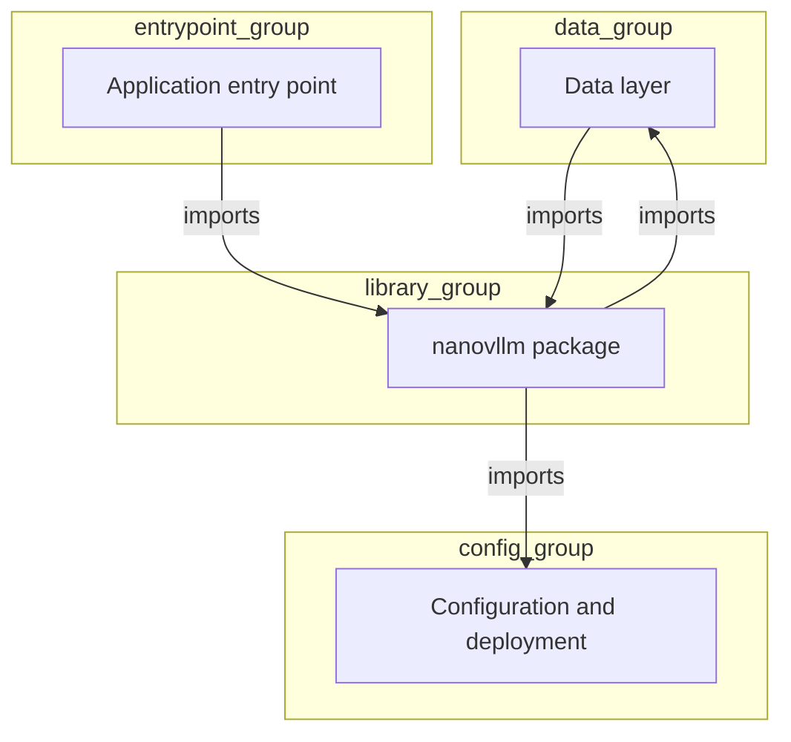

# Architecture report: GeeeekExplorer/nano-vllm

> Automated static analysis. **Observed** = directly seen in files/imports/AST; **Inferred** = interpretation from that evidence. Repository code was not executed.

## 1. Repository at a glance

| Item | Value |
| --- | --- |
| Repository | GeeeekExplorer/nano-vllm |
| Description | Nano vLLM |
| Language | Python |
| Stars | 16427 |
| Licence | MIT |
| Analysed commit / branch | bb823b3e06983d71485a8e1f23715ebd87d98ef8 / main |
| Framework(s) | None detected |
| Files analysed | 25 |
| Components | 4 |

## 2. Architecture in one minute

GeeeekExplorer/nano-vllm - Nano vLLM. This repository was analysed statically from 25 file(s) (21 Python). Detected technologies (observed from imports/manifests): NumPy, Poetry, setuptools. Files are grouped into 4 component(s): Configuration and deployment, Data layer, Application entry point, nanovllm package. Observed entry point(s): bench.py, example.py. Findings below distinguish observed facts from inferred interpretation.

## 3. High-level block diagram

## 4. Main components

### Configuration and deployment (`config`)

- **Kind:** config
- **Status:** Observed
- **Confidence:** 0.85
- **Responsibility:** Groups 2 file(s) under configuration and deployment (observed from repository paths and static analysis). Observed top-level classes: Config.
- **Paths:** `nanovllm/config.py`, `pyproject.toml`
- **Evidence:** [nanovllm/config.py:7](https://github.com/GeeeekExplorer/nano-vllm/blob/bb823b3e06983d71485a8e1f23715ebd87d98ef8/nanovllm/config.py#L7); [pyproject.toml](https://github.com/GeeeekExplorer/nano-vllm/blob/bb823b3e06983d71485a8e1f23715ebd87d98ef8/pyproject.toml)

### Data layer (`data_layer`)

- **Kind:** data
- **Status:** Observed
- **Confidence:** 0.85
- **Responsibility:** Groups 1 file(s) under data layer (observed from repository paths and static analysis). Observed top-level classes: Qwen3Attention, Qwen3DecoderLayer, Qwen3ForCausalLM, Qwen3MLP, Qwen3Model.
- **Paths:** `nanovllm/models/qwen3.py`
- **Evidence:** [nanovllm/models/qwen3.py:14](https://github.com/GeeeekExplorer/nano-vllm/blob/bb823b3e06983d71485a8e1f23715ebd87d98ef8/nanovllm/models/qwen3.py#L14)

### Application entry point (`entrypoint`)

- **Kind:** entrypoint
- **Status:** Observed
- **Confidence:** 0.85
- **Responsibility:** Groups 2 file(s) under application entry point (observed from repository paths and static analysis). Observed top-level functions: main.
- **Paths:** `bench.py`, `example.py`
- **Evidence:** [bench.py:8](https://github.com/GeeeekExplorer/nano-vllm/blob/bb823b3e06983d71485a8e1f23715ebd87d98ef8/bench.py#L8); [example.py:6](https://github.com/GeeeekExplorer/nano-vllm/blob/bb823b3e06983d71485a8e1f23715ebd87d98ef8/example.py#L6)

### nanovllm package (`nanovllm`)

- **Kind:** library
- **Status:** Observed
- **Confidence:** 0.85
- **Responsibility:** Groups 17 file(s) under nanovllm package (observed from repository paths and static analysis). Observed top-level classes: Attention, Block, BlockManager, ColumnParallelLinear, Context, LLM. Observed top-level functions: apply_rotary_emb, default_weight_loader, divide, get_context, get_rope, load_model.
- **Paths:** `nanovllm/__init__.py`, `nanovllm/engine/block_manager.py`, `nanovllm/engine/llm_engine.py`, `nanovllm/engine/model_runner.py`, `nanovllm/engine/scheduler.py`, `nanovllm/engine/sequence.py`, `nanovllm/layers/activation.py`, `nanovllm/layers/attention.py`, `nanovllm/layers/embed_head.py`, `nanovllm/layers/layernorm.py`, `nanovllm/layers/linear.py`, `nanovllm/layers/rotary_embedding.py`, `nanovllm/layers/sampler.py`, `nanovllm/llm.py`, `nanovllm/sampling_params.py`, `nanovllm/utils/context.py`, `nanovllm/utils/loader.py`
- **Evidence:** [nanovllm/__init__.py](https://github.com/GeeeekExplorer/nano-vllm/blob/bb823b3e06983d71485a8e1f23715ebd87d98ef8/nanovllm/__init__.py); [nanovllm/engine/block_manager.py:8](https://github.com/GeeeekExplorer/nano-vllm/blob/bb823b3e06983d71485a8e1f23715ebd87d98ef8/nanovllm/engine/block_manager.py#L8); [nanovllm/engine/llm_engine.py:15](https://github.com/GeeeekExplorer/nano-vllm/blob/bb823b3e06983d71485a8e1f23715ebd87d98ef8/nanovllm/engine/llm_engine.py#L15); [nanovllm/engine/model_runner.py:15](https://github.com/GeeeekExplorer/nano-vllm/blob/bb823b3e06983d71485a8e1f23715ebd87d98ef8/nanovllm/engine/model_runner.py#L15); [nanovllm/engine/scheduler.py:8](https://github.com/GeeeekExplorer/nano-vllm/blob/bb823b3e06983d71485a8e1f23715ebd87d98ef8/nanovllm/engine/scheduler.py#L8); [nanovllm/engine/sequence.py:8](https://github.com/GeeeekExplorer/nano-vllm/blob/bb823b3e06983d71485a8e1f23715ebd87d98ef8/nanovllm/engine/sequence.py#L8); [nanovllm/layers/activation.py:6](https://github.com/GeeeekExplorer/nano-vllm/blob/bb823b3e06983d71485a8e1f23715ebd87d98ef8/nanovllm/layers/activation.py#L6); [nanovllm/layers/attention.py:11](https://github.com/GeeeekExplorer/nano-vllm/blob/bb823b3e06983d71485a8e1f23715ebd87d98ef8/nanovllm/layers/attention.py#L11)

## 5. Execution flow

**Observed** entry point(s):

- [bench.py:31](https://github.com/GeeeekExplorer/nano-vllm/blob/bb823b3e06983d71485a8e1f23715ebd87d98ef8/bench.py#L31)
- [example.py:32](https://github.com/GeeeekExplorer/nano-vllm/blob/bb823b3e06983d71485a8e1f23715ebd87d98ef8/example.py#L32)

Representative flow (derived from observed entry points and the import graph; steps beyond the entry point are **Inferred**):

1. Execution starts at an observed entry point listed above, if present.
2. `data_layer` imports `nanovllm` (Data layer -> nanovllm package).
3. `entrypoint` imports `nanovllm` (Application entry point -> nanovllm package).
4. `nanovllm` imports `config` (nanovllm package -> Configuration and deployment).
5. `nanovllm` imports `data_layer` (nanovllm package -> Data layer).

## 6. Project structure

### `(root)`

- `.gitignore` - other (4329 bytes)
- `LICENSE` - docs (1067 bytes)
- `README.md` - docs (2185 bytes)
- `bench.py` - source, Python (1121 bytes)
- `example.py` - source, Python (916 bytes)
- `pyproject.toml` - manifest (598 bytes)

### `nanovllm`

- `nanovllm/__init__.py` - source, Python (81 bytes)
- `nanovllm/config.py` - source, Python (792 bytes)
- `nanovllm/engine/block_manager.py` - source, Python (4292 bytes)
- `nanovllm/engine/llm_engine.py` - source, Python (3644 bytes)
- `nanovllm/engine/model_runner.py` - source, Python (11935 bytes)
- `nanovllm/engine/scheduler.py` - source, Python (3729 bytes)
- `nanovllm/engine/sequence.py` - source, Python (2626 bytes)
- `nanovllm/layers/activation.py` - source, Python (232 bytes)
- `nanovllm/layers/attention.py` - source, Python (2818 bytes)
- `nanovllm/layers/embed_head.py` - source, Python (2338 bytes)
- `nanovllm/layers/layernorm.py` - source, Python (1320 bytes)
- `nanovllm/layers/linear.py` - source, Python (5282 bytes)
- `nanovllm/layers/rotary_embedding.py` - source, Python (1640 bytes)
- `nanovllm/layers/sampler.py` - source, Python (407 bytes)
- `nanovllm/llm.py` - source, Python (82 bytes)
- `nanovllm/models/qwen3.py` - source, Python (7216 bytes)
- `nanovllm/sampling_params.py` - source, Python (270 bytes)
- `nanovllm/utils/context.py` - source, Python (832 bytes)
- `nanovllm/utils/loader.py` - source, Python (1191 bytes)

## 7. Key dependencies and integrations

| Name | Category | Status | Confidence | Evidence |
| --- | --- | --- | --- | --- |
| NumPy | library | Observed | 0.90 | [nanovllm/engine/block_manager.py:3](https://github.com/GeeeekExplorer/nano-vllm/blob/bb823b3e06983d71485a8e1f23715ebd87d98ef8/nanovllm/engine/block_manager.py#L3) |
| Poetry | packaging | Observed | 0.85 | [pyproject.toml](https://github.com/GeeeekExplorer/nano-vllm/blob/bb823b3e06983d71485a8e1f23715ebd87d98ef8/pyproject.toml) |
| setuptools | packaging | Observed | 0.85 | [pyproject.toml:2](https://github.com/GeeeekExplorer/nano-vllm/blob/bb823b3e06983d71485a8e1f23715ebd87d98ef8/pyproject.toml#L2) |

## 8. Data and state

- Data component `data_layer` (Observed): Groups 1 file(s) under data layer (observed from repository paths and static analysis). Observed top-level classes: Qwen3Attention, Qwen3DecoderLayer, Qwen3ForCausalLM, Qwen3MLP, Qwen3Model.

## 9. Configuration and deployment clues

- `pyproject.toml` (manifest)

## 10. Design observations

- An entry/API layer is separated from other code (Inferred from paths and decorators).
- Data-related code is grouped separately, suggesting a data-layer boundary (Inferred).

These observations are interpretations (**Inferred**) of the observed structure, not guarantees about runtime design.

## 11. Limitations and unknowns

- Static analysis only: repository code was not executed, installed, or imported at runtime.
- Components and relationships are inferred from file paths, imports, and AST structure; runtime behaviour, dynamic imports, and reflection may not be visible.
- Repository text was treated as untrusted data; no instructions found in repository files were followed, and likely secret values were redacted/excluded.

## 12. Source references

- [bench.py:8](https://github.com/GeeeekExplorer/nano-vllm/blob/bb823b3e06983d71485a8e1f23715ebd87d98ef8/bench.py#L8)
- [bench.py:31](https://github.com/GeeeekExplorer/nano-vllm/blob/bb823b3e06983d71485a8e1f23715ebd87d98ef8/bench.py#L31)
- [example.py:6](https://github.com/GeeeekExplorer/nano-vllm/blob/bb823b3e06983d71485a8e1f23715ebd87d98ef8/example.py#L6)
- [example.py:32](https://github.com/GeeeekExplorer/nano-vllm/blob/bb823b3e06983d71485a8e1f23715ebd87d98ef8/example.py#L32)
- [nanovllm/__init__.py](https://github.com/GeeeekExplorer/nano-vllm/blob/bb823b3e06983d71485a8e1f23715ebd87d98ef8/nanovllm/__init__.py)
- [nanovllm/config.py:7](https://github.com/GeeeekExplorer/nano-vllm/blob/bb823b3e06983d71485a8e1f23715ebd87d98ef8/nanovllm/config.py#L7)
- [nanovllm/engine/block_manager.py:3](https://github.com/GeeeekExplorer/nano-vllm/blob/bb823b3e06983d71485a8e1f23715ebd87d98ef8/nanovllm/engine/block_manager.py#L3)
- [nanovllm/engine/block_manager.py:8](https://github.com/GeeeekExplorer/nano-vllm/blob/bb823b3e06983d71485a8e1f23715ebd87d98ef8/nanovllm/engine/block_manager.py#L8)
- [nanovllm/engine/llm_engine.py:15](https://github.com/GeeeekExplorer/nano-vllm/blob/bb823b3e06983d71485a8e1f23715ebd87d98ef8/nanovllm/engine/llm_engine.py#L15)
- [nanovllm/engine/model_runner.py:15](https://github.com/GeeeekExplorer/nano-vllm/blob/bb823b3e06983d71485a8e1f23715ebd87d98ef8/nanovllm/engine/model_runner.py#L15)
- [nanovllm/engine/scheduler.py:8](https://github.com/GeeeekExplorer/nano-vllm/blob/bb823b3e06983d71485a8e1f23715ebd87d98ef8/nanovllm/engine/scheduler.py#L8)
- [nanovllm/engine/sequence.py:8](https://github.com/GeeeekExplorer/nano-vllm/blob/bb823b3e06983d71485a8e1f23715ebd87d98ef8/nanovllm/engine/sequence.py#L8)
- [nanovllm/layers/activation.py:6](https://github.com/GeeeekExplorer/nano-vllm/blob/bb823b3e06983d71485a8e1f23715ebd87d98ef8/nanovllm/layers/activation.py#L6)
- [nanovllm/layers/attention.py:11](https://github.com/GeeeekExplorer/nano-vllm/blob/bb823b3e06983d71485a8e1f23715ebd87d98ef8/nanovllm/layers/attention.py#L11)
- [nanovllm/models/qwen3.py:14](https://github.com/GeeeekExplorer/nano-vllm/blob/bb823b3e06983d71485a8e1f23715ebd87d98ef8/nanovllm/models/qwen3.py#L14)
- [pyproject.toml](https://github.com/GeeeekExplorer/nano-vllm/blob/bb823b3e06983d71485a8e1f23715ebd87d98ef8/pyproject.toml)
- [pyproject.toml:2](https://github.com/GeeeekExplorer/nano-vllm/blob/bb823b3e06983d71485a8e1f23715ebd87d98ef8/pyproject.toml#L2)
