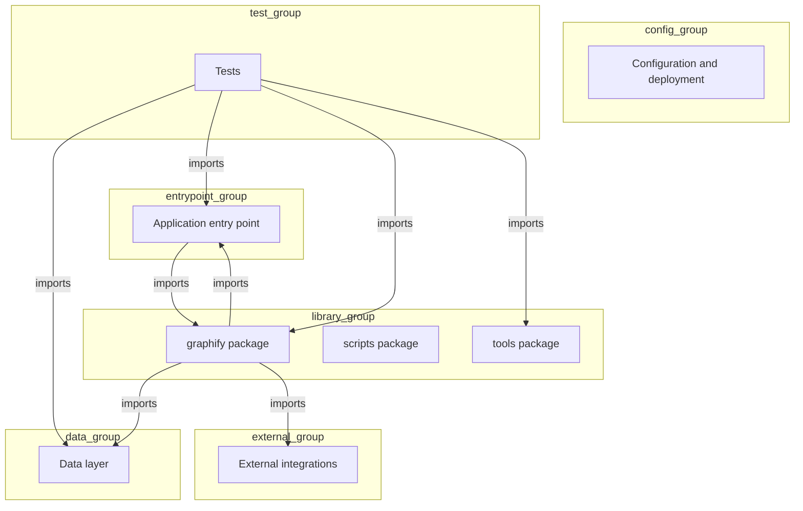

# Architecture report: Graphify-Labs/graphify

> Automated static analysis. **Observed** = directly seen in files/imports/AST; **Inferred** = interpretation from that evidence. Repository code was not executed.

## 1. Repository at a glance

| Item | Value |
| --- | --- |
| Repository | Graphify-Labs/graphify |
| Description | Turn any codebase, with its docs, SQL schemas, configs, and PDFs, into a queryable knowledge graph. A /graphify skill for Claude Code, Cursor, Codex, and Gemini CLI: local deterministic AST parsing, every edge explained, no vector store. |
| Language | Python |
| Stars | 147656 |
| Licence | Apache-2.0 |
| Analysed commit / branch | 52cb28218eea0c68d80a9f4b2ae102d2fa63e267 / v8 |
| Framework(s) | Starlette |
| Files analysed | 600 |
| Components | 8 |

## 2. Architecture in one minute

Graphify-Labs/graphify - Turn any codebase, with its docs, SQL schemas, configs, and PDFs, into a queryable knowledge graph. A /graphify skill for Claude Code, Cursor, Codex, and Gemini CLI: local deterministic AST parsing,…. This repository was analysed statically from 600 file(s) (266 Python). Detected technologies (observed from imports/manifests): GitHub Actions, PostgreSQL, Starlette, AWS (boto3), NumPy, Pydantic. Files are grouped into 8 component(s): Configuration and deployment, Data layer, Application entry point, External integrations, graphify package, scripts package, Tests, tools package. Observed entry point(s): graphify/__main__.py, graphify/callflow_html.py, graphify/ingest.py. Findings below distinguish observed facts from inferred interpretation.

## 3. High-level block diagram

## 4. Main components

### Configuration and deployment (`config`)

- **Kind:** config
- **Status:** Observed
- **Confidence:** 0.85
- **Responsibility:** Groups 4 file(s) under configuration and deployment (observed from repository paths and static analysis).
- **Paths:** `Dockerfile`, `gemini-extension.json`, `graphify/pi/package.json`, `pyproject.toml`
- **Evidence:** [Dockerfile](https://github.com/Graphify-Labs/graphify/blob/52cb28218eea0c68d80a9f4b2ae102d2fa63e267/Dockerfile); [gemini-extension.json](https://github.com/Graphify-Labs/graphify/blob/52cb28218eea0c68d80a9f4b2ae102d2fa63e267/gemini-extension.json); [graphify/pi/package.json](https://github.com/Graphify-Labs/graphify/blob/52cb28218eea0c68d80a9f4b2ae102d2fa63e267/graphify/pi/package.json); [pyproject.toml](https://github.com/Graphify-Labs/graphify/blob/52cb28218eea0c68d80a9f4b2ae102d2fa63e267/pyproject.toml)

### Data layer (`data_layer`)

- **Kind:** data
- **Status:** Observed
- **Confidence:** 0.85
- **Responsibility:** Groups 1 file(s) under data layer (observed from repository paths and static analysis). Observed top-level classes: LanguageConfig, _NamespaceExportFact, _StarExportFact, _SymbolAliasFact, _SymbolDeclarationFact, _SymbolExportFact.
- **Paths:** `graphify/extractors/models.py`
- **Evidence:** [graphify/extractors/models.py:14](https://github.com/Graphify-Labs/graphify/blob/52cb28218eea0c68d80a9f4b2ae102d2fa63e267/graphify/extractors/models.py#L14)

### Application entry point (`entrypoint`)

- **Kind:** entrypoint
- **Status:** Observed
- **Confidence:** 0.85
- **Responsibility:** Groups 5 file(s) under application entry point (observed from repository paths and static analysis). Observed top-level classes: CallflowOptions, ToolError, _ApiKeyMiddleware, _GraphContextCache, _MCPASGIApp, _QueryScores. Observed top-level functions: __getattr__, _ambiguity_message, _apply_resource_limits, _batch_needs_llm_flag, _batch_triggers_rebuild, _bfs.
- **Paths:** `graphify/__main__.py`, `graphify/callflow_html.py`, `graphify/ingest.py`, `graphify/serve.py`, `graphify/watch.py`
- **Evidence:** [graphify/__main__.py:156](https://github.com/Graphify-Labs/graphify/blob/52cb28218eea0c68d80a9f4b2ae102d2fa63e267/graphify/__main__.py#L156); [graphify/callflow_html.py:94](https://github.com/Graphify-Labs/graphify/blob/52cb28218eea0c68d80a9f4b2ae102d2fa63e267/graphify/callflow_html.py#L94); [graphify/ingest.py:17](https://github.com/Graphify-Labs/graphify/blob/52cb28218eea0c68d80a9f4b2ae102d2fa63e267/graphify/ingest.py#L17); [graphify/serve.py:35](https://github.com/Graphify-Labs/graphify/blob/52cb28218eea0c68d80a9f4b2ae102d2fa63e267/graphify/serve.py#L35); [graphify/watch.py:34](https://github.com/Graphify-Labs/graphify/blob/52cb28218eea0c68d80a9f4b2ae102d2fa63e267/graphify/watch.py#L34)

### External integrations (`external_integrations`)

- **Kind:** external
- **Status:** Inferred
- **Confidence:** 0.70
- **Responsibility:** Groups 0 file(s) under external integrations (observed from repository paths and static analysis).
- **Evidence:** [graphify/llm.py:2112](https://github.com/Graphify-Labs/graphify/blob/52cb28218eea0c68d80a9f4b2ae102d2fa63e267/graphify/llm.py#L2112); [graphify/llm.py:3342](https://github.com/Graphify-Labs/graphify/blob/52cb28218eea0c68d80a9f4b2ae102d2fa63e267/graphify/llm.py#L3342); [graphify/llm.py:3460](https://github.com/Graphify-Labs/graphify/blob/52cb28218eea0c68d80a9f4b2ae102d2fa63e267/graphify/llm.py#L3460); [graphify/pg_introspect.py:14](https://github.com/Graphify-Labs/graphify/blob/52cb28218eea0c68d80a9f4b2ae102d2fa63e267/graphify/pg_introspect.py#L14); [graphify/security.py:16](https://github.com/Graphify-Labs/graphify/blob/52cb28218eea0c68d80a9f4b2ae102d2fa63e267/graphify/security.py#L16)

### graphify package (`graphify`)

- **Kind:** library
- **Status:** Observed
- **Confidence:** 0.85
- **Responsibility:** Groups 89 file(s) under graphify package (observed from repository paths and static analysis). Observed top-level classes: AffectedHit, CapabilityCheck, CppTypeLookup, CsharpNameResolver, DeclIdRegistry, FileSlice. Observed top-level functions: __getattr__, _abs_identity, _absolutize_ids_in, _absolutize_source_files_in, _active, _add_edge.
- **Paths:** `graphify/__init__.py`, `graphify/_minhash.py`, `graphify/affected.py`, `graphify/analyze.py`, `graphify/benchmark.py`, `graphify/build.py`, `graphify/cache.py`, `graphify/cargo_introspect.py`, `graphify/cluster.py`, `graphify/cpp_resolution.py`, `graphify/cross_repo_calls.py`, `graphify/cross_repo_types.py`, `graphify/csharp_dispatch.py`, `graphify/dedup.py`, `graphify/detect.py`, `graphify/diagnostics.py`, `graphify/export.py`, `graphify/exporters/__init__.py`, `graphify/exporters/base.py`, `graphify/exporters/graphdb.py`, `graphify/exporters/html.py`, `graphify/extractors/__init__.py`, `graphify/extractors/apex.py`, `graphify/extractors/base.py`, `graphify/extractors/bash.py`, `graphify/extractors/blade.py`, `graphify/extractors/cobol.py`, `graphify/extractors/commonlisp.py`, `graphify/extractors/csharp.py`, `graphify/extractors/dart.py`, `graphify/extractors/dm.py`, `graphify/extractors/elixir.py`, `graphify/extractors/erlang.py`, `graphify/extractors/fortran.py`, `graphify/extractors/go.py`, `graphify/extractors/json_config.py`, `graphify/extractors/julia.py`, `graphify/extractors/markdown.py`, `graphify/extractors/objc.py`, `graphify/extractors/ocaml.py`, `graphify/extractors/pascal.py`, `graphify/extractors/pascal_forms.py`, `graphify/extractors/powershell.py`, `graphify/extractors/r.py`, `graphify/extractors/razor.py`, `graphify/extractors/robot.py`, `graphify/extractors/rust.py`, `graphify/extractors/sln.py`, `graphify/extractors/solidity.py`, `graphify/extractors/sql.py`, `graphify/extractors/terraform.py`, `graphify/extractors/vbnet.py`, `graphify/extractors/verilog.py`, `graphify/extractors/yaml_config.py`, `graphify/extractors/zig.py`, `graphify/file_slice.py`, `graphify/global_graph.py`, `graphify/go_dispatch.py`, `graphify/google_workspace.py`, `graphify/hooks.py`, `graphify/ids.py`, `graphify/install.py`, `graphify/interface_dispatch.py`, `graphify/llm.py`, `graphify/manifest.py`, `graphify/manifest_ingest.py`, `graphify/markdown_resolution.py`, `graphify/mcp_ingest.py`, `graphify/multigraph_compat.py`, `graphify/pascal_resolution.py`, `graphify/paths.py`, `graphify/pg_introspect.py`, `graphify/pi/index.ts`, `graphify/prs.py`, `graphify/querylog.py`, `graphify/rcfile.py`, `graphify/reflect.py`, `graphify/report.py`, `graphify/resolver_registry.py`, `graphify/ruby_resolution.py`, `graphify/scip_ingest.py`, `graphify/security.py`, `graphify/semantic_cleanup.py`, `graphify/swift_dispatch.py`, `graphify/symbol_resolution.py`, `graphify/transcribe.py`, `graphify/tree_html.py`, `graphify/validate.py`, `graphify/wiki.py`
- **Evidence:** [graphify/__init__.py:4](https://github.com/Graphify-Labs/graphify/blob/52cb28218eea0c68d80a9f4b2ae102d2fa63e267/graphify/__init__.py#L4); [graphify/_minhash.py:27](https://github.com/Graphify-Labs/graphify/blob/52cb28218eea0c68d80a9f4b2ae102d2fa63e267/graphify/_minhash.py#L27); [graphify/affected.py:49](https://github.com/Graphify-Labs/graphify/blob/52cb28218eea0c68d80a9f4b2ae102d2fa63e267/graphify/affected.py#L49); [graphify/analyze.py:50](https://github.com/Graphify-Labs/graphify/blob/52cb28218eea0c68d80a9f4b2ae102d2fa63e267/graphify/analyze.py#L50); [graphify/benchmark.py:13](https://github.com/Graphify-Labs/graphify/blob/52cb28218eea0c68d80a9f4b2ae102d2fa63e267/graphify/benchmark.py#L13); [graphify/build.py:45](https://github.com/Graphify-Labs/graphify/blob/52cb28218eea0c68d80a9f4b2ae102d2fa63e267/graphify/build.py#L45); [graphify/cache.py:49](https://github.com/Graphify-Labs/graphify/blob/52cb28218eea0c68d80a9f4b2ae102d2fa63e267/graphify/cache.py#L49); [graphify/cargo_introspect.py:15](https://github.com/Graphify-Labs/graphify/blob/52cb28218eea0c68d80a9f4b2ae102d2fa63e267/graphify/cargo_introspect.py#L15)

### scripts package (`scripts`)

- **Kind:** library
- **Status:** Observed
- **Confidence:** 0.85
- **Responsibility:** Groups 1 file(s) under scripts package (observed from repository paths and static analysis). Observed top-level functions: e, kt, line_len, op0, reveal.
- **Paths:** `scripts/gen_demo_path.py`
- **Evidence:** [scripts/gen_demo_path.py:49](https://github.com/Graphify-Labs/graphify/blob/52cb28218eea0c68d80a9f4b2ae102d2fa63e267/scripts/gen_demo_path.py#L49)

### Tests (`tests`)

- **Kind:** test
- **Status:** Observed
- **Confidence:** 0.85
- **Responsibility:** Groups 292 file(s) under tests (observed from repository paths and static analysis). Observed top-level classes: Analyzer, Anchors, ExtDecl, Fixture, Probe, Runbook. Observed top-level functions: _added_calls, _affected_labels, _all_refs, _append_xml, _apply_standard_change, _arm.
- **Paths:** `tests/__init__.py`, `tests/bench_extract.py`, `tests/bench_query_scoring.py`, `tests/conftest.py`, `tests/csharp_extension_harness.py`, `tests/fixtures/4978/expected_nodes.json`, `tests/fixtures/barrel_reexport.ts`, `tests/fixtures/bindings.xaml`, `tests/fixtures/cjs_require.js`, `tests/fixtures/cookieHelpers.ts`, `tests/fixtures/cpp_logger/a/Logger.cpp`, `tests/fixtures/cpp_logger/a/Logger.h`, `tests/fixtures/cpp_logger/b/Logger.cpp`, `tests/fixtures/cpp_logger/b/Logger.h`, `tests/fixtures/cpp_paired/Foo.cpp`, `tests/fixtures/cpp_paired/Foo.h`, `tests/fixtures/cpp_paired/Main.cpp`, `tests/fixtures/cpp_samedir/Alpha.h`, `tests/fixtures/cpp_samedir/Beta.h`, `tests/fixtures/cpp_samedir/plain.h`, `tests/fixtures/crate_a/Cargo.toml`, `tests/fixtures/crate_a/src/lib.rs`, `tests/fixtures/crate_b/Cargo.toml`, `tests/fixtures/crate_b/src/lib.rs`, `tests/fixtures/deploy_guide.md`, `tests/fixtures/dynamic_import.ts`, `tests/fixtures/extraction.json`, `tests/fixtures/graphify-out/cache/4722d67ec49f51710650249b1f865b6a748d91fb6805f3d385a99143eb950fe7.json`, `tests/fixtures/graphify-out/cache/6a640d202b5f9a6d68f7b5eb2c05e708d85ba9ee43ad0ff271badfc966a1c06c.json`, `tests/fixtures/graphify-out/cache/a3c5220ed581781e1dc2f4e9a82eeee366881554ec9fce57823e124f7aecd348.json`, `tests/fixtures/graphify-out/cache/f5916299213779311e7162e90a1613bca095b5372f5d269c5941b5237af2d020.json`, `tests/fixtures/graphify-out/cache/f82cddb8aad2615e0381e57b80857edfd3345213967c815de87e09be80f9f12a.json`, `tests/fixtures/new_languages/sample.cob`, `tests/fixtures/new_languages/sample.erl`, `tests/fixtures/new_languages/sample.r`, `tests/fixtures/new_languages/sample.sol`, `tests/fixtures/new_languages/sample.vb`, `tests/fixtures/objc_mixed/Bridging-Header.h`, `tests/fixtures/objc_mixed/Widget.h`, `tests/fixtures/objc_mixed/Widget.m`, `tests/fixtures/objc_mixed/WidgetExtras.swift`, `tests/fixtures/pascal_cross_file/BaseGadget.pas`, `tests/fixtures/pascal_cross_file/DerivedGadget.pas`, `tests/fixtures/pascal_cross_file/OtherGadget.pas`, `tests/fixtures/robot_keywords.resource`, `tests/fixtures/sample.c`, `tests/fixtures/sample.cls`, `tests/fixtures/sample.cpp`, `tests/fixtures/sample.cs`, `tests/fixtures/sample.csproj`, `tests/fixtures/sample.cu`, `tests/fixtures/sample.dfm`, `tests/fixtures/sample.dm`, `tests/fixtures/sample.dmf`, `tests/fixtures/sample.dmm`, `tests/fixtures/sample.ex`, `tests/fixtures/sample.f90`, `tests/fixtures/sample.go`, `tests/fixtures/sample.groovy`, `tests/fixtures/sample.java`, `tests/fixtures/sample.jl`, `tests/fixtures/sample.json`, `tests/fixtures/sample.kt`, `tests/fixtures/sample.lfm`, `tests/fixtures/sample.lisp`, `tests/fixtures/sample.lpk`, `tests/fixtures/sample.luau`, `tests/fixtures/sample.m`, `tests/fixtures/sample.mcp.json`, `tests/fixtures/sample.md`, `tests/fixtures/sample.metal`, `tests/fixtures/sample.pas`, `tests/fixtures/sample.php`, `tests/fixtures/sample.ps1`, `tests/fixtures/sample.psd1`, `tests/fixtures/sample.py`, `tests/fixtures/sample.razor`, `tests/fixtures/sample.rb`, `tests/fixtures/sample.robot`, `tests/fixtures/sample.rs`, `tests/fixtures/sample.scala`, `tests/fixtures/sample.sh`, `tests/fixtures/sample.sln`, `tests/fixtures/sample.slnx`, `tests/fixtures/sample.sql`, `tests/fixtures/sample.sv`, `tests/fixtures/sample.swift`, `tests/fixtures/sample.trigger`, `tests/fixtures/sample.ts`, `tests/fixtures/sample.tsx`, `tests/fixtures/sample.xaml`, `tests/fixtures/sample.xaml.cs`, `tests/fixtures/sample.zig`, `tests/fixtures/sample_alter_fk.sql`, `tests/fixtures/sample_calls.py`, `tests/fixtures/sample_cte.sql`, `tests/fixtures/sample_doctest.cpp`, `tests/fixtures/sample_import.ps1`, `tests/fixtures/sample_inherited.dfm`, `tests/fixtures/sample_inherited.lfm`, `tests/fixtures/sample_php_config.php`, `tests/fixtures/sample_php_container.php`, `tests/fixtures/sample_php_listen.php`, `tests/fixtures/sample_php_static_prop.php`, `tests/fixtures/sample_plpgsql.sql`, `tests/fixtures/sample_plpgsql_quoted.sql`, `tests/fixtures/sample_preprocessed.F90`, `tests/fixtures/sample_record_methods.pas`, `tests/fixtures/sample_schema_qualified.sql`, `tests/fixtures/sample_scoped_calls.pas`, `tests/fixtures/sample_spock.groovy`, `tests/fixtures/sample_transaction.sql`, `tests/fixtures/sample_tsconfig.json`, `tests/fixtures/storageHelpers.ts`, `tests/fixtures/swift_cross_file/Foo+Ext.swift`, `tests/fixtures/swift_cross_file/Foo.swift`, `tests/fixtures/typescript_advanced.ts`, `tests/fixtures/urlHelpers.ts`, `tests/fixtures/xaml_viewmodel/App.csproj`, `tests/fixtures/xaml_viewmodel/ViewModels/DesignViewModel.cs`, `tests/fixtures/xaml_viewmodel/ViewModels/MainViewModel.cs`, `tests/fixtures/xaml_viewmodel/ViewModels/PrismOrderViewModel.cs`, `tests/fixtures/xaml_viewmodel/ViewModels/SettingsViewModel.cs`, `tests/fixtures/xaml_viewmodel/ViewModels/ToolkitViewModel.cs`, `tests/fixtures/xaml_viewmodel/Views/DesignView.xaml`, `tests/fixtures/xaml_viewmodel/Views/ExplicitMainWindow.xaml`, `tests/fixtures/xaml_viewmodel/Views/PrismOrderView.xaml`, `tests/fixtures/xaml_viewmodel/Views/SettingsView.xaml`, `tests/fixtures/xaml_viewmodel/Views/ToolkitView.xaml`, `tests/pi.test.ts`, `tests/test_4874_jvm_resolution.py`, `tests/test_4909_reference_binding_scale.py`, `tests/test_4978_reconcile_cost.py`, `tests/test_4992_ts_import_types.py`, `tests/test_5072_splittable_under_cap_retry.py`, `tests/test_affected_cli.py`, `tests/test_affected_defines.py`, `tests/test_affected_member_seed.py`, `tests/test_affected_overrides.py`, `tests/test_affected_path_file_node.py`, `tests/test_affected_seed_reference_forms.py`, `tests/test_agents_platform.py`, `tests/test_alias_folding.py`, `tests/test_analyze.py`, `tests/test_anthropic_custom_endpoint.py`, `tests/test_antigravity_install.py`, `tests/test_apm_fallback_version.py`, `tests/test_architecture_doc.py`, `tests/test_astro_extraction.py`, `tests/test_astro_import_ids.py`, `tests/test_atomic_canvas_export.py`, `tests/test_atomic_version_stamp.py`, `tests/test_atomic_writes.py`, `tests/test_backend_env_isolation.py`, `tests/test_backend_extras.py`, `tests/test_backend_opt_in.py`, `tests/test_benchmark.py`, `tests/test_benchmark_raw_graph.py`, `tests/test_benchmark_real_query.py`, `tests/test_binary_media_words.py`, `tests/test_blade_extractor.py`, `tests/test_build.py`, `tests/test_build_located_semantic_identity.py`, `tests/test_build_merge_dedup_scope.py`, `tests/test_build_merge_ghost_fold_4955.py`, `tests/test_build_merge_hyperedges_and_prune.py`, `tests/test_build_merge_shrink_guard.py`, `tests/test_builtin_global_type_refs.py`, `tests/test_c_include_resolution.py`, `tests/test_cache.py`, `tests/test_cache_long_paths.py`, `tests/test_cache_stale_import_target.py`, `tests/test_cache_windows_case_4925.py`, `tests/test_callflow_html.py`, `tests/test_cargo_introspect.py`, `tests/test_cargo_missing_manifest.py`, `tests/test_carried_hyperedge_remap.py`, `tests/test_case_only_decl_ids_4904.py`, `tests/test_case_sensitive_resolution.py`, `tests/test_charmap_encoding.py`, `tests/test_chunking.py`, `tests/test_cjs_module_extension.py`, `tests/test_claude_cli_backend.py`, `tests/test_claude_md.py`, `tests/test_cli_broken_pipe.py`, `tests/test_cli_export.py`, `tests/test_cli_help.py`, `tests/test_cloud_cta.py`, `tests/test_cluster.py`, `tests/test_cluster_ambiguous_scale.py`, `tests/test_cluster_exclude_hubs.py`, `tests/test_cobol_extractor.py`, `tests/test_code_only_scope_4923.py`, `tests/test_code_only_update_all_hosts.py`, `tests/test_codebuddy.py`, `tests/test_community_hub_labels.py`, `tests/test_community_labels_skill.py`, `tests/test_compact_graph_json.py`, `tests/test_confidence.py`, `tests/test_confidence_score_output.py`, `tests/test_corrupt_graph_json.py`, `tests/test_cpp_alias_member_resolution.py`, `tests/test_cpp_anonymous_namespace_receivers.py`, `tests/test_cpp_conditional_initializers.py`, `tests/test_cpp_forward_declarations.py`, `tests/test_cpp_forward_receiver_completion.py`, `tests/test_cpp_incremental_type_resolution.py`, `tests/test_cpp_inherited_member_resolution.py`, `tests/test_cpp_local_callable_shadowing.py`, `tests/test_cpp_member_call_by_receiver_type.py`, `tests/test_cpp_member_declaration_identity.py`, `tests/test_cpp_method_declarations.py`, `tests/test_cpp_nested_and_cli.py`, `tests/test_cpp_objc_cross_file_calls.py`, `tests/test_cpp_preprocess.py`, `tests/test_cpp_receiver_chains.py`, `tests/test_cpp_receiver_parameters.py`, `tests/test_cpp_split_header_owner.py`, `tests/test_cpp_template_members.py`, `tests/test_cpp_template_type_params.py`, `tests/test_cpp_type_alias.py`, `tests/test_cross_extension_reexport_self_cycle.py`, `tests/test_cross_language_call_resolution.py`, `tests/test_cross_repo_external_call_guards.py`, `tests/test_cross_repo_member_calls.py`, `tests/test_cross_repo_shared_types.py`, `tests/test_csharp_call_site_generic_args.py`, `tests/test_csharp_delegate_declarations.py`, `tests/test_csharp_enum_members.py`, `tests/test_csharp_extension_calls.py`, `tests/test_csharp_extension_keyword_types.py`, `tests/test_csharp_extension_metadata.py`, `tests/test_csharp_extension_resolution.py`, `tests/test_csharp_field_generic_args.py`, `tests/test_csharp_foreach_loop_variable.py`, `tests/test_csharp_generic_callsites.py`, `tests/test_csharp_interface_dispatch.py`, `tests/test_csharp_member_calls.py`, `tests/test_csharp_member_chain_calls.py`, `tests/test_csharp_member_nodes.py`, `tests/test_csharp_method_owner_labels.py`, `tests/test_csharp_object_creation.py`, `tests/test_csharp_overloads.py`, `tests/test_csharp_partial_classes.py`, `tests/test_csharp_receiver_type_names.py`, `tests/test_csharp_tuple_type_refs.py`, `tests/test_csharp_type_resolution.py`, `tests/test_csharp_underscore_collisions.py`, `tests/test_csharp_var_call_return_type.py`, `tests/test_csharp_verbatim_interpolation.py`, `tests/test_dart.py`, `tests/test_dedup.py`, `tests/test_dedup_remaps_hyperedges.py`, `tests/test_dedup_shrink_refuses_force_write.py`, `tests/test_dedup_survivor_richness.py`, `tests/test_definition_file_portability.py`, `tests/test_detect_jinja.py`, `tests/test_devin.py`, `tests/test_docx_to_markdown.py`, `tests/test_dotnet.py`, `tests/test_duplicate_annotation_edges.py`, `tests/test_edge_also_seen.py`, `tests/test_ejs_extractor.py`, `tests/test_elixir_defdelegate.py`, `tests/test_elixir_import_resolution.py`, `tests/test_elixir_keyword_def_calls.py`, `tests/test_elixir_qualified_calls.py`, `tests/test_elixir_unqualified_call_scope.py`, `tests/test_erlang_extractor.py`, `tests/test_evidence_binding.py`, `tests/test_explain_cli.py`, `tests/test_explain_same_file_tie.py`, `tests/test_export.py`, `tests/test_export_control_characters.py`, `tests/test_export_direction.py`, `tests/test_export_idempotent_writes.py`, `tests/test_export_path_length.py`, `tests/test_ext_tagged_id_clash.py`, `tests/test_external_stub_endpoints.py`, `tests/test_extract_cache_location.py`, `tests/test_extract_code_only_cli.py`, `tests/test_extract_cost_ledger.py`, `tests/test_extract_memory_release.py`, `tests/test_extract_path_memo.py`, `tests/test_extract_php_closures.py`, `tests/test_extraction_spec_ids.py`, `tests/test_extractor_scan_root_context.py`, `tests/test_extractors_registry.py`, `tests/test_falkordb_integration.py`, `tests/test_file_label_disambiguation.py`, `tests/test_file_truncation_warning.py`, `tests/test_frontmatter_and_ssrf_hardening.py`
- **Evidence:** [tests/__init__.py](https://github.com/Graphify-Labs/graphify/blob/52cb28218eea0c68d80a9f4b2ae102d2fa63e267/tests/__init__.py); [tests/bench_extract.py:38](https://github.com/Graphify-Labs/graphify/blob/52cb28218eea0c68d80a9f4b2ae102d2fa63e267/tests/bench_extract.py#L38); [tests/bench_query_scoring.py:67](https://github.com/Graphify-Labs/graphify/blob/52cb28218eea0c68d80a9f4b2ae102d2fa63e267/tests/bench_query_scoring.py#L67); [tests/conftest.py:11](https://github.com/Graphify-Labs/graphify/blob/52cb28218eea0c68d80a9f4b2ae102d2fa63e267/tests/conftest.py#L11); [tests/csharp_extension_harness.py:43](https://github.com/Graphify-Labs/graphify/blob/52cb28218eea0c68d80a9f4b2ae102d2fa63e267/tests/csharp_extension_harness.py#L43); [tests/fixtures/4978/expected_nodes.json](https://github.com/Graphify-Labs/graphify/blob/52cb28218eea0c68d80a9f4b2ae102d2fa63e267/tests/fixtures/4978/expected_nodes.json); [tests/fixtures/barrel_reexport.ts](https://github.com/Graphify-Labs/graphify/blob/52cb28218eea0c68d80a9f4b2ae102d2fa63e267/tests/fixtures/barrel_reexport.ts); [tests/fixtures/bindings.xaml](https://github.com/Graphify-Labs/graphify/blob/52cb28218eea0c68d80a9f4b2ae102d2fa63e267/tests/fixtures/bindings.xaml)

### tools package (`tools`)

- **Kind:** library
- **Status:** Observed
- **Confidence:** 0.85
- **Responsibility:** Groups 2 file(s) under tools package (observed from repository paths and static analysis).
- **Paths:** `tools/__init__.py`, `tools/skillgen/__init__.py`
- **Evidence:** [tools/__init__.py](https://github.com/Graphify-Labs/graphify/blob/52cb28218eea0c68d80a9f4b2ae102d2fa63e267/tools/__init__.py); [tools/skillgen/__init__.py](https://github.com/Graphify-Labs/graphify/blob/52cb28218eea0c68d80a9f4b2ae102d2fa63e267/tools/skillgen/__init__.py)

## 5. Execution flow

**Observed** entry point(s):

- [graphify/__main__.py](https://github.com/Graphify-Labs/graphify/blob/52cb28218eea0c68d80a9f4b2ae102d2fa63e267/graphify/__main__.py)
- [graphify/callflow_html.py:2050](https://github.com/Graphify-Labs/graphify/blob/52cb28218eea0c68d80a9f4b2ae102d2fa63e267/graphify/callflow_html.py#L2050)
- [graphify/ingest.py:396](https://github.com/Graphify-Labs/graphify/blob/52cb28218eea0c68d80a9f4b2ae102d2fa63e267/graphify/ingest.py#L396)
- [graphify/pi/index.ts](https://github.com/Graphify-Labs/graphify/blob/52cb28218eea0c68d80a9f4b2ae102d2fa63e267/graphify/pi/index.ts)
- [graphify/serve.py](https://github.com/Graphify-Labs/graphify/blob/52cb28218eea0c68d80a9f4b2ae102d2fa63e267/graphify/serve.py)
- [graphify/watch.py:3844](https://github.com/Graphify-Labs/graphify/blob/52cb28218eea0c68d80a9f4b2ae102d2fa63e267/graphify/watch.py#L3844)

Representative flow (derived from observed entry points and the import graph; steps beyond the entry point are **Inferred**):

1. Execution starts at an observed entry point listed above, if present.
2. `entrypoint` imports `graphify` (Application entry point -> graphify package).
3. `graphify` imports `data_layer` (graphify package -> Data layer).
4. `graphify` imports `entrypoint` (graphify package -> Application entry point).
5. `graphify` imports `external_integrations` (graphify package -> External integrations).
6. `tests` imports `data_layer` (Tests -> Data layer).
7. `tests` imports `entrypoint` (Tests -> Application entry point).
8. `tests` imports `graphify` (Tests -> graphify package).
9. `tests` imports `tools` (Tests -> tools package).

## 6. Project structure

### `(root)`

- `.dockerignore` - container (247 bytes)
- `.gitattributes` - other (353 bytes)
- `.gitignore` - other (1041 bytes)
- `.pre-commit-config.yaml` - config (850 bytes)
- `AGENTS.md` - docs (563 bytes)
- `ARCHITECTURE.md` - docs (24379 bytes)
- `BENCHMARKS.md` - docs (8887 bytes)
- `CODE_OF_CONDUCT.md` - docs (4803 bytes)
- `CONTRIBUTING.md` - docs (10242 bytes)
- `Dockerfile` - container (881 bytes)
- `GEMINI.md` - docs (1587 bytes)
- `LICENSE` - docs (11358 bytes)
- `LICENSE-MIT` - other (1068 bytes)
- `NOTICE` - docs (335 bytes)
- `README.md` - docs (40648 bytes)
- `RELEASING.md` - docs (1839 bytes)
- `SECURITY.md` - docs (4686 bytes)
- `SUPPORT.md` - docs (1587 bytes)
- `gemini-extension.json` - config (425 bytes)
- `pyproject.toml` - manifest (10343 bytes)

### `.github`

- `.github/CODEOWNERS` - other (813 bytes)
- `.github/DISCUSSION_TEMPLATE/q-a.yml` - config (1224 bytes)
- `.github/FUNDING.yml` - config (19 bytes)
- `.github/ISSUE_TEMPLATE/bug_report.yml` - config (2297 bytes)
- `.github/ISSUE_TEMPLATE/config.yml` - config (712 bytes)
- `.github/ISSUE_TEMPLATE/feature_request.yml` - config (1925 bytes)
- `.github/PULL_REQUEST_TEMPLATE.md` - docs (1476 bytes)
- `.github/TEAM_MEMBERS` - other (11 bytes)
- `.github/workflows/ci.yml` - ci, YAML (4492 bytes)
- `.github/workflows/pr-management.yml` - ci, YAML (5288 bytes)
- `.github/workflows/publish.yml` - ci, YAML (1850 bytes)
- `.github/workflows/release-graph.yml` - ci, YAML (2213 bytes)
- `.github/workflows/welcome.yml` - ci, YAML (2431 bytes)

### `docs`

- `docs/demo-path.svg` - docs (20623 bytes)
- `docs/docker-mcp-sqlite.md` - docs (5229 bytes)
- `docs/how-it-works.md` - docs (5903 bytes)
- `docs/logo-icon.svg` - docs (2001 bytes)
- `docs/logo-text.svg` - docs (2373 bytes)
- `docs/node-summaries-rfc.md` - docs (6629 bytes)
- `docs/superpowers/plans/2026-05-04-incremental-updates-dedup.md` - docs (40697 bytes)
- `docs/superpowers/specs/2026-05-04-incremental-updates-dedup-design.md` - docs (5746 bytes)
- `docs/translations/README.ar-SA.md` - docs (42290 bytes)
- `docs/translations/README.cs-CZ.md` - docs (36911 bytes)
- `docs/translations/README.da-DK.md` - docs (35814 bytes)
- `docs/translations/README.de-DE.md` - docs (37490 bytes)
- `docs/translations/README.el-GR.md` - docs (50151 bytes)
- `docs/translations/README.es-ES.md` - docs (37440 bytes)
- `docs/translations/README.fa-IR.md` - docs (46816 bytes)
- `docs/translations/README.fi-FI.md` - docs (36633 bytes)
- `docs/translations/README.fil-PH.md` - docs (38231 bytes)
- `docs/translations/README.fr-FR.md` - docs (38183 bytes)
- `docs/translations/README.he-IL.md` - docs (40917 bytes)
- `docs/translations/README.hi-IN.md` - docs (57224 bytes)
- `docs/translations/README.hu-HU.md` - docs (38872 bytes)
- `docs/translations/README.id-ID.md` - docs (36028 bytes)
- `docs/translations/README.it-IT.md` - docs (36949 bytes)
- `docs/translations/README.ja-JP.md` - docs (42202 bytes)
- `docs/translations/README.ko-KR.md` - docs (38642 bytes)
- `docs/translations/README.nl-NL.md` - docs (36381 bytes)
- `docs/translations/README.no-NO.md` - docs (35715 bytes)
- `docs/translations/README.pl-PL.md` - docs (37162 bytes)
- `docs/translations/README.pt-BR.md` - docs (36964 bytes)
- `docs/translations/README.ro-RO.md` - docs (37567 bytes)
- `docs/translations/README.ru-RU.md` - docs (50771 bytes)
- `docs/translations/README.sv-SE.md` - docs (35940 bytes)
- `docs/translations/README.th-TH.md` - docs (56245 bytes)
- `docs/translations/README.tr-TR.md` - docs (37555 bytes)
- `docs/translations/README.uk-UA.md` - docs (48939 bytes)
- `docs/translations/README.uz-UZ.md` - docs (37385 bytes)
- `docs/translations/README.vi-VN.md` - docs (39949 bytes)
- `docs/translations/README.zh-CN.md` - docs (34706 bytes)
- `docs/translations/README.zh-TW.md` - docs (34500 bytes)

### `graphify`

- `graphify/__init__.py` - source, Python (1424 bytes)
- `graphify/__main__.py` - source, Python (50036 bytes)
- `graphify/_minhash.py` - source, Python (4143 bytes)
- `graphify/affected.py` - source, Python (19516 bytes)
- `graphify/always_on/agents-md.md` - docs (1516 bytes)
- `graphify/always_on/antigravity-rules.md` - docs (933 bytes)
- `graphify/always_on/claude-md.md` - docs (1159 bytes)
- `graphify/always_on/gemini-md.md` - docs (1159 bytes)
- `graphify/always_on/kiro-steering.md` - docs (504 bytes)
- `graphify/always_on/vscode-instructions.md` - docs (1014 bytes)
- `graphify/analyze.py` - source, Python (34729 bytes)
- `graphify/benchmark.py` - source, Python (4574 bytes)
- `graphify/build.py` - source, Python (168251 bytes)
- `graphify/cache.py` - source, Python (114349 bytes)
- `graphify/callflow_html.py` - source, Python (83274 bytes)
- `graphify/cargo_introspect.py` - source, Python (7785 bytes)
- `graphify/cluster.py` - source, Python (22235 bytes)
- `graphify/command-kilo.md` - docs (407 bytes)
- `graphify/cpp_resolution.py` - source, Python (14023 bytes)
- `graphify/cross_repo_calls.py` - source, Python (15182 bytes)
- `graphify/cross_repo_types.py` - source, Python (3395 bytes)
- `graphify/csharp_dispatch.py` - source, Python (1814 bytes)
- `graphify/dedup.py` - source, Python (87991 bytes)
- `graphify/detect.py` - source, Python (149454 bytes)
- `graphify/diagnostics.py` - source, Python (16210 bytes)
- `graphify/export.py` - source, Python (67134 bytes)
- `graphify/exporters/__init__.py` - source, Python (25 bytes)
- `graphify/exporters/base.py` - source, Python (606 bytes)
- `graphify/exporters/graphdb.py` - source, Python (8387 bytes)
- `graphify/exporters/html.py` - source, Python (36444 bytes)
- `graphify/extractors/MIGRATION.md` - docs (5123 bytes)
- `graphify/extractors/__init__.py` - source, Python (3083 bytes)
- `graphify/extractors/apex.py` - source, Python (8511 bytes)
- `graphify/extractors/base.py` - source, Python (11385 bytes)
- `graphify/extractors/bash.py` - source, Python (34011 bytes)
- `graphify/extractors/blade.py` - source, Python (4258 bytes)
- `graphify/extractors/cobol.py` - source, Python (11720 bytes)
- `graphify/extractors/commonlisp.py` - source, Python (24406 bytes)
- `graphify/extractors/csharp.py` - source, Python (28849 bytes)
- `graphify/extractors/dart.py` - source, Python (32339 bytes)
- `graphify/extractors/dm.py` - source, Python (19781 bytes)
- `graphify/extractors/elixir.py` - source, Python (23200 bytes)
- `graphify/extractors/erlang.py` - source, Python (14309 bytes)
- `graphify/extractors/fortran.py` - source, Python (21613 bytes)
- `graphify/extractors/go.py` - source, Python (53469 bytes)
- `graphify/extractors/json_config.py` - source, Python (15453 bytes)
- `graphify/extractors/julia.py` - source, Python (23919 bytes)
- `graphify/extractors/markdown.py` - source, Python (35813 bytes)
- `graphify/extractors/models.py` - source, Python (4634 bytes)
- `graphify/extractors/objc.py` - source, Python (42483 bytes)
- `graphify/extractors/ocaml.py` - source, Python (17416 bytes)
- `graphify/extractors/pascal.py` - source, Python (30667 bytes)
- `graphify/extractors/pascal_forms.py` - source, Python (6903 bytes)
- `graphify/extractors/powershell.py` - source, Python (30927 bytes)
- `graphify/extractors/r.py` - source, Python (21169 bytes)
- `graphify/extractors/razor.py` - source, Python (8662 bytes)
- `graphify/extractors/robot.py` - source, Python (12981 bytes)
- `graphify/extractors/rust.py` - source, Python (57508 bytes)
- `graphify/extractors/sln.py` - source, Python (3926 bytes)
- `graphify/extractors/solidity.py` - source, Python (72901 bytes)
- `graphify/extractors/sql.py` - source, Python (54181 bytes)
- `graphify/extractors/terraform.py` - source, Python (23087 bytes)
- `graphify/extractors/vbnet.py` - source, Python (17974 bytes)
- `graphify/extractors/verilog.py` - source, Python (17981 bytes)
- `graphify/extractors/yaml_config.py` - source, Python (13609 bytes)
- `graphify/extractors/zig.py` - source, Python (11921 bytes)
- `graphify/file_slice.py` - source, Python (15211 bytes)
- `graphify/global_graph.py` - source, Python (8699 bytes)
- `graphify/go_dispatch.py` - source, Python (6041 bytes)
- `graphify/google_workspace.py` - source, Python (9939 bytes)
- `graphify/hooks.py` - source, Python (57206 bytes)
- `graphify/ids.py` - source, Python (11032 bytes)
- `graphify/ingest.py` - source, Python (14995 bytes)
- `graphify/install.py` - source, Python (135755 bytes)
- `graphify/interface_dispatch.py` - source, Python (10363 bytes)
- `graphify/llm.py` - source, Python (188693 bytes)
- `graphify/manifest.py` - source, Python (214 bytes)
- `graphify/manifest_ingest.py` - source, Python (13776 bytes)
- `graphify/markdown_resolution.py` - source, Python (23514 bytes)
- `graphify/mcp_ingest.py` - source, Python (13184 bytes)
- `graphify/multigraph_compat.py` - source, Python (8262 bytes)
- `graphify/pascal_resolution.py` - source, Python (5843 bytes)
- `graphify/paths.py` - source, Python (28581 bytes)
- `graphify/pg_introspect.py` - source, Python (8036 bytes)
- `graphify/pi/index.ts` - source, TypeScript (9564 bytes)
- `graphify/pi/package.json` - manifest (233 bytes)
- `graphify/prs.py` - source, Python (31974 bytes)
- `graphify/querylog.py` - source, Python (2841 bytes)
- `graphify/rcfile.py` - source, Python (10495 bytes)
- `graphify/reflect.py` - source, Python (37733 bytes)
- `graphify/report.py` - source, Python (21529 bytes)
- `graphify/resolver_registry.py` - source, Python (3396 bytes)
- `graphify/ruby_resolution.py` - source, Python (23150 bytes)
- `graphify/scip_ingest.py` - source, Python (13947 bytes)
- `graphify/security.py` - source, Python (20075 bytes)
- `graphify/semantic_cleanup.py` - source, Python (14892 bytes)
- `graphify/serve.py` - source, Python (180957 bytes)
- `graphify/skill-agents.md` - docs (50275 bytes)
- `graphify/skill-aider.md` - docs (62122 bytes)
- `graphify/skill-amp.md` - docs (50275 bytes)
- `graphify/skill-claw.md` - docs (50551 bytes)
- `graphify/skill-codex.md` - docs (51311 bytes)
- `graphify/skill-copilot.md` - docs (50551 bytes)
- `graphify/skill-devin.md` - docs (69180 bytes)
- `graphify/skill-droid.md` - docs (50275 bytes)
- `graphify/skill-kilo.md` - docs (50850 bytes)
- `graphify/skill-kiro.md` - docs (50551 bytes)
- `graphify/skill-opencode.md` - docs (49998 bytes)
- `graphify/skill-pi.md` - docs (50263 bytes)
- `graphify/skill-trae.md` - docs (50373 bytes)
- `graphify/skill-vscode.md` - docs (50210 bytes)
- `graphify/skill-windows.md` - docs (52929 bytes)
- `graphify/skill.md` - docs (50551 bytes)
- `graphify/skills/agents/references/add-watch.md` - docs (2704 bytes)
- `graphify/skills/agents/references/exports.md` - docs (4774 bytes)
- `graphify/skills/agents/references/extraction-spec.md` - docs (9348 bytes)
- `graphify/skills/agents/references/github-and-merge.md` - docs (2177 bytes)
- `graphify/skills/agents/references/hooks.md` - docs (1270 bytes)
- `graphify/skills/agents/references/query.md` - docs (14775 bytes)
- `graphify/skills/agents/references/transcribe.md` - docs (3173 bytes)
- `graphify/skills/agents/references/update.md` - docs (12335 bytes)
- `graphify/skills/amp/references/add-watch.md` - docs (2704 bytes)
- `graphify/skills/amp/references/exports.md` - docs (4774 bytes)
- `graphify/skills/amp/references/extraction-spec.md` - docs (9348 bytes)
- `graphify/skills/amp/references/github-and-merge.md` - docs (2177 bytes)
- `graphify/skills/amp/references/hooks.md` - docs (1250 bytes)
- `graphify/skills/amp/references/query.md` - docs (14775 bytes)
- `graphify/skills/amp/references/transcribe.md` - docs (3173 bytes)
- `graphify/skills/amp/references/update.md` - docs (12335 bytes)
- `graphify/skills/claude/references/add-watch.md` - docs (2704 bytes)
- `graphify/skills/claude/references/exports.md` - docs (4774 bytes)
- `graphify/skills/claude/references/extraction-spec.md` - docs (9348 bytes)
- `graphify/skills/claude/references/github-and-merge.md` - docs (2177 bytes)
- `graphify/skills/claude/references/hooks.md` - docs (2109 bytes)
- `graphify/skills/claude/references/query.md` - docs (14775 bytes)
- `graphify/skills/claude/references/transcribe.md` - docs (3173 bytes)
- `graphify/skills/claude/references/update.md` - docs (12335 bytes)
- `graphify/skills/claw/references/add-watch.md` - docs (2704 bytes)
- `graphify/skills/claw/references/exports.md` - docs (4774 bytes)
- `graphify/skills/claw/references/extraction-spec.md` - docs (5423 bytes)
- `graphify/skills/claw/references/github-and-merge.md` - docs (2177 bytes)
- `graphify/skills/claw/references/hooks.md` - docs (2109 bytes)
- `graphify/skills/claw/references/query.md` - docs (14775 bytes)
- `graphify/skills/claw/references/transcribe.md` - docs (3173 bytes)
- `graphify/skills/claw/references/update.md` - docs (12335 bytes)
- `graphify/skills/codex/references/add-watch.md` - docs (2704 bytes)
- `graphify/skills/codex/references/exports.md` - docs (4774 bytes)
- `graphify/skills/codex/references/extraction-spec.md` - docs (5240 bytes)
- `graphify/skills/codex/references/github-and-merge.md` - docs (2177 bytes)
- `graphify/skills/codex/references/hooks.md` - docs (2109 bytes)
- `graphify/skills/codex/references/query.md` - docs (14775 bytes)
- `graphify/skills/codex/references/transcribe.md` - docs (3173 bytes)
- `graphify/skills/codex/references/update.md` - docs (12335 bytes)
- `graphify/skills/copilot/references/add-watch.md` - docs (2704 bytes)
- `graphify/skills/copilot/references/exports.md` - docs (4774 bytes)
- `graphify/skills/copilot/references/extraction-spec.md` - docs (9348 bytes)
- `graphify/skills/copilot/references/github-and-merge.md` - docs (2177 bytes)
- `graphify/skills/copilot/references/hooks.md` - docs (2109 bytes)
- `graphify/skills/copilot/references/query.md` - docs (14775 bytes)
- `graphify/skills/copilot/references/transcribe.md` - docs (3173 bytes)
- `graphify/skills/copilot/references/update.md` - docs (12335 bytes)
- `graphify/skills/droid/references/add-watch.md` - docs (2704 bytes)
- `graphify/skills/droid/references/exports.md` - docs (4774 bytes)
- `graphify/skills/droid/references/extraction-spec.md` - docs (9348 bytes)
- `graphify/skills/droid/references/github-and-merge.md` - docs (2177 bytes)
- `graphify/skills/droid/references/hooks.md` - docs (2109 bytes)
- `graphify/skills/droid/references/query.md` - docs (14775 bytes)
- `graphify/skills/droid/references/transcribe.md` - docs (3173 bytes)
- `graphify/skills/droid/references/update.md` - docs (12335 bytes)
- `graphify/skills/kilo/references/add-watch.md` - docs (2704 bytes)
- `graphify/skills/kilo/references/exports.md` - docs (4774 bytes)
- `graphify/skills/kilo/references/extraction-spec.md` - docs (9348 bytes)
- `graphify/skills/kilo/references/github-and-merge.md` - docs (2177 bytes)
- `graphify/skills/kilo/references/hooks.md` - docs (2109 bytes)
- `graphify/skills/kilo/references/query.md` - docs (14775 bytes)
- `graphify/skills/kilo/references/transcribe.md` - docs (3173 bytes)
- `graphify/skills/kilo/references/update.md` - docs (12335 bytes)
- `graphify/skills/kiro/references/add-watch.md` - docs (2704 bytes)
- `graphify/skills/kiro/references/exports.md` - docs (4774 bytes)
- `graphify/skills/kiro/references/extraction-spec.md` - docs (5423 bytes)
- `graphify/skills/kiro/references/github-and-merge.md` - docs (2177 bytes)
- `graphify/skills/kiro/references/hooks.md` - docs (2109 bytes)
- `graphify/skills/kiro/references/query.md` - docs (14775 bytes)
- `graphify/skills/kiro/references/transcribe.md` - docs (3173 bytes)
- `graphify/skills/kiro/references/update.md` - docs (12335 bytes)
- `graphify/skills/opencode/references/add-watch.md` - docs (2704 bytes)
- `graphify/skills/opencode/references/exports.md` - docs (4774 bytes)
- `graphify/skills/opencode/references/extraction-spec.md` - docs (9348 bytes)
- `graphify/skills/opencode/references/github-and-merge.md` - docs (2177 bytes)
- `graphify/skills/opencode/references/hooks.md` - docs (2109 bytes)
- `graphify/skills/opencode/references/query.md` - docs (14775 bytes)
- `graphify/skills/opencode/references/transcribe.md` - docs (3173 bytes)
- `graphify/skills/opencode/references/update.md` - docs (12335 bytes)
- `graphify/skills/pi/references/add-watch.md` - docs (2704 bytes)
- `graphify/skills/pi/references/exports.md` - docs (4774 bytes)
- `graphify/skills/pi/references/extraction-spec.md` - docs (5423 bytes)
- `graphify/skills/pi/references/github-and-merge.md` - docs (2177 bytes)
- `graphify/skills/pi/references/hooks.md` - docs (2109 bytes)
- `graphify/skills/pi/references/query.md` - docs (14775 bytes)
- `graphify/skills/pi/references/transcribe.md` - docs (3173 bytes)
- `graphify/skills/pi/references/update.md` - docs (12335 bytes)
- `graphify/skills/trae/references/add-watch.md` - docs (2704 bytes)
- `graphify/skills/trae/references/exports.md` - docs (4774 bytes)
- `graphify/skills/trae/references/extraction-spec.md` - docs (9348 bytes)
- `graphify/skills/trae/references/github-and-merge.md` - docs (2177 bytes)
- `graphify/skills/trae/references/hooks.md` - docs (1594 bytes)
- `graphify/skills/trae/references/query.md` - docs (14775 bytes)
- `graphify/skills/trae/references/transcribe.md` - docs (3173 bytes)
- `graphify/skills/trae/references/update.md` - docs (12335 bytes)
- `graphify/skills/vscode/references/add-watch.md` - docs (2704 bytes)
- `graphify/skills/vscode/references/exports.md` - docs (4774 bytes)
- `graphify/skills/vscode/references/extraction-spec.md` - docs (9348 bytes)
- `graphify/skills/vscode/references/github-and-merge.md` - docs (2177 bytes)
- `graphify/skills/vscode/references/hooks.md` - docs (2109 bytes)
- `graphify/skills/vscode/references/query.md` - docs (14775 bytes)
- `graphify/skills/vscode/references/transcribe.md` - docs (3173 bytes)
- `graphify/skills/vscode/references/update.md` - docs (12335 bytes)
- `graphify/skills/windows/references/add-watch.md` - docs (2704 bytes)
- `graphify/skills/windows/references/exports.md` - docs (4774 bytes)
- `graphify/skills/windows/references/extraction-spec.md` - docs (9348 bytes)
- `graphify/skills/windows/references/github-and-merge.md` - docs (2177 bytes)
- `graphify/skills/windows/references/hooks.md` - docs (2109 bytes)
- `graphify/skills/windows/references/query.md` - docs (14775 bytes)
- `graphify/skills/windows/references/transcribe.md` - docs (3173 bytes)
- `graphify/skills/windows/references/update.md` - docs (12335 bytes)
- `graphify/swift_dispatch.py` - source, Python (2364 bytes)
- `graphify/symbol_resolution.py` - source, Python (28393 bytes)
- `graphify/transcribe.py` - source, Python (6372 bytes)
- `graphify/tree_html.py` - source, Python (28860 bytes)
- `graphify/validate.py` - source, Python (4234 bytes)
- `graphify/watch.py` - source, Python (179963 bytes)
- `graphify/wiki.py` - source, Python (22915 bytes)

### `scripts`

- `scripts/gen_demo_path.py` - source, Python (10789 bytes)

### `tests`

- `tests/__init__.py` - test, Python (0 bytes)
- `tests/bench_extract.py` - test, Python (4952 bytes)
- `tests/bench_query_scoring.py` - test, Python (11422 bytes)
- `tests/conftest.py` - test, Python (4969 bytes)
- `tests/csharp_extension_harness.py` - test, Python (40345 bytes)
- `tests/fixtures/4978/expected_nodes.json` - test (916 bytes)
- `tests/fixtures/barrel_reexport.ts` - test, TypeScript (348 bytes)
- `tests/fixtures/bindings.xaml` - test (674 bytes)
- `tests/fixtures/cjs_require.js` - test, JavaScript (299 bytes)
- `tests/fixtures/cookieHelpers.ts` - test, TypeScript (133 bytes)
- `tests/fixtures/cpp_logger/a/Logger.cpp` - test, C++ (43 bytes)
- `tests/fixtures/cpp_logger/a/Logger.h` - test, C/C++ (42 bytes)
- `tests/fixtures/cpp_logger/b/Logger.cpp` - test, C++ (43 bytes)
- `tests/fixtures/cpp_logger/b/Logger.h` - test, C/C++ (42 bytes)
- `tests/fixtures/cpp_paired/Foo.cpp` - test, C++ (53 bytes)
- `tests/fixtures/cpp_paired/Foo.h` - test, C/C++ (91 bytes)
- `tests/fixtures/cpp_paired/Main.cpp` - test, C++ (71 bytes)
- `tests/fixtures/cpp_samedir/Alpha.h` - test, C/C++ (37 bytes)
- `tests/fixtures/cpp_samedir/Beta.h` - test, C/C++ (37 bytes)
- `tests/fixtures/cpp_samedir/plain.h` - test, C/C++ (96 bytes)
- `tests/fixtures/crate_a/Cargo.toml` - test (62 bytes)
- `tests/fixtures/crate_a/src/lib.rs` - test, Rust (89 bytes)
- `tests/fixtures/crate_b/Cargo.toml` - test (62 bytes)
- `tests/fixtures/crate_b/src/lib.rs` - test, Rust (534 bytes)
- `tests/fixtures/deploy_guide.md` - test (521 bytes)
- `tests/fixtures/dynamic_import.ts` - test, TypeScript (1057 bytes)
- `tests/fixtures/extraction.json` - test (1235 bytes)
- `tests/fixtures/graphify-out/cache/4722d67ec49f51710650249b1f865b6a748d91fb6805f3d385a99143eb950fe7.json` - test (2515 bytes)
- `tests/fixtures/graphify-out/cache/6a640d202b5f9a6d68f7b5eb2c05e708d85ba9ee43ad0ff271badfc966a1c06c.json` - test (2815 bytes)
- `tests/fixtures/graphify-out/cache/a3c5220ed581781e1dc2f4e9a82eeee366881554ec9fce57823e124f7aecd348.json` - test (4512 bytes)
- `tests/fixtures/graphify-out/cache/f5916299213779311e7162e90a1613bca095b5372f5d269c5941b5237af2d020.json` - test (2667 bytes)
- `tests/fixtures/graphify-out/cache/f82cddb8aad2615e0381e57b80857edfd3345213967c815de87e09be80f9f12a.json` - test (1329 bytes)
- `tests/fixtures/new_languages/sample.cob` - test (202 bytes)
- `tests/fixtures/new_languages/sample.erl` - test (71 bytes)
- `tests/fixtures/new_languages/sample.r` - test (57 bytes)
- `tests/fixtures/new_languages/sample.sol` - test (133 bytes)
- `tests/fixtures/new_languages/sample.vb` - test (179 bytes)
- `tests/fixtures/objc_mixed/Bridging-Header.h` - test, C/C++ (19 bytes)
- `tests/fixtures/objc_mixed/Widget.h` - test, C/C++ (56 bytes)
- `tests/fixtures/objc_mixed/Widget.m` - test (107 bytes)
- `tests/fixtures/objc_mixed/WidgetExtras.swift` - test (83 bytes)
- `tests/fixtures/pascal_cross_file/BaseGadget.pas` - test (188 bytes)
- `tests/fixtures/pascal_cross_file/DerivedGadget.pas` - test (205 bytes)
- `tests/fixtures/pascal_cross_file/OtherGadget.pas` - test (196 bytes)
- `tests/fixtures/robot_keywords.resource` - test (344 bytes)
- `tests/fixtures/sample.c` - test, C (787 bytes)
- `tests/fixtures/sample.cls` - test (1637 bytes)
- `tests/fixtures/sample.cpp` - test, C++ (1181 bytes)
- `tests/fixtures/sample.cs` - test, C# (1112 bytes)
- `tests/fixtures/sample.csproj` - test (704 bytes)
- `tests/fixtures/sample.cu` - test (568 bytes)
- `tests/fixtures/sample.dfm` - test (548 bytes)
- `tests/fixtures/sample.dm` - test (562 bytes)
- `tests/fixtures/sample.dmf` - test (898 bytes)
- `tests/fixtures/sample.dmm` - test (309 bytes)
- `tests/fixtures/sample.ex` - test (499 bytes)
- `tests/fixtures/sample.f90` - test (1361 bytes)
- `tests/fixtures/sample.go` - test, Go (745 bytes)
- `tests/fixtures/sample.groovy` - test (656 bytes)
- `tests/fixtures/sample.java` - test, Java (992 bytes)
- `tests/fixtures/sample.jl` - test (501 bytes)
- `tests/fixtures/sample.json` - test (265 bytes)
- `tests/fixtures/sample.kt` - test (1018 bytes)
- `tests/fixtures/sample.lfm` - test (555 bytes)
- `tests/fixtures/sample.lisp` - test (1953 bytes)
- `tests/fixtures/sample.lpk` - test (609 bytes)
- `tests/fixtures/sample.luau` - test (664 bytes)
- `tests/fixtures/sample.m` - test (711 bytes)
- `tests/fixtures/sample.mcp.json` - test (622 bytes)
- `tests/fixtures/sample.md` - test (204 bytes)
- `tests/fixtures/sample.metal` - test (392 bytes)
- `tests/fixtures/sample.pas` - test (1046 bytes)
- `tests/fixtures/sample.php` - test, PHP (1329 bytes)
- `tests/fixtures/sample.ps1` - test (831 bytes)
- `tests/fixtures/sample.psd1` - test (474 bytes)
- `tests/fixtures/sample.py` - test, Python (132 bytes)
- `tests/fixtures/sample.razor` - test (800 bytes)
- `tests/fixtures/sample.rb` - test, Ruby (441 bytes)
- `tests/fixtures/sample.robot` - test (831 bytes)
- `tests/fixtures/sample.rs` - test, Rust (1205 bytes)
- `tests/fixtures/sample.scala` - test (660 bytes)
- `tests/fixtures/sample.sh` - test, Shell (301 bytes)
- `tests/fixtures/sample.sln` - test (907 bytes)
- `tests/fixtures/sample.slnx` - test (231 bytes)
- `tests/fixtures/sample.sql` - test, SQL (417 bytes)
- `tests/fixtures/sample.sv` - test (777 bytes)
- `tests/fixtures/sample.swift` - test (1387 bytes)
- `tests/fixtures/sample.trigger` - test (300 bytes)
- `tests/fixtures/sample.ts` - test, TypeScript (517 bytes)
- `tests/fixtures/sample.tsx` - test, TypeScript (361 bytes)
- `tests/fixtures/sample.xaml` - test (469 bytes)
- `tests/fixtures/sample.xaml.cs` - test, C# (375 bytes)
- `tests/fixtures/sample.zig` - test (612 bytes)
- `tests/fixtures/sample_alter_fk.sql` - test, SQL (259 bytes)
- `tests/fixtures/sample_calls.py` - test, Python (517 bytes)
- `tests/fixtures/sample_cte.sql` - test, SQL (199 bytes)
- `tests/fixtures/sample_doctest.cpp` - test, C++ (313 bytes)
- `tests/fixtures/sample_import.ps1` - test (168 bytes)
- `tests/fixtures/sample_inherited.dfm` - test (241 bytes)
- `tests/fixtures/sample_inherited.lfm` - test (241 bytes)
- `tests/fixtures/sample_php_config.php` - test, PHP (381 bytes)
- `tests/fixtures/sample_php_container.php` - test, PHP (330 bytes)
- `tests/fixtures/sample_php_listen.php` - test, PHP (399 bytes)
- `tests/fixtures/sample_php_static_prop.php` - test, PHP (353 bytes)
- `tests/fixtures/sample_plpgsql.sql` - test, SQL (538 bytes)
- `tests/fixtures/sample_plpgsql_quoted.sql` - test, SQL (1592 bytes)
- `tests/fixtures/sample_preprocessed.F90` - test (256 bytes)
- `tests/fixtures/sample_record_methods.pas` - test (334 bytes)
- `tests/fixtures/sample_schema_qualified.sql` - test, SQL (325 bytes)
- `tests/fixtures/sample_scoped_calls.pas` - test (744 bytes)
- `tests/fixtures/sample_spock.groovy` - test (771 bytes)
- `tests/fixtures/sample_transaction.sql` - test, SQL (195 bytes)
- `tests/fixtures/sample_tsconfig.json` - test (194 bytes)
- `tests/fixtures/storageHelpers.ts` - test, TypeScript (145 bytes)
- `tests/fixtures/swift_cross_file/Foo+Ext.swift` - test (36 bytes)
- `tests/fixtures/swift_cross_file/Foo.swift` - test (32 bytes)
- `tests/fixtures/typescript_advanced.ts` - test, TypeScript (1978 bytes)
- `tests/fixtures/urlHelpers.ts` - test, TypeScript (164 bytes)
- `tests/fixtures/xaml_viewmodel/App.csproj` - test (136 bytes)
- `tests/fixtures/xaml_viewmodel/ViewModels/DesignViewModel.cs` - test, C# (75 bytes)
- `tests/fixtures/xaml_viewmodel/ViewModels/MainViewModel.cs` - test, C# (73 bytes)
- `tests/fixtures/xaml_viewmodel/ViewModels/PrismOrderViewModel.cs` - test, C# (65 bytes)
- `tests/fixtures/xaml_viewmodel/ViewModels/SettingsViewModel.cs` - test, C# (77 bytes)
- `tests/fixtures/xaml_viewmodel/ViewModels/ToolkitViewModel.cs` - test, C# (561 bytes)
- `tests/fixtures/xaml_viewmodel/Views/DesignView.xaml` - test (415 bytes)
- `tests/fixtures/xaml_viewmodel/Views/ExplicitMainWindow.xaml` - test (324 bytes)
- `tests/fixtures/xaml_viewmodel/Views/PrismOrderView.xaml` - test (221 bytes)
- `tests/fixtures/xaml_viewmodel/Views/SettingsView.xaml` - test (217 bytes)
- `tests/fixtures/xaml_viewmodel/Views/ToolkitView.xaml` - test (829 bytes)
- `tests/pi.test.ts` - test, TypeScript (18379 bytes)
- `tests/test_4874_jvm_resolution.py` - test, Python (8297 bytes)
- `tests/test_4909_reference_binding_scale.py` - test, Python (2878 bytes)
- `tests/test_4978_reconcile_cost.py` - test, Python (18246 bytes)
- `tests/test_4992_ts_import_types.py` - test, Python (2836 bytes)
- `tests/test_5072_splittable_under_cap_retry.py` - test, Python (3458 bytes)
- `tests/test_affected_cli.py` - test, Python (17257 bytes)
- `tests/test_affected_defines.py` - test, Python (7413 bytes)
- `tests/test_affected_member_seed.py` - test, Python (3211 bytes)
- `tests/test_affected_overrides.py` - test, Python (6373 bytes)
- `tests/test_affected_path_file_node.py` - test, Python (7519 bytes)
- `tests/test_affected_seed_reference_forms.py` - test, Python (5748 bytes)
- `tests/test_agents_platform.py` - test, Python (8915 bytes)
- `tests/test_alias_folding.py` - test, Python (8527 bytes)
- `tests/test_analyze.py` - test, Python (39304 bytes)
- `tests/test_anthropic_custom_endpoint.py` - test, Python (1260 bytes)
- `tests/test_antigravity_install.py` - test, Python (3081 bytes)
- `tests/test_apm_fallback_version.py` - test, Python (1697 bytes)
- `tests/test_architecture_doc.py` - test, Python (3629 bytes)
- `tests/test_astro_extraction.py` - test, Python (7388 bytes)
- `tests/test_astro_import_ids.py` - test, Python (7622 bytes)
- `tests/test_atomic_canvas_export.py` - test, Python (2397 bytes)
- `tests/test_atomic_version_stamp.py` - test, Python (4193 bytes)
- `tests/test_atomic_writes.py` - test, Python (14948 bytes)
- `tests/test_backend_env_isolation.py` - test, Python (2183 bytes)
- `tests/test_backend_extras.py` - test, Python (5702 bytes)
- `tests/test_backend_opt_in.py` - test, Python (3034 bytes)
- `tests/test_benchmark.py` - test, Python (7783 bytes)
- `tests/test_benchmark_raw_graph.py` - test, Python (3371 bytes)
- `tests/test_benchmark_real_query.py` - test, Python (3275 bytes)
- `tests/test_binary_media_words.py` - test, Python (3706 bytes)
- `tests/test_blade_extractor.py` - test, Python (2837 bytes)
- `tests/test_build.py` - test, Python (110085 bytes)
- `tests/test_build_located_semantic_identity.py` - test, Python (3759 bytes)
- `tests/test_build_merge_dedup_scope.py` - test, Python (12203 bytes)
- `tests/test_build_merge_ghost_fold_4955.py` - test, Python (6273 bytes)
- `tests/test_build_merge_hyperedges_and_prune.py` - test, Python (23100 bytes)
- `tests/test_build_merge_shrink_guard.py` - test, Python (10005 bytes)
- `tests/test_builtin_global_type_refs.py` - test, Python (4420 bytes)
- `tests/test_c_include_resolution.py` - test, Python (18506 bytes)
- `tests/test_cache.py` - test, Python (89342 bytes)
- `tests/test_cache_long_paths.py` - test, Python (1608 bytes)
- `tests/test_cache_stale_import_target.py` - test, Python (4569 bytes)
- `tests/test_cache_windows_case_4925.py` - test, Python (5011 bytes)
- `tests/test_callflow_html.py` - test, Python (13935 bytes)
- `tests/test_cargo_introspect.py` - test, Python (19858 bytes)
- `tests/test_cargo_missing_manifest.py` - test, Python (2717 bytes)
- `tests/test_carried_hyperedge_remap.py` - test, Python (5642 bytes)
- `tests/test_case_only_decl_ids_4904.py` - test, Python (2639 bytes)
- `tests/test_case_sensitive_resolution.py` - test, Python (3391 bytes)
- `tests/test_charmap_encoding.py` - test, Python (13999 bytes)
- `tests/test_chunking.py` - test, Python (40422 bytes)
- `tests/test_cjs_module_extension.py` - test, Python (3165 bytes)
- `tests/test_claude_cli_backend.py` - test, Python (23811 bytes)
- `tests/test_claude_md.py` - test, Python (8405 bytes)
- `tests/test_cli_broken_pipe.py` - test, Python (1998 bytes)
- `tests/test_cli_export.py` - test, Python (54439 bytes)
- `tests/test_cli_help.py` - test, Python (3017 bytes)
- `tests/test_cloud_cta.py` - test, Python (4122 bytes)
- `tests/test_cluster.py` - test, Python (8304 bytes)
- `tests/test_cluster_ambiguous_scale.py` - test, Python (6413 bytes)
- `tests/test_cluster_exclude_hubs.py` - test, Python (2930 bytes)
- `tests/test_cobol_extractor.py` - test, Python (8222 bytes)
- `tests/test_code_only_scope_4923.py` - test, Python (8459 bytes)
- `tests/test_code_only_update_all_hosts.py` - test, Python (13973 bytes)
- `tests/test_codebuddy.py` - test, Python (13792 bytes)
- `tests/test_community_hub_labels.py` - test, Python (3262 bytes)
- `tests/test_community_labels_skill.py` - test, Python (5698 bytes)
- `tests/test_compact_graph_json.py` - test, Python (7119 bytes)
- `tests/test_confidence.py` - test, Python (8381 bytes)
- `tests/test_confidence_score_output.py` - test, Python (4830 bytes)
- `tests/test_corrupt_graph_json.py` - test, Python (1801 bytes)
- `tests/test_cpp_alias_member_resolution.py` - test, Python (14482 bytes)
- `tests/test_cpp_anonymous_namespace_receivers.py` - test, Python (4050 bytes)
- `tests/test_cpp_conditional_initializers.py` - test, Python (15847 bytes)
- `tests/test_cpp_forward_declarations.py` - test, Python (15793 bytes)
- `tests/test_cpp_forward_receiver_completion.py` - test, Python (7282 bytes)
- `tests/test_cpp_incremental_type_resolution.py` - test, Python (2654 bytes)
- `tests/test_cpp_inherited_member_resolution.py` - test, Python (12033 bytes)
- `tests/test_cpp_local_callable_shadowing.py` - test, Python (2035 bytes)
- `tests/test_cpp_member_call_by_receiver_type.py` - test, Python (3168 bytes)
- `tests/test_cpp_member_declaration_identity.py` - test, Python (9976 bytes)
- `tests/test_cpp_method_declarations.py` - test, Python (3351 bytes)
- `tests/test_cpp_nested_and_cli.py` - test, Python (17382 bytes)
- `tests/test_cpp_objc_cross_file_calls.py` - test, Python (15469 bytes)
- `tests/test_cpp_preprocess.py` - test, Python (4686 bytes)
- `tests/test_cpp_receiver_chains.py` - test, Python (8100 bytes)
- `tests/test_cpp_receiver_parameters.py` - test, Python (5404 bytes)
- `tests/test_cpp_split_header_owner.py` - test, Python (4714 bytes)
- `tests/test_cpp_template_members.py` - test, Python (15950 bytes)
- `tests/test_cpp_template_type_params.py` - test, Python (2074 bytes)
- `tests/test_cpp_type_alias.py` - test, Python (7846 bytes)
- `tests/test_cross_extension_reexport_self_cycle.py` - test, Python (13343 bytes)
- `tests/test_cross_language_call_resolution.py` - test, Python (4805 bytes)
- `tests/test_cross_repo_external_call_guards.py` - test, Python (4397 bytes)
- `tests/test_cross_repo_member_calls.py` - test, Python (30771 bytes)
- `tests/test_cross_repo_shared_types.py` - test, Python (5402 bytes)
- `tests/test_csharp_call_site_generic_args.py` - test, Python (9541 bytes)
- `tests/test_csharp_delegate_declarations.py` - test, Python (2571 bytes)
- `tests/test_csharp_enum_members.py` - test, Python (8687 bytes)
- `tests/test_csharp_extension_calls.py` - test, Python (12713 bytes)
- `tests/test_csharp_extension_keyword_types.py` - test, Python (3998 bytes)
- `tests/test_csharp_extension_metadata.py` - test, Python (7530 bytes)
- `tests/test_csharp_extension_resolution.py` - test, Python (6167 bytes)
- `tests/test_csharp_field_generic_args.py` - test, Python (4386 bytes)
- `tests/test_csharp_foreach_loop_variable.py` - test, Python (4790 bytes)
- `tests/test_csharp_generic_callsites.py` - test, Python (3211 bytes)
- `tests/test_csharp_interface_dispatch.py` - test, Python (14013 bytes)
- `tests/test_csharp_member_calls.py` - test, Python (43513 bytes)
- `tests/test_csharp_member_chain_calls.py` - test, Python (10490 bytes)
- `tests/test_csharp_member_nodes.py` - test, Python (13088 bytes)
- `tests/test_csharp_method_owner_labels.py` - test, Python (12022 bytes)
- `tests/test_csharp_object_creation.py` - test, Python (21439 bytes)
- `tests/test_csharp_overloads.py` - test, Python (9909 bytes)
- `tests/test_csharp_partial_classes.py` - test, Python (30886 bytes)
- `tests/test_csharp_receiver_type_names.py` - test, Python (6084 bytes)
- `tests/test_csharp_tuple_type_refs.py` - test, Python (3012 bytes)
- `tests/test_csharp_type_resolution.py` - test, Python (59944 bytes)
- `tests/test_csharp_underscore_collisions.py` - test, Python (10974 bytes)
- `tests/test_csharp_var_call_return_type.py` - test, Python (5082 bytes)
- `tests/test_csharp_verbatim_interpolation.py` - test, Python (7966 bytes)
- `tests/test_dart.py` - test, Python (33601 bytes)
- `tests/test_dedup.py` - test, Python (116614 bytes)
- `tests/test_dedup_remaps_hyperedges.py` - test, Python (5878 bytes)
- `tests/test_dedup_shrink_refuses_force_write.py` - test, Python (7085 bytes)
- `tests/test_dedup_survivor_richness.py` - test, Python (8855 bytes)
- `tests/test_definition_file_portability.py` - test, Python (3753 bytes)
- `tests/test_detect_jinja.py` - test, Python (200 bytes)
- `tests/test_devin.py` - test, Python (12612 bytes)
- `tests/test_docx_to_markdown.py` - test, Python (4449 bytes)
- `tests/test_dotnet.py` - test, Python (31536 bytes)
- `tests/test_duplicate_annotation_edges.py` - test, Python (3816 bytes)
- `tests/test_edge_also_seen.py` - test, Python (7335 bytes)
- `tests/test_ejs_extractor.py` - test, Python (8435 bytes)
- `tests/test_elixir_defdelegate.py` - test, Python (2228 bytes)
- `tests/test_elixir_import_resolution.py` - test, Python (9020 bytes)
- `tests/test_elixir_keyword_def_calls.py` - test, Python (2294 bytes)
- `tests/test_elixir_qualified_calls.py` - test, Python (9053 bytes)
- `tests/test_elixir_unqualified_call_scope.py` - test, Python (8302 bytes)
- `tests/test_erlang_extractor.py` - test, Python (6940 bytes)
- `tests/test_evidence_binding.py` - test, Python (10657 bytes)
- `tests/test_explain_cli.py` - test, Python (18588 bytes)
- `tests/test_explain_same_file_tie.py` - test, Python (4885 bytes)
- `tests/test_export.py` - test, Python (82393 bytes)
- `tests/test_export_control_characters.py` - test, Python (8471 bytes)
- `tests/test_export_direction.py` - test, Python (10253 bytes)
- `tests/test_export_idempotent_writes.py` - test, Python (4291 bytes)
- `tests/test_export_path_length.py` - test, Python (9806 bytes)
- `tests/test_ext_tagged_id_clash.py` - test, Python (10629 bytes)
- `tests/test_external_stub_endpoints.py` - test, Python (10454 bytes)
- `tests/test_extract_cache_location.py` - test, Python (5739 bytes)
- `tests/test_extract_code_only_cli.py` - test, Python (18691 bytes)
- `tests/test_extract_cost_ledger.py` - test, Python (4398 bytes)
- `tests/test_extract_memory_release.py` - test, Python (5209 bytes)
- `tests/test_extract_path_memo.py` - test, Python (3081 bytes)
- `tests/test_extract_php_closures.py` - test, Python (8905 bytes)
- `tests/test_extraction_spec_ids.py` - test, Python (4122 bytes)
- `tests/test_extractor_scan_root_context.py` - test, Python (3000 bytes)
- `tests/test_extractors_registry.py` - test, Python (1994 bytes)
- `tests/test_falkordb_integration.py` - test, Python (3713 bytes)
- `tests/test_file_label_disambiguation.py` - test, Python (5857 bytes)
- `tests/test_file_truncation_warning.py` - test, Python (1664 bytes)
- `tests/test_frontmatter_and_ssrf_hardening.py` - test, Python (1758 bytes)

### `tools`

- `tools/__init__.py` - source, Python (0 bytes)
- `tools/skillgen/__init__.py` - source, Python (0 bytes)
- `tools/skillgen/fragments/dispatch/.gitkeep` - other (77 bytes)

## 7. Key dependencies and integrations

| Name | Category | Status | Confidence | Evidence |
| --- | --- | --- | --- | --- |
| GitHub Actions | ci | Observed | 0.90 | [.github/workflows/ci.yml](https://github.com/Graphify-Labs/graphify/blob/52cb28218eea0c68d80a9f4b2ae102d2fa63e267/.github/workflows/ci.yml); [.github/workflows/pr-management.yml](https://github.com/Graphify-Labs/graphify/blob/52cb28218eea0c68d80a9f4b2ae102d2fa63e267/.github/workflows/pr-management.yml); [.github/workflows/publish.yml](https://github.com/Graphify-Labs/graphify/blob/52cb28218eea0c68d80a9f4b2ae102d2fa63e267/.github/workflows/publish.yml); [.github/workflows/release-graph.yml](https://github.com/Graphify-Labs/graphify/blob/52cb28218eea0c68d80a9f4b2ae102d2fa63e267/.github/workflows/release-graph.yml) |
| PostgreSQL | database | Observed | 0.90 | [graphify/pg_introspect.py:14](https://github.com/Graphify-Labs/graphify/blob/52cb28218eea0c68d80a9f4b2ae102d2fa63e267/graphify/pg_introspect.py#L14); [pyproject.toml:89](https://github.com/Graphify-Labs/graphify/blob/52cb28218eea0c68d80a9f4b2ae102d2fa63e267/pyproject.toml#L89) |
| Starlette | framework | Observed | 0.95 | [graphify/serve.py:3613](https://github.com/Graphify-Labs/graphify/blob/52cb28218eea0c68d80a9f4b2ae102d2fa63e267/graphify/serve.py#L3613); [graphify/serve.py:3614](https://github.com/Graphify-Labs/graphify/blob/52cb28218eea0c68d80a9f4b2ae102d2fa63e267/graphify/serve.py#L3614); [graphify/serve.py:3615](https://github.com/Graphify-Labs/graphify/blob/52cb28218eea0c68d80a9f4b2ae102d2fa63e267/graphify/serve.py#L3615); [pyproject.toml:63](https://github.com/Graphify-Labs/graphify/blob/52cb28218eea0c68d80a9f4b2ae102d2fa63e267/pyproject.toml#L63) |
| AWS (boto3) | library | Observed | 0.95 | [graphify/llm.py:2112](https://github.com/Graphify-Labs/graphify/blob/52cb28218eea0c68d80a9f4b2ae102d2fa63e267/graphify/llm.py#L2112); [graphify/llm.py:3342](https://github.com/Graphify-Labs/graphify/blob/52cb28218eea0c68d80a9f4b2ae102d2fa63e267/graphify/llm.py#L3342); [pyproject.toml:106](https://github.com/Graphify-Labs/graphify/blob/52cb28218eea0c68d80a9f4b2ae102d2fa63e267/pyproject.toml#L106) |
| NumPy | library | Observed | 0.90 | [graphify/_minhash.py:17](https://github.com/Graphify-Labs/graphify/blob/52cb28218eea0c68d80a9f4b2ae102d2fa63e267/graphify/_minhash.py#L17); [pyproject.toml:16](https://github.com/Graphify-Labs/graphify/blob/52cb28218eea0c68d80a9f4b2ae102d2fa63e267/pyproject.toml#L16) |
| Pydantic | library | Observed | 0.90 | [graphify/serve.py:2907](https://github.com/Graphify-Labs/graphify/blob/52cb28218eea0c68d80a9f4b2ae102d2fa63e267/graphify/serve.py#L2907) |
| Uvicorn | library | Observed | 0.90 | [graphify/serve.py:3697](https://github.com/Graphify-Labs/graphify/blob/52cb28218eea0c68d80a9f4b2ae102d2fa63e267/graphify/serve.py#L3697) |
| Poetry | packaging | Observed | 0.85 | [pyproject.toml](https://github.com/Graphify-Labs/graphify/blob/52cb28218eea0c68d80a9f4b2ae102d2fa63e267/pyproject.toml) |
| setuptools | packaging | Observed | 0.85 | [pyproject.toml:2](https://github.com/Graphify-Labs/graphify/blob/52cb28218eea0c68d80a9f4b2ae102d2fa63e267/pyproject.toml#L2) |
| Docker | tooling | Observed | 0.85 | [Dockerfile](https://github.com/Graphify-Labs/graphify/blob/52cb28218eea0c68d80a9f4b2ae102d2fa63e267/Dockerfile) |
| pytest | tooling | Observed | 0.95 | [.github/workflows/ci.yml:74](https://github.com/Graphify-Labs/graphify/blob/52cb28218eea0c68d80a9f4b2ae102d2fa63e267/.github/workflows/ci.yml#L74); [tests/conftest.py:7](https://github.com/Graphify-Labs/graphify/blob/52cb28218eea0c68d80a9f4b2ae102d2fa63e267/tests/conftest.py#L7); [tests/test_4978_reconcile_cost.py:27](https://github.com/Graphify-Labs/graphify/blob/52cb28218eea0c68d80a9f4b2ae102d2fa63e267/tests/test_4978_reconcile_cost.py#L27); [tests/test_4992_ts_import_types.py:2](https://github.com/Graphify-Labs/graphify/blob/52cb28218eea0c68d80a9f4b2ae102d2fa63e267/tests/test_4992_ts_import_types.py#L2) |
| unittest | tooling | Observed | 0.95 | [tests/test_5072_splittable_under_cap_retry.py:3](https://github.com/Graphify-Labs/graphify/blob/52cb28218eea0c68d80a9f4b2ae102d2fa63e267/tests/test_5072_splittable_under_cap_retry.py#L3); [tests/test_agents_platform.py:15](https://github.com/Graphify-Labs/graphify/blob/52cb28218eea0c68d80a9f4b2ae102d2fa63e267/tests/test_agents_platform.py#L15); [tests/test_binary_media_words.py:6](https://github.com/Graphify-Labs/graphify/blob/52cb28218eea0c68d80a9f4b2ae102d2fa63e267/tests/test_binary_media_words.py#L6); [tests/test_charmap_encoding.py:20](https://github.com/Graphify-Labs/graphify/blob/52cb28218eea0c68d80a9f4b2ae102d2fa63e267/tests/test_charmap_encoding.py#L20) |

## 8. Data and state

- **PostgreSQL** (Observed, confidence 0.90) - evidence: [graphify/pg_introspect.py:14](https://github.com/Graphify-Labs/graphify/blob/52cb28218eea0c68d80a9f4b2ae102d2fa63e267/graphify/pg_introspect.py#L14); [pyproject.toml:89](https://github.com/Graphify-Labs/graphify/blob/52cb28218eea0c68d80a9f4b2ae102d2fa63e267/pyproject.toml#L89)
- Data component `data_layer` (Observed): Groups 1 file(s) under data layer (observed from repository paths and static analysis). Observed top-level classes: LanguageConfig, _NamespaceExportFact, _StarExportFact, _SymbolAliasFact, _SymbolDeclarationFact, _SymbolExportFact.

## 9. Configuration and deployment clues

- `.dockerignore` (container)
- `.github/DISCUSSION_TEMPLATE/q-a.yml` (config)
- `.github/FUNDING.yml` (config)
- `.github/ISSUE_TEMPLATE/bug_report.yml` (config)
- `.github/ISSUE_TEMPLATE/config.yml` (config)
- `.github/ISSUE_TEMPLATE/feature_request.yml` (config)
- `.github/workflows/ci.yml` (ci)
- `.github/workflows/pr-management.yml` (ci)
- `.github/workflows/publish.yml` (ci)
- `.github/workflows/release-graph.yml` (ci)
- `.github/workflows/welcome.yml` (ci)
- `.pre-commit-config.yaml` (config)
- `Dockerfile` (container)
- `gemini-extension.json` (config)
- `graphify/pi/package.json` (manifest)
- `pyproject.toml` (manifest)

Console scripts declared in packaging metadata (**Observed**):

- `graphify` -> `graphify.__main__:main`
- `graphify-mcp` -> `graphify.serve:_main`

## 10. Design observations

- An entry/API layer is separated from other code (Inferred from paths and decorators).
- Data-related code is grouped separately, suggesting a data-layer boundary (Inferred).
- Tests are present alongside source code (Observed from test file paths).
- External integrations appear isolated behind a boundary component (Inferred from imports/paths).

These observations are interpretations (**Inferred**) of the observed structure, not guarantees about runtime design.

## 11. Limitations and unknowns

- Static analysis only: repository code was not executed, installed, or imported at runtime.
- Components and relationships are inferred from file paths, imports, and AST structure; runtime behaviour, dynamic imports, and reflection may not be visible.
- Repository text was treated as untrusted data; no instructions found in repository files were followed, and likely secret values were redacted/excluded.

## 12. Source references

- [.github/workflows/ci.yml](https://github.com/Graphify-Labs/graphify/blob/52cb28218eea0c68d80a9f4b2ae102d2fa63e267/.github/workflows/ci.yml)
- [.github/workflows/ci.yml:74](https://github.com/Graphify-Labs/graphify/blob/52cb28218eea0c68d80a9f4b2ae102d2fa63e267/.github/workflows/ci.yml#L74)
- [.github/workflows/pr-management.yml](https://github.com/Graphify-Labs/graphify/blob/52cb28218eea0c68d80a9f4b2ae102d2fa63e267/.github/workflows/pr-management.yml)
- [.github/workflows/publish.yml](https://github.com/Graphify-Labs/graphify/blob/52cb28218eea0c68d80a9f4b2ae102d2fa63e267/.github/workflows/publish.yml)
- [.github/workflows/release-graph.yml](https://github.com/Graphify-Labs/graphify/blob/52cb28218eea0c68d80a9f4b2ae102d2fa63e267/.github/workflows/release-graph.yml)
- [.github/workflows/welcome.yml](https://github.com/Graphify-Labs/graphify/blob/52cb28218eea0c68d80a9f4b2ae102d2fa63e267/.github/workflows/welcome.yml)
- [Dockerfile](https://github.com/Graphify-Labs/graphify/blob/52cb28218eea0c68d80a9f4b2ae102d2fa63e267/Dockerfile)
- [gemini-extension.json](https://github.com/Graphify-Labs/graphify/blob/52cb28218eea0c68d80a9f4b2ae102d2fa63e267/gemini-extension.json)
- [graphify/__init__.py:4](https://github.com/Graphify-Labs/graphify/blob/52cb28218eea0c68d80a9f4b2ae102d2fa63e267/graphify/__init__.py#L4)
- [graphify/__main__.py](https://github.com/Graphify-Labs/graphify/blob/52cb28218eea0c68d80a9f4b2ae102d2fa63e267/graphify/__main__.py)
- [graphify/__main__.py:156](https://github.com/Graphify-Labs/graphify/blob/52cb28218eea0c68d80a9f4b2ae102d2fa63e267/graphify/__main__.py#L156)
- [graphify/_minhash.py:17](https://github.com/Graphify-Labs/graphify/blob/52cb28218eea0c68d80a9f4b2ae102d2fa63e267/graphify/_minhash.py#L17)
- [graphify/_minhash.py:27](https://github.com/Graphify-Labs/graphify/blob/52cb28218eea0c68d80a9f4b2ae102d2fa63e267/graphify/_minhash.py#L27)
- [graphify/affected.py:49](https://github.com/Graphify-Labs/graphify/blob/52cb28218eea0c68d80a9f4b2ae102d2fa63e267/graphify/affected.py#L49)
- [graphify/analyze.py:50](https://github.com/Graphify-Labs/graphify/blob/52cb28218eea0c68d80a9f4b2ae102d2fa63e267/graphify/analyze.py#L50)
- [graphify/benchmark.py:13](https://github.com/Graphify-Labs/graphify/blob/52cb28218eea0c68d80a9f4b2ae102d2fa63e267/graphify/benchmark.py#L13)
- [graphify/build.py:45](https://github.com/Graphify-Labs/graphify/blob/52cb28218eea0c68d80a9f4b2ae102d2fa63e267/graphify/build.py#L45)
- [graphify/cache.py:49](https://github.com/Graphify-Labs/graphify/blob/52cb28218eea0c68d80a9f4b2ae102d2fa63e267/graphify/cache.py#L49)
- [graphify/callflow_html.py:94](https://github.com/Graphify-Labs/graphify/blob/52cb28218eea0c68d80a9f4b2ae102d2fa63e267/graphify/callflow_html.py#L94)
- [graphify/callflow_html.py:2050](https://github.com/Graphify-Labs/graphify/blob/52cb28218eea0c68d80a9f4b2ae102d2fa63e267/graphify/callflow_html.py#L2050)
- [graphify/cargo_introspect.py:15](https://github.com/Graphify-Labs/graphify/blob/52cb28218eea0c68d80a9f4b2ae102d2fa63e267/graphify/cargo_introspect.py#L15)
- [graphify/extractors/models.py:14](https://github.com/Graphify-Labs/graphify/blob/52cb28218eea0c68d80a9f4b2ae102d2fa63e267/graphify/extractors/models.py#L14)
- [graphify/ingest.py:17](https://github.com/Graphify-Labs/graphify/blob/52cb28218eea0c68d80a9f4b2ae102d2fa63e267/graphify/ingest.py#L17)
- [graphify/ingest.py:396](https://github.com/Graphify-Labs/graphify/blob/52cb28218eea0c68d80a9f4b2ae102d2fa63e267/graphify/ingest.py#L396)
- [graphify/llm.py:2112](https://github.com/Graphify-Labs/graphify/blob/52cb28218eea0c68d80a9f4b2ae102d2fa63e267/graphify/llm.py#L2112)
- [graphify/llm.py:3342](https://github.com/Graphify-Labs/graphify/blob/52cb28218eea0c68d80a9f4b2ae102d2fa63e267/graphify/llm.py#L3342)
- [graphify/llm.py:3460](https://github.com/Graphify-Labs/graphify/blob/52cb28218eea0c68d80a9f4b2ae102d2fa63e267/graphify/llm.py#L3460)
- [graphify/pg_introspect.py:14](https://github.com/Graphify-Labs/graphify/blob/52cb28218eea0c68d80a9f4b2ae102d2fa63e267/graphify/pg_introspect.py#L14)
- [graphify/pi/index.ts](https://github.com/Graphify-Labs/graphify/blob/52cb28218eea0c68d80a9f4b2ae102d2fa63e267/graphify/pi/index.ts)
- [graphify/pi/package.json](https://github.com/Graphify-Labs/graphify/blob/52cb28218eea0c68d80a9f4b2ae102d2fa63e267/graphify/pi/package.json)
- [graphify/security.py:16](https://github.com/Graphify-Labs/graphify/blob/52cb28218eea0c68d80a9f4b2ae102d2fa63e267/graphify/security.py#L16)
- [graphify/serve.py](https://github.com/Graphify-Labs/graphify/blob/52cb28218eea0c68d80a9f4b2ae102d2fa63e267/graphify/serve.py)
- [graphify/serve.py:35](https://github.com/Graphify-Labs/graphify/blob/52cb28218eea0c68d80a9f4b2ae102d2fa63e267/graphify/serve.py#L35)
- [graphify/serve.py:2907](https://github.com/Graphify-Labs/graphify/blob/52cb28218eea0c68d80a9f4b2ae102d2fa63e267/graphify/serve.py#L2907)
- [graphify/serve.py:3613](https://github.com/Graphify-Labs/graphify/blob/52cb28218eea0c68d80a9f4b2ae102d2fa63e267/graphify/serve.py#L3613)
- [graphify/serve.py:3614](https://github.com/Graphify-Labs/graphify/blob/52cb28218eea0c68d80a9f4b2ae102d2fa63e267/graphify/serve.py#L3614)
- [graphify/serve.py:3615](https://github.com/Graphify-Labs/graphify/blob/52cb28218eea0c68d80a9f4b2ae102d2fa63e267/graphify/serve.py#L3615)
- [graphify/serve.py:3697](https://github.com/Graphify-Labs/graphify/blob/52cb28218eea0c68d80a9f4b2ae102d2fa63e267/graphify/serve.py#L3697)
- [graphify/watch.py:34](https://github.com/Graphify-Labs/graphify/blob/52cb28218eea0c68d80a9f4b2ae102d2fa63e267/graphify/watch.py#L34)
- [graphify/watch.py:3844](https://github.com/Graphify-Labs/graphify/blob/52cb28218eea0c68d80a9f4b2ae102d2fa63e267/graphify/watch.py#L3844)
- [pyproject.toml](https://github.com/Graphify-Labs/graphify/blob/52cb28218eea0c68d80a9f4b2ae102d2fa63e267/pyproject.toml)
- [pyproject.toml:2](https://github.com/Graphify-Labs/graphify/blob/52cb28218eea0c68d80a9f4b2ae102d2fa63e267/pyproject.toml#L2)
- [pyproject.toml:16](https://github.com/Graphify-Labs/graphify/blob/52cb28218eea0c68d80a9f4b2ae102d2fa63e267/pyproject.toml#L16)
- [pyproject.toml:63](https://github.com/Graphify-Labs/graphify/blob/52cb28218eea0c68d80a9f4b2ae102d2fa63e267/pyproject.toml#L63)
- [pyproject.toml:89](https://github.com/Graphify-Labs/graphify/blob/52cb28218eea0c68d80a9f4b2ae102d2fa63e267/pyproject.toml#L89)
- [pyproject.toml:106](https://github.com/Graphify-Labs/graphify/blob/52cb28218eea0c68d80a9f4b2ae102d2fa63e267/pyproject.toml#L106)
- [scripts/gen_demo_path.py:49](https://github.com/Graphify-Labs/graphify/blob/52cb28218eea0c68d80a9f4b2ae102d2fa63e267/scripts/gen_demo_path.py#L49)
- [tests/__init__.py](https://github.com/Graphify-Labs/graphify/blob/52cb28218eea0c68d80a9f4b2ae102d2fa63e267/tests/__init__.py)
- [tests/bench_extract.py:38](https://github.com/Graphify-Labs/graphify/blob/52cb28218eea0c68d80a9f4b2ae102d2fa63e267/tests/bench_extract.py#L38)
- [tests/bench_query_scoring.py:67](https://github.com/Graphify-Labs/graphify/blob/52cb28218eea0c68d80a9f4b2ae102d2fa63e267/tests/bench_query_scoring.py#L67)
- [tests/conftest.py:7](https://github.com/Graphify-Labs/graphify/blob/52cb28218eea0c68d80a9f4b2ae102d2fa63e267/tests/conftest.py#L7)
- [tests/conftest.py:11](https://github.com/Graphify-Labs/graphify/blob/52cb28218eea0c68d80a9f4b2ae102d2fa63e267/tests/conftest.py#L11)
- [tests/csharp_extension_harness.py:43](https://github.com/Graphify-Labs/graphify/blob/52cb28218eea0c68d80a9f4b2ae102d2fa63e267/tests/csharp_extension_harness.py#L43)
- [tests/fixtures/4978/expected_nodes.json](https://github.com/Graphify-Labs/graphify/blob/52cb28218eea0c68d80a9f4b2ae102d2fa63e267/tests/fixtures/4978/expected_nodes.json)
- [tests/fixtures/barrel_reexport.ts](https://github.com/Graphify-Labs/graphify/blob/52cb28218eea0c68d80a9f4b2ae102d2fa63e267/tests/fixtures/barrel_reexport.ts)
- [tests/fixtures/bindings.xaml](https://github.com/Graphify-Labs/graphify/blob/52cb28218eea0c68d80a9f4b2ae102d2fa63e267/tests/fixtures/bindings.xaml)
- [tests/test_4978_reconcile_cost.py:27](https://github.com/Graphify-Labs/graphify/blob/52cb28218eea0c68d80a9f4b2ae102d2fa63e267/tests/test_4978_reconcile_cost.py#L27)
- [tests/test_4992_ts_import_types.py:2](https://github.com/Graphify-Labs/graphify/blob/52cb28218eea0c68d80a9f4b2ae102d2fa63e267/tests/test_4992_ts_import_types.py#L2)
- [tests/test_5072_splittable_under_cap_retry.py:3](https://github.com/Graphify-Labs/graphify/blob/52cb28218eea0c68d80a9f4b2ae102d2fa63e267/tests/test_5072_splittable_under_cap_retry.py#L3)
- [tests/test_5072_splittable_under_cap_retry.py:5](https://github.com/Graphify-Labs/graphify/blob/52cb28218eea0c68d80a9f4b2ae102d2fa63e267/tests/test_5072_splittable_under_cap_retry.py#L5)
- [tests/test_affected_cli.py:6](https://github.com/Graphify-Labs/graphify/blob/52cb28218eea0c68d80a9f4b2ae102d2fa63e267/tests/test_affected_cli.py#L6)
- [tests/test_affected_seed_reference_forms.py:20](https://github.com/Graphify-Labs/graphify/blob/52cb28218eea0c68d80a9f4b2ae102d2fa63e267/tests/test_affected_seed_reference_forms.py#L20)
- [tests/test_agents_platform.py:15](https://github.com/Graphify-Labs/graphify/blob/52cb28218eea0c68d80a9f4b2ae102d2fa63e267/tests/test_agents_platform.py#L15)
- [tests/test_agents_platform.py:17](https://github.com/Graphify-Labs/graphify/blob/52cb28218eea0c68d80a9f4b2ae102d2fa63e267/tests/test_agents_platform.py#L17)
- [tests/test_binary_media_words.py:6](https://github.com/Graphify-Labs/graphify/blob/52cb28218eea0c68d80a9f4b2ae102d2fa63e267/tests/test_binary_media_words.py#L6)
- [tests/test_charmap_encoding.py:20](https://github.com/Graphify-Labs/graphify/blob/52cb28218eea0c68d80a9f4b2ae102d2fa63e267/tests/test_charmap_encoding.py#L20)
- [tests/test_chunking.py:4](https://github.com/Graphify-Labs/graphify/blob/52cb28218eea0c68d80a9f4b2ae102d2fa63e267/tests/test_chunking.py#L4)
- [tests/test_claude_cli_backend.py:9](https://github.com/Graphify-Labs/graphify/blob/52cb28218eea0c68d80a9f4b2ae102d2fa63e267/tests/test_claude_cli_backend.py#L9)
- [tests/test_claude_cli_backend.py:508](https://github.com/Graphify-Labs/graphify/blob/52cb28218eea0c68d80a9f4b2ae102d2fa63e267/tests/test_claude_cli_backend.py#L508)
- [tests/test_codebuddy.py:5](https://github.com/Graphify-Labs/graphify/blob/52cb28218eea0c68d80a9f4b2ae102d2fa63e267/tests/test_codebuddy.py#L5)
- [tools/__init__.py](https://github.com/Graphify-Labs/graphify/blob/52cb28218eea0c68d80a9f4b2ae102d2fa63e267/tools/__init__.py)
- [tools/skillgen/__init__.py](https://github.com/Graphify-Labs/graphify/blob/52cb28218eea0c68d80a9f4b2ae102d2fa63e267/tools/skillgen/__init__.py)
