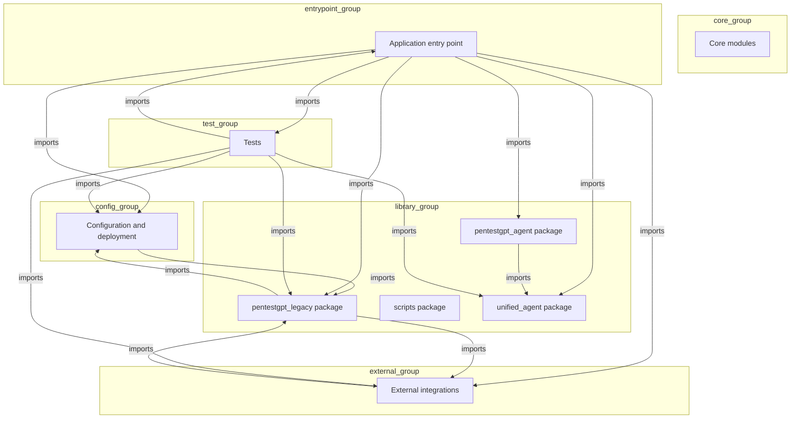

# Architecture report: GreyDGL/PentestGPT

> Automated static analysis. **Observed** = directly seen in files/imports/AST; **Inferred** = interpretation from that evidence. Repository code was not executed.

## 1. Repository at a glance

| Item | Value |
| --- | --- |
| Repository | GreyDGL/PentestGPT |
| Description | Automated Penetration Testing Agentic Framework Powered by Large Language Models |
| Language | Python |
| Stars | 16420 |
| Licence | MIT |
| Analysed commit / branch | e8b1bb77d1ac00329675cec3b060aba971ec1ac8 / main |
| Framework(s) | None detected |
| Files analysed | 152 |
| Components | 9 |

## 2. Architecture in one minute

GreyDGL/PentestGPT - Automated Penetration Testing Agentic Framework Powered by Large Language Models. This repository was analysed statically from 152 file(s) (82 Python). Detected technologies (observed from imports/manifests): GitHub Actions, SQLite, Pydantic, Poetry, setuptools, Docker. Files are grouped into 9 component(s): Configuration and deployment, Core modules, Application entry point, External integrations, pentestgpt_agent package, pentestgpt_legacy package, scripts package, Tests. Observed entry point(s): pentestgpt_agent/src/pentestgpt_agent/audit.py, pentestgpt_agent/src/pentestgpt_agent/trial.py, pentestgpt_legacy/main.py. Findings below distinguish observed facts from inferred interpretation.

## 3. High-level block diagram

## 4. Main components

### Configuration and deployment (`config`)

- **Kind:** config
- **Status:** Observed
- **Confidence:** 0.85
- **Responsibility:** Groups 8 file(s) under configuration and deployment (observed from repository paths and static analysis). Observed top-level classes: LLMSettings. Observed top-level functions: _first_available, configured_providers, default_parsing_model, default_reasoning_model, get_settings.
- **Paths:** `Dockerfile`, `docker-compose.yml`, `pentestgpt_agent/pyproject.toml`, `pentestgpt_legacy/config.py`, `pentestgpt_legacy/llm/config.py`, `pyproject.toml`, `scripts/ccr-config-template.json`, `skills-lock.json`
- **Evidence:** [Dockerfile](https://github.com/GreyDGL/PentestGPT/blob/e8b1bb77d1ac00329675cec3b060aba971ec1ac8/Dockerfile); [docker-compose.yml](https://github.com/GreyDGL/PentestGPT/blob/e8b1bb77d1ac00329675cec3b060aba971ec1ac8/docker-compose.yml); [pentestgpt_agent/pyproject.toml](https://github.com/GreyDGL/PentestGPT/blob/e8b1bb77d1ac00329675cec3b060aba971ec1ac8/pentestgpt_agent/pyproject.toml); [pentestgpt_legacy/config.py:31](https://github.com/GreyDGL/PentestGPT/blob/e8b1bb77d1ac00329675cec3b060aba971ec1ac8/pentestgpt_legacy/config.py#L31); [pentestgpt_legacy/llm/config.py:29](https://github.com/GreyDGL/PentestGPT/blob/e8b1bb77d1ac00329675cec3b060aba971ec1ac8/pentestgpt_legacy/llm/config.py#L29); [pyproject.toml](https://github.com/GreyDGL/PentestGPT/blob/e8b1bb77d1ac00329675cec3b060aba971ec1ac8/pyproject.toml); [scripts/ccr-config-template.json](https://github.com/GreyDGL/PentestGPT/blob/e8b1bb77d1ac00329675cec3b060aba971ec1ac8/scripts/ccr-config-template.json); [skills-lock.json](https://github.com/GreyDGL/PentestGPT/blob/e8b1bb77d1ac00329675cec3b060aba971ec1ac8/skills-lock.json)

### Core modules (`core`)

- **Kind:** core
- **Status:** Observed
- **Confidence:** 0.85
- **Responsibility:** Groups 2 file(s) under core modules (observed from repository paths and static analysis).
- **Paths:** `fix-workspace-permissions.sh`, `setup.sh`
- **Evidence:** [fix-workspace-permissions.sh](https://github.com/GreyDGL/PentestGPT/blob/e8b1bb77d1ac00329675cec3b060aba971ec1ac8/fix-workspace-permissions.sh); [setup.sh](https://github.com/GreyDGL/PentestGPT/blob/e8b1bb77d1ac00329675cec3b060aba971ec1ac8/setup.sh)

### Application entry point (`entrypoint`)

- **Kind:** entrypoint
- **Status:** Observed
- **Confidence:** 0.85
- **Responsibility:** Groups 8 file(s) under application entry point (observed from repository paths and static analysis). Observed top-level classes: TrialConfig, localTaskCompleter, mainTaskCompleter, pentestGPT. Observed top-level functions: _apply_base_url_override, _build_roles, _create_parser, _episode_records, _is_hidden_provider_memory_action, _load_trace_object.
- **Paths:** `pentestgpt_agent/src/pentestgpt_agent/audit.py`, `pentestgpt_agent/src/pentestgpt_agent/trial.py`, `pentestgpt_legacy/main.py`, `pentestgpt_legacy/utils/pentest_gpt.py`, `pentestgpt_legacy/utils/prompt_select.py`, `pentestgpt_legacy/utils/report_generator.py`, `pentestgpt_legacy/utils/task_handler.py`, `unified_agent/tool_server.py`
- **Evidence:** [pentestgpt_agent/src/pentestgpt_agent/audit.py:19](https://github.com/GreyDGL/PentestGPT/blob/e8b1bb77d1ac00329675cec3b060aba971ec1ac8/pentestgpt_agent/src/pentestgpt_agent/audit.py#L19); [pentestgpt_agent/src/pentestgpt_agent/trial.py:43](https://github.com/GreyDGL/PentestGPT/blob/e8b1bb77d1ac00329675cec3b060aba971ec1ac8/pentestgpt_agent/src/pentestgpt_agent/trial.py#L43); [pentestgpt_legacy/main.py:25](https://github.com/GreyDGL/PentestGPT/blob/e8b1bb77d1ac00329675cec3b060aba971ec1ac8/pentestgpt_legacy/main.py#L25); [pentestgpt_legacy/utils/pentest_gpt.py:44](https://github.com/GreyDGL/PentestGPT/blob/e8b1bb77d1ac00329675cec3b060aba971ec1ac8/pentestgpt_legacy/utils/pentest_gpt.py#L44); [pentestgpt_legacy/utils/prompt_select.py:11](https://github.com/GreyDGL/PentestGPT/blob/e8b1bb77d1ac00329675cec3b060aba971ec1ac8/pentestgpt_legacy/utils/prompt_select.py#L11); [pentestgpt_legacy/utils/report_generator.py:7](https://github.com/GreyDGL/PentestGPT/blob/e8b1bb77d1ac00329675cec3b060aba971ec1ac8/pentestgpt_legacy/utils/report_generator.py#L7); [pentestgpt_legacy/utils/task_handler.py:16](https://github.com/GreyDGL/PentestGPT/blob/e8b1bb77d1ac00329675cec3b060aba971ec1ac8/pentestgpt_legacy/utils/task_handler.py#L16); [unified_agent/tool_server.py:19](https://github.com/GreyDGL/PentestGPT/blob/e8b1bb77d1ac00329675cec3b060aba971ec1ac8/unified_agent/tool_server.py#L19)

### External integrations (`external_integrations`)

- **Kind:** external
- **Status:** Observed
- **Confidence:** 0.85
- **Responsibility:** Groups 1 file(s) under external integrations (observed from repository paths and static analysis). Observed top-level classes: LLMClient. Observed top-level functions: run_sync.
- **Paths:** `pentestgpt_legacy/llm/client.py`
- **Evidence:** [pentestgpt_legacy/llm/client.py:28](https://github.com/GreyDGL/PentestGPT/blob/e8b1bb77d1ac00329675cec3b060aba971ec1ac8/pentestgpt_legacy/llm/client.py#L28)

### pentestgpt_agent package (`pentestgpt_agent`)

- **Kind:** library
- **Status:** Observed
- **Confidence:** 0.85
- **Responsibility:** Groups 8 file(s) under pentestgpt_agent package (observed from repository paths and static analysis). Observed top-level classes: AgentContractError, AgentRole, AttemptCommit, AttemptRecord, AttemptStatus, EpisodeInput. Observed top-level functions: _canonical_url_target, _claude_safety_rejection_message, _event_record, _exact_receipt_slice, _exact_unique_line_envelope, _grounding_receipts.
- **Paths:** `pentestgpt_agent/src/pentestgpt_agent/__init__.py`, `pentestgpt_agent/src/pentestgpt_agent/agents.py`, `pentestgpt_agent/src/pentestgpt_agent/execution.py`, `pentestgpt_agent/src/pentestgpt_agent/identifiers.py`, `pentestgpt_agent/src/pentestgpt_agent/loop.py`, `pentestgpt_agent/src/pentestgpt_agent/memory.py`, `pentestgpt_agent/src/pentestgpt_agent/plan.py`, `pentestgpt_agent/src/pentestgpt_agent/trace.py`
- **Evidence:** [pentestgpt_agent/src/pentestgpt_agent/__init__.py](https://github.com/GreyDGL/PentestGPT/blob/e8b1bb77d1ac00329675cec3b060aba971ec1ac8/pentestgpt_agent/src/pentestgpt_agent/__init__.py); [pentestgpt_agent/src/pentestgpt_agent/agents.py:219](https://github.com/GreyDGL/PentestGPT/blob/e8b1bb77d1ac00329675cec3b060aba971ec1ac8/pentestgpt_agent/src/pentestgpt_agent/agents.py#L219); [pentestgpt_agent/src/pentestgpt_agent/execution.py:12](https://github.com/GreyDGL/PentestGPT/blob/e8b1bb77d1ac00329675cec3b060aba971ec1ac8/pentestgpt_agent/src/pentestgpt_agent/execution.py#L12); [pentestgpt_agent/src/pentestgpt_agent/identifiers.py:10](https://github.com/GreyDGL/PentestGPT/blob/e8b1bb77d1ac00329675cec3b060aba971ec1ac8/pentestgpt_agent/src/pentestgpt_agent/identifiers.py#L10); [pentestgpt_agent/src/pentestgpt_agent/loop.py:26](https://github.com/GreyDGL/PentestGPT/blob/e8b1bb77d1ac00329675cec3b060aba971ec1ac8/pentestgpt_agent/src/pentestgpt_agent/loop.py#L26); [pentestgpt_agent/src/pentestgpt_agent/memory.py:21](https://github.com/GreyDGL/PentestGPT/blob/e8b1bb77d1ac00329675cec3b060aba971ec1ac8/pentestgpt_agent/src/pentestgpt_agent/memory.py#L21); [pentestgpt_agent/src/pentestgpt_agent/plan.py:12](https://github.com/GreyDGL/PentestGPT/blob/e8b1bb77d1ac00329675cec3b060aba971ec1ac8/pentestgpt_agent/src/pentestgpt_agent/plan.py#L12); [pentestgpt_agent/src/pentestgpt_agent/trace.py:38](https://github.com/GreyDGL/PentestGPT/blob/e8b1bb77d1ac00329675cec3b060aba971ec1ac8/pentestgpt_agent/src/pentestgpt_agent/trace.py#L38)

### pentestgpt_legacy package (`pentestgpt_legacy`)

- **Kind:** library
- **Status:** Observed
- **Confidence:** 0.85
- **Responsibility:** Groups 13 file(s) under pentestgpt_legacy package (observed from repository paths and static analysis). Observed top-level classes: AnthropicProvider, BaseProvider, GeminiProvider, MissingCredentialsError, ModelSpec, OpenAICompatibleProvider. Observed top-level functions: _build_provider, all_model_ids, get_client, list_models, models_by_provider, resolve.
- **Paths:** `pentestgpt_legacy/__init__.py`, `pentestgpt_legacy/_version.py`, `pentestgpt_legacy/llm/__init__.py`, `pentestgpt_legacy/llm/base.py`, `pentestgpt_legacy/llm/factory.py`, `pentestgpt_legacy/llm/providers/__init__.py`, `pentestgpt_legacy/llm/providers/anthropic_provider.py`, `pentestgpt_legacy/llm/providers/gemini_provider.py`, `pentestgpt_legacy/llm/providers/openai_compatible.py`, `pentestgpt_legacy/llm/registry.py`, `pentestgpt_legacy/prompts/__init__.py`, `pentestgpt_legacy/prompts/prompt_class.py`, `pentestgpt_legacy/utils/__init__.py`
- **Evidence:** [pentestgpt_legacy/__init__.py](https://github.com/GreyDGL/PentestGPT/blob/e8b1bb77d1ac00329675cec3b060aba971ec1ac8/pentestgpt_legacy/__init__.py); [pentestgpt_legacy/_version.py](https://github.com/GreyDGL/PentestGPT/blob/e8b1bb77d1ac00329675cec3b060aba971ec1ac8/pentestgpt_legacy/_version.py); [pentestgpt_legacy/llm/__init__.py](https://github.com/GreyDGL/PentestGPT/blob/e8b1bb77d1ac00329675cec3b060aba971ec1ac8/pentestgpt_legacy/llm/__init__.py); [pentestgpt_legacy/llm/base.py:19](https://github.com/GreyDGL/PentestGPT/blob/e8b1bb77d1ac00329675cec3b060aba971ec1ac8/pentestgpt_legacy/llm/base.py#L19); [pentestgpt_legacy/llm/factory.py:29](https://github.com/GreyDGL/PentestGPT/blob/e8b1bb77d1ac00329675cec3b060aba971ec1ac8/pentestgpt_legacy/llm/factory.py#L29); [pentestgpt_legacy/llm/providers/__init__.py](https://github.com/GreyDGL/PentestGPT/blob/e8b1bb77d1ac00329675cec3b060aba971ec1ac8/pentestgpt_legacy/llm/providers/__init__.py); [pentestgpt_legacy/llm/providers/anthropic_provider.py:19](https://github.com/GreyDGL/PentestGPT/blob/e8b1bb77d1ac00329675cec3b060aba971ec1ac8/pentestgpt_legacy/llm/providers/anthropic_provider.py#L19); [pentestgpt_legacy/llm/providers/gemini_provider.py:17](https://github.com/GreyDGL/PentestGPT/blob/e8b1bb77d1ac00329675cec3b060aba971ec1ac8/pentestgpt_legacy/llm/providers/gemini_provider.py#L17)

### scripts package (`scripts`)

- **Kind:** library
- **Status:** Observed
- **Confidence:** 0.85
- **Responsibility:** Groups 4 file(s) under scripts package (observed from repository paths and static analysis).
- **Paths:** `scripts/config.sh`, `scripts/docker-auth-status.sh`, `scripts/docker-login.sh`, `scripts/entrypoint.sh`
- **Evidence:** [scripts/config.sh](https://github.com/GreyDGL/PentestGPT/blob/e8b1bb77d1ac00329675cec3b060aba971ec1ac8/scripts/config.sh); [scripts/docker-auth-status.sh](https://github.com/GreyDGL/PentestGPT/blob/e8b1bb77d1ac00329675cec3b060aba971ec1ac8/scripts/docker-auth-status.sh); [scripts/docker-login.sh](https://github.com/GreyDGL/PentestGPT/blob/e8b1bb77d1ac00329675cec3b060aba971ec1ac8/scripts/docker-login.sh); [scripts/entrypoint.sh](https://github.com/GreyDGL/PentestGPT/blob/e8b1bb77d1ac00329675cec3b060aba971ec1ac8/scripts/entrypoint.sh)

### Tests (`tests`)

- **Kind:** test
- **Status:** Observed
- **Confidence:** 0.85
- **Responsibility:** Groups 39 file(s) under tests (observed from repository paths and static analysis). Observed top-level classes: ActionThenMalformedResultBackend, ActionThenMaxTurnsBackend, ActionThenUnsupportedEvidenceBackend, AlwaysCrashBackend, AlwaysInvalidSupervisorBackend, BenchmarkExecutorBackend. Observed top-level functions: _active_snapshot, _complete_task, _flagship_per_provider, _handler, _latest_observation_basis, _probe.
- **Paths:** `pentestgpt_agent/tests/__init__.py`, `pentestgpt_agent/tests/live/__init__.py`, `pentestgpt_agent/tests/live/test_local_model.py`, `pentestgpt_agent/tests/support/__init__.py`, `pentestgpt_agent/tests/support/local_target.py`, `pentestgpt_agent/tests/test_dependency.py`, `pentestgpt_agent/tests/test_episode.py`, `pentestgpt_agent/tests/test_execution.py`, `pentestgpt_agent/tests/test_executor.py`, `pentestgpt_agent/tests/test_local_benchmark.py`, `pentestgpt_agent/tests/test_local_target.py`, `pentestgpt_agent/tests/test_loop.py`, `pentestgpt_agent/tests/test_memory.py`, `pentestgpt_agent/tests/test_plan.py`, `pentestgpt_agent/tests/test_supervisor.py`, `pentestgpt_agent/tests/test_trial.py`, `pentestgpt_legacy/smoke_test.py`, `pentestgpt_legacy/test_connection.py`, `tests/__init__.py`, `tests/conftest.py`, `tests/docker/__init__.py`, `tests/docker/test_container_health.py`, `tests/docker/test_docker_build.py`, `tests/fixture_registry.py`, `tests/integration/__init__.py`, `tests/legacy/__init__.py`, `tests/legacy/test_client.py`, `tests/legacy/test_config.py`, `tests/legacy/test_factory.py`, `tests/legacy/test_registry.py`, `tests/test_agent.py`, `tests/test_claude_backend.py`, `tests/test_codex_backend.py`, `tests/test_skills.py`, `tests/test_task.py`, `tests/test_tool_server.py`, `tests/test_tools.py`, `tests/unit/__init__.py`, `tests/unit/test_flag_detection.py`
- **Evidence:** [pentestgpt_agent/tests/__init__.py](https://github.com/GreyDGL/PentestGPT/blob/e8b1bb77d1ac00329675cec3b060aba971ec1ac8/pentestgpt_agent/tests/__init__.py); [pentestgpt_agent/tests/live/__init__.py](https://github.com/GreyDGL/PentestGPT/blob/e8b1bb77d1ac00329675cec3b060aba971ec1ac8/pentestgpt_agent/tests/live/__init__.py); [pentestgpt_agent/tests/live/test_local_model.py:30](https://github.com/GreyDGL/PentestGPT/blob/e8b1bb77d1ac00329675cec3b060aba971ec1ac8/pentestgpt_agent/tests/live/test_local_model.py#L30); [pentestgpt_agent/tests/support/__init__.py](https://github.com/GreyDGL/PentestGPT/blob/e8b1bb77d1ac00329675cec3b060aba971ec1ac8/pentestgpt_agent/tests/support/__init__.py); [pentestgpt_agent/tests/support/local_target.py:14](https://github.com/GreyDGL/PentestGPT/blob/e8b1bb77d1ac00329675cec3b060aba971ec1ac8/pentestgpt_agent/tests/support/local_target.py#L14); [pentestgpt_agent/tests/test_dependency.py:8](https://github.com/GreyDGL/PentestGPT/blob/e8b1bb77d1ac00329675cec3b060aba971ec1ac8/pentestgpt_agent/tests/test_dependency.py#L8); [pentestgpt_agent/tests/test_episode.py:40](https://github.com/GreyDGL/PentestGPT/blob/e8b1bb77d1ac00329675cec3b060aba971ec1ac8/pentestgpt_agent/tests/test_episode.py#L40); [pentestgpt_agent/tests/test_execution.py:18](https://github.com/GreyDGL/PentestGPT/blob/e8b1bb77d1ac00329675cec3b060aba971ec1ac8/pentestgpt_agent/tests/test_execution.py#L18)

### unified_agent package (`unified_agent`)

- **Kind:** library
- **Status:** Observed
- **Confidence:** 0.85
- **Responsibility:** Groups 11 file(s) under unified_agent package (observed from repository paths and static analysis). Observed top-level classes: AgentAuthError, AgentBackend, AgentRunError, AssistantText, BackendUnavailableError, ClaudeCodeBackend. Observed top-level functions: _install_one, _looks_like_auth_error, _make_backend, _module_root_dir, _normalize_item, _parse_frontmatter.
- **Paths:** `unified_agent/__init__.py`, `unified_agent/agent.py`, `unified_agent/backends/__init__.py`, `unified_agent/backends/base.py`, `unified_agent/backends/claude_code.py`, `unified_agent/backends/codex.py`, `unified_agent/events.py`, `unified_agent/skills.py`, `unified_agent/task.py`, `unified_agent/tools.py`, `unified_agent/types.py`
- **Evidence:** [unified_agent/__init__.py](https://github.com/GreyDGL/PentestGPT/blob/e8b1bb77d1ac00329675cec3b060aba971ec1ac8/unified_agent/__init__.py); [unified_agent/agent.py:37](https://github.com/GreyDGL/PentestGPT/blob/e8b1bb77d1ac00329675cec3b060aba971ec1ac8/unified_agent/agent.py#L37); [unified_agent/backends/__init__.py](https://github.com/GreyDGL/PentestGPT/blob/e8b1bb77d1ac00329675cec3b060aba971ec1ac8/unified_agent/backends/__init__.py); [unified_agent/backends/base.py:13](https://github.com/GreyDGL/PentestGPT/blob/e8b1bb77d1ac00329675cec3b060aba971ec1ac8/unified_agent/backends/base.py#L13); [unified_agent/backends/claude_code.py:59](https://github.com/GreyDGL/PentestGPT/blob/e8b1bb77d1ac00329675cec3b060aba971ec1ac8/unified_agent/backends/claude_code.py#L59); [unified_agent/backends/codex.py:52](https://github.com/GreyDGL/PentestGPT/blob/e8b1bb77d1ac00329675cec3b060aba971ec1ac8/unified_agent/backends/codex.py#L52); [unified_agent/events.py:12](https://github.com/GreyDGL/PentestGPT/blob/e8b1bb77d1ac00329675cec3b060aba971ec1ac8/unified_agent/events.py#L12); [unified_agent/skills.py:41](https://github.com/GreyDGL/PentestGPT/blob/e8b1bb77d1ac00329675cec3b060aba971ec1ac8/unified_agent/skills.py#L41)

## 5. Execution flow

**Observed** entry point(s):

- [pentestgpt_agent/src/pentestgpt_agent/audit.py:443](https://github.com/GreyDGL/PentestGPT/blob/e8b1bb77d1ac00329675cec3b060aba971ec1ac8/pentestgpt_agent/src/pentestgpt_agent/audit.py#L443)
- [pentestgpt_agent/src/pentestgpt_agent/trial.py:362](https://github.com/GreyDGL/PentestGPT/blob/e8b1bb77d1ac00329675cec3b060aba971ec1ac8/pentestgpt_agent/src/pentestgpt_agent/trial.py#L362)
- [pentestgpt_legacy/main.py](https://github.com/GreyDGL/PentestGPT/blob/e8b1bb77d1ac00329675cec3b060aba971ec1ac8/pentestgpt_legacy/main.py)
- [pentestgpt_legacy/smoke_test.py:107](https://github.com/GreyDGL/PentestGPT/blob/e8b1bb77d1ac00329675cec3b060aba971ec1ac8/pentestgpt_legacy/smoke_test.py#L107)
- [pentestgpt_legacy/utils/pentest_gpt.py:443](https://github.com/GreyDGL/PentestGPT/blob/e8b1bb77d1ac00329675cec3b060aba971ec1ac8/pentestgpt_legacy/utils/pentest_gpt.py#L443)
- [pentestgpt_legacy/utils/prompt_select.py:81](https://github.com/GreyDGL/PentestGPT/blob/e8b1bb77d1ac00329675cec3b060aba971ec1ac8/pentestgpt_legacy/utils/prompt_select.py#L81)
- [pentestgpt_legacy/utils/report_generator.py:34](https://github.com/GreyDGL/PentestGPT/blob/e8b1bb77d1ac00329675cec3b060aba971ec1ac8/pentestgpt_legacy/utils/report_generator.py#L34)
- [pentestgpt_legacy/utils/task_handler.py:124](https://github.com/GreyDGL/PentestGPT/blob/e8b1bb77d1ac00329675cec3b060aba971ec1ac8/pentestgpt_legacy/utils/task_handler.py#L124)
- [unified_agent/tool_server.py:44](https://github.com/GreyDGL/PentestGPT/blob/e8b1bb77d1ac00329675cec3b060aba971ec1ac8/unified_agent/tool_server.py#L44)

Representative flow (derived from observed entry points and the import graph; steps beyond the entry point are **Inferred**):

1. Execution starts at an observed entry point listed above, if present.
2. `config` imports `pentestgpt_legacy` (Configuration and deployment -> pentestgpt_legacy package).
3. `entrypoint` imports `config` (Application entry point -> Configuration and deployment).
4. `entrypoint` imports `external_integrations` (Application entry point -> External integrations).
5. `entrypoint` imports `pentestgpt_agent` (Application entry point -> pentestgpt_agent package).
6. `entrypoint` imports `pentestgpt_legacy` (Application entry point -> pentestgpt_legacy package).
7. `entrypoint` imports `tests` (Application entry point -> Tests).
8. `entrypoint` imports `unified_agent` (Application entry point -> unified_agent package).
9. `external_integrations` imports `pentestgpt_legacy` (External integrations -> pentestgpt_legacy package).

## 6. Project structure

### `(root)`

- `.dockerignore` - container (476 bytes)
- `.env.example` - config (1348 bytes)
- `.gitignore` - other (3150 bytes)
- `AGENT.md` - docs (3478 bytes)
- `CLAUDE.md` - docs (3477 bytes)
- `Dockerfile` - container (4619 bytes)
- `LICENSE.md` - docs (1063 bytes)
- `Makefile` - other (7577 bytes)
- `PENTESTGPT_AGENT_NEW_MIGRATION_REPORT.md` - docs (3119 bytes)
- `PENTESTGPT_AGENT_NEW_PRODUCTION_HARDENING_REPORT.md` - docs (4100 bytes)
- `README.md` - docs (12085 bytes)
- `docker-compose.yml` - container (1976 bytes)
- `fix-workspace-permissions.sh` - source, Shell (1204 bytes)
- `pyproject.toml` - manifest (4132 bytes)
- `setup.sh` - source, Shell (7106 bytes)
- `skills-lock.json` - config (4254 bytes)

### `.agents`

- `.agents/skills/ask-matt/SKILL.md` - docs (4388 bytes)
- `.agents/skills/codebase-design/DEEPENING.md` - docs (2559 bytes)
- `.agents/skills/codebase-design/DESIGN-IT-TWICE.md` - docs (2712 bytes)
- `.agents/skills/codebase-design/SKILL.md` - docs (6488 bytes)
- `.agents/skills/diagnosing-bugs/SKILL.md` - docs (8536 bytes)
- `.agents/skills/diagnosing-bugs/scripts/hitl-loop.template.sh` - source, Shell (1164 bytes)
- `.agents/skills/domain-modeling/ADR-FORMAT.md` - docs (2766 bytes)
- `.agents/skills/domain-modeling/CONTEXT-FORMAT.md` - docs (2299 bytes)
- `.agents/skills/domain-modeling/SKILL.md` - docs (3427 bytes)
- `.agents/skills/grill-me/SKILL.md` - docs (147 bytes)
- `.agents/skills/grill-with-docs/SKILL.md` - docs (245 bytes)
- `.agents/skills/grilling/SKILL.md` - docs (666 bytes)
- `.agents/skills/handoff/SKILL.md` - docs (878 bytes)
- `.agents/skills/improve-codebase-architecture/HTML-REPORT.md` - docs (6685 bytes)
- `.agents/skills/improve-codebase-architecture/SKILL.md` - docs (5421 bytes)
- `.agents/skills/prototype/LOGIC.md` - docs (5594 bytes)
- `.agents/skills/prototype/SKILL.md` - docs (3039 bytes)
- `.agents/skills/prototype/UI.md` - docs (6789 bytes)
- `.agents/skills/setup-matt-pocock-skills/SKILL.md` - docs (7307 bytes)
- `.agents/skills/setup-matt-pocock-skills/domain.md` - docs (2045 bytes)
- `.agents/skills/setup-matt-pocock-skills/issue-tracker-github.md` - docs (1950 bytes)
- `.agents/skills/setup-matt-pocock-skills/issue-tracker-gitlab.md` - docs (2264 bytes)
- `.agents/skills/setup-matt-pocock-skills/issue-tracker-local.md` - docs (838 bytes)
- `.agents/skills/setup-matt-pocock-skills/triage-labels.md` - docs (1045 bytes)
- `.agents/skills/tdd/SKILL.md` - docs (4345 bytes)
- `.agents/skills/tdd/mocking.md` - docs (1481 bytes)
- `.agents/skills/tdd/refactoring.md` - docs (387 bytes)
- `.agents/skills/tdd/tests.md` - docs (1640 bytes)
- `.agents/skills/teach/GLOSSARY-FORMAT.md` - docs (2131 bytes)
- `.agents/skills/teach/LEARNING-RECORD-FORMAT.md` - docs (2777 bytes)
- `.agents/skills/teach/MISSION-FORMAT.md` - docs (1553 bytes)
- `.agents/skills/teach/RESOURCES-FORMAT.md` - docs (1926 bytes)
- `.agents/skills/teach/SKILL.md` - docs (9507 bytes)
- `.agents/skills/to-issues/SKILL.md` - docs (3319 bytes)
- `.agents/skills/to-prd/SKILL.md` - docs (3027 bytes)
- `.agents/skills/triage/AGENT-BRIEF.md` - docs (7972 bytes)
- `.agents/skills/triage/OUT-OF-SCOPE.md` - docs (4712 bytes)
- `.agents/skills/triage/SKILL.md` - docs (6574 bytes)
- `.agents/skills/writing-great-skills/GLOSSARY.md` - docs (17569 bytes)
- `.agents/skills/writing-great-skills/SKILL.md` - docs (9063 bytes)

### `.github`

- `.github/workflows/ci.yml` - ci, YAML (1387 bytes)

### `docs`

- `docs/architecture.md` - docs (6321 bytes)
- `docs/docker-dev-plan.md` - docs (4737 bytes)
- `docs/redesign/pentestgpt-redesign-decisions.html` - docs (1550 bytes)

### `pentestgpt_agent`

- `pentestgpt_agent/.gitignore` - other (111 bytes)
- `pentestgpt_agent/CONTEXT.md` - docs (5338 bytes)
- `pentestgpt_agent/HTB_ENIGMA_QUALIFICATION_20260712.md` - docs (7890 bytes)
- `pentestgpt_agent/README.md` - docs (8699 bytes)
- `pentestgpt_agent/pyproject.toml` - manifest (1460 bytes)
- `pentestgpt_agent/src/pentestgpt_agent/__init__.py` - source, Python (58 bytes)
- `pentestgpt_agent/src/pentestgpt_agent/agents.py` - source, Python (28146 bytes)
- `pentestgpt_agent/src/pentestgpt_agent/audit.py` - source, Python (18447 bytes)
- `pentestgpt_agent/src/pentestgpt_agent/execution.py` - source, Python (15079 bytes)
- `pentestgpt_agent/src/pentestgpt_agent/identifiers.py` - source, Python (494 bytes)
- `pentestgpt_agent/src/pentestgpt_agent/loop.py` - source, Python (12842 bytes)
- `pentestgpt_agent/src/pentestgpt_agent/memory.py` - source, Python (37237 bytes)
- `pentestgpt_agent/src/pentestgpt_agent/plan.py` - source, Python (12928 bytes)
- `pentestgpt_agent/src/pentestgpt_agent/trace.py` - source, Python (15941 bytes)
- `pentestgpt_agent/src/pentestgpt_agent/trial.py` - source, Python (13053 bytes)
- `pentestgpt_agent/tests/__init__.py` - test, Python (38 bytes)
- `pentestgpt_agent/tests/live/__init__.py` - test, Python (25 bytes)
- `pentestgpt_agent/tests/live/test_local_model.py` - test, Python (2454 bytes)
- `pentestgpt_agent/tests/support/__init__.py` - test, Python (38 bytes)
- `pentestgpt_agent/tests/support/local_target.py` - test, Python (3049 bytes)
- `pentestgpt_agent/tests/test_dependency.py` - test, Python (949 bytes)
- `pentestgpt_agent/tests/test_episode.py` - test, Python (15336 bytes)
- `pentestgpt_agent/tests/test_execution.py` - test, Python (30685 bytes)
- `pentestgpt_agent/tests/test_executor.py` - test, Python (7136 bytes)
- `pentestgpt_agent/tests/test_local_benchmark.py` - test, Python (8634 bytes)
- `pentestgpt_agent/tests/test_local_target.py` - test, Python (1131 bytes)
- `pentestgpt_agent/tests/test_loop.py` - test, Python (58207 bytes)
- `pentestgpt_agent/tests/test_memory.py` - test, Python (11618 bytes)
- `pentestgpt_agent/tests/test_plan.py` - test, Python (24285 bytes)
- `pentestgpt_agent/tests/test_supervisor.py` - test, Python (12287 bytes)
- `pentestgpt_agent/tests/test_trial.py` - test, Python (21812 bytes)

### `pentestgpt_legacy`

- `pentestgpt_legacy/__init__.py` - source, Python (390 bytes)
- `pentestgpt_legacy/_version.py` - source, Python (75 bytes)
- `pentestgpt_legacy/config.py` - source, Python (1397 bytes)
- `pentestgpt_legacy/llm/__init__.py` - source, Python (762 bytes)
- `pentestgpt_legacy/llm/base.py` - source, Python (1497 bytes)
- `pentestgpt_legacy/llm/client.py` - source, Python (4292 bytes)
- `pentestgpt_legacy/llm/config.py` - source, Python (3390 bytes)
- `pentestgpt_legacy/llm/factory.py` - source, Python (2451 bytes)
- `pentestgpt_legacy/llm/providers/__init__.py` - source, Python (361 bytes)
- `pentestgpt_legacy/llm/providers/anthropic_provider.py` - source, Python (1785 bytes)
- `pentestgpt_legacy/llm/providers/gemini_provider.py` - source, Python (2478 bytes)
- `pentestgpt_legacy/llm/providers/openai_compatible.py` - source, Python (3459 bytes)
- `pentestgpt_legacy/llm/registry.py` - source, Python (10600 bytes)
- `pentestgpt_legacy/main.py` - source, Python (5704 bytes)
- `pentestgpt_legacy/prompts/__init__.py` - source, Python (0 bytes)
- `pentestgpt_legacy/prompts/prompt_class.py` - source, Python (8070 bytes)
- `pentestgpt_legacy/smoke_test.py` - test, Python (3586 bytes)
- `pentestgpt_legacy/test_connection.py` - test, Python (1610 bytes)
- `pentestgpt_legacy/utils/__init__.py` - source, Python (0 bytes)
- `pentestgpt_legacy/utils/pentest_gpt.py` - source, Python (20542 bytes)
- `pentestgpt_legacy/utils/prompt_select.py` - source, Python (3286 bytes)
- `pentestgpt_legacy/utils/report_generator.py` - source, Python (1303 bytes)
- `pentestgpt_legacy/utils/task_handler.py` - source, Python (4362 bytes)

### `scripts`

- `scripts/ccr-config-template.json` - config (996 bytes)
- `scripts/config.sh` - source, Shell (4432 bytes)
- `scripts/docker-auth-status.sh` - source, Shell (1732 bytes)
- `scripts/docker-login.sh` - source, Shell (4232 bytes)
- `scripts/entrypoint.sh` - source, Shell (5328 bytes)

### `tests`

- `tests/__init__.py` - test, Python (35 bytes)
- `tests/conftest.py` - test, Python (701 bytes)
- `tests/docker/__init__.py` - test, Python (35 bytes)
- `tests/docker/test_container_health.py` - test, Python (6784 bytes)
- `tests/docker/test_docker_build.py` - test, Python (3675 bytes)
- `tests/fixture_registry.py` - test, Python (434 bytes)
- `tests/integration/__init__.py` - test, Python (40 bytes)
- `tests/legacy/__init__.py` - test, Python (0 bytes)
- `tests/legacy/test_client.py` - test, Python (2704 bytes)
- `tests/legacy/test_config.py` - test, Python (1758 bytes)
- `tests/legacy/test_factory.py` - test, Python (2367 bytes)
- `tests/legacy/test_registry.py` - test, Python (1654 bytes)
- `tests/test_agent.py` - test, Python (6249 bytes)
- `tests/test_claude_backend.py` - test, Python (7351 bytes)
- `tests/test_codex_backend.py` - test, Python (8780 bytes)
- `tests/test_skills.py` - test, Python (4903 bytes)
- `tests/test_task.py` - test, Python (1788 bytes)
- `tests/test_tool_server.py` - test, Python (1929 bytes)
- `tests/test_tools.py` - test, Python (3266 bytes)
- `tests/unit/__init__.py` - test, Python (33 bytes)
- `tests/unit/test_flag_detection.py` - test, Python (6162 bytes)

### `unified_agent`

- `unified_agent/__init__.py` - source, Python (1732 bytes)
- `unified_agent/agent.py` - source, Python (8741 bytes)
- `unified_agent/backends/__init__.py` - source, Python (0 bytes)
- `unified_agent/backends/base.py` - source, Python (581 bytes)
- `unified_agent/backends/claude_code.py` - source, Python (8585 bytes)
- `unified_agent/backends/codex.py` - source, Python (11040 bytes)
- `unified_agent/events.py` - source, Python (1797 bytes)
- `unified_agent/skills.py` - source, Python (5866 bytes)
- `unified_agent/task.py` - source, Python (1813 bytes)
- `unified_agent/tool_server.py` - source, Python (1245 bytes)
- `unified_agent/tools.py` - source, Python (6883 bytes)
- `unified_agent/types.py` - source, Python (3573 bytes)

## 7. Key dependencies and integrations

| Name | Category | Status | Confidence | Evidence |
| --- | --- | --- | --- | --- |
| GitHub Actions | ci | Observed | 0.85 | [.github/workflows/ci.yml](https://github.com/GreyDGL/PentestGPT/blob/e8b1bb77d1ac00329675cec3b060aba971ec1ac8/.github/workflows/ci.yml) |
| SQLite | database | Observed | 0.95 | [pentestgpt_agent/src/pentestgpt_agent/audit.py:8](https://github.com/GreyDGL/PentestGPT/blob/e8b1bb77d1ac00329675cec3b060aba971ec1ac8/pentestgpt_agent/src/pentestgpt_agent/audit.py#L8); [pentestgpt_agent/src/pentestgpt_agent/memory.py:6](https://github.com/GreyDGL/PentestGPT/blob/e8b1bb77d1ac00329675cec3b060aba971ec1ac8/pentestgpt_agent/src/pentestgpt_agent/memory.py#L6); [pentestgpt_agent/tests/test_trial.py:2](https://github.com/GreyDGL/PentestGPT/blob/e8b1bb77d1ac00329675cec3b060aba971ec1ac8/pentestgpt_agent/tests/test_trial.py#L2) |
| Pydantic | library | Observed | 0.90 | [pentestgpt_legacy/llm/config.py:11](https://github.com/GreyDGL/PentestGPT/blob/e8b1bb77d1ac00329675cec3b060aba971ec1ac8/pentestgpt_legacy/llm/config.py#L11); [pyproject.toml:29](https://github.com/GreyDGL/PentestGPT/blob/e8b1bb77d1ac00329675cec3b060aba971ec1ac8/pyproject.toml#L29) |
| Poetry | packaging | Observed | 0.90 | [pentestgpt_agent/pyproject.toml](https://github.com/GreyDGL/PentestGPT/blob/e8b1bb77d1ac00329675cec3b060aba971ec1ac8/pentestgpt_agent/pyproject.toml); [pyproject.toml](https://github.com/GreyDGL/PentestGPT/blob/e8b1bb77d1ac00329675cec3b060aba971ec1ac8/pyproject.toml) |
| setuptools | packaging | Observed | 0.85 | [pentestgpt_agent/pyproject.toml:2](https://github.com/GreyDGL/PentestGPT/blob/e8b1bb77d1ac00329675cec3b060aba971ec1ac8/pentestgpt_agent/pyproject.toml#L2) |
| Docker | tooling | Observed | 0.90 | [.github/workflows/ci.yml:34](https://github.com/GreyDGL/PentestGPT/blob/e8b1bb77d1ac00329675cec3b060aba971ec1ac8/.github/workflows/ci.yml#L34); [Dockerfile](https://github.com/GreyDGL/PentestGPT/blob/e8b1bb77d1ac00329675cec3b060aba971ec1ac8/Dockerfile) |
| Docker Compose | tooling | Observed | 0.85 | [docker-compose.yml](https://github.com/GreyDGL/PentestGPT/blob/e8b1bb77d1ac00329675cec3b060aba971ec1ac8/docker-compose.yml) |
| pytest | tooling | Observed | 0.95 | [.github/workflows/ci.yml:34](https://github.com/GreyDGL/PentestGPT/blob/e8b1bb77d1ac00329675cec3b060aba971ec1ac8/.github/workflows/ci.yml#L34); [pentestgpt_agent/tests/live/test_local_model.py:6](https://github.com/GreyDGL/PentestGPT/blob/e8b1bb77d1ac00329675cec3b060aba971ec1ac8/pentestgpt_agent/tests/live/test_local_model.py#L6); [pentestgpt_agent/tests/test_episode.py:6](https://github.com/GreyDGL/PentestGPT/blob/e8b1bb77d1ac00329675cec3b060aba971ec1ac8/pentestgpt_agent/tests/test_episode.py#L6); [pentestgpt_agent/tests/test_execution.py:1](https://github.com/GreyDGL/PentestGPT/blob/e8b1bb77d1ac00329675cec3b060aba971ec1ac8/pentestgpt_agent/tests/test_execution.py#L1) |

## 8. Data and state

- **SQLite** (Observed, confidence 0.95) - evidence: [pentestgpt_agent/src/pentestgpt_agent/audit.py:8](https://github.com/GreyDGL/PentestGPT/blob/e8b1bb77d1ac00329675cec3b060aba971ec1ac8/pentestgpt_agent/src/pentestgpt_agent/audit.py#L8); [pentestgpt_agent/src/pentestgpt_agent/memory.py:6](https://github.com/GreyDGL/PentestGPT/blob/e8b1bb77d1ac00329675cec3b060aba971ec1ac8/pentestgpt_agent/src/pentestgpt_agent/memory.py#L6); [pentestgpt_agent/tests/test_trial.py:2](https://github.com/GreyDGL/PentestGPT/blob/e8b1bb77d1ac00329675cec3b060aba971ec1ac8/pentestgpt_agent/tests/test_trial.py#L2)

## 9. Configuration and deployment clues

- `.dockerignore` (container)
- `.env.example` (config)
- `.github/workflows/ci.yml` (ci)
- `Dockerfile` (container)
- `docker-compose.yml` (container)
- `pentestgpt_agent/pyproject.toml` (manifest)
- `pyproject.toml` (manifest)
- `scripts/ccr-config-template.json` (config)
- `skills-lock.json` (config)

Environment variable *names* seen in example env files (values never recorded):

- `.env.example`: `ANTHROPIC_API_KEY`, `DEEPSEEK_API_KEY`, `GEMINI_API_KEY`, `GROK_API_KEY`, `KIMI_API_KEY`, `OPENAI_API_KEY`, `QWEN_API_KEY`

Console scripts declared in packaging metadata (**Observed**):

- `pentestgpt-agent` -> `pentestgpt_agent.trial:main`
- `pentestgpt-agent-audit` -> `pentestgpt_agent.audit:main`
- `pentestgpt-legacy` -> `pentestgpt_legacy.main:main`
- `pentestgpt-legacy-connection` -> `pentestgpt_legacy.test_connection:test_connection`

## 10. Design observations

- An entry/API layer is separated from other code (Inferred from paths and decorators).
- Tests are present alongside source code (Observed from test file paths).
- External integrations appear isolated behind a boundary component (Inferred from imports/paths).

These observations are interpretations (**Inferred**) of the observed structure, not guarantees about runtime design.

## 11. Limitations and unknowns

- Static analysis only: repository code was not executed, installed, or imported at runtime.
- Components and relationships are inferred from file paths, imports, and AST structure; runtime behaviour, dynamic imports, and reflection may not be visible.
- 1 file(s) were skipped during inventory (1 x lockfile excluded).
- Repository text was treated as untrusted data; no instructions found in repository files were followed, and likely secret values were redacted/excluded.

## 12. Source references

- [.github/workflows/ci.yml](https://github.com/GreyDGL/PentestGPT/blob/e8b1bb77d1ac00329675cec3b060aba971ec1ac8/.github/workflows/ci.yml)
- [.github/workflows/ci.yml:34](https://github.com/GreyDGL/PentestGPT/blob/e8b1bb77d1ac00329675cec3b060aba971ec1ac8/.github/workflows/ci.yml#L34)
- [Dockerfile](https://github.com/GreyDGL/PentestGPT/blob/e8b1bb77d1ac00329675cec3b060aba971ec1ac8/Dockerfile)
- [docker-compose.yml](https://github.com/GreyDGL/PentestGPT/blob/e8b1bb77d1ac00329675cec3b060aba971ec1ac8/docker-compose.yml)
- [fix-workspace-permissions.sh](https://github.com/GreyDGL/PentestGPT/blob/e8b1bb77d1ac00329675cec3b060aba971ec1ac8/fix-workspace-permissions.sh)
- [pentestgpt_agent/pyproject.toml](https://github.com/GreyDGL/PentestGPT/blob/e8b1bb77d1ac00329675cec3b060aba971ec1ac8/pentestgpt_agent/pyproject.toml)
- [pentestgpt_agent/pyproject.toml:2](https://github.com/GreyDGL/PentestGPT/blob/e8b1bb77d1ac00329675cec3b060aba971ec1ac8/pentestgpt_agent/pyproject.toml#L2)
- [pentestgpt_agent/src/pentestgpt_agent/__init__.py](https://github.com/GreyDGL/PentestGPT/blob/e8b1bb77d1ac00329675cec3b060aba971ec1ac8/pentestgpt_agent/src/pentestgpt_agent/__init__.py)
- [pentestgpt_agent/src/pentestgpt_agent/agents.py:219](https://github.com/GreyDGL/PentestGPT/blob/e8b1bb77d1ac00329675cec3b060aba971ec1ac8/pentestgpt_agent/src/pentestgpt_agent/agents.py#L219)
- [pentestgpt_agent/src/pentestgpt_agent/audit.py:8](https://github.com/GreyDGL/PentestGPT/blob/e8b1bb77d1ac00329675cec3b060aba971ec1ac8/pentestgpt_agent/src/pentestgpt_agent/audit.py#L8)
- [pentestgpt_agent/src/pentestgpt_agent/audit.py:19](https://github.com/GreyDGL/PentestGPT/blob/e8b1bb77d1ac00329675cec3b060aba971ec1ac8/pentestgpt_agent/src/pentestgpt_agent/audit.py#L19)
- [pentestgpt_agent/src/pentestgpt_agent/audit.py:443](https://github.com/GreyDGL/PentestGPT/blob/e8b1bb77d1ac00329675cec3b060aba971ec1ac8/pentestgpt_agent/src/pentestgpt_agent/audit.py#L443)
- [pentestgpt_agent/src/pentestgpt_agent/execution.py:12](https://github.com/GreyDGL/PentestGPT/blob/e8b1bb77d1ac00329675cec3b060aba971ec1ac8/pentestgpt_agent/src/pentestgpt_agent/execution.py#L12)
- [pentestgpt_agent/src/pentestgpt_agent/identifiers.py:10](https://github.com/GreyDGL/PentestGPT/blob/e8b1bb77d1ac00329675cec3b060aba971ec1ac8/pentestgpt_agent/src/pentestgpt_agent/identifiers.py#L10)
- [pentestgpt_agent/src/pentestgpt_agent/loop.py:26](https://github.com/GreyDGL/PentestGPT/blob/e8b1bb77d1ac00329675cec3b060aba971ec1ac8/pentestgpt_agent/src/pentestgpt_agent/loop.py#L26)
- [pentestgpt_agent/src/pentestgpt_agent/memory.py:6](https://github.com/GreyDGL/PentestGPT/blob/e8b1bb77d1ac00329675cec3b060aba971ec1ac8/pentestgpt_agent/src/pentestgpt_agent/memory.py#L6)
- [pentestgpt_agent/src/pentestgpt_agent/memory.py:21](https://github.com/GreyDGL/PentestGPT/blob/e8b1bb77d1ac00329675cec3b060aba971ec1ac8/pentestgpt_agent/src/pentestgpt_agent/memory.py#L21)
- [pentestgpt_agent/src/pentestgpt_agent/plan.py:12](https://github.com/GreyDGL/PentestGPT/blob/e8b1bb77d1ac00329675cec3b060aba971ec1ac8/pentestgpt_agent/src/pentestgpt_agent/plan.py#L12)
- [pentestgpt_agent/src/pentestgpt_agent/trace.py:38](https://github.com/GreyDGL/PentestGPT/blob/e8b1bb77d1ac00329675cec3b060aba971ec1ac8/pentestgpt_agent/src/pentestgpt_agent/trace.py#L38)
- [pentestgpt_agent/src/pentestgpt_agent/trial.py:43](https://github.com/GreyDGL/PentestGPT/blob/e8b1bb77d1ac00329675cec3b060aba971ec1ac8/pentestgpt_agent/src/pentestgpt_agent/trial.py#L43)
- [pentestgpt_agent/src/pentestgpt_agent/trial.py:362](https://github.com/GreyDGL/PentestGPT/blob/e8b1bb77d1ac00329675cec3b060aba971ec1ac8/pentestgpt_agent/src/pentestgpt_agent/trial.py#L362)
- [pentestgpt_agent/tests/__init__.py](https://github.com/GreyDGL/PentestGPT/blob/e8b1bb77d1ac00329675cec3b060aba971ec1ac8/pentestgpt_agent/tests/__init__.py)
- [pentestgpt_agent/tests/live/__init__.py](https://github.com/GreyDGL/PentestGPT/blob/e8b1bb77d1ac00329675cec3b060aba971ec1ac8/pentestgpt_agent/tests/live/__init__.py)
- [pentestgpt_agent/tests/live/test_local_model.py:6](https://github.com/GreyDGL/PentestGPT/blob/e8b1bb77d1ac00329675cec3b060aba971ec1ac8/pentestgpt_agent/tests/live/test_local_model.py#L6)
- [pentestgpt_agent/tests/live/test_local_model.py:30](https://github.com/GreyDGL/PentestGPT/blob/e8b1bb77d1ac00329675cec3b060aba971ec1ac8/pentestgpt_agent/tests/live/test_local_model.py#L30)
- [pentestgpt_agent/tests/support/__init__.py](https://github.com/GreyDGL/PentestGPT/blob/e8b1bb77d1ac00329675cec3b060aba971ec1ac8/pentestgpt_agent/tests/support/__init__.py)
- [pentestgpt_agent/tests/support/local_target.py:14](https://github.com/GreyDGL/PentestGPT/blob/e8b1bb77d1ac00329675cec3b060aba971ec1ac8/pentestgpt_agent/tests/support/local_target.py#L14)
- [pentestgpt_agent/tests/test_dependency.py:8](https://github.com/GreyDGL/PentestGPT/blob/e8b1bb77d1ac00329675cec3b060aba971ec1ac8/pentestgpt_agent/tests/test_dependency.py#L8)
- [pentestgpt_agent/tests/test_episode.py:6](https://github.com/GreyDGL/PentestGPT/blob/e8b1bb77d1ac00329675cec3b060aba971ec1ac8/pentestgpt_agent/tests/test_episode.py#L6)
- [pentestgpt_agent/tests/test_episode.py:40](https://github.com/GreyDGL/PentestGPT/blob/e8b1bb77d1ac00329675cec3b060aba971ec1ac8/pentestgpt_agent/tests/test_episode.py#L40)
- [pentestgpt_agent/tests/test_execution.py:1](https://github.com/GreyDGL/PentestGPT/blob/e8b1bb77d1ac00329675cec3b060aba971ec1ac8/pentestgpt_agent/tests/test_execution.py#L1)
- [pentestgpt_agent/tests/test_execution.py:18](https://github.com/GreyDGL/PentestGPT/blob/e8b1bb77d1ac00329675cec3b060aba971ec1ac8/pentestgpt_agent/tests/test_execution.py#L18)
- [pentestgpt_agent/tests/test_executor.py:5](https://github.com/GreyDGL/PentestGPT/blob/e8b1bb77d1ac00329675cec3b060aba971ec1ac8/pentestgpt_agent/tests/test_executor.py#L5)
- [pentestgpt_agent/tests/test_local_benchmark.py:10](https://github.com/GreyDGL/PentestGPT/blob/e8b1bb77d1ac00329675cec3b060aba971ec1ac8/pentestgpt_agent/tests/test_local_benchmark.py#L10)
- [pentestgpt_agent/tests/test_loop.py:5](https://github.com/GreyDGL/PentestGPT/blob/e8b1bb77d1ac00329675cec3b060aba971ec1ac8/pentestgpt_agent/tests/test_loop.py#L5)
- [pentestgpt_agent/tests/test_memory.py:3](https://github.com/GreyDGL/PentestGPT/blob/e8b1bb77d1ac00329675cec3b060aba971ec1ac8/pentestgpt_agent/tests/test_memory.py#L3)
- [pentestgpt_agent/tests/test_trial.py:2](https://github.com/GreyDGL/PentestGPT/blob/e8b1bb77d1ac00329675cec3b060aba971ec1ac8/pentestgpt_agent/tests/test_trial.py#L2)
- [pentestgpt_legacy/__init__.py](https://github.com/GreyDGL/PentestGPT/blob/e8b1bb77d1ac00329675cec3b060aba971ec1ac8/pentestgpt_legacy/__init__.py)
- [pentestgpt_legacy/_version.py](https://github.com/GreyDGL/PentestGPT/blob/e8b1bb77d1ac00329675cec3b060aba971ec1ac8/pentestgpt_legacy/_version.py)
- [pentestgpt_legacy/config.py:31](https://github.com/GreyDGL/PentestGPT/blob/e8b1bb77d1ac00329675cec3b060aba971ec1ac8/pentestgpt_legacy/config.py#L31)
- [pentestgpt_legacy/llm/__init__.py](https://github.com/GreyDGL/PentestGPT/blob/e8b1bb77d1ac00329675cec3b060aba971ec1ac8/pentestgpt_legacy/llm/__init__.py)
- [pentestgpt_legacy/llm/base.py:19](https://github.com/GreyDGL/PentestGPT/blob/e8b1bb77d1ac00329675cec3b060aba971ec1ac8/pentestgpt_legacy/llm/base.py#L19)
- [pentestgpt_legacy/llm/client.py:28](https://github.com/GreyDGL/PentestGPT/blob/e8b1bb77d1ac00329675cec3b060aba971ec1ac8/pentestgpt_legacy/llm/client.py#L28)
- [pentestgpt_legacy/llm/config.py:11](https://github.com/GreyDGL/PentestGPT/blob/e8b1bb77d1ac00329675cec3b060aba971ec1ac8/pentestgpt_legacy/llm/config.py#L11)
- [pentestgpt_legacy/llm/config.py:29](https://github.com/GreyDGL/PentestGPT/blob/e8b1bb77d1ac00329675cec3b060aba971ec1ac8/pentestgpt_legacy/llm/config.py#L29)
- [pentestgpt_legacy/llm/factory.py:29](https://github.com/GreyDGL/PentestGPT/blob/e8b1bb77d1ac00329675cec3b060aba971ec1ac8/pentestgpt_legacy/llm/factory.py#L29)
- [pentestgpt_legacy/llm/providers/__init__.py](https://github.com/GreyDGL/PentestGPT/blob/e8b1bb77d1ac00329675cec3b060aba971ec1ac8/pentestgpt_legacy/llm/providers/__init__.py)
- [pentestgpt_legacy/llm/providers/anthropic_provider.py:19](https://github.com/GreyDGL/PentestGPT/blob/e8b1bb77d1ac00329675cec3b060aba971ec1ac8/pentestgpt_legacy/llm/providers/anthropic_provider.py#L19)
- [pentestgpt_legacy/llm/providers/gemini_provider.py:17](https://github.com/GreyDGL/PentestGPT/blob/e8b1bb77d1ac00329675cec3b060aba971ec1ac8/pentestgpt_legacy/llm/providers/gemini_provider.py#L17)
- [pentestgpt_legacy/main.py](https://github.com/GreyDGL/PentestGPT/blob/e8b1bb77d1ac00329675cec3b060aba971ec1ac8/pentestgpt_legacy/main.py)
- [pentestgpt_legacy/main.py:25](https://github.com/GreyDGL/PentestGPT/blob/e8b1bb77d1ac00329675cec3b060aba971ec1ac8/pentestgpt_legacy/main.py#L25)
- [pentestgpt_legacy/smoke_test.py:107](https://github.com/GreyDGL/PentestGPT/blob/e8b1bb77d1ac00329675cec3b060aba971ec1ac8/pentestgpt_legacy/smoke_test.py#L107)
- [pentestgpt_legacy/utils/pentest_gpt.py:44](https://github.com/GreyDGL/PentestGPT/blob/e8b1bb77d1ac00329675cec3b060aba971ec1ac8/pentestgpt_legacy/utils/pentest_gpt.py#L44)
- [pentestgpt_legacy/utils/pentest_gpt.py:443](https://github.com/GreyDGL/PentestGPT/blob/e8b1bb77d1ac00329675cec3b060aba971ec1ac8/pentestgpt_legacy/utils/pentest_gpt.py#L443)
- [pentestgpt_legacy/utils/prompt_select.py:11](https://github.com/GreyDGL/PentestGPT/blob/e8b1bb77d1ac00329675cec3b060aba971ec1ac8/pentestgpt_legacy/utils/prompt_select.py#L11)
- [pentestgpt_legacy/utils/prompt_select.py:81](https://github.com/GreyDGL/PentestGPT/blob/e8b1bb77d1ac00329675cec3b060aba971ec1ac8/pentestgpt_legacy/utils/prompt_select.py#L81)
- [pentestgpt_legacy/utils/report_generator.py:7](https://github.com/GreyDGL/PentestGPT/blob/e8b1bb77d1ac00329675cec3b060aba971ec1ac8/pentestgpt_legacy/utils/report_generator.py#L7)
- [pentestgpt_legacy/utils/report_generator.py:34](https://github.com/GreyDGL/PentestGPT/blob/e8b1bb77d1ac00329675cec3b060aba971ec1ac8/pentestgpt_legacy/utils/report_generator.py#L34)
- [pentestgpt_legacy/utils/task_handler.py:16](https://github.com/GreyDGL/PentestGPT/blob/e8b1bb77d1ac00329675cec3b060aba971ec1ac8/pentestgpt_legacy/utils/task_handler.py#L16)
- [pentestgpt_legacy/utils/task_handler.py:124](https://github.com/GreyDGL/PentestGPT/blob/e8b1bb77d1ac00329675cec3b060aba971ec1ac8/pentestgpt_legacy/utils/task_handler.py#L124)
- [pyproject.toml](https://github.com/GreyDGL/PentestGPT/blob/e8b1bb77d1ac00329675cec3b060aba971ec1ac8/pyproject.toml)
- [pyproject.toml:29](https://github.com/GreyDGL/PentestGPT/blob/e8b1bb77d1ac00329675cec3b060aba971ec1ac8/pyproject.toml#L29)
- [scripts/ccr-config-template.json](https://github.com/GreyDGL/PentestGPT/blob/e8b1bb77d1ac00329675cec3b060aba971ec1ac8/scripts/ccr-config-template.json)
- [scripts/config.sh](https://github.com/GreyDGL/PentestGPT/blob/e8b1bb77d1ac00329675cec3b060aba971ec1ac8/scripts/config.sh)
- [scripts/docker-auth-status.sh](https://github.com/GreyDGL/PentestGPT/blob/e8b1bb77d1ac00329675cec3b060aba971ec1ac8/scripts/docker-auth-status.sh)
- [scripts/docker-login.sh](https://github.com/GreyDGL/PentestGPT/blob/e8b1bb77d1ac00329675cec3b060aba971ec1ac8/scripts/docker-login.sh)
- [scripts/entrypoint.sh](https://github.com/GreyDGL/PentestGPT/blob/e8b1bb77d1ac00329675cec3b060aba971ec1ac8/scripts/entrypoint.sh)
- [setup.sh](https://github.com/GreyDGL/PentestGPT/blob/e8b1bb77d1ac00329675cec3b060aba971ec1ac8/setup.sh)
- [skills-lock.json](https://github.com/GreyDGL/PentestGPT/blob/e8b1bb77d1ac00329675cec3b060aba971ec1ac8/skills-lock.json)
- [unified_agent/__init__.py](https://github.com/GreyDGL/PentestGPT/blob/e8b1bb77d1ac00329675cec3b060aba971ec1ac8/unified_agent/__init__.py)
- [unified_agent/agent.py:37](https://github.com/GreyDGL/PentestGPT/blob/e8b1bb77d1ac00329675cec3b060aba971ec1ac8/unified_agent/agent.py#L37)
- [unified_agent/backends/__init__.py](https://github.com/GreyDGL/PentestGPT/blob/e8b1bb77d1ac00329675cec3b060aba971ec1ac8/unified_agent/backends/__init__.py)
- [unified_agent/backends/base.py:13](https://github.com/GreyDGL/PentestGPT/blob/e8b1bb77d1ac00329675cec3b060aba971ec1ac8/unified_agent/backends/base.py#L13)
- [unified_agent/backends/claude_code.py:59](https://github.com/GreyDGL/PentestGPT/blob/e8b1bb77d1ac00329675cec3b060aba971ec1ac8/unified_agent/backends/claude_code.py#L59)
- [unified_agent/backends/codex.py:52](https://github.com/GreyDGL/PentestGPT/blob/e8b1bb77d1ac00329675cec3b060aba971ec1ac8/unified_agent/backends/codex.py#L52)
- [unified_agent/events.py:12](https://github.com/GreyDGL/PentestGPT/blob/e8b1bb77d1ac00329675cec3b060aba971ec1ac8/unified_agent/events.py#L12)
- [unified_agent/skills.py:41](https://github.com/GreyDGL/PentestGPT/blob/e8b1bb77d1ac00329675cec3b060aba971ec1ac8/unified_agent/skills.py#L41)
- [unified_agent/tool_server.py:19](https://github.com/GreyDGL/PentestGPT/blob/e8b1bb77d1ac00329675cec3b060aba971ec1ac8/unified_agent/tool_server.py#L19)
- [unified_agent/tool_server.py:44](https://github.com/GreyDGL/PentestGPT/blob/e8b1bb77d1ac00329675cec3b060aba971ec1ac8/unified_agent/tool_server.py#L44)
