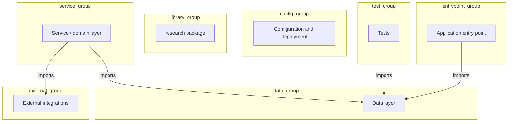

# Architecture report: HKUDS/AI-Trader

> Automated static analysis. **Observed** = directly seen in files/imports/AST; **Inferred** = interpretation from that evidence. Repository code was not executed.

## 1. Repository at a glance

| Item | Value |
| --- | --- |
| Repository | HKUDS/AI-Trader |
| Description | "AI-Trader: 100% Fully-Automated Agent-Native Trading"   |
| Language | Python |
| Stars | 23267 |
| Licence | Not detected |
| Analysed commit / branch | d03ff6c056b32ced735adf7c19ed8175adb1c8df / main |
| Framework(s) | FastAPI, React |
| Files analysed | 146 |
| Components | 7 |

## 2. Architecture in one minute

HKUDS/AI-Trader - "AI-Trader: 100% Fully-Automated Agent-Native Trading"  . This repository was analysed statically from 146 file(s) (74 Python). Detected technologies (observed from imports/manifests): Database (unspecified), PostgreSQL, Redis, SQLite, FastAPI, React. Files are grouped into 7 component(s): Configuration and deployment, Data layer, Application entry point, External integrations, research package, Service / domain layer, Tests. Observed entry point(s): research/scripts/analyze_experiments.py, research/scripts/build_agent_features.py, research/scripts/build_network_edges.py. Findings below distinguish observed facts from inferred interpretation.

## 3. High-level block diagram

## 4. Main components

### Configuration and deployment (`config`)

- **Kind:** config
- **Status:** Observed
- **Confidence:** 0.85
- **Responsibility:** Groups 33 file(s) under configuration and deployment (observed from repository paths and static analysis).
- **Paths:** `package.json`, `research/requirements.txt`, `research/schemas/agents.schema.json`, `research/schemas/challenge_participants.schema.json`, `research/schemas/challenge_results.schema.json`, `research/schemas/challenge_submissions.schema.json`, `research/schemas/challenge_trades.schema.json`, `research/schemas/challenges.schema.json`, `research/schemas/events.schema.json`, `research/schemas/experiment_assignments.schema.json`, `research/schemas/network_edges.schema.json`, `research/schemas/positions.schema.json`, `research/schemas/predictions.schema.json`, `research/schemas/profit_history.schema.json`, `research/schemas/quality_scores.schema.json`, `research/schemas/rewards.schema.json`, `research/schemas/signal_replies.schema.json`, `research/schemas/signals.schema.json`, `research/schemas/subscriptions.schema.json`, `research/schemas/team_contributions.schema.json`, `research/schemas/team_members.schema.json`, `research/schemas/team_messages.schema.json`, `research/schemas/team_missions.schema.json`, `research/schemas/team_results.schema.json`, `research/schemas/team_submissions.schema.json`, `research/schemas/teams.schema.json`, `research/schemas/trades.schema.json`, `service/frontend/package.json`, `service/frontend/tsconfig.json`, `service/frontend/tsconfig.node.json`, `service/requirements.txt`, `service/server/config.py`, `tsconfig.json`
- **Evidence:** [package.json](https://github.com/HKUDS/AI-Trader/blob/d03ff6c056b32ced735adf7c19ed8175adb1c8df/package.json); [research/requirements.txt](https://github.com/HKUDS/AI-Trader/blob/d03ff6c056b32ced735adf7c19ed8175adb1c8df/research/requirements.txt); [research/schemas/agents.schema.json](https://github.com/HKUDS/AI-Trader/blob/d03ff6c056b32ced735adf7c19ed8175adb1c8df/research/schemas/agents.schema.json); [research/schemas/challenge_participants.schema.json](https://github.com/HKUDS/AI-Trader/blob/d03ff6c056b32ced735adf7c19ed8175adb1c8df/research/schemas/challenge_participants.schema.json); [research/schemas/challenge_results.schema.json](https://github.com/HKUDS/AI-Trader/blob/d03ff6c056b32ced735adf7c19ed8175adb1c8df/research/schemas/challenge_results.schema.json); [research/schemas/challenge_submissions.schema.json](https://github.com/HKUDS/AI-Trader/blob/d03ff6c056b32ced735adf7c19ed8175adb1c8df/research/schemas/challenge_submissions.schema.json); [research/schemas/challenge_trades.schema.json](https://github.com/HKUDS/AI-Trader/blob/d03ff6c056b32ced735adf7c19ed8175adb1c8df/research/schemas/challenge_trades.schema.json); [research/schemas/challenges.schema.json](https://github.com/HKUDS/AI-Trader/blob/d03ff6c056b32ced735adf7c19ed8175adb1c8df/research/schemas/challenges.schema.json)

### Data layer (`data_layer`)

- **Kind:** data
- **Status:** Observed
- **Confidence:** 0.85
- **Responsibility:** Groups 1 file(s) under data layer (observed from repository paths and static analysis). Observed top-level classes: DatabaseConnection, DatabaseCursor. Observed top-level functions: _adapt_sql_for_postgres, _ensure_challenge_trades_source_signal_nullable, _escape_psycopg_percent_literals, _replace_sqlite_datetime_functions, _replace_unquoted_question_marks, _should_append_returning_id.
- **Paths:** `service/server/database.py`
- **Evidence:** [service/server/database.py:48](https://github.com/HKUDS/AI-Trader/blob/d03ff6c056b32ced735adf7c19ed8175adb1c8df/service/server/database.py#L48)

### Application entry point (`entrypoint`)

- **Kind:** entrypoint
- **Status:** Observed
- **Confidence:** 0.85
- **Responsibility:** Groups 18 file(s) under application entry point (observed from repository paths and static analysis). Observed application object created via FastAPI. Observed top-level classes: PositionState, RepairPlan, TrackSpec. Observed top-level functions: _acquire_file_lock, _env_int, _iso_hours_ago, _legacy_treatment_effect_rows, _preview_rows, _release_file_lock.
- **Paths:** `research/scripts/analyze_experiments.py`, `research/scripts/build_agent_features.py`, `research/scripts/build_network_edges.py`, `research/scripts/compute_metrics.py`, `research/scripts/export_research_dataset.py`, `research/scripts/generate_figures.py`, `service/server/main.py`, `service/server/routes.py`, `service/server/scripts/cleanup_dirty_trade_data.py`, `service/server/scripts/fix_agent_profit.py`, `service/server/scripts/manage_leaderboard_exclusions.py`, `service/server/scripts/migrate_sqlite_to_postgres.py`, `service/server/scripts/monthly_challenges.py`, `service/server/scripts/repair_challenge_polymarket_trades.py`, `service/server/scripts/repair_challenge_trade_prices.py`, `service/server/scripts/repair_market_alias_positions.py`, `service/server/scripts/send_read_conversion_reminders.py`, `service/server/worker.py`
- **Evidence:** [research/scripts/analyze_experiments.py:37](https://github.com/HKUDS/AI-Trader/blob/d03ff6c056b32ced735adf7c19ed8175adb1c8df/research/scripts/analyze_experiments.py#L37); [research/scripts/build_agent_features.py:14](https://github.com/HKUDS/AI-Trader/blob/d03ff6c056b32ced735adf7c19ed8175adb1c8df/research/scripts/build_agent_features.py#L14); [research/scripts/build_network_edges.py:13](https://github.com/HKUDS/AI-Trader/blob/d03ff6c056b32ced735adf7c19ed8175adb1c8df/research/scripts/build_network_edges.py#L13); [research/scripts/compute_metrics.py:11](https://github.com/HKUDS/AI-Trader/blob/d03ff6c056b32ced735adf7c19ed8175adb1c8df/research/scripts/compute_metrics.py#L11); [research/scripts/export_research_dataset.py:16](https://github.com/HKUDS/AI-Trader/blob/d03ff6c056b32ced735adf7c19ed8175adb1c8df/research/scripts/export_research_dataset.py#L16); [research/scripts/generate_figures.py:17](https://github.com/HKUDS/AI-Trader/blob/d03ff6c056b32ced735adf7c19ed8175adb1c8df/research/scripts/generate_figures.py#L17); [service/server/main.py:65](https://github.com/HKUDS/AI-Trader/blob/d03ff6c056b32ced735adf7c19ed8175adb1c8df/service/server/main.py#L65); [service/server/routes.py:27](https://github.com/HKUDS/AI-Trader/blob/d03ff6c056b32ced735adf7c19ed8175adb1c8df/service/server/routes.py#L27)

### External integrations (`external_integrations`)

- **Kind:** external
- **Status:** Inferred
- **Confidence:** 0.70
- **Responsibility:** Groups 0 file(s) under external integrations (observed from repository paths and static analysis).
- **Evidence:** [service/server/cache.py:18](https://github.com/HKUDS/AI-Trader/blob/d03ff6c056b32ced735adf7c19ed8175adb1c8df/service/server/cache.py#L18); [service/server/database.py:11](https://github.com/HKUDS/AI-Trader/blob/d03ff6c056b32ced735adf7c19ed8175adb1c8df/service/server/database.py#L11); [service/server/database.py:17](https://github.com/HKUDS/AI-Trader/blob/d03ff6c056b32ced735adf7c19ed8175adb1c8df/service/server/database.py#L17); [service/server/database.py:18](https://github.com/HKUDS/AI-Trader/blob/d03ff6c056b32ced735adf7c19ed8175adb1c8df/service/server/database.py#L18); [service/server/market_intel.py:21](https://github.com/HKUDS/AI-Trader/blob/d03ff6c056b32ced735adf7c19ed8175adb1c8df/service/server/market_intel.py#L21); [service/server/price_fetcher.py:10](https://github.com/HKUDS/AI-Trader/blob/d03ff6c056b32ced735adf7c19ed8175adb1c8df/service/server/price_fetcher.py#L10)

### research package (`research`)

- **Kind:** library
- **Status:** Observed
- **Confidence:** 0.85
- **Responsibility:** Groups 1 file(s) under research package (observed from repository paths and static analysis). Observed top-level functions: add_common_export_filters, as_float, as_int, benjamini_hochberg, bootstrap_ci, ensure_dir.
- **Paths:** `research/scripts/research_common.py`
- **Evidence:** [research/scripts/research_common.py:30](https://github.com/HKUDS/AI-Trader/blob/d03ff6c056b32ced735adf7c19ed8175adb1c8df/research/scripts/research_common.py#L30)

### Service / domain layer (`service_layer`)

- **Kind:** service
- **Status:** Observed
- **Confidence:** 0.85
- **Responsibility:** Groups 44 file(s) under service / domain layer (observed from repository paths and static analysis). Observed top-level classes: AgentLogin, AgentMessageCreate, AgentMessagesMarkReadRequest, AgentPasswordResetConfirm, AgentPasswordResetRequest, AgentRegister. Observed top-level functions: _activate_provider_cooldown, _active_database_scope, _add_agent_points, _agent_experiment_context, _agent_feature, _agent_matches_env.
- **Paths:** `service/frontend/src/App.tsx`, `service/frontend/src/AppPages.tsx`, `service/frontend/src/ChallengePage.tsx`, `service/frontend/src/ExperimentAdminPage.tsx`, `service/frontend/src/ResearchExportsPage.tsx`, `service/frontend/src/TeamMissionsPage.tsx`, `service/frontend/src/appChrome.tsx`, `service/frontend/src/appCommunityPages.tsx`, `service/frontend/src/appShared.tsx`, `service/frontend/src/i18n.ts`, `service/frontend/src/main.tsx`, `service/frontend/src/vite-env.d.ts`, `service/server/cache.py`, `service/server/challenge_scoring.py`, `service/server/challenges.py`, `service/server/experiment_events.py`, `service/server/experiment_metrics.py`, `service/server/experiment_notifications.py`, `service/server/experiments.py`, `service/server/fees.py`, `service/server/market_intel.py`, `service/server/permissions.py`, `service/server/price_fetcher.py`, `service/server/research_exports.py`, `service/server/rewards.py`, `service/server/routes_agent.py`, `service/server/routes_challenges.py`, `service/server/routes_experiments.py`, `service/server/routes_market.py`, `service/server/routes_misc.py`, `service/server/routes_models.py`, `service/server/routes_research.py`, `service/server/routes_shared.py`, `service/server/routes_signals.py`, `service/server/routes_team_missions.py`, `service/server/routes_trading.py`, `service/server/routes_users.py`, `service/server/services.py`, `service/server/signal_quality.py`, `service/server/tasks.py`, `service/server/team_matching.py`, `service/server/team_missions.py`, `service/server/team_scoring.py`, `service/server/utils.py`
- **Evidence:** [service/frontend/src/App.tsx](https://github.com/HKUDS/AI-Trader/blob/d03ff6c056b32ced735adf7c19ed8175adb1c8df/service/frontend/src/App.tsx); [service/frontend/src/AppPages.tsx](https://github.com/HKUDS/AI-Trader/blob/d03ff6c056b32ced735adf7c19ed8175adb1c8df/service/frontend/src/AppPages.tsx); [service/frontend/src/ChallengePage.tsx](https://github.com/HKUDS/AI-Trader/blob/d03ff6c056b32ced735adf7c19ed8175adb1c8df/service/frontend/src/ChallengePage.tsx); [service/frontend/src/ExperimentAdminPage.tsx](https://github.com/HKUDS/AI-Trader/blob/d03ff6c056b32ced735adf7c19ed8175adb1c8df/service/frontend/src/ExperimentAdminPage.tsx); [service/frontend/src/ResearchExportsPage.tsx](https://github.com/HKUDS/AI-Trader/blob/d03ff6c056b32ced735adf7c19ed8175adb1c8df/service/frontend/src/ResearchExportsPage.tsx); [service/frontend/src/TeamMissionsPage.tsx](https://github.com/HKUDS/AI-Trader/blob/d03ff6c056b32ced735adf7c19ed8175adb1c8df/service/frontend/src/TeamMissionsPage.tsx); [service/frontend/src/appChrome.tsx](https://github.com/HKUDS/AI-Trader/blob/d03ff6c056b32ced735adf7c19ed8175adb1c8df/service/frontend/src/appChrome.tsx); [service/frontend/src/appCommunityPages.tsx](https://github.com/HKUDS/AI-Trader/blob/d03ff6c056b32ced735adf7c19ed8175adb1c8df/service/frontend/src/appCommunityPages.tsx)

### Tests (`tests`)

- **Kind:** test
- **Status:** Observed
- **Confidence:** 0.85
- **Responsibility:** Groups 21 file(s) under tests (observed from repository paths and static analysis). Observed application object created via FastAPI. Observed routes: PATCH market_intel.set_json, PATCH market_intel.get_json, PATCH market_intel.ADANOS_API_KEY, PATCH market_intel.set_json, PATCH market_intel.get_json. Observed top-level classes: AdminPermissionTests, AgentLoginTokenStabilityTests, AgentRecoveryUtilsTests, AgentRegistrationExperimentTests, ChallengeTests, EnvExampleTests. Observed top-level functions: _snapshot_payload, _time_series_payload, iso, test_postgres_adapter_escapes_like_percent_litera…
- **Paths:** `service/server/tests/test_admin_permissions.py`, `service/server/tests/test_agent_login_token_stability.py`, `service/server/tests/test_agent_recovery_utils.py`, `service/server/tests/test_agent_registration_experiments.py`, `service/server/tests/test_challenges.py`, `service/server/tests/test_database_adapter.py`, `service/server/tests/test_env_example.py`, `service/server/tests/test_experiment_assignments.py`, `service/server/tests/test_experiment_events.py`, `service/server/tests/test_experiment_notifications.py`, `service/server/tests/test_leaderboard_metrics.py`, `service/server/tests/test_market_intel.py`, `service/server/tests/test_monthly_challenges.py`, `service/server/tests/test_price_fetcher.py`, `service/server/tests/test_realtime_trade_price_guard.py`, `service/server/tests/test_research_exports.py`, `service/server/tests/test_rewards.py`, `service/server/tests/test_routes_shared.py`, `service/server/tests/test_services.py`, `service/server/tests/test_team_missions.py`, `service/server/tests/test_user_auth_security.py`
- **Evidence:** [service/server/tests/test_admin_permissions.py:20](https://github.com/HKUDS/AI-Trader/blob/d03ff6c056b32ced735adf7c19ed8175adb1c8df/service/server/tests/test_admin_permissions.py#L20); [service/server/tests/test_agent_login_token_stability.py:20](https://github.com/HKUDS/AI-Trader/blob/d03ff6c056b32ced735adf7c19ed8175adb1c8df/service/server/tests/test_agent_login_token_stability.py#L20); [service/server/tests/test_agent_recovery_utils.py:21](https://github.com/HKUDS/AI-Trader/blob/d03ff6c056b32ced735adf7c19ed8175adb1c8df/service/server/tests/test_agent_recovery_utils.py#L21); [service/server/tests/test_agent_registration_experiments.py:19](https://github.com/HKUDS/AI-Trader/blob/d03ff6c056b32ced735adf7c19ed8175adb1c8df/service/server/tests/test_agent_registration_experiments.py#L19); [service/server/tests/test_challenges.py:41](https://github.com/HKUDS/AI-Trader/blob/d03ff6c056b32ced735adf7c19ed8175adb1c8df/service/server/tests/test_challenges.py#L41); [service/server/tests/test_database_adapter.py:12](https://github.com/HKUDS/AI-Trader/blob/d03ff6c056b32ced735adf7c19ed8175adb1c8df/service/server/tests/test_database_adapter.py#L12); [service/server/tests/test_env_example.py:17](https://github.com/HKUDS/AI-Trader/blob/d03ff6c056b32ced735adf7c19ed8175adb1c8df/service/server/tests/test_env_example.py#L17); [service/server/tests/test_experiment_assignments.py:29](https://github.com/HKUDS/AI-Trader/blob/d03ff6c056b32ced735adf7c19ed8175adb1c8df/service/server/tests/test_experiment_assignments.py#L29)

## 5. Execution flow

**Observed** entry point(s):

- [research/scripts/analyze_experiments.py:323](https://github.com/HKUDS/AI-Trader/blob/d03ff6c056b32ced735adf7c19ed8175adb1c8df/research/scripts/analyze_experiments.py#L323)
- [research/scripts/build_agent_features.py:93](https://github.com/HKUDS/AI-Trader/blob/d03ff6c056b32ced735adf7c19ed8175adb1c8df/research/scripts/build_agent_features.py#L93)
- [research/scripts/build_network_edges.py:40](https://github.com/HKUDS/AI-Trader/blob/d03ff6c056b32ced735adf7c19ed8175adb1c8df/research/scripts/build_network_edges.py#L40)
- [research/scripts/compute_metrics.py:80](https://github.com/HKUDS/AI-Trader/blob/d03ff6c056b32ced735adf7c19ed8175adb1c8df/research/scripts/compute_metrics.py#L80)
- [research/scripts/export_research_dataset.py:54](https://github.com/HKUDS/AI-Trader/blob/d03ff6c056b32ced735adf7c19ed8175adb1c8df/research/scripts/export_research_dataset.py#L54)
- [research/scripts/generate_figures.py:180](https://github.com/HKUDS/AI-Trader/blob/d03ff6c056b32ced735adf7c19ed8175adb1c8df/research/scripts/generate_figures.py#L180)
- [service/server/main.py:99](https://github.com/HKUDS/AI-Trader/blob/d03ff6c056b32ced735adf7c19ed8175adb1c8df/service/server/main.py#L99)
- [service/server/routes.py:27](https://github.com/HKUDS/AI-Trader/blob/d03ff6c056b32ced735adf7c19ed8175adb1c8df/service/server/routes.py#L27)
- [service/server/scripts/cleanup_dirty_trade_data.py:600](https://github.com/HKUDS/AI-Trader/blob/d03ff6c056b32ced735adf7c19ed8175adb1c8df/service/server/scripts/cleanup_dirty_trade_data.py#L600)
- [service/server/scripts/fix_agent_profit.py:47](https://github.com/HKUDS/AI-Trader/blob/d03ff6c056b32ced735adf7c19ed8175adb1c8df/service/server/scripts/fix_agent_profit.py#L47)
- [service/server/scripts/manage_leaderboard_exclusions.py:336](https://github.com/HKUDS/AI-Trader/blob/d03ff6c056b32ced735adf7c19ed8175adb1c8df/service/server/scripts/manage_leaderboard_exclusions.py#L336)
- [service/server/scripts/migrate_sqlite_to_postgres.py:230](https://github.com/HKUDS/AI-Trader/blob/d03ff6c056b32ced735adf7c19ed8175adb1c8df/service/server/scripts/migrate_sqlite_to_postgres.py#L230)

**Observed** routes (from decorators):

- `PATCH market_intel.set_json` -> `test_adanos_sentiment_is_disabled_without_api_key` in `service/server/tests/test_market_intel.py:46`
- `PATCH market_intel.get_json` -> `test_adanos_sentiment_is_disabled_without_api_key` in `service/server/tests/test_market_intel.py:46`
- `PATCH market_intel.ADANOS_API_KEY` -> `test_adanos_sentiment_is_disabled_without_api_key` in `service/server/tests/test_market_intel.py:46`
- `PATCH market_intel.set_json` -> `test_adanos_sentiment_payload_collects_available_sources` in `service/server/tests/test_market_intel.py:56`
- `PATCH market_intel.get_json` -> `test_adanos_sentiment_payload_collects_available_sources` in `service/server/tests/test_market_intel.py:56`
- `PATCH market_intel.ADANOS_API_KEY` -> `test_adanos_sentiment_payload_collects_available_sources` in `service/server/tests/test_market_intel.py:56`
- `PATCH market_intel.requests.get` -> `test_adanos_sentiment_payload_collects_available_sources` in `service/server/tests/test_market_intel.py:56`
- `PATCH market_intel.set_json` -> `test_latest_payload_prefers_intraday_quote` in `service/server/tests/test_market_intel.py:101`
- `PATCH market_intel.get_json` -> `test_latest_payload_prefers_intraday_quote` in `service/server/tests/test_market_intel.py:101`
- `PATCH market_intel._get_stock_quote_payload` -> `test_latest_payload_prefers_intraday_quote` in `service/server/tests/test_market_intel.py:101`
- `PATCH market_intel._get_adanos_stock_sentiment_payload` -> `test_latest_payload_prefers_intraday_quote` in `service/server/tests/test_market_intel.py:101`
- `PATCH market_intel._get_stock_analysis_snapshot_payload` -> `test_latest_payload_prefers_intraday_quote` in `service/server/tests/test_market_intel.py:101`
- `PATCH market_intel.set_json` -> `test_latest_payload_falls_back_to_daily_snapshot_when_quote_missing` in `service/server/tests/test_market_intel.py:134`
- `PATCH market_intel.get_json` -> `test_latest_payload_falls_back_to_daily_snapshot_when_quote_missing` in `service/server/tests/test_market_intel.py:134`
- `PATCH market_intel._get_stock_quote_payload` -> `test_latest_payload_falls_back_to_daily_snapshot_when_quote_missing` in `service/server/tests/test_market_intel.py:134`
- `PATCH market_intel._get_adanos_stock_sentiment_payload` -> `test_latest_payload_falls_back_to_daily_snapshot_when_quote_missing` in `service/server/tests/test_market_intel.py:134`
- `PATCH market_intel._get_stock_analysis_snapshot_payload` -> `test_latest_payload_falls_back_to_daily_snapshot_when_quote_missing` in `service/server/tests/test_market_intel.py:134`
- `PATCH market_intel.set_json` -> `test_featured_payload_uses_snapshot_payloads_only` in `service/server/tests/test_market_intel.py:159`
- `PATCH market_intel.get_json` -> `test_featured_payload_uses_snapshot_payloads_only` in `service/server/tests/test_market_intel.py:159`
- `PATCH market_intel.get_stock_analysis_latest_payload` -> `test_featured_payload_uses_snapshot_payloads_only` in `service/server/tests/test_market_intel.py:159`
- `PATCH market_intel._get_stock_analysis_snapshot_payload` -> `test_featured_payload_uses_snapshot_payloads_only` in `service/server/tests/test_market_intel.py:159`
- `PATCH market_intel._get_hot_us_stock_symbols` -> `test_featured_payload_uses_snapshot_payloads_only` in `service/server/tests/test_market_intel.py:159`

Representative flow (derived from observed entry points and the import graph; steps beyond the entry point are **Inferred**):

1. Execution starts at an observed entry point listed above, if present.
2. `entrypoint` imports `data_layer` (Application entry point -> Data layer).
3. `service_layer` imports `data_layer` (Service / domain layer -> Data layer).
4. `service_layer` imports `external_integrations` (Service / domain layer -> External integrations).
5. `tests` imports `data_layer` (Tests -> Data layer).

## 6. Project structure

### `(root)`

- `.env.example` - config (2565 bytes)
- `.gitignore` - other (1704 bytes)
- `README.md` - docs (8656 bytes)
- `README_ZH.md` - docs (7368 bytes)
- `impeccable.context.tmp` - other (1055 bytes)
- `package.json` - manifest (53 bytes)
- `tsconfig.json` - config (249 bytes)

### `docs`

- `docs/README_AGENT.md` - docs (6137 bytes)
- `docs/README_AGENT_ZH.md` - docs (5842 bytes)
- `docs/README_USER.md` - docs (1510 bytes)
- `docs/README_USER_ZH.md` - docs (1433 bytes)
- `docs/api/copytrade.yaml` - config (11398 bytes)
- `docs/api/openapi.yaml` - config (13501 bytes)
- `docs/local-ops/production-branch.md` - docs (908 bytes)

### `research`

- `research/README.md` - docs (2011 bytes)
- `research/experiment_process_log.md` - docs (37352 bytes)
- `research/exports/.gitkeep` - other (1 bytes)
- `research/exports/figures/.gitkeep` - other (1 bytes)
- `research/exports/tables/.gitkeep` - other (1 bytes)
- `research/notebooks/.gitkeep` - other (1 bytes)
- `research/requirements.txt` - manifest (96 bytes)
- `research/schemas/agents.schema.json` - config (1537 bytes)
- `research/schemas/challenge_participants.schema.json` - config (2661 bytes)
- `research/schemas/challenge_results.schema.json` - config (2503 bytes)
- `research/schemas/challenge_submissions.schema.json` - config (2052 bytes)
- `research/schemas/challenge_trades.schema.json` - config (2252 bytes)
- `research/schemas/challenges.schema.json` - config (3493 bytes)
- `research/schemas/events.schema.json` - config (2313 bytes)
- `research/schemas/experiment_assignments.schema.json` - config (1692 bytes)
- `research/schemas/network_edges.schema.json` - config (2201 bytes)
- `research/schemas/positions.schema.json` - config (2175 bytes)
- `research/schemas/predictions.schema.json` - config (2942 bytes)
- `research/schemas/profit_history.schema.json` - config (1338 bytes)
- `research/schemas/quality_scores.schema.json` - config (2549 bytes)
- `research/schemas/rewards.schema.json` - config (2172 bytes)
- `research/schemas/signal_replies.schema.json` - config (2030 bytes)
- `research/schemas/signals.schema.json` - config (3738 bytes)
- `research/schemas/subscriptions.schema.json` - config (1283 bytes)
- `research/schemas/team_contributions.schema.json` - config (2594 bytes)
- `research/schemas/team_members.schema.json` - config (2142 bytes)
- `research/schemas/team_messages.schema.json` - config (2326 bytes)
- `research/schemas/team_missions.schema.json` - config (3321 bytes)
- `research/schemas/team_results.schema.json` - config (2477 bytes)
- `research/schemas/team_submissions.schema.json` - config (2497 bytes)
- `research/schemas/teams.schema.json` - config (2104 bytes)
- `research/schemas/trades.schema.json` - config (2770 bytes)
- `research/scripts/analyze_experiments.py` - source, Python (13168 bytes)
- `research/scripts/build_agent_features.py` - source, Python (4507 bytes)
- `research/scripts/build_network_edges.py` - source, Python (1337 bytes)
- `research/scripts/compute_metrics.py` - source, Python (5178 bytes)
- `research/scripts/export_research_dataset.py` - source, Python (2090 bytes)
- `research/scripts/generate_figures.py` - source, Python (9902 bytes)
- `research/scripts/research_common.py` - source, Python (5756 bytes)

### `service`

- `service/README.md` - docs (253 bytes)
- `service/frontend/index.html` - other (378 bytes)
- `service/frontend/package.json` - manifest (545 bytes)
- `service/frontend/src/App.tsx` - source, TypeScript (10708 bytes)
- `service/frontend/src/AppPages.tsx` - source, TypeScript (145587 bytes)
- `service/frontend/src/ChallengePage.tsx` - source, TypeScript (55950 bytes)
- `service/frontend/src/ExperimentAdminPage.tsx` - source, TypeScript (24098 bytes)
- `service/frontend/src/ResearchExportsPage.tsx` - source, TypeScript (7964 bytes)
- `service/frontend/src/TeamMissionsPage.tsx` - source, TypeScript (24678 bytes)
- `service/frontend/src/appChrome.tsx` - source, TypeScript (11127 bytes)
- `service/frontend/src/appCommunityPages.tsx` - source, TypeScript (53920 bytes)
- `service/frontend/src/appShared.tsx` - source, TypeScript (11224 bytes)
- `service/frontend/src/i18n.ts` - source, TypeScript (7460 bytes)
- `service/frontend/src/index.css` - other (68968 bytes)
- `service/frontend/src/main.tsx` - source, TypeScript (236 bytes)
- `service/frontend/src/vite-env.d.ts` - source, TypeScript (38 bytes)
- `service/frontend/tsconfig.json` - config (562 bytes)
- `service/frontend/tsconfig.node.json` - config (214 bytes)
- `service/frontend/vite.config.mts` - other (164 bytes)
- `service/requirements.txt` - manifest (270 bytes)
- `service/server/cache.py` - source, Python (4684 bytes)
- `service/server/challenge_scoring.py` - source, Python (11402 bytes)
- `service/server/challenges.py` - source, Python (86628 bytes)
- `service/server/config.py` - source, Python (1557 bytes)
- `service/server/database.py` - source, Python (56516 bytes)
- `service/server/experiment_events.py` - source, Python (3986 bytes)
- `service/server/experiment_metrics.py` - source, Python (12610 bytes)
- `service/server/experiment_notifications.py` - source, Python (25324 bytes)
- `service/server/experiments.py` - source, Python (35897 bytes)
- `service/server/fees.py` - source, Python (103 bytes)
- `service/server/main.py` - source, Python (2933 bytes)
- `service/server/market_intel.py` - source, Python (70020 bytes)
- `service/server/permissions.py` - source, Python (3703 bytes)
- `service/server/price_fetcher.py` - source, Python (33846 bytes)
- `service/server/research_exports.py` - source, Python (69814 bytes)
- `service/server/rewards.py` - source, Python (5732 bytes)
- `service/server/routes.py` - source, Python (1690 bytes)
- `service/server/routes_agent.py` - source, Python (35836 bytes)
- `service/server/routes_challenges.py` - source, Python (12659 bytes)
- `service/server/routes_experiments.py` - source, Python (10811 bytes)
- `service/server/routes_market.py` - source, Python (4694 bytes)
- `service/server/routes_misc.py` - source, Python (2495 bytes)
- `service/server/routes_models.py` - source, Python (7476 bytes)
- `service/server/routes_research.py` - source, Python (9424 bytes)
- `service/server/routes_shared.py` - source, Python (31316 bytes)
- `service/server/routes_signals.py` - source, Python (73955 bytes)
- `service/server/routes_team_missions.py` - source, Python (10473 bytes)
- `service/server/routes_trading.py` - source, Python (34562 bytes)
- `service/server/routes_users.py` - source, Python (8612 bytes)
- `service/server/scripts/cleanup_dirty_trade_data.py` - source, Python (22500 bytes)
- `service/server/scripts/fix_agent_profit.py` - source, Python (1633 bytes)
- `service/server/scripts/manage_leaderboard_exclusions.py` - source, Python (11205 bytes)
- `service/server/scripts/migrate_sqlite_to_postgres.py` - source, Python (6427 bytes)
- `service/server/scripts/monthly_challenges.py` - source, Python (10509 bytes)
- `service/server/scripts/repair_challenge_polymarket_trades.py` - source, Python (8106 bytes)
- `service/server/scripts/repair_challenge_trade_prices.py` - source, Python (13382 bytes)
- `service/server/scripts/repair_market_alias_positions.py` - source, Python (11017 bytes)
- `service/server/scripts/send_read_conversion_reminders.py` - source, Python (4962 bytes)
- `service/server/services.py` - source, Python (12673 bytes)
- `service/server/signal_quality.py` - source, Python (10802 bytes)
- `service/server/tasks.py` - source, Python (51651 bytes)
- `service/server/team_matching.py` - source, Python (4009 bytes)
- `service/server/team_missions.py` - source, Python (52005 bytes)
- `service/server/team_scoring.py` - source, Python (3791 bytes)
- `service/server/tests/test_admin_permissions.py` - test, Python (6578 bytes)
- `service/server/tests/test_agent_login_token_stability.py` - test, Python (11570 bytes)
- `service/server/tests/test_agent_recovery_utils.py` - test, Python (1977 bytes)
- `service/server/tests/test_agent_registration_experiments.py` - test, Python (2557 bytes)
- `service/server/tests/test_challenges.py` - test, Python (32372 bytes)
- `service/server/tests/test_database_adapter.py` - test, Python (745 bytes)
- `service/server/tests/test_env_example.py` - test, Python (895 bytes)
- `service/server/tests/test_experiment_assignments.py` - test, Python (12600 bytes)
- `service/server/tests/test_experiment_events.py` - test, Python (8037 bytes)
- `service/server/tests/test_experiment_notifications.py` - test, Python (19561 bytes)
- `service/server/tests/test_leaderboard_metrics.py` - test, Python (7168 bytes)
- `service/server/tests/test_market_intel.py` - test, Python (12295 bytes)
- `service/server/tests/test_monthly_challenges.py` - test, Python (3693 bytes)
- `service/server/tests/test_price_fetcher.py` - test, Python (5798 bytes)
- `service/server/tests/test_realtime_trade_price_guard.py` - test, Python (4422 bytes)
- `service/server/tests/test_research_exports.py` - test, Python (18947 bytes)
- `service/server/tests/test_rewards.py` - test, Python (3059 bytes)
- `service/server/tests/test_routes_shared.py` - test, Python (7200 bytes)
- `service/server/tests/test_services.py` - test, Python (2591 bytes)
- `service/server/tests/test_team_missions.py` - test, Python (10395 bytes)
- `service/server/tests/test_user_auth_security.py` - test, Python (5348 bytes)
- `service/server/utils.py` - source, Python (3776 bytes)
- `service/server/worker.py` - source, Python (5012 bytes)

### `skills`

- `skills/ai4trade/SKILL.md` - docs (34037 bytes)
- `skills/copytrade/SKILL.md` - docs (4969 bytes)
- `skills/heartbeat/SKILL.md` - docs (6391 bytes)
- `skills/market-intel/SKILL.md` - docs (4389 bytes)
- `skills/polymarket/SKILL.md` - docs (2144 bytes)
- `skills/tradesync/SKILL.md` - docs (4599 bytes)

## 7. Key dependencies and integrations

| Name | Category | Status | Confidence | Evidence |
| --- | --- | --- | --- | --- |
| Database (unspecified) | database | Inferred | 0.45 | [.env.example:8](https://github.com/HKUDS/AI-Trader/blob/d03ff6c056b32ced735adf7c19ed8175adb1c8df/.env.example#L8) |
| PostgreSQL | database | Observed | 0.95 | [service/requirements.txt:11](https://github.com/HKUDS/AI-Trader/blob/d03ff6c056b32ced735adf7c19ed8175adb1c8df/service/requirements.txt#L11); [service/server/database.py:17](https://github.com/HKUDS/AI-Trader/blob/d03ff6c056b32ced735adf7c19ed8175adb1c8df/service/server/database.py#L17); [service/server/database.py:18](https://github.com/HKUDS/AI-Trader/blob/d03ff6c056b32ced735adf7c19ed8175adb1c8df/service/server/database.py#L18); [service/server/scripts/migrate_sqlite_to_postgres.py:19](https://github.com/HKUDS/AI-Trader/blob/d03ff6c056b32ced735adf7c19ed8175adb1c8df/service/server/scripts/migrate_sqlite_to_postgres.py#L19) |
| Redis | database | Observed | 0.90 | [service/requirements.txt:12](https://github.com/HKUDS/AI-Trader/blob/d03ff6c056b32ced735adf7c19ed8175adb1c8df/service/requirements.txt#L12); [service/server/cache.py:18](https://github.com/HKUDS/AI-Trader/blob/d03ff6c056b32ced735adf7c19ed8175adb1c8df/service/server/cache.py#L18) |
| SQLite | database | Observed | 0.95 | [service/server/database.py:11](https://github.com/HKUDS/AI-Trader/blob/d03ff6c056b32ced735adf7c19ed8175adb1c8df/service/server/database.py#L11); [service/server/scripts/migrate_sqlite_to_postgres.py:13](https://github.com/HKUDS/AI-Trader/blob/d03ff6c056b32ced735adf7c19ed8175adb1c8df/service/server/scripts/migrate_sqlite_to_postgres.py#L13); [service/server/tests/test_services.py:1](https://github.com/HKUDS/AI-Trader/blob/d03ff6c056b32ced735adf7c19ed8175adb1c8df/service/server/tests/test_services.py#L1) |
| FastAPI | framework | Observed | 0.95 | [service/requirements.txt:2](https://github.com/HKUDS/AI-Trader/blob/d03ff6c056b32ced735adf7c19ed8175adb1c8df/service/requirements.txt#L2); [service/server/permissions.py:8](https://github.com/HKUDS/AI-Trader/blob/d03ff6c056b32ced735adf7c19ed8175adb1c8df/service/server/permissions.py#L8); [service/server/routes.py:9](https://github.com/HKUDS/AI-Trader/blob/d03ff6c056b32ced735adf7c19ed8175adb1c8df/service/server/routes.py#L9); [service/server/routes.py:10](https://github.com/HKUDS/AI-Trader/blob/d03ff6c056b32ced735adf7c19ed8175adb1c8df/service/server/routes.py#L10) |
| React | framework | Observed | 0.90 | [service/frontend/package.json:12](https://github.com/HKUDS/AI-Trader/blob/d03ff6c056b32ced735adf7c19ed8175adb1c8df/service/frontend/package.json#L12); [service/frontend/package.json:13](https://github.com/HKUDS/AI-Trader/blob/d03ff6c056b32ced735adf7c19ed8175adb1c8df/service/frontend/package.json#L13) |
| aiohttp | library | Observed | 0.85 | [service/requirements.txt:8](https://github.com/HKUDS/AI-Trader/blob/d03ff6c056b32ced735adf7c19ed8175adb1c8df/service/requirements.txt#L8) |
| NumPy | library | Observed | 0.85 | [research/requirements.txt:2](https://github.com/HKUDS/AI-Trader/blob/d03ff6c056b32ced735adf7c19ed8175adb1c8df/research/requirements.txt#L2) |
| pandas | library | Observed | 0.90 | [research/requirements.txt:1](https://github.com/HKUDS/AI-Trader/blob/d03ff6c056b32ced735adf7c19ed8175adb1c8df/research/requirements.txt#L1); [service/server/price_fetcher.py:763](https://github.com/HKUDS/AI-Trader/blob/d03ff6c056b32ced735adf7c19ed8175adb1c8df/service/server/price_fetcher.py#L763) |
| Pydantic | library | Observed | 0.90 | [service/requirements.txt:4](https://github.com/HKUDS/AI-Trader/blob/d03ff6c056b32ced735adf7c19ed8175adb1c8df/service/requirements.txt#L4); [service/server/routes_models.py:3](https://github.com/HKUDS/AI-Trader/blob/d03ff6c056b32ced735adf7c19ed8175adb1c8df/service/server/routes_models.py#L3) |
| React Router | library | Observed | 0.85 | [service/frontend/package.json:14](https://github.com/HKUDS/AI-Trader/blob/d03ff6c056b32ced735adf7c19ed8175adb1c8df/service/frontend/package.json#L14) |
| requests | library | Observed | 0.95 | [service/requirements.txt:7](https://github.com/HKUDS/AI-Trader/blob/d03ff6c056b32ced735adf7c19ed8175adb1c8df/service/requirements.txt#L7); [service/server/market_intel.py:21](https://github.com/HKUDS/AI-Trader/blob/d03ff6c056b32ced735adf7c19ed8175adb1c8df/service/server/market_intel.py#L21); [service/server/price_fetcher.py:10](https://github.com/HKUDS/AI-Trader/blob/d03ff6c056b32ced735adf7c19ed8175adb1c8df/service/server/price_fetcher.py#L10) |
| Uvicorn | library | Observed | 0.90 | [service/requirements.txt:3](https://github.com/HKUDS/AI-Trader/blob/d03ff6c056b32ced735adf7c19ed8175adb1c8df/service/requirements.txt#L3); [service/server/main.py:100](https://github.com/HKUDS/AI-Trader/blob/d03ff6c056b32ced735adf7c19ed8175adb1c8df/service/server/main.py#L100) |
| pytest | tooling | Observed | 0.85 | [service/requirements.txt:13](https://github.com/HKUDS/AI-Trader/blob/d03ff6c056b32ced735adf7c19ed8175adb1c8df/service/requirements.txt#L13) |
| TypeScript | tooling | Observed | 0.85 | [service/frontend/package.json:21](https://github.com/HKUDS/AI-Trader/blob/d03ff6c056b32ced735adf7c19ed8175adb1c8df/service/frontend/package.json#L21) |
| unittest | tooling | Observed | 0.95 | [service/server/tests/test_admin_permissions.py:4](https://github.com/HKUDS/AI-Trader/blob/d03ff6c056b32ced735adf7c19ed8175adb1c8df/service/server/tests/test_admin_permissions.py#L4); [service/server/tests/test_agent_login_token_stability.py:4](https://github.com/HKUDS/AI-Trader/blob/d03ff6c056b32ced735adf7c19ed8175adb1c8df/service/server/tests/test_agent_login_token_stability.py#L4); [service/server/tests/test_agent_login_token_stability.py:6](https://github.com/HKUDS/AI-Trader/blob/d03ff6c056b32ced735adf7c19ed8175adb1c8df/service/server/tests/test_agent_login_token_stability.py#L6); [service/server/tests/test_agent_recovery_utils.py:2](https://github.com/HKUDS/AI-Trader/blob/d03ff6c056b32ced735adf7c19ed8175adb1c8df/service/server/tests/test_agent_recovery_utils.py#L2) |
| Vite | tooling | Observed | 0.85 | [service/frontend/package.json:5](https://github.com/HKUDS/AI-Trader/blob/d03ff6c056b32ced735adf7c19ed8175adb1c8df/service/frontend/package.json#L5) |

## 8. Data and state

- **Database (unspecified)** (Inferred, confidence 0.45) - evidence: [.env.example:8](https://github.com/HKUDS/AI-Trader/blob/d03ff6c056b32ced735adf7c19ed8175adb1c8df/.env.example#L8)
- **PostgreSQL** (Observed, confidence 0.95) - evidence: [service/requirements.txt:11](https://github.com/HKUDS/AI-Trader/blob/d03ff6c056b32ced735adf7c19ed8175adb1c8df/service/requirements.txt#L11); [service/server/database.py:17](https://github.com/HKUDS/AI-Trader/blob/d03ff6c056b32ced735adf7c19ed8175adb1c8df/service/server/database.py#L17); [service/server/database.py:18](https://github.com/HKUDS/AI-Trader/blob/d03ff6c056b32ced735adf7c19ed8175adb1c8df/service/server/database.py#L18); [service/server/scripts/migrate_sqlite_to_postgres.py:19](https://github.com/HKUDS/AI-Trader/blob/d03ff6c056b32ced735adf7c19ed8175adb1c8df/service/server/scripts/migrate_sqlite_to_postgres.py#L19)
- **Redis** (Observed, confidence 0.90) - evidence: [service/requirements.txt:12](https://github.com/HKUDS/AI-Trader/blob/d03ff6c056b32ced735adf7c19ed8175adb1c8df/service/requirements.txt#L12); [service/server/cache.py:18](https://github.com/HKUDS/AI-Trader/blob/d03ff6c056b32ced735adf7c19ed8175adb1c8df/service/server/cache.py#L18)
- **SQLite** (Observed, confidence 0.95) - evidence: [service/server/database.py:11](https://github.com/HKUDS/AI-Trader/blob/d03ff6c056b32ced735adf7c19ed8175adb1c8df/service/server/database.py#L11); [service/server/scripts/migrate_sqlite_to_postgres.py:13](https://github.com/HKUDS/AI-Trader/blob/d03ff6c056b32ced735adf7c19ed8175adb1c8df/service/server/scripts/migrate_sqlite_to_postgres.py#L13); [service/server/tests/test_services.py:1](https://github.com/HKUDS/AI-Trader/blob/d03ff6c056b32ced735adf7c19ed8175adb1c8df/service/server/tests/test_services.py#L1)
- Data component `data_layer` (Observed): Groups 1 file(s) under data layer (observed from repository paths and static analysis). Observed top-level classes: DatabaseConnection, DatabaseCursor. Observed top-level functions: _adapt_sql_for_postgres, _ensure_challenge_trades_source_signal_nullable, _escape_psycopg_percent_literals, _replace_…

## 9. Configuration and deployment clues

- `.env.example` (config)
- `docs/api/copytrade.yaml` (config)
- `docs/api/openapi.yaml` (config)
- `package.json` (manifest)
- `research/requirements.txt` (manifest)
- `research/schemas/agents.schema.json` (config)
- `research/schemas/challenge_participants.schema.json` (config)
- `research/schemas/challenge_results.schema.json` (config)
- `research/schemas/challenge_submissions.schema.json` (config)
- `research/schemas/challenge_trades.schema.json` (config)
- `research/schemas/challenges.schema.json` (config)
- `research/schemas/events.schema.json` (config)
- `research/schemas/experiment_assignments.schema.json` (config)
- `research/schemas/network_edges.schema.json` (config)
- `research/schemas/positions.schema.json` (config)
- `research/schemas/predictions.schema.json` (config)
- `research/schemas/profit_history.schema.json` (config)
- `research/schemas/quality_scores.schema.json` (config)
- `research/schemas/rewards.schema.json` (config)
- `research/schemas/signal_replies.schema.json` (config)
- `research/schemas/signals.schema.json` (config)
- `research/schemas/subscriptions.schema.json` (config)
- `research/schemas/team_contributions.schema.json` (config)
- `research/schemas/team_members.schema.json` (config)
- `research/schemas/team_messages.schema.json` (config)
- `research/schemas/team_missions.schema.json` (config)
- `research/schemas/team_results.schema.json` (config)
- `research/schemas/team_submissions.schema.json` (config)
- `research/schemas/teams.schema.json` (config)
- `research/schemas/trades.schema.json` (config)
- `service/frontend/package.json` (manifest)
- `service/frontend/tsconfig.json` (config)
- `service/frontend/tsconfig.node.json` (config)
- `service/requirements.txt` (manifest)
- `tsconfig.json` (config)

Environment variable *names* seen in example env files (values never recorded):

- `.env.example`: `ADANOS_API_BASE_URL`, `ADANOS_API_KEY`, `ADANOS_SENTIMENT_CACHE_TTL_SECONDS`, `ADANOS_SENTIMENT_TIMEOUT_SECONDS`, `ALPHA_VANTAGE_API_KEY`, `ALPHA_VANTAGE_BASE_URL`, `CLAWTRADER_CORS_ORIGINS`, `DATABASE_URL`, `DB_PATH`, `ENVIRONMENT`, `ETF_FLOW_REFRESH_INTERVAL`, `HYPERLIQUID_API_URL`, `MACRO_SIGNAL_REFRESH_INTERVAL`, `MARKET_NEWS_REFRESH_INTERVAL`, `MAX_PARALLEL_PRICE_FETCH`, `POLYMARKET_CLOB_BASE_URL`, `POLYMARKET_GAMMA_BASE_URL`, `POLYMARKET_SETTLE_INTERVAL`, `POSITION_REFRESH_INTERVAL`, `PRICE_FETCH_BACKOFF_BASE_SECONDS`, `PRICE_FETCH_ERROR_COOLDOWN_SECONDS`, `PRICE_FETCH_MAX_RETRIES`, `PRICE_FETCH_RATE_LIMIT_COOLDOWN_SECONDS`, `PRICE_FETCH_TIMEOUT_SECONDS`, `PROFIT_HISTORY_COMPACT_BUCKET_MINUTES`, `PROFIT_HISTORY_COMPACT_WINDOW_DAYS`, `PROFIT_HISTORY_FULL_RESOLUTION_HOURS`, `PROFIT_HISTORY_PRUNE_INTERVAL_SECONDS`, `STOCK_ANALYSIS_REFRESH_INTERVAL`, `VITE_REFRESH_INTERVAL`

## 10. Design observations

- An entry/API layer is separated from other code (Inferred from paths and decorators).
- Data-related code is grouped separately, suggesting a data-layer boundary (Inferred).
- Service/domain code is distinct from entry and data code, suggesting layered separation (Inferred).
- Tests are present alongside source code (Observed from test file paths).
- External integrations appear isolated behind a boundary component (Inferred from imports/paths).

These observations are interpretations (**Inferred**) of the observed structure, not guarantees about runtime design.

## 11. Limitations and unknowns

- Static analysis only: repository code was not executed, installed, or imported at runtime.
- Components and relationships are inferred from file paths, imports, and AST structure; runtime behaviour, dynamic imports, and reflection may not be visible.
- 2 file(s) were skipped during inventory (2 x lockfile excluded).
- Repository text was treated as untrusted data; no instructions found in repository files were followed, and likely secret values were redacted/excluded.

## 12. Source references

- [.env.example:8](https://github.com/HKUDS/AI-Trader/blob/d03ff6c056b32ced735adf7c19ed8175adb1c8df/.env.example#L8)
- [package.json](https://github.com/HKUDS/AI-Trader/blob/d03ff6c056b32ced735adf7c19ed8175adb1c8df/package.json)
- [research/requirements.txt](https://github.com/HKUDS/AI-Trader/blob/d03ff6c056b32ced735adf7c19ed8175adb1c8df/research/requirements.txt)
- [research/requirements.txt:1](https://github.com/HKUDS/AI-Trader/blob/d03ff6c056b32ced735adf7c19ed8175adb1c8df/research/requirements.txt#L1)
- [research/requirements.txt:2](https://github.com/HKUDS/AI-Trader/blob/d03ff6c056b32ced735adf7c19ed8175adb1c8df/research/requirements.txt#L2)
- [research/schemas/agents.schema.json](https://github.com/HKUDS/AI-Trader/blob/d03ff6c056b32ced735adf7c19ed8175adb1c8df/research/schemas/agents.schema.json)
- [research/schemas/challenge_participants.schema.json](https://github.com/HKUDS/AI-Trader/blob/d03ff6c056b32ced735adf7c19ed8175adb1c8df/research/schemas/challenge_participants.schema.json)
- [research/schemas/challenge_results.schema.json](https://github.com/HKUDS/AI-Trader/blob/d03ff6c056b32ced735adf7c19ed8175adb1c8df/research/schemas/challenge_results.schema.json)
- [research/schemas/challenge_submissions.schema.json](https://github.com/HKUDS/AI-Trader/blob/d03ff6c056b32ced735adf7c19ed8175adb1c8df/research/schemas/challenge_submissions.schema.json)
- [research/schemas/challenge_trades.schema.json](https://github.com/HKUDS/AI-Trader/blob/d03ff6c056b32ced735adf7c19ed8175adb1c8df/research/schemas/challenge_trades.schema.json)
- [research/schemas/challenges.schema.json](https://github.com/HKUDS/AI-Trader/blob/d03ff6c056b32ced735adf7c19ed8175adb1c8df/research/schemas/challenges.schema.json)
- [research/scripts/analyze_experiments.py:37](https://github.com/HKUDS/AI-Trader/blob/d03ff6c056b32ced735adf7c19ed8175adb1c8df/research/scripts/analyze_experiments.py#L37)
- [research/scripts/analyze_experiments.py:323](https://github.com/HKUDS/AI-Trader/blob/d03ff6c056b32ced735adf7c19ed8175adb1c8df/research/scripts/analyze_experiments.py#L323)
- [research/scripts/build_agent_features.py:14](https://github.com/HKUDS/AI-Trader/blob/d03ff6c056b32ced735adf7c19ed8175adb1c8df/research/scripts/build_agent_features.py#L14)
- [research/scripts/build_agent_features.py:93](https://github.com/HKUDS/AI-Trader/blob/d03ff6c056b32ced735adf7c19ed8175adb1c8df/research/scripts/build_agent_features.py#L93)
- [research/scripts/build_network_edges.py:13](https://github.com/HKUDS/AI-Trader/blob/d03ff6c056b32ced735adf7c19ed8175adb1c8df/research/scripts/build_network_edges.py#L13)
- [research/scripts/build_network_edges.py:40](https://github.com/HKUDS/AI-Trader/blob/d03ff6c056b32ced735adf7c19ed8175adb1c8df/research/scripts/build_network_edges.py#L40)
- [research/scripts/compute_metrics.py:11](https://github.com/HKUDS/AI-Trader/blob/d03ff6c056b32ced735adf7c19ed8175adb1c8df/research/scripts/compute_metrics.py#L11)
- [research/scripts/compute_metrics.py:80](https://github.com/HKUDS/AI-Trader/blob/d03ff6c056b32ced735adf7c19ed8175adb1c8df/research/scripts/compute_metrics.py#L80)
- [research/scripts/export_research_dataset.py:16](https://github.com/HKUDS/AI-Trader/blob/d03ff6c056b32ced735adf7c19ed8175adb1c8df/research/scripts/export_research_dataset.py#L16)
- [research/scripts/export_research_dataset.py:54](https://github.com/HKUDS/AI-Trader/blob/d03ff6c056b32ced735adf7c19ed8175adb1c8df/research/scripts/export_research_dataset.py#L54)
- [research/scripts/generate_figures.py:17](https://github.com/HKUDS/AI-Trader/blob/d03ff6c056b32ced735adf7c19ed8175adb1c8df/research/scripts/generate_figures.py#L17)
- [research/scripts/generate_figures.py:180](https://github.com/HKUDS/AI-Trader/blob/d03ff6c056b32ced735adf7c19ed8175adb1c8df/research/scripts/generate_figures.py#L180)
- [research/scripts/research_common.py:30](https://github.com/HKUDS/AI-Trader/blob/d03ff6c056b32ced735adf7c19ed8175adb1c8df/research/scripts/research_common.py#L30)
- [service/frontend/package.json:5](https://github.com/HKUDS/AI-Trader/blob/d03ff6c056b32ced735adf7c19ed8175adb1c8df/service/frontend/package.json#L5)
- [service/frontend/package.json:12](https://github.com/HKUDS/AI-Trader/blob/d03ff6c056b32ced735adf7c19ed8175adb1c8df/service/frontend/package.json#L12)
- [service/frontend/package.json:13](https://github.com/HKUDS/AI-Trader/blob/d03ff6c056b32ced735adf7c19ed8175adb1c8df/service/frontend/package.json#L13)
- [service/frontend/package.json:14](https://github.com/HKUDS/AI-Trader/blob/d03ff6c056b32ced735adf7c19ed8175adb1c8df/service/frontend/package.json#L14)
- [service/frontend/package.json:21](https://github.com/HKUDS/AI-Trader/blob/d03ff6c056b32ced735adf7c19ed8175adb1c8df/service/frontend/package.json#L21)
- [service/frontend/src/App.tsx](https://github.com/HKUDS/AI-Trader/blob/d03ff6c056b32ced735adf7c19ed8175adb1c8df/service/frontend/src/App.tsx)
- [service/frontend/src/AppPages.tsx](https://github.com/HKUDS/AI-Trader/blob/d03ff6c056b32ced735adf7c19ed8175adb1c8df/service/frontend/src/AppPages.tsx)
- [service/frontend/src/ChallengePage.tsx](https://github.com/HKUDS/AI-Trader/blob/d03ff6c056b32ced735adf7c19ed8175adb1c8df/service/frontend/src/ChallengePage.tsx)
- [service/frontend/src/ExperimentAdminPage.tsx](https://github.com/HKUDS/AI-Trader/blob/d03ff6c056b32ced735adf7c19ed8175adb1c8df/service/frontend/src/ExperimentAdminPage.tsx)
- [service/frontend/src/ResearchExportsPage.tsx](https://github.com/HKUDS/AI-Trader/blob/d03ff6c056b32ced735adf7c19ed8175adb1c8df/service/frontend/src/ResearchExportsPage.tsx)
- [service/frontend/src/TeamMissionsPage.tsx](https://github.com/HKUDS/AI-Trader/blob/d03ff6c056b32ced735adf7c19ed8175adb1c8df/service/frontend/src/TeamMissionsPage.tsx)
- [service/frontend/src/appChrome.tsx](https://github.com/HKUDS/AI-Trader/blob/d03ff6c056b32ced735adf7c19ed8175adb1c8df/service/frontend/src/appChrome.tsx)
- [service/frontend/src/appCommunityPages.tsx](https://github.com/HKUDS/AI-Trader/blob/d03ff6c056b32ced735adf7c19ed8175adb1c8df/service/frontend/src/appCommunityPages.tsx)
- [service/requirements.txt:2](https://github.com/HKUDS/AI-Trader/blob/d03ff6c056b32ced735adf7c19ed8175adb1c8df/service/requirements.txt#L2)
- [service/requirements.txt:3](https://github.com/HKUDS/AI-Trader/blob/d03ff6c056b32ced735adf7c19ed8175adb1c8df/service/requirements.txt#L3)
- [service/requirements.txt:4](https://github.com/HKUDS/AI-Trader/blob/d03ff6c056b32ced735adf7c19ed8175adb1c8df/service/requirements.txt#L4)
- [service/requirements.txt:7](https://github.com/HKUDS/AI-Trader/blob/d03ff6c056b32ced735adf7c19ed8175adb1c8df/service/requirements.txt#L7)
- [service/requirements.txt:8](https://github.com/HKUDS/AI-Trader/blob/d03ff6c056b32ced735adf7c19ed8175adb1c8df/service/requirements.txt#L8)
- [service/requirements.txt:11](https://github.com/HKUDS/AI-Trader/blob/d03ff6c056b32ced735adf7c19ed8175adb1c8df/service/requirements.txt#L11)
- [service/requirements.txt:12](https://github.com/HKUDS/AI-Trader/blob/d03ff6c056b32ced735adf7c19ed8175adb1c8df/service/requirements.txt#L12)
- [service/requirements.txt:13](https://github.com/HKUDS/AI-Trader/blob/d03ff6c056b32ced735adf7c19ed8175adb1c8df/service/requirements.txt#L13)
- [service/server/cache.py:18](https://github.com/HKUDS/AI-Trader/blob/d03ff6c056b32ced735adf7c19ed8175adb1c8df/service/server/cache.py#L18)
- [service/server/database.py:11](https://github.com/HKUDS/AI-Trader/blob/d03ff6c056b32ced735adf7c19ed8175adb1c8df/service/server/database.py#L11)
- [service/server/database.py:17](https://github.com/HKUDS/AI-Trader/blob/d03ff6c056b32ced735adf7c19ed8175adb1c8df/service/server/database.py#L17)
- [service/server/database.py:18](https://github.com/HKUDS/AI-Trader/blob/d03ff6c056b32ced735adf7c19ed8175adb1c8df/service/server/database.py#L18)
- [service/server/database.py:48](https://github.com/HKUDS/AI-Trader/blob/d03ff6c056b32ced735adf7c19ed8175adb1c8df/service/server/database.py#L48)
- [service/server/main.py:65](https://github.com/HKUDS/AI-Trader/blob/d03ff6c056b32ced735adf7c19ed8175adb1c8df/service/server/main.py#L65)
- [service/server/main.py:99](https://github.com/HKUDS/AI-Trader/blob/d03ff6c056b32ced735adf7c19ed8175adb1c8df/service/server/main.py#L99)
- [service/server/main.py:100](https://github.com/HKUDS/AI-Trader/blob/d03ff6c056b32ced735adf7c19ed8175adb1c8df/service/server/main.py#L100)
- [service/server/market_intel.py:21](https://github.com/HKUDS/AI-Trader/blob/d03ff6c056b32ced735adf7c19ed8175adb1c8df/service/server/market_intel.py#L21)
- [service/server/permissions.py:8](https://github.com/HKUDS/AI-Trader/blob/d03ff6c056b32ced735adf7c19ed8175adb1c8df/service/server/permissions.py#L8)
- [service/server/price_fetcher.py:10](https://github.com/HKUDS/AI-Trader/blob/d03ff6c056b32ced735adf7c19ed8175adb1c8df/service/server/price_fetcher.py#L10)
- [service/server/price_fetcher.py:763](https://github.com/HKUDS/AI-Trader/blob/d03ff6c056b32ced735adf7c19ed8175adb1c8df/service/server/price_fetcher.py#L763)
- [service/server/routes.py:9](https://github.com/HKUDS/AI-Trader/blob/d03ff6c056b32ced735adf7c19ed8175adb1c8df/service/server/routes.py#L9)
- [service/server/routes.py:10](https://github.com/HKUDS/AI-Trader/blob/d03ff6c056b32ced735adf7c19ed8175adb1c8df/service/server/routes.py#L10)
- [service/server/routes.py:27](https://github.com/HKUDS/AI-Trader/blob/d03ff6c056b32ced735adf7c19ed8175adb1c8df/service/server/routes.py#L27)
- [service/server/routes_agent.py:6](https://github.com/HKUDS/AI-Trader/blob/d03ff6c056b32ced735adf7c19ed8175adb1c8df/service/server/routes_agent.py#L6)
- [service/server/routes_challenges.py:5](https://github.com/HKUDS/AI-Trader/blob/d03ff6c056b32ced735adf7c19ed8175adb1c8df/service/server/routes_challenges.py#L5)
- [service/server/routes_experiments.py:5](https://github.com/HKUDS/AI-Trader/blob/d03ff6c056b32ced735adf7c19ed8175adb1c8df/service/server/routes_experiments.py#L5)
- [service/server/routes_market.py:3](https://github.com/HKUDS/AI-Trader/blob/d03ff6c056b32ced735adf7c19ed8175adb1c8df/service/server/routes_market.py#L3)
- [service/server/routes_models.py:3](https://github.com/HKUDS/AI-Trader/blob/d03ff6c056b32ced735adf7c19ed8175adb1c8df/service/server/routes_models.py#L3)
- [service/server/scripts/cleanup_dirty_trade_data.py:600](https://github.com/HKUDS/AI-Trader/blob/d03ff6c056b32ced735adf7c19ed8175adb1c8df/service/server/scripts/cleanup_dirty_trade_data.py#L600)
- [service/server/scripts/fix_agent_profit.py:47](https://github.com/HKUDS/AI-Trader/blob/d03ff6c056b32ced735adf7c19ed8175adb1c8df/service/server/scripts/fix_agent_profit.py#L47)
- [service/server/scripts/manage_leaderboard_exclusions.py:336](https://github.com/HKUDS/AI-Trader/blob/d03ff6c056b32ced735adf7c19ed8175adb1c8df/service/server/scripts/manage_leaderboard_exclusions.py#L336)
- [service/server/scripts/migrate_sqlite_to_postgres.py:13](https://github.com/HKUDS/AI-Trader/blob/d03ff6c056b32ced735adf7c19ed8175adb1c8df/service/server/scripts/migrate_sqlite_to_postgres.py#L13)
- [service/server/scripts/migrate_sqlite_to_postgres.py:19](https://github.com/HKUDS/AI-Trader/blob/d03ff6c056b32ced735adf7c19ed8175adb1c8df/service/server/scripts/migrate_sqlite_to_postgres.py#L19)
- [service/server/scripts/migrate_sqlite_to_postgres.py:230](https://github.com/HKUDS/AI-Trader/blob/d03ff6c056b32ced735adf7c19ed8175adb1c8df/service/server/scripts/migrate_sqlite_to_postgres.py#L230)
- [service/server/tests/test_admin_permissions.py:4](https://github.com/HKUDS/AI-Trader/blob/d03ff6c056b32ced735adf7c19ed8175adb1c8df/service/server/tests/test_admin_permissions.py#L4)
- [service/server/tests/test_admin_permissions.py:20](https://github.com/HKUDS/AI-Trader/blob/d03ff6c056b32ced735adf7c19ed8175adb1c8df/service/server/tests/test_admin_permissions.py#L20)
- [service/server/tests/test_agent_login_token_stability.py:4](https://github.com/HKUDS/AI-Trader/blob/d03ff6c056b32ced735adf7c19ed8175adb1c8df/service/server/tests/test_agent_login_token_stability.py#L4)
- [service/server/tests/test_agent_login_token_stability.py:6](https://github.com/HKUDS/AI-Trader/blob/d03ff6c056b32ced735adf7c19ed8175adb1c8df/service/server/tests/test_agent_login_token_stability.py#L6)
- [service/server/tests/test_agent_login_token_stability.py:20](https://github.com/HKUDS/AI-Trader/blob/d03ff6c056b32ced735adf7c19ed8175adb1c8df/service/server/tests/test_agent_login_token_stability.py#L20)
- [service/server/tests/test_agent_recovery_utils.py:2](https://github.com/HKUDS/AI-Trader/blob/d03ff6c056b32ced735adf7c19ed8175adb1c8df/service/server/tests/test_agent_recovery_utils.py#L2)
- [service/server/tests/test_agent_recovery_utils.py:21](https://github.com/HKUDS/AI-Trader/blob/d03ff6c056b32ced735adf7c19ed8175adb1c8df/service/server/tests/test_agent_recovery_utils.py#L21)
- [service/server/tests/test_agent_registration_experiments.py:4](https://github.com/HKUDS/AI-Trader/blob/d03ff6c056b32ced735adf7c19ed8175adb1c8df/service/server/tests/test_agent_registration_experiments.py#L4)
- [service/server/tests/test_agent_registration_experiments.py:19](https://github.com/HKUDS/AI-Trader/blob/d03ff6c056b32ced735adf7c19ed8175adb1c8df/service/server/tests/test_agent_registration_experiments.py#L19)
- [service/server/tests/test_challenges.py:5](https://github.com/HKUDS/AI-Trader/blob/d03ff6c056b32ced735adf7c19ed8175adb1c8df/service/server/tests/test_challenges.py#L5)
- [service/server/tests/test_challenges.py:8](https://github.com/HKUDS/AI-Trader/blob/d03ff6c056b32ced735adf7c19ed8175adb1c8df/service/server/tests/test_challenges.py#L8)
- [service/server/tests/test_challenges.py:41](https://github.com/HKUDS/AI-Trader/blob/d03ff6c056b32ced735adf7c19ed8175adb1c8df/service/server/tests/test_challenges.py#L41)
- [service/server/tests/test_database_adapter.py:12](https://github.com/HKUDS/AI-Trader/blob/d03ff6c056b32ced735adf7c19ed8175adb1c8df/service/server/tests/test_database_adapter.py#L12)
- [service/server/tests/test_env_example.py:3](https://github.com/HKUDS/AI-Trader/blob/d03ff6c056b32ced735adf7c19ed8175adb1c8df/service/server/tests/test_env_example.py#L3)
- [service/server/tests/test_env_example.py:17](https://github.com/HKUDS/AI-Trader/blob/d03ff6c056b32ced735adf7c19ed8175adb1c8df/service/server/tests/test_env_example.py#L17)
- [service/server/tests/test_experiment_assignments.py:29](https://github.com/HKUDS/AI-Trader/blob/d03ff6c056b32ced735adf7c19ed8175adb1c8df/service/server/tests/test_experiment_assignments.py#L29)
- [service/server/tests/test_services.py:1](https://github.com/HKUDS/AI-Trader/blob/d03ff6c056b32ced735adf7c19ed8175adb1c8df/service/server/tests/test_services.py#L1)
