# Architecture report: HKUDS/CLI-Anything

> Automated static analysis. **Observed** = directly seen in files/imports/AST; **Inferred** = interpretation from that evidence. Repository code was not executed.

## 1. Repository at a glance

| Item | Value |
| --- | --- |
| Repository | HKUDS/CLI-Anything |
| Description | "CLI-Anything: Making ALL Software Agent-Native" -- CLI-Hub: https://clianything.cc/ |
| Language | Python |
| Stars | 58733 |
| Licence | Apache-2.0 |
| Analysed commit / branch | 34f519533bc175d2fe287ab8316b0dd99bb9cc43 / main |
| Framework(s) | None detected |
| Files analysed | 800 |
| Components | 41 |

## 2. Architecture in one minute

HKUDS/CLI-Anything - "CLI-Anything: Making ALL Software Agent-Native" -- CLI-Hub: https://clianything.cc/. This repository was analysed statically from 800 file(s) (549 Python). Detected technologies (observed from imports/manifests): GitHub Actions, SQLite, Click, NumPy, requests, Poetry. Files are grouped into 41 component(s): adguardhome package, anygen package, audacity package, blender package, browser package, 3MF package, calibre package, cc-switch package. Observed entry point(s): .github/scripts/generate_meta_skill.py, .github/scripts/sync_root_skills.py, .github/scripts/update_registry_dates.py. Findings below distinguish observed facts from inferred interpretation.

## 3. High-level block diagram

```mermaid
flowchart TD
    subgraph config_group
        config["Configuration and deployment"]
    end
    subgraph entrypoint_group
        entrypoint["Application entry point"]
    end
    subgraph library_group
        adguardhome["adguardhome package"]
        anygen["anygen package"]
        audacity["audacity package"]
        blender["blender package"]
        browser["browser package"]
        c_3mf["3MF package"]
        calibre["calibre package"]
        chromadb["chromadb package"]
        cli_anything_plugin["cli-anything-plugin package"]
        cli_hub["cli-hub package"]
        cloudanalyzer["cloudanalyzer package"]
        comfyui["comfyui package"]
        drawio["drawio package"]
        eez_studio["eez-studio package"]
        firefly_iii["firefly-iii package"]
        freecad["freecad package"]
        godot["godot package"]
        inkscape["inkscape package"]
        kdenlive["kdenlive package"]
        krita["krita package"]
    end
    subgraph service_group
        service_layer["Service / domain layer"]
    end
    subgraph test_group
        tests["Tests"]
    end
    other["Other components (17 merged)"]
    %% Note: 17 smaller component(s) merged into 'other' to keep the diagram readable.
    adguardhome -->|imports| other
    anygen -->|imports| other
    chromadb -->|imports| other
    cli_hub -->|imports| other
    comfyui -->|imports| other
    entrypoint -->|imports| chromadb
    entrypoint -->|imports| other
    entrypoint -->|imports| firefly_iii
    entrypoint -->|imports| service_layer
    firefly_iii -->|imports| other
    service_layer -->|imports| blender
    service_layer -->|imports| browser
    service_layer -->|imports| chromadb
    service_layer -->|imports| drawio
    service_layer -->|imports| eez_studio
    service_layer -->|imports| entrypoint
    service_layer -->|imports| other
    tests -->|imports| other
```

## 4. Main components

### adguardhome package (`adguardhome`)

- **Kind:** library
- **Status:** Observed
- **Confidence:** 0.85
- **Responsibility:** Groups 4 file(s) under adguardhome package (observed from repository paths and static analysis). Observed top-level classes: AdGuardHomeClient, ReplSkin. Observed top-level functions: _display_home_path, _strip_ansi, _visible_len.
- **Paths:** `adguardhome/agent-harness/cli_anything/adguardhome/__init__.py`, `adguardhome/agent-harness/cli_anything/adguardhome/utils/__init__.py`, `adguardhome/agent-harness/cli_anything/adguardhome/utils/adguardhome_backend.py`, `adguardhome/agent-harness/cli_anything/adguardhome/utils/repl_skin.py`
- **Evidence:** [adguardhome/agent-harness/cli_anything/adguardhome/__init__.py](https://github.com/HKUDS/CLI-Anything/blob/34f519533bc175d2fe287ab8316b0dd99bb9cc43/adguardhome/agent-harness/cli_anything/adguardhome/__init__.py); [adguardhome/agent-harness/cli_anything/adguardhome/utils/__init__.py](https://github.com/HKUDS/CLI-Anything/blob/34f519533bc175d2fe287ab8316b0dd99bb9cc43/adguardhome/agent-harness/cli_anything/adguardhome/utils/__init__.py); [adguardhome/agent-harness/cli_anything/adguardhome/utils/adguardhome_backend.py:8](https://github.com/HKUDS/CLI-Anything/blob/34f519533bc175d2fe287ab8316b0dd99bb9cc43/adguardhome/agent-harness/cli_anything/adguardhome/utils/adguardhome_backend.py#L8); [adguardhome/agent-harness/cli_anything/adguardhome/utils/repl_skin.py:84](https://github.com/HKUDS/CLI-Anything/blob/34f519533bc175d2fe287ab8316b0dd99bb9cc43/adguardhome/agent-harness/cli_anything/adguardhome/utils/repl_skin.py#L84)

### anygen package (`anygen`)

- **Kind:** library
- **Status:** Observed
- **Confidence:** 0.85
- **Responsibility:** Groups 4 file(s) under anygen package (observed from repository paths and static analysis). Observed top-level classes: ReplSkin. Observed top-level functions: _display_home_path, _make_auth_token, _require_api_key, _strip_ansi, _visible_len, create_task.
- **Paths:** `anygen/agent-harness/cli_anything/anygen/__init__.py`, `anygen/agent-harness/cli_anything/anygen/utils/__init__.py`, `anygen/agent-harness/cli_anything/anygen/utils/anygen_backend.py`, `anygen/agent-harness/cli_anything/anygen/utils/repl_skin.py`
- **Evidence:** [anygen/agent-harness/cli_anything/anygen/__init__.py](https://github.com/HKUDS/CLI-Anything/blob/34f519533bc175d2fe287ab8316b0dd99bb9cc43/anygen/agent-harness/cli_anything/anygen/__init__.py); [anygen/agent-harness/cli_anything/anygen/utils/__init__.py](https://github.com/HKUDS/CLI-Anything/blob/34f519533bc175d2fe287ab8316b0dd99bb9cc43/anygen/agent-harness/cli_anything/anygen/utils/__init__.py); [anygen/agent-harness/cli_anything/anygen/utils/anygen_backend.py:44](https://github.com/HKUDS/CLI-Anything/blob/34f519533bc175d2fe287ab8316b0dd99bb9cc43/anygen/agent-harness/cli_anything/anygen/utils/anygen_backend.py#L44); [anygen/agent-harness/cli_anything/anygen/utils/repl_skin.py:84](https://github.com/HKUDS/CLI-Anything/blob/34f519533bc175d2fe287ab8316b0dd99bb9cc43/anygen/agent-harness/cli_anything/anygen/utils/repl_skin.py#L84)

### audacity package (`audacity`)

- **Kind:** library
- **Status:** Observed
- **Confidence:** 0.85
- **Responsibility:** Groups 13 file(s) under audacity package (observed from repository paths and static analysis). Observed top-level classes: EvalContext, ReplSkin, TaskSpec. Observed top-level functions: _build_summary, _display_home_path, _iso_now, _report_to_baseline, _report_to_markdown, _run_task.
- **Paths:** `audacity/agent-harness/cli_anything/audacity/__init__.py`, `audacity/agent-harness/cli_anything/audacity/eval/__init__.py`, `audacity/agent-harness/cli_anything/audacity/eval/runner.py`, `audacity/agent-harness/cli_anything/audacity/eval/tasks/__init__.py`, `audacity/agent-harness/cli_anything/audacity/eval/tasks/effects_registry.py`, `audacity/agent-harness/cli_anything/audacity/eval/tasks/export_wav.py`, `audacity/agent-harness/cli_anything/audacity/eval/tasks/project_roundtrip.py`, `audacity/agent-harness/cli_anything/audacity/eval/tasks/track_clip_flow.py`, `audacity/agent-harness/cli_anything/audacity/utils/__init__.py`, `audacity/agent-harness/cli_anything/audacity/utils/audio_utils.py`, `audacity/agent-harness/cli_anything/audacity/utils/file_io.py`, `audacity/agent-harness/cli_anything/audacity/utils/repl_skin.py`, `audacity/agent-harness/cli_anything/audacity/utils/sox_backend.py`
- **Evidence:** [audacity/agent-harness/cli_anything/audacity/__init__.py](https://github.com/HKUDS/CLI-Anything/blob/34f519533bc175d2fe287ab8316b0dd99bb9cc43/audacity/agent-harness/cli_anything/audacity/__init__.py); [audacity/agent-harness/cli_anything/audacity/eval/__init__.py](https://github.com/HKUDS/CLI-Anything/blob/34f519533bc175d2fe287ab8316b0dd99bb9cc43/audacity/agent-harness/cli_anything/audacity/eval/__init__.py); [audacity/agent-harness/cli_anything/audacity/eval/runner.py:19](https://github.com/HKUDS/CLI-Anything/blob/34f519533bc175d2fe287ab8316b0dd99bb9cc43/audacity/agent-harness/cli_anything/audacity/eval/runner.py#L19); [audacity/agent-harness/cli_anything/audacity/eval/tasks/__init__.py](https://github.com/HKUDS/CLI-Anything/blob/34f519533bc175d2fe287ab8316b0dd99bb9cc43/audacity/agent-harness/cli_anything/audacity/eval/tasks/__init__.py); [audacity/agent-harness/cli_anything/audacity/eval/tasks/effects_registry.py:15](https://github.com/HKUDS/CLI-Anything/blob/34f519533bc175d2fe287ab8316b0dd99bb9cc43/audacity/agent-harness/cli_anything/audacity/eval/tasks/effects_registry.py#L15); [audacity/agent-harness/cli_anything/audacity/eval/tasks/export_wav.py:19](https://github.com/HKUDS/CLI-Anything/blob/34f519533bc175d2fe287ab8316b0dd99bb9cc43/audacity/agent-harness/cli_anything/audacity/eval/tasks/export_wav.py#L19); [audacity/agent-harness/cli_anything/audacity/eval/tasks/project_roundtrip.py:18](https://github.com/HKUDS/CLI-Anything/blob/34f519533bc175d2fe287ab8316b0dd99bb9cc43/audacity/agent-harness/cli_anything/audacity/eval/tasks/project_roundtrip.py#L18); [audacity/agent-harness/cli_anything/audacity/eval/tasks/track_clip_flow.py:16](https://github.com/HKUDS/CLI-Anything/blob/34f519533bc175d2fe287ab8316b0dd99bb9cc43/audacity/agent-harness/cli_anything/audacity/eval/tasks/track_clip_flow.py#L16)

### blender package (`blender`)

- **Kind:** library
- **Status:** Observed
- **Confidence:** 0.85
- **Responsibility:** Groups 6 file(s) under blender package (observed from repository paths and static analysis). Observed top-level classes: ReplSkin. Observed top-level functions: _clean_none_fields, _display_home_path, _engine_to_bpy, _gen_cameras, _gen_keyframes, _gen_lights.
- **Paths:** `blender/agent-harness/cli_anything/blender/__init__.py`, `blender/agent-harness/cli_anything/blender/utils/__init__.py`, `blender/agent-harness/cli_anything/blender/utils/blender_backend.py`, `blender/agent-harness/cli_anything/blender/utils/bpy_gen.py`, `blender/agent-harness/cli_anything/blender/utils/preview_bundle.py`, `blender/agent-harness/cli_anything/blender/utils/repl_skin.py`
- **Evidence:** [blender/agent-harness/cli_anything/blender/__init__.py](https://github.com/HKUDS/CLI-Anything/blob/34f519533bc175d2fe287ab8316b0dd99bb9cc43/blender/agent-harness/cli_anything/blender/__init__.py); [blender/agent-harness/cli_anything/blender/utils/__init__.py](https://github.com/HKUDS/CLI-Anything/blob/34f519533bc175d2fe287ab8316b0dd99bb9cc43/blender/agent-harness/cli_anything/blender/utils/__init__.py); [blender/agent-harness/cli_anything/blender/utils/blender_backend.py:14](https://github.com/HKUDS/CLI-Anything/blob/34f519533bc175d2fe287ab8316b0dd99bb9cc43/blender/agent-harness/cli_anything/blender/utils/blender_backend.py#L14); [blender/agent-harness/cli_anything/blender/utils/bpy_gen.py:12](https://github.com/HKUDS/CLI-Anything/blob/34f519533bc175d2fe287ab8316b0dd99bb9cc43/blender/agent-harness/cli_anything/blender/utils/bpy_gen.py#L12); [blender/agent-harness/cli_anything/blender/utils/preview_bundle.py:18](https://github.com/HKUDS/CLI-Anything/blob/34f519533bc175d2fe287ab8316b0dd99bb9cc43/blender/agent-harness/cli_anything/blender/utils/preview_bundle.py#L18); [blender/agent-harness/cli_anything/blender/utils/repl_skin.py:84](https://github.com/HKUDS/CLI-Anything/blob/34f519533bc175d2fe287ab8316b0dd99bb9cc43/blender/agent-harness/cli_anything/blender/utils/repl_skin.py#L84)

### browser package (`browser`)

- **Kind:** library
- **Status:** Observed
- **Confidence:** 0.85
- **Responsibility:** Groups 5 file(s) under browser package (observed from repository paths and static analysis). Observed top-level classes: ReplSkin. Observed top-level functions: _anchor_path_cmd, _assert_single_line, _build_server_args, _call_execute, _capture_lane, _check_npx.
- **Paths:** `browser/agent-harness/cli_anything/browser/__init__.py`, `browser/agent-harness/cli_anything/browser/utils/__init__.py`, `browser/agent-harness/cli_anything/browser/utils/domshell_backend.py`, `browser/agent-harness/cli_anything/browser/utils/repl_skin.py`, `browser/agent-harness/cli_anything/browser/utils/security.py`
- **Evidence:** [browser/agent-harness/cli_anything/browser/__init__.py](https://github.com/HKUDS/CLI-Anything/blob/34f519533bc175d2fe287ab8316b0dd99bb9cc43/browser/agent-harness/cli_anything/browser/__init__.py); [browser/agent-harness/cli_anything/browser/utils/__init__.py](https://github.com/HKUDS/CLI-Anything/blob/34f519533bc175d2fe287ab8316b0dd99bb9cc43/browser/agent-harness/cli_anything/browser/utils/__init__.py); [browser/agent-harness/cli_anything/browser/utils/domshell_backend.py:43](https://github.com/HKUDS/CLI-Anything/blob/34f519533bc175d2fe287ab8316b0dd99bb9cc43/browser/agent-harness/cli_anything/browser/utils/domshell_backend.py#L43); [browser/agent-harness/cli_anything/browser/utils/repl_skin.py:84](https://github.com/HKUDS/CLI-Anything/blob/34f519533bc175d2fe287ab8316b0dd99bb9cc43/browser/agent-harness/cli_anything/browser/utils/repl_skin.py#L84); [browser/agent-harness/cli_anything/browser/utils/security.py:92](https://github.com/HKUDS/CLI-Anything/blob/34f519533bc175d2fe287ab8316b0dd99bb9cc43/browser/agent-harness/cli_anything/browser/utils/security.py#L92)

### 3MF package (`c_3mf`)

- **Kind:** library
- **Status:** Observed
- **Confidence:** 0.85
- **Responsibility:** Groups 4 file(s) under 3mf package (observed from repository paths and static analysis). Observed top-level classes: ReplSkin. Observed top-level functions: _axis_plane_normal, _project_to_2d, _strip_ansi, _visible_len, compute_mesh_stats, cross_section_circles.
- **Paths:** `3MF/agent-harness/cli_anything/threemf/__init__.py`, `3MF/agent-harness/cli_anything/threemf/utils/__init__.py`, `3MF/agent-harness/cli_anything/threemf/utils/repl_skin.py`, `3MF/agent-harness/cli_anything/threemf/utils/threemf_backend.py`
- **Evidence:** [3MF/agent-harness/cli_anything/threemf/__init__.py](https://github.com/HKUDS/CLI-Anything/blob/34f519533bc175d2fe287ab8316b0dd99bb9cc43/3MF/agent-harness/cli_anything/threemf/__init__.py); [3MF/agent-harness/cli_anything/threemf/utils/__init__.py](https://github.com/HKUDS/CLI-Anything/blob/34f519533bc175d2fe287ab8316b0dd99bb9cc43/3MF/agent-harness/cli_anything/threemf/utils/__init__.py); [3MF/agent-harness/cli_anything/threemf/utils/repl_skin.py:81](https://github.com/HKUDS/CLI-Anything/blob/34f519533bc175d2fe287ab8316b0dd99bb9cc43/3MF/agent-harness/cli_anything/threemf/utils/repl_skin.py#L81); [3MF/agent-harness/cli_anything/threemf/utils/threemf_backend.py:29](https://github.com/HKUDS/CLI-Anything/blob/34f519533bc175d2fe287ab8316b0dd99bb9cc43/3MF/agent-harness/cli_anything/threemf/utils/threemf_backend.py#L29)

### calibre package (`calibre`)

- **Kind:** library
- **Status:** Observed
- **Confidence:** 0.85
- **Responsibility:** Groups 4 file(s) under calibre package (observed from repository paths and static analysis). Observed top-level classes: ReplSkin. Observed top-level functions: _english_env, _strip_ansi, _visible_len, find_calibredb, find_ebook_convert, find_ebook_meta.
- **Paths:** `calibre/agent-harness/cli_anything/calibre/__init__.py`, `calibre/agent-harness/cli_anything/calibre/utils/__init__.py`, `calibre/agent-harness/cli_anything/calibre/utils/calibre_backend.py`, `calibre/agent-harness/cli_anything/calibre/utils/repl_skin.py`
- **Evidence:** [calibre/agent-harness/cli_anything/calibre/__init__.py](https://github.com/HKUDS/CLI-Anything/blob/34f519533bc175d2fe287ab8316b0dd99bb9cc43/calibre/agent-harness/cli_anything/calibre/__init__.py); [calibre/agent-harness/cli_anything/calibre/utils/__init__.py](https://github.com/HKUDS/CLI-Anything/blob/34f519533bc175d2fe287ab8316b0dd99bb9cc43/calibre/agent-harness/cli_anything/calibre/utils/__init__.py); [calibre/agent-harness/cli_anything/calibre/utils/calibre_backend.py:16](https://github.com/HKUDS/CLI-Anything/blob/34f519533bc175d2fe287ab8316b0dd99bb9cc43/calibre/agent-harness/cli_anything/calibre/utils/calibre_backend.py#L16); [calibre/agent-harness/cli_anything/calibre/utils/repl_skin.py:82](https://github.com/HKUDS/CLI-Anything/blob/34f519533bc175d2fe287ab8316b0dd99bb9cc43/calibre/agent-harness/cli_anything/calibre/utils/repl_skin.py#L82)

### cc-switch package (`cc_switch`)

- **Kind:** library
- **Status:** Observed
- **Confidence:** 0.85
- **Responsibility:** Groups 3 file(s) under cc-switch package (observed from repository paths and static analysis). Observed top-level classes: ReplSkin. Observed top-level functions: _display_home_path, _strip_ansi, _visible_len.
- **Paths:** `cc-switch/agent-harness/cli_anything/ccswitch/__init__.py`, `cc-switch/agent-harness/cli_anything/ccswitch/utils/__init__.py`, `cc-switch/agent-harness/cli_anything/ccswitch/utils/repl_skin.py`
- **Evidence:** [cc-switch/agent-harness/cli_anything/ccswitch/__init__.py](https://github.com/HKUDS/CLI-Anything/blob/34f519533bc175d2fe287ab8316b0dd99bb9cc43/cc-switch/agent-harness/cli_anything/ccswitch/__init__.py); [cc-switch/agent-harness/cli_anything/ccswitch/utils/__init__.py](https://github.com/HKUDS/CLI-Anything/blob/34f519533bc175d2fe287ab8316b0dd99bb9cc43/cc-switch/agent-harness/cli_anything/ccswitch/utils/__init__.py); [cc-switch/agent-harness/cli_anything/ccswitch/utils/repl_skin.py:84](https://github.com/HKUDS/CLI-Anything/blob/34f519533bc175d2fe287ab8316b0dd99bb9cc43/cc-switch/agent-harness/cli_anything/ccswitch/utils/repl_skin.py#L84)

### chromadb package (`chromadb`)

- **Kind:** library
- **Status:** Observed
- **Confidence:** 0.85
- **Responsibility:** Groups 5 file(s) under chromadb package (observed from repository paths and static analysis). Observed top-level classes: ChromaDBBackend, ReplSkin. Observed top-level functions: _display_home_path, _strip_ansi, _visible_len.
- **Paths:** `chromadb/agent-harness/cli_anything/__init__.py`, `chromadb/agent-harness/cli_anything/chromadb/__init__.py`, `chromadb/agent-harness/cli_anything/chromadb/utils/__init__.py`, `chromadb/agent-harness/cli_anything/chromadb/utils/chromadb_backend.py`, `chromadb/agent-harness/cli_anything/chromadb/utils/repl_skin.py`
- **Evidence:** [chromadb/agent-harness/cli_anything/__init__.py](https://github.com/HKUDS/CLI-Anything/blob/34f519533bc175d2fe287ab8316b0dd99bb9cc43/chromadb/agent-harness/cli_anything/__init__.py); [chromadb/agent-harness/cli_anything/chromadb/__init__.py](https://github.com/HKUDS/CLI-Anything/blob/34f519533bc175d2fe287ab8316b0dd99bb9cc43/chromadb/agent-harness/cli_anything/chromadb/__init__.py); [chromadb/agent-harness/cli_anything/chromadb/utils/__init__.py](https://github.com/HKUDS/CLI-Anything/blob/34f519533bc175d2fe287ab8316b0dd99bb9cc43/chromadb/agent-harness/cli_anything/chromadb/utils/__init__.py); [chromadb/agent-harness/cli_anything/chromadb/utils/chromadb_backend.py:12](https://github.com/HKUDS/CLI-Anything/blob/34f519533bc175d2fe287ab8316b0dd99bb9cc43/chromadb/agent-harness/cli_anything/chromadb/utils/chromadb_backend.py#L12); [chromadb/agent-harness/cli_anything/chromadb/utils/repl_skin.py:84](https://github.com/HKUDS/CLI-Anything/blob/34f519533bc175d2fe287ab8316b0dd99bb9cc43/chromadb/agent-harness/cli_anything/chromadb/utils/repl_skin.py#L84)

### cli-anything-plugin package (`cli_anything_plugin`)

- **Kind:** library
- **Status:** Observed
- **Confidence:** 0.85
- **Responsibility:** Groups 4 file(s) under cli-anything-plugin package (observed from repository paths and static analysis). Observed top-level classes: ReplSkin. Observed top-level functions: _clean_none_fields, _display_home_path, _iter_manifests, _json_dumps, _load_json, _slug.
- **Paths:** `cli-anything-plugin/preview_bundle.py`, `cli-anything-plugin/repl_skin.py`, `cli-anything-plugin/scripts/setup-cli-anything.sh`, `cli-anything-plugin/verify-plugin.sh`
- **Evidence:** [cli-anything-plugin/preview_bundle.py:18](https://github.com/HKUDS/CLI-Anything/blob/34f519533bc175d2fe287ab8316b0dd99bb9cc43/cli-anything-plugin/preview_bundle.py#L18); [cli-anything-plugin/repl_skin.py:84](https://github.com/HKUDS/CLI-Anything/blob/34f519533bc175d2fe287ab8316b0dd99bb9cc43/cli-anything-plugin/repl_skin.py#L84); [cli-anything-plugin/scripts/setup-cli-anything.sh](https://github.com/HKUDS/CLI-Anything/blob/34f519533bc175d2fe287ab8316b0dd99bb9cc43/cli-anything-plugin/scripts/setup-cli-anything.sh); [cli-anything-plugin/verify-plugin.sh](https://github.com/HKUDS/CLI-Anything/blob/34f519533bc175d2fe287ab8316b0dd99bb9cc43/cli-anything-plugin/verify-plugin.sh)

### cli-hub package (`cli_hub`)

- **Kind:** library
- **Status:** Observed
- **Confidence:** 0.85
- **Responsibility:** Groups 7 file(s) under cli-hub package (observed from repository paths and static analysis). Observed top-level classes: _NoCacheHandler. Observed top-level functions: _analytics_dir, _apply_session_trajectory_metadata, _artifact_href, _as_list, _build_posthog_payload, _build_umami_payload.
- **Paths:** `cli-hub/cli_hub/__init__.py`, `cli-hub/cli_hub/analytics.py`, `cli-hub/cli_hub/installer.py`, `cli-hub/cli_hub/matrix.py`, `cli-hub/cli_hub/matrix_skill.py`, `cli-hub/cli_hub/preview.py`, `cli-hub/cli_hub/registry.py`
- **Evidence:** [cli-hub/cli_hub/__init__.py](https://github.com/HKUDS/CLI-Anything/blob/34f519533bc175d2fe287ab8316b0dd99bb9cc43/cli-hub/cli_hub/__init__.py); [cli-hub/cli_hub/analytics.py:73](https://github.com/HKUDS/CLI-Anything/blob/34f519533bc175d2fe287ab8316b0dd99bb9cc43/cli-hub/cli_hub/analytics.py#L73); [cli-hub/cli_hub/installer.py:19](https://github.com/HKUDS/CLI-Anything/blob/34f519533bc175d2fe287ab8316b0dd99bb9cc43/cli-hub/cli_hub/installer.py#L19); [cli-hub/cli_hub/matrix.py:38](https://github.com/HKUDS/CLI-Anything/blob/34f519533bc175d2fe287ab8316b0dd99bb9cc43/cli-hub/cli_hub/matrix.py#L38); [cli-hub/cli_hub/matrix_skill.py:45](https://github.com/HKUDS/CLI-Anything/blob/34f519533bc175d2fe287ab8316b0dd99bb9cc43/cli-hub/cli_hub/matrix_skill.py#L45); [cli-hub/cli_hub/preview.py:16](https://github.com/HKUDS/CLI-Anything/blob/34f519533bc175d2fe287ab8316b0dd99bb9cc43/cli-hub/cli_hub/preview.py#L16); [cli-hub/cli_hub/registry.py:17](https://github.com/HKUDS/CLI-Anything/blob/34f519533bc175d2fe287ab8316b0dd99bb9cc43/cli-hub/cli_hub/registry.py#L17)

### cloudanalyzer package (`cloudanalyzer`)

- **Kind:** library
- **Status:** Observed
- **Confidence:** 0.85
- **Responsibility:** Groups 4 file(s) under cloudanalyzer package (observed from repository paths and static analysis). Observed top-level classes: ReplSkin. Observed top-level functions: _display_home_path, _ensure_ca, _strip_ansi, _visible_len, baseline_decision, baseline_discover.
- **Paths:** `cloudanalyzer/agent-harness/cli_anything/cloudanalyzer/__init__.py`, `cloudanalyzer/agent-harness/cli_anything/cloudanalyzer/utils/__init__.py`, `cloudanalyzer/agent-harness/cli_anything/cloudanalyzer/utils/ca_backend.py`, `cloudanalyzer/agent-harness/cli_anything/cloudanalyzer/utils/repl_skin.py`
- **Evidence:** [cloudanalyzer/agent-harness/cli_anything/cloudanalyzer/__init__.py](https://github.com/HKUDS/CLI-Anything/blob/34f519533bc175d2fe287ab8316b0dd99bb9cc43/cloudanalyzer/agent-harness/cli_anything/cloudanalyzer/__init__.py); [cloudanalyzer/agent-harness/cli_anything/cloudanalyzer/utils/__init__.py](https://github.com/HKUDS/CLI-Anything/blob/34f519533bc175d2fe287ab8316b0dd99bb9cc43/cloudanalyzer/agent-harness/cli_anything/cloudanalyzer/utils/__init__.py); [cloudanalyzer/agent-harness/cli_anything/cloudanalyzer/utils/ca_backend.py:19](https://github.com/HKUDS/CLI-Anything/blob/34f519533bc175d2fe287ab8316b0dd99bb9cc43/cloudanalyzer/agent-harness/cli_anything/cloudanalyzer/utils/ca_backend.py#L19); [cloudanalyzer/agent-harness/cli_anything/cloudanalyzer/utils/repl_skin.py:84](https://github.com/HKUDS/CLI-Anything/blob/34f519533bc175d2fe287ab8316b0dd99bb9cc43/cloudanalyzer/agent-harness/cli_anything/cloudanalyzer/utils/repl_skin.py#L84)

### cloudcompare package (`cloudcompare`)

- **Kind:** library
- **Status:** Observed
- **Confidence:** 0.85
- **Responsibility:** Groups 4 file(s) under cloudcompare package (observed from repository paths and static analysis). Observed top-level classes: ReplSkin. Observed top-level functions: _display_home_path, _strip_ansi, _visible_len, apply_transform, compute_c2c_distances, compute_c2m_distances.
- **Paths:** `cloudcompare/agent-harness/cli_anything/cloudcompare/__init__.py`, `cloudcompare/agent-harness/cli_anything/cloudcompare/utils/__init__.py`, `cloudcompare/agent-harness/cli_anything/cloudcompare/utils/cc_backend.py`, `cloudcompare/agent-harness/cli_anything/cloudcompare/utils/repl_skin.py`
- **Evidence:** [cloudcompare/agent-harness/cli_anything/cloudcompare/__init__.py](https://github.com/HKUDS/CLI-Anything/blob/34f519533bc175d2fe287ab8316b0dd99bb9cc43/cloudcompare/agent-harness/cli_anything/cloudcompare/__init__.py); [cloudcompare/agent-harness/cli_anything/cloudcompare/utils/__init__.py](https://github.com/HKUDS/CLI-Anything/blob/34f519533bc175d2fe287ab8316b0dd99bb9cc43/cloudcompare/agent-harness/cli_anything/cloudcompare/utils/__init__.py); [cloudcompare/agent-harness/cli_anything/cloudcompare/utils/cc_backend.py:43](https://github.com/HKUDS/CLI-Anything/blob/34f519533bc175d2fe287ab8316b0dd99bb9cc43/cloudcompare/agent-harness/cli_anything/cloudcompare/utils/cc_backend.py#L43); [cloudcompare/agent-harness/cli_anything/cloudcompare/utils/repl_skin.py:84](https://github.com/HKUDS/CLI-Anything/blob/34f519533bc175d2fe287ab8316b0dd99bb9cc43/cloudcompare/agent-harness/cli_anything/cloudcompare/utils/repl_skin.py#L84)

### codex-skill package (`codex_skill`)

- **Kind:** library
- **Status:** Observed
- **Confidence:** 0.85
- **Responsibility:** Groups 1 file(s) under codex-skill package (observed from repository paths and static analysis).
- **Paths:** `codex-skill/scripts/install.sh`
- **Evidence:** [codex-skill/scripts/install.sh](https://github.com/HKUDS/CLI-Anything/blob/34f519533bc175d2fe287ab8316b0dd99bb9cc43/codex-skill/scripts/install.sh)

### comfyui package (`comfyui`)

- **Kind:** library
- **Status:** Observed
- **Confidence:** 0.85
- **Responsibility:** Groups 4 file(s) under comfyui package (observed from repository paths and static analysis). Observed top-level functions: api_delete, api_get, api_get_raw, api_post.
- **Paths:** `comfyui/agent-harness/cli_anything/__init__.py`, `comfyui/agent-harness/cli_anything/comfyui/__init__.py`, `comfyui/agent-harness/cli_anything/comfyui/utils/__init__.py`, `comfyui/agent-harness/cli_anything/comfyui/utils/comfyui_backend.py`
- **Evidence:** [comfyui/agent-harness/cli_anything/__init__.py](https://github.com/HKUDS/CLI-Anything/blob/34f519533bc175d2fe287ab8316b0dd99bb9cc43/comfyui/agent-harness/cli_anything/__init__.py); [comfyui/agent-harness/cli_anything/comfyui/__init__.py](https://github.com/HKUDS/CLI-Anything/blob/34f519533bc175d2fe287ab8316b0dd99bb9cc43/comfyui/agent-harness/cli_anything/comfyui/__init__.py); [comfyui/agent-harness/cli_anything/comfyui/utils/__init__.py](https://github.com/HKUDS/CLI-Anything/blob/34f519533bc175d2fe287ab8316b0dd99bb9cc43/comfyui/agent-harness/cli_anything/comfyui/utils/__init__.py); [comfyui/agent-harness/cli_anything/comfyui/utils/comfyui_backend.py:17](https://github.com/HKUDS/CLI-Anything/blob/34f519533bc175d2fe287ab8316b0dd99bb9cc43/comfyui/agent-harness/cli_anything/comfyui/utils/comfyui_backend.py#L17)

### Configuration and deployment (`config`)

- **Kind:** config
- **Status:** Observed
- **Confidence:** 0.85
- **Responsibility:** Groups 39 file(s) under configuration and deployment (observed from repository paths and static analysis). Observed top-level classes: build_py, sdist. Observed top-level functions: _handle_metadata_query, _sync_matrix_data, config_export, config_get, config_import_file, config_list.
- **Paths:** `3MF/agent-harness/setup.py`, `QGIS/agent-harness/pytest.ini`, `QGIS/agent-harness/setup.py`, `adguardhome/agent-harness/setup.py`, `anygen/agent-harness/setup.py`, `audacity/agent-harness/setup.py`, `blender/agent-harness/setup.py`, `browser/agent-harness/setup.py`, `calibre/agent-harness/setup.py`, `cc-switch/agent-harness/setup.py`, `chromadb/agent-harness/setup.py`, `cli-anything-plugin/.claude-plugin/plugin.json`, `cli-hub/MANIFEST.in`, `cli-hub/setup.py`, `cloudanalyzer/agent-harness/setup.py`, `cloudcompare/agent-harness/setup.py`, `codex-skill/agents/openai.yaml`, `comfyui/agent-harness/setup.py`, `cursor-plugin/.cursor-plugin/plugin.json`, `dify-workflow/agent-harness/MANIFEST.in`, `dify-workflow/agent-harness/setup.py`, `drawio/agent-harness/setup.py`, `eez-studio/agent-harness/setup.py`, `eth2-quickstart/agent-harness/setup.py`, `exa/agent-harness/setup.py`, `firefly-iii/agent-harness/setup.py`, `freecad/agent-harness/setup.py`, `gimp/agent-harness/setup.py`, `godot/agent-harness/setup.py`, `hermes-skill/agents/hermes.yaml`, `inkscape/agent-harness/setup.py`, `intelwatch/agent-harness/setup.py`, `iterm2/agent-harness/setup.py`, `joplin/agent-harness/cli_anything/joplin/core/config.py`, `joplin/agent-harness/setup.py`, `jumpserver/agent-harness/pyproject.toml`, `jumpserver/agent-harness/setup.py`, `kdenlive/agent-harness/setup.py`, `krita/agent-harness/setup.py`
- **Evidence:** [3MF/agent-harness/setup.py](https://github.com/HKUDS/CLI-Anything/blob/34f519533bc175d2fe287ab8316b0dd99bb9cc43/3MF/agent-harness/setup.py); [QGIS/agent-harness/pytest.ini](https://github.com/HKUDS/CLI-Anything/blob/34f519533bc175d2fe287ab8316b0dd99bb9cc43/QGIS/agent-harness/pytest.ini); [QGIS/agent-harness/setup.py](https://github.com/HKUDS/CLI-Anything/blob/34f519533bc175d2fe287ab8316b0dd99bb9cc43/QGIS/agent-harness/setup.py); [adguardhome/agent-harness/setup.py](https://github.com/HKUDS/CLI-Anything/blob/34f519533bc175d2fe287ab8316b0dd99bb9cc43/adguardhome/agent-harness/setup.py); [anygen/agent-harness/setup.py](https://github.com/HKUDS/CLI-Anything/blob/34f519533bc175d2fe287ab8316b0dd99bb9cc43/anygen/agent-harness/setup.py); [audacity/agent-harness/setup.py](https://github.com/HKUDS/CLI-Anything/blob/34f519533bc175d2fe287ab8316b0dd99bb9cc43/audacity/agent-harness/setup.py); [blender/agent-harness/setup.py](https://github.com/HKUDS/CLI-Anything/blob/34f519533bc175d2fe287ab8316b0dd99bb9cc43/blender/agent-harness/setup.py); [browser/agent-harness/setup.py:8](https://github.com/HKUDS/CLI-Anything/blob/34f519533bc175d2fe287ab8316b0dd99bb9cc43/browser/agent-harness/setup.py#L8)

### cursor-plugin package (`cursor_plugin`)

- **Kind:** library
- **Status:** Observed
- **Confidence:** 0.85
- **Responsibility:** Groups 3 file(s) under cursor-plugin package (observed from repository paths and static analysis).
- **Paths:** `cursor-plugin/scripts/install.sh`, `cursor-plugin/scripts/lib.sh`, `cursor-plugin/scripts/uninstall.sh`
- **Evidence:** [cursor-plugin/scripts/install.sh](https://github.com/HKUDS/CLI-Anything/blob/34f519533bc175d2fe287ab8316b0dd99bb9cc43/cursor-plugin/scripts/install.sh); [cursor-plugin/scripts/lib.sh](https://github.com/HKUDS/CLI-Anything/blob/34f519533bc175d2fe287ab8316b0dd99bb9cc43/cursor-plugin/scripts/lib.sh); [cursor-plugin/scripts/uninstall.sh](https://github.com/HKUDS/CLI-Anything/blob/34f519533bc175d2fe287ab8316b0dd99bb9cc43/cursor-plugin/scripts/uninstall.sh)

### Data layer (`data_layer`)

- **Kind:** data
- **Status:** Observed
- **Confidence:** 0.85
- **Responsibility:** Groups 2 file(s) under data layer (observed from repository paths and static analysis). Observed top-level functions: connect_db, get_cc_switch_dir, get_config_path, get_db_path, get_node_info, get_settings_path.
- **Paths:** `cc-switch/agent-harness/cli_anything/ccswitch/utils/db.py`, `comfyui/agent-harness/cli_anything/comfyui/core/models.py`
- **Evidence:** [cc-switch/agent-harness/cli_anything/ccswitch/utils/db.py:10](https://github.com/HKUDS/CLI-Anything/blob/34f519533bc175d2fe287ab8316b0dd99bb9cc43/cc-switch/agent-harness/cli_anything/ccswitch/utils/db.py#L10); [comfyui/agent-harness/cli_anything/comfyui/core/models.py:10](https://github.com/HKUDS/CLI-Anything/blob/34f519533bc175d2fe287ab8316b0dd99bb9cc43/comfyui/agent-harness/cli_anything/comfyui/core/models.py#L10)

### dify-workflow package (`dify_workflow`)

- **Kind:** library
- **Status:** Observed
- **Confidence:** 0.85
- **Responsibility:** Groups 4 file(s) under dify-workflow package (observed from repository paths and static analysis). Observed top-level classes: ReplSkin. Observed top-level functions: _decode_output, _display_home_path, _strip_ansi, _visible_len, build_command, has_upstream_cli.
- **Paths:** `dify-workflow/agent-harness/cli_anything/dify_workflow/__init__.py`, `dify-workflow/agent-harness/cli_anything/dify_workflow/utils/__init__.py`, `dify-workflow/agent-harness/cli_anything/dify_workflow/utils/dify_workflow_backend.py`, `dify-workflow/agent-harness/cli_anything/dify_workflow/utils/repl_skin.py`
- **Evidence:** [dify-workflow/agent-harness/cli_anything/dify_workflow/__init__.py](https://github.com/HKUDS/CLI-Anything/blob/34f519533bc175d2fe287ab8316b0dd99bb9cc43/dify-workflow/agent-harness/cli_anything/dify_workflow/__init__.py); [dify-workflow/agent-harness/cli_anything/dify_workflow/utils/__init__.py](https://github.com/HKUDS/CLI-Anything/blob/34f519533bc175d2fe287ab8316b0dd99bb9cc43/dify-workflow/agent-harness/cli_anything/dify_workflow/utils/__init__.py); [dify-workflow/agent-harness/cli_anything/dify_workflow/utils/dify_workflow_backend.py:11](https://github.com/HKUDS/CLI-Anything/blob/34f519533bc175d2fe287ab8316b0dd99bb9cc43/dify-workflow/agent-harness/cli_anything/dify_workflow/utils/dify_workflow_backend.py#L11); [dify-workflow/agent-harness/cli_anything/dify_workflow/utils/repl_skin.py:84](https://github.com/HKUDS/CLI-Anything/blob/34f519533bc175d2fe287ab8316b0dd99bb9cc43/dify-workflow/agent-harness/cli_anything/dify_workflow/utils/repl_skin.py#L84)

### drawio package (`drawio`)

- **Kind:** library
- **Status:** Observed
- **Confidence:** 0.85
- **Responsibility:** Groups 5 file(s) under drawio package (observed from repository paths and static analysis). Observed top-level classes: ReplSkin. Observed top-level functions: _display_home_path, _new_id, _strip_ansi, _visible_len, add_edge, add_page.
- **Paths:** `drawio/agent-harness/cli_anything/drawio/__init__.py`, `drawio/agent-harness/cli_anything/drawio/utils/__init__.py`, `drawio/agent-harness/cli_anything/drawio/utils/drawio_backend.py`, `drawio/agent-harness/cli_anything/drawio/utils/drawio_xml.py`, `drawio/agent-harness/cli_anything/drawio/utils/repl_skin.py`
- **Evidence:** [drawio/agent-harness/cli_anything/drawio/__init__.py](https://github.com/HKUDS/CLI-Anything/blob/34f519533bc175d2fe287ab8316b0dd99bb9cc43/drawio/agent-harness/cli_anything/drawio/__init__.py); [drawio/agent-harness/cli_anything/drawio/utils/__init__.py](https://github.com/HKUDS/CLI-Anything/blob/34f519533bc175d2fe287ab8316b0dd99bb9cc43/drawio/agent-harness/cli_anything/drawio/utils/__init__.py); [drawio/agent-harness/cli_anything/drawio/utils/drawio_backend.py:20](https://github.com/HKUDS/CLI-Anything/blob/34f519533bc175d2fe287ab8316b0dd99bb9cc43/drawio/agent-harness/cli_anything/drawio/utils/drawio_backend.py#L20); [drawio/agent-harness/cli_anything/drawio/utils/drawio_xml.py:37](https://github.com/HKUDS/CLI-Anything/blob/34f519533bc175d2fe287ab8316b0dd99bb9cc43/drawio/agent-harness/cli_anything/drawio/utils/drawio_xml.py#L37); [drawio/agent-harness/cli_anything/drawio/utils/repl_skin.py:84](https://github.com/HKUDS/CLI-Anything/blob/34f519533bc175d2fe287ab8316b0dd99bb9cc43/drawio/agent-harness/cli_anything/drawio/utils/repl_skin.py#L84)

### eez-studio package (`eez_studio`)

- **Kind:** library
- **Status:** Observed
- **Confidence:** 0.85
- **Responsibility:** Groups 4 file(s) under eez-studio package (observed from repository paths and static analysis). Observed top-level classes: ReplSkin. Observed top-level functions: _display_home_path, _run_node, _strip_ansi, _visible_len, _write_runner, backend_status.
- **Paths:** `eez-studio/agent-harness/cli_anything/eez_studio/__init__.py`, `eez-studio/agent-harness/cli_anything/eez_studio/utils/__init__.py`, `eez-studio/agent-harness/cli_anything/eez_studio/utils/eez_studio_backend.py`, `eez-studio/agent-harness/cli_anything/eez_studio/utils/repl_skin.py`
- **Evidence:** [eez-studio/agent-harness/cli_anything/eez_studio/__init__.py](https://github.com/HKUDS/CLI-Anything/blob/34f519533bc175d2fe287ab8316b0dd99bb9cc43/eez-studio/agent-harness/cli_anything/eez_studio/__init__.py); [eez-studio/agent-harness/cli_anything/eez_studio/utils/__init__.py](https://github.com/HKUDS/CLI-Anything/blob/34f519533bc175d2fe287ab8316b0dd99bb9cc43/eez-studio/agent-harness/cli_anything/eez_studio/utils/__init__.py); [eez-studio/agent-harness/cli_anything/eez_studio/utils/eez_studio_backend.py:34](https://github.com/HKUDS/CLI-Anything/blob/34f519533bc175d2fe287ab8316b0dd99bb9cc43/eez-studio/agent-harness/cli_anything/eez_studio/utils/eez_studio_backend.py#L34); [eez-studio/agent-harness/cli_anything/eez_studio/utils/repl_skin.py:84](https://github.com/HKUDS/CLI-Anything/blob/34f519533bc175d2fe287ab8316b0dd99bb9cc43/eez-studio/agent-harness/cli_anything/eez_studio/utils/repl_skin.py#L84)

### Application entry point (`entrypoint`)

- **Kind:** entrypoint
- **Status:** Observed
- **Confidence:** 0.85
- **Responsibility:** Groups 61 file(s) under application entry point (observed from repository paths and static analysis). Observed top-level classes: CommandGroup, CommandInfo, Example, JumpServerREPL, JumpserverCLI, SkillMetadata. Observed top-level functions: _active_project_path, _auto_save_callback, _auto_save_if_one_shot, _backend_config, _canonical_skill_name, _click_decorator_info.
- **Paths:** `3MF/agent-harness/cli_anything/threemf/__main__.py`, `3MF/agent-harness/cli_anything/threemf/threemf_cli.py`, `QGIS/agent-harness/cli_anything/qgis/__main__.py`, `QGIS/agent-harness/cli_anything/qgis/qgis_cli.py`, `adguardhome/agent-harness/cli_anything/adguardhome/__main__.py`, `adguardhome/agent-harness/cli_anything/adguardhome/adguardhome_cli.py`, `adguardhome/agent-harness/cli_anything/adguardhome/core/server.py`, `anygen/agent-harness/cli_anything/anygen/__main__.py`, `anygen/agent-harness/cli_anything/anygen/anygen_cli.py`, `audacity/agent-harness/cli_anything/audacity/__main__.py`, `audacity/agent-harness/cli_anything/audacity/audacity_cli.py`, `blender/agent-harness/cli_anything/blender/__main__.py`, `blender/agent-harness/cli_anything/blender/blender_cli.py`, `browser/agent-harness/cli_anything/browser/__main__.py`, `browser/agent-harness/cli_anything/browser/browser_cli.py`, `calibre/agent-harness/cli_anything/calibre/__main__.py`, `calibre/agent-harness/cli_anything/calibre/calibre_cli.py`, `cc-switch/agent-harness/cli_anything/ccswitch/__main__.py`, `cc-switch/agent-harness/cli_anything/ccswitch/ccswitch_cli.py`, `chromadb/agent-harness/cli_anything/chromadb/__main__.py`, `chromadb/agent-harness/cli_anything/chromadb/chromadb_cli.py`, `chromadb/agent-harness/cli_anything/chromadb/core/server.py`, `cli-anything-plugin/skill_generator.py`, `cli-hub-matrix/video-creation/scripts/video_doctor.py`, `cli-hub/cli_hub/cli.py`, `cloudanalyzer/agent-harness/cli_anything/cloudanalyzer/__main__.py`, `cloudanalyzer/agent-harness/cli_anything/cloudanalyzer/cloudanalyzer_cli.py`, `cloudcompare/agent-harness/cli_anything/cloudcompare/__main__.py`, `cloudcompare/agent-harness/cli_anything/cloudcompare/cloudcompare_cli.py`, `comfyui/agent-harness/cli_anything/comfyui/comfyui_cli.py`, `dify-workflow/agent-harness/cli_anything/dify_workflow/__main__.py`, `dify-workflow/agent-harness/cli_anything/dify_workflow/dify_workflow_cli.py`, `drawio/agent-harness/cli_anything/drawio/drawio_cli.py`, `eez-studio/agent-harness/cli_anything/eez_studio/__main__.py`, `eez-studio/agent-harness/cli_anything/eez_studio/eez_studio_cli.py`, `eth2-quickstart/agent-harness/cli_anything/eth2_quickstart/__main__.py`, `eth2-quickstart/agent-harness/cli_anything/eth2_quickstart/eth2_quickstart_cli.py`, `exa/agent-harness/cli_anything/exa/__main__.py`, `exa/agent-harness/cli_anything/exa/exa_cli.py`, `firefly-iii/agent-harness/cli_anything/firefly_iii/__main__.py`, `firefly-iii/agent-harness/cli_anything/firefly_iii/firefly_iii_cli.py`, `freecad/agent-harness/cli_anything/freecad/__main__.py`, `freecad/agent-harness/cli_anything/freecad/freecad_cli.py`, `gimp/agent-harness/cli_anything/gimp/__main__.py`, `gimp/agent-harness/cli_anything/gimp/gimp_cli.py`, `godot/agent-harness/cli_anything/godot/__main__.py`, `godot/agent-harness/cli_anything/godot/godot_cli.py`, `inkscape/agent-harness/cli_anything/inkscape/__main__.py`, `inkscape/agent-harness/cli_anything/inkscape/inkscape_cli.py`, `intelwatch/agent-harness/cli_anything/intelwatch/intelwatch_cli.py`, `iterm2/agent-harness/cli_anything/iterm2_ctl/__main__.py`, `iterm2/agent-harness/cli_anything/iterm2_ctl/iterm2_ctl_cli.py`, `joplin/agent-harness/cli_anything/joplin/__main__.py`, `joplin/agent-harness/cli_anything/joplin/joplin_cli.py`, `jumpserver/agent-harness/cli_anything/jumpserver/__main__.py`, `jumpserver/agent-harness/cli_anything/jumpserver/jumpserver_cli.py`, `kdenlive/agent-harness/cli_anything/kdenlive/__main__.py`, `kdenlive/agent-harness/cli_anything/kdenlive/kdenlive_cli.py`, `krita/agent-harness/cli_anything/krita/__main__.py`, `krita/agent-harness/cli_anything/krita/krita_cli.py`, `libreoffice/agent-harness/cli_anything/libreoffice/__main__.py`
- **Evidence:** [3MF/agent-harness/cli_anything/threemf/__main__.py](https://github.com/HKUDS/CLI-Anything/blob/34f519533bc175d2fe287ab8316b0dd99bb9cc43/3MF/agent-harness/cli_anything/threemf/__main__.py); [3MF/agent-harness/cli_anything/threemf/threemf_cli.py:35](https://github.com/HKUDS/CLI-Anything/blob/34f519533bc175d2fe287ab8316b0dd99bb9cc43/3MF/agent-harness/cli_anything/threemf/threemf_cli.py#L35); [QGIS/agent-harness/cli_anything/qgis/__main__.py](https://github.com/HKUDS/CLI-Anything/blob/34f519533bc175d2fe287ab8316b0dd99bb9cc43/QGIS/agent-harness/cli_anything/qgis/__main__.py); [QGIS/agent-harness/cli_anything/qgis/qgis_cli.py:43](https://github.com/HKUDS/CLI-Anything/blob/34f519533bc175d2fe287ab8316b0dd99bb9cc43/QGIS/agent-harness/cli_anything/qgis/qgis_cli.py#L43); [adguardhome/agent-harness/cli_anything/adguardhome/__main__.py](https://github.com/HKUDS/CLI-Anything/blob/34f519533bc175d2fe287ab8316b0dd99bb9cc43/adguardhome/agent-harness/cli_anything/adguardhome/__main__.py); [adguardhome/agent-harness/cli_anything/adguardhome/adguardhome_cli.py:26](https://github.com/HKUDS/CLI-Anything/blob/34f519533bc175d2fe287ab8316b0dd99bb9cc43/adguardhome/agent-harness/cli_anything/adguardhome/adguardhome_cli.py#L26); [adguardhome/agent-harness/cli_anything/adguardhome/core/server.py:6](https://github.com/HKUDS/CLI-Anything/blob/34f519533bc175d2fe287ab8316b0dd99bb9cc43/adguardhome/agent-harness/cli_anything/adguardhome/core/server.py#L6); [anygen/agent-harness/cli_anything/anygen/__main__.py](https://github.com/HKUDS/CLI-Anything/blob/34f519533bc175d2fe287ab8316b0dd99bb9cc43/anygen/agent-harness/cli_anything/anygen/__main__.py)

### eth2-quickstart package (`eth2_quickstart`)

- **Kind:** library
- **Status:** Observed
- **Confidence:** 0.85
- **Responsibility:** Groups 4 file(s) under eth2-quickstart package (observed from repository paths and static analysis). Observed top-level classes: Eth2QuickStartBackend, ReplSkin. Observed top-level functions: _display_home_path, _strip_ansi, _visible_len.
- **Paths:** `eth2-quickstart/agent-harness/cli_anything/eth2_quickstart/__init__.py`, `eth2-quickstart/agent-harness/cli_anything/eth2_quickstart/utils/__init__.py`, `eth2-quickstart/agent-harness/cli_anything/eth2_quickstart/utils/eth2qs_backend.py`, `eth2-quickstart/agent-harness/cli_anything/eth2_quickstart/utils/repl_skin.py`
- **Evidence:** [eth2-quickstart/agent-harness/cli_anything/eth2_quickstart/__init__.py](https://github.com/HKUDS/CLI-Anything/blob/34f519533bc175d2fe287ab8316b0dd99bb9cc43/eth2-quickstart/agent-harness/cli_anything/eth2_quickstart/__init__.py); [eth2-quickstart/agent-harness/cli_anything/eth2_quickstart/utils/__init__.py](https://github.com/HKUDS/CLI-Anything/blob/34f519533bc175d2fe287ab8316b0dd99bb9cc43/eth2-quickstart/agent-harness/cli_anything/eth2_quickstart/utils/__init__.py); [eth2-quickstart/agent-harness/cli_anything/eth2_quickstart/utils/eth2qs_backend.py:11](https://github.com/HKUDS/CLI-Anything/blob/34f519533bc175d2fe287ab8316b0dd99bb9cc43/eth2-quickstart/agent-harness/cli_anything/eth2_quickstart/utils/eth2qs_backend.py#L11); [eth2-quickstart/agent-harness/cli_anything/eth2_quickstart/utils/repl_skin.py:84](https://github.com/HKUDS/CLI-Anything/blob/34f519533bc175d2fe287ab8316b0dd99bb9cc43/eth2-quickstart/agent-harness/cli_anything/eth2_quickstart/utils/repl_skin.py#L84)

### exa package (`exa`)

- **Kind:** library
- **Status:** Observed
- **Confidence:** 0.85
- **Responsibility:** Groups 4 file(s) under exa package (observed from repository paths and static analysis). Observed top-level classes: ReplSkin. Observed top-level functions: _strip_ansi, _visible_len, build_contents_param, check_connectivity, get_client.
- **Paths:** `exa/agent-harness/cli_anything/exa/__init__.py`, `exa/agent-harness/cli_anything/exa/utils/__init__.py`, `exa/agent-harness/cli_anything/exa/utils/exa_backend.py`, `exa/agent-harness/cli_anything/exa/utils/repl_skin.py`
- **Evidence:** [exa/agent-harness/cli_anything/exa/__init__.py](https://github.com/HKUDS/CLI-Anything/blob/34f519533bc175d2fe287ab8316b0dd99bb9cc43/exa/agent-harness/cli_anything/exa/__init__.py); [exa/agent-harness/cli_anything/exa/utils/__init__.py](https://github.com/HKUDS/CLI-Anything/blob/34f519533bc175d2fe287ab8316b0dd99bb9cc43/exa/agent-harness/cli_anything/exa/utils/__init__.py); [exa/agent-harness/cli_anything/exa/utils/exa_backend.py:21](https://github.com/HKUDS/CLI-Anything/blob/34f519533bc175d2fe287ab8316b0dd99bb9cc43/exa/agent-harness/cli_anything/exa/utils/exa_backend.py#L21); [exa/agent-harness/cli_anything/exa/utils/repl_skin.py:81](https://github.com/HKUDS/CLI-Anything/blob/34f519533bc175d2fe287ab8316b0dd99bb9cc43/exa/agent-harness/cli_anything/exa/utils/repl_skin.py#L81)

### External integrations (`external_integrations`)

- **Kind:** external
- **Status:** Inferred
- **Confidence:** 0.70
- **Responsibility:** Groups 0 file(s) under external integrations (observed from repository paths and static analysis).
- **Evidence:** [adguardhome/agent-harness/cli_anything/adguardhome/adguardhome_cli.py:9](https://github.com/HKUDS/CLI-Anything/blob/34f519533bc175d2fe287ab8316b0dd99bb9cc43/adguardhome/agent-harness/cli_anything/adguardhome/adguardhome_cli.py#L9); [adguardhome/agent-harness/cli_anything/adguardhome/tests/test_core.py:12](https://github.com/HKUDS/CLI-Anything/blob/34f519533bc175d2fe287ab8316b0dd99bb9cc43/adguardhome/agent-harness/cli_anything/adguardhome/tests/test_core.py#L12); [adguardhome/agent-harness/cli_anything/adguardhome/tests/test_full_e2e.py:16](https://github.com/HKUDS/CLI-Anything/blob/34f519533bc175d2fe287ab8316b0dd99bb9cc43/adguardhome/agent-harness/cli_anything/adguardhome/tests/test_full_e2e.py#L16); [adguardhome/agent-harness/cli_anything/adguardhome/utils/adguardhome_backend.py:5](https://github.com/HKUDS/CLI-Anything/blob/34f519533bc175d2fe287ab8316b0dd99bb9cc43/adguardhome/agent-harness/cli_anything/adguardhome/utils/adguardhome_backend.py#L5); [anygen/agent-harness/cli_anything/anygen/utils/anygen_backend.py:19](https://github.com/HKUDS/CLI-Anything/blob/34f519533bc175d2fe287ab8316b0dd99bb9cc43/anygen/agent-harness/cli_anything/anygen/utils/anygen_backend.py#L19); [cc-switch/agent-harness/cli_anything/ccswitch/tests/test_core.py:6](https://github.com/HKUDS/CLI-Anything/blob/34f519533bc175d2fe287ab8316b0dd99bb9cc43/cc-switch/agent-harness/cli_anything/ccswitch/tests/test_core.py#L6)

### firefly-iii package (`firefly_iii`)

- **Kind:** library
- **Status:** Observed
- **Confidence:** 0.85
- **Responsibility:** Groups 4 file(s) under firefly-iii package (observed from repository paths and static analysis). Observed top-level classes: FireflyIIIBackend, ReplSkin.
- **Paths:** `firefly-iii/agent-harness/cli_anything/firefly_iii/__init__.py`, `firefly-iii/agent-harness/cli_anything/firefly_iii/utils/__init__.py`, `firefly-iii/agent-harness/cli_anything/firefly_iii/utils/firefly_iii_backend.py`, `firefly-iii/agent-harness/cli_anything/firefly_iii/utils/repl_skin.py`
- **Evidence:** [firefly-iii/agent-harness/cli_anything/firefly_iii/__init__.py](https://github.com/HKUDS/CLI-Anything/blob/34f519533bc175d2fe287ab8316b0dd99bb9cc43/firefly-iii/agent-harness/cli_anything/firefly_iii/__init__.py); [firefly-iii/agent-harness/cli_anything/firefly_iii/utils/__init__.py](https://github.com/HKUDS/CLI-Anything/blob/34f519533bc175d2fe287ab8316b0dd99bb9cc43/firefly-iii/agent-harness/cli_anything/firefly_iii/utils/__init__.py); [firefly-iii/agent-harness/cli_anything/firefly_iii/utils/firefly_iii_backend.py:12](https://github.com/HKUDS/CLI-Anything/blob/34f519533bc175d2fe287ab8316b0dd99bb9cc43/firefly-iii/agent-harness/cli_anything/firefly_iii/utils/firefly_iii_backend.py#L12); [firefly-iii/agent-harness/cli_anything/firefly_iii/utils/repl_skin.py:19](https://github.com/HKUDS/CLI-Anything/blob/34f519533bc175d2fe287ab8316b0dd99bb9cc43/firefly-iii/agent-harness/cli_anything/firefly_iii/utils/repl_skin.py#L19)

### freecad package (`freecad`)

- **Kind:** library
- **Status:** Observed
- **Confidence:** 0.85
- **Responsibility:** Groups 6 file(s) under freecad package (observed from repository paths and static analysis). Observed top-level classes: ReplSkin. Observed top-level functions: _clean_none_fields, _display_home_path, _dominant_axis, _emit_primitive, _gen_bodies, _gen_boolean_ops.
- **Paths:** `freecad/agent-harness/cli_anything/freecad/__init__.py`, `freecad/agent-harness/cli_anything/freecad/utils/__init__.py`, `freecad/agent-harness/cli_anything/freecad/utils/freecad_backend.py`, `freecad/agent-harness/cli_anything/freecad/utils/freecad_macro_gen.py`, `freecad/agent-harness/cli_anything/freecad/utils/preview_bundle.py`, `freecad/agent-harness/cli_anything/freecad/utils/repl_skin.py`
- **Evidence:** [freecad/agent-harness/cli_anything/freecad/__init__.py](https://github.com/HKUDS/CLI-Anything/blob/34f519533bc175d2fe287ab8316b0dd99bb9cc43/freecad/agent-harness/cli_anything/freecad/__init__.py); [freecad/agent-harness/cli_anything/freecad/utils/__init__.py](https://github.com/HKUDS/CLI-Anything/blob/34f519533bc175d2fe287ab8316b0dd99bb9cc43/freecad/agent-harness/cli_anything/freecad/utils/__init__.py); [freecad/agent-harness/cli_anything/freecad/utils/freecad_backend.py:54](https://github.com/HKUDS/CLI-Anything/blob/34f519533bc175d2fe287ab8316b0dd99bb9cc43/freecad/agent-harness/cli_anything/freecad/utils/freecad_backend.py#L54); [freecad/agent-harness/cli_anything/freecad/utils/freecad_macro_gen.py:20](https://github.com/HKUDS/CLI-Anything/blob/34f519533bc175d2fe287ab8316b0dd99bb9cc43/freecad/agent-harness/cli_anything/freecad/utils/freecad_macro_gen.py#L20); [freecad/agent-harness/cli_anything/freecad/utils/preview_bundle.py:18](https://github.com/HKUDS/CLI-Anything/blob/34f519533bc175d2fe287ab8316b0dd99bb9cc43/freecad/agent-harness/cli_anything/freecad/utils/preview_bundle.py#L18); [freecad/agent-harness/cli_anything/freecad/utils/repl_skin.py:84](https://github.com/HKUDS/CLI-Anything/blob/34f519533bc175d2fe287ab8316b0dd99bb9cc43/freecad/agent-harness/cli_anything/freecad/utils/repl_skin.py#L84)

### gimp package (`gimp`)

- **Kind:** library
- **Status:** Observed
- **Confidence:** 0.85
- **Responsibility:** Groups 4 file(s) under gimp package (observed from repository paths and static analysis). Observed top-level classes: ReplSkin. Observed top-level functions: _build_export_cmd, _build_layer_script, _display_home_path, _filter_to_script_fu, _hex_to_rgb, _human_size.
- **Paths:** `gimp/agent-harness/cli_anything/gimp/__init__.py`, `gimp/agent-harness/cli_anything/gimp/utils/__init__.py`, `gimp/agent-harness/cli_anything/gimp/utils/gimp_backend.py`, `gimp/agent-harness/cli_anything/gimp/utils/repl_skin.py`
- **Evidence:** [gimp/agent-harness/cli_anything/gimp/__init__.py](https://github.com/HKUDS/CLI-Anything/blob/34f519533bc175d2fe287ab8316b0dd99bb9cc43/gimp/agent-harness/cli_anything/gimp/__init__.py); [gimp/agent-harness/cli_anything/gimp/utils/__init__.py](https://github.com/HKUDS/CLI-Anything/blob/34f519533bc175d2fe287ab8316b0dd99bb9cc43/gimp/agent-harness/cli_anything/gimp/utils/__init__.py); [gimp/agent-harness/cli_anything/gimp/utils/gimp_backend.py:15](https://github.com/HKUDS/CLI-Anything/blob/34f519533bc175d2fe287ab8316b0dd99bb9cc43/gimp/agent-harness/cli_anything/gimp/utils/gimp_backend.py#L15); [gimp/agent-harness/cli_anything/gimp/utils/repl_skin.py:84](https://github.com/HKUDS/CLI-Anything/blob/34f519533bc175d2fe287ab8316b0dd99bb9cc43/gimp/agent-harness/cli_anything/gimp/utils/repl_skin.py#L84)

### godot package (`godot`)

- **Kind:** library
- **Status:** Observed
- **Confidence:** 0.85
- **Responsibility:** Groups 5 file(s) under godot package (observed from repository paths and static analysis). Observed top-level classes: ReplSkin. Observed top-level functions: _display_home_path, _strip_ansi, _visible_len, find_godot_binary, get_version, is_available.
- **Paths:** `godot/agent-harness/cli_anything/__init__.py`, `godot/agent-harness/cli_anything/godot/__init__.py`, `godot/agent-harness/cli_anything/godot/utils/__init__.py`, `godot/agent-harness/cli_anything/godot/utils/godot_backend.py`, `godot/agent-harness/cli_anything/godot/utils/repl_skin.py`
- **Evidence:** [godot/agent-harness/cli_anything/__init__.py](https://github.com/HKUDS/CLI-Anything/blob/34f519533bc175d2fe287ab8316b0dd99bb9cc43/godot/agent-harness/cli_anything/__init__.py); [godot/agent-harness/cli_anything/godot/__init__.py](https://github.com/HKUDS/CLI-Anything/blob/34f519533bc175d2fe287ab8316b0dd99bb9cc43/godot/agent-harness/cli_anything/godot/__init__.py); [godot/agent-harness/cli_anything/godot/utils/__init__.py](https://github.com/HKUDS/CLI-Anything/blob/34f519533bc175d2fe287ab8316b0dd99bb9cc43/godot/agent-harness/cli_anything/godot/utils/__init__.py); [godot/agent-harness/cli_anything/godot/utils/godot_backend.py:34](https://github.com/HKUDS/CLI-Anything/blob/34f519533bc175d2fe287ab8316b0dd99bb9cc43/godot/agent-harness/cli_anything/godot/utils/godot_backend.py#L34); [godot/agent-harness/cli_anything/godot/utils/repl_skin.py:84](https://github.com/HKUDS/CLI-Anything/blob/34f519533bc175d2fe287ab8316b0dd99bb9cc43/godot/agent-harness/cli_anything/godot/utils/repl_skin.py#L84)

### hermes-skill package (`hermes_skill`)

- **Kind:** library
- **Status:** Observed
- **Confidence:** 0.85
- **Responsibility:** Groups 1 file(s) under hermes-skill package (observed from repository paths and static analysis).
- **Paths:** `hermes-skill/scripts/install.sh`
- **Evidence:** [hermes-skill/scripts/install.sh](https://github.com/HKUDS/CLI-Anything/blob/34f519533bc175d2fe287ab8316b0dd99bb9cc43/hermes-skill/scripts/install.sh)

### inkscape package (`inkscape`)

- **Kind:** library
- **Status:** Observed
- **Confidence:** 0.85
- **Responsibility:** Groups 5 file(s) under inkscape package (observed from repository paths and static analysis). Observed top-level classes: ReplSkin. Observed top-level functions: _display_home_path, _ns, _strip_ansi, _visible_len, create_svg_element, export_svg_to_eps.
- **Paths:** `inkscape/agent-harness/cli_anything/inkscape/__init__.py`, `inkscape/agent-harness/cli_anything/inkscape/utils/__init__.py`, `inkscape/agent-harness/cli_anything/inkscape/utils/inkscape_backend.py`, `inkscape/agent-harness/cli_anything/inkscape/utils/repl_skin.py`, `inkscape/agent-harness/cli_anything/inkscape/utils/svg_utils.py`
- **Evidence:** [inkscape/agent-harness/cli_anything/inkscape/__init__.py](https://github.com/HKUDS/CLI-Anything/blob/34f519533bc175d2fe287ab8316b0dd99bb9cc43/inkscape/agent-harness/cli_anything/inkscape/__init__.py); [inkscape/agent-harness/cli_anything/inkscape/utils/__init__.py](https://github.com/HKUDS/CLI-Anything/blob/34f519533bc175d2fe287ab8316b0dd99bb9cc43/inkscape/agent-harness/cli_anything/inkscape/utils/__init__.py); [inkscape/agent-harness/cli_anything/inkscape/utils/inkscape_backend.py:13](https://github.com/HKUDS/CLI-Anything/blob/34f519533bc175d2fe287ab8316b0dd99bb9cc43/inkscape/agent-harness/cli_anything/inkscape/utils/inkscape_backend.py#L13); [inkscape/agent-harness/cli_anything/inkscape/utils/repl_skin.py:84](https://github.com/HKUDS/CLI-Anything/blob/34f519533bc175d2fe287ab8316b0dd99bb9cc43/inkscape/agent-harness/cli_anything/inkscape/utils/repl_skin.py#L84); [inkscape/agent-harness/cli_anything/inkscape/utils/svg_utils.py:39](https://github.com/HKUDS/CLI-Anything/blob/34f519533bc175d2fe287ab8316b0dd99bb9cc43/inkscape/agent-harness/cli_anything/inkscape/utils/svg_utils.py#L39)

### intelwatch package (`intelwatch`)

- **Kind:** library
- **Status:** Observed
- **Confidence:** 0.85
- **Responsibility:** Groups 4 file(s) under intelwatch package (observed from repository paths and static analysis). Observed top-level classes: ReplSkin. Observed top-level functions: _display_home_path, _strip_ansi, _visible_len.
- **Paths:** `intelwatch/agent-harness/cli_anything/__init__.py`, `intelwatch/agent-harness/cli_anything/intelwatch/__init__.py`, `intelwatch/agent-harness/cli_anything/intelwatch/utils/__init__.py`, `intelwatch/agent-harness/cli_anything/intelwatch/utils/repl_skin.py`
- **Evidence:** [intelwatch/agent-harness/cli_anything/__init__.py](https://github.com/HKUDS/CLI-Anything/blob/34f519533bc175d2fe287ab8316b0dd99bb9cc43/intelwatch/agent-harness/cli_anything/__init__.py); [intelwatch/agent-harness/cli_anything/intelwatch/__init__.py](https://github.com/HKUDS/CLI-Anything/blob/34f519533bc175d2fe287ab8316b0dd99bb9cc43/intelwatch/agent-harness/cli_anything/intelwatch/__init__.py); [intelwatch/agent-harness/cli_anything/intelwatch/utils/__init__.py](https://github.com/HKUDS/CLI-Anything/blob/34f519533bc175d2fe287ab8316b0dd99bb9cc43/intelwatch/agent-harness/cli_anything/intelwatch/utils/__init__.py); [intelwatch/agent-harness/cli_anything/intelwatch/utils/repl_skin.py:84](https://github.com/HKUDS/CLI-Anything/blob/34f519533bc175d2fe287ab8316b0dd99bb9cc43/intelwatch/agent-harness/cli_anything/intelwatch/utils/repl_skin.py#L84)

### iterm2 package (`iterm2`)

- **Kind:** library
- **Status:** Observed
- **Confidence:** 0.85
- **Responsibility:** Groups 4 file(s) under iterm2 package (observed from repository paths and static analysis). Observed top-level classes: ReplSkin. Observed top-level functions: _display_home_path, _strip_ansi, _visible_len, async_find_session, async_find_tab, async_find_window.
- **Paths:** `iterm2/agent-harness/cli_anything/iterm2_ctl/__init__.py`, `iterm2/agent-harness/cli_anything/iterm2_ctl/utils/__init__.py`, `iterm2/agent-harness/cli_anything/iterm2_ctl/utils/iterm2_backend.py`, `iterm2/agent-harness/cli_anything/iterm2_ctl/utils/repl_skin.py`
- **Evidence:** [iterm2/agent-harness/cli_anything/iterm2_ctl/__init__.py](https://github.com/HKUDS/CLI-Anything/blob/34f519533bc175d2fe287ab8316b0dd99bb9cc43/iterm2/agent-harness/cli_anything/iterm2_ctl/__init__.py); [iterm2/agent-harness/cli_anything/iterm2_ctl/utils/__init__.py](https://github.com/HKUDS/CLI-Anything/blob/34f519533bc175d2fe287ab8316b0dd99bb9cc43/iterm2/agent-harness/cli_anything/iterm2_ctl/utils/__init__.py); [iterm2/agent-harness/cli_anything/iterm2_ctl/utils/iterm2_backend.py:16](https://github.com/HKUDS/CLI-Anything/blob/34f519533bc175d2fe287ab8316b0dd99bb9cc43/iterm2/agent-harness/cli_anything/iterm2_ctl/utils/iterm2_backend.py#L16); [iterm2/agent-harness/cli_anything/iterm2_ctl/utils/repl_skin.py:84](https://github.com/HKUDS/CLI-Anything/blob/34f519533bc175d2fe287ab8316b0dd99bb9cc43/iterm2/agent-harness/cli_anything/iterm2_ctl/utils/repl_skin.py#L84)

### joplin package (`joplin`)

- **Kind:** library
- **Status:** Observed
- **Confidence:** 0.85
- **Responsibility:** Groups 4 file(s) under joplin package (observed from repository paths and static analysis). Observed top-level classes: BackendConfig, ReplSkin. Observed top-level functions: _display_home_path, _line_is_benign_node_warning, _line_is_node_warning_continuation, _strip_ansi, _strip_benign_node_warnings, _visible_len.
- **Paths:** `joplin/agent-harness/cli_anything/joplin/__init__.py`, `joplin/agent-harness/cli_anything/joplin/utils/__init__.py`, `joplin/agent-harness/cli_anything/joplin/utils/joplin_backend.py`, `joplin/agent-harness/cli_anything/joplin/utils/repl_skin.py`
- **Evidence:** [joplin/agent-harness/cli_anything/joplin/__init__.py](https://github.com/HKUDS/CLI-Anything/blob/34f519533bc175d2fe287ab8316b0dd99bb9cc43/joplin/agent-harness/cli_anything/joplin/__init__.py); [joplin/agent-harness/cli_anything/joplin/utils/__init__.py](https://github.com/HKUDS/CLI-Anything/blob/34f519533bc175d2fe287ab8316b0dd99bb9cc43/joplin/agent-harness/cli_anything/joplin/utils/__init__.py); [joplin/agent-harness/cli_anything/joplin/utils/joplin_backend.py:9](https://github.com/HKUDS/CLI-Anything/blob/34f519533bc175d2fe287ab8316b0dd99bb9cc43/joplin/agent-harness/cli_anything/joplin/utils/joplin_backend.py#L9); [joplin/agent-harness/cli_anything/joplin/utils/repl_skin.py:84](https://github.com/HKUDS/CLI-Anything/blob/34f519533bc175d2fe287ab8316b0dd99bb9cc43/joplin/agent-harness/cli_anything/joplin/utils/repl_skin.py#L84)

### jumpserver package (`jumpserver`)

- **Kind:** library
- **Status:** Observed
- **Confidence:** 0.85
- **Responsibility:** Groups 2 file(s) under jumpserver package (observed from repository paths and static analysis). Observed top-level classes: CLIError. Observed top-level functions: _iter_context_chain, handle_api_error, is_json_mode, mask_sensitive_data, parse_ids, print_result.
- **Paths:** `jumpserver/agent-harness/cli_anything/jumpserver/__init__.py`, `jumpserver/agent-harness/cli_anything/jumpserver/utils/__init__.py`
- **Evidence:** [jumpserver/agent-harness/cli_anything/jumpserver/__init__.py](https://github.com/HKUDS/CLI-Anything/blob/34f519533bc175d2fe287ab8316b0dd99bb9cc43/jumpserver/agent-harness/cli_anything/jumpserver/__init__.py); [jumpserver/agent-harness/cli_anything/jumpserver/utils/__init__.py:18](https://github.com/HKUDS/CLI-Anything/blob/34f519533bc175d2fe287ab8316b0dd99bb9cc43/jumpserver/agent-harness/cli_anything/jumpserver/utils/__init__.py#L18)

### kdenlive package (`kdenlive`)

- **Kind:** library
- **Status:** Observed
- **Confidence:** 0.85
- **Responsibility:** Groups 5 file(s) under kdenlive package (observed from repository paths and static analysis). Observed top-level classes: ReplSkin. Observed top-level functions: _add_disabled_filter, _add_prop, _avformat_indexes, _clip_type_num, _compute_track_duration, _display_home_path.
- **Paths:** `kdenlive/agent-harness/cli_anything/kdenlive/__init__.py`, `kdenlive/agent-harness/cli_anything/kdenlive/utils/__init__.py`, `kdenlive/agent-harness/cli_anything/kdenlive/utils/melt_backend.py`, `kdenlive/agent-harness/cli_anything/kdenlive/utils/mlt_xml.py`, `kdenlive/agent-harness/cli_anything/kdenlive/utils/repl_skin.py`
- **Evidence:** [kdenlive/agent-harness/cli_anything/kdenlive/__init__.py](https://github.com/HKUDS/CLI-Anything/blob/34f519533bc175d2fe287ab8316b0dd99bb9cc43/kdenlive/agent-harness/cli_anything/kdenlive/__init__.py); [kdenlive/agent-harness/cli_anything/kdenlive/utils/__init__.py](https://github.com/HKUDS/CLI-Anything/blob/34f519533bc175d2fe287ab8316b0dd99bb9cc43/kdenlive/agent-harness/cli_anything/kdenlive/utils/__init__.py); [kdenlive/agent-harness/cli_anything/kdenlive/utils/melt_backend.py:39](https://github.com/HKUDS/CLI-Anything/blob/34f519533bc175d2fe287ab8316b0dd99bb9cc43/kdenlive/agent-harness/cli_anything/kdenlive/utils/melt_backend.py#L39); [kdenlive/agent-harness/cli_anything/kdenlive/utils/mlt_xml.py:13](https://github.com/HKUDS/CLI-Anything/blob/34f519533bc175d2fe287ab8316b0dd99bb9cc43/kdenlive/agent-harness/cli_anything/kdenlive/utils/mlt_xml.py#L13); [kdenlive/agent-harness/cli_anything/kdenlive/utils/repl_skin.py:84](https://github.com/HKUDS/CLI-Anything/blob/34f519533bc175d2fe287ab8316b0dd99bb9cc43/kdenlive/agent-harness/cli_anything/kdenlive/utils/repl_skin.py#L84)

### krita package (`krita`)

- **Kind:** library
- **Status:** Observed
- **Confidence:** 0.85
- **Responsibility:** Groups 5 file(s) under krita package (observed from repository paths and static analysis). Observed top-level classes: ReplSkin. Observed top-level functions: _display_home_path, _run, _strip_ansi, _visible_len, _write_temp_script, batch_export.
- **Paths:** `krita/agent-harness/cli_anything/krita/__init__.py`, `krita/agent-harness/cli_anything/krita/utils/__init__.py`, `krita/agent-harness/cli_anything/krita/utils/io.py`, `krita/agent-harness/cli_anything/krita/utils/krita_backend.py`, `krita/agent-harness/cli_anything/krita/utils/repl_skin.py`
- **Evidence:** [krita/agent-harness/cli_anything/krita/__init__.py](https://github.com/HKUDS/CLI-Anything/blob/34f519533bc175d2fe287ab8316b0dd99bb9cc43/krita/agent-harness/cli_anything/krita/__init__.py); [krita/agent-harness/cli_anything/krita/utils/__init__.py](https://github.com/HKUDS/CLI-Anything/blob/34f519533bc175d2fe287ab8316b0dd99bb9cc43/krita/agent-harness/cli_anything/krita/utils/__init__.py); [krita/agent-harness/cli_anything/krita/utils/io.py:8](https://github.com/HKUDS/CLI-Anything/blob/34f519533bc175d2fe287ab8316b0dd99bb9cc43/krita/agent-harness/cli_anything/krita/utils/io.py#L8); [krita/agent-harness/cli_anything/krita/utils/krita_backend.py:48](https://github.com/HKUDS/CLI-Anything/blob/34f519533bc175d2fe287ab8316b0dd99bb9cc43/krita/agent-harness/cli_anything/krita/utils/krita_backend.py#L48); [krita/agent-harness/cli_anything/krita/utils/repl_skin.py:84](https://github.com/HKUDS/CLI-Anything/blob/34f519533bc175d2fe287ab8316b0dd99bb9cc43/krita/agent-harness/cli_anything/krita/utils/repl_skin.py#L84)

### libreoffice package (`libreoffice`)

- **Kind:** library
- **Status:** Observed
- **Confidence:** 0.85
- **Responsibility:** Groups 1 file(s) under libreoffice package (observed from repository paths and static analysis).
- **Paths:** `libreoffice/agent-harness/cli_anything/libreoffice/__init__.py`
- **Evidence:** [libreoffice/agent-harness/cli_anything/libreoffice/__init__.py](https://github.com/HKUDS/CLI-Anything/blob/34f519533bc175d2fe287ab8316b0dd99bb9cc43/libreoffice/agent-harness/cli_anything/libreoffice/__init__.py)

### QGIS package (`qgis`)

- **Kind:** library
- **Status:** Observed
- **Confidence:** 0.85
- **Responsibility:** Groups 4 file(s) under qgis package (observed from repository paths and static analysis). Observed top-level classes: QgisBackendError, QgisProcessError, ReplSkin. Observed top-level functions: _detect_qgis_prefix, _extract_payload_message, _import_qgs_application, _is_shadow_qgis_module, _normalize_path, _strip_ansi.
- **Paths:** `QGIS/agent-harness/cli_anything/qgis/__init__.py`, `QGIS/agent-harness/cli_anything/qgis/utils/__init__.py`, `QGIS/agent-harness/cli_anything/qgis/utils/qgis_backend.py`, `QGIS/agent-harness/cli_anything/qgis/utils/repl_skin.py`
- **Evidence:** [QGIS/agent-harness/cli_anything/qgis/__init__.py](https://github.com/HKUDS/CLI-Anything/blob/34f519533bc175d2fe287ab8316b0dd99bb9cc43/QGIS/agent-harness/cli_anything/qgis/__init__.py); [QGIS/agent-harness/cli_anything/qgis/utils/__init__.py](https://github.com/HKUDS/CLI-Anything/blob/34f519533bc175d2fe287ab8316b0dd99bb9cc43/QGIS/agent-harness/cli_anything/qgis/utils/__init__.py); [QGIS/agent-harness/cli_anything/qgis/utils/qgis_backend.py:16](https://github.com/HKUDS/CLI-Anything/blob/34f519533bc175d2fe287ab8316b0dd99bb9cc43/QGIS/agent-harness/cli_anything/qgis/utils/qgis_backend.py#L16); [QGIS/agent-harness/cli_anything/qgis/utils/repl_skin.py:82](https://github.com/HKUDS/CLI-Anything/blob/34f519533bc175d2fe287ab8316b0dd99bb9cc43/QGIS/agent-harness/cli_anything/qgis/utils/repl_skin.py#L82)

### Service / domain layer (`service_layer`)

- **Kind:** service
- **Status:** Observed
- **Confidence:** 0.85
- **Responsibility:** Groups 214 file(s) under service / domain layer (observed from repository paths and static analysis). Observed top-level classes: CLIState, DetectedHole, HistoryEntry, InspectParams, JumpServerClient, MeshData. Observed top-level functions: _add_gradient_to_defs, _add_object, _additive_primitive, _all_layers, _all_layouts, _anchor_offset.
- **Paths:** `3MF/agent-harness/cli_anything/threemf/core/__init__.py`, `3MF/agent-harness/cli_anything/threemf/core/inspector.py`, `3MF/agent-harness/cli_anything/threemf/core/modifier.py`, `3MF/agent-harness/cli_anything/threemf/core/parser.py`, `3MF/agent-harness/cli_anything/threemf/core/repair.py`, `QGIS/agent-harness/cli_anything/qgis/core/__init__.py`, `QGIS/agent-harness/cli_anything/qgis/core/export.py`, `QGIS/agent-harness/cli_anything/qgis/core/features.py`, `QGIS/agent-harness/cli_anything/qgis/core/layers.py`, `QGIS/agent-harness/cli_anything/qgis/core/layouts.py`, `QGIS/agent-harness/cli_anything/qgis/core/processing.py`, `QGIS/agent-harness/cli_anything/qgis/core/project.py`, `QGIS/agent-harness/cli_anything/qgis/core/session.py`, `adguardhome/agent-harness/cli_anything/adguardhome/core/__init__.py`, `adguardhome/agent-harness/cli_anything/adguardhome/core/blocking.py`, `adguardhome/agent-harness/cli_anything/adguardhome/core/clients.py`, `adguardhome/agent-harness/cli_anything/adguardhome/core/dhcp.py`, `adguardhome/agent-harness/cli_anything/adguardhome/core/filtering.py`, `adguardhome/agent-harness/cli_anything/adguardhome/core/log.py`, `adguardhome/agent-harness/cli_anything/adguardhome/core/project.py`, `adguardhome/agent-harness/cli_anything/adguardhome/core/rewrite.py`, `adguardhome/agent-harness/cli_anything/adguardhome/core/session.py`, `adguardhome/agent-harness/cli_anything/adguardhome/core/stats.py`, `anygen/agent-harness/cli_anything/anygen/core/__init__.py`, `anygen/agent-harness/cli_anything/anygen/core/export.py`, `anygen/agent-harness/cli_anything/anygen/core/session.py`, `anygen/agent-harness/cli_anything/anygen/core/task.py`, `audacity/agent-harness/cli_anything/audacity/core/__init__.py`, `audacity/agent-harness/cli_anything/audacity/core/clips.py`, `audacity/agent-harness/cli_anything/audacity/core/effects.py`, `audacity/agent-harness/cli_anything/audacity/core/export.py`, `audacity/agent-harness/cli_anything/audacity/core/labels.py`, `audacity/agent-harness/cli_anything/audacity/core/media.py`, `audacity/agent-harness/cli_anything/audacity/core/project.py`, `audacity/agent-harness/cli_anything/audacity/core/selection.py`, `audacity/agent-harness/cli_anything/audacity/core/session.py`, `audacity/agent-harness/cli_anything/audacity/core/tracks.py`, `blender/agent-harness/cli_anything/blender/core/__init__.py`, `blender/agent-harness/cli_anything/blender/core/animation.py`, `blender/agent-harness/cli_anything/blender/core/lighting.py`, `blender/agent-harness/cli_anything/blender/core/materials.py`, `blender/agent-harness/cli_anything/blender/core/modifiers.py`, `blender/agent-harness/cli_anything/blender/core/objects.py`, `blender/agent-harness/cli_anything/blender/core/preview.py`, `blender/agent-harness/cli_anything/blender/core/render.py`, `blender/agent-harness/cli_anything/blender/core/scene.py`, `blender/agent-harness/cli_anything/blender/core/session.py`, `browser/agent-harness/cli_anything/browser/core/__init__.py`, `browser/agent-harness/cli_anything/browser/core/fs.py`, `browser/agent-harness/cli_anything/browser/core/page.py`, `browser/agent-harness/cli_anything/browser/core/session.py`, `calibre/agent-harness/cli_anything/calibre/core/__init__.py`, `calibre/agent-harness/cli_anything/calibre/core/custom.py`, `calibre/agent-harness/cli_anything/calibre/core/export.py`, `calibre/agent-harness/cli_anything/calibre/core/formats.py`, `calibre/agent-harness/cli_anything/calibre/core/library.py`, `calibre/agent-harness/cli_anything/calibre/core/metadata.py`, `calibre/agent-harness/cli_anything/calibre/core/session.py`, `cc-switch/agent-harness/cli_anything/ccswitch/core/__init__.py`, `chromadb/agent-harness/cli_anything/chromadb/core/__init__.py`, `chromadb/agent-harness/cli_anything/chromadb/core/collections.py`, `chromadb/agent-harness/cli_anything/chromadb/core/documents.py`, `chromadb/agent-harness/cli_anything/chromadb/core/query.py`, `cloudanalyzer/agent-harness/cli_anything/cloudanalyzer/core/__init__.py`, `cloudanalyzer/agent-harness/cli_anything/cloudanalyzer/core/project.py`, `cloudanalyzer/agent-harness/cli_anything/cloudanalyzer/core/session.py`, `cloudcompare/agent-harness/cli_anything/cloudcompare/core/__init__.py`, `cloudcompare/agent-harness/cli_anything/cloudcompare/core/export.py`, `cloudcompare/agent-harness/cli_anything/cloudcompare/core/project.py`, `cloudcompare/agent-harness/cli_anything/cloudcompare/core/session.py`, `comfyui/agent-harness/cli_anything/comfyui/core/__init__.py`, `comfyui/agent-harness/cli_anything/comfyui/core/images.py`, `comfyui/agent-harness/cli_anything/comfyui/core/queue.py`, `comfyui/agent-harness/cli_anything/comfyui/core/workflows.py`, `drawio/agent-harness/cli_anything/drawio/core/__init__.py`, `drawio/agent-harness/cli_anything/drawio/core/connectors.py`, `drawio/agent-harness/cli_anything/drawio/core/export.py`, `drawio/agent-harness/cli_anything/drawio/core/pages.py`, `drawio/agent-harness/cli_anything/drawio/core/project.py`, `drawio/agent-harness/cli_anything/drawio/core/session.py`, `drawio/agent-harness/cli_anything/drawio/core/shapes.py`, `eez-studio/agent-harness/cli_anything/eez_studio/core/__init__.py`, `eez-studio/agent-harness/cli_anything/eez_studio/core/export.py`, `eez-studio/agent-harness/cli_anything/eez_studio/core/project.py`, `eez-studio/agent-harness/cli_anything/eez_studio/core/scpi.py`, `eez-studio/agent-harness/cli_anything/eez_studio/core/session.py`, `eth2-quickstart/agent-harness/cli_anything/eth2_quickstart/core/__init__.py`, `eth2-quickstart/agent-harness/cli_anything/eth2_quickstart/core/commands.py`, `eth2-quickstart/agent-harness/cli_anything/eth2_quickstart/core/install.py`, `eth2-quickstart/agent-harness/cli_anything/eth2_quickstart/core/project.py`, `eth2-quickstart/agent-harness/cli_anything/eth2_quickstart/core/rpc.py`, `eth2-quickstart/agent-harness/cli_anything/eth2_quickstart/core/status.py`, `eth2-quickstart/agent-harness/cli_anything/eth2_quickstart/core/validator.py`, `exa/agent-harness/cli_anything/exa/core/__init__.py`, `exa/agent-harness/cli_anything/exa/core/search.py`, `firefly-iii/agent-harness/cli_anything/firefly_iii/core/__init__.py`, `firefly-iii/agent-harness/cli_anything/firefly_iii/core/accounts.py`, `firefly-iii/agent-harness/cli_anything/firefly_iii/core/autocomplete.py`, `firefly-iii/agent-harness/cli_anything/firefly_iii/core/bills.py`, `firefly-iii/agent-harness/cli_anything/firefly_iii/core/budgets.py`, `firefly-iii/agent-harness/cli_anything/firefly_iii/core/categories.py`, `firefly-iii/agent-harness/cli_anything/firefly_iii/core/currencies.py`, `firefly-iii/agent-harness/cli_anything/firefly_iii/core/export.py`, `firefly-iii/agent-harness/cli_anything/firefly_iii/core/info.py`, `firefly-iii/agent-harness/cli_anything/firefly_iii/core/insights.py`, `firefly-iii/agent-harness/cli_anything/firefly_iii/core/piggy_banks.py`, `firefly-iii/agent-harness/cli_anything/firefly_iii/core/recurrences.py`, `firefly-iii/agent-harness/cli_anything/firefly_iii/core/rule_groups.py`, `firefly-iii/agent-harness/cli_anything/firefly_iii/core/rules.py`, `firefly-iii/agent-harness/cli_anything/firefly_iii/core/search.py`, `firefly-iii/agent-harness/cli_anything/firefly_iii/core/summary.py`, `firefly-iii/agent-harness/cli_anything/firefly_iii/core/tags.py`, `firefly-iii/agent-harness/cli_anything/firefly_iii/core/transactions.py`, `firefly-iii/agent-harness/cli_anything/firefly_iii/core/webhooks.py`, `freecad/agent-harness/cli_anything/freecad/core/__init__.py`, `freecad/agent-harness/cli_anything/freecad/core/assembly.py`, `freecad/agent-harness/cli_anything/freecad/core/body.py`, `freecad/agent-harness/cli_anything/freecad/core/cam.py`, `freecad/agent-harness/cli_anything/freecad/core/document.py`, `freecad/agent-harness/cli_anything/freecad/core/draft.py`, `freecad/agent-harness/cli_anything/freecad/core/export.py`, `freecad/agent-harness/cli_anything/freecad/core/fem.py`, `freecad/agent-harness/cli_anything/freecad/core/import_mod.py`, `freecad/agent-harness/cli_anything/freecad/core/materials.py`, `freecad/agent-harness/cli_anything/freecad/core/measure.py`, `freecad/agent-harness/cli_anything/freecad/core/mesh.py`, `freecad/agent-harness/cli_anything/freecad/core/motion.py`, `freecad/agent-harness/cli_anything/freecad/core/parts.py`, `freecad/agent-harness/cli_anything/freecad/core/preview.py`, `freecad/agent-harness/cli_anything/freecad/core/session.py`, `freecad/agent-harness/cli_anything/freecad/core/sketch.py`, `freecad/agent-harness/cli_anything/freecad/core/spreadsheet.py`, `freecad/agent-harness/cli_anything/freecad/core/surface.py`, `freecad/agent-harness/cli_anything/freecad/core/techdraw.py`, `gimp/agent-harness/cli_anything/gimp/core/__init__.py`, `gimp/agent-harness/cli_anything/gimp/core/canvas.py`, `gimp/agent-harness/cli_anything/gimp/core/export.py`, `gimp/agent-harness/cli_anything/gimp/core/filters.py`, `gimp/agent-harness/cli_anything/gimp/core/layers.py`, `gimp/agent-harness/cli_anything/gimp/core/media.py`, `gimp/agent-harness/cli_anything/gimp/core/project.py`, `gimp/agent-harness/cli_anything/gimp/core/session.py`, `godot/agent-harness/cli_anything/godot/core/__init__.py`, `godot/agent-harness/cli_anything/godot/core/export.py`, `godot/agent-harness/cli_anything/godot/core/project.py`, `godot/agent-harness/cli_anything/godot/core/scene.py`, `godot/agent-harness/cli_anything/godot/core/script.py`, `inkscape/agent-harness/cli_anything/inkscape/core/__init__.py`, `inkscape/agent-harness/cli_anything/inkscape/core/document.py`, `inkscape/agent-harness/cli_anything/inkscape/core/export.py`, `inkscape/agent-harness/cli_anything/inkscape/core/gradients.py`, `inkscape/agent-harness/cli_anything/inkscape/core/layers.py`, `inkscape/agent-harness/cli_anything/inkscape/core/paths.py`, `inkscape/agent-harness/cli_anything/inkscape/core/session.py`, `inkscape/agent-harness/cli_anything/inkscape/core/shapes.py`, `inkscape/agent-harness/cli_anything/inkscape/core/styles.py`, `inkscape/agent-harness/cli_anything/inkscape/core/text.py`, `inkscape/agent-harness/cli_anything/inkscape/core/transforms.py`, `iterm2/agent-harness/cli_anything/iterm2_ctl/core/__init__.py`, `iterm2/agent-harness/cli_anything/iterm2_ctl/core/arrangement.py`, `iterm2/agent-harness/cli_anything/iterm2_ctl/core/broadcast.py`, `iterm2/agent-harness/cli_anything/iterm2_ctl/core/dialogs.py`, `iterm2/agent-harness/cli_anything/iterm2_ctl/core/menu.py`, `iterm2/agent-harness/cli_anything/iterm2_ctl/core/pref.py`, `iterm2/agent-harness/cli_anything/iterm2_ctl/core/profile.py`, `iterm2/agent-harness/cli_anything/iterm2_ctl/core/prompt.py`, `iterm2/agent-harness/cli_anything/iterm2_ctl/core/session.py`, `iterm2/agent-harness/cli_anything/iterm2_ctl/core/session_state.py`, `iterm2/agent-harness/cli_anything/iterm2_ctl/core/tab.py`, `iterm2/agent-harness/cli_anything/iterm2_ctl/core/tmux.py`, `iterm2/agent-harness/cli_anything/iterm2_ctl/core/window.py`, `joplin/agent-harness/cli_anything/joplin/core/__init__.py`, `joplin/agent-harness/cli_anything/joplin/core/attach.py`, `joplin/agent-harness/cli_anything/joplin/core/backend.py`, `joplin/agent-harness/cli_anything/joplin/core/interop.py`, `joplin/agent-harness/cli_anything/joplin/core/notebooks.py`, `joplin/agent-harness/cli_anything/joplin/core/notes.py`, `joplin/agent-harness/cli_anything/joplin/core/project.py`, `joplin/agent-harness/cli_anything/joplin/core/search.py`, `joplin/agent-harness/cli_anything/joplin/core/session.py`, `joplin/agent-harness/cli_anything/joplin/core/status.py`, `joplin/agent-harness/cli_anything/joplin/core/sync.py`, `joplin/agent-harness/cli_anything/joplin/core/tags.py`, `joplin/agent-harness/cli_anything/joplin/core/todos.py`, `jumpserver/agent-harness/cli_anything/jumpserver/core/__init__.py`, `jumpserver/agent-harness/cli_anything/jumpserver/core/commands_account.py`, `jumpserver/agent-harness/cli_anything/jumpserver/core/commands_asset.py`, `jumpserver/agent-harness/cli_anything/jumpserver/core/commands_audit.py`, `jumpserver/agent-harness/cli_anything/jumpserver/core/commands_auth.py`, `jumpserver/agent-harness/cli_anything/jumpserver/core/commands_perm.py`, `jumpserver/agent-harness/cli_anything/jumpserver/core/commands_session.py`, `jumpserver/agent-harness/cli_anything/jumpserver/core/commands_system.py`, `jumpserver/agent-harness/cli_anything/jumpserver/core/commands_user.py`, `jumpserver/agent-harness/cli_anything/jumpserver/core/output.py`, `jumpserver/agent-harness/cli_anything/jumpserver/core/session.py`, `jumpserver/agent-harness/cli_anything/jumpserver/core/state.py`, `kdenlive/agent-harness/cli_anything/kdenlive/core/__init__.py`, `kdenlive/agent-harness/cli_anything/kdenlive/core/bin.py`, `kdenlive/agent-harness/cli_anything/kdenlive/core/export.py`, `kdenlive/agent-harness/cli_anything/kdenlive/core/filters.py`, `kdenlive/agent-harness/cli_anything/kdenlive/core/guides.py`, `kdenlive/agent-harness/cli_anything/kdenlive/core/project.py`, `kdenlive/agent-harness/cli_anything/kdenlive/core/session.py`, `kdenlive/agent-harness/cli_anything/kdenlive/core/timeline.py`, `kdenlive/agent-harness/cli_anything/kdenlive/core/transitions.py`, `krita/agent-harness/cli_anything/krita/core/__init__.py`, `krita/agent-harness/cli_anything/krita/core/export.py`, `krita/agent-harness/cli_anything/krita/core/project.py`, `krita/agent-harness/cli_anything/krita/core/session.py`, `libreoffice/agent-harness/cli_anything/libreoffice/core/__init__.py`, `libreoffice/agent-harness/cli_anything/libreoffice/core/calc.py`, `libreoffice/agent-harness/cli_anything/libreoffice/core/document.py`, `libreoffice/agent-harness/cli_anything/libreoffice/core/export.py`, `libreoffice/agent-harness/cli_anything/libreoffice/core/importer.py`
- **Evidence:** [3MF/agent-harness/cli_anything/threemf/core/__init__.py](https://github.com/HKUDS/CLI-Anything/blob/34f519533bc175d2fe287ab8316b0dd99bb9cc43/3MF/agent-harness/cli_anything/threemf/core/__init__.py); [3MF/agent-harness/cli_anything/threemf/core/inspector.py:19](https://github.com/HKUDS/CLI-Anything/blob/34f519533bc175d2fe287ab8316b0dd99bb9cc43/3MF/agent-harness/cli_anything/threemf/core/inspector.py#L19); [3MF/agent-harness/cli_anything/threemf/core/modifier.py:28](https://github.com/HKUDS/CLI-Anything/blob/34f519533bc175d2fe287ab8316b0dd99bb9cc43/3MF/agent-harness/cli_anything/threemf/core/modifier.py#L28); [3MF/agent-harness/cli_anything/threemf/core/parser.py:40](https://github.com/HKUDS/CLI-Anything/blob/34f519533bc175d2fe287ab8316b0dd99bb9cc43/3MF/agent-harness/cli_anything/threemf/core/parser.py#L40); [3MF/agent-harness/cli_anything/threemf/core/repair.py:16](https://github.com/HKUDS/CLI-Anything/blob/34f519533bc175d2fe287ab8316b0dd99bb9cc43/3MF/agent-harness/cli_anything/threemf/core/repair.py#L16); [QGIS/agent-harness/cli_anything/qgis/core/__init__.py](https://github.com/HKUDS/CLI-Anything/blob/34f519533bc175d2fe287ab8316b0dd99bb9cc43/QGIS/agent-harness/cli_anything/qgis/core/__init__.py); [QGIS/agent-harness/cli_anything/qgis/core/export.py:14](https://github.com/HKUDS/CLI-Anything/blob/34f519533bc175d2fe287ab8316b0dd99bb9cc43/QGIS/agent-harness/cli_anything/qgis/core/export.py#L14); [QGIS/agent-harness/cli_anything/qgis/core/features.py:9](https://github.com/HKUDS/CLI-Anything/blob/34f519533bc175d2fe287ab8316b0dd99bb9cc43/QGIS/agent-harness/cli_anything/qgis/core/features.py#L9)

### Tests (`tests`)

- **Kind:** test
- **Status:** Observed
- **Confidence:** 0.85
- **Responsibility:** Groups 121 file(s) under tests (observed from repository paths and static analysis). Observed routes: PATCH cli_anything.anygen.utils.anygen_backend.requests.post, PATCH cli_anything.anygen.utils.anygen_backend.requests.post, PATCH cli_anything.anygen.utils.anygen_backend.requests.post, PATCH cli_anything.anygen.utils.anygen_backend.requests.post, PATCH cli_anything.anygen.utils.anygen_backend.requests.post. Observed top-level classes: BackendTestBase, CalibreTestMixin, TestAccountCommands, TestAdGuardHomeClient, TestAddCloud, TestAddMesh. Observed top-level functions: _artifact_path, _assert…
- **Paths:** `.github/scripts/tests/pr-labeler-fixtures.json`, `.github/scripts/tests/pr-labeler.test.js`, `.github/scripts/tests/test_update_registry_dates.py`, `.pi-extension/cli-anything/tests/test_extension.test.ts`, `3MF/agent-harness/cli_anything/threemf/tests/__init__.py`, `3MF/agent-harness/cli_anything/threemf/tests/test_core.py`, `QGIS/agent-harness/cli_anything/qgis/tests/TEST.md`, `QGIS/agent-harness/cli_anything/qgis/tests/test_core.py`, `QGIS/agent-harness/cli_anything/qgis/tests/test_full_e2e.py`, `adguardhome/agent-harness/cli_anything/adguardhome/tests/TEST.md`, `adguardhome/agent-harness/cli_anything/adguardhome/tests/__init__.py`, `adguardhome/agent-harness/cli_anything/adguardhome/tests/test_core.py`, `adguardhome/agent-harness/cli_anything/adguardhome/tests/test_full_e2e.py`, `anygen/agent-harness/cli_anything/anygen/tests/TEST.md`, `anygen/agent-harness/cli_anything/anygen/tests/__init__.py`, `anygen/agent-harness/cli_anything/anygen/tests/test_core.py`, `anygen/agent-harness/cli_anything/anygen/tests/test_full_e2e.py`, `audacity/agent-harness/cli_anything/audacity/tests/TEST.md`, `audacity/agent-harness/cli_anything/audacity/tests/__init__.py`, `audacity/agent-harness/cli_anything/audacity/tests/test_core.py`, `audacity/agent-harness/cli_anything/audacity/tests/test_eval.py`, `audacity/agent-harness/cli_anything/audacity/tests/test_full_e2e.py`, `blender/agent-harness/cli_anything/blender/tests/TEST.md`, `blender/agent-harness/cli_anything/blender/tests/__init__.py`, `blender/agent-harness/cli_anything/blender/tests/test_bpy_gen.py`, `blender/agent-harness/cli_anything/blender/tests/test_core.py`, `blender/agent-harness/cli_anything/blender/tests/test_full_e2e.py`, `browser/agent-harness/cli_anything/browser/tests/__init__.py`, `browser/agent-harness/cli_anything/browser/tests/test_core.py`, `browser/agent-harness/cli_anything/browser/tests/test_domshell_backend.py`, `browser/agent-harness/cli_anything/browser/tests/test_full_e2e.py`, `browser/agent-harness/cli_anything/browser/tests/test_security.py`, `calibre/agent-harness/cli_anything/calibre/tests/TEST.md`, `calibre/agent-harness/cli_anything/calibre/tests/__init__.py`, `calibre/agent-harness/cli_anything/calibre/tests/test_core.py`, `calibre/agent-harness/cli_anything/calibre/tests/test_full_e2e.py`, `cc-switch/agent-harness/cli_anything/ccswitch/tests/TEST.md`, `cc-switch/agent-harness/cli_anything/ccswitch/tests/test_core.py`, `cc-switch/agent-harness/cli_anything/ccswitch/tests/test_full_e2e.py`, `chromadb/agent-harness/cli_anything/chromadb/tests/TEST.md`, `chromadb/agent-harness/cli_anything/chromadb/tests/__init__.py`, `chromadb/agent-harness/cli_anything/chromadb/tests/test_core.py`, `chromadb/agent-harness/cli_anything/chromadb/tests/test_full_e2e.py`, `cli-anything-plugin/tests/test_skill_generator.py`, `cli-hub/tests/__init__.py`, `cli-hub/tests/test_cli_hub.py`, `cli-hub/tests/test_matrix_skill_dist.py`, `cloudanalyzer/agent-harness/cli_anything/cloudanalyzer/tests/TEST.md`, `cloudanalyzer/agent-harness/cli_anything/cloudanalyzer/tests/__init__.py`, `cloudanalyzer/agent-harness/cli_anything/cloudanalyzer/tests/test_core.py`, `cloudanalyzer/agent-harness/cli_anything/cloudanalyzer/tests/test_full_e2e.py`, `cloudcompare/agent-harness/cli_anything/cloudcompare/tests/TEST.md`, `cloudcompare/agent-harness/cli_anything/cloudcompare/tests/__init__.py`, `cloudcompare/agent-harness/cli_anything/cloudcompare/tests/test_core.py`, `cloudcompare/agent-harness/cli_anything/cloudcompare/tests/test_full_e2e.py`, `codex-skill/tests/test_install.sh`, `comfyui/agent-harness/cli_anything/comfyui/tests/TEST.md`, `comfyui/agent-harness/cli_anything/comfyui/tests/__init__.py`, `comfyui/agent-harness/cli_anything/comfyui/tests/test_core.py`, `comfyui/agent-harness/cli_anything/comfyui/tests/test_full_e2e.py`, `cursor-plugin/tests/test_install.ps1`, `cursor-plugin/tests/test_install.sh`, `dify-workflow/agent-harness/cli_anything/dify_workflow/tests/TEST.md`, `dify-workflow/agent-harness/cli_anything/dify_workflow/tests/__init__.py`, `dify-workflow/agent-harness/cli_anything/dify_workflow/tests/test_core.py`, `dify-workflow/agent-harness/cli_anything/dify_workflow/tests/test_full_e2e.py`, `drawio/agent-harness/cli_anything/drawio/tests/TEST.md`, `drawio/agent-harness/cli_anything/drawio/tests/__init__.py`, `drawio/agent-harness/cli_anything/drawio/tests/test_core.py`, `drawio/agent-harness/cli_anything/drawio/tests/test_full_e2e.py`, `eez-studio/agent-harness/cli_anything/eez_studio/tests/TEST.md`, `eez-studio/agent-harness/cli_anything/eez_studio/tests/__init__.py`, `eez-studio/agent-harness/cli_anything/eez_studio/tests/test_core.py`, `eez-studio/agent-harness/cli_anything/eez_studio/tests/test_full_e2e.py`, `eth2-quickstart/agent-harness/cli_anything/eth2_quickstart/tests/TEST.md`, `eth2-quickstart/agent-harness/cli_anything/eth2_quickstart/tests/__init__.py`, `eth2-quickstart/agent-harness/cli_anything/eth2_quickstart/tests/test_core.py`, `eth2-quickstart/agent-harness/cli_anything/eth2_quickstart/tests/test_full_e2e.py`, `exa/agent-harness/cli_anything/exa/tests/TEST.md`, `exa/agent-harness/cli_anything/exa/tests/__init__.py`, `exa/agent-harness/cli_anything/exa/tests/test_core.py`, `exa/agent-harness/cli_anything/exa/tests/test_full_e2e.py`, `firefly-iii/agent-harness/cli_anything/firefly_iii/tests/TEST.md`, `firefly-iii/agent-harness/cli_anything/firefly_iii/tests/test_core.py`, `firefly-iii/agent-harness/cli_anything/firefly_iii/tests/test_full_e2e.py`, `freecad/agent-harness/cli_anything/freecad/tests/TEST.md`, `freecad/agent-harness/cli_anything/freecad/tests/__init__.py`, `freecad/agent-harness/cli_anything/freecad/tests/test_core.py`, `freecad/agent-harness/cli_anything/freecad/tests/test_full_e2e.py`, `gimp/agent-harness/cli_anything/gimp/tests/TEST.md`, `gimp/agent-harness/cli_anything/gimp/tests/__init__.py`, `gimp/agent-harness/cli_anything/gimp/tests/test_core.py`, `gimp/agent-harness/cli_anything/gimp/tests/test_full_e2e.py`, `godot/agent-harness/cli_anything/godot/tests/__init__.py`, `godot/agent-harness/cli_anything/godot/tests/test_core.py`, `godot/agent-harness/cli_anything/godot/tests/test_full_e2e.py`, `inkscape/agent-harness/cli_anything/inkscape/tests/TEST.md`, `inkscape/agent-harness/cli_anything/inkscape/tests/__init__.py`, `inkscape/agent-harness/cli_anything/inkscape/tests/test_core.py`, `inkscape/agent-harness/cli_anything/inkscape/tests/test_full_e2e.py`, `intelwatch/agent-harness/cli_anything/intelwatch/tests/__init__.py`, `intelwatch/agent-harness/cli_anything/intelwatch/tests/test_core.py`, `intelwatch/agent-harness/cli_anything/intelwatch/tests/test_full_e2e.py`, `iterm2/agent-harness/cli_anything/iterm2_ctl/tests/TEST.md`, `iterm2/agent-harness/cli_anything/iterm2_ctl/tests/__init__.py`, `iterm2/agent-harness/cli_anything/iterm2_ctl/tests/test_core.py`, `iterm2/agent-harness/cli_anything/iterm2_ctl/tests/test_full_e2e.py`, `joplin/agent-harness/cli_anything/joplin/tests/TEST.md`, `joplin/agent-harness/cli_anything/joplin/tests/test_core.py`, `joplin/agent-harness/cli_anything/joplin/tests/test_full_e2e.py`, `jumpserver/agent-harness/cli_anything/jumpserver/tests/TEST.md`, `jumpserver/agent-harness/cli_anything/jumpserver/tests/test_core.py`, `jumpserver/agent-harness/cli_anything/jumpserver/tests/test_full_e2e.py`, `kdenlive/agent-harness/cli_anything/kdenlive/tests/TEST.md`, `kdenlive/agent-harness/cli_anything/kdenlive/tests/__init__.py`, `kdenlive/agent-harness/cli_anything/kdenlive/tests/test_core.py`, `kdenlive/agent-harness/cli_anything/kdenlive/tests/test_full_e2e.py`, `krita/agent-harness/cli_anything/krita/tests/TEST.md`, `krita/agent-harness/cli_anything/krita/tests/__init__.py`, `krita/agent-harness/cli_anything/krita/tests/test_core.py`, `krita/agent-harness/cli_anything/krita/tests/test_full_e2e.py`
- **Evidence:** [.github/scripts/tests/pr-labeler-fixtures.json](https://github.com/HKUDS/CLI-Anything/blob/34f519533bc175d2fe287ab8316b0dd99bb9cc43/.github/scripts/tests/pr-labeler-fixtures.json); [.github/scripts/tests/pr-labeler.test.js](https://github.com/HKUDS/CLI-Anything/blob/34f519533bc175d2fe287ab8316b0dd99bb9cc43/.github/scripts/tests/pr-labeler.test.js); [.github/scripts/tests/test_update_registry_dates.py:14](https://github.com/HKUDS/CLI-Anything/blob/34f519533bc175d2fe287ab8316b0dd99bb9cc43/.github/scripts/tests/test_update_registry_dates.py#L14); [.pi-extension/cli-anything/tests/test_extension.test.ts](https://github.com/HKUDS/CLI-Anything/blob/34f519533bc175d2fe287ab8316b0dd99bb9cc43/.pi-extension/cli-anything/tests/test_extension.test.ts); [3MF/agent-harness/cli_anything/threemf/tests/__init__.py](https://github.com/HKUDS/CLI-Anything/blob/34f519533bc175d2fe287ab8316b0dd99bb9cc43/3MF/agent-harness/cli_anything/threemf/tests/__init__.py); [3MF/agent-harness/cli_anything/threemf/tests/test_core.py:37](https://github.com/HKUDS/CLI-Anything/blob/34f519533bc175d2fe287ab8316b0dd99bb9cc43/3MF/agent-harness/cli_anything/threemf/tests/test_core.py#L37); [QGIS/agent-harness/cli_anything/qgis/tests/TEST.md](https://github.com/HKUDS/CLI-Anything/blob/34f519533bc175d2fe287ab8316b0dd99bb9cc43/QGIS/agent-harness/cli_anything/qgis/tests/TEST.md); [QGIS/agent-harness/cli_anything/qgis/tests/test_core.py:32](https://github.com/HKUDS/CLI-Anything/blob/34f519533bc175d2fe287ab8316b0dd99bb9cc43/QGIS/agent-harness/cli_anything/qgis/tests/test_core.py#L32)

## 5. Execution flow

**Observed** entry point(s):

- [.github/scripts/generate_meta_skill.py:207](https://github.com/HKUDS/CLI-Anything/blob/34f519533bc175d2fe287ab8316b0dd99bb9cc43/.github/scripts/generate_meta_skill.py#L207)
- [.github/scripts/sync_root_skills.py:92](https://github.com/HKUDS/CLI-Anything/blob/34f519533bc175d2fe287ab8316b0dd99bb9cc43/.github/scripts/sync_root_skills.py#L92)
- [.github/scripts/update_registry_dates.py:325](https://github.com/HKUDS/CLI-Anything/blob/34f519533bc175d2fe287ab8316b0dd99bb9cc43/.github/scripts/update_registry_dates.py#L325)
- [.github/scripts/validate_root_skills.py:113](https://github.com/HKUDS/CLI-Anything/blob/34f519533bc175d2fe287ab8316b0dd99bb9cc43/.github/scripts/validate_root_skills.py#L113)
- [3MF/agent-harness/cli_anything/threemf/threemf_cli.py:101](https://github.com/HKUDS/CLI-Anything/blob/34f519533bc175d2fe287ab8316b0dd99bb9cc43/3MF/agent-harness/cli_anything/threemf/threemf_cli.py#L101)
- [QGIS/agent-harness/cli_anything/qgis/__main__.py:6](https://github.com/HKUDS/CLI-Anything/blob/34f519533bc175d2fe287ab8316b0dd99bb9cc43/QGIS/agent-harness/cli_anything/qgis/__main__.py#L6)
- [QGIS/agent-harness/cli_anything/qgis/qgis_cli.py:224](https://github.com/HKUDS/CLI-Anything/blob/34f519533bc175d2fe287ab8316b0dd99bb9cc43/QGIS/agent-harness/cli_anything/qgis/qgis_cli.py#L224)
- [adguardhome/agent-harness/cli_anything/adguardhome/__main__.py:4](https://github.com/HKUDS/CLI-Anything/blob/34f519533bc175d2fe287ab8316b0dd99bb9cc43/adguardhome/agent-harness/cli_anything/adguardhome/__main__.py#L4)
- [adguardhome/agent-harness/cli_anything/adguardhome/adguardhome_cli.py:69](https://github.com/HKUDS/CLI-Anything/blob/34f519533bc175d2fe287ab8316b0dd99bb9cc43/adguardhome/agent-harness/cli_anything/adguardhome/adguardhome_cli.py#L69)
- [anygen/agent-harness/cli_anything/anygen/anygen_cli.py:108](https://github.com/HKUDS/CLI-Anything/blob/34f519533bc175d2fe287ab8316b0dd99bb9cc43/anygen/agent-harness/cli_anything/anygen/anygen_cli.py#L108)
- [audacity/agent-harness/cli_anything/audacity/audacity_cli.py:137](https://github.com/HKUDS/CLI-Anything/blob/34f519533bc175d2fe287ab8316b0dd99bb9cc43/audacity/agent-harness/cli_anything/audacity/audacity_cli.py#L137)
- [blender/agent-harness/cli_anything/blender/blender_cli.py:198](https://github.com/HKUDS/CLI-Anything/blob/34f519533bc175d2fe287ab8316b0dd99bb9cc43/blender/agent-harness/cli_anything/blender/blender_cli.py#L198)

**Observed** routes (from decorators):

- `PATCH cli_anything.anygen.utils.anygen_backend.requests.post` -> `test_create_slide_task` in `anygen/agent-harness/cli_anything/anygen/tests/test_core.py:73`
- `PATCH cli_anything.anygen.utils.anygen_backend.requests.post` -> `test_create_doc_minimal` in `anygen/agent-harness/cli_anything/anygen/tests/test_core.py:86`
- `PATCH cli_anything.anygen.utils.anygen_backend.requests.post` -> `test_create_with_file_tokens` in `anygen/agent-harness/cli_anything/anygen/tests/test_core.py:100`
- `PATCH cli_anything.anygen.utils.anygen_backend.requests.post` -> `test_create_with_style` in `anygen/agent-harness/cli_anything/anygen/tests/test_core.py:110`
- `PATCH cli_anything.anygen.utils.anygen_backend.requests.post` -> `test_create_http_error` in `anygen/agent-harness/cli_anything/anygen/tests/test_core.py:120`
- `PATCH cli_anything.anygen.utils.anygen_backend.requests.post` -> `test_create_api_error` in `anygen/agent-harness/cli_anything/anygen/tests/test_core.py:127`
- `PATCH cli_anything.anygen.utils.anygen_backend.requests.get` -> `test_query_returns_dict` in `anygen/agent-harness/cli_anything/anygen/tests/test_core.py:140`
- `PATCH cli_anything.anygen.utils.anygen_backend.requests.get` -> `test_query_completed_with_output` in `anygen/agent-harness/cli_anything/anygen/tests/test_core.py:151`
- `PATCH cli_anything.anygen.utils.anygen_backend.requests.get` -> `test_query_http_error` in `anygen/agent-harness/cli_anything/anygen/tests/test_core.py:164`
- `PATCH cli_anything.anygen.utils.anygen_backend.time.sleep` -> `test_poll_until_completed` in `anygen/agent-harness/cli_anything/anygen/tests/test_core.py:179`
- `PATCH cli_anything.anygen.utils.anygen_backend.query_task` -> `test_poll_until_completed` in `anygen/agent-harness/cli_anything/anygen/tests/test_core.py:179`
- `PATCH cli_anything.anygen.utils.anygen_backend.time.sleep` -> `test_poll_failed_raises` in `anygen/agent-harness/cli_anything/anygen/tests/test_core.py:192`
- `PATCH cli_anything.anygen.utils.anygen_backend.query_task` -> `test_poll_failed_raises` in `anygen/agent-harness/cli_anything/anygen/tests/test_core.py:192`
- `PATCH cli_anything.anygen.utils.anygen_backend.time.time` -> `test_poll_timeout` in `anygen/agent-harness/cli_anything/anygen/tests/test_core.py:201`
- `PATCH cli_anything.anygen.utils.anygen_backend.time.sleep` -> `test_poll_timeout` in `anygen/agent-harness/cli_anything/anygen/tests/test_core.py:201`
- `PATCH cli_anything.anygen.utils.anygen_backend.query_task` -> `test_poll_timeout` in `anygen/agent-harness/cli_anything/anygen/tests/test_core.py:201`
- `PATCH cli_anything.anygen.utils.anygen_backend.time.sleep` -> `test_poll_progress_callback` in `anygen/agent-harness/cli_anything/anygen/tests/test_core.py:210`
- `PATCH cli_anything.anygen.utils.anygen_backend.query_task` -> `test_poll_progress_callback` in `anygen/agent-harness/cli_anything/anygen/tests/test_core.py:210`
- `PATCH cli_anything.chromadb.utils.chromadb_backend.requests.Session` -> `test_heartbeat_url` in `chromadb/agent-harness/cli_anything/chromadb/tests/test_core.py:63`
- `PATCH cli_anything.chromadb.utils.chromadb_backend.requests.Session` -> `test_version_url` in `chromadb/agent-harness/cli_anything/chromadb/tests/test_core.py:78`
- `PATCH cli_anything.chromadb.utils.chromadb_backend.ChromaDBBackend.heartbeat` -> `test_json_output_heartbeat` in `chromadb/agent-harness/cli_anything/chromadb/tests/test_core.py:360`
- `PATCH cli_anything.chromadb.utils.chromadb_backend.ChromaDBBackend.version` -> `test_json_output_version` in `chromadb/agent-harness/cli_anything/chromadb/tests/test_core.py:368`
- `PATCH cli_anything.chromadb.utils.chromadb_backend.ChromaDBBackend.list_collections` -> `test_json_output_collection_list` in `chromadb/agent-harness/cli_anything/chromadb/tests/test_core.py:376`
- `PATCH cli_anything.chromadb.utils.chromadb_backend.ChromaDBBackend.heartbeat` -> `test_human_output_heartbeat` in `chromadb/agent-harness/cli_anything/chromadb/tests/test_core.py:385`
- `PATCH cli_anything.chromadb.utils.chromadb_backend.ChromaDBBackend.heartbeat` -> `test_server_error_json_output` in `chromadb/agent-harness/cli_anything/chromadb/tests/test_core.py:393`
- `PATCH cli_hub.registry.requests.get` -> `test_fetch_registry_from_remote` in `cli-hub/tests/test_cli_hub.py:384`
- `PATCH cli_hub.registry.CACHE_FILE` -> `test_fetch_registry_from_remote` in `cli-hub/tests/test_cli_hub.py:384`
- `PATCH cli_hub.registry.requests.get` -> `test_fetch_registry_uses_cache_on_refresh_failure` in `cli-hub/tests/test_cli_hub.py:395`
- `PATCH cli_hub.registry.fetch_public_registry` -> `test_fetch_all_clis_does_not_mutate_registry_entries` in `cli-hub/tests/test_cli_hub.py:408`
- `PATCH cli_hub.registry.fetch_registry` -> `test_fetch_all_clis_does_not_mutate_registry_entries` in `cli-hub/tests/test_cli_hub.py:408`
- `PATCH cli_hub.registry.fetch_all_clis` -> `test_get_cli_found` in `cli-hub/tests/test_cli_hub.py:421`
- `PATCH cli_hub.registry.fetch_all_clis` -> `test_get_cli_case_insensitive` in `cli-hub/tests/test_cli_hub.py:427`
- `PATCH cli_hub.registry.fetch_all_clis` -> `test_get_cli_not_found` in `cli-hub/tests/test_cli_hub.py:433`
- `PATCH cli_hub.registry.fetch_all_clis` -> `test_search_by_name` in `cli-hub/tests/test_cli_hub.py:438`
- `PATCH cli_hub.registry.fetch_all_clis` -> `test_search_by_category` in `cli-hub/tests/test_cli_hub.py:444`
- `PATCH cli_hub.registry.fetch_all_clis` -> `test_search_by_description` in `cli-hub/tests/test_cli_hub.py:450`
- `PATCH cli_hub.registry.fetch_all_clis` -> `test_search_no_results` in `cli-hub/tests/test_cli_hub.py:456`
- `PATCH cli_hub.registry.fetch_all_clis` -> `test_list_categories` in `cli-hub/tests/test_cli_hub.py:461`
- `PATCH cli_hub.matrix.requests.get` -> `test_fetch_matrix_registry_from_remote` in `cli-hub/tests/test_cli_hub.py:471`
- `PATCH cli_hub.matrix.MATRIX_CACHE_FILE` -> `test_fetch_matrix_registry_from_remote` in `cli-hub/tests/test_cli_hub.py:471`
- `PATCH cli_hub.matrix._load_local_registry` -> `test_fetch_matrix_registry_falls_back_to_local_checkout` in `cli-hub/tests/test_cli_hub.py:483`
- `PATCH cli_hub.matrix.requests.get` -> `test_fetch_matrix_registry_falls_back_to_local_checkout` in `cli-hub/tests/test_cli_hub.py:483`
- `PATCH cli_hub.matrix.fetch_all_matrices` -> `test_get_matrix_found` in `cli-hub/tests/test_cli_hub.py:490`
- `PATCH cli_hub.matrix.fetch_all_matrices` -> `test_search_matrices_matches_description` in `cli-hub/tests/test_cli_hub.py:496`
- `PATCH cli_hub.matrix.fetch_all_matrices` -> `test_search_matrices_matches_capability_provider` in `cli-hub/tests/test_cli_hub.py:502`
- `PATCH cli_hub.matrix.importlib.util.find_spec` -> `test_check_provider_requirements` in `cli-hub/tests/test_cli_hub.py:509`
- `PATCH cli_hub.matrix.shutil.which` -> `test_check_provider_requirements` in `cli-hub/tests/test_cli_hub.py:509`
- `PATCH cli_hub.matrix.importlib.util.find_spec` -> `test_check_provider_requirements_marks_agent_skill_installable` in `cli-hub/tests/test_cli_hub.py:529`
- `PATCH cli_hub.matrix.shutil.which` -> `test_check_provider_requirements_marks_agent_skill_installable` in `cli-hub/tests/test_cli_hub.py:529`
- `PATCH cli_hub.matrix.importlib.util.find_spec` -> `test_preflight_matrix_reports_provider_availability_without_recommendation` in `cli-hub/tests/test_cli_hub.py:549`
- `PATCH cli_hub.matrix.shutil.which` -> `test_preflight_matrix_reports_provider_availability_without_recommendation` in `cli-hub/tests/test_cli_hub.py:549`
- `PATCH cli_hub.matrix.shutil.which` -> `test_preflight_matrix_keeps_agent_skills_out_of_available_counts` in `cli-hub/tests/test_cli_hub.py:563`
- `PATCH cli_hub.matrix.importlib.util.find_spec` -> `test_dist_name_with_dash_detected_via_metadata` in `cli-hub/tests/test_cli_hub.py:612`
- `PATCH cli_hub.matrix.importlib.metadata.version` -> `test_dist_name_with_dash_detected_via_metadata` in `cli-hub/tests/test_cli_hub.py:612`
- `PATCH cli_hub.matrix.importlib.util.find_spec` -> `test_dash_normalized_to_underscore_detected_via_find_spec` in `cli-hub/tests/test_cli_hub.py:618`
- `PATCH cli_hub.matrix.importlib.metadata.version` -> `test_dash_normalized_to_underscore_detected_via_find_spec` in `cli-hub/tests/test_cli_hub.py:618`
- `PATCH cli_hub.matrix.importlib.util.find_spec` -> `test_uninstalled_garbage_name_returns_false` in `cli-hub/tests/test_cli_hub.py:624`
- `PATCH cli_hub.matrix.importlib.metadata.version` -> `test_uninstalled_garbage_name_returns_false` in `cli-hub/tests/test_cli_hub.py:624`
- `PATCH cli_hub.matrix.importlib.util.find_spec` -> `test_exceptions_are_swallowed_returns_false` in `cli-hub/tests/test_cli_hub.py:629`
- `PATCH cli_hub.matrix.importlib.metadata.version` -> `test_exceptions_are_swallowed_returns_false` in `cli-hub/tests/test_cli_hub.py:629`
- `PATCH cli_hub.matrix.importlib.util.find_spec` -> `test_plain_import_name_detected_via_find_spec` in `cli-hub/tests/test_cli_hub.py:633`
- `PATCH cli_hub.matrix_skill.metadata.distribution` -> `test_resolve_local_skill_path_from_distribution` in `cli-hub/tests/test_cli_hub.py:642`
- `PATCH cli_hub.matrix_skill.MATRIX_SKILL_DIR` -> `test_render_matrix_skill_file_injects_paths` in `cli-hub/tests/test_cli_hub.py:657`
- `PATCH cli_hub.matrix_skill.resolve_local_skill_path` -> `test_render_matrix_skill_file_injects_paths` in `cli-hub/tests/test_cli_hub.py:657`
- `PATCH cli_hub.matrix_skill.get_cli` -> `test_render_matrix_skill_file_injects_paths` in `cli-hub/tests/test_cli_hub.py:657`
- `PATCH cli_hub.matrix_skill.MATRIX_SKILL_DIR` -> `test_render_matrix_skill_file_includes_stage_tooling` in `cli-hub/tests/test_cli_hub.py:748`
- `PATCH cli_hub.matrix_skill.resolve_local_skill_path` -> `test_render_matrix_skill_file_includes_stage_tooling` in `cli-hub/tests/test_cli_hub.py:748`
- `PATCH cli_hub.matrix_skill.get_cli` -> `test_render_matrix_skill_file_includes_stage_tooling` in `cli-hub/tests/test_cli_hub.py:748`
- `PATCH cli_hub.preview.subprocess.Popen` -> `test_open_in_browser_prefers_app_mode` in `cli-hub/tests/test_cli_hub.py:864`
- `PATCH cli_hub.preview.shutil.which` -> `test_open_in_browser_prefers_app_mode` in `cli-hub/tests/test_cli_hub.py:864`
- `PATCH cli_hub.installer.subprocess.run` -> `test_install_success` in `cli-hub/tests/test_cli_hub.py:923`
- `PATCH cli_hub.installer.get_cli` -> `test_install_success` in `cli-hub/tests/test_cli_hub.py:923`
- `PATCH cli_hub.installer.INSTALLED_FILE` -> `test_install_success` in `cli-hub/tests/test_cli_hub.py:923`
- `PATCH cli_hub.installer.get_cli` -> `test_install_not_found` in `cli-hub/tests/test_cli_hub.py:932`
- `PATCH cli_hub.installer.subprocess.run` -> `test_install_pip_failure` in `cli-hub/tests/test_cli_hub.py:941`
- `PATCH cli_hub.installer.get_cli` -> `test_install_pip_failure` in `cli-hub/tests/test_cli_hub.py:941`
- `PATCH cli_hub.installer.INSTALLED_FILE` -> `test_install_pip_failure` in `cli-hub/tests/test_cli_hub.py:941`
- `PATCH cli_hub.installer.subprocess.run` -> `test_uninstall_success` in `cli-hub/tests/test_cli_hub.py:952`
- `PATCH cli_hub.installer.get_cli` -> `test_uninstall_success` in `cli-hub/tests/test_cli_hub.py:952`
- `PATCH cli_hub.installer.INSTALLED_FILE` -> `test_uninstall_success` in `cli-hub/tests/test_cli_hub.py:952`
- `PATCH cli_hub.installer.subprocess.run` -> `test_install_command_strategy_success` in `cli-hub/tests/test_cli_hub.py:963`
- `PATCH cli_hub.installer.get_cli` -> `test_install_command_strategy_success` in `cli-hub/tests/test_cli_hub.py:963`
- `PATCH cli_hub.installer.INSTALLED_FILE` -> `test_install_command_strategy_success` in `cli-hub/tests/test_cli_hub.py:963`
- `PATCH cli_hub.installer.subprocess.run` -> `test_install_command_strategy_missing_executable` in `cli-hub/tests/test_cli_hub.py:984`
- `PATCH cli_hub.installer.get_cli` -> `test_install_command_strategy_missing_executable` in `cli-hub/tests/test_cli_hub.py:984`
- `PATCH cli_hub.installer.INSTALLED_FILE` -> `test_install_command_strategy_missing_executable` in `cli-hub/tests/test_cli_hub.py:984`
- `PATCH cli_hub.installer.shutil.which` -> `test_install_bundled_strategy_success_when_detected` in `cli-hub/tests/test_cli_hub.py:1004`
- `PATCH cli_hub.installer.get_cli` -> `test_install_bundled_strategy_success_when_detected` in `cli-hub/tests/test_cli_hub.py:1004`
- `PATCH cli_hub.installer.INSTALLED_FILE` -> `test_install_bundled_strategy_success_when_detected` in `cli-hub/tests/test_cli_hub.py:1004`
- `PATCH cli_hub.installer.subprocess.run` -> `test_install_uv_success` in `cli-hub/tests/test_cli_hub.py:1051`
- `PATCH cli_hub.installer.get_cli` -> `test_install_uv_success` in `cli-hub/tests/test_cli_hub.py:1051`
- `PATCH cli_hub.installer.INSTALLED_FILE` -> `test_install_uv_success` in `cli-hub/tests/test_cli_hub.py:1051`
- `PATCH cli_hub.installer._find_uv` -> `test_install_uv_success` in `cli-hub/tests/test_cli_hub.py:1051`
- `PATCH cli_hub.installer.get_cli` -> `test_install_uv_missing_shows_hint` in `cli-hub/tests/test_cli_hub.py:1060`
- `PATCH cli_hub.installer._find_uv` -> `test_install_uv_missing_shows_hint` in `cli-hub/tests/test_cli_hub.py:1060`
- `PATCH cli_hub.installer.subprocess.run` -> `test_uninstall_uv_success` in `cli-hub/tests/test_cli_hub.py:1072`
- `PATCH cli_hub.installer.get_cli` -> `test_uninstall_uv_success` in `cli-hub/tests/test_cli_hub.py:1072`
- `PATCH cli_hub.installer.INSTALLED_FILE` -> `test_uninstall_uv_success` in `cli-hub/tests/test_cli_hub.py:1072`
- `PATCH cli_hub.installer._find_uv` -> `test_uninstall_uv_success` in `cli-hub/tests/test_cli_hub.py:1072`
- `PATCH cli_hub.installer.get_cli` -> `test_uninstall_uv_missing_shows_hint` in `cli-hub/tests/test_cli_hub.py:1081`
- `PATCH cli_hub.installer._find_uv` -> `test_uninstall_uv_missing_shows_hint` in `cli-hub/tests/test_cli_hub.py:1081`
- `PATCH cli_hub.installer.subprocess.run` -> `test_update_uv_success` in `cli-hub/tests/test_cli_hub.py:1091`
- `PATCH cli_hub.installer.get_cli` -> `test_update_uv_success` in `cli-hub/tests/test_cli_hub.py:1091`
- `PATCH cli_hub.installer.INSTALLED_FILE` -> `test_update_uv_success` in `cli-hub/tests/test_cli_hub.py:1091`
- `PATCH cli_hub.installer._find_uv` -> `test_update_uv_success` in `cli-hub/tests/test_cli_hub.py:1091`
- `PATCH cli_hub.installer.subprocess.run` -> `test_install_uv_failure_propagated` in `cli-hub/tests/test_cli_hub.py:1102`
- `PATCH cli_hub.installer.get_cli` -> `test_install_uv_failure_propagated` in `cli-hub/tests/test_cli_hub.py:1102`
- `PATCH cli_hub.installer._find_uv` -> `test_install_uv_failure_propagated` in `cli-hub/tests/test_cli_hub.py:1102`
- `PATCH cli_hub.installer.subprocess.run` -> `test_run_command_uses_shell_true_for_pipe` in `cli-hub/tests/test_cli_hub.py:1144`
- `PATCH cli_hub.installer.subprocess.run` -> `test_run_command_uses_shell_false_for_simple_command` in `cli-hub/tests/test_cli_hub.py:1157`
- `PATCH cli_hub.installer.subprocess.run` -> `test_run_command_uses_shell_true_for_and_operator` in `cli-hub/tests/test_cli_hub.py:1165`
- `PATCH cli_hub.installer.subprocess.run` -> `test_install_jimeng_success` in `cli-hub/tests/test_cli_hub.py:1177`
- `PATCH cli_hub.installer.get_cli` -> `test_install_jimeng_success` in `cli-hub/tests/test_cli_hub.py:1177`
- `PATCH cli_hub.installer.INSTALLED_FILE` -> `test_install_jimeng_success` in `cli-hub/tests/test_cli_hub.py:1177`
- `PATCH cli_hub.installer.subprocess.run` -> `test_install_jimeng_failure_propagated` in `cli-hub/tests/test_cli_hub.py:1195`
- `PATCH cli_hub.installer.get_cli` -> `test_install_jimeng_failure_propagated` in `cli-hub/tests/test_cli_hub.py:1195`
- `PATCH cli_hub.installer.INSTALLED_FILE` -> `test_install_jimeng_failure_propagated` in `cli-hub/tests/test_cli_hub.py:1195`
- `PATCH cli_hub.installer.get_cli` -> `test_uninstall_jimeng_no_cmd_returns_graceful_message` in `cli-hub/tests/test_cli_hub.py:1208`
- `PATCH cli_hub.installer.subprocess.run` -> `test_install_jimeng_recorded_in_installed_json` in `cli-hub/tests/test_cli_hub.py:1221`
- `PATCH cli_hub.installer.get_cli` -> `test_install_jimeng_recorded_in_installed_json` in `cli-hub/tests/test_cli_hub.py:1221`
- `PATCH cli_hub.installer.INSTALLED_FILE` -> `test_install_jimeng_recorded_in_installed_json` in `cli-hub/tests/test_cli_hub.py:1221`
- `PATCH cli_hub.analytics._send_event` -> `test_track_event_sends_request` in `cli-hub/tests/test_cli_hub.py:1254`
- `PATCH cli_hub.analytics._send_event` -> `test_track_event_noop_when_disabled` in `cli-hub/tests/test_cli_hub.py:1266`
- `PATCH cli_hub.analytics._send_event` -> `test_track_event_supports_umami_provider` in `cli-hub/tests/test_cli_hub.py:1274`
- `PATCH cli_hub.analytics._send_event` -> `test_track_install_event_name_is_flat` in `cli-hub/tests/test_cli_hub.py:1285`
- `PATCH cli_hub.analytics._send_event` -> `test_track_uninstall_event_name_is_flat` in `cli-hub/tests/test_cli_hub.py:1300`
- `PATCH cli_hub.analytics._send_event` -> `test_track_launch_fires` in `cli-hub/tests/test_cli_hub.py:1314`
- `PATCH cli_hub.analytics._send_event` -> `test_track_visit_human` in `cli-hub/tests/test_cli_hub.py:1328`
- `PATCH cli_hub.analytics._send_event` -> `test_track_visit_agent` in `cli-hub/tests/test_cli_hub.py:1343`
- `PATCH cli_hub.analytics._parent_process_commands` -> `test_detect_agent_from_parent_process` in `cli-hub/tests/test_cli_hub.py:1365`
- `PATCH cli_hub.analytics._parent_process_commands` -> `test_detect_agent_from_expanded_parent_process_names` in `cli-hub/tests/test_cli_hub.py:1387`
- `PATCH cli_hub.analytics._parent_process_commands` -> `test_detect_not_agent_clean_env` in `cli-hub/tests/test_cli_hub.py:1396`
- `PATCH cli_hub.analytics._parent_process_commands` -> `test_detect_non_tty_is_agent` in `cli-hub/tests/test_cli_hub.py:1404`
- `PATCH cli_hub.analytics._send_event` -> `test_track_visit_uses_detection_context` in `cli-hub/tests/test_cli_hub.py:1415`
- `PATCH cli_hub.analytics._send_event` -> `test_first_run_sends_event` in `cli-hub/tests/test_cli_hub.py:1438`
- `PATCH cli_hub.analytics._send_event` -> `test_first_run_skips_if_marker_exists` in `cli-hub/tests/test_cli_hub.py:1452`
- `PATCH cli_hub.cli.track_first_run` -> `test_version` in `cli-hub/tests/test_cli_hub.py:1494`
- `PATCH cli_hub.cli.track_visit` -> `test_version` in `cli-hub/tests/test_cli_hub.py:1494`
- `PATCH cli_hub.cli.detect_invocation_context` -> `test_version` in `cli-hub/tests/test_cli_hub.py:1494`
- `PATCH cli_hub.cli.track_first_run` -> `test_help` in `cli-hub/tests/test_cli_hub.py:1505`
- `PATCH cli_hub.cli.track_visit` -> `test_help` in `cli-hub/tests/test_cli_hub.py:1505`
- `PATCH cli_hub.cli.detect_invocation_context` -> `test_help` in `cli-hub/tests/test_cli_hub.py:1505`
- `PATCH cli_hub.cli.track_first_run` -> `test_matrix_list_command` in `cli-hub/tests/test_cli_hub.py:1536`
- `PATCH cli_hub.cli.track_visit` -> `test_matrix_list_command` in `cli-hub/tests/test_cli_hub.py:1536`
- `PATCH cli_hub.cli.detect_invocation_context` -> `test_matrix_list_command` in `cli-hub/tests/test_cli_hub.py:1536`
- `PATCH cli_hub.cli.fetch_all_matrices` -> `test_matrix_list_command` in `cli-hub/tests/test_cli_hub.py:1536`
- `PATCH cli_hub.cli.get_installed` -> `test_matrix_list_command` in `cli-hub/tests/test_cli_hub.py:1536`
- `PATCH cli_hub.cli.track_first_run` -> `test_matrix_search_command` in `cli-hub/tests/test_cli_hub.py:1548`
- `PATCH cli_hub.cli.track_visit` -> `test_matrix_search_command` in `cli-hub/tests/test_cli_hub.py:1548`
- `PATCH cli_hub.cli.detect_invocation_context` -> `test_matrix_search_command` in `cli-hub/tests/test_cli_hub.py:1548`
- `PATCH cli_hub.cli.search_matrices` -> `test_matrix_search_command` in `cli-hub/tests/test_cli_hub.py:1548`
- `PATCH cli_hub.cli.get_installed` -> `test_matrix_search_command` in `cli-hub/tests/test_cli_hub.py:1548`
- `PATCH cli_hub.cli.track_first_run` -> `test_matrix_search_no_results` in `cli-hub/tests/test_cli_hub.py:1559`
- `PATCH cli_hub.cli.track_visit` -> `test_matrix_search_no_results` in `cli-hub/tests/test_cli_hub.py:1559`
- `PATCH cli_hub.cli.detect_invocation_context` -> `test_matrix_search_no_results` in `cli-hub/tests/test_cli_hub.py:1559`
- `PATCH cli_hub.cli.search_matrices` -> `test_matrix_search_no_results` in `cli-hub/tests/test_cli_hub.py:1559`
- `PATCH cli_hub.cli.track_first_run` -> `test_matrix_info_command` in `cli-hub/tests/test_cli_hub.py:1572`
- `PATCH cli_hub.cli.track_visit` -> `test_matrix_info_command` in `cli-hub/tests/test_cli_hub.py:1572`
- `PATCH cli_hub.cli.detect_invocation_context` -> `test_matrix_info_command` in `cli-hub/tests/test_cli_hub.py:1572`
- `PATCH cli_hub.cli.get_matrix` -> `test_matrix_info_command` in `cli-hub/tests/test_cli_hub.py:1572`
- `PATCH cli_hub.cli.get_installed` -> `test_matrix_info_command` in `cli-hub/tests/test_cli_hub.py:1572`
- `PATCH cli_hub.cli.get_rendered_matrix_skill_path` -> `test_matrix_info_command` in `cli-hub/tests/test_cli_hub.py:1572`
- `PATCH pathlib.Path.exists` -> `test_matrix_info_command` in `cli-hub/tests/test_cli_hub.py:1572`
- `PATCH cli_hub.cli.track_first_run` -> `test_matrix_preflight_command` in `cli-hub/tests/test_cli_hub.py:1598`
- `PATCH cli_hub.cli.track_visit` -> `test_matrix_preflight_command` in `cli-hub/tests/test_cli_hub.py:1598`
- `PATCH cli_hub.cli.detect_invocation_context` -> `test_matrix_preflight_command` in `cli-hub/tests/test_cli_hub.py:1598`
- `PATCH cli_hub.cli.get_matrix` -> `test_matrix_preflight_command` in `cli-hub/tests/test_cli_hub.py:1598`
- `PATCH cli_hub.cli.preflight_matrix` -> `test_matrix_preflight_command` in `cli-hub/tests/test_cli_hub.py:1598`
- `PATCH cli_hub.cli.track_first_run` -> `test_matrix_preflight_command_renders_agent_skills_separately` in `cli-hub/tests/test_cli_hub.py:1645`
- `PATCH cli_hub.cli.track_visit` -> `test_matrix_preflight_command_renders_agent_skills_separately` in `cli-hub/tests/test_cli_hub.py:1645`
- `PATCH cli_hub.cli.detect_invocation_context` -> `test_matrix_preflight_command_renders_agent_skills_separately` in `cli-hub/tests/test_cli_hub.py:1645`
- `PATCH cli_hub.cli.get_matrix` -> `test_matrix_preflight_command_renders_agent_skills_separately` in `cli-hub/tests/test_cli_hub.py:1645`
- `PATCH cli_hub.cli.preflight_matrix` -> `test_matrix_preflight_command_renders_agent_skills_separately` in `cli-hub/tests/test_cli_hub.py:1645`
- `PATCH cli_hub.cli.track_first_run` -> `test_matrix_install_command_partial_failure` in `cli-hub/tests/test_cli_hub.py:1707`
- `PATCH cli_hub.cli.track_visit` -> `test_matrix_install_command_partial_failure` in `cli-hub/tests/test_cli_hub.py:1707`
- `PATCH cli_hub.cli.detect_invocation_context` -> `test_matrix_install_command_partial_failure` in `cli-hub/tests/test_cli_hub.py:1707`
- `PATCH cli_hub.cli.install_matrix` -> `test_matrix_install_command_partial_failure` in `cli-hub/tests/test_cli_hub.py:1707`
- `PATCH cli_hub.cli.track_first_run` -> `test_matrix_install_command_not_found` in `cli-hub/tests/test_cli_hub.py:1720`
- `PATCH cli_hub.cli.track_visit` -> `test_matrix_install_command_not_found` in `cli-hub/tests/test_cli_hub.py:1720`
- `PATCH cli_hub.cli.detect_invocation_context` -> `test_matrix_install_command_not_found` in `cli-hub/tests/test_cli_hub.py:1720`
- `PATCH cli_hub.cli.install_matrix` -> `test_matrix_install_command_not_found` in `cli-hub/tests/test_cli_hub.py:1720`
- `PATCH cli_hub.cli.track_first_run` -> `test_list_command` in `cli-hub/tests/test_cli_hub.py:1732`
- `PATCH cli_hub.cli.track_visit` -> `test_list_command` in `cli-hub/tests/test_cli_hub.py:1732`
- `PATCH cli_hub.cli.detect_invocation_context` -> `test_list_command` in `cli-hub/tests/test_cli_hub.py:1732`
- `PATCH cli_hub.cli.fetch_all_clis` -> `test_list_command` in `cli-hub/tests/test_cli_hub.py:1732`
- `PATCH cli_hub.cli.list_categories` -> `test_list_command` in `cli-hub/tests/test_cli_hub.py:1732`
- `PATCH cli_hub.cli.get_installed` -> `test_list_command` in `cli-hub/tests/test_cli_hub.py:1732`
- `PATCH cli_hub.cli.track_first_run` -> `test_list_with_category` in `cli-hub/tests/test_cli_hub.py:1745`
- `PATCH cli_hub.cli.track_visit` -> `test_list_with_category` in `cli-hub/tests/test_cli_hub.py:1745`
- `PATCH cli_hub.cli.detect_invocation_context` -> `test_list_with_category` in `cli-hub/tests/test_cli_hub.py:1745`
- `PATCH cli_hub.cli.fetch_all_clis` -> `test_list_with_category` in `cli-hub/tests/test_cli_hub.py:1745`
- `PATCH cli_hub.cli.list_categories` -> `test_list_with_category` in `cli-hub/tests/test_cli_hub.py:1745`
- `PATCH cli_hub.cli.get_installed` -> `test_list_with_category` in `cli-hub/tests/test_cli_hub.py:1745`
- `PATCH cli_hub.cli.track_first_run` -> `test_search_command` in `cli-hub/tests/test_cli_hub.py:1756`
- `PATCH cli_hub.cli.track_visit` -> `test_search_command` in `cli-hub/tests/test_cli_hub.py:1756`
- `PATCH cli_hub.cli.detect_invocation_context` -> `test_search_command` in `cli-hub/tests/test_cli_hub.py:1756`
- `PATCH cli_hub.cli.search_clis` -> `test_search_command` in `cli-hub/tests/test_cli_hub.py:1756`
- `PATCH cli_hub.cli.get_installed` -> `test_search_command` in `cli-hub/tests/test_cli_hub.py:1756`
- `PATCH cli_hub.cli.track_first_run` -> `test_info_command` in `cli-hub/tests/test_cli_hub.py:1767`
- `PATCH cli_hub.cli.track_visit` -> `test_info_command` in `cli-hub/tests/test_cli_hub.py:1767`
- `PATCH cli_hub.cli.detect_invocation_context` -> `test_info_command` in `cli-hub/tests/test_cli_hub.py:1767`
- `PATCH cli_hub.cli.get_cli` -> `test_info_command` in `cli-hub/tests/test_cli_hub.py:1767`
- `PATCH cli_hub.cli.get_installed` -> `test_info_command` in `cli-hub/tests/test_cli_hub.py:1767`
- `PATCH cli_hub.cli.track_first_run` -> `test_info_not_found` in `cli-hub/tests/test_cli_hub.py:1779`
- `PATCH cli_hub.cli.track_visit` -> `test_info_not_found` in `cli-hub/tests/test_cli_hub.py:1779`
- `PATCH cli_hub.cli.detect_invocation_context` -> `test_info_not_found` in `cli-hub/tests/test_cli_hub.py:1779`
- `PATCH cli_hub.cli.get_cli` -> `test_info_not_found` in `cli-hub/tests/test_cli_hub.py:1779`
- `PATCH cli_hub.cli.track_first_run` -> `test_install_command` in `cli-hub/tests/test_cli_hub.py:1790`
- `PATCH cli_hub.cli.track_visit` -> `test_install_command` in `cli-hub/tests/test_cli_hub.py:1790`
- `PATCH cli_hub.cli.detect_invocation_context` -> `test_install_command` in `cli-hub/tests/test_cli_hub.py:1790`
- `PATCH cli_hub.cli.track_install` -> `test_install_command` in `cli-hub/tests/test_cli_hub.py:1790`
- `PATCH cli_hub.cli.install_cli` -> `test_install_command` in `cli-hub/tests/test_cli_hub.py:1790`
- `PATCH cli_hub.cli.get_cli` -> `test_install_command` in `cli-hub/tests/test_cli_hub.py:1790`
- `PATCH cli_hub.cli.track_first_run` -> `test_uninstall_command` in `cli-hub/tests/test_cli_hub.py:1802`
- `PATCH cli_hub.cli.track_visit` -> `test_uninstall_command` in `cli-hub/tests/test_cli_hub.py:1802`
- `PATCH cli_hub.cli.detect_invocation_context` -> `test_uninstall_command` in `cli-hub/tests/test_cli_hub.py:1802`
- `PATCH cli_hub.cli.track_uninstall` -> `test_uninstall_command` in `cli-hub/tests/test_cli_hub.py:1802`
- `PATCH cli_hub.cli.uninstall_cli` -> `test_uninstall_command` in `cli-hub/tests/test_cli_hub.py:1802`
- `PATCH cli_hub.cli.track_first_run` -> `test_visit_agent_on_invocation` in `cli-hub/tests/test_cli_hub.py:1811`
- `PATCH cli_hub.cli.track_visit` -> `test_visit_agent_on_invocation` in `cli-hub/tests/test_cli_hub.py:1811`
- `PATCH cli_hub.cli.detect_invocation_context` -> `test_visit_agent_on_invocation` in `cli-hub/tests/test_cli_hub.py:1811`
- `PATCH cli_hub.cli.track_first_run` -> `test_install_shows_launch_hint` in `cli-hub/tests/test_cli_hub.py:1823`
- `PATCH cli_hub.cli.track_visit` -> `test_install_shows_launch_hint` in `cli-hub/tests/test_cli_hub.py:1823`
- `PATCH cli_hub.cli.detect_invocation_context` -> `test_install_shows_launch_hint` in `cli-hub/tests/test_cli_hub.py:1823`
- `PATCH cli_hub.cli.install_cli` -> `test_install_shows_launch_hint` in `cli-hub/tests/test_cli_hub.py:1823`
- `PATCH cli_hub.cli.get_cli` -> `test_install_shows_launch_hint` in `cli-hub/tests/test_cli_hub.py:1823`
- `PATCH cli_hub.cli.track_install` -> `test_install_shows_launch_hint` in `cli-hub/tests/test_cli_hub.py:1823`
- `PATCH cli_hub.cli.track_first_run` -> `test_launch_execs_entry_point` in `cli-hub/tests/test_cli_hub.py:1837`
- `PATCH cli_hub.cli.track_visit` -> `test_launch_execs_entry_point` in `cli-hub/tests/test_cli_hub.py:1837`
- `PATCH cli_hub.cli.detect_invocation_context` -> `test_launch_execs_entry_point` in `cli-hub/tests/test_cli_hub.py:1837`
- `PATCH cli_hub.cli.shutil.which` -> `test_launch_execs_entry_point` in `cli-hub/tests/test_cli_hub.py:1837`
- `PATCH cli_hub.cli.os.execvp` -> `test_launch_execs_entry_point` in `cli-hub/tests/test_cli_hub.py:1837`
- `PATCH cli_hub.cli.get_cli` -> `test_launch_execs_entry_point` in `cli-hub/tests/test_cli_hub.py:1837`
- `PATCH cli_hub.cli.track_first_run` -> `test_launch_not_on_path_shows_install_hint` in `cli-hub/tests/test_cli_hub.py:1848`
- `PATCH cli_hub.cli.track_visit` -> `test_launch_not_on_path_shows_install_hint` in `cli-hub/tests/test_cli_hub.py:1848`
- `PATCH cli_hub.cli.detect_invocation_context` -> `test_launch_not_on_path_shows_install_hint` in `cli-hub/tests/test_cli_hub.py:1848`
- `PATCH cli_hub.cli.shutil.which` -> `test_launch_not_on_path_shows_install_hint` in `cli-hub/tests/test_cli_hub.py:1848`
- `PATCH cli_hub.cli.get_cli` -> `test_launch_not_on_path_shows_install_hint` in `cli-hub/tests/test_cli_hub.py:1848`
- `PATCH cli_hub.cli.track_first_run` -> `test_launch_unknown_cli` in `cli-hub/tests/test_cli_hub.py:1859`
- `PATCH cli_hub.cli.track_visit` -> `test_launch_unknown_cli` in `cli-hub/tests/test_cli_hub.py:1859`
- `PATCH cli_hub.cli.detect_invocation_context` -> `test_launch_unknown_cli` in `cli-hub/tests/test_cli_hub.py:1859`
- `PATCH cli_hub.cli.get_cli` -> `test_launch_unknown_cli` in `cli-hub/tests/test_cli_hub.py:1859`
- `PATCH cli_hub.matrix.fetch_all_matrices` -> `test_search_capabilities_includes_availability` in `cli-hub/tests/test_cli_hub.py:1943`
- `PATCH cli_hub.matrix.fetch_all_matrices` -> `test_all_recipes_filters_by_query` in `cli-hub/tests/test_cli_hub.py:1952`
- `PATCH cli_hub.cli.track_first_run` -> `test_can_command_finds_capability` in `cli-hub/tests/test_cli_hub.py:1968`
- `PATCH cli_hub.cli.track_visit` -> `test_can_command_finds_capability` in `cli-hub/tests/test_cli_hub.py:1968`
- `PATCH cli_hub.cli.detect_invocation_context` -> `test_can_command_finds_capability` in `cli-hub/tests/test_cli_hub.py:1968`
- `PATCH cli_hub.matrix.fetch_all_matrices` -> `test_can_command_finds_capability` in `cli-hub/tests/test_cli_hub.py:1968`
- `PATCH cli_hub.cli.track_first_run` -> `test_can_command_no_match_exits_1` in `cli-hub/tests/test_cli_hub.py:1981`
- `PATCH cli_hub.cli.track_visit` -> `test_can_command_no_match_exits_1` in `cli-hub/tests/test_cli_hub.py:1981`
- `PATCH cli_hub.cli.detect_invocation_context` -> `test_can_command_no_match_exits_1` in `cli-hub/tests/test_cli_hub.py:1981`
- `PATCH cli_hub.matrix.fetch_all_matrices` -> `test_can_command_no_match_exits_1` in `cli-hub/tests/test_cli_hub.py:1981`
- `PATCH cli_hub.cli.track_first_run` -> `test_recipes_command_lists_recipes` in `cli-hub/tests/test_cli_hub.py:1990`
- `PATCH cli_hub.cli.track_visit` -> `test_recipes_command_lists_recipes` in `cli-hub/tests/test_cli_hub.py:1990`
- `PATCH cli_hub.cli.detect_invocation_context` -> `test_recipes_command_lists_recipes` in `cli-hub/tests/test_cli_hub.py:1990`
- `PATCH cli_hub.matrix.fetch_all_matrices` -> `test_recipes_command_lists_recipes` in `cli-hub/tests/test_cli_hub.py:1990`
- `PATCH cli_hub.cli.track_first_run` -> `test_install_dry_run_no_side_effects` in `cli-hub/tests/test_cli_hub.py:2003`
- `PATCH cli_hub.cli.track_visit` -> `test_install_dry_run_no_side_effects` in `cli-hub/tests/test_cli_hub.py:2003`
- `PATCH cli_hub.cli.detect_invocation_context` -> `test_install_dry_run_no_side_effects` in `cli-hub/tests/test_cli_hub.py:2003`
- `PATCH cli_hub.cli.get_installed` -> `test_install_dry_run_no_side_effects` in `cli-hub/tests/test_cli_hub.py:2003`
- `PATCH cli_hub.installer.get_cli` -> `test_install_dry_run_no_side_effects` in `cli-hub/tests/test_cli_hub.py:2003`
- `PATCH cli_hub.installer.get_matrix` -> `test_install_dry_run_no_side_effects` in `cli-hub/tests/test_cli_hub.py:2003`
- `PATCH cli_hub.cli.track_first_run` -> `test_install_unknown_capability_exits_2` in `cli-hub/tests/test_cli_hub.py:2020`
- `PATCH cli_hub.cli.track_visit` -> `test_install_unknown_capability_exits_2` in `cli-hub/tests/test_cli_hub.py:2020`
- `PATCH cli_hub.cli.detect_invocation_context` -> `test_install_unknown_capability_exits_2` in `cli-hub/tests/test_cli_hub.py:2020`
- `PATCH cli_hub.installer.get_matrix` -> `test_install_unknown_capability_exits_2` in `cli-hub/tests/test_cli_hub.py:2020`
- `PATCH cli_hub.cli.track_first_run` -> `test_doctor_command_reports_gaps_exit_3` in `cli-hub/tests/test_cli_hub.py:2036`
- `PATCH cli_hub.cli.track_visit` -> `test_doctor_command_reports_gaps_exit_3` in `cli-hub/tests/test_cli_hub.py:2036`
- `PATCH cli_hub.cli.detect_invocation_context` -> `test_doctor_command_reports_gaps_exit_3` in `cli-hub/tests/test_cli_hub.py:2036`
- `PATCH cli_hub.cli.doctor_matrix` -> `test_doctor_command_reports_gaps_exit_3` in `cli-hub/tests/test_cli_hub.py:2036`
- `PATCH cli_hub.cli.track_first_run` -> `test_skill_only_renders_and_skips_cli_installs` in `cli-hub/tests/test_matrix_skill_dist.py:241`
- `PATCH cli_hub.cli.track_visit` -> `test_skill_only_renders_and_skips_cli_installs` in `cli-hub/tests/test_matrix_skill_dist.py:241`
- `PATCH cli_hub.cli.detect_invocation_context` -> `test_skill_only_renders_and_skips_cli_installs` in `cli-hub/tests/test_matrix_skill_dist.py:241`
- `PATCH cli_hub.cli.render_matrix_skill_file` -> `test_skill_only_renders_and_skips_cli_installs` in `cli-hub/tests/test_matrix_skill_dist.py:241`
- `PATCH cli_hub.cli.get_installed` -> `test_skill_only_renders_and_skips_cli_installs` in `cli-hub/tests/test_matrix_skill_dist.py:241`
- `PATCH cli_hub.cli.get_matrix` -> `test_skill_only_renders_and_skips_cli_installs` in `cli-hub/tests/test_matrix_skill_dist.py:241`
- `PATCH cli_hub.cli.install_matrix` -> `test_skill_only_renders_and_skips_cli_installs` in `cli-hub/tests/test_matrix_skill_dist.py:241`
- `PATCH cli_hub.cli.track_first_run` -> `test_skill_only_unknown_matrix_fails` in `cli-hub/tests/test_matrix_skill_dist.py:260`
- `PATCH cli_hub.cli.track_visit` -> `test_skill_only_unknown_matrix_fails` in `cli-hub/tests/test_matrix_skill_dist.py:260`
- `PATCH cli_hub.cli.detect_invocation_context` -> `test_skill_only_unknown_matrix_fails` in `cli-hub/tests/test_matrix_skill_dist.py:260`
- `PATCH cli_hub.cli.get_matrix` -> `test_skill_only_unknown_matrix_fails` in `cli-hub/tests/test_matrix_skill_dist.py:260`
- `PATCH cli_anything.eth2_quickstart.eth2_quickstart_cli.Eth2QuickStartBackend` -> `test_health_check_json` in `eth2-quickstart/agent-harness/cli_anything/eth2_quickstart/tests/test_core.py:91`
- `PATCH cli_anything.eth2_quickstart.eth2_quickstart_cli.Eth2QuickStartBackend` -> `test_install_clients_json` in `eth2-quickstart/agent-harness/cli_anything/eth2_quickstart/tests/test_core.py:111`
- `PATCH cli_anything.eth2_quickstart.eth2_quickstart_cli.Eth2QuickStartBackend` -> `test_setup_node_auto_with_network_only_uses_ensure` in `eth2-quickstart/agent-harness/cli_anything/eth2_quickstart/tests/test_core.py:163`
- `PATCH cli_anything.eth2_quickstart.eth2_quickstart_cli.Eth2QuickStartBackend` -> `test_setup_node_auto_with_client_selection_uses_phase2` in `eth2-quickstart/agent-harness/cli_anything/eth2_quickstart/tests/test_core.py:194`
- `PATCH cli_anything.eth2_quickstart.eth2_quickstart_cli.Eth2QuickStartBackend` -> `test_start_rpc_requires_confirm` in `eth2-quickstart/agent-harness/cli_anything/eth2_quickstart/tests/test_core.py:232`
- `PATCH cli_anything.eth2_quickstart.eth2_quickstart_cli.Eth2QuickStartBackend` -> `test_configure_validator_json` in `eth2-quickstart/agent-harness/cli_anything/eth2_quickstart/tests/test_core.py:249`
- `PATCH cli_anything.eth2_quickstart.eth2_quickstart_cli.Eth2QuickStartBackend` -> `test_status_json` in `eth2-quickstart/agent-harness/cli_anything/eth2_quickstart/tests/test_core.py:289`
- `PATCH cli_anything.eth2_quickstart.utils.eth2qs_backend.subprocess.run` -> `test_run_handles_permission_error` in `eth2-quickstart/agent-harness/cli_anything/eth2_quickstart/tests/test_core.py:339`
- `PATCH cli_anything.exa.core.search.get_client` -> `test_basic_search` in `exa/agent-harness/cli_anything/exa/tests/test_core.py:123`
- `PATCH cli_anything.exa.core.search.get_client` -> `test_search_json_output` in `exa/agent-harness/cli_anything/exa/tests/test_core.py:135`
- `PATCH cli_anything.exa.core.search.get_client` -> `test_search_type_flag` in `exa/agent-harness/cli_anything/exa/tests/test_core.py:147`
- `PATCH cli_anything.exa.core.search.get_client` -> `test_search_num_results_flag` in `exa/agent-harness/cli_anything/exa/tests/test_core.py:158`
- `PATCH cli_anything.exa.core.search.get_client` -> `test_search_include_domains` in `exa/agent-harness/cli_anything/exa/tests/test_core.py:169`
- `PATCH cli_anything.exa.core.search.get_client` -> `test_search_invalid_type_rejected` in `exa/agent-harness/cli_anything/exa/tests/test_core.py:182`
- `PATCH cli_anything.exa.core.search.get_client` -> `test_basic_contents` in `exa/agent-harness/cli_anything/exa/tests/test_core.py:189`
- `PATCH cli_anything.exa.core.search.get_client` -> `test_contents_multiple_urls` in `exa/agent-harness/cli_anything/exa/tests/test_core.py:199`
- `PATCH cli_anything.exa.exa_cli.check_connectivity` -> `test_server_status_ok` in `exa/agent-harness/cli_anything/exa/tests/test_core.py:214`
- `PATCH cli_anything.exa.exa_cli.check_connectivity` -> `test_server_status_error` in `exa/agent-harness/cli_anything/exa/tests/test_core.py:221`
- `PATCH cli_anything.exa.exa_cli.check_connectivity` -> `test_server_status_json` in `exa/agent-harness/cli_anything/exa/tests/test_core.py:228`
- `PATCH cli_anything.exa.core.search.get_client` -> `test_runtime_error_produces_json_error` in `exa/agent-harness/cli_anything/exa/tests/test_core.py:238`
- `PATCH cli_anything.firefly_iii.utils.firefly_iii_backend.requests.get` -> `test_init_success` in `firefly-iii/agent-harness/cli_anything/firefly_iii/tests/test_core.py:21`
- `PATCH cli_anything.firefly_iii.utils.firefly_iii_backend.requests.get` -> `test_init_connection_error` in `firefly-iii/agent-harness/cli_anything/firefly_iii/tests/test_core.py:35`
- `PATCH cli_anything.firefly_iii.utils.firefly_iii_backend.requests.get` -> `test_init_auth_error` in `firefly-iii/agent-harness/cli_anything/firefly_iii/tests/test_core.py:46`
- `PATCH cli_anything.firefly_iii.utils.firefly_iii_backend.requests.get` -> `test_get_request` in `firefly-iii/agent-harness/cli_anything/firefly_iii/tests/test_core.py:61`
- `PATCH cli_anything.firefly_iii.utils.firefly_iii_backend.requests.request` -> `test_get_request` in `firefly-iii/agent-harness/cli_anything/firefly_iii/tests/test_core.py:61`
- `PATCH cli_anything.firefly_iii.utils.firefly_iii_backend.requests.get` -> `test_post_request` in `firefly-iii/agent-harness/cli_anything/firefly_iii/tests/test_core.py:83`
- `PATCH cli_anything.firefly_iii.utils.firefly_iii_backend.requests.request` -> `test_post_request` in `firefly-iii/agent-harness/cli_anything/firefly_iii/tests/test_core.py:83`
- `PATCH cli_anything.firefly_iii.utils.firefly_iii_backend.requests.get` -> `test_delete_request_returns_204` in `firefly-iii/agent-harness/cli_anything/firefly_iii/tests/test_core.py:104`
- `PATCH cli_anything.firefly_iii.utils.firefly_iii_backend.requests.request` -> `test_delete_request_returns_204` in `firefly-iii/agent-harness/cli_anything/firefly_iii/tests/test_core.py:104`
- `PATCH requests.Session.request` -> `test_login_stores_token` in `jumpserver/agent-harness/cli_anything/jumpserver/tests/test_core.py:211`
- `PATCH requests.Session.request` -> `test_login_raises_on_failure` in `jumpserver/agent-harness/cli_anything/jumpserver/tests/test_core.py:226`
- `PATCH requests.Session.request` -> `test_paginate_single_page` in `jumpserver/agent-harness/cli_anything/jumpserver/tests/test_core.py:241`
- `PATCH requests.Session.request` -> `test_paginate_multiple_pages` in `jumpserver/agent-harness/cli_anything/jumpserver/tests/test_core.py:254`
- `PATCH requests.Session.request` -> `test_paginate_empty` in `jumpserver/agent-harness/cli_anything/jumpserver/tests/test_core.py:273`
- `PATCH requests.Response` -> `test_400_raises_cli_error` in `jumpserver/agent-harness/cli_anything/jumpserver/tests/test_core.py:440`
- `PATCH requests.Response` -> `test_403_raises_cli_error` in `jumpserver/agent-harness/cli_anything/jumpserver/tests/test_core.py:447`
- `PATCH requests.Response` -> `test_404_raises_cli_error` in `jumpserver/agent-harness/cli_anything/jumpserver/tests/test_core.py:454`
- `PATCH requests.Response` -> `test_500_with_text_body` in `jumpserver/agent-harness/cli_anything/jumpserver/tests/test_core.py:461`
- `PATCH requests.Response` -> `test_200_does_not_raise` in `jumpserver/agent-harness/cli_anything/jumpserver/tests/test_core.py:469`

Representative flow (derived from observed entry points and the import graph; steps beyond the entry point are **Inferred**):

1. Execution starts at an observed entry point listed above, if present.
2. `adguardhome` imports `external_integrations` (adguardhome package -> External integrations).
3. `anygen` imports `external_integrations` (anygen package -> External integrations).
4. `chromadb` imports `external_integrations` (chromadb package -> External integrations).
5. `cli_hub` imports `external_integrations` (cli-hub package -> External integrations).
6. `comfyui` imports `external_integrations` (comfyui package -> External integrations).
7. `entrypoint` imports `chromadb` (Application entry point -> chromadb package).
8. `entrypoint` imports `data_layer` (Application entry point -> Data layer).
9. `entrypoint` imports `external_integrations` (Application entry point -> External integrations).

## 6. Project structure

### `(root)`

- `.gitignore` - other (6387 bytes)
- `CITATION.cff` - other (777 bytes)
- `CONTRIBUTING.md` - docs (8117 bytes)
- `LICENSE` - docs (11357 bytes)
- `README.md` - docs (82404 bytes)
- `README_CN.md` - docs (43465 bytes)
- `README_DE.md` - docs (54874 bytes)
- `README_JA.md` - docs (44834 bytes)
- `SECURITY.md` - docs (3214 bytes)

### `.claude-plugin`

- `.claude-plugin/marketplace.json` - config (575 bytes)

### `.cursor-plugin`

- `.cursor-plugin/marketplace.json` - config (679 bytes)

### `.github`

- `.github/CODEOWNERS` - other (85 bytes)
- `.github/ISSUE_TEMPLATE/bug_report.yml` - config (2199 bytes)
- `.github/ISSUE_TEMPLATE/cli-wishlist.yml` - config (1427 bytes)
- `.github/ISSUE_TEMPLATE/config.yml` - config (627 bytes)
- `.github/ISSUE_TEMPLATE/contributor-signup.yml` - config (1908 bytes)
- `.github/ISSUE_TEMPLATE/feature_request.yml` - config (1388 bytes)
- `.github/PULL_REQUEST_TEMPLATE.md` - docs (2837 bytes)
- `.github/labeler.yml` - config (649 bytes)
- `.github/scripts/generate_meta_skill.py` - source, Python (7858 bytes)
- `.github/scripts/pr-labeler.js` - source, JavaScript (4770 bytes)
- `.github/scripts/sync_root_skills.py` - source, Python (3042 bytes)
- `.github/scripts/tests/pr-labeler-fixtures.json` - test (12824 bytes)
- `.github/scripts/tests/pr-labeler.test.js` - test, JavaScript (6072 bytes)
- `.github/scripts/tests/test_update_registry_dates.py` - test, Python (2873 bytes)
- `.github/scripts/update_registry_dates.py` - source, Python (10004 bytes)
- `.github/scripts/validate_root_skills.py` - source, Python (4137 bytes)
- `.github/workflows/check-codex-skill.yml` - ci, YAML (666 bytes)
- `.github/workflows/check-cursor-plugin.yml` - ci, YAML (1014 bytes)
- `.github/workflows/check-root-skills.yml` - ci, YAML (856 bytes)
- `.github/workflows/deploy-pages.yml` - ci, YAML (2908 bytes)
- `.github/workflows/pr-labeler-tests.yml` - ci, YAML (1114 bytes)
- `.github/workflows/pr-labeler.yml` - ci, YAML (830 bytes)
- `.github/workflows/publish-cli-hub.yml` - ci, YAML (1442 bytes)

### `.pi-extension`

- `.pi-extension/cli-anything/README.md` - docs (4180 bytes)
- `.pi-extension/cli-anything/index.ts` - source, TypeScript (7317 bytes)
- `.pi-extension/cli-anything/install.sh` - source, Shell (5432 bytes)
- `.pi-extension/cli-anything/tests/test_extension.test.ts` - test, TypeScript (9324 bytes)

### `3MF`

- `3MF/agent-harness/3MF.md` - docs (2927 bytes)
- `3MF/agent-harness/cli_anything/threemf/README.md` - docs (3261 bytes)
- `3MF/agent-harness/cli_anything/threemf/__init__.py` - source, Python (60 bytes)
- `3MF/agent-harness/cli_anything/threemf/__main__.py` - source, Python (111 bytes)
- `3MF/agent-harness/cli_anything/threemf/core/__init__.py` - source, Python (1 bytes)
- `3MF/agent-harness/cli_anything/threemf/core/inspector.py` - source, Python (14718 bytes)
- `3MF/agent-harness/cli_anything/threemf/core/modifier.py` - source, Python (7310 bytes)
- `3MF/agent-harness/cli_anything/threemf/core/parser.py` - source, Python (14851 bytes)
- `3MF/agent-harness/cli_anything/threemf/core/repair.py` - source, Python (8291 bytes)
- `3MF/agent-harness/cli_anything/threemf/skills/SKILL.md` - docs (1426 bytes)
- `3MF/agent-harness/cli_anything/threemf/tests/__init__.py` - test, Python (1 bytes)
- `3MF/agent-harness/cli_anything/threemf/tests/test_core.py` - test, Python (54414 bytes)
- `3MF/agent-harness/cli_anything/threemf/threemf_cli.py` - source, Python (17087 bytes)
- `3MF/agent-harness/cli_anything/threemf/utils/__init__.py` - source, Python (1 bytes)
- `3MF/agent-harness/cli_anything/threemf/utils/repl_skin.py` - source, Python (19625 bytes)
- `3MF/agent-harness/cli_anything/threemf/utils/threemf_backend.py` - source, Python (14359 bytes)
- `3MF/agent-harness/setup.py` - manifest, Python (1734 bytes)

### `QGIS`

- `QGIS/agent-harness/QGIS.md` - docs (4696 bytes)
- `QGIS/agent-harness/cli_anything/qgis/README.md` - docs (5247 bytes)
- `QGIS/agent-harness/cli_anything/qgis/__init__.py` - source, Python (56 bytes)
- `QGIS/agent-harness/cli_anything/qgis/__main__.py` - source, Python (126 bytes)
- `QGIS/agent-harness/cli_anything/qgis/core/__init__.py` - source, Python (49 bytes)
- `QGIS/agent-harness/cli_anything/qgis/core/export.py` - source, Python (4065 bytes)
- `QGIS/agent-harness/cli_anything/qgis/core/features.py` - source, Python (3569 bytes)
- `QGIS/agent-harness/cli_anything/qgis/core/layers.py` - source, Python (7130 bytes)
- `QGIS/agent-harness/cli_anything/qgis/core/layouts.py` - source, Python (6199 bytes)
- `QGIS/agent-harness/cli_anything/qgis/core/processing.py` - source, Python (2679 bytes)
- `QGIS/agent-harness/cli_anything/qgis/core/project.py` - source, Python (5017 bytes)
- `QGIS/agent-harness/cli_anything/qgis/core/session.py` - source, Python (4339 bytes)
- `QGIS/agent-harness/cli_anything/qgis/qgis_cli.py` - source, Python (23841 bytes)
- `QGIS/agent-harness/cli_anything/qgis/skills/SKILL.md` - docs (3886 bytes)
- `QGIS/agent-harness/cli_anything/qgis/tests/TEST.md` - test (8126 bytes)
- `QGIS/agent-harness/cli_anything/qgis/tests/test_core.py` - test, Python (9620 bytes)
- `QGIS/agent-harness/cli_anything/qgis/tests/test_full_e2e.py` - test, Python (15892 bytes)
- `QGIS/agent-harness/cli_anything/qgis/utils/__init__.py` - source, Python (45 bytes)
- `QGIS/agent-harness/cli_anything/qgis/utils/qgis_backend.py` - source, Python (6746 bytes)
- `QGIS/agent-harness/cli_anything/qgis/utils/repl_skin.py` - source, Python (18522 bytes)
- `QGIS/agent-harness/pytest.ini` - config (43 bytes)
- `QGIS/agent-harness/setup.py` - manifest, Python (1665 bytes)

### `adguardhome`

- `adguardhome/agent-harness/.gitignore` - other (110 bytes)
- `adguardhome/agent-harness/ADGUARDHOME.md` - docs (3052 bytes)
- `adguardhome/agent-harness/cli_anything/adguardhome/README.md` - docs (1673 bytes)
- `adguardhome/agent-harness/cli_anything/adguardhome/__init__.py` - source, Python (0 bytes)
- `adguardhome/agent-harness/cli_anything/adguardhome/__main__.py` - source, Python (145 bytes)
- `adguardhome/agent-harness/cli_anything/adguardhome/adguardhome_cli.py` - source, Python (22533 bytes)
- `adguardhome/agent-harness/cli_anything/adguardhome/core/__init__.py` - source, Python (0 bytes)
- `adguardhome/agent-harness/cli_anything/adguardhome/core/blocking.py` - source, Python (1370 bytes)
- `adguardhome/agent-harness/cli_anything/adguardhome/core/clients.py` - source, Python (1010 bytes)
- `adguardhome/agent-harness/cli_anything/adguardhome/core/dhcp.py` - source, Python (767 bytes)
- `adguardhome/agent-harness/cli_anything/adguardhome/core/filtering.py` - source, Python (1333 bytes)
- `adguardhome/agent-harness/cli_anything/adguardhome/core/log.py` - source, Python (730 bytes)
- `adguardhome/agent-harness/cli_anything/adguardhome/core/project.py` - source, Python (1802 bytes)
- `adguardhome/agent-harness/cli_anything/adguardhome/core/rewrite.py` - source, Python (538 bytes)
- `adguardhome/agent-harness/cli_anything/adguardhome/core/server.py` - source, Python (483 bytes)
- `adguardhome/agent-harness/cli_anything/adguardhome/core/session.py` - source, Python (638 bytes)
- `adguardhome/agent-harness/cli_anything/adguardhome/core/stats.py` - source, Python (529 bytes)
- `adguardhome/agent-harness/cli_anything/adguardhome/skills/SKILL.md` - docs (6209 bytes)
- `adguardhome/agent-harness/cli_anything/adguardhome/tests/TEST.md` - test (6260 bytes)
- `adguardhome/agent-harness/cli_anything/adguardhome/tests/__init__.py` - test, Python (0 bytes)
- `adguardhome/agent-harness/cli_anything/adguardhome/tests/test_core.py` - test, Python (10534 bytes)
- `adguardhome/agent-harness/cli_anything/adguardhome/tests/test_full_e2e.py` - test, Python (10840 bytes)
- `adguardhome/agent-harness/cli_anything/adguardhome/utils/__init__.py` - source, Python (0 bytes)
- `adguardhome/agent-harness/cli_anything/adguardhome/utils/adguardhome_backend.py` - source, Python (3020 bytes)
- `adguardhome/agent-harness/cli_anything/adguardhome/utils/repl_skin.py` - source, Python (21756 bytes)
- `adguardhome/agent-harness/setup.py` - manifest, Python (690 bytes)

### `anygen`

- `anygen/agent-harness/ANYGEN.md` - docs (11729 bytes)
- `anygen/agent-harness/cli_anything/anygen/README.md` - docs (4888 bytes)
- `anygen/agent-harness/cli_anything/anygen/__init__.py` - source, Python (82 bytes)
- `anygen/agent-harness/cli_anything/anygen/__main__.py` - source, Python (109 bytes)
- `anygen/agent-harness/cli_anything/anygen/anygen_cli.py` - source, Python (17863 bytes)
- `anygen/agent-harness/cli_anything/anygen/core/__init__.py` - source, Python (31 bytes)
- `anygen/agent-harness/cli_anything/anygen/core/export.py` - source, Python (3707 bytes)
- `anygen/agent-harness/cli_anything/anygen/core/session.py` - source, Python (4164 bytes)
- `anygen/agent-harness/cli_anything/anygen/core/task.py` - source, Python (5321 bytes)
- `anygen/agent-harness/cli_anything/anygen/skills/SKILL.md` - docs (3996 bytes)
- `anygen/agent-harness/cli_anything/anygen/tests/TEST.md` - test (3766 bytes)
- `anygen/agent-harness/cli_anything/anygen/tests/__init__.py` - test, Python (24 bytes)
- `anygen/agent-harness/cli_anything/anygen/tests/test_core.py` - test, Python (14126 bytes)
- `anygen/agent-harness/cli_anything/anygen/tests/test_full_e2e.py` - test, Python (6281 bytes)
- `anygen/agent-harness/cli_anything/anygen/utils/__init__.py` - source, Python (28 bytes)
- `anygen/agent-harness/cli_anything/anygen/utils/anygen_backend.py` - source, Python (14266 bytes)
- `anygen/agent-harness/cli_anything/anygen/utils/repl_skin.py` - source, Python (21756 bytes)
- `anygen/agent-harness/setup.py` - manifest, Python (1776 bytes)

### `assets`

- `assets/.gitkeep` - other (0 bytes)
- `assets/demos/README.md` - docs (3612 bytes)

### `audacity`

- `audacity/agent-harness/AUDACITY.md` - docs (6454 bytes)
- `audacity/agent-harness/cli_anything/audacity/README.md` - docs (3872 bytes)
- `audacity/agent-harness/cli_anything/audacity/__init__.py` - source, Python (55 bytes)
- `audacity/agent-harness/cli_anything/audacity/__main__.py` - source, Python (110 bytes)
- `audacity/agent-harness/cli_anything/audacity/audacity_cli.py` - source, Python (27201 bytes)
- `audacity/agent-harness/cli_anything/audacity/core/__init__.py` - source, Python (35 bytes)
- `audacity/agent-harness/cli_anything/audacity/core/clips.py` - source, Python (9028 bytes)
- `audacity/agent-harness/cli_anything/audacity/core/effects.py` - source, Python (11478 bytes)
- `audacity/agent-harness/cli_anything/audacity/core/export.py` - source, Python (14739 bytes)
- `audacity/agent-harness/cli_anything/audacity/core/labels.py` - source, Python (2013 bytes)
- `audacity/agent-harness/cli_anything/audacity/core/media.py` - source, Python (4093 bytes)
- `audacity/agent-harness/cli_anything/audacity/core/project.py` - source, Python (5617 bytes)
- `audacity/agent-harness/cli_anything/audacity/core/selection.py` - source, Python (1711 bytes)
- `audacity/agent-harness/cli_anything/audacity/core/session.py` - source, Python (5321 bytes)
- `audacity/agent-harness/cli_anything/audacity/core/tracks.py` - source, Python (3928 bytes)
- `audacity/agent-harness/cli_anything/audacity/eval/__init__.py` - source, Python (43 bytes)
- `audacity/agent-harness/cli_anything/audacity/eval/runner.py` - source, Python (9182 bytes)
- `audacity/agent-harness/cli_anything/audacity/eval/tasks/__init__.py` - source, Python (35 bytes)
- `audacity/agent-harness/cli_anything/audacity/eval/tasks/effects_registry.py` - source, Python (1197 bytes)
- `audacity/agent-harness/cli_anything/audacity/eval/tasks/export_wav.py` - source, Python (1555 bytes)
- `audacity/agent-harness/cli_anything/audacity/eval/tasks/project_roundtrip.py` - source, Python (1081 bytes)
- `audacity/agent-harness/cli_anything/audacity/eval/tasks/track_clip_flow.py` - source, Python (1548 bytes)
- `audacity/agent-harness/cli_anything/audacity/skills/SKILL.md` - docs (5299 bytes)
- `audacity/agent-harness/cli_anything/audacity/tests/TEST.md` - test (6645 bytes)
- `audacity/agent-harness/cli_anything/audacity/tests/__init__.py` - test, Python (33 bytes)
- `audacity/agent-harness/cli_anything/audacity/tests/test_core.py` - test, Python (28976 bytes)
- `audacity/agent-harness/cli_anything/audacity/tests/test_eval.py` - test, Python (1610 bytes)
- `audacity/agent-harness/cli_anything/audacity/tests/test_full_e2e.py` - test, Python (32318 bytes)
- `audacity/agent-harness/cli_anything/audacity/utils/__init__.py` - source, Python (38 bytes)
- `audacity/agent-harness/cli_anything/audacity/utils/audio_utils.py` - source, Python (14242 bytes)
- `audacity/agent-harness/cli_anything/audacity/utils/file_io.py` - source, Python (1306 bytes)
- `audacity/agent-harness/cli_anything/audacity/utils/repl_skin.py` - source, Python (21756 bytes)
- `audacity/agent-harness/cli_anything/audacity/utils/sox_backend.py` - source, Python (4226 bytes)
- `audacity/agent-harness/setup.py` - manifest, Python (1784 bytes)

### `blender`

- `blender/agent-harness/BLENDER.md` - docs (4179 bytes)
- `blender/agent-harness/cli_anything/blender/README.md` - docs (7957 bytes)
- `blender/agent-harness/cli_anything/blender/__init__.py` - source, Python (57 bytes)
- `blender/agent-harness/cli_anything/blender/__main__.py` - source, Python (107 bytes)
- `blender/agent-harness/cli_anything/blender/blender_cli.py` - source, Python (40582 bytes)
- `blender/agent-harness/cli_anything/blender/core/__init__.py` - source, Python (32 bytes)
- `blender/agent-harness/cli_anything/blender/core/animation.py` - source, Python (7390 bytes)
- `blender/agent-harness/cli_anything/blender/core/lighting.py` - source, Python (14275 bytes)
- `blender/agent-harness/cli_anything/blender/core/materials.py` - source, Python (7398 bytes)
- `blender/agent-harness/cli_anything/blender/core/modifiers.py` - source, Python (12072 bytes)
- `blender/agent-harness/cli_anything/blender/core/objects.py` - source, Python (10636 bytes)
- `blender/agent-harness/cli_anything/blender/core/preview.py` - source, Python (30403 bytes)
- `blender/agent-harness/cli_anything/blender/core/render.py` - source, Python (8767 bytes)
- `blender/agent-harness/cli_anything/blender/core/scene.py` - source, Python (6857 bytes)
- `blender/agent-harness/cli_anything/blender/core/session.py` - source, Python (5128 bytes)
- `blender/agent-harness/cli_anything/blender/skills/SKILL.md` - docs (8204 bytes)
- `blender/agent-harness/cli_anything/blender/tests/TEST.md` - test (6786 bytes)
- `blender/agent-harness/cli_anything/blender/tests/__init__.py` - test, Python (30 bytes)
- `blender/agent-harness/cli_anything/blender/tests/test_bpy_gen.py` - test, Python (4381 bytes)
- `blender/agent-harness/cli_anything/blender/tests/test_core.py` - test, Python (52019 bytes)
- `blender/agent-harness/cli_anything/blender/tests/test_full_e2e.py` - test, Python (51687 bytes)
- `blender/agent-harness/cli_anything/blender/utils/__init__.py` - source, Python (35 bytes)
- `blender/agent-harness/cli_anything/blender/utils/blender_backend.py` - source, Python (3757 bytes)
- `blender/agent-harness/cli_anything/blender/utils/bpy_gen.py` - source, Python (24653 bytes)
- `blender/agent-harness/cli_anything/blender/utils/preview_bundle.py` - source, Python (15843 bytes)
- `blender/agent-harness/cli_anything/blender/utils/repl_skin.py` - source, Python (21756 bytes)
- `blender/agent-harness/setup.py` - manifest, Python (2137 bytes)

### `browser`

- `browser/agent-harness/HARNESS.md` - docs (13652 bytes)
- `browser/agent-harness/cli_anything/browser/README.md` - docs (6682 bytes)
- `browser/agent-harness/cli_anything/browser/__init__.py` - source, Python (231 bytes)
- `browser/agent-harness/cli_anything/browser/__main__.py` - source, Python (111 bytes)
- `browser/agent-harness/cli_anything/browser/browser_cli.py` - source, Python (14072 bytes)
- `browser/agent-harness/cli_anything/browser/core/__init__.py` - source, Python (110 bytes)
- `browser/agent-harness/cli_anything/browser/core/fs.py` - source, Python (3836 bytes)
- `browser/agent-harness/cli_anything/browser/core/page.py` - source, Python (3372 bytes)
- `browser/agent-harness/cli_anything/browser/core/session.py` - source, Python (3504 bytes)
- `browser/agent-harness/cli_anything/browser/skills/SKILL.md` - docs (6129 bytes)
- `browser/agent-harness/cli_anything/browser/tests/__init__.py` - test, Python (8 bytes)
- `browser/agent-harness/cli_anything/browser/tests/test_core.py` - test, Python (16422 bytes)
- `browser/agent-harness/cli_anything/browser/tests/test_domshell_backend.py` - test, Python (55304 bytes)
- `browser/agent-harness/cli_anything/browser/tests/test_full_e2e.py` - test, Python (5645 bytes)
- `browser/agent-harness/cli_anything/browser/tests/test_security.py` - test, Python (13681 bytes)
- `browser/agent-harness/cli_anything/browser/utils/__init__.py` - source, Python (112 bytes)
- `browser/agent-harness/cli_anything/browser/utils/domshell_backend.py` - source, Python (50394 bytes)
- `browser/agent-harness/cli_anything/browser/utils/repl_skin.py` - source, Python (21756 bytes)
- `browser/agent-harness/cli_anything/browser/utils/security.py` - source, Python (8401 bytes)
- `browser/agent-harness/setup.py` - manifest, Python (2049 bytes)

### `calibre`

- `calibre/agent-harness/.gitignore` - other (209 bytes)
- `calibre/agent-harness/CALIBRE.md` - docs (5441 bytes)
- `calibre/agent-harness/FIX_NOTES.md` - docs (1813 bytes)
- `calibre/agent-harness/cli_anything/calibre/README.md` - docs (6004 bytes)
- `calibre/agent-harness/cli_anything/calibre/__init__.py` - source, Python (98 bytes)
- `calibre/agent-harness/cli_anything/calibre/__main__.py` - source, Python (145 bytes)
- `calibre/agent-harness/cli_anything/calibre/calibre_cli.py` - source, Python (27159 bytes)
- `calibre/agent-harness/cli_anything/calibre/core/__init__.py` - source, Python (45 bytes)
- `calibre/agent-harness/cli_anything/calibre/core/custom.py` - source, Python (2687 bytes)
- `calibre/agent-harness/cli_anything/calibre/core/export.py` - source, Python (13143 bytes)
- `calibre/agent-harness/cli_anything/calibre/core/formats.py` - source, Python (4785 bytes)
- `calibre/agent-harness/cli_anything/calibre/core/library.py` - source, Python (6433 bytes)
- `calibre/agent-harness/cli_anything/calibre/core/metadata.py` - source, Python (4513 bytes)
- `calibre/agent-harness/cli_anything/calibre/core/session.py` - source, Python (2380 bytes)
- `calibre/agent-harness/cli_anything/calibre/skills/SKILL.md` - docs (7385 bytes)
- `calibre/agent-harness/cli_anything/calibre/tests/TEST.md` - test (16835 bytes)
- `calibre/agent-harness/cli_anything/calibre/tests/__init__.py` - test, Python (0 bytes)
- `calibre/agent-harness/cli_anything/calibre/tests/test_core.py` - test, Python (28329 bytes)
- `calibre/agent-harness/cli_anything/calibre/tests/test_full_e2e.py` - test, Python (22118 bytes)
- `calibre/agent-harness/cli_anything/calibre/utils/__init__.py` - source, Python (48 bytes)
- `calibre/agent-harness/cli_anything/calibre/utils/calibre_backend.py` - source, Python (5992 bytes)
- `calibre/agent-harness/cli_anything/calibre/utils/repl_skin.py` - source, Python (19680 bytes)
- `calibre/agent-harness/setup.py` - manifest, Python (1049 bytes)

### `cc-switch`

- `cc-switch/agent-harness/CCSWITCH.md` - docs (3218 bytes)
- `cc-switch/agent-harness/cli_anything/ccswitch/README.md` - docs (3283 bytes)
- `cc-switch/agent-harness/cli_anything/ccswitch/__init__.py` - source, Python (105 bytes)
- `cc-switch/agent-harness/cli_anything/ccswitch/__main__.py` - source, Python (135 bytes)
- `cc-switch/agent-harness/cli_anything/ccswitch/ccswitch_cli.py` - source, Python (35837 bytes)
- `cc-switch/agent-harness/cli_anything/ccswitch/core/__init__.py` - source, Python (37 bytes)
- `cc-switch/agent-harness/cli_anything/ccswitch/skills/SKILL.md` - docs (3567 bytes)
- `cc-switch/agent-harness/cli_anything/ccswitch/tests/TEST.md` - test (2547 bytes)
- `cc-switch/agent-harness/cli_anything/ccswitch/tests/test_core.py` - test, Python (28979 bytes)
- `cc-switch/agent-harness/cli_anything/ccswitch/tests/test_full_e2e.py` - test, Python (6045 bytes)
- `cc-switch/agent-harness/cli_anything/ccswitch/utils/__init__.py` - source, Python (40 bytes)
- `cc-switch/agent-harness/cli_anything/ccswitch/utils/db.py` - source, Python (2054 bytes)
- `cc-switch/agent-harness/cli_anything/ccswitch/utils/repl_skin.py` - source, Python (21756 bytes)
- `cc-switch/agent-harness/setup.py` - manifest, Python (716 bytes)

### `chromadb`

- `chromadb/agent-harness/CHROMADB.md` - docs (6178 bytes)
- `chromadb/agent-harness/cli_anything/__init__.py` - source, Python (0 bytes)
- `chromadb/agent-harness/cli_anything/chromadb/README.md` - docs (1464 bytes)
- `chromadb/agent-harness/cli_anything/chromadb/__init__.py` - source, Python (37 bytes)
- `chromadb/agent-harness/cli_anything/chromadb/__main__.py` - source, Python (95 bytes)
- `chromadb/agent-harness/cli_anything/chromadb/chromadb_cli.py` - source, Python (3449 bytes)
- `chromadb/agent-harness/cli_anything/chromadb/core/__init__.py` - source, Python (0 bytes)
- `chromadb/agent-harness/cli_anything/chromadb/core/collections.py` - source, Python (3934 bytes)
- `chromadb/agent-harness/cli_anything/chromadb/core/documents.py` - source, Python (5725 bytes)
- `chromadb/agent-harness/cli_anything/chromadb/core/query.py` - source, Python (2548 bytes)
- `chromadb/agent-harness/cli_anything/chromadb/core/server.py` - source, Python (1630 bytes)
- `chromadb/agent-harness/cli_anything/chromadb/skills/SKILL.md` - docs (2910 bytes)
- `chromadb/agent-harness/cli_anything/chromadb/tests/TEST.md` - test (2689 bytes)
- `chromadb/agent-harness/cli_anything/chromadb/tests/__init__.py` - test, Python (0 bytes)
- `chromadb/agent-harness/cli_anything/chromadb/tests/test_core.py` - test, Python (16072 bytes)
- `chromadb/agent-harness/cli_anything/chromadb/tests/test_full_e2e.py` - test, Python (7141 bytes)
- `chromadb/agent-harness/cli_anything/chromadb/utils/__init__.py` - source, Python (0 bytes)
- `chromadb/agent-harness/cli_anything/chromadb/utils/chromadb_backend.py` - source, Python (5427 bytes)
- `chromadb/agent-harness/cli_anything/chromadb/utils/repl_skin.py` - source, Python (21756 bytes)
- `chromadb/agent-harness/setup.py` - manifest, Python (1411 bytes)

### `cli-anything-plugin`

- `cli-anything-plugin/.claude-plugin/plugin.json` - config (216 bytes)
- `cli-anything-plugin/HARNESS.md` - docs (36540 bytes)
- `cli-anything-plugin/LICENSE` - docs (11357 bytes)
- `cli-anything-plugin/PUBLISHING.md` - docs (6554 bytes)
- `cli-anything-plugin/QUICKSTART.md` - docs (5298 bytes)
- `cli-anything-plugin/README.md` - docs (15150 bytes)
- `cli-anything-plugin/commands/cli-anything.md` - docs (6253 bytes)
- `cli-anything-plugin/commands/list.md` - docs (7460 bytes)
- `cli-anything-plugin/commands/refine.md` - docs (5123 bytes)
- `cli-anything-plugin/commands/test.md` - docs (2031 bytes)
- `cli-anything-plugin/commands/validate.md` - docs (4365 bytes)
- `cli-anything-plugin/guides/auto-save-dry-run.md` - docs (3184 bytes)
- `cli-anything-plugin/guides/filter-translation.md` - docs (945 bytes)
- `cli-anything-plugin/guides/mcp-backend.md` - docs (2008 bytes)
- `cli-anything-plugin/guides/preview-methodology.md` - docs (8087 bytes)
- `cli-anything-plugin/guides/pypi-publishing.md` - docs (3731 bytes)
- `cli-anything-plugin/guides/session-locking.md` - docs (1350 bytes)
- `cli-anything-plugin/guides/skill-generation.md` - docs (3874 bytes)
- `cli-anything-plugin/guides/timecode-precision.md` - docs (728 bytes)
- `cli-anything-plugin/preview_bundle.py` - source, Python (15843 bytes)
- `cli-anything-plugin/repl_skin.py` - source, Python (21756 bytes)
- `cli-anything-plugin/scripts/setup-cli-anything.sh` - source, Shell (4039 bytes)
- `cli-anything-plugin/skill_generator.py` - source, Python (19273 bytes)
- `cli-anything-plugin/templates/SKILL.md.template` - other (2583 bytes)
- `cli-anything-plugin/tests/test_skill_generator.py` - test, Python (22088 bytes)
- `cli-anything-plugin/verify-plugin.sh` - source, Shell (1290 bytes)

### `cli-hub`

- `cli-hub/MANIFEST.in` - manifest (230 bytes)
- `cli-hub/README.md` - docs (3780 bytes)
- `cli-hub/cli_hub/__init__.py` - source, Python (94 bytes)
- `cli-hub/cli_hub/analytics.py` - source, Python (14160 bytes)
- `cli-hub/cli_hub/cli.py` - source, Python (41965 bytes)
- `cli-hub/cli_hub/installer.py` - source, Python (21143 bytes)
- `cli-hub/cli_hub/matrix.py` - source, Python (20934 bytes)
- `cli-hub/cli_hub/matrix_skill.py` - source, Python (14182 bytes)
- `cli-hub/cli_hub/preview.py` - source, Python (67090 bytes)
- `cli-hub/cli_hub/registry.py` - source, Python (3683 bytes)
- `cli-hub/setup.py` - manifest, Python (3554 bytes)
- `cli-hub/tests/__init__.py` - test, Python (0 bytes)
- `cli-hub/tests/test_cli_hub.py` - test, Python (93480 bytes)
- `cli-hub/tests/test_matrix_skill_dist.py` - test, Python (11150 bytes)

### `cli-hub-matrix`

- `cli-hub-matrix/3d-cad/SKILL.md` - docs (9728 bytes)
- `cli-hub-matrix/game-development/SKILL.md` - docs (9404 bytes)
- `cli-hub-matrix/image-design/SKILL.md` - docs (9745 bytes)
- `cli-hub-matrix/knowledge-research/SKILL.md` - docs (11071 bytes)
- `cli-hub-matrix/video-creation/SKILL.md` - docs (49425 bytes)
- `cli-hub-matrix/video-creation/references/art-direction-review.md` - docs (5105 bytes)
- `cli-hub-matrix/video-creation/references/captions.md` - docs (17391 bytes)
- `cli-hub-matrix/video-creation/references/nle-shotcut-kdenlive.md` - docs (4305 bytes)
- `cli-hub-matrix/video-creation/references/render-doctor.md` - docs (6103 bytes)
- `cli-hub-matrix/video-creation/references/sound-design.md` - docs (7889 bytes)
- `cli-hub-matrix/video-creation/references/source-triage.md` - docs (6245 bytes)
- `cli-hub-matrix/video-creation/references/story-structure-audio.md` - docs (7540 bytes)
- `cli-hub-matrix/video-creation/scripts/video_doctor.py` - source, Python (99239 bytes)

### `cli-hub-meta-skill`

- `cli-hub-meta-skill/SKILL.md` - docs (4447 bytes)

### `cloudanalyzer`

- `cloudanalyzer/agent-harness/CLOUDANALYZER.md` - docs (1984 bytes)
- `cloudanalyzer/agent-harness/cli_anything/cloudanalyzer/README.md` - docs (2057 bytes)
- `cloudanalyzer/agent-harness/cli_anything/cloudanalyzer/__init__.py` - source, Python (114 bytes)
- `cloudanalyzer/agent-harness/cli_anything/cloudanalyzer/__main__.py` - source, Python (163 bytes)
- `cloudanalyzer/agent-harness/cli_anything/cloudanalyzer/cloudanalyzer_cli.py` - source, Python (26682 bytes)
- `cloudanalyzer/agent-harness/cli_anything/cloudanalyzer/core/__init__.py` - source, Python (0 bytes)
- `cloudanalyzer/agent-harness/cli_anything/cloudanalyzer/core/project.py` - source, Python (2580 bytes)
- `cloudanalyzer/agent-harness/cli_anything/cloudanalyzer/core/session.py` - source, Python (1617 bytes)
- `cloudanalyzer/agent-harness/cli_anything/cloudanalyzer/skills/SKILL.md` - docs (7275 bytes)
- `cloudanalyzer/agent-harness/cli_anything/cloudanalyzer/tests/TEST.md` - test (618 bytes)
- `cloudanalyzer/agent-harness/cli_anything/cloudanalyzer/tests/__init__.py` - test, Python (0 bytes)
- `cloudanalyzer/agent-harness/cli_anything/cloudanalyzer/tests/test_core.py` - test, Python (2453 bytes)
- `cloudanalyzer/agent-harness/cli_anything/cloudanalyzer/tests/test_full_e2e.py` - test, Python (2691 bytes)
- `cloudanalyzer/agent-harness/cli_anything/cloudanalyzer/utils/__init__.py` - source, Python (0 bytes)
- `cloudanalyzer/agent-harness/cli_anything/cloudanalyzer/utils/ca_backend.py` - source, Python (8703 bytes)
- `cloudanalyzer/agent-harness/cli_anything/cloudanalyzer/utils/repl_skin.py` - source, Python (21756 bytes)
- `cloudanalyzer/agent-harness/setup.py` - manifest, Python (1182 bytes)

### `cloudcompare`

- `cloudcompare/agent-harness/CLOUDCOMPARE.md` - docs (4208 bytes)
- `cloudcompare/agent-harness/cli_anything/cloudcompare/README.md` - docs (2936 bytes)
- `cloudcompare/agent-harness/cli_anything/cloudcompare/__init__.py` - source, Python (112 bytes)
- `cloudcompare/agent-harness/cli_anything/cloudcompare/__main__.py` - source, Python (160 bytes)
- `cloudcompare/agent-harness/cli_anything/cloudcompare/cloudcompare_cli.py` - source, Python (64659 bytes)
- `cloudcompare/agent-harness/cli_anything/cloudcompare/core/__init__.py` - source, Python (0 bytes)
- `cloudcompare/agent-harness/cli_anything/cloudcompare/core/export.py` - source, Python (7661 bytes)
- `cloudcompare/agent-harness/cli_anything/cloudcompare/core/project.py` - source, Python (8855 bytes)
- `cloudcompare/agent-harness/cli_anything/cloudcompare/core/session.py` - source, Python (5263 bytes)
- `cloudcompare/agent-harness/cli_anything/cloudcompare/skills/SKILL.md` - docs (24187 bytes)
- `cloudcompare/agent-harness/cli_anything/cloudcompare/tests/TEST.md` - test (16894 bytes)
- `cloudcompare/agent-harness/cli_anything/cloudcompare/tests/__init__.py` - test, Python (0 bytes)
- `cloudcompare/agent-harness/cli_anything/cloudcompare/tests/test_core.py` - test, Python (18206 bytes)
- `cloudcompare/agent-harness/cli_anything/cloudcompare/tests/test_full_e2e.py` - test, Python (34845 bytes)
- `cloudcompare/agent-harness/cli_anything/cloudcompare/utils/__init__.py` - source, Python (0 bytes)
- `cloudcompare/agent-harness/cli_anything/cloudcompare/utils/cc_backend.py` - source, Python (30755 bytes)
- `cloudcompare/agent-harness/cli_anything/cloudcompare/utils/repl_skin.py` - source, Python (21756 bytes)
- `cloudcompare/agent-harness/setup.py` - manifest, Python (1169 bytes)

### `codex-skill`

- `codex-skill/SKILL.md` - docs (6077 bytes)
- `codex-skill/agents/openai.yaml` - config (258 bytes)
- `codex-skill/scripts/install.ps1` - other (3130 bytes)
- `codex-skill/scripts/install.sh` - source, Shell (2182 bytes)
- `codex-skill/tests/test_install.sh` - test, Shell (3776 bytes)

### `comfyui`

- `comfyui/agent-harness/cli_anything/__init__.py` - source, Python (0 bytes)
- `comfyui/agent-harness/cli_anything/comfyui/README.md` - docs (2381 bytes)
- `comfyui/agent-harness/cli_anything/comfyui/__init__.py` - source, Python (0 bytes)
- `comfyui/agent-harness/cli_anything/comfyui/comfyui_cli.py` - source, Python (14176 bytes)
- `comfyui/agent-harness/cli_anything/comfyui/core/__init__.py` - source, Python (0 bytes)
- `comfyui/agent-harness/cli_anything/comfyui/core/images.py` - source, Python (4122 bytes)
- `comfyui/agent-harness/cli_anything/comfyui/core/models.py` - source, Python (5227 bytes)
- `comfyui/agent-harness/cli_anything/comfyui/core/queue.py` - source, Python (5798 bytes)
- `comfyui/agent-harness/cli_anything/comfyui/core/workflows.py` - source, Python (4789 bytes)
- `comfyui/agent-harness/cli_anything/comfyui/skills/SKILL.md` - docs (4553 bytes)
- `comfyui/agent-harness/cli_anything/comfyui/tests/TEST.md` - test (2150 bytes)
- `comfyui/agent-harness/cli_anything/comfyui/tests/__init__.py` - test, Python (0 bytes)
- `comfyui/agent-harness/cli_anything/comfyui/tests/test_core.py` - test, Python (35969 bytes)
- `comfyui/agent-harness/cli_anything/comfyui/tests/test_full_e2e.py` - test, Python (9578 bytes)
- `comfyui/agent-harness/cli_anything/comfyui/utils/__init__.py` - source, Python (0 bytes)
- `comfyui/agent-harness/cli_anything/comfyui/utils/comfyui_backend.py` - source, Python (5384 bytes)
- `comfyui/agent-harness/setup.py` - manifest, Python (1773 bytes)

### `cursor-plugin`

- `cursor-plugin/.cursor-plugin/plugin.json` - config (510 bytes)
- `cursor-plugin/README.md` - docs (3732 bytes)
- `cursor-plugin/commands/cli-anything-list.md` - docs (1278 bytes)
- `cursor-plugin/commands/cli-anything-refine.md` - docs (2254 bytes)
- `cursor-plugin/commands/cli-anything-test.md` - docs (1597 bytes)
- `cursor-plugin/commands/cli-anything-validate.md` - docs (1704 bytes)
- `cursor-plugin/commands/cli-anything.md` - docs (5594 bytes)
- `cursor-plugin/rules/cli-anything-generator.mdc` - other (1481 bytes)
- `cursor-plugin/scripts/install.ps1` - other (5752 bytes)
- `cursor-plugin/scripts/install.sh` - source, Shell (4518 bytes)
- `cursor-plugin/scripts/lib.ps1` - other (1913 bytes)
- `cursor-plugin/scripts/lib.sh` - source, Shell (3145 bytes)
- `cursor-plugin/scripts/uninstall.ps1` - other (2208 bytes)
- `cursor-plugin/scripts/uninstall.sh` - source, Shell (2060 bytes)
- `cursor-plugin/skills/cli-anything-generator/SKILL.md` - docs (3291 bytes)
- `cursor-plugin/tests/test_install.ps1` - test (12225 bytes)
- `cursor-plugin/tests/test_install.sh` - test, Shell (10762 bytes)

### `dify-workflow`

- `dify-workflow/agent-harness/DIFY_WORKFLOW.md` - docs (1680 bytes)
- `dify-workflow/agent-harness/MANIFEST.in` - manifest (61 bytes)
- `dify-workflow/agent-harness/cli_anything/dify_workflow/README.md` - docs (1588 bytes)
- `dify-workflow/agent-harness/cli_anything/dify_workflow/__init__.py` - source, Python (73 bytes)
- `dify-workflow/agent-harness/cli_anything/dify_workflow/__main__.py` - source, Python (102 bytes)
- `dify-workflow/agent-harness/cli_anything/dify_workflow/dify_workflow_cli.py` - source, Python (6422 bytes)
- `dify-workflow/agent-harness/cli_anything/dify_workflow/skills/SKILL.md` - docs (1775 bytes)
- `dify-workflow/agent-harness/cli_anything/dify_workflow/tests/TEST.md` - test (1894 bytes)
- `dify-workflow/agent-harness/cli_anything/dify_workflow/tests/__init__.py` - test, Python (43 bytes)
- `dify-workflow/agent-harness/cli_anything/dify_workflow/tests/test_core.py` - test, Python (3175 bytes)
- `dify-workflow/agent-harness/cli_anything/dify_workflow/tests/test_full_e2e.py` - test, Python (2855 bytes)
- `dify-workflow/agent-harness/cli_anything/dify_workflow/utils/__init__.py` - source, Python (53 bytes)
- `dify-workflow/agent-harness/cli_anything/dify_workflow/utils/dify_workflow_backend.py` - source, Python (1863 bytes)
- `dify-workflow/agent-harness/cli_anything/dify_workflow/utils/repl_skin.py` - source, Python (21756 bytes)
- `dify-workflow/agent-harness/setup.py` - manifest, Python (1841 bytes)

### `docs`

- `docs/FREECAD_VIDEO_REFERENCE.md` - docs (10122 bytes)
- `docs/PREVIEW_MECHANISM_PROGRESS.md` - docs (5534 bytes)
- `docs/PREVIEW_PROGRESS.md` - docs (37062 bytes)
- `docs/PREVIEW_PROTOCOL.md` - docs (29808 bytes)
- `docs/hub/.well-known/agent-card.json` - config (1837 bytes)
- `docs/hub/.well-known/agent-skills/index.json` - config (751 bytes)
- `docs/hub/.well-known/agent.json` - config (1914 bytes)
- `docs/hub/.well-known/ai-plugin.json` - config (900 bytes)
- `docs/hub/_config.yml` - config (338 bytes)
- `docs/hub/demos.html` - docs (51927 bytes)
- `docs/hub/docs.html` - docs (56720 bytes)
- `docs/hub/index-modern.html` - docs (99275 bytes)
- `docs/hub/index.html` - docs (186128 bytes)
- `docs/hub/index.md` - docs (1334 bytes)
- `docs/hub/llms-full.txt` - docs (5015 bytes)
- `docs/hub/llms.txt` - docs (4190 bytes)
- `docs/hub/openapi.json` - config (5116 bytes)
- `docs/hub/pricing.md` - docs (895 bytes)
- `docs/hub/robots.txt` - docs (630 bytes)
- `docs/hub/sitemap.xml` - docs (2328 bytes)
- `docs/scripts/blender_gyro_observatory_demo.py` - docs (360 bytes)
- `docs/scripts/blender_orbital_relay_drone_demo.py` - docs (32151 bytes)
- `docs/scripts/blender_preview_story_demo.py` - docs (30243 bytes)
- `docs/scripts/freecad_live_preview_demo.py` - docs (153802 bytes)

### `drawio`

- `drawio/agent-harness/DRAWIO.md` - docs (5334 bytes)
- `drawio/agent-harness/cli_anything/drawio/README.md` - docs (2497 bytes)
- `drawio/agent-harness/cli_anything/drawio/__init__.py` - source, Python (27 bytes)
- `drawio/agent-harness/cli_anything/drawio/core/__init__.py` - source, Python (0 bytes)
- `drawio/agent-harness/cli_anything/drawio/core/connectors.py` - source, Python (4067 bytes)
- `drawio/agent-harness/cli_anything/drawio/core/export.py` - source, Python (4430 bytes)
- `drawio/agent-harness/cli_anything/drawio/core/pages.py` - source, Python (1684 bytes)
- `drawio/agent-harness/cli_anything/drawio/core/project.py` - source, Python (3370 bytes)
- `drawio/agent-harness/cli_anything/drawio/core/session.py` - source, Python (6998 bytes)
- `drawio/agent-harness/cli_anything/drawio/core/shapes.py` - source, Python (5333 bytes)
- `drawio/agent-harness/cli_anything/drawio/drawio_cli.py` - source, Python (27824 bytes)
- `drawio/agent-harness/cli_anything/drawio/skills/SKILL.md` - docs (4761 bytes)
- `drawio/agent-harness/cli_anything/drawio/tests/TEST.md` - test (3983 bytes)
- `drawio/agent-harness/cli_anything/drawio/tests/__init__.py` - test, Python (0 bytes)
- `drawio/agent-harness/cli_anything/drawio/tests/test_core.py` - test, Python (33321 bytes)
- `drawio/agent-harness/cli_anything/drawio/tests/test_full_e2e.py` - test, Python (24426 bytes)
- `drawio/agent-harness/cli_anything/drawio/utils/__init__.py` - source, Python (0 bytes)
- `drawio/agent-harness/cli_anything/drawio/utils/drawio_backend.py` - source, Python (4426 bytes)
- `drawio/agent-harness/cli_anything/drawio/utils/drawio_xml.py` - source, Python (17559 bytes)
- `drawio/agent-harness/cli_anything/drawio/utils/repl_skin.py` - source, Python (21756 bytes)
- `drawio/agent-harness/setup.py` - manifest, Python (1792 bytes)

### `eez-studio`

- `eez-studio/agent-harness/EEZ_STUDIO.md` - docs (2839 bytes)
- `eez-studio/agent-harness/cli_anything/eez_studio/README.md` - docs (2451 bytes)
- `eez-studio/agent-harness/cli_anything/eez_studio/__init__.py` - source, Python (66 bytes)
- `eez-studio/agent-harness/cli_anything/eez_studio/__main__.py` - source, Python (73 bytes)
- `eez-studio/agent-harness/cli_anything/eez_studio/core/__init__.py` - source, Python (64 bytes)
- `eez-studio/agent-harness/cli_anything/eez_studio/core/export.py` - source, Python (2349 bytes)
- `eez-studio/agent-harness/cli_anything/eez_studio/core/project.py` - source, Python (19755 bytes)
- `eez-studio/agent-harness/cli_anything/eez_studio/core/scpi.py` - source, Python (4439 bytes)
- `eez-studio/agent-harness/cli_anything/eez_studio/core/session.py` - source, Python (4040 bytes)
- `eez-studio/agent-harness/cli_anything/eez_studio/eez_studio_cli.py` - source, Python (21263 bytes)
- `eez-studio/agent-harness/cli_anything/eez_studio/skills/SKILL.md` - docs (2109 bytes)
- `eez-studio/agent-harness/cli_anything/eez_studio/tests/TEST.md` - test (5658 bytes)
- `eez-studio/agent-harness/cli_anything/eez_studio/tests/__init__.py` - test, Python (41 bytes)
- `eez-studio/agent-harness/cli_anything/eez_studio/tests/test_core.py` - test, Python (6585 bytes)
- `eez-studio/agent-harness/cli_anything/eez_studio/tests/test_full_e2e.py` - test, Python (4172 bytes)
- `eez-studio/agent-harness/cli_anything/eez_studio/utils/__init__.py` - source, Python (51 bytes)
- `eez-studio/agent-harness/cli_anything/eez_studio/utils/eez_studio_backend.py` - source, Python (8801 bytes)
- `eez-studio/agent-harness/cli_anything/eez_studio/utils/repl_skin.py` - source, Python (21756 bytes)
- `eez-studio/agent-harness/setup.py` - manifest, Python (1276 bytes)

### `eth2-quickstart`

- `eth2-quickstart/agent-harness/ETH2-QUICKSTART.md` - docs (3808 bytes)
- `eth2-quickstart/agent-harness/cli_anything/eth2_quickstart/README.md` - docs (1874 bytes)
- `eth2-quickstart/agent-harness/cli_anything/eth2_quickstart/__init__.py` - source, Python (94 bytes)
- `eth2-quickstart/agent-harness/cli_anything/eth2_quickstart/__main__.py` - source, Python (106 bytes)
- `eth2-quickstart/agent-harness/cli_anything/eth2_quickstart/core/__init__.py` - source, Python (53 bytes)
- `eth2-quickstart/agent-harness/cli_anything/eth2_quickstart/core/commands.py` - source, Python (4643 bytes)
- `eth2-quickstart/agent-harness/cli_anything/eth2_quickstart/core/install.py` - source, Python (4634 bytes)
- `eth2-quickstart/agent-harness/cli_anything/eth2_quickstart/core/project.py` - source, Python (2263 bytes)
- `eth2-quickstart/agent-harness/cli_anything/eth2_quickstart/core/rpc.py` - source, Python (1252 bytes)
- `eth2-quickstart/agent-harness/cli_anything/eth2_quickstart/core/status.py` - source, Python (1355 bytes)
- `eth2-quickstart/agent-harness/cli_anything/eth2_quickstart/core/validator.py` - source, Python (1215 bytes)
- `eth2-quickstart/agent-harness/cli_anything/eth2_quickstart/eth2_quickstart_cli.py` - source, Python (9211 bytes)
- `eth2-quickstart/agent-harness/cli_anything/eth2_quickstart/skills/SKILL.md` - docs (2362 bytes)
- `eth2-quickstart/agent-harness/cli_anything/eth2_quickstart/tests/TEST.md` - test (3646 bytes)
- `eth2-quickstart/agent-harness/cli_anything/eth2_quickstart/tests/__init__.py` - test, Python (46 bytes)
- `eth2-quickstart/agent-harness/cli_anything/eth2_quickstart/tests/test_core.py` - test, Python (12518 bytes)
- `eth2-quickstart/agent-harness/cli_anything/eth2_quickstart/tests/test_full_e2e.py` - test, Python (1554 bytes)
- `eth2-quickstart/agent-harness/cli_anything/eth2_quickstart/utils/__init__.py` - source, Python (56 bytes)
- `eth2-quickstart/agent-harness/cli_anything/eth2_quickstart/utils/eth2qs_backend.py` - source, Python (1871 bytes)
- `eth2-quickstart/agent-harness/cli_anything/eth2_quickstart/utils/repl_skin.py` - source, Python (21756 bytes)
- `eth2-quickstart/agent-harness/setup.py` - manifest, Python (1027 bytes)

### `exa`

- `exa/agent-harness/EXA.md` - docs (2891 bytes)
- `exa/agent-harness/cli_anything/exa/README.md` - docs (1328 bytes)
- `exa/agent-harness/cli_anything/exa/__init__.py` - source, Python (37 bytes)
- `exa/agent-harness/cli_anything/exa/__main__.py` - source, Python (99 bytes)
- `exa/agent-harness/cli_anything/exa/core/__init__.py` - source, Python (24 bytes)
- `exa/agent-harness/cli_anything/exa/core/search.py` - source, Python (3073 bytes)
- `exa/agent-harness/cli_anything/exa/exa_cli.py` - source, Python (10280 bytes)
- `exa/agent-harness/cli_anything/exa/skills/SKILL.md` - docs (3248 bytes)
- `exa/agent-harness/cli_anything/exa/tests/TEST.md` - test (2923 bytes)
- `exa/agent-harness/cli_anything/exa/tests/__init__.py` - test, Python (25 bytes)
- `exa/agent-harness/cli_anything/exa/tests/test_core.py` - test, Python (9318 bytes)
- `exa/agent-harness/cli_anything/exa/tests/test_full_e2e.py` - test, Python (6703 bytes)
- `exa/agent-harness/cli_anything/exa/utils/__init__.py` - source, Python (25 bytes)
- `exa/agent-harness/cli_anything/exa/utils/exa_backend.py` - source, Python (3245 bytes)
- `exa/agent-harness/cli_anything/exa/utils/repl_skin.py` - source, Python (20282 bytes)
- `exa/agent-harness/setup.py` - manifest, Python (1740 bytes)

### `firefly-iii`

- `firefly-iii/agent-harness/README.md` - docs (4272 bytes)
- `firefly-iii/agent-harness/cli_anything/firefly_iii/README.md` - docs (4279 bytes)
- `firefly-iii/agent-harness/cli_anything/firefly_iii/__init__.py` - source, Python (99 bytes)
- `firefly-iii/agent-harness/cli_anything/firefly_iii/__main__.py` - source, Python (168 bytes)
- `firefly-iii/agent-harness/cli_anything/firefly_iii/core/__init__.py` - source, Python (36 bytes)
- `firefly-iii/agent-harness/cli_anything/firefly_iii/core/accounts.py` - source, Python (3358 bytes)
- `firefly-iii/agent-harness/cli_anything/firefly_iii/core/autocomplete.py` - source, Python (5790 bytes)
- `firefly-iii/agent-harness/cli_anything/firefly_iii/core/bills.py` - source, Python (4370 bytes)
- `firefly-iii/agent-harness/cli_anything/firefly_iii/core/budgets.py` - source, Python (4086 bytes)
- `firefly-iii/agent-harness/cli_anything/firefly_iii/core/categories.py` - source, Python (2038 bytes)
- `firefly-iii/agent-harness/cli_anything/firefly_iii/core/currencies.py` - source, Python (3245 bytes)
- `firefly-iii/agent-harness/cli_anything/firefly_iii/core/export.py` - source, Python (1732 bytes)
- `firefly-iii/agent-harness/cli_anything/firefly_iii/core/info.py` - source, Python (964 bytes)
- `firefly-iii/agent-harness/cli_anything/firefly_iii/core/insights.py` - source, Python (3106 bytes)
- `firefly-iii/agent-harness/cli_anything/firefly_iii/core/piggy_banks.py` - source, Python (3919 bytes)
- `firefly-iii/agent-harness/cli_anything/firefly_iii/core/recurrences.py` - source, Python (5251 bytes)
- `firefly-iii/agent-harness/cli_anything/firefly_iii/core/rule_groups.py` - source, Python (2810 bytes)
- `firefly-iii/agent-harness/cli_anything/firefly_iii/core/rules.py` - source, Python (4462 bytes)
- `firefly-iii/agent-harness/cli_anything/firefly_iii/core/search.py` - source, Python (592 bytes)
- `firefly-iii/agent-harness/cli_anything/firefly_iii/core/summary.py` - source, Python (3563 bytes)
- `firefly-iii/agent-harness/cli_anything/firefly_iii/core/tags.py` - source, Python (2133 bytes)
- `firefly-iii/agent-harness/cli_anything/firefly_iii/core/transactions.py` - source, Python (5004 bytes)
- `firefly-iii/agent-harness/cli_anything/firefly_iii/core/webhooks.py` - source, Python (3798 bytes)
- `firefly-iii/agent-harness/cli_anything/firefly_iii/firefly_iii_cli.py` - source, Python (7208 bytes)
- `firefly-iii/agent-harness/cli_anything/firefly_iii/skills/SKILL.md` - docs (19205 bytes)
- `firefly-iii/agent-harness/cli_anything/firefly_iii/tests/TEST.md` - test (1488 bytes)
- `firefly-iii/agent-harness/cli_anything/firefly_iii/tests/test_core.py` - test, Python (23330 bytes)
- `firefly-iii/agent-harness/cli_anything/firefly_iii/tests/test_full_e2e.py` - test, Python (20535 bytes)
- `firefly-iii/agent-harness/cli_anything/firefly_iii/utils/__init__.py` - source, Python (35 bytes)
- `firefly-iii/agent-harness/cli_anything/firefly_iii/utils/firefly_iii_backend.py` - source, Python (26314 bytes)
- `firefly-iii/agent-harness/cli_anything/firefly_iii/utils/repl_skin.py` - source, Python (5678 bytes)
- `firefly-iii/agent-harness/setup.py` - manifest, Python (1558 bytes)
- `firefly-iii/agent-harness/skills/cli-anything-firefly-iii/SKILL.md` - docs (7218 bytes)

### `freecad`

- `freecad/agent-harness/FREECAD.md` - docs (8007 bytes)
- `freecad/agent-harness/cli_anything/freecad/README.md` - docs (3892 bytes)
- `freecad/agent-harness/cli_anything/freecad/__init__.py` - source, Python (105 bytes)
- `freecad/agent-harness/cli_anything/freecad/__main__.py` - source, Python (145 bytes)
- `freecad/agent-harness/cli_anything/freecad/core/__init__.py` - source, Python (44 bytes)
- `freecad/agent-harness/cli_anything/freecad/core/assembly.py` - source, Python (16625 bytes)
- `freecad/agent-harness/cli_anything/freecad/core/body.py` - source, Python (61090 bytes)
- `freecad/agent-harness/cli_anything/freecad/core/cam.py` - source, Python (16817 bytes)
- `freecad/agent-harness/cli_anything/freecad/core/document.py` - source, Python (8837 bytes)
- `freecad/agent-harness/cli_anything/freecad/core/draft.py` - source, Python (34820 bytes)
- `freecad/agent-harness/cli_anything/freecad/core/export.py` - source, Python (11282 bytes)
- `freecad/agent-harness/cli_anything/freecad/core/fem.py` - source, Python (20479 bytes)
- `freecad/agent-harness/cli_anything/freecad/core/import_mod.py` - source, Python (15179 bytes)
- `freecad/agent-harness/cli_anything/freecad/core/materials.py` - source, Python (19620 bytes)
- `freecad/agent-harness/cli_anything/freecad/core/measure.py` - source, Python (22166 bytes)
- `freecad/agent-harness/cli_anything/freecad/core/mesh.py` - source, Python (19673 bytes)
- `freecad/agent-harness/cli_anything/freecad/core/motion.py` - source, Python (25391 bytes)
- `freecad/agent-harness/cli_anything/freecad/core/parts.py` - source, Python (46239 bytes)
- `freecad/agent-harness/cli_anything/freecad/core/preview.py` - source, Python (30468 bytes)
- `freecad/agent-harness/cli_anything/freecad/core/session.py` - source, Python (6540 bytes)
- `freecad/agent-harness/cli_anything/freecad/core/sketch.py` - source, Python (47763 bytes)
- `freecad/agent-harness/cli_anything/freecad/core/spreadsheet.py` - source, Python (14322 bytes)
- `freecad/agent-harness/cli_anything/freecad/core/surface.py` - source, Python (10959 bytes)
- `freecad/agent-harness/cli_anything/freecad/core/techdraw.py` - source, Python (17294 bytes)
- `freecad/agent-harness/cli_anything/freecad/freecad_cli.py` - source, Python (191634 bytes)
- `freecad/agent-harness/cli_anything/freecad/skills/SKILL.md` - docs (14908 bytes)
- `freecad/agent-harness/cli_anything/freecad/tests/TEST.md` - test (10995 bytes)
- `freecad/agent-harness/cli_anything/freecad/tests/__init__.py` - test, Python (38 bytes)
- `freecad/agent-harness/cli_anything/freecad/tests/test_core.py` - test, Python (53582 bytes)
- `freecad/agent-harness/cli_anything/freecad/tests/test_full_e2e.py` - test, Python (44170 bytes)
- `freecad/agent-harness/cli_anything/freecad/utils/__init__.py` - source, Python (47 bytes)
- `freecad/agent-harness/cli_anything/freecad/utils/freecad_backend.py` - source, Python (11239 bytes)
- `freecad/agent-harness/cli_anything/freecad/utils/freecad_macro_gen.py` - source, Python (25275 bytes)
- `freecad/agent-harness/cli_anything/freecad/utils/preview_bundle.py` - source, Python (15843 bytes)
- `freecad/agent-harness/cli_anything/freecad/utils/repl_skin.py` - source, Python (21756 bytes)
- `freecad/agent-harness/setup.py` - manifest, Python (1077 bytes)

### `gimp`

- `gimp/agent-harness/GIMP.md` - docs (12976 bytes)
- `gimp/agent-harness/cli_anything/gimp/README.md` - docs (5314 bytes)
- `gimp/agent-harness/cli_anything/gimp/__init__.py` - source, Python (51 bytes)
- `gimp/agent-harness/cli_anything/gimp/__main__.py` - source, Python (98 bytes)
- `gimp/agent-harness/cli_anything/gimp/core/__init__.py` - source, Python (31 bytes)
- `gimp/agent-harness/cli_anything/gimp/core/canvas.py` - source, Python (6268 bytes)
- `gimp/agent-harness/cli_anything/gimp/core/export.py` - source, Python (19520 bytes)
- `gimp/agent-harness/cli_anything/gimp/core/filters.py` - source, Python (13454 bytes)
- `gimp/agent-harness/cli_anything/gimp/core/layers.py` - source, Python (12908 bytes)
- `gimp/agent-harness/cli_anything/gimp/core/media.py` - source, Python (6979 bytes)
- `gimp/agent-harness/cli_anything/gimp/core/project.py` - source, Python (4442 bytes)
- `gimp/agent-harness/cli_anything/gimp/core/session.py` - source, Python (5164 bytes)
- `gimp/agent-harness/cli_anything/gimp/gimp_cli.py` - source, Python (27537 bytes)
- `gimp/agent-harness/cli_anything/gimp/skills/SKILL.md` - docs (6548 bytes)
- `gimp/agent-harness/cli_anything/gimp/tests/TEST.md` - test (5170 bytes)
- `gimp/agent-harness/cli_anything/gimp/tests/__init__.py` - test, Python (32 bytes)
- `gimp/agent-harness/cli_anything/gimp/tests/test_core.py` - test, Python (20796 bytes)
- `gimp/agent-harness/cli_anything/gimp/tests/test_full_e2e.py` - test, Python (24603 bytes)
- `gimp/agent-harness/cli_anything/gimp/utils/__init__.py` - source, Python (34 bytes)
- `gimp/agent-harness/cli_anything/gimp/utils/gimp_backend.py` - source, Python (19912 bytes)
- `gimp/agent-harness/cli_anything/gimp/utils/repl_skin.py` - source, Python (21756 bytes)
- `gimp/agent-harness/setup.py` - manifest, Python (1864 bytes)

### `godot`

- `godot/agent-harness/GODOT.md` - docs (2800 bytes)
- `godot/agent-harness/cli_anything/__init__.py` - source, Python (0 bytes)
- `godot/agent-harness/cli_anything/godot/README.md` - docs (2196 bytes)
- `godot/agent-harness/cli_anything/godot/__init__.py` - source, Python (87 bytes)
- `godot/agent-harness/cli_anything/godot/__main__.py` - source, Python (105 bytes)
- `godot/agent-harness/cli_anything/godot/core/__init__.py` - source, Python (0 bytes)
- `godot/agent-harness/cli_anything/godot/core/export.py` - source, Python (3189 bytes)
- `godot/agent-harness/cli_anything/godot/core/project.py` - source, Python (5673 bytes)
- `godot/agent-harness/cli_anything/godot/core/scene.py` - source, Python (5518 bytes)
- `godot/agent-harness/cli_anything/godot/core/script.py` - source, Python (4191 bytes)
- `godot/agent-harness/cli_anything/godot/godot_cli.py` - source, Python (12700 bytes)
- `godot/agent-harness/cli_anything/godot/skills/SKILL.md` - docs (2540 bytes)
- `godot/agent-harness/cli_anything/godot/tests/__init__.py` - test, Python (0 bytes)
- `godot/agent-harness/cli_anything/godot/tests/test_core.py` - test, Python (14148 bytes)
- `godot/agent-harness/cli_anything/godot/tests/test_full_e2e.py` - test, Python (23316 bytes)
- `godot/agent-harness/cli_anything/godot/utils/__init__.py` - source, Python (0 bytes)
- `godot/agent-harness/cli_anything/godot/utils/godot_backend.py` - source, Python (3885 bytes)
- `godot/agent-harness/cli_anything/godot/utils/repl_skin.py` - source, Python (21756 bytes)
- `godot/agent-harness/setup.py` - manifest, Python (1757 bytes)

### `hermes-skill`

- `hermes-skill/SKILL.md` - docs (4562 bytes)
- `hermes-skill/agents/hermes.yaml` - config (259 bytes)
- `hermes-skill/scripts/install.ps1` - other (814 bytes)
- `hermes-skill/scripts/install.sh` - source, Shell (564 bytes)

### `inkscape`

- `inkscape/agent-harness/INKSCAPE.md` - docs (8242 bytes)
- `inkscape/agent-harness/cli_anything/inkscape/README.md` - docs (7177 bytes)
- `inkscape/agent-harness/cli_anything/inkscape/__init__.py` - source, Python (0 bytes)
- `inkscape/agent-harness/cli_anything/inkscape/__main__.py` - source, Python (110 bytes)
- `inkscape/agent-harness/cli_anything/inkscape/core/__init__.py` - source, Python (0 bytes)
- `inkscape/agent-harness/cli_anything/inkscape/core/document.py` - source, Python (14550 bytes)
- `inkscape/agent-harness/cli_anything/inkscape/core/export.py` - source, Python (11847 bytes)
- `inkscape/agent-harness/cli_anything/inkscape/core/gradients.py` - source, Python (6081 bytes)
- `inkscape/agent-harness/cli_anything/inkscape/core/layers.py` - source, Python (6812 bytes)
- `inkscape/agent-harness/cli_anything/inkscape/core/paths.py` - source, Python (9041 bytes)
- `inkscape/agent-harness/cli_anything/inkscape/core/session.py` - source, Python (5142 bytes)
- `inkscape/agent-harness/cli_anything/inkscape/core/shapes.py` - source, Python (11152 bytes)
- `inkscape/agent-harness/cli_anything/inkscape/core/styles.py` - source, Python (5980 bytes)
- `inkscape/agent-harness/cli_anything/inkscape/core/text.py` - source, Python (12201 bytes)
- `inkscape/agent-harness/cli_anything/inkscape/core/transforms.py` - source, Python (5778 bytes)
- `inkscape/agent-harness/cli_anything/inkscape/inkscape_cli.py` - source, Python (38514 bytes)
- `inkscape/agent-harness/cli_anything/inkscape/skills/SKILL.md` - docs (7700 bytes)
- `inkscape/agent-harness/cli_anything/inkscape/tests/TEST.md` - test (7570 bytes)
- `inkscape/agent-harness/cli_anything/inkscape/tests/__init__.py` - test, Python (0 bytes)
- `inkscape/agent-harness/cli_anything/inkscape/tests/test_core.py` - test, Python (39487 bytes)
- `inkscape/agent-harness/cli_anything/inkscape/tests/test_full_e2e.py` - test, Python (35009 bytes)
- `inkscape/agent-harness/cli_anything/inkscape/utils/__init__.py` - source, Python (0 bytes)
- `inkscape/agent-harness/cli_anything/inkscape/utils/inkscape_backend.py` - source, Python (4216 bytes)
- `inkscape/agent-harness/cli_anything/inkscape/utils/repl_skin.py` - source, Python (21756 bytes)
- `inkscape/agent-harness/cli_anything/inkscape/utils/svg_utils.py` - source, Python (7513 bytes)
- `inkscape/agent-harness/setup.py` - manifest, Python (1837 bytes)

### `intelwatch`

- `intelwatch/agent-harness/INTELWATCH.md` - docs (567 bytes)
- `intelwatch/agent-harness/cli_anything/__init__.py` - source, Python (0 bytes)
- `intelwatch/agent-harness/cli_anything/intelwatch/__init__.py` - source, Python (0 bytes)
- `intelwatch/agent-harness/cli_anything/intelwatch/intelwatch_cli.py` - source, Python (910 bytes)
- `intelwatch/agent-harness/cli_anything/intelwatch/skills/SKILL.md` - docs (1441 bytes)
- `intelwatch/agent-harness/cli_anything/intelwatch/tests/__init__.py` - test, Python (0 bytes)
- `intelwatch/agent-harness/cli_anything/intelwatch/tests/test_core.py` - test, Python (2227 bytes)
- `intelwatch/agent-harness/cli_anything/intelwatch/tests/test_full_e2e.py` - test, Python (1190 bytes)
- `intelwatch/agent-harness/cli_anything/intelwatch/utils/__init__.py` - source, Python (0 bytes)
- `intelwatch/agent-harness/cli_anything/intelwatch/utils/repl_skin.py` - source, Python (21756 bytes)
- `intelwatch/agent-harness/setup.py` - manifest, Python (639 bytes)

### `iterm2`

- `iterm2/agent-harness/ITERM2.md` - docs (4781 bytes)
- `iterm2/agent-harness/README.md` - docs (11887 bytes)
- `iterm2/agent-harness/cli_anything/iterm2_ctl/__init__.py` - source, Python (0 bytes)
- `iterm2/agent-harness/cli_anything/iterm2_ctl/__main__.py` - source, Python (153 bytes)
- `iterm2/agent-harness/cli_anything/iterm2_ctl/core/__init__.py` - source, Python (0 bytes)
- `iterm2/agent-harness/cli_anything/iterm2_ctl/core/arrangement.py` - source, Python (2390 bytes)
- `iterm2/agent-harness/cli_anything/iterm2_ctl/core/broadcast.py` - source, Python (5084 bytes)
- `iterm2/agent-harness/cli_anything/iterm2_ctl/core/dialogs.py` - source, Python (4365 bytes)
- `iterm2/agent-harness/cli_anything/iterm2_ctl/core/menu.py` - source, Python (5069 bytes)
- `iterm2/agent-harness/cli_anything/iterm2_ctl/core/pref.py` - source, Python (5624 bytes)
- `iterm2/agent-harness/cli_anything/iterm2_ctl/core/profile.py` - source, Python (2452 bytes)
- `iterm2/agent-harness/cli_anything/iterm2_ctl/core/prompt.py` - source, Python (6477 bytes)
- `iterm2/agent-harness/cli_anything/iterm2_ctl/core/session.py` - source, Python (13410 bytes)
- `iterm2/agent-harness/cli_anything/iterm2_ctl/core/session_state.py` - source, Python (2911 bytes)
- `iterm2/agent-harness/cli_anything/iterm2_ctl/core/tab.py` - source, Python (4695 bytes)
- `iterm2/agent-harness/cli_anything/iterm2_ctl/core/tmux.py` - source, Python (8572 bytes)
- `iterm2/agent-harness/cli_anything/iterm2_ctl/core/window.py` - source, Python (5222 bytes)
- `iterm2/agent-harness/cli_anything/iterm2_ctl/iterm2_ctl_cli.py` - source, Python (56855 bytes)
- `iterm2/agent-harness/cli_anything/iterm2_ctl/skills/SKILL.md` - docs (5394 bytes)
- `iterm2/agent-harness/cli_anything/iterm2_ctl/skills/references/app-context.md` - docs (1543 bytes)
- `iterm2/agent-harness/cli_anything/iterm2_ctl/skills/references/broadcast-menu.md` - docs (933 bytes)
- `iterm2/agent-harness/cli_anything/iterm2_ctl/skills/references/json-session.md` - docs (1668 bytes)
- `iterm2/agent-harness/cli_anything/iterm2_ctl/skills/references/json-tmux-app.md` - docs (1384 bytes)
- `iterm2/agent-harness/cli_anything/iterm2_ctl/skills/references/layout-arrangement.md` - docs (259 bytes)
- `iterm2/agent-harness/cli_anything/iterm2_ctl/skills/references/layout-window-tab.md` - docs (961 bytes)
- `iterm2/agent-harness/cli_anything/iterm2_ctl/skills/references/profile-pref.md` - docs (1068 bytes)
- `iterm2/agent-harness/cli_anything/iterm2_ctl/skills/references/session-control.md` - docs (942 bytes)
- `iterm2/agent-harness/cli_anything/iterm2_ctl/skills/references/session-io.md` - docs (1172 bytes)
- `iterm2/agent-harness/cli_anything/iterm2_ctl/skills/references/session-shell-integration.md` - docs (736 bytes)
- `iterm2/agent-harness/cli_anything/iterm2_ctl/skills/references/tmux-commands.md` - docs (1378 bytes)
- `iterm2/agent-harness/cli_anything/iterm2_ctl/skills/references/tmux-guide.md` - docs (1488 bytes)
- `iterm2/agent-harness/cli_anything/iterm2_ctl/tests/TEST.md` - test (15532 bytes)
- `iterm2/agent-harness/cli_anything/iterm2_ctl/tests/__init__.py` - test, Python (0 bytes)
- `iterm2/agent-harness/cli_anything/iterm2_ctl/tests/test_core.py` - test, Python (42489 bytes)
- `iterm2/agent-harness/cli_anything/iterm2_ctl/tests/test_full_e2e.py` - test, Python (26235 bytes)
- `iterm2/agent-harness/cli_anything/iterm2_ctl/utils/__init__.py` - source, Python (0 bytes)
- `iterm2/agent-harness/cli_anything/iterm2_ctl/utils/iterm2_backend.py` - source, Python (4724 bytes)
- `iterm2/agent-harness/cli_anything/iterm2_ctl/utils/repl_skin.py` - source, Python (21756 bytes)
- `iterm2/agent-harness/setup.py` - manifest, Python (1261 bytes)

### `joplin`

- `joplin/agent-harness/JOPLIN.md` - docs (6877 bytes)
- `joplin/agent-harness/README.md` - docs (1990 bytes)
- `joplin/agent-harness/cli_anything/joplin/README.md` - docs (5015 bytes)
- `joplin/agent-harness/cli_anything/joplin/WORKFLOWS.md` - docs (7748 bytes)
- `joplin/agent-harness/cli_anything/joplin/__init__.py` - source, Python (35 bytes)
- `joplin/agent-harness/cli_anything/joplin/__main__.py` - source, Python (87 bytes)
- `joplin/agent-harness/cli_anything/joplin/core/__init__.py` - source, Python (44 bytes)
- `joplin/agent-harness/cli_anything/joplin/core/attach.py` - source, Python (252 bytes)
- `joplin/agent-harness/cli_anything/joplin/core/backend.py` - source, Python (10722 bytes)
- `joplin/agent-harness/cli_anything/joplin/core/config.py` - source, Python (963 bytes)
- `joplin/agent-harness/cli_anything/joplin/core/interop.py` - source, Python (918 bytes)
- `joplin/agent-harness/cli_anything/joplin/core/notebooks.py` - source, Python (1976 bytes)
- `joplin/agent-harness/cli_anything/joplin/core/notes.py` - source, Python (4087 bytes)
- `joplin/agent-harness/cli_anything/joplin/core/project.py` - source, Python (1806 bytes)
- `joplin/agent-harness/cli_anything/joplin/core/search.py` - source, Python (297 bytes)
- `joplin/agent-harness/cli_anything/joplin/core/session.py` - source, Python (6448 bytes)
- `joplin/agent-harness/cli_anything/joplin/core/status.py` - source, Python (312 bytes)
- `joplin/agent-harness/cli_anything/joplin/core/sync.py` - source, Python (480 bytes)
- `joplin/agent-harness/cli_anything/joplin/core/tags.py` - source, Python (702 bytes)
- `joplin/agent-harness/cli_anything/joplin/core/todos.py` - source, Python (1176 bytes)
- `joplin/agent-harness/cli_anything/joplin/joplin_cli.py` - source, Python (32773 bytes)
- `joplin/agent-harness/cli_anything/joplin/skills/SKILL.md` - docs (3993 bytes)
- `joplin/agent-harness/cli_anything/joplin/tests/TEST.md` - test (11448 bytes)
- `joplin/agent-harness/cli_anything/joplin/tests/test_core.py` - test, Python (79511 bytes)
- `joplin/agent-harness/cli_anything/joplin/tests/test_full_e2e.py` - test, Python (32963 bytes)
- `joplin/agent-harness/cli_anything/joplin/utils/__init__.py` - source, Python (47 bytes)
- `joplin/agent-harness/cli_anything/joplin/utils/joplin_backend.py` - source, Python (7737 bytes)
- `joplin/agent-harness/cli_anything/joplin/utils/repl_skin.py` - source, Python (21756 bytes)
- `joplin/agent-harness/setup.py` - manifest, Python (1723 bytes)

### `jumpserver`

- `jumpserver/agent-harness/JUMPSERVER.md` - docs (6800 bytes)
- `jumpserver/agent-harness/cli_anything/jumpserver/README.md` - docs (1526 bytes)
- `jumpserver/agent-harness/cli_anything/jumpserver/__init__.py` - source, Python (251 bytes)
- `jumpserver/agent-harness/cli_anything/jumpserver/__main__.py` - source, Python (130 bytes)
- `jumpserver/agent-harness/cli_anything/jumpserver/core/__init__.py` - source, Python (394 bytes)
- `jumpserver/agent-harness/cli_anything/jumpserver/core/commands_account.py` - source, Python (9180 bytes)
- `jumpserver/agent-harness/cli_anything/jumpserver/core/commands_asset.py` - source, Python (15674 bytes)
- `jumpserver/agent-harness/cli_anything/jumpserver/core/commands_audit.py` - source, Python (8469 bytes)
- `jumpserver/agent-harness/cli_anything/jumpserver/core/commands_auth.py` - source, Python (5239 bytes)
- `jumpserver/agent-harness/cli_anything/jumpserver/core/commands_perm.py` - source, Python (7700 bytes)
- `jumpserver/agent-harness/cli_anything/jumpserver/core/commands_session.py` - source, Python (6879 bytes)
- `jumpserver/agent-harness/cli_anything/jumpserver/core/commands_system.py` - source, Python (5016 bytes)
- `jumpserver/agent-harness/cli_anything/jumpserver/core/commands_user.py` - source, Python (11205 bytes)
- `jumpserver/agent-harness/cli_anything/jumpserver/core/output.py` - source, Python (2920 bytes)
- `jumpserver/agent-harness/cli_anything/jumpserver/core/session.py` - source, Python (5619 bytes)
- `jumpserver/agent-harness/cli_anything/jumpserver/core/state.py` - source, Python (1964 bytes)
- `jumpserver/agent-harness/cli_anything/jumpserver/jumpserver_cli.py` - source, Python (10982 bytes)
- `jumpserver/agent-harness/cli_anything/jumpserver/skills/SKILL.md` - docs (10878 bytes)
- `jumpserver/agent-harness/cli_anything/jumpserver/tests/TEST.md` - test (9856 bytes)
- `jumpserver/agent-harness/cli_anything/jumpserver/tests/test_core.py` - test, Python (19326 bytes)
- `jumpserver/agent-harness/cli_anything/jumpserver/tests/test_full_e2e.py` - test, Python (15574 bytes)
- `jumpserver/agent-harness/cli_anything/jumpserver/utils/__init__.py` - source, Python (6001 bytes)
- `jumpserver/agent-harness/pyproject.toml` - manifest (1474 bytes)
- `jumpserver/agent-harness/setup.py` - manifest, Python (1617 bytes)

### `kdenlive`

- `kdenlive/agent-harness/KDENLIVE.md` - docs (4275 bytes)
- `kdenlive/agent-harness/cli_anything/kdenlive/README.md` - docs (6225 bytes)
- `kdenlive/agent-harness/cli_anything/kdenlive/__init__.py` - source, Python (31 bytes)
- `kdenlive/agent-harness/cli_anything/kdenlive/__main__.py` - source, Python (91 bytes)
- `kdenlive/agent-harness/cli_anything/kdenlive/core/__init__.py` - source, Python (30 bytes)
- `kdenlive/agent-harness/cli_anything/kdenlive/core/bin.py` - source, Python (2581 bytes)
- `kdenlive/agent-harness/cli_anything/kdenlive/core/export.py` - source, Python (2466 bytes)
- `kdenlive/agent-harness/cli_anything/kdenlive/core/filters.py` - source, Python (9872 bytes)
- `kdenlive/agent-harness/cli_anything/kdenlive/core/guides.py` - source, Python (1876 bytes)
- `kdenlive/agent-harness/cli_anything/kdenlive/core/project.py` - source, Python (6870 bytes)
- `kdenlive/agent-harness/cli_anything/kdenlive/core/session.py` - source, Python (4972 bytes)
- `kdenlive/agent-harness/cli_anything/kdenlive/core/timeline.py` - source, Python (7564 bytes)
- `kdenlive/agent-harness/cli_anything/kdenlive/core/transitions.py` - source, Python (6678 bytes)
- `kdenlive/agent-harness/cli_anything/kdenlive/kdenlive_cli.py` - source, Python (25090 bytes)
- `kdenlive/agent-harness/cli_anything/kdenlive/skills/SKILL.md` - docs (5107 bytes)
- `kdenlive/agent-harness/cli_anything/kdenlive/tests/TEST.md` - test (6647 bytes)
- `kdenlive/agent-harness/cli_anything/kdenlive/tests/__init__.py` - test, Python (23 bytes)
- `kdenlive/agent-harness/cli_anything/kdenlive/tests/test_core.py` - test, Python (29493 bytes)
- `kdenlive/agent-harness/cli_anything/kdenlive/tests/test_full_e2e.py` - test, Python (35933 bytes)
- `kdenlive/agent-harness/cli_anything/kdenlive/utils/__init__.py` - source, Python (33 bytes)
- `kdenlive/agent-harness/cli_anything/kdenlive/utils/melt_backend.py` - source, Python (6807 bytes)
- `kdenlive/agent-harness/cli_anything/kdenlive/utils/mlt_xml.py` - source, Python (18299 bytes)
- `kdenlive/agent-harness/cli_anything/kdenlive/utils/repl_skin.py` - source, Python (21756 bytes)
- `kdenlive/agent-harness/setup.py` - manifest, Python (1765 bytes)

### `krita`

- `krita/agent-harness/KRITA.md` - docs (2906 bytes)
- `krita/agent-harness/cli_anything/krita/README.md` - docs (2724 bytes)
- `krita/agent-harness/cli_anything/krita/__init__.py` - source, Python (100 bytes)
- `krita/agent-harness/cli_anything/krita/__main__.py` - source, Python (138 bytes)
- `krita/agent-harness/cli_anything/krita/core/__init__.py` - source, Python (0 bytes)
- `krita/agent-harness/cli_anything/krita/core/export.py` - source, Python (14971 bytes)
- `krita/agent-harness/cli_anything/krita/core/project.py` - source, Python (12882 bytes)
- `krita/agent-harness/cli_anything/krita/core/session.py` - source, Python (4024 bytes)
- `krita/agent-harness/cli_anything/krita/krita_cli.py` - source, Python (21809 bytes)
- `krita/agent-harness/cli_anything/krita/skills/SKILL.md` - docs (3725 bytes)
- `krita/agent-harness/cli_anything/krita/tests/TEST.md` - test (7876 bytes)
- `krita/agent-harness/cli_anything/krita/tests/__init__.py` - test, Python (0 bytes)
- `krita/agent-harness/cli_anything/krita/tests/test_core.py` - test, Python (12279 bytes)
- `krita/agent-harness/cli_anything/krita/tests/test_full_e2e.py` - test, Python (9335 bytes)
- `krita/agent-harness/cli_anything/krita/utils/__init__.py` - source, Python (0 bytes)
- `krita/agent-harness/cli_anything/krita/utils/io.py` - source, Python (1013 bytes)
- `krita/agent-harness/cli_anything/krita/utils/krita_backend.py` - source, Python (13842 bytes)
- `krita/agent-harness/cli_anything/krita/utils/repl_skin.py` - source, Python (21756 bytes)
- `krita/agent-harness/setup.py` - manifest, Python (1527 bytes)

### `libreoffice`

- `libreoffice/agent-harness/LIBREOFFICE.md` - docs (3735 bytes)
- `libreoffice/agent-harness/cli_anything/libreoffice/README.md` - docs (6163 bytes)
- `libreoffice/agent-harness/cli_anything/libreoffice/__init__.py` - source, Python (61 bytes)
- `libreoffice/agent-harness/cli_anything/libreoffice/__main__.py` - source, Python (119 bytes)
- `libreoffice/agent-harness/cli_anything/libreoffice/core/__init__.py` - source, Python (38 bytes)
- `libreoffice/agent-harness/cli_anything/libreoffice/core/calc.py` - source, Python (5420 bytes)
- `libreoffice/agent-harness/cli_anything/libreoffice/core/document.py` - source, Python (5883 bytes)
- `libreoffice/agent-harness/cli_anything/libreoffice/core/export.py` - source, Python (14432 bytes)
- `libreoffice/agent-harness/cli_anything/libreoffice/core/importer.py` - source, Python (13789 bytes)

## 7. Key dependencies and integrations

| Name | Category | Status | Confidence | Evidence |
| --- | --- | --- | --- | --- |
| GitHub Actions | ci | Observed | 0.90 | [.github/workflows/check-codex-skill.yml](https://github.com/HKUDS/CLI-Anything/blob/34f519533bc175d2fe287ab8316b0dd99bb9cc43/.github/workflows/check-codex-skill.yml); [.github/workflows/check-cursor-plugin.yml](https://github.com/HKUDS/CLI-Anything/blob/34f519533bc175d2fe287ab8316b0dd99bb9cc43/.github/workflows/check-cursor-plugin.yml); [.github/workflows/check-root-skills.yml](https://github.com/HKUDS/CLI-Anything/blob/34f519533bc175d2fe287ab8316b0dd99bb9cc43/.github/workflows/check-root-skills.yml); [.github/workflows/deploy-pages.yml](https://github.com/HKUDS/CLI-Anything/blob/34f519533bc175d2fe287ab8316b0dd99bb9cc43/.github/workflows/deploy-pages.yml) |
| SQLite | database | Observed | 0.95 | [cc-switch/agent-harness/cli_anything/ccswitch/tests/test_core.py:6](https://github.com/HKUDS/CLI-Anything/blob/34f519533bc175d2fe287ab8316b0dd99bb9cc43/cc-switch/agent-harness/cli_anything/ccswitch/tests/test_core.py#L6); [cc-switch/agent-harness/cli_anything/ccswitch/utils/db.py:4](https://github.com/HKUDS/CLI-Anything/blob/34f519533bc175d2fe287ab8316b0dd99bb9cc43/cc-switch/agent-harness/cli_anything/ccswitch/utils/db.py#L4) |
| Click | library | Observed | 0.95 | [3MF/agent-harness/cli_anything/threemf/threemf_cli.py:21](https://github.com/HKUDS/CLI-Anything/blob/34f519533bc175d2fe287ab8316b0dd99bb9cc43/3MF/agent-harness/cli_anything/threemf/threemf_cli.py#L21); [3MF/agent-harness/setup.py:36](https://github.com/HKUDS/CLI-Anything/blob/34f519533bc175d2fe287ab8316b0dd99bb9cc43/3MF/agent-harness/setup.py#L36); [QGIS/agent-harness/cli_anything/qgis/qgis_cli.py:26](https://github.com/HKUDS/CLI-Anything/blob/34f519533bc175d2fe287ab8316b0dd99bb9cc43/QGIS/agent-harness/cli_anything/qgis/qgis_cli.py#L26); [QGIS/agent-harness/cli_anything/qgis/tests/test_full_e2e.py:13](https://github.com/HKUDS/CLI-Anything/blob/34f519533bc175d2fe287ab8316b0dd99bb9cc43/QGIS/agent-harness/cli_anything/qgis/tests/test_full_e2e.py#L13) |
| NumPy | library | Observed | 0.95 | [3MF/agent-harness/cli_anything/threemf/core/inspector.py:7](https://github.com/HKUDS/CLI-Anything/blob/34f519533bc175d2fe287ab8316b0dd99bb9cc43/3MF/agent-harness/cli_anything/threemf/core/inspector.py#L7); [3MF/agent-harness/cli_anything/threemf/core/modifier.py:7](https://github.com/HKUDS/CLI-Anything/blob/34f519533bc175d2fe287ab8316b0dd99bb9cc43/3MF/agent-harness/cli_anything/threemf/core/modifier.py#L7); [3MF/agent-harness/cli_anything/threemf/core/parser.py:18](https://github.com/HKUDS/CLI-Anything/blob/34f519533bc175d2fe287ab8316b0dd99bb9cc43/3MF/agent-harness/cli_anything/threemf/core/parser.py#L18); [3MF/agent-harness/cli_anything/threemf/core/repair.py:7](https://github.com/HKUDS/CLI-Anything/blob/34f519533bc175d2fe287ab8316b0dd99bb9cc43/3MF/agent-harness/cli_anything/threemf/core/repair.py#L7) |
| requests | library | Observed | 0.95 | [adguardhome/agent-harness/cli_anything/adguardhome/adguardhome_cli.py:9](https://github.com/HKUDS/CLI-Anything/blob/34f519533bc175d2fe287ab8316b0dd99bb9cc43/adguardhome/agent-harness/cli_anything/adguardhome/adguardhome_cli.py#L9); [adguardhome/agent-harness/cli_anything/adguardhome/tests/test_core.py:12](https://github.com/HKUDS/CLI-Anything/blob/34f519533bc175d2fe287ab8316b0dd99bb9cc43/adguardhome/agent-harness/cli_anything/adguardhome/tests/test_core.py#L12); [adguardhome/agent-harness/cli_anything/adguardhome/tests/test_full_e2e.py:16](https://github.com/HKUDS/CLI-Anything/blob/34f519533bc175d2fe287ab8316b0dd99bb9cc43/adguardhome/agent-harness/cli_anything/adguardhome/tests/test_full_e2e.py#L16); [adguardhome/agent-harness/cli_anything/adguardhome/utils/adguardhome_backend.py:5](https://github.com/HKUDS/CLI-Anything/blob/34f519533bc175d2fe287ab8316b0dd99bb9cc43/adguardhome/agent-harness/cli_anything/adguardhome/utils/adguardhome_backend.py#L5) |
| Poetry | packaging | Observed | 0.85 | [jumpserver/agent-harness/pyproject.toml](https://github.com/HKUDS/CLI-Anything/blob/34f519533bc175d2fe287ab8316b0dd99bb9cc43/jumpserver/agent-harness/pyproject.toml) |
| setuptools | packaging | Observed | 0.95 | [3MF/agent-harness/setup.py:9](https://github.com/HKUDS/CLI-Anything/blob/34f519533bc175d2fe287ab8316b0dd99bb9cc43/3MF/agent-harness/setup.py#L9); [QGIS/agent-harness/setup.py:4](https://github.com/HKUDS/CLI-Anything/blob/34f519533bc175d2fe287ab8316b0dd99bb9cc43/QGIS/agent-harness/setup.py#L4); [adguardhome/agent-harness/setup.py:1](https://github.com/HKUDS/CLI-Anything/blob/34f519533bc175d2fe287ab8316b0dd99bb9cc43/adguardhome/agent-harness/setup.py#L1); [anygen/agent-harness/setup.py:9](https://github.com/HKUDS/CLI-Anything/blob/34f519533bc175d2fe287ab8316b0dd99bb9cc43/anygen/agent-harness/setup.py#L9) |
| pytest | tooling | Observed | 0.95 | [3MF/agent-harness/cli_anything/threemf/tests/test_core.py:23](https://github.com/HKUDS/CLI-Anything/blob/34f519533bc175d2fe287ab8316b0dd99bb9cc43/3MF/agent-harness/cli_anything/threemf/tests/test_core.py#L23); [3MF/agent-harness/setup.py:44](https://github.com/HKUDS/CLI-Anything/blob/34f519533bc175d2fe287ab8316b0dd99bb9cc43/3MF/agent-harness/setup.py#L44); [QGIS/agent-harness/cli_anything/qgis/tests/test_core.py:12](https://github.com/HKUDS/CLI-Anything/blob/34f519533bc175d2fe287ab8316b0dd99bb9cc43/QGIS/agent-harness/cli_anything/qgis/tests/test_core.py#L12); [QGIS/agent-harness/cli_anything/qgis/tests/test_full_e2e.py:12](https://github.com/HKUDS/CLI-Anything/blob/34f519533bc175d2fe287ab8316b0dd99bb9cc43/QGIS/agent-harness/cli_anything/qgis/tests/test_full_e2e.py#L12) |
| unittest | tooling | Observed | 0.95 | [QGIS/agent-harness/cli_anything/qgis/tests/test_core.py:10](https://github.com/HKUDS/CLI-Anything/blob/34f519533bc175d2fe287ab8316b0dd99bb9cc43/QGIS/agent-harness/cli_anything/qgis/tests/test_core.py#L10); [adguardhome/agent-harness/cli_anything/adguardhome/tests/test_core.py:9](https://github.com/HKUDS/CLI-Anything/blob/34f519533bc175d2fe287ab8316b0dd99bb9cc43/adguardhome/agent-harness/cli_anything/adguardhome/tests/test_core.py#L9); [anygen/agent-harness/cli_anything/anygen/tests/test_core.py:9](https://github.com/HKUDS/CLI-Anything/blob/34f519533bc175d2fe287ab8316b0dd99bb9cc43/anygen/agent-harness/cli_anything/anygen/tests/test_core.py#L9); [browser/agent-harness/cli_anything/browser/tests/test_core.py:10](https://github.com/HKUDS/CLI-Anything/blob/34f519533bc175d2fe287ab8316b0dd99bb9cc43/browser/agent-harness/cli_anything/browser/tests/test_core.py#L10) |

## 8. Data and state

- **SQLite** (Observed, confidence 0.95) - evidence: [cc-switch/agent-harness/cli_anything/ccswitch/tests/test_core.py:6](https://github.com/HKUDS/CLI-Anything/blob/34f519533bc175d2fe287ab8316b0dd99bb9cc43/cc-switch/agent-harness/cli_anything/ccswitch/tests/test_core.py#L6); [cc-switch/agent-harness/cli_anything/ccswitch/utils/db.py:4](https://github.com/HKUDS/CLI-Anything/blob/34f519533bc175d2fe287ab8316b0dd99bb9cc43/cc-switch/agent-harness/cli_anything/ccswitch/utils/db.py#L4)
- Data component `data_layer` (Observed): Groups 2 file(s) under data layer (observed from repository paths and static analysis). Observed top-level functions: connect_db, get_cc_switch_dir, get_config_path, get_db_path, get_node_info, get_settings_path.

## 9. Configuration and deployment clues

- `.claude-plugin/marketplace.json` (config)
- `.cursor-plugin/marketplace.json` (config)
- `.github/ISSUE_TEMPLATE/bug_report.yml` (config)
- `.github/ISSUE_TEMPLATE/cli-wishlist.yml` (config)
- `.github/ISSUE_TEMPLATE/config.yml` (config)
- `.github/ISSUE_TEMPLATE/contributor-signup.yml` (config)
- `.github/ISSUE_TEMPLATE/feature_request.yml` (config)
- `.github/labeler.yml` (config)
- `.github/workflows/check-codex-skill.yml` (ci)
- `.github/workflows/check-cursor-plugin.yml` (ci)
- `.github/workflows/check-root-skills.yml` (ci)
- `.github/workflows/deploy-pages.yml` (ci)
- `.github/workflows/pr-labeler-tests.yml` (ci)
- `.github/workflows/pr-labeler.yml` (ci)
- `.github/workflows/publish-cli-hub.yml` (ci)
- `3MF/agent-harness/setup.py` (manifest)
- `QGIS/agent-harness/pytest.ini` (config)
- `QGIS/agent-harness/setup.py` (manifest)
- `adguardhome/agent-harness/setup.py` (manifest)
- `anygen/agent-harness/setup.py` (manifest)
- `audacity/agent-harness/setup.py` (manifest)
- `blender/agent-harness/setup.py` (manifest)
- `browser/agent-harness/setup.py` (manifest)
- `calibre/agent-harness/setup.py` (manifest)
- `cc-switch/agent-harness/setup.py` (manifest)
- `chromadb/agent-harness/setup.py` (manifest)
- `cli-anything-plugin/.claude-plugin/plugin.json` (config)
- `cli-hub/MANIFEST.in` (manifest)
- `cli-hub/setup.py` (manifest)
- `cloudanalyzer/agent-harness/setup.py` (manifest)
- `cloudcompare/agent-harness/setup.py` (manifest)
- `codex-skill/agents/openai.yaml` (config)
- `comfyui/agent-harness/setup.py` (manifest)
- `cursor-plugin/.cursor-plugin/plugin.json` (config)
- `dify-workflow/agent-harness/MANIFEST.in` (manifest)
- `dify-workflow/agent-harness/setup.py` (manifest)
- `docs/hub/.well-known/agent-card.json` (config)
- `docs/hub/.well-known/agent-skills/index.json` (config)
- `docs/hub/.well-known/agent.json` (config)
- `docs/hub/.well-known/ai-plugin.json` (config)
- `docs/hub/_config.yml` (config)
- `docs/hub/openapi.json` (config)
- `drawio/agent-harness/setup.py` (manifest)
- `eez-studio/agent-harness/setup.py` (manifest)
- `eth2-quickstart/agent-harness/setup.py` (manifest)
- `exa/agent-harness/setup.py` (manifest)
- `firefly-iii/agent-harness/setup.py` (manifest)
- `freecad/agent-harness/setup.py` (manifest)
- `gimp/agent-harness/setup.py` (manifest)
- `godot/agent-harness/setup.py` (manifest)
- `hermes-skill/agents/hermes.yaml` (config)
- `inkscape/agent-harness/setup.py` (manifest)
- `intelwatch/agent-harness/setup.py` (manifest)
- `iterm2/agent-harness/setup.py` (manifest)
- `joplin/agent-harness/setup.py` (manifest)
- `jumpserver/agent-harness/pyproject.toml` (manifest)
- `jumpserver/agent-harness/setup.py` (manifest)
- `kdenlive/agent-harness/setup.py` (manifest)
- `krita/agent-harness/setup.py` (manifest)

Console scripts declared in packaging metadata (**Observed**):

- `cli-anything-3mf` -> `cli_anything.threemf.threemf_cli:main`
- `cli-anything-adguardhome` -> `cli_anything.adguardhome.adguardhome_cli:main`
- `cli-anything-anygen` -> `cli_anything.anygen.anygen_cli:main`
- `cli-anything-audacity` -> `cli_anything.audacity.audacity_cli:main`
- `cli-anything-blender` -> `cli_anything.blender.blender_cli:main`
- `cli-anything-browser` -> `cli_anything.browser.browser_cli:main`
- `cli-anything-calibre` -> `cli_anything.calibre.calibre_cli:main`
- `cli-anything-ccswitch` -> `cli_anything.ccswitch.ccswitch_cli:main`
- `cli-anything-chromadb` -> `cli_anything.chromadb.chromadb_cli:main`
- `cli-anything-cloudanalyzer` -> `cli_anything.cloudanalyzer.cloudanalyzer_cli:main`
- `cli-anything-cloudcompare` -> `cli_anything.cloudcompare.cloudcompare_cli:main`
- `cli-anything-comfyui` -> `cli_anything.comfyui.comfyui_cli:main`
- `cli-anything-dify-workflow` -> `cli_anything.dify_workflow.dify_workflow_cli:main`
- `cli-anything-drawio` -> `cli_anything.drawio.drawio_cli:cli`
- `cli-anything-eez-studio` -> `cli_anything.eez_studio.eez_studio_cli:main`
- `cli-anything-eth2-quickstart` -> `cli_anything.eth2_quickstart.eth2_quickstart_cli:main`
- `cli-anything-exa` -> `cli_anything.exa.exa_cli:main`
- `cli-anything-firefly-iii` -> `cli_anything.firefly_iii.firefly_iii_cli:main`
- `cli-anything-freecad` -> `cli_anything.freecad.freecad_cli:main`
- `cli-anything-gimp` -> `cli_anything.gimp.gimp_cli:main`
- `cli-anything-godot` -> `cli_anything.godot.godot_cli:main`
- `cli-anything-inkscape` -> `cli_anything.inkscape.inkscape_cli:main`
- `cli-anything-intelwatch` -> `cli_anything.intelwatch.intelwatch_cli:main`
- `cli-anything-iterm2` -> `cli_anything.iterm2_ctl.iterm2_ctl_cli:main`
- `cli-anything-joplin` -> `cli_anything.joplin.joplin_cli:main`
- `cli-anything-jumpserver` -> `cli_anything.jumpserver.jumpserver_cli:cli_main`
- `cli-anything-kdenlive` -> `cli_anything.kdenlive.kdenlive_cli:main`
- `cli-anything-krita` -> `cli_anything.krita.krita_cli:main`
- `cli-anything-qgis` -> `cli_anything.qgis.qgis_cli:main`
- `cli-hub` -> `cli_hub.cli:main`

## 10. Design observations

- An entry/API layer is separated from other code (Inferred from paths and decorators).
- Data-related code is grouped separately, suggesting a data-layer boundary (Inferred).
- Service/domain code is distinct from entry and data code, suggesting layered separation (Inferred).
- Tests are present alongside source code (Observed from test file paths).
- External integrations appear isolated behind a boundary component (Inferred from imports/paths).

These observations are interpretations (**Inferred**) of the observed structure, not guarantees about runtime design.

## 11. Limitations and unknowns

- Static analysis only: repository code was not executed, installed, or imported at runtime.
- Components and relationships are inferred from file paths, imports, and AST structure; runtime behaviour, dynamic imports, and reflection may not be visible.
- File audacity/agent-harness/cli_anything/audacity/utils/file_io.py could not be parsed as Python (possible SyntaxError) and was skipped for AST analysis.
- Repository text was treated as untrusted data; no instructions found in repository files were followed, and likely secret values were redacted/excluded.

## 12. Source references

- [.github/scripts/generate_meta_skill.py:207](https://github.com/HKUDS/CLI-Anything/blob/34f519533bc175d2fe287ab8316b0dd99bb9cc43/.github/scripts/generate_meta_skill.py#L207)
- [.github/scripts/sync_root_skills.py:92](https://github.com/HKUDS/CLI-Anything/blob/34f519533bc175d2fe287ab8316b0dd99bb9cc43/.github/scripts/sync_root_skills.py#L92)
- [.github/scripts/tests/pr-labeler-fixtures.json](https://github.com/HKUDS/CLI-Anything/blob/34f519533bc175d2fe287ab8316b0dd99bb9cc43/.github/scripts/tests/pr-labeler-fixtures.json)
- [.github/scripts/tests/pr-labeler.test.js](https://github.com/HKUDS/CLI-Anything/blob/34f519533bc175d2fe287ab8316b0dd99bb9cc43/.github/scripts/tests/pr-labeler.test.js)
- [.github/scripts/tests/test_update_registry_dates.py:14](https://github.com/HKUDS/CLI-Anything/blob/34f519533bc175d2fe287ab8316b0dd99bb9cc43/.github/scripts/tests/test_update_registry_dates.py#L14)
- [.github/scripts/update_registry_dates.py:325](https://github.com/HKUDS/CLI-Anything/blob/34f519533bc175d2fe287ab8316b0dd99bb9cc43/.github/scripts/update_registry_dates.py#L325)
- [.github/scripts/validate_root_skills.py:113](https://github.com/HKUDS/CLI-Anything/blob/34f519533bc175d2fe287ab8316b0dd99bb9cc43/.github/scripts/validate_root_skills.py#L113)
- [.github/workflows/check-codex-skill.yml](https://github.com/HKUDS/CLI-Anything/blob/34f519533bc175d2fe287ab8316b0dd99bb9cc43/.github/workflows/check-codex-skill.yml)
- [.github/workflows/check-cursor-plugin.yml](https://github.com/HKUDS/CLI-Anything/blob/34f519533bc175d2fe287ab8316b0dd99bb9cc43/.github/workflows/check-cursor-plugin.yml)
- [.github/workflows/check-root-skills.yml](https://github.com/HKUDS/CLI-Anything/blob/34f519533bc175d2fe287ab8316b0dd99bb9cc43/.github/workflows/check-root-skills.yml)
- [.github/workflows/deploy-pages.yml](https://github.com/HKUDS/CLI-Anything/blob/34f519533bc175d2fe287ab8316b0dd99bb9cc43/.github/workflows/deploy-pages.yml)
- [.github/workflows/pr-labeler-tests.yml](https://github.com/HKUDS/CLI-Anything/blob/34f519533bc175d2fe287ab8316b0dd99bb9cc43/.github/workflows/pr-labeler-tests.yml)
- [.github/workflows/pr-labeler.yml](https://github.com/HKUDS/CLI-Anything/blob/34f519533bc175d2fe287ab8316b0dd99bb9cc43/.github/workflows/pr-labeler.yml)
- [.github/workflows/publish-cli-hub.yml](https://github.com/HKUDS/CLI-Anything/blob/34f519533bc175d2fe287ab8316b0dd99bb9cc43/.github/workflows/publish-cli-hub.yml)
- [.pi-extension/cli-anything/tests/test_extension.test.ts](https://github.com/HKUDS/CLI-Anything/blob/34f519533bc175d2fe287ab8316b0dd99bb9cc43/.pi-extension/cli-anything/tests/test_extension.test.ts)
- [3MF/agent-harness/cli_anything/threemf/__init__.py](https://github.com/HKUDS/CLI-Anything/blob/34f519533bc175d2fe287ab8316b0dd99bb9cc43/3MF/agent-harness/cli_anything/threemf/__init__.py)
- [3MF/agent-harness/cli_anything/threemf/__main__.py](https://github.com/HKUDS/CLI-Anything/blob/34f519533bc175d2fe287ab8316b0dd99bb9cc43/3MF/agent-harness/cli_anything/threemf/__main__.py)
- [3MF/agent-harness/cli_anything/threemf/core/__init__.py](https://github.com/HKUDS/CLI-Anything/blob/34f519533bc175d2fe287ab8316b0dd99bb9cc43/3MF/agent-harness/cli_anything/threemf/core/__init__.py)
- [3MF/agent-harness/cli_anything/threemf/core/inspector.py:7](https://github.com/HKUDS/CLI-Anything/blob/34f519533bc175d2fe287ab8316b0dd99bb9cc43/3MF/agent-harness/cli_anything/threemf/core/inspector.py#L7)
- [3MF/agent-harness/cli_anything/threemf/core/inspector.py:19](https://github.com/HKUDS/CLI-Anything/blob/34f519533bc175d2fe287ab8316b0dd99bb9cc43/3MF/agent-harness/cli_anything/threemf/core/inspector.py#L19)
- [3MF/agent-harness/cli_anything/threemf/core/modifier.py:7](https://github.com/HKUDS/CLI-Anything/blob/34f519533bc175d2fe287ab8316b0dd99bb9cc43/3MF/agent-harness/cli_anything/threemf/core/modifier.py#L7)
- [3MF/agent-harness/cli_anything/threemf/core/modifier.py:28](https://github.com/HKUDS/CLI-Anything/blob/34f519533bc175d2fe287ab8316b0dd99bb9cc43/3MF/agent-harness/cli_anything/threemf/core/modifier.py#L28)
- [3MF/agent-harness/cli_anything/threemf/core/parser.py:18](https://github.com/HKUDS/CLI-Anything/blob/34f519533bc175d2fe287ab8316b0dd99bb9cc43/3MF/agent-harness/cli_anything/threemf/core/parser.py#L18)
- [3MF/agent-harness/cli_anything/threemf/core/parser.py:40](https://github.com/HKUDS/CLI-Anything/blob/34f519533bc175d2fe287ab8316b0dd99bb9cc43/3MF/agent-harness/cli_anything/threemf/core/parser.py#L40)
- [3MF/agent-harness/cli_anything/threemf/core/repair.py:7](https://github.com/HKUDS/CLI-Anything/blob/34f519533bc175d2fe287ab8316b0dd99bb9cc43/3MF/agent-harness/cli_anything/threemf/core/repair.py#L7)
- [3MF/agent-harness/cli_anything/threemf/core/repair.py:16](https://github.com/HKUDS/CLI-Anything/blob/34f519533bc175d2fe287ab8316b0dd99bb9cc43/3MF/agent-harness/cli_anything/threemf/core/repair.py#L16)
- [3MF/agent-harness/cli_anything/threemf/tests/__init__.py](https://github.com/HKUDS/CLI-Anything/blob/34f519533bc175d2fe287ab8316b0dd99bb9cc43/3MF/agent-harness/cli_anything/threemf/tests/__init__.py)
- [3MF/agent-harness/cli_anything/threemf/tests/test_core.py:22](https://github.com/HKUDS/CLI-Anything/blob/34f519533bc175d2fe287ab8316b0dd99bb9cc43/3MF/agent-harness/cli_anything/threemf/tests/test_core.py#L22)
- [3MF/agent-harness/cli_anything/threemf/tests/test_core.py:23](https://github.com/HKUDS/CLI-Anything/blob/34f519533bc175d2fe287ab8316b0dd99bb9cc43/3MF/agent-harness/cli_anything/threemf/tests/test_core.py#L23)
- [3MF/agent-harness/cli_anything/threemf/tests/test_core.py:37](https://github.com/HKUDS/CLI-Anything/blob/34f519533bc175d2fe287ab8316b0dd99bb9cc43/3MF/agent-harness/cli_anything/threemf/tests/test_core.py#L37)
- [3MF/agent-harness/cli_anything/threemf/threemf_cli.py:21](https://github.com/HKUDS/CLI-Anything/blob/34f519533bc175d2fe287ab8316b0dd99bb9cc43/3MF/agent-harness/cli_anything/threemf/threemf_cli.py#L21)
- [3MF/agent-harness/cli_anything/threemf/threemf_cli.py:35](https://github.com/HKUDS/CLI-Anything/blob/34f519533bc175d2fe287ab8316b0dd99bb9cc43/3MF/agent-harness/cli_anything/threemf/threemf_cli.py#L35)
- [3MF/agent-harness/cli_anything/threemf/threemf_cli.py:101](https://github.com/HKUDS/CLI-Anything/blob/34f519533bc175d2fe287ab8316b0dd99bb9cc43/3MF/agent-harness/cli_anything/threemf/threemf_cli.py#L101)
- [3MF/agent-harness/cli_anything/threemf/utils/__init__.py](https://github.com/HKUDS/CLI-Anything/blob/34f519533bc175d2fe287ab8316b0dd99bb9cc43/3MF/agent-harness/cli_anything/threemf/utils/__init__.py)
- [3MF/agent-harness/cli_anything/threemf/utils/repl_skin.py:81](https://github.com/HKUDS/CLI-Anything/blob/34f519533bc175d2fe287ab8316b0dd99bb9cc43/3MF/agent-harness/cli_anything/threemf/utils/repl_skin.py#L81)
- [3MF/agent-harness/cli_anything/threemf/utils/threemf_backend.py:12](https://github.com/HKUDS/CLI-Anything/blob/34f519533bc175d2fe287ab8316b0dd99bb9cc43/3MF/agent-harness/cli_anything/threemf/utils/threemf_backend.py#L12)
- [3MF/agent-harness/cli_anything/threemf/utils/threemf_backend.py:29](https://github.com/HKUDS/CLI-Anything/blob/34f519533bc175d2fe287ab8316b0dd99bb9cc43/3MF/agent-harness/cli_anything/threemf/utils/threemf_backend.py#L29)
- [3MF/agent-harness/setup.py](https://github.com/HKUDS/CLI-Anything/blob/34f519533bc175d2fe287ab8316b0dd99bb9cc43/3MF/agent-harness/setup.py)
- [3MF/agent-harness/setup.py:9](https://github.com/HKUDS/CLI-Anything/blob/34f519533bc175d2fe287ab8316b0dd99bb9cc43/3MF/agent-harness/setup.py#L9)
- [3MF/agent-harness/setup.py:36](https://github.com/HKUDS/CLI-Anything/blob/34f519533bc175d2fe287ab8316b0dd99bb9cc43/3MF/agent-harness/setup.py#L36)
- [3MF/agent-harness/setup.py:38](https://github.com/HKUDS/CLI-Anything/blob/34f519533bc175d2fe287ab8316b0dd99bb9cc43/3MF/agent-harness/setup.py#L38)
- [3MF/agent-harness/setup.py:44](https://github.com/HKUDS/CLI-Anything/blob/34f519533bc175d2fe287ab8316b0dd99bb9cc43/3MF/agent-harness/setup.py#L44)
- [QGIS/agent-harness/cli_anything/qgis/__init__.py](https://github.com/HKUDS/CLI-Anything/blob/34f519533bc175d2fe287ab8316b0dd99bb9cc43/QGIS/agent-harness/cli_anything/qgis/__init__.py)
- [QGIS/agent-harness/cli_anything/qgis/__main__.py](https://github.com/HKUDS/CLI-Anything/blob/34f519533bc175d2fe287ab8316b0dd99bb9cc43/QGIS/agent-harness/cli_anything/qgis/__main__.py)
- [QGIS/agent-harness/cli_anything/qgis/__main__.py:6](https://github.com/HKUDS/CLI-Anything/blob/34f519533bc175d2fe287ab8316b0dd99bb9cc43/QGIS/agent-harness/cli_anything/qgis/__main__.py#L6)
- [QGIS/agent-harness/cli_anything/qgis/core/__init__.py](https://github.com/HKUDS/CLI-Anything/blob/34f519533bc175d2fe287ab8316b0dd99bb9cc43/QGIS/agent-harness/cli_anything/qgis/core/__init__.py)
- [QGIS/agent-harness/cli_anything/qgis/core/export.py:14](https://github.com/HKUDS/CLI-Anything/blob/34f519533bc175d2fe287ab8316b0dd99bb9cc43/QGIS/agent-harness/cli_anything/qgis/core/export.py#L14)
- [QGIS/agent-harness/cli_anything/qgis/core/features.py:9](https://github.com/HKUDS/CLI-Anything/blob/34f519533bc175d2fe287ab8316b0dd99bb9cc43/QGIS/agent-harness/cli_anything/qgis/core/features.py#L9)
- [QGIS/agent-harness/cli_anything/qgis/qgis_cli.py:26](https://github.com/HKUDS/CLI-Anything/blob/34f519533bc175d2fe287ab8316b0dd99bb9cc43/QGIS/agent-harness/cli_anything/qgis/qgis_cli.py#L26)
- [QGIS/agent-harness/cli_anything/qgis/qgis_cli.py:43](https://github.com/HKUDS/CLI-Anything/blob/34f519533bc175d2fe287ab8316b0dd99bb9cc43/QGIS/agent-harness/cli_anything/qgis/qgis_cli.py#L43)
- [QGIS/agent-harness/cli_anything/qgis/qgis_cli.py:224](https://github.com/HKUDS/CLI-Anything/blob/34f519533bc175d2fe287ab8316b0dd99bb9cc43/QGIS/agent-harness/cli_anything/qgis/qgis_cli.py#L224)
- [QGIS/agent-harness/cli_anything/qgis/tests/TEST.md](https://github.com/HKUDS/CLI-Anything/blob/34f519533bc175d2fe287ab8316b0dd99bb9cc43/QGIS/agent-harness/cli_anything/qgis/tests/TEST.md)
- [QGIS/agent-harness/cli_anything/qgis/tests/test_core.py:10](https://github.com/HKUDS/CLI-Anything/blob/34f519533bc175d2fe287ab8316b0dd99bb9cc43/QGIS/agent-harness/cli_anything/qgis/tests/test_core.py#L10)
- [QGIS/agent-harness/cli_anything/qgis/tests/test_core.py:12](https://github.com/HKUDS/CLI-Anything/blob/34f519533bc175d2fe287ab8316b0dd99bb9cc43/QGIS/agent-harness/cli_anything/qgis/tests/test_core.py#L12)
- [QGIS/agent-harness/cli_anything/qgis/tests/test_core.py:32](https://github.com/HKUDS/CLI-Anything/blob/34f519533bc175d2fe287ab8316b0dd99bb9cc43/QGIS/agent-harness/cli_anything/qgis/tests/test_core.py#L32)
- [QGIS/agent-harness/cli_anything/qgis/tests/test_full_e2e.py:12](https://github.com/HKUDS/CLI-Anything/blob/34f519533bc175d2fe287ab8316b0dd99bb9cc43/QGIS/agent-harness/cli_anything/qgis/tests/test_full_e2e.py#L12)
- [QGIS/agent-harness/cli_anything/qgis/tests/test_full_e2e.py:13](https://github.com/HKUDS/CLI-Anything/blob/34f519533bc175d2fe287ab8316b0dd99bb9cc43/QGIS/agent-harness/cli_anything/qgis/tests/test_full_e2e.py#L13)
- [QGIS/agent-harness/cli_anything/qgis/utils/__init__.py](https://github.com/HKUDS/CLI-Anything/blob/34f519533bc175d2fe287ab8316b0dd99bb9cc43/QGIS/agent-harness/cli_anything/qgis/utils/__init__.py)
- [QGIS/agent-harness/cli_anything/qgis/utils/qgis_backend.py:16](https://github.com/HKUDS/CLI-Anything/blob/34f519533bc175d2fe287ab8316b0dd99bb9cc43/QGIS/agent-harness/cli_anything/qgis/utils/qgis_backend.py#L16)
- [QGIS/agent-harness/cli_anything/qgis/utils/repl_skin.py:82](https://github.com/HKUDS/CLI-Anything/blob/34f519533bc175d2fe287ab8316b0dd99bb9cc43/QGIS/agent-harness/cli_anything/qgis/utils/repl_skin.py#L82)
- [QGIS/agent-harness/pytest.ini](https://github.com/HKUDS/CLI-Anything/blob/34f519533bc175d2fe287ab8316b0dd99bb9cc43/QGIS/agent-harness/pytest.ini)
- [QGIS/agent-harness/setup.py](https://github.com/HKUDS/CLI-Anything/blob/34f519533bc175d2fe287ab8316b0dd99bb9cc43/QGIS/agent-harness/setup.py)
- [QGIS/agent-harness/setup.py:4](https://github.com/HKUDS/CLI-Anything/blob/34f519533bc175d2fe287ab8316b0dd99bb9cc43/QGIS/agent-harness/setup.py#L4)
- [QGIS/agent-harness/setup.py:32](https://github.com/HKUDS/CLI-Anything/blob/34f519533bc175d2fe287ab8316b0dd99bb9cc43/QGIS/agent-harness/setup.py#L32)
- [QGIS/agent-harness/setup.py:37](https://github.com/HKUDS/CLI-Anything/blob/34f519533bc175d2fe287ab8316b0dd99bb9cc43/QGIS/agent-harness/setup.py#L37)
- [adguardhome/agent-harness/cli_anything/adguardhome/__init__.py](https://github.com/HKUDS/CLI-Anything/blob/34f519533bc175d2fe287ab8316b0dd99bb9cc43/adguardhome/agent-harness/cli_anything/adguardhome/__init__.py)
- [adguardhome/agent-harness/cli_anything/adguardhome/__main__.py](https://github.com/HKUDS/CLI-Anything/blob/34f519533bc175d2fe287ab8316b0dd99bb9cc43/adguardhome/agent-harness/cli_anything/adguardhome/__main__.py)
- [adguardhome/agent-harness/cli_anything/adguardhome/__main__.py:4](https://github.com/HKUDS/CLI-Anything/blob/34f519533bc175d2fe287ab8316b0dd99bb9cc43/adguardhome/agent-harness/cli_anything/adguardhome/__main__.py#L4)
- [adguardhome/agent-harness/cli_anything/adguardhome/adguardhome_cli.py:8](https://github.com/HKUDS/CLI-Anything/blob/34f519533bc175d2fe287ab8316b0dd99bb9cc43/adguardhome/agent-harness/cli_anything/adguardhome/adguardhome_cli.py#L8)
- [adguardhome/agent-harness/cli_anything/adguardhome/adguardhome_cli.py:9](https://github.com/HKUDS/CLI-Anything/blob/34f519533bc175d2fe287ab8316b0dd99bb9cc43/adguardhome/agent-harness/cli_anything/adguardhome/adguardhome_cli.py#L9)
- [adguardhome/agent-harness/cli_anything/adguardhome/adguardhome_cli.py:26](https://github.com/HKUDS/CLI-Anything/blob/34f519533bc175d2fe287ab8316b0dd99bb9cc43/adguardhome/agent-harness/cli_anything/adguardhome/adguardhome_cli.py#L26)
- [adguardhome/agent-harness/cli_anything/adguardhome/adguardhome_cli.py:69](https://github.com/HKUDS/CLI-Anything/blob/34f519533bc175d2fe287ab8316b0dd99bb9cc43/adguardhome/agent-harness/cli_anything/adguardhome/adguardhome_cli.py#L69)
- [adguardhome/agent-harness/cli_anything/adguardhome/core/server.py:6](https://github.com/HKUDS/CLI-Anything/blob/34f519533bc175d2fe287ab8316b0dd99bb9cc43/adguardhome/agent-harness/cli_anything/adguardhome/core/server.py#L6)
- [adguardhome/agent-harness/cli_anything/adguardhome/tests/test_core.py:9](https://github.com/HKUDS/CLI-Anything/blob/34f519533bc175d2fe287ab8316b0dd99bb9cc43/adguardhome/agent-harness/cli_anything/adguardhome/tests/test_core.py#L9)
- [adguardhome/agent-harness/cli_anything/adguardhome/tests/test_core.py:11](https://github.com/HKUDS/CLI-Anything/blob/34f519533bc175d2fe287ab8316b0dd99bb9cc43/adguardhome/agent-harness/cli_anything/adguardhome/tests/test_core.py#L11)
- [adguardhome/agent-harness/cli_anything/adguardhome/tests/test_core.py:12](https://github.com/HKUDS/CLI-Anything/blob/34f519533bc175d2fe287ab8316b0dd99bb9cc43/adguardhome/agent-harness/cli_anything/adguardhome/tests/test_core.py#L12)
- [adguardhome/agent-harness/cli_anything/adguardhome/tests/test_full_e2e.py:15](https://github.com/HKUDS/CLI-Anything/blob/34f519533bc175d2fe287ab8316b0dd99bb9cc43/adguardhome/agent-harness/cli_anything/adguardhome/tests/test_full_e2e.py#L15)
- [adguardhome/agent-harness/cli_anything/adguardhome/tests/test_full_e2e.py:16](https://github.com/HKUDS/CLI-Anything/blob/34f519533bc175d2fe287ab8316b0dd99bb9cc43/adguardhome/agent-harness/cli_anything/adguardhome/tests/test_full_e2e.py#L16)
- [adguardhome/agent-harness/cli_anything/adguardhome/utils/__init__.py](https://github.com/HKUDS/CLI-Anything/blob/34f519533bc175d2fe287ab8316b0dd99bb9cc43/adguardhome/agent-harness/cli_anything/adguardhome/utils/__init__.py)
- [adguardhome/agent-harness/cli_anything/adguardhome/utils/adguardhome_backend.py:5](https://github.com/HKUDS/CLI-Anything/blob/34f519533bc175d2fe287ab8316b0dd99bb9cc43/adguardhome/agent-harness/cli_anything/adguardhome/utils/adguardhome_backend.py#L5)
- [adguardhome/agent-harness/cli_anything/adguardhome/utils/adguardhome_backend.py:8](https://github.com/HKUDS/CLI-Anything/blob/34f519533bc175d2fe287ab8316b0dd99bb9cc43/adguardhome/agent-harness/cli_anything/adguardhome/utils/adguardhome_backend.py#L8)
- [adguardhome/agent-harness/cli_anything/adguardhome/utils/repl_skin.py:84](https://github.com/HKUDS/CLI-Anything/blob/34f519533bc175d2fe287ab8316b0dd99bb9cc43/adguardhome/agent-harness/cli_anything/adguardhome/utils/repl_skin.py#L84)
- [adguardhome/agent-harness/setup.py](https://github.com/HKUDS/CLI-Anything/blob/34f519533bc175d2fe287ab8316b0dd99bb9cc43/adguardhome/agent-harness/setup.py)
- [adguardhome/agent-harness/setup.py:1](https://github.com/HKUDS/CLI-Anything/blob/34f519533bc175d2fe287ab8316b0dd99bb9cc43/adguardhome/agent-harness/setup.py#L1)
- [adguardhome/agent-harness/setup.py:9](https://github.com/HKUDS/CLI-Anything/blob/34f519533bc175d2fe287ab8316b0dd99bb9cc43/adguardhome/agent-harness/setup.py#L9)
- [adguardhome/agent-harness/setup.py:11](https://github.com/HKUDS/CLI-Anything/blob/34f519533bc175d2fe287ab8316b0dd99bb9cc43/adguardhome/agent-harness/setup.py#L11)
- [anygen/agent-harness/cli_anything/anygen/__init__.py](https://github.com/HKUDS/CLI-Anything/blob/34f519533bc175d2fe287ab8316b0dd99bb9cc43/anygen/agent-harness/cli_anything/anygen/__init__.py)
- [anygen/agent-harness/cli_anything/anygen/__main__.py](https://github.com/HKUDS/CLI-Anything/blob/34f519533bc175d2fe287ab8316b0dd99bb9cc43/anygen/agent-harness/cli_anything/anygen/__main__.py)
- [anygen/agent-harness/cli_anything/anygen/anygen_cli.py:17](https://github.com/HKUDS/CLI-Anything/blob/34f519533bc175d2fe287ab8316b0dd99bb9cc43/anygen/agent-harness/cli_anything/anygen/anygen_cli.py#L17)
- [anygen/agent-harness/cli_anything/anygen/anygen_cli.py:108](https://github.com/HKUDS/CLI-Anything/blob/34f519533bc175d2fe287ab8316b0dd99bb9cc43/anygen/agent-harness/cli_anything/anygen/anygen_cli.py#L108)
- [anygen/agent-harness/cli_anything/anygen/tests/test_core.py:9](https://github.com/HKUDS/CLI-Anything/blob/34f519533bc175d2fe287ab8316b0dd99bb9cc43/anygen/agent-harness/cli_anything/anygen/tests/test_core.py#L9)
- [anygen/agent-harness/cli_anything/anygen/tests/test_core.py:11](https://github.com/HKUDS/CLI-Anything/blob/34f519533bc175d2fe287ab8316b0dd99bb9cc43/anygen/agent-harness/cli_anything/anygen/tests/test_core.py#L11)
- [anygen/agent-harness/cli_anything/anygen/utils/__init__.py](https://github.com/HKUDS/CLI-Anything/blob/34f519533bc175d2fe287ab8316b0dd99bb9cc43/anygen/agent-harness/cli_anything/anygen/utils/__init__.py)
- [anygen/agent-harness/cli_anything/anygen/utils/anygen_backend.py:19](https://github.com/HKUDS/CLI-Anything/blob/34f519533bc175d2fe287ab8316b0dd99bb9cc43/anygen/agent-harness/cli_anything/anygen/utils/anygen_backend.py#L19)
- [anygen/agent-harness/cli_anything/anygen/utils/anygen_backend.py:44](https://github.com/HKUDS/CLI-Anything/blob/34f519533bc175d2fe287ab8316b0dd99bb9cc43/anygen/agent-harness/cli_anything/anygen/utils/anygen_backend.py#L44)
- [anygen/agent-harness/cli_anything/anygen/utils/repl_skin.py:84](https://github.com/HKUDS/CLI-Anything/blob/34f519533bc175d2fe287ab8316b0dd99bb9cc43/anygen/agent-harness/cli_anything/anygen/utils/repl_skin.py#L84)
- [anygen/agent-harness/setup.py](https://github.com/HKUDS/CLI-Anything/blob/34f519533bc175d2fe287ab8316b0dd99bb9cc43/anygen/agent-harness/setup.py)
- [anygen/agent-harness/setup.py:9](https://github.com/HKUDS/CLI-Anything/blob/34f519533bc175d2fe287ab8316b0dd99bb9cc43/anygen/agent-harness/setup.py#L9)
- [anygen/agent-harness/setup.py:38](https://github.com/HKUDS/CLI-Anything/blob/34f519533bc175d2fe287ab8316b0dd99bb9cc43/anygen/agent-harness/setup.py#L38)
- [audacity/agent-harness/cli_anything/audacity/__init__.py](https://github.com/HKUDS/CLI-Anything/blob/34f519533bc175d2fe287ab8316b0dd99bb9cc43/audacity/agent-harness/cli_anything/audacity/__init__.py)
- [audacity/agent-harness/cli_anything/audacity/audacity_cli.py:137](https://github.com/HKUDS/CLI-Anything/blob/34f519533bc175d2fe287ab8316b0dd99bb9cc43/audacity/agent-harness/cli_anything/audacity/audacity_cli.py#L137)
- [audacity/agent-harness/cli_anything/audacity/eval/__init__.py](https://github.com/HKUDS/CLI-Anything/blob/34f519533bc175d2fe287ab8316b0dd99bb9cc43/audacity/agent-harness/cli_anything/audacity/eval/__init__.py)
- [audacity/agent-harness/cli_anything/audacity/eval/runner.py:19](https://github.com/HKUDS/CLI-Anything/blob/34f519533bc175d2fe287ab8316b0dd99bb9cc43/audacity/agent-harness/cli_anything/audacity/eval/runner.py#L19)
- [audacity/agent-harness/cli_anything/audacity/eval/tasks/__init__.py](https://github.com/HKUDS/CLI-Anything/blob/34f519533bc175d2fe287ab8316b0dd99bb9cc43/audacity/agent-harness/cli_anything/audacity/eval/tasks/__init__.py)
- [audacity/agent-harness/cli_anything/audacity/eval/tasks/effects_registry.py:15](https://github.com/HKUDS/CLI-Anything/blob/34f519533bc175d2fe287ab8316b0dd99bb9cc43/audacity/agent-harness/cli_anything/audacity/eval/tasks/effects_registry.py#L15)
- [audacity/agent-harness/cli_anything/audacity/eval/tasks/export_wav.py:19](https://github.com/HKUDS/CLI-Anything/blob/34f519533bc175d2fe287ab8316b0dd99bb9cc43/audacity/agent-harness/cli_anything/audacity/eval/tasks/export_wav.py#L19)
- [audacity/agent-harness/cli_anything/audacity/eval/tasks/project_roundtrip.py:18](https://github.com/HKUDS/CLI-Anything/blob/34f519533bc175d2fe287ab8316b0dd99bb9cc43/audacity/agent-harness/cli_anything/audacity/eval/tasks/project_roundtrip.py#L18)
- [audacity/agent-harness/cli_anything/audacity/eval/tasks/track_clip_flow.py:16](https://github.com/HKUDS/CLI-Anything/blob/34f519533bc175d2fe287ab8316b0dd99bb9cc43/audacity/agent-harness/cli_anything/audacity/eval/tasks/track_clip_flow.py#L16)
- [audacity/agent-harness/cli_anything/audacity/tests/test_full_e2e.py:22](https://github.com/HKUDS/CLI-Anything/blob/34f519533bc175d2fe287ab8316b0dd99bb9cc43/audacity/agent-harness/cli_anything/audacity/tests/test_full_e2e.py#L22)
- [audacity/agent-harness/setup.py](https://github.com/HKUDS/CLI-Anything/blob/34f519533bc175d2fe287ab8316b0dd99bb9cc43/audacity/agent-harness/setup.py)
- [audacity/agent-harness/setup.py:9](https://github.com/HKUDS/CLI-Anything/blob/34f519533bc175d2fe287ab8316b0dd99bb9cc43/audacity/agent-harness/setup.py#L9)
- [blender/agent-harness/cli_anything/blender/__init__.py](https://github.com/HKUDS/CLI-Anything/blob/34f519533bc175d2fe287ab8316b0dd99bb9cc43/blender/agent-harness/cli_anything/blender/__init__.py)
- [blender/agent-harness/cli_anything/blender/blender_cli.py:198](https://github.com/HKUDS/CLI-Anything/blob/34f519533bc175d2fe287ab8316b0dd99bb9cc43/blender/agent-harness/cli_anything/blender/blender_cli.py#L198)
- [blender/agent-harness/cli_anything/blender/utils/__init__.py](https://github.com/HKUDS/CLI-Anything/blob/34f519533bc175d2fe287ab8316b0dd99bb9cc43/blender/agent-harness/cli_anything/blender/utils/__init__.py)
- [blender/agent-harness/cli_anything/blender/utils/blender_backend.py:14](https://github.com/HKUDS/CLI-Anything/blob/34f519533bc175d2fe287ab8316b0dd99bb9cc43/blender/agent-harness/cli_anything/blender/utils/blender_backend.py#L14)
- [blender/agent-harness/cli_anything/blender/utils/bpy_gen.py:12](https://github.com/HKUDS/CLI-Anything/blob/34f519533bc175d2fe287ab8316b0dd99bb9cc43/blender/agent-harness/cli_anything/blender/utils/bpy_gen.py#L12)
- [blender/agent-harness/cli_anything/blender/utils/preview_bundle.py:18](https://github.com/HKUDS/CLI-Anything/blob/34f519533bc175d2fe287ab8316b0dd99bb9cc43/blender/agent-harness/cli_anything/blender/utils/preview_bundle.py#L18)
- [blender/agent-harness/cli_anything/blender/utils/repl_skin.py:84](https://github.com/HKUDS/CLI-Anything/blob/34f519533bc175d2fe287ab8316b0dd99bb9cc43/blender/agent-harness/cli_anything/blender/utils/repl_skin.py#L84)
- [blender/agent-harness/setup.py](https://github.com/HKUDS/CLI-Anything/blob/34f519533bc175d2fe287ab8316b0dd99bb9cc43/blender/agent-harness/setup.py)
- [blender/agent-harness/setup.py:16](https://github.com/HKUDS/CLI-Anything/blob/34f519533bc175d2fe287ab8316b0dd99bb9cc43/blender/agent-harness/setup.py#L16)
- [browser/agent-harness/cli_anything/browser/__init__.py](https://github.com/HKUDS/CLI-Anything/blob/34f519533bc175d2fe287ab8316b0dd99bb9cc43/browser/agent-harness/cli_anything/browser/__init__.py)
- [browser/agent-harness/cli_anything/browser/tests/test_core.py:10](https://github.com/HKUDS/CLI-Anything/blob/34f519533bc175d2fe287ab8316b0dd99bb9cc43/browser/agent-harness/cli_anything/browser/tests/test_core.py#L10)
- [browser/agent-harness/cli_anything/browser/tests/test_domshell_backend.py:10](https://github.com/HKUDS/CLI-Anything/blob/34f519533bc175d2fe287ab8316b0dd99bb9cc43/browser/agent-harness/cli_anything/browser/tests/test_domshell_backend.py#L10)
- [browser/agent-harness/cli_anything/browser/utils/__init__.py](https://github.com/HKUDS/CLI-Anything/blob/34f519533bc175d2fe287ab8316b0dd99bb9cc43/browser/agent-harness/cli_anything/browser/utils/__init__.py)
- [browser/agent-harness/cli_anything/browser/utils/domshell_backend.py:43](https://github.com/HKUDS/CLI-Anything/blob/34f519533bc175d2fe287ab8316b0dd99bb9cc43/browser/agent-harness/cli_anything/browser/utils/domshell_backend.py#L43)
- [browser/agent-harness/cli_anything/browser/utils/repl_skin.py:84](https://github.com/HKUDS/CLI-Anything/blob/34f519533bc175d2fe287ab8316b0dd99bb9cc43/browser/agent-harness/cli_anything/browser/utils/repl_skin.py#L84)
- [browser/agent-harness/cli_anything/browser/utils/security.py:92](https://github.com/HKUDS/CLI-Anything/blob/34f519533bc175d2fe287ab8316b0dd99bb9cc43/browser/agent-harness/cli_anything/browser/utils/security.py#L92)
- [browser/agent-harness/setup.py:3](https://github.com/HKUDS/CLI-Anything/blob/34f519533bc175d2fe287ab8316b0dd99bb9cc43/browser/agent-harness/setup.py#L3)
- [browser/agent-harness/setup.py:8](https://github.com/HKUDS/CLI-Anything/blob/34f519533bc175d2fe287ab8316b0dd99bb9cc43/browser/agent-harness/setup.py#L8)
- [calibre/agent-harness/cli_anything/calibre/__init__.py](https://github.com/HKUDS/CLI-Anything/blob/34f519533bc175d2fe287ab8316b0dd99bb9cc43/calibre/agent-harness/cli_anything/calibre/__init__.py)
- [calibre/agent-harness/cli_anything/calibre/tests/test_core.py:12](https://github.com/HKUDS/CLI-Anything/blob/34f519533bc175d2fe287ab8316b0dd99bb9cc43/calibre/agent-harness/cli_anything/calibre/tests/test_core.py#L12)
- [calibre/agent-harness/cli_anything/calibre/tests/test_core.py:14](https://github.com/HKUDS/CLI-Anything/blob/34f519533bc175d2fe287ab8316b0dd99bb9cc43/calibre/agent-harness/cli_anything/calibre/tests/test_core.py#L14)
- [calibre/agent-harness/cli_anything/calibre/tests/test_full_e2e.py:21](https://github.com/HKUDS/CLI-Anything/blob/34f519533bc175d2fe287ab8316b0dd99bb9cc43/calibre/agent-harness/cli_anything/calibre/tests/test_full_e2e.py#L21)
- [calibre/agent-harness/cli_anything/calibre/utils/__init__.py](https://github.com/HKUDS/CLI-Anything/blob/34f519533bc175d2fe287ab8316b0dd99bb9cc43/calibre/agent-harness/cli_anything/calibre/utils/__init__.py)
- [calibre/agent-harness/cli_anything/calibre/utils/calibre_backend.py:16](https://github.com/HKUDS/CLI-Anything/blob/34f519533bc175d2fe287ab8316b0dd99bb9cc43/calibre/agent-harness/cli_anything/calibre/utils/calibre_backend.py#L16)
- [calibre/agent-harness/cli_anything/calibre/utils/repl_skin.py:82](https://github.com/HKUDS/CLI-Anything/blob/34f519533bc175d2fe287ab8316b0dd99bb9cc43/calibre/agent-harness/cli_anything/calibre/utils/repl_skin.py#L82)
- [calibre/agent-harness/setup.py:3](https://github.com/HKUDS/CLI-Anything/blob/34f519533bc175d2fe287ab8316b0dd99bb9cc43/calibre/agent-harness/setup.py#L3)
- [cc-switch/agent-harness/cli_anything/ccswitch/__init__.py](https://github.com/HKUDS/CLI-Anything/blob/34f519533bc175d2fe287ab8316b0dd99bb9cc43/cc-switch/agent-harness/cli_anything/ccswitch/__init__.py)
- [cc-switch/agent-harness/cli_anything/ccswitch/tests/test_core.py:6](https://github.com/HKUDS/CLI-Anything/blob/34f519533bc175d2fe287ab8316b0dd99bb9cc43/cc-switch/agent-harness/cli_anything/ccswitch/tests/test_core.py#L6)
- [cc-switch/agent-harness/cli_anything/ccswitch/utils/__init__.py](https://github.com/HKUDS/CLI-Anything/blob/34f519533bc175d2fe287ab8316b0dd99bb9cc43/cc-switch/agent-harness/cli_anything/ccswitch/utils/__init__.py)
- [cc-switch/agent-harness/cli_anything/ccswitch/utils/db.py:4](https://github.com/HKUDS/CLI-Anything/blob/34f519533bc175d2fe287ab8316b0dd99bb9cc43/cc-switch/agent-harness/cli_anything/ccswitch/utils/db.py#L4)
- [cc-switch/agent-harness/cli_anything/ccswitch/utils/db.py:10](https://github.com/HKUDS/CLI-Anything/blob/34f519533bc175d2fe287ab8316b0dd99bb9cc43/cc-switch/agent-harness/cli_anything/ccswitch/utils/db.py#L10)
- [cc-switch/agent-harness/cli_anything/ccswitch/utils/repl_skin.py:84](https://github.com/HKUDS/CLI-Anything/blob/34f519533bc175d2fe287ab8316b0dd99bb9cc43/cc-switch/agent-harness/cli_anything/ccswitch/utils/repl_skin.py#L84)
- [chromadb/agent-harness/cli_anything/__init__.py](https://github.com/HKUDS/CLI-Anything/blob/34f519533bc175d2fe287ab8316b0dd99bb9cc43/chromadb/agent-harness/cli_anything/__init__.py)
- [chromadb/agent-harness/cli_anything/chromadb/__init__.py](https://github.com/HKUDS/CLI-Anything/blob/34f519533bc175d2fe287ab8316b0dd99bb9cc43/chromadb/agent-harness/cli_anything/chromadb/__init__.py)
- [chromadb/agent-harness/cli_anything/chromadb/tests/test_core.py:276](https://github.com/HKUDS/CLI-Anything/blob/34f519533bc175d2fe287ab8316b0dd99bb9cc43/chromadb/agent-harness/cli_anything/chromadb/tests/test_core.py#L276)
- [chromadb/agent-harness/cli_anything/chromadb/utils/__init__.py](https://github.com/HKUDS/CLI-Anything/blob/34f519533bc175d2fe287ab8316b0dd99bb9cc43/chromadb/agent-harness/cli_anything/chromadb/utils/__init__.py)
- [chromadb/agent-harness/cli_anything/chromadb/utils/chromadb_backend.py:12](https://github.com/HKUDS/CLI-Anything/blob/34f519533bc175d2fe287ab8316b0dd99bb9cc43/chromadb/agent-harness/cli_anything/chromadb/utils/chromadb_backend.py#L12)
- [chromadb/agent-harness/cli_anything/chromadb/utils/repl_skin.py:84](https://github.com/HKUDS/CLI-Anything/blob/34f519533bc175d2fe287ab8316b0dd99bb9cc43/chromadb/agent-harness/cli_anything/chromadb/utils/repl_skin.py#L84)
- [cli-anything-plugin/preview_bundle.py:18](https://github.com/HKUDS/CLI-Anything/blob/34f519533bc175d2fe287ab8316b0dd99bb9cc43/cli-anything-plugin/preview_bundle.py#L18)
- [cli-anything-plugin/repl_skin.py:84](https://github.com/HKUDS/CLI-Anything/blob/34f519533bc175d2fe287ab8316b0dd99bb9cc43/cli-anything-plugin/repl_skin.py#L84)
- [cli-anything-plugin/scripts/setup-cli-anything.sh](https://github.com/HKUDS/CLI-Anything/blob/34f519533bc175d2fe287ab8316b0dd99bb9cc43/cli-anything-plugin/scripts/setup-cli-anything.sh)
- [cli-anything-plugin/verify-plugin.sh](https://github.com/HKUDS/CLI-Anything/blob/34f519533bc175d2fe287ab8316b0dd99bb9cc43/cli-anything-plugin/verify-plugin.sh)
- [cli-hub/cli_hub/__init__.py](https://github.com/HKUDS/CLI-Anything/blob/34f519533bc175d2fe287ab8316b0dd99bb9cc43/cli-hub/cli_hub/__init__.py)
- [cli-hub/cli_hub/analytics.py:73](https://github.com/HKUDS/CLI-Anything/blob/34f519533bc175d2fe287ab8316b0dd99bb9cc43/cli-hub/cli_hub/analytics.py#L73)
- [cli-hub/cli_hub/installer.py:19](https://github.com/HKUDS/CLI-Anything/blob/34f519533bc175d2fe287ab8316b0dd99bb9cc43/cli-hub/cli_hub/installer.py#L19)
- [cli-hub/cli_hub/matrix.py:38](https://github.com/HKUDS/CLI-Anything/blob/34f519533bc175d2fe287ab8316b0dd99bb9cc43/cli-hub/cli_hub/matrix.py#L38)
- [cli-hub/cli_hub/matrix_skill.py:45](https://github.com/HKUDS/CLI-Anything/blob/34f519533bc175d2fe287ab8316b0dd99bb9cc43/cli-hub/cli_hub/matrix_skill.py#L45)
- [cli-hub/cli_hub/preview.py:16](https://github.com/HKUDS/CLI-Anything/blob/34f519533bc175d2fe287ab8316b0dd99bb9cc43/cli-hub/cli_hub/preview.py#L16)
- [cli-hub/cli_hub/registry.py:17](https://github.com/HKUDS/CLI-Anything/blob/34f519533bc175d2fe287ab8316b0dd99bb9cc43/cli-hub/cli_hub/registry.py#L17)
- [cloudanalyzer/agent-harness/cli_anything/cloudanalyzer/__init__.py](https://github.com/HKUDS/CLI-Anything/blob/34f519533bc175d2fe287ab8316b0dd99bb9cc43/cloudanalyzer/agent-harness/cli_anything/cloudanalyzer/__init__.py)
- [cloudanalyzer/agent-harness/cli_anything/cloudanalyzer/utils/__init__.py](https://github.com/HKUDS/CLI-Anything/blob/34f519533bc175d2fe287ab8316b0dd99bb9cc43/cloudanalyzer/agent-harness/cli_anything/cloudanalyzer/utils/__init__.py)
- [cloudanalyzer/agent-harness/cli_anything/cloudanalyzer/utils/ca_backend.py:19](https://github.com/HKUDS/CLI-Anything/blob/34f519533bc175d2fe287ab8316b0dd99bb9cc43/cloudanalyzer/agent-harness/cli_anything/cloudanalyzer/utils/ca_backend.py#L19)
- [cloudanalyzer/agent-harness/cli_anything/cloudanalyzer/utils/repl_skin.py:84](https://github.com/HKUDS/CLI-Anything/blob/34f519533bc175d2fe287ab8316b0dd99bb9cc43/cloudanalyzer/agent-harness/cli_anything/cloudanalyzer/utils/repl_skin.py#L84)
- [cloudcompare/agent-harness/cli_anything/cloudcompare/__init__.py](https://github.com/HKUDS/CLI-Anything/blob/34f519533bc175d2fe287ab8316b0dd99bb9cc43/cloudcompare/agent-harness/cli_anything/cloudcompare/__init__.py)
- [cloudcompare/agent-harness/cli_anything/cloudcompare/utils/__init__.py](https://github.com/HKUDS/CLI-Anything/blob/34f519533bc175d2fe287ab8316b0dd99bb9cc43/cloudcompare/agent-harness/cli_anything/cloudcompare/utils/__init__.py)
- [cloudcompare/agent-harness/cli_anything/cloudcompare/utils/cc_backend.py:43](https://github.com/HKUDS/CLI-Anything/blob/34f519533bc175d2fe287ab8316b0dd99bb9cc43/cloudcompare/agent-harness/cli_anything/cloudcompare/utils/cc_backend.py#L43)
- [cloudcompare/agent-harness/cli_anything/cloudcompare/utils/repl_skin.py:84](https://github.com/HKUDS/CLI-Anything/blob/34f519533bc175d2fe287ab8316b0dd99bb9cc43/cloudcompare/agent-harness/cli_anything/cloudcompare/utils/repl_skin.py#L84)
- [codex-skill/scripts/install.sh](https://github.com/HKUDS/CLI-Anything/blob/34f519533bc175d2fe287ab8316b0dd99bb9cc43/codex-skill/scripts/install.sh)
- [comfyui/agent-harness/cli_anything/__init__.py](https://github.com/HKUDS/CLI-Anything/blob/34f519533bc175d2fe287ab8316b0dd99bb9cc43/comfyui/agent-harness/cli_anything/__init__.py)
- [comfyui/agent-harness/cli_anything/comfyui/__init__.py](https://github.com/HKUDS/CLI-Anything/blob/34f519533bc175d2fe287ab8316b0dd99bb9cc43/comfyui/agent-harness/cli_anything/comfyui/__init__.py)
- [comfyui/agent-harness/cli_anything/comfyui/core/models.py:10](https://github.com/HKUDS/CLI-Anything/blob/34f519533bc175d2fe287ab8316b0dd99bb9cc43/comfyui/agent-harness/cli_anything/comfyui/core/models.py#L10)
- [comfyui/agent-harness/cli_anything/comfyui/utils/__init__.py](https://github.com/HKUDS/CLI-Anything/blob/34f519533bc175d2fe287ab8316b0dd99bb9cc43/comfyui/agent-harness/cli_anything/comfyui/utils/__init__.py)
- [comfyui/agent-harness/cli_anything/comfyui/utils/comfyui_backend.py:17](https://github.com/HKUDS/CLI-Anything/blob/34f519533bc175d2fe287ab8316b0dd99bb9cc43/comfyui/agent-harness/cli_anything/comfyui/utils/comfyui_backend.py#L17)
- [cursor-plugin/scripts/install.sh](https://github.com/HKUDS/CLI-Anything/blob/34f519533bc175d2fe287ab8316b0dd99bb9cc43/cursor-plugin/scripts/install.sh)
- [cursor-plugin/scripts/lib.sh](https://github.com/HKUDS/CLI-Anything/blob/34f519533bc175d2fe287ab8316b0dd99bb9cc43/cursor-plugin/scripts/lib.sh)
- [cursor-plugin/scripts/uninstall.sh](https://github.com/HKUDS/CLI-Anything/blob/34f519533bc175d2fe287ab8316b0dd99bb9cc43/cursor-plugin/scripts/uninstall.sh)
- [dify-workflow/agent-harness/cli_anything/dify_workflow/__init__.py](https://github.com/HKUDS/CLI-Anything/blob/34f519533bc175d2fe287ab8316b0dd99bb9cc43/dify-workflow/agent-harness/cli_anything/dify_workflow/__init__.py)
- [dify-workflow/agent-harness/cli_anything/dify_workflow/utils/__init__.py](https://github.com/HKUDS/CLI-Anything/blob/34f519533bc175d2fe287ab8316b0dd99bb9cc43/dify-workflow/agent-harness/cli_anything/dify_workflow/utils/__init__.py)
- [dify-workflow/agent-harness/cli_anything/dify_workflow/utils/dify_workflow_backend.py:11](https://github.com/HKUDS/CLI-Anything/blob/34f519533bc175d2fe287ab8316b0dd99bb9cc43/dify-workflow/agent-harness/cli_anything/dify_workflow/utils/dify_workflow_backend.py#L11)
- [dify-workflow/agent-harness/cli_anything/dify_workflow/utils/repl_skin.py:84](https://github.com/HKUDS/CLI-Anything/blob/34f519533bc175d2fe287ab8316b0dd99bb9cc43/dify-workflow/agent-harness/cli_anything/dify_workflow/utils/repl_skin.py#L84)
- [drawio/agent-harness/cli_anything/drawio/__init__.py](https://github.com/HKUDS/CLI-Anything/blob/34f519533bc175d2fe287ab8316b0dd99bb9cc43/drawio/agent-harness/cli_anything/drawio/__init__.py)
- [drawio/agent-harness/cli_anything/drawio/utils/__init__.py](https://github.com/HKUDS/CLI-Anything/blob/34f519533bc175d2fe287ab8316b0dd99bb9cc43/drawio/agent-harness/cli_anything/drawio/utils/__init__.py)
- [drawio/agent-harness/cli_anything/drawio/utils/drawio_backend.py:20](https://github.com/HKUDS/CLI-Anything/blob/34f519533bc175d2fe287ab8316b0dd99bb9cc43/drawio/agent-harness/cli_anything/drawio/utils/drawio_backend.py#L20)
- [drawio/agent-harness/cli_anything/drawio/utils/drawio_xml.py:37](https://github.com/HKUDS/CLI-Anything/blob/34f519533bc175d2fe287ab8316b0dd99bb9cc43/drawio/agent-harness/cli_anything/drawio/utils/drawio_xml.py#L37)
- [drawio/agent-harness/cli_anything/drawio/utils/repl_skin.py:84](https://github.com/HKUDS/CLI-Anything/blob/34f519533bc175d2fe287ab8316b0dd99bb9cc43/drawio/agent-harness/cli_anything/drawio/utils/repl_skin.py#L84)
- [eez-studio/agent-harness/cli_anything/eez_studio/__init__.py](https://github.com/HKUDS/CLI-Anything/blob/34f519533bc175d2fe287ab8316b0dd99bb9cc43/eez-studio/agent-harness/cli_anything/eez_studio/__init__.py)
- [eez-studio/agent-harness/cli_anything/eez_studio/utils/__init__.py](https://github.com/HKUDS/CLI-Anything/blob/34f519533bc175d2fe287ab8316b0dd99bb9cc43/eez-studio/agent-harness/cli_anything/eez_studio/utils/__init__.py)
- [eez-studio/agent-harness/cli_anything/eez_studio/utils/eez_studio_backend.py:34](https://github.com/HKUDS/CLI-Anything/blob/34f519533bc175d2fe287ab8316b0dd99bb9cc43/eez-studio/agent-harness/cli_anything/eez_studio/utils/eez_studio_backend.py#L34)
- [eez-studio/agent-harness/cli_anything/eez_studio/utils/repl_skin.py:84](https://github.com/HKUDS/CLI-Anything/blob/34f519533bc175d2fe287ab8316b0dd99bb9cc43/eez-studio/agent-harness/cli_anything/eez_studio/utils/repl_skin.py#L84)
- [eth2-quickstart/agent-harness/cli_anything/eth2_quickstart/__init__.py](https://github.com/HKUDS/CLI-Anything/blob/34f519533bc175d2fe287ab8316b0dd99bb9cc43/eth2-quickstart/agent-harness/cli_anything/eth2_quickstart/__init__.py)
- [eth2-quickstart/agent-harness/cli_anything/eth2_quickstart/utils/__init__.py](https://github.com/HKUDS/CLI-Anything/blob/34f519533bc175d2fe287ab8316b0dd99bb9cc43/eth2-quickstart/agent-harness/cli_anything/eth2_quickstart/utils/__init__.py)
- [eth2-quickstart/agent-harness/cli_anything/eth2_quickstart/utils/eth2qs_backend.py:11](https://github.com/HKUDS/CLI-Anything/blob/34f519533bc175d2fe287ab8316b0dd99bb9cc43/eth2-quickstart/agent-harness/cli_anything/eth2_quickstart/utils/eth2qs_backend.py#L11)
- [eth2-quickstart/agent-harness/cli_anything/eth2_quickstart/utils/repl_skin.py:84](https://github.com/HKUDS/CLI-Anything/blob/34f519533bc175d2fe287ab8316b0dd99bb9cc43/eth2-quickstart/agent-harness/cli_anything/eth2_quickstart/utils/repl_skin.py#L84)
- [exa/agent-harness/cli_anything/exa/__init__.py](https://github.com/HKUDS/CLI-Anything/blob/34f519533bc175d2fe287ab8316b0dd99bb9cc43/exa/agent-harness/cli_anything/exa/__init__.py)
- [exa/agent-harness/cli_anything/exa/utils/__init__.py](https://github.com/HKUDS/CLI-Anything/blob/34f519533bc175d2fe287ab8316b0dd99bb9cc43/exa/agent-harness/cli_anything/exa/utils/__init__.py)
- [exa/agent-harness/cli_anything/exa/utils/exa_backend.py:21](https://github.com/HKUDS/CLI-Anything/blob/34f519533bc175d2fe287ab8316b0dd99bb9cc43/exa/agent-harness/cli_anything/exa/utils/exa_backend.py#L21)
- [exa/agent-harness/cli_anything/exa/utils/repl_skin.py:81](https://github.com/HKUDS/CLI-Anything/blob/34f519533bc175d2fe287ab8316b0dd99bb9cc43/exa/agent-harness/cli_anything/exa/utils/repl_skin.py#L81)
- [firefly-iii/agent-harness/cli_anything/firefly_iii/__init__.py](https://github.com/HKUDS/CLI-Anything/blob/34f519533bc175d2fe287ab8316b0dd99bb9cc43/firefly-iii/agent-harness/cli_anything/firefly_iii/__init__.py)
- [firefly-iii/agent-harness/cli_anything/firefly_iii/utils/__init__.py](https://github.com/HKUDS/CLI-Anything/blob/34f519533bc175d2fe287ab8316b0dd99bb9cc43/firefly-iii/agent-harness/cli_anything/firefly_iii/utils/__init__.py)
- [firefly-iii/agent-harness/cli_anything/firefly_iii/utils/firefly_iii_backend.py:12](https://github.com/HKUDS/CLI-Anything/blob/34f519533bc175d2fe287ab8316b0dd99bb9cc43/firefly-iii/agent-harness/cli_anything/firefly_iii/utils/firefly_iii_backend.py#L12)
- [firefly-iii/agent-harness/cli_anything/firefly_iii/utils/repl_skin.py:19](https://github.com/HKUDS/CLI-Anything/blob/34f519533bc175d2fe287ab8316b0dd99bb9cc43/firefly-iii/agent-harness/cli_anything/firefly_iii/utils/repl_skin.py#L19)
- [freecad/agent-harness/cli_anything/freecad/__init__.py](https://github.com/HKUDS/CLI-Anything/blob/34f519533bc175d2fe287ab8316b0dd99bb9cc43/freecad/agent-harness/cli_anything/freecad/__init__.py)
- [freecad/agent-harness/cli_anything/freecad/utils/__init__.py](https://github.com/HKUDS/CLI-Anything/blob/34f519533bc175d2fe287ab8316b0dd99bb9cc43/freecad/agent-harness/cli_anything/freecad/utils/__init__.py)
- [freecad/agent-harness/cli_anything/freecad/utils/freecad_backend.py:54](https://github.com/HKUDS/CLI-Anything/blob/34f519533bc175d2fe287ab8316b0dd99bb9cc43/freecad/agent-harness/cli_anything/freecad/utils/freecad_backend.py#L54)
- [freecad/agent-harness/cli_anything/freecad/utils/freecad_macro_gen.py:20](https://github.com/HKUDS/CLI-Anything/blob/34f519533bc175d2fe287ab8316b0dd99bb9cc43/freecad/agent-harness/cli_anything/freecad/utils/freecad_macro_gen.py#L20)
- [freecad/agent-harness/cli_anything/freecad/utils/preview_bundle.py:18](https://github.com/HKUDS/CLI-Anything/blob/34f519533bc175d2fe287ab8316b0dd99bb9cc43/freecad/agent-harness/cli_anything/freecad/utils/preview_bundle.py#L18)
- [freecad/agent-harness/cli_anything/freecad/utils/repl_skin.py:84](https://github.com/HKUDS/CLI-Anything/blob/34f519533bc175d2fe287ab8316b0dd99bb9cc43/freecad/agent-harness/cli_anything/freecad/utils/repl_skin.py#L84)
- [gimp/agent-harness/cli_anything/gimp/__init__.py](https://github.com/HKUDS/CLI-Anything/blob/34f519533bc175d2fe287ab8316b0dd99bb9cc43/gimp/agent-harness/cli_anything/gimp/__init__.py)
- [gimp/agent-harness/cli_anything/gimp/utils/__init__.py](https://github.com/HKUDS/CLI-Anything/blob/34f519533bc175d2fe287ab8316b0dd99bb9cc43/gimp/agent-harness/cli_anything/gimp/utils/__init__.py)
- [gimp/agent-harness/cli_anything/gimp/utils/gimp_backend.py:15](https://github.com/HKUDS/CLI-Anything/blob/34f519533bc175d2fe287ab8316b0dd99bb9cc43/gimp/agent-harness/cli_anything/gimp/utils/gimp_backend.py#L15)
- [gimp/agent-harness/cli_anything/gimp/utils/repl_skin.py:84](https://github.com/HKUDS/CLI-Anything/blob/34f519533bc175d2fe287ab8316b0dd99bb9cc43/gimp/agent-harness/cli_anything/gimp/utils/repl_skin.py#L84)
- [godot/agent-harness/cli_anything/__init__.py](https://github.com/HKUDS/CLI-Anything/blob/34f519533bc175d2fe287ab8316b0dd99bb9cc43/godot/agent-harness/cli_anything/__init__.py)
- [godot/agent-harness/cli_anything/godot/__init__.py](https://github.com/HKUDS/CLI-Anything/blob/34f519533bc175d2fe287ab8316b0dd99bb9cc43/godot/agent-harness/cli_anything/godot/__init__.py)
- [godot/agent-harness/cli_anything/godot/utils/__init__.py](https://github.com/HKUDS/CLI-Anything/blob/34f519533bc175d2fe287ab8316b0dd99bb9cc43/godot/agent-harness/cli_anything/godot/utils/__init__.py)
- [godot/agent-harness/cli_anything/godot/utils/godot_backend.py:34](https://github.com/HKUDS/CLI-Anything/blob/34f519533bc175d2fe287ab8316b0dd99bb9cc43/godot/agent-harness/cli_anything/godot/utils/godot_backend.py#L34)
- [godot/agent-harness/cli_anything/godot/utils/repl_skin.py:84](https://github.com/HKUDS/CLI-Anything/blob/34f519533bc175d2fe287ab8316b0dd99bb9cc43/godot/agent-harness/cli_anything/godot/utils/repl_skin.py#L84)
- [hermes-skill/scripts/install.sh](https://github.com/HKUDS/CLI-Anything/blob/34f519533bc175d2fe287ab8316b0dd99bb9cc43/hermes-skill/scripts/install.sh)
- [inkscape/agent-harness/cli_anything/inkscape/__init__.py](https://github.com/HKUDS/CLI-Anything/blob/34f519533bc175d2fe287ab8316b0dd99bb9cc43/inkscape/agent-harness/cli_anything/inkscape/__init__.py)
- [inkscape/agent-harness/cli_anything/inkscape/utils/__init__.py](https://github.com/HKUDS/CLI-Anything/blob/34f519533bc175d2fe287ab8316b0dd99bb9cc43/inkscape/agent-harness/cli_anything/inkscape/utils/__init__.py)
- [inkscape/agent-harness/cli_anything/inkscape/utils/inkscape_backend.py:13](https://github.com/HKUDS/CLI-Anything/blob/34f519533bc175d2fe287ab8316b0dd99bb9cc43/inkscape/agent-harness/cli_anything/inkscape/utils/inkscape_backend.py#L13)
- [inkscape/agent-harness/cli_anything/inkscape/utils/repl_skin.py:84](https://github.com/HKUDS/CLI-Anything/blob/34f519533bc175d2fe287ab8316b0dd99bb9cc43/inkscape/agent-harness/cli_anything/inkscape/utils/repl_skin.py#L84)
- [inkscape/agent-harness/cli_anything/inkscape/utils/svg_utils.py:39](https://github.com/HKUDS/CLI-Anything/blob/34f519533bc175d2fe287ab8316b0dd99bb9cc43/inkscape/agent-harness/cli_anything/inkscape/utils/svg_utils.py#L39)
- [intelwatch/agent-harness/cli_anything/__init__.py](https://github.com/HKUDS/CLI-Anything/blob/34f519533bc175d2fe287ab8316b0dd99bb9cc43/intelwatch/agent-harness/cli_anything/__init__.py)
- [intelwatch/agent-harness/cli_anything/intelwatch/__init__.py](https://github.com/HKUDS/CLI-Anything/blob/34f519533bc175d2fe287ab8316b0dd99bb9cc43/intelwatch/agent-harness/cli_anything/intelwatch/__init__.py)
- [intelwatch/agent-harness/cli_anything/intelwatch/utils/__init__.py](https://github.com/HKUDS/CLI-Anything/blob/34f519533bc175d2fe287ab8316b0dd99bb9cc43/intelwatch/agent-harness/cli_anything/intelwatch/utils/__init__.py)
- [intelwatch/agent-harness/cli_anything/intelwatch/utils/repl_skin.py:84](https://github.com/HKUDS/CLI-Anything/blob/34f519533bc175d2fe287ab8316b0dd99bb9cc43/intelwatch/agent-harness/cli_anything/intelwatch/utils/repl_skin.py#L84)
- [iterm2/agent-harness/cli_anything/iterm2_ctl/__init__.py](https://github.com/HKUDS/CLI-Anything/blob/34f519533bc175d2fe287ab8316b0dd99bb9cc43/iterm2/agent-harness/cli_anything/iterm2_ctl/__init__.py)
- [iterm2/agent-harness/cli_anything/iterm2_ctl/utils/__init__.py](https://github.com/HKUDS/CLI-Anything/blob/34f519533bc175d2fe287ab8316b0dd99bb9cc43/iterm2/agent-harness/cli_anything/iterm2_ctl/utils/__init__.py)
- [iterm2/agent-harness/cli_anything/iterm2_ctl/utils/iterm2_backend.py:16](https://github.com/HKUDS/CLI-Anything/blob/34f519533bc175d2fe287ab8316b0dd99bb9cc43/iterm2/agent-harness/cli_anything/iterm2_ctl/utils/iterm2_backend.py#L16)
- [iterm2/agent-harness/cli_anything/iterm2_ctl/utils/repl_skin.py:84](https://github.com/HKUDS/CLI-Anything/blob/34f519533bc175d2fe287ab8316b0dd99bb9cc43/iterm2/agent-harness/cli_anything/iterm2_ctl/utils/repl_skin.py#L84)
- [joplin/agent-harness/cli_anything/joplin/__init__.py](https://github.com/HKUDS/CLI-Anything/blob/34f519533bc175d2fe287ab8316b0dd99bb9cc43/joplin/agent-harness/cli_anything/joplin/__init__.py)
- [joplin/agent-harness/cli_anything/joplin/utils/__init__.py](https://github.com/HKUDS/CLI-Anything/blob/34f519533bc175d2fe287ab8316b0dd99bb9cc43/joplin/agent-harness/cli_anything/joplin/utils/__init__.py)
- [joplin/agent-harness/cli_anything/joplin/utils/joplin_backend.py:9](https://github.com/HKUDS/CLI-Anything/blob/34f519533bc175d2fe287ab8316b0dd99bb9cc43/joplin/agent-harness/cli_anything/joplin/utils/joplin_backend.py#L9)
- [joplin/agent-harness/cli_anything/joplin/utils/repl_skin.py:84](https://github.com/HKUDS/CLI-Anything/blob/34f519533bc175d2fe287ab8316b0dd99bb9cc43/joplin/agent-harness/cli_anything/joplin/utils/repl_skin.py#L84)
- [jumpserver/agent-harness/cli_anything/jumpserver/__init__.py](https://github.com/HKUDS/CLI-Anything/blob/34f519533bc175d2fe287ab8316b0dd99bb9cc43/jumpserver/agent-harness/cli_anything/jumpserver/__init__.py)
- [jumpserver/agent-harness/cli_anything/jumpserver/utils/__init__.py:18](https://github.com/HKUDS/CLI-Anything/blob/34f519533bc175d2fe287ab8316b0dd99bb9cc43/jumpserver/agent-harness/cli_anything/jumpserver/utils/__init__.py#L18)
- [jumpserver/agent-harness/pyproject.toml](https://github.com/HKUDS/CLI-Anything/blob/34f519533bc175d2fe287ab8316b0dd99bb9cc43/jumpserver/agent-harness/pyproject.toml)
- [kdenlive/agent-harness/cli_anything/kdenlive/__init__.py](https://github.com/HKUDS/CLI-Anything/blob/34f519533bc175d2fe287ab8316b0dd99bb9cc43/kdenlive/agent-harness/cli_anything/kdenlive/__init__.py)
- [kdenlive/agent-harness/cli_anything/kdenlive/utils/__init__.py](https://github.com/HKUDS/CLI-Anything/blob/34f519533bc175d2fe287ab8316b0dd99bb9cc43/kdenlive/agent-harness/cli_anything/kdenlive/utils/__init__.py)
- [kdenlive/agent-harness/cli_anything/kdenlive/utils/melt_backend.py:39](https://github.com/HKUDS/CLI-Anything/blob/34f519533bc175d2fe287ab8316b0dd99bb9cc43/kdenlive/agent-harness/cli_anything/kdenlive/utils/melt_backend.py#L39)
- [kdenlive/agent-harness/cli_anything/kdenlive/utils/mlt_xml.py:13](https://github.com/HKUDS/CLI-Anything/blob/34f519533bc175d2fe287ab8316b0dd99bb9cc43/kdenlive/agent-harness/cli_anything/kdenlive/utils/mlt_xml.py#L13)
- [kdenlive/agent-harness/cli_anything/kdenlive/utils/repl_skin.py:84](https://github.com/HKUDS/CLI-Anything/blob/34f519533bc175d2fe287ab8316b0dd99bb9cc43/kdenlive/agent-harness/cli_anything/kdenlive/utils/repl_skin.py#L84)
- [krita/agent-harness/cli_anything/krita/__init__.py](https://github.com/HKUDS/CLI-Anything/blob/34f519533bc175d2fe287ab8316b0dd99bb9cc43/krita/agent-harness/cli_anything/krita/__init__.py)
- [krita/agent-harness/cli_anything/krita/utils/__init__.py](https://github.com/HKUDS/CLI-Anything/blob/34f519533bc175d2fe287ab8316b0dd99bb9cc43/krita/agent-harness/cli_anything/krita/utils/__init__.py)
- [krita/agent-harness/cli_anything/krita/utils/io.py:8](https://github.com/HKUDS/CLI-Anything/blob/34f519533bc175d2fe287ab8316b0dd99bb9cc43/krita/agent-harness/cli_anything/krita/utils/io.py#L8)
- [krita/agent-harness/cli_anything/krita/utils/krita_backend.py:48](https://github.com/HKUDS/CLI-Anything/blob/34f519533bc175d2fe287ab8316b0dd99bb9cc43/krita/agent-harness/cli_anything/krita/utils/krita_backend.py#L48)
- [krita/agent-harness/cli_anything/krita/utils/repl_skin.py:84](https://github.com/HKUDS/CLI-Anything/blob/34f519533bc175d2fe287ab8316b0dd99bb9cc43/krita/agent-harness/cli_anything/krita/utils/repl_skin.py#L84)
- [libreoffice/agent-harness/cli_anything/libreoffice/__init__.py](https://github.com/HKUDS/CLI-Anything/blob/34f519533bc175d2fe287ab8316b0dd99bb9cc43/libreoffice/agent-harness/cli_anything/libreoffice/__init__.py)
