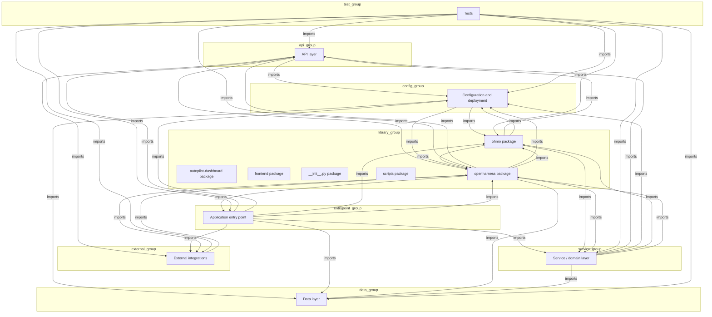

# Architecture report: HKUDS/OpenHarness

> Automated static analysis. **Observed** = directly seen in files/imports/AST; **Inferred** = interpretation from that evidence. Repository code was not executed.

## 1. Repository at a glance

| Item | Value |
| --- | --- |
| Repository | HKUDS/OpenHarness |
| Description | "OpenHarness: Open Agent Harness with a Built-in Personal Agent--Ohmo!" |
| Language | Python |
| Stars | 16210 |
| Licence | MIT |
| Analysed commit / branch | 9b2efd795c6aa09f88b0c257d269a9e518da6ae7 / main |
| Framework(s) | React, Typer |
| Files analysed | 465 |
| Components | 13 |

## 2. Architecture in one minute

HKUDS/OpenHarness - "OpenHarness: Open Agent Harness with a Built-in Personal Agent--Ohmo!". This repository was analysed statically from 465 file(s) (381 Python). Detected technologies (observed from imports/manifests): GitHub Actions, React, Typer, httpx, Pydantic, Poetry. Files are grouped into 13 component(s): API layer, autopilot-dashboard package, Configuration and deployment, Data layer, Application entry point, External integrations, frontend package, __init__.py package. Observed entry point(s): ohmo/__main__.py, ohmo/cli.py, scripts/e2e_smoke.py. Findings below distinguish observed facts from inferred interpretation.

## 3. High-level block diagram

## 4. Main components

### API layer (`api_layer`)

- **Kind:** api
- **Status:** Observed
- **Confidence:** 0.85
- **Responsibility:** Groups 10 file(s) under api layer (observed from repository paths and static analysis). Observed top-level classes: AnthropicApiClient, ApiMessageCompleteEvent, ApiMessageRequest, ApiRetryEvent, ApiTextDeltaEvent, AuthenticationFailure. Observed top-level functions: _auth_file_path, _build_codex_headers, _convert_assistant_message, _convert_messages_to_codex, _convert_messages_to_openai, _convert_tools_to_codex.
- **Paths:** `src/openharness/api/__init__.py`, `src/openharness/api/client.py`, `src/openharness/api/codex_client.py`, `src/openharness/api/copilot_auth.py`, `src/openharness/api/copilot_client.py`, `src/openharness/api/errors.py`, `src/openharness/api/openai_client.py`, `src/openharness/api/provider.py`, `src/openharness/api/registry.py`, `src/openharness/api/usage.py`
- **Evidence:** [src/openharness/api/__init__.py](https://github.com/HKUDS/OpenHarness/blob/9b2efd795c6aa09f88b0c257d269a9e518da6ae7/src/openharness/api/__init__.py); [src/openharness/api/client.py:40](https://github.com/HKUDS/OpenHarness/blob/9b2efd795c6aa09f88b0c257d269a9e518da6ae7/src/openharness/api/client.py#L40); [src/openharness/api/codex_client.py:30](https://github.com/HKUDS/OpenHarness/blob/9b2efd795c6aa09f88b0c257d269a9e518da6ae7/src/openharness/api/codex_client.py#L30); [src/openharness/api/copilot_auth.py:48](https://github.com/HKUDS/OpenHarness/blob/9b2efd795c6aa09f88b0c257d269a9e518da6ae7/src/openharness/api/copilot_auth.py#L48); [src/openharness/api/copilot_client.py:48](https://github.com/HKUDS/OpenHarness/blob/9b2efd795c6aa09f88b0c257d269a9e518da6ae7/src/openharness/api/copilot_client.py#L48); [src/openharness/api/errors.py:6](https://github.com/HKUDS/OpenHarness/blob/9b2efd795c6aa09f88b0c257d269a9e518da6ae7/src/openharness/api/errors.py#L6); [src/openharness/api/openai_client.py:46](https://github.com/HKUDS/OpenHarness/blob/9b2efd795c6aa09f88b0c257d269a9e518da6ae7/src/openharness/api/openai_client.py#L46); [src/openharness/api/provider.py:33](https://github.com/HKUDS/OpenHarness/blob/9b2efd795c6aa09f88b0c257d269a9e518da6ae7/src/openharness/api/provider.py#L33)

### autopilot-dashboard package (`autopilot_dashboard`)

- **Kind:** library
- **Status:** Observed
- **Confidence:** 0.85
- **Responsibility:** Groups 7 file(s) under autopilot-dashboard package (observed from repository paths and static analysis).
- **Paths:** `autopilot-dashboard/src/App.tsx`, `autopilot-dashboard/src/components/HeroBackground.tsx`, `autopilot-dashboard/src/components/PipelineAnimation.tsx`, `autopilot-dashboard/src/main.tsx`, `autopilot-dashboard/src/types.ts`, `autopilot-dashboard/src/vite-env.d.ts`, `autopilot-dashboard/vite.config.ts`
- **Evidence:** [autopilot-dashboard/src/App.tsx](https://github.com/HKUDS/OpenHarness/blob/9b2efd795c6aa09f88b0c257d269a9e518da6ae7/autopilot-dashboard/src/App.tsx); [autopilot-dashboard/src/components/HeroBackground.tsx](https://github.com/HKUDS/OpenHarness/blob/9b2efd795c6aa09f88b0c257d269a9e518da6ae7/autopilot-dashboard/src/components/HeroBackground.tsx); [autopilot-dashboard/src/components/PipelineAnimation.tsx](https://github.com/HKUDS/OpenHarness/blob/9b2efd795c6aa09f88b0c257d269a9e518da6ae7/autopilot-dashboard/src/components/PipelineAnimation.tsx); [autopilot-dashboard/src/main.tsx](https://github.com/HKUDS/OpenHarness/blob/9b2efd795c6aa09f88b0c257d269a9e518da6ae7/autopilot-dashboard/src/main.tsx); [autopilot-dashboard/src/types.ts](https://github.com/HKUDS/OpenHarness/blob/9b2efd795c6aa09f88b0c257d269a9e518da6ae7/autopilot-dashboard/src/types.ts); [autopilot-dashboard/src/vite-env.d.ts](https://github.com/HKUDS/OpenHarness/blob/9b2efd795c6aa09f88b0c257d269a9e518da6ae7/autopilot-dashboard/src/vite-env.d.ts); [autopilot-dashboard/vite.config.ts](https://github.com/HKUDS/OpenHarness/blob/9b2efd795c6aa09f88b0c257d269a9e518da6ae7/autopilot-dashboard/vite.config.ts)

### Configuration and deployment (`config`)

- **Kind:** config
- **Status:** Observed
- **Confidence:** 0.85
- **Responsibility:** Groups 14 file(s) under configuration and deployment (observed from repository paths and static analysis). Observed top-level classes: BaseChannelConfig, ChannelConfigs, Config, DingTalkConfig, DiscordConfig, DockerSandboxSettings. Observed top-level functions: _apply_env_overrides, _infer_profile_name_from_flat_settings, _parse_bool_env, _profile_from_flat_settings, _slugify_profile_name, auth_source_env_var_candidates.
- **Paths:** `autopilot-dashboard/package.json`, `autopilot-dashboard/public/snapshot.json`, `autopilot-dashboard/tsconfig.app.json`, `autopilot-dashboard/tsconfig.json`, `frontend/terminal/package.json`, `frontend/terminal/tsconfig.json`, `ohmo/gateway/config.py`, `pyproject.toml`, `src/openharness/config/__init__.py`, `src/openharness/config/paths.py`, `src/openharness/config/schema.py`, `src/openharness/config/settings.py`, `src/openharness/mcp/config.py`, `src/openharness/sandbox/Dockerfile`
- **Evidence:** [autopilot-dashboard/package.json](https://github.com/HKUDS/OpenHarness/blob/9b2efd795c6aa09f88b0c257d269a9e518da6ae7/autopilot-dashboard/package.json); [autopilot-dashboard/public/snapshot.json](https://github.com/HKUDS/OpenHarness/blob/9b2efd795c6aa09f88b0c257d269a9e518da6ae7/autopilot-dashboard/public/snapshot.json); [autopilot-dashboard/tsconfig.app.json](https://github.com/HKUDS/OpenHarness/blob/9b2efd795c6aa09f88b0c257d269a9e518da6ae7/autopilot-dashboard/tsconfig.app.json); [autopilot-dashboard/tsconfig.json](https://github.com/HKUDS/OpenHarness/blob/9b2efd795c6aa09f88b0c257d269a9e518da6ae7/autopilot-dashboard/tsconfig.json); [frontend/terminal/package.json](https://github.com/HKUDS/OpenHarness/blob/9b2efd795c6aa09f88b0c257d269a9e518da6ae7/frontend/terminal/package.json); [frontend/terminal/tsconfig.json](https://github.com/HKUDS/OpenHarness/blob/9b2efd795c6aa09f88b0c257d269a9e518da6ae7/frontend/terminal/tsconfig.json); [ohmo/gateway/config.py:13](https://github.com/HKUDS/OpenHarness/blob/9b2efd795c6aa09f88b0c257d269a9e518da6ae7/ohmo/gateway/config.py#L13); [pyproject.toml](https://github.com/HKUDS/OpenHarness/blob/9b2efd795c6aa09f88b0c257d269a9e518da6ae7/pyproject.toml)

### Data layer (`data_layer`)

- **Kind:** data
- **Status:** Observed
- **Confidence:** 0.85
- **Responsibility:** Groups 3 file(s) under data layer (observed from repository paths and static analysis). Observed top-level classes: AgentHookDefinition, CommandHookDefinition, GatewayConfig, GatewayState, HttpHookDefinition, PluginManifest.
- **Paths:** `ohmo/gateway/models.py`, `src/openharness/hooks/schemas.py`, `src/openharness/plugins/schemas.py`
- **Evidence:** [ohmo/gateway/models.py:8](https://github.com/HKUDS/OpenHarness/blob/9b2efd795c6aa09f88b0c257d269a9e518da6ae7/ohmo/gateway/models.py#L8); [src/openharness/hooks/schemas.py:10](https://github.com/HKUDS/OpenHarness/blob/9b2efd795c6aa09f88b0c257d269a9e518da6ae7/src/openharness/hooks/schemas.py#L10); [src/openharness/plugins/schemas.py:8](https://github.com/HKUDS/OpenHarness/blob/9b2efd795c6aa09f88b0c257d269a9e518da6ae7/src/openharness/plugins/schemas.py#L8)

### Application entry point (`entrypoint`)

- **Kind:** entrypoint
- **Status:** Observed
- **Confidence:** 0.85
- **Responsibility:** Groups 11 file(s) under application entry point (observed from repository paths and static analysis). Observed application object created via Typer. Observed top-level classes: FakeApiClient, MigrationSummary, Scenario. Observed top-level functions: _bind_external_provider, _build_dry_run_preview, _build_gateway_logging_handlers, _can_use_questionary, _candidate_entry, _command_for_job.
- **Paths:** `ohmo/__main__.py`, `ohmo/cli.py`, `scripts/e2e_smoke.py`, `scripts/local_system_scenarios.py`, `scripts/migrate_memory.py`, `scripts/react_tui_e2e.py`, `src/openharness/__main__.py`, `src/openharness/cli.py`, `src/openharness/memory/migrate.py`, `src/openharness/services/cron_scheduler.py`, `src/openharness/ui/app.py`
- **Evidence:** [ohmo/__main__.py](https://github.com/HKUDS/OpenHarness/blob/9b2efd795c6aa09f88b0c257d269a9e518da6ae7/ohmo/__main__.py); [ohmo/cli.py:38](https://github.com/HKUDS/OpenHarness/blob/9b2efd795c6aa09f88b0c257d269a9e518da6ae7/ohmo/cli.py#L38); [scripts/e2e_smoke.py:42](https://github.com/HKUDS/OpenHarness/blob/9b2efd795c6aa09f88b0c257d269a9e518da6ae7/scripts/e2e_smoke.py#L42); [scripts/local_system_scenarios.py:35](https://github.com/HKUDS/OpenHarness/blob/9b2efd795c6aa09f88b0c257d269a9e518da6ae7/scripts/local_system_scenarios.py#L35); [scripts/migrate_memory.py](https://github.com/HKUDS/OpenHarness/blob/9b2efd795c6aa09f88b0c257d269a9e518da6ae7/scripts/migrate_memory.py); [scripts/react_tui_e2e.py:21](https://github.com/HKUDS/OpenHarness/blob/9b2efd795c6aa09f88b0c257d269a9e518da6ae7/scripts/react_tui_e2e.py#L21); [src/openharness/__main__.py](https://github.com/HKUDS/OpenHarness/blob/9b2efd795c6aa09f88b0c257d269a9e518da6ae7/src/openharness/__main__.py); [src/openharness/cli.py:751](https://github.com/HKUDS/OpenHarness/blob/9b2efd795c6aa09f88b0c257d269a9e518da6ae7/src/openharness/cli.py#L751)

### External integrations (`external_integrations`)

- **Kind:** external
- **Status:** Observed
- **Confidence:** 0.85
- **Responsibility:** Groups 1 file(s) under external integrations (observed from repository paths and static analysis). Observed top-level classes: McpClientManager, McpServerNotConnectedError.
- **Paths:** `src/openharness/mcp/client.py`
- **Evidence:** [src/openharness/mcp/client.py:25](https://github.com/HKUDS/OpenHarness/blob/9b2efd795c6aa09f88b0c257d269a9e518da6ae7/src/openharness/mcp/client.py#L25)

### frontend package (`frontend`)

- **Kind:** library
- **Status:** Observed
- **Confidence:** 0.85
- **Responsibility:** Groups 27 file(s) under frontend package (observed from repository paths and static analysis).
- **Paths:** `frontend/terminal/src/App.tsx`, `frontend/terminal/src/clipboardImage.ts`, `frontend/terminal/src/components/CommandPicker.tsx`, `frontend/terminal/src/components/Composer.tsx`, `frontend/terminal/src/components/ConversationView.tsx`, `frontend/terminal/src/components/Footer.tsx`, `frontend/terminal/src/components/MarkdownText.test.tsx`, `frontend/terminal/src/components/MarkdownText.tsx`, `frontend/terminal/src/components/ModalHost.test.tsx`, `frontend/terminal/src/components/ModalHost.tsx`, `frontend/terminal/src/components/PromptInput.test.ts`, `frontend/terminal/src/components/PromptInput.test.tsx`, `frontend/terminal/src/components/PromptInput.tsx`, `frontend/terminal/src/components/SelectModal.tsx`, `frontend/terminal/src/components/SidePanel.tsx`, `frontend/terminal/src/components/Spinner.tsx`, `frontend/terminal/src/components/StatusBar.tsx`, `frontend/terminal/src/components/SwarmPanel.tsx`, `frontend/terminal/src/components/TodoPanel.tsx`, `frontend/terminal/src/components/ToolCallDisplay.tsx`, `frontend/terminal/src/components/TranscriptPane.tsx`, `frontend/terminal/src/components/WelcomeBanner.tsx`, `frontend/terminal/src/hooks/useBackendSession.ts`, `frontend/terminal/src/index.tsx`, `frontend/terminal/src/theme/ThemeContext.tsx`, `frontend/terminal/src/theme/builtinThemes.ts`, `frontend/terminal/src/types.ts`
- **Evidence:** [frontend/terminal/src/App.tsx](https://github.com/HKUDS/OpenHarness/blob/9b2efd795c6aa09f88b0c257d269a9e518da6ae7/frontend/terminal/src/App.tsx); [frontend/terminal/src/clipboardImage.ts](https://github.com/HKUDS/OpenHarness/blob/9b2efd795c6aa09f88b0c257d269a9e518da6ae7/frontend/terminal/src/clipboardImage.ts); [frontend/terminal/src/components/CommandPicker.tsx](https://github.com/HKUDS/OpenHarness/blob/9b2efd795c6aa09f88b0c257d269a9e518da6ae7/frontend/terminal/src/components/CommandPicker.tsx); [frontend/terminal/src/components/Composer.tsx](https://github.com/HKUDS/OpenHarness/blob/9b2efd795c6aa09f88b0c257d269a9e518da6ae7/frontend/terminal/src/components/Composer.tsx); [frontend/terminal/src/components/ConversationView.tsx](https://github.com/HKUDS/OpenHarness/blob/9b2efd795c6aa09f88b0c257d269a9e518da6ae7/frontend/terminal/src/components/ConversationView.tsx); [frontend/terminal/src/components/Footer.tsx](https://github.com/HKUDS/OpenHarness/blob/9b2efd795c6aa09f88b0c257d269a9e518da6ae7/frontend/terminal/src/components/Footer.tsx); [frontend/terminal/src/components/MarkdownText.test.tsx](https://github.com/HKUDS/OpenHarness/blob/9b2efd795c6aa09f88b0c257d269a9e518da6ae7/frontend/terminal/src/components/MarkdownText.test.tsx); [frontend/terminal/src/components/MarkdownText.tsx](https://github.com/HKUDS/OpenHarness/blob/9b2efd795c6aa09f88b0c257d269a9e518da6ae7/frontend/terminal/src/components/MarkdownText.tsx)

### __init__.py package (`init_py`)

- **Kind:** library
- **Status:** Observed
- **Confidence:** 0.85
- **Responsibility:** Groups 1 file(s) under __init__.py package (observed from repository paths and static analysis).
- **Paths:** `src/__init__.py`
- **Evidence:** [src/__init__.py](https://github.com/HKUDS/OpenHarness/blob/9b2efd795c6aa09f88b0c257d269a9e518da6ae7/src/__init__.py)

### ohmo package (`ohmo`)

- **Kind:** library
- **Status:** Observed
- **Confidence:** 0.85
- **Responsibility:** Groups 14 file(s) under ohmo package (observed from repository paths and static analysis). Observed top-level classes: GatewayStreamUpdate, ManagedGroupRecord, OhmoCreateFeishuGroupInput, OhmoCreateFeishuGroupTool, OhmoGatewayBridge, OhmoNotificationError. Observed top-level functions: _build_attachment_notes, _build_group_agent_prompt, _build_inbound_user_message, _build_speaker_context, _chunk_text, _content_snippet.
- **Paths:** `ohmo/__init__.py`, `ohmo/gateway/__init__.py`, `ohmo/gateway/bridge.py`, `ohmo/gateway/group_tool.py`, `ohmo/gateway/notify.py`, `ohmo/gateway/provider_commands.py`, `ohmo/gateway/router.py`, `ohmo/gateway/runtime.py`, `ohmo/group_registry.py`, `ohmo/memory.py`, `ohmo/prompts.py`, `ohmo/runtime.py`, `ohmo/session_storage.py`, `ohmo/workspace.py`
- **Evidence:** [ohmo/__init__.py](https://github.com/HKUDS/OpenHarness/blob/9b2efd795c6aa09f88b0c257d269a9e518da6ae7/ohmo/__init__.py); [ohmo/gateway/__init__.py](https://github.com/HKUDS/OpenHarness/blob/9b2efd795c6aa09f88b0c257d269a9e518da6ae7/ohmo/gateway/__init__.py); [ohmo/gateway/bridge.py:21](https://github.com/HKUDS/OpenHarness/blob/9b2efd795c6aa09f88b0c257d269a9e518da6ae7/ohmo/gateway/bridge.py#L21); [ohmo/gateway/group_tool.py:20](https://github.com/HKUDS/OpenHarness/blob/9b2efd795c6aa09f88b0c257d269a9e518da6ae7/ohmo/gateway/group_tool.py#L20); [ohmo/gateway/notify.py:16](https://github.com/HKUDS/OpenHarness/blob/9b2efd795c6aa09f88b0c257d269a9e518da6ae7/ohmo/gateway/notify.py#L16); [ohmo/gateway/provider_commands.py:13](https://github.com/HKUDS/OpenHarness/blob/9b2efd795c6aa09f88b0c257d269a9e518da6ae7/ohmo/gateway/provider_commands.py#L13); [ohmo/gateway/router.py:8](https://github.com/HKUDS/OpenHarness/blob/9b2efd795c6aa09f88b0c257d269a9e518da6ae7/ohmo/gateway/router.py#L8); [ohmo/gateway/runtime.py:88](https://github.com/HKUDS/OpenHarness/blob/9b2efd795c6aa09f88b0c257d269a9e518da6ae7/ohmo/gateway/runtime.py#L88)

### openharness package (`openharness`)

- **Kind:** library
- **Status:** Observed
- **Confidence:** 0.85
- **Responsibility:** Groups 189 file(s) under openharness package (observed from repository paths and static analysis). Observed top-level classes: AgentDefinition, AgentTool, AgentToolInput, AggregatedHookResult, AllowedPath, ApiKeyFlow. Observed top-level functions: __getattr__, _address_in_networks, _append_capped_unique, _apply_mode, _apply_selector, _as_bool.
- **Paths:** `src/openharness/__init__.py`, `src/openharness/auth/__init__.py`, `src/openharness/auth/external.py`, `src/openharness/auth/flows.py`, `src/openharness/auth/manager.py`, `src/openharness/auth/storage.py`, `src/openharness/autopilot/__init__.py`, `src/openharness/autopilot/types.py`, `src/openharness/bridge/__init__.py`, `src/openharness/bridge/manager.py`, `src/openharness/bridge/session_runner.py`, `src/openharness/bridge/types.py`, `src/openharness/bridge/work_secret.py`, `src/openharness/channels/__init__.py`, `src/openharness/channels/adapter.py`, `src/openharness/channels/bus/__init__.py`, `src/openharness/channels/bus/events.py`, `src/openharness/channels/bus/queue.py`, `src/openharness/channels/impl/__init__.py`, `src/openharness/channels/impl/base.py`, `src/openharness/channels/impl/dingtalk.py`, `src/openharness/channels/impl/discord.py`, `src/openharness/channels/impl/email.py`, `src/openharness/channels/impl/feishu.py`, `src/openharness/channels/impl/manager.py`, `src/openharness/channels/impl/matrix.py`, `src/openharness/channels/impl/mochat.py`, `src/openharness/channels/impl/qq.py`, `src/openharness/channels/impl/slack.py`, `src/openharness/channels/impl/telegram.py`, `src/openharness/channels/impl/whatsapp.py`, `src/openharness/commands/__init__.py`, `src/openharness/commands/registry.py`, `src/openharness/coordinator/__init__.py`, `src/openharness/coordinator/agent_definitions.py`, `src/openharness/coordinator/coordinator_mode.py`, `src/openharness/engine/__init__.py`, `src/openharness/engine/cost_tracker.py`, `src/openharness/engine/messages.py`, `src/openharness/engine/query.py`, `src/openharness/engine/query_engine.py`, `src/openharness/engine/stream_events.py`, `src/openharness/hooks/__init__.py`, `src/openharness/hooks/events.py`, `src/openharness/hooks/executor.py`, `src/openharness/hooks/hot_reload.py`, `src/openharness/hooks/loader.py`, `src/openharness/hooks/types.py`, `src/openharness/keybindings/__init__.py`, `src/openharness/keybindings/default_bindings.py`, `src/openharness/keybindings/loader.py`, `src/openharness/keybindings/parser.py`, `src/openharness/keybindings/resolver.py`, `src/openharness/mcp/__init__.py`, `src/openharness/mcp/types.py`, `src/openharness/memory/__init__.py`, `src/openharness/memory/agent.py`, `src/openharness/memory/manager.py`, `src/openharness/memory/memdir.py`, `src/openharness/memory/paths.py`, `src/openharness/memory/relevance.py`, `src/openharness/memory/scan.py`, `src/openharness/memory/schema.py`, `src/openharness/memory/search.py`, `src/openharness/memory/team.py`, `src/openharness/memory/types.py`, `src/openharness/memory/usage.py`, `src/openharness/output_styles/__init__.py`, `src/openharness/output_styles/loader.py`, `src/openharness/permissions/__init__.py`, `src/openharness/permissions/checker.py`, `src/openharness/permissions/modes.py`, `src/openharness/personalization/__init__.py`, `src/openharness/personalization/extractor.py`, `src/openharness/personalization/rules.py`, `src/openharness/personalization/session_hook.py`, `src/openharness/platforms.py`, `src/openharness/plugins/__init__.py`, `src/openharness/plugins/bundled/__init__.py`, `src/openharness/plugins/installer.py`, `src/openharness/plugins/loader.py`, `src/openharness/plugins/types.py`, `src/openharness/prompts/__init__.py`, `src/openharness/prompts/claudemd.py`, `src/openharness/prompts/context.py`, `src/openharness/prompts/environment.py`, `src/openharness/prompts/system_prompt.py`, `src/openharness/sandbox/__init__.py`, `src/openharness/sandbox/adapter.py`, `src/openharness/sandbox/docker_backend.py`, `src/openharness/sandbox/docker_image.py`, `src/openharness/sandbox/path_validator.py`, `src/openharness/sandbox/session.py`, `src/openharness/skills/__init__.py`, `src/openharness/skills/_frontmatter.py`, `src/openharness/skills/bundled/__init__.py`, `src/openharness/skills/loader.py`, `src/openharness/skills/registry.py`, `src/openharness/skills/types.py`, `src/openharness/state/__init__.py`, `src/openharness/state/app_state.py`, `src/openharness/state/store.py`, `src/openharness/swarm/__init__.py`, `src/openharness/swarm/in_process.py`, `src/openharness/swarm/lockfile.py`, `src/openharness/swarm/mailbox.py`, `src/openharness/swarm/permission_sync.py`, `src/openharness/swarm/registry.py`, `src/openharness/swarm/spawn_utils.py`, `src/openharness/swarm/subprocess_backend.py`, `src/openharness/swarm/team_lifecycle.py`, `src/openharness/swarm/types.py`, `src/openharness/swarm/worktree.py`, `src/openharness/tasks/__init__.py`, `src/openharness/tasks/local_agent_task.py`, `src/openharness/tasks/local_shell_task.py`, `src/openharness/tasks/manager.py`, `src/openharness/tasks/stop_task.py`, `src/openharness/tasks/types.py`, `src/openharness/themes/__init__.py`, `src/openharness/themes/builtin.py`, `src/openharness/themes/loader.py`, `src/openharness/themes/schema.py`, `src/openharness/tools/__init__.py`, `src/openharness/tools/agent_tool.py`, `src/openharness/tools/ask_user_question_tool.py`, `src/openharness/tools/base.py`, `src/openharness/tools/bash_tool.py`, `src/openharness/tools/brief_tool.py`, `src/openharness/tools/config_tool.py`, `src/openharness/tools/cron_create_tool.py`, `src/openharness/tools/cron_delete_tool.py`, `src/openharness/tools/cron_list_tool.py`, `src/openharness/tools/cron_toggle_tool.py`, `src/openharness/tools/enter_plan_mode_tool.py`, `src/openharness/tools/enter_worktree_tool.py`, `src/openharness/tools/exit_plan_mode_tool.py`, `src/openharness/tools/exit_worktree_tool.py`, `src/openharness/tools/file_edit_tool.py`, `src/openharness/tools/file_read_tool.py`, `src/openharness/tools/file_write_tool.py`, `src/openharness/tools/glob_tool.py`, `src/openharness/tools/grep_tool.py`, `src/openharness/tools/image_generation_tool.py`, `src/openharness/tools/image_to_text_tool.py`, `src/openharness/tools/list_mcp_resources_tool.py`, `src/openharness/tools/lsp_tool.py`, `src/openharness/tools/mcp_auth_tool.py`, `src/openharness/tools/mcp_tool.py`, `src/openharness/tools/notebook_edit_tool.py`, `src/openharness/tools/read_mcp_resource_tool.py`, `src/openharness/tools/remote_trigger_tool.py`, `src/openharness/tools/send_message_tool.py`, `src/openharness/tools/skill_tool.py`, `src/openharness/tools/sleep_tool.py`, `src/openharness/tools/task_create_tool.py`, `src/openharness/tools/task_get_tool.py`, `src/openharness/tools/task_list_tool.py`, `src/openharness/tools/task_output_tool.py`, `src/openharness/tools/task_stop_tool.py`, `src/openharness/tools/task_update_tool.py`, `src/openharness/tools/team_create_tool.py`, `src/openharness/tools/team_delete_tool.py`, `src/openharness/tools/todo_write_tool.py`, `src/openharness/tools/tool_search_tool.py`, `src/openharness/tools/web_fetch_tool.py`, `src/openharness/tools/web_search_tool.py`, `src/openharness/ui/__init__.py`, `src/openharness/ui/backend_host.py`, `src/openharness/ui/coordinator_drain.py`, `src/openharness/ui/input.py`, `src/openharness/ui/output.py`, `src/openharness/ui/permission_dialog.py`, `src/openharness/ui/protocol.py`, `src/openharness/ui/react_launcher.py`, `src/openharness/ui/runtime.py`, `src/openharness/ui/textual_app.py`, `src/openharness/utils/__init__.py`, `src/openharness/utils/file_lock.py`, `src/openharness/utils/fs.py`, `src/openharness/utils/helpers.py`, `src/openharness/utils/network_guard.py`, `src/openharness/utils/shell.py`, `src/openharness/vim/__init__.py`, `src/openharness/vim/transitions.py`, `src/openharness/voice/__init__.py`, `src/openharness/voice/keyterms.py`, `src/openharness/voice/stream_stt.py`, `src/openharness/voice/voice_mode.py`
- **Evidence:** [src/openharness/__init__.py](https://github.com/HKUDS/OpenHarness/blob/9b2efd795c6aa09f88b0c257d269a9e518da6ae7/src/openharness/__init__.py); [src/openharness/auth/__init__.py](https://github.com/HKUDS/OpenHarness/blob/9b2efd795c6aa09f88b0c257d269a9e518da6ae7/src/openharness/auth/__init__.py); [src/openharness/auth/external.py:53](https://github.com/HKUDS/OpenHarness/blob/9b2efd795c6aa09f88b0c257d269a9e518da6ae7/src/openharness/auth/external.py#L53); [src/openharness/auth/flows.py:21](https://github.com/HKUDS/OpenHarness/blob/9b2efd795c6aa09f88b0c257d269a9e518da6ae7/src/openharness/auth/flows.py#L21); [src/openharness/auth/manager.py:71](https://github.com/HKUDS/OpenHarness/blob/9b2efd795c6aa09f88b0c257d269a9e518da6ae7/src/openharness/auth/manager.py#L71); [src/openharness/auth/storage.py:34](https://github.com/HKUDS/OpenHarness/blob/9b2efd795c6aa09f88b0c257d269a9e518da6ae7/src/openharness/auth/storage.py#L34); [src/openharness/autopilot/__init__.py](https://github.com/HKUDS/OpenHarness/blob/9b2efd795c6aa09f88b0c257d269a9e518da6ae7/src/openharness/autopilot/__init__.py); [src/openharness/autopilot/types.py:33](https://github.com/HKUDS/OpenHarness/blob/9b2efd795c6aa09f88b0c257d269a9e518da6ae7/src/openharness/autopilot/types.py#L33)

### scripts package (`scripts`)

- **Kind:** library
- **Status:** Observed
- **Confidence:** 0.85
- **Responsibility:** Groups 3 file(s) under scripts package (observed from repository paths and static analysis).
- **Paths:** `scripts/install.sh`, `scripts/install_dev.sh`, `scripts/sync_nanobot_channels.sh`
- **Evidence:** [scripts/install.sh](https://github.com/HKUDS/OpenHarness/blob/9b2efd795c6aa09f88b0c257d269a9e518da6ae7/scripts/install.sh); [scripts/install_dev.sh](https://github.com/HKUDS/OpenHarness/blob/9b2efd795c6aa09f88b0c257d269a9e518da6ae7/scripts/install_dev.sh); [scripts/sync_nanobot_channels.sh](https://github.com/HKUDS/OpenHarness/blob/9b2efd795c6aa09f88b0c257d269a9e518da6ae7/scripts/sync_nanobot_channels.sh)

### Service / domain layer (`service_layer`)

- **Kind:** service
- **Status:** Observed
- **Confidence:** 0.85
- **Responsibility:** Groups 18 file(s) under service / domain layer (observed from repository paths and static analysis). Observed top-level classes: AutoCompactState, CompactAttachment, CompactionResult, ExtractionRecord, ExtractionResult, OhmoGatewayService. Observed top-level functions: _bilingual_lines, _boundary_crosses_tool_pair, _build_compact_attachments, _build_file_session_memory_message, _build_passthrough_compaction_result, _build_session_memory_message.
- **Paths:** `ohmo/gateway/service.py`, `src/openharness/autopilot/service.py`, `src/openharness/services/__init__.py`, `src/openharness/services/autodream/__init__.py`, `src/openharness/services/autodream/backup.py`, `src/openharness/services/autodream/lock.py`, `src/openharness/services/autodream/prompt.py`, `src/openharness/services/autodream/service.py`, `src/openharness/services/compact/__init__.py`, `src/openharness/services/cron.py`, `src/openharness/services/lsp/__init__.py`, `src/openharness/services/memory_extract/__init__.py`, `src/openharness/services/oauth/__init__.py`, `src/openharness/services/session_backend.py`, `src/openharness/services/session_memory/__init__.py`, `src/openharness/services/session_storage.py`, `src/openharness/services/token_estimation.py`, `src/openharness/services/tool_outputs.py`
- **Evidence:** [ohmo/gateway/service.py:39](https://github.com/HKUDS/OpenHarness/blob/9b2efd795c6aa09f88b0c257d269a9e518da6ae7/ohmo/gateway/service.py#L39); [src/openharness/autopilot/service.py:117](https://github.com/HKUDS/OpenHarness/blob/9b2efd795c6aa09f88b0c257d269a9e518da6ae7/src/openharness/autopilot/service.py#L117); [src/openharness/services/__init__.py](https://github.com/HKUDS/OpenHarness/blob/9b2efd795c6aa09f88b0c257d269a9e518da6ae7/src/openharness/services/__init__.py); [src/openharness/services/autodream/__init__.py](https://github.com/HKUDS/OpenHarness/blob/9b2efd795c6aa09f88b0c257d269a9e518da6ae7/src/openharness/services/autodream/__init__.py); [src/openharness/services/autodream/backup.py:13](https://github.com/HKUDS/OpenHarness/blob/9b2efd795c6aa09f88b0c257d269a9e518da6ae7/src/openharness/services/autodream/backup.py#L13); [src/openharness/services/autodream/lock.py:18](https://github.com/HKUDS/OpenHarness/blob/9b2efd795c6aa09f88b0c257d269a9e518da6ae7/src/openharness/services/autodream/lock.py#L18); [src/openharness/services/autodream/prompt.py:12](https://github.com/HKUDS/OpenHarness/blob/9b2efd795c6aa09f88b0c257d269a9e518da6ae7/src/openharness/services/autodream/prompt.py#L12); [src/openharness/services/autodream/service.py:32](https://github.com/HKUDS/OpenHarness/blob/9b2efd795c6aa09f88b0c257d269a9e518da6ae7/src/openharness/services/autodream/service.py#L32)

### Tests (`tests`)

- **Kind:** test
- **Status:** Observed
- **Confidence:** 0.85
- **Responsibility:** Groups 128 file(s) under tests (observed from repository paths and static analysis). Observed top-level classes: CapturingApiClient, CoordinatorLoopApiClient, EmptyAssistantApiClient, FailingApiClient, FakeApiClient, FakeAsyncClient. Observed top-level functions: _argv_str, _b64url, _build_context, _build_store, _concurrent_writer, _env.
- **Paths:** `scripts/test_cli_flags.py`, `scripts/test_docker_sandbox_e2e.py`, `scripts/test_harness_features.py`, `scripts/test_headless_rendering.py`, `scripts/test_react_tui_redesign.py`, `scripts/test_real_skills_plugins.py`, `scripts/test_tui_interactions.py`, `tests/__init__.py`, `tests/conftest.py`, `tests/fixtures/fake_mcp_server.py`, `tests/test_api/__init__.py`, `tests/test_api/test_client.py`, `tests/test_api/test_codex_client.py`, `tests/test_api/test_copilot_auth.py`, `tests/test_api/test_copilot_client.py`, `tests/test_api/test_openai_client.py`, `tests/test_auth/test_external.py`, `tests/test_auth/test_flows.py`, `tests/test_autopilot/__init__.py`, `tests/test_autopilot/test_verification.py`, `tests/test_bridge/test_core.py`, `tests/test_bridge/test_session_flow.py`, `tests/test_channels/test_base.py`, `tests/test_channels/test_feishu_security.py`, `tests/test_channels/test_telegram_security.py`, `tests/test_commands/__init__.py`, `tests/test_commands/test_cli.py`, `tests/test_commands/test_command_flows.py`, `tests/test_commands/test_registry.py`, `tests/test_config/__init__.py`, `tests/test_config/test_output_styles_loader.py`, `tests/test_config/test_paths.py`, `tests/test_config/test_schema.py`, `tests/test_config/test_settings.py`, `tests/test_coordinator/test_agent_definitions.py`, `tests/test_coordinator/test_coordinator_mode.py`, `tests/test_coordinator/test_registry.py`, `tests/test_engine/__init__.py`, `tests/test_engine/test_messages.py`, `tests/test_engine/test_query_engine.py`, `tests/test_entrypoints/test_config_cli.py`, `tests/test_entrypoints/test_no_stdlib_types_shadowing.py`, `tests/test_hooks/__init__.py`, `tests/test_hooks/test_executor.py`, `tests/test_hooks/test_priority.py`, `tests/test_hooks_skills_plugins_real.py`, `tests/test_install/test_windows_alias.py`, `tests/test_logging/test_format_strings.py`, `tests/test_mcp/__init__.py`, `tests/test_mcp/test_client_errors.py`, `tests/test_mcp/test_http_flow.py`, `tests/test_mcp/test_integration.py`, `tests/test_mcp/test_stdio_flow.py`, `tests/test_memory/__init__.py`, `tests/test_memory/test_claude_runtime_memory.py`, `tests/test_memory/test_memdir.py`, `tests/test_merged_prs_on_autoagent.py`, `tests/test_ohmo/test_cli.py`, `tests/test_ohmo/test_gateway.py`, `tests/test_ohmo/test_loading.py`, `tests/test_ohmo/test_ohmo_session_storage.py`, `tests/test_ohmo/test_prompts.py`, `tests/test_ohmo/test_workspace.py`, `tests/test_permissions/__init__.py`, `tests/test_permissions/test_checker.py`, `tests/test_personalization/__init__.py`, `tests/test_personalization/test_extractor.py`, `tests/test_platforms.py`, `tests/test_plugins/__init__.py`, `tests/test_plugins/test_lifecycle_flow.py`, `tests/test_plugins/test_loader.py`, `tests/test_prompts/__init__.py`, `tests/test_prompts/test_claudemd.py`, `tests/test_prompts/test_environment.py`, `tests/test_prompts/test_system_prompt.py`, `tests/test_real_large_tasks.py`, `tests/test_sandbox/test_adapter.py`, `tests/test_sandbox/test_docker_backend.py`, `tests/test_sandbox/test_docker_image.py`, `tests/test_sandbox/test_path_validator.py`, `tests/test_services/test_autodream.py`, `tests/test_services/test_autopilot.py`, `tests/test_services/test_compact.py`, `tests/test_services/test_cron.py`, `tests/test_services/test_cron_scheduler.py`, `tests/test_services/test_session_storage.py`, `tests/test_skills/test_loader.py`, `tests/test_swarm/__init__.py`, `tests/test_swarm/test_imports.py`, `tests/test_swarm/test_in_process.py`, `tests/test_swarm/test_lockfile.py`, `tests/test_swarm/test_mailbox.py`, `tests/test_swarm/test_permission_sync.py`, `tests/test_swarm/test_registry.py`, `tests/test_swarm/test_spawn_utils.py`, `tests/test_swarm/test_subprocess_backend.py`, `tests/test_swarm/test_team_lifecycle.py`, `tests/test_swarm/test_types.py`, `tests/test_swarm/test_worktree.py`, `tests/test_tasks/test_manager.py`, `tests/test_tools/__init__.py`, `tests/test_tools/test_bash_tool.py`, `tests/test_tools/test_core_tools.py`, `tests/test_tools/test_grep_tool.py`, `tests/test_tools/test_image_generation_tool.py`, `tests/test_tools/test_image_to_text_tool.py`, `tests/test_tools/test_integration_flows.py`, `tests/test_tools/test_mcp_auth_tool.py`, `tests/test_tools/test_mcp_tool.py`, `tests/test_tools/test_task_tools.py`, `tests/test_tools/test_web_fetch_tool.py`, `tests/test_ui/__init__.py`, `tests/test_ui/test_coordinator_drain.py`, `tests/test_ui/test_modes.py`, `tests/test_ui/test_project_plugin_security.py`, `tests/test_ui/test_react_backend.py`, `tests/test_ui/test_react_launcher.py`, `tests/test_ui/test_runtime_api_key.py`, `tests/test_ui/test_runtime_close.py`, `tests/test_ui/test_runtime_plan_mode.py`, `tests/test_ui/test_runtime_plugin_tools.py`, `tests/test_ui/test_textual_app.py`, `tests/test_ui/test_tui_exit_sequence.py`, `tests/test_untested_features.py`, `tests/test_utils/test_fs.py`, `tests/test_utils/test_helpers.py`, `tests/test_utils/test_network_guard.py`, `tests/test_utils/test_shell.py`
- **Evidence:** [scripts/test_cli_flags.py:18](https://github.com/HKUDS/OpenHarness/blob/9b2efd795c6aa09f88b0c257d269a9e518da6ae7/scripts/test_cli_flags.py#L18); [scripts/test_docker_sandbox_e2e.py:62](https://github.com/HKUDS/OpenHarness/blob/9b2efd795c6aa09f88b0c257d269a9e518da6ae7/scripts/test_docker_sandbox_e2e.py#L62); [scripts/test_harness_features.py:25](https://github.com/HKUDS/OpenHarness/blob/9b2efd795c6aa09f88b0c257d269a9e518da6ae7/scripts/test_harness_features.py#L25); [scripts/test_headless_rendering.py:22](https://github.com/HKUDS/OpenHarness/blob/9b2efd795c6aa09f88b0c257d269a9e518da6ae7/scripts/test_headless_rendering.py#L22); [scripts/test_react_tui_redesign.py:24](https://github.com/HKUDS/OpenHarness/blob/9b2efd795c6aa09f88b0c257d269a9e518da6ae7/scripts/test_react_tui_redesign.py#L24); [scripts/test_real_skills_plugins.py:29](https://github.com/HKUDS/OpenHarness/blob/9b2efd795c6aa09f88b0c257d269a9e518da6ae7/scripts/test_real_skills_plugins.py#L29); [scripts/test_tui_interactions.py:20](https://github.com/HKUDS/OpenHarness/blob/9b2efd795c6aa09f88b0c257d269a9e518da6ae7/scripts/test_tui_interactions.py#L20); [tests/__init__.py](https://github.com/HKUDS/OpenHarness/blob/9b2efd795c6aa09f88b0c257d269a9e518da6ae7/tests/__init__.py)

## 5. Execution flow

**Observed** entry point(s):

- [ohmo/__main__.py:6](https://github.com/HKUDS/OpenHarness/blob/9b2efd795c6aa09f88b0c257d269a9e518da6ae7/ohmo/__main__.py#L6)
- [ohmo/cli.py](https://github.com/HKUDS/OpenHarness/blob/9b2efd795c6aa09f88b0c257d269a9e518da6ae7/ohmo/cli.py)
- [scripts/e2e_smoke.py:806](https://github.com/HKUDS/OpenHarness/blob/9b2efd795c6aa09f88b0c257d269a9e518da6ae7/scripts/e2e_smoke.py#L806)
- [scripts/local_system_scenarios.py:247](https://github.com/HKUDS/OpenHarness/blob/9b2efd795c6aa09f88b0c257d269a9e518da6ae7/scripts/local_system_scenarios.py#L247)
- [scripts/migrate_memory.py:13](https://github.com/HKUDS/OpenHarness/blob/9b2efd795c6aa09f88b0c257d269a9e518da6ae7/scripts/migrate_memory.py#L13)
- [scripts/react_tui_e2e.py:160](https://github.com/HKUDS/OpenHarness/blob/9b2efd795c6aa09f88b0c257d269a9e518da6ae7/scripts/react_tui_e2e.py#L160)
- [src/openharness/__main__.py:5](https://github.com/HKUDS/OpenHarness/blob/9b2efd795c6aa09f88b0c257d269a9e518da6ae7/src/openharness/__main__.py#L5)
- [src/openharness/cli.py](https://github.com/HKUDS/OpenHarness/blob/9b2efd795c6aa09f88b0c257d269a9e518da6ae7/src/openharness/cli.py)
- [src/openharness/cli.py](https://github.com/HKUDS/OpenHarness/blob/9b2efd795c6aa09f88b0c257d269a9e518da6ae7/src/openharness/cli.py)
- [src/openharness/cli.py](https://github.com/HKUDS/OpenHarness/blob/9b2efd795c6aa09f88b0c257d269a9e518da6ae7/src/openharness/cli.py)
- [src/openharness/memory/migrate.py:136](https://github.com/HKUDS/OpenHarness/blob/9b2efd795c6aa09f88b0c257d269a9e518da6ae7/src/openharness/memory/migrate.py#L136)
- [src/openharness/services/cron_scheduler.py:594](https://github.com/HKUDS/OpenHarness/blob/9b2efd795c6aa09f88b0c257d269a9e518da6ae7/src/openharness/services/cron_scheduler.py#L594)

Representative flow (derived from observed entry points and the import graph; steps beyond the entry point are **Inferred**):

1. Execution starts at an observed entry point listed above, if present.
2. `api_layer` imports `config` (API layer -> Configuration and deployment).
3. `api_layer` imports `external_integrations` (API layer -> External integrations).
4. `api_layer` imports `openharness` (API layer -> openharness package).
5. `config` imports `data_layer` (Configuration and deployment -> Data layer).
6. `config` imports `ohmo` (Configuration and deployment -> ohmo package).
7. `config` imports `openharness` (Configuration and deployment -> openharness package).
8. `entrypoint` imports `api_layer` (Application entry point -> API layer).
9. `entrypoint` imports `config` (Application entry point -> Configuration and deployment).

## 6. Project structure

### `(root)`

- `.gitignore` - other (401 bytes)
- `CHANGELOG.md` - docs (12581 bytes)
- `CONTRIBUTING.md` - docs (2326 bytes)
- `LICENSE` - docs (1081 bytes)
- `README.md` - docs (32673 bytes)
- `README.zh-CN.md` - docs (8572 bytes)
- `RELEASE_NOTES_v0.1.8.md` - docs (3625 bytes)
- `RELEASE_NOTES_v0.1.9.md` - docs (1405 bytes)
- `pyproject.toml` - manifest (1810 bytes)

### `.claude`

- `.claude/skills/harness-eval/SKILL.md` - docs (8505 bytes)
- `.claude/skills/harness-eval/references/feature-matrix.md` - docs (2423 bytes)
- `.claude/skills/harness-eval/references/test-patterns.md` - docs (5959 bytes)
- `.claude/skills/pr-merge/SKILL.md` - docs (3409 bytes)
- `.claude/skills/pr-merge/references/merge-scenarios.md` - docs (3757 bytes)

### `.github`

- `.github/ISSUE_TEMPLATE/bug_report.yml` - config (1173 bytes)
- `.github/ISSUE_TEMPLATE/config.yml` - config (394 bytes)
- `.github/ISSUE_TEMPLATE/feature_request.yml` - config (997 bytes)
- `.github/PULL_REQUEST_TEMPLATE.md` - docs (265 bytes)
- `.github/workflows/autopilot-pages.yml` - ci, YAML (1304 bytes)
- `.github/workflows/autopilot-run-next.yml` - ci, YAML (1297 bytes)
- `.github/workflows/autopilot-scan.yml` - ci, YAML (1290 bytes)
- `.github/workflows/ci.yml` - ci, YAML (1757 bytes)

### `autopilot-dashboard`

- `autopilot-dashboard/.gitignore` - other (18 bytes)
- `autopilot-dashboard/index.html` - other (571 bytes)
- `autopilot-dashboard/package.json` - manifest (460 bytes)
- `autopilot-dashboard/public/snapshot.json` - config (1882 bytes)
- `autopilot-dashboard/src/App.tsx` - source, TypeScript (10799 bytes)
- `autopilot-dashboard/src/components/HeroBackground.tsx` - source, TypeScript (6913 bytes)
- `autopilot-dashboard/src/components/PipelineAnimation.tsx` - source, TypeScript (9451 bytes)
- `autopilot-dashboard/src/index.css` - other (11534 bytes)
- `autopilot-dashboard/src/main.tsx` - source, TypeScript (235 bytes)
- `autopilot-dashboard/src/types.ts` - source, TypeScript (2197 bytes)
- `autopilot-dashboard/src/vite-env.d.ts` - source, TypeScript (38 bytes)
- `autopilot-dashboard/tsconfig.app.json` - config (622 bytes)
- `autopilot-dashboard/tsconfig.json` - config (71 bytes)
- `autopilot-dashboard/vite.config.ts` - source, TypeScript (223 bytes)

### `docs`

- `docs/SHOWCASE.md` - docs (2559 bytes)
- `docs/autopilot/.nojekyll` - docs (0 bytes)
- `docs/autopilot/assets/index-CENkxP5l.css` - docs (7918 bytes)
- `docs/autopilot/index.html` - docs (671 bytes)
- `docs/autopilot/snapshot.json` - config (1882 bytes)

### `frontend`

- `frontend/terminal/package.json` - manifest (427 bytes)
- `frontend/terminal/src/App.tsx` - source, TypeScript (17586 bytes)
- `frontend/terminal/src/clipboardImage.ts` - source, TypeScript (5666 bytes)
- `frontend/terminal/src/components/CommandPicker.tsx` - source, TypeScript (887 bytes)
- `frontend/terminal/src/components/Composer.tsx` - source, TypeScript (799 bytes)
- `frontend/terminal/src/components/ConversationView.tsx` - source, TypeScript (4226 bytes)
- `frontend/terminal/src/components/Footer.tsx` - source, TypeScript (789 bytes)
- `frontend/terminal/src/components/MarkdownText.test.tsx` - source, TypeScript (3687 bytes)
- `frontend/terminal/src/components/MarkdownText.tsx` - source, TypeScript (8755 bytes)
- `frontend/terminal/src/components/ModalHost.test.tsx` - source, TypeScript (2252 bytes)
- `frontend/terminal/src/components/ModalHost.tsx` - source, TypeScript (6685 bytes)
- `frontend/terminal/src/components/PromptInput.test.ts` - source, TypeScript (621 bytes)
- `frontend/terminal/src/components/PromptInput.test.tsx` - source, TypeScript (5638 bytes)
- `frontend/terminal/src/components/PromptInput.tsx` - source, TypeScript (6589 bytes)
- `frontend/terminal/src/components/SelectModal.tsx` - source, TypeScript (1162 bytes)
- `frontend/terminal/src/components/SidePanel.tsx` - source, TypeScript (4229 bytes)
- `frontend/terminal/src/components/Spinner.tsx` - source, TypeScript (1106 bytes)
- `frontend/terminal/src/components/StatusBar.tsx` - source, TypeScript (2983 bytes)
- `frontend/terminal/src/components/SwarmPanel.tsx` - source, TypeScript (3050 bytes)
- `frontend/terminal/src/components/TodoPanel.tsx` - source, TypeScript (1880 bytes)
- `frontend/terminal/src/components/ToolCallDisplay.tsx` - source, TypeScript (4464 bytes)
- `frontend/terminal/src/components/TranscriptPane.tsx` - source, TypeScript (1277 bytes)
- `frontend/terminal/src/components/WelcomeBanner.tsx` - source, TypeScript (2730 bytes)
- `frontend/terminal/src/hooks/useBackendSession.ts` - source, TypeScript (14869 bytes)
- `frontend/terminal/src/index.tsx` - source, TypeScript (2486 bytes)
- `frontend/terminal/src/theme/ThemeContext.tsx` - source, TypeScript (957 bytes)
- `frontend/terminal/src/theme/builtinThemes.ts` - source, TypeScript (3060 bytes)
- `frontend/terminal/src/types.ts` - source, TypeScript (2211 bytes)
- `frontend/terminal/tsconfig.json` - config (282 bytes)

### `ohmo`

- `ohmo/__init__.py` - source, Python (109 bytes)
- `ohmo/__main__.py` - source, Python (115 bytes)
- `ohmo/cli.py` - source, Python (26856 bytes)
- `ohmo/gateway/__init__.py` - source, Python (29 bytes)
- `ohmo/gateway/bridge.py` - source, Python (16735 bytes)
- `ohmo/gateway/config.py` - source, Python (1473 bytes)
- `ohmo/gateway/group_tool.py` - source, Python (6751 bytes)
- `ohmo/gateway/models.py` - source, Python (967 bytes)
- `ohmo/gateway/notify.py` - source, Python (3133 bytes)
- `ohmo/gateway/provider_commands.py` - source, Python (6522 bytes)
- `ohmo/gateway/router.py` - source, Python (1292 bytes)
- `ohmo/gateway/runtime.py` - source, Python (51406 bytes)
- `ohmo/gateway/service.py` - source, Python (16756 bytes)
- `ohmo/group_registry.py` - source, Python (2771 bytes)
- `ohmo/memory.py` - source, Python (8165 bytes)
- `ohmo/prompts.py` - source, Python (2247 bytes)
- `ohmo/runtime.py` - source, Python (7817 bytes)
- `ohmo/session_storage.py` - source, Python (6959 bytes)
- `ohmo/workspace.py` - source, Python (10524 bytes)

### `scripts`

- `scripts/e2e_smoke.py` - source, Python (34950 bytes)
- `scripts/install.ps1` - other (13062 bytes)
- `scripts/install.sh` - source, Shell (13869 bytes)
- `scripts/install_dev.sh` - source, Shell (5805 bytes)
- `scripts/local_system_scenarios.py` - source, Python (9321 bytes)
- `scripts/migrate_memory.py` - source, Python (320 bytes)
- `scripts/react_tui_e2e.py` - source, Python (5271 bytes)
- `scripts/sync_nanobot_channels.sh` - source, Shell (2792 bytes)
- `scripts/test_cli_flags.py` - test, Python (5147 bytes)
- `scripts/test_docker_sandbox_e2e.py` - test, Python (23657 bytes)
- `scripts/test_harness_features.py` - test, Python (9240 bytes)
- `scripts/test_headless_rendering.py` - test, Python (5480 bytes)
- `scripts/test_react_tui_redesign.py` - test, Python (5888 bytes)
- `scripts/test_real_skills_plugins.py` - test, Python (13329 bytes)
- `scripts/test_tui_interactions.py` - test, Python (6742 bytes)

### `src`

- `src/__init__.py` - source, Python (0 bytes)
- `src/openharness/__init__.py` - source, Python (0 bytes)
- `src/openharness/__main__.py` - source, Python (118 bytes)
- `src/openharness/api/__init__.py` - source, Python (659 bytes)
- `src/openharness/api/client.py` - source, Python (9540 bytes)
- `src/openharness/api/codex_client.py` - source, Python (17047 bytes)
- `src/openharness/api/copilot_auth.py` - source, Python (7479 bytes)
- `src/openharness/api/copilot_client.py` - source, Python (4534 bytes)
- `src/openharness/api/errors.py` - source, Python (530 bytes)
- `src/openharness/api/openai_client.py` - source, Python (18521 bytes)
- `src/openharness/api/provider.py` - source, Python (6639 bytes)
- `src/openharness/api/registry.py` - source, Python (13783 bytes)
- `src/openharness/api/usage.py` - source, Python (402 bytes)
- `src/openharness/auth/__init__.py` - source, Python (787 bytes)
- `src/openharness/auth/external.py` - source, Python (21219 bytes)
- `src/openharness/auth/flows.py` - source, Python (6969 bytes)
- `src/openharness/auth/manager.py` - source, Python (19494 bytes)
- `src/openharness/auth/storage.py` - source, Python (8990 bytes)
- `src/openharness/autopilot/__init__.py` - source, Python (495 bytes)
- `src/openharness/autopilot/service.py` - source, Python (92389 bytes)
- `src/openharness/autopilot/types.py` - source, Python (2043 bytes)
- `src/openharness/bridge/__init__.py` - source, Python (633 bytes)
- `src/openharness/bridge/manager.py` - source, Python (3758 bytes)
- `src/openharness/bridge/session_runner.py` - source, Python (1202 bytes)
- `src/openharness/bridge/types.py` - source, Python (689 bytes)
- `src/openharness/bridge/work_secret.py` - source, Python (1613 bytes)
- `src/openharness/channels/UPSTREAM` - other (235 bytes)
- `src/openharness/channels/__init__.py` - source, Python (628 bytes)
- `src/openharness/channels/adapter.py` - source, Python (4596 bytes)
- `src/openharness/channels/bus/__init__.py` - source, Python (262 bytes)
- `src/openharness/channels/bus/events.py` - source, Python (1147 bytes)
- `src/openharness/channels/bus/queue.py` - source, Python (1512 bytes)
- `src/openharness/channels/impl/__init__.py` - source, Python (198 bytes)
- `src/openharness/channels/impl/base.py` - source, Python (4321 bytes)
- `src/openharness/channels/impl/dingtalk.py` - source, Python (17093 bytes)
- `src/openharness/channels/impl/discord.py` - source, Python (11930 bytes)
- `src/openharness/channels/impl/email.py` - source, Python (14624 bytes)
- `src/openharness/channels/impl/feishu.py` - source, Python (52725 bytes)
- `src/openharness/channels/impl/manager.py` - source, Python (9472 bytes)
- `src/openharness/channels/impl/matrix.py` - source, Python (29505 bytes)
- `src/openharness/channels/impl/mochat.py` - source, Python (36334 bytes)
- `src/openharness/channels/impl/qq.py` - source, Python (4583 bytes)
- `src/openharness/channels/impl/slack.py` - source, Python (10839 bytes)
- `src/openharness/channels/impl/telegram.py` - source, Python (20743 bytes)
- `src/openharness/channels/impl/whatsapp.py` - source, Python (5742 bytes)
- `src/openharness/cli.py` - source, Python (93929 bytes)
- `src/openharness/commands/__init__.py` - source, Python (454 bytes)
- `src/openharness/commands/registry.py` - source, Python (123869 bytes)
- `src/openharness/config/__init__.py` - source, Python (748 bytes)
- `src/openharness/config/paths.py` - source, Python (4778 bytes)
- `src/openharness/config/schema.py` - source, Python (3458 bytes)
- `src/openharness/config/settings.py` - source, Python (42998 bytes)
- `src/openharness/coordinator/__init__.py` - source, Python (364 bytes)
- `src/openharness/coordinator/agent_definitions.py` - source, Python (44995 bytes)
- `src/openharness/coordinator/coordinator_mode.py` - source, Python (22641 bytes)
- `src/openharness/engine/__init__.py` - source, Python (2153 bytes)
- `src/openharness/engine/cost_tracker.py` - source, Python (692 bytes)
- `src/openharness/engine/messages.py` - source, Python (7829 bytes)
- `src/openharness/engine/query.py` - source, Python (39000 bytes)
- `src/openharness/engine/query_engine.py` - source, Python (12552 bytes)
- `src/openharness/engine/stream_events.py` - source, Python (1914 bytes)
- `src/openharness/hooks/__init__.py` - source, Python (1526 bytes)
- `src/openharness/hooks/events.py` - source, Python (518 bytes)
- `src/openharness/hooks/executor.py` - source, Python (8605 bytes)
- `src/openharness/hooks/hot_reload.py` - source, Python (1034 bytes)
- `src/openharness/hooks/loader.py` - source, Python (2461 bytes)
- `src/openharness/hooks/schemas.py` - source, Python (1984 bytes)
- `src/openharness/hooks/types.py` - source, Python (958 bytes)
- `src/openharness/keybindings/__init__.py` - source, Python (455 bytes)
- `src/openharness/keybindings/default_bindings.py` - source, Python (214 bytes)
- `src/openharness/keybindings/loader.py` - source, Python (671 bytes)
- `src/openharness/keybindings/parser.py` - source, Python (564 bytes)
- `src/openharness/keybindings/resolver.py` - source, Python (400 bytes)
- `src/openharness/mcp/__init__.py` - source, Python (2282 bytes)
- `src/openharness/mcp/client.py` - source, Python (11093 bytes)
- `src/openharness/mcp/config.py` - source, Python (559 bytes)
- `src/openharness/mcp/types.py` - source, Python (1825 bytes)
- `src/openharness/memory/__init__.py` - source, Python (915 bytes)
- `src/openharness/memory/agent.py` - source, Python (3064 bytes)
- `src/openharness/memory/manager.py` - source, Python (6628 bytes)
- `src/openharness/memory/memdir.py` - source, Python (1527 bytes)
- `src/openharness/memory/migrate.py` - source, Python (4794 bytes)
- `src/openharness/memory/paths.py` - source, Python (694 bytes)
- `src/openharness/memory/relevance.py` - source, Python (4899 bytes)
- `src/openharness/memory/scan.py` - source, Python (3960 bytes)
- `src/openharness/memory/schema.py` - source, Python (14733 bytes)
- `src/openharness/memory/search.py` - source, Python (2389 bytes)
- `src/openharness/memory/team.py` - source, Python (3255 bytes)
- `src/openharness/memory/types.py` - source, Python (804 bytes)
- `src/openharness/memory/usage.py` - source, Python (5155 bytes)
- `src/openharness/output_styles/__init__.py` - source, Python (204 bytes)
- `src/openharness/output_styles/loader.py` - source, Python (1195 bytes)
- `src/openharness/permissions/__init__.py` - source, Python (851 bytes)
- `src/openharness/permissions/checker.py` - source, Python (7271 bytes)
- `src/openharness/permissions/modes.py` - source, Python (238 bytes)
- `src/openharness/personalization/__init__.py` - source, Python (313 bytes)
- `src/openharness/personalization/extractor.py` - source, Python (4369 bytes)
- `src/openharness/personalization/rules.py` - source, Python (1885 bytes)
- `src/openharness/personalization/session_hook.py` - source, Python (1767 bytes)
- `src/openharness/platforms.py` - source, Python (2675 bytes)
- `src/openharness/plugins/__init__.py` - source, Python (1639 bytes)
- `src/openharness/plugins/bundled/__init__.py` - source, Python (0 bytes)
- `src/openharness/plugins/installer.py` - source, Python (1130 bytes)
- `src/openharness/plugins/loader.py` - source, Python (27062 bytes)
- `src/openharness/plugins/schemas.py` - source, Python (700 bytes)
- `src/openharness/plugins/types.py` - source, Python (1735 bytes)
- `src/openharness/prompts/__init__.py` - source, Python (500 bytes)
- `src/openharness/prompts/claudemd.py` - source, Python (1580 bytes)
- `src/openharness/prompts/context.py` - source, Python (7469 bytes)
- `src/openharness/prompts/environment.py` - source, Python (3957 bytes)
- `src/openharness/prompts/system_prompt.py` - source, Python (5875 bytes)
- `src/openharness/sandbox/Dockerfile` - container (194 bytes)
- `src/openharness/sandbox/__init__.py` - source, Python (926 bytes)
- `src/openharness/sandbox/adapter.py` - source, Python (5313 bytes)
- `src/openharness/sandbox/docker_backend.py` - source, Python (7735 bytes)
- `src/openharness/sandbox/docker_image.py` - source, Python (3179 bytes)
- `src/openharness/sandbox/path_validator.py` - source, Python (1084 bytes)
- `src/openharness/sandbox/session.py` - source, Python (1981 bytes)
- `src/openharness/services/__init__.py` - source, Python (802 bytes)
- `src/openharness/services/autodream/__init__.py` - source, Python (1008 bytes)
- `src/openharness/services/autodream/backup.py` - source, Python (3952 bytes)
- `src/openharness/services/autodream/lock.py` - source, Python (4291 bytes)
- `src/openharness/services/autodream/prompt.py` - source, Python (5431 bytes)
- `src/openharness/services/autodream/service.py` - source, Python (11387 bytes)
- `src/openharness/services/compact/__init__.py` - source, Python (65421 bytes)
- `src/openharness/services/cron.py` - source, Python (4494 bytes)
- `src/openharness/services/cron_scheduler.py` - source, Python (19044 bytes)
- `src/openharness/services/lsp/__init__.py` - source, Python (6822 bytes)
- `src/openharness/services/memory_extract/__init__.py` - source, Python (9869 bytes)
- `src/openharness/services/oauth/__init__.py` - source, Python (0 bytes)
- `src/openharness/services/session_backend.py` - source, Python (2989 bytes)
- `src/openharness/services/session_memory/__init__.py` - source, Python (5061 bytes)
- `src/openharness/services/session_storage.py` - source, Python (8624 bytes)
- `src/openharness/services/token_estimation.py` - source, Python (456 bytes)
- `src/openharness/services/tool_outputs.py` - source, Python (1502 bytes)
- `src/openharness/skills/__init__.py` - source, Python (1321 bytes)
- `src/openharness/skills/_frontmatter.py` - source, Python (3266 bytes)
- `src/openharness/skills/bundled/__init__.py` - source, Python (2743 bytes)
- `src/openharness/skills/bundled/content/commit.md` - docs (884 bytes)
- `src/openharness/skills/bundled/content/debug.md` - docs (859 bytes)
- `src/openharness/skills/bundled/content/diagnose.md` - docs (2005 bytes)
- `src/openharness/skills/bundled/content/plan.md` - docs (1065 bytes)
- `src/openharness/skills/bundled/content/review.md` - docs (916 bytes)
- `src/openharness/skills/bundled/content/simplify.md` - docs (846 bytes)
- `src/openharness/skills/bundled/content/skill-creator.md` - docs (5914 bytes)
- `src/openharness/skills/bundled/content/test.md` - docs (1034 bytes)
- `src/openharness/skills/loader.py` - source, Python (8050 bytes)
- `src/openharness/skills/registry.py` - source, Python (1008 bytes)
- `src/openharness/skills/types.py` - source, Python (547 bytes)
- `src/openharness/state/__init__.py` - source, Python (162 bytes)
- `src/openharness/state/app_state.py` - source, Python (724 bytes)
- `src/openharness/state/store.py` - source, Python (1149 bytes)
- `src/openharness/swarm/__init__.py` - source, Python (2723 bytes)
- `src/openharness/swarm/in_process.py` - source, Python (25040 bytes)
- `src/openharness/swarm/lockfile.py` - source, Python (632 bytes)
- `src/openharness/swarm/mailbox.py` - source, Python (18592 bytes)
- `src/openharness/swarm/permission_sync.py` - source, Python (37383 bytes)
- `src/openharness/swarm/registry.py` - source, Python (15543 bytes)
- `src/openharness/swarm/spawn_utils.py` - source, Python (9365 bytes)
- `src/openharness/swarm/subprocess_backend.py` - source, Python (6157 bytes)
- `src/openharness/swarm/team_lifecycle.py` - source, Python (28999 bytes)
- `src/openharness/swarm/types.py` - source, Python (11209 bytes)
- `src/openharness/swarm/worktree.py` - source, Python (10826 bytes)
- `src/openharness/tasks/__init__.py` - source, Python (543 bytes)
- `src/openharness/tasks/local_agent_task.py` - source, Python (662 bytes)
- `src/openharness/tasks/local_shell_task.py` - source, Python (461 bytes)
- `src/openharness/tasks/manager.py` - source, Python (18227 bytes)
- `src/openharness/tasks/stop_task.py` - source, Python (329 bytes)
- `src/openharness/tasks/types.py` - source, Python (850 bytes)
- `src/openharness/themes/__init__.py` - source, Python (415 bytes)
- `src/openharness/themes/builtin.py` - source, Python (2915 bytes)
- `src/openharness/themes/loader.py` - source, Python (1660 bytes)
- `src/openharness/themes/schema.py` - source, Python (1164 bytes)
- `src/openharness/tools/__init__.py` - source, Python (4265 bytes)
- `src/openharness/tools/agent_tool.py` - source, Python (5694 bytes)
- `src/openharness/tools/ask_user_question_tool.py` - source, Python (1445 bytes)
- `src/openharness/tools/base.py` - source, Python (2195 bytes)
- `src/openharness/tools/bash_tool.py` - source, Python (7451 bytes)
- `src/openharness/tools/brief_tool.py` - source, Python (1018 bytes)
- `src/openharness/tools/config_tool.py` - source, Python (2213 bytes)
- `src/openharness/tools/cron_create_tool.py` - source, Python (4370 bytes)
- `src/openharness/tools/cron_delete_tool.py` - source, Python (948 bytes)
- `src/openharness/tools/cron_list_tool.py` - source, Python (2679 bytes)
- `src/openharness/tools/cron_toggle_tool.py` - source, Python (1189 bytes)
- `src/openharness/tools/enter_plan_mode_tool.py` - source, Python (923 bytes)
- `src/openharness/tools/enter_worktree_tool.py` - source, Python (2756 bytes)
- `src/openharness/tools/exit_plan_mode_tool.py` - source, Python (939 bytes)
- `src/openharness/tools/exit_worktree_tool.py` - source, Python (1225 bytes)
- `src/openharness/tools/file_edit_tool.py` - source, Python (3402 bytes)
- `src/openharness/tools/file_read_tool.py` - source, Python (2438 bytes)
- `src/openharness/tools/file_write_tool.py` - source, Python (3159 bytes)
- `src/openharness/tools/glob_tool.py` - source, Python (5830 bytes)
- `src/openharness/tools/grep_tool.py` - source, Python (11293 bytes)
- `src/openharness/tools/image_generation_tool.py` - source, Python (16261 bytes)
- `src/openharness/tools/image_to_text_tool.py` - source, Python (8255 bytes)
- `src/openharness/tools/list_mcp_resources_tool.py` - source, Python (1225 bytes)
- `src/openharness/tools/lsp_tool.py` - source, Python (5633 bytes)
- `src/openharness/tools/mcp_auth_tool.py` - source, Python (3381 bytes)
- `src/openharness/tools/mcp_tool.py` - source, Python (2616 bytes)
- `src/openharness/tools/notebook_edit_tool.py` - source, Python (3222 bytes)
- `src/openharness/tools/read_mcp_resource_tool.py` - source, Python (1283 bytes)
- `src/openharness/tools/remote_trigger_tool.py` - source, Python (2592 bytes)
- `src/openharness/tools/send_message_tool.py` - source, Python (2513 bytes)
- `src/openharness/tools/skill_tool.py` - source, Python (1569 bytes)
- `src/openharness/tools/sleep_tool.py` - source, Python (827 bytes)
- `src/openharness/tools/task_create_tool.py` - source, Python (2249 bytes)
- `src/openharness/tools/task_get_tool.py` - source, Python (1024 bytes)
- `src/openharness/tools/task_list_tool.py` - source, Python (1114 bytes)
- `src/openharness/tools/task_output_tool.py` - source, Python (1169 bytes)
- `src/openharness/tools/task_stop_tool.py` - source, Python (913 bytes)
- `src/openharness/tools/task_update_tool.py` - source, Python (1829 bytes)
- `src/openharness/tools/team_create_tool.py` - source, Python (1053 bytes)
- `src/openharness/tools/team_delete_tool.py` - source, Python (928 bytes)
- `src/openharness/tools/todo_write_tool.py` - source, Python (1689 bytes)
- `src/openharness/tools/tool_search_tool.py` - source, Python (1391 bytes)
- `src/openharness/tools/web_fetch_tool.py` - source, Python (3799 bytes)
- `src/openharness/tools/web_search_tool.py` - source, Python (4326 bytes)
- `src/openharness/ui/__init__.py` - source, Python (117 bytes)
- `src/openharness/ui/app.py` - source, Python (11354 bytes)
- `src/openharness/ui/backend_host.py` - source, Python (38993 bytes)
- `src/openharness/ui/coordinator_drain.py` - source, Python (7107 bytes)
- `src/openharness/ui/input.py` - source, Python (1005 bytes)
- `src/openharness/ui/output.py` - source, Python (10818 bytes)
- `src/openharness/ui/permission_dialog.py` - source, Python (421 bytes)
- `src/openharness/ui/protocol.py` - source, Python (7413 bytes)
- `src/openharness/ui/react_launcher.py` - source, Python (5709 bytes)
- `src/openharness/ui/runtime.py` - source, Python (31661 bytes)
- `src/openharness/ui/textual_app.py` - source, Python (17746 bytes)
- `src/openharness/utils/__init__.py` - source, Python (0 bytes)
- `src/openharness/utils/file_lock.py` - source, Python (2732 bytes)
- `src/openharness/utils/fs.py` - source, Python (3546 bytes)
- `src/openharness/utils/helpers.py` - source, Python (2278 bytes)
- `src/openharness/utils/network_guard.py` - source, Python (11263 bytes)
- `src/openharness/utils/shell.py` - source, Python (4914 bytes)
- `src/openharness/vim/__init__.py` - source, Python (107 bytes)
- `src/openharness/vim/transitions.py` - source, Python (176 bytes)
- `src/openharness/voice/__init__.py` - source, Python (366 bytes)
- `src/openharness/voice/keyterms.py` - source, Python (272 bytes)
- `src/openharness/voice/stream_stt.py` - source, Python (249 bytes)
- `src/openharness/voice/voice_mode.py` - source, Python (1190 bytes)

### `tests`

- `tests/__init__.py` - test, Python (0 bytes)
- `tests/conftest.py` - test, Python (276 bytes)
- `tests/fixtures/fake_mcp_server.py` - test, Python (422 bytes)
- `tests/test_api/__init__.py` - test, Python (0 bytes)
- `tests/test_api/test_client.py` - test, Python (6019 bytes)
- `tests/test_api/test_codex_client.py` - test, Python (8716 bytes)
- `tests/test_api/test_copilot_auth.py` - test, Python (10985 bytes)
- `tests/test_api/test_copilot_client.py` - test, Python (5806 bytes)
- `tests/test_api/test_openai_client.py` - test, Python (18510 bytes)
- `tests/test_auth/test_external.py` - test, Python (22377 bytes)
- `tests/test_auth/test_flows.py` - test, Python (4166 bytes)
- `tests/test_autopilot/__init__.py` - test, Python (0 bytes)
- `tests/test_autopilot/test_verification.py` - test, Python (7893 bytes)
- `tests/test_bridge/test_core.py` - test, Python (1741 bytes)
- `tests/test_bridge/test_session_flow.py` - test, Python (1076 bytes)
- `tests/test_channels/test_base.py` - test, Python (1025 bytes)
- `tests/test_channels/test_feishu_security.py` - test, Python (15567 bytes)
- `tests/test_channels/test_telegram_security.py` - test, Python (2257 bytes)
- `tests/test_commands/__init__.py` - test, Python (0 bytes)
- `tests/test_commands/test_cli.py` - test, Python (20210 bytes)
- `tests/test_commands/test_command_flows.py` - test, Python (6965 bytes)
- `tests/test_commands/test_registry.py` - test, Python (58762 bytes)
- `tests/test_config/__init__.py` - test, Python (0 bytes)
- `tests/test_config/test_output_styles_loader.py` - test, Python (961 bytes)
- `tests/test_config/test_paths.py` - test, Python (2373 bytes)
- `tests/test_config/test_schema.py` - test, Python (1730 bytes)
- `tests/test_config/test_settings.py` - test, Python (38579 bytes)
- `tests/test_coordinator/test_agent_definitions.py` - test, Python (7865 bytes)
- `tests/test_coordinator/test_coordinator_mode.py` - test, Python (6685 bytes)
- `tests/test_coordinator/test_registry.py` - test, Python (683 bytes)
- `tests/test_engine/__init__.py` - test, Python (0 bytes)
- `tests/test_engine/test_messages.py` - test, Python (1872 bytes)
- `tests/test_engine/test_query_engine.py` - test, Python (60711 bytes)
- `tests/test_entrypoints/test_config_cli.py` - test, Python (1032 bytes)
- `tests/test_entrypoints/test_no_stdlib_types_shadowing.py` - test, Python (513 bytes)
- `tests/test_hooks/__init__.py` - test, Python (0 bytes)
- `tests/test_hooks/test_executor.py` - test, Python (4084 bytes)
- `tests/test_hooks/test_priority.py` - test, Python (3816 bytes)
- `tests/test_hooks_skills_plugins_real.py` - test, Python (26960 bytes)
- `tests/test_install/test_windows_alias.py` - test, Python (1572 bytes)
- `tests/test_logging/test_format_strings.py` - test, Python (1653 bytes)
- `tests/test_mcp/__init__.py` - test, Python (0 bytes)
- `tests/test_mcp/test_client_errors.py` - test, Python (7493 bytes)
- `tests/test_mcp/test_http_flow.py` - test, Python (3207 bytes)
- `tests/test_mcp/test_integration.py` - test, Python (2656 bytes)
- `tests/test_mcp/test_stdio_flow.py` - test, Python (1871 bytes)
- `tests/test_memory/__init__.py` - test, Python (0 bytes)
- `tests/test_memory/test_claude_runtime_memory.py` - test, Python (8920 bytes)
- `tests/test_memory/test_memdir.py` - test, Python (10583 bytes)
- `tests/test_merged_prs_on_autoagent.py` - test, Python (28602 bytes)
- `tests/test_ohmo/test_cli.py` - test, Python (10968 bytes)
- `tests/test_ohmo/test_gateway.py` - test, Python (124666 bytes)
- `tests/test_ohmo/test_loading.py` - test, Python (5715 bytes)
- `tests/test_ohmo/test_ohmo_session_storage.py` - test, Python (3164 bytes)
- `tests/test_ohmo/test_prompts.py` - test, Python (3036 bytes)
- `tests/test_ohmo/test_workspace.py` - test, Python (1444 bytes)
- `tests/test_permissions/__init__.py` - test, Python (0 bytes)
- `tests/test_permissions/test_checker.py` - test, Python (9848 bytes)
- `tests/test_personalization/__init__.py` - test, Python (0 bytes)
- `tests/test_personalization/test_extractor.py` - test, Python (4119 bytes)
- `tests/test_platforms.py` - test, Python (947 bytes)
- `tests/test_plugins/__init__.py` - test, Python (0 bytes)
- `tests/test_plugins/test_lifecycle_flow.py` - test, Python (3777 bytes)
- `tests/test_plugins/test_loader.py` - test, Python (7687 bytes)
- `tests/test_prompts/__init__.py` - test, Python (0 bytes)
- `tests/test_prompts/test_claudemd.py` - test, Python (6187 bytes)
- `tests/test_prompts/test_environment.py` - test, Python (3500 bytes)
- `tests/test_prompts/test_system_prompt.py` - test, Python (2148 bytes)
- `tests/test_real_large_tasks.py` - test, Python (35881 bytes)
- `tests/test_sandbox/test_adapter.py` - test, Python (5114 bytes)
- `tests/test_sandbox/test_docker_backend.py` - test, Python (9952 bytes)
- `tests/test_sandbox/test_docker_image.py` - test, Python (2725 bytes)
- `tests/test_sandbox/test_path_validator.py` - test, Python (2302 bytes)
- `tests/test_services/test_autodream.py` - test, Python (7317 bytes)
- `tests/test_services/test_autopilot.py` - test, Python (25166 bytes)
- `tests/test_services/test_compact.py` - test, Python (25344 bytes)
- `tests/test_services/test_cron.py` - test, Python (6718 bytes)
- `tests/test_services/test_cron_scheduler.py` - test, Python (7891 bytes)
- `tests/test_services/test_session_storage.py` - test, Python (3339 bytes)
- `tests/test_skills/test_loader.py` - test, Python (13739 bytes)
- `tests/test_swarm/__init__.py` - test, Python (0 bytes)
- `tests/test_swarm/test_imports.py` - test, Python (787 bytes)
- `tests/test_swarm/test_in_process.py` - test, Python (5687 bytes)
- `tests/test_swarm/test_lockfile.py` - test, Python (2847 bytes)
- `tests/test_swarm/test_mailbox.py` - test, Python (5671 bytes)
- `tests/test_swarm/test_permission_sync.py` - test, Python (6521 bytes)
- `tests/test_swarm/test_registry.py` - test, Python (3369 bytes)
- `tests/test_swarm/test_spawn_utils.py` - test, Python (3517 bytes)
- `tests/test_swarm/test_subprocess_backend.py` - test, Python (9934 bytes)
- `tests/test_swarm/test_team_lifecycle.py` - test, Python (5985 bytes)
- `tests/test_swarm/test_types.py` - test, Python (4290 bytes)
- `tests/test_swarm/test_worktree.py` - test, Python (3382 bytes)
- `tests/test_tasks/test_manager.py` - test, Python (8432 bytes)
- `tests/test_tools/__init__.py` - test, Python (0 bytes)
- `tests/test_tools/test_bash_tool.py` - test, Python (7137 bytes)
- `tests/test_tools/test_core_tools.py` - test, Python (15605 bytes)
- `tests/test_tools/test_grep_tool.py` - test, Python (5966 bytes)
- `tests/test_tools/test_image_generation_tool.py` - test, Python (7738 bytes)
- `tests/test_tools/test_image_to_text_tool.py` - test, Python (9601 bytes)
- `tests/test_tools/test_integration_flows.py` - test, Python (10709 bytes)
- `tests/test_tools/test_mcp_auth_tool.py` - test, Python (3446 bytes)
- `tests/test_tools/test_mcp_tool.py` - test, Python (3286 bytes)
- `tests/test_tools/test_task_tools.py` - test, Python (9039 bytes)
- `tests/test_tools/test_web_fetch_tool.py` - test, Python (6757 bytes)
- `tests/test_ui/__init__.py` - test, Python (0 bytes)
- `tests/test_ui/test_coordinator_drain.py` - test, Python (6556 bytes)
- `tests/test_ui/test_modes.py` - test, Python (692 bytes)
- `tests/test_ui/test_project_plugin_security.py` - test, Python (1944 bytes)
- `tests/test_ui/test_react_backend.py` - test, Python (30856 bytes)
- `tests/test_ui/test_react_launcher.py` - test, Python (10807 bytes)
- `tests/test_ui/test_runtime_api_key.py` - test, Python (1824 bytes)
- `tests/test_ui/test_runtime_close.py` - test, Python (817 bytes)
- `tests/test_ui/test_runtime_plan_mode.py` - test, Python (1498 bytes)
- `tests/test_ui/test_runtime_plugin_tools.py` - test, Python (2227 bytes)
- `tests/test_ui/test_textual_app.py` - test, Python (6438 bytes)
- `tests/test_ui/test_tui_exit_sequence.py` - test, Python (1930 bytes)
- `tests/test_untested_features.py` - test, Python (35196 bytes)
- `tests/test_utils/test_fs.py` - test, Python (6301 bytes)
- `tests/test_utils/test_helpers.py` - test, Python (1050 bytes)
- `tests/test_utils/test_network_guard.py` - test, Python (5691 bytes)
- `tests/test_utils/test_shell.py` - test, Python (6036 bytes)

## 7. Key dependencies and integrations

| Name | Category | Status | Confidence | Evidence |
| --- | --- | --- | --- | --- |
| GitHub Actions | ci | Observed | 0.90 | [.github/workflows/autopilot-pages.yml](https://github.com/HKUDS/OpenHarness/blob/9b2efd795c6aa09f88b0c257d269a9e518da6ae7/.github/workflows/autopilot-pages.yml); [.github/workflows/autopilot-run-next.yml](https://github.com/HKUDS/OpenHarness/blob/9b2efd795c6aa09f88b0c257d269a9e518da6ae7/.github/workflows/autopilot-run-next.yml); [.github/workflows/autopilot-scan.yml](https://github.com/HKUDS/OpenHarness/blob/9b2efd795c6aa09f88b0c257d269a9e518da6ae7/.github/workflows/autopilot-scan.yml); [.github/workflows/ci.yml](https://github.com/HKUDS/OpenHarness/blob/9b2efd795c6aa09f88b0c257d269a9e518da6ae7/.github/workflows/ci.yml) |
| React | framework | Observed | 0.90 | [autopilot-dashboard/package.json:12](https://github.com/HKUDS/OpenHarness/blob/9b2efd795c6aa09f88b0c257d269a9e518da6ae7/autopilot-dashboard/package.json#L12); [autopilot-dashboard/package.json:13](https://github.com/HKUDS/OpenHarness/blob/9b2efd795c6aa09f88b0c257d269a9e518da6ae7/autopilot-dashboard/package.json#L13); [frontend/terminal/package.json:12](https://github.com/HKUDS/OpenHarness/blob/9b2efd795c6aa09f88b0c257d269a9e518da6ae7/frontend/terminal/package.json#L12) |
| Typer | framework | Observed | 0.95 | [ohmo/cli.py:10](https://github.com/HKUDS/OpenHarness/blob/9b2efd795c6aa09f88b0c257d269a9e518da6ae7/ohmo/cli.py#L10); [pyproject.toml:22](https://github.com/HKUDS/OpenHarness/blob/9b2efd795c6aa09f88b0c257d269a9e518da6ae7/pyproject.toml#L22); [src/openharness/cli.py:16](https://github.com/HKUDS/OpenHarness/blob/9b2efd795c6aa09f88b0c257d269a9e518da6ae7/src/openharness/cli.py#L16); [tests/test_auth/test_external.py:9](https://github.com/HKUDS/OpenHarness/blob/9b2efd795c6aa09f88b0c257d269a9e518da6ae7/tests/test_auth/test_external.py#L9) |
| httpx | library | Observed | 0.95 | [pyproject.toml:24](https://github.com/HKUDS/OpenHarness/blob/9b2efd795c6aa09f88b0c257d269a9e518da6ae7/pyproject.toml#L24); [src/openharness/api/codex_client.py:10](https://github.com/HKUDS/OpenHarness/blob/9b2efd795c6aa09f88b0c257d269a9e518da6ae7/src/openharness/api/codex_client.py#L10); [src/openharness/api/copilot_auth.py:26](https://github.com/HKUDS/OpenHarness/blob/9b2efd795c6aa09f88b0c257d269a9e518da6ae7/src/openharness/api/copilot_auth.py#L26); [src/openharness/channels/impl/dingtalk.py:12](https://github.com/HKUDS/OpenHarness/blob/9b2efd795c6aa09f88b0c257d269a9e518da6ae7/src/openharness/channels/impl/dingtalk.py#L12) |
| Pydantic | library | Observed | 0.95 | [ohmo/gateway/group_tool.py:9](https://github.com/HKUDS/OpenHarness/blob/9b2efd795c6aa09f88b0c257d269a9e518da6ae7/ohmo/gateway/group_tool.py#L9); [ohmo/gateway/models.py:5](https://github.com/HKUDS/OpenHarness/blob/9b2efd795c6aa09f88b0c257d269a9e518da6ae7/ohmo/gateway/models.py#L5); [pyproject.toml:23](https://github.com/HKUDS/OpenHarness/blob/9b2efd795c6aa09f88b0c257d269a9e518da6ae7/pyproject.toml#L23); [src/openharness/api/usage.py:5](https://github.com/HKUDS/OpenHarness/blob/9b2efd795c6aa09f88b0c257d269a9e518da6ae7/src/openharness/api/usage.py#L5) |
| Poetry | packaging | Observed | 0.85 | [pyproject.toml](https://github.com/HKUDS/OpenHarness/blob/9b2efd795c6aa09f88b0c257d269a9e518da6ae7/pyproject.toml) |
| Docker | tooling | Observed | 0.85 | [src/openharness/sandbox/Dockerfile](https://github.com/HKUDS/OpenHarness/blob/9b2efd795c6aa09f88b0c257d269a9e518da6ae7/src/openharness/sandbox/Dockerfile) |
| pytest | tooling | Observed | 0.95 | [.github/workflows/ci.yml:37](https://github.com/HKUDS/OpenHarness/blob/9b2efd795c6aa09f88b0c257d269a9e518da6ae7/.github/workflows/ci.yml#L37); [pyproject.toml:41](https://github.com/HKUDS/OpenHarness/blob/9b2efd795c6aa09f88b0c257d269a9e518da6ae7/pyproject.toml#L41); [scripts/test_docker_sandbox_e2e.py:24](https://github.com/HKUDS/OpenHarness/blob/9b2efd795c6aa09f88b0c257d269a9e518da6ae7/scripts/test_docker_sandbox_e2e.py#L24); [tests/test_api/test_codex_client.py:6](https://github.com/HKUDS/OpenHarness/blob/9b2efd795c6aa09f88b0c257d269a9e518da6ae7/tests/test_api/test_codex_client.py#L6) |
| TypeScript | tooling | Observed | 0.90 | [autopilot-dashboard/package.json:19](https://github.com/HKUDS/OpenHarness/blob/9b2efd795c6aa09f88b0c257d269a9e518da6ae7/autopilot-dashboard/package.json#L19); [frontend/terminal/package.json:19](https://github.com/HKUDS/OpenHarness/blob/9b2efd795c6aa09f88b0c257d269a9e518da6ae7/frontend/terminal/package.json#L19) |
| unittest | tooling | Observed | 0.95 | [tests/test_channels/test_telegram_security.py:5](https://github.com/HKUDS/OpenHarness/blob/9b2efd795c6aa09f88b0c257d269a9e518da6ae7/tests/test_channels/test_telegram_security.py#L5); [tests/test_mcp/test_client_errors.py:8](https://github.com/HKUDS/OpenHarness/blob/9b2efd795c6aa09f88b0c257d269a9e518da6ae7/tests/test_mcp/test_client_errors.py#L8); [tests/test_sandbox/test_docker_backend.py:7](https://github.com/HKUDS/OpenHarness/blob/9b2efd795c6aa09f88b0c257d269a9e518da6ae7/tests/test_sandbox/test_docker_backend.py#L7); [tests/test_sandbox/test_docker_image.py:6](https://github.com/HKUDS/OpenHarness/blob/9b2efd795c6aa09f88b0c257d269a9e518da6ae7/tests/test_sandbox/test_docker_image.py#L6) |
| Vite | tooling | Observed | 0.85 | [autopilot-dashboard/package.json:7](https://github.com/HKUDS/OpenHarness/blob/9b2efd795c6aa09f88b0c257d269a9e518da6ae7/autopilot-dashboard/package.json#L7) |

## 8. Data and state

- Data component `data_layer` (Observed): Groups 3 file(s) under data layer (observed from repository paths and static analysis). Observed top-level classes: AgentHookDefinition, CommandHookDefinition, GatewayConfig, GatewayState, HttpHookDefinition, PluginManifest.

## 9. Configuration and deployment clues

- `.github/ISSUE_TEMPLATE/bug_report.yml` (config)
- `.github/ISSUE_TEMPLATE/config.yml` (config)
- `.github/ISSUE_TEMPLATE/feature_request.yml` (config)
- `.github/workflows/autopilot-pages.yml` (ci)
- `.github/workflows/autopilot-run-next.yml` (ci)
- `.github/workflows/autopilot-scan.yml` (ci)
- `.github/workflows/ci.yml` (ci)
- `autopilot-dashboard/package.json` (manifest)
- `autopilot-dashboard/public/snapshot.json` (config)
- `autopilot-dashboard/tsconfig.app.json` (config)
- `autopilot-dashboard/tsconfig.json` (config)
- `docs/autopilot/snapshot.json` (config)
- `frontend/terminal/package.json` (manifest)
- `frontend/terminal/tsconfig.json` (config)
- `pyproject.toml` (manifest)
- `src/openharness/sandbox/Dockerfile` (container)

Console scripts declared in packaging metadata (**Observed**):

- `oh` -> `openharness.cli:app`
- `ohmo` -> `ohmo.cli:app`
- `openh` -> `openharness.cli:app`
- `openharness` -> `openharness.cli:app`

## 10. Design observations

- An entry/API layer is separated from other code (Inferred from paths and decorators).
- Data-related code is grouped separately, suggesting a data-layer boundary (Inferred).
- Service/domain code is distinct from entry and data code, suggesting layered separation (Inferred).
- Tests are present alongside source code (Observed from test file paths).
- External integrations appear isolated behind a boundary component (Inferred from imports/paths).

These observations are interpretations (**Inferred**) of the observed structure, not guarantees about runtime design.

## 11. Limitations and unknowns

- Static analysis only: repository code was not executed, installed, or imported at runtime.
- Components and relationships are inferred from file paths, imports, and AST structure; runtime behaviour, dynamic imports, and reflection may not be visible.
- 2 file(s) were skipped during inventory (2 x lockfile excluded).
- Repository text was treated as untrusted data; no instructions found in repository files were followed, and likely secret values were redacted/excluded.

## 12. Source references

- [.github/workflows/autopilot-pages.yml](https://github.com/HKUDS/OpenHarness/blob/9b2efd795c6aa09f88b0c257d269a9e518da6ae7/.github/workflows/autopilot-pages.yml)
- [.github/workflows/autopilot-run-next.yml](https://github.com/HKUDS/OpenHarness/blob/9b2efd795c6aa09f88b0c257d269a9e518da6ae7/.github/workflows/autopilot-run-next.yml)
- [.github/workflows/autopilot-scan.yml](https://github.com/HKUDS/OpenHarness/blob/9b2efd795c6aa09f88b0c257d269a9e518da6ae7/.github/workflows/autopilot-scan.yml)
- [.github/workflows/ci.yml](https://github.com/HKUDS/OpenHarness/blob/9b2efd795c6aa09f88b0c257d269a9e518da6ae7/.github/workflows/ci.yml)
- [.github/workflows/ci.yml:37](https://github.com/HKUDS/OpenHarness/blob/9b2efd795c6aa09f88b0c257d269a9e518da6ae7/.github/workflows/ci.yml#L37)
- [autopilot-dashboard/package.json](https://github.com/HKUDS/OpenHarness/blob/9b2efd795c6aa09f88b0c257d269a9e518da6ae7/autopilot-dashboard/package.json)
- [autopilot-dashboard/package.json:7](https://github.com/HKUDS/OpenHarness/blob/9b2efd795c6aa09f88b0c257d269a9e518da6ae7/autopilot-dashboard/package.json#L7)
- [autopilot-dashboard/package.json:12](https://github.com/HKUDS/OpenHarness/blob/9b2efd795c6aa09f88b0c257d269a9e518da6ae7/autopilot-dashboard/package.json#L12)
- [autopilot-dashboard/package.json:13](https://github.com/HKUDS/OpenHarness/blob/9b2efd795c6aa09f88b0c257d269a9e518da6ae7/autopilot-dashboard/package.json#L13)
- [autopilot-dashboard/package.json:19](https://github.com/HKUDS/OpenHarness/blob/9b2efd795c6aa09f88b0c257d269a9e518da6ae7/autopilot-dashboard/package.json#L19)
- [autopilot-dashboard/public/snapshot.json](https://github.com/HKUDS/OpenHarness/blob/9b2efd795c6aa09f88b0c257d269a9e518da6ae7/autopilot-dashboard/public/snapshot.json)
- [autopilot-dashboard/src/App.tsx](https://github.com/HKUDS/OpenHarness/blob/9b2efd795c6aa09f88b0c257d269a9e518da6ae7/autopilot-dashboard/src/App.tsx)
- [autopilot-dashboard/src/components/HeroBackground.tsx](https://github.com/HKUDS/OpenHarness/blob/9b2efd795c6aa09f88b0c257d269a9e518da6ae7/autopilot-dashboard/src/components/HeroBackground.tsx)
- [autopilot-dashboard/src/components/PipelineAnimation.tsx](https://github.com/HKUDS/OpenHarness/blob/9b2efd795c6aa09f88b0c257d269a9e518da6ae7/autopilot-dashboard/src/components/PipelineAnimation.tsx)
- [autopilot-dashboard/src/main.tsx](https://github.com/HKUDS/OpenHarness/blob/9b2efd795c6aa09f88b0c257d269a9e518da6ae7/autopilot-dashboard/src/main.tsx)
- [autopilot-dashboard/src/types.ts](https://github.com/HKUDS/OpenHarness/blob/9b2efd795c6aa09f88b0c257d269a9e518da6ae7/autopilot-dashboard/src/types.ts)
- [autopilot-dashboard/src/vite-env.d.ts](https://github.com/HKUDS/OpenHarness/blob/9b2efd795c6aa09f88b0c257d269a9e518da6ae7/autopilot-dashboard/src/vite-env.d.ts)
- [autopilot-dashboard/tsconfig.app.json](https://github.com/HKUDS/OpenHarness/blob/9b2efd795c6aa09f88b0c257d269a9e518da6ae7/autopilot-dashboard/tsconfig.app.json)
- [autopilot-dashboard/tsconfig.json](https://github.com/HKUDS/OpenHarness/blob/9b2efd795c6aa09f88b0c257d269a9e518da6ae7/autopilot-dashboard/tsconfig.json)
- [autopilot-dashboard/vite.config.ts](https://github.com/HKUDS/OpenHarness/blob/9b2efd795c6aa09f88b0c257d269a9e518da6ae7/autopilot-dashboard/vite.config.ts)
- [frontend/terminal/package.json](https://github.com/HKUDS/OpenHarness/blob/9b2efd795c6aa09f88b0c257d269a9e518da6ae7/frontend/terminal/package.json)
- [frontend/terminal/package.json:12](https://github.com/HKUDS/OpenHarness/blob/9b2efd795c6aa09f88b0c257d269a9e518da6ae7/frontend/terminal/package.json#L12)
- [frontend/terminal/package.json:19](https://github.com/HKUDS/OpenHarness/blob/9b2efd795c6aa09f88b0c257d269a9e518da6ae7/frontend/terminal/package.json#L19)
- [frontend/terminal/src/App.tsx](https://github.com/HKUDS/OpenHarness/blob/9b2efd795c6aa09f88b0c257d269a9e518da6ae7/frontend/terminal/src/App.tsx)
- [frontend/terminal/src/clipboardImage.ts](https://github.com/HKUDS/OpenHarness/blob/9b2efd795c6aa09f88b0c257d269a9e518da6ae7/frontend/terminal/src/clipboardImage.ts)
- [frontend/terminal/src/components/CommandPicker.tsx](https://github.com/HKUDS/OpenHarness/blob/9b2efd795c6aa09f88b0c257d269a9e518da6ae7/frontend/terminal/src/components/CommandPicker.tsx)
- [frontend/terminal/src/components/Composer.tsx](https://github.com/HKUDS/OpenHarness/blob/9b2efd795c6aa09f88b0c257d269a9e518da6ae7/frontend/terminal/src/components/Composer.tsx)
- [frontend/terminal/src/components/ConversationView.tsx](https://github.com/HKUDS/OpenHarness/blob/9b2efd795c6aa09f88b0c257d269a9e518da6ae7/frontend/terminal/src/components/ConversationView.tsx)
- [frontend/terminal/src/components/Footer.tsx](https://github.com/HKUDS/OpenHarness/blob/9b2efd795c6aa09f88b0c257d269a9e518da6ae7/frontend/terminal/src/components/Footer.tsx)
- [frontend/terminal/src/components/MarkdownText.test.tsx](https://github.com/HKUDS/OpenHarness/blob/9b2efd795c6aa09f88b0c257d269a9e518da6ae7/frontend/terminal/src/components/MarkdownText.test.tsx)
- [frontend/terminal/src/components/MarkdownText.tsx](https://github.com/HKUDS/OpenHarness/blob/9b2efd795c6aa09f88b0c257d269a9e518da6ae7/frontend/terminal/src/components/MarkdownText.tsx)
- [frontend/terminal/tsconfig.json](https://github.com/HKUDS/OpenHarness/blob/9b2efd795c6aa09f88b0c257d269a9e518da6ae7/frontend/terminal/tsconfig.json)
- [ohmo/__init__.py](https://github.com/HKUDS/OpenHarness/blob/9b2efd795c6aa09f88b0c257d269a9e518da6ae7/ohmo/__init__.py)
- [ohmo/__main__.py](https://github.com/HKUDS/OpenHarness/blob/9b2efd795c6aa09f88b0c257d269a9e518da6ae7/ohmo/__main__.py)
- [ohmo/__main__.py:6](https://github.com/HKUDS/OpenHarness/blob/9b2efd795c6aa09f88b0c257d269a9e518da6ae7/ohmo/__main__.py#L6)
- [ohmo/cli.py](https://github.com/HKUDS/OpenHarness/blob/9b2efd795c6aa09f88b0c257d269a9e518da6ae7/ohmo/cli.py)
- [ohmo/cli.py:10](https://github.com/HKUDS/OpenHarness/blob/9b2efd795c6aa09f88b0c257d269a9e518da6ae7/ohmo/cli.py#L10)
- [ohmo/cli.py:38](https://github.com/HKUDS/OpenHarness/blob/9b2efd795c6aa09f88b0c257d269a9e518da6ae7/ohmo/cli.py#L38)
- [ohmo/gateway/__init__.py](https://github.com/HKUDS/OpenHarness/blob/9b2efd795c6aa09f88b0c257d269a9e518da6ae7/ohmo/gateway/__init__.py)
- [ohmo/gateway/bridge.py:21](https://github.com/HKUDS/OpenHarness/blob/9b2efd795c6aa09f88b0c257d269a9e518da6ae7/ohmo/gateway/bridge.py#L21)
- [ohmo/gateway/config.py:13](https://github.com/HKUDS/OpenHarness/blob/9b2efd795c6aa09f88b0c257d269a9e518da6ae7/ohmo/gateway/config.py#L13)
- [ohmo/gateway/group_tool.py:9](https://github.com/HKUDS/OpenHarness/blob/9b2efd795c6aa09f88b0c257d269a9e518da6ae7/ohmo/gateway/group_tool.py#L9)
- [ohmo/gateway/group_tool.py:20](https://github.com/HKUDS/OpenHarness/blob/9b2efd795c6aa09f88b0c257d269a9e518da6ae7/ohmo/gateway/group_tool.py#L20)
- [ohmo/gateway/models.py:5](https://github.com/HKUDS/OpenHarness/blob/9b2efd795c6aa09f88b0c257d269a9e518da6ae7/ohmo/gateway/models.py#L5)
- [ohmo/gateway/models.py:8](https://github.com/HKUDS/OpenHarness/blob/9b2efd795c6aa09f88b0c257d269a9e518da6ae7/ohmo/gateway/models.py#L8)
- [ohmo/gateway/notify.py:16](https://github.com/HKUDS/OpenHarness/blob/9b2efd795c6aa09f88b0c257d269a9e518da6ae7/ohmo/gateway/notify.py#L16)
- [ohmo/gateway/provider_commands.py:13](https://github.com/HKUDS/OpenHarness/blob/9b2efd795c6aa09f88b0c257d269a9e518da6ae7/ohmo/gateway/provider_commands.py#L13)
- [ohmo/gateway/router.py:8](https://github.com/HKUDS/OpenHarness/blob/9b2efd795c6aa09f88b0c257d269a9e518da6ae7/ohmo/gateway/router.py#L8)
- [ohmo/gateway/runtime.py:88](https://github.com/HKUDS/OpenHarness/blob/9b2efd795c6aa09f88b0c257d269a9e518da6ae7/ohmo/gateway/runtime.py#L88)
- [ohmo/gateway/service.py:39](https://github.com/HKUDS/OpenHarness/blob/9b2efd795c6aa09f88b0c257d269a9e518da6ae7/ohmo/gateway/service.py#L39)
- [pyproject.toml](https://github.com/HKUDS/OpenHarness/blob/9b2efd795c6aa09f88b0c257d269a9e518da6ae7/pyproject.toml)
- [pyproject.toml:22](https://github.com/HKUDS/OpenHarness/blob/9b2efd795c6aa09f88b0c257d269a9e518da6ae7/pyproject.toml#L22)
- [pyproject.toml:23](https://github.com/HKUDS/OpenHarness/blob/9b2efd795c6aa09f88b0c257d269a9e518da6ae7/pyproject.toml#L23)
- [pyproject.toml:24](https://github.com/HKUDS/OpenHarness/blob/9b2efd795c6aa09f88b0c257d269a9e518da6ae7/pyproject.toml#L24)
- [pyproject.toml:41](https://github.com/HKUDS/OpenHarness/blob/9b2efd795c6aa09f88b0c257d269a9e518da6ae7/pyproject.toml#L41)
- [scripts/e2e_smoke.py:42](https://github.com/HKUDS/OpenHarness/blob/9b2efd795c6aa09f88b0c257d269a9e518da6ae7/scripts/e2e_smoke.py#L42)
- [scripts/e2e_smoke.py:806](https://github.com/HKUDS/OpenHarness/blob/9b2efd795c6aa09f88b0c257d269a9e518da6ae7/scripts/e2e_smoke.py#L806)
- [scripts/install.sh](https://github.com/HKUDS/OpenHarness/blob/9b2efd795c6aa09f88b0c257d269a9e518da6ae7/scripts/install.sh)
- [scripts/install_dev.sh](https://github.com/HKUDS/OpenHarness/blob/9b2efd795c6aa09f88b0c257d269a9e518da6ae7/scripts/install_dev.sh)
- [scripts/local_system_scenarios.py:35](https://github.com/HKUDS/OpenHarness/blob/9b2efd795c6aa09f88b0c257d269a9e518da6ae7/scripts/local_system_scenarios.py#L35)
- [scripts/local_system_scenarios.py:247](https://github.com/HKUDS/OpenHarness/blob/9b2efd795c6aa09f88b0c257d269a9e518da6ae7/scripts/local_system_scenarios.py#L247)
- [scripts/migrate_memory.py](https://github.com/HKUDS/OpenHarness/blob/9b2efd795c6aa09f88b0c257d269a9e518da6ae7/scripts/migrate_memory.py)
- [scripts/migrate_memory.py:13](https://github.com/HKUDS/OpenHarness/blob/9b2efd795c6aa09f88b0c257d269a9e518da6ae7/scripts/migrate_memory.py#L13)
- [scripts/react_tui_e2e.py:21](https://github.com/HKUDS/OpenHarness/blob/9b2efd795c6aa09f88b0c257d269a9e518da6ae7/scripts/react_tui_e2e.py#L21)
- [scripts/react_tui_e2e.py:160](https://github.com/HKUDS/OpenHarness/blob/9b2efd795c6aa09f88b0c257d269a9e518da6ae7/scripts/react_tui_e2e.py#L160)
- [scripts/sync_nanobot_channels.sh](https://github.com/HKUDS/OpenHarness/blob/9b2efd795c6aa09f88b0c257d269a9e518da6ae7/scripts/sync_nanobot_channels.sh)
- [scripts/test_cli_flags.py:18](https://github.com/HKUDS/OpenHarness/blob/9b2efd795c6aa09f88b0c257d269a9e518da6ae7/scripts/test_cli_flags.py#L18)
- [scripts/test_docker_sandbox_e2e.py:24](https://github.com/HKUDS/OpenHarness/blob/9b2efd795c6aa09f88b0c257d269a9e518da6ae7/scripts/test_docker_sandbox_e2e.py#L24)
- [scripts/test_docker_sandbox_e2e.py:62](https://github.com/HKUDS/OpenHarness/blob/9b2efd795c6aa09f88b0c257d269a9e518da6ae7/scripts/test_docker_sandbox_e2e.py#L62)
- [scripts/test_harness_features.py:25](https://github.com/HKUDS/OpenHarness/blob/9b2efd795c6aa09f88b0c257d269a9e518da6ae7/scripts/test_harness_features.py#L25)
- [scripts/test_headless_rendering.py:22](https://github.com/HKUDS/OpenHarness/blob/9b2efd795c6aa09f88b0c257d269a9e518da6ae7/scripts/test_headless_rendering.py#L22)
- [scripts/test_react_tui_redesign.py:24](https://github.com/HKUDS/OpenHarness/blob/9b2efd795c6aa09f88b0c257d269a9e518da6ae7/scripts/test_react_tui_redesign.py#L24)
- [scripts/test_real_skills_plugins.py:29](https://github.com/HKUDS/OpenHarness/blob/9b2efd795c6aa09f88b0c257d269a9e518da6ae7/scripts/test_real_skills_plugins.py#L29)
- [scripts/test_tui_interactions.py:20](https://github.com/HKUDS/OpenHarness/blob/9b2efd795c6aa09f88b0c257d269a9e518da6ae7/scripts/test_tui_interactions.py#L20)
- [src/__init__.py](https://github.com/HKUDS/OpenHarness/blob/9b2efd795c6aa09f88b0c257d269a9e518da6ae7/src/__init__.py)
- [src/openharness/__init__.py](https://github.com/HKUDS/OpenHarness/blob/9b2efd795c6aa09f88b0c257d269a9e518da6ae7/src/openharness/__init__.py)
- [src/openharness/__main__.py](https://github.com/HKUDS/OpenHarness/blob/9b2efd795c6aa09f88b0c257d269a9e518da6ae7/src/openharness/__main__.py)
- [src/openharness/__main__.py:5](https://github.com/HKUDS/OpenHarness/blob/9b2efd795c6aa09f88b0c257d269a9e518da6ae7/src/openharness/__main__.py#L5)
- [src/openharness/api/__init__.py](https://github.com/HKUDS/OpenHarness/blob/9b2efd795c6aa09f88b0c257d269a9e518da6ae7/src/openharness/api/__init__.py)
- [src/openharness/api/client.py:40](https://github.com/HKUDS/OpenHarness/blob/9b2efd795c6aa09f88b0c257d269a9e518da6ae7/src/openharness/api/client.py#L40)
- [src/openharness/api/codex_client.py:10](https://github.com/HKUDS/OpenHarness/blob/9b2efd795c6aa09f88b0c257d269a9e518da6ae7/src/openharness/api/codex_client.py#L10)
- [src/openharness/api/codex_client.py:30](https://github.com/HKUDS/OpenHarness/blob/9b2efd795c6aa09f88b0c257d269a9e518da6ae7/src/openharness/api/codex_client.py#L30)
- [src/openharness/api/copilot_auth.py:26](https://github.com/HKUDS/OpenHarness/blob/9b2efd795c6aa09f88b0c257d269a9e518da6ae7/src/openharness/api/copilot_auth.py#L26)
- [src/openharness/api/copilot_auth.py:48](https://github.com/HKUDS/OpenHarness/blob/9b2efd795c6aa09f88b0c257d269a9e518da6ae7/src/openharness/api/copilot_auth.py#L48)
- [src/openharness/api/copilot_client.py:48](https://github.com/HKUDS/OpenHarness/blob/9b2efd795c6aa09f88b0c257d269a9e518da6ae7/src/openharness/api/copilot_client.py#L48)
- [src/openharness/api/errors.py:6](https://github.com/HKUDS/OpenHarness/blob/9b2efd795c6aa09f88b0c257d269a9e518da6ae7/src/openharness/api/errors.py#L6)
- [src/openharness/api/openai_client.py:46](https://github.com/HKUDS/OpenHarness/blob/9b2efd795c6aa09f88b0c257d269a9e518da6ae7/src/openharness/api/openai_client.py#L46)
- [src/openharness/api/provider.py:33](https://github.com/HKUDS/OpenHarness/blob/9b2efd795c6aa09f88b0c257d269a9e518da6ae7/src/openharness/api/provider.py#L33)
- [src/openharness/api/usage.py:5](https://github.com/HKUDS/OpenHarness/blob/9b2efd795c6aa09f88b0c257d269a9e518da6ae7/src/openharness/api/usage.py#L5)
- [src/openharness/auth/__init__.py](https://github.com/HKUDS/OpenHarness/blob/9b2efd795c6aa09f88b0c257d269a9e518da6ae7/src/openharness/auth/__init__.py)
- [src/openharness/auth/external.py:53](https://github.com/HKUDS/OpenHarness/blob/9b2efd795c6aa09f88b0c257d269a9e518da6ae7/src/openharness/auth/external.py#L53)
- [src/openharness/auth/flows.py:21](https://github.com/HKUDS/OpenHarness/blob/9b2efd795c6aa09f88b0c257d269a9e518da6ae7/src/openharness/auth/flows.py#L21)
- [src/openharness/auth/manager.py:71](https://github.com/HKUDS/OpenHarness/blob/9b2efd795c6aa09f88b0c257d269a9e518da6ae7/src/openharness/auth/manager.py#L71)
- [src/openharness/auth/storage.py:34](https://github.com/HKUDS/OpenHarness/blob/9b2efd795c6aa09f88b0c257d269a9e518da6ae7/src/openharness/auth/storage.py#L34)
- [src/openharness/autopilot/__init__.py](https://github.com/HKUDS/OpenHarness/blob/9b2efd795c6aa09f88b0c257d269a9e518da6ae7/src/openharness/autopilot/__init__.py)
- [src/openharness/autopilot/service.py:117](https://github.com/HKUDS/OpenHarness/blob/9b2efd795c6aa09f88b0c257d269a9e518da6ae7/src/openharness/autopilot/service.py#L117)
- [src/openharness/autopilot/types.py:7](https://github.com/HKUDS/OpenHarness/blob/9b2efd795c6aa09f88b0c257d269a9e518da6ae7/src/openharness/autopilot/types.py#L7)
- [src/openharness/autopilot/types.py:33](https://github.com/HKUDS/OpenHarness/blob/9b2efd795c6aa09f88b0c257d269a9e518da6ae7/src/openharness/autopilot/types.py#L33)
- [src/openharness/channels/impl/dingtalk.py:12](https://github.com/HKUDS/OpenHarness/blob/9b2efd795c6aa09f88b0c257d269a9e518da6ae7/src/openharness/channels/impl/dingtalk.py#L12)
- [src/openharness/channels/impl/discord.py:7](https://github.com/HKUDS/OpenHarness/blob/9b2efd795c6aa09f88b0c257d269a9e518da6ae7/src/openharness/channels/impl/discord.py#L7)
- [src/openharness/channels/impl/mochat.py:12](https://github.com/HKUDS/OpenHarness/blob/9b2efd795c6aa09f88b0c257d269a9e518da6ae7/src/openharness/channels/impl/mochat.py#L12)
- [src/openharness/cli.py](https://github.com/HKUDS/OpenHarness/blob/9b2efd795c6aa09f88b0c257d269a9e518da6ae7/src/openharness/cli.py)
- [src/openharness/cli.py:16](https://github.com/HKUDS/OpenHarness/blob/9b2efd795c6aa09f88b0c257d269a9e518da6ae7/src/openharness/cli.py#L16)
- [src/openharness/cli.py:751](https://github.com/HKUDS/OpenHarness/blob/9b2efd795c6aa09f88b0c257d269a9e518da6ae7/src/openharness/cli.py#L751)
- [src/openharness/config/schema.py:9](https://github.com/HKUDS/OpenHarness/blob/9b2efd795c6aa09f88b0c257d269a9e518da6ae7/src/openharness/config/schema.py#L9)
- [src/openharness/config/settings.py:19](https://github.com/HKUDS/OpenHarness/blob/9b2efd795c6aa09f88b0c257d269a9e518da6ae7/src/openharness/config/settings.py#L19)
- [src/openharness/coordinator/agent_definitions.py:10](https://github.com/HKUDS/OpenHarness/blob/9b2efd795c6aa09f88b0c257d269a9e518da6ae7/src/openharness/coordinator/agent_definitions.py#L10)
- [src/openharness/hooks/executor.py:14](https://github.com/HKUDS/OpenHarness/blob/9b2efd795c6aa09f88b0c257d269a9e518da6ae7/src/openharness/hooks/executor.py#L14)
- [src/openharness/hooks/schemas.py:10](https://github.com/HKUDS/OpenHarness/blob/9b2efd795c6aa09f88b0c257d269a9e518da6ae7/src/openharness/hooks/schemas.py#L10)
- [src/openharness/mcp/client.py:10](https://github.com/HKUDS/OpenHarness/blob/9b2efd795c6aa09f88b0c257d269a9e518da6ae7/src/openharness/mcp/client.py#L10)
- [src/openharness/mcp/client.py:25](https://github.com/HKUDS/OpenHarness/blob/9b2efd795c6aa09f88b0c257d269a9e518da6ae7/src/openharness/mcp/client.py#L25)
- [src/openharness/memory/migrate.py:136](https://github.com/HKUDS/OpenHarness/blob/9b2efd795c6aa09f88b0c257d269a9e518da6ae7/src/openharness/memory/migrate.py#L136)
- [src/openharness/plugins/schemas.py:8](https://github.com/HKUDS/OpenHarness/blob/9b2efd795c6aa09f88b0c257d269a9e518da6ae7/src/openharness/plugins/schemas.py#L8)
- [src/openharness/sandbox/Dockerfile](https://github.com/HKUDS/OpenHarness/blob/9b2efd795c6aa09f88b0c257d269a9e518da6ae7/src/openharness/sandbox/Dockerfile)
- [src/openharness/services/__init__.py](https://github.com/HKUDS/OpenHarness/blob/9b2efd795c6aa09f88b0c257d269a9e518da6ae7/src/openharness/services/__init__.py)
- [src/openharness/services/autodream/__init__.py](https://github.com/HKUDS/OpenHarness/blob/9b2efd795c6aa09f88b0c257d269a9e518da6ae7/src/openharness/services/autodream/__init__.py)
- [src/openharness/services/autodream/backup.py:13](https://github.com/HKUDS/OpenHarness/blob/9b2efd795c6aa09f88b0c257d269a9e518da6ae7/src/openharness/services/autodream/backup.py#L13)
- [src/openharness/services/autodream/lock.py:18](https://github.com/HKUDS/OpenHarness/blob/9b2efd795c6aa09f88b0c257d269a9e518da6ae7/src/openharness/services/autodream/lock.py#L18)
- [src/openharness/services/autodream/prompt.py:12](https://github.com/HKUDS/OpenHarness/blob/9b2efd795c6aa09f88b0c257d269a9e518da6ae7/src/openharness/services/autodream/prompt.py#L12)
- [src/openharness/services/autodream/service.py:32](https://github.com/HKUDS/OpenHarness/blob/9b2efd795c6aa09f88b0c257d269a9e518da6ae7/src/openharness/services/autodream/service.py#L32)
- [src/openharness/services/cron_scheduler.py:594](https://github.com/HKUDS/OpenHarness/blob/9b2efd795c6aa09f88b0c257d269a9e518da6ae7/src/openharness/services/cron_scheduler.py#L594)
- [tests/__init__.py](https://github.com/HKUDS/OpenHarness/blob/9b2efd795c6aa09f88b0c257d269a9e518da6ae7/tests/__init__.py)
- [tests/test_api/test_codex_client.py:6](https://github.com/HKUDS/OpenHarness/blob/9b2efd795c6aa09f88b0c257d269a9e518da6ae7/tests/test_api/test_codex_client.py#L6)
- [tests/test_api/test_copilot_auth.py:9](https://github.com/HKUDS/OpenHarness/blob/9b2efd795c6aa09f88b0c257d269a9e518da6ae7/tests/test_api/test_copilot_auth.py#L9)
- [tests/test_api/test_copilot_client.py:8](https://github.com/HKUDS/OpenHarness/blob/9b2efd795c6aa09f88b0c257d269a9e518da6ae7/tests/test_api/test_copilot_client.py#L8)
- [tests/test_api/test_openai_client.py:9](https://github.com/HKUDS/OpenHarness/blob/9b2efd795c6aa09f88b0c257d269a9e518da6ae7/tests/test_api/test_openai_client.py#L9)
- [tests/test_auth/test_external.py:8](https://github.com/HKUDS/OpenHarness/blob/9b2efd795c6aa09f88b0c257d269a9e518da6ae7/tests/test_auth/test_external.py#L8)
- [tests/test_auth/test_external.py:9](https://github.com/HKUDS/OpenHarness/blob/9b2efd795c6aa09f88b0c257d269a9e518da6ae7/tests/test_auth/test_external.py#L9)
- [tests/test_channels/test_telegram_security.py:5](https://github.com/HKUDS/OpenHarness/blob/9b2efd795c6aa09f88b0c257d269a9e518da6ae7/tests/test_channels/test_telegram_security.py#L5)
- [tests/test_commands/test_cli.py:9](https://github.com/HKUDS/OpenHarness/blob/9b2efd795c6aa09f88b0c257d269a9e518da6ae7/tests/test_commands/test_cli.py#L9)
- [tests/test_entrypoints/test_config_cli.py:7](https://github.com/HKUDS/OpenHarness/blob/9b2efd795c6aa09f88b0c257d269a9e518da6ae7/tests/test_entrypoints/test_config_cli.py#L7)
- [tests/test_mcp/test_client_errors.py:8](https://github.com/HKUDS/OpenHarness/blob/9b2efd795c6aa09f88b0c257d269a9e518da6ae7/tests/test_mcp/test_client_errors.py#L8)
- [tests/test_ohmo/test_cli.py:5](https://github.com/HKUDS/OpenHarness/blob/9b2efd795c6aa09f88b0c257d269a9e518da6ae7/tests/test_ohmo/test_cli.py#L5)
- [tests/test_sandbox/test_docker_backend.py:7](https://github.com/HKUDS/OpenHarness/blob/9b2efd795c6aa09f88b0c257d269a9e518da6ae7/tests/test_sandbox/test_docker_backend.py#L7)
- [tests/test_sandbox/test_docker_image.py:6](https://github.com/HKUDS/OpenHarness/blob/9b2efd795c6aa09f88b0c257d269a9e518da6ae7/tests/test_sandbox/test_docker_image.py#L6)
- [tests/test_services/test_cron_scheduler.py:9](https://github.com/HKUDS/OpenHarness/blob/9b2efd795c6aa09f88b0c257d269a9e518da6ae7/tests/test_services/test_cron_scheduler.py#L9)
- [tests/test_swarm/test_permission_sync.py:6](https://github.com/HKUDS/OpenHarness/blob/9b2efd795c6aa09f88b0c257d269a9e518da6ae7/tests/test_swarm/test_permission_sync.py#L6)
- [tests/test_tools/test_task_tools.py:170](https://github.com/HKUDS/OpenHarness/blob/9b2efd795c6aa09f88b0c257d269a9e518da6ae7/tests/test_tools/test_task_tools.py#L170)
