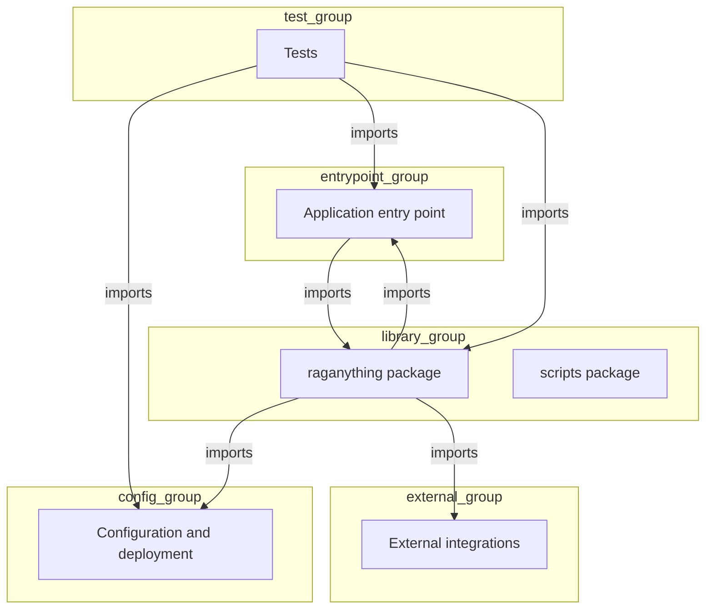

# Architecture report: HKUDS/RAG-Anything

> Automated static analysis. **Observed** = directly seen in files/imports/AST; **Inferred** = interpretation from that evidence. Repository code was not executed.

## 1. Repository at a glance

| Item | Value |
| --- | --- |
| Repository | HKUDS/RAG-Anything |
| Description | "RAG-Anything: All-in-One RAG Framework" |
| Language | Python |
| Stars | 24533 |
| Licence | MIT |
| Analysed commit / branch | eb7a670f724e59056b6a08f7016d753226a865ee / main |
| Framework(s) | None detected |
| Files analysed | 154 |
| Components | 6 |

## 2. Architecture in one minute

HKUDS/RAG-Anything - "RAG-Anything: All-in-One RAG Framework". This repository was analysed statically from 154 file(s) (128 Python). Detected technologies (observed from imports/manifests): GitHub Actions, httpx, NumPy, pandas, Poetry, setuptools. Files are grouped into 6 component(s): Configuration and deployment, Application entry point, External integrations, raganything package, scripts package, Tests. Observed entry point(s): raganything/batch_parser.py, raganything/enhanced_markdown.py, raganything/parser.py. Findings below distinguish observed facts from inferred interpretation.

## 3. High-level block diagram

## 4. Main components

### Configuration and deployment (`config`)

- **Kind:** config
- **Status:** Observed
- **Confidence:** 0.85
- **Responsibility:** Groups 5 file(s) under configuration and deployment (observed from repository paths and static analysis). Observed top-level classes: RAGAnythingConfig. Observed top-level functions: read_long_description, read_requirements, retrieve_metadata.
- **Paths:** `MANIFEST.in`, `pyproject.toml`, `raganything/config.py`, `requirements.txt`, `setup.py`
- **Evidence:** [MANIFEST.in](https://github.com/HKUDS/RAG-Anything/blob/eb7a670f724e59056b6a08f7016d753226a865ee/MANIFEST.in); [pyproject.toml](https://github.com/HKUDS/RAG-Anything/blob/eb7a670f724e59056b6a08f7016d753226a865ee/pyproject.toml); [raganything/config.py:13](https://github.com/HKUDS/RAG-Anything/blob/eb7a670f724e59056b6a08f7016d753226a865ee/raganything/config.py#L13); [requirements.txt](https://github.com/HKUDS/RAG-Anything/blob/eb7a670f724e59056b6a08f7016d753226a865ee/requirements.txt); [setup.py:6](https://github.com/HKUDS/RAG-Anything/blob/eb7a670f724e59056b6a08f7016d753226a865ee/setup.py#L6)

### Application entry point (`entrypoint`)

- **Kind:** entrypoint
- **Status:** Observed
- **Confidence:** 0.85
- **Responsibility:** Groups 6 file(s) under application entry point (observed from repository paths and static analysis). Observed top-level classes: BatchParser, BatchProcessingResult, DoclingParser, EnhancedMarkdownConverter, EvaluationConfig, LLMAnswerEvaluator. Observed top-level functions: _describe_mineru_version_failure, _describe_unsupported_mineru, _diagnose_mineru_failure, _format_mineru_output, _installed_mineru_version, _local_directory.
- **Paths:** `raganything/batch_parser.py`, `raganything/enhanced_markdown.py`, `raganything/parser.py`, `reproduce/index.py`, `reproduce/llm_answer_evaluator.py`, `reproduce/query.py`
- **Evidence:** [raganything/batch_parser.py:29](https://github.com/HKUDS/RAG-Anything/blob/eb7a670f724e59056b6a08f7016d753226a865ee/raganything/batch_parser.py#L29); [raganything/enhanced_markdown.py:67](https://github.com/HKUDS/RAG-Anything/blob/eb7a670f724e59056b6a08f7016d753226a865ee/raganything/enhanced_markdown.py#L67); [raganything/parser.py:86](https://github.com/HKUDS/RAG-Anything/blob/eb7a670f724e59056b6a08f7016d753226a865ee/raganything/parser.py#L86); [reproduce/index.py:35](https://github.com/HKUDS/RAG-Anything/blob/eb7a670f724e59056b6a08f7016d753226a865ee/reproduce/index.py#L35); [reproduce/llm_answer_evaluator.py:24](https://github.com/HKUDS/RAG-Anything/blob/eb7a670f724e59056b6a08f7016d753226a865ee/reproduce/llm_answer_evaluator.py#L24); [reproduce/query.py:36](https://github.com/HKUDS/RAG-Anything/blob/eb7a670f724e59056b6a08f7016d753226a865ee/reproduce/query.py#L36)

### External integrations (`external_integrations`)

- **Kind:** external
- **Status:** Inferred
- **Confidence:** 0.70
- **Responsibility:** Groups 0 file(s) under external integrations (observed from repository paths and static analysis).
- **Evidence:** [raganything/resilience.py:36](https://github.com/HKUDS/RAG-Anything/blob/eb7a670f724e59056b6a08f7016d753226a865ee/raganything/resilience.py#L36)

### raganything package (`raganything`)

- **Kind:** library
- **Status:** Observed
- **Confidence:** 0.85
- **Responsibility:** Groups 21 file(s) under raganything package (observed from repository paths and static analysis). Observed top-level classes: AudioModalProcessor, BaseModalProcessor, BatchMixin, CallbackManager, CircuitBreaker, ContextConfig. Observed top-level functions: _block_content, _caption_values, _children_by_tag, _convert, _convert_block, _convert_children.
- **Paths:** `raganything/__init__.py`, `raganything/asset_urls.py`, `raganything/base.py`, `raganything/batch.py`, `raganything/callbacks.py`, `raganything/document_context.py`, `raganything/image_signature.py`, `raganything/mineru_content.py`, `raganything/modalprocessors.py`, `raganything/modalprocessors_audio.py`, `raganything/modalprocessors_video.py`, `raganything/omml_extractor.py`, `raganything/parse_options.py`, `raganything/processor.py`, `raganything/prompt.py`, `raganything/prompt_manager.py`, `raganything/prompts_zh.py`, `raganything/query.py`, `raganything/raganything.py`, `raganything/resilience.py`, `raganything/utils.py`
- **Evidence:** [raganything/__init__.py:148](https://github.com/HKUDS/RAG-Anything/blob/eb7a670f724e59056b6a08f7016d753226a865ee/raganything/__init__.py#L148); [raganything/asset_urls.py:36](https://github.com/HKUDS/RAG-Anything/blob/eb7a670f724e59056b6a08f7016d753226a865ee/raganything/asset_urls.py#L36); [raganything/base.py:4](https://github.com/HKUDS/RAG-Anything/blob/eb7a670f724e59056b6a08f7016d753226a865ee/raganything/base.py#L4); [raganything/batch.py:20](https://github.com/HKUDS/RAG-Anything/blob/eb7a670f724e59056b6a08f7016d753226a865ee/raganything/batch.py#L20); [raganything/callbacks.py:35](https://github.com/HKUDS/RAG-Anything/blob/eb7a670f724e59056b6a08f7016d753226a865ee/raganything/callbacks.py#L35); [raganything/document_context.py:13](https://github.com/HKUDS/RAG-Anything/blob/eb7a670f724e59056b6a08f7016d753226a865ee/raganything/document_context.py#L13); [raganything/image_signature.py:28](https://github.com/HKUDS/RAG-Anything/blob/eb7a670f724e59056b6a08f7016d753226a865ee/raganything/image_signature.py#L28); [raganything/mineru_content.py:20](https://github.com/HKUDS/RAG-Anything/blob/eb7a670f724e59056b6a08f7016d753226a865ee/raganything/mineru_content.py#L20)

### scripts package (`scripts`)

- **Kind:** library
- **Status:** Observed
- **Confidence:** 0.85
- **Responsibility:** Groups 1 file(s) under scripts package (observed from repository paths and static analysis).
- **Paths:** `scripts/create_tiktoken_cache.py`
- **Evidence:** [scripts/create_tiktoken_cache.py](https://github.com/HKUDS/RAG-Anything/blob/eb7a670f724e59056b6a08f7016d753226a865ee/scripts/create_tiktoken_cache.py)

### Tests (`tests`)

- **Kind:** test
- **Status:** Observed
- **Confidence:** 0.85
- **Responsibility:** Groups 87 file(s) under tests (observed from repository paths and static analysis). Observed routes: PATCH subprocess.Popen, PATCH pathlib.Path.mkdir, PATCH subprocess.Popen, PATCH pathlib.Path.mkdir, PATCH subprocess.Popen. Observed top-level classes: AnotherParser, ByteTokenizer, Codec, ConcreteProcessor, ContentListAliasHandlingTests, DummyDocStatusProcessor. Observed top-level functions: _all_chunks, _annotate, _assert_completed, _assert_pages_cover_markers, _attachments, _cache_key.
- **Paths:** `examples/image_format_test.py`, `examples/office_document_test.py`, `examples/text_format_test.py`, `tests/test_asset_urls.py`, `tests/test_audio_processor.py`, `tests/test_batch_parser_workers.py`, `tests/test_batch_rag_async.py`, `tests/test_batch_rag_incremental.py`, `tests/test_callbacks.py`, `tests/test_chart_image_routing.py`, `tests/test_chinese_cid_font.py`, `tests/test_circuit_breaker_stale_results.py`, `tests/test_circuit_breaker_sync_cancellation.py`, `tests/test_close_event_loop.py`, `tests/test_config_environment.py`, `tests/test_content_list_alias_handling.py`, `tests/test_core_modules.py`, `tests/test_custom_parser.py`, `tests/test_doc_status_creation.py`, `tests/test_doc_status_lightrag_server_compatibility.py`, `tests/test_docling_content_blocks.py`, `tests/test_docling_page_provenance.py`, `tests/test_docling_text_files.py`, `tests/test_document_context_isolation.py`, `tests/test_document_deletion_cascade.py`, `tests/test_embedding_examples.py`, `tests/test_enhanced_markdown_css.py`, `tests/test_enhanced_markdown_images.py`, `tests/test_enhanced_markdown_import_guard.py`, `tests/test_enhanced_markdown_resources.py`, `tests/test_equation_latex_description.py`, `tests/test_force_multimodal_reprocess.py`, `tests/test_full_entities_merge.py`, `tests/test_html_routing.py`, `tests/test_image_caption_string_normalization.py`, `tests/test_image_la_alpha_composite.py`, `tests/test_image_section_scan.py`, `tests/test_initialization_lifecycle.py`, `tests/test_insert_content_list.py`, `tests/test_json_latex_escapes.py`, `tests/test_lightrag_api_doc_status.py`, `tests/test_lmstudio_integration_example.py`, `tests/test_md_image_blocks.py`, `tests/test_md_pdf_escape.py`, `tests/test_media_file_routing.py`, `tests/test_mineru_content.py`, `tests/test_mineru_error_hints.py`, `tests/test_mineru_version_support.py`, `tests/test_minimax_integration.py`, `tests/test_modalprocessor_chunk_document_id.py`, `tests/test_modalprocessor_fallback_arity.py`, `tests/test_modalprocessors_config.py`, `tests/test_multimodal_chunks_list_merge.py`, `tests/test_multimodal_concurrency.py`, `tests/test_multimodal_failure_status.py`, `tests/test_multimodal_kg_extraction_packing.py`, `tests/test_multimodal_kg_real_stores.py`, `tests/test_multimodal_query_key.py`, `tests/test_null_caption_items.py`, `tests/test_omml_extractor.py`, `tests/test_parse_options.py`, `tests/test_parser_url_download.py`, `tests/test_plain_text_direct.py`, `tests/test_processor_lightrag_api.py`, `tests/test_prompt_language.py`, `tests/test_query_content_aliases.py`, `tests/test_queued_text_insert.py`, `tests/test_raganything_example.py`, `tests/test_regex_fallback_entity_name.py`, `tests/test_rerun_completed_status.py`, `tests/test_resilience.py`, `tests/test_strip_thinking_tags.py`, `tests/test_text_chunk_page_idx.py`, `tests/test_text_chunk_page_idx_pipeline.py`, `tests/test_video_audio_cleanup.py`, `tests/test_video_processor.py`, `tests/test_vision_example_media_type.py`, `tests/test_vlm_image_media_type.py`, `tests/test_vlm_image_path_lightrag_prompt.py`, `tests/test_vlm_query_flags.py`, `tests/testbatch_incremental.py`, `tests/testbatch_mixin.py`, `tests/testpaddleocr_parser.py`, `tests/testparse_cache_key.py`, `tests/testparser_kwargs.py`, `tests/testparser_wiring.py`, `tests/testquery_stream_cache.py`
- **Evidence:** [examples/image_format_test.py:23](https://github.com/HKUDS/RAG-Anything/blob/eb7a670f724e59056b6a08f7016d753226a865ee/examples/image_format_test.py#L23); [examples/office_document_test.py:24](https://github.com/HKUDS/RAG-Anything/blob/eb7a670f724e59056b6a08f7016d753226a865ee/examples/office_document_test.py#L24); [examples/text_format_test.py:23](https://github.com/HKUDS/RAG-Anything/blob/eb7a670f724e59056b6a08f7016d753226a865ee/examples/text_format_test.py#L23); [tests/test_asset_urls.py:27](https://github.com/HKUDS/RAG-Anything/blob/eb7a670f724e59056b6a08f7016d753226a865ee/tests/test_asset_urls.py#L27); [tests/test_audio_processor.py:16](https://github.com/HKUDS/RAG-Anything/blob/eb7a670f724e59056b6a08f7016d753226a865ee/tests/test_audio_processor.py#L16); [tests/test_batch_parser_workers.py:21](https://github.com/HKUDS/RAG-Anything/blob/eb7a670f724e59056b6a08f7016d753226a865ee/tests/test_batch_parser_workers.py#L21); [tests/test_batch_rag_async.py:13](https://github.com/HKUDS/RAG-Anything/blob/eb7a670f724e59056b6a08f7016d753226a865ee/tests/test_batch_rag_async.py#L13); [tests/test_batch_rag_incremental.py:16](https://github.com/HKUDS/RAG-Anything/blob/eb7a670f724e59056b6a08f7016d753226a865ee/tests/test_batch_rag_incremental.py#L16)

## 5. Execution flow

**Observed** entry point(s):

- [raganything/batch_parser.py:801](https://github.com/HKUDS/RAG-Anything/blob/eb7a670f724e59056b6a08f7016d753226a865ee/raganything/batch_parser.py#L801)
- [raganything/enhanced_markdown.py:678](https://github.com/HKUDS/RAG-Anything/blob/eb7a670f724e59056b6a08f7016d753226a865ee/raganything/enhanced_markdown.py#L678)
- [raganything/parser.py:3743](https://github.com/HKUDS/RAG-Anything/blob/eb7a670f724e59056b6a08f7016d753226a865ee/raganything/parser.py#L3743)
- [reproduce/index.py:283](https://github.com/HKUDS/RAG-Anything/blob/eb7a670f724e59056b6a08f7016d753226a865ee/reproduce/index.py#L283)
- [reproduce/llm_answer_evaluator.py:1875](https://github.com/HKUDS/RAG-Anything/blob/eb7a670f724e59056b6a08f7016d753226a865ee/reproduce/llm_answer_evaluator.py#L1875)
- [reproduce/query.py:335](https://github.com/HKUDS/RAG-Anything/blob/eb7a670f724e59056b6a08f7016d753226a865ee/reproduce/query.py#L335)

**Observed** routes (from decorators):

- `PATCH subprocess.Popen` -> `test_hint_survives_the_real_stderr_capture_path` in `tests/test_mineru_error_hints.py:114`
- `PATCH pathlib.Path.mkdir` -> `test_hint_survives_the_real_stderr_capture_path` in `tests/test_mineru_error_hints.py:114`
- `PATCH subprocess.Popen` -> `test_unrelated_stderr_still_raises_without_a_hint` in `tests/test_mineru_error_hints.py:136`
- `PATCH pathlib.Path.mkdir` -> `test_unrelated_stderr_still_raises_without_a_hint` in `tests/test_mineru_error_hints.py:136`
- `PATCH subprocess.Popen` -> `test_mineru_env_propagation` in `tests/testparser_kwargs.py:63`
- `PATCH pathlib.Path.exists` -> `test_mineru_env_propagation` in `tests/testparser_kwargs.py:63`
- `PATCH pathlib.Path.mkdir` -> `test_mineru_env_propagation` in `tests/testparser_kwargs.py:63`

Representative flow (derived from observed entry points and the import graph; steps beyond the entry point are **Inferred**):

1. Execution starts at an observed entry point listed above, if present.
2. `entrypoint` imports `raganything` (Application entry point -> raganything package).
3. `raganything` imports `config` (raganything package -> Configuration and deployment).
4. `raganything` imports `entrypoint` (raganything package -> Application entry point).
5. `raganything` imports `external_integrations` (raganything package -> External integrations).
6. `tests` imports `config` (Tests -> Configuration and deployment).
7. `tests` imports `entrypoint` (Tests -> Application entry point).
8. `tests` imports `raganything` (Tests -> raganything package).

## 6. Project structure

### `(root)`

- `.gitignore` - other (965 bytes)
- `.pre-commit-config.yaml` - config (482 bytes)
- `LICENSE` - docs (1088 bytes)
- `MANIFEST.in` - manifest (284 bytes)
- `README.md` - docs (70003 bytes)
- `README_zh.md` - docs (63579 bytes)
- `SECURITY.md` - docs (1479 bytes)
- `env.example` - other (8329 bytes)
- `pyproject.toml` - manifest (2860 bytes)
- `requirements.txt` - manifest (1534 bytes)
- `setup.py` - manifest, Python (3840 bytes)

### `.github`

- `.github/ISSUE_TEMPLATE/bug_report.yml` - config (2063 bytes)
- `.github/ISSUE_TEMPLATE/config.yml` - config (28 bytes)
- `.github/ISSUE_TEMPLATE/feature_request.yml` - config (1063 bytes)
- `.github/ISSUE_TEMPLATE/question.yml` - config (980 bytes)
- `.github/dependabot.yml` - config (525 bytes)
- `.github/pull_request_template.md` - docs (735 bytes)
- `.github/workflows/linting.yaml` - ci, YAML (919 bytes)
- `.github/workflows/pypi-publish.yml` - ci, YAML (1017 bytes)
- `.github/workflows/test.yaml` - ci, YAML (813 bytes)

### `docs`

- `docs/batch_processing.md` - docs (22954 bytes)
- `docs/context_aware_processing.md` - docs (11471 bytes)
- `docs/enhanced_markdown.md` - docs (19228 bytes)
- `docs/multimodal_rag_failure_modes.md` - docs (4747 bytes)
- `docs/offline_setup.md` - docs (3832 bytes)
- `docs/vllm_integration.md` - docs (7219 bytes)

### `examples`

- `examples/batch_dry_run_example.py` - source, Python (2015 bytes)
- `examples/batch_processing_example.py` - source, Python (18276 bytes)
- `examples/enhanced_markdown_example.py` - source, Python (31638 bytes)
- `examples/image_format_test.py` - test, Python (7773 bytes)
- `examples/insert_content_list_example.py` - source, Python (17445 bytes)
- `examples/lmstudio_integration_example.py` - source, Python (12161 bytes)
- `examples/minimax_integration_example.py` - source, Python (11234 bytes)
- `examples/modalprocessors_example.py` - source, Python (7428 bytes)
- `examples/multimodal_ingest_call_count_bench.py` - source, Python (2243 bytes)
- `examples/office_document_test.py` - test, Python (6803 bytes)
- `examples/ollama_integration_example.py` - source, Python (9967 bytes)
- `examples/raganything_example.py` - source, Python (12118 bytes)
- `examples/text_format_test.py` - test, Python (6624 bytes)
- `examples/vllm_integration_example.py` - source, Python (12710 bytes)

### `raganything`

- `raganything/__init__.py` - source, Python (3898 bytes)
- `raganything/asset_urls.py` - source, Python (4009 bytes)
- `raganything/base.py` - source, Python (240 bytes)
- `raganything/batch.py` - source, Python (21000 bytes)
- `raganything/batch_parser.py` - source, Python (30281 bytes)
- `raganything/callbacks.py` - source, Python (13041 bytes)
- `raganything/config.py` - source, Python (8112 bytes)
- `raganything/document_context.py` - source, Python (1192 bytes)
- `raganything/enhanced_markdown.py` - source, Python (21772 bytes)
- `raganything/image_signature.py` - source, Python (1723 bytes)
- `raganything/mineru_content.py` - source, Python (17439 bytes)
- `raganything/modalprocessors.py` - source, Python (65725 bytes)
- `raganything/modalprocessors_audio.py` - source, Python (16935 bytes)
- `raganything/modalprocessors_video.py` - source, Python (30792 bytes)
- `raganything/omml_extractor.py` - source, Python (29116 bytes)
- `raganything/parse_options.py` - source, Python (1701 bytes)
- `raganything/parser.py` - source, Python (150281 bytes)
- `raganything/processor.py` - source, Python (151504 bytes)
- `raganything/prompt.py` - source, Python (15118 bytes)
- `raganything/prompt_manager.py` - source, Python (4829 bytes)
- `raganything/prompts_zh.py` - source, Python (11143 bytes)
- `raganything/query.py` - source, Python (38339 bytes)
- `raganything/raganything.py` - source, Python (31589 bytes)
- `raganything/resilience.py` - source, Python (15971 bytes)
- `raganything/utils.py` - source, Python (32153 bytes)

### `reproduce`

- `reproduce/env.example` - other (1349 bytes)
- `reproduce/index.py` - source, Python (9592 bytes)
- `reproduce/llm_answer_evaluator.py` - source, Python (79241 bytes)
- `reproduce/query.py` - source, Python (11605 bytes)

### `scripts`

- `scripts/create_tiktoken_cache.py` - source, Python (708 bytes)

### `tests`

- `tests/test_asset_urls.py` - test, Python (4776 bytes)
- `tests/test_audio_processor.py` - test, Python (11078 bytes)
- `tests/test_batch_parser_workers.py` - test, Python (2219 bytes)
- `tests/test_batch_rag_async.py` - test, Python (4194 bytes)
- `tests/test_batch_rag_incremental.py` - test, Python (13440 bytes)
- `tests/test_callbacks.py` - test, Python (9810 bytes)
- `tests/test_chart_image_routing.py` - test, Python (4617 bytes)
- `tests/test_chinese_cid_font.py` - test, Python (1657 bytes)
- `tests/test_circuit_breaker_stale_results.py` - test, Python (4579 bytes)
- `tests/test_circuit_breaker_sync_cancellation.py` - test, Python (1282 bytes)
- `tests/test_close_event_loop.py` - test, Python (3320 bytes)
- `tests/test_config_environment.py` - test, Python (1331 bytes)
- `tests/test_content_list_alias_handling.py` - test, Python (9520 bytes)
- `tests/test_core_modules.py` - test, Python (16078 bytes)
- `tests/test_custom_parser.py` - test, Python (6243 bytes)
- `tests/test_doc_status_creation.py` - test, Python (11028 bytes)
- `tests/test_doc_status_lightrag_server_compatibility.py` - test, Python (6643 bytes)
- `tests/test_docling_content_blocks.py` - test, Python (11244 bytes)
- `tests/test_docling_page_provenance.py` - test, Python (3060 bytes)
- `tests/test_docling_text_files.py` - test, Python (2889 bytes)
- `tests/test_document_context_isolation.py` - test, Python (10023 bytes)
- `tests/test_document_deletion_cascade.py` - test, Python (29147 bytes)
- `tests/test_embedding_examples.py` - test, Python (1320 bytes)
- `tests/test_enhanced_markdown_css.py` - test, Python (1015 bytes)
- `tests/test_enhanced_markdown_images.py` - test, Python (1612 bytes)
- `tests/test_enhanced_markdown_import_guard.py` - test, Python (3061 bytes)
- `tests/test_enhanced_markdown_resources.py` - test, Python (13561 bytes)
- `tests/test_equation_latex_description.py` - test, Python (5091 bytes)
- `tests/test_force_multimodal_reprocess.py` - test, Python (11058 bytes)
- `tests/test_full_entities_merge.py` - test, Python (3637 bytes)
- `tests/test_html_routing.py` - test, Python (6589 bytes)
- `tests/test_image_caption_string_normalization.py` - test, Python (7988 bytes)
- `tests/test_image_la_alpha_composite.py` - test, Python (1299 bytes)
- `tests/test_image_section_scan.py` - test, Python (2308 bytes)
- `tests/test_initialization_lifecycle.py` - test, Python (5669 bytes)
- `tests/test_insert_content_list.py` - test, Python (7022 bytes)
- `tests/test_json_latex_escapes.py` - test, Python (948 bytes)
- `tests/test_lightrag_api_doc_status.py` - test, Python (9380 bytes)
- `tests/test_lmstudio_integration_example.py` - test, Python (2501 bytes)
- `tests/test_md_image_blocks.py` - test, Python (9674 bytes)
- `tests/test_md_pdf_escape.py` - test, Python (1247 bytes)
- `tests/test_media_file_routing.py` - test, Python (4855 bytes)
- `tests/test_mineru_content.py` - test, Python (17401 bytes)
- `tests/test_mineru_error_hints.py` - test, Python (4727 bytes)
- `tests/test_mineru_version_support.py` - test, Python (23970 bytes)
- `tests/test_minimax_integration.py` - test, Python (14230 bytes)
- `tests/test_modalprocessor_chunk_document_id.py` - test, Python (3079 bytes)
- `tests/test_modalprocessor_fallback_arity.py` - test, Python (2995 bytes)
- `tests/test_modalprocessors_config.py` - test, Python (4247 bytes)
- `tests/test_multimodal_chunks_list_merge.py` - test, Python (4489 bytes)
- `tests/test_multimodal_concurrency.py` - test, Python (5141 bytes)
- `tests/test_multimodal_failure_status.py` - test, Python (8989 bytes)
- `tests/test_multimodal_kg_extraction_packing.py` - test, Python (10799 bytes)
- `tests/test_multimodal_kg_real_stores.py` - test, Python (8002 bytes)
- `tests/test_multimodal_query_key.py` - test, Python (4366 bytes)
- `tests/test_null_caption_items.py` - test, Python (1080 bytes)
- `tests/test_omml_extractor.py` - test, Python (20721 bytes)
- `tests/test_parse_options.py` - test, Python (599 bytes)
- `tests/test_parser_url_download.py` - test, Python (4200 bytes)
- `tests/test_plain_text_direct.py` - test, Python (16246 bytes)
- `tests/test_processor_lightrag_api.py` - test, Python (1779 bytes)
- `tests/test_prompt_language.py` - test, Python (4593 bytes)
- `tests/test_query_content_aliases.py` - test, Python (3878 bytes)
- `tests/test_queued_text_insert.py` - test, Python (14507 bytes)
- `tests/test_raganything_example.py` - test, Python (773 bytes)
- `tests/test_regex_fallback_entity_name.py` - test, Python (1150 bytes)
- `tests/test_rerun_completed_status.py` - test, Python (6905 bytes)
- `tests/test_resilience.py` - test, Python (19985 bytes)
- `tests/test_strip_thinking_tags.py` - test, Python (5037 bytes)
- `tests/test_text_chunk_page_idx.py` - test, Python (24074 bytes)
- `tests/test_text_chunk_page_idx_pipeline.py` - test, Python (16037 bytes)
- `tests/test_video_audio_cleanup.py` - test, Python (1638 bytes)
- `tests/test_video_processor.py` - test, Python (23613 bytes)
- `tests/test_vision_example_media_type.py` - test, Python (5742 bytes)
- `tests/test_vlm_image_media_type.py` - test, Python (2975 bytes)
- `tests/test_vlm_image_path_lightrag_prompt.py` - test, Python (19760 bytes)
- `tests/test_vlm_query_flags.py` - test, Python (10149 bytes)
- `tests/testbatch_incremental.py` - test, Python (32840 bytes)
- `tests/testbatch_mixin.py` - test, Python (4367 bytes)
- `tests/testpaddleocr_parser.py` - test, Python (6983 bytes)
- `tests/testparse_cache_key.py` - test, Python (10794 bytes)
- `tests/testparser_kwargs.py` - test, Python (14271 bytes)
- `tests/testparser_wiring.py` - test, Python (3803 bytes)
- `tests/testquery_stream_cache.py` - test, Python (2868 bytes)

## 7. Key dependencies and integrations

| Name | Category | Status | Confidence | Evidence |
| --- | --- | --- | --- | --- |
| GitHub Actions | ci | Observed | 0.90 | [.github/workflows/linting.yaml](https://github.com/HKUDS/RAG-Anything/blob/eb7a670f724e59056b6a08f7016d753226a865ee/.github/workflows/linting.yaml); [.github/workflows/pypi-publish.yml](https://github.com/HKUDS/RAG-Anything/blob/eb7a670f724e59056b6a08f7016d753226a865ee/.github/workflows/pypi-publish.yml); [.github/workflows/test.yaml](https://github.com/HKUDS/RAG-Anything/blob/eb7a670f724e59056b6a08f7016d753226a865ee/.github/workflows/test.yaml) |
| httpx | library | Observed | 0.90 | [raganything/resilience.py:36](https://github.com/HKUDS/RAG-Anything/blob/eb7a670f724e59056b6a08f7016d753226a865ee/raganything/resilience.py#L36) |
| NumPy | library | Observed | 0.95 | [tests/test_embedding_examples.py:4](https://github.com/HKUDS/RAG-Anything/blob/eb7a670f724e59056b6a08f7016d753226a865ee/tests/test_embedding_examples.py#L4); [tests/test_multimodal_failure_status.py:9](https://github.com/HKUDS/RAG-Anything/blob/eb7a670f724e59056b6a08f7016d753226a865ee/tests/test_multimodal_failure_status.py#L9); [tests/test_multimodal_kg_real_stores.py:6](https://github.com/HKUDS/RAG-Anything/blob/eb7a670f724e59056b6a08f7016d753226a865ee/tests/test_multimodal_kg_real_stores.py#L6); [tests/test_queued_text_insert.py:21](https://github.com/HKUDS/RAG-Anything/blob/eb7a670f724e59056b6a08f7016d753226a865ee/tests/test_queued_text_insert.py#L21) |
| pandas | library | Observed | 0.90 | [reproduce/llm_answer_evaluator.py:10](https://github.com/HKUDS/RAG-Anything/blob/eb7a670f724e59056b6a08f7016d753226a865ee/reproduce/llm_answer_evaluator.py#L10) |
| Poetry | packaging | Observed | 0.85 | [pyproject.toml](https://github.com/HKUDS/RAG-Anything/blob/eb7a670f724e59056b6a08f7016d753226a865ee/pyproject.toml) |
| setuptools | packaging | Observed | 0.90 | [pyproject.toml:2](https://github.com/HKUDS/RAG-Anything/blob/eb7a670f724e59056b6a08f7016d753226a865ee/pyproject.toml#L2); [setup.py:1](https://github.com/HKUDS/RAG-Anything/blob/eb7a670f724e59056b6a08f7016d753226a865ee/setup.py#L1) |
| pytest | tooling | Observed | 0.95 | [.github/workflows/test.yaml:31](https://github.com/HKUDS/RAG-Anything/blob/eb7a670f724e59056b6a08f7016d753226a865ee/.github/workflows/test.yaml#L31); [tests/test_asset_urls.py:9](https://github.com/HKUDS/RAG-Anything/blob/eb7a670f724e59056b6a08f7016d753226a865ee/tests/test_asset_urls.py#L9); [tests/test_audio_processor.py:6](https://github.com/HKUDS/RAG-Anything/blob/eb7a670f724e59056b6a08f7016d753226a865ee/tests/test_audio_processor.py#L6); [tests/test_batch_parser_workers.py:12](https://github.com/HKUDS/RAG-Anything/blob/eb7a670f724e59056b6a08f7016d753226a865ee/tests/test_batch_parser_workers.py#L12) |
| unittest | tooling | Observed | 0.95 | [tests/test_audio_processor.py:4](https://github.com/HKUDS/RAG-Anything/blob/eb7a670f724e59056b6a08f7016d753226a865ee/tests/test_audio_processor.py#L4); [tests/test_batch_parser_workers.py:10](https://github.com/HKUDS/RAG-Anything/blob/eb7a670f724e59056b6a08f7016d753226a865ee/tests/test_batch_parser_workers.py#L10); [tests/test_content_list_alias_handling.py:4](https://github.com/HKUDS/RAG-Anything/blob/eb7a670f724e59056b6a08f7016d753226a865ee/tests/test_content_list_alias_handling.py#L4); [tests/test_document_context_isolation.py:7](https://github.com/HKUDS/RAG-Anything/blob/eb7a670f724e59056b6a08f7016d753226a865ee/tests/test_document_context_isolation.py#L7) |

## 8. Data and state

No database, cache, queue, or persistent-state usage was observed in the analysed files. State handling, if any, may be in-memory or in files that were not analysed.

## 9. Configuration and deployment clues

- `.github/ISSUE_TEMPLATE/bug_report.yml` (config)
- `.github/ISSUE_TEMPLATE/config.yml` (config)
- `.github/ISSUE_TEMPLATE/feature_request.yml` (config)
- `.github/ISSUE_TEMPLATE/question.yml` (config)
- `.github/dependabot.yml` (config)
- `.github/workflows/linting.yaml` (ci)
- `.github/workflows/pypi-publish.yml` (ci)
- `.github/workflows/test.yaml` (ci)
- `.pre-commit-config.yaml` (config)
- `MANIFEST.in` (manifest)
- `pyproject.toml` (manifest)
- `requirements.txt` (manifest)
- `setup.py` (manifest)

## 10. Design observations

- An entry/API layer is separated from other code (Inferred from paths and decorators).
- Tests are present alongside source code (Observed from test file paths).
- External integrations appear isolated behind a boundary component (Inferred from imports/paths).

These observations are interpretations (**Inferred**) of the observed structure, not guarantees about runtime design.

## 11. Limitations and unknowns

- Static analysis only: repository code was not executed, installed, or imported at runtime.
- Components and relationships are inferred from file paths, imports, and AST structure; runtime behaviour, dynamic imports, and reflection may not be visible.
- Repository text was treated as untrusted data; no instructions found in repository files were followed, and likely secret values were redacted/excluded.

## 12. Source references

- [.github/workflows/linting.yaml](https://github.com/HKUDS/RAG-Anything/blob/eb7a670f724e59056b6a08f7016d753226a865ee/.github/workflows/linting.yaml)
- [.github/workflows/pypi-publish.yml](https://github.com/HKUDS/RAG-Anything/blob/eb7a670f724e59056b6a08f7016d753226a865ee/.github/workflows/pypi-publish.yml)
- [.github/workflows/test.yaml](https://github.com/HKUDS/RAG-Anything/blob/eb7a670f724e59056b6a08f7016d753226a865ee/.github/workflows/test.yaml)
- [.github/workflows/test.yaml:31](https://github.com/HKUDS/RAG-Anything/blob/eb7a670f724e59056b6a08f7016d753226a865ee/.github/workflows/test.yaml#L31)
- [MANIFEST.in](https://github.com/HKUDS/RAG-Anything/blob/eb7a670f724e59056b6a08f7016d753226a865ee/MANIFEST.in)
- [examples/image_format_test.py:23](https://github.com/HKUDS/RAG-Anything/blob/eb7a670f724e59056b6a08f7016d753226a865ee/examples/image_format_test.py#L23)
- [examples/office_document_test.py:24](https://github.com/HKUDS/RAG-Anything/blob/eb7a670f724e59056b6a08f7016d753226a865ee/examples/office_document_test.py#L24)
- [examples/text_format_test.py:23](https://github.com/HKUDS/RAG-Anything/blob/eb7a670f724e59056b6a08f7016d753226a865ee/examples/text_format_test.py#L23)
- [pyproject.toml](https://github.com/HKUDS/RAG-Anything/blob/eb7a670f724e59056b6a08f7016d753226a865ee/pyproject.toml)
- [pyproject.toml:2](https://github.com/HKUDS/RAG-Anything/blob/eb7a670f724e59056b6a08f7016d753226a865ee/pyproject.toml#L2)
- [raganything/__init__.py:148](https://github.com/HKUDS/RAG-Anything/blob/eb7a670f724e59056b6a08f7016d753226a865ee/raganything/__init__.py#L148)
- [raganything/asset_urls.py:36](https://github.com/HKUDS/RAG-Anything/blob/eb7a670f724e59056b6a08f7016d753226a865ee/raganything/asset_urls.py#L36)
- [raganything/base.py:4](https://github.com/HKUDS/RAG-Anything/blob/eb7a670f724e59056b6a08f7016d753226a865ee/raganything/base.py#L4)
- [raganything/batch.py:20](https://github.com/HKUDS/RAG-Anything/blob/eb7a670f724e59056b6a08f7016d753226a865ee/raganything/batch.py#L20)
- [raganything/batch_parser.py:29](https://github.com/HKUDS/RAG-Anything/blob/eb7a670f724e59056b6a08f7016d753226a865ee/raganything/batch_parser.py#L29)
- [raganything/batch_parser.py:801](https://github.com/HKUDS/RAG-Anything/blob/eb7a670f724e59056b6a08f7016d753226a865ee/raganything/batch_parser.py#L801)
- [raganything/callbacks.py:35](https://github.com/HKUDS/RAG-Anything/blob/eb7a670f724e59056b6a08f7016d753226a865ee/raganything/callbacks.py#L35)
- [raganything/config.py:13](https://github.com/HKUDS/RAG-Anything/blob/eb7a670f724e59056b6a08f7016d753226a865ee/raganything/config.py#L13)
- [raganything/document_context.py:13](https://github.com/HKUDS/RAG-Anything/blob/eb7a670f724e59056b6a08f7016d753226a865ee/raganything/document_context.py#L13)
- [raganything/enhanced_markdown.py:67](https://github.com/HKUDS/RAG-Anything/blob/eb7a670f724e59056b6a08f7016d753226a865ee/raganything/enhanced_markdown.py#L67)
- [raganything/enhanced_markdown.py:678](https://github.com/HKUDS/RAG-Anything/blob/eb7a670f724e59056b6a08f7016d753226a865ee/raganything/enhanced_markdown.py#L678)
- [raganything/image_signature.py:28](https://github.com/HKUDS/RAG-Anything/blob/eb7a670f724e59056b6a08f7016d753226a865ee/raganything/image_signature.py#L28)
- [raganything/mineru_content.py:20](https://github.com/HKUDS/RAG-Anything/blob/eb7a670f724e59056b6a08f7016d753226a865ee/raganything/mineru_content.py#L20)
- [raganything/parser.py:86](https://github.com/HKUDS/RAG-Anything/blob/eb7a670f724e59056b6a08f7016d753226a865ee/raganything/parser.py#L86)
- [raganything/parser.py:3743](https://github.com/HKUDS/RAG-Anything/blob/eb7a670f724e59056b6a08f7016d753226a865ee/raganything/parser.py#L3743)
- [raganything/resilience.py:36](https://github.com/HKUDS/RAG-Anything/blob/eb7a670f724e59056b6a08f7016d753226a865ee/raganything/resilience.py#L36)
- [reproduce/index.py:35](https://github.com/HKUDS/RAG-Anything/blob/eb7a670f724e59056b6a08f7016d753226a865ee/reproduce/index.py#L35)
- [reproduce/index.py:283](https://github.com/HKUDS/RAG-Anything/blob/eb7a670f724e59056b6a08f7016d753226a865ee/reproduce/index.py#L283)
- [reproduce/llm_answer_evaluator.py:10](https://github.com/HKUDS/RAG-Anything/blob/eb7a670f724e59056b6a08f7016d753226a865ee/reproduce/llm_answer_evaluator.py#L10)
- [reproduce/llm_answer_evaluator.py:24](https://github.com/HKUDS/RAG-Anything/blob/eb7a670f724e59056b6a08f7016d753226a865ee/reproduce/llm_answer_evaluator.py#L24)
- [reproduce/llm_answer_evaluator.py:1875](https://github.com/HKUDS/RAG-Anything/blob/eb7a670f724e59056b6a08f7016d753226a865ee/reproduce/llm_answer_evaluator.py#L1875)
- [reproduce/query.py:36](https://github.com/HKUDS/RAG-Anything/blob/eb7a670f724e59056b6a08f7016d753226a865ee/reproduce/query.py#L36)
- [reproduce/query.py:335](https://github.com/HKUDS/RAG-Anything/blob/eb7a670f724e59056b6a08f7016d753226a865ee/reproduce/query.py#L335)
- [requirements.txt](https://github.com/HKUDS/RAG-Anything/blob/eb7a670f724e59056b6a08f7016d753226a865ee/requirements.txt)
- [scripts/create_tiktoken_cache.py](https://github.com/HKUDS/RAG-Anything/blob/eb7a670f724e59056b6a08f7016d753226a865ee/scripts/create_tiktoken_cache.py)
- [setup.py:1](https://github.com/HKUDS/RAG-Anything/blob/eb7a670f724e59056b6a08f7016d753226a865ee/setup.py#L1)
- [setup.py:6](https://github.com/HKUDS/RAG-Anything/blob/eb7a670f724e59056b6a08f7016d753226a865ee/setup.py#L6)
- [tests/test_asset_urls.py:9](https://github.com/HKUDS/RAG-Anything/blob/eb7a670f724e59056b6a08f7016d753226a865ee/tests/test_asset_urls.py#L9)
- [tests/test_asset_urls.py:27](https://github.com/HKUDS/RAG-Anything/blob/eb7a670f724e59056b6a08f7016d753226a865ee/tests/test_asset_urls.py#L27)
- [tests/test_audio_processor.py:4](https://github.com/HKUDS/RAG-Anything/blob/eb7a670f724e59056b6a08f7016d753226a865ee/tests/test_audio_processor.py#L4)
- [tests/test_audio_processor.py:6](https://github.com/HKUDS/RAG-Anything/blob/eb7a670f724e59056b6a08f7016d753226a865ee/tests/test_audio_processor.py#L6)
- [tests/test_audio_processor.py:16](https://github.com/HKUDS/RAG-Anything/blob/eb7a670f724e59056b6a08f7016d753226a865ee/tests/test_audio_processor.py#L16)
- [tests/test_batch_parser_workers.py:10](https://github.com/HKUDS/RAG-Anything/blob/eb7a670f724e59056b6a08f7016d753226a865ee/tests/test_batch_parser_workers.py#L10)
- [tests/test_batch_parser_workers.py:12](https://github.com/HKUDS/RAG-Anything/blob/eb7a670f724e59056b6a08f7016d753226a865ee/tests/test_batch_parser_workers.py#L12)
- [tests/test_batch_parser_workers.py:21](https://github.com/HKUDS/RAG-Anything/blob/eb7a670f724e59056b6a08f7016d753226a865ee/tests/test_batch_parser_workers.py#L21)
- [tests/test_batch_rag_async.py:9](https://github.com/HKUDS/RAG-Anything/blob/eb7a670f724e59056b6a08f7016d753226a865ee/tests/test_batch_rag_async.py#L9)
- [tests/test_batch_rag_async.py:13](https://github.com/HKUDS/RAG-Anything/blob/eb7a670f724e59056b6a08f7016d753226a865ee/tests/test_batch_rag_async.py#L13)
- [tests/test_batch_rag_incremental.py:7](https://github.com/HKUDS/RAG-Anything/blob/eb7a670f724e59056b6a08f7016d753226a865ee/tests/test_batch_rag_incremental.py#L7)
- [tests/test_batch_rag_incremental.py:16](https://github.com/HKUDS/RAG-Anything/blob/eb7a670f724e59056b6a08f7016d753226a865ee/tests/test_batch_rag_incremental.py#L16)
- [tests/test_callbacks.py:3](https://github.com/HKUDS/RAG-Anything/blob/eb7a670f724e59056b6a08f7016d753226a865ee/tests/test_callbacks.py#L3)
- [tests/test_chart_image_routing.py:10](https://github.com/HKUDS/RAG-Anything/blob/eb7a670f724e59056b6a08f7016d753226a865ee/tests/test_chart_image_routing.py#L10)
- [tests/test_content_list_alias_handling.py:4](https://github.com/HKUDS/RAG-Anything/blob/eb7a670f724e59056b6a08f7016d753226a865ee/tests/test_content_list_alias_handling.py#L4)
- [tests/test_document_context_isolation.py:7](https://github.com/HKUDS/RAG-Anything/blob/eb7a670f724e59056b6a08f7016d753226a865ee/tests/test_document_context_isolation.py#L7)
- [tests/test_embedding_examples.py:4](https://github.com/HKUDS/RAG-Anything/blob/eb7a670f724e59056b6a08f7016d753226a865ee/tests/test_embedding_examples.py#L4)
- [tests/test_equation_latex_description.py:11](https://github.com/HKUDS/RAG-Anything/blob/eb7a670f724e59056b6a08f7016d753226a865ee/tests/test_equation_latex_description.py#L11)
- [tests/test_image_caption_string_normalization.py:11](https://github.com/HKUDS/RAG-Anything/blob/eb7a670f724e59056b6a08f7016d753226a865ee/tests/test_image_caption_string_normalization.py#L11)
- [tests/test_mineru_content.py:2](https://github.com/HKUDS/RAG-Anything/blob/eb7a670f724e59056b6a08f7016d753226a865ee/tests/test_mineru_content.py#L2)
- [tests/test_mineru_error_hints.py:13](https://github.com/HKUDS/RAG-Anything/blob/eb7a670f724e59056b6a08f7016d753226a865ee/tests/test_mineru_error_hints.py#L13)
- [tests/test_multimodal_failure_status.py:9](https://github.com/HKUDS/RAG-Anything/blob/eb7a670f724e59056b6a08f7016d753226a865ee/tests/test_multimodal_failure_status.py#L9)
- [tests/test_multimodal_kg_real_stores.py:6](https://github.com/HKUDS/RAG-Anything/blob/eb7a670f724e59056b6a08f7016d753226a865ee/tests/test_multimodal_kg_real_stores.py#L6)
- [tests/test_queued_text_insert.py:21](https://github.com/HKUDS/RAG-Anything/blob/eb7a670f724e59056b6a08f7016d753226a865ee/tests/test_queued_text_insert.py#L21)
- [tests/test_rerun_completed_status.py:16](https://github.com/HKUDS/RAG-Anything/blob/eb7a670f724e59056b6a08f7016d753226a865ee/tests/test_rerun_completed_status.py#L16)
- [tests/test_text_chunk_page_idx_pipeline.py:17](https://github.com/HKUDS/RAG-Anything/blob/eb7a670f724e59056b6a08f7016d753226a865ee/tests/test_text_chunk_page_idx_pipeline.py#L17)
