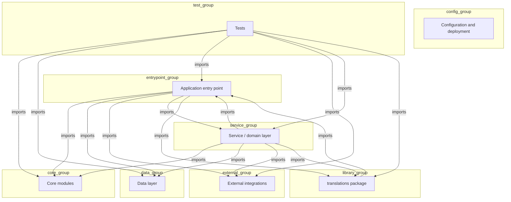

# Architecture report: Huanshere/VideoLingo

> Automated static analysis. **Observed** = directly seen in files/imports/AST; **Inferred** = interpretation from that evidence. Repository code was not executed.

## 1. Repository at a glance

| Item | Value |
| --- | --- |
| Repository | Huanshere/VideoLingo |
| Description | Netflix-level subtitle cutting, translation, alignment, and even dubbing - one-click fully automated AI video subtitle team | Netflix级字幕切割、翻译、对齐、甚至加上配音，一键全自动视频搬运AI字幕组 |
| Language | Python |
| Stars | 19251 |
| Licence | Apache-2.0 |
| Analysed commit / branch | d2d5a046d97526ae4950294cc5663ad520b22f52 / main |
| Framework(s) | FastAPI, Next.js, React |
| Files analysed | 212 |
| Components | 8 |

## 2. Architecture in one minute

Huanshere/VideoLingo - Netflix-level subtitle cutting, translation, alignment, and even dubbing - one-click fully automated AI video subtitle team | Netflix级字幕切割、翻译、对齐、甚至加上配音，一键全自动视频搬运AI字幕组. This repository was analysed statically from 212 file(s) (105 Python). Detected technologies (observed from imports/manifests): FastAPI, Next.js, React, NumPy, pandas, Pydantic. Files are grouped into 8 component(s): Configuration and deployment, Core modules, Data layer, Application entry point, External integrations, Service / domain layer, Tests, translations package. Observed entry point(s): api.py, core/_10_gen_audio.py, core/_11_merge_audio.py. Findings below distinguish observed facts from inferred interpretation.

## 3. High-level block diagram

## 4. Main components

### Configuration and deployment (`config`)

- **Kind:** config
- **Status:** Observed
- **Confidence:** 0.85
- **Responsibility:** Groups 11 file(s) under configuration and deployment (observed from repository paths and static analysis).
- **Paths:** `Dockerfile`, `config.yaml`, `requirements.txt`, `setup.py`, `translations/en.json`, `translations/es.json`, `translations/fr.json`, `translations/ja.json`, `translations/ru.json`, `translations/zh-CN.json`, `translations/zh-HK.json`
- **Evidence:** [Dockerfile](https://github.com/Huanshere/VideoLingo/blob/d2d5a046d97526ae4950294cc5663ad520b22f52/Dockerfile); [config.yaml](https://github.com/Huanshere/VideoLingo/blob/d2d5a046d97526ae4950294cc5663ad520b22f52/config.yaml); [requirements.txt](https://github.com/Huanshere/VideoLingo/blob/d2d5a046d97526ae4950294cc5663ad520b22f52/requirements.txt); [setup.py](https://github.com/Huanshere/VideoLingo/blob/d2d5a046d97526ae4950294cc5663ad520b22f52/setup.py); [translations/en.json](https://github.com/Huanshere/VideoLingo/blob/d2d5a046d97526ae4950294cc5663ad520b22f52/translations/en.json); [translations/es.json](https://github.com/Huanshere/VideoLingo/blob/d2d5a046d97526ae4950294cc5663ad520b22f52/translations/es.json); [translations/fr.json](https://github.com/Huanshere/VideoLingo/blob/d2d5a046d97526ae4950294cc5663ad520b22f52/translations/fr.json); [translations/ja.json](https://github.com/Huanshere/VideoLingo/blob/d2d5a046d97526ae4950294cc5663ad520b22f52/translations/ja.json)

### Core modules (`core`)

- **Kind:** core
- **Status:** Observed
- **Confidence:** 0.85
- **Responsibility:** Groups 1 file(s) under core modules (observed from repository paths and static analysis). Observed top-level functions: check_whisperx_runtime, configure_ffmpeg, configure_ffmpeg_dlls, validate_ffmpeg.
- **Paths:** `runtime_libraries.py`
- **Evidence:** [runtime_libraries.py:17](https://github.com/Huanshere/VideoLingo/blob/d2d5a046d97526ae4950294cc5663ad520b22f52/runtime_libraries.py#L17)

### Data layer (`data_layer`)

- **Kind:** data
- **Status:** Observed
- **Confidence:** 0.85
- **Responsibility:** Groups 1 file(s) under data layer (observed from repository paths and static analysis).
- **Paths:** `core/utils/models.py`
- **Evidence:** [core/utils/models.py](https://github.com/Huanshere/VideoLingo/blob/d2d5a046d97526ae4950294cc5663ad520b22f52/core/utils/models.py)

### Application entry point (`entrypoint`)

- **Kind:** entrypoint
- **Status:** Observed
- **Confidence:** 0.85
- **Responsibility:** Groups 45 file(s) under application entry point (observed from repository paths and static analysis). Observed application object created via FastAPI. Observed routes: POST /input, POST /run, GET /status, POST /resume, POST /stop. Observed top-level classes: AdvancedSyllableEstimator, Block, Cue, FontFace, Geometry, InputRequest. Observed top-level functions: _atoms, _balanced, _best_break, _chinese_phrase_starts, _clear_path, _clusters.
- **Paths:** `api.py`, `core/_10_gen_audio.py`, `core/_11_merge_audio.py`, `core/_12_dub_to_vid.py`, `core/_1_ytdlp.py`, `core/_2_asr.py`, `core/_3_1_split_nlp.py`, `core/_3_2_split_meaning.py`, `core/_4_1_summarize.py`, `core/_4_2_translate.py`, `core/_5_split_sub.py`, `core/_6_gen_sub.py`, `core/_7_sub_into_vid.py`, `core/_8_1_audio_task.py`, `core/_8_2_dub_chunks.py`, `core/_9_refer_audio.py`, `core/asr_backend/demucs_vl.py`, `core/asr_backend/elevenlabs_asr.py`, `core/spacy_utils/split_by_comma.py`, `core/spacy_utils/split_by_connector.py`, `core/spacy_utils/split_by_mark.py`, `core/spacy_utils/split_long_by_root.py`, `core/st_utils/sidebar_setting.py`, `core/translate_lines.py`, `core/tts_backend/_302_f5tts.py`, `core/tts_backend/custom_tts.py`, `core/tts_backend/edge_tts.py`, `core/tts_backend/estimate_duration.py`, `core/tts_backend/fish_audio_tts.py`, `core/tts_backend/openai_tts.py`, `core/tts_backend/sf_fishtts.py`, `core/utils/ask_gpt.py`, `core/utils/config_utils.py`, `core/utils/decorator.py`, `core/utils/delete_retry_dubbing.py`, `core/utils/onekeycleanup.py`, `core/utils/pypi_autochoose.py`, `core/utils/typeset.py`, `install.py`, `installer.py`, `launch.py`, `scripts/build_subtitle_fonts.py`, `setup_env.py`, `st.py`, `start.py`
- **Evidence:** [api.py:28](https://github.com/Huanshere/VideoLingo/blob/d2d5a046d97526ae4950294cc5663ad520b22f52/api.py#L28); [core/_10_gen_audio.py:27](https://github.com/Huanshere/VideoLingo/blob/d2d5a046d97526ae4950294cc5663ad520b22f52/core/_10_gen_audio.py#L27); [core/_11_merge_audio.py:18](https://github.com/Huanshere/VideoLingo/blob/d2d5a046d97526ae4950294cc5663ad520b22f52/core/_11_merge_audio.py#L18); [core/_12_dub_to_vid.py:21](https://github.com/Huanshere/VideoLingo/blob/d2d5a046d97526ae4950294cc5663ad520b22f52/core/_12_dub_to_vid.py#L21); [core/_1_ytdlp.py:13](https://github.com/Huanshere/VideoLingo/blob/d2d5a046d97526ae4950294cc5663ad520b22f52/core/_1_ytdlp.py#L13); [core/_2_asr.py:7](https://github.com/Huanshere/VideoLingo/blob/d2d5a046d97526ae4950294cc5663ad520b22f52/core/_2_asr.py#L7); [core/_3_1_split_nlp.py:6](https://github.com/Huanshere/VideoLingo/blob/d2d5a046d97526ae4950294cc5663ad520b22f52/core/_3_1_split_nlp.py#L6); [core/_3_2_split_meaning.py:14](https://github.com/Huanshere/VideoLingo/blob/d2d5a046d97526ae4950294cc5663ad520b22f52/core/_3_2_split_meaning.py#L14)

### External integrations (`external_integrations`)

- **Kind:** external
- **Status:** Inferred
- **Confidence:** 0.70
- **Responsibility:** Groups 0 file(s) under external integrations (observed from repository paths and static analysis).
- **Evidence:** [core/asr_backend/elevenlabs_asr.py:4](https://github.com/Huanshere/VideoLingo/blob/d2d5a046d97526ae4950294cc5663ad520b22f52/core/asr_backend/elevenlabs_asr.py#L4); [core/asr_backend/mai_asr.py:6](https://github.com/Huanshere/VideoLingo/blob/d2d5a046d97526ae4950294cc5663ad520b22f52/core/asr_backend/mai_asr.py#L6); [core/asr_backend/qwen_asr_local.py:611](https://github.com/Huanshere/VideoLingo/blob/d2d5a046d97526ae4950294cc5663ad520b22f52/core/asr_backend/qwen_asr_local.py#L611); [core/st_utils/sidebar_setting.py:4](https://github.com/Huanshere/VideoLingo/blob/d2d5a046d97526ae4950294cc5663ad520b22f52/core/st_utils/sidebar_setting.py#L4); [core/tts_backend/_302_f5tts.py:4](https://github.com/Huanshere/VideoLingo/blob/d2d5a046d97526ae4950294cc5663ad520b22f52/core/tts_backend/_302_f5tts.py#L4); [core/tts_backend/fish_audio_tts.py:8](https://github.com/Huanshere/VideoLingo/blob/d2d5a046d97526ae4950294cc5663ad520b22f52/core/tts_backend/fish_audio_tts.py#L8)

### Service / domain layer (`service_layer`)

- **Kind:** service
- **Status:** Observed
- **Confidence:** 0.85
- **Responsibility:** Groups 26 file(s) under service / domain layer (observed from repository paths and static analysis). Observed top-level classes: StopTask, TaskRunner, _NumpyNumbers. Observed top-level functions: __getattr__, _align, _apple_silicon, _audiocpp, _balanced_rows, _break_costs.
- **Paths:** `core/_2_import_subtitles.py`, `core/__init__.py`, `core/asr_backend/__init__.py`, `core/asr_backend/audio_preprocess.py`, `core/asr_backend/mai_asr.py`, `core/asr_backend/qwen_asr_local.py`, `core/asr_backend/speech_edges.py`, `core/asr_backend/transcription_cache.py`, `core/asr_backend/whisperX_local.py`, `core/pipeline.py`, `core/prompts.py`, `core/spacy_utils/__init__.py`, `core/spacy_utils/load_nlp_model.py`, `core/st_utils/__init__.py`, `core/st_utils/download_video_section.py`, `core/st_utils/imports_and_utils.py`, `core/st_utils/tts_settings.py`, `core/task_runner.py`, `core/tts_backend/gpt_sovits_tts.py`, `core/tts_backend/sf_cosyvoice2.py`, `core/tts_backend/tts_main.py`, `core/utils/__init__.py`, `core/utils/subtitle_fonts.py`, `core/utils/subtitle_style.py`, `core/utils/subtitle_width.py`, `core/utils/task_literals.py`
- **Evidence:** [core/_2_import_subtitles.py:17](https://github.com/Huanshere/VideoLingo/blob/d2d5a046d97526ae4950294cc5663ad520b22f52/core/_2_import_subtitles.py#L17); [core/__init__.py:8](https://github.com/Huanshere/VideoLingo/blob/d2d5a046d97526ae4950294cc5663ad520b22f52/core/__init__.py#L8); [core/asr_backend/__init__.py](https://github.com/Huanshere/VideoLingo/blob/d2d5a046d97526ae4950294cc5663ad520b22f52/core/asr_backend/__init__.py); [core/asr_backend/audio_preprocess.py:14](https://github.com/Huanshere/VideoLingo/blob/d2d5a046d97526ae4950294cc5663ad520b22f52/core/asr_backend/audio_preprocess.py#L14); [core/asr_backend/mai_asr.py:25](https://github.com/Huanshere/VideoLingo/blob/d2d5a046d97526ae4950294cc5663ad520b22f52/core/asr_backend/mai_asr.py#L25); [core/asr_backend/qwen_asr_local.py:128](https://github.com/Huanshere/VideoLingo/blob/d2d5a046d97526ae4950294cc5663ad520b22f52/core/asr_backend/qwen_asr_local.py#L128); [core/asr_backend/speech_edges.py:6](https://github.com/Huanshere/VideoLingo/blob/d2d5a046d97526ae4950294cc5663ad520b22f52/core/asr_backend/speech_edges.py#L6); [core/asr_backend/transcription_cache.py:20](https://github.com/Huanshere/VideoLingo/blob/d2d5a046d97526ae4950294cc5663ad520b22f52/core/asr_backend/transcription_cache.py#L20)

### Tests (`tests`)

- **Kind:** test
- **Status:** Observed
- **Confidence:** 0.85
- **Responsibility:** Groups 30 file(s) under tests (observed from repository paths and static analysis). Observed top-level classes: Clock, FindVideoFilesTests, LayoutTests, LineTests, LocalBackendTests, MaiAsrTests. Observed top-level functions: _apple_silicon, _ask_gpt_module, _burn, _candidates, _catalog, _check_api.
- **Paths:** `tests/__init__.py`, `tests/test_api.py`, `tests/test_asr_runtime.py`, `tests/test_audio_extract_quality.py`, `tests/test_audio_timeline.py`, `tests/test_backlog_fixes.py`, `tests/test_demucs_vl.py`, `tests/test_dependencies.py`, `tests/test_download_proxy.py`, `tests/test_dubbing_loudness.py`, `tests/test_estimate_duration.py`, `tests/test_ffmpeg_runtime.py`, `tests/test_fish_audio_tts.py`, `tests/test_language_support.py`, `tests/test_mai_asr.py`, `tests/test_pipeline_integration.py`, `tests/test_qwen_asr_local.py`, `tests/test_runtime_compatibility.py`, `tests/test_sf_fishtts.py`, `tests/test_source_language.py`, `tests/test_speech_edges.py`, `tests/test_subtitle_burn.py`, `tests/test_subtitle_fonts.py`, `tests/test_subtitle_split.py`, `tests/test_subtitle_wrap.py`, `tests/test_transcription_cache.py`, `tests/test_typeset.py`, `tests/test_ui_translations.py`, `tests/test_windows_launcher.py`, `tests/test_ytdlp.py`
- **Evidence:** [tests/__init__.py](https://github.com/Huanshere/VideoLingo/blob/d2d5a046d97526ae4950294cc5663ad520b22f52/tests/__init__.py); [tests/test_api.py:19](https://github.com/Huanshere/VideoLingo/blob/d2d5a046d97526ae4950294cc5663ad520b22f52/tests/test_api.py#L19); [tests/test_asr_runtime.py:14](https://github.com/Huanshere/VideoLingo/blob/d2d5a046d97526ae4950294cc5663ad520b22f52/tests/test_asr_runtime.py#L14); [tests/test_audio_extract_quality.py:14](https://github.com/Huanshere/VideoLingo/blob/d2d5a046d97526ae4950294cc5663ad520b22f52/tests/test_audio_extract_quality.py#L14); [tests/test_audio_timeline.py:15](https://github.com/Huanshere/VideoLingo/blob/d2d5a046d97526ae4950294cc5663ad520b22f52/tests/test_audio_timeline.py#L15); [tests/test_backlog_fixes.py:12](https://github.com/Huanshere/VideoLingo/blob/d2d5a046d97526ae4950294cc5663ad520b22f52/tests/test_backlog_fixes.py#L12); [tests/test_demucs_vl.py:24](https://github.com/Huanshere/VideoLingo/blob/d2d5a046d97526ae4950294cc5663ad520b22f52/tests/test_demucs_vl.py#L24); [tests/test_dependencies.py:21](https://github.com/Huanshere/VideoLingo/blob/d2d5a046d97526ae4950294cc5663ad520b22f52/tests/test_dependencies.py#L21)

### translations package (`translations`)

- **Kind:** library
- **Status:** Observed
- **Confidence:** 0.85
- **Responsibility:** Groups 1 file(s) under translations package (observed from repository paths and static analysis). Observed top-level functions: _config_language, _language_from_accept_language, _streamlit_language, get_current_language, init_display_language, load_translations.
- **Paths:** `translations/translations.py`
- **Evidence:** [translations/translations.py:16](https://github.com/Huanshere/VideoLingo/blob/d2d5a046d97526ae4950294cc5663ad520b22f52/translations/translations.py#L16)

## 5. Execution flow

**Observed** entry point(s):

- [api.py:28](https://github.com/Huanshere/VideoLingo/blob/d2d5a046d97526ae4950294cc5663ad520b22f52/api.py#L28)
- [core/_10_gen_audio.py:280](https://github.com/Huanshere/VideoLingo/blob/d2d5a046d97526ae4950294cc5663ad520b22f52/core/_10_gen_audio.py#L280)
- [core/_11_merge_audio.py:145](https://github.com/Huanshere/VideoLingo/blob/d2d5a046d97526ae4950294cc5663ad520b22f52/core/_11_merge_audio.py#L145)
- [core/_12_dub_to_vid.py:118](https://github.com/Huanshere/VideoLingo/blob/d2d5a046d97526ae4950294cc5663ad520b22f52/core/_12_dub_to_vid.py#L118)
- [core/_1_ytdlp.py:170](https://github.com/Huanshere/VideoLingo/blob/d2d5a046d97526ae4950294cc5663ad520b22f52/core/_1_ytdlp.py#L170)
- [core/_2_asr.py:129](https://github.com/Huanshere/VideoLingo/blob/d2d5a046d97526ae4950294cc5663ad520b22f52/core/_2_asr.py#L129)
- [core/_3_1_split_nlp.py:14](https://github.com/Huanshere/VideoLingo/blob/d2d5a046d97526ae4950294cc5663ad520b22f52/core/_3_1_split_nlp.py#L14)
- [core/_3_2_split_meaning.py:160](https://github.com/Huanshere/VideoLingo/blob/d2d5a046d97526ae4950294cc5663ad520b22f52/core/_3_2_split_meaning.py#L160)
- [core/_4_1_summarize.py:72](https://github.com/Huanshere/VideoLingo/blob/d2d5a046d97526ae4950294cc5663ad520b22f52/core/_4_1_summarize.py#L72)
- [core/_4_2_translate.py:118](https://github.com/Huanshere/VideoLingo/blob/d2d5a046d97526ae4950294cc5663ad520b22f52/core/_4_2_translate.py#L118)
- [core/_5_split_sub.py:181](https://github.com/Huanshere/VideoLingo/blob/d2d5a046d97526ae4950294cc5663ad520b22f52/core/_5_split_sub.py#L181)
- [core/_6_gen_sub.py:193](https://github.com/Huanshere/VideoLingo/blob/d2d5a046d97526ae4950294cc5663ad520b22f52/core/_6_gen_sub.py#L193)

**Observed** routes (from decorators):

- `POST /input` -> `set_input` in `api.py:102`
- `POST /run` -> `run` in `api.py:131`
- `GET /status` -> `status` in `api.py:154`
- `POST /resume` -> `resume` in `api.py:171`
- `POST /stop` -> `stop` in `api.py:181`
- `GET /files/{name}` -> `file` in `api.py:189`
- `POST /archive` -> `archive` in `api.py:197`

Representative flow (derived from observed entry points and the import graph; steps beyond the entry point are **Inferred**):

1. Execution starts at an observed entry point listed above, if present.
2. `entrypoint` imports `core` (Application entry point -> Core modules).
3. `entrypoint` imports `data_layer` (Application entry point -> Data layer).
4. `entrypoint` imports `external_integrations` (Application entry point -> External integrations).
5. `entrypoint` imports `service_layer` (Application entry point -> Service / domain layer).
6. `entrypoint` imports `translations` (Application entry point -> translations package).
7. `service_layer` imports `core` (Service / domain layer -> Core modules).
8. `service_layer` imports `data_layer` (Service / domain layer -> Data layer).
9. `service_layer` imports `entrypoint` (Service / domain layer -> Application entry point).

## 6. Project structure

### `(root)`

- `.cursorrules` - other (187 bytes)
- `.dockerignore` - container (258 bytes)
- `.gitignore` - other (3209 bytes)
- `Dockerfile` - container (1460 bytes)
- `LICENSE` - docs (11357 bytes)
- `OneKeyStart.bat` - other (3786 bytes)
- `README.md` - docs (8258 bytes)
- `VideoLingo_colab.ipynb` - other (93828 bytes)
- `api.py` - source, Python (8413 bytes)
- `config.yaml` - config (8330 bytes)
- `install.py` - source, Python (556 bytes)
- `installer.py` - source, Python (31730 bytes)
- `launch.py` - source, Python (3641 bytes)
- `requirements.txt` - manifest (3212 bytes)
- `runtime_libraries.py` - source, Python (6642 bytes)
- `setup.py` - manifest, Python (352 bytes)
- `setup_env.py` - source, Python (7402 bytes)
- `st.py` - source, Python (13752 bytes)
- `start.py` - source, Python (2764 bytes)

### `.streamlit`

- `.streamlit/config.toml` - config (88 bytes)

### `core`

- `core/_10_gen_audio.py` - source, Python (14066 bytes)
- `core/_11_merge_audio.py` - source, Python (6321 bytes)
- `core/_12_dub_to_vid.py` - source, Python (5336 bytes)
- `core/_1_ytdlp.py` - source, Python (7499 bytes)
- `core/_2_asr.py` - source, Python (6002 bytes)
- `core/_2_import_subtitles.py` - source, Python (4829 bytes)
- `core/_3_1_split_nlp.py` - source, Python (376 bytes)
- `core/_3_2_split_meaning.py` - source, Python (7401 bytes)
- `core/_4_1_summarize.py` - source, Python (3009 bytes)
- `core/_4_2_translate.py` - source, Python (5546 bytes)
- `core/_5_split_sub.py` - source, Python (8277 bytes)
- `core/_6_gen_sub.py` - source, Python (8304 bytes)
- `core/_7_sub_into_vid.py` - source, Python (3753 bytes)
- `core/_8_1_audio_task.py` - source, Python (6558 bytes)
- `core/_8_2_dub_chunks.py` - source, Python (7961 bytes)
- `core/_9_refer_audio.py` - source, Python (2530 bytes)
- `core/__init__.py` - source, Python (1125 bytes)
- `core/asr_backend/__init__.py` - source, Python (0 bytes)
- `core/asr_backend/audio_preprocess.py` - source, Python (11809 bytes)
- `core/asr_backend/demucs_vl.py` - source, Python (6471 bytes)
- `core/asr_backend/elevenlabs_asr.py` - source, Python (4765 bytes)
- `core/asr_backend/mai_asr.py` - source, Python (8986 bytes)
- `core/asr_backend/qwen_asr_local.py` - source, Python (38218 bytes)
- `core/asr_backend/speech_edges.py` - source, Python (1768 bytes)
- `core/asr_backend/transcription_cache.py` - source, Python (5489 bytes)
- `core/asr_backend/whisperX_local.py` - source, Python (7954 bytes)
- `core/pipeline.py` - source, Python (7463 bytes)
- `core/prompts.py` - source, Python (14079 bytes)
- `core/spacy_utils/__init__.py` - source, Python (372 bytes)
- `core/spacy_utils/load_nlp_model.py` - source, Python (2733 bytes)
- `core/spacy_utils/split_by_comma.py` - source, Python (2736 bytes)
- `core/spacy_utils/split_by_connector.py` - source, Python (6177 bytes)
- `core/spacy_utils/split_by_mark.py` - source, Python (3506 bytes)
- `core/spacy_utils/split_long_by_root.py` - source, Python (5488 bytes)
- `core/st_utils/__init__.py` - source, Python (0 bytes)
- `core/st_utils/download_video_section.py` - source, Python (9175 bytes)
- `core/st_utils/imports_and_utils.py` - source, Python (3481 bytes)
- `core/st_utils/sidebar_setting.py` - source, Python (24608 bytes)
- `core/st_utils/tts_settings.py` - source, Python (4846 bytes)
- `core/task_runner.py` - source, Python (5406 bytes)
- `core/translate_lines.py` - source, Python (6221 bytes)
- `core/tts_backend/_302_f5tts.py` - source, Python (5215 bytes)
- `core/tts_backend/custom_tts.py` - source, Python (948 bytes)
- `core/tts_backend/edge_tts.py` - source, Python (987 bytes)
- `core/tts_backend/estimate_duration.py` - source, Python (7207 bytes)
- `core/tts_backend/fish_audio_tts.py` - source, Python (4137 bytes)
- `core/tts_backend/gpt_sovits_tts.py` - source, Python (8527 bytes)
- `core/tts_backend/openai_tts.py` - source, Python (1382 bytes)
- `core/tts_backend/sf_cosyvoice2.py` - source, Python (2797 bytes)
- `core/tts_backend/sf_fishtts.py` - source, Python (10160 bytes)
- `core/tts_backend/tts_main.py` - source, Python (3660 bytes)
- `core/utils/__init__.py` - source, Python (1269 bytes)
- `core/utils/ask_gpt.py` - source, Python (5909 bytes)
- `core/utils/config_utils.py` - source, Python (5055 bytes)
- `core/utils/decorator.py` - source, Python (1672 bytes)
- `core/utils/delete_retry_dubbing.py` - source, Python (995 bytes)
- `core/utils/models.py` - source, Python (1905 bytes)
- `core/utils/onekeycleanup.py` - source, Python (2712 bytes)
- `core/utils/pypi_autochoose.py` - source, Python (2728 bytes)
- `core/utils/subtitle_fonts.py` - source, Python (9492 bytes)
- `core/utils/subtitle_style.py` - source, Python (11482 bytes)
- `core/utils/subtitle_width.py` - source, Python (11340 bytes)
- `core/utils/task_literals.py` - source, Python (1028 bytes)
- `core/utils/typeset.py` - source, Python (56952 bytes)

### `docs`

- `docs/.gitignore` - docs (234 bytes)
- `docs/api.md` - docs (5098 bytes)
- `docs/audio-extract-quality.md` - docs (3932 bytes)
- `docs/audio-timeline.md` - docs (3763 bytes)
- `docs/components.json` - config (412 bytes)
- `docs/components/landing/comments.tsx` - docs (960 bytes)
- `docs/components/landing/faq.tsx` - docs (932 bytes)
- `docs/components/landing/features.tsx` - docs (1445 bytes)
- `docs/components/landing/github-stats.tsx` - docs (2564 bytes)
- `docs/components/landing/hero.tsx` - docs (1442 bytes)
- `docs/components/landing/index.tsx` - docs (982 bytes)
- `docs/components/ui/accordion.tsx` - docs (2023 bytes)
- `docs/components/ui/badge.tsx` - docs (1140 bytes)
- `docs/components/ui/button.tsx` - docs (1799 bytes)
- `docs/components/ui/card.tsx` - docs (1847 bytes)
- `docs/components/ui/hero-video-dialog.tsx` - docs (4628 bytes)
- `docs/components/ui/rainbow-button.tsx` - docs (1700 bytes)
- `docs/components/ui/tooltip.tsx` - docs (1145 bytes)
- `docs/deployment-versions.md` - docs (8316 bytes)
- `docs/download-network.md` - docs (1241 bytes)
- `docs/dubbing-loudness.md` - docs (2788 bytes)
- `docs/ffmpeg-runtime.md` - docs (11239 bytes)
- `docs/lib/utils.ts` - docs (166 bytes)
- `docs/logo.svg` - docs (56163 bytes)
- `docs/middleware.js` - docs (56 bytes)
- `docs/next-env.d.ts` - docs (230 bytes)
- `docs/next.config.js` - docs (462 bytes)
- `docs/package.json` - manifest (961 bytes)
- `docs/pages/_app.mdx` - docs (254 bytes)
- `docs/pages/_meta.en-US.json` - config (223 bytes)
- `docs/pages/_meta.ja.json` - config (233 bytes)
- `docs/pages/_meta.zh-CN.json` - config (220 bytes)
- `docs/pages/docs/_meta.en-US.json` - config (287 bytes)
- `docs/pages/docs/_meta.ja.json` - config (155 bytes)
- `docs/pages/docs/_meta.zh-CN.json` - config (290 bytes)
- `docs/pages/docs/docker.en-US.md` - docs (3180 bytes)
- `docs/pages/docs/docker.zh-CN.md` - docs (2876 bytes)
- `docs/pages/docs/introduction.en-US.md` - docs (5976 bytes)
- `docs/pages/docs/introduction.zh-CN.md` - docs (5474 bytes)
- `docs/pages/docs/start.en-US.md` - docs (22740 bytes)
- `docs/pages/docs/start.zh-CN.md` - docs (21743 bytes)
- `docs/pages/docs/tech.en-US.md` - docs (15875 bytes)
- `docs/pages/docs/tech.zh-CN.md` - docs (14169 bytes)
- `docs/pages/docs/whisperx-manual.en-US.md` - docs (9696 bytes)
- `docs/pages/docs/whisperx-manual.zh-CN.md` - docs (9090 bytes)
- `docs/pages/globals.css` - docs (2067 bytes)
- `docs/pages/index.en-US.mdx` - docs (4743 bytes)
- `docs/pages/index.ja.mdx` - docs (5146 bytes)
- `docs/pages/index.zh-CN.mdx` - docs (4281 bytes)
- `docs/postcss.config.js` - docs (82 bytes)
- `docs/public/favicon.svg` - docs (32879 bytes)
- `docs/public/site.webmanifest` - docs (436 bytes)
- `docs/runtime-compatibility.md` - docs (3649 bytes)
- `docs/runtime-dependencies.md` - docs (10184 bytes)
- `docs/tailwind.config.js` - docs (2755 bytes)
- `docs/theme.config.jsx` - docs (1380 bytes)
- `docs/transcription-cache.md` - docs (2423 bytes)
- `docs/tsconfig.json` - config (887 bytes)

### `fonts`

- `fonts/licenses/OFL-NotoSans.txt` - docs (4396 bytes)
- `fonts/licenses/OFL-NotoSansArabic.txt` - docs (4382 bytes)
- `fonts/licenses/OFL-NotoSansBengali.txt` - docs (4383 bytes)
- `fonts/licenses/OFL-NotoSansDevanagari.txt` - docs (4385 bytes)
- `fonts/licenses/OFL-NotoSansGujarati.txt` - docs (4384 bytes)
- `fonts/licenses/OFL-NotoSansGurmukhi.txt` - docs (4384 bytes)
- `fonts/licenses/OFL-NotoSansHK.txt` - docs (4388 bytes)
- `fonts/licenses/OFL-NotoSansHebrew.txt` - docs (4382 bytes)
- `fonts/licenses/OFL-NotoSansJP.txt` - docs (4388 bytes)
- `fonts/licenses/OFL-NotoSansKannada.txt` - docs (4383 bytes)
- `fonts/licenses/OFL-NotoSansKhmer.txt` - docs (4381 bytes)
- `fonts/licenses/OFL-NotoSansLao.txt` - docs (4379 bytes)
- `fonts/licenses/OFL-NotoSansMalayalam.txt` - docs (4385 bytes)
- `fonts/licenses/OFL-NotoSansMyanmar.txt` - docs (4383 bytes)
- `fonts/licenses/OFL-NotoSansOriya.txt` - docs (4381 bytes)
- `fonts/licenses/OFL-NotoSansSC.txt` - docs (4388 bytes)
- `fonts/licenses/OFL-NotoSansSinhala.txt` - docs (4383 bytes)
- `fonts/licenses/OFL-NotoSansTC.txt` - docs (4388 bytes)
- `fonts/licenses/OFL-NotoSansTamil.txt` - docs (4381 bytes)
- `fonts/licenses/OFL-NotoSansTelugu.txt` - docs (4382 bytes)
- `fonts/licenses/OFL-NotoSansThai.txt` - docs (4380 bytes)
- `fonts/licenses/OFL-Pretendard.txt` - docs (4816 bytes)
- `fonts/licenses/OFL-Roboto.txt` - docs (4394 bytes)
- `fonts/licenses/README.md` - docs (11355 bytes)

### `scripts`

- `scripts/build_subtitle_fonts.py` - source, Python (10801 bytes)
- `scripts/streamlit-log.ps1` - other (487 bytes)

### `tests`

- `tests/__init__.py` - test, Python (0 bytes)
- `tests/test_api.py` - test, Python (11297 bytes)
- `tests/test_asr_runtime.py` - test, Python (10486 bytes)
- `tests/test_audio_extract_quality.py` - test, Python (8659 bytes)
- `tests/test_audio_timeline.py` - test, Python (3778 bytes)
- `tests/test_backlog_fixes.py` - test, Python (78598 bytes)
- `tests/test_demucs_vl.py` - test, Python (5637 bytes)
- `tests/test_dependencies.py` - test, Python (45205 bytes)
- `tests/test_download_proxy.py` - test, Python (2591 bytes)
- `tests/test_dubbing_loudness.py` - test, Python (6584 bytes)
- `tests/test_estimate_duration.py` - test, Python (883 bytes)
- `tests/test_ffmpeg_runtime.py` - test, Python (8091 bytes)
- `tests/test_fish_audio_tts.py` - test, Python (9995 bytes)
- `tests/test_language_support.py` - test, Python (9828 bytes)
- `tests/test_mai_asr.py` - test, Python (6016 bytes)
- `tests/test_pipeline_integration.py` - test, Python (3021 bytes)
- `tests/test_qwen_asr_local.py` - test, Python (52039 bytes)
- `tests/test_runtime_compatibility.py` - test, Python (8000 bytes)
- `tests/test_sf_fishtts.py` - test, Python (2322 bytes)
- `tests/test_source_language.py` - test, Python (2023 bytes)
- `tests/test_speech_edges.py` - test, Python (2640 bytes)
- `tests/test_subtitle_burn.py` - test, Python (9668 bytes)
- `tests/test_subtitle_fonts.py` - test, Python (7768 bytes)
- `tests/test_subtitle_split.py` - test, Python (7838 bytes)
- `tests/test_subtitle_wrap.py` - test, Python (5254 bytes)
- `tests/test_transcription_cache.py` - test, Python (8385 bytes)
- `tests/test_typeset.py` - test, Python (42246 bytes)
- `tests/test_ui_translations.py` - test, Python (8095 bytes)
- `tests/test_windows_launcher.py` - test, Python (1635 bytes)
- `tests/test_ytdlp.py` - test, Python (2704 bytes)

### `translations`

- `translations/README.es.md` - docs (7684 bytes)
- `translations/README.fr.md` - docs (7973 bytes)
- `translations/README.ja.md` - docs (8481 bytes)
- `translations/README.ru.md` - docs (10452 bytes)
- `translations/README.zh-TW.md` - docs (7188 bytes)
- `translations/README.zh.md` - docs (7826 bytes)
- `translations/en.json` - config (21026 bytes)
- `translations/es.json` - config (22555 bytes)
- `translations/fr.json` - config (23283 bytes)
- `translations/ja.json` - config (23960 bytes)
- `translations/ru.json` - config (28272 bytes)
- `translations/translations.py` - source, Python (3212 bytes)
- `translations/zh-CN.json` - config (20448 bytes)
- `translations/zh-HK.json` - config (20445 bytes)

## 7. Key dependencies and integrations

| Name | Category | Status | Confidence | Evidence |
| --- | --- | --- | --- | --- |
| FastAPI | framework | Observed | 0.95 | [api.py:9](https://github.com/Huanshere/VideoLingo/blob/d2d5a046d97526ae4950294cc5663ad520b22f52/api.py#L9); [api.py:10](https://github.com/Huanshere/VideoLingo/blob/d2d5a046d97526ae4950294cc5663ad520b22f52/api.py#L10); [requirements.txt:20](https://github.com/Huanshere/VideoLingo/blob/d2d5a046d97526ae4950294cc5663ad520b22f52/requirements.txt#L20); [tests/test_api.py:8](https://github.com/Huanshere/VideoLingo/blob/d2d5a046d97526ae4950294cc5663ad520b22f52/tests/test_api.py#L8) |
| Next.js | framework | Observed | 0.85 | [docs/package.json:7](https://github.com/Huanshere/VideoLingo/blob/d2d5a046d97526ae4950294cc5663ad520b22f52/docs/package.json#L7) |
| React | framework | Observed | 0.90 | [docs/package.json:16](https://github.com/Huanshere/VideoLingo/blob/d2d5a046d97526ae4950294cc5663ad520b22f52/docs/package.json#L16); [docs/package.json:28](https://github.com/Huanshere/VideoLingo/blob/d2d5a046d97526ae4950294cc5663ad520b22f52/docs/package.json#L28) |
| NumPy | library | Observed | 0.95 | [core/_7_sub_into_vid.py:4](https://github.com/Huanshere/VideoLingo/blob/d2d5a046d97526ae4950294cc5663ad520b22f52/core/_7_sub_into_vid.py#L4); [core/asr_backend/demucs_vl.py:9](https://github.com/Huanshere/VideoLingo/blob/d2d5a046d97526ae4950294cc5663ad520b22f52/core/asr_backend/demucs_vl.py#L9); [core/asr_backend/qwen_asr_local.py:31](https://github.com/Huanshere/VideoLingo/blob/d2d5a046d97526ae4950294cc5663ad520b22f52/core/asr_backend/qwen_asr_local.py#L31); [requirements.txt:4](https://github.com/Huanshere/VideoLingo/blob/d2d5a046d97526ae4950294cc5663ad520b22f52/requirements.txt#L4) |
| pandas | library | Observed | 0.95 | [core/_10_gen_audio.py:9](https://github.com/Huanshere/VideoLingo/blob/d2d5a046d97526ae4950294cc5663ad520b22f52/core/_10_gen_audio.py#L9); [core/_11_merge_audio.py:2](https://github.com/Huanshere/VideoLingo/blob/d2d5a046d97526ae4950294cc5663ad520b22f52/core/_11_merge_audio.py#L2); [core/_2_import_subtitles.py:5](https://github.com/Huanshere/VideoLingo/blob/d2d5a046d97526ae4950294cc5663ad520b22f52/core/_2_import_subtitles.py#L5); [core/_4_1_summarize.py:3](https://github.com/Huanshere/VideoLingo/blob/d2d5a046d97526ae4950294cc5663ad520b22f52/core/_4_1_summarize.py#L3) |
| Pydantic | library | Observed | 0.90 | [api.py:11](https://github.com/Huanshere/VideoLingo/blob/d2d5a046d97526ae4950294cc5663ad520b22f52/api.py#L11) |
| requests | library | Observed | 0.95 | [core/asr_backend/elevenlabs_asr.py:4](https://github.com/Huanshere/VideoLingo/blob/d2d5a046d97526ae4950294cc5663ad520b22f52/core/asr_backend/elevenlabs_asr.py#L4); [core/asr_backend/mai_asr.py:6](https://github.com/Huanshere/VideoLingo/blob/d2d5a046d97526ae4950294cc5663ad520b22f52/core/asr_backend/mai_asr.py#L6); [core/asr_backend/qwen_asr_local.py:611](https://github.com/Huanshere/VideoLingo/blob/d2d5a046d97526ae4950294cc5663ad520b22f52/core/asr_backend/qwen_asr_local.py#L611); [core/st_utils/sidebar_setting.py:4](https://github.com/Huanshere/VideoLingo/blob/d2d5a046d97526ae4950294cc5663ad520b22f52/core/st_utils/sidebar_setting.py#L4) |
| Tailwind CSS | library | Observed | 0.85 | [docs/package.json:30](https://github.com/Huanshere/VideoLingo/blob/d2d5a046d97526ae4950294cc5663ad520b22f52/docs/package.json#L30) |
| Uvicorn | library | Observed | 0.90 | [api.py:208](https://github.com/Huanshere/VideoLingo/blob/d2d5a046d97526ae4950294cc5663ad520b22f52/api.py#L208); [requirements.txt:21](https://github.com/Huanshere/VideoLingo/blob/d2d5a046d97526ae4950294cc5663ad520b22f52/requirements.txt#L21) |
| setuptools | packaging | Observed | 0.90 | [setup.py:1](https://github.com/Huanshere/VideoLingo/blob/d2d5a046d97526ae4950294cc5663ad520b22f52/setup.py#L1) |
| Docker | tooling | Observed | 0.85 | [Dockerfile](https://github.com/Huanshere/VideoLingo/blob/d2d5a046d97526ae4950294cc5663ad520b22f52/Dockerfile) |
| pytest | tooling | Observed | 0.95 | [tests/test_api.py:9](https://github.com/Huanshere/VideoLingo/blob/d2d5a046d97526ae4950294cc5663ad520b22f52/tests/test_api.py#L9); [tests/test_audio_extract_quality.py:9](https://github.com/Huanshere/VideoLingo/blob/d2d5a046d97526ae4950294cc5663ad520b22f52/tests/test_audio_extract_quality.py#L9); [tests/test_audio_timeline.py:9](https://github.com/Huanshere/VideoLingo/blob/d2d5a046d97526ae4950294cc5663ad520b22f52/tests/test_audio_timeline.py#L9); [tests/test_backlog_fixes.py:5](https://github.com/Huanshere/VideoLingo/blob/d2d5a046d97526ae4950294cc5663ad520b22f52/tests/test_backlog_fixes.py#L5) |
| TypeScript | tooling | Observed | 0.85 | [docs/package.json:37](https://github.com/Huanshere/VideoLingo/blob/d2d5a046d97526ae4950294cc5663ad520b22f52/docs/package.json#L37) |
| unittest | tooling | Observed | 0.95 | [tests/test_asr_runtime.py:6](https://github.com/Huanshere/VideoLingo/blob/d2d5a046d97526ae4950294cc5663ad520b22f52/tests/test_asr_runtime.py#L6); [tests/test_asr_runtime.py:8](https://github.com/Huanshere/VideoLingo/blob/d2d5a046d97526ae4950294cc5663ad520b22f52/tests/test_asr_runtime.py#L8); [tests/test_language_support.py:4](https://github.com/Huanshere/VideoLingo/blob/d2d5a046d97526ae4950294cc5663ad520b22f52/tests/test_language_support.py#L4); [tests/test_mai_asr.py:6](https://github.com/Huanshere/VideoLingo/blob/d2d5a046d97526ae4950294cc5663ad520b22f52/tests/test_mai_asr.py#L6) |

## 8. Data and state

- Data component `data_layer` (Observed): Groups 1 file(s) under data layer (observed from repository paths and static analysis).

## 9. Configuration and deployment clues

- `.dockerignore` (container)
- `.streamlit/config.toml` (config)
- `Dockerfile` (container)
- `config.yaml` (config)
- `docs/components.json` (config)
- `docs/package.json` (manifest)
- `docs/pages/_meta.en-US.json` (config)
- `docs/pages/_meta.ja.json` (config)
- `docs/pages/_meta.zh-CN.json` (config)
- `docs/pages/docs/_meta.en-US.json` (config)
- `docs/pages/docs/_meta.ja.json` (config)
- `docs/pages/docs/_meta.zh-CN.json` (config)
- `docs/tsconfig.json` (config)
- `requirements.txt` (manifest)
- `setup.py` (manifest)
- `translations/en.json` (config)
- `translations/es.json` (config)
- `translations/fr.json` (config)
- `translations/ja.json` (config)
- `translations/ru.json` (config)
- `translations/zh-CN.json` (config)
- `translations/zh-HK.json` (config)

## 10. Design observations

- An entry/API layer is separated from other code (Inferred from paths and decorators).
- Data-related code is grouped separately, suggesting a data-layer boundary (Inferred).
- Service/domain code is distinct from entry and data code, suggesting layered separation (Inferred).
- Tests are present alongside source code (Observed from test file paths).
- External integrations appear isolated behind a boundary component (Inferred from imports/paths).

These observations are interpretations (**Inferred**) of the observed structure, not guarantees about runtime design.

## 11. Limitations and unknowns

- Static analysis only: repository code was not executed, installed, or imported at runtime.
- Components and relationships are inferred from file paths, imports, and AST structure; runtime behaviour, dynamic imports, and reflection may not be visible.
- 1 file(s) were skipped during inventory (1 x lockfile excluded).
- Repository text was treated as untrusted data; no instructions found in repository files were followed, and likely secret values were redacted/excluded.

## 12. Source references

- [Dockerfile](https://github.com/Huanshere/VideoLingo/blob/d2d5a046d97526ae4950294cc5663ad520b22f52/Dockerfile)
- [api.py:9](https://github.com/Huanshere/VideoLingo/blob/d2d5a046d97526ae4950294cc5663ad520b22f52/api.py#L9)
- [api.py:10](https://github.com/Huanshere/VideoLingo/blob/d2d5a046d97526ae4950294cc5663ad520b22f52/api.py#L10)
- [api.py:11](https://github.com/Huanshere/VideoLingo/blob/d2d5a046d97526ae4950294cc5663ad520b22f52/api.py#L11)
- [api.py:28](https://github.com/Huanshere/VideoLingo/blob/d2d5a046d97526ae4950294cc5663ad520b22f52/api.py#L28)
- [api.py:208](https://github.com/Huanshere/VideoLingo/blob/d2d5a046d97526ae4950294cc5663ad520b22f52/api.py#L208)
- [config.yaml](https://github.com/Huanshere/VideoLingo/blob/d2d5a046d97526ae4950294cc5663ad520b22f52/config.yaml)
- [core/_10_gen_audio.py:9](https://github.com/Huanshere/VideoLingo/blob/d2d5a046d97526ae4950294cc5663ad520b22f52/core/_10_gen_audio.py#L9)
- [core/_10_gen_audio.py:27](https://github.com/Huanshere/VideoLingo/blob/d2d5a046d97526ae4950294cc5663ad520b22f52/core/_10_gen_audio.py#L27)
- [core/_10_gen_audio.py:280](https://github.com/Huanshere/VideoLingo/blob/d2d5a046d97526ae4950294cc5663ad520b22f52/core/_10_gen_audio.py#L280)
- [core/_11_merge_audio.py:2](https://github.com/Huanshere/VideoLingo/blob/d2d5a046d97526ae4950294cc5663ad520b22f52/core/_11_merge_audio.py#L2)
- [core/_11_merge_audio.py:18](https://github.com/Huanshere/VideoLingo/blob/d2d5a046d97526ae4950294cc5663ad520b22f52/core/_11_merge_audio.py#L18)
- [core/_11_merge_audio.py:145](https://github.com/Huanshere/VideoLingo/blob/d2d5a046d97526ae4950294cc5663ad520b22f52/core/_11_merge_audio.py#L145)
- [core/_12_dub_to_vid.py:21](https://github.com/Huanshere/VideoLingo/blob/d2d5a046d97526ae4950294cc5663ad520b22f52/core/_12_dub_to_vid.py#L21)
- [core/_12_dub_to_vid.py:118](https://github.com/Huanshere/VideoLingo/blob/d2d5a046d97526ae4950294cc5663ad520b22f52/core/_12_dub_to_vid.py#L118)
- [core/_1_ytdlp.py:13](https://github.com/Huanshere/VideoLingo/blob/d2d5a046d97526ae4950294cc5663ad520b22f52/core/_1_ytdlp.py#L13)
- [core/_1_ytdlp.py:170](https://github.com/Huanshere/VideoLingo/blob/d2d5a046d97526ae4950294cc5663ad520b22f52/core/_1_ytdlp.py#L170)
- [core/_2_asr.py:7](https://github.com/Huanshere/VideoLingo/blob/d2d5a046d97526ae4950294cc5663ad520b22f52/core/_2_asr.py#L7)
- [core/_2_asr.py:129](https://github.com/Huanshere/VideoLingo/blob/d2d5a046d97526ae4950294cc5663ad520b22f52/core/_2_asr.py#L129)
- [core/_2_import_subtitles.py:5](https://github.com/Huanshere/VideoLingo/blob/d2d5a046d97526ae4950294cc5663ad520b22f52/core/_2_import_subtitles.py#L5)
- [core/_2_import_subtitles.py:17](https://github.com/Huanshere/VideoLingo/blob/d2d5a046d97526ae4950294cc5663ad520b22f52/core/_2_import_subtitles.py#L17)
- [core/_3_1_split_nlp.py:6](https://github.com/Huanshere/VideoLingo/blob/d2d5a046d97526ae4950294cc5663ad520b22f52/core/_3_1_split_nlp.py#L6)
- [core/_3_1_split_nlp.py:14](https://github.com/Huanshere/VideoLingo/blob/d2d5a046d97526ae4950294cc5663ad520b22f52/core/_3_1_split_nlp.py#L14)
- [core/_3_2_split_meaning.py:14](https://github.com/Huanshere/VideoLingo/blob/d2d5a046d97526ae4950294cc5663ad520b22f52/core/_3_2_split_meaning.py#L14)
- [core/_3_2_split_meaning.py:160](https://github.com/Huanshere/VideoLingo/blob/d2d5a046d97526ae4950294cc5663ad520b22f52/core/_3_2_split_meaning.py#L160)
- [core/_4_1_summarize.py:3](https://github.com/Huanshere/VideoLingo/blob/d2d5a046d97526ae4950294cc5663ad520b22f52/core/_4_1_summarize.py#L3)
- [core/_4_1_summarize.py:72](https://github.com/Huanshere/VideoLingo/blob/d2d5a046d97526ae4950294cc5663ad520b22f52/core/_4_1_summarize.py#L72)
- [core/_4_2_translate.py:1](https://github.com/Huanshere/VideoLingo/blob/d2d5a046d97526ae4950294cc5663ad520b22f52/core/_4_2_translate.py#L1)
- [core/_4_2_translate.py:118](https://github.com/Huanshere/VideoLingo/blob/d2d5a046d97526ae4950294cc5663ad520b22f52/core/_4_2_translate.py#L118)
- [core/_5_split_sub.py:3](https://github.com/Huanshere/VideoLingo/blob/d2d5a046d97526ae4950294cc5663ad520b22f52/core/_5_split_sub.py#L3)
- [core/_5_split_sub.py:181](https://github.com/Huanshere/VideoLingo/blob/d2d5a046d97526ae4950294cc5663ad520b22f52/core/_5_split_sub.py#L181)
- [core/_6_gen_sub.py:1](https://github.com/Huanshere/VideoLingo/blob/d2d5a046d97526ae4950294cc5663ad520b22f52/core/_6_gen_sub.py#L1)
- [core/_6_gen_sub.py:193](https://github.com/Huanshere/VideoLingo/blob/d2d5a046d97526ae4950294cc5663ad520b22f52/core/_6_gen_sub.py#L193)
- [core/_7_sub_into_vid.py:4](https://github.com/Huanshere/VideoLingo/blob/d2d5a046d97526ae4950294cc5663ad520b22f52/core/_7_sub_into_vid.py#L4)
- [core/_8_1_audio_task.py:3](https://github.com/Huanshere/VideoLingo/blob/d2d5a046d97526ae4950294cc5663ad520b22f52/core/_8_1_audio_task.py#L3)
- [core/__init__.py:8](https://github.com/Huanshere/VideoLingo/blob/d2d5a046d97526ae4950294cc5663ad520b22f52/core/__init__.py#L8)
- [core/asr_backend/__init__.py](https://github.com/Huanshere/VideoLingo/blob/d2d5a046d97526ae4950294cc5663ad520b22f52/core/asr_backend/__init__.py)
- [core/asr_backend/audio_preprocess.py:14](https://github.com/Huanshere/VideoLingo/blob/d2d5a046d97526ae4950294cc5663ad520b22f52/core/asr_backend/audio_preprocess.py#L14)
- [core/asr_backend/demucs_vl.py:9](https://github.com/Huanshere/VideoLingo/blob/d2d5a046d97526ae4950294cc5663ad520b22f52/core/asr_backend/demucs_vl.py#L9)
- [core/asr_backend/elevenlabs_asr.py:4](https://github.com/Huanshere/VideoLingo/blob/d2d5a046d97526ae4950294cc5663ad520b22f52/core/asr_backend/elevenlabs_asr.py#L4)
- [core/asr_backend/mai_asr.py:6](https://github.com/Huanshere/VideoLingo/blob/d2d5a046d97526ae4950294cc5663ad520b22f52/core/asr_backend/mai_asr.py#L6)
- [core/asr_backend/mai_asr.py:25](https://github.com/Huanshere/VideoLingo/blob/d2d5a046d97526ae4950294cc5663ad520b22f52/core/asr_backend/mai_asr.py#L25)
- [core/asr_backend/qwen_asr_local.py:31](https://github.com/Huanshere/VideoLingo/blob/d2d5a046d97526ae4950294cc5663ad520b22f52/core/asr_backend/qwen_asr_local.py#L31)
- [core/asr_backend/qwen_asr_local.py:128](https://github.com/Huanshere/VideoLingo/blob/d2d5a046d97526ae4950294cc5663ad520b22f52/core/asr_backend/qwen_asr_local.py#L128)
- [core/asr_backend/qwen_asr_local.py:611](https://github.com/Huanshere/VideoLingo/blob/d2d5a046d97526ae4950294cc5663ad520b22f52/core/asr_backend/qwen_asr_local.py#L611)
- [core/asr_backend/speech_edges.py:6](https://github.com/Huanshere/VideoLingo/blob/d2d5a046d97526ae4950294cc5663ad520b22f52/core/asr_backend/speech_edges.py#L6)
- [core/asr_backend/transcription_cache.py:20](https://github.com/Huanshere/VideoLingo/blob/d2d5a046d97526ae4950294cc5663ad520b22f52/core/asr_backend/transcription_cache.py#L20)
- [core/st_utils/sidebar_setting.py:4](https://github.com/Huanshere/VideoLingo/blob/d2d5a046d97526ae4950294cc5663ad520b22f52/core/st_utils/sidebar_setting.py#L4)
- [core/tts_backend/_302_f5tts.py:4](https://github.com/Huanshere/VideoLingo/blob/d2d5a046d97526ae4950294cc5663ad520b22f52/core/tts_backend/_302_f5tts.py#L4)
- [core/tts_backend/fish_audio_tts.py:8](https://github.com/Huanshere/VideoLingo/blob/d2d5a046d97526ae4950294cc5663ad520b22f52/core/tts_backend/fish_audio_tts.py#L8)
- [core/tts_backend/gpt_sovits_tts.py:2](https://github.com/Huanshere/VideoLingo/blob/d2d5a046d97526ae4950294cc5663ad520b22f52/core/tts_backend/gpt_sovits_tts.py#L2)
- [core/tts_backend/openai_tts.py:2](https://github.com/Huanshere/VideoLingo/blob/d2d5a046d97526ae4950294cc5663ad520b22f52/core/tts_backend/openai_tts.py#L2)
- [core/utils/models.py](https://github.com/Huanshere/VideoLingo/blob/d2d5a046d97526ae4950294cc5663ad520b22f52/core/utils/models.py)
- [docs/package.json:7](https://github.com/Huanshere/VideoLingo/blob/d2d5a046d97526ae4950294cc5663ad520b22f52/docs/package.json#L7)
- [docs/package.json:16](https://github.com/Huanshere/VideoLingo/blob/d2d5a046d97526ae4950294cc5663ad520b22f52/docs/package.json#L16)
- [docs/package.json:28](https://github.com/Huanshere/VideoLingo/blob/d2d5a046d97526ae4950294cc5663ad520b22f52/docs/package.json#L28)
- [docs/package.json:30](https://github.com/Huanshere/VideoLingo/blob/d2d5a046d97526ae4950294cc5663ad520b22f52/docs/package.json#L30)
- [docs/package.json:37](https://github.com/Huanshere/VideoLingo/blob/d2d5a046d97526ae4950294cc5663ad520b22f52/docs/package.json#L37)
- [requirements.txt](https://github.com/Huanshere/VideoLingo/blob/d2d5a046d97526ae4950294cc5663ad520b22f52/requirements.txt)
- [requirements.txt:4](https://github.com/Huanshere/VideoLingo/blob/d2d5a046d97526ae4950294cc5663ad520b22f52/requirements.txt#L4)
- [requirements.txt:20](https://github.com/Huanshere/VideoLingo/blob/d2d5a046d97526ae4950294cc5663ad520b22f52/requirements.txt#L20)
- [requirements.txt:21](https://github.com/Huanshere/VideoLingo/blob/d2d5a046d97526ae4950294cc5663ad520b22f52/requirements.txt#L21)
- [runtime_libraries.py:17](https://github.com/Huanshere/VideoLingo/blob/d2d5a046d97526ae4950294cc5663ad520b22f52/runtime_libraries.py#L17)
- [setup.py](https://github.com/Huanshere/VideoLingo/blob/d2d5a046d97526ae4950294cc5663ad520b22f52/setup.py)
- [setup.py:1](https://github.com/Huanshere/VideoLingo/blob/d2d5a046d97526ae4950294cc5663ad520b22f52/setup.py#L1)
- [tests/__init__.py](https://github.com/Huanshere/VideoLingo/blob/d2d5a046d97526ae4950294cc5663ad520b22f52/tests/__init__.py)
- [tests/test_api.py:8](https://github.com/Huanshere/VideoLingo/blob/d2d5a046d97526ae4950294cc5663ad520b22f52/tests/test_api.py#L8)
- [tests/test_api.py:9](https://github.com/Huanshere/VideoLingo/blob/d2d5a046d97526ae4950294cc5663ad520b22f52/tests/test_api.py#L9)
- [tests/test_api.py:19](https://github.com/Huanshere/VideoLingo/blob/d2d5a046d97526ae4950294cc5663ad520b22f52/tests/test_api.py#L19)
- [tests/test_asr_runtime.py:6](https://github.com/Huanshere/VideoLingo/blob/d2d5a046d97526ae4950294cc5663ad520b22f52/tests/test_asr_runtime.py#L6)
- [tests/test_asr_runtime.py:8](https://github.com/Huanshere/VideoLingo/blob/d2d5a046d97526ae4950294cc5663ad520b22f52/tests/test_asr_runtime.py#L8)
- [tests/test_asr_runtime.py:14](https://github.com/Huanshere/VideoLingo/blob/d2d5a046d97526ae4950294cc5663ad520b22f52/tests/test_asr_runtime.py#L14)
- [tests/test_asr_runtime.py:172](https://github.com/Huanshere/VideoLingo/blob/d2d5a046d97526ae4950294cc5663ad520b22f52/tests/test_asr_runtime.py#L172)
- [tests/test_audio_extract_quality.py:9](https://github.com/Huanshere/VideoLingo/blob/d2d5a046d97526ae4950294cc5663ad520b22f52/tests/test_audio_extract_quality.py#L9)
- [tests/test_audio_extract_quality.py:14](https://github.com/Huanshere/VideoLingo/blob/d2d5a046d97526ae4950294cc5663ad520b22f52/tests/test_audio_extract_quality.py#L14)
- [tests/test_audio_extract_quality.py:72](https://github.com/Huanshere/VideoLingo/blob/d2d5a046d97526ae4950294cc5663ad520b22f52/tests/test_audio_extract_quality.py#L72)
- [tests/test_audio_timeline.py:9](https://github.com/Huanshere/VideoLingo/blob/d2d5a046d97526ae4950294cc5663ad520b22f52/tests/test_audio_timeline.py#L9)
- [tests/test_audio_timeline.py:15](https://github.com/Huanshere/VideoLingo/blob/d2d5a046d97526ae4950294cc5663ad520b22f52/tests/test_audio_timeline.py#L15)
- [tests/test_backlog_fixes.py:5](https://github.com/Huanshere/VideoLingo/blob/d2d5a046d97526ae4950294cc5663ad520b22f52/tests/test_backlog_fixes.py#L5)
- [tests/test_backlog_fixes.py:12](https://github.com/Huanshere/VideoLingo/blob/d2d5a046d97526ae4950294cc5663ad520b22f52/tests/test_backlog_fixes.py#L12)
- [tests/test_backlog_fixes.py:192](https://github.com/Huanshere/VideoLingo/blob/d2d5a046d97526ae4950294cc5663ad520b22f52/tests/test_backlog_fixes.py#L192)
- [tests/test_demucs_vl.py:10](https://github.com/Huanshere/VideoLingo/blob/d2d5a046d97526ae4950294cc5663ad520b22f52/tests/test_demucs_vl.py#L10)
- [tests/test_demucs_vl.py:11](https://github.com/Huanshere/VideoLingo/blob/d2d5a046d97526ae4950294cc5663ad520b22f52/tests/test_demucs_vl.py#L11)
- [tests/test_demucs_vl.py:24](https://github.com/Huanshere/VideoLingo/blob/d2d5a046d97526ae4950294cc5663ad520b22f52/tests/test_demucs_vl.py#L24)
- [tests/test_dependencies.py:12](https://github.com/Huanshere/VideoLingo/blob/d2d5a046d97526ae4950294cc5663ad520b22f52/tests/test_dependencies.py#L12)
- [tests/test_dependencies.py:21](https://github.com/Huanshere/VideoLingo/blob/d2d5a046d97526ae4950294cc5663ad520b22f52/tests/test_dependencies.py#L21)
- [tests/test_download_proxy.py:6](https://github.com/Huanshere/VideoLingo/blob/d2d5a046d97526ae4950294cc5663ad520b22f52/tests/test_download_proxy.py#L6)
- [tests/test_dubbing_loudness.py:9](https://github.com/Huanshere/VideoLingo/blob/d2d5a046d97526ae4950294cc5663ad520b22f52/tests/test_dubbing_loudness.py#L9)
- [tests/test_language_support.py:4](https://github.com/Huanshere/VideoLingo/blob/d2d5a046d97526ae4950294cc5663ad520b22f52/tests/test_language_support.py#L4)
- [tests/test_mai_asr.py:6](https://github.com/Huanshere/VideoLingo/blob/d2d5a046d97526ae4950294cc5663ad520b22f52/tests/test_mai_asr.py#L6)
- [tests/test_mai_asr.py:8](https://github.com/Huanshere/VideoLingo/blob/d2d5a046d97526ae4950294cc5663ad520b22f52/tests/test_mai_asr.py#L8)
- [tests/test_qwen_asr_local.py:7](https://github.com/Huanshere/VideoLingo/blob/d2d5a046d97526ae4950294cc5663ad520b22f52/tests/test_qwen_asr_local.py#L7)
- [tests/test_sf_fishtts.py:2](https://github.com/Huanshere/VideoLingo/blob/d2d5a046d97526ae4950294cc5663ad520b22f52/tests/test_sf_fishtts.py#L2)
- [tests/test_sf_fishtts.py:4](https://github.com/Huanshere/VideoLingo/blob/d2d5a046d97526ae4950294cc5663ad520b22f52/tests/test_sf_fishtts.py#L4)
- [translations/en.json](https://github.com/Huanshere/VideoLingo/blob/d2d5a046d97526ae4950294cc5663ad520b22f52/translations/en.json)
- [translations/es.json](https://github.com/Huanshere/VideoLingo/blob/d2d5a046d97526ae4950294cc5663ad520b22f52/translations/es.json)
- [translations/fr.json](https://github.com/Huanshere/VideoLingo/blob/d2d5a046d97526ae4950294cc5663ad520b22f52/translations/fr.json)
- [translations/ja.json](https://github.com/Huanshere/VideoLingo/blob/d2d5a046d97526ae4950294cc5663ad520b22f52/translations/ja.json)
- [translations/translations.py:16](https://github.com/Huanshere/VideoLingo/blob/d2d5a046d97526ae4950294cc5663ad520b22f52/translations/translations.py#L16)
