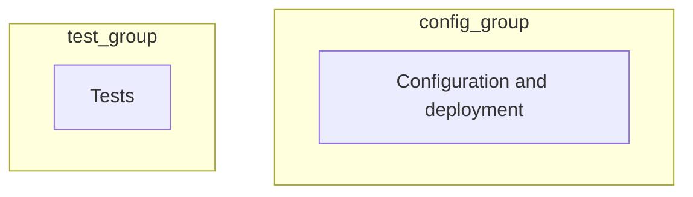

# Architecture report: Imbad0202/academic-research-skills-codex

> Automated static analysis. **Observed** = directly seen in files/imports/AST; **Inferred** = interpretation from that evidence. Repository code was not executed.

## 1. Repository at a glance

| Item | Value |
| --- | --- |
| Repository | Imbad0202/academic-research-skills-codex |
| Description | Codex-native Academic Research Skills suite for human-in-the-loop academic research workflows |
| Language | Python |
| Stars | 14560 |
| Licence | Other |
| Analysed commit / branch | 82725acb393c4410ac6f47634a7f51b40a162fa4 / main |
| Framework(s) | None detected |
| Files analysed | 405 |
| Components | 2 |

## 2. Architecture in one minute

Imbad0202/academic-research-skills-codex - Codex-native Academic Research Skills suite for human-in-the-loop academic research workflows. This repository was analysed statically from 405 file(s) (0 Python). Detected technologies (observed from imports/manifests): GitHub Actions, pytest. Files are grouped into 2 component(s): Configuration and deployment, Tests. Findings below distinguish observed facts from inferred interpretation.

## 3. High-level block diagram

## 4. Main components

### Configuration and deployment (`config`)

- **Kind:** config
- **Status:** Observed
- **Confidence:** 0.85
- **Responsibility:** Groups 21 file(s) under configuration and deployment (observed from repository paths and static analysis).
- **Paths:** `plugins/ars-codex/.codex-plugin/plugin.json`, `plugins/ars-codex/skills/academic-research-suite/agents/openai.yaml`, `plugins/ars-codex/skills/academic-research-suite/ars/.command-invariants.toml`, `plugins/ars-codex/skills/academic-research-suite/ars/.github/FUNDING.yml`, `plugins/ars-codex/skills/academic-research-suite/ars/.github/workflows/changelog-covers-merges.yml`, `plugins/ars-codex/skills/academic-research-suite/ars/.github/workflows/command-invariants.yml`, `plugins/ars-codex/skills/academic-research-suite/ars/.github/workflows/defer-label-gate.yml`, `plugins/ars-codex/skills/academic-research-suite/ars/.github/workflows/eval-harness.yml`, `plugins/ars-codex/skills/academic-research-suite/ars/.github/workflows/freshness-check.yml`, `plugins/ars-codex/skills/academic-research-suite/ars/.github/workflows/harness-retirement-monthly.yml`, `plugins/ars-codex/skills/academic-research-suite/ars/.github/workflows/platform-port-reminder.yml`, `plugins/ars-codex/skills/academic-research-suite/ars/.github/workflows/pr-closes-issue.yml`, `plugins/ars-codex/skills/academic-research-suite/ars/.github/workflows/pytest.yml`, `plugins/ars-codex/skills/academic-research-suite/ars/.github/workflows/release-cooldown.yml`, `plugins/ars-codex/skills/academic-research-suite/ars/.github/workflows/repository-hygiene.yml`, `plugins/ars-codex/skills/academic-research-suite/ars/.github/workflows/spec-consistency.yml`, `plugins/ars-codex/skills/academic-research-suite/ars/.github/workflows/tag-version-match.yml`, `plugins/ars-codex/skills/academic-research-suite/ars/.github/workflows/test-count-monotonic.yml`, `plugins/ars-codex/skills/academic-research-suite/ars/.gitleaks.toml`, `plugins/ars-codex/skills/academic-research-suite/ars/docs/design/snapshots/2026-05-13-ai-disclosure-discovery/manifest.yaml`, `plugins/ars-codex/skills/academic-research-suite/ars/evals/gold/citation_extraction/manifest.yaml`
- **Evidence:** [plugins/ars-codex/.codex-plugin/plugin.json](https://github.com/Imbad0202/academic-research-skills-codex/blob/82725acb393c4410ac6f47634a7f51b40a162fa4/plugins/ars-codex/.codex-plugin/plugin.json); [plugins/ars-codex/skills/academic-research-suite/agents/openai.yaml](https://github.com/Imbad0202/academic-research-skills-codex/blob/82725acb393c4410ac6f47634a7f51b40a162fa4/plugins/ars-codex/skills/academic-research-suite/agents/openai.yaml); [plugins/ars-codex/skills/academic-research-suite/ars/.command-invariants.toml](https://github.com/Imbad0202/academic-research-skills-codex/blob/82725acb393c4410ac6f47634a7f51b40a162fa4/plugins/ars-codex/skills/academic-research-suite/ars/.command-invariants.toml); [plugins/ars-codex/skills/academic-research-suite/ars/.github/FUNDING.yml](https://github.com/Imbad0202/academic-research-skills-codex/blob/82725acb393c4410ac6f47634a7f51b40a162fa4/plugins/ars-codex/skills/academic-research-suite/ars/.github/FUNDING.yml); [plugins/ars-codex/skills/academic-research-suite/ars/.github/workflows/changelog-covers-merges.yml](https://github.com/Imbad0202/academic-research-skills-codex/blob/82725acb393c4410ac6f47634a7f51b40a162fa4/plugins/ars-codex/skills/academic-research-suite/ars/.github/workflows/changelog-covers-merges.yml); [plugins/ars-codex/skills/academic-research-suite/ars/.github/workflows/command-invariants.yml](https://github.com/Imbad0202/academic-research-skills-codex/blob/82725acb393c4410ac6f47634a7f51b40a162fa4/plugins/ars-codex/skills/academic-research-suite/ars/.github/workflows/command-invariants.yml); [plugins/ars-codex/skills/academic-research-suite/ars/.github/workflows/defer-label-gate.yml](https://github.com/Imbad0202/academic-research-skills-codex/blob/82725acb393c4410ac6f47634a7f51b40a162fa4/plugins/ars-codex/skills/academic-research-suite/ars/.github/workflows/defer-label-gate.yml); [plugins/ars-codex/skills/academic-research-suite/ars/.github/workflows/eval-harness.yml](https://github.com/Imbad0202/academic-research-skills-codex/blob/82725acb393c4410ac6f47634a7f51b40a162fa4/plugins/ars-codex/skills/academic-research-suite/ars/.github/workflows/eval-harness.yml)

### Tests (`tests`)

- **Kind:** test
- **Status:** Observed
- **Confidence:** 0.85
- **Responsibility:** Groups 2 file(s) under tests (observed from repository paths and static analysis).
- **Paths:** `plugins/ars-codex/skills/academic-research-suite/ars/scripts/adapters/tests/.gitkeep`, `skills/academic-research-suite/ars/scripts/adapters/tests/.gitkeep`
- **Evidence:** [plugins/ars-codex/skills/academic-research-suite/ars/scripts/adapters/tests/.gitkeep](https://github.com/Imbad0202/academic-research-skills-codex/blob/82725acb393c4410ac6f47634a7f51b40a162fa4/plugins/ars-codex/skills/academic-research-suite/ars/scripts/adapters/tests/.gitkeep); [skills/academic-research-suite/ars/scripts/adapters/tests/.gitkeep](https://github.com/Imbad0202/academic-research-skills-codex/blob/82725acb393c4410ac6f47634a7f51b40a162fa4/skills/academic-research-suite/ars/scripts/adapters/tests/.gitkeep)

## 5. Execution flow

No entry point was observed; the startup flow below is therefore limited.

Representative flow (derived from observed entry points and the import graph; steps beyond the entry point are **Inferred**):

1. Execution starts at an observed entry point listed above, if present.
2. No internal import relationships between components were observed.

## 6. Project structure

### `(root)`

- `.gitignore` - other (78 bytes)
- `CHANGELOG.md` - docs (40246 bytes)
- `CITATION.cff` - other (1397 bytes)
- `CODEX_FULL_RUNTIME_ADAPTER.md` - docs (15650 bytes)
- `LICENSE` - docs (19584 bytes)
- `README.md` - docs (33151 bytes)
- `README_JA.md` - docs (32691 bytes)
- `README_ZH-CN.md` - docs (28324 bytes)
- `README_ZH-TW.md` - docs (25760 bytes)
- `SECURITY.md` - docs (2354 bytes)
- `VERSION` - other (7 bytes)

### `.agents`

- `.agents/plugins/marketplace.json` - config (362 bytes)

### `.codex`

- `.codex/config.toml` - config (131 bytes)

### `.github`

- `.github/FUNDING.yml` - config (29 bytes)

### `docs`

- `docs/windows-marketplace-recovery.md` - docs (25943 bytes)

### `examples`

- `examples/README.md` - docs (996 bytes)
- `examples/codex/full-pipeline-heqa-scope-transformation/README.md` - docs (6363 bytes)
- `examples/codex/full-pipeline-heqa-scope-transformation/abstract.md` - docs (2252 bytes)
- `examples/codex/full-pipeline-heqa-scope-transformation/index.html` - other (17496 bytes)
- `examples/codex/full-pipeline-heqa-scope-transformation/stages/stage1_research_socratic.md` - docs (2433 bytes)
- `examples/codex/full-pipeline-heqa-scope-transformation/stages/stage2.5_integrity_gate.md` - docs (5280 bytes)
- `examples/codex/full-pipeline-heqa-scope-transformation/stages/stage2_write_outline.md` - docs (4154 bytes)
- `examples/codex/full-pipeline-heqa-scope-transformation/stages/stage3_review_quick.md` - docs (4453 bytes)
- `examples/codex/full-pipeline-heqa-scope-transformation/stages/stage4.5_final_integrity.md` - docs (4096 bytes)
- `examples/codex/full-pipeline-heqa-scope-transformation/stages/stage4_revision_roadmap.md` - docs (4315 bytes)
- `examples/codex/full-pipeline-heqa-scope-transformation/stages/stage6_process_summary.md` - docs (4165 bytes)

### `plugins`

- `plugins/ars-codex/.codex-plugin/plugin.json` - config (2007 bytes)
- `plugins/ars-codex/skills/academic-research-suite/SKILL.md` - docs (52650 bytes)
- `plugins/ars-codex/skills/academic-research-suite/agents/openai.yaml` - config (292 bytes)
- `plugins/ars-codex/skills/academic-research-suite/ars/.command-invariants.toml` - config (1108 bytes)
- `plugins/ars-codex/skills/academic-research-suite/ars/.gitattributes` - other (381 bytes)
- `plugins/ars-codex/skills/academic-research-suite/ars/.github/FUNDING.yml` - config (29 bytes)
- `plugins/ars-codex/skills/academic-research-suite/ars/.github/copilot-instructions.md` - docs (2653 bytes)
- `plugins/ars-codex/skills/academic-research-suite/ars/.github/pull_request_template.md` - docs (1969 bytes)
- `plugins/ars-codex/skills/academic-research-suite/ars/.github/workflows/changelog-covers-merges.yml` - ci, YAML (1572 bytes)
- `plugins/ars-codex/skills/academic-research-suite/ars/.github/workflows/command-invariants.yml` - ci, YAML (2049 bytes)
- `plugins/ars-codex/skills/academic-research-suite/ars/.github/workflows/defer-label-gate.yml` - ci, YAML (2071 bytes)
- `plugins/ars-codex/skills/academic-research-suite/ars/.github/workflows/eval-harness.yml` - ci, YAML (7926 bytes)
- `plugins/ars-codex/skills/academic-research-suite/ars/.github/workflows/freshness-check.yml` - ci, YAML (1103 bytes)
- `plugins/ars-codex/skills/academic-research-suite/ars/.github/workflows/harness-retirement-monthly.yml` - ci, YAML (1728 bytes)
- `plugins/ars-codex/skills/academic-research-suite/ars/.github/workflows/platform-port-reminder.yml` - ci, YAML (6258 bytes)
- `plugins/ars-codex/skills/academic-research-suite/ars/.github/workflows/pr-closes-issue.yml` - ci, YAML (2169 bytes)
- `plugins/ars-codex/skills/academic-research-suite/ars/.github/workflows/pytest.yml` - ci, YAML (1855 bytes)
- `plugins/ars-codex/skills/academic-research-suite/ars/.github/workflows/release-cooldown.yml` - ci, YAML (4828 bytes)
- `plugins/ars-codex/skills/academic-research-suite/ars/.github/workflows/repository-hygiene.yml` - ci, YAML (1973 bytes)
- `plugins/ars-codex/skills/academic-research-suite/ars/.github/workflows/spec-consistency.yml` - ci, YAML (49867 bytes)
- `plugins/ars-codex/skills/academic-research-suite/ars/.github/workflows/tag-version-match.yml` - ci, YAML (1386 bytes)
- `plugins/ars-codex/skills/academic-research-suite/ars/.github/workflows/test-count-monotonic.yml` - ci, YAML (5850 bytes)
- `plugins/ars-codex/skills/academic-research-suite/ars/.gitleaks.toml` - config (3244 bytes)
- `plugins/ars-codex/skills/academic-research-suite/ars/.gitleaksignore` - other (641 bytes)
- `plugins/ars-codex/skills/academic-research-suite/ars/CITATION.cff` - other (1462 bytes)
- `plugins/ars-codex/skills/academic-research-suite/ars/CONTRIBUTING.md` - docs (14172 bytes)
- `plugins/ars-codex/skills/academic-research-suite/ars/GOVERNANCE.md` - docs (8584 bytes)
- `plugins/ars-codex/skills/academic-research-suite/ars/LICENSE` - docs (19584 bytes)
- `plugins/ars-codex/skills/academic-research-suite/ars/LICENSE.academic-research-skills` - other (19584 bytes)
- `plugins/ars-codex/skills/academic-research-suite/ars/MODE_REGISTRY.md` - docs (6813 bytes)
- `plugins/ars-codex/skills/academic-research-suite/ars/NOTICE.md` - docs (942 bytes)
- `plugins/ars-codex/skills/academic-research-suite/ars/POSITIONING.md` - docs (15367 bytes)
- `plugins/ars-codex/skills/academic-research-suite/ars/QUICKSTART.md` - docs (3734 bytes)
- `plugins/ars-codex/skills/academic-research-suite/ars/README.es-ES.md` - docs (52563 bytes)
- `plugins/ars-codex/skills/academic-research-suite/ars/README.ja-JP.md` - docs (43352 bytes)
- `plugins/ars-codex/skills/academic-research-suite/ars/README.ko-KR.md` - docs (42495 bytes)
- `plugins/ars-codex/skills/academic-research-suite/ars/README.md` - docs (47223 bytes)
- `plugins/ars-codex/skills/academic-research-suite/ars/README.pt-BR.md` - docs (53062 bytes)
- `plugins/ars-codex/skills/academic-research-suite/ars/README.zh-CN.md` - docs (32129 bytes)
- `plugins/ars-codex/skills/academic-research-suite/ars/README.zh-TW.md` - docs (39403 bytes)
- `plugins/ars-codex/skills/academic-research-suite/ars/SECURITY.md` - docs (3473 bytes)
- `plugins/ars-codex/skills/academic-research-suite/ars/THIRD_PARTY.md` - docs (5137 bytes)
- `plugins/ars-codex/skills/academic-research-suite/ars/academic-paper-reviewer/WORKFLOW.md` - docs (50032 bytes)
- `plugins/ars-codex/skills/academic-research-suite/ars/academic-paper-reviewer/agents/devils_advocate_reviewer_agent.md` - docs (43018 bytes)
- `plugins/ars-codex/skills/academic-research-suite/ars/academic-paper-reviewer/agents/domain_reviewer_agent.md` - docs (34167 bytes)
- `plugins/ars-codex/skills/academic-research-suite/ars/academic-paper-reviewer/agents/editorial_synthesizer_agent.md` - docs (42807 bytes)
- `plugins/ars-codex/skills/academic-research-suite/ars/academic-paper-reviewer/agents/eic_agent.md` - docs (28807 bytes)
- `plugins/ars-codex/skills/academic-research-suite/ars/academic-paper-reviewer/agents/field_analyst_agent.md` - docs (11494 bytes)
- `plugins/ars-codex/skills/academic-research-suite/ars/academic-paper-reviewer/agents/methodology_reviewer_agent.md` - docs (45049 bytes)
- `plugins/ars-codex/skills/academic-research-suite/ars/academic-paper-reviewer/agents/perspective_reviewer_agent.md` - docs (34502 bytes)
- `plugins/ars-codex/skills/academic-research-suite/ars/academic-paper-reviewer/examples/hei_paper_review_example.md` - docs (34657 bytes)
- `plugins/ars-codex/skills/academic-research-suite/ars/academic-paper-reviewer/examples/interdisciplinary_review_example.md` - docs (28262 bytes)
- `plugins/ars-codex/skills/academic-research-suite/ars/academic-paper-reviewer/examples/subclaim_decomposition_example.md` - docs (8528 bytes)
- `plugins/ars-codex/skills/academic-research-suite/ars/academic-paper-reviewer/references/calibration_mode_protocol.md` - docs (15840 bytes)
- `plugins/ars-codex/skills/academic-research-suite/ars/academic-paper-reviewer/references/changelog.md` - docs (1396 bytes)
- `plugins/ars-codex/skills/academic-research-suite/ars/academic-paper-reviewer/references/editorial_decision_standards.md` - docs (13142 bytes)
- `plugins/ars-codex/skills/academic-research-suite/ars/academic-paper-reviewer/references/guided_mode_protocol.md` - docs (2036 bytes)
- `plugins/ars-codex/skills/academic-research-suite/ars/academic-paper-reviewer/references/integration_guide.md` - docs (680 bytes)
- `plugins/ars-codex/skills/academic-research-suite/ars/academic-paper-reviewer/references/quality_rubrics.md` - docs (6400 bytes)
- `plugins/ars-codex/skills/academic-research-suite/ars/academic-paper-reviewer/references/re_review_mode_protocol.md` - docs (53211 bytes)
- `plugins/ars-codex/skills/academic-research-suite/ars/academic-paper-reviewer/references/review_criteria_framework.md` - docs (6335 bytes)
- `plugins/ars-codex/skills/academic-research-suite/ars/academic-paper-reviewer/references/review_panel_provenance_protocol.md` - docs (9656 bytes)
- `plugins/ars-codex/skills/academic-research-suite/ars/academic-paper-reviewer/references/review_quality_thinking.md` - docs (3337 bytes)
- `plugins/ars-codex/skills/academic-research-suite/ars/academic-paper-reviewer/references/reviewer_sprint_prompt_source.md` - docs (49020 bytes)
- `plugins/ars-codex/skills/academic-research-suite/ars/academic-paper-reviewer/references/sprint_contract_protocol.md` - docs (32859 bytes)
- `plugins/ars-codex/skills/academic-research-suite/ars/academic-paper-reviewer/references/statistical_reporting_standards.md` - docs (30511 bytes)
- `plugins/ars-codex/skills/academic-research-suite/ars/academic-paper-reviewer/references/top_journals_by_field.md` - docs (12916 bytes)
- `plugins/ars-codex/skills/academic-research-suite/ars/academic-paper-reviewer/templates/editorial_decision_template.md` - docs (11659 bytes)
- `plugins/ars-codex/skills/academic-research-suite/ars/academic-paper-reviewer/templates/peer_review_report_template.md` - docs (15184 bytes)
- `plugins/ars-codex/skills/academic-research-suite/ars/academic-paper-reviewer/templates/revision_response_template.md` - docs (7595 bytes)
- `plugins/ars-codex/skills/academic-research-suite/ars/academic-paper/WORKFLOW.md` - docs (65341 bytes)
- `plugins/ars-codex/skills/academic-research-suite/ars/academic-paper/agents/abstract_bilingual_agent.md` - docs (12300 bytes)
- `plugins/ars-codex/skills/academic-research-suite/ars/academic-paper/agents/argument_builder_agent.md` - docs (11164 bytes)
- `plugins/ars-codex/skills/academic-research-suite/ars/academic-paper/agents/citation_compliance_agent.md` - docs (24060 bytes)
- `plugins/ars-codex/skills/academic-research-suite/ars/academic-paper/agents/draft_writer_agent.md` - docs (57486 bytes)
- `plugins/ars-codex/skills/academic-research-suite/ars/academic-paper/agents/formatter_agent.md` - docs (65072 bytes)
- `plugins/ars-codex/skills/academic-research-suite/ars/academic-paper/agents/intake_agent.md` - docs (26104 bytes)
- `plugins/ars-codex/skills/academic-research-suite/ars/academic-paper/agents/literature_strategist_agent.md` - docs (47660 bytes)
- `plugins/ars-codex/skills/academic-research-suite/ars/academic-paper/agents/peer_reviewer_agent.md` - docs (30178 bytes)
- `plugins/ars-codex/skills/academic-research-suite/ars/academic-paper/agents/revision_coach_agent.md` - docs (20493 bytes)
- `plugins/ars-codex/skills/academic-research-suite/ars/academic-paper/agents/socratic_mentor_agent.md` - docs (28584 bytes)
- `plugins/ars-codex/skills/academic-research-suite/ars/academic-paper/agents/structure_architect_agent.md` - docs (19358 bytes)
- `plugins/ars-codex/skills/academic-research-suite/ars/academic-paper/agents/visualization_agent.md` - docs (17607 bytes)
- `plugins/ars-codex/skills/academic-research-suite/ars/academic-paper/examples/chinese_paper_example.md` - docs (21572 bytes)
- `plugins/ars-codex/skills/academic-research-suite/ars/academic-paper/examples/clinical_citation_verification_checklist.md` - docs (4465 bytes)
- `plugins/ars-codex/skills/academic-research-suite/ars/academic-paper/examples/clinical_epistemic_status_example.md` - docs (6738 bytes)
- `plugins/ars-codex/skills/academic-research-suite/ars/academic-paper/examples/commitment_ledger_example.md` - docs (8279 bytes)
- `plugins/ars-codex/skills/academic-research-suite/ars/academic-paper/examples/imrad_hei_example.md` - docs (23879 bytes)
- `plugins/ars-codex/skills/academic-research-suite/ars/academic-paper/examples/literature_review_example.md` - docs (31541 bytes)
- `plugins/ars-codex/skills/academic-research-suite/ars/academic-paper/examples/plan_mode_guided_writing.md` - docs (35170 bytes)
- `plugins/ars-codex/skills/academic-research-suite/ars/academic-paper/examples/revision_mode_example.md` - docs (20562 bytes)
- `plugins/ars-codex/skills/academic-research-suite/ars/academic-paper/examples/revision_recovery_example.md` - docs (42214 bytes)
- `plugins/ars-codex/skills/academic-research-suite/ars/academic-paper/examples/version_family_reconciliation_example.md` - docs (3927 bytes)
- `plugins/ars-codex/skills/academic-research-suite/ars/academic-paper/references/abstract_writing_guide.md` - docs (12844 bytes)
- `plugins/ars-codex/skills/academic-research-suite/ars/academic-paper/references/academic_writing_style.md` - docs (7757 bytes)
- `plugins/ars-codex/skills/academic-research-suite/ars/academic-paper/references/anti_leakage_protocol.md` - docs (4489 bytes)
- `plugins/ars-codex/skills/academic-research-suite/ars/academic-paper/references/apa7_chinese_citation_guide.md` - docs (14314 bytes)
- `plugins/ars-codex/skills/academic-research-suite/ars/academic-paper/references/apa7_extended_guide.md` - docs (6725 bytes)
- `plugins/ars-codex/skills/academic-research-suite/ars/academic-paper/references/changelog.md` - docs (2821 bytes)
- `plugins/ars-codex/skills/academic-research-suite/ars/academic-paper/references/citation_format_switcher.md` - docs (7545 bytes)
- `plugins/ars-codex/skills/academic-research-suite/ars/academic-paper/references/committee_correspondence_protocol.md` - docs (6476 bytes)
- `plugins/ars-codex/skills/academic-research-suite/ars/academic-paper/references/credit_authorship_guide.md` - docs (13983 bytes)
- `plugins/ars-codex/skills/academic-research-suite/ars/academic-paper/references/disclosure_mode_protocol.md` - docs (55175 bytes)
- `plugins/ars-codex/skills/academic-research-suite/ars/academic-paper/references/domain_evidence_profiles.md` - docs (4251 bytes)
- `plugins/ars-codex/skills/academic-research-suite/ars/academic-paper/references/failure_paths.md` - docs (14580 bytes)
- `plugins/ars-codex/skills/academic-research-suite/ars/academic-paper/references/funding_statement_guide.md` - docs (12193 bytes)
- `plugins/ars-codex/skills/academic-research-suite/ars/academic-paper/references/hei_domain_glossary.md` - docs (6974 bytes)
- `plugins/ars-codex/skills/academic-research-suite/ars/academic-paper/references/intro_title_rhetoric_guide.md` - docs (8868 bytes)
- `plugins/ars-codex/skills/academic-research-suite/ars/academic-paper/references/journal_submission_guide.md` - docs (8891 bytes)
- `plugins/ars-codex/skills/academic-research-suite/ars/academic-paper/references/latex_template_reference.md` - docs (9851 bytes)
- `plugins/ars-codex/skills/academic-research-suite/ars/academic-paper/references/mode_selection_guide.md` - docs (17907 bytes)
- `plugins/ars-codex/skills/academic-research-suite/ars/academic-paper/references/paper_structure_patterns.md` - docs (8576 bytes)
- `plugins/ars-codex/skills/academic-research-suite/ars/academic-paper/references/plan_mode_protocol.md` - docs (6820 bytes)
- `plugins/ars-codex/skills/academic-research-suite/ars/academic-paper/references/policy_anchor_disclosure_protocol.md` - docs (21530 bytes)
- `plugins/ars-codex/skills/academic-research-suite/ars/academic-paper/references/policy_anchor_table.md` - docs (21692 bytes)
- `plugins/ars-codex/skills/academic-research-suite/ars/academic-paper/references/revision_patch_protocol.md` - docs (13243 bytes)
- `plugins/ars-codex/skills/academic-research-suite/ars/academic-paper/references/statistical_visualization_standards.md` - docs (24247 bytes)
- `plugins/ars-codex/skills/academic-research-suite/ars/academic-paper/references/venue_disclosure_policies.md` - docs (39330 bytes)
- `plugins/ars-codex/skills/academic-research-suite/ars/academic-paper/references/vlm_figure_verification.md` - docs (9301 bytes)
- `plugins/ars-codex/skills/academic-research-suite/ars/academic-paper/references/workflow_phase_details.md` - docs (4772 bytes)
- `plugins/ars-codex/skills/academic-research-suite/ars/academic-paper/references/writing_judgment_framework.md` - docs (3336 bytes)
- `plugins/ars-codex/skills/academic-research-suite/ars/academic-paper/references/writing_quality_check.md` - docs (13305 bytes)
- `plugins/ars-codex/skills/academic-research-suite/ars/academic-paper/templates/bilingual_abstract_template.md` - docs (4818 bytes)
- `plugins/ars-codex/skills/academic-research-suite/ars/academic-paper/templates/case_study_template.md` - docs (2895 bytes)
- `plugins/ars-codex/skills/academic-research-suite/ars/academic-paper/templates/conference_paper_template.md` - docs (2363 bytes)
- `plugins/ars-codex/skills/academic-research-suite/ars/academic-paper/templates/credit_statement_template.md` - docs (4476 bytes)
- `plugins/ars-codex/skills/academic-research-suite/ars/academic-paper/templates/funding_statement_template.md` - docs (9091 bytes)
- `plugins/ars-codex/skills/academic-research-suite/ars/academic-paper/templates/imrad_template.md` - docs (4544 bytes)
- `plugins/ars-codex/skills/academic-research-suite/ars/academic-paper/templates/latex_article_template.tex` - other (4844 bytes)
- `plugins/ars-codex/skills/academic-research-suite/ars/academic-paper/templates/literature_review_template.md` - docs (2896 bytes)
- `plugins/ars-codex/skills/academic-research-suite/ars/academic-paper/templates/policy_brief_template.md` - docs (3645 bytes)
- `plugins/ars-codex/skills/academic-research-suite/ars/academic-paper/templates/revision_tracking_template.md` - docs (10421 bytes)
- `plugins/ars-codex/skills/academic-research-suite/ars/academic-paper/templates/theoretical_paper_template.md` - docs (2913 bytes)
- `plugins/ars-codex/skills/academic-research-suite/ars/academic-pipeline/WORKFLOW.md` - docs (59587 bytes)
- `plugins/ars-codex/skills/academic-research-suite/ars/academic-pipeline/agents/claim_ref_alignment_audit_agent.md` - docs (45401 bytes)
- `plugins/ars-codex/skills/academic-research-suite/ars/academic-pipeline/agents/collaboration_depth_agent.md` - docs (10031 bytes)
- `plugins/ars-codex/skills/academic-research-suite/ars/academic-pipeline/agents/integrity_verification_agent.md` - docs (76309 bytes)
- `plugins/ars-codex/skills/academic-research-suite/ars/academic-pipeline/agents/pipeline_orchestrator_agent.md` - docs (179070 bytes)
- `plugins/ars-codex/skills/academic-research-suite/ars/academic-pipeline/agents/state_tracker_agent.md` - docs (27397 bytes)
- `plugins/ars-codex/skills/academic-research-suite/ars/academic-pipeline/examples/full_pipeline_example.md` - docs (18078 bytes)
- `plugins/ars-codex/skills/academic-research-suite/ars/academic-pipeline/examples/integrity_failure_recovery.md` - docs (27485 bytes)
- `plugins/ars-codex/skills/academic-research-suite/ars/academic-pipeline/examples/mid_entry_example.md` - docs (13715 bytes)
- `plugins/ars-codex/skills/academic-research-suite/ars/academic-pipeline/references/adapters/.gitkeep` - other (0 bytes)
- `plugins/ars-codex/skills/academic-research-suite/ars/academic-pipeline/references/adapters/overview.md` - docs (10193 bytes)
- `plugins/ars-codex/skills/academic-research-suite/ars/academic-pipeline/references/ai_research_failure_modes.md` - docs (15983 bytes)
- `plugins/ars-codex/skills/academic-research-suite/ars/academic-pipeline/references/changelog.md` - docs (5919 bytes)
- `plugins/ars-codex/skills/academic-research-suite/ars/academic-pipeline/references/claim_audit_calibration_protocol.md` - docs (14560 bytes)
- `plugins/ars-codex/skills/academic-research-suite/ars/academic-pipeline/references/claim_verification_protocol.md` - docs (31231 bytes)
- `plugins/ars-codex/skills/academic-research-suite/ars/academic-pipeline/references/external_review_protocol.md` - docs (6329 bytes)
- `plugins/ars-codex/skills/academic-research-suite/ars/academic-pipeline/references/integrity_review_protocol.md` - docs (7315 bytes)
- `plugins/ars-codex/skills/academic-research-suite/ars/academic-pipeline/references/literature_corpus_consumers.md` - docs (11962 bytes)
- `plugins/ars-codex/skills/academic-research-suite/ars/academic-pipeline/references/mode_advisor.md` - docs (8257 bytes)
- `plugins/ars-codex/skills/academic-research-suite/ars/academic-pipeline/references/passport_as_reset_boundary.md` - docs (19057 bytes)
- `plugins/ars-codex/skills/academic-research-suite/ars/academic-pipeline/references/pipeline_state_machine.md` - docs (29022 bytes)
- `plugins/ars-codex/skills/academic-research-suite/ars/academic-pipeline/references/plagiarism_detection_protocol.md` - docs (13795 bytes)
- `plugins/ars-codex/skills/academic-research-suite/ars/academic-pipeline/references/process_summary_protocol.md` - docs (16150 bytes)
- `plugins/ars-codex/skills/academic-research-suite/ars/academic-pipeline/references/progress_dashboard_template.md` - docs (1524 bytes)
- `plugins/ars-codex/skills/academic-research-suite/ars/academic-pipeline/references/reinforcement_content.md` - docs (1396 bytes)
- `plugins/ars-codex/skills/academic-research-suite/ars/academic-pipeline/references/reproducibility_audit.md` - docs (2667 bytes)
- `plugins/ars-codex/skills/academic-research-suite/ars/academic-pipeline/references/score_trajectory_protocol.md` - docs (3913 bytes)
- `plugins/ars-codex/skills/academic-research-suite/ars/academic-pipeline/references/team_collaboration_protocol.md` - docs (10312 bytes)
- `plugins/ars-codex/skills/academic-research-suite/ars/academic-pipeline/references/two_stage_review_protocol.md` - docs (3047 bytes)
- `plugins/ars-codex/skills/academic-research-suite/ars/academic-pipeline/templates/pipeline_status_template.md` - docs (3813 bytes)
- `plugins/ars-codex/skills/academic-research-suite/ars/agents/report_compiler_agent.md` - docs (26656 bytes)
- `plugins/ars-codex/skills/academic-research-suite/ars/agents/research_architect_agent.md` - docs (25885 bytes)
- `plugins/ars-codex/skills/academic-research-suite/ars/agents/screening_reviewer_agent.md` - docs (4900 bytes)
- `plugins/ars-codex/skills/academic-research-suite/ars/agents/synthesis_agent.md` - docs (28917 bytes)
- `plugins/ars-codex/skills/academic-research-suite/ars/audits/575-scope-closure-audit-2026-08-24.md` - docs (4739 bytes)
- `plugins/ars-codex/skills/academic-research-suite/ars/audits/575-source-backed-proving-set-2026-08-24.md` - docs (8418 bytes)
- `plugins/ars-codex/skills/academic-research-suite/ars/audits/684-expert-readiness-2026-08-24.md` - docs (1902 bytes)
- `plugins/ars-codex/skills/academic-research-suite/ars/audits/ars-researcher-blindspot-audit-2026-06-10.md` - docs (34432 bytes)
- `plugins/ars-codex/skills/academic-research-suite/ars/audits/bakeoff-gpt-5-6-sol-codex-2026-08-19.md` - docs (13833 bytes)
- `plugins/ars-codex/skills/academic-research-suite/ars/audits/external-contribution-audit-prompt.md` - docs (9147 bytes)
- `plugins/ars-codex/skills/academic-research-suite/ars/audits/harness-retirement-2026-06-10.md` - docs (14650 bytes)
- `plugins/ars-codex/skills/academic-research-suite/ars/audits/harness-retirement-2026-07-04.md` - docs (35624 bytes)
- `plugins/ars-codex/skills/academic-research-suite/ars/audits/harness-retirement-2026-07.md` - docs (23212 bytes)
- `plugins/ars-codex/skills/academic-research-suite/ars/audits/harness-retirement-2026-08.md` - docs (9063 bytes)
- `plugins/ars-codex/skills/academic-research-suite/ars/audits/harness-retirement-2026-09-model-update.md` - docs (18942 bytes)
- `plugins/ars-codex/skills/academic-research-suite/ars/audits/harness-retirement-2026-09-opus-5-5.md` - docs (27632 bytes)
- `plugins/ars-codex/skills/academic-research-suite/ars/audits/harness-retirement-2026-09.md` - docs (8233 bytes)
- `plugins/ars-codex/skills/academic-research-suite/ars/audits/iso42001-spirit-gap-assessment-2026-08-17.md` - docs (9102 bytes)
- `plugins/ars-codex/skills/academic-research-suite/ars/audits/rq-advisory-505-exemption-sharpening-2026-07-11.md` - docs (7383 bytes)
- `plugins/ars-codex/skills/academic-research-suite/ars/audits/rq-advisory-heldout-measurement-2026-07-11.md` - docs (7437 bytes)
- `plugins/ars-codex/skills/academic-research-suite/ars/commands/ars-3w.md` - docs (1127 bytes)
- `plugins/ars-codex/skills/academic-research-suite/ars/commands/ars-abstract.md` - docs (1223 bytes)
- `plugins/ars-codex/skills/academic-research-suite/ars/commands/ars-cache-invalidate.md` - docs (1821 bytes)
- `plugins/ars-codex/skills/academic-research-suite/ars/commands/ars-citation-check.md` - docs (971 bytes)
- `plugins/ars-codex/skills/academic-research-suite/ars/commands/ars-disclosure.md` - docs (1553 bytes)
- `plugins/ars-codex/skills/academic-research-suite/ars/commands/ars-format-convert.md` - docs (1025 bytes)
- `plugins/ars-codex/skills/academic-research-suite/ars/commands/ars-full.md` - docs (1170 bytes)
- `plugins/ars-codex/skills/academic-research-suite/ars/commands/ars-lit-review.md` - docs (1373 bytes)
- `plugins/ars-codex/skills/academic-research-suite/ars/commands/ars-mark-read.md` - docs (2473 bytes)
- `plugins/ars-codex/skills/academic-research-suite/ars/commands/ars-outline.md` - docs (953 bytes)
- `plugins/ars-codex/skills/academic-research-suite/ars/commands/ars-plan.md` - docs (965 bytes)
- `plugins/ars-codex/skills/academic-research-suite/ars/commands/ars-rebuttal-audit.md` - docs (1319 bytes)
- `plugins/ars-codex/skills/academic-research-suite/ars/commands/ars-reviewer.md` - docs (1152 bytes)
- `plugins/ars-codex/skills/academic-research-suite/ars/commands/ars-revision-coach.md` - docs (1579 bytes)
- `plugins/ars-codex/skills/academic-research-suite/ars/commands/ars-revision.md` - docs (944 bytes)
- `plugins/ars-codex/skills/academic-research-suite/ars/commands/ars-unmark-read.md` - docs (1295 bytes)
- `plugins/ars-codex/skills/academic-research-suite/ars/deep-research/WORKFLOW.md` - docs (52543 bytes)
- `plugins/ars-codex/skills/academic-research-suite/ars/deep-research/agents/bibliography_agent.md` - docs (35276 bytes)
- `plugins/ars-codex/skills/academic-research-suite/ars/deep-research/agents/devils_advocate_agent.md` - docs (11210 bytes)
- `plugins/ars-codex/skills/academic-research-suite/ars/deep-research/agents/editor_in_chief_agent.md` - docs (8075 bytes)
- `plugins/ars-codex/skills/academic-research-suite/ars/deep-research/agents/ethics_review_agent.md` - docs (22184 bytes)
- `plugins/ars-codex/skills/academic-research-suite/ars/deep-research/agents/meta_analysis_agent.md` - docs (16700 bytes)
- `plugins/ars-codex/skills/academic-research-suite/ars/deep-research/agents/monitoring_agent.md` - docs (9432 bytes)
- `plugins/ars-codex/skills/academic-research-suite/ars/deep-research/agents/report_compiler_agent.md` - docs (26656 bytes)
- `plugins/ars-codex/skills/academic-research-suite/ars/deep-research/agents/research_architect_agent.md` - docs (25885 bytes)
- `plugins/ars-codex/skills/academic-research-suite/ars/deep-research/agents/research_question_agent.md` - docs (10311 bytes)
- `plugins/ars-codex/skills/academic-research-suite/ars/deep-research/agents/risk_of_bias_agent.md` - docs (12455 bytes)
- `plugins/ars-codex/skills/academic-research-suite/ars/deep-research/agents/socratic_mentor_agent.md` - docs (53592 bytes)
- `plugins/ars-codex/skills/academic-research-suite/ars/deep-research/agents/source_verification_agent.md` - docs (10539 bytes)
- `plugins/ars-codex/skills/academic-research-suite/ars/deep-research/agents/synthesis_agent.md` - docs (28917 bytes)
- `plugins/ars-codex/skills/academic-research-suite/ars/deep-research/agents/timeline_extraction_agent.md` - docs (9311 bytes)
- `plugins/ars-codex/skills/academic-research-suite/ars/deep-research/examples/exploratory_research.md` - docs (7108 bytes)
- `plugins/ars-codex/skills/academic-research-suite/ars/deep-research/examples/fact_check_mode.md` - docs (13164 bytes)
- `plugins/ars-codex/skills/academic-research-suite/ars/deep-research/examples/handoff_to_paper.md` - docs (12804 bytes)
- `plugins/ars-codex/skills/academic-research-suite/ars/deep-research/examples/idea_diversity_coverage_gap_advisory.md` - docs (3248 bytes)
- `plugins/ars-codex/skills/academic-research-suite/ars/deep-research/examples/policy_analysis.md` - docs (9609 bytes)
- `plugins/ars-codex/skills/academic-research-suite/ars/deep-research/examples/review_mode.md` - docs (17751 bytes)
- `plugins/ars-codex/skills/academic-research-suite/ars/deep-research/examples/socratic_guided_research.md` - docs (23472 bytes)
- `plugins/ars-codex/skills/academic-research-suite/ars/deep-research/examples/systematic_review.md` - docs (7874 bytes)
- `plugins/ars-codex/skills/academic-research-suite/ars/deep-research/references/apa7_style_guide.md` - docs (4684 bytes)
- `plugins/ars-codex/skills/academic-research-suite/ars/deep-research/references/argumentation_reasoning_framework.md` - docs (4000 bytes)
- `plugins/ars-codex/skills/academic-research-suite/ars/deep-research/references/arxiv_api_protocol.md` - docs (6695 bytes)
- `plugins/ars-codex/skills/academic-research-suite/ars/deep-research/references/changelog.md` - docs (2348 bytes)
- `plugins/ars-codex/skills/academic-research-suite/ars/deep-research/references/chinese_literature_api_protocol.md` - docs (35208 bytes)
- `plugins/ars-codex/skills/academic-research-suite/ars/deep-research/references/cross_agent_quality_definitions.md` - docs (1478 bytes)
- `plugins/ars-codex/skills/academic-research-suite/ars/deep-research/references/crossref_api_protocol.md` - docs (5140 bytes)
- `plugins/ars-codex/skills/academic-research-suite/ars/deep-research/references/equator_reporting_guidelines.md` - docs (42780 bytes)
- `plugins/ars-codex/skills/academic-research-suite/ars/deep-research/references/ethics_checklist.md` - docs (17471 bytes)
- `plugins/ars-codex/skills/academic-research-suite/ars/deep-research/references/failure_paths.md` - docs (18356 bytes)
- `plugins/ars-codex/skills/academic-research-suite/ars/deep-research/references/interdisciplinary_bridges.md` - docs (21430 bytes)
- `plugins/ars-codex/skills/academic-research-suite/ars/deep-research/references/irb_decision_tree.md` - docs (19544 bytes)
- `plugins/ars-codex/skills/academic-research-suite/ars/deep-research/references/literature_monitoring_strategies.md` - docs (10792 bytes)
- `plugins/ars-codex/skills/academic-research-suite/ars/deep-research/references/logical_fallacies.md` - docs (10614 bytes)
- `plugins/ars-codex/skills/academic-research-suite/ars/deep-research/references/methodology_patterns.md` - docs (17382 bytes)
- `plugins/ars-codex/skills/academic-research-suite/ars/deep-research/references/mode_selection_guide.md` - docs (18100 bytes)
- `plugins/ars-codex/skills/academic-research-suite/ars/deep-research/references/openalex_api_protocol.md` - docs (6483 bytes)
- `plugins/ars-codex/skills/academic-research-suite/ars/deep-research/references/preregistration_guide.md` - docs (13915 bytes)
- `plugins/ars-codex/skills/academic-research-suite/ars/deep-research/references/semantic_scholar_api_protocol.md` - docs (5159 bytes)
- `plugins/ars-codex/skills/academic-research-suite/ars/deep-research/references/socratic_mode_protocol.md` - docs (5626 bytes)
- `plugins/ars-codex/skills/academic-research-suite/ars/deep-research/references/socratic_questioning_framework.md` - docs (11706 bytes)
- `plugins/ars-codex/skills/academic-research-suite/ars/deep-research/references/source_quality_hierarchy.md` - docs (10351 bytes)
- `plugins/ars-codex/skills/academic-research-suite/ars/deep-research/references/systematic_review_protocol.md` - docs (4035 bytes)
- `plugins/ars-codex/skills/academic-research-suite/ars/deep-research/references/systematic_review_toolkit.md` - docs (19134 bytes)
- `plugins/ars-codex/skills/academic-research-suite/ars/deep-research/templates/evidence_assessment_template.md` - docs (6217 bytes)
- `plugins/ars-codex/skills/academic-research-suite/ars/deep-research/templates/literature_matrix_template.md` - docs (3779 bytes)
- `plugins/ars-codex/skills/academic-research-suite/ars/deep-research/templates/preregistration_template.md` - docs (8716 bytes)
- `plugins/ars-codex/skills/academic-research-suite/ars/deep-research/templates/prisma_protocol_template.md` - docs (8988 bytes)
- `plugins/ars-codex/skills/academic-research-suite/ars/deep-research/templates/prisma_report_template.md` - docs (16191 bytes)
- `plugins/ars-codex/skills/academic-research-suite/ars/deep-research/templates/research_brief_template.md` - docs (2175 bytes)
- `plugins/ars-codex/skills/academic-research-suite/ars/docs/ARCHITECTURE.md` - docs (52929 bytes)
- `plugins/ars-codex/skills/academic-research-suite/ars/docs/CONTROL_AVAILABILITY.md` - docs (19479 bytes)
- `plugins/ars-codex/skills/academic-research-suite/ars/docs/DATA_FLOWS.md` - docs (15044 bytes)
- `plugins/ars-codex/skills/academic-research-suite/ars/docs/PERFORMANCE.md` - docs (19337 bytes)
- `plugins/ars-codex/skills/academic-research-suite/ars/docs/PERFORMANCE.zh-TW.md` - docs (18206 bytes)
- `plugins/ars-codex/skills/academic-research-suite/ars/docs/RISK_REGISTER.md` - docs (18352 bytes)
- `plugins/ars-codex/skills/academic-research-suite/ars/docs/ROADMAP-v3.11.md` - docs (9867 bytes)
- `plugins/ars-codex/skills/academic-research-suite/ars/docs/ROADMAP-v3.20.1-v3.22.md` - docs (12864 bytes)
- `plugins/ars-codex/skills/academic-research-suite/ars/docs/SETUP.md` - docs (47286 bytes)
- `plugins/ars-codex/skills/academic-research-suite/ars/docs/SETUP.zh-TW.md` - docs (45499 bytes)
- `plugins/ars-codex/skills/academic-research-suite/ars/docs/STAGE_CAPABILITY_MATRIX.md` - docs (20275 bytes)
- `plugins/ars-codex/skills/academic-research-suite/ars/docs/changelog-archive/es-ES.md` - docs (91266 bytes)
- `plugins/ars-codex/skills/academic-research-suite/ars/docs/changelog-archive/ja-JP.md` - docs (92630 bytes)
- `plugins/ars-codex/skills/academic-research-suite/ars/docs/changelog-archive/ko-KR.md` - docs (81299 bytes)
- `plugins/ars-codex/skills/academic-research-suite/ars/docs/changelog-archive/zh-CN.md` - docs (72240 bytes)
- `plugins/ars-codex/skills/academic-research-suite/ars/docs/changelog-archive/zh-TW.md` - docs (72424 bytes)
- `plugins/ars-codex/skills/academic-research-suite/ars/docs/cross-paper-workflow.md` - docs (3574 bytes)
- `plugins/ars-codex/skills/academic-research-suite/ars/docs/design/2026-04-20-v3.4-prisma-trAIce-raise-readcheck-design.md` - docs (28166 bytes)
- `plugins/ars-codex/skills/academic-research-suite/ars/docs/design/2026-04-22-ars-v3.7.3-reading-check-probe-design.md` - docs (28629 bytes)
- `plugins/ars-codex/skills/academic-research-suite/ars/docs/design/2026-04-23-ars-v3.6.2-sprint-contract-design.md` - docs (79856 bytes)
- `plugins/ars-codex/skills/academic-research-suite/ars/docs/design/2026-04-23-ars-v3.6.4-literature-corpus-adapters-design.md` - docs (33046 bytes)
- `plugins/ars-codex/skills/academic-research-suite/ars/docs/design/2026-04-23-ars-v3.6.4-literature-corpus-adapters-plan.md` - docs (132571 bytes)
- `plugins/ars-codex/skills/academic-research-suite/ars/docs/design/2026-04-26-ars-v3.6.5-consumer-integration-design.md` - docs (58942 bytes)
- `plugins/ars-codex/skills/academic-research-suite/ars/docs/design/2026-04-27-ars-v3.6.5.1-setup-fix-implementation-brief.md` - docs (27791 bytes)
- `plugins/ars-codex/skills/academic-research-suite/ars/docs/design/2026-04-27-ars-v3.6.5.2-claude-ai-method-4a-scope-implementation-brief.md` - docs (15409 bytes)
- `plugins/ars-codex/skills/academic-research-suite/ars/docs/design/2026-04-27-ars-v3.6.6-generator-evaluator-contract-design.md` - docs (184395 bytes)
- `plugins/ars-codex/skills/academic-research-suite/ars/docs/design/2026-04-29-ars-v3.6.7-downstream-agent-pattern-protection-spec.md` - docs (25345 bytes)
- `plugins/ars-codex/skills/academic-research-suite/ars/docs/design/2026-04-30-ars-v3.6.8-trust-provenance-and-drift-transparency-spec.md` - docs (86394 bytes)
- `plugins/ars-codex/skills/academic-research-suite/ars/docs/design/2026-04-30-ars-v3.7.0-plugin-packaging-roadmap.md` - docs (28477 bytes)
- `plugins/ars-codex/skills/academic-research-suite/ars/docs/design/2026-05-05-phase-6.6-scoping-note.md` - docs (17514 bytes)
- `plugins/ars-codex/skills/academic-research-suite/ars/docs/design/2026-05-10-ars-v3.7.2-trust-provenance-hardening-spec.md` - docs (71272 bytes)
- `plugins/ars-codex/skills/academic-research-suite/ars/docs/design/2026-05-12-ars-v3.7.3-claim-faithfulness-and-contaminated-source-spec.md` - docs (32569 bytes)
- `plugins/ars-codex/skills/academic-research-suite/ars/docs/design/2026-05-13-ai-disclosure-schema-discovery.md` - docs (81315 bytes)
- `plugins/ars-codex/skills/academic-research-suite/ars/docs/design/2026-05-14-ai-disclosure-impl-spec.md` - docs (18662 bytes)
- `plugins/ars-codex/skills/academic-research-suite/ars/docs/design/2026-05-14-ai-disclosure-schema-decision.md` - docs (62866 bytes)
- `plugins/ars-codex/skills/academic-research-suite/ars/docs/design/2026-05-15-issue-103-claim-alignment-audit-decision.md` - docs (25294 bytes)
- `plugins/ars-codex/skills/academic-research-suite/ars/docs/design/2026-05-15-issue-103-claim-alignment-audit-spec.md` - docs (84517 bytes)
- `plugins/ars-codex/skills/academic-research-suite/ars/docs/design/2026-05-15-issue-105-contamination-signals-backfill-design.md` - docs (10092 bytes)
- `plugins/ars-codex/skills/academic-research-suite/ars/docs/design/2026-05-15-issue-111-slr-lineage-emission-design.md` - docs (10634 bytes)
- `plugins/ars-codex/skills/academic-research-suite/ars/docs/design/2026-05-17-ars-v3.9.0-cross-index-triangulation-measurement-spec.md` - docs (61433 bytes)
- `plugins/ars-codex/skills/academic-research-suite/ars/docs/design/2026-05-18-ars-v3.9.2-agent-phase-classification.md` - docs (13694 bytes)
- `plugins/ars-codex/skills/academic-research-suite/ars/docs/design/2026-05-18-ars-v3.9.2-phase-boundary-spec.md` - docs (29592 bytes)
- `plugins/ars-codex/skills/academic-research-suite/ars/docs/design/2026-05-18-ars-v3.9.4-temporal-verification-spec.md` - docs (66002 bytes)
- `plugins/ars-codex/skills/academic-research-suite/ars/docs/design/2026-05-21-v3.10-182-promote-citation-gate-spec.md` - docs (53856 bytes)
- `plugins/ars-codex/skills/academic-research-suite/ars/docs/design/2026-05-21-v3.10-183-epistemic-status-spec.md` - docs (128910 bytes)
- `plugins/ars-codex/skills/academic-research-suite/ars/docs/design/2026-05-21-v3.10-184-extend-eval-harness-spec.md` - docs (30286 bytes)
- `plugins/ars-codex/skills/academic-research-suite/ars/docs/design/2026-05-28-kong-257-idea-diversity-coverage-gap-advisory.md` - docs (3745 bytes)
- `plugins/ars-codex/skills/academic-research-suite/ars/docs/design/2026-05-28-kong-258-version-family-reconciliation.md` - docs (4302 bytes)
- `plugins/ars-codex/skills/academic-research-suite/ars/docs/design/2026-05-29-kong-259-domain-evidence-profiles-spec.md` - docs (61310 bytes)
- `plugins/ars-codex/skills/academic-research-suite/ars/docs/design/2026-05-30-kong-259-domain-evidence-profiles-plan.md` - docs (84124 bytes)
- `plugins/ars-codex/skills/academic-research-suite/ars/docs/design/2026-05-31-ars-268-schema11-nested-commitment-ledger-spec.md` - docs (13854 bytes)
- `plugins/ars-codex/skills/academic-research-suite/ars/docs/design/2026-05-31-ars-v3.10-policy-layer-rescope-spec.md` - docs (36602 bytes)
- `plugins/ars-codex/skills/academic-research-suite/ars/docs/design/2026-06-01-ars-134-conductor-rescope-deterministic-write-guard-spec.md` - docs (27616 bytes)
- `plugins/ars-codex/skills/academic-research-suite/ars/docs/design/2026-06-02-co-scientist-220-l1-hidden-ranking.md` - docs (4852 bytes)
- `plugins/ars-codex/skills/academic-research-suite/ars/docs/design/2026-06-02-co-scientist-221-l2-feedback-propagation.md` - docs (5309 bytes)
- `plugins/ars-codex/skills/academic-research-suite/ars/docs/design/2026-06-02-co-scientist-222-l3-transfer-matrix.md` - docs (9300 bytes)
- `plugins/ars-codex/skills/academic-research-suite/ars/docs/design/2026-06-02-co-scientist-223-l4-control-plane-ownership.md` - docs (6893 bytes)
- `plugins/ars-codex/skills/academic-research-suite/ars/docs/design/2026-06-06-213-subclaim-decomposition-design.md` - docs (12388 bytes)
- `plugins/ars-codex/skills/academic-research-suite/ars/docs/design/2026-06-07-272-instruction-data-boundary-design.md` - docs (19150 bytes)
- `plugins/ars-codex/skills/academic-research-suite/ars/docs/design/2026-06-08-214-synthesizer-subclaim-design.md` - docs (8338 bytes)
- `plugins/ars-codex/skills/academic-research-suite/ars/docs/design/2026-06-08-255-kong-meta-negative-scope-and-design-lessons.md` - docs (7273 bytes)
- `plugins/ars-codex/skills/academic-research-suite/ars/docs/design/2026-06-08-260-experiment-provenance-intake-spec.md` - docs (34978 bytes)
- `plugins/ars-codex/skills/academic-research-suite/ars/docs/design/2026-06-08-262-cross-paper-contradiction-design.md` - docs (15351 bytes)
- `plugins/ars-codex/skills/academic-research-suite/ars/docs/design/2026-06-08-273-rubric-aware-calibration-note-design.md` - docs (6959 bytes)
- `plugins/ars-codex/skills/academic-research-suite/ars/docs/design/2026-06-08-274-concise-pressure-guidance-design.md` - docs (6759 bytes)
- `plugins/ars-codex/skills/academic-research-suite/ars/docs/design/2026-06-08-kong-255-l1-copilot-not-auto-research.md` - docs (6787 bytes)
- `plugins/ars-codex/skills/academic-research-suite/ars/docs/design/2026-06-08-kong-255-l2-advisory-not-generation.md` - docs (5165 bytes)
- `plugins/ars-codex/skills/academic-research-suite/ars/docs/design/2026-06-09-216-surface-form-parity-design.md` - docs (8015 bytes)
- `plugins/ars-codex/skills/academic-research-suite/ars/docs/design/2026-06-10-390-diff-patch-revision-mode-spec.md` - docs (50044 bytes)
- `plugins/ars-codex/skills/academic-research-suite/ars/docs/design/2026-06-10-394-family-d-repro-lock-assessment.md` - docs (3964 bytes)
- `plugins/ars-codex/skills/academic-research-suite/ars/docs/design/2026-06-10-394-submission-package-verifier-spec.md` - docs (24637 bytes)
- `plugins/ars-codex/skills/academic-research-suite/ars/docs/design/2026-06-13-431-author-agree-removal-impact.md` - docs (10275 bytes)
- `plugins/ars-codex/skills/academic-research-suite/ars/docs/design/2026-06-13-431-title-match-hardening-spec.md` - docs (64130 bytes)
- `plugins/ars-codex/skills/academic-research-suite/ars/docs/design/2026-06-13-changelog-covers-merges-release-gate-spec.md` - docs (15894 bytes)
- `plugins/ars-codex/skills/academic-research-suite/ars/docs/design/2026-06-15-439-format-profile-design.md` - docs (17960 bytes)
- `plugins/ars-codex/skills/academic-research-suite/ars/docs/design/2026-06-16-448-infra-protection-plugin-root-scope-spec.md` - docs (6616 bytes)
- `plugins/ars-codex/skills/academic-research-suite/ars/docs/design/2026-06-16-453-provider-agnostic-cross-model-verifier-spec.md` - docs (17140 bytes)
- `plugins/ars-codex/skills/academic-research-suite/ars/docs/design/2026-06-17-454-windows-python-hook-portability-design.md` - docs (18775 bytes)
- `plugins/ars-codex/skills/academic-research-suite/ars/docs/design/2026-06-18-socratic-adjacent-framing-probe-spec.md` - docs (16354 bytes)
- `plugins/ars-codex/skills/academic-research-suite/ars/docs/design/2026-07-12-517-model-tiering-spec.md` - docs (10156 bytes)
- `plugins/ars-codex/skills/academic-research-suite/ars/docs/design/2026-07-12-518-cross-model-gate-hardening-spec.md` - docs (12732 bytes)
- `plugins/ars-codex/skills/academic-research-suite/ars/docs/design/2026-07-15-510-panel-synthesis-checker-design.md` - docs (21189 bytes)
- `plugins/ars-codex/skills/academic-research-suite/ars/docs/design/2026-07-15-511-degradation-registry-design.md` - docs (5525 bytes)
- `plugins/ars-codex/skills/academic-research-suite/ars/docs/design/2026-07-18-544-update-reminder-spec.md` - docs (11100 bytes)
- `plugins/ars-codex/skills/academic-research-suite/ars/docs/design/2026-07-20-512-pdf-read-preflight-spec.md` - docs (16341 bytes)
- `plugins/ars-codex/skills/academic-research-suite/ars/docs/design/2026-07-20-513-read-scope-attestation-spec.md` - docs (9761 bytes)
- `plugins/ars-codex/skills/academic-research-suite/ars/docs/design/2026-07-25-574-spec-a-role-scoped-scoring-decision-contract-spec.md` - docs (69231 bytes)
- `plugins/ars-codex/skills/academic-research-suite/ars/docs/design/2026-07-27-576-spec-b-re-review-precommitment-contract-spec.md` - docs (98975 bytes)
- `plugins/ars-codex/skills/academic-research-suite/ars/docs/design/2026-08-02-610-statistical-recompute-baseline-spec.md` - docs (14993 bytes)
- `plugins/ars-codex/skills/academic-research-suite/ars/docs/design/2026-08-06-610-step5-script-adapter-spec.md` - docs (16189 bytes)
- `plugins/ars-codex/skills/academic-research-suite/ars/docs/design/2026-08-08-651-retraction-status-spec.md` - docs (5213 bytes)
- `plugins/ars-codex/skills/academic-research-suite/ars/docs/design/2026-08-08-668-committee-correspondence-spec.md` - docs (6230 bytes)
- `plugins/ars-codex/skills/academic-research-suite/ars/docs/design/2026-08-08-683-review-target-context-spec.md` - docs (7782 bytes)
- `plugins/ars-codex/skills/academic-research-suite/ars/docs/design/2026-08-09-656-shared-evidence-row-contract-spec.md` - docs (19543 bytes)
- `plugins/ars-codex/skills/academic-research-suite/ars/docs/design/2026-08-09-666-human-subjects-authority-contract-spec.md` - docs (24803 bytes)
- `plugins/ars-codex/skills/academic-research-suite/ars/docs/design/2026-08-09-667-submission-packet-manifest-spec.md` - docs (26207 bytes)
- `plugins/ars-codex/skills/academic-research-suite/ars/docs/design/2026-08-09-680-human-subjects-reference-migration-spec.md` - docs (7537 bytes)
- `plugins/ars-codex/skills/academic-research-suite/ars/docs/design/2026-08-09-681-authority-content-coverage-advisory-spec.md` - docs (19649 bytes)
- `plugins/ars-codex/skills/academic-research-suite/ars/docs/design/2026-08-10-658-outcome-level-evaluation-design.md` - docs (63900 bytes)
- `plugins/ars-codex/skills/academic-research-suite/ars/docs/design/2026-08-10-660-tortured-phrase-screening-spec.md` - docs (39550 bytes)
- `plugins/ars-codex/skills/academic-research-suite/ars/docs/design/2026-08-10-670-non-ranking-revision-roadmap-spec.md` - docs (19116 bytes)
- `plugins/ars-codex/skills/academic-research-suite/ars/docs/design/2026-08-10-672-cross-document-consistency-advisory-spec.md` - docs (41372 bytes)
- `plugins/ars-codex/skills/academic-research-suite/ars/docs/design/2026-08-10-673-cross-run-adjudication-activity-spec.md` - docs (51703 bytes)
- `plugins/ars-codex/skills/academic-research-suite/ars/docs/design/2026-08-10-679-revision-claim-drift-suite-v2-spec.md` - docs (27681 bytes)
- `plugins/ars-codex/skills/academic-research-suite/ars/docs/design/2026-08-11-630-codex-subscription-citation-transport-spec.md` - docs (9535 bytes)
- `plugins/ars-codex/skills/academic-research-suite/ars/docs/design/2026-08-11-669-review-pathway-rule-trace-spec.md` - docs (13727 bytes)
- `plugins/ars-codex/skills/academic-research-suite/ars/docs/design/2026-08-11-684-review-criteria-consumer-binding-spec.md` - docs (10048 bytes)
- `plugins/ars-codex/skills/academic-research-suite/ars/docs/design/2026-08-13-512-pdf-content-classification-sandbox-spec.md` - docs (13996 bytes)
- `plugins/ars-codex/skills/academic-research-suite/ars/docs/design/2026-08-13-582-role-topology-utility-design.md` - docs (9573 bytes)
- `plugins/ars-codex/skills/academic-research-suite/ars/docs/design/2026-08-13-655-search-bounded-claim-standing-probe-design.md` - docs (29718 bytes)
- `plugins/ars-codex/skills/academic-research-suite/ars/docs/design/2026-08-13-659-within-session-ideation-diversity-design.md` - docs (16197 bytes)
- `plugins/ars-codex/skills/academic-research-suite/ars/docs/design/2026-08-13-675-indirect-prompt-injection-behavior-eval-spec.md` - docs (15350 bytes)
- `plugins/ars-codex/skills/academic-research-suite/ars/docs/design/2026-08-17-742-research-family-profile-contract-design.md` - docs (21912 bytes)
- `plugins/ars-codex/skills/academic-research-suite/ars/docs/design/2026-09-24-894-instruction-data-boundary-tool-calls.md` - docs (11511 bytes)
- `plugins/ars-codex/skills/academic-research-suite/ars/docs/design/snapshots/2026-05-13-ai-disclosure-discovery/manifest.yaml` - config (5488 bytes)
- `plugins/ars-codex/skills/academic-research-suite/ars/evals/gold/citation_extraction/manifest.yaml` - config (1814 bytes)
- `plugins/ars-codex/skills/academic-research-suite/ars/evals/heldout/indirect_prompt_injection_behavior/prompt_platform_only.txt` - docs (501 bytes)
- `plugins/ars-codex/skills/academic-research-suite/ars/evals/heldout/reviewer_calibration/runs/raw/contamination_probe/model_probe.txt` - docs (15 bytes)
- `plugins/ars-codex/skills/academic-research-suite/ars/plugin-evals/01-journal-mixed-format-zh/graders/skill-fired.md` - docs (36 bytes)
- `plugins/ars-codex/skills/academic-research-suite/ars/scripts/adapters/examples/obsidian/input_fixture/vault/.gitkeep` - other (0 bytes)
- `plugins/ars-codex/skills/academic-research-suite/ars/scripts/adapters/examples/zotero/input_fixture/.gitkeep` - other (0 bytes)
- `plugins/ars-codex/skills/academic-research-suite/ars/scripts/adapters/tests/.gitkeep` - test (0 bytes)
- `plugins/ars-codex/skills/academic-research-suite/ars/tools/release-discipline/.toolkit-version` - other (6 bytes)

### `skills`

- `skills/academic-research-suite/ars/academic-pipeline/references/adapters/.gitkeep` - other (0 bytes)
- `skills/academic-research-suite/ars/scripts/adapters/examples/obsidian/input_fixture/vault/.gitkeep` - other (0 bytes)
- `skills/academic-research-suite/ars/scripts/adapters/examples/zotero/input_fixture/.gitkeep` - other (0 bytes)
- `skills/academic-research-suite/ars/scripts/adapters/tests/.gitkeep` - test (0 bytes)

## 7. Key dependencies and integrations

| Name | Category | Status | Confidence | Evidence |
| --- | --- | --- | --- | --- |
| GitHub Actions | ci | Observed | 0.90 | [plugins/ars-codex/skills/academic-research-suite/ars/.github/workflows/changelog-covers-merges.yml](https://github.com/Imbad0202/academic-research-skills-codex/blob/82725acb393c4410ac6f47634a7f51b40a162fa4/plugins/ars-codex/skills/academic-research-suite/ars/.github/workflows/changelog-covers-merges.yml); [plugins/ars-codex/skills/academic-research-suite/ars/.github/workflows/command-invariants.yml](https://github.com/Imbad0202/academic-research-skills-codex/blob/82725acb393c4410ac6f47634a7f51b40a162fa4/plugins/ars-codex/skills/academic-research-suite/ars/.github/workflows/command-invariants.yml); [plugins/ars-codex/skills/academic-research-suite/ars/.github/workflows/defer-label-gate.yml](https://github.com/Imbad0202/academic-research-skills-codex/blob/82725acb393c4410ac6f47634a7f51b40a162fa4/plugins/ars-codex/skills/academic-research-suite/ars/.github/workflows/defer-label-gate.yml); [plugins/ars-codex/skills/academic-research-suite/ars/.github/workflows/eval-harness.yml](https://github.com/Imbad0202/academic-research-skills-codex/blob/82725acb393c4410ac6f47634a7f51b40a162fa4/plugins/ars-codex/skills/academic-research-suite/ars/.github/workflows/eval-harness.yml) |
| pytest | tooling | Observed | 0.80 | [plugins/ars-codex/skills/academic-research-suite/ars/.github/workflows/eval-harness.yml:86](https://github.com/Imbad0202/academic-research-skills-codex/blob/82725acb393c4410ac6f47634a7f51b40a162fa4/plugins/ars-codex/skills/academic-research-suite/ars/.github/workflows/eval-harness.yml#L86); [plugins/ars-codex/skills/academic-research-suite/ars/.github/workflows/pytest.yml:1](https://github.com/Imbad0202/academic-research-skills-codex/blob/82725acb393c4410ac6f47634a7f51b40a162fa4/plugins/ars-codex/skills/academic-research-suite/ars/.github/workflows/pytest.yml#L1); [plugins/ars-codex/skills/academic-research-suite/ars/.github/workflows/spec-consistency.yml:39](https://github.com/Imbad0202/academic-research-skills-codex/blob/82725acb393c4410ac6f47634a7f51b40a162fa4/plugins/ars-codex/skills/academic-research-suite/ars/.github/workflows/spec-consistency.yml#L39); [plugins/ars-codex/skills/academic-research-suite/ars/.github/workflows/test-count-monotonic.yml:3](https://github.com/Imbad0202/academic-research-skills-codex/blob/82725acb393c4410ac6f47634a7f51b40a162fa4/plugins/ars-codex/skills/academic-research-suite/ars/.github/workflows/test-count-monotonic.yml#L3) |

## 8. Data and state

No database, cache, queue, or persistent-state usage was observed in the analysed files. State handling, if any, may be in-memory or in files that were not analysed.

## 9. Configuration and deployment clues

- `.agents/plugins/marketplace.json` (config)
- `.codex/config.toml` (config)
- `.github/FUNDING.yml` (config)
- `plugins/ars-codex/.codex-plugin/plugin.json` (config)
- `plugins/ars-codex/skills/academic-research-suite/agents/openai.yaml` (config)
- `plugins/ars-codex/skills/academic-research-suite/ars/.command-invariants.toml` (config)
- `plugins/ars-codex/skills/academic-research-suite/ars/.github/FUNDING.yml` (config)
- `plugins/ars-codex/skills/academic-research-suite/ars/.github/workflows/changelog-covers-merges.yml` (ci)
- `plugins/ars-codex/skills/academic-research-suite/ars/.github/workflows/command-invariants.yml` (ci)
- `plugins/ars-codex/skills/academic-research-suite/ars/.github/workflows/defer-label-gate.yml` (ci)
- `plugins/ars-codex/skills/academic-research-suite/ars/.github/workflows/eval-harness.yml` (ci)
- `plugins/ars-codex/skills/academic-research-suite/ars/.github/workflows/freshness-check.yml` (ci)
- `plugins/ars-codex/skills/academic-research-suite/ars/.github/workflows/harness-retirement-monthly.yml` (ci)
- `plugins/ars-codex/skills/academic-research-suite/ars/.github/workflows/platform-port-reminder.yml` (ci)
- `plugins/ars-codex/skills/academic-research-suite/ars/.github/workflows/pr-closes-issue.yml` (ci)
- `plugins/ars-codex/skills/academic-research-suite/ars/.github/workflows/pytest.yml` (ci)
- `plugins/ars-codex/skills/academic-research-suite/ars/.github/workflows/release-cooldown.yml` (ci)
- `plugins/ars-codex/skills/academic-research-suite/ars/.github/workflows/repository-hygiene.yml` (ci)
- `plugins/ars-codex/skills/academic-research-suite/ars/.github/workflows/spec-consistency.yml` (ci)
- `plugins/ars-codex/skills/academic-research-suite/ars/.github/workflows/tag-version-match.yml` (ci)
- `plugins/ars-codex/skills/academic-research-suite/ars/.github/workflows/test-count-monotonic.yml` (ci)
- `plugins/ars-codex/skills/academic-research-suite/ars/.gitleaks.toml` (config)
- `plugins/ars-codex/skills/academic-research-suite/ars/docs/design/snapshots/2026-05-13-ai-disclosure-discovery/manifest.yaml` (config)
- `plugins/ars-codex/skills/academic-research-suite/ars/evals/gold/citation_extraction/manifest.yaml` (config)

## 10. Design observations

- Tests are present alongside source code (Observed from test file paths).

These observations are interpretations (**Inferred**) of the observed structure, not guarantees about runtime design.

## 11. Limitations and unknowns

- Static analysis only: repository code was not executed, installed, or imported at runtime.
- Components and relationships are inferred from file paths, imports, and AST structure; runtime behaviour, dynamic imports, and reflection may not be visible.
- No clear application entry point was observed in the analysed files.
- Repository text was treated as untrusted data; no instructions found in repository files were followed, and likely secret values were redacted/excluded.

## 12. Source references

- [plugins/ars-codex/.codex-plugin/plugin.json](https://github.com/Imbad0202/academic-research-skills-codex/blob/82725acb393c4410ac6f47634a7f51b40a162fa4/plugins/ars-codex/.codex-plugin/plugin.json)
- [plugins/ars-codex/skills/academic-research-suite/agents/openai.yaml](https://github.com/Imbad0202/academic-research-skills-codex/blob/82725acb393c4410ac6f47634a7f51b40a162fa4/plugins/ars-codex/skills/academic-research-suite/agents/openai.yaml)
- [plugins/ars-codex/skills/academic-research-suite/ars/.command-invariants.toml](https://github.com/Imbad0202/academic-research-skills-codex/blob/82725acb393c4410ac6f47634a7f51b40a162fa4/plugins/ars-codex/skills/academic-research-suite/ars/.command-invariants.toml)
- [plugins/ars-codex/skills/academic-research-suite/ars/.github/FUNDING.yml](https://github.com/Imbad0202/academic-research-skills-codex/blob/82725acb393c4410ac6f47634a7f51b40a162fa4/plugins/ars-codex/skills/academic-research-suite/ars/.github/FUNDING.yml)
- [plugins/ars-codex/skills/academic-research-suite/ars/.github/workflows/changelog-covers-merges.yml](https://github.com/Imbad0202/academic-research-skills-codex/blob/82725acb393c4410ac6f47634a7f51b40a162fa4/plugins/ars-codex/skills/academic-research-suite/ars/.github/workflows/changelog-covers-merges.yml)
- [plugins/ars-codex/skills/academic-research-suite/ars/.github/workflows/command-invariants.yml](https://github.com/Imbad0202/academic-research-skills-codex/blob/82725acb393c4410ac6f47634a7f51b40a162fa4/plugins/ars-codex/skills/academic-research-suite/ars/.github/workflows/command-invariants.yml)
- [plugins/ars-codex/skills/academic-research-suite/ars/.github/workflows/defer-label-gate.yml](https://github.com/Imbad0202/academic-research-skills-codex/blob/82725acb393c4410ac6f47634a7f51b40a162fa4/plugins/ars-codex/skills/academic-research-suite/ars/.github/workflows/defer-label-gate.yml)
- [plugins/ars-codex/skills/academic-research-suite/ars/.github/workflows/eval-harness.yml](https://github.com/Imbad0202/academic-research-skills-codex/blob/82725acb393c4410ac6f47634a7f51b40a162fa4/plugins/ars-codex/skills/academic-research-suite/ars/.github/workflows/eval-harness.yml)
- [plugins/ars-codex/skills/academic-research-suite/ars/.github/workflows/eval-harness.yml:86](https://github.com/Imbad0202/academic-research-skills-codex/blob/82725acb393c4410ac6f47634a7f51b40a162fa4/plugins/ars-codex/skills/academic-research-suite/ars/.github/workflows/eval-harness.yml#L86)
- [plugins/ars-codex/skills/academic-research-suite/ars/.github/workflows/freshness-check.yml](https://github.com/Imbad0202/academic-research-skills-codex/blob/82725acb393c4410ac6f47634a7f51b40a162fa4/plugins/ars-codex/skills/academic-research-suite/ars/.github/workflows/freshness-check.yml)
- [plugins/ars-codex/skills/academic-research-suite/ars/.github/workflows/harness-retirement-monthly.yml](https://github.com/Imbad0202/academic-research-skills-codex/blob/82725acb393c4410ac6f47634a7f51b40a162fa4/plugins/ars-codex/skills/academic-research-suite/ars/.github/workflows/harness-retirement-monthly.yml)
- [plugins/ars-codex/skills/academic-research-suite/ars/.github/workflows/platform-port-reminder.yml](https://github.com/Imbad0202/academic-research-skills-codex/blob/82725acb393c4410ac6f47634a7f51b40a162fa4/plugins/ars-codex/skills/academic-research-suite/ars/.github/workflows/platform-port-reminder.yml)
- [plugins/ars-codex/skills/academic-research-suite/ars/.github/workflows/pr-closes-issue.yml](https://github.com/Imbad0202/academic-research-skills-codex/blob/82725acb393c4410ac6f47634a7f51b40a162fa4/plugins/ars-codex/skills/academic-research-suite/ars/.github/workflows/pr-closes-issue.yml)
- [plugins/ars-codex/skills/academic-research-suite/ars/.github/workflows/pytest.yml:1](https://github.com/Imbad0202/academic-research-skills-codex/blob/82725acb393c4410ac6f47634a7f51b40a162fa4/plugins/ars-codex/skills/academic-research-suite/ars/.github/workflows/pytest.yml#L1)
- [plugins/ars-codex/skills/academic-research-suite/ars/.github/workflows/spec-consistency.yml:39](https://github.com/Imbad0202/academic-research-skills-codex/blob/82725acb393c4410ac6f47634a7f51b40a162fa4/plugins/ars-codex/skills/academic-research-suite/ars/.github/workflows/spec-consistency.yml#L39)
- [plugins/ars-codex/skills/academic-research-suite/ars/.github/workflows/test-count-monotonic.yml:3](https://github.com/Imbad0202/academic-research-skills-codex/blob/82725acb393c4410ac6f47634a7f51b40a162fa4/plugins/ars-codex/skills/academic-research-suite/ars/.github/workflows/test-count-monotonic.yml#L3)
- [plugins/ars-codex/skills/academic-research-suite/ars/scripts/adapters/tests/.gitkeep](https://github.com/Imbad0202/academic-research-skills-codex/blob/82725acb393c4410ac6f47634a7f51b40a162fa4/plugins/ars-codex/skills/academic-research-suite/ars/scripts/adapters/tests/.gitkeep)
- [skills/academic-research-suite/ars/scripts/adapters/tests/.gitkeep](https://github.com/Imbad0202/academic-research-skills-codex/blob/82725acb393c4410ac6f47634a7f51b40a162fa4/skills/academic-research-suite/ars/scripts/adapters/tests/.gitkeep)
