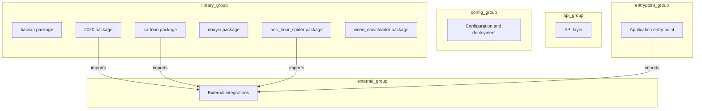

# Architecture report: Jack-Cherish/python-spider

> Automated static analysis. **Observed** = directly seen in files/imports/AST; **Inferred** = interpretation from that evidence. Repository code was not executed.

## 1. Repository at a glance

| Item | Value |
| --- | --- |
| Repository | Jack-Cherish/python-spider |
| Description | :rainbow:Python3网络爬虫实战：淘宝、京东、网易云、B站、12306、抖音、笔趣阁、漫画小说下载、音乐电影下载等 |
| Language | Python |
| Stars | 19859 |
| Licence | Not detected |
| Analysed commit / branch | 60b7ed839713ccf00bb30fe2b203a6b45d7459aa / master |
| Framework(s) | None detected |
| Files analysed | 68 |
| Components | 10 |

## 2. Architecture in one minute

Jack-Cherish/python-spider - :rainbow:Python3网络爬虫实战：淘宝、京东、网易云、B站、12306、抖音、笔趣阁、漫画小说下载、音乐电影下载等. This repository was analysed statically from 68 file(s) (51 Python). Detected technologies (observed from imports/manifests): MySQL, Click, NumPy, requests. Files are grouped into 10 component(s): API layer, baiwan package, 2020 package, cartoon package, Configuration and deployment, douyin package, Application entry point, External integrations. Observed entry point(s): 12306.py, 2020/bilibili/xml2ass.py, 2020/taobao/taobao_login.py. Findings below distinguish observed facts from inferred interpretation.

## 3. High-level block diagram

## 4. Main components

### API layer (`api_layer`)

- **Kind:** api
- **Status:** Observed
- **Confidence:** 0.85
- **Responsibility:** Groups 1 file(s) under api layer (observed from repository paths and static analysis).
- **Paths:** `2020/api/api.py`
- **Evidence:** [2020/api/api.py](https://github.com/Jack-Cherish/python-spider/blob/60b7ed839713ccf00bb30fe2b203a6b45d7459aa/2020/api/api.py)

### baiwan package (`baiwan`)

- **Kind:** library
- **Status:** Observed
- **Confidence:** 0.85
- **Responsibility:** Groups 1 file(s) under baiwan package (observed from repository paths and static analysis).
- **Paths:** `baiwan/app.js`
- **Evidence:** [baiwan/app.js](https://github.com/Jack-Cherish/python-spider/blob/60b7ed839713ccf00bb30fe2b203a6b45d7459aa/baiwan/app.js)

### 2020 package (`c_2020`)

- **Kind:** library
- **Status:** Observed
- **Confidence:** 0.85
- **Responsibility:** Groups 3 file(s) under 2020 package (observed from repository paths and static analysis). Observed top-level functions: addTasktoXunlei, downVideo, get_download_url.
- **Paths:** `2020/bilibili/download.py`, `2020/dmzj/cartoon.py`, `2020/zycjw/video_download.py`
- **Evidence:** [2020/bilibili/download.py:19](https://github.com/Jack-Cherish/python-spider/blob/60b7ed839713ccf00bb30fe2b203a6b45d7459aa/2020/bilibili/download.py#L19); [2020/dmzj/cartoon.py](https://github.com/Jack-Cherish/python-spider/blob/60b7ed839713ccf00bb30fe2b203a6b45d7459aa/2020/dmzj/cartoon.py); [2020/zycjw/video_download.py:55](https://github.com/Jack-Cherish/python-spider/blob/60b7ed839713ccf00bb30fe2b203a6b45d7459aa/2020/zycjw/video_download.py#L55)

### cartoon package (`cartoon`)

- **Kind:** library
- **Status:** Observed
- **Confidence:** 0.85
- **Responsibility:** Groups 6 file(s) under cartoon package (observed from repository paths and static analysis). Observed top-level classes: CartoonSpiderMiddleware, ComicImgDownloadPipeline, ComicItem, ComicSpider.
- **Paths:** `cartoon/cartoon/__init__.py`, `cartoon/cartoon/items.py`, `cartoon/cartoon/middlewares.py`, `cartoon/cartoon/pipelines.py`, `cartoon/cartoon/spiders/__init__.py`, `cartoon/cartoon/spiders/comic_spider.py`
- **Evidence:** [cartoon/cartoon/__init__.py](https://github.com/Jack-Cherish/python-spider/blob/60b7ed839713ccf00bb30fe2b203a6b45d7459aa/cartoon/cartoon/__init__.py); [cartoon/cartoon/items.py:10](https://github.com/Jack-Cherish/python-spider/blob/60b7ed839713ccf00bb30fe2b203a6b45d7459aa/cartoon/cartoon/items.py#L10); [cartoon/cartoon/middlewares.py:11](https://github.com/Jack-Cherish/python-spider/blob/60b7ed839713ccf00bb30fe2b203a6b45d7459aa/cartoon/cartoon/middlewares.py#L11); [cartoon/cartoon/pipelines.py:13](https://github.com/Jack-Cherish/python-spider/blob/60b7ed839713ccf00bb30fe2b203a6b45d7459aa/cartoon/cartoon/pipelines.py#L13); [cartoon/cartoon/spiders/__init__.py](https://github.com/Jack-Cherish/python-spider/blob/60b7ed839713ccf00bb30fe2b203a6b45d7459aa/cartoon/cartoon/spiders/__init__.py); [cartoon/cartoon/spiders/comic_spider.py:8](https://github.com/Jack-Cherish/python-spider/blob/60b7ed839713ccf00bb30fe2b203a6b45d7459aa/cartoon/cartoon/spiders/comic_spider.py#L8)

### Configuration and deployment (`config`)

- **Kind:** config
- **Status:** Observed
- **Confidence:** 0.85
- **Responsibility:** Groups 4 file(s) under configuration and deployment (observed from repository paths and static analysis).
- **Paths:** `cartoon/cartoon/settings.py`, `cartoon/scrapy.cfg`, `video_downloader/requirements.txt`, `zhengfang_system_spider/requirements.txt`
- **Evidence:** [cartoon/cartoon/settings.py](https://github.com/Jack-Cherish/python-spider/blob/60b7ed839713ccf00bb30fe2b203a6b45d7459aa/cartoon/cartoon/settings.py); [cartoon/scrapy.cfg](https://github.com/Jack-Cherish/python-spider/blob/60b7ed839713ccf00bb30fe2b203a6b45d7459aa/cartoon/scrapy.cfg); [video_downloader/requirements.txt](https://github.com/Jack-Cherish/python-spider/blob/60b7ed839713ccf00bb30fe2b203a6b45d7459aa/video_downloader/requirements.txt); [zhengfang_system_spider/requirements.txt](https://github.com/Jack-Cherish/python-spider/blob/60b7ed839713ccf00bb30fe2b203a6b45d7459aa/zhengfang_system_spider/requirements.txt)

### douyin package (`douyin`)

- **Kind:** library
- **Status:** Observed
- **Confidence:** 0.85
- **Responsibility:** Groups 1 file(s) under douyin package (observed from repository paths and static analysis).
- **Paths:** `douyin/fuck-byted-acrawler.js`
- **Evidence:** [douyin/fuck-byted-acrawler.js](https://github.com/Jack-Cherish/python-spider/blob/60b7ed839713ccf00bb30fe2b203a6b45d7459aa/douyin/fuck-byted-acrawler.js)

### Application entry point (`entrypoint`)

- **Kind:** entrypoint
- **Status:** Observed
- **Confidence:** 0.85
- **Responsibility:** Groups 29 file(s) under application entry point (observed from repository paths and static analysis). Observed top-level classes: APP, BaiWan, BiliBili, Crack, Crawler, DouYin. Observed top-level functions: ASSEscape, CalculateLength, ConvertFlashRotation, ConvertTimestamp, ConvertToFile, ConvertType2.
- **Paths:** `12306.py`, `2020/bilibili/xml2ass.py`, `2020/taobao/taobao_login.py`, `2020/xbqg/xbqg_spider.py`, `Netease/Netease.py`, `baiduwenku.py`, `baiduwenku_pro_1.py`, `baiwan/baiwan.py`, `bilibili/bilibili.py`, `bilibili/xml2ass.py`, `bilibili_luckyman/bilibili_luckyman.py`, `biqukan.py`, `daili.py`, `dingdong/jd.py`, `douyin.py`, `douyin/douyin.py`, `douyin_pro.py`, `downloader.py`, `financical.py`, `geetest.py`, `hero.py`, `one_hour_spider/biquge20180731.py`, `one_hour_spider/biqukan.py`, `one_hour_spider/unsplash.py`, `one_hour_spider/vidoe_downloader.py`, `shuaia.py`, `video_downloader/MyQR/mylibs/data.py`, `video_downloader/video_downloader.py`, `zhengfang_system_spider/spider.py`
- **Evidence:** [12306.py:10](https://github.com/Jack-Cherish/python-spider/blob/60b7ed839713ccf00bb30fe2b203a6b45d7459aa/12306.py#L10); [2020/bilibili/xml2ass.py:28](https://github.com/Jack-Cherish/python-spider/blob/60b7ed839713ccf00bb30fe2b203a6b45d7459aa/2020/bilibili/xml2ass.py#L28); [2020/taobao/taobao_login.py:19](https://github.com/Jack-Cherish/python-spider/blob/60b7ed839713ccf00bb30fe2b203a6b45d7459aa/2020/taobao/taobao_login.py#L19); [2020/xbqg/xbqg_spider.py:13](https://github.com/Jack-Cherish/python-spider/blob/60b7ed839713ccf00bb30fe2b203a6b45d7459aa/2020/xbqg/xbqg_spider.py#L13); [Netease/Netease.py:12](https://github.com/Jack-Cherish/python-spider/blob/60b7ed839713ccf00bb30fe2b203a6b45d7459aa/Netease/Netease.py#L12); [baiduwenku.py](https://github.com/Jack-Cherish/python-spider/blob/60b7ed839713ccf00bb30fe2b203a6b45d7459aa/baiduwenku.py); [baiduwenku_pro_1.py:9](https://github.com/Jack-Cherish/python-spider/blob/60b7ed839713ccf00bb30fe2b203a6b45d7459aa/baiduwenku_pro_1.py#L9); [baiwan/baiwan.py:17](https://github.com/Jack-Cherish/python-spider/blob/60b7ed839713ccf00bb30fe2b203a6b45d7459aa/baiwan/baiwan.py#L17)

### External integrations (`external_integrations`)

- **Kind:** external
- **Status:** Inferred
- **Confidence:** 0.70
- **Responsibility:** Groups 0 file(s) under external integrations (observed from repository paths and static analysis).
- **Evidence:** [2020/bilibili/download.py:5](https://github.com/Jack-Cherish/python-spider/blob/60b7ed839713ccf00bb30fe2b203a6b45d7459aa/2020/bilibili/download.py#L5); [2020/dmzj/cartoon.py:1](https://github.com/Jack-Cherish/python-spider/blob/60b7ed839713ccf00bb30fe2b203a6b45d7459aa/2020/dmzj/cartoon.py#L1); [2020/xbqg/xbqg_spider.py:1](https://github.com/Jack-Cherish/python-spider/blob/60b7ed839713ccf00bb30fe2b203a6b45d7459aa/2020/xbqg/xbqg_spider.py#L1); [2020/zycjw/video_download.py:3](https://github.com/Jack-Cherish/python-spider/blob/60b7ed839713ccf00bb30fe2b203a6b45d7459aa/2020/zycjw/video_download.py#L3); [Netease/Netease.py:2](https://github.com/Jack-Cherish/python-spider/blob/60b7ed839713ccf00bb30fe2b203a6b45d7459aa/Netease/Netease.py#L2); [baiduwenku_pro_1.py:1](https://github.com/Jack-Cherish/python-spider/blob/60b7ed839713ccf00bb30fe2b203a6b45d7459aa/baiduwenku_pro_1.py#L1)

### one_hour_spider package (`one_hour_spider`)

- **Kind:** library
- **Status:** Observed
- **Confidence:** 0.85
- **Responsibility:** Groups 1 file(s) under one_hour_spider package (observed from repository paths and static analysis).
- **Paths:** `one_hour_spider/unsplash20180731.py`
- **Evidence:** [one_hour_spider/unsplash20180731.py](https://github.com/Jack-Cherish/python-spider/blob/60b7ed839713ccf00bb30fe2b203a6b45d7459aa/one_hour_spider/unsplash20180731.py)

### video_downloader package (`video_downloader`)

- **Kind:** library
- **Status:** Observed
- **Confidence:** 0.85
- **Responsibility:** Groups 10 file(s) under video_downloader package (observed from repository paths and static analysis). Observed top-level functions: XOR, add_alignment, add_an_alignment, add_dark_and_reserving, add_finder_and_separator, add_format_and_version_string.
- **Paths:** `video_downloader/MyQR/__init__.py`, `video_downloader/MyQR/mylibs/ECC.py`, `video_downloader/MyQR/mylibs/__init__.py`, `video_downloader/MyQR/mylibs/constant.py`, `video_downloader/MyQR/mylibs/draw.py`, `video_downloader/MyQR/mylibs/matrix.py`, `video_downloader/MyQR/mylibs/structure.py`, `video_downloader/MyQR/mylibs/theqrmodule.py`, `video_downloader/MyQR/myqr.py`, `video_downloader/MyQR/terminal.py`
- **Evidence:** [video_downloader/MyQR/__init__.py](https://github.com/Jack-Cherish/python-spider/blob/60b7ed839713ccf00bb30fe2b203a6b45d7459aa/video_downloader/MyQR/__init__.py); [video_downloader/MyQR/mylibs/ECC.py:6](https://github.com/Jack-Cherish/python-spider/blob/60b7ed839713ccf00bb30fe2b203a6b45d7459aa/video_downloader/MyQR/mylibs/ECC.py#L6); [video_downloader/MyQR/mylibs/__init__.py](https://github.com/Jack-Cherish/python-spider/blob/60b7ed839713ccf00bb30fe2b203a6b45d7459aa/video_downloader/MyQR/mylibs/__init__.py); [video_downloader/MyQR/mylibs/constant.py](https://github.com/Jack-Cherish/python-spider/blob/60b7ed839713ccf00bb30fe2b203a6b45d7459aa/video_downloader/MyQR/mylibs/constant.py); [video_downloader/MyQR/mylibs/draw.py:6](https://github.com/Jack-Cherish/python-spider/blob/60b7ed839713ccf00bb30fe2b203a6b45d7459aa/video_downloader/MyQR/mylibs/draw.py#L6); [video_downloader/MyQR/mylibs/matrix.py:5](https://github.com/Jack-Cherish/python-spider/blob/60b7ed839713ccf00bb30fe2b203a6b45d7459aa/video_downloader/MyQR/mylibs/matrix.py#L5); [video_downloader/MyQR/mylibs/structure.py:5](https://github.com/Jack-Cherish/python-spider/blob/60b7ed839713ccf00bb30fe2b203a6b45d7459aa/video_downloader/MyQR/mylibs/structure.py#L5); [video_downloader/MyQR/mylibs/theqrmodule.py:8](https://github.com/Jack-Cherish/python-spider/blob/60b7ed839713ccf00bb30fe2b203a6b45d7459aa/video_downloader/MyQR/mylibs/theqrmodule.py#L8)

## 5. Execution flow

**Observed** entry point(s):

- [12306.py:122](https://github.com/Jack-Cherish/python-spider/blob/60b7ed839713ccf00bb30fe2b203a6b45d7459aa/12306.py#L122)
- [2020/bilibili/xml2ass.py:801](https://github.com/Jack-Cherish/python-spider/blob/60b7ed839713ccf00bb30fe2b203a6b45d7459aa/2020/bilibili/xml2ass.py#L801)
- [2020/taobao/taobao_login.py:93](https://github.com/Jack-Cherish/python-spider/blob/60b7ed839713ccf00bb30fe2b203a6b45d7459aa/2020/taobao/taobao_login.py#L93)
- [2020/xbqg/xbqg_spider.py:22](https://github.com/Jack-Cherish/python-spider/blob/60b7ed839713ccf00bb30fe2b203a6b45d7459aa/2020/xbqg/xbqg_spider.py#L22)
- [Netease/Netease.py:222](https://github.com/Jack-Cherish/python-spider/blob/60b7ed839713ccf00bb30fe2b203a6b45d7459aa/Netease/Netease.py#L222)
- [baiduwenku.py:7](https://github.com/Jack-Cherish/python-spider/blob/60b7ed839713ccf00bb30fe2b203a6b45d7459aa/baiduwenku.py#L7)
- [baiduwenku_pro_1.py:100](https://github.com/Jack-Cherish/python-spider/blob/60b7ed839713ccf00bb30fe2b203a6b45d7459aa/baiduwenku_pro_1.py#L100)
- [baiwan/baiwan.py:167](https://github.com/Jack-Cherish/python-spider/blob/60b7ed839713ccf00bb30fe2b203a6b45d7459aa/baiwan/baiwan.py#L167)
- [bilibili/bilibili.py:198](https://github.com/Jack-Cherish/python-spider/blob/60b7ed839713ccf00bb30fe2b203a6b45d7459aa/bilibili/bilibili.py#L198)
- [bilibili/xml2ass.py:801](https://github.com/Jack-Cherish/python-spider/blob/60b7ed839713ccf00bb30fe2b203a6b45d7459aa/bilibili/xml2ass.py#L801)
- [bilibili_luckyman/bilibili_luckyman.py:58](https://github.com/Jack-Cherish/python-spider/blob/60b7ed839713ccf00bb30fe2b203a6b45d7459aa/bilibili_luckyman/bilibili_luckyman.py#L58)
- [biqukan.py:118](https://github.com/Jack-Cherish/python-spider/blob/60b7ed839713ccf00bb30fe2b203a6b45d7459aa/biqukan.py#L118)

Representative flow (derived from observed entry points and the import graph; steps beyond the entry point are **Inferred**):

1. Execution starts at an observed entry point listed above, if present.
2. `c_2020` imports `external_integrations` (2020 package -> External integrations).
3. `cartoon` imports `external_integrations` (cartoon package -> External integrations).
4. `entrypoint` imports `external_integrations` (Application entry point -> External integrations).
5. `one_hour_spider` imports `external_integrations` (one_hour_spider package -> External integrations).

## 6. Project structure

### `(root)`

- `12306.py` - source, Python (3321 bytes)
- `README.md` - docs (10647 bytes)
- `baiduwenku.py` - source, Python (1761 bytes)
- `baiduwenku_pro_1.py` - source, Python (3255 bytes)
- `biqukan.py` - source, Python (3974 bytes)
- `daili.py` - source, Python (4091 bytes)
- `douyin.py` - source, Python (4122 bytes)
- `douyin_pro.py` - source, Python (5412 bytes)
- `downloader.py` - source, Python (2296 bytes)
- `financical.py` - source, Python (7491 bytes)
- `geetest.py` - source, Python (9046 bytes)
- `hero.py` - source, Python (6148 bytes)
- `shuaia.py` - source, Python (1583 bytes)

### `2020`

- `2020/README.md` - docs (4359 bytes)
- `2020/api/api.py` - source, Python (1573 bytes)
- `2020/bilibili/download.py` - source, Python (4400 bytes)
- `2020/bilibili/xml2ass.py` - source, Python (37423 bytes)
- `2020/dmzj/cartoon.py` - source, Python (2502 bytes)
- `2020/taobao/taobao_login.py` - source, Python (3954 bytes)
- `2020/xbqg/xbqg_spider.py` - source, Python (1147 bytes)
- `2020/zycjw/video_download.py` - source, Python (1845 bytes)

### `Netease`

- `Netease/Netease.py` - source, Python (7829 bytes)
- `Netease/music_list.txt` - docs (168 bytes)

### `baiwan`

- `baiwan/app.js` - source, JavaScript (1402 bytes)
- `baiwan/baiwan.py` - source, Python (5041 bytes)
- `baiwan/file.txt` - docs (3223 bytes)
- `baiwan/index.html` - other (5688 bytes)
- `baiwan/question.txt` - docs (40 bytes)

### `bilibili`

- `bilibili/README.md` - docs (538 bytes)
- `bilibili/bilibili.py` - source, Python (6983 bytes)
- `bilibili/xml2ass.py` - source, Python (37423 bytes)

### `bilibili_luckyman`

- `bilibili_luckyman/README.md` - docs (138 bytes)
- `bilibili_luckyman/bilibili_luckyman.py` - source, Python (2800 bytes)

### `cartoon`

- `cartoon/cartoon/__init__.py` - source, Python (0 bytes)
- `cartoon/cartoon/items.py` - source, Python (306 bytes)
- `cartoon/cartoon/middlewares.py` - source, Python (1881 bytes)
- `cartoon/cartoon/pipelines.py` - source, Python (1382 bytes)
- `cartoon/cartoon/settings.py` - source, Python (3314 bytes)
- `cartoon/cartoon/spiders/__init__.py` - source, Python (161 bytes)
- `cartoon/cartoon/spiders/comic_spider.py` - source, Python (3019 bytes)
- `cartoon/scrapy.cfg` - config (258 bytes)

### `dingdong`

- `dingdong/README.md` - docs (461 bytes)
- `dingdong/jd.py` - source, Python (6920 bytes)

### `douyin`

- `douyin/README.md` - docs (517 bytes)
- `douyin/douyin.py` - source, Python (6979 bytes)
- `douyin/fuck-byted-acrawler.js` - source, JavaScript (7399 bytes)

### `one_hour_spider`

- `one_hour_spider/biquge20180731.py` - source, Python (2108 bytes)
- `one_hour_spider/biqukan.py` - source, Python (2107 bytes)
- `one_hour_spider/unsplash.py` - source, Python (1811 bytes)
- `one_hour_spider/unsplash20180731.py` - source, Python (1207 bytes)
- `one_hour_spider/vidoe_downloader.py` - source, Python (2398 bytes)

### `video_downloader`

- `video_downloader/MyQR/__init__.py` - source, Python (0 bytes)
- `video_downloader/MyQR/mylibs/ECC.py` - source, Python (1035 bytes)
- `video_downloader/MyQR/mylibs/__init__.py` - source, Python (24 bytes)
- `video_downloader/MyQR/mylibs/constant.py` - source, Python (18997 bytes)
- `video_downloader/MyQR/mylibs/data.py` - source, Python (3287 bytes)
- `video_downloader/MyQR/mylibs/draw.py` - source, Python (620 bytes)
- `video_downloader/MyQR/mylibs/matrix.py` - source, Python (6122 bytes)
- `video_downloader/MyQR/mylibs/structure.py` - source, Python (829 bytes)
- `video_downloader/MyQR/mylibs/theqrmodule.py` - source, Python (737 bytes)
- `video_downloader/MyQR/myqr.py` - source, Python (6197 bytes)
- `video_downloader/MyQR/terminal.py` - source, Python (2549 bytes)
- `video_downloader/requirements.txt` - manifest (36 bytes)
- `video_downloader/video_downloader.py` - source, Python (10455 bytes)

### `zhengfang_system_spider`

- `zhengfang_system_spider/README.md` - docs (912 bytes)
- `zhengfang_system_spider/requirements.txt` - manifest (65 bytes)
- `zhengfang_system_spider/spider.py` - source, Python (7826 bytes)
- `zhengfang_system_spider/zhengfang.txt` - docs (8825 bytes)

## 7. Key dependencies and integrations

| Name | Category | Status | Confidence | Evidence |
| --- | --- | --- | --- | --- |
| MySQL | database | Observed | 0.90 | [financical.py:3](https://github.com/Jack-Cherish/python-spider/blob/60b7ed839713ccf00bb30fe2b203a6b45d7459aa/financical.py#L3) |
| Click | library | Observed | 0.90 | [Netease/Netease.py:2](https://github.com/Jack-Cherish/python-spider/blob/60b7ed839713ccf00bb30fe2b203a6b45d7459aa/Netease/Netease.py#L2) |
| NumPy | library | Observed | 0.85 | [video_downloader/requirements.txt:2](https://github.com/Jack-Cherish/python-spider/blob/60b7ed839713ccf00bb30fe2b203a6b45d7459aa/video_downloader/requirements.txt#L2) |
| requests | library | Observed | 0.95 | [2020/bilibili/download.py:5](https://github.com/Jack-Cherish/python-spider/blob/60b7ed839713ccf00bb30fe2b203a6b45d7459aa/2020/bilibili/download.py#L5); [2020/dmzj/cartoon.py:1](https://github.com/Jack-Cherish/python-spider/blob/60b7ed839713ccf00bb30fe2b203a6b45d7459aa/2020/dmzj/cartoon.py#L1); [2020/xbqg/xbqg_spider.py:1](https://github.com/Jack-Cherish/python-spider/blob/60b7ed839713ccf00bb30fe2b203a6b45d7459aa/2020/xbqg/xbqg_spider.py#L1); [2020/zycjw/video_download.py:3](https://github.com/Jack-Cherish/python-spider/blob/60b7ed839713ccf00bb30fe2b203a6b45d7459aa/2020/zycjw/video_download.py#L3) |

## 8. Data and state

- **MySQL** (Observed, confidence 0.90) - evidence: [financical.py:3](https://github.com/Jack-Cherish/python-spider/blob/60b7ed839713ccf00bb30fe2b203a6b45d7459aa/financical.py#L3)

## 9. Configuration and deployment clues

- `cartoon/scrapy.cfg` (config)
- `video_downloader/requirements.txt` (manifest)
- `zhengfang_system_spider/requirements.txt` (manifest)

## 10. Design observations

- An entry/API layer is separated from other code (Inferred from paths and decorators).
- External integrations appear isolated behind a boundary component (Inferred from imports/paths).

These observations are interpretations (**Inferred**) of the observed structure, not guarantees about runtime design.

## 11. Limitations and unknowns

- Static analysis only: repository code was not executed, installed, or imported at runtime.
- Components and relationships are inferred from file paths, imports, and AST structure; runtime behaviour, dynamic imports, and reflection may not be visible.
- File 2020/api/api.py could not be parsed as Python (possible SyntaxError) and was skipped for AST analysis.
- Repository text was treated as untrusted data; no instructions found in repository files were followed, and likely secret values were redacted/excluded.

## 12. Source references

- [12306.py:10](https://github.com/Jack-Cherish/python-spider/blob/60b7ed839713ccf00bb30fe2b203a6b45d7459aa/12306.py#L10)
- [12306.py:122](https://github.com/Jack-Cherish/python-spider/blob/60b7ed839713ccf00bb30fe2b203a6b45d7459aa/12306.py#L122)
- [2020/api/api.py](https://github.com/Jack-Cherish/python-spider/blob/60b7ed839713ccf00bb30fe2b203a6b45d7459aa/2020/api/api.py)
- [2020/bilibili/download.py:5](https://github.com/Jack-Cherish/python-spider/blob/60b7ed839713ccf00bb30fe2b203a6b45d7459aa/2020/bilibili/download.py#L5)
- [2020/bilibili/download.py:19](https://github.com/Jack-Cherish/python-spider/blob/60b7ed839713ccf00bb30fe2b203a6b45d7459aa/2020/bilibili/download.py#L19)
- [2020/bilibili/xml2ass.py:28](https://github.com/Jack-Cherish/python-spider/blob/60b7ed839713ccf00bb30fe2b203a6b45d7459aa/2020/bilibili/xml2ass.py#L28)
- [2020/bilibili/xml2ass.py:801](https://github.com/Jack-Cherish/python-spider/blob/60b7ed839713ccf00bb30fe2b203a6b45d7459aa/2020/bilibili/xml2ass.py#L801)
- [2020/dmzj/cartoon.py](https://github.com/Jack-Cherish/python-spider/blob/60b7ed839713ccf00bb30fe2b203a6b45d7459aa/2020/dmzj/cartoon.py)
- [2020/dmzj/cartoon.py:1](https://github.com/Jack-Cherish/python-spider/blob/60b7ed839713ccf00bb30fe2b203a6b45d7459aa/2020/dmzj/cartoon.py#L1)
- [2020/taobao/taobao_login.py:19](https://github.com/Jack-Cherish/python-spider/blob/60b7ed839713ccf00bb30fe2b203a6b45d7459aa/2020/taobao/taobao_login.py#L19)
- [2020/taobao/taobao_login.py:93](https://github.com/Jack-Cherish/python-spider/blob/60b7ed839713ccf00bb30fe2b203a6b45d7459aa/2020/taobao/taobao_login.py#L93)
- [2020/xbqg/xbqg_spider.py:1](https://github.com/Jack-Cherish/python-spider/blob/60b7ed839713ccf00bb30fe2b203a6b45d7459aa/2020/xbqg/xbqg_spider.py#L1)
- [2020/xbqg/xbqg_spider.py:13](https://github.com/Jack-Cherish/python-spider/blob/60b7ed839713ccf00bb30fe2b203a6b45d7459aa/2020/xbqg/xbqg_spider.py#L13)
- [2020/xbqg/xbqg_spider.py:22](https://github.com/Jack-Cherish/python-spider/blob/60b7ed839713ccf00bb30fe2b203a6b45d7459aa/2020/xbqg/xbqg_spider.py#L22)
- [2020/zycjw/video_download.py:3](https://github.com/Jack-Cherish/python-spider/blob/60b7ed839713ccf00bb30fe2b203a6b45d7459aa/2020/zycjw/video_download.py#L3)
- [2020/zycjw/video_download.py:55](https://github.com/Jack-Cherish/python-spider/blob/60b7ed839713ccf00bb30fe2b203a6b45d7459aa/2020/zycjw/video_download.py#L55)
- [Netease/Netease.py:2](https://github.com/Jack-Cherish/python-spider/blob/60b7ed839713ccf00bb30fe2b203a6b45d7459aa/Netease/Netease.py#L2)
- [Netease/Netease.py:12](https://github.com/Jack-Cherish/python-spider/blob/60b7ed839713ccf00bb30fe2b203a6b45d7459aa/Netease/Netease.py#L12)
- [Netease/Netease.py:222](https://github.com/Jack-Cherish/python-spider/blob/60b7ed839713ccf00bb30fe2b203a6b45d7459aa/Netease/Netease.py#L222)
- [baiduwenku.py](https://github.com/Jack-Cherish/python-spider/blob/60b7ed839713ccf00bb30fe2b203a6b45d7459aa/baiduwenku.py)
- [baiduwenku.py:7](https://github.com/Jack-Cherish/python-spider/blob/60b7ed839713ccf00bb30fe2b203a6b45d7459aa/baiduwenku.py#L7)
- [baiduwenku_pro_1.py:1](https://github.com/Jack-Cherish/python-spider/blob/60b7ed839713ccf00bb30fe2b203a6b45d7459aa/baiduwenku_pro_1.py#L1)
- [baiduwenku_pro_1.py:9](https://github.com/Jack-Cherish/python-spider/blob/60b7ed839713ccf00bb30fe2b203a6b45d7459aa/baiduwenku_pro_1.py#L9)
- [baiduwenku_pro_1.py:100](https://github.com/Jack-Cherish/python-spider/blob/60b7ed839713ccf00bb30fe2b203a6b45d7459aa/baiduwenku_pro_1.py#L100)
- [baiwan/app.js](https://github.com/Jack-Cherish/python-spider/blob/60b7ed839713ccf00bb30fe2b203a6b45d7459aa/baiwan/app.js)
- [baiwan/baiwan.py:2](https://github.com/Jack-Cherish/python-spider/blob/60b7ed839713ccf00bb30fe2b203a6b45d7459aa/baiwan/baiwan.py#L2)
- [baiwan/baiwan.py:17](https://github.com/Jack-Cherish/python-spider/blob/60b7ed839713ccf00bb30fe2b203a6b45d7459aa/baiwan/baiwan.py#L17)
- [baiwan/baiwan.py:167](https://github.com/Jack-Cherish/python-spider/blob/60b7ed839713ccf00bb30fe2b203a6b45d7459aa/baiwan/baiwan.py#L167)
- [bilibili/bilibili.py:6](https://github.com/Jack-Cherish/python-spider/blob/60b7ed839713ccf00bb30fe2b203a6b45d7459aa/bilibili/bilibili.py#L6)
- [bilibili/bilibili.py:198](https://github.com/Jack-Cherish/python-spider/blob/60b7ed839713ccf00bb30fe2b203a6b45d7459aa/bilibili/bilibili.py#L198)
- [bilibili/xml2ass.py:801](https://github.com/Jack-Cherish/python-spider/blob/60b7ed839713ccf00bb30fe2b203a6b45d7459aa/bilibili/xml2ass.py#L801)
- [bilibili_luckyman/bilibili_luckyman.py:58](https://github.com/Jack-Cherish/python-spider/blob/60b7ed839713ccf00bb30fe2b203a6b45d7459aa/bilibili_luckyman/bilibili_luckyman.py#L58)
- [biqukan.py:118](https://github.com/Jack-Cherish/python-spider/blob/60b7ed839713ccf00bb30fe2b203a6b45d7459aa/biqukan.py#L118)
- [cartoon/cartoon/__init__.py](https://github.com/Jack-Cherish/python-spider/blob/60b7ed839713ccf00bb30fe2b203a6b45d7459aa/cartoon/cartoon/__init__.py)
- [cartoon/cartoon/items.py:10](https://github.com/Jack-Cherish/python-spider/blob/60b7ed839713ccf00bb30fe2b203a6b45d7459aa/cartoon/cartoon/items.py#L10)
- [cartoon/cartoon/middlewares.py:11](https://github.com/Jack-Cherish/python-spider/blob/60b7ed839713ccf00bb30fe2b203a6b45d7459aa/cartoon/cartoon/middlewares.py#L11)
- [cartoon/cartoon/pipelines.py:13](https://github.com/Jack-Cherish/python-spider/blob/60b7ed839713ccf00bb30fe2b203a6b45d7459aa/cartoon/cartoon/pipelines.py#L13)
- [cartoon/cartoon/settings.py](https://github.com/Jack-Cherish/python-spider/blob/60b7ed839713ccf00bb30fe2b203a6b45d7459aa/cartoon/cartoon/settings.py)
- [cartoon/cartoon/spiders/__init__.py](https://github.com/Jack-Cherish/python-spider/blob/60b7ed839713ccf00bb30fe2b203a6b45d7459aa/cartoon/cartoon/spiders/__init__.py)
- [cartoon/cartoon/spiders/comic_spider.py:8](https://github.com/Jack-Cherish/python-spider/blob/60b7ed839713ccf00bb30fe2b203a6b45d7459aa/cartoon/cartoon/spiders/comic_spider.py#L8)
- [cartoon/scrapy.cfg](https://github.com/Jack-Cherish/python-spider/blob/60b7ed839713ccf00bb30fe2b203a6b45d7459aa/cartoon/scrapy.cfg)
- [douyin/fuck-byted-acrawler.js](https://github.com/Jack-Cherish/python-spider/blob/60b7ed839713ccf00bb30fe2b203a6b45d7459aa/douyin/fuck-byted-acrawler.js)
- [financical.py:3](https://github.com/Jack-Cherish/python-spider/blob/60b7ed839713ccf00bb30fe2b203a6b45d7459aa/financical.py#L3)
- [one_hour_spider/unsplash20180731.py](https://github.com/Jack-Cherish/python-spider/blob/60b7ed839713ccf00bb30fe2b203a6b45d7459aa/one_hour_spider/unsplash20180731.py)
- [video_downloader/MyQR/__init__.py](https://github.com/Jack-Cherish/python-spider/blob/60b7ed839713ccf00bb30fe2b203a6b45d7459aa/video_downloader/MyQR/__init__.py)
- [video_downloader/MyQR/mylibs/ECC.py:6](https://github.com/Jack-Cherish/python-spider/blob/60b7ed839713ccf00bb30fe2b203a6b45d7459aa/video_downloader/MyQR/mylibs/ECC.py#L6)
- [video_downloader/MyQR/mylibs/__init__.py](https://github.com/Jack-Cherish/python-spider/blob/60b7ed839713ccf00bb30fe2b203a6b45d7459aa/video_downloader/MyQR/mylibs/__init__.py)
- [video_downloader/MyQR/mylibs/constant.py](https://github.com/Jack-Cherish/python-spider/blob/60b7ed839713ccf00bb30fe2b203a6b45d7459aa/video_downloader/MyQR/mylibs/constant.py)
- [video_downloader/MyQR/mylibs/draw.py:6](https://github.com/Jack-Cherish/python-spider/blob/60b7ed839713ccf00bb30fe2b203a6b45d7459aa/video_downloader/MyQR/mylibs/draw.py#L6)
- [video_downloader/MyQR/mylibs/matrix.py:5](https://github.com/Jack-Cherish/python-spider/blob/60b7ed839713ccf00bb30fe2b203a6b45d7459aa/video_downloader/MyQR/mylibs/matrix.py#L5)
- [video_downloader/MyQR/mylibs/structure.py:5](https://github.com/Jack-Cherish/python-spider/blob/60b7ed839713ccf00bb30fe2b203a6b45d7459aa/video_downloader/MyQR/mylibs/structure.py#L5)
- [video_downloader/MyQR/mylibs/theqrmodule.py:8](https://github.com/Jack-Cherish/python-spider/blob/60b7ed839713ccf00bb30fe2b203a6b45d7459aa/video_downloader/MyQR/mylibs/theqrmodule.py#L8)
- [video_downloader/requirements.txt](https://github.com/Jack-Cherish/python-spider/blob/60b7ed839713ccf00bb30fe2b203a6b45d7459aa/video_downloader/requirements.txt)
- [video_downloader/requirements.txt:2](https://github.com/Jack-Cherish/python-spider/blob/60b7ed839713ccf00bb30fe2b203a6b45d7459aa/video_downloader/requirements.txt#L2)
- [zhengfang_system_spider/requirements.txt](https://github.com/Jack-Cherish/python-spider/blob/60b7ed839713ccf00bb30fe2b203a6b45d7459aa/zhengfang_system_spider/requirements.txt)
