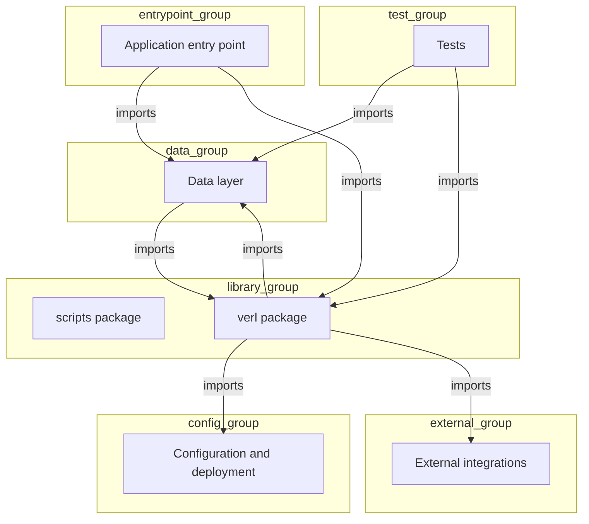

# Architecture report: Jiayi-Pan/TinyZero

> Automated static analysis. **Observed** = directly seen in files/imports/AST; **Inferred** = interpretation from that evidence. Repository code was not executed.

## 1. Repository at a glance

| Item | Value |
| --- | --- |
| Repository | Jiayi-Pan/TinyZero |
| Description | Minimal reproduction of DeepSeek R1-Zero |
| Language | Python |
| Stars | 13256 |
| Licence | Apache-2.0 |
| Analysed commit / branch | 95df88f2dcb05f33bd18da546531b52d0954c18b / main |
| Framework(s) | None detected |
| Files analysed | 304 |
| Components | 7 |

## 2. Architecture in one minute

Jiayi-Pan/TinyZero - Minimal reproduction of DeepSeek R1-Zero. This repository was analysed statically from 304 file(s) (214 Python). Detected technologies (observed from imports/manifests): GitHub Actions, NumPy, pandas, Poetry, setuptools, Docker. Files are grouped into 7 component(s): Configuration and deployment, Data layer, Application entry point, External integrations, scripts package, Tests, verl package. Observed entry point(s): verl/trainer/fsdp_sft_trainer.py, verl/trainer/main_eval.py, verl/trainer/main_generation.py. Findings below distinguish observed facts from inferred interpretation.

## 3. High-level block diagram

## 4. Main components

### Configuration and deployment (`config`)

- **Kind:** config
- **Status:** Observed
- **Confidence:** 0.85
- **Responsibility:** Groups 16 file(s) under configuration and deployment (observed from repository paths and static analysis). Observed top-level classes: CacheConfig, DeviceConfig, LoRAConfig, LoadConfig, LoadFormat, ModelConfig. Observed top-level functions: _get_and_verify_dtype, _get_and_verify_max_len, update_dict_with_config.
- **Paths:** `docker/Dockerfile.ngc.vllm`, `docker/Dockerfile.vemlp.vllm.te`, `pyproject.toml`, `requirements.txt`, `setup.py`, `verl/third_party/vllm/vllm_v_0_3_1/config.py`, `verl/third_party/vllm/vllm_v_0_4_2/config.py`, `verl/third_party/vllm/vllm_v_0_5_4/config.py`, `verl/third_party/vllm/vllm_v_0_6_3/config.py`, `verl/trainer/config/evaluation.yaml`, `verl/trainer/config/generation.yaml`, `verl/trainer/config/ppo_megatron_trainer.yaml`, `verl/trainer/config/ppo_trainer.yaml`, `verl/trainer/config/sft_trainer.yaml`, `verl/trainer/runtime_env.yaml`, `verl/utils/config.py`
- **Evidence:** [docker/Dockerfile.ngc.vllm](https://github.com/Jiayi-Pan/TinyZero/blob/95df88f2dcb05f33bd18da546531b52d0954c18b/docker/Dockerfile.ngc.vllm); [docker/Dockerfile.vemlp.vllm.te](https://github.com/Jiayi-Pan/TinyZero/blob/95df88f2dcb05f33bd18da546531b52d0954c18b/docker/Dockerfile.vemlp.vllm.te); [pyproject.toml](https://github.com/Jiayi-Pan/TinyZero/blob/95df88f2dcb05f33bd18da546531b52d0954c18b/pyproject.toml); [requirements.txt](https://github.com/Jiayi-Pan/TinyZero/blob/95df88f2dcb05f33bd18da546531b52d0954c18b/requirements.txt); [setup.py](https://github.com/Jiayi-Pan/TinyZero/blob/95df88f2dcb05f33bd18da546531b52d0954c18b/setup.py); [verl/third_party/vllm/vllm_v_0_3_1/config.py:31](https://github.com/Jiayi-Pan/TinyZero/blob/95df88f2dcb05f33bd18da546531b52d0954c18b/verl/third_party/vllm/vllm_v_0_3_1/config.py#L31); [verl/third_party/vllm/vllm_v_0_4_2/config.py:37](https://github.com/Jiayi-Pan/TinyZero/blob/95df88f2dcb05f33bd18da546531b52d0954c18b/verl/third_party/vllm/vllm_v_0_4_2/config.py#L37); [verl/third_party/vllm/vllm_v_0_5_4/config.py:38](https://github.com/Jiayi-Pan/TinyZero/blob/95df88f2dcb05f33bd18da546531b52d0954c18b/verl/third_party/vllm/vllm_v_0_5_4/config.py#L38)

### Data layer (`data_layer`)

- **Kind:** data
- **Status:** Observed
- **Confidence:** 0.85
- **Responsibility:** Groups 20 file(s) under data layer (observed from repository paths and static analysis). Observed top-level classes: LambdaLayer, LlamaDynamicNTKScalingRotaryEmbedding, LlamaLinearScalingRotaryEmbedding, LlamaRotaryEmbedding, MergedColumnParallelLinear, ModelRegistry. Observed top-level functions: _expand_mask, _get_parallel_model_architecture_from_config, _make_causal_mask, _megatron_calc_global_rank, _megatron_calc_layer_map, apply_monkey_patch.
- **Paths:** `verl/models/__init__.py`, `verl/models/llama/__init__.py`, `verl/models/llama/megatron/__init__.py`, `verl/models/llama/megatron/checkpoint_utils/__init__.py`, `verl/models/llama/megatron/checkpoint_utils/llama_loader.py`, `verl/models/llama/megatron/checkpoint_utils/llama_saver.py`, `verl/models/llama/megatron/layers/__init__.py`, `verl/models/llama/megatron/layers/parallel_attention.py`, `verl/models/llama/megatron/layers/parallel_decoder.py`, `verl/models/llama/megatron/layers/parallel_linear.py`, `verl/models/llama/megatron/layers/parallel_mlp.py`, `verl/models/llama/megatron/layers/parallel_rmsnorm.py`, `verl/models/llama/megatron/modeling_llama_megatron.py`, `verl/models/registry.py`, `verl/models/transformers/__init__.py`, `verl/models/transformers/llama.py`, `verl/models/transformers/monkey_patch.py`, `verl/models/transformers/qwen2.py`, `verl/models/weight_loader_registry.py`, `verl/utils/model.py`
- **Evidence:** [verl/models/__init__.py](https://github.com/Jiayi-Pan/TinyZero/blob/95df88f2dcb05f33bd18da546531b52d0954c18b/verl/models/__init__.py); [verl/models/llama/__init__.py](https://github.com/Jiayi-Pan/TinyZero/blob/95df88f2dcb05f33bd18da546531b52d0954c18b/verl/models/llama/__init__.py); [verl/models/llama/megatron/__init__.py](https://github.com/Jiayi-Pan/TinyZero/blob/95df88f2dcb05f33bd18da546531b52d0954c18b/verl/models/llama/megatron/__init__.py); [verl/models/llama/megatron/checkpoint_utils/__init__.py](https://github.com/Jiayi-Pan/TinyZero/blob/95df88f2dcb05f33bd18da546531b52d0954c18b/verl/models/llama/megatron/checkpoint_utils/__init__.py); [verl/models/llama/megatron/checkpoint_utils/llama_loader.py:21](https://github.com/Jiayi-Pan/TinyZero/blob/95df88f2dcb05f33bd18da546531b52d0954c18b/verl/models/llama/megatron/checkpoint_utils/llama_loader.py#L21); [verl/models/llama/megatron/checkpoint_utils/llama_saver.py:28](https://github.com/Jiayi-Pan/TinyZero/blob/95df88f2dcb05f33bd18da546531b52d0954c18b/verl/models/llama/megatron/checkpoint_utils/llama_saver.py#L28); [verl/models/llama/megatron/layers/__init__.py](https://github.com/Jiayi-Pan/TinyZero/blob/95df88f2dcb05f33bd18da546531b52d0954c18b/verl/models/llama/megatron/layers/__init__.py); [verl/models/llama/megatron/layers/parallel_attention.py:35](https://github.com/Jiayi-Pan/TinyZero/blob/95df88f2dcb05f33bd18da546531b52d0954c18b/verl/models/llama/megatron/layers/parallel_attention.py#L35)

### Application entry point (`entrypoint`)

- **Kind:** entrypoint
- **Status:** Observed
- **Confidence:** 0.85
- **Responsibility:** Groups 5 file(s) under application entry point (observed from repository paths and static analysis). Observed top-level classes: FSDPSFTTrainer, RewardManager, TrajectoryTracker. Observed top-level functions: _select_rm_score_fn, dump_data, extract_step, get_trajectory_tracker, main, main_task.
- **Paths:** `verl/trainer/fsdp_sft_trainer.py`, `verl/trainer/main_eval.py`, `verl/trainer/main_generation.py`, `verl/trainer/main_ppo.py`, `verl/utils/debug/trajectory_tracker.py`
- **Evidence:** [verl/trainer/fsdp_sft_trainer.py:51](https://github.com/Jiayi-Pan/TinyZero/blob/95df88f2dcb05f33bd18da546531b52d0954c18b/verl/trainer/fsdp_sft_trainer.py#L51); [verl/trainer/main_eval.py:27](https://github.com/Jiayi-Pan/TinyZero/blob/95df88f2dcb05f33bd18da546531b52d0954c18b/verl/trainer/main_eval.py#L27); [verl/trainer/main_generation.py:40](https://github.com/Jiayi-Pan/TinyZero/blob/95df88f2dcb05f33bd18da546531b52d0954c18b/verl/trainer/main_generation.py#L40); [verl/trainer/main_ppo.py:24](https://github.com/Jiayi-Pan/TinyZero/blob/95df88f2dcb05f33bd18da546531b52d0954c18b/verl/trainer/main_ppo.py#L24); [verl/utils/debug/trajectory_tracker.py:33](https://github.com/Jiayi-Pan/TinyZero/blob/95df88f2dcb05f33bd18da546531b52d0954c18b/verl/utils/debug/trajectory_tracker.py#L33)

### External integrations (`external_integrations`)

- **Kind:** external
- **Status:** Inferred
- **Confidence:** 0.70
- **Responsibility:** Groups 0 file(s) under external integrations (observed from repository paths and static analysis).
- **Evidence:** [verl/single_controller/base/worker.py:18](https://github.com/Jiayi-Pan/TinyZero/blob/95df88f2dcb05f33bd18da546531b52d0954c18b/verl/single_controller/base/worker.py#L18); [verl/third_party/vllm/vllm_v_0_3_1/llm_engine_sp.py:17](https://github.com/Jiayi-Pan/TinyZero/blob/95df88f2dcb05f33bd18da546531b52d0954c18b/verl/third_party/vllm/vllm_v_0_3_1/llm_engine_sp.py#L17); [verl/third_party/vllm/vllm_v_0_4_2/spmd_gpu_executor.py:16](https://github.com/Jiayi-Pan/TinyZero/blob/95df88f2dcb05f33bd18da546531b52d0954c18b/verl/third_party/vllm/vllm_v_0_4_2/spmd_gpu_executor.py#L16); [verl/third_party/vllm/vllm_v_0_5_4/spmd_gpu_executor.py:17](https://github.com/Jiayi-Pan/TinyZero/blob/95df88f2dcb05f33bd18da546531b52d0954c18b/verl/third_party/vllm/vllm_v_0_5_4/spmd_gpu_executor.py#L17); [verl/third_party/vllm/vllm_v_0_6_3/spmd_gpu_executor.py:17](https://github.com/Jiayi-Pan/TinyZero/blob/95df88f2dcb05f33bd18da546531b52d0954c18b/verl/third_party/vllm/vllm_v_0_6_3/spmd_gpu_executor.py#L17)

### scripts package (`scripts`)

- **Kind:** library
- **Status:** Observed
- **Confidence:** 0.85
- **Responsibility:** Groups 2 file(s) under scripts package (observed from repository paths and static analysis).
- **Paths:** `scripts/format.sh`, `scripts/train_tiny_zero.sh`
- **Evidence:** [scripts/format.sh](https://github.com/Jiayi-Pan/TinyZero/blob/95df88f2dcb05f33bd18da546531b52d0954c18b/scripts/format.sh); [scripts/train_tiny_zero.sh](https://github.com/Jiayi-Pan/TinyZero/blob/95df88f2dcb05f33bd18da546531b52d0954c18b/scripts/train_tiny_zero.sh)

### Tests (`tests`)

- **Kind:** test
- **Status:** Observed
- **Confidence:** 0.85
- **Responsibility:** Groups 50 file(s) under tests (observed from repository paths and static analysis). Observed top-level classes: Actor, CharTokenizer, Critic, DigitCompletion, DummyWorker, HackSelf. Observed top-level functions: add_one, are_lists_similar, compute_attention_mask, compute_position_id_with_mask, compute_reward, extract_reward_from_line.
- **Paths:** `tests/__init__.py`, `tests/e2e/__init__.py`, `tests/e2e/arithmetic_sequence/data/create_dataset.py`, `tests/e2e/arithmetic_sequence/model/config.json`, `tests/e2e/arithmetic_sequence/model/create_model_tokenizer.py`, `tests/e2e/arithmetic_sequence/model/generation_config.json`, `tests/e2e/arithmetic_sequence/model/tokenizer_config.json`, `tests/e2e/arithmetic_sequence/rl/README.md`, `tests/e2e/arithmetic_sequence/rl/config/ray_trainer.yaml`, `tests/e2e/arithmetic_sequence/rl/main_trainer.py`, `tests/e2e/check_results.py`, `tests/e2e/envs/__init__.py`, `tests/e2e/envs/digit_completion/__init__.py`, `tests/e2e/envs/digit_completion/task.py`, `tests/e2e/envs/digit_completion/tokenizer.py`, `tests/e2e/run_qwen_gsm8k_function_rm.sh`, `tests/e2e/run_qwen_gsm8k_function_rm_no_rmpad.sh`, `tests/e2e/run_qwen_gsm8k_model_rm.sh`, `tests/e2e/run_qwen_gsm8k_model_rm_no_rmpad.sh`, `tests/e2e/run_qwen_gsm8k_model_rm_seq_balance.sh`, `tests/e2e/run_qwen_gsm8k_model_rm_ulysses.sh`, `tests/e2e/run_ray_trainer.sh`, `tests/e2e/run_ray_trainer_rmpad.sh`, `tests/gpu_utility/test_memory_buffers.py`, `tests/gpu_utility/test_ops.py`, `tests/gpu_utility/test_torch_functional.py`, `tests/model/test_transformer.py`, `tests/model/test_transformers_ulysses.py`, `tests/ray/check_worker_alive/main.py`, `tests/ray/detached_worker/README.md`, `tests/ray/detached_worker/client.py`, `tests/ray/detached_worker/run.sh`, `tests/ray/detached_worker/server.py`, `tests/ray/test_check_worker_alive.py`, `tests/ray/test_colocated_workers.py`, `tests/ray/test_data_transfer.py`, `tests/ray/test_driverfunc_to_worker.py`, `tests/ray/test_high_level_scheduling_api.py`, `tests/ray/test_ray_local_envs.py`, `tests/ray/test_rvdz.py`, `tests/ray/test_worker_group_basics.py`, `tests/ray/test_worker_group_torch.py`, `tests/rollout/run_fsdp_vllm.py`, `tests/rollout/test_vllm_hf_loader.py`, `tests/sanity/check_license.py`, `tests/sanity/test_import.py`, `tests/utility/test_tensor_dict_utilities.py`, `tests/verl/utils/dataset/test_rl_dataset.py`, `tests/verl/utils/dataset/test_rm_dataset.py`, `tests/verl/utils/dataset/test_sft_dataset.py`
- **Evidence:** [tests/__init__.py](https://github.com/Jiayi-Pan/TinyZero/blob/95df88f2dcb05f33bd18da546531b52d0954c18b/tests/__init__.py); [tests/e2e/__init__.py](https://github.com/Jiayi-Pan/TinyZero/blob/95df88f2dcb05f33bd18da546531b52d0954c18b/tests/e2e/__init__.py); [tests/e2e/arithmetic_sequence/data/create_dataset.py](https://github.com/Jiayi-Pan/TinyZero/blob/95df88f2dcb05f33bd18da546531b52d0954c18b/tests/e2e/arithmetic_sequence/data/create_dataset.py); [tests/e2e/arithmetic_sequence/model/config.json](https://github.com/Jiayi-Pan/TinyZero/blob/95df88f2dcb05f33bd18da546531b52d0954c18b/tests/e2e/arithmetic_sequence/model/config.json); [tests/e2e/arithmetic_sequence/model/create_model_tokenizer.py](https://github.com/Jiayi-Pan/TinyZero/blob/95df88f2dcb05f33bd18da546531b52d0954c18b/tests/e2e/arithmetic_sequence/model/create_model_tokenizer.py); [tests/e2e/arithmetic_sequence/model/generation_config.json](https://github.com/Jiayi-Pan/TinyZero/blob/95df88f2dcb05f33bd18da546531b52d0954c18b/tests/e2e/arithmetic_sequence/model/generation_config.json); [tests/e2e/arithmetic_sequence/model/tokenizer_config.json](https://github.com/Jiayi-Pan/TinyZero/blob/95df88f2dcb05f33bd18da546531b52d0954c18b/tests/e2e/arithmetic_sequence/model/tokenizer_config.json); [tests/e2e/arithmetic_sequence/rl/README.md](https://github.com/Jiayi-Pan/TinyZero/blob/95df88f2dcb05f33bd18da546531b52d0954c18b/tests/e2e/arithmetic_sequence/rl/README.md)

### verl package (`verl`)

- **Kind:** library
- **Status:** Observed
- **Confidence:** 0.85
- **Responsibility:** Groups 138 file(s) under verl package (observed from repository paths and static analysis). Observed top-level classes: ActorRolloutRefWorker, AdaptiveKLController, AllGatherPPModel, AsyncEngineArgs, BasePPOActor, BasePPOCritic. Observed top-level functions: _bind_workers_method_to_parent, _check_dispatch_mode, _check_execute_mode, _check_if_gpu_supports_dtype, _compute_mlflow_params_from_objects, _compute_response_info.
- **Paths:** `verl/__init__.py`, `verl/protocol.py`, `verl/single_controller/__init__.py`, `verl/single_controller/base/__init__.py`, `verl/single_controller/base/decorator.py`, `verl/single_controller/base/megatron/__init__.py`, `verl/single_controller/base/megatron/worker.py`, `verl/single_controller/base/megatron/worker_group.py`, `verl/single_controller/base/register_center/__init__.py`, `verl/single_controller/base/register_center/ray.py`, `verl/single_controller/base/worker.py`, `verl/single_controller/base/worker_group.py`, `verl/single_controller/ray/__init__.py`, `verl/single_controller/ray/base.py`, `verl/single_controller/ray/megatron.py`, `verl/third_party/__init__.py`, `verl/third_party/vllm/__init__.py`, `verl/third_party/vllm/vllm_v_0_3_1/__init__.py`, `verl/third_party/vllm/vllm_v_0_3_1/arg_utils.py`, `verl/third_party/vllm/vllm_v_0_3_1/llm.py`, `verl/third_party/vllm/vllm_v_0_3_1/llm_engine_sp.py`, `verl/third_party/vllm/vllm_v_0_3_1/model_loader.py`, `verl/third_party/vllm/vllm_v_0_3_1/model_runner.py`, `verl/third_party/vllm/vllm_v_0_3_1/parallel_state.py`, `verl/third_party/vllm/vllm_v_0_3_1/tokenizer.py`, `verl/third_party/vllm/vllm_v_0_3_1/weight_loaders.py`, `verl/third_party/vllm/vllm_v_0_3_1/worker.py`, `verl/third_party/vllm/vllm_v_0_4_2/__init__.py`, `verl/third_party/vllm/vllm_v_0_4_2/arg_utils.py`, `verl/third_party/vllm/vllm_v_0_4_2/dtensor_weight_loaders.py`, `verl/third_party/vllm/vllm_v_0_4_2/hf_weight_loader.py`, `verl/third_party/vllm/vllm_v_0_4_2/llm.py`, `verl/third_party/vllm/vllm_v_0_4_2/llm_engine_sp.py`, `verl/third_party/vllm/vllm_v_0_4_2/megatron_weight_loaders.py`, `verl/third_party/vllm/vllm_v_0_4_2/model_loader.py`, `verl/third_party/vllm/vllm_v_0_4_2/model_runner.py`, `verl/third_party/vllm/vllm_v_0_4_2/parallel_state.py`, `verl/third_party/vllm/vllm_v_0_4_2/spmd_gpu_executor.py`, `verl/third_party/vllm/vllm_v_0_4_2/tokenizer.py`, `verl/third_party/vllm/vllm_v_0_4_2/worker.py`, `verl/third_party/vllm/vllm_v_0_5_4/__init__.py`, `verl/third_party/vllm/vllm_v_0_5_4/arg_utils.py`, `verl/third_party/vllm/vllm_v_0_5_4/dtensor_weight_loaders.py`, `verl/third_party/vllm/vllm_v_0_5_4/hf_weight_loader.py`, `verl/third_party/vllm/vllm_v_0_5_4/llm.py`, `verl/third_party/vllm/vllm_v_0_5_4/llm_engine_sp.py`, `verl/third_party/vllm/vllm_v_0_5_4/megatron_weight_loaders.py`, `verl/third_party/vllm/vllm_v_0_5_4/model_loader.py`, `verl/third_party/vllm/vllm_v_0_5_4/model_runner.py`, `verl/third_party/vllm/vllm_v_0_5_4/parallel_state.py`, `verl/third_party/vllm/vllm_v_0_5_4/spmd_gpu_executor.py`, `verl/third_party/vllm/vllm_v_0_5_4/tokenizer.py`, `verl/third_party/vllm/vllm_v_0_5_4/worker.py`, `verl/third_party/vllm/vllm_v_0_6_3/__init__.py`, `verl/third_party/vllm/vllm_v_0_6_3/arg_utils.py`, `verl/third_party/vllm/vllm_v_0_6_3/dtensor_weight_loaders.py`, `verl/third_party/vllm/vllm_v_0_6_3/hf_weight_loader.py`, `verl/third_party/vllm/vllm_v_0_6_3/llm.py`, `verl/third_party/vllm/vllm_v_0_6_3/llm_engine_sp.py`, `verl/third_party/vllm/vllm_v_0_6_3/megatron_weight_loaders.py`, `verl/third_party/vllm/vllm_v_0_6_3/model_loader.py`, `verl/third_party/vllm/vllm_v_0_6_3/model_runner.py`, `verl/third_party/vllm/vllm_v_0_6_3/parallel_state.py`, `verl/third_party/vllm/vllm_v_0_6_3/spmd_gpu_executor.py`, `verl/third_party/vllm/vllm_v_0_6_3/tokenizer.py`, `verl/third_party/vllm/vllm_v_0_6_3/worker.py`, `verl/trainer/__init__.py`, `verl/trainer/ppo/__init__.py`, `verl/trainer/ppo/core_algos.py`, `verl/trainer/ppo/ray_trainer.py`, `verl/utils/__init__.py`, `verl/utils/dataset/__init__.py`, `verl/utils/dataset/rl_dataset.py`, `verl/utils/dataset/rm_dataset.py`, `verl/utils/dataset/sft_dataset.py`, `verl/utils/debug/__init__.py`, `verl/utils/debug/performance.py`, `verl/utils/distributed.py`, `verl/utils/flops_counter.py`, `verl/utils/fs.py`, `verl/utils/fsdp_utils.py`, `verl/utils/hdfs_io.py`, `verl/utils/import_utils.py`, `verl/utils/logger/__init__.py`, `verl/utils/logger/aggregate_logger.py`, `verl/utils/logging_utils.py`, `verl/utils/megatron/__init__.py`, `verl/utils/megatron/memory.py`, `verl/utils/megatron/optimizer.py`, `verl/utils/megatron/optimizer_config.py`, `verl/utils/megatron/pipeline_parallel.py`, `verl/utils/megatron/sequence_parallel.py`, `verl/utils/megatron/tensor_parallel.py`, `verl/utils/megatron_utils.py`, `verl/utils/memory_buffer.py`, `verl/utils/py_functional.py`, `verl/utils/ray_utils.py`, `verl/utils/rendezvous/__init__.py`, `verl/utils/rendezvous/ray_backend.py`, `verl/utils/reward_score/__init__.py`, `verl/utils/reward_score/countdown.py`, `verl/utils/reward_score/gsm8k.py`, `verl/utils/reward_score/math.py`, `verl/utils/reward_score/multiply.py`, `verl/utils/seqlen_balancing.py`, `verl/utils/tokenizer.py`, `verl/utils/torch_dtypes.py`, `verl/utils/torch_functional.py`, `verl/utils/tracking.py`, `verl/utils/ulysses.py`, `verl/workers/__init__.py`, `verl/workers/actor/__init__.py`, `verl/workers/actor/base.py`, `verl/workers/actor/dp_actor.py`, `verl/workers/actor/megatron_actor.py`, `verl/workers/critic/__init__.py`, `verl/workers/critic/base.py`, `verl/workers/critic/dp_critic.py`, `verl/workers/critic/megatron_critic.py`, `verl/workers/fsdp_workers.py`, `verl/workers/megatron_workers.py`, `verl/workers/reward_model/__init__.py`, `verl/workers/reward_model/base.py`, `verl/workers/reward_model/megatron/__init__.py`, `verl/workers/reward_model/megatron/reward_model.py`, `verl/workers/rollout/__init__.py`, `verl/workers/rollout/base.py`, `verl/workers/rollout/hf_rollout.py`, `verl/workers/rollout/naive/__init__.py`, `verl/workers/rollout/naive/naive_rollout.py`, `verl/workers/rollout/tokenizer.py`, `verl/workers/rollout/vllm_rollout/__init__.py`, `verl/workers/rollout/vllm_rollout/vllm_rollout.py`, `verl/workers/sharding_manager/__init__.py`, `verl/workers/sharding_manager/base.py`, `verl/workers/sharding_manager/fsdp_ulysses.py`, `verl/workers/sharding_manager/fsdp_vllm.py`, `verl/workers/sharding_manager/megatron_vllm.py`
- **Evidence:** [verl/__init__.py](https://github.com/Jiayi-Pan/TinyZero/blob/95df88f2dcb05f33bd18da546531b52d0954c18b/verl/__init__.py); [verl/protocol.py:40](https://github.com/Jiayi-Pan/TinyZero/blob/95df88f2dcb05f33bd18da546531b52d0954c18b/verl/protocol.py#L40); [verl/single_controller/__init__.py](https://github.com/Jiayi-Pan/TinyZero/blob/95df88f2dcb05f33bd18da546531b52d0954c18b/verl/single_controller/__init__.py); [verl/single_controller/base/__init__.py](https://github.com/Jiayi-Pan/TinyZero/blob/95df88f2dcb05f33bd18da546531b52d0954c18b/verl/single_controller/base/__init__.py); [verl/single_controller/base/decorator.py:25](https://github.com/Jiayi-Pan/TinyZero/blob/95df88f2dcb05f33bd18da546531b52d0954c18b/verl/single_controller/base/decorator.py#L25); [verl/single_controller/base/megatron/__init__.py](https://github.com/Jiayi-Pan/TinyZero/blob/95df88f2dcb05f33bd18da546531b52d0954c18b/verl/single_controller/base/megatron/__init__.py); [verl/single_controller/base/megatron/worker.py:20](https://github.com/Jiayi-Pan/TinyZero/blob/95df88f2dcb05f33bd18da546531b52d0954c18b/verl/single_controller/base/megatron/worker.py#L20); [verl/single_controller/base/megatron/worker_group.py:21](https://github.com/Jiayi-Pan/TinyZero/blob/95df88f2dcb05f33bd18da546531b52d0954c18b/verl/single_controller/base/megatron/worker_group.py#L21)

## 5. Execution flow

**Observed** entry point(s):

- [verl/trainer/fsdp_sft_trainer.py:368](https://github.com/Jiayi-Pan/TinyZero/blob/95df88f2dcb05f33bd18da546531b52d0954c18b/verl/trainer/fsdp_sft_trainer.py#L368)
- [verl/trainer/main_eval.py:68](https://github.com/Jiayi-Pan/TinyZero/blob/95df88f2dcb05f33bd18da546531b52d0954c18b/verl/trainer/main_eval.py#L68)
- [verl/trainer/main_generation.py:136](https://github.com/Jiayi-Pan/TinyZero/blob/95df88f2dcb05f33bd18da546531b52d0954c18b/verl/trainer/main_generation.py#L136)
- [verl/trainer/main_ppo.py:192](https://github.com/Jiayi-Pan/TinyZero/blob/95df88f2dcb05f33bd18da546531b52d0954c18b/verl/trainer/main_ppo.py#L192)
- [verl/utils/debug/trajectory_tracker.py:88](https://github.com/Jiayi-Pan/TinyZero/blob/95df88f2dcb05f33bd18da546531b52d0954c18b/verl/utils/debug/trajectory_tracker.py#L88)

Representative flow (derived from observed entry points and the import graph; steps beyond the entry point are **Inferred**):

1. Execution starts at an observed entry point listed above, if present.
2. `data_layer` imports `verl` (Data layer -> verl package).
3. `entrypoint` imports `data_layer` (Application entry point -> Data layer).
4. `entrypoint` imports `verl` (Application entry point -> verl package).
5. `tests` imports `data_layer` (Tests -> Data layer).
6. `tests` imports `verl` (Tests -> verl package).
7. `verl` imports `config` (verl package -> Configuration and deployment).
8. `verl` imports `data_layer` (verl package -> Data layer).
9. `verl` imports `external_integrations` (verl package -> External integrations).

## 6. Project structure

### `(root)`

- `.gitignore` - other (1305 bytes)
- `.readthedocs.yaml` - config (282 bytes)
- `.style.yapf` - other (111 bytes)
- `LICENSE` - docs (11358 bytes)
- `Notice.txt` - docs (57 bytes)
- `OLD_README.md` - docs (6481 bytes)
- `README.md` - docs (3539 bytes)
- `pyproject.toml` - manifest (2219 bytes)
- `requirements.txt` - manifest (135 bytes)
- `setup.py` - manifest, Python (1917 bytes)

### `.github`

- `.github/workflows/dataset.yml` - ci, YAML (949 bytes)
- `.github/workflows/e2e_digit_completion.yml` - ci, YAML (1166 bytes)
- `.github/workflows/e2e_gsm8k.yml` - ci, YAML (2132 bytes)
- `.github/workflows/model.yml` - ci, YAML (1338 bytes)
- `.github/workflows/ray_test.yml` - ci, YAML (1140 bytes)
- `.github/workflows/sanity.yml` - ci, YAML (1085 bytes)
- `.github/workflows/vllm.yml` - ci, YAML (1148 bytes)
- `.github/workflows/yapf_format.yml` - ci, YAML (1271 bytes)

### `docker`

- `docker/Dockerfile.ngc.vllm` - container (1475 bytes)
- `docker/Dockerfile.vemlp.vllm.te` - container (1818 bytes)

### `docs`

- `docs/Makefile` - docs (602 bytes)
- `docs/README.md` - docs (281 bytes)
- `docs/advance/dpo_extension.rst` - docs (9682 bytes)
- `docs/advance/fsdp_extension.rst` - docs (4400 bytes)
- `docs/advance/megatron_extension.rst` - docs (1689 bytes)
- `docs/advance/placement.rst` - docs (429 bytes)
- `docs/conf.py` - docs (3137 bytes)
- `docs/examples/config.rst` - docs (12468 bytes)
- `docs/examples/gsm8k_example.rst` - docs (5991 bytes)
- `docs/examples/ppo_code_architecture.rst` - docs (9045 bytes)
- `docs/experiment/ppo.rst` - docs (3029 bytes)
- `docs/faq/faq.rst` - docs (799 bytes)
- `docs/index.rst` - docs (3289 bytes)
- `docs/preparation/prepare_data.rst` - docs (4336 bytes)
- `docs/preparation/reward_function.rst` - docs (2606 bytes)
- `docs/requirements-docs.txt` - manifest (143 bytes)
- `docs/start/install.rst` - docs (4914 bytes)
- `docs/start/quickstart.rst` - docs (7904 bytes)
- `docs/workers/fsdp_workers.rst` - docs (4168 bytes)
- `docs/workers/megatron_workers.rst` - docs (7478 bytes)
- `docs/workers/ray_trainer.rst` - docs (12037 bytes)

### `examples`

- `examples/data_preprocess/arth.py` - source, Python (5561 bytes)
- `examples/data_preprocess/countdown.py` - source, Python (5381 bytes)
- `examples/data_preprocess/full_hh_rlhf.py` - source, Python (4962 bytes)
- `examples/data_preprocess/gsm8k.py` - source, Python (2986 bytes)
- `examples/data_preprocess/hellaswag.py` - source, Python (3358 bytes)
- `examples/data_preprocess/math_dataset.py` - source, Python (2776 bytes)
- `examples/data_preprocess/multiply.py` - source, Python (5172 bytes)
- `examples/generation/run_deepseek_v2_lite_math.sh` - source, Shell (583 bytes)
- `examples/grpo_trainer/run_deepseek7b_llm.sh` - source, Shell (1732 bytes)
- `examples/grpo_trainer/run_deepseek7b_llm_seq_balance.sh` - source, Shell (1681 bytes)
- `examples/grpo_trainer/run_qwen2-7b.sh` - source, Shell (1755 bytes)
- `examples/grpo_trainer/run_qwen2-7b_seq_balance.sh` - source, Shell (1738 bytes)
- `examples/ppo_trainer/run_deepseek7b_llm.sh` - source, Shell (1789 bytes)
- `examples/ppo_trainer/run_deepseek7b_llm_sp2.sh` - source, Shell (1994 bytes)
- `examples/ppo_trainer/run_deepseek_full_hh_rlhf.sh` - source, Shell (1744 bytes)
- `examples/ppo_trainer/run_deepseek_math_gsm8k_megatron.sh` - source, Shell (1667 bytes)
- `examples/ppo_trainer/run_deepseek_megatron.sh` - source, Shell (1410 bytes)
- `examples/ppo_trainer/run_gemma.sh` - source, Shell (1772 bytes)
- `examples/ppo_trainer/run_qwen2-7b.sh` - source, Shell (2054 bytes)
- `examples/ppo_trainer/run_qwen2-7b_rm.sh` - source, Shell (2588 bytes)
- `examples/ppo_trainer/run_qwen2-7b_rm_seq_balance.sh` - source, Shell (2656 bytes)
- `examples/ppo_trainer/run_qwen2-7b_seq_balance.sh` - source, Shell (2262 bytes)
- `examples/ppo_trainer/run_qwen2.5-32b.sh` - source, Shell (2133 bytes)
- `examples/ray/tutorial.ipynb` - other (31455 bytes)
- `examples/sft/gsm8k/run_deepseek_6b7.sh` - source, Shell (729 bytes)
- `examples/sft/gsm8k/run_gemma_2b.sh` - source, Shell (924 bytes)
- `examples/sft/gsm8k/run_gemma_7b.sh` - source, Shell (685 bytes)
- `examples/split_placement/README.md` - docs (2686 bytes)
- `examples/split_placement/config/ppo_trainer_split.yaml` - config (3956 bytes)
- `examples/split_placement/main_ppo_split.py` - source, Python (7775 bytes)
- `examples/split_placement/run_deepseek7b_llm.sh` - source, Shell (1683 bytes)
- `examples/split_placement/split_monkey_patch.py` - source, Python (7737 bytes)

### `patches`

- `patches/megatron_v4.patch` - other (23947 bytes)

### `scripts`

- `scripts/format.sh` - source, Shell (112 bytes)
- `scripts/train_tiny_zero.sh` - source, Shell (1186 bytes)

### `tests`

- `tests/__init__.py` - test, Python (599 bytes)
- `tests/e2e/__init__.py` - test, Python (600 bytes)
- `tests/e2e/arithmetic_sequence/data/create_dataset.py` - test, Python (1774 bytes)
- `tests/e2e/arithmetic_sequence/model/config.json` - test (674 bytes)
- `tests/e2e/arithmetic_sequence/model/create_model_tokenizer.py` - test, Python (2608 bytes)
- `tests/e2e/arithmetic_sequence/model/generation_config.json` - test (111 bytes)
- `tests/e2e/arithmetic_sequence/model/tokenizer_config.json` - test (645 bytes)
- `tests/e2e/arithmetic_sequence/rl/README.md` - test (1299 bytes)
- `tests/e2e/arithmetic_sequence/rl/config/ray_trainer.yaml` - test (4922 bytes)
- `tests/e2e/arithmetic_sequence/rl/main_trainer.py` - test, Python (6040 bytes)
- `tests/e2e/check_results.py` - test, Python (1651 bytes)
- `tests/e2e/envs/__init__.py` - test, Python (677 bytes)
- `tests/e2e/envs/digit_completion/__init__.py` - test, Python (905 bytes)
- `tests/e2e/envs/digit_completion/task.py` - test, Python (6354 bytes)
- `tests/e2e/envs/digit_completion/tokenizer.py` - test, Python (5702 bytes)
- `tests/e2e/run_qwen_gsm8k_function_rm.sh` - test, Shell (1794 bytes)
- `tests/e2e/run_qwen_gsm8k_function_rm_no_rmpad.sh` - test, Shell (1834 bytes)
- `tests/e2e/run_qwen_gsm8k_model_rm.sh` - test, Shell (2190 bytes)
- `tests/e2e/run_qwen_gsm8k_model_rm_no_rmpad.sh` - test, Shell (2193 bytes)
- `tests/e2e/run_qwen_gsm8k_model_rm_seq_balance.sh` - test, Shell (2565 bytes)
- `tests/e2e/run_qwen_gsm8k_model_rm_ulysses.sh` - test, Shell (2402 bytes)
- `tests/e2e/run_ray_trainer.sh` - test, Shell (559 bytes)
- `tests/e2e/run_ray_trainer_rmpad.sh` - test, Shell (598 bytes)
- `tests/gpu_utility/test_memory_buffers.py` - test, Python (2641 bytes)
- `tests/gpu_utility/test_ops.py` - test, Python (1765 bytes)
- `tests/gpu_utility/test_torch_functional.py` - test, Python (3521 bytes)
- `tests/model/test_transformer.py` - test, Python (7485 bytes)
- `tests/model/test_transformers_ulysses.py` - test, Python (10699 bytes)
- `tests/ray/check_worker_alive/main.py` - test, Python (1852 bytes)
- `tests/ray/detached_worker/README.md` - test (242 bytes)
- `tests/ray/detached_worker/client.py` - test, Python (2077 bytes)
- `tests/ray/detached_worker/run.sh` - test, Shell (93 bytes)
- `tests/ray/detached_worker/server.py` - test, Python (6590 bytes)
- `tests/ray/test_check_worker_alive.py` - test, Python (1550 bytes)
- `tests/ray/test_colocated_workers.py` - test, Python (2750 bytes)
- `tests/ray/test_data_transfer.py` - test, Python (3365 bytes)
- `tests/ray/test_driverfunc_to_worker.py` - test, Python (2433 bytes)
- `tests/ray/test_high_level_scheduling_api.py` - test, Python (3724 bytes)
- `tests/ray/test_ray_local_envs.py` - test, Python (1819 bytes)
- `tests/ray/test_rvdz.py` - test, Python (1576 bytes)
- `tests/ray/test_worker_group_basics.py` - test, Python (4051 bytes)
- `tests/ray/test_worker_group_torch.py` - test, Python (3697 bytes)
- `tests/rollout/run_fsdp_vllm.py` - test, Python (5983 bytes)
- `tests/rollout/test_vllm_hf_loader.py` - test, Python (6078 bytes)
- `tests/sanity/check_license.py` - test, Python (1300 bytes)
- `tests/sanity/test_import.py` - test, Python (784 bytes)
- `tests/utility/test_tensor_dict_utilities.py` - test, Python (11529 bytes)
- `tests/verl/utils/dataset/test_rl_dataset.py` - test, Python (1999 bytes)
- `tests/verl/utils/dataset/test_rm_dataset.py` - test, Python (1420 bytes)
- `tests/verl/utils/dataset/test_sft_dataset.py` - test, Python (2287 bytes)

### `verl`

- `verl/__init__.py` - source, Python (927 bytes)
- `verl/models/README.md` - docs (1744 bytes)
- `verl/models/__init__.py` - source, Python (600 bytes)
- `verl/models/llama/__init__.py` - source, Python (600 bytes)
- `verl/models/llama/megatron/__init__.py` - source, Python (944 bytes)
- `verl/models/llama/megatron/checkpoint_utils/__init__.py` - source, Python (600 bytes)
- `verl/models/llama/megatron/checkpoint_utils/llama_loader.py` - source, Python (19665 bytes)
- `verl/models/llama/megatron/checkpoint_utils/llama_saver.py` - source, Python (18189 bytes)
- `verl/models/llama/megatron/layers/__init__.py` - source, Python (838 bytes)
- `verl/models/llama/megatron/layers/parallel_attention.py` - source, Python (20129 bytes)
- `verl/models/llama/megatron/layers/parallel_decoder.py` - source, Python (6036 bytes)
- `verl/models/llama/megatron/layers/parallel_linear.py` - source, Python (2787 bytes)
- `verl/models/llama/megatron/layers/parallel_mlp.py` - source, Python (3394 bytes)
- `verl/models/llama/megatron/layers/parallel_rmsnorm.py` - source, Python (1860 bytes)
- `verl/models/llama/megatron/modeling_llama_megatron.py` - source, Python (29656 bytes)
- `verl/models/registry.py` - source, Python (2535 bytes)
- `verl/models/transformers/__init__.py` - source, Python (600 bytes)
- `verl/models/transformers/llama.py` - source, Python (6759 bytes)
- `verl/models/transformers/monkey_patch.py` - source, Python (2884 bytes)
- `verl/models/transformers/qwen2.py` - source, Python (6144 bytes)
- `verl/models/weight_loader_registry.py` - source, Python (1137 bytes)
- `verl/protocol.py` - source, Python (24417 bytes)
- `verl/single_controller/__init__.py` - source, Python (787 bytes)
- `verl/single_controller/base/__init__.py` - source, Python (699 bytes)
- `verl/single_controller/base/decorator.py` - source, Python (15531 bytes)
- `verl/single_controller/base/megatron/__init__.py` - source, Python (600 bytes)
- `verl/single_controller/base/megatron/worker.py` - source, Python (1595 bytes)
- `verl/single_controller/base/megatron/worker_group.py` - source, Python (2080 bytes)
- `verl/single_controller/base/register_center/__init__.py` - source, Python (600 bytes)
- `verl/single_controller/base/register_center/ray.py` - source, Python (939 bytes)
- `verl/single_controller/base/worker.py` - source, Python (6416 bytes)
- `verl/single_controller/base/worker_group.py` - source, Python (7494 bytes)
- `verl/single_controller/ray/__init__.py` - source, Python (778 bytes)
- `verl/single_controller/ray/base.py` - source, Python (19238 bytes)
- `verl/single_controller/ray/megatron.py` - source, Python (3035 bytes)
- `verl/single_controller/version/version` - other (5 bytes)
- `verl/third_party/__init__.py` - source, Python (600 bytes)
- `verl/third_party/vllm/__init__.py` - source, Python (1746 bytes)
- `verl/third_party/vllm/vllm_v_0_3_1/__init__.py` - source, Python (600 bytes)
- `verl/third_party/vllm/vllm_v_0_3_1/arg_utils.py` - source, Python (11957 bytes)
- `verl/third_party/vllm/vllm_v_0_3_1/config.py` - source, Python (25666 bytes)
- `verl/third_party/vllm/vllm_v_0_3_1/llm.py` - source, Python (13604 bytes)
- `verl/third_party/vllm/vllm_v_0_3_1/llm_engine_sp.py` - source, Python (35525 bytes)
- `verl/third_party/vllm/vllm_v_0_3_1/model_loader.py` - source, Python (12265 bytes)
- `verl/third_party/vllm/vllm_v_0_3_1/model_runner.py` - source, Python (13381 bytes)
- `verl/third_party/vllm/vllm_v_0_3_1/parallel_state.py` - source, Python (6075 bytes)
- `verl/third_party/vllm/vllm_v_0_3_1/tokenizer.py` - source, Python (3047 bytes)
- `verl/third_party/vllm/vllm_v_0_3_1/weight_loaders.py` - source, Python (4215 bytes)
- `verl/third_party/vllm/vllm_v_0_3_1/worker.py` - source, Python (13214 bytes)
- `verl/third_party/vllm/vllm_v_0_4_2/__init__.py` - source, Python (600 bytes)
- `verl/third_party/vllm/vllm_v_0_4_2/arg_utils.py` - source, Python (16002 bytes)
- `verl/third_party/vllm/vllm_v_0_4_2/config.py` - source, Python (9527 bytes)
- `verl/third_party/vllm/vllm_v_0_4_2/dtensor_weight_loaders.py` - source, Python (12378 bytes)
- `verl/third_party/vllm/vllm_v_0_4_2/hf_weight_loader.py` - source, Python (4032 bytes)
- `verl/third_party/vllm/vllm_v_0_4_2/llm.py` - source, Python (15147 bytes)
- `verl/third_party/vllm/vllm_v_0_4_2/llm_engine_sp.py` - source, Python (12403 bytes)
- `verl/third_party/vllm/vllm_v_0_4_2/megatron_weight_loaders.py` - source, Python (15726 bytes)
- `verl/third_party/vllm/vllm_v_0_4_2/model_loader.py` - source, Python (13600 bytes)
- `verl/third_party/vllm/vllm_v_0_4_2/model_runner.py` - source, Python (12581 bytes)
- `verl/third_party/vllm/vllm_v_0_4_2/parallel_state.py` - source, Python (12798 bytes)
- `verl/third_party/vllm/vllm_v_0_4_2/spmd_gpu_executor.py` - source, Python (8647 bytes)
- `verl/third_party/vllm/vllm_v_0_4_2/tokenizer.py` - source, Python (3310 bytes)
- `verl/third_party/vllm/vllm_v_0_4_2/worker.py` - source, Python (13310 bytes)
- `verl/third_party/vllm/vllm_v_0_5_4/__init__.py` - source, Python (600 bytes)
- `verl/third_party/vllm/vllm_v_0_5_4/arg_utils.py` - source, Python (23746 bytes)
- `verl/third_party/vllm/vllm_v_0_5_4/config.py` - source, Python (11948 bytes)
- `verl/third_party/vllm/vllm_v_0_5_4/dtensor_weight_loaders.py` - source, Python (15827 bytes)
- `verl/third_party/vllm/vllm_v_0_5_4/hf_weight_loader.py` - source, Python (1895 bytes)
- `verl/third_party/vllm/vllm_v_0_5_4/llm.py` - source, Python (12271 bytes)
- `verl/third_party/vllm/vllm_v_0_5_4/llm_engine_sp.py` - source, Python (14689 bytes)
- `verl/third_party/vllm/vllm_v_0_5_4/megatron_weight_loaders.py` - source, Python (13939 bytes)
- `verl/third_party/vllm/vllm_v_0_5_4/model_loader.py` - source, Python (14974 bytes)
- `verl/third_party/vllm/vllm_v_0_5_4/model_runner.py` - source, Python (6857 bytes)
- `verl/third_party/vllm/vllm_v_0_5_4/parallel_state.py` - source, Python (13091 bytes)
- `verl/third_party/vllm/vllm_v_0_5_4/spmd_gpu_executor.py` - source, Python (10184 bytes)
- `verl/third_party/vllm/vllm_v_0_5_4/tokenizer.py` - source, Python (3310 bytes)
- `verl/third_party/vllm/vllm_v_0_5_4/worker.py` - source, Python (15305 bytes)
- `verl/third_party/vllm/vllm_v_0_6_3/__init__.py` - source, Python (600 bytes)
- `verl/third_party/vllm/vllm_v_0_6_3/arg_utils.py` - source, Python (3142 bytes)
- `verl/third_party/vllm/vllm_v_0_6_3/config.py` - source, Python (4167 bytes)
- `verl/third_party/vllm/vllm_v_0_6_3/dtensor_weight_loaders.py` - source, Python (17356 bytes)
- `verl/third_party/vllm/vllm_v_0_6_3/hf_weight_loader.py` - source, Python (1773 bytes)
- `verl/third_party/vllm/vllm_v_0_6_3/llm.py` - source, Python (10236 bytes)
- `verl/third_party/vllm/vllm_v_0_6_3/llm_engine_sp.py` - source, Python (17823 bytes)
- `verl/third_party/vllm/vllm_v_0_6_3/megatron_weight_loaders.py` - source, Python (13909 bytes)
- `verl/third_party/vllm/vllm_v_0_6_3/model_loader.py` - source, Python (14439 bytes)
- `verl/third_party/vllm/vllm_v_0_6_3/model_runner.py` - source, Python (7587 bytes)
- `verl/third_party/vllm/vllm_v_0_6_3/parallel_state.py` - source, Python (12915 bytes)
- `verl/third_party/vllm/vllm_v_0_6_3/spmd_gpu_executor.py` - source, Python (10115 bytes)
- `verl/third_party/vllm/vllm_v_0_6_3/tokenizer.py` - source, Python (1649 bytes)
- `verl/third_party/vllm/vllm_v_0_6_3/worker.py` - source, Python (15138 bytes)
- `verl/trainer/__init__.py` - source, Python (600 bytes)
- `verl/trainer/config/evaluation.yaml` - config (160 bytes)
- `verl/trainer/config/generation.yaml` - config (779 bytes)
- `verl/trainer/config/ppo_megatron_trainer.yaml` - config (4467 bytes)
- `verl/trainer/config/ppo_trainer.yaml` - config (5353 bytes)
- `verl/trainer/config/sft_trainer.yaml` - config (906 bytes)
- `verl/trainer/fsdp_sft_trainer.py` - source, Python (16299 bytes)
- `verl/trainer/main_eval.py` - source, Python (2204 bytes)
- `verl/trainer/main_generation.py` - source, Python (5760 bytes)
- `verl/trainer/main_ppo.py` - source, Python (7318 bytes)
- `verl/trainer/ppo/__init__.py` - source, Python (600 bytes)
- `verl/trainer/ppo/core_algos.py` - source, Python (9891 bytes)
- `verl/trainer/ppo/ray_trainer.py` - source, Python (32639 bytes)
- `verl/trainer/runtime_env.yaml` - config (122 bytes)
- `verl/utils/__init__.py` - source, Python (678 bytes)
- `verl/utils/config.py` - source, Python (839 bytes)
- `verl/utils/dataset/README.md` - docs (797 bytes)
- `verl/utils/dataset/__init__.py` - source, Python (707 bytes)
- `verl/utils/dataset/rl_dataset.py` - source, Python (5506 bytes)
- `verl/utils/dataset/rm_dataset.py` - source, Python (5494 bytes)
- `verl/utils/dataset/sft_dataset.py` - source, Python (6917 bytes)
- `verl/utils/debug/__init__.py` - source, Python (646 bytes)
- `verl/utils/debug/performance.py` - source, Python (1214 bytes)
- `verl/utils/debug/trajectory_tracker.py` - source, Python (3174 bytes)
- `verl/utils/distributed.py` - source, Python (1124 bytes)
- `verl/utils/flops_counter.py` - source, Python (4887 bytes)
- `verl/utils/fs.py` - source, Python (2821 bytes)
- `verl/utils/fsdp_utils.py` - source, Python (12229 bytes)
- `verl/utils/hdfs_io.py` - source, Python (4562 bytes)
- `verl/utils/import_utils.py` - source, Python (1351 bytes)
- `verl/utils/logger/__init__.py` - source, Python (600 bytes)
- `verl/utils/logger/aggregate_logger.py` - source, Python (1400 bytes)
- `verl/utils/logging_utils.py` - source, Python (843 bytes)
- `verl/utils/megatron/__init__.py` - source, Python (600 bytes)
- `verl/utils/megatron/memory.py` - source, Python (1534 bytes)
- `verl/utils/megatron/optimizer.py` - source, Python (4349 bytes)
- `verl/utils/megatron/optimizer_config.py` - source, Python (4051 bytes)
- `verl/utils/megatron/pipeline_parallel.py` - source, Python (2119 bytes)
- `verl/utils/megatron/sequence_parallel.py` - source, Python (1810 bytes)
- `verl/utils/megatron/tensor_parallel.py` - source, Python (7257 bytes)
- `verl/utils/megatron_utils.py` - source, Python (11812 bytes)
- `verl/utils/memory_buffer.py` - source, Python (7964 bytes)
- `verl/utils/model.py` - source, Python (12885 bytes)
- `verl/utils/py_functional.py` - source, Python (1656 bytes)
- `verl/utils/ray_utils.py` - source, Python (1401 bytes)
- `verl/utils/rendezvous/__init__.py` - source, Python (600 bytes)
- `verl/utils/rendezvous/ray_backend.py` - source, Python (2720 bytes)
- `verl/utils/reward_score/__init__.py` - source, Python (600 bytes)
- `verl/utils/reward_score/countdown.py` - source, Python (3778 bytes)
- `verl/utils/reward_score/gsm8k.py` - source, Python (2385 bytes)
- `verl/utils/reward_score/math.py` - source, Python (6717 bytes)
- `verl/utils/reward_score/multiply.py` - source, Python (1977 bytes)
- `verl/utils/seqlen_balancing.py` - source, Python (10327 bytes)
- `verl/utils/tokenizer.py` - source, Python (2384 bytes)
- `verl/utils/torch_dtypes.py` - source, Python (2217 bytes)
- `verl/utils/torch_functional.py` - source, Python (18349 bytes)
- `verl/utils/tracking.py` - source, Python (3839 bytes)
- `verl/utils/ulysses.py` - source, Python (10619 bytes)
- `verl/version/version` - other (3 bytes)
- `verl/workers/__init__.py` - source, Python (600 bytes)
- `verl/workers/actor/__init__.py` - source, Python (727 bytes)
- `verl/workers/actor/base.py` - source, Python (2071 bytes)
- `verl/workers/actor/dp_actor.py` - source, Python (14184 bytes)
- `verl/workers/actor/megatron_actor.py` - source, Python (18814 bytes)
- `verl/workers/critic/__init__.py` - source, Python (732 bytes)
- `verl/workers/critic/base.py` - source, Python (1094 bytes)
- `verl/workers/critic/dp_critic.py` - source, Python (9785 bytes)
- `verl/workers/critic/megatron_critic.py` - source, Python (10641 bytes)
- `verl/workers/fsdp_workers.py` - source, Python (52661 bytes)
- `verl/workers/megatron_workers.py` - source, Python (36072 bytes)
- `verl/workers/reward_model/__init__.py` - source, Python (638 bytes)
- `verl/workers/reward_model/base.py` - source, Python (1710 bytes)
- `verl/workers/reward_model/megatron/__init__.py` - source, Python (647 bytes)
- `verl/workers/reward_model/megatron/reward_model.py` - source, Python (13237 bytes)
- `verl/workers/rollout/__init__.py` - source, Python (753 bytes)
- `verl/workers/rollout/base.py` - source, Python (1141 bytes)
- `verl/workers/rollout/hf_rollout.py` - source, Python (5867 bytes)
- `verl/workers/rollout/naive/__init__.py` - source, Python (641 bytes)
- `verl/workers/rollout/naive/naive_rollout.py` - source, Python (4821 bytes)
- `verl/workers/rollout/tokenizer.py` - source, Python (5747 bytes)
- `verl/workers/rollout/vllm_rollout/__init__.py` - source, Python (638 bytes)
- `verl/workers/rollout/vllm_rollout/vllm_rollout.py` - source, Python (10319 bytes)
- `verl/workers/sharding_manager/__init__.py` - source, Python (1169 bytes)
- `verl/workers/sharding_manager/base.py` - source, Python (982 bytes)
- `verl/workers/sharding_manager/fsdp_ulysses.py` - source, Python (3542 bytes)
- `verl/workers/sharding_manager/fsdp_vllm.py` - source, Python (6186 bytes)
- `verl/workers/sharding_manager/megatron_vllm.py` - source, Python (18595 bytes)

## 7. Key dependencies and integrations

| Name | Category | Status | Confidence | Evidence |
| --- | --- | --- | --- | --- |
| GitHub Actions | ci | Observed | 0.90 | [.github/workflows/dataset.yml](https://github.com/Jiayi-Pan/TinyZero/blob/95df88f2dcb05f33bd18da546531b52d0954c18b/.github/workflows/dataset.yml); [.github/workflows/e2e_digit_completion.yml](https://github.com/Jiayi-Pan/TinyZero/blob/95df88f2dcb05f33bd18da546531b52d0954c18b/.github/workflows/e2e_digit_completion.yml); [.github/workflows/e2e_gsm8k.yml](https://github.com/Jiayi-Pan/TinyZero/blob/95df88f2dcb05f33bd18da546531b52d0954c18b/.github/workflows/e2e_gsm8k.yml); [.github/workflows/model.yml](https://github.com/Jiayi-Pan/TinyZero/blob/95df88f2dcb05f33bd18da546531b52d0954c18b/.github/workflows/model.yml) |
| NumPy | library | Observed | 0.95 | [pyproject.toml:38](https://github.com/Jiayi-Pan/TinyZero/blob/95df88f2dcb05f33bd18da546531b52d0954c18b/pyproject.toml#L38); [requirements.txt:7](https://github.com/Jiayi-Pan/TinyZero/blob/95df88f2dcb05f33bd18da546531b52d0954c18b/requirements.txt#L7); [tests/e2e/arithmetic_sequence/rl/main_trainer.py:20](https://github.com/Jiayi-Pan/TinyZero/blob/95df88f2dcb05f33bd18da546531b52d0954c18b/tests/e2e/arithmetic_sequence/rl/main_trainer.py#L20); [tests/e2e/check_results.py:17](https://github.com/Jiayi-Pan/TinyZero/blob/95df88f2dcb05f33bd18da546531b52d0954c18b/tests/e2e/check_results.py#L17) |
| pandas | library | Observed | 0.95 | [examples/data_preprocess/full_hh_rlhf.py:22](https://github.com/Jiayi-Pan/TinyZero/blob/95df88f2dcb05f33bd18da546531b52d0954c18b/examples/data_preprocess/full_hh_rlhf.py#L22); [requirements.txt:8](https://github.com/Jiayi-Pan/TinyZero/blob/95df88f2dcb05f33bd18da546531b52d0954c18b/requirements.txt#L8); [tests/e2e/arithmetic_sequence/data/create_dataset.py:40](https://github.com/Jiayi-Pan/TinyZero/blob/95df88f2dcb05f33bd18da546531b52d0954c18b/tests/e2e/arithmetic_sequence/data/create_dataset.py#L40); [tests/e2e/arithmetic_sequence/rl/main_trainer.py:32](https://github.com/Jiayi-Pan/TinyZero/blob/95df88f2dcb05f33bd18da546531b52d0954c18b/tests/e2e/arithmetic_sequence/rl/main_trainer.py#L32) |
| Poetry | packaging | Observed | 0.85 | [pyproject.toml](https://github.com/Jiayi-Pan/TinyZero/blob/95df88f2dcb05f33bd18da546531b52d0954c18b/pyproject.toml) |
| setuptools | packaging | Observed | 0.90 | [pyproject.toml:6](https://github.com/Jiayi-Pan/TinyZero/blob/95df88f2dcb05f33bd18da546531b52d0954c18b/pyproject.toml#L6); [setup.py:16](https://github.com/Jiayi-Pan/TinyZero/blob/95df88f2dcb05f33bd18da546531b52d0954c18b/setup.py#L16) |
| Docker | tooling | Observed | 0.90 | [.github/workflows/dataset.yml:33](https://github.com/Jiayi-Pan/TinyZero/blob/95df88f2dcb05f33bd18da546531b52d0954c18b/.github/workflows/dataset.yml#L33); [docker/Dockerfile.ngc.vllm](https://github.com/Jiayi-Pan/TinyZero/blob/95df88f2dcb05f33bd18da546531b52d0954c18b/docker/Dockerfile.ngc.vllm); [docker/Dockerfile.vemlp.vllm.te](https://github.com/Jiayi-Pan/TinyZero/blob/95df88f2dcb05f33bd18da546531b52d0954c18b/docker/Dockerfile.vemlp.vllm.te) |
| pytest | tooling | Observed | 0.90 | [.github/workflows/dataset.yml:32](https://github.com/Jiayi-Pan/TinyZero/blob/95df88f2dcb05f33bd18da546531b52d0954c18b/.github/workflows/dataset.yml#L32); [.github/workflows/model.yml:39](https://github.com/Jiayi-Pan/TinyZero/blob/95df88f2dcb05f33bd18da546531b52d0954c18b/.github/workflows/model.yml#L39); [.github/workflows/ray_test.yml:42](https://github.com/Jiayi-Pan/TinyZero/blob/95df88f2dcb05f33bd18da546531b52d0954c18b/.github/workflows/ray_test.yml#L42); [.github/workflows/sanity.yml:36](https://github.com/Jiayi-Pan/TinyZero/blob/95df88f2dcb05f33bd18da546531b52d0954c18b/.github/workflows/sanity.yml#L36) |
| unittest | tooling | Observed | 0.90 | [verl/single_controller/ray/base.py:375](https://github.com/Jiayi-Pan/TinyZero/blob/95df88f2dcb05f33bd18da546531b52d0954c18b/verl/single_controller/ray/base.py#L375) |

## 8. Data and state

- Data component `data_layer` (Observed): Groups 20 file(s) under data layer (observed from repository paths and static analysis). Observed top-level classes: LambdaLayer, LlamaDynamicNTKScalingRotaryEmbedding, LlamaLinearScalingRotaryEmbedding, LlamaRotaryEmbedding, MergedColumnParallelLinear, ModelRegistry. Observed top-level functions:…

## 9. Configuration and deployment clues

- `.github/workflows/dataset.yml` (ci)
- `.github/workflows/e2e_digit_completion.yml` (ci)
- `.github/workflows/e2e_gsm8k.yml` (ci)
- `.github/workflows/model.yml` (ci)
- `.github/workflows/ray_test.yml` (ci)
- `.github/workflows/sanity.yml` (ci)
- `.github/workflows/vllm.yml` (ci)
- `.github/workflows/yapf_format.yml` (ci)
- `.readthedocs.yaml` (config)
- `docker/Dockerfile.ngc.vllm` (container)
- `docker/Dockerfile.vemlp.vllm.te` (container)
- `docs/requirements-docs.txt` (manifest)
- `examples/split_placement/config/ppo_trainer_split.yaml` (config)
- `pyproject.toml` (manifest)
- `requirements.txt` (manifest)
- `setup.py` (manifest)
- `verl/trainer/config/evaluation.yaml` (config)
- `verl/trainer/config/generation.yaml` (config)
- `verl/trainer/config/ppo_megatron_trainer.yaml` (config)
- `verl/trainer/config/ppo_trainer.yaml` (config)
- `verl/trainer/config/sft_trainer.yaml` (config)
- `verl/trainer/runtime_env.yaml` (config)

## 10. Design observations

- An entry/API layer is separated from other code (Inferred from paths and decorators).
- Data-related code is grouped separately, suggesting a data-layer boundary (Inferred).
- Tests are present alongside source code (Observed from test file paths).
- External integrations appear isolated behind a boundary component (Inferred from imports/paths).

These observations are interpretations (**Inferred**) of the observed structure, not guarantees about runtime design.

## 11. Limitations and unknowns

- Static analysis only: repository code was not executed, installed, or imported at runtime.
- Components and relationships are inferred from file paths, imports, and AST structure; runtime behaviour, dynamic imports, and reflection may not be visible.
- File examples/data_preprocess/multiply.py could not be parsed as Python (possible SyntaxError) and was skipped for AST analysis.
- Repository text was treated as untrusted data; no instructions found in repository files were followed, and likely secret values were redacted/excluded.

## 12. Source references

- [.github/workflows/dataset.yml](https://github.com/Jiayi-Pan/TinyZero/blob/95df88f2dcb05f33bd18da546531b52d0954c18b/.github/workflows/dataset.yml)
- [.github/workflows/dataset.yml:32](https://github.com/Jiayi-Pan/TinyZero/blob/95df88f2dcb05f33bd18da546531b52d0954c18b/.github/workflows/dataset.yml#L32)
- [.github/workflows/dataset.yml:33](https://github.com/Jiayi-Pan/TinyZero/blob/95df88f2dcb05f33bd18da546531b52d0954c18b/.github/workflows/dataset.yml#L33)
- [.github/workflows/e2e_digit_completion.yml](https://github.com/Jiayi-Pan/TinyZero/blob/95df88f2dcb05f33bd18da546531b52d0954c18b/.github/workflows/e2e_digit_completion.yml)
- [.github/workflows/e2e_gsm8k.yml](https://github.com/Jiayi-Pan/TinyZero/blob/95df88f2dcb05f33bd18da546531b52d0954c18b/.github/workflows/e2e_gsm8k.yml)
- [.github/workflows/model.yml](https://github.com/Jiayi-Pan/TinyZero/blob/95df88f2dcb05f33bd18da546531b52d0954c18b/.github/workflows/model.yml)
- [.github/workflows/model.yml:39](https://github.com/Jiayi-Pan/TinyZero/blob/95df88f2dcb05f33bd18da546531b52d0954c18b/.github/workflows/model.yml#L39)
- [.github/workflows/ray_test.yml](https://github.com/Jiayi-Pan/TinyZero/blob/95df88f2dcb05f33bd18da546531b52d0954c18b/.github/workflows/ray_test.yml)
- [.github/workflows/ray_test.yml:42](https://github.com/Jiayi-Pan/TinyZero/blob/95df88f2dcb05f33bd18da546531b52d0954c18b/.github/workflows/ray_test.yml#L42)
- [.github/workflows/sanity.yml](https://github.com/Jiayi-Pan/TinyZero/blob/95df88f2dcb05f33bd18da546531b52d0954c18b/.github/workflows/sanity.yml)
- [.github/workflows/sanity.yml:36](https://github.com/Jiayi-Pan/TinyZero/blob/95df88f2dcb05f33bd18da546531b52d0954c18b/.github/workflows/sanity.yml#L36)
- [.github/workflows/vllm.yml](https://github.com/Jiayi-Pan/TinyZero/blob/95df88f2dcb05f33bd18da546531b52d0954c18b/.github/workflows/vllm.yml)
- [.github/workflows/vllm.yml:42](https://github.com/Jiayi-Pan/TinyZero/blob/95df88f2dcb05f33bd18da546531b52d0954c18b/.github/workflows/vllm.yml#L42)
- [.github/workflows/yapf_format.yml](https://github.com/Jiayi-Pan/TinyZero/blob/95df88f2dcb05f33bd18da546531b52d0954c18b/.github/workflows/yapf_format.yml)
- [docker/Dockerfile.ngc.vllm](https://github.com/Jiayi-Pan/TinyZero/blob/95df88f2dcb05f33bd18da546531b52d0954c18b/docker/Dockerfile.ngc.vllm)
- [docker/Dockerfile.vemlp.vllm.te](https://github.com/Jiayi-Pan/TinyZero/blob/95df88f2dcb05f33bd18da546531b52d0954c18b/docker/Dockerfile.vemlp.vllm.te)
- [examples/data_preprocess/full_hh_rlhf.py:22](https://github.com/Jiayi-Pan/TinyZero/blob/95df88f2dcb05f33bd18da546531b52d0954c18b/examples/data_preprocess/full_hh_rlhf.py#L22)
- [pyproject.toml](https://github.com/Jiayi-Pan/TinyZero/blob/95df88f2dcb05f33bd18da546531b52d0954c18b/pyproject.toml)
- [pyproject.toml:6](https://github.com/Jiayi-Pan/TinyZero/blob/95df88f2dcb05f33bd18da546531b52d0954c18b/pyproject.toml#L6)
- [pyproject.toml:38](https://github.com/Jiayi-Pan/TinyZero/blob/95df88f2dcb05f33bd18da546531b52d0954c18b/pyproject.toml#L38)
- [pyproject.toml:49](https://github.com/Jiayi-Pan/TinyZero/blob/95df88f2dcb05f33bd18da546531b52d0954c18b/pyproject.toml#L49)
- [requirements.txt](https://github.com/Jiayi-Pan/TinyZero/blob/95df88f2dcb05f33bd18da546531b52d0954c18b/requirements.txt)
- [requirements.txt:7](https://github.com/Jiayi-Pan/TinyZero/blob/95df88f2dcb05f33bd18da546531b52d0954c18b/requirements.txt#L7)
- [requirements.txt:8](https://github.com/Jiayi-Pan/TinyZero/blob/95df88f2dcb05f33bd18da546531b52d0954c18b/requirements.txt#L8)
- [scripts/format.sh](https://github.com/Jiayi-Pan/TinyZero/blob/95df88f2dcb05f33bd18da546531b52d0954c18b/scripts/format.sh)
- [scripts/train_tiny_zero.sh](https://github.com/Jiayi-Pan/TinyZero/blob/95df88f2dcb05f33bd18da546531b52d0954c18b/scripts/train_tiny_zero.sh)
- [setup.py](https://github.com/Jiayi-Pan/TinyZero/blob/95df88f2dcb05f33bd18da546531b52d0954c18b/setup.py)
- [setup.py:16](https://github.com/Jiayi-Pan/TinyZero/blob/95df88f2dcb05f33bd18da546531b52d0954c18b/setup.py#L16)
- [setup.py:30](https://github.com/Jiayi-Pan/TinyZero/blob/95df88f2dcb05f33bd18da546531b52d0954c18b/setup.py#L30)
- [tests/__init__.py](https://github.com/Jiayi-Pan/TinyZero/blob/95df88f2dcb05f33bd18da546531b52d0954c18b/tests/__init__.py)
- [tests/e2e/__init__.py](https://github.com/Jiayi-Pan/TinyZero/blob/95df88f2dcb05f33bd18da546531b52d0954c18b/tests/e2e/__init__.py)
- [tests/e2e/arithmetic_sequence/data/create_dataset.py](https://github.com/Jiayi-Pan/TinyZero/blob/95df88f2dcb05f33bd18da546531b52d0954c18b/tests/e2e/arithmetic_sequence/data/create_dataset.py)
- [tests/e2e/arithmetic_sequence/data/create_dataset.py:40](https://github.com/Jiayi-Pan/TinyZero/blob/95df88f2dcb05f33bd18da546531b52d0954c18b/tests/e2e/arithmetic_sequence/data/create_dataset.py#L40)
- [tests/e2e/arithmetic_sequence/model/config.json](https://github.com/Jiayi-Pan/TinyZero/blob/95df88f2dcb05f33bd18da546531b52d0954c18b/tests/e2e/arithmetic_sequence/model/config.json)
- [tests/e2e/arithmetic_sequence/model/create_model_tokenizer.py](https://github.com/Jiayi-Pan/TinyZero/blob/95df88f2dcb05f33bd18da546531b52d0954c18b/tests/e2e/arithmetic_sequence/model/create_model_tokenizer.py)
- [tests/e2e/arithmetic_sequence/model/generation_config.json](https://github.com/Jiayi-Pan/TinyZero/blob/95df88f2dcb05f33bd18da546531b52d0954c18b/tests/e2e/arithmetic_sequence/model/generation_config.json)
- [tests/e2e/arithmetic_sequence/model/tokenizer_config.json](https://github.com/Jiayi-Pan/TinyZero/blob/95df88f2dcb05f33bd18da546531b52d0954c18b/tests/e2e/arithmetic_sequence/model/tokenizer_config.json)
- [tests/e2e/arithmetic_sequence/rl/README.md](https://github.com/Jiayi-Pan/TinyZero/blob/95df88f2dcb05f33bd18da546531b52d0954c18b/tests/e2e/arithmetic_sequence/rl/README.md)
- [tests/e2e/arithmetic_sequence/rl/main_trainer.py:20](https://github.com/Jiayi-Pan/TinyZero/blob/95df88f2dcb05f33bd18da546531b52d0954c18b/tests/e2e/arithmetic_sequence/rl/main_trainer.py#L20)
- [tests/e2e/arithmetic_sequence/rl/main_trainer.py:32](https://github.com/Jiayi-Pan/TinyZero/blob/95df88f2dcb05f33bd18da546531b52d0954c18b/tests/e2e/arithmetic_sequence/rl/main_trainer.py#L32)
- [tests/e2e/check_results.py:17](https://github.com/Jiayi-Pan/TinyZero/blob/95df88f2dcb05f33bd18da546531b52d0954c18b/tests/e2e/check_results.py#L17)
- [tests/e2e/envs/digit_completion/task.py:16](https://github.com/Jiayi-Pan/TinyZero/blob/95df88f2dcb05f33bd18da546531b52d0954c18b/tests/e2e/envs/digit_completion/task.py#L16)
- [tests/utility/test_tensor_dict_utilities.py:16](https://github.com/Jiayi-Pan/TinyZero/blob/95df88f2dcb05f33bd18da546531b52d0954c18b/tests/utility/test_tensor_dict_utilities.py#L16)
- [tests/utility/test_tensor_dict_utilities.py:23](https://github.com/Jiayi-Pan/TinyZero/blob/95df88f2dcb05f33bd18da546531b52d0954c18b/tests/utility/test_tensor_dict_utilities.py#L23)
- [verl/__init__.py](https://github.com/Jiayi-Pan/TinyZero/blob/95df88f2dcb05f33bd18da546531b52d0954c18b/verl/__init__.py)
- [verl/models/__init__.py](https://github.com/Jiayi-Pan/TinyZero/blob/95df88f2dcb05f33bd18da546531b52d0954c18b/verl/models/__init__.py)
- [verl/models/llama/__init__.py](https://github.com/Jiayi-Pan/TinyZero/blob/95df88f2dcb05f33bd18da546531b52d0954c18b/verl/models/llama/__init__.py)
- [verl/models/llama/megatron/__init__.py](https://github.com/Jiayi-Pan/TinyZero/blob/95df88f2dcb05f33bd18da546531b52d0954c18b/verl/models/llama/megatron/__init__.py)
- [verl/models/llama/megatron/checkpoint_utils/__init__.py](https://github.com/Jiayi-Pan/TinyZero/blob/95df88f2dcb05f33bd18da546531b52d0954c18b/verl/models/llama/megatron/checkpoint_utils/__init__.py)
- [verl/models/llama/megatron/checkpoint_utils/llama_loader.py:21](https://github.com/Jiayi-Pan/TinyZero/blob/95df88f2dcb05f33bd18da546531b52d0954c18b/verl/models/llama/megatron/checkpoint_utils/llama_loader.py#L21)
- [verl/models/llama/megatron/checkpoint_utils/llama_saver.py:28](https://github.com/Jiayi-Pan/TinyZero/blob/95df88f2dcb05f33bd18da546531b52d0954c18b/verl/models/llama/megatron/checkpoint_utils/llama_saver.py#L28)
- [verl/models/llama/megatron/layers/__init__.py](https://github.com/Jiayi-Pan/TinyZero/blob/95df88f2dcb05f33bd18da546531b52d0954c18b/verl/models/llama/megatron/layers/__init__.py)
- [verl/models/llama/megatron/layers/parallel_attention.py:35](https://github.com/Jiayi-Pan/TinyZero/blob/95df88f2dcb05f33bd18da546531b52d0954c18b/verl/models/llama/megatron/layers/parallel_attention.py#L35)
- [verl/protocol.py:20](https://github.com/Jiayi-Pan/TinyZero/blob/95df88f2dcb05f33bd18da546531b52d0954c18b/verl/protocol.py#L20)
- [verl/protocol.py:40](https://github.com/Jiayi-Pan/TinyZero/blob/95df88f2dcb05f33bd18da546531b52d0954c18b/verl/protocol.py#L40)
- [verl/single_controller/__init__.py](https://github.com/Jiayi-Pan/TinyZero/blob/95df88f2dcb05f33bd18da546531b52d0954c18b/verl/single_controller/__init__.py)
- [verl/single_controller/base/__init__.py](https://github.com/Jiayi-Pan/TinyZero/blob/95df88f2dcb05f33bd18da546531b52d0954c18b/verl/single_controller/base/__init__.py)
- [verl/single_controller/base/decorator.py:25](https://github.com/Jiayi-Pan/TinyZero/blob/95df88f2dcb05f33bd18da546531b52d0954c18b/verl/single_controller/base/decorator.py#L25)
- [verl/single_controller/base/megatron/__init__.py](https://github.com/Jiayi-Pan/TinyZero/blob/95df88f2dcb05f33bd18da546531b52d0954c18b/verl/single_controller/base/megatron/__init__.py)
- [verl/single_controller/base/megatron/worker.py:20](https://github.com/Jiayi-Pan/TinyZero/blob/95df88f2dcb05f33bd18da546531b52d0954c18b/verl/single_controller/base/megatron/worker.py#L20)
- [verl/single_controller/base/megatron/worker_group.py:21](https://github.com/Jiayi-Pan/TinyZero/blob/95df88f2dcb05f33bd18da546531b52d0954c18b/verl/single_controller/base/megatron/worker_group.py#L21)
- [verl/single_controller/base/worker.py:18](https://github.com/Jiayi-Pan/TinyZero/blob/95df88f2dcb05f33bd18da546531b52d0954c18b/verl/single_controller/base/worker.py#L18)
- [verl/single_controller/ray/base.py:375](https://github.com/Jiayi-Pan/TinyZero/blob/95df88f2dcb05f33bd18da546531b52d0954c18b/verl/single_controller/ray/base.py#L375)
- [verl/third_party/vllm/vllm_v_0_3_1/config.py:31](https://github.com/Jiayi-Pan/TinyZero/blob/95df88f2dcb05f33bd18da546531b52d0954c18b/verl/third_party/vllm/vllm_v_0_3_1/config.py#L31)
- [verl/third_party/vllm/vllm_v_0_3_1/llm_engine_sp.py:17](https://github.com/Jiayi-Pan/TinyZero/blob/95df88f2dcb05f33bd18da546531b52d0954c18b/verl/third_party/vllm/vllm_v_0_3_1/llm_engine_sp.py#L17)
- [verl/third_party/vllm/vllm_v_0_3_1/model_runner.py:19](https://github.com/Jiayi-Pan/TinyZero/blob/95df88f2dcb05f33bd18da546531b52d0954c18b/verl/third_party/vllm/vllm_v_0_3_1/model_runner.py#L19)
- [verl/third_party/vllm/vllm_v_0_4_2/config.py:37](https://github.com/Jiayi-Pan/TinyZero/blob/95df88f2dcb05f33bd18da546531b52d0954c18b/verl/third_party/vllm/vllm_v_0_4_2/config.py#L37)
- [verl/third_party/vllm/vllm_v_0_4_2/spmd_gpu_executor.py:16](https://github.com/Jiayi-Pan/TinyZero/blob/95df88f2dcb05f33bd18da546531b52d0954c18b/verl/third_party/vllm/vllm_v_0_4_2/spmd_gpu_executor.py#L16)
- [verl/third_party/vllm/vllm_v_0_5_4/config.py:38](https://github.com/Jiayi-Pan/TinyZero/blob/95df88f2dcb05f33bd18da546531b52d0954c18b/verl/third_party/vllm/vllm_v_0_5_4/config.py#L38)
- [verl/third_party/vllm/vllm_v_0_5_4/spmd_gpu_executor.py:17](https://github.com/Jiayi-Pan/TinyZero/blob/95df88f2dcb05f33bd18da546531b52d0954c18b/verl/third_party/vllm/vllm_v_0_5_4/spmd_gpu_executor.py#L17)
- [verl/third_party/vllm/vllm_v_0_6_3/spmd_gpu_executor.py:17](https://github.com/Jiayi-Pan/TinyZero/blob/95df88f2dcb05f33bd18da546531b52d0954c18b/verl/third_party/vllm/vllm_v_0_6_3/spmd_gpu_executor.py#L17)
- [verl/trainer/fsdp_sft_trainer.py:51](https://github.com/Jiayi-Pan/TinyZero/blob/95df88f2dcb05f33bd18da546531b52d0954c18b/verl/trainer/fsdp_sft_trainer.py#L51)
- [verl/trainer/fsdp_sft_trainer.py:368](https://github.com/Jiayi-Pan/TinyZero/blob/95df88f2dcb05f33bd18da546531b52d0954c18b/verl/trainer/fsdp_sft_trainer.py#L368)
- [verl/trainer/main_eval.py:23](https://github.com/Jiayi-Pan/TinyZero/blob/95df88f2dcb05f33bd18da546531b52d0954c18b/verl/trainer/main_eval.py#L23)
- [verl/trainer/main_eval.py:27](https://github.com/Jiayi-Pan/TinyZero/blob/95df88f2dcb05f33bd18da546531b52d0954c18b/verl/trainer/main_eval.py#L27)
- [verl/trainer/main_eval.py:68](https://github.com/Jiayi-Pan/TinyZero/blob/95df88f2dcb05f33bd18da546531b52d0954c18b/verl/trainer/main_eval.py#L68)
- [verl/trainer/main_generation.py:28](https://github.com/Jiayi-Pan/TinyZero/blob/95df88f2dcb05f33bd18da546531b52d0954c18b/verl/trainer/main_generation.py#L28)
- [verl/trainer/main_generation.py:40](https://github.com/Jiayi-Pan/TinyZero/blob/95df88f2dcb05f33bd18da546531b52d0954c18b/verl/trainer/main_generation.py#L40)
- [verl/trainer/main_generation.py:136](https://github.com/Jiayi-Pan/TinyZero/blob/95df88f2dcb05f33bd18da546531b52d0954c18b/verl/trainer/main_generation.py#L136)
- [verl/trainer/main_ppo.py:24](https://github.com/Jiayi-Pan/TinyZero/blob/95df88f2dcb05f33bd18da546531b52d0954c18b/verl/trainer/main_ppo.py#L24)
- [verl/trainer/main_ppo.py:192](https://github.com/Jiayi-Pan/TinyZero/blob/95df88f2dcb05f33bd18da546531b52d0954c18b/verl/trainer/main_ppo.py#L192)
- [verl/utils/dataset/rl_dataset.py:19](https://github.com/Jiayi-Pan/TinyZero/blob/95df88f2dcb05f33bd18da546531b52d0954c18b/verl/utils/dataset/rl_dataset.py#L19)
- [verl/utils/dataset/rm_dataset.py:18](https://github.com/Jiayi-Pan/TinyZero/blob/95df88f2dcb05f33bd18da546531b52d0954c18b/verl/utils/dataset/rm_dataset.py#L18)
- [verl/utils/debug/trajectory_tracker.py:33](https://github.com/Jiayi-Pan/TinyZero/blob/95df88f2dcb05f33bd18da546531b52d0954c18b/verl/utils/debug/trajectory_tracker.py#L33)
- [verl/utils/debug/trajectory_tracker.py:88](https://github.com/Jiayi-Pan/TinyZero/blob/95df88f2dcb05f33bd18da546531b52d0954c18b/verl/utils/debug/trajectory_tracker.py#L88)
