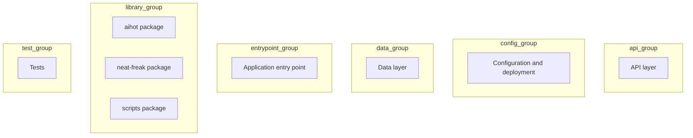

# Architecture report: KKKKhazix/khazix-skills

> Automated static analysis. **Observed** = directly seen in files/imports/AST; **Inferred** = interpretation from that evidence. Repository code was not executed.

## 1. Repository at a glance

| Item | Value |
| --- | --- |
| Repository | KKKKhazix/khazix-skills |
| Description | 数字生命卡兹克开源的 AI Skills 合集 | Agent Skills: leader（帮你定义目标）, neat-freak 洁癖, hv-analysis, khazix-writer & more — Claude Code, Codex & 40+ agents |
| Language | Python |
| Stars | 22253 |
| Licence | MIT |
| Analysed commit / branch | 71cd50ffe1f1f4d400b54be967dc6b59379aff8f / main |
| Framework(s) | Express, FastAPI, Flask, React |
| Files analysed | 127 |
| Components | 8 |

## 2. Architecture in one minute

KKKKhazix/khazix-skills - 数字生命卡兹克开源的 AI Skills 合集 | Agent Skills: leader（帮你定义目标）, neat-freak 洁癖, hv-analysis, khazix-writer & more — Claude Code, Codex & 40+ agents. This repository was analysed statically from 127 file(s) (11 Python). Detected technologies (observed from imports/manifests): GitHub Actions, Database (unspecified), Express, FastAPI, Flask, React. Files are grouped into 8 component(s): aihot package, API layer, Configuration and deployment, Data layer, Application entry point, neat-freak package, scripts package, Tests. Observed entry point(s): hv-analysis/scripts/md_to_pdf.py, neat-freak/evals/fixtures/eval-11-unknown-platform/project/main.py, neat-freak/evals/fixtures/eval-5-governance/workspace/pdf-tools/src/app.py. Findings below distinguish observed facts from inferred interpretation.

## 3. High-level block diagram

## 4. Main components

### aihot package (`aihot`)

- **Kind:** library
- **Status:** Observed
- **Confidence:** 0.85
- **Responsibility:** Groups 1 file(s) under aihot package (observed from repository paths and static analysis).
- **Paths:** `aihot/install.sh`
- **Evidence:** [aihot/install.sh](https://github.com/KKKKhazix/khazix-skills/blob/71cd50ffe1f1f4d400b54be967dc6b59379aff8f/aihot/install.sh)

### API layer (`api_layer`)

- **Kind:** api
- **Status:** Observed
- **Confidence:** 0.85
- **Responsibility:** Groups 1 file(s) under api layer (observed from repository paths and static analysis).
- **Paths:** `neat-freak/evals/fixtures/eval-4-cross-project/workspace/auth-center/src/routes/device.ts`
- **Evidence:** [neat-freak/evals/fixtures/eval-4-cross-project/workspace/auth-center/src/routes/device.ts](https://github.com/KKKKhazix/khazix-skills/blob/71cd50ffe1f1f4d400b54be967dc6b59379aff8f/neat-freak/evals/fixtures/eval-4-cross-project/workspace/auth-center/src/routes/device.ts)

### Configuration and deployment (`config`)

- **Kind:** config
- **Status:** Observed
- **Confidence:** 0.85
- **Responsibility:** Groups 14 file(s) under configuration and deployment (observed from repository paths and static analysis).
- **Paths:** `aihot/agents/openai.yaml`, `hv-analysis/references/schema.json`, `neat-freak/evals/evals.json`, `neat-freak/evals/fixtures/eval-1-routine-dev-sync/workspace/taskflow/package.json`, `neat-freak/evals/fixtures/eval-10-vibe-project/project/data.json`, `neat-freak/evals/fixtures/eval-10-vibe-project/project/package.json`, `neat-freak/evals/fixtures/eval-11-unknown-platform/project/.agentx/memory.json`, `neat-freak/evals/fixtures/eval-11-unknown-platform/project/requirements.txt`, `neat-freak/evals/fixtures/eval-3-cold-start/workspace/analytics_dashboard/package.json`, `neat-freak/evals/fixtures/eval-4-cross-project/workspace/auth-center/.env.example`, `neat-freak/evals/fixtures/eval-5-governance/workspace/Link_Shortener/package.json`, `neat-freak/evals/fixtures/eval-6-scope-boundary/workspace/current-app/package.json`, `neat-freak/evals/fixtures/eval-7-release-terminal/project/release-state.json`, `neat-freak/evals/trigger-eval.json`
- **Evidence:** [aihot/agents/openai.yaml](https://github.com/KKKKhazix/khazix-skills/blob/71cd50ffe1f1f4d400b54be967dc6b59379aff8f/aihot/agents/openai.yaml); [hv-analysis/references/schema.json](https://github.com/KKKKhazix/khazix-skills/blob/71cd50ffe1f1f4d400b54be967dc6b59379aff8f/hv-analysis/references/schema.json); [neat-freak/evals/evals.json](https://github.com/KKKKhazix/khazix-skills/blob/71cd50ffe1f1f4d400b54be967dc6b59379aff8f/neat-freak/evals/evals.json); [neat-freak/evals/fixtures/eval-1-routine-dev-sync/workspace/taskflow/package.json](https://github.com/KKKKhazix/khazix-skills/blob/71cd50ffe1f1f4d400b54be967dc6b59379aff8f/neat-freak/evals/fixtures/eval-1-routine-dev-sync/workspace/taskflow/package.json); [neat-freak/evals/fixtures/eval-10-vibe-project/project/data.json](https://github.com/KKKKhazix/khazix-skills/blob/71cd50ffe1f1f4d400b54be967dc6b59379aff8f/neat-freak/evals/fixtures/eval-10-vibe-project/project/data.json); [neat-freak/evals/fixtures/eval-10-vibe-project/project/package.json](https://github.com/KKKKhazix/khazix-skills/blob/71cd50ffe1f1f4d400b54be967dc6b59379aff8f/neat-freak/evals/fixtures/eval-10-vibe-project/project/package.json); [neat-freak/evals/fixtures/eval-11-unknown-platform/project/.agentx/memory.json](https://github.com/KKKKhazix/khazix-skills/blob/71cd50ffe1f1f4d400b54be967dc6b59379aff8f/neat-freak/evals/fixtures/eval-11-unknown-platform/project/.agentx/memory.json); [neat-freak/evals/fixtures/eval-11-unknown-platform/project/requirements.txt](https://github.com/KKKKhazix/khazix-skills/blob/71cd50ffe1f1f4d400b54be967dc6b59379aff8f/neat-freak/evals/fixtures/eval-11-unknown-platform/project/requirements.txt)

### Data layer (`data_layer`)

- **Kind:** data
- **Status:** Inferred
- **Confidence:** 0.70
- **Responsibility:** Groups 0 file(s) under data layer (observed from repository paths and static analysis).
- **Evidence:** [neat-freak/evals/fixtures/eval-4-cross-project/workspace/auth-center/.env.example:1](https://github.com/KKKKhazix/khazix-skills/blob/71cd50ffe1f1f4d400b54be967dc6b59379aff8f/neat-freak/evals/fixtures/eval-4-cross-project/workspace/auth-center/.env.example#L1)

### Application entry point (`entrypoint`)

- **Kind:** entrypoint
- **Status:** Observed
- **Confidence:** 0.85
- **Responsibility:** Groups 7 file(s) under application entry point (observed from repository paths and static analysis). Observed application object created via FastAPI, Flask. Observed routes: GET /notes, POST /notes, GET /export, POST /split. Observed top-level classes: Handler. Observed top-level functions: _trash_linux, _trash_macos, _trash_windows, add_note, clear_contents, dev_caches_linux.
- **Paths:** `hv-analysis/scripts/md_to_pdf.py`, `neat-freak/evals/fixtures/eval-11-unknown-platform/project/main.py`, `neat-freak/evals/fixtures/eval-5-governance/workspace/pdf-tools/src/app.py`, `neat-freak/evals/validate.py`, `storage-analyzer/scripts/build_report.py`, `storage-analyzer/scripts/scan.py`, `storage-analyzer/scripts/server.py`
- **Evidence:** [hv-analysis/scripts/md_to_pdf.py:213](https://github.com/KKKKhazix/khazix-skills/blob/71cd50ffe1f1f4d400b54be967dc6b59379aff8f/hv-analysis/scripts/md_to_pdf.py#L213); [neat-freak/evals/fixtures/eval-11-unknown-platform/project/main.py:8](https://github.com/KKKKhazix/khazix-skills/blob/71cd50ffe1f1f4d400b54be967dc6b59379aff8f/neat-freak/evals/fixtures/eval-11-unknown-platform/project/main.py#L8); [neat-freak/evals/fixtures/eval-5-governance/workspace/pdf-tools/src/app.py:4](https://github.com/KKKKhazix/khazix-skills/blob/71cd50ffe1f1f4d400b54be967dc6b59379aff8f/neat-freak/evals/fixtures/eval-5-governance/workspace/pdf-tools/src/app.py#L4); [neat-freak/evals/validate.py:19](https://github.com/KKKKhazix/khazix-skills/blob/71cd50ffe1f1f4d400b54be967dc6b59379aff8f/neat-freak/evals/validate.py#L19); [storage-analyzer/scripts/build_report.py:31](https://github.com/KKKKhazix/khazix-skills/blob/71cd50ffe1f1f4d400b54be967dc6b59379aff8f/storage-analyzer/scripts/build_report.py#L31); [storage-analyzer/scripts/scan.py:30](https://github.com/KKKKhazix/khazix-skills/blob/71cd50ffe1f1f4d400b54be967dc6b59379aff8f/storage-analyzer/scripts/scan.py#L30); [storage-analyzer/scripts/server.py:53](https://github.com/KKKKhazix/khazix-skills/blob/71cd50ffe1f1f4d400b54be967dc6b59379aff8f/storage-analyzer/scripts/server.py#L53)

### neat-freak package (`neat_freak`)

- **Kind:** library
- **Status:** Observed
- **Confidence:** 0.85
- **Responsibility:** Groups 12 file(s) under neat-freak package (observed from repository paths and static analysis).
- **Paths:** `neat-freak/evals/fixtures/eval-1-routine-dev-sync/workspace/taskflow/src/router.ts`, `neat-freak/evals/fixtures/eval-1-routine-dev-sync/workspace/taskflow/src/server.ts`, `neat-freak/evals/fixtures/eval-10-vibe-project/project/server.js`, `neat-freak/evals/fixtures/eval-10-vibe-project/project/server_old.js`, `neat-freak/evals/fixtures/eval-2-memory-conflict/workspace/notesapp/src/auth.ts`, `neat-freak/evals/fixtures/eval-3-cold-start/workspace/analytics_dashboard/src/App.jsx`, `neat-freak/evals/fixtures/eval-3-cold-start/workspace/analytics_dashboard/src/lib/supabase.js`, `neat-freak/evals/fixtures/eval-4-cross-project/workspace/skills-hub/setup.sh`, `neat-freak/evals/fixtures/eval-4-cross-project/workspace/skills-hub/web/src/DevicesPage.jsx`, `neat-freak/evals/fixtures/eval-5-governance/workspace/Link_Shortener/src/server.js`, `neat-freak/evals/fixtures/eval-6-scope-boundary/workspace/current-app/src/server.ts`, `neat-freak/scripts/audit-inventory.sh`
- **Evidence:** [neat-freak/evals/fixtures/eval-1-routine-dev-sync/workspace/taskflow/src/router.ts](https://github.com/KKKKhazix/khazix-skills/blob/71cd50ffe1f1f4d400b54be967dc6b59379aff8f/neat-freak/evals/fixtures/eval-1-routine-dev-sync/workspace/taskflow/src/router.ts); [neat-freak/evals/fixtures/eval-1-routine-dev-sync/workspace/taskflow/src/server.ts](https://github.com/KKKKhazix/khazix-skills/blob/71cd50ffe1f1f4d400b54be967dc6b59379aff8f/neat-freak/evals/fixtures/eval-1-routine-dev-sync/workspace/taskflow/src/server.ts); [neat-freak/evals/fixtures/eval-10-vibe-project/project/server.js](https://github.com/KKKKhazix/khazix-skills/blob/71cd50ffe1f1f4d400b54be967dc6b59379aff8f/neat-freak/evals/fixtures/eval-10-vibe-project/project/server.js); [neat-freak/evals/fixtures/eval-10-vibe-project/project/server_old.js](https://github.com/KKKKhazix/khazix-skills/blob/71cd50ffe1f1f4d400b54be967dc6b59379aff8f/neat-freak/evals/fixtures/eval-10-vibe-project/project/server_old.js); [neat-freak/evals/fixtures/eval-2-memory-conflict/workspace/notesapp/src/auth.ts](https://github.com/KKKKhazix/khazix-skills/blob/71cd50ffe1f1f4d400b54be967dc6b59379aff8f/neat-freak/evals/fixtures/eval-2-memory-conflict/workspace/notesapp/src/auth.ts); [neat-freak/evals/fixtures/eval-3-cold-start/workspace/analytics_dashboard/src/App.jsx](https://github.com/KKKKhazix/khazix-skills/blob/71cd50ffe1f1f4d400b54be967dc6b59379aff8f/neat-freak/evals/fixtures/eval-3-cold-start/workspace/analytics_dashboard/src/App.jsx); [neat-freak/evals/fixtures/eval-3-cold-start/workspace/analytics_dashboard/src/lib/supabase.js](https://github.com/KKKKhazix/khazix-skills/blob/71cd50ffe1f1f4d400b54be967dc6b59379aff8f/neat-freak/evals/fixtures/eval-3-cold-start/workspace/analytics_dashboard/src/lib/supabase.js); [neat-freak/evals/fixtures/eval-4-cross-project/workspace/skills-hub/setup.sh](https://github.com/KKKKhazix/khazix-skills/blob/71cd50ffe1f1f4d400b54be967dc6b59379aff8f/neat-freak/evals/fixtures/eval-4-cross-project/workspace/skills-hub/setup.sh)

### scripts package (`scripts`)

- **Kind:** library
- **Status:** Observed
- **Confidence:** 0.85
- **Responsibility:** Groups 1 file(s) under scripts package (observed from repository paths and static analysis).
- **Paths:** `scripts/validate-package.py`
- **Evidence:** [scripts/validate-package.py](https://github.com/KKKKhazix/khazix-skills/blob/71cd50ffe1f1f4d400b54be967dc6b59379aff8f/scripts/validate-package.py)

### Tests (`tests`)

- **Kind:** test
- **Status:** Observed
- **Confidence:** 0.85
- **Responsibility:** Groups 3 file(s) under tests (observed from repository paths and static analysis). Observed top-level classes: CleanupState, DuChildrenTests, InstallerTests, LinuxDiskTests, StorageTests.
- **Paths:** `tests/test_installer.py`, `tests/test_storage.py`, `tests/test_storage_actions.py`
- **Evidence:** [tests/test_installer.py:8](https://github.com/KKKKhazix/khazix-skills/blob/71cd50ffe1f1f4d400b54be967dc6b59379aff8f/tests/test_installer.py#L8); [tests/test_storage.py:19](https://github.com/KKKKhazix/khazix-skills/blob/71cd50ffe1f1f4d400b54be967dc6b59379aff8f/tests/test_storage.py#L19); [tests/test_storage_actions.py:9](https://github.com/KKKKhazix/khazix-skills/blob/71cd50ffe1f1f4d400b54be967dc6b59379aff8f/tests/test_storage_actions.py#L9)

## 5. Execution flow

**Observed** entry point(s):

- [hv-analysis/scripts/md_to_pdf.py:304](https://github.com/KKKKhazix/khazix-skills/blob/71cd50ffe1f1f4d400b54be967dc6b59379aff8f/hv-analysis/scripts/md_to_pdf.py#L304)
- [neat-freak/evals/fixtures/eval-11-unknown-platform/project/main.py:8](https://github.com/KKKKhazix/khazix-skills/blob/71cd50ffe1f1f4d400b54be967dc6b59379aff8f/neat-freak/evals/fixtures/eval-11-unknown-platform/project/main.py#L8)
- [neat-freak/evals/fixtures/eval-5-governance/workspace/pdf-tools/src/app.py:4](https://github.com/KKKKhazix/khazix-skills/blob/71cd50ffe1f1f4d400b54be967dc6b59379aff8f/neat-freak/evals/fixtures/eval-5-governance/workspace/pdf-tools/src/app.py#L4)
- [neat-freak/evals/validate.py:138](https://github.com/KKKKhazix/khazix-skills/blob/71cd50ffe1f1f4d400b54be967dc6b59379aff8f/neat-freak/evals/validate.py#L138)
- [storage-analyzer/scripts/build_report.py:54](https://github.com/KKKKhazix/khazix-skills/blob/71cd50ffe1f1f4d400b54be967dc6b59379aff8f/storage-analyzer/scripts/build_report.py#L54)
- [storage-analyzer/scripts/scan.py:503](https://github.com/KKKKhazix/khazix-skills/blob/71cd50ffe1f1f4d400b54be967dc6b59379aff8f/storage-analyzer/scripts/scan.py#L503)
- [storage-analyzer/scripts/server.py:380](https://github.com/KKKKhazix/khazix-skills/blob/71cd50ffe1f1f4d400b54be967dc6b59379aff8f/storage-analyzer/scripts/server.py#L380)

**Observed** routes (from decorators):

- `GET /notes` -> `list_notes` in `neat-freak/evals/fixtures/eval-11-unknown-platform/project/main.py:15`
- `POST /notes` -> `add_note` in `neat-freak/evals/fixtures/eval-11-unknown-platform/project/main.py:20`
- `GET /export` -> `export_notes` in `neat-freak/evals/fixtures/eval-11-unknown-platform/project/main.py:27`
- `POST /split` -> `split` in `neat-freak/evals/fixtures/eval-5-governance/workspace/pdf-tools/src/app.py:7`

Representative flow (derived from observed entry points and the import graph; steps beyond the entry point are **Inferred**):

1. Execution starts at an observed entry point listed above, if present.
2. No internal import relationships between components were observed.

## 6. Project structure

### `(root)`

- `.gitattributes` - other (19 bytes)
- `.gitignore` - other (540 bytes)
- `AGENTS.md` - docs (6320 bytes)
- `LICENSE` - docs (1078 bytes)
- `README.en.md` - docs (20050 bytes)
- `README.md` - docs (19184 bytes)
- `STATES.md` - docs (3252 bytes)

### `.claude-plugin`

- `.claude-plugin/marketplace.json` - config (633 bytes)

### `.github`

- `.github/workflows/validate.yml` - ci, YAML (821 bytes)

### `aihot`

- `aihot/.gitignore` - other (40 bytes)
- `aihot/LICENSE` - docs (1064 bytes)
- `aihot/README.md` - docs (7348 bytes)
- `aihot/SKILL.md` - docs (3367 bytes)
- `aihot/agents/openai.yaml` - config (209 bytes)
- `aihot/install.sh` - source, Shell (17950 bytes)
- `aihot/manifest.sha256` - other (234 bytes)

### `hv-analysis`

- `hv-analysis/SKILL.md` - docs (21351 bytes)
- `hv-analysis/references/schema.json` - config (7848 bytes)
- `hv-analysis/scripts/md_to_pdf.py` - source, Python (7429 bytes)

### `khazix-writer`

- `khazix-writer/SKILL.md` - docs (22538 bytes)
- `khazix-writer/references/content_methodology.md` - docs (6171 bytes)
- `khazix-writer/references/quality-check.md` - docs (7280 bytes)
- `khazix-writer/references/style_examples.md` - docs (16790 bytes)

### `leader`

- `leader/SKILL.md` - docs (7480 bytes)
- `leader/references/anatomy.md` - docs (4979 bytes)
- `leader/references/style.md` - docs (3446 bytes)

### `neat-freak`

- `neat-freak/SKILL.md` - docs (15304 bytes)
- `neat-freak/evals/evals.json` - config (10870 bytes)
- `neat-freak/evals/fixtures/eval-1-routine-dev-sync/agent-memory/taskflow/memory/MEMORY.md` - docs (183 bytes)
- `neat-freak/evals/fixtures/eval-1-routine-dev-sync/agent-memory/taskflow/memory/project_api-design.md` - docs (243 bytes)
- `neat-freak/evals/fixtures/eval-1-routine-dev-sync/agent-memory/taskflow/memory/project_deploy.md` - docs (274 bytes)
- `neat-freak/evals/fixtures/eval-1-routine-dev-sync/workspace/CLAUDE.md` - docs (355 bytes)
- `neat-freak/evals/fixtures/eval-1-routine-dev-sync/workspace/taskflow/CLAUDE.md` - docs (479 bytes)
- `neat-freak/evals/fixtures/eval-1-routine-dev-sync/workspace/taskflow/README.md` - docs (231 bytes)
- `neat-freak/evals/fixtures/eval-1-routine-dev-sync/workspace/taskflow/docs/architecture.md` - docs (374 bytes)
- `neat-freak/evals/fixtures/eval-1-routine-dev-sync/workspace/taskflow/package.json` - manifest (311 bytes)
- `neat-freak/evals/fixtures/eval-1-routine-dev-sync/workspace/taskflow/src/router.ts` - source, TypeScript (888 bytes)
- `neat-freak/evals/fixtures/eval-1-routine-dev-sync/workspace/taskflow/src/server.ts` - source, TypeScript (474 bytes)
- `neat-freak/evals/fixtures/eval-10-vibe-project/project/PLAN.md` - docs (229 bytes)
- `neat-freak/evals/fixtures/eval-10-vibe-project/project/README.md` - docs (314 bytes)
- `neat-freak/evals/fixtures/eval-10-vibe-project/project/TODO-fix-bug.md` - docs (245 bytes)
- `neat-freak/evals/fixtures/eval-10-vibe-project/project/data.json` - config (105 bytes)
- `neat-freak/evals/fixtures/eval-10-vibe-project/project/index.html` - other (873 bytes)
- `neat-freak/evals/fixtures/eval-10-vibe-project/project/notes/debug-notes.md` - docs (176 bytes)
- `neat-freak/evals/fixtures/eval-10-vibe-project/project/package.json` - manifest (167 bytes)
- `neat-freak/evals/fixtures/eval-10-vibe-project/project/server.js` - source, JavaScript (1130 bytes)
- `neat-freak/evals/fixtures/eval-10-vibe-project/project/server_old.js` - source, JavaScript (298 bytes)
- `neat-freak/evals/fixtures/eval-11-unknown-platform/project/.agentx/memory.json` - config (394 bytes)
- `neat-freak/evals/fixtures/eval-11-unknown-platform/project/.agentx/session-log.jsonl` - data (177 bytes)
- `neat-freak/evals/fixtures/eval-11-unknown-platform/project/AGENTS.md` - docs (352 bytes)
- `neat-freak/evals/fixtures/eval-11-unknown-platform/project/main.py` - source, Python (771 bytes)
- `neat-freak/evals/fixtures/eval-11-unknown-platform/project/requirements.txt` - manifest (13 bytes)
- `neat-freak/evals/fixtures/eval-2-memory-conflict/agent-memory/notesapp/memory/MEMORY.md` - docs (353 bytes)
- `neat-freak/evals/fixtures/eval-2-memory-conflict/agent-memory/notesapp/memory/feedback_auth-clerk.md` - docs (212 bytes)
- `neat-freak/evals/fixtures/eval-2-memory-conflict/agent-memory/notesapp/memory/feedback_auth-nextauth.md` - docs (189 bytes)
- `neat-freak/evals/fixtures/eval-2-memory-conflict/agent-memory/notesapp/memory/feedback_performance.md` - docs (178 bytes)
- `neat-freak/evals/fixtures/eval-2-memory-conflict/agent-memory/notesapp/memory/project_db-migration.md` - docs (256 bytes)
- `neat-freak/evals/fixtures/eval-2-memory-conflict/workspace/CLAUDE.md` - docs (289 bytes)
- `neat-freak/evals/fixtures/eval-2-memory-conflict/workspace/notesapp/CLAUDE.md` - docs (343 bytes)
- `neat-freak/evals/fixtures/eval-2-memory-conflict/workspace/notesapp/README.md` - docs (74 bytes)
- `neat-freak/evals/fixtures/eval-2-memory-conflict/workspace/notesapp/prisma/schema.prisma` - other (297 bytes)
- `neat-freak/evals/fixtures/eval-2-memory-conflict/workspace/notesapp/src/auth.ts` - source, TypeScript (255 bytes)
- `neat-freak/evals/fixtures/eval-3-cold-start/workspace/CLAUDE.md` - docs (490 bytes)
- `neat-freak/evals/fixtures/eval-3-cold-start/workspace/analytics_dashboard/.gitignore` - other (20 bytes)
- `neat-freak/evals/fixtures/eval-3-cold-start/workspace/analytics_dashboard/package.json` - manifest (333 bytes)
- `neat-freak/evals/fixtures/eval-3-cold-start/workspace/analytics_dashboard/src/App.jsx` - source, JavaScript (618 bytes)
- `neat-freak/evals/fixtures/eval-3-cold-start/workspace/analytics_dashboard/src/lib/supabase.js` - source, JavaScript (174 bytes)
- `neat-freak/evals/fixtures/eval-4-cross-project/agent-memory/auth-center/memory/MEMORY.md` - docs (105 bytes)
- `neat-freak/evals/fixtures/eval-4-cross-project/agent-memory/auth-center/memory/project_device-flow.md` - docs (232 bytes)
- `neat-freak/evals/fixtures/eval-4-cross-project/agent-memory/skills-hub/memory/MEMORY.md` - docs (46 bytes)
- `neat-freak/evals/fixtures/eval-4-cross-project/workspace/CLAUDE.md` - docs (380 bytes)
- `neat-freak/evals/fixtures/eval-4-cross-project/workspace/auth-center/.env.example` - config (101 bytes)
- `neat-freak/evals/fixtures/eval-4-cross-project/workspace/auth-center/CLAUDE.md` - docs (525 bytes)
- `neat-freak/evals/fixtures/eval-4-cross-project/workspace/auth-center/docs/architecture.md` - docs (264 bytes)
- `neat-freak/evals/fixtures/eval-4-cross-project/workspace/auth-center/docs/integration-guide.md` - docs (606 bytes)
- `neat-freak/evals/fixtures/eval-4-cross-project/workspace/auth-center/docs/operator-runbook.md` - docs (221 bytes)
- `neat-freak/evals/fixtures/eval-4-cross-project/workspace/auth-center/migrations/004_device_codes.sql` - data, SQL (430 bytes)
- `neat-freak/evals/fixtures/eval-4-cross-project/workspace/auth-center/src/routes/device.ts` - source, TypeScript (1324 bytes)
- `neat-freak/evals/fixtures/eval-4-cross-project/workspace/skills-hub/CLAUDE.md` - docs (376 bytes)
- `neat-freak/evals/fixtures/eval-4-cross-project/workspace/skills-hub/docs/auth-integration.md` - docs (340 bytes)
- `neat-freak/evals/fixtures/eval-4-cross-project/workspace/skills-hub/setup.sh` - source, Shell (831 bytes)
- `neat-freak/evals/fixtures/eval-4-cross-project/workspace/skills-hub/web/src/DevicesPage.jsx` - source, JavaScript (419 bytes)
- `neat-freak/evals/fixtures/eval-5-governance/agent-memory/pdf-tools/memory/MEMORY.md` - docs (173 bytes)
- `neat-freak/evals/fixtures/eval-5-governance/agent-memory/pdf-tools/memory/feedback_streaming.md` - docs (197 bytes)
- `neat-freak/evals/fixtures/eval-5-governance/workspace/CLAUDE.md` - docs (957 bytes)
- `neat-freak/evals/fixtures/eval-5-governance/workspace/Link_Shortener/package.json` - manifest (185 bytes)
- `neat-freak/evals/fixtures/eval-5-governance/workspace/Link_Shortener/src/server.js` - source, JavaScript (415 bytes)
- `neat-freak/evals/fixtures/eval-5-governance/workspace/deploy-notes.md` - docs (107 bytes)
- `neat-freak/evals/fixtures/eval-5-governance/workspace/pdf-tools/.gitignore` - other (21 bytes)
- `neat-freak/evals/fixtures/eval-5-governance/workspace/pdf-tools/AGENTS.md` - docs (229 bytes)
- `neat-freak/evals/fixtures/eval-5-governance/workspace/pdf-tools/CLAUDE.md` - docs (180 bytes)
- `neat-freak/evals/fixtures/eval-5-governance/workspace/pdf-tools/src/app.py` - source, Python (479 bytes)
- `neat-freak/evals/fixtures/eval-6-scope-boundary/workspace/CLAUDE.md` - docs (217 bytes)
- `neat-freak/evals/fixtures/eval-6-scope-boundary/workspace/Legacy_App/README.md` - docs (94 bytes)
- `neat-freak/evals/fixtures/eval-6-scope-boundary/workspace/current-app/CLAUDE.md` - docs (56 bytes)
- `neat-freak/evals/fixtures/eval-6-scope-boundary/workspace/current-app/README.md` - docs (64 bytes)
- `neat-freak/evals/fixtures/eval-6-scope-boundary/workspace/current-app/package.json` - manifest (79 bytes)
- `neat-freak/evals/fixtures/eval-6-scope-boundary/workspace/current-app/src/server.ts` - source, TypeScript (47 bytes)
- `neat-freak/evals/fixtures/eval-7-release-terminal/project/.cleanup-candidate/UNIQUE.md` - docs (89 bytes)
- `neat-freak/evals/fixtures/eval-7-release-terminal/project/CLAUDE.md` - docs (180 bytes)
- `neat-freak/evals/fixtures/eval-7-release-terminal/project/release-state.json` - config (332 bytes)
- `neat-freak/evals/fixtures/eval-8-generated-memory/codex-memories/MEMORY.md` - docs (90 bytes)
- `neat-freak/evals/fixtures/eval-8-generated-memory/codex-memories/extensions/ad_hoc/notes/.gitkeep` - other (1 bytes)
- `neat-freak/evals/fixtures/eval-8-generated-memory/codex-memories/memory_summary.md` - docs (63 bytes)
- `neat-freak/evals/fixtures/eval-8-generated-memory/codex-memories/rollout_summaries/session.jsonl` - data (53 bytes)
- `neat-freak/evals/fixtures/eval-8-generated-memory/project/README.md` - docs (92 bytes)
- `neat-freak/evals/fixtures/eval-8-generated-memory/project/docs/ARCHITECTURE.md` - docs (76 bytes)
- `neat-freak/evals/fixtures/eval-8-generated-memory/project/runtime.txt` - docs (19 bytes)
- `neat-freak/evals/trigger-eval.json` - config (2414 bytes)
- `neat-freak/evals/validate.py` - source, Python (6317 bytes)
- `neat-freak/references/agent-paths.md` - docs (6520 bytes)
- `neat-freak/references/governance.md` - docs (4305 bytes)
- `neat-freak/references/sync-matrix.md` - docs (4850 bytes)
- `neat-freak/references/verification.md` - docs (3682 bytes)
- `neat-freak/scripts/audit-inventory.sh` - source, Shell (3706 bytes)

### `scripts`

- `scripts/validate-package.py` - source, Python (1548 bytes)

### `storage-analyzer`

- `storage-analyzer/SKILL.md` - docs (15650 bytes)
- `storage-analyzer/assets/report_template.html` - other (27253 bytes)
- `storage-analyzer/references/linux.md` - docs (4856 bytes)
- `storage-analyzer/references/macos.md` - docs (1692 bytes)
- `storage-analyzer/references/windows.md` - docs (2541 bytes)
- `storage-analyzer/scripts/build_report.py` - source, Python (1963 bytes)
- `storage-analyzer/scripts/scan.py` - source, Python (18892 bytes)
- `storage-analyzer/scripts/server.py` - source, Python (15885 bytes)

### `tests`

- `tests/test_installer.py` - test, Python (1846 bytes)
- `tests/test_storage.py` - test, Python (9230 bytes)
- `tests/test_storage_actions.py` - test, Python (2741 bytes)

## 7. Key dependencies and integrations

| Name | Category | Status | Confidence | Evidence |
| --- | --- | --- | --- | --- |
| GitHub Actions | ci | Observed | 0.85 | [.github/workflows/validate.yml](https://github.com/KKKKhazix/khazix-skills/blob/71cd50ffe1f1f4d400b54be967dc6b59379aff8f/.github/workflows/validate.yml) |
| Database (unspecified) | database | Inferred | 0.45 | [neat-freak/evals/fixtures/eval-4-cross-project/workspace/auth-center/.env.example:1](https://github.com/KKKKhazix/khazix-skills/blob/71cd50ffe1f1f4d400b54be967dc6b59379aff8f/neat-freak/evals/fixtures/eval-4-cross-project/workspace/auth-center/.env.example#L1) |
| Express | framework | Observed | 0.90 | [neat-freak/evals/fixtures/eval-10-vibe-project/project/package.json:9](https://github.com/KKKKhazix/khazix-skills/blob/71cd50ffe1f1f4d400b54be967dc6b59379aff8f/neat-freak/evals/fixtures/eval-10-vibe-project/project/package.json#L9); [neat-freak/evals/fixtures/eval-5-governance/workspace/Link_Shortener/package.json:6](https://github.com/KKKKhazix/khazix-skills/blob/71cd50ffe1f1f4d400b54be967dc6b59379aff8f/neat-freak/evals/fixtures/eval-5-governance/workspace/Link_Shortener/package.json#L6) |
| FastAPI | framework | Observed | 0.90 | [neat-freak/evals/fixtures/eval-5-governance/workspace/pdf-tools/src/app.py:1](https://github.com/KKKKhazix/khazix-skills/blob/71cd50ffe1f1f4d400b54be967dc6b59379aff8f/neat-freak/evals/fixtures/eval-5-governance/workspace/pdf-tools/src/app.py#L1) |
| Flask | framework | Observed | 0.90 | [neat-freak/evals/fixtures/eval-11-unknown-platform/project/main.py:6](https://github.com/KKKKhazix/khazix-skills/blob/71cd50ffe1f1f4d400b54be967dc6b59379aff8f/neat-freak/evals/fixtures/eval-11-unknown-platform/project/main.py#L6); [neat-freak/evals/fixtures/eval-11-unknown-platform/project/requirements.txt:1](https://github.com/KKKKhazix/khazix-skills/blob/71cd50ffe1f1f4d400b54be967dc6b59379aff8f/neat-freak/evals/fixtures/eval-11-unknown-platform/project/requirements.txt#L1) |
| React | framework | Observed | 0.90 | [neat-freak/evals/fixtures/eval-3-cold-start/workspace/analytics_dashboard/package.json:6](https://github.com/KKKKhazix/khazix-skills/blob/71cd50ffe1f1f4d400b54be967dc6b59379aff8f/neat-freak/evals/fixtures/eval-3-cold-start/workspace/analytics_dashboard/package.json#L6); [neat-freak/evals/fixtures/eval-3-cold-start/workspace/analytics_dashboard/package.json:7](https://github.com/KKKKhazix/khazix-skills/blob/71cd50ffe1f1f4d400b54be967dc6b59379aff8f/neat-freak/evals/fixtures/eval-3-cold-start/workspace/analytics_dashboard/package.json#L7) |
| TypeScript | tooling | Observed | 0.85 | [neat-freak/evals/fixtures/eval-1-routine-dev-sync/workspace/taskflow/package.json:11](https://github.com/KKKKhazix/khazix-skills/blob/71cd50ffe1f1f4d400b54be967dc6b59379aff8f/neat-freak/evals/fixtures/eval-1-routine-dev-sync/workspace/taskflow/package.json#L11) |
| unittest | tooling | Observed | 0.95 | [tests/test_installer.py:5](https://github.com/KKKKhazix/khazix-skills/blob/71cd50ffe1f1f4d400b54be967dc6b59379aff8f/tests/test_installer.py#L5); [tests/test_storage.py:11](https://github.com/KKKKhazix/khazix-skills/blob/71cd50ffe1f1f4d400b54be967dc6b59379aff8f/tests/test_storage.py#L11); [tests/test_storage.py:12](https://github.com/KKKKhazix/khazix-skills/blob/71cd50ffe1f1f4d400b54be967dc6b59379aff8f/tests/test_storage.py#L12); [tests/test_storage_actions.py:5](https://github.com/KKKKhazix/khazix-skills/blob/71cd50ffe1f1f4d400b54be967dc6b59379aff8f/tests/test_storage_actions.py#L5) |
| Vite | tooling | Observed | 0.85 | [neat-freak/evals/fixtures/eval-3-cold-start/workspace/analytics_dashboard/package.json:4](https://github.com/KKKKhazix/khazix-skills/blob/71cd50ffe1f1f4d400b54be967dc6b59379aff8f/neat-freak/evals/fixtures/eval-3-cold-start/workspace/analytics_dashboard/package.json#L4) |

## 8. Data and state

- **Database (unspecified)** (Inferred, confidence 0.45) - evidence: [neat-freak/evals/fixtures/eval-4-cross-project/workspace/auth-center/.env.example:1](https://github.com/KKKKhazix/khazix-skills/blob/71cd50ffe1f1f4d400b54be967dc6b59379aff8f/neat-freak/evals/fixtures/eval-4-cross-project/workspace/auth-center/.env.example#L1)
- Data component `data_layer` (Inferred): Groups 0 file(s) under data layer (observed from repository paths and static analysis).

## 9. Configuration and deployment clues

- `.claude-plugin/marketplace.json` (config)
- `.github/workflows/validate.yml` (ci)
- `aihot/agents/openai.yaml` (config)
- `hv-analysis/references/schema.json` (config)
- `neat-freak/evals/evals.json` (config)
- `neat-freak/evals/fixtures/eval-1-routine-dev-sync/workspace/taskflow/package.json` (manifest)
- `neat-freak/evals/fixtures/eval-10-vibe-project/project/data.json` (config)
- `neat-freak/evals/fixtures/eval-10-vibe-project/project/package.json` (manifest)
- `neat-freak/evals/fixtures/eval-11-unknown-platform/project/.agentx/memory.json` (config)
- `neat-freak/evals/fixtures/eval-11-unknown-platform/project/requirements.txt` (manifest)
- `neat-freak/evals/fixtures/eval-3-cold-start/workspace/analytics_dashboard/package.json` (manifest)
- `neat-freak/evals/fixtures/eval-4-cross-project/workspace/auth-center/.env.example` (config)
- `neat-freak/evals/fixtures/eval-5-governance/workspace/Link_Shortener/package.json` (manifest)
- `neat-freak/evals/fixtures/eval-6-scope-boundary/workspace/current-app/package.json` (manifest)
- `neat-freak/evals/fixtures/eval-7-release-terminal/project/release-state.json` (config)
- `neat-freak/evals/trigger-eval.json` (config)

Environment variable *names* seen in example env files (values never recorded):

- `neat-freak/evals/fixtures/eval-4-cross-project/workspace/auth-center/.env.example`: `DATABASE_URL`, `DEVICE_CODE_TTL`, `JWT_SECRET`, `TOKEN_TTL`

## 10. Design observations

- An entry/API layer is separated from other code (Inferred from paths and decorators).
- Data-related code is grouped separately, suggesting a data-layer boundary (Inferred).
- Tests are present alongside source code (Observed from test file paths).

These observations are interpretations (**Inferred**) of the observed structure, not guarantees about runtime design.

## 11. Limitations and unknowns

- Static analysis only: repository code was not executed, installed, or imported at runtime.
- Components and relationships are inferred from file paths, imports, and AST structure; runtime behaviour, dynamic imports, and reflection may not be visible.
- 2 file(s) were skipped during inventory (2 x likely secret file excluded).
- Repository text was treated as untrusted data; no instructions found in repository files were followed, and likely secret values were redacted/excluded.

## 12. Source references

- [.github/workflows/validate.yml](https://github.com/KKKKhazix/khazix-skills/blob/71cd50ffe1f1f4d400b54be967dc6b59379aff8f/.github/workflows/validate.yml)
- [aihot/agents/openai.yaml](https://github.com/KKKKhazix/khazix-skills/blob/71cd50ffe1f1f4d400b54be967dc6b59379aff8f/aihot/agents/openai.yaml)
- [aihot/install.sh](https://github.com/KKKKhazix/khazix-skills/blob/71cd50ffe1f1f4d400b54be967dc6b59379aff8f/aihot/install.sh)
- [hv-analysis/references/schema.json](https://github.com/KKKKhazix/khazix-skills/blob/71cd50ffe1f1f4d400b54be967dc6b59379aff8f/hv-analysis/references/schema.json)
- [hv-analysis/scripts/md_to_pdf.py:213](https://github.com/KKKKhazix/khazix-skills/blob/71cd50ffe1f1f4d400b54be967dc6b59379aff8f/hv-analysis/scripts/md_to_pdf.py#L213)
- [hv-analysis/scripts/md_to_pdf.py:304](https://github.com/KKKKhazix/khazix-skills/blob/71cd50ffe1f1f4d400b54be967dc6b59379aff8f/hv-analysis/scripts/md_to_pdf.py#L304)
- [neat-freak/evals/evals.json](https://github.com/KKKKhazix/khazix-skills/blob/71cd50ffe1f1f4d400b54be967dc6b59379aff8f/neat-freak/evals/evals.json)
- [neat-freak/evals/fixtures/eval-1-routine-dev-sync/workspace/taskflow/package.json](https://github.com/KKKKhazix/khazix-skills/blob/71cd50ffe1f1f4d400b54be967dc6b59379aff8f/neat-freak/evals/fixtures/eval-1-routine-dev-sync/workspace/taskflow/package.json)
- [neat-freak/evals/fixtures/eval-1-routine-dev-sync/workspace/taskflow/package.json:11](https://github.com/KKKKhazix/khazix-skills/blob/71cd50ffe1f1f4d400b54be967dc6b59379aff8f/neat-freak/evals/fixtures/eval-1-routine-dev-sync/workspace/taskflow/package.json#L11)
- [neat-freak/evals/fixtures/eval-1-routine-dev-sync/workspace/taskflow/src/router.ts](https://github.com/KKKKhazix/khazix-skills/blob/71cd50ffe1f1f4d400b54be967dc6b59379aff8f/neat-freak/evals/fixtures/eval-1-routine-dev-sync/workspace/taskflow/src/router.ts)
- [neat-freak/evals/fixtures/eval-1-routine-dev-sync/workspace/taskflow/src/server.ts](https://github.com/KKKKhazix/khazix-skills/blob/71cd50ffe1f1f4d400b54be967dc6b59379aff8f/neat-freak/evals/fixtures/eval-1-routine-dev-sync/workspace/taskflow/src/server.ts)
- [neat-freak/evals/fixtures/eval-10-vibe-project/project/data.json](https://github.com/KKKKhazix/khazix-skills/blob/71cd50ffe1f1f4d400b54be967dc6b59379aff8f/neat-freak/evals/fixtures/eval-10-vibe-project/project/data.json)
- [neat-freak/evals/fixtures/eval-10-vibe-project/project/package.json](https://github.com/KKKKhazix/khazix-skills/blob/71cd50ffe1f1f4d400b54be967dc6b59379aff8f/neat-freak/evals/fixtures/eval-10-vibe-project/project/package.json)
- [neat-freak/evals/fixtures/eval-10-vibe-project/project/package.json:9](https://github.com/KKKKhazix/khazix-skills/blob/71cd50ffe1f1f4d400b54be967dc6b59379aff8f/neat-freak/evals/fixtures/eval-10-vibe-project/project/package.json#L9)
- [neat-freak/evals/fixtures/eval-10-vibe-project/project/server.js](https://github.com/KKKKhazix/khazix-skills/blob/71cd50ffe1f1f4d400b54be967dc6b59379aff8f/neat-freak/evals/fixtures/eval-10-vibe-project/project/server.js)
- [neat-freak/evals/fixtures/eval-10-vibe-project/project/server_old.js](https://github.com/KKKKhazix/khazix-skills/blob/71cd50ffe1f1f4d400b54be967dc6b59379aff8f/neat-freak/evals/fixtures/eval-10-vibe-project/project/server_old.js)
- [neat-freak/evals/fixtures/eval-11-unknown-platform/project/.agentx/memory.json](https://github.com/KKKKhazix/khazix-skills/blob/71cd50ffe1f1f4d400b54be967dc6b59379aff8f/neat-freak/evals/fixtures/eval-11-unknown-platform/project/.agentx/memory.json)
- [neat-freak/evals/fixtures/eval-11-unknown-platform/project/main.py:6](https://github.com/KKKKhazix/khazix-skills/blob/71cd50ffe1f1f4d400b54be967dc6b59379aff8f/neat-freak/evals/fixtures/eval-11-unknown-platform/project/main.py#L6)
- [neat-freak/evals/fixtures/eval-11-unknown-platform/project/main.py:8](https://github.com/KKKKhazix/khazix-skills/blob/71cd50ffe1f1f4d400b54be967dc6b59379aff8f/neat-freak/evals/fixtures/eval-11-unknown-platform/project/main.py#L8)
- [neat-freak/evals/fixtures/eval-11-unknown-platform/project/requirements.txt](https://github.com/KKKKhazix/khazix-skills/blob/71cd50ffe1f1f4d400b54be967dc6b59379aff8f/neat-freak/evals/fixtures/eval-11-unknown-platform/project/requirements.txt)
- [neat-freak/evals/fixtures/eval-11-unknown-platform/project/requirements.txt:1](https://github.com/KKKKhazix/khazix-skills/blob/71cd50ffe1f1f4d400b54be967dc6b59379aff8f/neat-freak/evals/fixtures/eval-11-unknown-platform/project/requirements.txt#L1)
- [neat-freak/evals/fixtures/eval-2-memory-conflict/workspace/notesapp/src/auth.ts](https://github.com/KKKKhazix/khazix-skills/blob/71cd50ffe1f1f4d400b54be967dc6b59379aff8f/neat-freak/evals/fixtures/eval-2-memory-conflict/workspace/notesapp/src/auth.ts)
- [neat-freak/evals/fixtures/eval-3-cold-start/workspace/analytics_dashboard/package.json:4](https://github.com/KKKKhazix/khazix-skills/blob/71cd50ffe1f1f4d400b54be967dc6b59379aff8f/neat-freak/evals/fixtures/eval-3-cold-start/workspace/analytics_dashboard/package.json#L4)
- [neat-freak/evals/fixtures/eval-3-cold-start/workspace/analytics_dashboard/package.json:6](https://github.com/KKKKhazix/khazix-skills/blob/71cd50ffe1f1f4d400b54be967dc6b59379aff8f/neat-freak/evals/fixtures/eval-3-cold-start/workspace/analytics_dashboard/package.json#L6)
- [neat-freak/evals/fixtures/eval-3-cold-start/workspace/analytics_dashboard/package.json:7](https://github.com/KKKKhazix/khazix-skills/blob/71cd50ffe1f1f4d400b54be967dc6b59379aff8f/neat-freak/evals/fixtures/eval-3-cold-start/workspace/analytics_dashboard/package.json#L7)
- [neat-freak/evals/fixtures/eval-3-cold-start/workspace/analytics_dashboard/src/App.jsx](https://github.com/KKKKhazix/khazix-skills/blob/71cd50ffe1f1f4d400b54be967dc6b59379aff8f/neat-freak/evals/fixtures/eval-3-cold-start/workspace/analytics_dashboard/src/App.jsx)
- [neat-freak/evals/fixtures/eval-3-cold-start/workspace/analytics_dashboard/src/lib/supabase.js](https://github.com/KKKKhazix/khazix-skills/blob/71cd50ffe1f1f4d400b54be967dc6b59379aff8f/neat-freak/evals/fixtures/eval-3-cold-start/workspace/analytics_dashboard/src/lib/supabase.js)
- [neat-freak/evals/fixtures/eval-4-cross-project/workspace/auth-center/.env.example:1](https://github.com/KKKKhazix/khazix-skills/blob/71cd50ffe1f1f4d400b54be967dc6b59379aff8f/neat-freak/evals/fixtures/eval-4-cross-project/workspace/auth-center/.env.example#L1)
- [neat-freak/evals/fixtures/eval-4-cross-project/workspace/auth-center/src/routes/device.ts](https://github.com/KKKKhazix/khazix-skills/blob/71cd50ffe1f1f4d400b54be967dc6b59379aff8f/neat-freak/evals/fixtures/eval-4-cross-project/workspace/auth-center/src/routes/device.ts)
- [neat-freak/evals/fixtures/eval-4-cross-project/workspace/skills-hub/setup.sh](https://github.com/KKKKhazix/khazix-skills/blob/71cd50ffe1f1f4d400b54be967dc6b59379aff8f/neat-freak/evals/fixtures/eval-4-cross-project/workspace/skills-hub/setup.sh)
- [neat-freak/evals/fixtures/eval-5-governance/workspace/Link_Shortener/package.json:6](https://github.com/KKKKhazix/khazix-skills/blob/71cd50ffe1f1f4d400b54be967dc6b59379aff8f/neat-freak/evals/fixtures/eval-5-governance/workspace/Link_Shortener/package.json#L6)
- [neat-freak/evals/fixtures/eval-5-governance/workspace/pdf-tools/src/app.py:1](https://github.com/KKKKhazix/khazix-skills/blob/71cd50ffe1f1f4d400b54be967dc6b59379aff8f/neat-freak/evals/fixtures/eval-5-governance/workspace/pdf-tools/src/app.py#L1)
- [neat-freak/evals/fixtures/eval-5-governance/workspace/pdf-tools/src/app.py:4](https://github.com/KKKKhazix/khazix-skills/blob/71cd50ffe1f1f4d400b54be967dc6b59379aff8f/neat-freak/evals/fixtures/eval-5-governance/workspace/pdf-tools/src/app.py#L4)
- [neat-freak/evals/validate.py:19](https://github.com/KKKKhazix/khazix-skills/blob/71cd50ffe1f1f4d400b54be967dc6b59379aff8f/neat-freak/evals/validate.py#L19)
- [neat-freak/evals/validate.py:138](https://github.com/KKKKhazix/khazix-skills/blob/71cd50ffe1f1f4d400b54be967dc6b59379aff8f/neat-freak/evals/validate.py#L138)
- [scripts/validate-package.py](https://github.com/KKKKhazix/khazix-skills/blob/71cd50ffe1f1f4d400b54be967dc6b59379aff8f/scripts/validate-package.py)
- [storage-analyzer/scripts/build_report.py:31](https://github.com/KKKKhazix/khazix-skills/blob/71cd50ffe1f1f4d400b54be967dc6b59379aff8f/storage-analyzer/scripts/build_report.py#L31)
- [storage-analyzer/scripts/build_report.py:54](https://github.com/KKKKhazix/khazix-skills/blob/71cd50ffe1f1f4d400b54be967dc6b59379aff8f/storage-analyzer/scripts/build_report.py#L54)
- [storage-analyzer/scripts/scan.py:30](https://github.com/KKKKhazix/khazix-skills/blob/71cd50ffe1f1f4d400b54be967dc6b59379aff8f/storage-analyzer/scripts/scan.py#L30)
- [storage-analyzer/scripts/scan.py:503](https://github.com/KKKKhazix/khazix-skills/blob/71cd50ffe1f1f4d400b54be967dc6b59379aff8f/storage-analyzer/scripts/scan.py#L503)
- [storage-analyzer/scripts/server.py:53](https://github.com/KKKKhazix/khazix-skills/blob/71cd50ffe1f1f4d400b54be967dc6b59379aff8f/storage-analyzer/scripts/server.py#L53)
- [storage-analyzer/scripts/server.py:380](https://github.com/KKKKhazix/khazix-skills/blob/71cd50ffe1f1f4d400b54be967dc6b59379aff8f/storage-analyzer/scripts/server.py#L380)
- [tests/test_installer.py:5](https://github.com/KKKKhazix/khazix-skills/blob/71cd50ffe1f1f4d400b54be967dc6b59379aff8f/tests/test_installer.py#L5)
- [tests/test_installer.py:8](https://github.com/KKKKhazix/khazix-skills/blob/71cd50ffe1f1f4d400b54be967dc6b59379aff8f/tests/test_installer.py#L8)
- [tests/test_storage.py:11](https://github.com/KKKKhazix/khazix-skills/blob/71cd50ffe1f1f4d400b54be967dc6b59379aff8f/tests/test_storage.py#L11)
- [tests/test_storage.py:12](https://github.com/KKKKhazix/khazix-skills/blob/71cd50ffe1f1f4d400b54be967dc6b59379aff8f/tests/test_storage.py#L12)
- [tests/test_storage.py:19](https://github.com/KKKKhazix/khazix-skills/blob/71cd50ffe1f1f4d400b54be967dc6b59379aff8f/tests/test_storage.py#L19)
- [tests/test_storage_actions.py:5](https://github.com/KKKKhazix/khazix-skills/blob/71cd50ffe1f1f4d400b54be967dc6b59379aff8f/tests/test_storage_actions.py#L5)
- [tests/test_storage_actions.py:9](https://github.com/KKKKhazix/khazix-skills/blob/71cd50ffe1f1f4d400b54be967dc6b59379aff8f/tests/test_storage_actions.py#L9)
