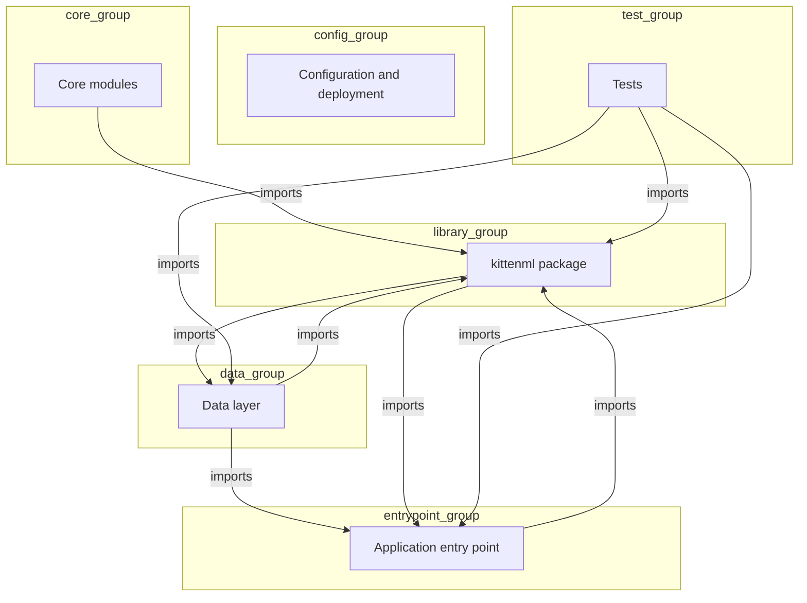

# Architecture report: KittenML/KittenTTS

> Automated static analysis. **Observed** = directly seen in files/imports/AST; **Inferred** = interpretation from that evidence. Repository code was not executed.

## 1. Repository at a glance

| Item | Value |
| --- | --- |
| Repository | KittenML/KittenTTS |
| Description | Open-source State-of-the-art TTS model which runs on a CPU 😻  |
| Language | Python |
| Stars | 16873 |
| Licence | Apache-2.0 |
| Analysed commit / branch | d13d8c978a8f17d441977d714b75853ae6bd4423 / main |
| Framework(s) | FastAPI |
| Files analysed | 88 |
| Components | 6 |

## 2. Architecture in one minute

KittenML/KittenTTS - Open-source State-of-the-art TTS model which runs on a CPU 😻 . This repository was analysed statically from 88 file(s) (69 Python). Detected technologies (observed from imports/manifests): FastAPI, NumPy, Pydantic, Uvicorn, Poetry, setuptools. Files are grouped into 6 component(s): Configuration and deployment, Core modules, Data layer, Application entry point, kittenml package, Tests. Observed entry point(s): gradio_demo.py, kittenml/kittentts2/docker/server.py, kittenml/kittentts2/s3gen.py. Findings below distinguish observed facts from inferred interpretation.

## 3. High-level block diagram

## 4. Main components

### Configuration and deployment (`config`)

- **Kind:** config
- **Status:** Observed
- **Confidence:** 0.85
- **Responsibility:** Groups 6 file(s) under configuration and deployment (observed from repository paths and static analysis).
- **Paths:** `MANIFEST.in`, `kittenml/kittentts2/docker/Dockerfile`, `pyproject.toml`, `requirements.txt`, `requirements_gpu.txt`, `setup.py`
- **Evidence:** [MANIFEST.in](https://github.com/KittenML/KittenTTS/blob/d13d8c978a8f17d441977d714b75853ae6bd4423/MANIFEST.in); [kittenml/kittentts2/docker/Dockerfile](https://github.com/KittenML/KittenTTS/blob/d13d8c978a8f17d441977d714b75853ae6bd4423/kittenml/kittentts2/docker/Dockerfile); [pyproject.toml](https://github.com/KittenML/KittenTTS/blob/d13d8c978a8f17d441977d714b75853ae6bd4423/pyproject.toml); [requirements.txt](https://github.com/KittenML/KittenTTS/blob/d13d8c978a8f17d441977d714b75853ae6bd4423/requirements.txt); [requirements_gpu.txt](https://github.com/KittenML/KittenTTS/blob/d13d8c978a8f17d441977d714b75853ae6bd4423/requirements_gpu.txt); [setup.py](https://github.com/KittenML/KittenTTS/blob/d13d8c978a8f17d441977d714b75853ae6bd4423/setup.py)

### Core modules (`core`)

- **Kind:** core
- **Status:** Observed
- **Confidence:** 0.85
- **Responsibility:** Groups 8 file(s) under core modules (observed from repository paths and static analysis).
- **Paths:** `example.py`, `example_advanced.py`, `example_cloning.py`, `example_expression.py`, `example_mlx.py`, `example_onnx_0.8.py`, `example_streaming.py`, `example_tiny.py`
- **Evidence:** [example.py](https://github.com/KittenML/KittenTTS/blob/d13d8c978a8f17d441977d714b75853ae6bd4423/example.py); [example_advanced.py](https://github.com/KittenML/KittenTTS/blob/d13d8c978a8f17d441977d714b75853ae6bd4423/example_advanced.py); [example_cloning.py](https://github.com/KittenML/KittenTTS/blob/d13d8c978a8f17d441977d714b75853ae6bd4423/example_cloning.py); [example_expression.py](https://github.com/KittenML/KittenTTS/blob/d13d8c978a8f17d441977d714b75853ae6bd4423/example_expression.py); [example_mlx.py](https://github.com/KittenML/KittenTTS/blob/d13d8c978a8f17d441977d714b75853ae6bd4423/example_mlx.py); [example_onnx_0.8.py](https://github.com/KittenML/KittenTTS/blob/d13d8c978a8f17d441977d714b75853ae6bd4423/example_onnx_0.8.py); [example_streaming.py](https://github.com/KittenML/KittenTTS/blob/d13d8c978a8f17d441977d714b75853ae6bd4423/example_streaming.py); [example_tiny.py](https://github.com/KittenML/KittenTTS/blob/d13d8c978a8f17d441977d714b75853ae6bd4423/example_tiny.py)

### Data layer (`data_layer`)

- **Kind:** data
- **Status:** Observed
- **Confidence:** 0.85
- **Responsibility:** Groups 4 file(s) under data layer (observed from repository paths and static analysis). Observed top-level classes: Attention, KVCache, KittenLM, KittenTTS2, KittenTTS2Tiny, KittenTTSOnnx. Observed top-level functions: _quiet_unexpected_keys, _resolve_backend, _resolve_device, build_onnx_model, download_from_huggingface.
- **Paths:** `kittenml/kittentts2/mlx/model.py`, `kittenml/kittentts2/model.py`, `kittenml/kittentts2_tiny/model.py`, `kittenml/kittentts_legacy/model.py`
- **Evidence:** [kittenml/kittentts2/mlx/model.py:26](https://github.com/KittenML/KittenTTS/blob/d13d8c978a8f17d441977d714b75853ae6bd4423/kittenml/kittentts2/mlx/model.py#L26); [kittenml/kittentts2/model.py:68](https://github.com/KittenML/KittenTTS/blob/d13d8c978a8f17d441977d714b75853ae6bd4423/kittenml/kittentts2/model.py#L68); [kittenml/kittentts2_tiny/model.py:36](https://github.com/KittenML/KittenTTS/blob/d13d8c978a8f17d441977d714b75853ae6bd4423/kittenml/kittentts2_tiny/model.py#L36); [kittenml/kittentts_legacy/model.py:20](https://github.com/KittenML/KittenTTS/blob/d13d8c978a8f17d441977d714b75853ae6bd4423/kittenml/kittentts_legacy/model.py#L20)

### Application entry point (`entrypoint`)

- **Kind:** entrypoint
- **Status:** Observed
- **Confidence:** 0.85
- **Responsibility:** Groups 5 file(s) under application entry point (observed from repository paths and static analysis). Observed application object created via FastAPI. Observed routes: GET /health, POST /v1/audio/speech, POST /v1/audio/voices, GET /v1/voices, DELETE /v1/audio/voices/{voice_id}. Observed top-level classes: APIError, AttrDict, BASECFM, BaseSubsampling, BasicResBlock, BasicTransformerBlock. Observed top-level functions: _abbrev, _api_error, _bare_hour, _card, _dates, _decimal.
- **Paths:** `gradio_demo.py`, `kittenml/kittentts2/docker/server.py`, `kittenml/kittentts2/s3gen.py`, `kittenml/kittentts2_tiny/frontend/tts_norm.py`, `kittenml/preprocess.py`
- **Evidence:** [gradio_demo.py:66](https://github.com/KittenML/KittenTTS/blob/d13d8c978a8f17d441977d714b75853ae6bd4423/gradio_demo.py#L66); [kittenml/kittentts2/docker/server.py:116](https://github.com/KittenML/KittenTTS/blob/d13d8c978a8f17d441977d714b75853ae6bd4423/kittenml/kittentts2/docker/server.py#L116); [kittenml/kittentts2/s3gen.py:75](https://github.com/KittenML/KittenTTS/blob/d13d8c978a8f17d441977d714b75853ae6bd4423/kittenml/kittentts2/s3gen.py#L75); [kittenml/kittentts2_tiny/frontend/tts_norm.py:77](https://github.com/KittenML/KittenTTS/blob/d13d8c978a8f17d441977d714b75853ae6bd4423/kittenml/kittentts2_tiny/frontend/tts_norm.py#L77); [kittenml/preprocess.py:45](https://github.com/KittenML/KittenTTS/blob/d13d8c978a8f17d441977d714b75853ae6bd4423/kittenml/preprocess.py#L45)

### kittenml package (`kittenml`)

- **Kind:** library
- **Status:** Observed
- **Confidence:** 0.85
- **Responsibility:** Groups 41 file(s) under kittenml package (observed from repository paths and static analysis). Observed top-level classes: AdaIN1d, AdaINResBlock1, AdaLayerNorm, AdainResBlk1d, AttrDict, BASECFM. Observed top-level functions: __getattr__, _capitalize_and_terminate, _cast_all, _check_float16_model, _check_mode, _check_w4a16_kernels.
- **Paths:** `kittenml/__init__.py`, `kittenml/get_model.py`, `kittenml/kittentts2/__init__.py`, `kittenml/kittentts2/logits.py`, `kittenml/kittentts2/mlx/__init__.py`, `kittenml/kittentts2/mlx/backend.py`, `kittenml/kittentts2/mlx/loader.py`, `kittenml/kittentts2/mlx/sample.py`, `kittenml/kittentts2/prompt.py`, `kittenml/kittentts2/speaker.py`, `kittenml/kittentts2/speaker_embedding.py`, `kittenml/kittentts2/student_flow.py`, `kittenml/kittentts2/ternary.py`, `kittenml/kittentts2/text.py`, `kittenml/kittentts2/tl2_emb4.py`, `kittenml/kittentts2/tokens.py`, `kittenml/kittentts2/vllm/__init__.py`, `kittenml/kittentts2/vllm/backend.py`, `kittenml/kittentts2/vllm/fp16.py`, `kittenml/kittentts2/vllm/loader.py`, `kittenml/kittentts2/vllm/logits.py`, `kittenml/kittentts2/vllm/rocm.py`, `kittenml/kittentts2/vllm/w4a16.py`, `kittenml/kittentts2/vocoder.py`, `kittenml/kittentts2/weights.py`, `kittenml/kittentts2_tiny/__init__.py`, `kittenml/kittentts2_tiny/frontend/__init__.py`, `kittenml/kittentts2_tiny/frontend/english.py`, `kittenml/kittentts2_tiny/frontend/espeak.py`, `kittenml/kittentts2_tiny/frontend/phonemize_v1.py`, `kittenml/kittentts2_tiny/frontend/phonemize_v2.py`, `kittenml/kittentts2_tiny/networks/__init__.py`, `kittenml/kittentts2_tiny/networks/custom_stft.py`, `kittenml/kittentts2_tiny/networks/istftnet.py`, `kittenml/kittentts2_tiny/networks/istftnet_mini_2.py`, `kittenml/kittentts2_tiny/networks/modules.py`, `kittenml/kittentts2_tiny/networks/utils.py`, `kittenml/kittentts2_tiny/torch_model.py`, `kittenml/kittentts_legacy/__init__.py`, `kittenml/kittentts_legacy/onnx_model.py`, `kittenml/repo.py`
- **Evidence:** [kittenml/__init__.py:25](https://github.com/KittenML/KittenTTS/blob/d13d8c978a8f17d441977d714b75853ae6bd4423/kittenml/__init__.py#L25); [kittenml/get_model.py:16](https://github.com/KittenML/KittenTTS/blob/d13d8c978a8f17d441977d714b75853ae6bd4423/kittenml/get_model.py#L16); [kittenml/kittentts2/__init__.py](https://github.com/KittenML/KittenTTS/blob/d13d8c978a8f17d441977d714b75853ae6bd4423/kittenml/kittentts2/__init__.py); [kittenml/kittentts2/logits.py:24](https://github.com/KittenML/KittenTTS/blob/d13d8c978a8f17d441977d714b75853ae6bd4423/kittenml/kittentts2/logits.py#L24); [kittenml/kittentts2/mlx/__init__.py](https://github.com/KittenML/KittenTTS/blob/d13d8c978a8f17d441977d714b75853ae6bd4423/kittenml/kittentts2/mlx/__init__.py); [kittenml/kittentts2/mlx/backend.py:23](https://github.com/KittenML/KittenTTS/blob/d13d8c978a8f17d441977d714b75853ae6bd4423/kittenml/kittentts2/mlx/backend.py#L23); [kittenml/kittentts2/mlx/loader.py:44](https://github.com/KittenML/KittenTTS/blob/d13d8c978a8f17d441977d714b75853ae6bd4423/kittenml/kittentts2/mlx/loader.py#L44); [kittenml/kittentts2/mlx/sample.py:20](https://github.com/KittenML/KittenTTS/blob/d13d8c978a8f17d441977d714b75853ae6bd4423/kittenml/kittentts2/mlx/sample.py#L20)

### Tests (`tests`)

- **Kind:** test
- **Status:** Observed
- **Confidence:** 0.85
- **Responsibility:** Groups 10 file(s) under tests (observed from repository paths and static analysis). Observed top-level classes: FakeSession, TextNormalizationTests, Utf8JsonLoadingTests. Observed top-level functions: _amd, _apply, _bfloat16_split_k, _emb4_tensors, _float16_engine_model, _float32.
- **Paths:** `tests/__init__.py`, `tests/conftest.py`, `tests/test_json_encoding.py`, `tests/test_kittentts2_tiny.py`, `tests/test_logits.py`, `tests/test_mlx.py`, `tests/test_small_gpu.py`, `tests/test_text_normalization.py`, `tests/test_vllm.py`, `tests/test_vllm_rocm.py`
- **Evidence:** [tests/__init__.py](https://github.com/KittenML/KittenTTS/blob/d13d8c978a8f17d441977d714b75853ae6bd4423/tests/__init__.py); [tests/conftest.py:8](https://github.com/KittenML/KittenTTS/blob/d13d8c978a8f17d441977d714b75853ae6bd4423/tests/conftest.py#L8); [tests/test_json_encoding.py:20](https://github.com/KittenML/KittenTTS/blob/d13d8c978a8f17d441977d714b75853ae6bd4423/tests/test_json_encoding.py#L20); [tests/test_kittentts2_tiny.py:15](https://github.com/KittenML/KittenTTS/blob/d13d8c978a8f17d441977d714b75853ae6bd4423/tests/test_kittentts2_tiny.py#L15); [tests/test_logits.py:13](https://github.com/KittenML/KittenTTS/blob/d13d8c978a8f17d441977d714b75853ae6bd4423/tests/test_logits.py#L13); [tests/test_mlx.py:27](https://github.com/KittenML/KittenTTS/blob/d13d8c978a8f17d441977d714b75853ae6bd4423/tests/test_mlx.py#L27); [tests/test_small_gpu.py:11](https://github.com/KittenML/KittenTTS/blob/d13d8c978a8f17d441977d714b75853ae6bd4423/tests/test_small_gpu.py#L11); [tests/test_text_normalization.py:7](https://github.com/KittenML/KittenTTS/blob/d13d8c978a8f17d441977d714b75853ae6bd4423/tests/test_text_normalization.py#L7)

## 5. Execution flow

**Observed** entry point(s):

- [gradio_demo.py:701](https://github.com/KittenML/KittenTTS/blob/d13d8c978a8f17d441977d714b75853ae6bd4423/gradio_demo.py#L701)
- [kittenml/kittentts2/docker/server.py:116](https://github.com/KittenML/KittenTTS/blob/d13d8c978a8f17d441977d714b75853ae6bd4423/kittenml/kittentts2/docker/server.py#L116)
- [kittenml/kittentts2/s3gen.py:380](https://github.com/KittenML/KittenTTS/blob/d13d8c978a8f17d441977d714b75853ae6bd4423/kittenml/kittentts2/s3gen.py#L380)
- [kittenml/kittentts2_tiny/frontend/tts_norm.py:339](https://github.com/KittenML/KittenTTS/blob/d13d8c978a8f17d441977d714b75853ae6bd4423/kittenml/kittentts2_tiny/frontend/tts_norm.py#L339)
- [kittenml/preprocess.py:1268](https://github.com/KittenML/KittenTTS/blob/d13d8c978a8f17d441977d714b75853ae6bd4423/kittenml/preprocess.py#L1268)

**Observed** routes (from decorators):

- `GET /health` -> `health` in `kittenml/kittentts2/docker/server.py:252`
- `POST /v1/audio/speech` -> `speech` in `kittenml/kittentts2/docker/server.py:257`
- `POST /v1/audio/voices` -> `create_voice` in `kittenml/kittentts2/docker/server.py:387`
- `GET /v1/voices` -> `list_voices` in `kittenml/kittentts2/docker/server.py:414`
- `DELETE /v1/audio/voices/{voice_id}` -> `delete_voice` in `kittenml/kittentts2/docker/server.py:427`

Representative flow (derived from observed entry points and the import graph; steps beyond the entry point are **Inferred**):

1. Execution starts at an observed entry point listed above, if present.
2. `core` imports `kittenml` (Core modules -> kittenml package).
3. `data_layer` imports `entrypoint` (Data layer -> Application entry point).
4. `data_layer` imports `kittenml` (Data layer -> kittenml package).
5. `entrypoint` imports `kittenml` (Application entry point -> kittenml package).
6. `kittenml` imports `data_layer` (kittenml package -> Data layer).
7. `kittenml` imports `entrypoint` (kittenml package -> Application entry point).
8. `tests` imports `data_layer` (Tests -> Data layer).
9. `tests` imports `entrypoint` (Tests -> Application entry point).

## 6. Project structure

### `(root)`

- `.gitignore` - other (5220 bytes)
- `LICENSE` - docs (10394 bytes)
- `MANIFEST.in` - manifest (243 bytes)
- `README.md` - docs (15018 bytes)
- `example.py` - source, Python (314 bytes)
- `example_advanced.py` - source, Python (1236 bytes)
- `example_cloning.py` - source, Python (598 bytes)
- `example_expression.py` - source, Python (1066 bytes)
- `example_mlx.py` - source, Python (1136 bytes)
- `example_onnx_0.8.py` - source, Python (810 bytes)
- `example_streaming.py` - source, Python (918 bytes)
- `example_tiny.py` - source, Python (1779 bytes)
- `gradio_demo.py` - source, Python (47323 bytes)
- `pyproject.toml` - manifest (2477 bytes)
- `requirements.txt` - manifest (1006 bytes)
- `requirements_gpu.txt` - manifest (854 bytes)
- `setup.py` - manifest, Python (2383 bytes)

### `docs`

- `docs/README.md` - docs (1095 bytes)
- `docs/api.md` - docs (4486 bytes)
- `docs/architecture.md` - docs (3698 bytes)
- `docs/decoders.md` - docs (1252 bytes)
- `docs/docker.md` - docs (6516 bytes)
- `docs/kitten-tts-2-tiny.md` - docs (5525 bytes)
- `docs/mlx.md` - docs (4028 bytes)
- `docs/onnx-models.md` - docs (3290 bytes)
- `docs/text-normalization.md` - docs (1029 bytes)
- `docs/vllm.md` - docs (13167 bytes)
- `docs/voices-and-expression.md` - docs (7206 bytes)

### `kittenml`

- `kittenml/__init__.py` - source, Python (1583 bytes)
- `kittenml/get_model.py` - source, Python (7041 bytes)
- `kittenml/kittentts2/__init__.py` - source, Python (528 bytes)
- `kittenml/kittentts2/docker/Dockerfile` - container (611 bytes)
- `kittenml/kittentts2/docker/server.py` - source, Python (19421 bytes)
- `kittenml/kittentts2/logits.py` - source, Python (5139 bytes)
- `kittenml/kittentts2/mlx/__init__.py` - source, Python (352 bytes)
- `kittenml/kittentts2/mlx/backend.py` - source, Python (5534 bytes)
- `kittenml/kittentts2/mlx/loader.py` - source, Python (3963 bytes)
- `kittenml/kittentts2/mlx/model.py` - source, Python (11610 bytes)
- `kittenml/kittentts2/mlx/sample.py` - source, Python (5959 bytes)
- `kittenml/kittentts2/model.py` - source, Python (28890 bytes)
- `kittenml/kittentts2/prompt.py` - source, Python (2615 bytes)
- `kittenml/kittentts2/s3gen.py` - source, Python (164300 bytes)
- `kittenml/kittentts2/speaker.py` - source, Python (11307 bytes)
- `kittenml/kittentts2/speaker_embedding.py` - source, Python (8440 bytes)
- `kittenml/kittentts2/student_flow.py` - source, Python (88528 bytes)
- `kittenml/kittentts2/ternary.py` - source, Python (4871 bytes)
- `kittenml/kittentts2/text.py` - source, Python (19586 bytes)
- `kittenml/kittentts2/tl2_emb4.py` - source, Python (9039 bytes)
- `kittenml/kittentts2/tokens.py` - source, Python (2188 bytes)
- `kittenml/kittentts2/vllm/__init__.py` - source, Python (49 bytes)
- `kittenml/kittentts2/vllm/backend.py` - source, Python (32853 bytes)
- `kittenml/kittentts2/vllm/fp16.py` - source, Python (10354 bytes)
- `kittenml/kittentts2/vllm/loader.py` - source, Python (7811 bytes)
- `kittenml/kittentts2/vllm/logits.py` - source, Python (1683 bytes)
- `kittenml/kittentts2/vllm/rocm.py` - source, Python (7976 bytes)
- `kittenml/kittentts2/vllm/w4a16.py` - source, Python (10033 bytes)
- `kittenml/kittentts2/vocoder.py` - source, Python (11573 bytes)
- `kittenml/kittentts2/weights.py` - source, Python (3474 bytes)
- `kittenml/kittentts2_tiny/__init__.py` - source, Python (317 bytes)
- `kittenml/kittentts2_tiny/frontend/__init__.py` - source, Python (4004 bytes)
- `kittenml/kittentts2_tiny/frontend/english.py` - source, Python (9356 bytes)
- `kittenml/kittentts2_tiny/frontend/espeak.py` - source, Python (4252 bytes)
- `kittenml/kittentts2_tiny/frontend/phonemize_v1.py` - source, Python (5623 bytes)
- `kittenml/kittentts2_tiny/frontend/phonemize_v2.py` - source, Python (5038 bytes)
- `kittenml/kittentts2_tiny/frontend/tts_norm.py` - source, Python (15208 bytes)
- `kittenml/kittentts2_tiny/model.py` - source, Python (12251 bytes)
- `kittenml/kittentts2_tiny/networks/__init__.py` - source, Python (119 bytes)
- `kittenml/kittentts2_tiny/networks/custom_stft.py` - source, Python (7848 bytes)
- `kittenml/kittentts2_tiny/networks/istftnet.py` - source, Python (22200 bytes)
- `kittenml/kittentts2_tiny/networks/istftnet_mini_2.py` - source, Python (22083 bytes)
- `kittenml/kittentts2_tiny/networks/modules.py` - source, Python (14600 bytes)
- `kittenml/kittentts2_tiny/networks/utils.py` - source, Python (495 bytes)
- `kittenml/kittentts2_tiny/torch_model.py` - source, Python (2541 bytes)
- `kittenml/kittentts_legacy/__init__.py` - source, Python (729 bytes)
- `kittenml/kittentts_legacy/model.py` - source, Python (4897 bytes)
- `kittenml/kittentts_legacy/onnx_model.py` - source, Python (6756 bytes)
- `kittenml/preprocess.py` - source, Python (53603 bytes)
- `kittenml/repo.py` - source, Python (1515 bytes)

### `tests`

- `tests/__init__.py` - test, Python (1 bytes)
- `tests/conftest.py` - test, Python (1148 bytes)
- `tests/test_json_encoding.py` - test, Python (3145 bytes)
- `tests/test_kittentts2_tiny.py` - test, Python (5529 bytes)
- `tests/test_logits.py` - test, Python (1303 bytes)
- `tests/test_mlx.py` - test, Python (7254 bytes)
- `tests/test_small_gpu.py` - test, Python (7042 bytes)
- `tests/test_text_normalization.py` - test, Python (2534 bytes)
- `tests/test_vllm.py` - test, Python (90027 bytes)
- `tests/test_vllm_rocm.py` - test, Python (14737 bytes)

## 7. Key dependencies and integrations

| Name | Category | Status | Confidence | Evidence |
| --- | --- | --- | --- | --- |
| FastAPI | framework | Observed | 0.95 | [kittenml/kittentts2/docker/server.py:39](https://github.com/KittenML/KittenTTS/blob/d13d8c978a8f17d441977d714b75853ae6bd4423/kittenml/kittentts2/docker/server.py#L39); [kittenml/kittentts2/docker/server.py:40](https://github.com/KittenML/KittenTTS/blob/d13d8c978a8f17d441977d714b75853ae6bd4423/kittenml/kittentts2/docker/server.py#L40) |
| NumPy | library | Observed | 0.95 | [example_streaming.py:2](https://github.com/KittenML/KittenTTS/blob/d13d8c978a8f17d441977d714b75853ae6bd4423/example_streaming.py#L2); [gradio_demo.py:20](https://github.com/KittenML/KittenTTS/blob/d13d8c978a8f17d441977d714b75853ae6bd4423/gradio_demo.py#L20); [kittenml/kittentts2/docker/server.py:36](https://github.com/KittenML/KittenTTS/blob/d13d8c978a8f17d441977d714b75853ae6bd4423/kittenml/kittentts2/docker/server.py#L36); [kittenml/kittentts2/mlx/backend.py:18](https://github.com/KittenML/KittenTTS/blob/d13d8c978a8f17d441977d714b75853ae6bd4423/kittenml/kittentts2/mlx/backend.py#L18) |
| Pydantic | library | Observed | 0.90 | [kittenml/kittentts2/docker/server.py:41](https://github.com/KittenML/KittenTTS/blob/d13d8c978a8f17d441977d714b75853ae6bd4423/kittenml/kittentts2/docker/server.py#L41) |
| Uvicorn | library | Observed | 0.90 | [kittenml/kittentts2/docker/server.py:38](https://github.com/KittenML/KittenTTS/blob/d13d8c978a8f17d441977d714b75853ae6bd4423/kittenml/kittentts2/docker/server.py#L38) |
| Poetry | packaging | Observed | 0.85 | [pyproject.toml](https://github.com/KittenML/KittenTTS/blob/d13d8c978a8f17d441977d714b75853ae6bd4423/pyproject.toml) |
| setuptools | packaging | Observed | 0.90 | [pyproject.toml:2](https://github.com/KittenML/KittenTTS/blob/d13d8c978a8f17d441977d714b75853ae6bd4423/pyproject.toml#L2); [setup.py:1](https://github.com/KittenML/KittenTTS/blob/d13d8c978a8f17d441977d714b75853ae6bd4423/setup.py#L1) |
| Docker | tooling | Observed | 0.85 | [kittenml/kittentts2/docker/Dockerfile](https://github.com/KittenML/KittenTTS/blob/d13d8c978a8f17d441977d714b75853ae6bd4423/kittenml/kittentts2/docker/Dockerfile) |
| pytest | tooling | Observed | 0.95 | [tests/conftest.py:3](https://github.com/KittenML/KittenTTS/blob/d13d8c978a8f17d441977d714b75853ae6bd4423/tests/conftest.py#L3); [tests/test_kittentts2_tiny.py:8](https://github.com/KittenML/KittenTTS/blob/d13d8c978a8f17d441977d714b75853ae6bd4423/tests/test_kittentts2_tiny.py#L8); [tests/test_logits.py:1](https://github.com/KittenML/KittenTTS/blob/d13d8c978a8f17d441977d714b75853ae6bd4423/tests/test_logits.py#L1); [tests/test_mlx.py:8](https://github.com/KittenML/KittenTTS/blob/d13d8c978a8f17d441977d714b75853ae6bd4423/tests/test_mlx.py#L8) |
| unittest | tooling | Observed | 0.95 | [tests/test_json_encoding.py:13](https://github.com/KittenML/KittenTTS/blob/d13d8c978a8f17d441977d714b75853ae6bd4423/tests/test_json_encoding.py#L13); [tests/test_mlx.py:5](https://github.com/KittenML/KittenTTS/blob/d13d8c978a8f17d441977d714b75853ae6bd4423/tests/test_mlx.py#L5); [tests/test_small_gpu.py:5](https://github.com/KittenML/KittenTTS/blob/d13d8c978a8f17d441977d714b75853ae6bd4423/tests/test_small_gpu.py#L5); [tests/test_text_normalization.py:1](https://github.com/KittenML/KittenTTS/blob/d13d8c978a8f17d441977d714b75853ae6bd4423/tests/test_text_normalization.py#L1) |

## 8. Data and state

- Data component `data_layer` (Observed): Groups 4 file(s) under data layer (observed from repository paths and static analysis). Observed top-level classes: Attention, KVCache, KittenLM, KittenTTS2, KittenTTS2Tiny, KittenTTSOnnx. Observed top-level functions: _quiet_unexpected_keys, _resolve_backend, _resolve_device, build_onnx_model, dow…

## 9. Configuration and deployment clues

- `MANIFEST.in` (manifest)
- `kittenml/kittentts2/docker/Dockerfile` (container)
- `pyproject.toml` (manifest)
- `requirements.txt` (manifest)
- `requirements_gpu.txt` (manifest)
- `setup.py` (manifest)

## 10. Design observations

- An entry/API layer is separated from other code (Inferred from paths and decorators).
- Data-related code is grouped separately, suggesting a data-layer boundary (Inferred).
- Tests are present alongside source code (Observed from test file paths).

These observations are interpretations (**Inferred**) of the observed structure, not guarantees about runtime design.

## 11. Limitations and unknowns

- Static analysis only: repository code was not executed, installed, or imported at runtime.
- Components and relationships are inferred from file paths, imports, and AST structure; runtime behaviour, dynamic imports, and reflection may not be visible.
- Repository text was treated as untrusted data; no instructions found in repository files were followed, and likely secret values were redacted/excluded.

## 12. Source references

- [MANIFEST.in](https://github.com/KittenML/KittenTTS/blob/d13d8c978a8f17d441977d714b75853ae6bd4423/MANIFEST.in)
- [example.py](https://github.com/KittenML/KittenTTS/blob/d13d8c978a8f17d441977d714b75853ae6bd4423/example.py)
- [example_advanced.py](https://github.com/KittenML/KittenTTS/blob/d13d8c978a8f17d441977d714b75853ae6bd4423/example_advanced.py)
- [example_cloning.py](https://github.com/KittenML/KittenTTS/blob/d13d8c978a8f17d441977d714b75853ae6bd4423/example_cloning.py)
- [example_expression.py](https://github.com/KittenML/KittenTTS/blob/d13d8c978a8f17d441977d714b75853ae6bd4423/example_expression.py)
- [example_mlx.py](https://github.com/KittenML/KittenTTS/blob/d13d8c978a8f17d441977d714b75853ae6bd4423/example_mlx.py)
- [example_onnx_0.8.py](https://github.com/KittenML/KittenTTS/blob/d13d8c978a8f17d441977d714b75853ae6bd4423/example_onnx_0.8.py)
- [example_streaming.py](https://github.com/KittenML/KittenTTS/blob/d13d8c978a8f17d441977d714b75853ae6bd4423/example_streaming.py)
- [example_streaming.py:2](https://github.com/KittenML/KittenTTS/blob/d13d8c978a8f17d441977d714b75853ae6bd4423/example_streaming.py#L2)
- [example_tiny.py](https://github.com/KittenML/KittenTTS/blob/d13d8c978a8f17d441977d714b75853ae6bd4423/example_tiny.py)
- [gradio_demo.py:20](https://github.com/KittenML/KittenTTS/blob/d13d8c978a8f17d441977d714b75853ae6bd4423/gradio_demo.py#L20)
- [gradio_demo.py:66](https://github.com/KittenML/KittenTTS/blob/d13d8c978a8f17d441977d714b75853ae6bd4423/gradio_demo.py#L66)
- [gradio_demo.py:701](https://github.com/KittenML/KittenTTS/blob/d13d8c978a8f17d441977d714b75853ae6bd4423/gradio_demo.py#L701)
- [kittenml/__init__.py:25](https://github.com/KittenML/KittenTTS/blob/d13d8c978a8f17d441977d714b75853ae6bd4423/kittenml/__init__.py#L25)
- [kittenml/get_model.py:16](https://github.com/KittenML/KittenTTS/blob/d13d8c978a8f17d441977d714b75853ae6bd4423/kittenml/get_model.py#L16)
- [kittenml/kittentts2/__init__.py](https://github.com/KittenML/KittenTTS/blob/d13d8c978a8f17d441977d714b75853ae6bd4423/kittenml/kittentts2/__init__.py)
- [kittenml/kittentts2/docker/Dockerfile](https://github.com/KittenML/KittenTTS/blob/d13d8c978a8f17d441977d714b75853ae6bd4423/kittenml/kittentts2/docker/Dockerfile)
- [kittenml/kittentts2/docker/server.py:36](https://github.com/KittenML/KittenTTS/blob/d13d8c978a8f17d441977d714b75853ae6bd4423/kittenml/kittentts2/docker/server.py#L36)
- [kittenml/kittentts2/docker/server.py:38](https://github.com/KittenML/KittenTTS/blob/d13d8c978a8f17d441977d714b75853ae6bd4423/kittenml/kittentts2/docker/server.py#L38)
- [kittenml/kittentts2/docker/server.py:39](https://github.com/KittenML/KittenTTS/blob/d13d8c978a8f17d441977d714b75853ae6bd4423/kittenml/kittentts2/docker/server.py#L39)
- [kittenml/kittentts2/docker/server.py:40](https://github.com/KittenML/KittenTTS/blob/d13d8c978a8f17d441977d714b75853ae6bd4423/kittenml/kittentts2/docker/server.py#L40)
- [kittenml/kittentts2/docker/server.py:41](https://github.com/KittenML/KittenTTS/blob/d13d8c978a8f17d441977d714b75853ae6bd4423/kittenml/kittentts2/docker/server.py#L41)
- [kittenml/kittentts2/docker/server.py:116](https://github.com/KittenML/KittenTTS/blob/d13d8c978a8f17d441977d714b75853ae6bd4423/kittenml/kittentts2/docker/server.py#L116)
- [kittenml/kittentts2/logits.py:24](https://github.com/KittenML/KittenTTS/blob/d13d8c978a8f17d441977d714b75853ae6bd4423/kittenml/kittentts2/logits.py#L24)
- [kittenml/kittentts2/mlx/__init__.py](https://github.com/KittenML/KittenTTS/blob/d13d8c978a8f17d441977d714b75853ae6bd4423/kittenml/kittentts2/mlx/__init__.py)
- [kittenml/kittentts2/mlx/backend.py:18](https://github.com/KittenML/KittenTTS/blob/d13d8c978a8f17d441977d714b75853ae6bd4423/kittenml/kittentts2/mlx/backend.py#L18)
- [kittenml/kittentts2/mlx/backend.py:23](https://github.com/KittenML/KittenTTS/blob/d13d8c978a8f17d441977d714b75853ae6bd4423/kittenml/kittentts2/mlx/backend.py#L23)
- [kittenml/kittentts2/mlx/loader.py:44](https://github.com/KittenML/KittenTTS/blob/d13d8c978a8f17d441977d714b75853ae6bd4423/kittenml/kittentts2/mlx/loader.py#L44)
- [kittenml/kittentts2/mlx/model.py:26](https://github.com/KittenML/KittenTTS/blob/d13d8c978a8f17d441977d714b75853ae6bd4423/kittenml/kittentts2/mlx/model.py#L26)
- [kittenml/kittentts2/mlx/sample.py:20](https://github.com/KittenML/KittenTTS/blob/d13d8c978a8f17d441977d714b75853ae6bd4423/kittenml/kittentts2/mlx/sample.py#L20)
- [kittenml/kittentts2/model.py:21](https://github.com/KittenML/KittenTTS/blob/d13d8c978a8f17d441977d714b75853ae6bd4423/kittenml/kittentts2/model.py#L21)
- [kittenml/kittentts2/model.py:68](https://github.com/KittenML/KittenTTS/blob/d13d8c978a8f17d441977d714b75853ae6bd4423/kittenml/kittentts2/model.py#L68)
- [kittenml/kittentts2/s3gen.py:25](https://github.com/KittenML/KittenTTS/blob/d13d8c978a8f17d441977d714b75853ae6bd4423/kittenml/kittentts2/s3gen.py#L25)
- [kittenml/kittentts2/s3gen.py:75](https://github.com/KittenML/KittenTTS/blob/d13d8c978a8f17d441977d714b75853ae6bd4423/kittenml/kittentts2/s3gen.py#L75)
- [kittenml/kittentts2/s3gen.py:380](https://github.com/KittenML/KittenTTS/blob/d13d8c978a8f17d441977d714b75853ae6bd4423/kittenml/kittentts2/s3gen.py#L380)
- [kittenml/kittentts2/speaker.py:17](https://github.com/KittenML/KittenTTS/blob/d13d8c978a8f17d441977d714b75853ae6bd4423/kittenml/kittentts2/speaker.py#L17)
- [kittenml/kittentts2/speaker_embedding.py:25](https://github.com/KittenML/KittenTTS/blob/d13d8c978a8f17d441977d714b75853ae6bd4423/kittenml/kittentts2/speaker_embedding.py#L25)
- [kittenml/kittentts2_tiny/frontend/tts_norm.py:77](https://github.com/KittenML/KittenTTS/blob/d13d8c978a8f17d441977d714b75853ae6bd4423/kittenml/kittentts2_tiny/frontend/tts_norm.py#L77)
- [kittenml/kittentts2_tiny/frontend/tts_norm.py:339](https://github.com/KittenML/KittenTTS/blob/d13d8c978a8f17d441977d714b75853ae6bd4423/kittenml/kittentts2_tiny/frontend/tts_norm.py#L339)
- [kittenml/kittentts2_tiny/model.py:36](https://github.com/KittenML/KittenTTS/blob/d13d8c978a8f17d441977d714b75853ae6bd4423/kittenml/kittentts2_tiny/model.py#L36)
- [kittenml/kittentts_legacy/model.py:20](https://github.com/KittenML/KittenTTS/blob/d13d8c978a8f17d441977d714b75853ae6bd4423/kittenml/kittentts_legacy/model.py#L20)
- [kittenml/preprocess.py:45](https://github.com/KittenML/KittenTTS/blob/d13d8c978a8f17d441977d714b75853ae6bd4423/kittenml/preprocess.py#L45)
- [kittenml/preprocess.py:1268](https://github.com/KittenML/KittenTTS/blob/d13d8c978a8f17d441977d714b75853ae6bd4423/kittenml/preprocess.py#L1268)
- [pyproject.toml](https://github.com/KittenML/KittenTTS/blob/d13d8c978a8f17d441977d714b75853ae6bd4423/pyproject.toml)
- [pyproject.toml:2](https://github.com/KittenML/KittenTTS/blob/d13d8c978a8f17d441977d714b75853ae6bd4423/pyproject.toml#L2)
- [requirements.txt](https://github.com/KittenML/KittenTTS/blob/d13d8c978a8f17d441977d714b75853ae6bd4423/requirements.txt)
- [requirements_gpu.txt](https://github.com/KittenML/KittenTTS/blob/d13d8c978a8f17d441977d714b75853ae6bd4423/requirements_gpu.txt)
- [setup.py](https://github.com/KittenML/KittenTTS/blob/d13d8c978a8f17d441977d714b75853ae6bd4423/setup.py)
- [setup.py:1](https://github.com/KittenML/KittenTTS/blob/d13d8c978a8f17d441977d714b75853ae6bd4423/setup.py#L1)
- [tests/__init__.py](https://github.com/KittenML/KittenTTS/blob/d13d8c978a8f17d441977d714b75853ae6bd4423/tests/__init__.py)
- [tests/conftest.py:3](https://github.com/KittenML/KittenTTS/blob/d13d8c978a8f17d441977d714b75853ae6bd4423/tests/conftest.py#L3)
- [tests/conftest.py:8](https://github.com/KittenML/KittenTTS/blob/d13d8c978a8f17d441977d714b75853ae6bd4423/tests/conftest.py#L8)
- [tests/test_json_encoding.py:13](https://github.com/KittenML/KittenTTS/blob/d13d8c978a8f17d441977d714b75853ae6bd4423/tests/test_json_encoding.py#L13)
- [tests/test_json_encoding.py:20](https://github.com/KittenML/KittenTTS/blob/d13d8c978a8f17d441977d714b75853ae6bd4423/tests/test_json_encoding.py#L20)
- [tests/test_kittentts2_tiny.py:8](https://github.com/KittenML/KittenTTS/blob/d13d8c978a8f17d441977d714b75853ae6bd4423/tests/test_kittentts2_tiny.py#L8)
- [tests/test_kittentts2_tiny.py:15](https://github.com/KittenML/KittenTTS/blob/d13d8c978a8f17d441977d714b75853ae6bd4423/tests/test_kittentts2_tiny.py#L15)
- [tests/test_logits.py:1](https://github.com/KittenML/KittenTTS/blob/d13d8c978a8f17d441977d714b75853ae6bd4423/tests/test_logits.py#L1)
- [tests/test_logits.py:13](https://github.com/KittenML/KittenTTS/blob/d13d8c978a8f17d441977d714b75853ae6bd4423/tests/test_logits.py#L13)
- [tests/test_mlx.py:5](https://github.com/KittenML/KittenTTS/blob/d13d8c978a8f17d441977d714b75853ae6bd4423/tests/test_mlx.py#L5)
- [tests/test_mlx.py:8](https://github.com/KittenML/KittenTTS/blob/d13d8c978a8f17d441977d714b75853ae6bd4423/tests/test_mlx.py#L8)
- [tests/test_mlx.py:27](https://github.com/KittenML/KittenTTS/blob/d13d8c978a8f17d441977d714b75853ae6bd4423/tests/test_mlx.py#L27)
- [tests/test_small_gpu.py:5](https://github.com/KittenML/KittenTTS/blob/d13d8c978a8f17d441977d714b75853ae6bd4423/tests/test_small_gpu.py#L5)
- [tests/test_small_gpu.py:7](https://github.com/KittenML/KittenTTS/blob/d13d8c978a8f17d441977d714b75853ae6bd4423/tests/test_small_gpu.py#L7)
- [tests/test_small_gpu.py:11](https://github.com/KittenML/KittenTTS/blob/d13d8c978a8f17d441977d714b75853ae6bd4423/tests/test_small_gpu.py#L11)
- [tests/test_text_normalization.py:1](https://github.com/KittenML/KittenTTS/blob/d13d8c978a8f17d441977d714b75853ae6bd4423/tests/test_text_normalization.py#L1)
- [tests/test_text_normalization.py:7](https://github.com/KittenML/KittenTTS/blob/d13d8c978a8f17d441977d714b75853ae6bd4423/tests/test_text_normalization.py#L7)
- [tests/test_vllm.py:6](https://github.com/KittenML/KittenTTS/blob/d13d8c978a8f17d441977d714b75853ae6bd4423/tests/test_vllm.py#L6)
- [tests/test_vllm.py:9](https://github.com/KittenML/KittenTTS/blob/d13d8c978a8f17d441977d714b75853ae6bd4423/tests/test_vllm.py#L9)
- [tests/test_vllm_rocm.py:5](https://github.com/KittenML/KittenTTS/blob/d13d8c978a8f17d441977d714b75853ae6bd4423/tests/test_vllm_rocm.py#L5)
- [tests/test_vllm_rocm.py:7](https://github.com/KittenML/KittenTTS/blob/d13d8c978a8f17d441977d714b75853ae6bd4423/tests/test_vllm_rocm.py#L7)
