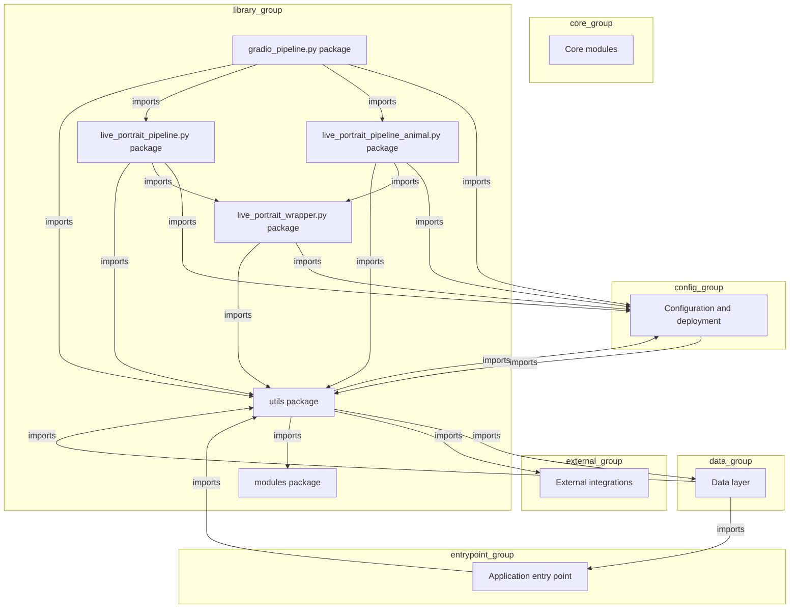

# Architecture report: KlingAIResearch/LivePortrait

> Automated static analysis. **Observed** = directly seen in files/imports/AST; **Inferred** = interpretation from that evidence. Repository code was not executed.

## 1. Repository at a glance

| Item | Value |
| --- | --- |
| Repository | KlingAIResearch/LivePortrait |
| Description | Bring portraits to life! |
| Language | Python |
| Stars | 19478 |
| Licence | Other |
| Analysed commit / branch | 9b294b3d0536135442ea73cb01e6cb3ca7029dd3 / main |
| Framework(s) | None detected |
| Files analysed | 129 |
| Components | 11 |

## 2. Architecture in one minute

KlingAIResearch/LivePortrait - Bring portraits to life!. This repository was analysed statically from 129 file(s) (93 Python). Detected technologies (observed from imports/manifests): NumPy, requests, setuptools. Files are grouped into 11 component(s): Configuration and deployment, Core modules, Data layer, Application entry point, External integrations, gradio_pipeline.py package, live_portrait_pipeline_animal.py package, live_portrait_pipeline.py package. Observed entry point(s): inference.py, inference_animals.py, speed.py. Findings below distinguish observed facts from inferred interpretation.

## 3. High-level block diagram

## 4. Main components

### Configuration and deployment (`config`)

- **Kind:** config
- **Status:** Observed
- **Confidence:** 0.85
- **Responsibility:** Groups 11 file(s) under configuration and deployment (observed from repository paths and static analysis). Observed top-level classes: ArgumentConfig, Config, ConfigDict, CropConfig, DictAction, InferenceConfig. Observed top-level functions: check_file_exist, get_extensions, load_lip_array, make_abs_path.
- **Paths:** `requirements.txt`, `requirements_base.txt`, `requirements_macOS.txt`, `src/config/__init__.py`, `src/config/argument_config.py`, `src/config/base_config.py`, `src/config/crop_config.py`, `src/config/inference_config.py`, `src/config/models.yaml`, `src/utils/dependencies/XPose/models/UniPose/ops/setup.py`, `src/utils/dependencies/XPose/util/config.py`
- **Evidence:** [requirements.txt](https://github.com/KlingAIResearch/LivePortrait/blob/9b294b3d0536135442ea73cb01e6cb3ca7029dd3/requirements.txt); [requirements_base.txt](https://github.com/KlingAIResearch/LivePortrait/blob/9b294b3d0536135442ea73cb01e6cb3ca7029dd3/requirements_base.txt); [requirements_macOS.txt](https://github.com/KlingAIResearch/LivePortrait/blob/9b294b3d0536135442ea73cb01e6cb3ca7029dd3/requirements_macOS.txt); [src/config/__init__.py](https://github.com/KlingAIResearch/LivePortrait/blob/9b294b3d0536135442ea73cb01e6cb3ca7029dd3/src/config/__init__.py); [src/config/argument_config.py:14](https://github.com/KlingAIResearch/LivePortrait/blob/9b294b3d0536135442ea73cb01e6cb3ca7029dd3/src/config/argument_config.py#L14); [src/config/base_config.py:12](https://github.com/KlingAIResearch/LivePortrait/blob/9b294b3d0536135442ea73cb01e6cb3ca7029dd3/src/config/base_config.py#L12); [src/config/crop_config.py:13](https://github.com/KlingAIResearch/LivePortrait/blob/9b294b3d0536135442ea73cb01e6cb3ca7029dd3/src/config/crop_config.py#L13); [src/config/inference_config.py:14](https://github.com/KlingAIResearch/LivePortrait/blob/9b294b3d0536135442ea73cb01e6cb3ca7029dd3/src/config/inference_config.py#L14)

### Core modules (`core`)

- **Kind:** core
- **Status:** Observed
- **Confidence:** 0.85
- **Responsibility:** Groups 1 file(s) under core modules (observed from repository paths and static analysis). Observed top-level functions: fast_check_ffmpeg, gpu_wrapped_execute_video, partial_fields.
- **Paths:** `app_animals.py`
- **Evidence:** [app_animals.py:19](https://github.com/KlingAIResearch/LivePortrait/blob/9b294b3d0536135442ea73cb01e6cb3ca7029dd3/app_animals.py#L19)

### Data layer (`data_layer`)

- **Kind:** data
- **Status:** Observed
- **Confidence:** 0.85
- **Responsibility:** Groups 27 file(s) under data layer (observed from repository paths and static analysis). Observed top-level classes: Backbone, BackboneBase, BiAttentionBlock, BiMultiHeadAttention, ContrastiveAssign, DeformableTransformer. Observed top-level functions: _get_activation_fn, _get_clones, _is_power_of_2, build_backbone, build_deforamble_transformer, build_deformable_transformer.
- **Paths:** `src/utils/dependencies/XPose/models/UniPose/__init__.py`, `src/utils/dependencies/XPose/models/UniPose/attention.py`, `src/utils/dependencies/XPose/models/UniPose/backbone.py`, `src/utils/dependencies/XPose/models/UniPose/deformable_transformer.py`, `src/utils/dependencies/XPose/models/UniPose/fuse_modules.py`, `src/utils/dependencies/XPose/models/UniPose/mask_generate.py`, `src/utils/dependencies/XPose/models/UniPose/ops/functions/__init__.py`, `src/utils/dependencies/XPose/models/UniPose/ops/functions/ms_deform_attn_func.py`, `src/utils/dependencies/XPose/models/UniPose/ops/modules/__init__.py`, `src/utils/dependencies/XPose/models/UniPose/ops/modules/ms_deform_attn.py`, `src/utils/dependencies/XPose/models/UniPose/ops/modules/ms_deform_attn_key_aware.py`, `src/utils/dependencies/XPose/models/UniPose/ops/src/cpu/ms_deform_attn_cpu.cpp`, `src/utils/dependencies/XPose/models/UniPose/ops/src/cpu/ms_deform_attn_cpu.h`, `src/utils/dependencies/XPose/models/UniPose/ops/src/cuda/ms_deform_attn_cuda.h`, `src/utils/dependencies/XPose/models/UniPose/ops/src/ms_deform_attn.h`, `src/utils/dependencies/XPose/models/UniPose/ops/src/vision.cpp`, `src/utils/dependencies/XPose/models/UniPose/position_encoding.py`, `src/utils/dependencies/XPose/models/UniPose/transformer_deformable.py`, `src/utils/dependencies/XPose/models/UniPose/transformer_vanilla.py`, `src/utils/dependencies/XPose/models/UniPose/unipose.py`, `src/utils/dependencies/XPose/models/UniPose/utils.py`, `src/utils/dependencies/XPose/models/__init__.py`, `src/utils/dependencies/XPose/models/registry.py`, `src/utils/dependencies/insightface/data/__init__.py`, `src/utils/dependencies/insightface/data/image.py`, `src/utils/dependencies/insightface/data/pickle_object.py`, `src/utils/dependencies/insightface/data/rec_builder.py`
- **Evidence:** [src/utils/dependencies/XPose/models/UniPose/__init__.py](https://github.com/KlingAIResearch/LivePortrait/blob/9b294b3d0536135442ea73cb01e6cb3ca7029dd3/src/utils/dependencies/XPose/models/UniPose/__init__.py); [src/utils/dependencies/XPose/models/UniPose/attention.py:39](https://github.com/KlingAIResearch/LivePortrait/blob/9b294b3d0536135442ea73cb01e6cb3ca7029dd3/src/utils/dependencies/XPose/models/UniPose/attention.py#L39); [src/utils/dependencies/XPose/models/UniPose/backbone.py:31](https://github.com/KlingAIResearch/LivePortrait/blob/9b294b3d0536135442ea73cb01e6cb3ca7029dd3/src/utils/dependencies/XPose/models/UniPose/backbone.py#L31); [src/utils/dependencies/XPose/models/UniPose/deformable_transformer.py:33](https://github.com/KlingAIResearch/LivePortrait/blob/9b294b3d0536135442ea73cb01e6cb3ca7029dd3/src/utils/dependencies/XPose/models/UniPose/deformable_transformer.py#L33); [src/utils/dependencies/XPose/models/UniPose/fuse_modules.py:8](https://github.com/KlingAIResearch/LivePortrait/blob/9b294b3d0536135442ea73cb01e6cb3ca7029dd3/src/utils/dependencies/XPose/models/UniPose/fuse_modules.py#L8); [src/utils/dependencies/XPose/models/UniPose/mask_generate.py:4](https://github.com/KlingAIResearch/LivePortrait/blob/9b294b3d0536135442ea73cb01e6cb3ca7029dd3/src/utils/dependencies/XPose/models/UniPose/mask_generate.py#L4); [src/utils/dependencies/XPose/models/UniPose/ops/functions/__init__.py](https://github.com/KlingAIResearch/LivePortrait/blob/9b294b3d0536135442ea73cb01e6cb3ca7029dd3/src/utils/dependencies/XPose/models/UniPose/ops/functions/__init__.py); [src/utils/dependencies/XPose/models/UniPose/ops/functions/ms_deform_attn_func.py:21](https://github.com/KlingAIResearch/LivePortrait/blob/9b294b3d0536135442ea73cb01e6cb3ca7029dd3/src/utils/dependencies/XPose/models/UniPose/ops/functions/ms_deform_attn_func.py#L21)

### Application entry point (`entrypoint`)

- **Kind:** entrypoint
- **Status:** Observed
- **Confidence:** 0.85
- **Responsibility:** Groups 8 file(s) under application entry point (observed from repository paths and static analysis). Observed top-level classes: BasicLayer, Mlp, PatchEmbed, PatchMerging, SCRFD, SwinTransformer. Observed top-level functions: box_cxcywh_to_xyxy, box_iou, box_iou_pairwise, box_xyxy_to_cxcywh, build_swin_transformer, check_forward_equal_with_pytorch_double.
- **Paths:** `app.py`, `inference.py`, `inference_animals.py`, `speed.py`, `src/utils/dependencies/XPose/models/UniPose/ops/test.py`, `src/utils/dependencies/XPose/models/UniPose/swin_transformer.py`, `src/utils/dependencies/XPose/util/box_ops.py`, `src/utils/dependencies/insightface/model_zoo/scrfd.py`
- **Evidence:** [app.py:19](https://github.com/KlingAIResearch/LivePortrait/blob/9b294b3d0536135442ea73cb01e6cb3ca7029dd3/app.py#L19); [inference.py:17](https://github.com/KlingAIResearch/LivePortrait/blob/9b294b3d0536135442ea73cb01e6cb3ca7029dd3/inference.py#L17); [inference_animals.py:17](https://github.com/KlingAIResearch/LivePortrait/blob/9b294b3d0536135442ea73cb01e6cb3ca7029dd3/inference_animals.py#L17); [speed.py:20](https://github.com/KlingAIResearch/LivePortrait/blob/9b294b3d0536135442ea73cb01e6cb3ca7029dd3/speed.py#L20); [src/utils/dependencies/XPose/models/UniPose/ops/test.py:32](https://github.com/KlingAIResearch/LivePortrait/blob/9b294b3d0536135442ea73cb01e6cb3ca7029dd3/src/utils/dependencies/XPose/models/UniPose/ops/test.py#L32); [src/utils/dependencies/XPose/models/UniPose/swin_transformer.py:14](https://github.com/KlingAIResearch/LivePortrait/blob/9b294b3d0536135442ea73cb01e6cb3ca7029dd3/src/utils/dependencies/XPose/models/UniPose/swin_transformer.py#L14); [src/utils/dependencies/XPose/util/box_ops.py:9](https://github.com/KlingAIResearch/LivePortrait/blob/9b294b3d0536135442ea73cb01e6cb3ca7029dd3/src/utils/dependencies/XPose/util/box_ops.py#L9); [src/utils/dependencies/insightface/model_zoo/scrfd.py:17](https://github.com/KlingAIResearch/LivePortrait/blob/9b294b3d0536135442ea73cb01e6cb3ca7029dd3/src/utils/dependencies/insightface/model_zoo/scrfd.py#L17)

### External integrations (`external_integrations`)

- **Kind:** external
- **Status:** Inferred
- **Confidence:** 0.70
- **Responsibility:** Groups 0 file(s) under external integrations (observed from repository paths and static analysis).
- **Evidence:** [src/utils/check_windows_port.py:1](https://github.com/KlingAIResearch/LivePortrait/blob/9b294b3d0536135442ea73cb01e6cb3ca7029dd3/src/utils/check_windows_port.py#L1); [src/utils/dependencies/insightface/utils/download.py:6](https://github.com/KlingAIResearch/LivePortrait/blob/9b294b3d0536135442ea73cb01e6cb3ca7029dd3/src/utils/dependencies/insightface/utils/download.py#L6)

### gradio_pipeline.py package (`gradio_pipeline_py`)

- **Kind:** library
- **Status:** Observed
- **Confidence:** 0.85
- **Responsibility:** Groups 1 file(s) under gradio_pipeline.py package (observed from repository paths and static analysis). Observed top-level classes: GradioPipeline, GradioPipelineAnimal. Observed top-level functions: update_args.
- **Paths:** `src/gradio_pipeline.py`
- **Evidence:** [src/gradio_pipeline.py:28](https://github.com/KlingAIResearch/LivePortrait/blob/9b294b3d0536135442ea73cb01e6cb3ca7029dd3/src/gradio_pipeline.py#L28)

### live_portrait_pipeline_animal.py package (`live_portrait_pipeline_animal_py`)

- **Kind:** library
- **Status:** Observed
- **Confidence:** 0.85
- **Responsibility:** Groups 1 file(s) under live_portrait_pipeline_animal.py package (observed from repository paths and static analysis). Observed top-level classes: LivePortraitPipelineAnimal. Observed top-level functions: make_abs_path.
- **Paths:** `src/live_portrait_pipeline_animal.py`
- **Evidence:** [src/live_portrait_pipeline_animal.py:35](https://github.com/KlingAIResearch/LivePortrait/blob/9b294b3d0536135442ea73cb01e6cb3ca7029dd3/src/live_portrait_pipeline_animal.py#L35)

### live_portrait_pipeline.py package (`live_portrait_pipeline_py`)

- **Kind:** library
- **Status:** Observed
- **Confidence:** 0.85
- **Responsibility:** Groups 1 file(s) under live_portrait_pipeline.py package (observed from repository paths and static analysis). Observed top-level classes: LivePortraitPipeline. Observed top-level functions: make_abs_path.
- **Paths:** `src/live_portrait_pipeline.py`
- **Evidence:** [src/live_portrait_pipeline.py:31](https://github.com/KlingAIResearch/LivePortrait/blob/9b294b3d0536135442ea73cb01e6cb3ca7029dd3/src/live_portrait_pipeline.py#L31)

### live_portrait_wrapper.py package (`live_portrait_wrapper_py`)

- **Kind:** library
- **Status:** Observed
- **Confidence:** 0.85
- **Responsibility:** Groups 1 file(s) under live_portrait_wrapper.py package (observed from repository paths and static analysis). Observed top-level classes: LivePortraitWrapper, LivePortraitWrapperAnimal.
- **Paths:** `src/live_portrait_wrapper.py`
- **Evidence:** [src/live_portrait_wrapper.py:22](https://github.com/KlingAIResearch/LivePortrait/blob/9b294b3d0536135442ea73cb01e6cb3ca7029dd3/src/live_portrait_wrapper.py#L22)

### modules package (`modules`)

- **Kind:** library
- **Status:** Observed
- **Confidence:** 0.85
- **Responsibility:** Groups 9 file(s) under modules package (observed from repository paths and static analysis). Observed top-level classes: AppearanceFeatureExtractor, Block, ConvNeXtV2, ConvT2d, Decoder, DenseMotionNetwork. Observed top-level functions: _no_grad_trunc_normal_, _ntuple, convnextv2_tiny, drop_path, filter_state_dict, kp2gaussian.
- **Paths:** `src/modules/__init__.py`, `src/modules/appearance_feature_extractor.py`, `src/modules/convnextv2.py`, `src/modules/dense_motion.py`, `src/modules/motion_extractor.py`, `src/modules/spade_generator.py`, `src/modules/stitching_retargeting_network.py`, `src/modules/util.py`, `src/modules/warping_network.py`
- **Evidence:** [src/modules/__init__.py](https://github.com/KlingAIResearch/LivePortrait/blob/9b294b3d0536135442ea73cb01e6cb3ca7029dd3/src/modules/__init__.py); [src/modules/appearance_feature_extractor.py:12](https://github.com/KlingAIResearch/LivePortrait/blob/9b294b3d0536135442ea73cb01e6cb3ca7029dd3/src/modules/appearance_feature_extractor.py#L12); [src/modules/convnextv2.py:15](https://github.com/KlingAIResearch/LivePortrait/blob/9b294b3d0536135442ea73cb01e6cb3ca7029dd3/src/modules/convnextv2.py#L15); [src/modules/dense_motion.py:13](https://github.com/KlingAIResearch/LivePortrait/blob/9b294b3d0536135442ea73cb01e6cb3ca7029dd3/src/modules/dense_motion.py#L13); [src/modules/motion_extractor.py:18](https://github.com/KlingAIResearch/LivePortrait/blob/9b294b3d0536135442ea73cb01e6cb3ca7029dd3/src/modules/motion_extractor.py#L18); [src/modules/spade_generator.py:13](https://github.com/KlingAIResearch/LivePortrait/blob/9b294b3d0536135442ea73cb01e6cb3ca7029dd3/src/modules/spade_generator.py#L13); [src/modules/stitching_retargeting_network.py:18](https://github.com/KlingAIResearch/LivePortrait/blob/9b294b3d0536135442ea73cb01e6cb3ca7029dd3/src/modules/stitching_retargeting_network.py#L18); [src/modules/util.py:17](https://github.com/KlingAIResearch/LivePortrait/blob/9b294b3d0536135442ea73cb01e6cb3ca7029dd3/src/modules/util.py#L17)

### utils package (`utils`)

- **Kind:** library
- **Status:** Observed
- **Confidence:** 0.85
- **Responsibility:** Groups 42 file(s) under utils package (observed from repository paths and static analysis). Observed top-level classes: ArcFaceONNX, Attribute, CenterCrop, Compose, Cropper, Dict. Observed top-level functions: P2sRt, _estimate_similar_transform_from_pts, _get_global_gloo_group, _max_by_axis, _onnx_nested_tensor_from_tensor_list, _transform_img.
- **Paths:** `src/utils/__init__.py`, `src/utils/animal_landmark_runner.py`, `src/utils/camera.py`, `src/utils/check_windows_port.py`, `src/utils/crop.py`, `src/utils/cropper.py`, `src/utils/dependencies/XPose/config_model/UniPose_SwinT.py`, `src/utils/dependencies/XPose/config_model/coco_transformer.py`, `src/utils/dependencies/XPose/predefined_keypoints.py`, `src/utils/dependencies/XPose/transforms.py`, `src/utils/dependencies/XPose/util/addict.py`, `src/utils/dependencies/XPose/util/keypoint_ops.py`, `src/utils/dependencies/XPose/util/misc.py`, `src/utils/dependencies/insightface/__init__.py`, `src/utils/dependencies/insightface/app/__init__.py`, `src/utils/dependencies/insightface/app/common.py`, `src/utils/dependencies/insightface/app/face_analysis.py`, `src/utils/dependencies/insightface/model_zoo/__init__.py`, `src/utils/dependencies/insightface/model_zoo/arcface_onnx.py`, `src/utils/dependencies/insightface/model_zoo/attribute.py`, `src/utils/dependencies/insightface/model_zoo/inswapper.py`, `src/utils/dependencies/insightface/model_zoo/landmark.py`, `src/utils/dependencies/insightface/model_zoo/model_store.py`, `src/utils/dependencies/insightface/model_zoo/model_zoo.py`, `src/utils/dependencies/insightface/model_zoo/retinaface.py`, `src/utils/dependencies/insightface/utils/__init__.py`, `src/utils/dependencies/insightface/utils/constant.py`, `src/utils/dependencies/insightface/utils/download.py`, `src/utils/dependencies/insightface/utils/face_align.py`, `src/utils/dependencies/insightface/utils/filesystem.py`, `src/utils/dependencies/insightface/utils/storage.py`, `src/utils/dependencies/insightface/utils/transform.py`, `src/utils/face_analysis_diy.py`, `src/utils/filter.py`, `src/utils/helper.py`, `src/utils/human_landmark_runner.py`, `src/utils/io.py`, `src/utils/retargeting_utils.py`, `src/utils/rprint.py`, `src/utils/timer.py`, `src/utils/video.py`, `src/utils/viz.py`
- **Evidence:** [src/utils/__init__.py](https://github.com/KlingAIResearch/LivePortrait/blob/9b294b3d0536135442ea73cb01e6cb3ca7029dd3/src/utils/__init__.py); [src/utils/animal_landmark_runner.py:25](https://github.com/KlingAIResearch/LivePortrait/blob/9b294b3d0536135442ea73cb01e6cb3ca7029dd3/src/utils/animal_landmark_runner.py#L25); [src/utils/camera.py:14](https://github.com/KlingAIResearch/LivePortrait/blob/9b294b3d0536135442ea73cb01e6cb3ca7029dd3/src/utils/camera.py#L14); [src/utils/check_windows_port.py](https://github.com/KlingAIResearch/LivePortrait/blob/9b294b3d0536135442ea73cb01e6cb3ca7029dd3/src/utils/check_windows_port.py); [src/utils/crop.py:16](https://github.com/KlingAIResearch/LivePortrait/blob/9b294b3d0536135442ea73cb01e6cb3ca7029dd3/src/utils/crop.py#L16); [src/utils/cropper.py:24](https://github.com/KlingAIResearch/LivePortrait/blob/9b294b3d0536135442ea73cb01e6cb3ca7029dd3/src/utils/cropper.py#L24); [src/utils/dependencies/XPose/config_model/UniPose_SwinT.py](https://github.com/KlingAIResearch/LivePortrait/blob/9b294b3d0536135442ea73cb01e6cb3ca7029dd3/src/utils/dependencies/XPose/config_model/UniPose_SwinT.py); [src/utils/dependencies/XPose/config_model/coco_transformer.py](https://github.com/KlingAIResearch/LivePortrait/blob/9b294b3d0536135442ea73cb01e6cb3ca7029dd3/src/utils/dependencies/XPose/config_model/coco_transformer.py)

## 5. Execution flow

**Observed** entry point(s):

- [inference.py:65](https://github.com/KlingAIResearch/LivePortrait/blob/9b294b3d0536135442ea73cb01e6cb3ca7029dd3/inference.py#L65)
- [inference_animals.py:65](https://github.com/KlingAIResearch/LivePortrait/blob/9b294b3d0536135442ea73cb01e6cb3ca7029dd3/inference_animals.py#L65)
- [speed.py:194](https://github.com/KlingAIResearch/LivePortrait/blob/9b294b3d0536135442ea73cb01e6cb3ca7029dd3/speed.py#L194)
- [src/utils/dependencies/XPose/models/UniPose/ops/test.py:81](https://github.com/KlingAIResearch/LivePortrait/blob/9b294b3d0536135442ea73cb01e6cb3ca7029dd3/src/utils/dependencies/XPose/models/UniPose/ops/test.py#L81)
- [src/utils/dependencies/XPose/models/UniPose/swin_transformer.py:695](https://github.com/KlingAIResearch/LivePortrait/blob/9b294b3d0536135442ea73cb01e6cb3ca7029dd3/src/utils/dependencies/XPose/models/UniPose/swin_transformer.py#L695)
- [src/utils/dependencies/XPose/util/box_ops.py:135](https://github.com/KlingAIResearch/LivePortrait/blob/9b294b3d0536135442ea73cb01e6cb3ca7029dd3/src/utils/dependencies/XPose/util/box_ops.py#L135)
- [src/utils/dependencies/insightface/model_zoo/scrfd.py:319](https://github.com/KlingAIResearch/LivePortrait/blob/9b294b3d0536135442ea73cb01e6cb3ca7029dd3/src/utils/dependencies/insightface/model_zoo/scrfd.py#L319)

Representative flow (derived from observed entry points and the import graph; steps beyond the entry point are **Inferred**):

1. Execution starts at an observed entry point listed above, if present.
2. `config` imports `utils` (Configuration and deployment -> utils package).
3. `data_layer` imports `entrypoint` (Data layer -> Application entry point).
4. `data_layer` imports `utils` (Data layer -> utils package).
5. `entrypoint` imports `utils` (Application entry point -> utils package).
6. `gradio_pipeline_py` imports `config` (gradio_pipeline.py package -> Configuration and deployment).
7. `gradio_pipeline_py` imports `live_portrait_pipeline_animal_py` (gradio_pipeline.py package -> live_portrait_pipeline_animal.py package).
8. `gradio_pipeline_py` imports `live_portrait_pipeline_py` (gradio_pipeline.py package -> live_portrait_pipeline.py package).
9. `gradio_pipeline_py` imports `utils` (gradio_pipeline.py package -> utils package).

## 6. Project structure

### `(root)`

- `.gitignore` - other (663 bytes)
- `LICENSE` - docs (1417 bytes)
- `app.py` - source, Python (25557 bytes)
- `app_animals.py` - source, Python (11385 bytes)
- `inference.py` - source, Python (1779 bytes)
- `inference_animals.py` - source, Python (1812 bytes)
- `readme.md` - docs (21614 bytes)
- `readme_zh_cn.md` - docs (20908 bytes)
- `requirements.txt` - manifest (71 bytes)
- `requirements_base.txt` - manifest (295 bytes)
- `requirements_macOS.txt` - manifest (160 bytes)
- `speed.py` - source, Python (7810 bytes)

### `.vscode`

- `.vscode/settings.json` - config (444 bytes)

### `assets`

- `assets/.gitignore` - other (51 bytes)
- `assets/docs/changelog/2024-07-10.md` - docs (2276 bytes)
- `assets/docs/changelog/2024-07-19.md` - docs (2407 bytes)
- `assets/docs/changelog/2024-07-24.md` - docs (619 bytes)
- `assets/docs/changelog/2024-08-02.md` - docs (4787 bytes)
- `assets/docs/changelog/2024-08-05.md` - docs (893 bytes)
- `assets/docs/changelog/2024-08-06.md` - docs (650 bytes)
- `assets/docs/changelog/2024-08-19.md` - docs (4420 bytes)
- `assets/docs/changelog/2025-01-01.md` - docs (1437 bytes)
- `assets/docs/directory-structure.md` - docs (923 bytes)
- `assets/docs/how-to-install-ffmpeg.md` - docs (722 bytes)
- `assets/docs/speed.md` - docs (903 bytes)
- `assets/gradio/gradio_description_animate_clear.md` - docs (567 bytes)
- `assets/gradio/gradio_description_animation.md` - docs (1463 bytes)
- `assets/gradio/gradio_description_retargeting.md` - docs (820 bytes)
- `assets/gradio/gradio_description_retargeting_video.md` - docs (441 bytes)
- `assets/gradio/gradio_description_upload.md` - docs (967 bytes)
- `assets/gradio/gradio_description_upload_animal.md` - docs (791 bytes)
- `assets/gradio/gradio_title.md` - docs (1254 bytes)

### `pretrained_weights`

- `pretrained_weights/.gitkeep` - other (0 bytes)

### `src`

- `src/config/__init__.py` - source, Python (0 bytes)
- `src/config/argument_config.py` - source, Python (4969 bytes)
- `src/config/base_config.py` - source, Python (802 bytes)
- `src/config/crop_config.py` - source, Python (1703 bytes)
- `src/config/inference_config.py` - source, Python (4433 bytes)
- `src/config/models.yaml` - config (1235 bytes)
- `src/gradio_pipeline.py` - source, Python (34343 bytes)
- `src/live_portrait_pipeline.py` - source, Python (31901 bytes)
- `src/live_portrait_pipeline_animal.py` - source, Python (11324 bytes)
- `src/live_portrait_wrapper.py` - source, Python (16270 bytes)
- `src/modules/__init__.py` - source, Python (0 bytes)
- `src/modules/appearance_feature_extractor.py` - source, Python (1974 bytes)
- `src/modules/convnextv2.py` - source, Python (5126 bytes)
- `src/modules/dense_motion.py` - source, Python (5547 bytes)
- `src/modules/motion_extractor.py` - source, Python (1083 bytes)
- `src/modules/spade_generator.py` - source, Python (2659 bytes)
- `src/modules/stitching_retargeting_network.py` - source, Python (1501 bytes)
- `src/modules/util.py` - source, Python (15937 bytes)
- `src/modules/warping_network.py` - source, Python (2846 bytes)
- `src/utils/__init__.py` - source, Python (0 bytes)
- `src/utils/animal_landmark_runner.py` - source, Python (6104 bytes)
- `src/utils/camera.py` - source, Python (1809 bytes)
- `src/utils/check_windows_port.py` - source, Python (345 bytes)
- `src/utils/crop.py` - source, Python (13758 bytes)
- `src/utils/cropper.py` - source, Python (13021 bytes)
- `src/utils/dependencies/XPose/config_model/UniPose_SwinT.py` - source, Python (2615 bytes)
- `src/utils/dependencies/XPose/config_model/coco_transformer.py` - source, Python (209 bytes)
- `src/utils/dependencies/XPose/models/UniPose/__init__.py` - source, Python (542 bytes)
- `src/utils/dependencies/XPose/models/UniPose/attention.py` - source, Python (20104 bytes)
- `src/utils/dependencies/XPose/models/UniPose/backbone.py` - source, Python (7577 bytes)
- `src/utils/dependencies/XPose/models/UniPose/deformable_transformer.py` - source, Python (55732 bytes)
- `src/utils/dependencies/XPose/models/UniPose/fuse_modules.py` - source, Python (11325 bytes)
- `src/utils/dependencies/XPose/models/UniPose/mask_generate.py` - source, Python (2001 bytes)
- `src/utils/dependencies/XPose/models/UniPose/ops/functions/__init__.py` - source, Python (598 bytes)
- `src/utils/dependencies/XPose/models/UniPose/ops/functions/ms_deform_attn_func.py` - source, Python (3298 bytes)
- `src/utils/dependencies/XPose/models/UniPose/ops/modules/__init__.py` - source, Python (584 bytes)
- `src/utils/dependencies/XPose/models/UniPose/ops/modules/ms_deform_attn.py` - source, Python (7551 bytes)
- `src/utils/dependencies/XPose/models/UniPose/ops/modules/ms_deform_attn_key_aware.py` - source, Python (7061 bytes)
- `src/utils/dependencies/XPose/models/UniPose/ops/setup.py` - manifest, Python (2596 bytes)
- `src/utils/dependencies/XPose/models/UniPose/ops/src/cpu/ms_deform_attn_cpu.cpp` - source, C++ (1256 bytes)
- `src/utils/dependencies/XPose/models/UniPose/ops/src/cpu/ms_deform_attn_cpu.h` - source, C/C++ (1139 bytes)
- `src/utils/dependencies/XPose/models/UniPose/ops/src/cuda/ms_deform_attn_cuda.cu` - other (7321 bytes)
- `src/utils/dependencies/XPose/models/UniPose/ops/src/cuda/ms_deform_attn_cuda.h` - source, C/C++ (1140 bytes)
- `src/utils/dependencies/XPose/models/UniPose/ops/src/cuda/ms_deform_im2col_cuda.cuh` - other (54694 bytes)
- `src/utils/dependencies/XPose/models/UniPose/ops/src/ms_deform_attn.h` - source, C/C++ (1838 bytes)
- `src/utils/dependencies/XPose/models/UniPose/ops/src/vision.cpp` - source, C++ (799 bytes)
- `src/utils/dependencies/XPose/models/UniPose/ops/test.py` - source, Python (4087 bytes)
- `src/utils/dependencies/XPose/models/UniPose/position_encoding.py` - source, Python (6280 bytes)
- `src/utils/dependencies/XPose/models/UniPose/swin_transformer.py` - source, Python (27309 bytes)
- `src/utils/dependencies/XPose/models/UniPose/transformer_deformable.py` - source, Python (27621 bytes)
- `src/utils/dependencies/XPose/models/UniPose/transformer_vanilla.py` - source, Python (3463 bytes)
- `src/utils/dependencies/XPose/models/UniPose/unipose.py` - source, Python (26812 bytes)
- `src/utils/dependencies/XPose/models/UniPose/utils.py` - source, Python (13897 bytes)
- `src/utils/dependencies/XPose/models/__init__.py` - source, Python (688 bytes)
- `src/utils/dependencies/XPose/models/registry.py` - source, Python (1757 bytes)
- `src/utils/dependencies/XPose/predefined_keypoints.py` - source, Python (14843 bytes)
- `src/utils/dependencies/XPose/transforms.py` - source, Python (13961 bytes)
- `src/utils/dependencies/XPose/util/addict.py` - source, Python (4901 bytes)
- `src/utils/dependencies/XPose/util/box_ops.py` - source, Python (3925 bytes)
- `src/utils/dependencies/XPose/util/config.py` - source, Python (14218 bytes)
- `src/utils/dependencies/XPose/util/keypoint_ops.py` - source, Python (801 bytes)
- `src/utils/dependencies/XPose/util/misc.py` - source, Python (23272 bytes)
- `src/utils/dependencies/insightface/__init__.py` - source, Python (399 bytes)
- `src/utils/dependencies/insightface/app/__init__.py` - source, Python (29 bytes)
- `src/utils/dependencies/insightface/app/common.py` - source, Python (1467 bytes)
- `src/utils/dependencies/insightface/app/face_analysis.py` - source, Python (4247 bytes)
- `src/utils/dependencies/insightface/data/__init__.py` - source, Python (67 bytes)
- `src/utils/dependencies/insightface/data/image.py` - source, Python (731 bytes)
- `src/utils/dependencies/insightface/data/pickle_object.py` - source, Python (415 bytes)
- `src/utils/dependencies/insightface/data/rec_builder.py` - source, Python (2511 bytes)
- `src/utils/dependencies/insightface/model_zoo/__init__.py` - source, Python (195 bytes)
- `src/utils/dependencies/insightface/model_zoo/arcface_onnx.py` - source, Python (3111 bytes)
- `src/utils/dependencies/insightface/model_zoo/attribute.py` - source, Python (3351 bytes)
- `src/utils/dependencies/insightface/model_zoo/inswapper.py` - source, Python (5279 bytes)
- `src/utils/dependencies/insightface/model_zoo/landmark.py` - source, Python (4198 bytes)
- `src/utils/dependencies/insightface/model_zoo/model_store.py` - source, Python (3108 bytes)
- `src/utils/dependencies/insightface/model_zoo/model_zoo.py` - source, Python (3579 bytes)
- `src/utils/dependencies/insightface/model_zoo/retinaface.py` - source, Python (11110 bytes)
- `src/utils/dependencies/insightface/model_zoo/scrfd.py` - source, Python (12852 bytes)
- `src/utils/dependencies/insightface/utils/__init__.py` - source, Python (215 bytes)
- `src/utils/dependencies/insightface/utils/constant.py` - source, Python (32 bytes)
- `src/utils/dependencies/insightface/utils/download.py` - source, Python (3360 bytes)
- `src/utils/dependencies/insightface/utils/face_align.py` - source, Python (3356 bytes)
- `src/utils/dependencies/insightface/utils/filesystem.py` - source, Python (4250 bytes)
- `src/utils/dependencies/insightface/utils/storage.py` - source, Python (1891 bytes)
- `src/utils/dependencies/insightface/utils/transform.py` - source, Python (3379 bytes)
- `src/utils/face_analysis_diy.py` - source, Python (3077 bytes)
- `src/utils/filter.py` - source, Python (767 bytes)
- `src/utils/helper.py` - source, Python (6189 bytes)
- `src/utils/human_landmark_runner.py` - source, Python (2995 bytes)
- `src/utils/io.py` - source, Python (3195 bytes)
- `src/utils/retargeting_utils.py` - source, Python (991 bytes)
- `src/utils/rprint.py` - source, Python (248 bytes)
- `src/utils/timer.py` - source, Python (606 bytes)
- `src/utils/video.py` - source, Python (7339 bytes)
- `src/utils/viz.py` - source, Python (524 bytes)

## 7. Key dependencies and integrations

| Name | Category | Status | Confidence | Evidence |
| --- | --- | --- | --- | --- |
| NumPy | library | Observed | 0.95 | [requirements_base.txt:1](https://github.com/KlingAIResearch/LivePortrait/blob/9b294b3d0536135442ea73cb01e6cb3ca7029dd3/requirements_base.txt#L1); [speed.py:14](https://github.com/KlingAIResearch/LivePortrait/blob/9b294b3d0536135442ea73cb01e6cb3ca7029dd3/speed.py#L14); [src/config/inference_config.py:8](https://github.com/KlingAIResearch/LivePortrait/blob/9b294b3d0536135442ea73cb01e6cb3ca7029dd3/src/config/inference_config.py#L8); [src/gradio_pipeline.py:12](https://github.com/KlingAIResearch/LivePortrait/blob/9b294b3d0536135442ea73cb01e6cb3ca7029dd3/src/gradio_pipeline.py#L12) |
| requests | library | Observed | 0.90 | [src/utils/dependencies/insightface/utils/download.py:6](https://github.com/KlingAIResearch/LivePortrait/blob/9b294b3d0536135442ea73cb01e6cb3ca7029dd3/src/utils/dependencies/insightface/utils/download.py#L6) |
| setuptools | packaging | Observed | 0.95 | [src/utils/dependencies/XPose/models/UniPose/ops/setup.py:18](https://github.com/KlingAIResearch/LivePortrait/blob/9b294b3d0536135442ea73cb01e6cb3ca7029dd3/src/utils/dependencies/XPose/models/UniPose/ops/setup.py#L18); [src/utils/dependencies/XPose/models/UniPose/ops/setup.py:19](https://github.com/KlingAIResearch/LivePortrait/blob/9b294b3d0536135442ea73cb01e6cb3ca7029dd3/src/utils/dependencies/XPose/models/UniPose/ops/setup.py#L19) |

## 8. Data and state

- Data component `data_layer` (Observed): Groups 27 file(s) under data layer (observed from repository paths and static analysis). Observed top-level classes: Backbone, BackboneBase, BiAttentionBlock, BiMultiHeadAttention, ContrastiveAssign, DeformableTransformer. Observed top-level functions: _get_activation_fn, _get_clones, _is_power_of_…

## 9. Configuration and deployment clues

- `.vscode/settings.json` (config)
- `requirements.txt` (manifest)
- `requirements_base.txt` (manifest)
- `requirements_macOS.txt` (manifest)
- `src/config/models.yaml` (config)
- `src/utils/dependencies/XPose/models/UniPose/ops/setup.py` (manifest)

## 10. Design observations

- An entry/API layer is separated from other code (Inferred from paths and decorators).
- Data-related code is grouped separately, suggesting a data-layer boundary (Inferred).
- External integrations appear isolated behind a boundary component (Inferred from imports/paths).

These observations are interpretations (**Inferred**) of the observed structure, not guarantees about runtime design.

## 11. Limitations and unknowns

- Static analysis only: repository code was not executed, installed, or imported at runtime.
- Components and relationships are inferred from file paths, imports, and AST structure; runtime behaviour, dynamic imports, and reflection may not be visible.
- Repository text was treated as untrusted data; no instructions found in repository files were followed, and likely secret values were redacted/excluded.

## 12. Source references

- [app.py:19](https://github.com/KlingAIResearch/LivePortrait/blob/9b294b3d0536135442ea73cb01e6cb3ca7029dd3/app.py#L19)
- [app_animals.py:19](https://github.com/KlingAIResearch/LivePortrait/blob/9b294b3d0536135442ea73cb01e6cb3ca7029dd3/app_animals.py#L19)
- [inference.py:17](https://github.com/KlingAIResearch/LivePortrait/blob/9b294b3d0536135442ea73cb01e6cb3ca7029dd3/inference.py#L17)
- [inference.py:65](https://github.com/KlingAIResearch/LivePortrait/blob/9b294b3d0536135442ea73cb01e6cb3ca7029dd3/inference.py#L65)
- [inference_animals.py:17](https://github.com/KlingAIResearch/LivePortrait/blob/9b294b3d0536135442ea73cb01e6cb3ca7029dd3/inference_animals.py#L17)
- [inference_animals.py:65](https://github.com/KlingAIResearch/LivePortrait/blob/9b294b3d0536135442ea73cb01e6cb3ca7029dd3/inference_animals.py#L65)
- [requirements.txt](https://github.com/KlingAIResearch/LivePortrait/blob/9b294b3d0536135442ea73cb01e6cb3ca7029dd3/requirements.txt)
- [requirements_base.txt](https://github.com/KlingAIResearch/LivePortrait/blob/9b294b3d0536135442ea73cb01e6cb3ca7029dd3/requirements_base.txt)
- [requirements_base.txt:1](https://github.com/KlingAIResearch/LivePortrait/blob/9b294b3d0536135442ea73cb01e6cb3ca7029dd3/requirements_base.txt#L1)
- [requirements_macOS.txt](https://github.com/KlingAIResearch/LivePortrait/blob/9b294b3d0536135442ea73cb01e6cb3ca7029dd3/requirements_macOS.txt)
- [speed.py:14](https://github.com/KlingAIResearch/LivePortrait/blob/9b294b3d0536135442ea73cb01e6cb3ca7029dd3/speed.py#L14)
- [speed.py:20](https://github.com/KlingAIResearch/LivePortrait/blob/9b294b3d0536135442ea73cb01e6cb3ca7029dd3/speed.py#L20)
- [speed.py:194](https://github.com/KlingAIResearch/LivePortrait/blob/9b294b3d0536135442ea73cb01e6cb3ca7029dd3/speed.py#L194)
- [src/config/__init__.py](https://github.com/KlingAIResearch/LivePortrait/blob/9b294b3d0536135442ea73cb01e6cb3ca7029dd3/src/config/__init__.py)
- [src/config/argument_config.py:14](https://github.com/KlingAIResearch/LivePortrait/blob/9b294b3d0536135442ea73cb01e6cb3ca7029dd3/src/config/argument_config.py#L14)
- [src/config/base_config.py:12](https://github.com/KlingAIResearch/LivePortrait/blob/9b294b3d0536135442ea73cb01e6cb3ca7029dd3/src/config/base_config.py#L12)
- [src/config/crop_config.py:13](https://github.com/KlingAIResearch/LivePortrait/blob/9b294b3d0536135442ea73cb01e6cb3ca7029dd3/src/config/crop_config.py#L13)
- [src/config/inference_config.py:8](https://github.com/KlingAIResearch/LivePortrait/blob/9b294b3d0536135442ea73cb01e6cb3ca7029dd3/src/config/inference_config.py#L8)
- [src/config/inference_config.py:14](https://github.com/KlingAIResearch/LivePortrait/blob/9b294b3d0536135442ea73cb01e6cb3ca7029dd3/src/config/inference_config.py#L14)
- [src/gradio_pipeline.py:12](https://github.com/KlingAIResearch/LivePortrait/blob/9b294b3d0536135442ea73cb01e6cb3ca7029dd3/src/gradio_pipeline.py#L12)
- [src/gradio_pipeline.py:28](https://github.com/KlingAIResearch/LivePortrait/blob/9b294b3d0536135442ea73cb01e6cb3ca7029dd3/src/gradio_pipeline.py#L28)
- [src/live_portrait_pipeline.py:11](https://github.com/KlingAIResearch/LivePortrait/blob/9b294b3d0536135442ea73cb01e6cb3ca7029dd3/src/live_portrait_pipeline.py#L11)
- [src/live_portrait_pipeline.py:31](https://github.com/KlingAIResearch/LivePortrait/blob/9b294b3d0536135442ea73cb01e6cb3ca7029dd3/src/live_portrait_pipeline.py#L31)
- [src/live_portrait_pipeline_animal.py:16](https://github.com/KlingAIResearch/LivePortrait/blob/9b294b3d0536135442ea73cb01e6cb3ca7029dd3/src/live_portrait_pipeline_animal.py#L16)
- [src/live_portrait_pipeline_animal.py:35](https://github.com/KlingAIResearch/LivePortrait/blob/9b294b3d0536135442ea73cb01e6cb3ca7029dd3/src/live_portrait_pipeline_animal.py#L35)
- [src/live_portrait_wrapper.py:9](https://github.com/KlingAIResearch/LivePortrait/blob/9b294b3d0536135442ea73cb01e6cb3ca7029dd3/src/live_portrait_wrapper.py#L9)
- [src/live_portrait_wrapper.py:22](https://github.com/KlingAIResearch/LivePortrait/blob/9b294b3d0536135442ea73cb01e6cb3ca7029dd3/src/live_portrait_wrapper.py#L22)
- [src/modules/__init__.py](https://github.com/KlingAIResearch/LivePortrait/blob/9b294b3d0536135442ea73cb01e6cb3ca7029dd3/src/modules/__init__.py)
- [src/modules/appearance_feature_extractor.py:12](https://github.com/KlingAIResearch/LivePortrait/blob/9b294b3d0536135442ea73cb01e6cb3ca7029dd3/src/modules/appearance_feature_extractor.py#L12)
- [src/modules/convnextv2.py:15](https://github.com/KlingAIResearch/LivePortrait/blob/9b294b3d0536135442ea73cb01e6cb3ca7029dd3/src/modules/convnextv2.py#L15)
- [src/modules/dense_motion.py:13](https://github.com/KlingAIResearch/LivePortrait/blob/9b294b3d0536135442ea73cb01e6cb3ca7029dd3/src/modules/dense_motion.py#L13)
- [src/modules/motion_extractor.py:18](https://github.com/KlingAIResearch/LivePortrait/blob/9b294b3d0536135442ea73cb01e6cb3ca7029dd3/src/modules/motion_extractor.py#L18)
- [src/modules/spade_generator.py:13](https://github.com/KlingAIResearch/LivePortrait/blob/9b294b3d0536135442ea73cb01e6cb3ca7029dd3/src/modules/spade_generator.py#L13)
- [src/modules/stitching_retargeting_network.py:18](https://github.com/KlingAIResearch/LivePortrait/blob/9b294b3d0536135442ea73cb01e6cb3ca7029dd3/src/modules/stitching_retargeting_network.py#L18)
- [src/modules/util.py:17](https://github.com/KlingAIResearch/LivePortrait/blob/9b294b3d0536135442ea73cb01e6cb3ca7029dd3/src/modules/util.py#L17)
- [src/utils/__init__.py](https://github.com/KlingAIResearch/LivePortrait/blob/9b294b3d0536135442ea73cb01e6cb3ca7029dd3/src/utils/__init__.py)
- [src/utils/animal_landmark_runner.py:10](https://github.com/KlingAIResearch/LivePortrait/blob/9b294b3d0536135442ea73cb01e6cb3ca7029dd3/src/utils/animal_landmark_runner.py#L10)
- [src/utils/animal_landmark_runner.py:25](https://github.com/KlingAIResearch/LivePortrait/blob/9b294b3d0536135442ea73cb01e6cb3ca7029dd3/src/utils/animal_landmark_runner.py#L25)
- [src/utils/camera.py:14](https://github.com/KlingAIResearch/LivePortrait/blob/9b294b3d0536135442ea73cb01e6cb3ca7029dd3/src/utils/camera.py#L14)
- [src/utils/check_windows_port.py](https://github.com/KlingAIResearch/LivePortrait/blob/9b294b3d0536135442ea73cb01e6cb3ca7029dd3/src/utils/check_windows_port.py)
- [src/utils/check_windows_port.py:1](https://github.com/KlingAIResearch/LivePortrait/blob/9b294b3d0536135442ea73cb01e6cb3ca7029dd3/src/utils/check_windows_port.py#L1)
- [src/utils/crop.py:16](https://github.com/KlingAIResearch/LivePortrait/blob/9b294b3d0536135442ea73cb01e6cb3ca7029dd3/src/utils/crop.py#L16)
- [src/utils/cropper.py:24](https://github.com/KlingAIResearch/LivePortrait/blob/9b294b3d0536135442ea73cb01e6cb3ca7029dd3/src/utils/cropper.py#L24)
- [src/utils/dependencies/XPose/config_model/UniPose_SwinT.py](https://github.com/KlingAIResearch/LivePortrait/blob/9b294b3d0536135442ea73cb01e6cb3ca7029dd3/src/utils/dependencies/XPose/config_model/UniPose_SwinT.py)
- [src/utils/dependencies/XPose/config_model/coco_transformer.py](https://github.com/KlingAIResearch/LivePortrait/blob/9b294b3d0536135442ea73cb01e6cb3ca7029dd3/src/utils/dependencies/XPose/config_model/coco_transformer.py)
- [src/utils/dependencies/XPose/models/UniPose/__init__.py](https://github.com/KlingAIResearch/LivePortrait/blob/9b294b3d0536135442ea73cb01e6cb3ca7029dd3/src/utils/dependencies/XPose/models/UniPose/__init__.py)
- [src/utils/dependencies/XPose/models/UniPose/attention.py:39](https://github.com/KlingAIResearch/LivePortrait/blob/9b294b3d0536135442ea73cb01e6cb3ca7029dd3/src/utils/dependencies/XPose/models/UniPose/attention.py#L39)
- [src/utils/dependencies/XPose/models/UniPose/backbone.py:31](https://github.com/KlingAIResearch/LivePortrait/blob/9b294b3d0536135442ea73cb01e6cb3ca7029dd3/src/utils/dependencies/XPose/models/UniPose/backbone.py#L31)
- [src/utils/dependencies/XPose/models/UniPose/deformable_transformer.py:33](https://github.com/KlingAIResearch/LivePortrait/blob/9b294b3d0536135442ea73cb01e6cb3ca7029dd3/src/utils/dependencies/XPose/models/UniPose/deformable_transformer.py#L33)
- [src/utils/dependencies/XPose/models/UniPose/fuse_modules.py:8](https://github.com/KlingAIResearch/LivePortrait/blob/9b294b3d0536135442ea73cb01e6cb3ca7029dd3/src/utils/dependencies/XPose/models/UniPose/fuse_modules.py#L8)
- [src/utils/dependencies/XPose/models/UniPose/mask_generate.py:4](https://github.com/KlingAIResearch/LivePortrait/blob/9b294b3d0536135442ea73cb01e6cb3ca7029dd3/src/utils/dependencies/XPose/models/UniPose/mask_generate.py#L4)
- [src/utils/dependencies/XPose/models/UniPose/ops/functions/__init__.py](https://github.com/KlingAIResearch/LivePortrait/blob/9b294b3d0536135442ea73cb01e6cb3ca7029dd3/src/utils/dependencies/XPose/models/UniPose/ops/functions/__init__.py)
- [src/utils/dependencies/XPose/models/UniPose/ops/functions/ms_deform_attn_func.py:21](https://github.com/KlingAIResearch/LivePortrait/blob/9b294b3d0536135442ea73cb01e6cb3ca7029dd3/src/utils/dependencies/XPose/models/UniPose/ops/functions/ms_deform_attn_func.py#L21)
- [src/utils/dependencies/XPose/models/UniPose/ops/setup.py:18](https://github.com/KlingAIResearch/LivePortrait/blob/9b294b3d0536135442ea73cb01e6cb3ca7029dd3/src/utils/dependencies/XPose/models/UniPose/ops/setup.py#L18)
- [src/utils/dependencies/XPose/models/UniPose/ops/setup.py:19](https://github.com/KlingAIResearch/LivePortrait/blob/9b294b3d0536135442ea73cb01e6cb3ca7029dd3/src/utils/dependencies/XPose/models/UniPose/ops/setup.py#L19)
- [src/utils/dependencies/XPose/models/UniPose/ops/test.py:32](https://github.com/KlingAIResearch/LivePortrait/blob/9b294b3d0536135442ea73cb01e6cb3ca7029dd3/src/utils/dependencies/XPose/models/UniPose/ops/test.py#L32)
- [src/utils/dependencies/XPose/models/UniPose/ops/test.py:81](https://github.com/KlingAIResearch/LivePortrait/blob/9b294b3d0536135442ea73cb01e6cb3ca7029dd3/src/utils/dependencies/XPose/models/UniPose/ops/test.py#L81)
- [src/utils/dependencies/XPose/models/UniPose/swin_transformer.py:14](https://github.com/KlingAIResearch/LivePortrait/blob/9b294b3d0536135442ea73cb01e6cb3ca7029dd3/src/utils/dependencies/XPose/models/UniPose/swin_transformer.py#L14)
- [src/utils/dependencies/XPose/models/UniPose/swin_transformer.py:695](https://github.com/KlingAIResearch/LivePortrait/blob/9b294b3d0536135442ea73cb01e6cb3ca7029dd3/src/utils/dependencies/XPose/models/UniPose/swin_transformer.py#L695)
- [src/utils/dependencies/XPose/util/box_ops.py:9](https://github.com/KlingAIResearch/LivePortrait/blob/9b294b3d0536135442ea73cb01e6cb3ca7029dd3/src/utils/dependencies/XPose/util/box_ops.py#L9)
- [src/utils/dependencies/XPose/util/box_ops.py:135](https://github.com/KlingAIResearch/LivePortrait/blob/9b294b3d0536135442ea73cb01e6cb3ca7029dd3/src/utils/dependencies/XPose/util/box_ops.py#L135)
- [src/utils/dependencies/insightface/model_zoo/scrfd.py:17](https://github.com/KlingAIResearch/LivePortrait/blob/9b294b3d0536135442ea73cb01e6cb3ca7029dd3/src/utils/dependencies/insightface/model_zoo/scrfd.py#L17)
- [src/utils/dependencies/insightface/model_zoo/scrfd.py:319](https://github.com/KlingAIResearch/LivePortrait/blob/9b294b3d0536135442ea73cb01e6cb3ca7029dd3/src/utils/dependencies/insightface/model_zoo/scrfd.py#L319)
- [src/utils/dependencies/insightface/utils/download.py:6](https://github.com/KlingAIResearch/LivePortrait/blob/9b294b3d0536135442ea73cb01e6cb3ca7029dd3/src/utils/dependencies/insightface/utils/download.py#L6)
