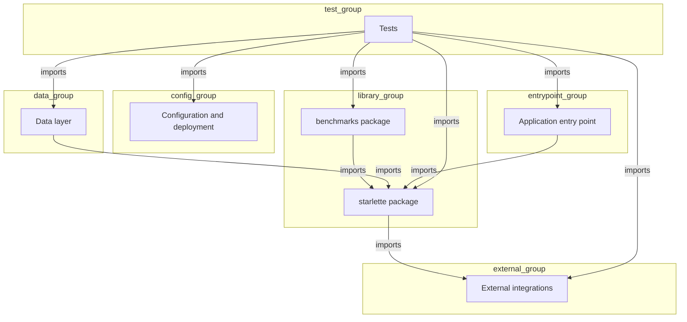

# Architecture report: Kludex/starlette

> Automated static analysis. **Observed** = directly seen in files/imports/AST; **Inferred** = interpretation from that evidence. Repository code was not executed.

## 1. Repository at a glance

| Item | Value |
| --- | --- |
| Repository | Kludex/starlette |
| Description | The little ASGI framework that shines. 🌟 |
| Language | Python |
| Stars | 12720 |
| Licence | BSD-3-Clause |
| Analysed commit / branch | 271c277da0ff64e2048a4d46ecc812b9d61db5f6 / main |
| Framework(s) | Starlette |
| Files analysed | 145 |
| Components | 7 |

## 2. Architecture in one minute

Kludex/starlette - The little ASGI framework that shines. 🌟. This repository was analysed statically from 145 file(s) (84 Python). Detected technologies (observed from imports/manifests): GitHub Actions, Starlette, httpx, Poetry, pytest, unittest. Files are grouped into 7 component(s): benchmarks package, Configuration and deployment, Data layer, Application entry point, External integrations, starlette package, Tests. Findings below distinguish observed facts from inferred interpretation.

## 3. High-level block diagram

## 4. Main components

### benchmarks package (`benchmarks`)

- **Kind:** library
- **Status:** Observed
- **Confidence:** 0.85
- **Responsibility:** Groups 12 file(s) under benchmarks package (observed from repository paths and static analysis). Observed top-level classes: ASGIRunner, BenchmarkCase, BodyApp, BypassCase, BytesEchoApp, ChunkedReceive. Observed top-level functions: build_router, dispatch, dispatch_request, dispatch_response, endpoint, field_part.
- **Paths:** `benchmarks/__init__.py`, `benchmarks/_utils.py`, `benchmarks/file_response_benchmark.py`, `benchmarks/gzip_benchmark.py`, `benchmarks/json_benchmark.py`, `benchmarks/multipart_benchmark.py`, `benchmarks/request_benchmark.py`, `benchmarks/response_benchmark.py`, `benchmarks/routing_benchmark.py`, `benchmarks/streaming_response_benchmark.py`, `benchmarks/urlencoded_benchmark.py`, `benchmarks/websocket_benchmark.py`
- **Evidence:** [benchmarks/__init__.py](https://github.com/Kludex/starlette/blob/271c277da0ff64e2048a4d46ecc812b9d61db5f6/benchmarks/__init__.py); [benchmarks/_utils.py:8](https://github.com/Kludex/starlette/blob/271c277da0ff64e2048a4d46ecc812b9d61db5f6/benchmarks/_utils.py#L8); [benchmarks/file_response_benchmark.py:19](https://github.com/Kludex/starlette/blob/271c277da0ff64e2048a4d46ecc812b9d61db5f6/benchmarks/file_response_benchmark.py#L19); [benchmarks/gzip_benchmark.py:29](https://github.com/Kludex/starlette/blob/271c277da0ff64e2048a4d46ecc812b9d61db5f6/benchmarks/gzip_benchmark.py#L29); [benchmarks/json_benchmark.py:18](https://github.com/Kludex/starlette/blob/271c277da0ff64e2048a4d46ecc812b9d61db5f6/benchmarks/json_benchmark.py#L18); [benchmarks/multipart_benchmark.py:21](https://github.com/Kludex/starlette/blob/271c277da0ff64e2048a4d46ecc812b9d61db5f6/benchmarks/multipart_benchmark.py#L21); [benchmarks/request_benchmark.py:19](https://github.com/Kludex/starlette/blob/271c277da0ff64e2048a4d46ecc812b9d61db5f6/benchmarks/request_benchmark.py#L19); [benchmarks/response_benchmark.py:19](https://github.com/Kludex/starlette/blob/271c277da0ff64e2048a4d46ecc812b9d61db5f6/benchmarks/response_benchmark.py#L19)

### Configuration and deployment (`config`)

- **Kind:** config
- **Status:** Observed
- **Confidence:** 0.85
- **Responsibility:** Groups 4 file(s) under configuration and deployment (observed from repository paths and static analysis). Observed top-level classes: Config, Environ, EnvironError, undefined.
- **Paths:** `mkdocs.yml`, `pyproject.toml`, `starlette/config.py`, `wrangler.toml`
- **Evidence:** [mkdocs.yml](https://github.com/Kludex/starlette/blob/271c277da0ff64e2048a4d46ecc812b9d61db5f6/mkdocs.yml); [pyproject.toml](https://github.com/Kludex/starlette/blob/271c277da0ff64e2048a4d46ecc812b9d61db5f6/pyproject.toml); [starlette/config.py:10](https://github.com/Kludex/starlette/blob/271c277da0ff64e2048a4d46ecc812b9d61db5f6/starlette/config.py#L10); [wrangler.toml](https://github.com/Kludex/starlette/blob/271c277da0ff64e2048a4d46ecc812b9d61db5f6/wrangler.toml)

### Data layer (`data_layer`)

- **Kind:** data
- **Status:** Observed
- **Confidence:** 0.85
- **Responsibility:** Groups 1 file(s) under data layer (observed from repository paths and static analysis). Observed top-level classes: BaseSchemaGenerator, EndpointInfo, OpenAPIResponse, SchemaGenerator.
- **Paths:** `starlette/schemas.py`
- **Evidence:** [starlette/schemas.py:19](https://github.com/Kludex/starlette/blob/271c277da0ff64e2048a4d46ecc812b9d61db5f6/starlette/schemas.py#L19)

### Application entry point (`entrypoint`)

- **Kind:** entrypoint
- **Status:** Observed
- **Confidence:** 0.85
- **Responsibility:** Groups 1 file(s) under application entry point (observed from repository paths and static analysis). Observed top-level classes: WSGIMiddleware, WSGIResponder. Observed top-level functions: build_environ.
- **Paths:** `starlette/middleware/wsgi.py`
- **Evidence:** [starlette/middleware/wsgi.py:26](https://github.com/Kludex/starlette/blob/271c277da0ff64e2048a4d46ecc812b9d61db5f6/starlette/middleware/wsgi.py#L26)

### External integrations (`external_integrations`)

- **Kind:** external
- **Status:** Inferred
- **Confidence:** 0.70
- **Responsibility:** Groups 0 file(s) under external integrations (observed from repository paths and static analysis).
- **Evidence:** [starlette/testclient.py:32](https://github.com/Kludex/starlette/blob/271c277da0ff64e2048a4d46ecc812b9d61db5f6/starlette/testclient.py#L32); [tests/middleware/test_opentelemetry.py:6](https://github.com/Kludex/starlette/blob/271c277da0ff64e2048a4d46ecc812b9d61db5f6/tests/middleware/test_opentelemetry.py#L6)

### starlette package (`starlette`)

- **Kind:** library
- **Status:** Observed
- **Confidence:** 0.85
- **Responsibility:** Groups 33 file(s) under starlette package (observed from repository paths and static analysis). Observed top-level classes: Address, AuthCredentials, AuthenticationBackend, AuthenticationError, AuthenticationMiddleware, AwaitableOrContextManager. Observed top-level functions: __dir__, __getattr__, _get_content_length, _get_gzip_capacity_limiter, _is_asgi3, _lookup_exception_handler.
- **Paths:** `starlette/__init__.py`, `starlette/_exception_handler.py`, `starlette/_utils.py`, `starlette/applications.py`, `starlette/authentication.py`, `starlette/background.py`, `starlette/concurrency.py`, `starlette/convertors.py`, `starlette/datastructures.py`, `starlette/endpoints.py`, `starlette/exceptions.py`, `starlette/formparsers.py`, `starlette/middleware/__init__.py`, `starlette/middleware/authentication.py`, `starlette/middleware/base.py`, `starlette/middleware/body_limit.py`, `starlette/middleware/cors.py`, `starlette/middleware/errors.py`, `starlette/middleware/exceptions.py`, `starlette/middleware/gzip.py`, `starlette/middleware/httpsredirect.py`, `starlette/middleware/opentelemetry.py`, `starlette/middleware/sessions.py`, `starlette/middleware/trustedhost.py`, `starlette/requests.py`, `starlette/responses.py`, `starlette/routing.py`, `starlette/staticfiles.py`, `starlette/status.py`, `starlette/templating.py`, `starlette/testclient.py`, `starlette/types.py`, `starlette/websockets.py`
- **Evidence:** [starlette/__init__.py](https://github.com/Kludex/starlette/blob/271c277da0ff64e2048a4d46ecc812b9d61db5f6/starlette/__init__.py); [starlette/_exception_handler.py:16](https://github.com/Kludex/starlette/blob/271c277da0ff64e2048a4d46ecc812b9d61db5f6/starlette/_exception_handler.py#L16); [starlette/_utils.py:37](https://github.com/Kludex/starlette/blob/271c277da0ff64e2048a4d46ecc812b9d61db5f6/starlette/_utils.py#L37); [starlette/applications.py:20](https://github.com/Kludex/starlette/blob/271c277da0ff64e2048a4d46ecc812b9d61db5f6/starlette/applications.py#L20); [starlette/authentication.py:18](https://github.com/Kludex/starlette/blob/271c277da0ff64e2048a4d46ecc812b9d61db5f6/starlette/authentication.py#L18); [starlette/background.py:12](https://github.com/Kludex/starlette/blob/271c277da0ff64e2048a4d46ecc812b9d61db5f6/starlette/background.py#L12); [starlette/concurrency.py:16](https://github.com/Kludex/starlette/blob/271c277da0ff64e2048a4d46ecc812b9d61db5f6/starlette/concurrency.py#L16); [starlette/convertors.py:10](https://github.com/Kludex/starlette/blob/271c277da0ff64e2048a4d46ecc812b9d61db5f6/starlette/convertors.py#L10)

### Tests (`tests`)

- **Kind:** test
- **Status:** Observed
- **Confidence:** 0.85
- **Responsibility:** Groups 38 file(s) under tests (observed from repository paths and static analysis). Observed top-level classes: AddHeadersMiddleware, BadBodyException, BasicAuth, CustomMiddleware, CustomMiddlewareUsingBaseHTTPMiddleware, CustomMiddlewareWithoutBaseHTTPMiddleware. Observed top-level functions: _generate_faulty_stream, admin, admin_sync, all_users_page, app, app_monitor_thread.
- **Paths:** `benchmarks/conftest.py`, `scripts/test`, `tests/__init__.py`, `tests/conftest.py`, `tests/middleware/__init__.py`, `tests/middleware/test_base.py`, `tests/middleware/test_body_limit.py`, `tests/middleware/test_cors.py`, `tests/middleware/test_errors.py`, `tests/middleware/test_gzip.py`, `tests/middleware/test_https_redirect.py`, `tests/middleware/test_middleware.py`, `tests/middleware/test_opentelemetry.py`, `tests/middleware/test_session.py`, `tests/middleware/test_trusted_host.py`, `tests/middleware/test_wsgi.py`, `tests/statics/example.txt`, `tests/test__utils.py`, `tests/test_applications.py`, `tests/test_authentication.py`, `tests/test_background.py`, `tests/test_concurrency.py`, `tests/test_config.py`, `tests/test_convertors.py`, `tests/test_datastructures.py`, `tests/test_endpoints.py`, `tests/test_exceptions.py`, `tests/test_formparsers.py`, `tests/test_requests.py`, `tests/test_responses.py`, `tests/test_routing.py`, `tests/test_schemas.py`, `tests/test_staticfiles.py`, `tests/test_status.py`, `tests/test_templates.py`, `tests/test_testclient.py`, `tests/test_websockets.py`, `tests/types.py`
- **Evidence:** [benchmarks/conftest.py:11](https://github.com/Kludex/starlette/blob/271c277da0ff64e2048a4d46ecc812b9d61db5f6/benchmarks/conftest.py#L11); [scripts/test](https://github.com/Kludex/starlette/blob/271c277da0ff64e2048a4d46ecc812b9d61db5f6/scripts/test); [tests/__init__.py](https://github.com/Kludex/starlette/blob/271c277da0ff64e2048a4d46ecc812b9d61db5f6/tests/__init__.py); [tests/conftest.py:22](https://github.com/Kludex/starlette/blob/271c277da0ff64e2048a4d46ecc812b9d61db5f6/tests/conftest.py#L22); [tests/middleware/__init__.py](https://github.com/Kludex/starlette/blob/271c277da0ff64e2048a4d46ecc812b9d61db5f6/tests/middleware/__init__.py); [tests/middleware/test_base.py:26](https://github.com/Kludex/starlette/blob/271c277da0ff64e2048a4d46ecc812b9d61db5f6/tests/middleware/test_base.py#L26); [tests/middleware/test_body_limit.py:19](https://github.com/Kludex/starlette/blob/271c277da0ff64e2048a4d46ecc812b9d61db5f6/tests/middleware/test_body_limit.py#L19); [tests/middleware/test_cors.py:11](https://github.com/Kludex/starlette/blob/271c277da0ff64e2048a4d46ecc812b9d61db5f6/tests/middleware/test_cors.py#L11)

## 5. Execution flow

No entry point was observed; the startup flow below is therefore limited.

Representative flow (derived from observed entry points and the import graph; steps beyond the entry point are **Inferred**):

1. Execution starts at an observed entry point listed above, if present.
2. `benchmarks` imports `starlette` (benchmarks package -> starlette package).
3. `data_layer` imports `starlette` (Data layer -> starlette package).
4. `entrypoint` imports `starlette` (Application entry point -> starlette package).
5. `starlette` imports `external_integrations` (starlette package -> External integrations).
6. `tests` imports `benchmarks` (Tests -> benchmarks package).
7. `tests` imports `config` (Tests -> Configuration and deployment).
8. `tests` imports `data_layer` (Tests -> Data layer).
9. `tests` imports `entrypoint` (Tests -> Application entry point).

## 6. Project structure

### `(root)`

- `.gitignore` - other (135 bytes)
- `AGENTS.md` - docs (199 bytes)
- `AI_POLICY.md` - docs (489 bytes)
- `CITATION.cff` - other (627 bytes)
- `LICENSE.md` - docs (1518 bytes)
- `README.md` - docs (4938 bytes)
- `mkdocs.yml` - config (3217 bytes)
- `pyproject.toml` - manifest (3844 bytes)
- `wrangler.toml` - config (135 bytes)

### `.github`

- `.github/FUNDING.yml` - config (15 bytes)
- `.github/ISSUE_TEMPLATE/1-issue.md` - docs (592 bytes)
- `.github/ISSUE_TEMPLATE/config.yml` - config (447 bytes)
- `.github/dependabot.yml` - config (413 bytes)
- `.github/pull_request_template.md` - docs (547 bytes)
- `.github/workflows/benchmark.yml` - ci, YAML (1667 bytes)
- `.github/workflows/main.yml` - ci, YAML (2899 bytes)
- `.github/workflows/publish.yml` - ci, YAML (3182 bytes)
- `.github/workflows/zizmor.yml` - ci, YAML (593 bytes)

### `benchmarks`

- `benchmarks/README.md` - docs (7115 bytes)
- `benchmarks/__init__.py` - source, Python (60 bytes)
- `benchmarks/_utils.py` - source, Python (1645 bytes)
- `benchmarks/conftest.py` - test, Python (269 bytes)
- `benchmarks/file_response_benchmark.py` - source, Python (3850 bytes)
- `benchmarks/gzip_benchmark.py` - source, Python (12314 bytes)
- `benchmarks/json_benchmark.py` - source, Python (5117 bytes)
- `benchmarks/multipart_benchmark.py` - source, Python (7233 bytes)
- `benchmarks/request_benchmark.py` - source, Python (3687 bytes)
- `benchmarks/response_benchmark.py` - source, Python (2631 bytes)
- `benchmarks/routing_benchmark.py` - source, Python (2862 bytes)
- `benchmarks/streaming_response_benchmark.py` - source, Python (2915 bytes)
- `benchmarks/urlencoded_benchmark.py` - source, Python (4841 bytes)
- `benchmarks/websocket_benchmark.py` - source, Python (3718 bytes)

### `docs`

- `docs/CNAME` - docs (17 bytes)
- `docs/applications.md` - docs (1786 bytes)
- `docs/authentication.md` - docs (5484 bytes)
- `docs/background.md` - docs (1989 bytes)
- `docs/config.md` - docs (6960 bytes)
- `docs/contributing.md` - docs (5610 bytes)
- `docs/css/custom.css` - docs (1613 bytes)
- `docs/database.md` - docs (690 bytes)
- `docs/early-hints.md` - docs (2575 bytes)
- `docs/endpoints.md` - docs (4404 bytes)
- `docs/exceptions.md` - docs (5305 bytes)
- `docs/graphql.md` - docs (622 bytes)
- `docs/img/starlette.svg` - docs (16866 bytes)
- `docs/img/starlette_dark.svg` - docs (16901 bytes)
- `docs/index.md` - docs (5202 bytes)
- `docs/lifespan.md` - docs (4502 bytes)
- `docs/middleware.md` - docs (42666 bytes)
- `docs/overrides/main.html` - docs (762 bytes)
- `docs/overrides/partials/nav.html` - docs (1415 bytes)
- `docs/overrides/partials/toc-item.html` - docs (655 bytes)
- `docs/release-notes.md` - docs (67809 bytes)
- `docs/requests.md` - docs (8040 bytes)
- `docs/responses.md` - docs (8091 bytes)
- `docs/routing.md` - docs (13189 bytes)
- `docs/schemas.md` - docs (3035 bytes)
- `docs/server-push.md` - docs (1004 bytes)
- `docs/staticfiles.md` - docs (2250 bytes)
- `docs/templates.md` - docs (5068 bytes)
- `docs/testclient.md` - docs (11562 bytes)
- `docs/third-party-packages.md` - docs (9803 bytes)
- `docs/threadpool.md` - docs (1384 bytes)
- `docs/websockets.md` - docs (4804 bytes)

### `scripts`

- `scripts/README.md` - docs (485 bytes)
- `scripts/check` - other (201 bytes)
- `scripts/coverage` - other (92 bytes)
- `scripts/docs` - docs (44 bytes)
- `scripts/install` - other (39 bytes)
- `scripts/lint` - other (132 bytes)
- `scripts/sync-version` - other (402 bytes)
- `scripts/test` - test (164 bytes)

### `starlette`

- `starlette/__init__.py` - source, Python (23 bytes)
- `starlette/_exception_handler.py` - source, Python (2374 bytes)
- `starlette/_utils.py` - source, Python (4109 bytes)
- `starlette/applications.py` - source, Python (5763 bytes)
- `starlette/authentication.py` - source, Python (5341 bytes)
- `starlette/background.py` - source, Python (1122 bytes)
- `starlette/concurrency.py` - source, Python (1701 bytes)
- `starlette/config.py` - source, Python (4612 bytes)
- `starlette/convertors.py` - source, Python (2304 bytes)
- `starlette/datastructures.py` - source, Python (24313 bytes)
- `starlette/endpoints.py` - source, Python (5332 bytes)
- `starlette/exceptions.py` - source, Python (1492 bytes)
- `starlette/formparsers.py` - source, Python (11732 bytes)
- `starlette/middleware/__init__.py` - source, Python (1349 bytes)
- `starlette/middleware/authentication.py` - source, Python (1800 bytes)
- `starlette/middleware/base.py` - source, Python (10734 bytes)
- `starlette/middleware/body_limit.py` - source, Python (4609 bytes)
- `starlette/middleware/cors.py` - source, Python (7688 bytes)
- `starlette/middleware/errors.py` - source, Python (8126 bytes)
- `starlette/middleware/exceptions.py` - source, Python (2784 bytes)
- `starlette/middleware/gzip.py` - source, Python (9319 bytes)
- `starlette/middleware/httpsredirect.py` - source, Python (1023 bytes)
- `starlette/middleware/opentelemetry.py` - source, Python (5719 bytes)
- `starlette/middleware/sessions.py` - source, Python (5241 bytes)
- `starlette/middleware/trustedhost.py` - source, Python (2491 bytes)
- `starlette/middleware/wsgi.py` - source, Python (5582 bytes)
- `starlette/py.typed` - other (0 bytes)
- `starlette/requests.py` - source, Python (13313 bytes)
- `starlette/responses.py` - source, Python (23910 bytes)
- `starlette/routing.py` - source, Python (30777 bytes)
- `starlette/schemas.py` - source, Python (5513 bytes)
- `starlette/staticfiles.py` - source, Python (9103 bytes)
- `starlette/status.py` - source, Python (6430 bytes)
- `starlette/templating.py` - source, Python (5447 bytes)
- `starlette/testclient.py` - source, Python (24035 bytes)
- `starlette/types.py` - source, Python (1041 bytes)
- `starlette/websockets.py` - source, Python (8518 bytes)

### `tests`

- `tests/__init__.py` - test, Python (0 bytes)
- `tests/conftest.py` - test, Python (1589 bytes)
- `tests/middleware/__init__.py` - test, Python (0 bytes)
- `tests/middleware/test_base.py` - test, Python (46408 bytes)
- `tests/middleware/test_body_limit.py` - test, Python (11910 bytes)
- `tests/middleware/test_cors.py` - test, Python (23684 bytes)
- `tests/middleware/test_errors.py` - test, Python (3799 bytes)
- `tests/middleware/test_gzip.py` - test, Python (22270 bytes)
- `tests/middleware/test_https_redirect.py` - test, Python (3266 bytes)
- `tests/middleware/test_middleware.py` - test, Python (2039 bytes)
- `tests/middleware/test_opentelemetry.py` - test, Python (19588 bytes)
- `tests/middleware/test_session.py` - test, Python (13539 bytes)
- `tests/middleware/test_trusted_host.py` - test, Python (3551 bytes)
- `tests/middleware/test_wsgi.py` - test, Python (5601 bytes)
- `tests/statics/example.txt` - test (4 bytes)
- `tests/test__utils.py` - test, Python (3548 bytes)
- `tests/test_applications.py` - test, Python (17217 bytes)
- `tests/test_authentication.py` - test, Python (12228 bytes)
- `tests/test_background.py` - test, Python (2829 bytes)
- `tests/test_concurrency.py` - test, Python (1577 bytes)
- `tests/test_config.py` - test, Python (5882 bytes)
- `tests/test_convertors.py` - test, Python (3264 bytes)
- `tests/test_datastructures.py` - test, Python (23316 bytes)
- `tests/test_endpoints.py` - test, Python (10938 bytes)
- `tests/test_exceptions.py` - test, Python (8824 bytes)
- `tests/test_formparsers.py` - test, Python (38467 bytes)
- `tests/test_requests.py` - test, Python (24589 bytes)
- `tests/test_responses.py` - test, Python (50588 bytes)
- `tests/test_routing.py` - test, Python (41869 bytes)
- `tests/test_schemas.py` - test, Python (9271 bytes)
- `tests/test_staticfiles.py` - test, Python (24797 bytes)
- `tests/test_status.py` - test, Python (1043 bytes)
- `tests/test_templates.py` - test, Python (6789 bytes)
- `tests/test_testclient.py` - test, Python (29450 bytes)
- `tests/test_websockets.py` - test, Python (26063 bytes)
- `tests/types.py` - test, Python (787 bytes)

## 7. Key dependencies and integrations

| Name | Category | Status | Confidence | Evidence |
| --- | --- | --- | --- | --- |
| GitHub Actions | ci | Observed | 0.90 | [.github/workflows/benchmark.yml](https://github.com/Kludex/starlette/blob/271c277da0ff64e2048a4d46ecc812b9d61db5f6/.github/workflows/benchmark.yml); [.github/workflows/main.yml](https://github.com/Kludex/starlette/blob/271c277da0ff64e2048a4d46ecc812b9d61db5f6/.github/workflows/main.yml); [.github/workflows/publish.yml](https://github.com/Kludex/starlette/blob/271c277da0ff64e2048a4d46ecc812b9d61db5f6/.github/workflows/publish.yml); [.github/workflows/zizmor.yml](https://github.com/Kludex/starlette/blob/271c277da0ff64e2048a4d46ecc812b9d61db5f6/.github/workflows/zizmor.yml) |
| Starlette | framework | Observed | 0.95 | [benchmarks/_utils.py:5](https://github.com/Kludex/starlette/blob/271c277da0ff64e2048a4d46ecc812b9d61db5f6/benchmarks/_utils.py#L5); [benchmarks/file_response_benchmark.py:10](https://github.com/Kludex/starlette/blob/271c277da0ff64e2048a4d46ecc812b9d61db5f6/benchmarks/file_response_benchmark.py#L10); [benchmarks/file_response_benchmark.py:11](https://github.com/Kludex/starlette/blob/271c277da0ff64e2048a4d46ecc812b9d61db5f6/benchmarks/file_response_benchmark.py#L11); [benchmarks/file_response_benchmark.py:12](https://github.com/Kludex/starlette/blob/271c277da0ff64e2048a4d46ecc812b9d61db5f6/benchmarks/file_response_benchmark.py#L12) |
| httpx | library | Observed | 0.95 | [pyproject.toml:45](https://github.com/Kludex/starlette/blob/271c277da0ff64e2048a4d46ecc812b9d61db5f6/pyproject.toml#L45); [starlette/testclient.py:32](https://github.com/Kludex/starlette/blob/271c277da0ff64e2048a4d46ecc812b9d61db5f6/starlette/testclient.py#L32); [tests/middleware/test_opentelemetry.py:6](https://github.com/Kludex/starlette/blob/271c277da0ff64e2048a4d46ecc812b9d61db5f6/tests/middleware/test_opentelemetry.py#L6) |
| Poetry | packaging | Observed | 0.85 | [pyproject.toml](https://github.com/Kludex/starlette/blob/271c277da0ff64e2048a4d46ecc812b9d61db5f6/pyproject.toml) |
| pytest | tooling | Observed | 0.95 | [.github/workflows/benchmark.yml:43](https://github.com/Kludex/starlette/blob/271c277da0ff64e2048a4d46ecc812b9d61db5f6/.github/workflows/benchmark.yml#L43); [benchmarks/conftest.py:5](https://github.com/Kludex/starlette/blob/271c277da0ff64e2048a4d46ecc812b9d61db5f6/benchmarks/conftest.py#L5); [benchmarks/file_response_benchmark.py:6](https://github.com/Kludex/starlette/blob/271c277da0ff64e2048a4d46ecc812b9d61db5f6/benchmarks/file_response_benchmark.py#L6); [benchmarks/gzip_benchmark.py:14](https://github.com/Kludex/starlette/blob/271c277da0ff64e2048a4d46ecc812b9d61db5f6/benchmarks/gzip_benchmark.py#L14) |
| unittest | tooling | Observed | 0.95 | [tests/middleware/test_opentelemetry.py:4](https://github.com/Kludex/starlette/blob/271c277da0ff64e2048a4d46ecc812b9d61db5f6/tests/middleware/test_opentelemetry.py#L4); [tests/test__utils.py:3](https://github.com/Kludex/starlette/blob/271c277da0ff64e2048a4d46ecc812b9d61db5f6/tests/test__utils.py#L3); [tests/test_formparsers.py:12](https://github.com/Kludex/starlette/blob/271c277da0ff64e2048a4d46ecc812b9d61db5f6/tests/test_formparsers.py#L12); [tests/test_requests.py:6](https://github.com/Kludex/starlette/blob/271c277da0ff64e2048a4d46ecc812b9d61db5f6/tests/test_requests.py#L6) |

## 8. Data and state

- Data component `data_layer` (Observed): Groups 1 file(s) under data layer (observed from repository paths and static analysis). Observed top-level classes: BaseSchemaGenerator, EndpointInfo, OpenAPIResponse, SchemaGenerator.

## 9. Configuration and deployment clues

- `.github/FUNDING.yml` (config)
- `.github/ISSUE_TEMPLATE/config.yml` (config)
- `.github/dependabot.yml` (config)
- `.github/workflows/benchmark.yml` (ci)
- `.github/workflows/main.yml` (ci)
- `.github/workflows/publish.yml` (ci)
- `.github/workflows/zizmor.yml` (ci)
- `mkdocs.yml` (config)
- `pyproject.toml` (manifest)
- `wrangler.toml` (config)

## 10. Design observations

- An entry/API layer is separated from other code (Inferred from paths and decorators).
- Data-related code is grouped separately, suggesting a data-layer boundary (Inferred).
- Tests are present alongside source code (Observed from test file paths).
- External integrations appear isolated behind a boundary component (Inferred from imports/paths).

These observations are interpretations (**Inferred**) of the observed structure, not guarantees about runtime design.

## 11. Limitations and unknowns

- Static analysis only: repository code was not executed, installed, or imported at runtime.
- Components and relationships are inferred from file paths, imports, and AST structure; runtime behaviour, dynamic imports, and reflection may not be visible.
- 1 file(s) were skipped during inventory (1 x vendored/generated directory excluded).
- No clear application entry point was observed in the analysed files.
- Repository text was treated as untrusted data; no instructions found in repository files were followed, and likely secret values were redacted/excluded.

## 12. Source references

- [.github/workflows/benchmark.yml](https://github.com/Kludex/starlette/blob/271c277da0ff64e2048a4d46ecc812b9d61db5f6/.github/workflows/benchmark.yml)
- [.github/workflows/benchmark.yml:43](https://github.com/Kludex/starlette/blob/271c277da0ff64e2048a4d46ecc812b9d61db5f6/.github/workflows/benchmark.yml#L43)
- [.github/workflows/main.yml](https://github.com/Kludex/starlette/blob/271c277da0ff64e2048a4d46ecc812b9d61db5f6/.github/workflows/main.yml)
- [.github/workflows/publish.yml](https://github.com/Kludex/starlette/blob/271c277da0ff64e2048a4d46ecc812b9d61db5f6/.github/workflows/publish.yml)
- [.github/workflows/zizmor.yml](https://github.com/Kludex/starlette/blob/271c277da0ff64e2048a4d46ecc812b9d61db5f6/.github/workflows/zizmor.yml)
- [benchmarks/__init__.py](https://github.com/Kludex/starlette/blob/271c277da0ff64e2048a4d46ecc812b9d61db5f6/benchmarks/__init__.py)
- [benchmarks/_utils.py:5](https://github.com/Kludex/starlette/blob/271c277da0ff64e2048a4d46ecc812b9d61db5f6/benchmarks/_utils.py#L5)
- [benchmarks/_utils.py:8](https://github.com/Kludex/starlette/blob/271c277da0ff64e2048a4d46ecc812b9d61db5f6/benchmarks/_utils.py#L8)
- [benchmarks/conftest.py:5](https://github.com/Kludex/starlette/blob/271c277da0ff64e2048a4d46ecc812b9d61db5f6/benchmarks/conftest.py#L5)
- [benchmarks/conftest.py:11](https://github.com/Kludex/starlette/blob/271c277da0ff64e2048a4d46ecc812b9d61db5f6/benchmarks/conftest.py#L11)
- [benchmarks/file_response_benchmark.py:6](https://github.com/Kludex/starlette/blob/271c277da0ff64e2048a4d46ecc812b9d61db5f6/benchmarks/file_response_benchmark.py#L6)
- [benchmarks/file_response_benchmark.py:10](https://github.com/Kludex/starlette/blob/271c277da0ff64e2048a4d46ecc812b9d61db5f6/benchmarks/file_response_benchmark.py#L10)
- [benchmarks/file_response_benchmark.py:11](https://github.com/Kludex/starlette/blob/271c277da0ff64e2048a4d46ecc812b9d61db5f6/benchmarks/file_response_benchmark.py#L11)
- [benchmarks/file_response_benchmark.py:12](https://github.com/Kludex/starlette/blob/271c277da0ff64e2048a4d46ecc812b9d61db5f6/benchmarks/file_response_benchmark.py#L12)
- [benchmarks/file_response_benchmark.py:19](https://github.com/Kludex/starlette/blob/271c277da0ff64e2048a4d46ecc812b9d61db5f6/benchmarks/file_response_benchmark.py#L19)
- [benchmarks/gzip_benchmark.py:14](https://github.com/Kludex/starlette/blob/271c277da0ff64e2048a4d46ecc812b9d61db5f6/benchmarks/gzip_benchmark.py#L14)
- [benchmarks/gzip_benchmark.py:18](https://github.com/Kludex/starlette/blob/271c277da0ff64e2048a4d46ecc812b9d61db5f6/benchmarks/gzip_benchmark.py#L18)
- [benchmarks/gzip_benchmark.py:19](https://github.com/Kludex/starlette/blob/271c277da0ff64e2048a4d46ecc812b9d61db5f6/benchmarks/gzip_benchmark.py#L19)
- [benchmarks/gzip_benchmark.py:29](https://github.com/Kludex/starlette/blob/271c277da0ff64e2048a4d46ecc812b9d61db5f6/benchmarks/gzip_benchmark.py#L29)
- [benchmarks/json_benchmark.py:6](https://github.com/Kludex/starlette/blob/271c277da0ff64e2048a4d46ecc812b9d61db5f6/benchmarks/json_benchmark.py#L6)
- [benchmarks/json_benchmark.py:10](https://github.com/Kludex/starlette/blob/271c277da0ff64e2048a4d46ecc812b9d61db5f6/benchmarks/json_benchmark.py#L10)
- [benchmarks/json_benchmark.py:11](https://github.com/Kludex/starlette/blob/271c277da0ff64e2048a4d46ecc812b9d61db5f6/benchmarks/json_benchmark.py#L11)
- [benchmarks/json_benchmark.py:18](https://github.com/Kludex/starlette/blob/271c277da0ff64e2048a4d46ecc812b9d61db5f6/benchmarks/json_benchmark.py#L18)
- [benchmarks/multipart_benchmark.py:5](https://github.com/Kludex/starlette/blob/271c277da0ff64e2048a4d46ecc812b9d61db5f6/benchmarks/multipart_benchmark.py#L5)
- [benchmarks/multipart_benchmark.py:21](https://github.com/Kludex/starlette/blob/271c277da0ff64e2048a4d46ecc812b9d61db5f6/benchmarks/multipart_benchmark.py#L21)
- [benchmarks/request_benchmark.py:6](https://github.com/Kludex/starlette/blob/271c277da0ff64e2048a4d46ecc812b9d61db5f6/benchmarks/request_benchmark.py#L6)
- [benchmarks/request_benchmark.py:19](https://github.com/Kludex/starlette/blob/271c277da0ff64e2048a4d46ecc812b9d61db5f6/benchmarks/request_benchmark.py#L19)
- [benchmarks/response_benchmark.py:5](https://github.com/Kludex/starlette/blob/271c277da0ff64e2048a4d46ecc812b9d61db5f6/benchmarks/response_benchmark.py#L5)
- [benchmarks/response_benchmark.py:19](https://github.com/Kludex/starlette/blob/271c277da0ff64e2048a4d46ecc812b9d61db5f6/benchmarks/response_benchmark.py#L19)
- [mkdocs.yml](https://github.com/Kludex/starlette/blob/271c277da0ff64e2048a4d46ecc812b9d61db5f6/mkdocs.yml)
- [pyproject.toml](https://github.com/Kludex/starlette/blob/271c277da0ff64e2048a4d46ecc812b9d61db5f6/pyproject.toml)
- [pyproject.toml:45](https://github.com/Kludex/starlette/blob/271c277da0ff64e2048a4d46ecc812b9d61db5f6/pyproject.toml#L45)
- [scripts/test](https://github.com/Kludex/starlette/blob/271c277da0ff64e2048a4d46ecc812b9d61db5f6/scripts/test)
- [starlette/__init__.py](https://github.com/Kludex/starlette/blob/271c277da0ff64e2048a4d46ecc812b9d61db5f6/starlette/__init__.py)
- [starlette/_exception_handler.py:16](https://github.com/Kludex/starlette/blob/271c277da0ff64e2048a4d46ecc812b9d61db5f6/starlette/_exception_handler.py#L16)
- [starlette/_utils.py:37](https://github.com/Kludex/starlette/blob/271c277da0ff64e2048a4d46ecc812b9d61db5f6/starlette/_utils.py#L37)
- [starlette/applications.py:20](https://github.com/Kludex/starlette/blob/271c277da0ff64e2048a4d46ecc812b9d61db5f6/starlette/applications.py#L20)
- [starlette/authentication.py:18](https://github.com/Kludex/starlette/blob/271c277da0ff64e2048a4d46ecc812b9d61db5f6/starlette/authentication.py#L18)
- [starlette/background.py:12](https://github.com/Kludex/starlette/blob/271c277da0ff64e2048a4d46ecc812b9d61db5f6/starlette/background.py#L12)
- [starlette/concurrency.py:16](https://github.com/Kludex/starlette/blob/271c277da0ff64e2048a4d46ecc812b9d61db5f6/starlette/concurrency.py#L16)
- [starlette/config.py:10](https://github.com/Kludex/starlette/blob/271c277da0ff64e2048a4d46ecc812b9d61db5f6/starlette/config.py#L10)
- [starlette/convertors.py:10](https://github.com/Kludex/starlette/blob/271c277da0ff64e2048a4d46ecc812b9d61db5f6/starlette/convertors.py#L10)
- [starlette/middleware/wsgi.py:26](https://github.com/Kludex/starlette/blob/271c277da0ff64e2048a4d46ecc812b9d61db5f6/starlette/middleware/wsgi.py#L26)
- [starlette/schemas.py:19](https://github.com/Kludex/starlette/blob/271c277da0ff64e2048a4d46ecc812b9d61db5f6/starlette/schemas.py#L19)
- [starlette/testclient.py:32](https://github.com/Kludex/starlette/blob/271c277da0ff64e2048a4d46ecc812b9d61db5f6/starlette/testclient.py#L32)
- [tests/__init__.py](https://github.com/Kludex/starlette/blob/271c277da0ff64e2048a4d46ecc812b9d61db5f6/tests/__init__.py)
- [tests/conftest.py:22](https://github.com/Kludex/starlette/blob/271c277da0ff64e2048a4d46ecc812b9d61db5f6/tests/conftest.py#L22)
- [tests/middleware/__init__.py](https://github.com/Kludex/starlette/blob/271c277da0ff64e2048a4d46ecc812b9d61db5f6/tests/middleware/__init__.py)
- [tests/middleware/test_base.py:26](https://github.com/Kludex/starlette/blob/271c277da0ff64e2048a4d46ecc812b9d61db5f6/tests/middleware/test_base.py#L26)
- [tests/middleware/test_body_limit.py:19](https://github.com/Kludex/starlette/blob/271c277da0ff64e2048a4d46ecc812b9d61db5f6/tests/middleware/test_body_limit.py#L19)
- [tests/middleware/test_cors.py:11](https://github.com/Kludex/starlette/blob/271c277da0ff64e2048a4d46ecc812b9d61db5f6/tests/middleware/test_cors.py#L11)
- [tests/middleware/test_opentelemetry.py:4](https://github.com/Kludex/starlette/blob/271c277da0ff64e2048a4d46ecc812b9d61db5f6/tests/middleware/test_opentelemetry.py#L4)
- [tests/middleware/test_opentelemetry.py:6](https://github.com/Kludex/starlette/blob/271c277da0ff64e2048a4d46ecc812b9d61db5f6/tests/middleware/test_opentelemetry.py#L6)
- [tests/test__utils.py:3](https://github.com/Kludex/starlette/blob/271c277da0ff64e2048a4d46ecc812b9d61db5f6/tests/test__utils.py#L3)
- [tests/test_formparsers.py:12](https://github.com/Kludex/starlette/blob/271c277da0ff64e2048a4d46ecc812b9d61db5f6/tests/test_formparsers.py#L12)
- [tests/test_requests.py:6](https://github.com/Kludex/starlette/blob/271c277da0ff64e2048a4d46ecc812b9d61db5f6/tests/test_requests.py#L6)
- [wrangler.toml](https://github.com/Kludex/starlette/blob/271c277da0ff64e2048a4d46ecc812b9d61db5f6/wrangler.toml)
