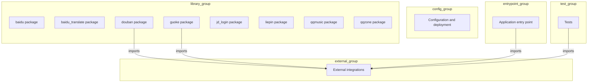

# Architecture report: Kr1s77/awesome-python-login-model

> Automated static analysis. **Observed** = directly seen in files/imports/AST; **Inferred** = interpretation from that evidence. Repository code was not executed.

## 1. Repository at a glance

| Item | Value |
| --- | --- |
| Repository | Kr1s77/awesome-python-login-model |
| Description | 😮python模拟登陆一些大型网站，还有一些简单的爬虫，希望对你们有所帮助❤️，如果喜欢记得给个star哦🌟 |
| Language | Python |
| Stars | 16223 |
| Licence | Other |
| Analysed commit / branch | b458a09bf5542b52784bbba9861c4f3a82b2e45d / master |
| Framework(s) | None detected |
| Files analysed | 98 |
| Components | 12 |

## 2. Architecture in one minute

Kr1s77/awesome-python-login-model - 😮python模拟登陆一些大型网站，还有一些简单的爬虫，希望对你们有所帮助❤️，如果喜欢记得给个star哦🌟. This repository was analysed statically from 98 file(s) (77 Python). Detected technologies (observed from imports/manifests): MySQL, pandas, requests. Files are grouped into 12 component(s): baidu package, baidu_translate package, Configuration and deployment, douban package, Application entry point, External integrations, guoke package, jd_login package. Observed entry point(s): 126email/126email.py, 163email/163email.py, 163youdao/163youdao.py. Findings below distinguish observed facts from inferred interpretation.

## 3. High-level block diagram

## 4. Main components

### baidu package (`baidu`)

- **Kind:** library
- **Status:** Observed
- **Confidence:** 0.85
- **Responsibility:** Groups 1 file(s) under baidu package (observed from repository paths and static analysis). Observed top-level functions: encrypt_pwd, open_image, parse_json, save_image.
- **Paths:** `baidu/util.py`
- **Evidence:** [baidu/util.py:11](https://github.com/Kr1s77/awesome-python-login-model/blob/b458a09bf5542b52784bbba9861c4f3a82b2e45d/baidu/util.py#L11)

### baidu_translate package (`baidu_translate`)

- **Kind:** library
- **Status:** Observed
- **Confidence:** 0.85
- **Responsibility:** Groups 1 file(s) under baidu_translate package (observed from repository paths and static analysis).
- **Paths:** `baidu_translate/translate.js`
- **Evidence:** [baidu_translate/translate.js](https://github.com/Kr1s77/awesome-python-login-model/blob/b458a09bf5542b52784bbba9861c4f3a82b2e45d/baidu_translate/translate.js)

### Configuration and deployment (`config`)

- **Kind:** config
- **Status:** Observed
- **Confidence:** 0.85
- **Responsibility:** Groups 13 file(s) under configuration and deployment (observed from repository paths and static analysis).
- **Paths:** `baidu/requirements.txt`, `jd_login/Method_First/config.py`, `jd_login/Method_Second/Config.py`, `liepin/liepinSpd/liepinSpd/settings.py`, `liepin/liepinSpd/scrapy.cfg`, `liepin/liepinSpd2/liepinSpd2/settings.py`, `liepin/liepinSpd2/scrapy.cfg`, `liepin/liepinSpd_500/liepinSpd/settings.py`, `liepin/liepinSpd_500/scrapy.cfg`, `liepin/liepinSpecialCom/liepinSpecialCom/settings.py`, `liepin/liepinSpecialCom/scrapy.cfg`, `liepin/liepinSpecialComJob/liepinSpecialComJob/settings.py`, `liepin/liepinSpecialComJob/scrapy.cfg`
- **Evidence:** [baidu/requirements.txt](https://github.com/Kr1s77/awesome-python-login-model/blob/b458a09bf5542b52784bbba9861c4f3a82b2e45d/baidu/requirements.txt); [jd_login/Method_First/config.py](https://github.com/Kr1s77/awesome-python-login-model/blob/b458a09bf5542b52784bbba9861c4f3a82b2e45d/jd_login/Method_First/config.py); [jd_login/Method_Second/Config.py](https://github.com/Kr1s77/awesome-python-login-model/blob/b458a09bf5542b52784bbba9861c4f3a82b2e45d/jd_login/Method_Second/Config.py); [liepin/liepinSpd/liepinSpd/settings.py](https://github.com/Kr1s77/awesome-python-login-model/blob/b458a09bf5542b52784bbba9861c4f3a82b2e45d/liepin/liepinSpd/liepinSpd/settings.py); [liepin/liepinSpd/scrapy.cfg](https://github.com/Kr1s77/awesome-python-login-model/blob/b458a09bf5542b52784bbba9861c4f3a82b2e45d/liepin/liepinSpd/scrapy.cfg); [liepin/liepinSpd2/liepinSpd2/settings.py](https://github.com/Kr1s77/awesome-python-login-model/blob/b458a09bf5542b52784bbba9861c4f3a82b2e45d/liepin/liepinSpd2/liepinSpd2/settings.py); [liepin/liepinSpd2/scrapy.cfg](https://github.com/Kr1s77/awesome-python-login-model/blob/b458a09bf5542b52784bbba9861c4f3a82b2e45d/liepin/liepinSpd2/scrapy.cfg); [liepin/liepinSpd_500/liepinSpd/settings.py](https://github.com/Kr1s77/awesome-python-login-model/blob/b458a09bf5542b52784bbba9861c4f3a82b2e45d/liepin/liepinSpd_500/liepinSpd/settings.py)

### douban package (`douban`)

- **Kind:** library
- **Status:** Observed
- **Confidence:** 0.85
- **Responsibility:** Groups 1 file(s) under douban package (observed from repository paths and static analysis).
- **Paths:** `douban/douban_spider.py`
- **Evidence:** [douban/douban_spider.py](https://github.com/Kr1s77/awesome-python-login-model/blob/b458a09bf5542b52784bbba9861c4f3a82b2e45d/douban/douban_spider.py)

### Application entry point (`entrypoint`)

- **Kind:** entrypoint
- **Status:** Observed
- **Confidence:** 0.85
- **Responsibility:** Groups 29 file(s) under application entry point (observed from repository paths and static analysis). Observed top-level classes: Api, BaiDuTranslater, BaiduLogin, BiliBili, DBHelper, DouBanLogin. Observed top-level functions: Control_try, auto_showdown, check_name, closeSW, create_sheet, deal_file.
- **Paths:** `126email/126email.py`, `163email/163email.py`, `163youdao/163youdao.py`, `Github/login.py`, `NeteaseCloudMusicDownload/api.py`, `baidu/baidu.py`, `baidu_translate/Baidufanyi.py`, `bilibili/bilibili.py`, `csdn/selenium_csdn.py`, `douban/douban.py`, `facebook/facebook.py`, `guoke/guoke_spider.py`, `jd_login/Method_First/Try_selenium.py`, `jd_login/Method_Second/main.py`, `lagou/Lagou.py`, `liepin/liepinSpd/liepinSpd/dbhelper.py`, `liepin/liepinSpd_500/liepinSpd/dbhelper.py`, `liepin/liepin_login.py`, `qqmusic/qqmusic_spider.py`, `qsbk/qiushibaike.py`, `sina/sina.py`, `sina/spider/Ajax_weibo.py`, `taobao/taobao_via_username_password.py`, `taobao/taobao_via_weibo.py`, `tieba/tieba_spider.py`, `tuchong/tuchong.py`, `webWeixin/webWeixin.py`, `xiamiMusic/api.py`, `zhaopingou/zhaopingou_login.py`
- **Evidence:** [126email/126email.py:5](https://github.com/Kr1s77/awesome-python-login-model/blob/b458a09bf5542b52784bbba9861c4f3a82b2e45d/126email/126email.py#L5); [163email/163email.py:9](https://github.com/Kr1s77/awesome-python-login-model/blob/b458a09bf5542b52784bbba9861c4f3a82b2e45d/163email/163email.py#L9); [163youdao/163youdao.py:13](https://github.com/Kr1s77/awesome-python-login-model/blob/b458a09bf5542b52784bbba9861c4f3a82b2e45d/163youdao/163youdao.py#L13); [Github/login.py:10](https://github.com/Kr1s77/awesome-python-login-model/blob/b458a09bf5542b52784bbba9861c4f3a82b2e45d/Github/login.py#L10); [NeteaseCloudMusicDownload/api.py:14](https://github.com/Kr1s77/awesome-python-login-model/blob/b458a09bf5542b52784bbba9861c4f3a82b2e45d/NeteaseCloudMusicDownload/api.py#L14); [baidu/baidu.py:17](https://github.com/Kr1s77/awesome-python-login-model/blob/b458a09bf5542b52784bbba9861c4f3a82b2e45d/baidu/baidu.py#L17); [baidu_translate/Baidufanyi.py:39](https://github.com/Kr1s77/awesome-python-login-model/blob/b458a09bf5542b52784bbba9861c4f3a82b2e45d/baidu_translate/Baidufanyi.py#L39); [bilibili/bilibili.py:21](https://github.com/Kr1s77/awesome-python-login-model/blob/b458a09bf5542b52784bbba9861c4f3a82b2e45d/bilibili/bilibili.py#L21)

### External integrations (`external_integrations`)

- **Kind:** external
- **Status:** Inferred
- **Confidence:** 0.70
- **Responsibility:** Groups 0 file(s) under external integrations (observed from repository paths and static analysis).
- **Evidence:** [Github/login.py:6](https://github.com/Kr1s77/awesome-python-login-model/blob/b458a09bf5542b52784bbba9861c4f3a82b2e45d/Github/login.py#L6); [NeteaseCloudMusicDownload/api.py:5](https://github.com/Kr1s77/awesome-python-login-model/blob/b458a09bf5542b52784bbba9861c4f3a82b2e45d/NeteaseCloudMusicDownload/api.py#L5); [baidu/baidu.py:9](https://github.com/Kr1s77/awesome-python-login-model/blob/b458a09bf5542b52784bbba9861c4f3a82b2e45d/baidu/baidu.py#L9); [baidu_translate/Baidufanyi.py:30](https://github.com/Kr1s77/awesome-python-login-model/blob/b458a09bf5542b52784bbba9861c4f3a82b2e45d/baidu_translate/Baidufanyi.py#L30); [douban/douban.py:3](https://github.com/Kr1s77/awesome-python-login-model/blob/b458a09bf5542b52784bbba9861c4f3a82b2e45d/douban/douban.py#L3); [douban/douban_spider.py:5](https://github.com/Kr1s77/awesome-python-login-model/blob/b458a09bf5542b52784bbba9861c4f3a82b2e45d/douban/douban_spider.py#L5)

### guoke package (`guoke`)

- **Kind:** library
- **Status:** Observed
- **Confidence:** 0.85
- **Responsibility:** Groups 1 file(s) under guoke package (observed from repository paths and static analysis).
- **Paths:** `guoke/guoke.py`
- **Evidence:** [guoke/guoke.py](https://github.com/Kr1s77/awesome-python-login-model/blob/b458a09bf5542b52784bbba9861c4f3a82b2e45d/guoke/guoke.py)

### jd_login package (`jd_login`)

- **Kind:** library
- **Status:** Observed
- **Confidence:** 0.85
- **Responsibility:** Groups 1 file(s) under jd_login package (observed from repository paths and static analysis).
- **Paths:** `jd_login/login_by_selenium.py`
- **Evidence:** [jd_login/login_by_selenium.py](https://github.com/Kr1s77/awesome-python-login-model/blob/b458a09bf5542b52784bbba9861c4f3a82b2e45d/jd_login/login_by_selenium.py)

### liepin package (`liepin`)

- **Kind:** library
- **Status:** Observed
- **Confidence:** 0.85
- **Responsibility:** Groups 35 file(s) under liepin package (observed from repository paths and static analysis). Observed top-level classes: LiepinSpdier, Liepinspd2DownloaderMiddleware, Liepinspd2Item, Liepinspd2Pipeline, Liepinspd2SpiderMiddleware, LiepinspdDownloaderMiddleware.
- **Paths:** `liepin/liepinSpd/liepinSpd/__init__.py`, `liepin/liepinSpd/liepinSpd/items.py`, `liepin/liepinSpd/liepinSpd/middlewares.py`, `liepin/liepinSpd/liepinSpd/pipelines.py`, `liepin/liepinSpd/liepinSpd/spiders/__init__.py`, `liepin/liepinSpd/liepinSpd/spiders/lpspider.py`, `liepin/liepinSpd/run_liepin1.py`, `liepin/liepinSpd2/liepinSpd2/__init__.py`, `liepin/liepinSpd2/liepinSpd2/items.py`, `liepin/liepinSpd2/liepinSpd2/middlewares.py`, `liepin/liepinSpd2/liepinSpd2/pipelines.py`, `liepin/liepinSpd2/liepinSpd2/spiders/__init__.py`, `liepin/liepinSpd2/liepinSpd2/spiders/liepinJob.py`, `liepin/liepinSpd2/run_liepin2.py`, `liepin/liepinSpd_500/liepinSpd/__init__.py`, `liepin/liepinSpd_500/liepinSpd/items.py`, `liepin/liepinSpd_500/liepinSpd/middlewares.py`, `liepin/liepinSpd_500/liepinSpd/pipelines.py`, `liepin/liepinSpd_500/liepinSpd/spiders/__init__.py`, `liepin/liepinSpd_500/liepinSpd/spiders/lpspider.py`, `liepin/liepinSpd_500/run_liepin1.py`, `liepin/liepinSpecialCom/liepinSpecialCom/__init__.py`, `liepin/liepinSpecialCom/liepinSpecialCom/items.py`, `liepin/liepinSpecialCom/liepinSpecialCom/middlewares.py`, `liepin/liepinSpecialCom/liepinSpecialCom/pipelines.py`, `liepin/liepinSpecialCom/liepinSpecialCom/spiders/__init__.py`, `liepin/liepinSpecialCom/liepinSpecialCom/spiders/lpspecialcom.py`, `liepin/liepinSpecialCom/run_liepinspecialcom.py`, `liepin/liepinSpecialComJob/liepinSpecialComJob/__init__.py`, `liepin/liepinSpecialComJob/liepinSpecialComJob/items.py`, `liepin/liepinSpecialComJob/liepinSpecialComJob/middlewares.py`, `liepin/liepinSpecialComJob/liepinSpecialComJob/pipelines.py`, `liepin/liepinSpecialComJob/liepinSpecialComJob/spiders/__init__.py`, `liepin/liepinSpecialComJob/liepinSpecialComJob/spiders/lpspecialcomjob.py`, `liepin/liepinSpecialComJob/run_liepinspecialjob.py`
- **Evidence:** [liepin/liepinSpd/liepinSpd/__init__.py](https://github.com/Kr1s77/awesome-python-login-model/blob/b458a09bf5542b52784bbba9861c4f3a82b2e45d/liepin/liepinSpd/liepinSpd/__init__.py); [liepin/liepinSpd/liepinSpd/items.py:11](https://github.com/Kr1s77/awesome-python-login-model/blob/b458a09bf5542b52784bbba9861c4f3a82b2e45d/liepin/liepinSpd/liepinSpd/items.py#L11); [liepin/liepinSpd/liepinSpd/middlewares.py:13](https://github.com/Kr1s77/awesome-python-login-model/blob/b458a09bf5542b52784bbba9861c4f3a82b2e45d/liepin/liepinSpd/liepinSpd/middlewares.py#L13); [liepin/liepinSpd/liepinSpd/pipelines.py:61](https://github.com/Kr1s77/awesome-python-login-model/blob/b458a09bf5542b52784bbba9861c4f3a82b2e45d/liepin/liepinSpd/liepinSpd/pipelines.py#L61); [liepin/liepinSpd/liepinSpd/spiders/__init__.py](https://github.com/Kr1s77/awesome-python-login-model/blob/b458a09bf5542b52784bbba9861c4f3a82b2e45d/liepin/liepinSpd/liepinSpd/spiders/__init__.py); [liepin/liepinSpd/liepinSpd/spiders/lpspider.py:13](https://github.com/Kr1s77/awesome-python-login-model/blob/b458a09bf5542b52784bbba9861c4f3a82b2e45d/liepin/liepinSpd/liepinSpd/spiders/lpspider.py#L13); [liepin/liepinSpd/run_liepin1.py](https://github.com/Kr1s77/awesome-python-login-model/blob/b458a09bf5542b52784bbba9861c4f3a82b2e45d/liepin/liepinSpd/run_liepin1.py); [liepin/liepinSpd2/liepinSpd2/__init__.py](https://github.com/Kr1s77/awesome-python-login-model/blob/b458a09bf5542b52784bbba9861c4f3a82b2e45d/liepin/liepinSpd2/liepinSpd2/__init__.py)

### qqmusic package (`qqmusic`)

- **Kind:** library
- **Status:** Observed
- **Confidence:** 0.85
- **Responsibility:** Groups 1 file(s) under qqmusic package (observed from repository paths and static analysis).
- **Paths:** `qqmusic/sign.js`
- **Evidence:** [qqmusic/sign.js](https://github.com/Kr1s77/awesome-python-login-model/blob/b458a09bf5542b52784bbba9861c4f3a82b2e45d/qqmusic/sign.js)

### qqzone package (`qqzone`)

- **Kind:** library
- **Status:** Observed
- **Confidence:** 0.85
- **Responsibility:** Groups 1 file(s) under qqzone package (observed from repository paths and static analysis).
- **Paths:** `qqzone/qq_zone.py`
- **Evidence:** [qqzone/qq_zone.py](https://github.com/Kr1s77/awesome-python-login-model/blob/b458a09bf5542b52784bbba9861c4f3a82b2e45d/qqzone/qq_zone.py)

### Tests (`tests`)

- **Kind:** test
- **Status:** Observed
- **Confidence:** 0.85
- **Responsibility:** Groups 1 file(s) under tests (observed from repository paths and static analysis).
- **Paths:** `sina/spider/selenium_test.py`
- **Evidence:** [sina/spider/selenium_test.py](https://github.com/Kr1s77/awesome-python-login-model/blob/b458a09bf5542b52784bbba9861c4f3a82b2e45d/sina/spider/selenium_test.py)

## 5. Execution flow

**Observed** entry point(s):

- [126email/126email.py:33](https://github.com/Kr1s77/awesome-python-login-model/blob/b458a09bf5542b52784bbba9861c4f3a82b2e45d/126email/126email.py#L33)
- [163email/163email.py:43](https://github.com/Kr1s77/awesome-python-login-model/blob/b458a09bf5542b52784bbba9861c4f3a82b2e45d/163email/163email.py#L43)
- [163youdao/163youdao.py:42](https://github.com/Kr1s77/awesome-python-login-model/blob/b458a09bf5542b52784bbba9861c4f3a82b2e45d/163youdao/163youdao.py#L42)
- [Github/login.py:63](https://github.com/Kr1s77/awesome-python-login-model/blob/b458a09bf5542b52784bbba9861c4f3a82b2e45d/Github/login.py#L63)
- [NeteaseCloudMusicDownload/api.py:121](https://github.com/Kr1s77/awesome-python-login-model/blob/b458a09bf5542b52784bbba9861c4f3a82b2e45d/NeteaseCloudMusicDownload/api.py#L121)
- [baidu/baidu.py:155](https://github.com/Kr1s77/awesome-python-login-model/blob/b458a09bf5542b52784bbba9861c4f3a82b2e45d/baidu/baidu.py#L155)
- [baidu_translate/Baidufanyi.py:101](https://github.com/Kr1s77/awesome-python-login-model/blob/b458a09bf5542b52784bbba9861c4f3a82b2e45d/baidu_translate/Baidufanyi.py#L101)
- [bilibili/bilibili.py:220](https://github.com/Kr1s77/awesome-python-login-model/blob/b458a09bf5542b52784bbba9861c4f3a82b2e45d/bilibili/bilibili.py#L220)
- [csdn/selenium_csdn.py:77](https://github.com/Kr1s77/awesome-python-login-model/blob/b458a09bf5542b52784bbba9861c4f3a82b2e45d/csdn/selenium_csdn.py#L77)
- [douban/douban.py:57](https://github.com/Kr1s77/awesome-python-login-model/blob/b458a09bf5542b52784bbba9861c4f3a82b2e45d/douban/douban.py#L57)
- [facebook/facebook.py:32](https://github.com/Kr1s77/awesome-python-login-model/blob/b458a09bf5542b52784bbba9861c4f3a82b2e45d/facebook/facebook.py#L32)
- [guoke/guoke_spider.py:96](https://github.com/Kr1s77/awesome-python-login-model/blob/b458a09bf5542b52784bbba9861c4f3a82b2e45d/guoke/guoke_spider.py#L96)

Representative flow (derived from observed entry points and the import graph; steps beyond the entry point are **Inferred**):

1. Execution starts at an observed entry point listed above, if present.
2. `douban` imports `external_integrations` (douban package -> External integrations).
3. `entrypoint` imports `external_integrations` (Application entry point -> External integrations).
4. `guoke` imports `external_integrations` (guoke package -> External integrations).
5. `tests` imports `external_integrations` (Tests -> External integrations).

## 6. Project structure

### `(root)`

- `.gitattributes` - other (102 bytes)
- `.gitignore` - other (1259 bytes)
- `LICENSE` - docs (1124 bytes)
- `README-Test.md` - docs (1838 bytes)
- `README-en-us.md` - docs (4920 bytes)
- `README.md` - docs (7431 bytes)

### `126email`

- `126email/126email.py` - source, Python (908 bytes)

### `163email`

- `163email/163email.py` - source, Python (1374 bytes)

### `163youdao`

- `163youdao/163youdao.py` - source, Python (1240 bytes)

### `Github`

- `Github/login.py` - source, Python (1930 bytes)

### `NeteaseCloudMusicDownload`

- `NeteaseCloudMusicDownload/api.py` - source, Python (5848 bytes)

### `baidu`

- `baidu/baidu.py` - source, Python (5133 bytes)
- `baidu/requirements.txt` - manifest (36 bytes)
- `baidu/util.py` - source, Python (966 bytes)

### `baidu_translate`

- `baidu_translate/Baidufanyi.py` - source, Python (3507 bytes)
- `baidu_translate/translate.js` - source, JavaScript (2337 bytes)

### `bilibili`

- `bilibili/bilibili.py` - source, Python (7715 bytes)

### `csdn`

- `csdn/README` - other (154 bytes)
- `csdn/selenium_csdn.py` - source, Python (2716 bytes)

### `douban`

- `douban/douban.py` - source, Python (1604 bytes)
- `douban/douban_spider.py` - source, Python (976 bytes)

### `facebook`

- `facebook/facebook.py` - source, Python (1391 bytes)

### `guoke`

- `guoke/guoke.py` - source, Python (1962 bytes)
- `guoke/guoke_spider.py` - source, Python (2710 bytes)

### `jd_login`

- `jd_login/Method_First/Try_selenium.py` - source, Python (5751 bytes)
- `jd_login/Method_First/ban.txt` - docs (17 bytes)
- `jd_login/Method_First/choice.txt` - docs (45 bytes)
- `jd_login/Method_First/config.py` - source, Python (729 bytes)
- `jd_login/Method_Second/Config.py` - source, Python (587 bytes)
- `jd_login/Method_Second/Truekeyword.txt` - docs (5624 bytes)
- `jd_login/Method_Second/main.py` - source, Python (11085 bytes)
- `jd_login/README.md` - docs (16 bytes)
- `jd_login/login_by_selenium.py` - source, Python (562 bytes)

### `lagou`

- `lagou/Lagou.py` - source, Python (4875 bytes)

### `liepin`

- `liepin/README.md` - docs (67 bytes)
- `liepin/liepinSpd/liepinSpd/__init__.py` - source, Python (0 bytes)
- `liepin/liepinSpd/liepinSpd/dbhelper.py` - source, Python (3213 bytes)
- `liepin/liepinSpd/liepinSpd/items.py` - source, Python (659 bytes)
- `liepin/liepinSpd/liepinSpd/middlewares.py` - source, Python (4148 bytes)
- `liepin/liepinSpd/liepinSpd/pipelines.py` - source, Python (3933 bytes)
- `liepin/liepinSpd/liepinSpd/settings.py` - source, Python (18509 bytes)
- `liepin/liepinSpd/liepinSpd/spiders/__init__.py` - source, Python (161 bytes)
- `liepin/liepinSpd/liepinSpd/spiders/lpspider.py` - source, Python (4539 bytes)
- `liepin/liepinSpd/run_liepin1.py` - source, Python (434 bytes)
- `liepin/liepinSpd/scrapy.cfg` - config (261 bytes)
- `liepin/liepinSpd2/liepinSpd2/__init__.py` - source, Python (0 bytes)
- `liepin/liepinSpd2/liepinSpd2/items.py` - source, Python (713 bytes)
- `liepin/liepinSpd2/liepinSpd2/middlewares.py` - source, Python (5788 bytes)
- `liepin/liepinSpd2/liepinSpd2/pipelines.py` - source, Python (3581 bytes)
- `liepin/liepinSpd2/liepinSpd2/settings.py` - source, Python (14989 bytes)
- `liepin/liepinSpd2/liepinSpd2/spiders/__init__.py` - source, Python (161 bytes)
- `liepin/liepinSpd2/liepinSpd2/spiders/liepinJob.py` - source, Python (7083 bytes)
- `liepin/liepinSpd2/run_liepin2.py` - source, Python (436 bytes)
- `liepin/liepinSpd2/scrapy.cfg` - config (263 bytes)
- `liepin/liepinSpd_500/liepinSpd/__init__.py` - source, Python (0 bytes)
- `liepin/liepinSpd_500/liepinSpd/dbhelper.py` - source, Python (3213 bytes)
- `liepin/liepinSpd_500/liepinSpd/items.py` - source, Python (659 bytes)
- `liepin/liepinSpd_500/liepinSpd/middlewares.py` - source, Python (4148 bytes)
- `liepin/liepinSpd_500/liepinSpd/pipelines.py` - source, Python (3933 bytes)
- `liepin/liepinSpd_500/liepinSpd/settings.py` - source, Python (18509 bytes)
- `liepin/liepinSpd_500/liepinSpd/spiders/__init__.py` - source, Python (161 bytes)
- `liepin/liepinSpd_500/liepinSpd/spiders/lpspider.py` - source, Python (3397 bytes)
- `liepin/liepinSpd_500/run_liepin1.py` - source, Python (434 bytes)
- `liepin/liepinSpd_500/scrapy.cfg` - config (261 bytes)
- `liepin/liepinSpecialCom/liepinSpecialCom/__init__.py` - source, Python (0 bytes)
- `liepin/liepinSpecialCom/liepinSpecialCom/items.py` - source, Python (636 bytes)
- `liepin/liepinSpecialCom/liepinSpecialCom/middlewares.py` - source, Python (4191 bytes)
- `liepin/liepinSpecialCom/liepinSpecialCom/pipelines.py` - source, Python (5436 bytes)
- `liepin/liepinSpecialCom/liepinSpecialCom/settings.py` - source, Python (12551 bytes)
- `liepin/liepinSpecialCom/liepinSpecialCom/spiders/__init__.py` - source, Python (161 bytes)
- `liepin/liepinSpecialCom/liepinSpecialCom/spiders/lpspecialcom.py` - source, Python (4867 bytes)
- `liepin/liepinSpecialCom/run_liepinspecialcom.py` - source, Python (445 bytes)
- `liepin/liepinSpecialCom/scrapy.cfg` - config (275 bytes)
- `liepin/liepinSpecialComJob/liepinSpecialComJob/__init__.py` - source, Python (0 bytes)
- `liepin/liepinSpecialComJob/liepinSpecialComJob/items.py` - source, Python (593 bytes)
- `liepin/liepinSpecialComJob/liepinSpecialComJob/middlewares.py` - source, Python (5287 bytes)
- `liepin/liepinSpecialComJob/liepinSpecialComJob/pipelines.py` - source, Python (5479 bytes)
- `liepin/liepinSpecialComJob/liepinSpecialComJob/settings.py` - source, Python (12791 bytes)
- `liepin/liepinSpecialComJob/liepinSpecialComJob/spiders/__init__.py` - source, Python (161 bytes)
- `liepin/liepinSpecialComJob/liepinSpecialComJob/spiders/lpspecialcomjob.py` - source, Python (6109 bytes)
- `liepin/liepinSpecialComJob/run_liepinspecialjob.py` - source, Python (451 bytes)
- `liepin/liepinSpecialComJob/scrapy.cfg` - config (281 bytes)
- `liepin/liepin_login.py` - source, Python (3097 bytes)

### `qqmusic`

- `qqmusic/qqmusic_spider.py` - source, Python (3874 bytes)
- `qqmusic/sign.js` - source, JavaScript (12787 bytes)

### `qqzone`

- `qqzone/qq_zone.py` - source, Python (1378 bytes)

### `qsbk`

- `qsbk/qiushibaike.py` - source, Python (2336 bytes)

### `sina`

- `sina/sina.py` - source, Python (1300 bytes)
- `sina/spider/Ajax_weibo.py` - source, Python (5140 bytes)
- `sina/spider/selenium_test.py` - test, Python (2610 bytes)

### `taobao`

- `taobao/taobao_via_username_password.py` - source, Python (3867 bytes)
- `taobao/taobao_via_weibo.py` - source, Python (2847 bytes)

### `tieba`

- `tieba/tieba_spider.py` - source, Python (1980 bytes)

### `tuchong`

- `tuchong/tuchong.py` - source, Python (3566 bytes)

### `webWeixin`

- `webWeixin/webWeixin.py` - source, Python (6924 bytes)

### `xiamiMusic`

- `xiamiMusic/README` - other (129 bytes)
- `xiamiMusic/api.py` - source, Python (3383 bytes)

### `zhaopingou`

- `zhaopingou/zhaopingou_login.py` - source, Python (1675 bytes)

## 7. Key dependencies and integrations

| Name | Category | Status | Confidence | Evidence |
| --- | --- | --- | --- | --- |
| MySQL | database | Observed | 0.95 | [liepin/liepinSpd/liepinSpd/dbhelper.py:1](https://github.com/Kr1s77/awesome-python-login-model/blob/b458a09bf5542b52784bbba9861c4f3a82b2e45d/liepin/liepinSpd/liepinSpd/dbhelper.py#L1); [liepin/liepinSpd/liepinSpd/pipelines.py:8](https://github.com/Kr1s77/awesome-python-login-model/blob/b458a09bf5542b52784bbba9861c4f3a82b2e45d/liepin/liepinSpd/liepinSpd/pipelines.py#L8); [liepin/liepinSpd/liepinSpd/pipelines.py:9](https://github.com/Kr1s77/awesome-python-login-model/blob/b458a09bf5542b52784bbba9861c4f3a82b2e45d/liepin/liepinSpd/liepinSpd/pipelines.py#L9); [liepin/liepinSpd/liepinSpd/pipelines.py:58](https://github.com/Kr1s77/awesome-python-login-model/blob/b458a09bf5542b52784bbba9861c4f3a82b2e45d/liepin/liepinSpd/liepinSpd/pipelines.py#L58) |
| pandas | library | Observed | 0.95 | [liepin/liepinSpd/liepinSpd/spiders/lpspider.py:7](https://github.com/Kr1s77/awesome-python-login-model/blob/b458a09bf5542b52784bbba9861c4f3a82b2e45d/liepin/liepinSpd/liepinSpd/spiders/lpspider.py#L7); [liepin/liepinSpd2/liepinSpd2/spiders/liepinJob.py:8](https://github.com/Kr1s77/awesome-python-login-model/blob/b458a09bf5542b52784bbba9861c4f3a82b2e45d/liepin/liepinSpd2/liepinSpd2/spiders/liepinJob.py#L8); [liepin/liepinSpd_500/liepinSpd/spiders/lpspider.py:7](https://github.com/Kr1s77/awesome-python-login-model/blob/b458a09bf5542b52784bbba9861c4f3a82b2e45d/liepin/liepinSpd_500/liepinSpd/spiders/lpspider.py#L7); [liepin/liepinSpecialCom/liepinSpecialCom/spiders/lpspecialcom.py:4](https://github.com/Kr1s77/awesome-python-login-model/blob/b458a09bf5542b52784bbba9861c4f3a82b2e45d/liepin/liepinSpecialCom/liepinSpecialCom/spiders/lpspecialcom.py#L4) |
| requests | library | Observed | 0.95 | [Github/login.py:6](https://github.com/Kr1s77/awesome-python-login-model/blob/b458a09bf5542b52784bbba9861c4f3a82b2e45d/Github/login.py#L6); [NeteaseCloudMusicDownload/api.py:5](https://github.com/Kr1s77/awesome-python-login-model/blob/b458a09bf5542b52784bbba9861c4f3a82b2e45d/NeteaseCloudMusicDownload/api.py#L5); [baidu/baidu.py:9](https://github.com/Kr1s77/awesome-python-login-model/blob/b458a09bf5542b52784bbba9861c4f3a82b2e45d/baidu/baidu.py#L9); [baidu/requirements.txt:1](https://github.com/Kr1s77/awesome-python-login-model/blob/b458a09bf5542b52784bbba9861c4f3a82b2e45d/baidu/requirements.txt#L1) |

## 8. Data and state

- **MySQL** (Observed, confidence 0.95) - evidence: [liepin/liepinSpd/liepinSpd/dbhelper.py:1](https://github.com/Kr1s77/awesome-python-login-model/blob/b458a09bf5542b52784bbba9861c4f3a82b2e45d/liepin/liepinSpd/liepinSpd/dbhelper.py#L1); [liepin/liepinSpd/liepinSpd/pipelines.py:8](https://github.com/Kr1s77/awesome-python-login-model/blob/b458a09bf5542b52784bbba9861c4f3a82b2e45d/liepin/liepinSpd/liepinSpd/pipelines.py#L8); [liepin/liepinSpd/liepinSpd/pipelines.py:9](https://github.com/Kr1s77/awesome-python-login-model/blob/b458a09bf5542b52784bbba9861c4f3a82b2e45d/liepin/liepinSpd/liepinSpd/pipelines.py#L9); [liepin/liepinSpd/liepinSpd/pipelines.py:58](https://github.com/Kr1s77/awesome-python-login-model/blob/b458a09bf5542b52784bbba9861c4f3a82b2e45d/liepin/liepinSpd/liepinSpd/pipelines.py#L58)

## 9. Configuration and deployment clues

- `baidu/requirements.txt` (manifest)
- `liepin/liepinSpd/scrapy.cfg` (config)
- `liepin/liepinSpd2/scrapy.cfg` (config)
- `liepin/liepinSpd_500/scrapy.cfg` (config)
- `liepin/liepinSpecialCom/scrapy.cfg` (config)
- `liepin/liepinSpecialComJob/scrapy.cfg` (config)

## 10. Design observations

- An entry/API layer is separated from other code (Inferred from paths and decorators).
- Tests are present alongside source code (Observed from test file paths).
- External integrations appear isolated behind a boundary component (Inferred from imports/paths).

These observations are interpretations (**Inferred**) of the observed structure, not guarantees about runtime design.

## 11. Limitations and unknowns

- Static analysis only: repository code was not executed, installed, or imported at runtime.
- Components and relationships are inferred from file paths, imports, and AST structure; runtime behaviour, dynamic imports, and reflection may not be visible.
- Repository text was treated as untrusted data; no instructions found in repository files were followed, and likely secret values were redacted/excluded.

## 12. Source references

- [126email/126email.py:5](https://github.com/Kr1s77/awesome-python-login-model/blob/b458a09bf5542b52784bbba9861c4f3a82b2e45d/126email/126email.py#L5)
- [126email/126email.py:33](https://github.com/Kr1s77/awesome-python-login-model/blob/b458a09bf5542b52784bbba9861c4f3a82b2e45d/126email/126email.py#L33)
- [163email/163email.py:9](https://github.com/Kr1s77/awesome-python-login-model/blob/b458a09bf5542b52784bbba9861c4f3a82b2e45d/163email/163email.py#L9)
- [163email/163email.py:43](https://github.com/Kr1s77/awesome-python-login-model/blob/b458a09bf5542b52784bbba9861c4f3a82b2e45d/163email/163email.py#L43)
- [163youdao/163youdao.py:13](https://github.com/Kr1s77/awesome-python-login-model/blob/b458a09bf5542b52784bbba9861c4f3a82b2e45d/163youdao/163youdao.py#L13)
- [163youdao/163youdao.py:42](https://github.com/Kr1s77/awesome-python-login-model/blob/b458a09bf5542b52784bbba9861c4f3a82b2e45d/163youdao/163youdao.py#L42)
- [Github/login.py:6](https://github.com/Kr1s77/awesome-python-login-model/blob/b458a09bf5542b52784bbba9861c4f3a82b2e45d/Github/login.py#L6)
- [Github/login.py:10](https://github.com/Kr1s77/awesome-python-login-model/blob/b458a09bf5542b52784bbba9861c4f3a82b2e45d/Github/login.py#L10)
- [Github/login.py:63](https://github.com/Kr1s77/awesome-python-login-model/blob/b458a09bf5542b52784bbba9861c4f3a82b2e45d/Github/login.py#L63)
- [NeteaseCloudMusicDownload/api.py:5](https://github.com/Kr1s77/awesome-python-login-model/blob/b458a09bf5542b52784bbba9861c4f3a82b2e45d/NeteaseCloudMusicDownload/api.py#L5)
- [NeteaseCloudMusicDownload/api.py:14](https://github.com/Kr1s77/awesome-python-login-model/blob/b458a09bf5542b52784bbba9861c4f3a82b2e45d/NeteaseCloudMusicDownload/api.py#L14)
- [NeteaseCloudMusicDownload/api.py:121](https://github.com/Kr1s77/awesome-python-login-model/blob/b458a09bf5542b52784bbba9861c4f3a82b2e45d/NeteaseCloudMusicDownload/api.py#L121)
- [baidu/baidu.py:9](https://github.com/Kr1s77/awesome-python-login-model/blob/b458a09bf5542b52784bbba9861c4f3a82b2e45d/baidu/baidu.py#L9)
- [baidu/baidu.py:17](https://github.com/Kr1s77/awesome-python-login-model/blob/b458a09bf5542b52784bbba9861c4f3a82b2e45d/baidu/baidu.py#L17)
- [baidu/baidu.py:155](https://github.com/Kr1s77/awesome-python-login-model/blob/b458a09bf5542b52784bbba9861c4f3a82b2e45d/baidu/baidu.py#L155)
- [baidu/requirements.txt](https://github.com/Kr1s77/awesome-python-login-model/blob/b458a09bf5542b52784bbba9861c4f3a82b2e45d/baidu/requirements.txt)
- [baidu/requirements.txt:1](https://github.com/Kr1s77/awesome-python-login-model/blob/b458a09bf5542b52784bbba9861c4f3a82b2e45d/baidu/requirements.txt#L1)
- [baidu/util.py:11](https://github.com/Kr1s77/awesome-python-login-model/blob/b458a09bf5542b52784bbba9861c4f3a82b2e45d/baidu/util.py#L11)
- [baidu_translate/Baidufanyi.py:30](https://github.com/Kr1s77/awesome-python-login-model/blob/b458a09bf5542b52784bbba9861c4f3a82b2e45d/baidu_translate/Baidufanyi.py#L30)
- [baidu_translate/Baidufanyi.py:39](https://github.com/Kr1s77/awesome-python-login-model/blob/b458a09bf5542b52784bbba9861c4f3a82b2e45d/baidu_translate/Baidufanyi.py#L39)
- [baidu_translate/Baidufanyi.py:101](https://github.com/Kr1s77/awesome-python-login-model/blob/b458a09bf5542b52784bbba9861c4f3a82b2e45d/baidu_translate/Baidufanyi.py#L101)
- [baidu_translate/translate.js](https://github.com/Kr1s77/awesome-python-login-model/blob/b458a09bf5542b52784bbba9861c4f3a82b2e45d/baidu_translate/translate.js)
- [bilibili/bilibili.py:21](https://github.com/Kr1s77/awesome-python-login-model/blob/b458a09bf5542b52784bbba9861c4f3a82b2e45d/bilibili/bilibili.py#L21)
- [bilibili/bilibili.py:220](https://github.com/Kr1s77/awesome-python-login-model/blob/b458a09bf5542b52784bbba9861c4f3a82b2e45d/bilibili/bilibili.py#L220)
- [csdn/selenium_csdn.py:77](https://github.com/Kr1s77/awesome-python-login-model/blob/b458a09bf5542b52784bbba9861c4f3a82b2e45d/csdn/selenium_csdn.py#L77)
- [douban/douban.py:3](https://github.com/Kr1s77/awesome-python-login-model/blob/b458a09bf5542b52784bbba9861c4f3a82b2e45d/douban/douban.py#L3)
- [douban/douban.py:57](https://github.com/Kr1s77/awesome-python-login-model/blob/b458a09bf5542b52784bbba9861c4f3a82b2e45d/douban/douban.py#L57)
- [douban/douban_spider.py](https://github.com/Kr1s77/awesome-python-login-model/blob/b458a09bf5542b52784bbba9861c4f3a82b2e45d/douban/douban_spider.py)
- [douban/douban_spider.py:5](https://github.com/Kr1s77/awesome-python-login-model/blob/b458a09bf5542b52784bbba9861c4f3a82b2e45d/douban/douban_spider.py#L5)
- [facebook/facebook.py:4](https://github.com/Kr1s77/awesome-python-login-model/blob/b458a09bf5542b52784bbba9861c4f3a82b2e45d/facebook/facebook.py#L4)
- [facebook/facebook.py:32](https://github.com/Kr1s77/awesome-python-login-model/blob/b458a09bf5542b52784bbba9861c4f3a82b2e45d/facebook/facebook.py#L32)
- [guoke/guoke.py](https://github.com/Kr1s77/awesome-python-login-model/blob/b458a09bf5542b52784bbba9861c4f3a82b2e45d/guoke/guoke.py)
- [guoke/guoke_spider.py:96](https://github.com/Kr1s77/awesome-python-login-model/blob/b458a09bf5542b52784bbba9861c4f3a82b2e45d/guoke/guoke_spider.py#L96)
- [jd_login/Method_First/config.py](https://github.com/Kr1s77/awesome-python-login-model/blob/b458a09bf5542b52784bbba9861c4f3a82b2e45d/jd_login/Method_First/config.py)
- [jd_login/Method_Second/Config.py](https://github.com/Kr1s77/awesome-python-login-model/blob/b458a09bf5542b52784bbba9861c4f3a82b2e45d/jd_login/Method_Second/Config.py)
- [jd_login/login_by_selenium.py](https://github.com/Kr1s77/awesome-python-login-model/blob/b458a09bf5542b52784bbba9861c4f3a82b2e45d/jd_login/login_by_selenium.py)
- [liepin/liepinSpd/liepinSpd/__init__.py](https://github.com/Kr1s77/awesome-python-login-model/blob/b458a09bf5542b52784bbba9861c4f3a82b2e45d/liepin/liepinSpd/liepinSpd/__init__.py)
- [liepin/liepinSpd/liepinSpd/dbhelper.py:1](https://github.com/Kr1s77/awesome-python-login-model/blob/b458a09bf5542b52784bbba9861c4f3a82b2e45d/liepin/liepinSpd/liepinSpd/dbhelper.py#L1)
- [liepin/liepinSpd/liepinSpd/items.py:11](https://github.com/Kr1s77/awesome-python-login-model/blob/b458a09bf5542b52784bbba9861c4f3a82b2e45d/liepin/liepinSpd/liepinSpd/items.py#L11)
- [liepin/liepinSpd/liepinSpd/middlewares.py:13](https://github.com/Kr1s77/awesome-python-login-model/blob/b458a09bf5542b52784bbba9861c4f3a82b2e45d/liepin/liepinSpd/liepinSpd/middlewares.py#L13)
- [liepin/liepinSpd/liepinSpd/pipelines.py:8](https://github.com/Kr1s77/awesome-python-login-model/blob/b458a09bf5542b52784bbba9861c4f3a82b2e45d/liepin/liepinSpd/liepinSpd/pipelines.py#L8)
- [liepin/liepinSpd/liepinSpd/pipelines.py:9](https://github.com/Kr1s77/awesome-python-login-model/blob/b458a09bf5542b52784bbba9861c4f3a82b2e45d/liepin/liepinSpd/liepinSpd/pipelines.py#L9)
- [liepin/liepinSpd/liepinSpd/pipelines.py:58](https://github.com/Kr1s77/awesome-python-login-model/blob/b458a09bf5542b52784bbba9861c4f3a82b2e45d/liepin/liepinSpd/liepinSpd/pipelines.py#L58)
- [liepin/liepinSpd/liepinSpd/pipelines.py:61](https://github.com/Kr1s77/awesome-python-login-model/blob/b458a09bf5542b52784bbba9861c4f3a82b2e45d/liepin/liepinSpd/liepinSpd/pipelines.py#L61)
- [liepin/liepinSpd/liepinSpd/settings.py](https://github.com/Kr1s77/awesome-python-login-model/blob/b458a09bf5542b52784bbba9861c4f3a82b2e45d/liepin/liepinSpd/liepinSpd/settings.py)
- [liepin/liepinSpd/liepinSpd/spiders/__init__.py](https://github.com/Kr1s77/awesome-python-login-model/blob/b458a09bf5542b52784bbba9861c4f3a82b2e45d/liepin/liepinSpd/liepinSpd/spiders/__init__.py)
- [liepin/liepinSpd/liepinSpd/spiders/lpspider.py:7](https://github.com/Kr1s77/awesome-python-login-model/blob/b458a09bf5542b52784bbba9861c4f3a82b2e45d/liepin/liepinSpd/liepinSpd/spiders/lpspider.py#L7)
- [liepin/liepinSpd/liepinSpd/spiders/lpspider.py:13](https://github.com/Kr1s77/awesome-python-login-model/blob/b458a09bf5542b52784bbba9861c4f3a82b2e45d/liepin/liepinSpd/liepinSpd/spiders/lpspider.py#L13)
- [liepin/liepinSpd/run_liepin1.py](https://github.com/Kr1s77/awesome-python-login-model/blob/b458a09bf5542b52784bbba9861c4f3a82b2e45d/liepin/liepinSpd/run_liepin1.py)
- [liepin/liepinSpd/scrapy.cfg](https://github.com/Kr1s77/awesome-python-login-model/blob/b458a09bf5542b52784bbba9861c4f3a82b2e45d/liepin/liepinSpd/scrapy.cfg)
- [liepin/liepinSpd2/liepinSpd2/__init__.py](https://github.com/Kr1s77/awesome-python-login-model/blob/b458a09bf5542b52784bbba9861c4f3a82b2e45d/liepin/liepinSpd2/liepinSpd2/__init__.py)
- [liepin/liepinSpd2/liepinSpd2/pipelines.py:8](https://github.com/Kr1s77/awesome-python-login-model/blob/b458a09bf5542b52784bbba9861c4f3a82b2e45d/liepin/liepinSpd2/liepinSpd2/pipelines.py#L8)
- [liepin/liepinSpd2/liepinSpd2/pipelines.py:9](https://github.com/Kr1s77/awesome-python-login-model/blob/b458a09bf5542b52784bbba9861c4f3a82b2e45d/liepin/liepinSpd2/liepinSpd2/pipelines.py#L9)
- [liepin/liepinSpd2/liepinSpd2/settings.py](https://github.com/Kr1s77/awesome-python-login-model/blob/b458a09bf5542b52784bbba9861c4f3a82b2e45d/liepin/liepinSpd2/liepinSpd2/settings.py)
- [liepin/liepinSpd2/liepinSpd2/spiders/liepinJob.py:8](https://github.com/Kr1s77/awesome-python-login-model/blob/b458a09bf5542b52784bbba9861c4f3a82b2e45d/liepin/liepinSpd2/liepinSpd2/spiders/liepinJob.py#L8)
- [liepin/liepinSpd2/scrapy.cfg](https://github.com/Kr1s77/awesome-python-login-model/blob/b458a09bf5542b52784bbba9861c4f3a82b2e45d/liepin/liepinSpd2/scrapy.cfg)
- [liepin/liepinSpd_500/liepinSpd/dbhelper.py:1](https://github.com/Kr1s77/awesome-python-login-model/blob/b458a09bf5542b52784bbba9861c4f3a82b2e45d/liepin/liepinSpd_500/liepinSpd/dbhelper.py#L1)
- [liepin/liepinSpd_500/liepinSpd/pipelines.py:8](https://github.com/Kr1s77/awesome-python-login-model/blob/b458a09bf5542b52784bbba9861c4f3a82b2e45d/liepin/liepinSpd_500/liepinSpd/pipelines.py#L8)
- [liepin/liepinSpd_500/liepinSpd/settings.py](https://github.com/Kr1s77/awesome-python-login-model/blob/b458a09bf5542b52784bbba9861c4f3a82b2e45d/liepin/liepinSpd_500/liepinSpd/settings.py)
- [liepin/liepinSpd_500/liepinSpd/spiders/lpspider.py:7](https://github.com/Kr1s77/awesome-python-login-model/blob/b458a09bf5542b52784bbba9861c4f3a82b2e45d/liepin/liepinSpd_500/liepinSpd/spiders/lpspider.py#L7)
- [liepin/liepinSpecialCom/liepinSpecialCom/spiders/lpspecialcom.py:4](https://github.com/Kr1s77/awesome-python-login-model/blob/b458a09bf5542b52784bbba9861c4f3a82b2e45d/liepin/liepinSpecialCom/liepinSpecialCom/spiders/lpspecialcom.py#L4)
- [liepin/liepinSpecialComJob/liepinSpecialComJob/spiders/lpspecialcomjob.py:6](https://github.com/Kr1s77/awesome-python-login-model/blob/b458a09bf5542b52784bbba9861c4f3a82b2e45d/liepin/liepinSpecialComJob/liepinSpecialComJob/spiders/lpspecialcomjob.py#L6)
- [qqmusic/sign.js](https://github.com/Kr1s77/awesome-python-login-model/blob/b458a09bf5542b52784bbba9861c4f3a82b2e45d/qqmusic/sign.js)
- [qqzone/qq_zone.py](https://github.com/Kr1s77/awesome-python-login-model/blob/b458a09bf5542b52784bbba9861c4f3a82b2e45d/qqzone/qq_zone.py)
- [sina/spider/selenium_test.py](https://github.com/Kr1s77/awesome-python-login-model/blob/b458a09bf5542b52784bbba9861c4f3a82b2e45d/sina/spider/selenium_test.py)
