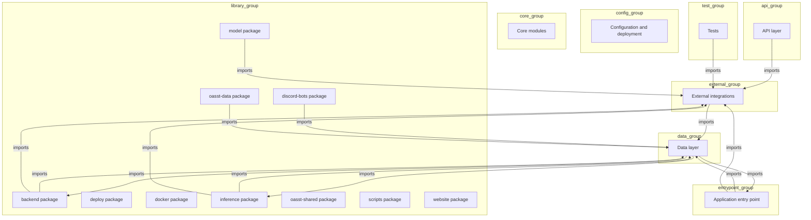

# Architecture report: LAION-AI/Open-Assistant

> Automated static analysis. **Observed** = directly seen in files/imports/AST; **Inferred** = interpretation from that evidence. Repository code was not executed.

## 1. Repository at a glance

| Item | Value |
| --- | --- |
| Repository | LAION-AI/Open-Assistant |
| Description | OpenAssistant is a chat-based assistant that understands tasks, can interact with third-party systems, and retrieve information dynamically to do so. |
| Language | Python |
| Stars | 37351 |
| Licence | Apache-2.0 |
| Analysed commit / branch | f1e6ed9526f5817531f3ab85441a40b3671ddccb / main |
| Framework(s) | FastAPI, React, Starlette, Typer |
| Files analysed | 799 |
| Components | 17 |

## 2. Architecture in one minute

LAION-AI/Open-Assistant - OpenAssistant is a chat-based assistant that understands tasks, can interact with third-party systems, and retrieve information dynamically to do so.. This repository was analysed statically from 799 file(s) (358 Python). Detected technologies (observed from imports/manifests): GitHub Actions, PostgreSQL, Redis, SQLite, FastAPI, React. Files are grouped into 17 component(s): API layer, backend package, Configuration and deployment, Core modules, Data layer, deploy package, discord-bots package, docker package. Observed entry point(s): backend/export.py, backend/import.py, backend/main.py. Findings below distinguish observed facts from inferred interpretation.

## 3. High-level block diagram

## 4. Main components

### API layer (`api_layer`)

- **Kind:** api
- **Status:** Observed
- **Confidence:** 0.85
- **Responsibility:** Groups 27 file(s) under api layer (observed from repository paths and static analysis). Observed routes: POST /api_client, GET /backend_settings/full, GET /backend_settings/public, POST /purge_user/{user_id}, POST /purge_user/{user_id}/messages. Observed top-level classes: APIClientRateLimiter, CreateApiClientRequest, FlaggedMessagePage, FlaggedMessageResponse, FrontendUserId, MergeUsersRequest. Observed top-level functions: abort_message, add_worker_connect_event, api_auth, auth_check, callback_debug, callback_discord.
- **Paths:** `backend/oasst_backend/api/__init__.py`, `backend/oasst_backend/api/deps.py`, `backend/oasst_backend/api/v1/__init__.py`, `backend/oasst_backend/api/v1/admin.py`, `backend/oasst_backend/api/v1/api.py`, `backend/oasst_backend/api/v1/auth.py`, `backend/oasst_backend/api/v1/frontend_messages.py`, `backend/oasst_backend/api/v1/frontend_users.py`, `backend/oasst_backend/api/v1/hugging_face.py`, `backend/oasst_backend/api/v1/leaderboards.py`, `backend/oasst_backend/api/v1/login.py`, `backend/oasst_backend/api/v1/messages.py`, `backend/oasst_backend/api/v1/stats.py`, `backend/oasst_backend/api/v1/tasks.py`, `backend/oasst_backend/api/v1/text_labels.py`, `backend/oasst_backend/api/v1/trollboards.py`, `backend/oasst_backend/api/v1/users.py`, `backend/oasst_backend/api/v1/utils.py`, `discord-bots/oa-bot-js/src/handlers/commands.ts`, `discord-bots/oa-bot-js/src/handlers/events.ts`, `discord-bots/oa-bot-js/src/handlers/interactions.ts`, `inference/server/oasst_inference_server/routes/account.py`, `inference/server/oasst_inference_server/routes/admin.py`, `inference/server/oasst_inference_server/routes/auth.py`, `inference/server/oasst_inference_server/routes/chats.py`, `inference/server/oasst_inference_server/routes/configs.py`, `inference/server/oasst_inference_server/routes/workers.py`
- **Evidence:** [backend/oasst_backend/api/__init__.py](https://github.com/LAION-AI/Open-Assistant/blob/f1e6ed9526f5817531f3ab85441a40b3671ddccb/backend/oasst_backend/api/__init__.py); [backend/oasst_backend/api/deps.py:18](https://github.com/LAION-AI/Open-Assistant/blob/f1e6ed9526f5817531f3ab85441a40b3671ddccb/backend/oasst_backend/api/deps.py#L18); [backend/oasst_backend/api/v1/__init__.py](https://github.com/LAION-AI/Open-Assistant/blob/f1e6ed9526f5817531f3ab85441a40b3671ddccb/backend/oasst_backend/api/v1/__init__.py); [backend/oasst_backend/api/v1/admin.py:23](https://github.com/LAION-AI/Open-Assistant/blob/f1e6ed9526f5817531f3ab85441a40b3671ddccb/backend/oasst_backend/api/v1/admin.py#L23); [backend/oasst_backend/api/v1/api.py](https://github.com/LAION-AI/Open-Assistant/blob/f1e6ed9526f5817531f3ab85441a40b3671ddccb/backend/oasst_backend/api/v1/api.py); [backend/oasst_backend/api/v1/auth.py:16](https://github.com/LAION-AI/Open-Assistant/blob/f1e6ed9526f5817531f3ab85441a40b3671ddccb/backend/oasst_backend/api/v1/auth.py#L16); [backend/oasst_backend/api/v1/frontend_messages.py:15](https://github.com/LAION-AI/Open-Assistant/blob/f1e6ed9526f5817531f3ab85441a40b3671ddccb/backend/oasst_backend/api/v1/frontend_messages.py#L15); [backend/oasst_backend/api/v1/frontend_users.py:20](https://github.com/LAION-AI/Open-Assistant/blob/f1e6ed9526f5817531f3ab85441a40b3671ddccb/backend/oasst_backend/api/v1/frontend_users.py#L20)

### backend package (`backend`)

- **Kind:** library
- **Status:** Observed
- **Confidence:** 0.85
- **Responsibility:** Groups 66 file(s) under backend package (observed from repository paths and static analysis). Observed top-level classes: CommitMode, HfClassificationModel, HfEmbeddingModel, HfUrl, HuggingFaceAPI, JournalEvent. Observed top-level functions: async_managed_tx_function, async_managed_tx_method, build_export_tree, compute_cos_sim_kernel, cos_sim, cos_sim_torch.
- **Paths:** `backend/alembic/env.py`, `backend/alembic/versions/2022_12_15_0000-23e5fea252dd_first_revision.py`, `backend/alembic/versions/2022_12_16_0000-cd7de470586e_v1_db_structure.py`, `backend/alembic/versions/2022_12_17_2230-6368515778c5_add_auth_method_to_person.py`, `backend/alembic/versions/2022_12_22_1835-0daec5f8135f_add_auth_method_to_ix_person_username.py`, `backend/alembic/versions/2022_12_25_1705-067c4002f2d9_add_text_labels.py`, `backend/alembic/versions/2022_12_27_1444-3358eb6834e6_add_journal_table.py`, `backend/alembic/versions/2022_12_28_1142-d24b37426857_post_ref_for_work_package.py`, `backend/alembic/versions/2022_12_28_1824-ef0b52902560_added_lang_column_for_iso_639_1_codes.py`, `backend/alembic/versions/2022_12_29_2103-464ec4667aae_add_collective_flag_to_task.py`, `backend/alembic/versions/2022_12_30_2054-abb47e9d145a_name_changes_person_user_post_message_.py`, `backend/alembic/versions/2022_12_31_0438-8d269bc4fdbd_add_deleted_field_to_post.py`, `backend/alembic/versions/2023_01_05_1144-d4161e384f83_added_messagetreestate_table.py`, `backend/alembic/versions/2023_01_05_1346-3b0adfadbef9_removed_date_created_and_deleted_flag_.py`, `backend/alembic/versions/2023_01_05_1745-20cd871f4ec7_added_user_to_textlabels.py`, `backend/alembic/versions/2023_01_08_1106-3d96bb92e33a_added_minilm_embedding_column_to_message.py`, `backend/alembic/versions/2023_01_08_1603-35bdc1a08bb8_embedding_for_message_now_in_its_own_.py`, `backend/alembic/versions/2023_01_08_2128-aac6b2f66006_created_date.py`, `backend/alembic/versions/2023_01_08_2200-bcc2fe18d214_messagetoxicity.py`, `backend/alembic/versions/2023_01_08_2208-92a367bb9f40_restructure_message_tree_state_table.py`, `backend/alembic/versions/2023_01_09_0047-05975b274a81_add_review_count_ranking_count_to_.py`, `backend/alembic/versions/2023_01_10_1733-846cc08ac79f_add_enabled_deleted_notes_fields_to_user.py`, `backend/alembic/versions/2023_01_12_0119-befa42582ea4_remove_accepted_messages_from_message_.py`, `backend/alembic/versions/2023_01_14_1509-619255ae9076_add_rank_to_message_table.py`, `backend/alembic/versions/2023_01_15_0002-7c98102efbca_change_user_stats_ranking_counts.py`, `backend/alembic/versions/2023_01_15_1139-423557e869e4_add_indices_for_created_date.py`, `backend/alembic/versions/2023_01_15_1654-0964ac95170d_add_rank_and_indices_to_user_stats.py`, `backend/alembic/versions/2023_01_19_2153-7f0a28a156f4_switch_to_timestamp_with_tz.py`, `backend/alembic/versions/2023_01_19_2200-4f26fec4d204_add_ix_user_display_name_id.py`, `backend/alembic/versions/2023_01_20_1650-160ac010efcc_use_en_instead_en_us_as_default_lang.py`, `backend/alembic/versions/2023_01_24_1134-8ba17b5f467a_add_message_id_to_message_reaction.py`, `backend/alembic/versions/2023_01_24_2256-40ed93df0ed5_add_message_emoji.py`, `backend/alembic/versions/2023_01_26_1835-c84fcd6900dc_add_task_created_date_index.py`, `backend/alembic/versions/2023_01_27_2013-f856bf19d32b_add_user_show_on_leaderboard.py`, `backend/alembic/versions/2023_01_28_1157-49d8445b4c90_add_origin_column_to_message_tree_state.py`, `backend/alembic/versions/2023_01_29_1207-7b8f0011e0b0_move_user_streak_from_user_stats_to_.py`, `backend/alembic/versions/2023_02_01_0022-55361f323d12_add_tos_acceptance_date_to_user.py`, `backend/alembic/versions/2023_02_01_1010-f60958968ff8_add_won_prompt_lottery_date_to_mts.py`, `backend/alembic/versions/2023_02_01_2146-9e7ec4a9e3f2_add_skip_bool_skip_reason_to_task.py`, `backend/alembic/versions/2023_02_02_1544-4d7e0b0ebe84_add_troll_stats.py`, `backend/alembic/versions/2023_02_02_1817-8c8241d1f973_add_account_table.py`, `backend/alembic/versions/2023_02_07_1922-caee1e8ee0bc_added_new_table_for_flagged_messages.py`, `backend/alembic/versions/2023_02_11_1030-ba40d055714a_add_cached_stats.py`, `backend/alembic/versions/2023_02_14_1756-165b55de5a94_add_text_labels_message_id_index.py`, `backend/alembic/versions/2023_02_15_1754-8cd0c34d0c3c_message_review_result_nullable.py`, `backend/alembic/versions/2023_02_26_0052-9db92d504f64_add_lang_to_message_tree_state.py`, `backend/alembic/versions/2023_05_07_2129-1b6e3ae16e9d_add_text_search.py`, `backend/alembic/versions/2023_06_06_1505-c181661eba3a_add_message_revisions.py`, `backend/oasst_backend/__init__.py`, `backend/oasst_backend/auth.py`, `backend/oasst_backend/journal_writer.py`, `backend/oasst_backend/prompt_repository.py`, `backend/oasst_backend/scheduled_tasks.py`, `backend/oasst_backend/schemas/__init__.py`, `backend/oasst_backend/schemas/hugging_face.py`, `backend/oasst_backend/schemas/message_tree.py`, `backend/oasst_backend/schemas/text_labels.py`, `backend/oasst_backend/task_repository.py`, `backend/oasst_backend/user_repository.py`, `backend/oasst_backend/utils/__init__.py`, `backend/oasst_backend/utils/database_utils.py`, `backend/oasst_backend/utils/discord.py`, `backend/oasst_backend/utils/exported_tree_loading.py`, `backend/oasst_backend/utils/hugging_face.py`, `backend/oasst_backend/utils/similarity_functions.py`, `backend/oasst_backend/utils/tree_export.py`
- **Evidence:** [backend/alembic/env.py:29](https://github.com/LAION-AI/Open-Assistant/blob/f1e6ed9526f5817531f3ab85441a40b3671ddccb/backend/alembic/env.py#L29); [backend/alembic/versions/2022_12_15_0000-23e5fea252dd_first_revision.py:18](https://github.com/LAION-AI/Open-Assistant/blob/f1e6ed9526f5817531f3ab85441a40b3671ddccb/backend/alembic/versions/2022_12_15_0000-23e5fea252dd_first_revision.py#L18); [backend/alembic/versions/2022_12_16_0000-cd7de470586e_v1_db_structure.py:21](https://github.com/LAION-AI/Open-Assistant/blob/f1e6ed9526f5817531f3ab85441a40b3671ddccb/backend/alembic/versions/2022_12_16_0000-cd7de470586e_v1_db_structure.py#L21); [backend/alembic/versions/2022_12_17_2230-6368515778c5_add_auth_method_to_person.py:18](https://github.com/LAION-AI/Open-Assistant/blob/f1e6ed9526f5817531f3ab85441a40b3671ddccb/backend/alembic/versions/2022_12_17_2230-6368515778c5_add_auth_method_to_person.py#L18); [backend/alembic/versions/2022_12_22_1835-0daec5f8135f_add_auth_method_to_ix_person_username.py:18](https://github.com/LAION-AI/Open-Assistant/blob/f1e6ed9526f5817531f3ab85441a40b3671ddccb/backend/alembic/versions/2022_12_22_1835-0daec5f8135f_add_auth_method_to_ix_person_username.py#L18); [backend/alembic/versions/2022_12_25_1705-067c4002f2d9_add_text_labels.py:20](https://github.com/LAION-AI/Open-Assistant/blob/f1e6ed9526f5817531f3ab85441a40b3671ddccb/backend/alembic/versions/2022_12_25_1705-067c4002f2d9_add_text_labels.py#L20); [backend/alembic/versions/2022_12_27_1444-3358eb6834e6_add_journal_table.py:20](https://github.com/LAION-AI/Open-Assistant/blob/f1e6ed9526f5817531f3ab85441a40b3671ddccb/backend/alembic/versions/2022_12_27_1444-3358eb6834e6_add_journal_table.py#L20); [backend/alembic/versions/2022_12_28_1142-d24b37426857_post_ref_for_work_package.py:20](https://github.com/LAION-AI/Open-Assistant/blob/f1e6ed9526f5817531f3ab85441a40b3671ddccb/backend/alembic/versions/2022_12_28_1142-d24b37426857_post_ref_for_work_package.py#L20)

### Configuration and deployment (`config`)

- **Kind:** config
- **Status:** Observed
- **Confidence:** 0.85
- **Responsibility:** Groups 107 file(s) under configuration and deployment (observed from repository paths and static analysis). Observed top-level classes: Settings, TreeManagerConfiguration. Observed top-level functions: split_keys_string.
- **Paths:** `ansible/deploy-to-node.yaml`, `ansible/inference/deploy-server.yaml`, `ansible/inference/deploy-worker.yaml`, `ansible/inference/test.inventory.ini`, `ansible/test.inventory.ini`, `backend/.env.example`, `backend/alembic.ini`, `backend/oasst_backend/config.py`, `backend/requirements.txt`, `backend/requirements_worker.txt`, `backend/test_data/realistic/realistic_seed_data.json`, `copilot/api/manifest.yml`, `copilot/environments/staging/manifest.yml`, `copilot/web/manifest.yml`, `data/datasets/biostars_qa/requirements.txt`, `data/datasets/cmu_wiki_qa/requirements.txt`, `data/datasets/gutenberg/requirements.txt`, `data/datasets/iapp_wiki_qa_squad/requirements.txt`, `data/datasets/logicreference_OA/requirements.txt`, `data/datasets/poetry_instruction/requirements.txt`, `data/datasets/safety_directory/emergency_infos/wikipedia_emergency_info.json`, `data/datasets/tv_dialogue/requirements.txt`, `data/datasets/ubuntu_dialogue_qa/requirements.txt`, `data/datasets/youtube_subs_howto100M/requirements.txt`, `data/datasets/zhihu-kol/requirements.txt`, `deploy/dev-node/nginx/docker-compose.yaml`, `deploy/prod-node/nginx/docker-compose.yaml`, `deploy/prod2-node/nginx/docker-compose.yaml`, `discord-bots/oa-bot-js/.env.sample`, `discord-bots/oa-bot-js/docker-compose.yml`, `discord-bots/oa-bot-js/package.json`, `discord-bots/oa-bot-js/tsconfig.json`, `discord-bots/oa-bot-py/.env.example`, `discord-bots/oa-bot-py/bot/settings.py`, `discord-bots/oa-bot-py/requirements.txt`, `docker-compose.yaml`, `docker/Dockerfile.backend`, `docker/Dockerfile.backend-worker`, `docker/Dockerfile.discord-bot`, `docker/Dockerfile.model-training`, `docker/Dockerfile.website`, `docker/grafana/dashboards/dashboard.yaml`, `docker/grafana/dashboards/fastapi-backend.json`, `docker/grafana/datasources/datasource.yml`, `docker/inference/Dockerfile.safety`, `docker/inference/Dockerfile.server`, `docker/inference/Dockerfile.worker`, `docker/inference/Dockerfile.worker-full`, `docker/inference/Dockerfile.worker-hf`, `docker/inference/Dockerfile.worker-standalone`, `docker/oasst-postgres/Dockerfile`, `docker/prometheus/prometheus.yml`, `inference/safety/requirements.txt`, `inference/safety/settings.py`, `inference/server/alembic.ini`, `inference/server/oasst_inference_server/plugins/gale_pleaser/ai-plugin.json`, `inference/server/oasst_inference_server/plugins/gale_roaster/ai-plugin.json`, `inference/server/oasst_inference_server/plugins/web_retriever/ai-plugin.json`, `inference/server/oasst_inference_server/settings.py`, `inference/server/requirements.txt`, `inference/text-client/requirements.txt`, `inference/worker/requirements-hf.txt`, `inference/worker/requirements.txt`, `inference/worker/settings.py`, `model/model_eval/manual/config/default.json`, `model/model_eval/manual/config/default_rallio.json`, `model/model_eval/manual/config/noprefix.json`, `model/model_eval/manual/config/noprefix2.json`, `model/model_eval/manual/config/noprefix2_profile.json`, `model/model_eval/manual/config/synth.json`, `model/model_eval/manual/config/synth2.json`, `model/model_eval/manual/config/synth2_gale_prefix.json`, `model/model_eval/manual/config/synth2_rallio_original.json`, `model/model_eval/manual/config/synth_rallio.json`, `model/model_eval/manual/config/system_profile.json`, `model/model_eval/manual/config/system_profile2.json`, `model/model_eval/manual/requirements.txt`, `model/model_eval/sample_results/comparison.json`, `model/model_eval/sample_results/rejected_samples.json`, `model/model_eval/sample_results/selected_samples.json`, `model/model_eval/sample_results/theblackcat102-pythia-12b-deduped-sft.json`, `model/model_training/configs/accelerate_config.yaml`, `model/model_training/configs/config.yaml`, `model/model_training/configs/config_rl.yaml`, `model/model_training/configs/config_rm.yaml`, `model/model_training/configs/deepspeed_rl.json`, `model/model_training/configs/deepspeed_rl_zero3.json`, `model/model_training/configs/ppo_config.yaml`, `model/model_training/configs/zero3_config_falcon.json`, `model/model_training/configs/zero3_config_pretrain.json`, `model/model_training/configs/zero3_config_sft.json`, `model/model_training/configs/zero_config.json`, `model/model_training/configs/zero_config_pretrain.json`, `model/model_training/configs/zero_config_sft_65b.json`, `model/pretokenizer/configs/pretokenize.yaml`, `model/pretokenizer/requirements.txt`, `model/pyproject.toml`, `notebooks/data-augmentation/wikidata-qa/requirements.txt`, `notebooks/example/requirements.txt`, `oasst-data/pyproject.toml`, `oasst-shared/pyproject.toml`, `pyproject.toml`, `scripts/data-collection/twitter/requirements.txt`, `text-frontend/requirements.txt`, `website/.eslintrc.json`, `website/.prettierrc.json`, `website/cypress/fixtures/example.json`
- **Evidence:** [ansible/deploy-to-node.yaml](https://github.com/LAION-AI/Open-Assistant/blob/f1e6ed9526f5817531f3ab85441a40b3671ddccb/ansible/deploy-to-node.yaml); [ansible/inference/deploy-server.yaml](https://github.com/LAION-AI/Open-Assistant/blob/f1e6ed9526f5817531f3ab85441a40b3671ddccb/ansible/inference/deploy-server.yaml); [ansible/inference/deploy-worker.yaml](https://github.com/LAION-AI/Open-Assistant/blob/f1e6ed9526f5817531f3ab85441a40b3671ddccb/ansible/inference/deploy-worker.yaml); [ansible/inference/test.inventory.ini](https://github.com/LAION-AI/Open-Assistant/blob/f1e6ed9526f5817531f3ab85441a40b3671ddccb/ansible/inference/test.inventory.ini); [ansible/test.inventory.ini](https://github.com/LAION-AI/Open-Assistant/blob/f1e6ed9526f5817531f3ab85441a40b3671ddccb/ansible/test.inventory.ini); [backend/.env.example](https://github.com/LAION-AI/Open-Assistant/blob/f1e6ed9526f5817531f3ab85441a40b3671ddccb/backend/.env.example); [backend/alembic.ini](https://github.com/LAION-AI/Open-Assistant/blob/f1e6ed9526f5817531f3ab85441a40b3671ddccb/backend/alembic.ini); [backend/oasst_backend/config.py:8](https://github.com/LAION-AI/Open-Assistant/blob/f1e6ed9526f5817531f3ab85441a40b3671ddccb/backend/oasst_backend/config.py#L8)

### Core modules (`core`)

- **Kind:** core
- **Status:** Observed
- **Confidence:** 0.85
- **Responsibility:** Groups 1 file(s) under core modules (observed from repository paths and static analysis).
- **Paths:** `inlang.config.js`
- **Evidence:** [inlang.config.js](https://github.com/LAION-AI/Open-Assistant/blob/f1e6ed9526f5817531f3ab85441a40b3671ddccb/inlang.config.js)

### Data layer (`data_layer`)

- **Kind:** data
- **Status:** Observed
- **Confidence:** 0.85
- **Responsibility:** Groups 67 file(s) under data layer (observed from repository paths and static analysis). Observed top-level classes: Account, ApiClient, AssistantReplyPayload, CachedStats, DataProcess, DbChat. Observed top-level functions: _expand_mask, _make_causal_mask, _patched_attn_forward, _patched_mlp_forward, add_adapters, add_dropout.
- **Paths:** `backend/oasst_backend/database.py`, `backend/oasst_backend/models/__init__.py`, `backend/oasst_backend/models/api_client.py`, `backend/oasst_backend/models/cached_stats.py`, `backend/oasst_backend/models/db_payload.py`, `backend/oasst_backend/models/flagged_message.py`, `backend/oasst_backend/models/journal.py`, `backend/oasst_backend/models/message.py`, `backend/oasst_backend/models/message_embedding.py`, `backend/oasst_backend/models/message_emoji.py`, `backend/oasst_backend/models/message_reaction.py`, `backend/oasst_backend/models/message_revision.py`, `backend/oasst_backend/models/message_toxicity.py`, `backend/oasst_backend/models/message_tree_state.py`, `backend/oasst_backend/models/payload_column_type.py`, `backend/oasst_backend/models/task.py`, `backend/oasst_backend/models/text_labels.py`, `backend/oasst_backend/models/troll_stats.py`, `backend/oasst_backend/models/user.py`, `backend/oasst_backend/models/user_stats.py`, `data/__init__.py`, `data/datasets/__init__.py`, `data/datasets/mt_note_generation/__init__.py`, `data/datasets/mt_note_generation/hub.py`, `data/datasets/mt_note_generation/mt_note_generation.py`, `data/datasets/nsfw_selfharm_reddit/utils/__init__.py`, `data/datasets/nsfw_selfharm_reddit/utils/is_question.py`, `data/datasets/nsfw_selfharm_reddit/utils/reddit.py`, `data/datasets/oa_stackexchange/combine.py`, `data/datasets/oa_stackexchange/merge_parquets.py`, `data/datasets/oa_stackexchange/stats.py`, `data/datasets/poetry_instruction/prepare.py`, `data/datasets/reasoning_bg_oa/data_process.py`, `data/datasets/reasoning_gsm_qna_oa/data_process.py`, `data/datasets/safety_directory/child_help/child_help.py`, `data/datasets/safety_directory/emergency_infos/wikipedia_emergency_info.js`, `data/datasets/safety_directory/emergency_numbers/emergency_numbers.py`, `data/datasets/semantics_ws_qna_oa/data_process.py`, `data/datasets/semantics_ws_qna_oa/random_stuff.py`, `data/datasets/soda_synthetic_dialogue/__init__.py`, `data/datasets/soda_synthetic_dialogue/hub.py`, `data/datasets/soda_synthetic_dialogue/soda_synthetic_dialogue.py`, `data/datasets/tatoeba_mt_qna_oa/data_process.py`, `data/datasets/tatoeba_mt_qna_oa/language_names.py`, `data/datasets/tatoeba_mt_qna_oa/language_paraphrase.py`, `data/datasets/tatoeba_mt_qna_oa/language_translate.py`, `data/datasets/youtube_subs_howto100M/__init__.py`, `data/datasets/youtube_subs_howto100M/hub.py`, `data/datasets/zhihu-kol/__init__.py`, `data/datasets/zhihu-kol/upload_hf.py`, `discord-bots/oa-bot-py/bot/db/schemas.py`, `inference/server/oasst_inference_server/database.py`, `inference/server/oasst_inference_server/models/__init__.py`, `inference/server/oasst_inference_server/models/chat.py`, `inference/server/oasst_inference_server/models/user.py`, `inference/server/oasst_inference_server/models/worker.py`, `model/model_training/models/__init__.py`, `model/model_training/models/gptj.py`, `model/model_training/models/patching.py`, `model/model_training/models/patching_falcon.py`, `model/model_training/models/patching_llama.py`, `model/model_training/models/patching_neox.py`, `model/model_training/models/peft_modeling.py`, `model/model_training/models/prefix_llama.py`, `model/model_training/models/reward_model.py`, `model/model_training/models/rope.py`, `oasst-data/oasst_data/schemas.py`
- **Evidence:** [backend/oasst_backend/database.py](https://github.com/LAION-AI/Open-Assistant/blob/f1e6ed9526f5817531f3ab85441a40b3671ddccb/backend/oasst_backend/database.py); [backend/oasst_backend/models/__init__.py](https://github.com/LAION-AI/Open-Assistant/blob/f1e6ed9526f5817531f3ab85441a40b3671ddccb/backend/oasst_backend/models/__init__.py); [backend/oasst_backend/models/api_client.py:10](https://github.com/LAION-AI/Open-Assistant/blob/f1e6ed9526f5817531f3ab85441a40b3671ddccb/backend/oasst_backend/models/api_client.py#L10); [backend/oasst_backend/models/cached_stats.py:8](https://github.com/LAION-AI/Open-Assistant/blob/f1e6ed9526f5817531f3ab85441a40b3671ddccb/backend/oasst_backend/models/cached_stats.py#L8); [backend/oasst_backend/models/db_payload.py:10](https://github.com/LAION-AI/Open-Assistant/blob/f1e6ed9526f5817531f3ab85441a40b3671ddccb/backend/oasst_backend/models/db_payload.py#L10); [backend/oasst_backend/models/flagged_message.py:10](https://github.com/LAION-AI/Open-Assistant/blob/f1e6ed9526f5817531f3ab85441a40b3671ddccb/backend/oasst_backend/models/flagged_message.py#L10); [backend/oasst_backend/models/journal.py:12](https://github.com/LAION-AI/Open-Assistant/blob/f1e6ed9526f5817531f3ab85441a40b3671ddccb/backend/oasst_backend/models/journal.py#L12); [backend/oasst_backend/models/message.py:18](https://github.com/LAION-AI/Open-Assistant/blob/f1e6ed9526f5817531f3ab85441a40b3671ddccb/backend/oasst_backend/models/message.py#L18)

### deploy package (`deploy`)

- **Kind:** library
- **Status:** Observed
- **Confidence:** 0.85
- **Responsibility:** Groups 6 file(s) under deploy package (observed from repository paths and static analysis).
- **Paths:** `deploy/dev-node/nginx/get_cert.sh`, `deploy/dev-node/nginx/renew_certs.sh`, `deploy/prod-node/nginx/get_cert.sh`, `deploy/prod-node/nginx/renew_certs.sh`, `deploy/prod2-node/nginx/get_cert.sh`, `deploy/prod2-node/nginx/renew_certs.sh`
- **Evidence:** [deploy/dev-node/nginx/get_cert.sh](https://github.com/LAION-AI/Open-Assistant/blob/f1e6ed9526f5817531f3ab85441a40b3671ddccb/deploy/dev-node/nginx/get_cert.sh); [deploy/dev-node/nginx/renew_certs.sh](https://github.com/LAION-AI/Open-Assistant/blob/f1e6ed9526f5817531f3ab85441a40b3671ddccb/deploy/dev-node/nginx/renew_certs.sh); [deploy/prod-node/nginx/get_cert.sh](https://github.com/LAION-AI/Open-Assistant/blob/f1e6ed9526f5817531f3ab85441a40b3671ddccb/deploy/prod-node/nginx/get_cert.sh); [deploy/prod-node/nginx/renew_certs.sh](https://github.com/LAION-AI/Open-Assistant/blob/f1e6ed9526f5817531f3ab85441a40b3671ddccb/deploy/prod-node/nginx/renew_certs.sh); [deploy/prod2-node/nginx/get_cert.sh](https://github.com/LAION-AI/Open-Assistant/blob/f1e6ed9526f5817531f3ab85441a40b3671ddccb/deploy/prod2-node/nginx/get_cert.sh); [deploy/prod2-node/nginx/renew_certs.sh](https://github.com/LAION-AI/Open-Assistant/blob/f1e6ed9526f5817531f3ab85441a40b3671ddccb/deploy/prod2-node/nginx/renew_certs.sh)

### discord-bots package (`discord_bots`)

- **Kind:** library
- **Status:** Observed
- **Confidence:** 0.85
- **Responsibility:** Groups 40 file(s) under discord-bots package (observed from repository paths and static analysis). Observed top-level classes: AssistantReplyHandler, InitialPromptHandler, LabelAssistantReplyHandler, LabelModal, LabelPrompterReplyHandler, LabelSelect. Observed top-level functions: _assistant, _conversation, _get_extensions, _h1, _h2, _h3.
- **Paths:** `discord-bots/oa-bot-js/src/bot.ts`, `discord-bots/oa-bot-js/src/commands/bot.ts`, `discord-bots/oa-bot-js/src/commands/chat.ts`, `discord-bots/oa-bot-js/src/commands/task.ts`, `discord-bots/oa-bot-js/src/events/commands.ts`, `discord-bots/oa-bot-js/src/events/interactions.ts`, `discord-bots/oa-bot-js/src/events/messages.ts`, `discord-bots/oa-bot-js/src/events/ready.ts`, `discord-bots/oa-bot-js/src/index.ts`, `discord-bots/oa-bot-js/src/interactions/model.ts`, `discord-bots/oa-bot-js/src/interactions/modelselect.ts`, `discord-bots/oa-bot-js/src/interactions/tasks.ts`, `discord-bots/oa-bot-js/src/interactions/vote.ts`, `discord-bots/oa-bot-js/src/modules/chat.ts`, `discord-bots/oa-bot-js/src/modules/db.ts`, `discord-bots/oa-bot-js/src/modules/inference/client.ts`, `discord-bots/oa-bot-js/src/modules/inference/index.ts`, `discord-bots/oa-bot-js/src/modules/inference/types.ts`, `discord-bots/oa-bot-js/src/modules/open-assistant/interactions.ts`, `discord-bots/oa-bot-js/src/modules/open-assistant/interactions/info.ts`, `discord-bots/oa-bot-js/src/modules/open-assistant/interactions/init.ts`, `discord-bots/oa-bot-js/src/modules/open-assistant/interactions/label.ts`, `discord-bots/oa-bot-js/src/modules/open-assistant/interactions/lang.ts`, `discord-bots/oa-bot-js/src/modules/open-assistant/interactions/task.ts`, `discord-bots/oa-bot-js/src/modules/open-assistant/labels.ts`, `discord-bots/oa-bot-js/src/modules/open-assistant/langs.ts`, `discord-bots/oa-bot-js/src/modules/open-assistant/tasks.ts`, `discord-bots/oa-bot-js/src/modules/open-assistant/user.ts`, `discord-bots/oa-bot-js/src/modules/redis.ts`, `discord-bots/oa-bot-py/bot/__init__.py`, `discord-bots/oa-bot-py/bot/bot.py`, `discord-bots/oa-bot-py/bot/extensions/__init__.py`, `discord-bots/oa-bot-py/bot/extensions/guild_settings.py`, `discord-bots/oa-bot-py/bot/extensions/help.py`, `discord-bots/oa-bot-py/bot/extensions/hot_reload.py`, `discord-bots/oa-bot-py/bot/extensions/text_labels.py`, `discord-bots/oa-bot-py/bot/extensions/work.py`, `discord-bots/oa-bot-py/bot/messages.py`, `discord-bots/oa-bot-py/bot/utils.py`, `discord-bots/oa-bot-py/message_templates.py`
- **Evidence:** [discord-bots/oa-bot-js/src/bot.ts](https://github.com/LAION-AI/Open-Assistant/blob/f1e6ed9526f5817531f3ab85441a40b3671ddccb/discord-bots/oa-bot-js/src/bot.ts); [discord-bots/oa-bot-js/src/commands/bot.ts](https://github.com/LAION-AI/Open-Assistant/blob/f1e6ed9526f5817531f3ab85441a40b3671ddccb/discord-bots/oa-bot-js/src/commands/bot.ts); [discord-bots/oa-bot-js/src/commands/chat.ts](https://github.com/LAION-AI/Open-Assistant/blob/f1e6ed9526f5817531f3ab85441a40b3671ddccb/discord-bots/oa-bot-js/src/commands/chat.ts); [discord-bots/oa-bot-js/src/commands/task.ts](https://github.com/LAION-AI/Open-Assistant/blob/f1e6ed9526f5817531f3ab85441a40b3671ddccb/discord-bots/oa-bot-js/src/commands/task.ts); [discord-bots/oa-bot-js/src/events/commands.ts](https://github.com/LAION-AI/Open-Assistant/blob/f1e6ed9526f5817531f3ab85441a40b3671ddccb/discord-bots/oa-bot-js/src/events/commands.ts); [discord-bots/oa-bot-js/src/events/interactions.ts](https://github.com/LAION-AI/Open-Assistant/blob/f1e6ed9526f5817531f3ab85441a40b3671ddccb/discord-bots/oa-bot-js/src/events/interactions.ts); [discord-bots/oa-bot-js/src/events/messages.ts](https://github.com/LAION-AI/Open-Assistant/blob/f1e6ed9526f5817531f3ab85441a40b3671ddccb/discord-bots/oa-bot-js/src/events/messages.ts); [discord-bots/oa-bot-js/src/events/ready.ts](https://github.com/LAION-AI/Open-Assistant/blob/f1e6ed9526f5817531f3ab85441a40b3671ddccb/discord-bots/oa-bot-js/src/events/ready.ts)

### docker package (`docker`)

- **Kind:** library
- **Status:** Observed
- **Confidence:** 0.85
- **Responsibility:** Groups 1 file(s) under docker package (observed from repository paths and static analysis).
- **Paths:** `docker/oasst-postgres/backup_pg_to_s3.sh`
- **Evidence:** [docker/oasst-postgres/backup_pg_to_s3.sh](https://github.com/LAION-AI/Open-Assistant/blob/f1e6ed9526f5817531f3ab85441a40b3671ddccb/docker/oasst-postgres/backup_pg_to_s3.sh)

### Application entry point (`entrypoint`)

- **Kind:** entrypoint
- **Status:** Observed
- **Confidence:** 0.85
- **Responsibility:** Groups 86 file(s) under application entry point (observed from repository paths and static analysis). Observed application object created via Celery, FastAPI, Typer. Observed routes: POST /safety, GET /health, GET /icon.png, GET /ai-plugin.json, GET /get-instructions/. Observed top-level classes: ActiveTreeSizeRow, AggregateResults, CachedStatsRepository, ChatRole, CodeBugger, CodeInstructor. Observed top-level functions: _create_troll_score, _create_user_score, _random_message_id, _render_message, alembic_upgrade, analytic_solution.
- **Paths:** `backend/export.py`, `backend/import.py`, `backend/main.py`, `backend/oasst_backend/cached_stats_repository.py`, `backend/oasst_backend/celery_worker.py`, `backend/oasst_backend/tree_manager.py`, `backend/oasst_backend/user_stats_repository.py`, `backend/oasst_backend/utils/language_classification.py`, `backend/oasst_backend/utils/message_tree_topic_modeling.py`, `backend/oasst_backend/utils/ranking.py`, `backend/rerank.py`, `backend/update_message_attributes.py`, `data/datasets/TSSB-3M/generate_dataset.py`, `data/datasets/TSSB-3M/load_script.py`, `data/datasets/bart_searchgpt_wiki_nlp_augment/1_clean_wikitext.py`, `data/datasets/bart_searchgpt_wiki_nlp_augment/3_10k_bart_trial.py`, `data/datasets/bart_searchgpt_wiki_nlp_augment/4_convert_to_oa_format.py`, `data/datasets/bart_searchgpt_wiki_nlp_augment/5_test_downloading_my_dataset.py`, `data/datasets/biostars_qa/get_biostars_dataset.py`, `data/datasets/cocktail_recipes/loading_script.py`, `data/datasets/iapp_wiki_qa_squad/loading_script.py`, `data/datasets/logicreference_OA/generate_dataset.py`, `data/datasets/mt_note_generation/prepare.py`, `data/datasets/oa_dolly_15k/create_dataset.py`, `data/datasets/oa_stackexchange/download.py`, `data/datasets/oa_stackexchange/process.py`, `data/datasets/oa_stackexchange/upload.py`, `data/datasets/soda_synthetic_dialogue/prepare.py`, `data/datasets/youtube_subs_howto100M/prepare.py`, `data/datasets/youtube_subs_howto100M/youtube_subs_howto100M.py`, `data/datasets/zhihu-kol/convert_parquet.py`, `data/datasets/zhihu-kol/main.py`, `data/datasets/zhihu-kol/scrape_by_topic.py`, `discord-bots/oa-bot-py/bot/__main__.py`, `inference/safety/main.py`, `inference/server/export.py`, `inference/server/main.py`, `inference/server/oasst_inference_server/plugins/gale_pleaser/main.py`, `inference/server/oasst_inference_server/plugins/gale_roaster/main.py`, `inference/server/oasst_inference_server/plugins/web_retriever/main.py`, `inference/text-client/__main__.py`, `inference/worker/__main__.py`, `inference/worker/basic_hf_server.py`, `inference/worker/chat_chain.py`, `inference/worker/download_model.py`, `inference/worker/download_model_hf.py`, `inference/worker/get_model_config_prop.py`, `model/model_eval/eval_rm.py`, `model/model_eval/manual/create_synth_import.py`, `model/model_eval/manual/sampling_report.py`, `model/model_eval/manual/subsample_dataset.py`, `model/model_eval/rejection_sampling.py`, `model/model_eval/sampling_score.py`, `model/model_training/check_dataset_appearances.py`, `model/model_training/check_dataset_counts.py`, `model/model_training/models/patching_utils.py`, `model/model_training/to_triton.py`, `model/model_training/tools/augment_oasst.py`, `model/model_training/tools/check_oasst_export.py`, `model/model_training/tools/export_model.py`, `model/model_training/tools/model_chat.py`, `model/model_training/tools/model_cli.py`, `model/model_training/tools/sample_rm_data.py`, `model/model_training/trainer_rl.py`, `model/model_training/trainer_rm.py`, `model/model_training/trainer_sft.py`, `model/pretokenizer/create_hf_tokenizer_config.py`, `model/pretokenizer/pretokenize.py`, `notebooks/data-augmentation/anthropic/trainer.py`, `oasst-data/examples/clean_dataset.py`, `oasst-data/examples/filter_messages.py`, `oasst-data/examples/filter_trees.py`, `oasst-data/examples/split_dataset.py`, `oasst-data/examples/tree_to_messages.py`, `scripts/data-collection/twitter/twitter_process_json.py`, `scripts/data_augment/data_augment.py`, `scripts/frontend-development/find-missing-locales.py`, `scripts/postprocessing/importance_selection.py`, `scripts/postprocessing/infogain_selector.py`, `scripts/postprocessing/ranking_disagreement.py`, `scripts/postprocessing/rankings.py`, `scripts/postprocessing/scoring.py`, `scripts/postprocessing/task_schedule.py`, `scripts/xor-codec/xor_codec.py`, `text-frontend/__main__.py`, `text-frontend/auto_main.py`
- **Evidence:** [backend/export.py:26](https://github.com/LAION-AI/Open-Assistant/blob/f1e6ed9526f5817531f3ab85441a40b3671ddccb/backend/export.py#L26); [backend/import.py:26](https://github.com/LAION-AI/Open-Assistant/blob/f1e6ed9526f5817531f3ab85441a40b3671ddccb/backend/import.py#L26); [backend/main.py:35](https://github.com/LAION-AI/Open-Assistant/blob/f1e6ed9526f5817531f3ab85441a40b3671ddccb/backend/main.py#L35); [backend/oasst_backend/cached_stats_repository.py:9](https://github.com/LAION-AI/Open-Assistant/blob/f1e6ed9526f5817531f3ab85441a40b3671ddccb/backend/oasst_backend/cached_stats_repository.py#L9); [backend/oasst_backend/celery_worker.py:11](https://github.com/LAION-AI/Open-Assistant/blob/f1e6ed9526f5817531f3ab85441a40b3671ddccb/backend/oasst_backend/celery_worker.py#L11); [backend/oasst_backend/tree_manager.py:42](https://github.com/LAION-AI/Open-Assistant/blob/f1e6ed9526f5817531f3ab85441a40b3671ddccb/backend/oasst_backend/tree_manager.py#L42); [backend/oasst_backend/user_stats_repository.py:42](https://github.com/LAION-AI/Open-Assistant/blob/f1e6ed9526f5817531f3ab85441a40b3671ddccb/backend/oasst_backend/user_stats_repository.py#L42); [backend/oasst_backend/utils/language_classification.py:12](https://github.com/LAION-AI/Open-Assistant/blob/f1e6ed9526f5817531f3ab85441a40b3671ddccb/backend/oasst_backend/utils/language_classification.py#L12)

### External integrations (`external_integrations`)

- **Kind:** external
- **Status:** Observed
- **Confidence:** 0.85
- **Responsibility:** Groups 3 file(s) under external integrations (observed from repository paths and static analysis). Observed top-level classes: OasstApiClient, TaskType. Observed top-level functions: downgrade, upgrade.
- **Paths:** `backend/alembic/versions/2022_12_30_0109-73ce3675c1f5_add_field_trusted_api_client.py`, `backend/alembic/versions/2023_01_07_1250-ba61fe17fb6e_added_frontend_type_to_api_client.py`, `oasst-shared/oasst_shared/api_client.py`
- **Evidence:** [backend/alembic/versions/2022_12_30_0109-73ce3675c1f5_add_field_trusted_api_client.py:18](https://github.com/LAION-AI/Open-Assistant/blob/f1e6ed9526f5817531f3ab85441a40b3671ddccb/backend/alembic/versions/2022_12_30_0109-73ce3675c1f5_add_field_trusted_api_client.py#L18); [backend/alembic/versions/2023_01_07_1250-ba61fe17fb6e_added_frontend_type_to_api_client.py:18](https://github.com/LAION-AI/Open-Assistant/blob/f1e6ed9526f5817531f3ab85441a40b3671ddccb/backend/alembic/versions/2023_01_07_1250-ba61fe17fb6e_added_frontend_type_to_api_client.py#L18); [oasst-shared/oasst_shared/api_client.py:16](https://github.com/LAION-AI/Open-Assistant/blob/f1e6ed9526f5817531f3ab85441a40b3671ddccb/oasst-shared/oasst_shared/api_client.py#L16)

### inference package (`inference`)

- **Kind:** library
- **Status:** Observed
- **Confidence:** 0.85
- **Responsibility:** Groups 43 file(s) under inference package (observed from repository paths and static analysis). Observed top-level classes: ChatListRead, ChatRead, ChatRepository, ChatUpdateRequest, CreateAssistantMessageRequest, CreateChatRequest. Observed top-level functions: _unpack, attempt_fetch_plugin, build_payload, build_work_request, compliance_queue, compose_tools_from_plugin.
- **Paths:** `inference/full-dev-setup.sh`, `inference/safety/safety_main.sh`, `inference/server/alembic/env.py`, `inference/server/alembic/versions/2023_03_12_1742-7d5be54acd49_initial_revision.py`, `inference/server/alembic/versions/2023_03_21_2116-629d5081160f_changed_worker_config_to_worker_info.py`, `inference/server/alembic/versions/2023_03_22_2113-78f16015b904_add_refresh_token_table.py`, `inference/server/alembic/versions/2023_04_12_2033-f0e18084aae4_add_deleted_field_to_user.py`, `inference/server/alembic/versions/2023_04_14_1611-b66fd8f9da1f_add_hidden_field_to_chats.py`, `inference/server/alembic/versions/2023_04_24_2130-401eef162771_add_chat_data_opt_out_field.py`, `inference/server/alembic/versions/2023_04_29_1739-ea19bbc743f9_add_safe_content_to_message.py`, `inference/server/alembic/versions/2023_05_01_2253-5b4211625a9f_added_used_plugin_to_message.py`, `inference/server/alembic/versions/2023_05_29_1551-5ed411a331f4_add_active_thread_tail_messsage_id_and_.py`, `inference/server/oasst_inference_server/__init__.py`, `inference/server/oasst_inference_server/admin.py`, `inference/server/oasst_inference_server/auth.py`, `inference/server/oasst_inference_server/chat_repository.py`, `inference/server/oasst_inference_server/chat_utils.py`, `inference/server/oasst_inference_server/compliance.py`, `inference/server/oasst_inference_server/deps.py`, `inference/server/oasst_inference_server/plugin_utils.py`, `inference/server/oasst_inference_server/plugins/__init__.py`, `inference/server/oasst_inference_server/queueing.py`, `inference/server/oasst_inference_server/schemas/__init__.py`, `inference/server/oasst_inference_server/schemas/auth.py`, `inference/server/oasst_inference_server/schemas/chat.py`, `inference/server/oasst_inference_server/schemas/worker.py`, `inference/server/oasst_inference_server/user_chat_repository.py`, `inference/server/oasst_inference_server/worker_utils.py`, `inference/server/server_main.sh`, `inference/text-client/text_client_utils.py`, `inference/worker/chat_chain_prompts.py`, `inference/worker/chat_chain_utils.py`, `inference/worker/hf_langchain_inference.py`, `inference/worker/hf_stopping.py`, `inference/worker/hf_streamer.py`, `inference/worker/interface.py`, `inference/worker/openapi_parser.py`, `inference/worker/run_worker_container.sh`, `inference/worker/utils.py`, `inference/worker/work.py`, `inference/worker/worker_full_main.sh`, `inference/worker/worker_hf_main.sh`, `inference/worker/worker_standalone_main.sh`
- **Evidence:** [inference/full-dev-setup.sh](https://github.com/LAION-AI/Open-Assistant/blob/f1e6ed9526f5817531f3ab85441a40b3671ddccb/inference/full-dev-setup.sh); [inference/safety/safety_main.sh](https://github.com/LAION-AI/Open-Assistant/blob/f1e6ed9526f5817531f3ab85441a40b3671ddccb/inference/safety/safety_main.sh); [inference/server/alembic/env.py:32](https://github.com/LAION-AI/Open-Assistant/blob/f1e6ed9526f5817531f3ab85441a40b3671ddccb/inference/server/alembic/env.py#L32); [inference/server/alembic/versions/2023_03_12_1742-7d5be54acd49_initial_revision.py:20](https://github.com/LAION-AI/Open-Assistant/blob/f1e6ed9526f5817531f3ab85441a40b3671ddccb/inference/server/alembic/versions/2023_03_12_1742-7d5be54acd49_initial_revision.py#L20); [inference/server/alembic/versions/2023_03_21_2116-629d5081160f_changed_worker_config_to_worker_info.py:19](https://github.com/LAION-AI/Open-Assistant/blob/f1e6ed9526f5817531f3ab85441a40b3671ddccb/inference/server/alembic/versions/2023_03_21_2116-629d5081160f_changed_worker_config_to_worker_info.py#L19); [inference/server/alembic/versions/2023_03_22_2113-78f16015b904_add_refresh_token_table.py:19](https://github.com/LAION-AI/Open-Assistant/blob/f1e6ed9526f5817531f3ab85441a40b3671ddccb/inference/server/alembic/versions/2023_03_22_2113-78f16015b904_add_refresh_token_table.py#L19); [inference/server/alembic/versions/2023_04_12_2033-f0e18084aae4_add_deleted_field_to_user.py:18](https://github.com/LAION-AI/Open-Assistant/blob/f1e6ed9526f5817531f3ab85441a40b3671ddccb/inference/server/alembic/versions/2023_04_12_2033-f0e18084aae4_add_deleted_field_to_user.py#L18); [inference/server/alembic/versions/2023_04_14_1611-b66fd8f9da1f_add_hidden_field_to_chats.py:18](https://github.com/LAION-AI/Open-Assistant/blob/f1e6ed9526f5817531f3ab85441a40b3671ddccb/inference/server/alembic/versions/2023_04_14_1611-b66fd8f9da1f_add_hidden_field_to_chats.py#L18)

### model package (`model`)

- **Kind:** library
- **Status:** Observed
- **Confidence:** 0.85
- **Responsibility:** Groups 27 file(s) under model package (observed from repository paths and static analysis). Observed top-level classes: AbstractTokenizer, AlpacaBaseDataset, AlpacaGpt4, AnthropicRLHF, AugmentedOA, CrossEntropyLoss. Observed top-level functions: __best_fitting_dtype, _filter_by_words, _strtobool, _vocab_size_with_padding, _warmup_mmap_file, build_tokenizer.
- **Paths:** `model/model_eval/__init__.py`, `model/model_eval/eval_datasets.py`, `model/model_eval/utils.py`, `model/model_training/__init__.py`, `model/model_training/custom_datasets/__init__.py`, `model/model_training/custom_datasets/dialogue_collator.py`, `model/model_training/custom_datasets/extra_rm_datasets.py`, `model/model_training/custom_datasets/formatting.py`, `model/model_training/custom_datasets/instruction.py`, `model/model_training/custom_datasets/oasst_dataset.py`, `model/model_training/custom_datasets/pretrain_datasets.py`, `model/model_training/custom_datasets/prompt_dialogue.py`, `model/model_training/custom_datasets/qa_datasets.py`, `model/model_training/custom_datasets/rank_datasets.py`, `model/model_training/custom_datasets/ranking_collator.py`, `model/model_training/custom_datasets/summarization.py`, `model/model_training/custom_datasets/toxic_conversation.py`, `model/model_training/custom_datasets/translation.py`, `model/model_training/custom_datasets/utils.py`, `model/model_training/efficiency_utils.py`, `model/model_training/metrics.py`, `model/model_training/utils/losses.py`, `model/model_training/utils/ppo_utils.py`, `model/model_training/utils/utils.py`, `model/model_training/utils/utils_rl.py`, `model/pretokenizer/indexed_dataset.py`, `model/pretokenizer/tokenizer.py`
- **Evidence:** [model/model_eval/__init__.py](https://github.com/LAION-AI/Open-Assistant/blob/f1e6ed9526f5817531f3ab85441a40b3671ddccb/model/model_eval/__init__.py); [model/model_eval/eval_datasets.py:8](https://github.com/LAION-AI/Open-Assistant/blob/f1e6ed9526f5817531f3ab85441a40b3671ddccb/model/model_eval/eval_datasets.py#L8); [model/model_eval/utils.py:7](https://github.com/LAION-AI/Open-Assistant/blob/f1e6ed9526f5817531f3ab85441a40b3671ddccb/model/model_eval/utils.py#L7); [model/model_training/__init__.py](https://github.com/LAION-AI/Open-Assistant/blob/f1e6ed9526f5817531f3ab85441a40b3671ddccb/model/model_training/__init__.py); [model/model_training/custom_datasets/__init__.py:81](https://github.com/LAION-AI/Open-Assistant/blob/f1e6ed9526f5817531f3ab85441a40b3671ddccb/model/model_training/custom_datasets/__init__.py#L81); [model/model_training/custom_datasets/dialogue_collator.py:19](https://github.com/LAION-AI/Open-Assistant/blob/f1e6ed9526f5817531f3ab85441a40b3671ddccb/model/model_training/custom_datasets/dialogue_collator.py#L19); [model/model_training/custom_datasets/extra_rm_datasets.py:5](https://github.com/LAION-AI/Open-Assistant/blob/f1e6ed9526f5817531f3ab85441a40b3671ddccb/model/model_training/custom_datasets/extra_rm_datasets.py#L5); [model/model_training/custom_datasets/formatting.py:19](https://github.com/LAION-AI/Open-Assistant/blob/f1e6ed9526f5817531f3ab85441a40b3671ddccb/model/model_training/custom_datasets/formatting.py#L19)

### oasst-data package (`oasst_data`)

- **Kind:** library
- **Status:** Observed
- **Confidence:** 0.85
- **Responsibility:** Groups 4 file(s) under oasst-data package (observed from repository paths and static analysis). Observed top-level functions: convert_hf_message, default_serializer, open_jsonl_read, open_jsonl_write, read_dataset_message_trees, read_dataset_messages.
- **Paths:** `oasst-data/oasst_data/__init__.py`, `oasst-data/oasst_data/reader.py`, `oasst-data/oasst_data/traversal.py`, `oasst-data/oasst_data/writer.py`
- **Evidence:** [oasst-data/oasst_data/__init__.py](https://github.com/LAION-AI/Open-Assistant/blob/f1e6ed9526f5817531f3ab85441a40b3671ddccb/oasst-data/oasst_data/__init__.py); [oasst-data/oasst_data/reader.py:12](https://github.com/LAION-AI/Open-Assistant/blob/f1e6ed9526f5817531f3ab85441a40b3671ddccb/oasst-data/oasst_data/reader.py#L12); [oasst-data/oasst_data/traversal.py:6](https://github.com/LAION-AI/Open-Assistant/blob/f1e6ed9526f5817531f3ab85441a40b3671ddccb/oasst-data/oasst_data/traversal.py#L6); [oasst-data/oasst_data/writer.py:10](https://github.com/LAION-AI/Open-Assistant/blob/f1e6ed9526f5817531f3ab85441a40b3671ddccb/oasst-data/oasst_data/writer.py#L10)

### oasst-shared package (`oasst_shared`)

- **Kind:** library
- **Status:** Observed
- **Confidence:** 0.85
- **Responsibility:** Groups 8 file(s) under oasst-shared package (observed from repository paths and static analysis). Observed top-level classes: AbstractLabelTask, AbstractRatingTask, Account, AllCachedStatsResponse, Anonymizer, AssistantReplyTask. Observed top-level functions: log_timing, make_seed, sha256_hash, unaware_to_utc, utcnow.
- **Paths:** `oasst-shared/oasst_shared/__init__.py`, `oasst-shared/oasst_shared/exceptions/__init__.py`, `oasst-shared/oasst_shared/exceptions/oasst_api_error.py`, `oasst-shared/oasst_shared/model_configs.py`, `oasst-shared/oasst_shared/schemas/__init__.py`, `oasst-shared/oasst_shared/schemas/inference.py`, `oasst-shared/oasst_shared/schemas/protocol.py`, `oasst-shared/oasst_shared/utils.py`
- **Evidence:** [oasst-shared/oasst_shared/__init__.py](https://github.com/LAION-AI/Open-Assistant/blob/f1e6ed9526f5817531f3ab85441a40b3671ddccb/oasst-shared/oasst_shared/__init__.py); [oasst-shared/oasst_shared/exceptions/__init__.py](https://github.com/LAION-AI/Open-Assistant/blob/f1e6ed9526f5817531f3ab85441a40b3671ddccb/oasst-shared/oasst_shared/exceptions/__init__.py); [oasst-shared/oasst_shared/exceptions/oasst_api_error.py:5](https://github.com/LAION-AI/Open-Assistant/blob/f1e6ed9526f5817531f3ab85441a40b3671ddccb/oasst-shared/oasst_shared/exceptions/oasst_api_error.py#L5); [oasst-shared/oasst_shared/model_configs.py:4](https://github.com/LAION-AI/Open-Assistant/blob/f1e6ed9526f5817531f3ab85441a40b3671ddccb/oasst-shared/oasst_shared/model_configs.py#L4); [oasst-shared/oasst_shared/schemas/__init__.py](https://github.com/LAION-AI/Open-Assistant/blob/f1e6ed9526f5817531f3ab85441a40b3671ddccb/oasst-shared/oasst_shared/schemas/__init__.py); [oasst-shared/oasst_shared/schemas/inference.py:16](https://github.com/LAION-AI/Open-Assistant/blob/f1e6ed9526f5817531f3ab85441a40b3671ddccb/oasst-shared/oasst_shared/schemas/inference.py#L16); [oasst-shared/oasst_shared/schemas/protocol.py:11](https://github.com/LAION-AI/Open-Assistant/blob/f1e6ed9526f5817531f3ab85441a40b3671ddccb/oasst-shared/oasst_shared/schemas/protocol.py#L11); [oasst-shared/oasst_shared/utils.py:12](https://github.com/LAION-AI/Open-Assistant/blob/f1e6ed9526f5817531f3ab85441a40b3671ddccb/oasst-shared/oasst_shared/utils.py#L12)

### scripts package (`scripts`)

- **Kind:** library
- **Status:** Observed
- **Confidence:** 0.85
- **Responsibility:** Groups 14 file(s) under scripts package (observed from repository paths and static analysis). Observed top-level classes: ConversationTree, ConversationTreeNode, PIIDetector, Settings. Observed top-level functions: on_ready, role_decide.
- **Paths:** `scripts/backend-development/run-local-no-limit.sh`, `scripts/backend-development/run-local.sh`, `scripts/backend-development/start-docker.sh`, `scripts/backend-development/start-mock-server.sh`, `scripts/backend-development/start-worker.sh`, `scripts/backend-development/stop-mock-server.sh`, `scripts/backend-development/stop-worker.sh`, `scripts/data-collection/twitter/twitter_create_convs.py`, `scripts/discord/stats.py`, `scripts/discord/verify-lobby.py`, `scripts/frontend-development/run-bot-local.sh`, `scripts/frontend-development/run-contract-test.sh`, `scripts/oasst-shared-development/test.sh`, `scripts/postprocessing/regex_pii_detector.py`
- **Evidence:** [scripts/backend-development/run-local-no-limit.sh](https://github.com/LAION-AI/Open-Assistant/blob/f1e6ed9526f5817531f3ab85441a40b3671ddccb/scripts/backend-development/run-local-no-limit.sh); [scripts/backend-development/run-local.sh](https://github.com/LAION-AI/Open-Assistant/blob/f1e6ed9526f5817531f3ab85441a40b3671ddccb/scripts/backend-development/run-local.sh); [scripts/backend-development/start-docker.sh](https://github.com/LAION-AI/Open-Assistant/blob/f1e6ed9526f5817531f3ab85441a40b3671ddccb/scripts/backend-development/start-docker.sh); [scripts/backend-development/start-mock-server.sh](https://github.com/LAION-AI/Open-Assistant/blob/f1e6ed9526f5817531f3ab85441a40b3671ddccb/scripts/backend-development/start-mock-server.sh); [scripts/backend-development/start-worker.sh](https://github.com/LAION-AI/Open-Assistant/blob/f1e6ed9526f5817531f3ab85441a40b3671ddccb/scripts/backend-development/start-worker.sh); [scripts/backend-development/stop-mock-server.sh](https://github.com/LAION-AI/Open-Assistant/blob/f1e6ed9526f5817531f3ab85441a40b3671ddccb/scripts/backend-development/stop-mock-server.sh); [scripts/backend-development/stop-worker.sh](https://github.com/LAION-AI/Open-Assistant/blob/f1e6ed9526f5817531f3ab85441a40b3671ddccb/scripts/backend-development/stop-worker.sh); [scripts/data-collection/twitter/twitter_create_convs.py:81](https://github.com/LAION-AI/Open-Assistant/blob/f1e6ed9526f5817531f3ab85441a40b3671ddccb/scripts/data-collection/twitter/twitter_create_convs.py#L81)

### Tests (`tests`)

- **Kind:** test
- **Status:** Observed
- **Confidence:** 0.85
- **Responsibility:** Groups 22 file(s) under tests (observed from repository paths and static analysis). Observed top-level classes: ChatUser, MockClientSession, ModalView, RatingView, SelectRating, TaskModal. Observed top-level functions: load, mock_http_session, oasst_api_client_fake_http, oasst_api_client_mocked, pythia_tokenizer, rating_task.
- **Paths:** `backend/test_data/generic/test_generic_data.json`, `backend/tests/__init__.py`, `backend/tests/test_settings.py`, `backend/tests/test_tree_manager_config.py`, `discord-bots/oa-bot-py/bot/extensions/user_input_test.py`, `inference/tests/locust/locustfile.py`, `model/model_training/tests/__init__.py`, `model/model_training/tests/resources/data_collator/special_tokens_map.json`, `model/model_training/tests/resources/data_collator/tokenizer.json`, `model/model_training/tests/resources/data_collator/tokenizer_config.json`, `model/model_training/tests/test_datasets.py`, `model/model_training/tests/test_dialogue_data_collator.py`, `model/model_training/tests/test_formatting.py`, `model/model_training/tests/test_oasst_dataset.py`, `model/model_training/tests/test_patched_falcon.py`, `model/model_training/tests/test_patched_gpt_neox.py`, `model/model_training/tests/test_patched_llama.py`, `model/model_training/tests/test_ranking_collator.py`, `model/model_training/tests/test_rm_loading.py`, `model/model_training/tests/test_utils.py`, `oasst-shared/tests/__init__.py`, `oasst-shared/tests/test_oasst_api_client.py`
- **Evidence:** [backend/test_data/generic/test_generic_data.json](https://github.com/LAION-AI/Open-Assistant/blob/f1e6ed9526f5817531f3ab85441a40b3671ddccb/backend/test_data/generic/test_generic_data.json); [backend/tests/__init__.py](https://github.com/LAION-AI/Open-Assistant/blob/f1e6ed9526f5817531f3ab85441a40b3671ddccb/backend/tests/__init__.py); [backend/tests/test_settings.py:4](https://github.com/LAION-AI/Open-Assistant/blob/f1e6ed9526f5817531f3ab85441a40b3671ddccb/backend/tests/test_settings.py#L4); [backend/tests/test_tree_manager_config.py:4](https://github.com/LAION-AI/Open-Assistant/blob/f1e6ed9526f5817531f3ab85441a40b3671ddccb/backend/tests/test_tree_manager_config.py#L4); [discord-bots/oa-bot-py/bot/extensions/user_input_test.py:31](https://github.com/LAION-AI/Open-Assistant/blob/f1e6ed9526f5817531f3ab85441a40b3671ddccb/discord-bots/oa-bot-py/bot/extensions/user_input_test.py#L31); [inference/tests/locust/locustfile.py:13](https://github.com/LAION-AI/Open-Assistant/blob/f1e6ed9526f5817531f3ab85441a40b3671ddccb/inference/tests/locust/locustfile.py#L13); [model/model_training/tests/__init__.py](https://github.com/LAION-AI/Open-Assistant/blob/f1e6ed9526f5817531f3ab85441a40b3671ddccb/model/model_training/tests/__init__.py); [model/model_training/tests/resources/data_collator/special_tokens_map.json](https://github.com/LAION-AI/Open-Assistant/blob/f1e6ed9526f5817531f3ab85441a40b3671ddccb/model/model_training/tests/resources/data_collator/special_tokens_map.json)

### website package (`website`)

- **Kind:** library
- **Status:** Observed
- **Confidence:** 0.85
- **Responsibility:** Groups 16 file(s) under website package (observed from repository paths and static analysis).
- **Paths:** `website/.storybook/decorators.js`, `website/.storybook/main.js`, `website/.storybook/preview.js`, `website/cypress.config.contract.js`, `website/cypress.config.js`, `website/cypress/components/Container.cy.tsx`, `website/cypress/contract/oasst_api_contract_tests.cy.ts`, `website/cypress/e2e/auth/signin.cy.ts`, `website/cypress/e2e/tasks/label_assistant_reply.cy.ts`, `website/cypress/e2e/tasks/label_initial_prompt.cy.ts`, `website/cypress/e2e/tasks/label_prompter_reply.cy.ts`, `website/cypress/e2e/tasks/no_tasks_available.cy.ts`, `website/cypress/e2e/tasks/random.cy.ts`, `website/cypress/support/commands.ts`, `website/cypress/support/component.ts`, `website/cypress/support/e2e.ts`
- **Evidence:** [website/.storybook/decorators.js](https://github.com/LAION-AI/Open-Assistant/blob/f1e6ed9526f5817531f3ab85441a40b3671ddccb/website/.storybook/decorators.js); [website/.storybook/main.js](https://github.com/LAION-AI/Open-Assistant/blob/f1e6ed9526f5817531f3ab85441a40b3671ddccb/website/.storybook/main.js); [website/.storybook/preview.js](https://github.com/LAION-AI/Open-Assistant/blob/f1e6ed9526f5817531f3ab85441a40b3671ddccb/website/.storybook/preview.js); [website/cypress.config.contract.js](https://github.com/LAION-AI/Open-Assistant/blob/f1e6ed9526f5817531f3ab85441a40b3671ddccb/website/cypress.config.contract.js); [website/cypress.config.js](https://github.com/LAION-AI/Open-Assistant/blob/f1e6ed9526f5817531f3ab85441a40b3671ddccb/website/cypress.config.js); [website/cypress/components/Container.cy.tsx](https://github.com/LAION-AI/Open-Assistant/blob/f1e6ed9526f5817531f3ab85441a40b3671ddccb/website/cypress/components/Container.cy.tsx); [website/cypress/contract/oasst_api_contract_tests.cy.ts](https://github.com/LAION-AI/Open-Assistant/blob/f1e6ed9526f5817531f3ab85441a40b3671ddccb/website/cypress/contract/oasst_api_contract_tests.cy.ts); [website/cypress/e2e/auth/signin.cy.ts](https://github.com/LAION-AI/Open-Assistant/blob/f1e6ed9526f5817531f3ab85441a40b3671ddccb/website/cypress/e2e/auth/signin.cy.ts)

## 5. Execution flow

**Observed** entry point(s):

- [backend/export.py:452](https://github.com/LAION-AI/Open-Assistant/blob/f1e6ed9526f5817531f3ab85441a40b3671ddccb/backend/export.py#L452)
- [backend/import.py:201](https://github.com/LAION-AI/Open-Assistant/blob/f1e6ed9526f5817531f3ab85441a40b3671ddccb/backend/import.py#L201)
- [backend/main.py:35](https://github.com/LAION-AI/Open-Assistant/blob/f1e6ed9526f5817531f3ab85441a40b3671ddccb/backend/main.py#L35)
- [backend/oasst_backend/cached_stats_repository.py:96](https://github.com/LAION-AI/Open-Assistant/blob/f1e6ed9526f5817531f3ab85441a40b3671ddccb/backend/oasst_backend/cached_stats_repository.py#L96)
- [backend/oasst_backend/celery_worker.py:11](https://github.com/LAION-AI/Open-Assistant/blob/f1e6ed9526f5817531f3ab85441a40b3671ddccb/backend/oasst_backend/celery_worker.py#L11)
- [backend/oasst_backend/tree_manager.py:1798](https://github.com/LAION-AI/Open-Assistant/blob/f1e6ed9526f5817531f3ab85441a40b3671ddccb/backend/oasst_backend/tree_manager.py#L1798)
- [backend/oasst_backend/user_stats_repository.py:649](https://github.com/LAION-AI/Open-Assistant/blob/f1e6ed9526f5817531f3ab85441a40b3671ddccb/backend/oasst_backend/user_stats_repository.py#L649)
- [backend/oasst_backend/utils/language_classification.py:102](https://github.com/LAION-AI/Open-Assistant/blob/f1e6ed9526f5817531f3ab85441a40b3671ddccb/backend/oasst_backend/utils/language_classification.py#L102)
- [backend/oasst_backend/utils/message_tree_topic_modeling.py:83](https://github.com/LAION-AI/Open-Assistant/blob/f1e6ed9526f5817531f3ab85441a40b3671ddccb/backend/oasst_backend/utils/message_tree_topic_modeling.py#L83)
- [backend/oasst_backend/utils/ranking.py:132](https://github.com/LAION-AI/Open-Assistant/blob/f1e6ed9526f5817531f3ab85441a40b3671ddccb/backend/oasst_backend/utils/ranking.py#L132)
- [backend/rerank.py:77](https://github.com/LAION-AI/Open-Assistant/blob/f1e6ed9526f5817531f3ab85441a40b3671ddccb/backend/rerank.py#L77)
- [backend/update_message_attributes.py:90](https://github.com/LAION-AI/Open-Assistant/blob/f1e6ed9526f5817531f3ab85441a40b3671ddccb/backend/update_message_attributes.py#L90)

**Observed** routes (from decorators):

- `POST /api_client` -> `create_api_client` in `backend/oasst_backend/api/v1/admin.py:31`
- `GET /backend_settings/full` -> `get_backend_settings_full` in `backend/oasst_backend/api/v1/admin.py:49`
- `GET /backend_settings/public` -> `get_backend_settings_public` in `backend/oasst_backend/api/v1/admin.py:74`
- `POST /purge_user/{user_id}` -> `purge_user` in `backend/oasst_backend/api/v1/admin.py:86`
- `POST /purge_user/{user_id}/messages` -> `purge_user_messages` in `backend/oasst_backend/api/v1/admin.py:125`
- `GET /flagged_messages/cursor` -> `get_flagged_messages_cursor` in `backend/oasst_backend/api/v1/admin.py:182`
- `GET /flagged_messages` -> `get_flagged_messages` in `backend/oasst_backend/api/v1/admin.py:254`
- `POST /flagged_messages/{message_id}/processed` -> `process_flagged_messages` in `backend/oasst_backend/api/v1/admin.py:268`
- `POST /merge_users` -> `merge_users` in `backend/oasst_backend/api/v1/admin.py:288`
- `GET /check` -> `auth_check` in `backend/oasst_backend/api/v1/auth.py:44`
- `GET /{message_id}` -> `get_message_by_frontend_id` in `backend/oasst_backend/api/v1/frontend_messages.py:15`
- `GET /{message_id}/conversation` -> `get_conv_by_frontend_id` in `backend/oasst_backend/api/v1/frontend_messages.py:27`
- `GET /{message_id}/tree` -> `get_tree_by_frontend_id` in `backend/oasst_backend/api/v1/frontend_messages.py:41`
- `GET /{message_id}/children` -> `get_children_by_frontend_id` in `backend/oasst_backend/api/v1/frontend_messages.py:61`
- `GET /{message_id}/descendants` -> `get_descendants_by_frontend_id` in `backend/oasst_backend/api/v1/frontend_messages.py:74`
- `GET /{message_id}/longest_conversation_in_tree` -> `get_longest_conv_by_frontend_id` in `backend/oasst_backend/api/v1/frontend_messages.py:88`
- `GET /{message_id}/max_children_in_tree` -> `get_max_children_by_frontend_id` in `backend/oasst_backend/api/v1/frontend_messages.py:102`
- `GET /` -> `get_users_ordered_by_username` in `backend/oasst_backend/api/v1/frontend_users.py:20`
- `GET /{auth_method}/{username}` -> `query_frontend_user` in `backend/oasst_backend/api/v1/frontend_users.py:47`
- `POST /` -> `create_frontend_user` in `backend/oasst_backend/api/v1/frontend_users.py:63`
- `GET /{auth_method}/{username}/messages` -> `query_frontend_user_messages` in `backend/oasst_backend/api/v1/frontend_users.py:94`
- `GET /{auth_method}/{username}/messages/cursor` -> `query_frontend_user_messages_cursor` in `backend/oasst_backend/api/v1/frontend_users.py:128`
- `DELETE /{auth_method}/{username}/messages` -> `mark_frontend_user_messages_deleted` in `backend/oasst_backend/api/v1/frontend_users.py:159`
- `GET /text_toxicity` -> `get_text_toxicity` in `backend/oasst_backend/api/v1/hugging_face.py:13`
- `GET /{time_frame}` -> `get_leaderboard` in `backend/oasst_backend/api/v1/leaderboards.py:17`
- `POST /update/{time_frame}` -> `update_leaderboard_time_frame` in `backend/oasst_backend/api/v1/leaderboards.py:34`
- `POST /update` -> `update_leaderboards_all` in `backend/oasst_backend/api/v1/leaderboards.py:44`
- `GET /discord` -> `login_discord` in `backend/oasst_backend/api/v1/login.py:16`
- `GET /callback/discord` -> `callback_discord` in `backend/oasst_backend/api/v1/login.py:23`
- `GET /` -> `query_messages` in `backend/oasst_backend/api/v1/messages.py:23`
- `GET /cursor` -> `get_messages_cursor` in `backend/oasst_backend/api/v1/messages.py:60`
- `GET /{message_id}` -> `get_message` in `backend/oasst_backend/api/v1/messages.py:150`
- `GET /{message_id}/conversation` -> `get_conv` in `backend/oasst_backend/api/v1/messages.py:166`
- `GET /{message_id}/tree` -> `get_tree` in `backend/oasst_backend/api/v1/messages.py:183`
- `GET /{message_id}/tree/state` -> `get_message_tree_state` in `backend/oasst_backend/api/v1/messages.py:204`
- `PUT /{message_id}/tree/state` -> `put_message_tree_state` in `backend/oasst_backend/api/v1/messages.py:226`
- `GET /{message_id}/children` -> `get_children` in `backend/oasst_backend/api/v1/messages.py:252`
- `GET /{message_id}/descendants` -> `get_descendants` in `backend/oasst_backend/api/v1/messages.py:268`
- `GET /{message_id}/longest_conversation_in_tree` -> `get_longest_conv` in `backend/oasst_backend/api/v1/messages.py:285`
- `GET /{message_id}/max_children_in_tree` -> `get_max_children` in `backend/oasst_backend/api/v1/messages.py:302`
- `DELETE /{message_id}` -> `mark_message_deleted` in `backend/oasst_backend/api/v1/messages.py:319`
- `PUT /{message_id}/undelete` -> `undelete_message` in `backend/oasst_backend/api/v1/messages.py:331`
- `POST /{message_id}/edit` -> `edit_message` in `backend/oasst_backend/api/v1/messages.py:343`
- `GET /{message_id}/history` -> `get_revision_history` in `backend/oasst_backend/api/v1/messages.py:358`
- `POST /{message_id}/emoji` -> `post_message_emoji` in `backend/oasst_backend/api/v1/messages.py:374`
- `GET /` -> `get_message_stats` in `backend/oasst_backend/api/v1/stats.py:16`
- `GET /tree_manager/state_counts` -> `get_tree_manager__state_counts` in `backend/oasst_backend/api/v1/stats.py:25`
- `GET /tree_manager/message_counts` -> `get_tree_manager__message_counts` in `backend/oasst_backend/api/v1/stats.py:35`
- `GET /tree_manager` -> `get_tree_manager__stats` in `backend/oasst_backend/api/v1/stats.py:46`
- `GET /cached/{name}` -> `get_cached_stats` in `backend/oasst_backend/api/v1/stats.py:56`
- `GET /cached` -> `get_cached_stats_all` in `backend/oasst_backend/api/v1/stats.py:67`
- `POST /cached/update` -> `update_cached_stats` in `backend/oasst_backend/api/v1/stats.py:77`
- `POST /` -> `request_task` in `backend/oasst_backend/api/v1/tasks.py:57`
- `POST /availability` -> `tasks_availability` in `backend/oasst_backend/api/v1/tasks.py:85`
- `POST /{task_id}/ack` -> `tasks_acknowledge` in `backend/oasst_backend/api/v1/tasks.py:107`
- `POST /{task_id}/nack` -> `tasks_acknowledge_failure` in `backend/oasst_backend/api/v1/tasks.py:137`
- `POST /interaction` -> `tasks_interaction` in `backend/oasst_backend/api/v1/tasks.py:160`
- `POST /close` -> `close_collective_task` in `backend/oasst_backend/api/v1/tasks.py:190`
- `POST /` -> `label_text` in `backend/oasst_backend/api/v1/text_labels.py:23`
- `GET /valid_labels` -> `get_valid_lables` in `backend/oasst_backend/api/v1/text_labels.py:52`
- `GET /report_labels` -> `get_report_lables` in `backend/oasst_backend/api/v1/text_labels.py:79`
- `GET /{time_frame}` -> `get_trollboard` in `backend/oasst_backend/api/v1/trollboards.py:14`
- `GET /by_username` -> `get_users_ordered_by_username` in `backend/oasst_backend/api/v1/users.py:22`
- `GET /by_display_name` -> `get_users_ordered_by_display_name` in `backend/oasst_backend/api/v1/users.py:51`
- `GET /cursor` -> `get_users_cursor` in `backend/oasst_backend/api/v1/users.py:80`
- `GET /{user_id}` -> `get_user` in `backend/oasst_backend/api/v1/users.py:174`
- `PUT /{user_id}` -> `update_user` in `backend/oasst_backend/api/v1/users.py:189`
- `DELETE /{user_id}` -> `delete_user` in `backend/oasst_backend/api/v1/users.py:207`
- `GET /{user_id}/messages` -> `query_user_messages` in `backend/oasst_backend/api/v1/users.py:221`
- `GET /{user_id}/messages/cursor` -> `query_user_messages_cursor` in `backend/oasst_backend/api/v1/users.py:255`
- `DELETE /{user_id}/messages` -> `mark_user_messages_deleted` in `backend/oasst_backend/api/v1/users.py:284`
- `GET /{user_id}/stats` -> `query_user_stats` in `backend/oasst_backend/api/v1/users.py:296`
- `GET /{user_id}/stats/{time_frame}` -> `query_user_stats_timeframe` in `backend/oasst_backend/api/v1/users.py:306`
- `GET /{user_id}/stats/{time_frame}/window` -> `query_user_stats_timeframe_window` in `backend/oasst_backend/api/v1/users.py:317`
- `POST /safety` -> `safety` in `inference/safety/main.py:52`
- `GET /health` -> `health` in `inference/safety/main.py:61`
- `GET /icon.png` -> `api_icon` in `inference/server/oasst_inference_server/plugins/gale_pleaser/main.py:23`
- `GET /ai-plugin.json` -> `api_ai_plugin` in `inference/server/oasst_inference_server/plugins/gale_pleaser/main.py:31`
- `GET /get-instructions/` -> `comfort_user` in `inference/server/oasst_inference_server/plugins/gale_pleaser/main.py:44`
- `GET /roast-user/` -> `roast_user` in `inference/server/oasst_inference_server/plugins/gale_roaster/main.py:22`
- `GET /ai-plugin.json` -> `api_ai_plugin` in `inference/server/oasst_inference_server/plugins/gale_roaster/main.py:37`
- `GET /get-url-content/` -> `get_url_content` in `inference/server/oasst_inference_server/plugins/web_retriever/main.py:110`
- `GET /icon.png` -> `api_icon` in `inference/server/oasst_inference_server/plugins/web_retriever/main.py:224`
- `GET /ai-plugin.json` -> `api_ai_plugin` in `inference/server/oasst_inference_server/plugins/web_retriever/main.py:229`
- `DELETE /` -> `handle_account_deletion` in `inference/server/oasst_inference_server/routes/account.py:12`
- `PUT /workers` -> `create_worker` in `inference/server/oasst_inference_server/routes/admin.py:37`
- `GET /workers` -> `list_workers` in `inference/server/oasst_inference_server/routes/admin.py:52`
- `DELETE /workers/{worker_id}` -> `delete_worker` in `inference/server/oasst_inference_server/routes/admin.py:62`
- `DELETE /refresh_tokens/{user_id}` -> `revoke_refresh_tokens` in `inference/server/oasst_inference_server/routes/admin.py:76`
- `DELETE /users/{user_id}` -> `delete_user` in `inference/server/oasst_inference_server/routes/admin.py:93`
- `GET /check` -> `check_user_auth` in `inference/server/oasst_inference_server/routes/auth.py:69`
- `GET /providers` -> `get_available_auth_providers` in `inference/server/oasst_inference_server/routes/auth.py:74`
- `GET /refresh` -> `refresh_token` in `inference/server/oasst_inference_server/routes/auth.py:81`
- `GET /login/discord` -> `login_discord` in `inference/server/oasst_inference_server/routes/auth.py:87`
- `GET /callback/discord` -> `callback_discord` in `inference/server/oasst_inference_server/routes/auth.py:93`
- `GET /login/github` -> `login_github` in `inference/server/oasst_inference_server/routes/auth.py:114`
- `GET /callback/github` -> `callback_github` in `inference/server/oasst_inference_server/routes/auth.py:120`
- `GET /login/google` -> `login_google` in `inference/server/oasst_inference_server/routes/auth.py:141`
- `GET /callback/google` -> `callback_google` in `inference/server/oasst_inference_server/routes/auth.py:147`
- `GET /login/debug` -> `login_debug` in `inference/server/oasst_inference_server/routes/auth.py:207`
- `GET /callback/debug` -> `callback_debug` in `inference/server/oasst_inference_server/routes/auth.py:214`
- `POST /trusted` -> `login_trusted` in `inference/server/oasst_inference_server/routes/auth.py:242`
- `GET ` -> `list_chats` in `inference/server/oasst_inference_server/routes/chats.py:22`
- `POST ` -> `create_chat` in `inference/server/oasst_inference_server/routes/chats.py:69`
- `GET /{chat_id}` -> `get_chat` in `inference/server/oasst_inference_server/routes/chats.py:80`
- `DELETE /{chat_id}` -> `delete_chat` in `inference/server/oasst_inference_server/routes/chats.py:90`
- `POST /{chat_id}/prompter_message` -> `create_prompter_message` in `inference/server/oasst_inference_server/routes/chats.py:99`
- `POST /{chat_id}/assistant_message` -> `create_assistant_message` in `inference/server/oasst_inference_server/routes/chats.py:131`
- `GET /{chat_id}/messages/{message_id}` -> `get_message` in `inference/server/oasst_inference_server/routes/chats.py:182`
- `GET /{chat_id}/messages/{message_id}/events` -> `message_events` in `inference/server/oasst_inference_server/routes/chats.py:194`
- `POST /{chat_id}/messages/{message_id}/votes` -> `handle_create_vote` in `inference/server/oasst_inference_server/routes/chats.py:305`
- `POST /{chat_id}/messages/{message_id}/message_evals` -> `handle_create_message_eval` in `inference/server/oasst_inference_server/routes/chats.py:320`
- `POST /{chat_id}/messages/{message_id}/reports` -> `handle_create_report` in `inference/server/oasst_inference_server/routes/chats.py:336`
- `PUT /{chat_id}` -> `handle_update_chat` in `inference/server/oasst_inference_server/routes/chats.py:353`
- `PUT /hide_all` -> `handle_hide_all_chats` in `inference/server/oasst_inference_server/routes/chats.py:373`
- `GET /model_configs` -> `get_model_configs` in `inference/server/oasst_inference_server/routes/configs.py:119`
- `POST /plugin_config` -> `get_plugin_config` in `inference/server/oasst_inference_server/routes/configs.py:131`
- `GET /builtin_plugins` -> `get_builtin_plugins` in `inference/server/oasst_inference_server/routes/configs.py:142`
- `GET /sessions` -> `list_worker_sessions` in `inference/server/oasst_inference_server/routes/workers.py:276`
- `POST /generate_stream` -> `generate` in `inference/worker/basic_hf_server.py:193`
- `GET /health` -> `health` in `inference/worker/basic_hf_server.py:216`

Representative flow (derived from observed entry points and the import graph; steps beyond the entry point are **Inferred**):

1. Execution starts at an observed entry point listed above, if present.
2. `api_layer` imports `external_integrations` (API layer -> External integrations).
3. `backend` imports `data_layer` (backend package -> Data layer).
4. `backend` imports `external_integrations` (backend package -> External integrations).
5. `data_layer` imports `backend` (Data layer -> backend package).
6. `data_layer` imports `entrypoint` (Data layer -> Application entry point).
7. `data_layer` imports `inference` (Data layer -> inference package).
8. `discord_bots` imports `data_layer` (discord-bots package -> Data layer).
9. `entrypoint` imports `data_layer` (Application entry point -> Data layer).

## 6. Project structure

### `(root)`

- `.dockerignore` - container (30 bytes)
- `.gitattributes` - other (50 bytes)
- `.gitignore` - other (358 bytes)
- `.pre-commit-config.yaml` - config (3516 bytes)
- `.python-version` - other (7 bytes)
- `CODEOWNERS` - other (865 bytes)
- `CONTRIBUTING.md` - docs (7893 bytes)
- `LICENSE` - docs (11357 bytes)
- `README.md` - docs (9283 bytes)
- `docker-compose.yaml` - container (9964 bytes)
- `inlang.config.js` - source, JavaScript (515 bytes)
- `pyproject.toml` - manifest (785 bytes)
- `redis.conf` - other (45 bytes)

### `.devcontainer`

- `.devcontainer/README.md` - docs (4719 bytes)
- `.devcontainer/backend-dev/devcontainer.json` - config (553 bytes)
- `.devcontainer/backend-dev/post_create_command.sh` - source, Shell (728 bytes)
- `.devcontainer/devcontainer.json` - config (430 bytes)
- `.devcontainer/frontend-dev/devcontainer.json` - config (405 bytes)
- `.devcontainer/frontend-dev/post_create_command.sh` - source, Shell (121 bytes)
- `.devcontainer/post_create_command.sh` - source, Shell (191 bytes)

### `.github`

- `.github/dependabot.yml` - config (114 bytes)
- `.github/workflows/build-frontend.yaml` - ci, YAML (554 bytes)
- `.github/workflows/build-postgres.yaml` - ci, YAML (343 bytes)
- `.github/workflows/deploy-docs-site.yaml` - ci, YAML (975 bytes)
- `.github/workflows/deploy-to-node.yaml` - ci, YAML (7451 bytes)
- `.github/workflows/docker-build.yaml` - ci, YAML (1907 bytes)
- `.github/workflows/pre-commit.yaml` - ci, YAML (1132 bytes)
- `.github/workflows/production-deploy.yaml` - ci, YAML (330 bytes)
- `.github/workflows/production2-deploy.yaml` - ci, YAML (333 bytes)
- `.github/workflows/release.yaml` - ci, YAML (2941 bytes)
- `.github/workflows/test-api-contract.yaml` - ci, YAML (1370 bytes)
- `.github/workflows/test-e2e.yaml` - ci, YAML (959 bytes)

### `.vscode`

- `.vscode/extensions.json` - config (186 bytes)
- `.vscode/launch.json` - config (2908 bytes)
- `.vscode/settings.json` - config (316 bytes)

### `ansible`

- `ansible/.gitignore` - other (33 bytes)
- `ansible/README.md` - docs (455 bytes)
- `ansible/deploy-to-node.yaml` - config (12629 bytes)
- `ansible/inference/deploy-server.yaml` - config (6709 bytes)
- `ansible/inference/deploy-worker.yaml` - config (1079 bytes)
- `ansible/inference/redis.conf` - other (46 bytes)
- `ansible/inference/test.inventory.ini` - config (36 bytes)
- `ansible/pgbackrest.conf` - other (477 bytes)
- `ansible/redis.conf` - other (45 bytes)
- `ansible/test.inventory.ini` - config (36 bytes)

### `assets`

- `assets/logo.svg` - other (2499 bytes)
- `assets/logo_mono.svg` - other (2305 bytes)
- `assets/open assistant hexagon sticker EN.svg` - other (39754 bytes)

### `backend`

- `backend/.env.example` - config (537 bytes)
- `backend/.gitignore` - other (54 bytes)
- `backend/README.md` - docs (4674 bytes)
- `backend/alembic.ini` - config (3309 bytes)
- `backend/alembic/README` - other (39 bytes)
- `backend/alembic/env.py` - source, Python (2283 bytes)
- `backend/alembic/script.py.mako` - other (526 bytes)
- `backend/alembic/versions/2022_12_15_0000-23e5fea252dd_first_revision.py` - source, Python (2699 bytes)
- `backend/alembic/versions/2022_12_16_0000-cd7de470586e_v1_db_structure.py` - source, Python (9301 bytes)
- `backend/alembic/versions/2022_12_17_2230-6368515778c5_add_auth_method_to_person.py` - source, Python (817 bytes)
- `backend/alembic/versions/2022_12_22_1835-0daec5f8135f_add_auth_method_to_ix_person_username.py` - source, Python (918 bytes)
- `backend/alembic/versions/2022_12_25_1705-067c4002f2d9_add_text_labels.py` - source, Python (1503 bytes)
- `backend/alembic/versions/2022_12_27_1444-3358eb6834e6_add_journal_table.py` - source, Python (2632 bytes)
- `backend/alembic/versions/2022_12_28_1142-d24b37426857_post_ref_for_work_package.py` - source, Python (2373 bytes)
- `backend/alembic/versions/2022_12_28_1824-ef0b52902560_added_lang_column_for_iso_639_1_codes.py` - source, Python (763 bytes)
- `backend/alembic/versions/2022_12_29_2103-464ec4667aae_add_collective_flag_to_task.py` - source, Python (749 bytes)
- `backend/alembic/versions/2022_12_30_0109-73ce3675c1f5_add_field_trusted_api_client.py` - source, Python (726 bytes)
- `backend/alembic/versions/2022_12_30_2054-abb47e9d145a_name_changes_person_user_post_message_.py` - source, Python (18028 bytes)
- `backend/alembic/versions/2022_12_31_0438-8d269bc4fdbd_add_deleted_field_to_post.py` - source, Python (717 bytes)
- `backend/alembic/versions/2023_01_05_1144-d4161e384f83_added_messagetreestate_table.py` - source, Python (1899 bytes)
- `backend/alembic/versions/2023_01_05_1346-3b0adfadbef9_removed_date_created_and_deleted_flag_.py` - source, Python (1186 bytes)
- `backend/alembic/versions/2023_01_05_1745-20cd871f4ec7_added_user_to_textlabels.py` - source, Python (891 bytes)
- `backend/alembic/versions/2023_01_07_1250-ba61fe17fb6e_added_frontend_type_to_api_client.py` - source, Python (509 bytes)
- `backend/alembic/versions/2023_01_08_1106-3d96bb92e33a_added_minilm_embedding_column_to_message.py` - source, Python (724 bytes)
- `backend/alembic/versions/2023_01_08_1603-35bdc1a08bb8_embedding_for_message_now_in_its_own_.py` - source, Python (1417 bytes)
- `backend/alembic/versions/2023_01_08_2128-aac6b2f66006_created_date.py` - source, Python (770 bytes)
- `backend/alembic/versions/2023_01_08_2200-bcc2fe18d214_messagetoxicity.py` - source, Python (1199 bytes)
- `backend/alembic/versions/2023_01_08_2208-92a367bb9f40_restructure_message_tree_state_table.py` - source, Python (2667 bytes)
- `backend/alembic/versions/2023_01_09_0047-05975b274a81_add_review_count_ranking_count_to_.py` - source, Python (1071 bytes)
- `backend/alembic/versions/2023_01_10_1733-846cc08ac79f_add_enabled_deleted_notes_fields_to_user.py` - source, Python (1079 bytes)
- `backend/alembic/versions/2023_01_12_0119-befa42582ea4_remove_accepted_messages_from_message_.py` - source, Python (784 bytes)
- `backend/alembic/versions/2023_01_14_1509-619255ae9076_add_rank_to_message_table.py` - source, Python (5203 bytes)
- `backend/alembic/versions/2023_01_15_0002-7c98102efbca_change_user_stats_ranking_counts.py` - source, Python (3421 bytes)
- `backend/alembic/versions/2023_01_15_1139-423557e869e4_add_indices_for_created_date.py` - source, Python (1100 bytes)
- `backend/alembic/versions/2023_01_15_1654-0964ac95170d_add_rank_and_indices_to_user_stats.py` - source, Python (1108 bytes)
- `backend/alembic/versions/2023_01_19_2153-7f0a28a156f4_switch_to_timestamp_with_tz.py` - source, Python (2931 bytes)
- `backend/alembic/versions/2023_01_19_2200-4f26fec4d204_add_ix_user_display_name_id.py` - source, Python (689 bytes)
- `backend/alembic/versions/2023_01_20_1650-160ac010efcc_use_en_instead_en_us_as_default_lang.py` - source, Python (862 bytes)
- `backend/alembic/versions/2023_01_24_1134-8ba17b5f467a_add_message_id_to_message_reaction.py` - source, Python (1262 bytes)
- `backend/alembic/versions/2023_01_24_2256-40ed93df0ed5_add_message_emoji.py` - source, Python (1676 bytes)
- `backend/alembic/versions/2023_01_26_1835-c84fcd6900dc_add_task_created_date_index.py` - source, Python (697 bytes)
- `backend/alembic/versions/2023_01_27_2013-f856bf19d32b_add_user_show_on_leaderboard.py` - source, Python (751 bytes)
- `backend/alembic/versions/2023_01_28_1157-49d8445b4c90_add_origin_column_to_message_tree_state.py` - source, Python (1023 bytes)
- `backend/alembic/versions/2023_01_29_1207-7b8f0011e0b0_move_user_streak_from_user_stats_to_.py` - source, Python (1228 bytes)
- `backend/alembic/versions/2023_02_01_0022-55361f323d12_add_tos_acceptance_date_to_user.py` - source, Python (1118 bytes)
- `backend/alembic/versions/2023_02_01_1010-f60958968ff8_add_won_prompt_lottery_date_to_mts.py` - source, Python (760 bytes)
- `backend/alembic/versions/2023_02_01_2146-9e7ec4a9e3f2_add_skip_bool_skip_reason_to_task.py` - source, Python (892 bytes)
- `backend/alembic/versions/2023_02_02_1544-4d7e0b0ebe84_add_troll_stats.py` - source, Python (2515 bytes)
- `backend/alembic/versions/2023_02_02_1817-8c8241d1f973_add_account_table.py` - source, Python (1309 bytes)
- `backend/alembic/versions/2023_02_07_1922-caee1e8ee0bc_added_new_table_for_flagged_messages.py` - source, Python (1520 bytes)
- `backend/alembic/versions/2023_02_11_1030-ba40d055714a_add_cached_stats.py` - source, Python (1059 bytes)
- `backend/alembic/versions/2023_02_14_1756-165b55de5a94_add_text_labels_message_id_index.py` - source, Python (724 bytes)
- `backend/alembic/versions/2023_02_15_1754-8cd0c34d0c3c_message_review_result_nullable.py` - source, Python (915 bytes)
- `backend/alembic/versions/2023_02_26_0052-9db92d504f64_add_lang_to_message_tree_state.py` - source, Python (1353 bytes)
- `backend/alembic/versions/2023_05_07_2129-1b6e3ae16e9d_add_text_search.py` - source, Python (679 bytes)
- `backend/alembic/versions/2023_06_06_1505-c181661eba3a_add_message_revisions.py` - source, Python (1738 bytes)
- `backend/export.py` - source, Python (15913 bytes)
- `backend/import.py` - source, Python (8077 bytes)
- `backend/main.py` - source, Python (13969 bytes)
- `backend/oasst_backend/__init__.py` - source, Python (0 bytes)
- `backend/oasst_backend/api/__init__.py` - source, Python (0 bytes)
- `backend/oasst_backend/api/deps.py` - source, Python (7659 bytes)
- `backend/oasst_backend/api/v1/__init__.py` - source, Python (0 bytes)
- `backend/oasst_backend/api/v1/admin.py` - source, Python (10308 bytes)
- `backend/oasst_backend/api/v1/api.py` - source, Python (1287 bytes)
- `backend/oasst_backend/api/v1/auth.py` - source, Python (1404 bytes)
- `backend/oasst_backend/api/v1/frontend_messages.py` - source, Python (4418 bytes)
- `backend/oasst_backend/api/v1/frontend_users.py` - source, Python (5672 bytes)
- `backend/oasst_backend/api/v1/hugging_face.py` - source, Python (1108 bytes)
- `backend/oasst_backend/api/v1/leaderboards.py` - source, Python (1953 bytes)
- `backend/oasst_backend/api/v1/login.py` - source, Python (2937 bytes)
- `backend/oasst_backend/api/v1/messages.py` - source, Python (13953 bytes)
- `backend/oasst_backend/api/v1/stats.py` - source, Python (2840 bytes)
- `backend/oasst_backend/api/v1/tasks.py` - source, Python (6895 bytes)
- `backend/oasst_backend/api/v1/text_labels.py` - source, Python (3192 bytes)
- `backend/oasst_backend/api/v1/trollboards.py` - source, Python (802 bytes)
- `backend/oasst_backend/api/v1/users.py` - source, Python (11631 bytes)
- `backend/oasst_backend/api/v1/utils.py` - source, Python (2870 bytes)
- `backend/oasst_backend/auth.py` - source, Python (1040 bytes)
- `backend/oasst_backend/cached_stats_repository.py` - source, Python (4428 bytes)
- `backend/oasst_backend/celery_worker.py` - source, Python (1019 bytes)
- `backend/oasst_backend/config.py` - source, Python (10456 bytes)
- `backend/oasst_backend/database.py` - source, Python (495 bytes)
- `backend/oasst_backend/journal_writer.py` - source, Python (3713 bytes)
- `backend/oasst_backend/models/__init__.py` - source, Python (1010 bytes)
- `backend/oasst_backend/models/api_client.py` - source, Python (839 bytes)
- `backend/oasst_backend/models/cached_stats.py` - source, Python (571 bytes)
- `backend/oasst_backend/models/db_payload.py` - source, Python (3927 bytes)
- `backend/oasst_backend/models/flagged_message.py` - source, Python (731 bytes)
- `backend/oasst_backend/models/journal.py` - source, Python (2538 bytes)
- `backend/oasst_backend/models/message.py` - source, Python (4623 bytes)
- `backend/oasst_backend/models/message_embedding.py` - source, Python (860 bytes)
- `backend/oasst_backend/models/message_emoji.py` - source, Python (1013 bytes)
- `backend/oasst_backend/models/message_reaction.py` - source, Python (1164 bytes)
- `backend/oasst_backend/models/message_revision.py` - source, Python (1085 bytes)
- `backend/oasst_backend/models/message_toxicity.py` - source, Python (938 bytes)
- `backend/oasst_backend/models/message_tree_state.py` - source, Python (3551 bytes)
- `backend/oasst_backend/models/payload_column_type.py` - source, Python (3116 bytes)
- `backend/oasst_backend/models/task.py` - source, Python (1890 bytes)
- `backend/oasst_backend/models/text_labels.py` - source, Python (1220 bytes)
- `backend/oasst_backend/models/troll_stats.py` - source, Python (1912 bytes)
- `backend/oasst_backend/models/user.py` - source, Python (3352 bytes)
- `backend/oasst_backend/models/user_stats.py` - source, Python (2132 bytes)
- `backend/oasst_backend/prompt_repository.py` - source, Python (58799 bytes)
- `backend/oasst_backend/scheduled_tasks.py` - source, Python (4558 bytes)
- `backend/oasst_backend/schemas/__init__.py` - source, Python (0 bytes)
- `backend/oasst_backend/schemas/hugging_face.py` - source, Python (106 bytes)
- `backend/oasst_backend/schemas/message_tree.py` - source, Python (328 bytes)
- `backend/oasst_backend/schemas/text_labels.py` - source, Python (171 bytes)
- `backend/oasst_backend/task_repository.py` - source, Python (10620 bytes)
- `backend/oasst_backend/tree_manager.py` - source, Python (83886 bytes)
- `backend/oasst_backend/user_repository.py` - source, Python (14593 bytes)
- `backend/oasst_backend/user_stats_repository.py` - source, Python (24154 bytes)
- `backend/oasst_backend/utils/__init__.py` - source, Python (0 bytes)
- `backend/oasst_backend/utils/database_utils.py` - source, Python (12054 bytes)
- `backend/oasst_backend/utils/discord.py` - source, Python (2491 bytes)
- `backend/oasst_backend/utils/exported_tree_loading.py` - source, Python (2433 bytes)
- `backend/oasst_backend/utils/hugging_face.py` - source, Python (2262 bytes)
- `backend/oasst_backend/utils/language_classification.py` - source, Python (3679 bytes)
- `backend/oasst_backend/utils/message_tree_topic_modeling.py` - source, Python (4291 bytes)
- `backend/oasst_backend/utils/ranking.py` - source, Python (6399 bytes)
- `backend/oasst_backend/utils/similarity_functions.py` - source, Python (6520 bytes)
- `backend/oasst_backend/utils/topic_model_requirments.txt` - docs (44 bytes)
- `backend/oasst_backend/utils/tree_export.py` - source, Python (6540 bytes)
- `backend/requirements.txt` - manifest (448 bytes)
- `backend/requirements_worker.txt` - manifest (403 bytes)
- `backend/rerank.py` - source, Python (2995 bytes)
- `backend/sql_snippets.md` - docs (5420 bytes)
- `backend/test_data/generic/test_generic_data.json` - test (2089 bytes)
- `backend/test_data/realistic/realistic_seed_data.json` - config (137110 bytes)
- `backend/tests/__init__.py` - test, Python (0 bytes)
- `backend/tests/test_settings.py` - test, Python (1058 bytes)
- `backend/tests/test_tree_manager_config.py` - test, Python (181 bytes)
- `backend/update_message_attributes.py` - source, Python (3288 bytes)

### `copilot`

- `copilot/.workspace` - other (28 bytes)
- `copilot/README.md` - docs (2244 bytes)
- `copilot/api/manifest.yml` - config (911 bytes)
- `copilot/environments/staging/manifest.yml` - config (306 bytes)
- `copilot/web/manifest.yml` - config (1707 bytes)

### `data`

- `data/__init__.py` - source, Python (0 bytes)
- `data/datasets/README.md` - docs (8163 bytes)
- `data/datasets/TSSB-3M/README.md` - docs (619 bytes)
- `data/datasets/TSSB-3M/generate_dataset.py` - source, Python (7363 bytes)
- `data/datasets/TSSB-3M/invalid_commit_messages.tsv` - data (76589 bytes)
- `data/datasets/TSSB-3M/load_script.py` - source, Python (129 bytes)
- `data/datasets/__init__.py` - source, Python (2291 bytes)
- `data/datasets/bart_searchgpt_wiki_nlp_augment/1_clean_wikitext.py` - source, Python (2676 bytes)
- `data/datasets/bart_searchgpt_wiki_nlp_augment/2_wikitext_doc2query.ipynb` - other (121711 bytes)
- `data/datasets/bart_searchgpt_wiki_nlp_augment/3_10k_bart_trial.ipynb` - other (167024 bytes)
- `data/datasets/bart_searchgpt_wiki_nlp_augment/3_10k_bart_trial.py` - source, Python (1400 bytes)
- `data/datasets/bart_searchgpt_wiki_nlp_augment/4_convert_to_oa_format.py` - source, Python (878 bytes)
- `data/datasets/bart_searchgpt_wiki_nlp_augment/5_test_downloading_my_dataset.py` - source, Python (171 bytes)
- `data/datasets/bart_searchgpt_wiki_nlp_augment/README.md` - docs (1110 bytes)
- `data/datasets/bart_searchgpt_wiki_nlp_augment/requirement.txt` - docs (151 bytes)
- `data/datasets/biostars_qa/README.md` - docs (1191 bytes)
- `data/datasets/biostars_qa/get_biostars_dataset.py` - source, Python (5417 bytes)
- `data/datasets/biostars_qa/requirements.txt` - manifest (29 bytes)
- `data/datasets/cmu_wiki_qa/README.md` - docs (1380 bytes)
- `data/datasets/cmu_wiki_qa/cmu_parser.ipynb` - other (15474 bytes)
- `data/datasets/cmu_wiki_qa/requirements.txt` - manifest (35 bytes)
- `data/datasets/cocktail_recipes/loading_script.py` - source, Python (141 bytes)
- `data/datasets/codet_humaneval_mbpp/HumanEval_and_MBPP_code_gen.ipynb` - other (8999 bytes)
- `data/datasets/codet_humaneval_mbpp/HumanEval_and_MBPP_test_gen.ipynb` - other (8756 bytes)
- `data/datasets/codet_humaneval_mbpp/README.md` - docs (733 bytes)
- `data/datasets/fa-isna-news/README.md` - docs (139 bytes)
- `data/datasets/fa-wikipedia/README.md` - docs (256 bytes)
- `data/datasets/fd_dialogue/README.md` - docs (7918 bytes)
- `data/datasets/grade_school_math_instructions/dataset_creation.ipynb` - other (12870 bytes)
- `data/datasets/gutenberg/README.md` - docs (4367 bytes)
- `data/datasets/gutenberg/project_gutenberg_crawler.ipynb` - other (25275 bytes)
- `data/datasets/gutenberg/requirements.txt` - manifest (50 bytes)
- `data/datasets/iapp_wiki_qa_squad/README.md` - docs (398 bytes)
- `data/datasets/iapp_wiki_qa_squad/iapp_wiki_qa_squad_oa.ipynb` - other (13631 bytes)
- `data/datasets/iapp_wiki_qa_squad/loading_script.py` - source, Python (134 bytes)
- `data/datasets/iapp_wiki_qa_squad/requirements.txt` - manifest (30 bytes)
- `data/datasets/instructional_codesearchnet_python/GenerateOpenAssistantInstructionResponseFormat.ipynb` - other (6482 bytes)
- `data/datasets/instructional_codesearchnet_python/README.md` - docs (1355 bytes)
- `data/datasets/instructional_codesearchnet_python/Summarize_codesearchnet_for_python.ipynb` - other (7950 bytes)
- `data/datasets/logicreference_OA/README.md` - docs (3758 bytes)
- `data/datasets/logicreference_OA/generate_dataset.py` - source, Python (4219 bytes)
- `data/datasets/logicreference_OA/requirements.txt` - manifest (34 bytes)
- `data/datasets/mt_note_generation/README.md` - docs (5386 bytes)
- `data/datasets/mt_note_generation/__init__.py` - source, Python (0 bytes)
- `data/datasets/mt_note_generation/hub.py` - source, Python (399 bytes)
- `data/datasets/mt_note_generation/mt_note_generation.py` - source, Python (3894 bytes)
- `data/datasets/mt_note_generation/prepare.py` - source, Python (2927 bytes)
- `data/datasets/nsfw_selfharm_reddit/.gitignore` - other (44 bytes)
- `data/datasets/nsfw_selfharm_reddit/README.md` - docs (276 bytes)
- `data/datasets/nsfw_selfharm_reddit/dataset-cookbook.ipynb` - other (12105 bytes)
- `data/datasets/nsfw_selfharm_reddit/prosocial.ipynb` - other (15342 bytes)
- `data/datasets/nsfw_selfharm_reddit/utils/__init__.py` - source, Python (415 bytes)
- `data/datasets/nsfw_selfharm_reddit/utils/is_question.py` - source, Python (681 bytes)
- `data/datasets/nsfw_selfharm_reddit/utils/reddit.py` - source, Python (2623 bytes)
- `data/datasets/oa_dolly_15k/README.md` - docs (112 bytes)
- `data/datasets/oa_dolly_15k/create_dataset.py` - source, Python (1358 bytes)
- `data/datasets/oa_leet10k/README.md` - docs (384 bytes)
- `data/datasets/oa_leet10k/oa_leet10k.ipynb` - other (6231 bytes)
- `data/datasets/oa_stackexchange/README.md` - docs (5195 bytes)
- `data/datasets/oa_stackexchange/combine.py` - source, Python (949 bytes)
- `data/datasets/oa_stackexchange/download.py` - source, Python (2814 bytes)
- `data/datasets/oa_stackexchange/merge_parquets.py` - source, Python (1933 bytes)
- `data/datasets/oa_stackexchange/process.py` - source, Python (5386 bytes)
- `data/datasets/oa_stackexchange/stats.py` - source, Python (361 bytes)
- `data/datasets/oa_stackexchange/upload.py` - source, Python (659 bytes)
- `data/datasets/poetry_instruction/README.md` - docs (1197 bytes)
- `data/datasets/poetry_instruction/prepare.py` - source, Python (6500 bytes)
- `data/datasets/poetry_instruction/requirements.txt` - manifest (29 bytes)
- `data/datasets/prosocial_confessions/README.md` - docs (1225 bytes)
- `data/datasets/prosocial_confessions/prosocial-confessions.ipynb` - other (19777 bytes)
- `data/datasets/reasoning_bg_oa/README.MD` - docs (467 bytes)
- `data/datasets/reasoning_bg_oa/data_process.py` - source, Python (1289 bytes)
- `data/datasets/reasoning_gsm_qna_oa/README.MD` - docs (514 bytes)
- `data/datasets/reasoning_gsm_qna_oa/data_process.py` - source, Python (2028 bytes)
- `data/datasets/recipes/README.md` - docs (924 bytes)
- `data/datasets/recipes/tasty_recipes.ipynb` - other (9517 bytes)
- `data/datasets/safety_directory/child_help/child_help.py` - source, Python (159181 bytes)
- `data/datasets/safety_directory/emergency_infos/wikipedia_emergency_info.js` - source, JavaScript (982 bytes)
- `data/datasets/safety_directory/emergency_infos/wikipedia_emergency_info.json` - config (58431 bytes)
- `data/datasets/safety_directory/emergency_numbers/emergency_numbers.py` - source, Python (8547 bytes)
- `data/datasets/semantics_ws_qna_oa/README.MD` - docs (346 bytes)
- `data/datasets/semantics_ws_qna_oa/data_process.py` - source, Python (1655 bytes)
- `data/datasets/semantics_ws_qna_oa/random_stuff.py` - source, Python (22665 bytes)
- `data/datasets/soda_synthetic_dialogue/README.md` - docs (4247 bytes)
- `data/datasets/soda_synthetic_dialogue/__init__.py` - source, Python (0 bytes)
- `data/datasets/soda_synthetic_dialogue/hub.py` - source, Python (399 bytes)
- `data/datasets/soda_synthetic_dialogue/prepare.py` - source, Python (11941 bytes)
- `data/datasets/soda_synthetic_dialogue/soda_synthetic_dialogue.py` - source, Python (3625 bytes)
- `data/datasets/tatoeba_mt_qna_oa/README.MD` - docs (1086 bytes)
- `data/datasets/tatoeba_mt_qna_oa/data_process.py` - source, Python (4097 bytes)
- `data/datasets/tatoeba_mt_qna_oa/language_names.py` - source, Python (11811 bytes)
- `data/datasets/tatoeba_mt_qna_oa/language_paraphrase.py` - source, Python (25238 bytes)
- `data/datasets/tatoeba_mt_qna_oa/language_translate.py` - source, Python (20103 bytes)
- `data/datasets/tell_a_joke/tell_a_joke.ipynb` - other (6030 bytes)
- `data/datasets/tlcv2.0_oa/README.md` - docs (820 bytes)
- `data/datasets/tlcv2.0_oa/tlcv2_0_oa.ipynb` - other (86350 bytes)
- `data/datasets/tv_dialogue/README.md` - docs (3259 bytes)
- `data/datasets/tv_dialogue/imsdb.ipynb` - other (14067 bytes)
- `data/datasets/tv_dialogue/requirements.txt` - manifest (57 bytes)
- `data/datasets/ubuntu_dialogue_qa/README.md` - docs (1239 bytes)
- `data/datasets/ubuntu_dialogue_qa/requirements.txt` - manifest (33 bytes)
- `data/datasets/ubuntu_dialogue_qa/ubuntu_parser.ipynb` - other (35840 bytes)
- `data/datasets/youtube_subs_howto100M/__init__.py` - source, Python (0 bytes)
- `data/datasets/youtube_subs_howto100M/hub.py` - source, Python (500 bytes)
- `data/datasets/youtube_subs_howto100M/prepare.py` - source, Python (4141 bytes)
- `data/datasets/youtube_subs_howto100M/requirements.txt` - manifest (30 bytes)
- `data/datasets/youtube_subs_howto100M/youtube_subs_howto100M.py` - source, Python (4106 bytes)
- `data/datasets/zhihu-kol/.gitignore` - other (22 bytes)
- `data/datasets/zhihu-kol/README.md` - docs (1862 bytes)
- `data/datasets/zhihu-kol/__init__.py` - source, Python (0 bytes)
- `data/datasets/zhihu-kol/convert_parquet.py` - source, Python (1417 bytes)
- `data/datasets/zhihu-kol/main.py` - source, Python (7774 bytes)
- `data/datasets/zhihu-kol/requirements.txt` - manifest (2548 bytes)
- `data/datasets/zhihu-kol/scrape_by_topic.py` - source, Python (6914 bytes)
- `data/datasets/zhihu-kol/upload_hf.py` - source, Python (112 bytes)
- `data/dev-requirements.txt` - docs (21 bytes)

### `deploy`

- `deploy/README.md` - docs (66 bytes)
- `deploy/dev-node/nginx/docker-compose.yaml` - container (437 bytes)
- `deploy/dev-node/nginx/get_cert.sh` - source, Shell (143 bytes)
- `deploy/dev-node/nginx/nginx.conf` - other (3472 bytes)
- `deploy/dev-node/nginx/renew_certs.sh` - source, Shell (51 bytes)
- `deploy/prod-node/nginx/docker-compose.yaml` - container (437 bytes)
- `deploy/prod-node/nginx/get_cert.sh` - source, Shell (143 bytes)
- `deploy/prod-node/nginx/nginx.conf` - other (2704 bytes)
- `deploy/prod-node/nginx/renew_certs.sh` - source, Shell (51 bytes)
- `deploy/prod2-node/nginx/docker-compose.yaml` - container (437 bytes)
- `deploy/prod2-node/nginx/get_cert.sh` - source, Shell (143 bytes)
- `deploy/prod2-node/nginx/nginx.conf` - other (1666 bytes)
- `deploy/prod2-node/nginx/renew_certs.sh` - source, Shell (51 bytes)

### `discord-bots`

- `discord-bots/oa-bot-js/.env.sample` - config (271 bytes)
- `discord-bots/oa-bot-js/.gitignore` - other (1683 bytes)
- `discord-bots/oa-bot-js/README.md` - docs (415 bytes)
- `discord-bots/oa-bot-js/docker-compose.yml` - container (355 bytes)
- `discord-bots/oa-bot-js/package.json` - manifest (972 bytes)
- `discord-bots/oa-bot-js/src/bot.ts` - source, TypeScript (1084 bytes)
- `discord-bots/oa-bot-js/src/commands/bot.ts` - source, TypeScript (3070 bytes)
- `discord-bots/oa-bot-js/src/commands/chat.ts` - source, TypeScript (6214 bytes)
- `discord-bots/oa-bot-js/src/commands/task.ts` - source, TypeScript (801 bytes)
- `discord-bots/oa-bot-js/src/events/commands.ts` - source, TypeScript (1237 bytes)
- `discord-bots/oa-bot-js/src/events/interactions.ts` - source, TypeScript (1369 bytes)
- `discord-bots/oa-bot-js/src/events/messages.ts` - source, TypeScript (2305 bytes)
- `discord-bots/oa-bot-js/src/events/ready.ts` - source, TypeScript (559 bytes)
- `discord-bots/oa-bot-js/src/handlers/commands.ts` - source, TypeScript (1822 bytes)
- `discord-bots/oa-bot-js/src/handlers/events.ts` - source, TypeScript (823 bytes)
- `discord-bots/oa-bot-js/src/handlers/interactions.ts` - source, TypeScript (1231 bytes)
- `discord-bots/oa-bot-js/src/index.ts` - source, TypeScript (269 bytes)
- `discord-bots/oa-bot-js/src/interactions/model.ts` - source, TypeScript (1345 bytes)
- `discord-bots/oa-bot-js/src/interactions/modelselect.ts` - source, TypeScript (708 bytes)
- `discord-bots/oa-bot-js/src/interactions/tasks.ts` - source, TypeScript (9467 bytes)
- `discord-bots/oa-bot-js/src/interactions/vote.ts` - source, TypeScript (1843 bytes)
- `discord-bots/oa-bot-js/src/modules/chat.ts` - source, TypeScript (1794 bytes)
- `discord-bots/oa-bot-js/src/modules/db.ts` - source, TypeScript (967 bytes)
- `discord-bots/oa-bot-js/src/modules/inference/client.ts` - source, TypeScript (4025 bytes)
- `discord-bots/oa-bot-js/src/modules/inference/index.ts` - source, TypeScript (0 bytes)
- `discord-bots/oa-bot-js/src/modules/inference/types.ts` - source, TypeScript (2412 bytes)
- `discord-bots/oa-bot-js/src/modules/open-assistant/interactions.ts` - source, TypeScript (401 bytes)
- `discord-bots/oa-bot-js/src/modules/open-assistant/interactions/info.ts` - source, TypeScript (1806 bytes)
- `discord-bots/oa-bot-js/src/modules/open-assistant/interactions/init.ts` - source, TypeScript (1235 bytes)
- `discord-bots/oa-bot-js/src/modules/open-assistant/interactions/label.ts` - source, TypeScript (10825 bytes)
- `discord-bots/oa-bot-js/src/modules/open-assistant/interactions/lang.ts` - source, TypeScript (1008 bytes)
- `discord-bots/oa-bot-js/src/modules/open-assistant/interactions/task.ts` - source, TypeScript (4111 bytes)
- `discord-bots/oa-bot-js/src/modules/open-assistant/labels.ts` - source, TypeScript (5045 bytes)
- `discord-bots/oa-bot-js/src/modules/open-assistant/langs.ts` - source, TypeScript (2113 bytes)
- `discord-bots/oa-bot-js/src/modules/open-assistant/tasks.ts` - source, TypeScript (2243 bytes)
- `discord-bots/oa-bot-js/src/modules/open-assistant/user.ts` - source, TypeScript (575 bytes)
- `discord-bots/oa-bot-js/src/modules/redis.ts` - source, TypeScript (267 bytes)
- `discord-bots/oa-bot-js/tsconfig.json` - config (751 bytes)
- `discord-bots/oa-bot-py/.env.example` - config (259 bytes)
- `discord-bots/oa-bot-py/.gitignore` - other (70 bytes)
- `discord-bots/oa-bot-py/README.md` - docs (4917 bytes)
- `discord-bots/oa-bot-py/bot/__init__.py` - source, Python (47 bytes)
- `discord-bots/oa-bot-py/bot/__main__.py` - source, Python (496 bytes)
- `discord-bots/oa-bot-py/bot/bot.py` - source, Python (4978 bytes)
- `discord-bots/oa-bot-py/bot/db/schema.sql` - data, SQL (145 bytes)
- `discord-bots/oa-bot-py/bot/db/schemas.py` - source, Python (824 bytes)
- `discord-bots/oa-bot-py/bot/extensions/__init__.py` - source, Python (110 bytes)
- `discord-bots/oa-bot-py/bot/extensions/guild_settings.py` - source, Python (3891 bytes)
- `discord-bots/oa-bot-py/bot/extensions/help.py` - source, Python (1415 bytes)
- `discord-bots/oa-bot-py/bot/extensions/hot_reload.py` - source, Python (2075 bytes)
- `discord-bots/oa-bot-py/bot/extensions/text_labels.py` - source, Python (6176 bytes)
- `discord-bots/oa-bot-py/bot/extensions/user_input_test.py` - test, Python (10516 bytes)
- `discord-bots/oa-bot-py/bot/extensions/work.py` - source, Python (20187 bytes)
- `discord-bots/oa-bot-py/bot/messages.py` - source, Python (10908 bytes)
- `discord-bots/oa-bot-py/bot/settings.py` - source, Python (647 bytes)
- `discord-bots/oa-bot-py/bot/utils.py` - source, Python (1054 bytes)
- `discord-bots/oa-bot-py/message_templates.py` - source, Python (688 bytes)
- `discord-bots/oa-bot-py/requirements.txt` - manifest (346 bytes)
- `discord-bots/oa-bot-py/templates/boot.msg` - other (346 bytes)
- `discord-bots/oa-bot-py/templates/help.msg` - other (265 bytes)
- `discord-bots/oa-bot-py/templates/task_assistant_reply.msg` - other (324 bytes)
- `discord-bots/oa-bot-py/templates/task_initial_prompt.msg` - other (114 bytes)
- `discord-bots/oa-bot-py/templates/task_prompter_reply.msg` - other (325 bytes)
- `discord-bots/oa-bot-py/templates/task_rank_conversation_replies.msg` - other (429 bytes)
- `discord-bots/oa-bot-py/templates/task_rank_initial_prompts.msg` - other (200 bytes)
- `discord-bots/oa-bot-py/templates/task_rate_summary.msg` - other (131 bytes)
- `discord-bots/oa-bot-py/templates/task_summarize_story.msg` - other (49 bytes)
- `discord-bots/oa-bot-py/templates/teaser_assistant_reply.msg` - other (150 bytes)
- `discord-bots/oa-bot-py/templates/teaser_initial_prompt.msg` - other (155 bytes)
- `discord-bots/oa-bot-py/templates/teaser_prompter_reply.msg` - other (155 bytes)
- `discord-bots/oa-bot-py/templates/teaser_rank_conversation_replies.msg` - other (151 bytes)
- `discord-bots/oa-bot-py/templates/teaser_rank_initial_prompts.msg` - other (159 bytes)
- `discord-bots/oa-bot-py/templates/teaser_rate_summary.msg` - other (152 bytes)
- `discord-bots/oa-bot-py/templates/teaser_summarize_story.msg` - other (150 bytes)
- `discord-bots/oa-bot-py/templates/welcome.msg` - other (428 bytes)

### `docker`

- `docker/Dockerfile.backend` - container (654 bytes)
- `docker/Dockerfile.backend-worker` - container (646 bytes)
- `docker/Dockerfile.discord-bot` - container (207 bytes)
- `docker/Dockerfile.model-training` - container (1128 bytes)
- `docker/Dockerfile.website` - container (1663 bytes)
- `docker/grafana/README.md` - docs (646 bytes)
- `docker/grafana/dashboards/dashboard.yaml` - config (259 bytes)
- `docker/grafana/dashboards/fastapi-backend.json` - config (12662 bytes)
- `docker/grafana/datasources/datasource.yml` - config (159 bytes)
- `docker/inference/Dockerfile.safety` - container (1733 bytes)
- `docker/inference/Dockerfile.server` - container (2737 bytes)
- `docker/inference/Dockerfile.worker` - container (1906 bytes)
- `docker/inference/Dockerfile.worker-full` - container (864 bytes)
- `docker/inference/Dockerfile.worker-hf` - container (1255 bytes)
- `docker/inference/Dockerfile.worker-standalone` - container (1751 bytes)
- `docker/netdata/README.md` - docs (742 bytes)
- `docker/netdata/go.d/postgres.conf` - other (153 bytes)
- `docker/netdata/go.d/prometheus.conf` - other (135 bytes)
- `docker/netdata/go.d/redis.conf` - other (57 bytes)
- `docker/oasst-postgres/Dockerfile` - container (296 bytes)
- `docker/oasst-postgres/backup_pg_to_s3.sh` - source, Shell (285 bytes)
- `docker/prometheus/README.md` - docs (296 bytes)
- `docker/prometheus/prometheus.yml` - config (862 bytes)

### `docs`

- `docs/.gitignore` - docs (238 bytes)
- `docs/.yarnrc.yml` - config (25 bytes)
- `docs/README.md` - docs (1774 bytes)
- `docs/babel.config.js` - docs (89 bytes)
- `docs/blog/2023-02-05-we-need-your-help.mdx` - docs (512 bytes)
- `docs/blog/2023-02-11-architecture.md` - docs (1843 bytes)
- `docs/blog/2023-02-24-open-assistant-inference-backend-development-hands-on-coding/index.mdx` - docs (677 bytes)
- `docs/blog/2023-04-06-open-assistant-first-models-are-here/index.mdx` - docs (530 bytes)
- `docs/blog/2023-04-10-open-assistant-livestream-just-chatting/index.mdx` - docs (496 bytes)
- `docs/blog/2023-04-15-open-assistant-released/index.mdx` - docs (1442 bytes)
- `docs/blog/2023-04-21-open-assistant-storms-youtube/index.md` - docs (1186 bytes)
- `docs/blog/2023-10-25-open-assistant-is-completed/index.mdx` - docs (478 bytes)
- `docs/blog/authors.yml` - config (894 bytes)
- `docs/docs/api/backend-openapi.json` - config (172016 bytes)
- `docs/docs/api/inference-openapi.json` - config (36577 bytes)
- `docs/docs/architecture/README.md` - docs (296 bytes)
- `docs/docs/architecture/inference.md` - docs (6809 bytes)
- `docs/docs/data/README.md` - docs (179 bytes)
- `docs/docs/data/augmentation.md` - docs (855 bytes)
- `docs/docs/data/datasets.md` - docs (5315 bytes)
- `docs/docs/data/schemas.mdx` - docs (7244 bytes)
- `docs/docs/data/supervised-datasets.md` - docs (3546 bytes)
- `docs/docs/faq.md` - docs (8369 bytes)
- `docs/docs/guides/README.md` - docs (215 bytes)
- `docs/docs/guides/data_collection.md` - docs (3660 bytes)
- `docs/docs/guides/developers.md` - docs (14234 bytes)
- `docs/docs/guides/examples.md` - docs (4570 bytes)
- `docs/docs/guides/guidelines.md` - docs (10855 bytes)
- `docs/docs/intro.md` - docs (5028 bytes)
- `docs/docs/plugins/README.md` - docs (430 bytes)
- `docs/docs/plugins/details.md` - docs (3139 bytes)
- `docs/docs/plugins/getting-started.md` - docs (435 bytes)
- `docs/docs/plugins/list.md` - docs (2287 bytes)
- `docs/docs/presentations/README.md` - docs (448 bytes)
- `docs/docs/research/README.md` - docs (107 bytes)
- `docs/docs/research/general.md` - docs (12707 bytes)
- `docs/docs/research/retrieval.md` - docs (12828 bytes)
- `docs/docs/research/search-based-qa.md` - docs (5350 bytes)
- `docs/docs/tasks/README.md` - docs (413 bytes)
- `docs/docs/tasks/label_assistant_reply.md` - docs (1238 bytes)
- `docs/docs/tasks/label_prompter_reply.md` - docs (772 bytes)
- `docs/docs/tasks/rank_assistant_replies.md` - docs (1030 bytes)
- `docs/docs/tasks/reply_as_assistant.md` - docs (1080 bytes)
- `docs/docs/tasks/reply_as_user.md` - docs (879 bytes)
- `docs/docusaurus.config.js` - docs (4282 bytes)
- `docs/package.json` - manifest (1261 bytes)
- `docs/sidebars.js` - docs (2226 bytes)
- `docs/src/components/HomepageFeatures/index.tsx` - docs (1579 bytes)
- `docs/src/components/HomepageFeatures/styles.module.css` - docs (138 bytes)
- `docs/src/css/custom.css` - docs (1553 bytes)
- `docs/src/pages/index.module.css` - docs (365 bytes)
- `docs/src/pages/index.tsx` - docs (1262 bytes)
- `docs/static/.nojekyll` - docs (0 bytes)
- `docs/static/img/logo.svg` - docs (2499 bytes)

### `inference`

- `inference/.gitignore` - other (14 bytes)
- `inference/README.md` - docs (2615 bytes)
- `inference/full-dev-setup.sh` - source, Shell (1949 bytes)
- `inference/safety/README.md` - docs (148 bytes)
- `inference/safety/main.py` - source, Python (1863 bytes)
- `inference/safety/requirements.txt` - manifest (44 bytes)
- `inference/safety/safety_main.sh` - source, Shell (60 bytes)
- `inference/safety/settings.py` - source, Python (208 bytes)
- `inference/server/README.md` - docs (467 bytes)
- `inference/server/alembic.ini` - config (3317 bytes)
- `inference/server/alembic/README` - other (39 bytes)
- `inference/server/alembic/env.py` - source, Python (2962 bytes)
- `inference/server/alembic/script.py.mako` - other (526 bytes)
- `inference/server/alembic/versions/.gitinclude` - other (0 bytes)
- `inference/server/alembic/versions/2023_03_12_1742-7d5be54acd49_initial_revision.py` - source, Python (8036 bytes)
- `inference/server/alembic/versions/2023_03_21_2116-629d5081160f_changed_worker_config_to_worker_info.py` - source, Python (996 bytes)
- `inference/server/alembic/versions/2023_03_22_2113-78f16015b904_add_refresh_token_table.py` - source, Python (1209 bytes)
- `inference/server/alembic/versions/2023_04_12_2033-f0e18084aae4_add_deleted_field_to_user.py` - source, Python (711 bytes)
- `inference/server/alembic/versions/2023_04_14_1611-b66fd8f9da1f_add_hidden_field_to_chats.py` - source, Python (709 bytes)
- `inference/server/alembic/versions/2023_04_24_2130-401eef162771_add_chat_data_opt_out_field.py` - source, Python (726 bytes)
- `inference/server/alembic/versions/2023_04_29_1739-ea19bbc743f9_add_safe_content_to_message.py` - source, Python (1168 bytes)
- `inference/server/alembic/versions/2023_05_01_2253-5b4211625a9f_added_used_plugin_to_message.py` - source, Python (764 bytes)
- `inference/server/alembic/versions/2023_05_29_1551-5ed411a331f4_add_active_thread_tail_messsage_id_and_.py` - source, Python (2091 bytes)
- `inference/server/export.py` - source, Python (9181 bytes)
- `inference/server/main.py` - source, Python (5276 bytes)
- `inference/server/oasst_inference_server/__init__.py` - source, Python (0 bytes)
- `inference/server/oasst_inference_server/admin.py` - source, Python (788 bytes)
- `inference/server/oasst_inference_server/auth.py` - source, Python (6753 bytes)
- `inference/server/oasst_inference_server/chat_repository.py` - source, Python (5254 bytes)
- `inference/server/oasst_inference_server/chat_utils.py` - source, Python (707 bytes)
- `inference/server/oasst_inference_server/compliance.py` - source, Python (7586 bytes)
- `inference/server/oasst_inference_server/database.py` - source, Python (2752 bytes)
- `inference/server/oasst_inference_server/deps.py` - source, Python (2496 bytes)
- `inference/server/oasst_inference_server/models/__init__.py` - source, Python (398 bytes)
- `inference/server/oasst_inference_server/models/chat.py` - source, Python (5292 bytes)
- `inference/server/oasst_inference_server/models/user.py` - source, Python (850 bytes)
- `inference/server/oasst_inference_server/models/worker.py` - source, Python (2569 bytes)
- `inference/server/oasst_inference_server/plugin_utils.py` - source, Python (2577 bytes)
- `inference/server/oasst_inference_server/plugins/__init__.py` - source, Python (496 bytes)
- `inference/server/oasst_inference_server/plugins/gale_pleaser/README.md` - docs (570 bytes)
- `inference/server/oasst_inference_server/plugins/gale_pleaser/ai-plugin.json` - config (687 bytes)
- `inference/server/oasst_inference_server/plugins/gale_pleaser/main.py` - source, Python (2965 bytes)
- `inference/server/oasst_inference_server/plugins/gale_roaster/ai-plugin.json` - config (725 bytes)
- `inference/server/oasst_inference_server/plugins/gale_roaster/main.py` - source, Python (2150 bytes)
- `inference/server/oasst_inference_server/plugins/web_retriever/ai-plugin.json` - config (812 bytes)
- `inference/server/oasst_inference_server/plugins/web_retriever/main.py` - source, Python (9406 bytes)
- `inference/server/oasst_inference_server/queueing.py` - source, Python (3278 bytes)
- `inference/server/oasst_inference_server/routes/account.py` - source, Python (482 bytes)
- `inference/server/oasst_inference_server/routes/admin.py` - source, Python (3323 bytes)
- `inference/server/oasst_inference_server/routes/auth.py` - source, Python (9755 bytes)
- `inference/server/oasst_inference_server/routes/chats.py` - source, Python (14524 bytes)
- `inference/server/oasst_inference_server/routes/configs.py` - source, Python (4790 bytes)
- `inference/server/oasst_inference_server/routes/workers.py` - source, Python (18594 bytes)
- `inference/server/oasst_inference_server/schemas/__init__.py` - source, Python (0 bytes)
- `inference/server/oasst_inference_server/schemas/auth.py` - source, Python (522 bytes)
- `inference/server/oasst_inference_server/schemas/chat.py` - source, Python (3398 bytes)
- `inference/server/oasst_inference_server/schemas/worker.py` - source, Python (249 bytes)
- `inference/server/oasst_inference_server/settings.py` - source, Python (3608 bytes)
- `inference/server/oasst_inference_server/user_chat_repository.py` - source, Python (14148 bytes)
- `inference/server/oasst_inference_server/worker_utils.py` - source, Python (4635 bytes)
- `inference/server/requirements.txt` - manifest (445 bytes)
- `inference/server/server_main.sh` - source, Shell (491 bytes)
- `inference/tests/locust/locustfile.py` - test, Python (925 bytes)
- `inference/text-client/__main__.py` - source, Python (1210 bytes)
- `inference/text-client/requirements.txt` - manifest (35 bytes)
- `inference/text-client/text_client_utils.py` - source, Python (4201 bytes)
- `inference/worker/README.md` - docs (2696 bytes)
- `inference/worker/__main__.py` - source, Python (5610 bytes)
- `inference/worker/basic_hf_server.py` - source, Python (7633 bytes)
- `inference/worker/chat_chain.py` - source, Python (18768 bytes)
- `inference/worker/chat_chain_prompts.py` - source, Python (2848 bytes)
- `inference/worker/chat_chain_utils.py` - source, Python (14390 bytes)
- `inference/worker/download_model.py` - source, Python (543 bytes)
- `inference/worker/download_model_hf.py` - source, Python (493 bytes)
- `inference/worker/get_model_config_prop.py` - source, Python (666 bytes)
- `inference/worker/hf_langchain_inference.py` - source, Python (1606 bytes)
- `inference/worker/hf_stopping.py` - source, Python (1143 bytes)
- `inference/worker/hf_streamer.py` - source, Python (981 bytes)
- `inference/worker/interface.py` - source, Python (2211 bytes)
- `inference/worker/openapi_parser.py` - source, Python (5432 bytes)
- `inference/worker/requirements-hf.txt` - manifest (76 bytes)
- `inference/worker/requirements.txt` - manifest (220 bytes)
- `inference/worker/run_worker_container.sh` - source, Shell (1506 bytes)
- `inference/worker/settings.py` - source, Python (887 bytes)
- `inference/worker/utils.py` - source, Python (10441 bytes)
- `inference/worker/work.py` - source, Python (12777 bytes)
- `inference/worker/worker_full_main.sh` - source, Shell (2049 bytes)
- `inference/worker/worker_hf_main.sh` - source, Shell (1632 bytes)
- `inference/worker/worker_standalone_main.sh` - source, Shell (571 bytes)

### `model`

- `model/.gitignore` - other (39 bytes)
- `model/MESSAGE_AND_TOKEN_FORMAT.md` - docs (3754 bytes)
- `model/README.md` - docs (3582 bytes)
- `model/model_eval/README.md` - docs (1633 bytes)
- `model/model_eval/__init__.py` - source, Python (0 bytes)
- `model/model_eval/eval_datasets.py` - source, Python (2915 bytes)
- `model/model_eval/eval_rm.py` - source, Python (4022 bytes)
- `model/model_eval/manual/config/default.json` - config (1154 bytes)
- `model/model_eval/manual/config/default_rallio.json` - config (5585 bytes)
- `model/model_eval/manual/config/noprefix.json` - config (1002 bytes)
- `model/model_eval/manual/config/noprefix2.json` - config (656 bytes)
- `model/model_eval/manual/config/noprefix2_profile.json` - config (909 bytes)
- `model/model_eval/manual/config/synth.json` - config (928 bytes)
- `model/model_eval/manual/config/synth2.json` - config (1174 bytes)
- `model/model_eval/manual/config/synth2_gale_prefix.json` - config (3668 bytes)
- `model/model_eval/manual/config/synth2_rallio_original.json` - config (5609 bytes)
- `model/model_eval/manual/config/synth_rallio.json` - config (5359 bytes)
- `model/model_eval/manual/config/system_profile.json` - config (1044 bytes)
- `model/model_eval/manual/config/system_profile2.json` - config (909 bytes)
- `model/model_eval/manual/create_synth_import.py` - source, Python (3359 bytes)
- `model/model_eval/manual/data/en_100_text.jsonl` - data (16370 bytes)
- `model/model_eval/manual/data/prompt_lottery_en_250_text.jsonl` - data (29026 bytes)
- `model/model_eval/manual/requirements.txt` - manifest (34 bytes)
- `model/model_eval/manual/sampling_report.py` - source, Python (13964 bytes)
- `model/model_eval/manual/subsample_dataset.py` - source, Python (3565 bytes)
- `model/model_eval/rejection_sampling.py` - source, Python (2887 bytes)
- `model/model_eval/sample_results/comparison.json` - config (195 bytes)
- `model/model_eval/sample_results/rejected_samples.json` - config (8325 bytes)
- `model/model_eval/sample_results/selected_samples.json` - config (6058 bytes)
- `model/model_eval/sample_results/theblackcat102-pythia-12b-deduped-sft.json` - config (309 bytes)
- `model/model_eval/sampling_score.py` - source, Python (2701 bytes)
- `model/model_eval/utils.py` - source, Python (1173 bytes)
- `model/model_training/.gitignore` - other (200 bytes)
- `model/model_training/README.md` - docs (8840 bytes)
- `model/model_training/__init__.py` - source, Python (0 bytes)
- `model/model_training/check_dataset_appearances.py` - source, Python (5620 bytes)
- `model/model_training/check_dataset_counts.py` - source, Python (6716 bytes)
- `model/model_training/configs/accelerate_config.yaml` - config (416 bytes)
- `model/model_training/configs/config.yaml` - config (23474 bytes)
- `model/model_training/configs/config_rl.yaml` - config (2644 bytes)
- `model/model_training/configs/config_rm.yaml` - config (4270 bytes)
- `model/model_training/configs/deepspeed_rl.json` - config (689 bytes)
- `model/model_training/configs/deepspeed_rl_zero3.json` - config (766 bytes)
- `model/model_training/configs/ppo_config.yaml` - config (1167 bytes)
- `model/model_training/configs/triton_config_rm.pbtxt` - other (710 bytes)
- `model/model_training/configs/triton_config_sft.pbtxt` - other (708 bytes)
- `model/model_training/configs/zero3_config_falcon.json` - config (1189 bytes)
- `model/model_training/configs/zero3_config_pretrain.json` - config (1159 bytes)
- `model/model_training/configs/zero3_config_sft.json` - config (1197 bytes)
- `model/model_training/configs/zero_config.json` - config (1008 bytes)
- `model/model_training/configs/zero_config_pretrain.json` - config (1001 bytes)
- `model/model_training/configs/zero_config_sft_65b.json` - config (1357 bytes)
- `model/model_training/custom_datasets/README.md` - docs (573 bytes)
- `model/model_training/custom_datasets/__init__.py` - source, Python (7718 bytes)
- `model/model_training/custom_datasets/dialogue_collator.py` - source, Python (9115 bytes)
- `model/model_training/custom_datasets/extra_rm_datasets.py` - source, Python (647 bytes)
- `model/model_training/custom_datasets/formatting.py` - source, Python (8883 bytes)
- `model/model_training/custom_datasets/instruction.py` - source, Python (6554 bytes)
- `model/model_training/custom_datasets/oasst_dataset.py` - source, Python (6956 bytes)
- `model/model_training/custom_datasets/pretrain_datasets.py` - source, Python (2525 bytes)
- `model/model_training/custom_datasets/prompt_dialogue.py` - source, Python (9296 bytes)
- `model/model_training/custom_datasets/qa_datasets.py` - source, Python (27906 bytes)
- `model/model_training/custom_datasets/rank_datasets.py` - source, Python (8684 bytes)
- `model/model_training/custom_datasets/ranking_collator.py` - source, Python (3808 bytes)
- `model/model_training/custom_datasets/summarization.py` - source, Python (9790 bytes)
- `model/model_training/custom_datasets/toxic_conversation.py` - source, Python (2936 bytes)
- `model/model_training/custom_datasets/translation.py` - source, Python (6830 bytes)
- `model/model_training/custom_datasets/utils.py` - source, Python (2026 bytes)
- `model/model_training/efficiency_utils.py` - source, Python (1734 bytes)
- `model/model_training/metrics.py` - source, Python (3167 bytes)
- `model/model_training/models/__init__.py` - source, Python (1881 bytes)
- `model/model_training/models/gptj.py` - source, Python (7258 bytes)
- `model/model_training/models/patching.py` - source, Python (9902 bytes)
- `model/model_training/models/patching_falcon.py` - source, Python (3210 bytes)
- `model/model_training/models/patching_llama.py` - source, Python (5856 bytes)
- `model/model_training/models/patching_neox.py` - source, Python (1008 bytes)
- `model/model_training/models/patching_utils.py` - source, Python (2684 bytes)
- `model/model_training/models/peft_modeling.py` - source, Python (4386 bytes)
- `model/model_training/models/prefix_llama.py` - source, Python (43271 bytes)
- `model/model_training/models/reward_model.py` - source, Python (3275 bytes)
- `model/model_training/models/rope.py` - source, Python (2234 bytes)
- `model/model_training/tests/__init__.py` - test, Python (0 bytes)
- `model/model_training/tests/resources/data_collator/special_tokens_map.json` - test (303 bytes)
- `model/model_training/tests/resources/data_collator/tokenizer.json` - test (24932 bytes)
- `model/model_training/tests/resources/data_collator/tokenizer_config.json` - test (650 bytes)
- `model/model_training/tests/test_datasets.py` - test, Python (3412 bytes)
- `model/model_training/tests/test_dialogue_data_collator.py` - test, Python (16983 bytes)
- `model/model_training/tests/test_formatting.py` - test, Python (3131 bytes)
- `model/model_training/tests/test_oasst_dataset.py` - test, Python (544 bytes)
- `model/model_training/tests/test_patched_falcon.py` - test, Python (1329 bytes)
- `model/model_training/tests/test_patched_gpt_neox.py` - test, Python (4017 bytes)
- `model/model_training/tests/test_patched_llama.py` - test, Python (2170 bytes)
- `model/model_training/tests/test_ranking_collator.py` - test, Python (10737 bytes)
- `model/model_training/tests/test_rm_loading.py` - test, Python (1668 bytes)
- `model/model_training/tests/test_utils.py` - test, Python (956 bytes)
- `model/model_training/to_triton.py` - source, Python (3568 bytes)
- `model/model_training/tools/augment_oasst.py` - source, Python (9614 bytes)
- `model/model_training/tools/check_oasst_export.py` - source, Python (2090 bytes)
- `model/model_training/tools/export_model.py` - source, Python (4735 bytes)
- `model/model_training/tools/model_chat.py` - source, Python (6244 bytes)
- `model/model_training/tools/model_cli.py` - source, Python (4776 bytes)
- `model/model_training/tools/sample_rm_data.py` - source, Python (5739 bytes)
- `model/model_training/trainer_rl.py` - source, Python (7469 bytes)
- `model/model_training/trainer_rm.py` - source, Python (12775 bytes)
- `model/model_training/trainer_sft.py` - source, Python (18125 bytes)
- `model/model_training/utils/losses.py` - source, Python (4229 bytes)
- `model/model_training/utils/ppo_utils.py` - source, Python (27806 bytes)
- `model/model_training/utils/utils.py` - source, Python (17176 bytes)
- `model/model_training/utils/utils_rl.py` - source, Python (259 bytes)
- `model/pretokenizer/README.md` - docs (1289 bytes)
- `model/pretokenizer/configs/pretokenize.yaml` - config (1682 bytes)
- `model/pretokenizer/create_hf_tokenizer_config.py` - source, Python (4528 bytes)
- `model/pretokenizer/indexed_dataset.py` - source, Python (18879 bytes)
- `model/pretokenizer/pretokenize.py` - source, Python (14361 bytes)
- `model/pretokenizer/requirements.txt` - manifest (83 bytes)
- `model/pretokenizer/tokenizer.py` - source, Python (9948 bytes)
- `model/pyproject.toml` - manifest (1032 bytes)

### `notebooks`

- `notebooks/README.md` - docs (399 bytes)
- `notebooks/TSSB-3M-bugs-dataset/TSSB-3M-bugs_dataset.ipynb` - other (168625 bytes)
- `notebooks/TSSB-3M-bugs-dataset/TSSB-3M-bugs_dataset.md` - docs (1277 bytes)
- `notebooks/closed-book-qa/Closed Book QA Generator.ipynb` - other (195376 bytes)
- `notebooks/closed-book-qa/README.md` - docs (1724 bytes)
- `notebooks/data-augmentation/README.md` - docs (195 bytes)
- `notebooks/data-augmentation/anthropic/README.md` - docs (2347 bytes)
- `notebooks/data-augmentation/anthropic/safety data-augmentation.ipynb` - other (35156 bytes)
- `notebooks/data-augmentation/anthropic/trainer.py` - source, Python (2779 bytes)
- `notebooks/data-augmentation/changemyview-builder/README.md` - docs (1873 bytes)
- `notebooks/data-augmentation/changemyview-builder/data_processor.ipynb` - other (28167 bytes)
- `notebooks/data-augmentation/essay-instructions/README.md` - docs (452 bytes)
- `notebooks/data-augmentation/essay-instructions/essay-instructions.ipynb` - other (11556 bytes)
- `notebooks/data-augmentation/essay-revision/README.md` - docs (440 bytes)
- `notebooks/data-augmentation/essay-revision/essay-revision.ipynb` - other (14766 bytes)
- `notebooks/data-augmentation/hippocorpus/README.md` - docs (349 bytes)
- `notebooks/data-augmentation/hippocorpus/hippocorpus.ipynb` - other (6799 bytes)
- `notebooks/data-augmentation/movie-descriptions/README.md` - docs (709 bytes)
- `notebooks/data-augmentation/movie-descriptions/movie_descriptions.ipynb` - other (8756 bytes)
- `notebooks/data-augmentation/movie-dialogs/README.md` - docs (1410 bytes)
- `notebooks/data-augmentation/movie-dialogs/convert-to-instruction-format.ipynb` - other (19987 bytes)
- `notebooks/data-augmentation/stackexchange-builder/README.md` - docs (4726 bytes)
- `notebooks/data-augmentation/stackexchange-builder/stackexchange-builder.ipynb` - other (88587 bytes)
- `notebooks/data-augmentation/unified-qa/README.md` - docs (390 bytes)
- `notebooks/data-augmentation/unified-qa/unified-qa.ipynb` - other (37243 bytes)
- `notebooks/data-augmentation/wikidata-qa/README.md` - docs (3176 bytes)
- `notebooks/data-augmentation/wikidata-qa/requirements.txt` - manifest (27 bytes)
- `notebooks/data-augmentation/wikidata-qa/wikidata.ipynb` - other (65674 bytes)
- `notebooks/data-augmentation/writing-prompt/.ipynb_checkpoints/writing_prompt-checkpoint.ipynb` - other (145395 bytes)
- `notebooks/data-augmentation/writing-prompt/README.md` - docs (663 bytes)
- `notebooks/data-augmentation/writing-prompt/writing_prompt.ipynb` - other (136840 bytes)
- `notebooks/detoxify-evaluation/README.md` - docs (4517 bytes)
- `notebooks/diverse/README.md` - docs (258 bytes)
- `notebooks/diverse/diverse.ipynb` - other (30496 bytes)
- `notebooks/example/README.md` - docs (2391 bytes)
- `notebooks/example/data/data.csv` - data (56 bytes)
- `notebooks/example/example.ipynb` - other (3938 bytes)
- `notebooks/example/requirements.txt` - manifest (13 bytes)
- `notebooks/openassistant-oasst1/README.md` - docs (300 bytes)
- `notebooks/openassistant-oasst1/getting-started.ipynb` - other (38100 bytes)
- `notebooks/openbugger/README.md` - docs (3496 bytes)
- `notebooks/openbugger/openbugger_example.ipynb` - other (10545 bytes)

### `oasst-data`

- `oasst-data/README.md` - docs (9861 bytes)
- `oasst-data/examples/clean_dataset.py` - source, Python (3358 bytes)
- `oasst-data/examples/filter_messages.py` - source, Python (4515 bytes)
- `oasst-data/examples/filter_trees.py` - source, Python (1748 bytes)
- `oasst-data/examples/split_dataset.py` - source, Python (1830 bytes)
- `oasst-data/examples/tree_to_messages.py` - source, Python (1593 bytes)
- `oasst-data/oasst_data/__init__.py` - source, Python (1201 bytes)
- `oasst-data/oasst_data/reader.py` - source, Python (4084 bytes)
- `oasst-data/oasst_data/schemas.py` - source, Python (2329 bytes)
- `oasst-data/oasst_data/traversal.py` - source, Python (1079 bytes)
- `oasst-data/oasst_data/writer.py` - source, Python (1799 bytes)
- `oasst-data/pyproject.toml` - manifest (390 bytes)

### `oasst-shared`

- `oasst-shared/README.md` - docs (105 bytes)
- `oasst-shared/oasst_shared/__init__.py` - source, Python (0 bytes)
- `oasst-shared/oasst_shared/api_client.py` - source, Python (6707 bytes)
- `oasst-shared/oasst_shared/exceptions/__init__.py` - source, Python (191 bytes)
- `oasst-shared/oasst_shared/exceptions/oasst_api_error.py` - source, Python (3108 bytes)
- `oasst-shared/oasst_shared/model_configs.py` - source, Python (5311 bytes)
- `oasst-shared/oasst_shared/schemas/__init__.py` - source, Python (0 bytes)
- `oasst-shared/oasst_shared/schemas/inference.py` - source, Python (11332 bytes)
- `oasst-shared/oasst_shared/schemas/protocol.py` - source, Python (16916 bytes)
- `oasst-shared/oasst_shared/utils.py` - source, Python (2842 bytes)
- `oasst-shared/pyproject.toml` - manifest (482 bytes)
- `oasst-shared/tests/__init__.py` - test, Python (0 bytes)
- `oasst-shared/tests/test_oasst_api_client.py` - test, Python (3945 bytes)

### `safety`

- `safety/README.md` - docs (594 bytes)

### `scripts`

- `scripts/backend-development/README.md` - docs (717 bytes)
- `scripts/backend-development/run-local-no-limit.sh` - source, Shell (744 bytes)
- `scripts/backend-development/run-local.sh` - source, Shell (624 bytes)
- `scripts/backend-development/start-docker.sh` - source, Shell (196 bytes)
- `scripts/backend-development/start-mock-server.sh` - source, Shell (1272 bytes)
- `scripts/backend-development/start-worker.sh` - source, Shell (211 bytes)
- `scripts/backend-development/stop-mock-server.sh` - source, Shell (52 bytes)
- `scripts/backend-development/stop-worker.sh` - source, Shell (210 bytes)
- `scripts/data-collection/twitter/README.md` - docs (4351 bytes)
- `scripts/data-collection/twitter/requirements.txt` - manifest (43 bytes)
- `scripts/data-collection/twitter/twitter_create_convs.py` - source, Python (4729 bytes)
- `scripts/data-collection/twitter/twitter_process_json.py` - source, Python (7903 bytes)
- `scripts/data_augment/data_augment.py` - source, Python (17945 bytes)
- `scripts/discord/stats.py` - source, Python (1010 bytes)
- `scripts/discord/verify-lobby.py` - source, Python (1546 bytes)
- `scripts/frontend-development/README.md` - docs (284 bytes)
- `scripts/frontend-development/find-missing-locales.py` - source, Python (2250 bytes)
- `scripts/frontend-development/run-bot-local.sh` - source, Shell (162 bytes)
- `scripts/frontend-development/run-contract-test.sh` - source, Shell (193 bytes)
- `scripts/oasst-shared-development/test.sh` - source, Shell (178 bytes)
- `scripts/postprocessing/importance_selection.py` - source, Python (12272 bytes)
- `scripts/postprocessing/infogain_selector.py` - source, Python (2907 bytes)
- `scripts/postprocessing/ranking_disagreement.py` - source, Python (5254 bytes)
- `scripts/postprocessing/rankings.py` - source, Python (6399 bytes)
- `scripts/postprocessing/regex_pii_detector.py` - source, Python (5691 bytes)
- `scripts/postprocessing/scoring.py` - source, Python (7606 bytes)
- `scripts/postprocessing/task_schedule.py` - source, Python (3208 bytes)
- `scripts/xor-codec/xor_codec.py` - source, Python (3579 bytes)

### `text-frontend`

- `text-frontend/__main__.py` - source, Python (12803 bytes)
- `text-frontend/auto_main.py` - source, Python (11134 bytes)
- `text-frontend/requirements.txt` - manifest (44 bytes)

### `website`

- `website/.eslintrc.json` - config (780 bytes)
- `website/.gitignore` - other (524 bytes)
- `website/.nvmrc` - other (8 bytes)
- `website/.prettierignore` - other (75 bytes)
- `website/.prettierrc.json` - config (148 bytes)
- `website/.storybook/decorators.js` - source, JavaScript (477 bytes)
- `website/.storybook/main.js` - source, JavaScript (756 bytes)
- `website/.storybook/preview.js` - source, JavaScript (1750 bytes)
- `website/README.md` - docs (9806 bytes)
- `website/cypress-visual-screenshots/baseline/.gitkeep` - other (0 bytes)
- `website/cypress.config.contract.js` - source, JavaScript (228 bytes)
- `website/cypress.config.js` - source, JavaScript (798 bytes)
- `website/cypress/README.md` - docs (4982 bytes)
- `website/cypress/components/Container.cy.tsx` - source, TypeScript (444 bytes)
- `website/cypress/contract/oasst_api_contract_tests.cy.ts` - source, TypeScript (3038 bytes)
- `website/cypress/e2e/auth/signin.cy.ts` - source, TypeScript (1269 bytes)
- `website/cypress/e2e/tasks/label_assistant_reply.cy.ts` - source, TypeScript (985 bytes)
- `website/cypress/e2e/tasks/label_initial_prompt.cy.ts` - source, TypeScript (982 bytes)
- `website/cypress/e2e/tasks/label_prompter_reply.cy.ts` - source, TypeScript (983 bytes)
- `website/cypress/e2e/tasks/no_tasks_available.cy.ts` - source, TypeScript (673 bytes)
- `website/cypress/e2e/tasks/random.cy.ts` - source, TypeScript (2594 bytes)
- `website/cypress/fixtures/example.json` - config (155 bytes)
- `website/cypress/support/commands.ts` - source, TypeScript (2713 bytes)
- `website/cypress/support/component-index.html` - other (387 bytes)
- `website/cypress/support/component.ts` - source, TypeScript (1282 bytes)
- `website/cypress/support/e2e.ts` - source, TypeScript (665 bytes)

## 7. Key dependencies and integrations

| Name | Category | Status | Confidence | Evidence |
| --- | --- | --- | --- | --- |
| GitHub Actions | ci | Observed | 0.90 | [.github/workflows/build-frontend.yaml](https://github.com/LAION-AI/Open-Assistant/blob/f1e6ed9526f5817531f3ab85441a40b3671ddccb/.github/workflows/build-frontend.yaml); [.github/workflows/build-postgres.yaml](https://github.com/LAION-AI/Open-Assistant/blob/f1e6ed9526f5817531f3ab85441a40b3671ddccb/.github/workflows/build-postgres.yaml); [.github/workflows/deploy-docs-site.yaml](https://github.com/LAION-AI/Open-Assistant/blob/f1e6ed9526f5817531f3ab85441a40b3671ddccb/.github/workflows/deploy-docs-site.yaml); [.github/workflows/deploy-to-node.yaml](https://github.com/LAION-AI/Open-Assistant/blob/f1e6ed9526f5817531f3ab85441a40b3671ddccb/.github/workflows/deploy-to-node.yaml) |
| PostgreSQL | database | Observed | 0.95 | [backend/oasst_backend/utils/database_utils.py:10](https://github.com/LAION-AI/Open-Assistant/blob/f1e6ed9526f5817531f3ab85441a40b3671ddccb/backend/oasst_backend/utils/database_utils.py#L10); [backend/requirements_worker.txt:11](https://github.com/LAION-AI/Open-Assistant/blob/f1e6ed9526f5817531f3ab85441a40b3671ddccb/backend/requirements_worker.txt#L11); [docker-compose.yaml:15](https://github.com/LAION-AI/Open-Assistant/blob/f1e6ed9526f5817531f3ab85441a40b3671ddccb/docker-compose.yaml#L15); [inference/server/requirements.txt:3](https://github.com/LAION-AI/Open-Assistant/blob/f1e6ed9526f5817531f3ab85441a40b3671ddccb/inference/server/requirements.txt#L3) |
| Redis | database | Observed | 0.95 | [backend/.env.example:4](https://github.com/LAION-AI/Open-Assistant/blob/f1e6ed9526f5817531f3ab85441a40b3671ddccb/backend/.env.example#L4); [backend/.env.example:5](https://github.com/LAION-AI/Open-Assistant/blob/f1e6ed9526f5817531f3ab85441a40b3671ddccb/backend/.env.example#L5); [backend/main.py:11](https://github.com/LAION-AI/Open-Assistant/blob/f1e6ed9526f5817531f3ab85441a40b3671ddccb/backend/main.py#L11); [backend/requirements.txt:17](https://github.com/LAION-AI/Open-Assistant/blob/f1e6ed9526f5817531f3ab85441a40b3671ddccb/backend/requirements.txt#L17) |
| SQLite | database | Observed | 0.95 | [discord-bots/oa-bot-py/bot/bot.py:4](https://github.com/LAION-AI/Open-Assistant/blob/f1e6ed9526f5817531f3ab85441a40b3671ddccb/discord-bots/oa-bot-py/bot/bot.py#L4); [discord-bots/oa-bot-py/bot/db/schemas.py:4](https://github.com/LAION-AI/Open-Assistant/blob/f1e6ed9526f5817531f3ab85441a40b3671ddccb/discord-bots/oa-bot-py/bot/db/schemas.py#L4); [discord-bots/oa-bot-py/bot/extensions/guild_settings.py:4](https://github.com/LAION-AI/Open-Assistant/blob/f1e6ed9526f5817531f3ab85441a40b3671ddccb/discord-bots/oa-bot-py/bot/extensions/guild_settings.py#L4); [discord-bots/oa-bot-py/bot/extensions/text_labels.py:8](https://github.com/LAION-AI/Open-Assistant/blob/f1e6ed9526f5817531f3ab85441a40b3671ddccb/discord-bots/oa-bot-py/bot/extensions/text_labels.py#L8) |
| FastAPI | framework | Observed | 0.95 | [backend/main.py:10](https://github.com/LAION-AI/Open-Assistant/blob/f1e6ed9526f5817531f3ab85441a40b3671ddccb/backend/main.py#L10); [backend/oasst_backend/api/deps.py:6](https://github.com/LAION-AI/Open-Assistant/blob/f1e6ed9526f5817531f3ab85441a40b3671ddccb/backend/oasst_backend/api/deps.py#L6); [backend/oasst_backend/api/deps.py:7](https://github.com/LAION-AI/Open-Assistant/blob/f1e6ed9526f5817531f3ab85441a40b3671ddccb/backend/oasst_backend/api/deps.py#L7); [backend/oasst_backend/api/deps.py:8](https://github.com/LAION-AI/Open-Assistant/blob/f1e6ed9526f5817531f3ab85441a40b3671ddccb/backend/oasst_backend/api/deps.py#L8) |
| React | framework | Observed | 0.90 | [docs/package.json:21](https://github.com/LAION-AI/Open-Assistant/blob/f1e6ed9526f5817531f3ab85441a40b3671ddccb/docs/package.json#L21); [docs/package.json:26](https://github.com/LAION-AI/Open-Assistant/blob/f1e6ed9526f5817531f3ab85441a40b3671ddccb/docs/package.json#L26) |
| Starlette | framework | Observed | 0.95 | [backend/main.py:33](https://github.com/LAION-AI/Open-Assistant/blob/f1e6ed9526f5817531f3ab85441a40b3671ddccb/backend/main.py#L33); [backend/oasst_backend/api/v1/admin.py:18](https://github.com/LAION-AI/Open-Assistant/blob/f1e6ed9526f5817531f3ab85441a40b3671ddccb/backend/oasst_backend/api/v1/admin.py#L18); [backend/oasst_backend/api/v1/frontend_users.py:14](https://github.com/LAION-AI/Open-Assistant/blob/f1e6ed9526f5817531f3ab85441a40b3671ddccb/backend/oasst_backend/api/v1/frontend_users.py#L14); [backend/oasst_backend/api/v1/leaderboards.py:11](https://github.com/LAION-AI/Open-Assistant/blob/f1e6ed9526f5817531f3ab85441a40b3671ddccb/backend/oasst_backend/api/v1/leaderboards.py#L11) |
| Typer | framework | Observed | 0.95 | [inference/text-client/__main__.py:6](https://github.com/LAION-AI/Open-Assistant/blob/f1e6ed9526f5817531f3ab85441a40b3671ddccb/inference/text-client/__main__.py#L6); [inference/text-client/requirements.txt:4](https://github.com/LAION-AI/Open-Assistant/blob/f1e6ed9526f5817531f3ab85441a40b3671ddccb/inference/text-client/requirements.txt#L4); [text-frontend/__main__.py:7](https://github.com/LAION-AI/Open-Assistant/blob/f1e6ed9526f5817531f3ab85441a40b3671ddccb/text-frontend/__main__.py#L7); [text-frontend/auto_main.py:8](https://github.com/LAION-AI/Open-Assistant/blob/f1e6ed9526f5817531f3ab85441a40b3671ddccb/text-frontend/auto_main.py#L8) |
| aiohttp | library | Observed | 0.95 | [backend/oasst_backend/api/v1/login.py:1](https://github.com/LAION-AI/Open-Assistant/blob/f1e6ed9526f5817531f3ab85441a40b3671ddccb/backend/oasst_backend/api/v1/login.py#L1); [backend/oasst_backend/utils/hugging_face.py:4](https://github.com/LAION-AI/Open-Assistant/blob/f1e6ed9526f5817531f3ab85441a40b3671ddccb/backend/oasst_backend/utils/hugging_face.py#L4); [backend/requirements.txt:1](https://github.com/LAION-AI/Open-Assistant/blob/f1e6ed9526f5817531f3ab85441a40b3671ddccb/backend/requirements.txt#L1); [backend/requirements_worker.txt:1](https://github.com/LAION-AI/Open-Assistant/blob/f1e6ed9526f5817531f3ab85441a40b3671ddccb/backend/requirements_worker.txt#L1) |
| axios | library | Observed | 0.85 | [discord-bots/oa-bot-js/package.json:20](https://github.com/LAION-AI/Open-Assistant/blob/f1e6ed9526f5817531f3ab85441a40b3671ddccb/discord-bots/oa-bot-js/package.json#L20) |
| Celery | library | Observed | 0.95 | [backend/oasst_backend/celery_worker.py:3](https://github.com/LAION-AI/Open-Assistant/blob/f1e6ed9526f5817531f3ab85441a40b3671ddccb/backend/oasst_backend/celery_worker.py#L3); [backend/oasst_backend/scheduled_tasks.py:7](https://github.com/LAION-AI/Open-Assistant/blob/f1e6ed9526f5817531f3ab85441a40b3671ddccb/backend/oasst_backend/scheduled_tasks.py#L7); [backend/requirements.txt:4](https://github.com/LAION-AI/Open-Assistant/blob/f1e6ed9526f5817531f3ab85441a40b3671ddccb/backend/requirements.txt#L4); [backend/requirements_worker.txt:4](https://github.com/LAION-AI/Open-Assistant/blob/f1e6ed9526f5817531f3ab85441a40b3671ddccb/backend/requirements_worker.txt#L4) |
| Gunicorn | library | Observed | 0.85 | [inference/server/requirements.txt:12](https://github.com/LAION-AI/Open-Assistant/blob/f1e6ed9526f5817531f3ab85441a40b3671ddccb/inference/server/requirements.txt#L12) |
| NumPy | library | Observed | 0.95 | [backend/oasst_backend/tree_manager.py:8](https://github.com/LAION-AI/Open-Assistant/blob/f1e6ed9526f5817531f3ab85441a40b3671ddccb/backend/oasst_backend/tree_manager.py#L8); [backend/oasst_backend/user_stats_repository.py:5](https://github.com/LAION-AI/Open-Assistant/blob/f1e6ed9526f5817531f3ab85441a40b3671ddccb/backend/oasst_backend/user_stats_repository.py#L5); [backend/oasst_backend/utils/ranking.py:3](https://github.com/LAION-AI/Open-Assistant/blob/f1e6ed9526f5817531f3ab85441a40b3671ddccb/backend/oasst_backend/utils/ranking.py#L3); [backend/oasst_backend/utils/similarity_functions.py:3](https://github.com/LAION-AI/Open-Assistant/blob/f1e6ed9526f5817531f3ab85441a40b3671ddccb/backend/oasst_backend/utils/similarity_functions.py#L3) |
| pandas | library | Observed | 0.95 | [backend/oasst_backend/utils/exported_tree_loading.py:5](https://github.com/LAION-AI/Open-Assistant/blob/f1e6ed9526f5817531f3ab85441a40b3671ddccb/backend/oasst_backend/utils/exported_tree_loading.py#L5); [backend/oasst_backend/utils/similarity_functions.py:7](https://github.com/LAION-AI/Open-Assistant/blob/f1e6ed9526f5817531f3ab85441a40b3671ddccb/backend/oasst_backend/utils/similarity_functions.py#L7); [data/datasets/bart_searchgpt_wiki_nlp_augment/1_clean_wikitext.py:6](https://github.com/LAION-AI/Open-Assistant/blob/f1e6ed9526f5817531f3ab85441a40b3671ddccb/data/datasets/bart_searchgpt_wiki_nlp_augment/1_clean_wikitext.py#L6); [data/datasets/bart_searchgpt_wiki_nlp_augment/3_10k_bart_trial.py:1](https://github.com/LAION-AI/Open-Assistant/blob/f1e6ed9526f5817531f3ab85441a40b3671ddccb/data/datasets/bart_searchgpt_wiki_nlp_augment/3_10k_bart_trial.py#L1) |
| Pydantic | library | Observed | 0.95 | [backend/import.py:10](https://github.com/LAION-AI/Open-Assistant/blob/f1e6ed9526f5817531f3ab85441a40b3671ddccb/backend/import.py#L10); [backend/main.py:31](https://github.com/LAION-AI/Open-Assistant/blob/f1e6ed9526f5817531f3ab85441a40b3671ddccb/backend/main.py#L31); [backend/oasst_backend/api/v1/admin.py:5](https://github.com/LAION-AI/Open-Assistant/blob/f1e6ed9526f5817531f3ab85441a40b3671ddccb/backend/oasst_backend/api/v1/admin.py#L5); [backend/oasst_backend/api/v1/auth.py:9](https://github.com/LAION-AI/Open-Assistant/blob/f1e6ed9526f5817531f3ab85441a40b3671ddccb/backend/oasst_backend/api/v1/auth.py#L9) |
| requests | library | Observed | 0.95 | [backend/oasst_backend/utils/discord.py:3](https://github.com/LAION-AI/Open-Assistant/blob/f1e6ed9526f5817531f3ab85441a40b3671ddccb/backend/oasst_backend/utils/discord.py#L3); [backend/requirements.txt:18](https://github.com/LAION-AI/Open-Assistant/blob/f1e6ed9526f5817531f3ab85441a40b3671ddccb/backend/requirements.txt#L18); [backend/requirements_worker.txt:17](https://github.com/LAION-AI/Open-Assistant/blob/f1e6ed9526f5817531f3ab85441a40b3671ddccb/backend/requirements_worker.txt#L17); [data/datasets/biostars_qa/get_biostars_dataset.py:7](https://github.com/LAION-AI/Open-Assistant/blob/f1e6ed9526f5817531f3ab85441a40b3671ddccb/data/datasets/biostars_qa/get_biostars_dataset.py#L7) |
| SQLAlchemy | library | Observed | 0.95 | [backend/alembic/env.py:6](https://github.com/LAION-AI/Open-Assistant/blob/f1e6ed9526f5817531f3ab85441a40b3671ddccb/backend/alembic/env.py#L6); [backend/alembic/versions/2022_12_15_0000-23e5fea252dd_first_revision.py:8](https://github.com/LAION-AI/Open-Assistant/blob/f1e6ed9526f5817531f3ab85441a40b3671ddccb/backend/alembic/versions/2022_12_15_0000-23e5fea252dd_first_revision.py#L8); [backend/alembic/versions/2022_12_16_0000-cd7de470586e_v1_db_structure.py:10](https://github.com/LAION-AI/Open-Assistant/blob/f1e6ed9526f5817531f3ab85441a40b3671ddccb/backend/alembic/versions/2022_12_16_0000-cd7de470586e_v1_db_structure.py#L10); [backend/alembic/versions/2022_12_16_0000-cd7de470586e_v1_db_structure.py:12](https://github.com/LAION-AI/Open-Assistant/blob/f1e6ed9526f5817531f3ab85441a40b3671ddccb/backend/alembic/versions/2022_12_16_0000-cd7de470586e_v1_db_structure.py#L12) |
| Uvicorn | library | Observed | 0.95 | [backend/main.py:332](https://github.com/LAION-AI/Open-Assistant/blob/f1e6ed9526f5817531f3ab85441a40b3671ddccb/backend/main.py#L332); [backend/requirements.txt:24](https://github.com/LAION-AI/Open-Assistant/blob/f1e6ed9526f5817531f3ab85441a40b3671ddccb/backend/requirements.txt#L24); [backend/requirements_worker.txt:23](https://github.com/LAION-AI/Open-Assistant/blob/f1e6ed9526f5817531f3ab85441a40b3671ddccb/backend/requirements_worker.txt#L23); [data/datasets/zhihu-kol/requirements.txt:135](https://github.com/LAION-AI/Open-Assistant/blob/f1e6ed9526f5817531f3ab85441a40b3671ddccb/data/datasets/zhihu-kol/requirements.txt#L135) |
| Poetry | packaging | Observed | 0.90 | [model/pyproject.toml](https://github.com/LAION-AI/Open-Assistant/blob/f1e6ed9526f5817531f3ab85441a40b3671ddccb/model/pyproject.toml); [oasst-data/pyproject.toml](https://github.com/LAION-AI/Open-Assistant/blob/f1e6ed9526f5817531f3ab85441a40b3671ddccb/oasst-data/pyproject.toml); [oasst-shared/pyproject.toml](https://github.com/LAION-AI/Open-Assistant/blob/f1e6ed9526f5817531f3ab85441a40b3671ddccb/oasst-shared/pyproject.toml); [pyproject.toml](https://github.com/LAION-AI/Open-Assistant/blob/f1e6ed9526f5817531f3ab85441a40b3671ddccb/pyproject.toml) |
| setuptools | packaging | Observed | 0.85 | [model/pyproject.toml:2](https://github.com/LAION-AI/Open-Assistant/blob/f1e6ed9526f5817531f3ab85441a40b3671ddccb/model/pyproject.toml#L2) |
| Alembic | tooling | Observed | 0.95 | [backend/alembic/env.py:4](https://github.com/LAION-AI/Open-Assistant/blob/f1e6ed9526f5817531f3ab85441a40b3671ddccb/backend/alembic/env.py#L4); [backend/alembic/versions/2022_12_15_0000-23e5fea252dd_first_revision.py:9](https://github.com/LAION-AI/Open-Assistant/blob/f1e6ed9526f5817531f3ab85441a40b3671ddccb/backend/alembic/versions/2022_12_15_0000-23e5fea252dd_first_revision.py#L9); [backend/alembic/versions/2022_12_16_0000-cd7de470586e_v1_db_structure.py:11](https://github.com/LAION-AI/Open-Assistant/blob/f1e6ed9526f5817531f3ab85441a40b3671ddccb/backend/alembic/versions/2022_12_16_0000-cd7de470586e_v1_db_structure.py#L11); [backend/alembic/versions/2022_12_17_2230-6368515778c5_add_auth_method_to_person.py:9](https://github.com/LAION-AI/Open-Assistant/blob/f1e6ed9526f5817531f3ab85441a40b3671ddccb/backend/alembic/versions/2022_12_17_2230-6368515778c5_add_auth_method_to_person.py#L9) |
| Docker | tooling | Observed | 0.90 | [.github/workflows/build-postgres.yaml:8](https://github.com/LAION-AI/Open-Assistant/blob/f1e6ed9526f5817531f3ab85441a40b3671ddccb/.github/workflows/build-postgres.yaml#L8); [.github/workflows/docker-build.yaml:6](https://github.com/LAION-AI/Open-Assistant/blob/f1e6ed9526f5817531f3ab85441a40b3671ddccb/.github/workflows/docker-build.yaml#L6); [.github/workflows/release.yaml:15](https://github.com/LAION-AI/Open-Assistant/blob/f1e6ed9526f5817531f3ab85441a40b3671ddccb/.github/workflows/release.yaml#L15); [.github/workflows/test-e2e.yaml:24](https://github.com/LAION-AI/Open-Assistant/blob/f1e6ed9526f5817531f3ab85441a40b3671ddccb/.github/workflows/test-e2e.yaml#L24) |
| Docker Compose | tooling | Observed | 0.90 | [deploy/dev-node/nginx/docker-compose.yaml](https://github.com/LAION-AI/Open-Assistant/blob/f1e6ed9526f5817531f3ab85441a40b3671ddccb/deploy/dev-node/nginx/docker-compose.yaml); [deploy/prod-node/nginx/docker-compose.yaml](https://github.com/LAION-AI/Open-Assistant/blob/f1e6ed9526f5817531f3ab85441a40b3671ddccb/deploy/prod-node/nginx/docker-compose.yaml); [deploy/prod2-node/nginx/docker-compose.yaml](https://github.com/LAION-AI/Open-Assistant/blob/f1e6ed9526f5817531f3ab85441a40b3671ddccb/deploy/prod2-node/nginx/docker-compose.yaml); [discord-bots/oa-bot-js/docker-compose.yml](https://github.com/LAION-AI/Open-Assistant/blob/f1e6ed9526f5817531f3ab85441a40b3671ddccb/discord-bots/oa-bot-js/docker-compose.yml) |
| pytest | tooling | Observed | 0.95 | [model/model_training/tests/test_datasets.py:3](https://github.com/LAION-AI/Open-Assistant/blob/f1e6ed9526f5817531f3ab85441a40b3671ddccb/model/model_training/tests/test_datasets.py#L3); [model/model_training/tests/test_dialogue_data_collator.py:1](https://github.com/LAION-AI/Open-Assistant/blob/f1e6ed9526f5817531f3ab85441a40b3671ddccb/model/model_training/tests/test_dialogue_data_collator.py#L1); [model/model_training/tests/test_formatting.py:1](https://github.com/LAION-AI/Open-Assistant/blob/f1e6ed9526f5817531f3ab85441a40b3671ddccb/model/model_training/tests/test_formatting.py#L1); [model/model_training/tests/test_oasst_dataset.py:3](https://github.com/LAION-AI/Open-Assistant/blob/f1e6ed9526f5817531f3ab85441a40b3671ddccb/model/model_training/tests/test_oasst_dataset.py#L3) |
| TypeScript | tooling | Observed | 0.90 | [discord-bots/oa-bot-js/package.json:32](https://github.com/LAION-AI/Open-Assistant/blob/f1e6ed9526f5817531f3ab85441a40b3671ddccb/discord-bots/oa-bot-js/package.json#L32); [docs/package.json:33](https://github.com/LAION-AI/Open-Assistant/blob/f1e6ed9526f5817531f3ab85441a40b3671ddccb/docs/package.json#L33) |
| unittest | tooling | Observed | 0.90 | [oasst-shared/tests/test_oasst_api_client.py:2](https://github.com/LAION-AI/Open-Assistant/blob/f1e6ed9526f5817531f3ab85441a40b3671ddccb/oasst-shared/tests/test_oasst_api_client.py#L2) |

## 8. Data and state

- **PostgreSQL** (Observed, confidence 0.95) - evidence: [backend/oasst_backend/utils/database_utils.py:10](https://github.com/LAION-AI/Open-Assistant/blob/f1e6ed9526f5817531f3ab85441a40b3671ddccb/backend/oasst_backend/utils/database_utils.py#L10); [backend/requirements_worker.txt:11](https://github.com/LAION-AI/Open-Assistant/blob/f1e6ed9526f5817531f3ab85441a40b3671ddccb/backend/requirements_worker.txt#L11); [docker-compose.yaml:15](https://github.com/LAION-AI/Open-Assistant/blob/f1e6ed9526f5817531f3ab85441a40b3671ddccb/docker-compose.yaml#L15); [inference/server/requirements.txt:3](https://github.com/LAION-AI/Open-Assistant/blob/f1e6ed9526f5817531f3ab85441a40b3671ddccb/inference/server/requirements.txt#L3)
- **Redis** (Observed, confidence 0.95) - evidence: [backend/.env.example:4](https://github.com/LAION-AI/Open-Assistant/blob/f1e6ed9526f5817531f3ab85441a40b3671ddccb/backend/.env.example#L4); [backend/.env.example:5](https://github.com/LAION-AI/Open-Assistant/blob/f1e6ed9526f5817531f3ab85441a40b3671ddccb/backend/.env.example#L5); [backend/main.py:11](https://github.com/LAION-AI/Open-Assistant/blob/f1e6ed9526f5817531f3ab85441a40b3671ddccb/backend/main.py#L11); [backend/requirements.txt:17](https://github.com/LAION-AI/Open-Assistant/blob/f1e6ed9526f5817531f3ab85441a40b3671ddccb/backend/requirements.txt#L17)
- **SQLite** (Observed, confidence 0.95) - evidence: [discord-bots/oa-bot-py/bot/bot.py:4](https://github.com/LAION-AI/Open-Assistant/blob/f1e6ed9526f5817531f3ab85441a40b3671ddccb/discord-bots/oa-bot-py/bot/bot.py#L4); [discord-bots/oa-bot-py/bot/db/schemas.py:4](https://github.com/LAION-AI/Open-Assistant/blob/f1e6ed9526f5817531f3ab85441a40b3671ddccb/discord-bots/oa-bot-py/bot/db/schemas.py#L4); [discord-bots/oa-bot-py/bot/extensions/guild_settings.py:4](https://github.com/LAION-AI/Open-Assistant/blob/f1e6ed9526f5817531f3ab85441a40b3671ddccb/discord-bots/oa-bot-py/bot/extensions/guild_settings.py#L4); [discord-bots/oa-bot-py/bot/extensions/text_labels.py:8](https://github.com/LAION-AI/Open-Assistant/blob/f1e6ed9526f5817531f3ab85441a40b3671ddccb/discord-bots/oa-bot-py/bot/extensions/text_labels.py#L8)
- Data component `data_layer` (Observed): Groups 67 file(s) under data layer (observed from repository paths and static analysis). Observed top-level classes: Account, ApiClient, AssistantReplyPayload, CachedStats, DataProcess, DbChat. Observed top-level functions: _expand_mask, _make_causal_mask, _patched_attn_forward, _patched_mlp_forwar…

## 9. Configuration and deployment clues

- `.devcontainer/backend-dev/devcontainer.json` (config)
- `.devcontainer/devcontainer.json` (config)
- `.devcontainer/frontend-dev/devcontainer.json` (config)
- `.dockerignore` (container)
- `.github/dependabot.yml` (config)
- `.github/workflows/build-frontend.yaml` (ci)
- `.github/workflows/build-postgres.yaml` (ci)
- `.github/workflows/deploy-docs-site.yaml` (ci)
- `.github/workflows/deploy-to-node.yaml` (ci)
- `.github/workflows/docker-build.yaml` (ci)
- `.github/workflows/pre-commit.yaml` (ci)
- `.github/workflows/production-deploy.yaml` (ci)
- `.github/workflows/production2-deploy.yaml` (ci)
- `.github/workflows/release.yaml` (ci)
- `.github/workflows/test-api-contract.yaml` (ci)
- `.github/workflows/test-e2e.yaml` (ci)
- `.pre-commit-config.yaml` (config)
- `.vscode/extensions.json` (config)
- `.vscode/launch.json` (config)
- `.vscode/settings.json` (config)
- `ansible/deploy-to-node.yaml` (config)
- `ansible/inference/deploy-server.yaml` (config)
- `ansible/inference/deploy-worker.yaml` (config)
- `ansible/inference/test.inventory.ini` (config)
- `ansible/test.inventory.ini` (config)
- `backend/.env.example` (config)
- `backend/alembic.ini` (config)
- `backend/requirements.txt` (manifest)
- `backend/requirements_worker.txt` (manifest)
- `backend/test_data/realistic/realistic_seed_data.json` (config)
- `copilot/api/manifest.yml` (config)
- `copilot/environments/staging/manifest.yml` (config)
- `copilot/web/manifest.yml` (config)
- `data/datasets/biostars_qa/requirements.txt` (manifest)
- `data/datasets/cmu_wiki_qa/requirements.txt` (manifest)
- `data/datasets/gutenberg/requirements.txt` (manifest)
- `data/datasets/iapp_wiki_qa_squad/requirements.txt` (manifest)
- `data/datasets/logicreference_OA/requirements.txt` (manifest)
- `data/datasets/poetry_instruction/requirements.txt` (manifest)
- `data/datasets/safety_directory/emergency_infos/wikipedia_emergency_info.json` (config)
- `data/datasets/tv_dialogue/requirements.txt` (manifest)
- `data/datasets/ubuntu_dialogue_qa/requirements.txt` (manifest)
- `data/datasets/youtube_subs_howto100M/requirements.txt` (manifest)
- `data/datasets/zhihu-kol/requirements.txt` (manifest)
- `deploy/dev-node/nginx/docker-compose.yaml` (container)
- `deploy/prod-node/nginx/docker-compose.yaml` (container)
- `deploy/prod2-node/nginx/docker-compose.yaml` (container)
- `discord-bots/oa-bot-js/.env.sample` (config)
- `discord-bots/oa-bot-js/docker-compose.yml` (container)
- `discord-bots/oa-bot-js/package.json` (manifest)
- `discord-bots/oa-bot-js/tsconfig.json` (config)
- `discord-bots/oa-bot-py/.env.example` (config)
- `discord-bots/oa-bot-py/requirements.txt` (manifest)
- `docker-compose.yaml` (container)
- `docker/Dockerfile.backend` (container)
- `docker/Dockerfile.backend-worker` (container)
- `docker/Dockerfile.discord-bot` (container)
- `docker/Dockerfile.model-training` (container)
- `docker/Dockerfile.website` (container)
- `docker/grafana/dashboards/dashboard.yaml` (config)
- `docker/grafana/dashboards/fastapi-backend.json` (config)
- `docker/grafana/datasources/datasource.yml` (config)
- `docker/inference/Dockerfile.safety` (container)
- `docker/inference/Dockerfile.server` (container)
- `docker/inference/Dockerfile.worker` (container)
- `docker/inference/Dockerfile.worker-full` (container)
- `docker/inference/Dockerfile.worker-hf` (container)
- `docker/inference/Dockerfile.worker-standalone` (container)
- `docker/oasst-postgres/Dockerfile` (container)
- `docker/prometheus/prometheus.yml` (config)
- `docs/.yarnrc.yml` (config)
- `docs/blog/authors.yml` (config)
- `docs/docs/api/backend-openapi.json` (config)
- `docs/docs/api/inference-openapi.json` (config)
- `docs/package.json` (manifest)
- `inference/safety/requirements.txt` (manifest)
- `inference/server/alembic.ini` (config)
- `inference/server/oasst_inference_server/plugins/gale_pleaser/ai-plugin.json` (config)
- `inference/server/oasst_inference_server/plugins/gale_roaster/ai-plugin.json` (config)
- `inference/server/oasst_inference_server/plugins/web_retriever/ai-plugin.json` (config)
- `inference/server/requirements.txt` (manifest)
- `inference/text-client/requirements.txt` (manifest)
- `inference/worker/requirements-hf.txt` (manifest)
- `inference/worker/requirements.txt` (manifest)
- `model/model_eval/manual/config/default.json` (config)
- `model/model_eval/manual/config/default_rallio.json` (config)
- `model/model_eval/manual/config/noprefix.json` (config)
- `model/model_eval/manual/config/noprefix2.json` (config)
- `model/model_eval/manual/config/noprefix2_profile.json` (config)
- `model/model_eval/manual/config/synth.json` (config)
- `model/model_eval/manual/config/synth2.json` (config)
- `model/model_eval/manual/config/synth2_gale_prefix.json` (config)
- `model/model_eval/manual/config/synth2_rallio_original.json` (config)
- `model/model_eval/manual/config/synth_rallio.json` (config)
- `model/model_eval/manual/config/system_profile.json` (config)
- `model/model_eval/manual/config/system_profile2.json` (config)
- `model/model_eval/manual/requirements.txt` (manifest)
- `model/model_eval/sample_results/comparison.json` (config)
- `model/model_eval/sample_results/rejected_samples.json` (config)
- `model/model_eval/sample_results/selected_samples.json` (config)
- `model/model_eval/sample_results/theblackcat102-pythia-12b-deduped-sft.json` (config)
- `model/model_training/configs/accelerate_config.yaml` (config)
- `model/model_training/configs/config.yaml` (config)
- `model/model_training/configs/config_rl.yaml` (config)
- `model/model_training/configs/config_rm.yaml` (config)
- `model/model_training/configs/deepspeed_rl.json` (config)
- `model/model_training/configs/deepspeed_rl_zero3.json` (config)
- `model/model_training/configs/ppo_config.yaml` (config)
- `model/model_training/configs/zero3_config_falcon.json` (config)
- `model/model_training/configs/zero3_config_pretrain.json` (config)
- `model/model_training/configs/zero3_config_sft.json` (config)
- `model/model_training/configs/zero_config.json` (config)
- `model/model_training/configs/zero_config_pretrain.json` (config)
- `model/model_training/configs/zero_config_sft_65b.json` (config)
- `model/pretokenizer/configs/pretokenize.yaml` (config)
- `model/pretokenizer/requirements.txt` (manifest)
- `model/pyproject.toml` (manifest)
- `notebooks/data-augmentation/wikidata-qa/requirements.txt` (manifest)
- `notebooks/example/requirements.txt` (manifest)
- `oasst-data/pyproject.toml` (manifest)
- `oasst-shared/pyproject.toml` (manifest)
- `pyproject.toml` (manifest)
- `scripts/data-collection/twitter/requirements.txt` (manifest)
- `text-frontend/requirements.txt` (manifest)
- `website/.eslintrc.json` (config)
- `website/.prettierrc.json` (config)
- `website/cypress/fixtures/example.json` (config)

Environment variable *names* seen in example env files (values never recorded):

- `backend/.env.example`: `BACKEND_CORS_ORIGINS`, `DATABASE_URI`, `DEBUG_SKIP_EMBEDDING_COMPUTATION`, `DEBUG_SKIP_TOXICITY_CALCULATION`, `HUGGING_FACE_API_KEY`, `REDIS_HOST`, `REDIS_PORT`
- `discord-bots/oa-bot-js/.env.sample`: `CLIENT_ID`, `DEFAULT_MODEL`, `HUGGINGFACE_TOKEN`, `INFERENCE_SERVER_API_KEY`, `INFERENCE_SERVER_HOST`, `OA_APIKEY`, `OA_APIURL`, `REDIS_PASSWORD`, `TOKEN`
- `discord-bots/oa-bot-py/.env.example`: `BOT_TOKEN`, `DECLARE_GLOBAL_COMMANDS`, `OASST_API_KEY`, `OASST_API_URL`, `OWNER_IDS`, `PREFIX`

## 10. Design observations

- An entry/API layer is separated from other code (Inferred from paths and decorators).
- Data-related code is grouped separately, suggesting a data-layer boundary (Inferred).
- Tests are present alongside source code (Observed from test file paths).
- External integrations appear isolated behind a boundary component (Inferred from imports/paths).

These observations are interpretations (**Inferred**) of the observed structure, not guarantees about runtime design.

## 11. Limitations and unknowns

- Static analysis only: repository code was not executed, installed, or imported at runtime.
- Components and relationships are inferred from file paths, imports, and AST structure; runtime behaviour, dynamic imports, and reflection may not be visible.
- 1 file(s) were skipped during inventory (1 x likely secret file excluded).
- Repository text was treated as untrusted data; no instructions found in repository files were followed, and likely secret values were redacted/excluded.

## 12. Source references

- [.github/workflows/build-frontend.yaml](https://github.com/LAION-AI/Open-Assistant/blob/f1e6ed9526f5817531f3ab85441a40b3671ddccb/.github/workflows/build-frontend.yaml)
- [.github/workflows/build-postgres.yaml](https://github.com/LAION-AI/Open-Assistant/blob/f1e6ed9526f5817531f3ab85441a40b3671ddccb/.github/workflows/build-postgres.yaml)
- [.github/workflows/build-postgres.yaml:8](https://github.com/LAION-AI/Open-Assistant/blob/f1e6ed9526f5817531f3ab85441a40b3671ddccb/.github/workflows/build-postgres.yaml#L8)
- [.github/workflows/deploy-docs-site.yaml](https://github.com/LAION-AI/Open-Assistant/blob/f1e6ed9526f5817531f3ab85441a40b3671ddccb/.github/workflows/deploy-docs-site.yaml)
- [.github/workflows/deploy-to-node.yaml](https://github.com/LAION-AI/Open-Assistant/blob/f1e6ed9526f5817531f3ab85441a40b3671ddccb/.github/workflows/deploy-to-node.yaml)
- [.github/workflows/docker-build.yaml](https://github.com/LAION-AI/Open-Assistant/blob/f1e6ed9526f5817531f3ab85441a40b3671ddccb/.github/workflows/docker-build.yaml)
- [.github/workflows/docker-build.yaml:6](https://github.com/LAION-AI/Open-Assistant/blob/f1e6ed9526f5817531f3ab85441a40b3671ddccb/.github/workflows/docker-build.yaml#L6)
- [.github/workflows/pre-commit.yaml](https://github.com/LAION-AI/Open-Assistant/blob/f1e6ed9526f5817531f3ab85441a40b3671ddccb/.github/workflows/pre-commit.yaml)
- [.github/workflows/production-deploy.yaml](https://github.com/LAION-AI/Open-Assistant/blob/f1e6ed9526f5817531f3ab85441a40b3671ddccb/.github/workflows/production-deploy.yaml)
- [.github/workflows/production2-deploy.yaml](https://github.com/LAION-AI/Open-Assistant/blob/f1e6ed9526f5817531f3ab85441a40b3671ddccb/.github/workflows/production2-deploy.yaml)
- [.github/workflows/release.yaml:15](https://github.com/LAION-AI/Open-Assistant/blob/f1e6ed9526f5817531f3ab85441a40b3671ddccb/.github/workflows/release.yaml#L15)
- [.github/workflows/test-e2e.yaml:24](https://github.com/LAION-AI/Open-Assistant/blob/f1e6ed9526f5817531f3ab85441a40b3671ddccb/.github/workflows/test-e2e.yaml#L24)
- [ansible/deploy-to-node.yaml](https://github.com/LAION-AI/Open-Assistant/blob/f1e6ed9526f5817531f3ab85441a40b3671ddccb/ansible/deploy-to-node.yaml)
- [ansible/inference/deploy-server.yaml](https://github.com/LAION-AI/Open-Assistant/blob/f1e6ed9526f5817531f3ab85441a40b3671ddccb/ansible/inference/deploy-server.yaml)
- [ansible/inference/deploy-worker.yaml](https://github.com/LAION-AI/Open-Assistant/blob/f1e6ed9526f5817531f3ab85441a40b3671ddccb/ansible/inference/deploy-worker.yaml)
- [ansible/inference/test.inventory.ini](https://github.com/LAION-AI/Open-Assistant/blob/f1e6ed9526f5817531f3ab85441a40b3671ddccb/ansible/inference/test.inventory.ini)
- [ansible/test.inventory.ini](https://github.com/LAION-AI/Open-Assistant/blob/f1e6ed9526f5817531f3ab85441a40b3671ddccb/ansible/test.inventory.ini)
- [backend/.env.example](https://github.com/LAION-AI/Open-Assistant/blob/f1e6ed9526f5817531f3ab85441a40b3671ddccb/backend/.env.example)
- [backend/.env.example:4](https://github.com/LAION-AI/Open-Assistant/blob/f1e6ed9526f5817531f3ab85441a40b3671ddccb/backend/.env.example#L4)
- [backend/.env.example:5](https://github.com/LAION-AI/Open-Assistant/blob/f1e6ed9526f5817531f3ab85441a40b3671ddccb/backend/.env.example#L5)
- [backend/alembic.ini](https://github.com/LAION-AI/Open-Assistant/blob/f1e6ed9526f5817531f3ab85441a40b3671ddccb/backend/alembic.ini)
- [backend/alembic/env.py:4](https://github.com/LAION-AI/Open-Assistant/blob/f1e6ed9526f5817531f3ab85441a40b3671ddccb/backend/alembic/env.py#L4)
- [backend/alembic/env.py:6](https://github.com/LAION-AI/Open-Assistant/blob/f1e6ed9526f5817531f3ab85441a40b3671ddccb/backend/alembic/env.py#L6)
- [backend/alembic/env.py:29](https://github.com/LAION-AI/Open-Assistant/blob/f1e6ed9526f5817531f3ab85441a40b3671ddccb/backend/alembic/env.py#L29)
- [backend/alembic/versions/2022_12_15_0000-23e5fea252dd_first_revision.py:8](https://github.com/LAION-AI/Open-Assistant/blob/f1e6ed9526f5817531f3ab85441a40b3671ddccb/backend/alembic/versions/2022_12_15_0000-23e5fea252dd_first_revision.py#L8)
- [backend/alembic/versions/2022_12_15_0000-23e5fea252dd_first_revision.py:9](https://github.com/LAION-AI/Open-Assistant/blob/f1e6ed9526f5817531f3ab85441a40b3671ddccb/backend/alembic/versions/2022_12_15_0000-23e5fea252dd_first_revision.py#L9)
- [backend/alembic/versions/2022_12_15_0000-23e5fea252dd_first_revision.py:18](https://github.com/LAION-AI/Open-Assistant/blob/f1e6ed9526f5817531f3ab85441a40b3671ddccb/backend/alembic/versions/2022_12_15_0000-23e5fea252dd_first_revision.py#L18)
- [backend/alembic/versions/2022_12_16_0000-cd7de470586e_v1_db_structure.py:10](https://github.com/LAION-AI/Open-Assistant/blob/f1e6ed9526f5817531f3ab85441a40b3671ddccb/backend/alembic/versions/2022_12_16_0000-cd7de470586e_v1_db_structure.py#L10)
- [backend/alembic/versions/2022_12_16_0000-cd7de470586e_v1_db_structure.py:11](https://github.com/LAION-AI/Open-Assistant/blob/f1e6ed9526f5817531f3ab85441a40b3671ddccb/backend/alembic/versions/2022_12_16_0000-cd7de470586e_v1_db_structure.py#L11)
- [backend/alembic/versions/2022_12_16_0000-cd7de470586e_v1_db_structure.py:12](https://github.com/LAION-AI/Open-Assistant/blob/f1e6ed9526f5817531f3ab85441a40b3671ddccb/backend/alembic/versions/2022_12_16_0000-cd7de470586e_v1_db_structure.py#L12)
- [backend/alembic/versions/2022_12_16_0000-cd7de470586e_v1_db_structure.py:21](https://github.com/LAION-AI/Open-Assistant/blob/f1e6ed9526f5817531f3ab85441a40b3671ddccb/backend/alembic/versions/2022_12_16_0000-cd7de470586e_v1_db_structure.py#L21)
- [backend/alembic/versions/2022_12_17_2230-6368515778c5_add_auth_method_to_person.py:8](https://github.com/LAION-AI/Open-Assistant/blob/f1e6ed9526f5817531f3ab85441a40b3671ddccb/backend/alembic/versions/2022_12_17_2230-6368515778c5_add_auth_method_to_person.py#L8)
- [backend/alembic/versions/2022_12_17_2230-6368515778c5_add_auth_method_to_person.py:9](https://github.com/LAION-AI/Open-Assistant/blob/f1e6ed9526f5817531f3ab85441a40b3671ddccb/backend/alembic/versions/2022_12_17_2230-6368515778c5_add_auth_method_to_person.py#L9)
- [backend/alembic/versions/2022_12_17_2230-6368515778c5_add_auth_method_to_person.py:18](https://github.com/LAION-AI/Open-Assistant/blob/f1e6ed9526f5817531f3ab85441a40b3671ddccb/backend/alembic/versions/2022_12_17_2230-6368515778c5_add_auth_method_to_person.py#L18)
- [backend/alembic/versions/2022_12_22_1835-0daec5f8135f_add_auth_method_to_ix_person_username.py:8](https://github.com/LAION-AI/Open-Assistant/blob/f1e6ed9526f5817531f3ab85441a40b3671ddccb/backend/alembic/versions/2022_12_22_1835-0daec5f8135f_add_auth_method_to_ix_person_username.py#L8)
- [backend/alembic/versions/2022_12_22_1835-0daec5f8135f_add_auth_method_to_ix_person_username.py:9](https://github.com/LAION-AI/Open-Assistant/blob/f1e6ed9526f5817531f3ab85441a40b3671ddccb/backend/alembic/versions/2022_12_22_1835-0daec5f8135f_add_auth_method_to_ix_person_username.py#L9)
- [backend/alembic/versions/2022_12_22_1835-0daec5f8135f_add_auth_method_to_ix_person_username.py:18](https://github.com/LAION-AI/Open-Assistant/blob/f1e6ed9526f5817531f3ab85441a40b3671ddccb/backend/alembic/versions/2022_12_22_1835-0daec5f8135f_add_auth_method_to_ix_person_username.py#L18)
- [backend/alembic/versions/2022_12_25_1705-067c4002f2d9_add_text_labels.py:8](https://github.com/LAION-AI/Open-Assistant/blob/f1e6ed9526f5817531f3ab85441a40b3671ddccb/backend/alembic/versions/2022_12_25_1705-067c4002f2d9_add_text_labels.py#L8)
- [backend/alembic/versions/2022_12_25_1705-067c4002f2d9_add_text_labels.py:10](https://github.com/LAION-AI/Open-Assistant/blob/f1e6ed9526f5817531f3ab85441a40b3671ddccb/backend/alembic/versions/2022_12_25_1705-067c4002f2d9_add_text_labels.py#L10)
- [backend/alembic/versions/2022_12_25_1705-067c4002f2d9_add_text_labels.py:11](https://github.com/LAION-AI/Open-Assistant/blob/f1e6ed9526f5817531f3ab85441a40b3671ddccb/backend/alembic/versions/2022_12_25_1705-067c4002f2d9_add_text_labels.py#L11)
- [backend/alembic/versions/2022_12_25_1705-067c4002f2d9_add_text_labels.py:20](https://github.com/LAION-AI/Open-Assistant/blob/f1e6ed9526f5817531f3ab85441a40b3671ddccb/backend/alembic/versions/2022_12_25_1705-067c4002f2d9_add_text_labels.py#L20)
- [backend/alembic/versions/2022_12_27_1444-3358eb6834e6_add_journal_table.py:10](https://github.com/LAION-AI/Open-Assistant/blob/f1e6ed9526f5817531f3ab85441a40b3671ddccb/backend/alembic/versions/2022_12_27_1444-3358eb6834e6_add_journal_table.py#L10)
- [backend/alembic/versions/2022_12_27_1444-3358eb6834e6_add_journal_table.py:20](https://github.com/LAION-AI/Open-Assistant/blob/f1e6ed9526f5817531f3ab85441a40b3671ddccb/backend/alembic/versions/2022_12_27_1444-3358eb6834e6_add_journal_table.py#L20)
- [backend/alembic/versions/2022_12_28_1142-d24b37426857_post_ref_for_work_package.py:10](https://github.com/LAION-AI/Open-Assistant/blob/f1e6ed9526f5817531f3ab85441a40b3671ddccb/backend/alembic/versions/2022_12_28_1142-d24b37426857_post_ref_for_work_package.py#L10)
- [backend/alembic/versions/2022_12_28_1142-d24b37426857_post_ref_for_work_package.py:20](https://github.com/LAION-AI/Open-Assistant/blob/f1e6ed9526f5817531f3ab85441a40b3671ddccb/backend/alembic/versions/2022_12_28_1142-d24b37426857_post_ref_for_work_package.py#L20)
- [backend/alembic/versions/2022_12_30_0109-73ce3675c1f5_add_field_trusted_api_client.py:18](https://github.com/LAION-AI/Open-Assistant/blob/f1e6ed9526f5817531f3ab85441a40b3671ddccb/backend/alembic/versions/2022_12_30_0109-73ce3675c1f5_add_field_trusted_api_client.py#L18)
- [backend/alembic/versions/2023_01_07_1250-ba61fe17fb6e_added_frontend_type_to_api_client.py:18](https://github.com/LAION-AI/Open-Assistant/blob/f1e6ed9526f5817531f3ab85441a40b3671ddccb/backend/alembic/versions/2023_01_07_1250-ba61fe17fb6e_added_frontend_type_to_api_client.py#L18)
- [backend/export.py:26](https://github.com/LAION-AI/Open-Assistant/blob/f1e6ed9526f5817531f3ab85441a40b3671ddccb/backend/export.py#L26)
- [backend/export.py:452](https://github.com/LAION-AI/Open-Assistant/blob/f1e6ed9526f5817531f3ab85441a40b3671ddccb/backend/export.py#L452)
- [backend/import.py:10](https://github.com/LAION-AI/Open-Assistant/blob/f1e6ed9526f5817531f3ab85441a40b3671ddccb/backend/import.py#L10)
- [backend/import.py:26](https://github.com/LAION-AI/Open-Assistant/blob/f1e6ed9526f5817531f3ab85441a40b3671ddccb/backend/import.py#L26)
- [backend/import.py:201](https://github.com/LAION-AI/Open-Assistant/blob/f1e6ed9526f5817531f3ab85441a40b3671ddccb/backend/import.py#L201)
- [backend/main.py:10](https://github.com/LAION-AI/Open-Assistant/blob/f1e6ed9526f5817531f3ab85441a40b3671ddccb/backend/main.py#L10)
- [backend/main.py:11](https://github.com/LAION-AI/Open-Assistant/blob/f1e6ed9526f5817531f3ab85441a40b3671ddccb/backend/main.py#L11)
- [backend/main.py:31](https://github.com/LAION-AI/Open-Assistant/blob/f1e6ed9526f5817531f3ab85441a40b3671ddccb/backend/main.py#L31)
- [backend/main.py:33](https://github.com/LAION-AI/Open-Assistant/blob/f1e6ed9526f5817531f3ab85441a40b3671ddccb/backend/main.py#L33)
- [backend/main.py:35](https://github.com/LAION-AI/Open-Assistant/blob/f1e6ed9526f5817531f3ab85441a40b3671ddccb/backend/main.py#L35)
- [backend/main.py:332](https://github.com/LAION-AI/Open-Assistant/blob/f1e6ed9526f5817531f3ab85441a40b3671ddccb/backend/main.py#L332)
- [backend/oasst_backend/api/__init__.py](https://github.com/LAION-AI/Open-Assistant/blob/f1e6ed9526f5817531f3ab85441a40b3671ddccb/backend/oasst_backend/api/__init__.py)
- [backend/oasst_backend/api/deps.py:6](https://github.com/LAION-AI/Open-Assistant/blob/f1e6ed9526f5817531f3ab85441a40b3671ddccb/backend/oasst_backend/api/deps.py#L6)
- [backend/oasst_backend/api/deps.py:7](https://github.com/LAION-AI/Open-Assistant/blob/f1e6ed9526f5817531f3ab85441a40b3671ddccb/backend/oasst_backend/api/deps.py#L7)
- [backend/oasst_backend/api/deps.py:8](https://github.com/LAION-AI/Open-Assistant/blob/f1e6ed9526f5817531f3ab85441a40b3671ddccb/backend/oasst_backend/api/deps.py#L8)
- [backend/oasst_backend/api/deps.py:18](https://github.com/LAION-AI/Open-Assistant/blob/f1e6ed9526f5817531f3ab85441a40b3671ddccb/backend/oasst_backend/api/deps.py#L18)
- [backend/oasst_backend/api/v1/__init__.py](https://github.com/LAION-AI/Open-Assistant/blob/f1e6ed9526f5817531f3ab85441a40b3671ddccb/backend/oasst_backend/api/v1/__init__.py)
- [backend/oasst_backend/api/v1/admin.py:5](https://github.com/LAION-AI/Open-Assistant/blob/f1e6ed9526f5817531f3ab85441a40b3671ddccb/backend/oasst_backend/api/v1/admin.py#L5)
- [backend/oasst_backend/api/v1/admin.py:6](https://github.com/LAION-AI/Open-Assistant/blob/f1e6ed9526f5817531f3ab85441a40b3671ddccb/backend/oasst_backend/api/v1/admin.py#L6)
- [backend/oasst_backend/api/v1/admin.py:18](https://github.com/LAION-AI/Open-Assistant/blob/f1e6ed9526f5817531f3ab85441a40b3671ddccb/backend/oasst_backend/api/v1/admin.py#L18)
- [backend/oasst_backend/api/v1/admin.py:23](https://github.com/LAION-AI/Open-Assistant/blob/f1e6ed9526f5817531f3ab85441a40b3671ddccb/backend/oasst_backend/api/v1/admin.py#L23)
- [backend/oasst_backend/api/v1/api.py](https://github.com/LAION-AI/Open-Assistant/blob/f1e6ed9526f5817531f3ab85441a40b3671ddccb/backend/oasst_backend/api/v1/api.py)
- [backend/oasst_backend/api/v1/api.py:1](https://github.com/LAION-AI/Open-Assistant/blob/f1e6ed9526f5817531f3ab85441a40b3671ddccb/backend/oasst_backend/api/v1/api.py#L1)
- [backend/oasst_backend/api/v1/auth.py:5](https://github.com/LAION-AI/Open-Assistant/blob/f1e6ed9526f5817531f3ab85441a40b3671ddccb/backend/oasst_backend/api/v1/auth.py#L5)
- [backend/oasst_backend/api/v1/auth.py:6](https://github.com/LAION-AI/Open-Assistant/blob/f1e6ed9526f5817531f3ab85441a40b3671ddccb/backend/oasst_backend/api/v1/auth.py#L6)
- [backend/oasst_backend/api/v1/auth.py:9](https://github.com/LAION-AI/Open-Assistant/blob/f1e6ed9526f5817531f3ab85441a40b3671ddccb/backend/oasst_backend/api/v1/auth.py#L9)
- [backend/oasst_backend/api/v1/auth.py:16](https://github.com/LAION-AI/Open-Assistant/blob/f1e6ed9526f5817531f3ab85441a40b3671ddccb/backend/oasst_backend/api/v1/auth.py#L16)
- [backend/oasst_backend/api/v1/frontend_messages.py:15](https://github.com/LAION-AI/Open-Assistant/blob/f1e6ed9526f5817531f3ab85441a40b3671ddccb/backend/oasst_backend/api/v1/frontend_messages.py#L15)
- [backend/oasst_backend/api/v1/frontend_users.py:14](https://github.com/LAION-AI/Open-Assistant/blob/f1e6ed9526f5817531f3ab85441a40b3671ddccb/backend/oasst_backend/api/v1/frontend_users.py#L14)
- [backend/oasst_backend/api/v1/frontend_users.py:20](https://github.com/LAION-AI/Open-Assistant/blob/f1e6ed9526f5817531f3ab85441a40b3671ddccb/backend/oasst_backend/api/v1/frontend_users.py#L20)
- [backend/oasst_backend/api/v1/leaderboards.py:11](https://github.com/LAION-AI/Open-Assistant/blob/f1e6ed9526f5817531f3ab85441a40b3671ddccb/backend/oasst_backend/api/v1/leaderboards.py#L11)
- [backend/oasst_backend/api/v1/login.py:1](https://github.com/LAION-AI/Open-Assistant/blob/f1e6ed9526f5817531f3ab85441a40b3671ddccb/backend/oasst_backend/api/v1/login.py#L1)
- [backend/oasst_backend/api/v1/login.py:10](https://github.com/LAION-AI/Open-Assistant/blob/f1e6ed9526f5817531f3ab85441a40b3671ddccb/backend/oasst_backend/api/v1/login.py#L10)
- [backend/oasst_backend/api/v1/messages.py:17](https://github.com/LAION-AI/Open-Assistant/blob/f1e6ed9526f5817531f3ab85441a40b3671ddccb/backend/oasst_backend/api/v1/messages.py#L17)
- [backend/oasst_backend/api/v1/stats.py:10](https://github.com/LAION-AI/Open-Assistant/blob/f1e6ed9526f5817531f3ab85441a40b3671ddccb/backend/oasst_backend/api/v1/stats.py#L10)
- [backend/oasst_backend/api/v1/tasks.py:16](https://github.com/LAION-AI/Open-Assistant/blob/f1e6ed9526f5817531f3ab85441a40b3671ddccb/backend/oasst_backend/api/v1/tasks.py#L16)
- [backend/oasst_backend/cached_stats_repository.py:9](https://github.com/LAION-AI/Open-Assistant/blob/f1e6ed9526f5817531f3ab85441a40b3671ddccb/backend/oasst_backend/cached_stats_repository.py#L9)
- [backend/oasst_backend/cached_stats_repository.py:96](https://github.com/LAION-AI/Open-Assistant/blob/f1e6ed9526f5817531f3ab85441a40b3671ddccb/backend/oasst_backend/cached_stats_repository.py#L96)
- [backend/oasst_backend/celery_worker.py:3](https://github.com/LAION-AI/Open-Assistant/blob/f1e6ed9526f5817531f3ab85441a40b3671ddccb/backend/oasst_backend/celery_worker.py#L3)
- [backend/oasst_backend/celery_worker.py:11](https://github.com/LAION-AI/Open-Assistant/blob/f1e6ed9526f5817531f3ab85441a40b3671ddccb/backend/oasst_backend/celery_worker.py#L11)
- [backend/oasst_backend/config.py:5](https://github.com/LAION-AI/Open-Assistant/blob/f1e6ed9526f5817531f3ab85441a40b3671ddccb/backend/oasst_backend/config.py#L5)
- [backend/oasst_backend/config.py:8](https://github.com/LAION-AI/Open-Assistant/blob/f1e6ed9526f5817531f3ab85441a40b3671ddccb/backend/oasst_backend/config.py#L8)
- [backend/oasst_backend/database.py](https://github.com/LAION-AI/Open-Assistant/blob/f1e6ed9526f5817531f3ab85441a40b3671ddccb/backend/oasst_backend/database.py)
- [backend/oasst_backend/journal_writer.py:9](https://github.com/LAION-AI/Open-Assistant/blob/f1e6ed9526f5817531f3ab85441a40b3671ddccb/backend/oasst_backend/journal_writer.py#L9)
- [backend/oasst_backend/models/__init__.py](https://github.com/LAION-AI/Open-Assistant/blob/f1e6ed9526f5817531f3ab85441a40b3671ddccb/backend/oasst_backend/models/__init__.py)
- [backend/oasst_backend/models/api_client.py:10](https://github.com/LAION-AI/Open-Assistant/blob/f1e6ed9526f5817531f3ab85441a40b3671ddccb/backend/oasst_backend/models/api_client.py#L10)
- [backend/oasst_backend/models/cached_stats.py:8](https://github.com/LAION-AI/Open-Assistant/blob/f1e6ed9526f5817531f3ab85441a40b3671ddccb/backend/oasst_backend/models/cached_stats.py#L8)
- [backend/oasst_backend/models/db_payload.py:6](https://github.com/LAION-AI/Open-Assistant/blob/f1e6ed9526f5817531f3ab85441a40b3671ddccb/backend/oasst_backend/models/db_payload.py#L6)
- [backend/oasst_backend/models/db_payload.py:10](https://github.com/LAION-AI/Open-Assistant/blob/f1e6ed9526f5817531f3ab85441a40b3671ddccb/backend/oasst_backend/models/db_payload.py#L10)
- [backend/oasst_backend/models/flagged_message.py:10](https://github.com/LAION-AI/Open-Assistant/blob/f1e6ed9526f5817531f3ab85441a40b3671ddccb/backend/oasst_backend/models/flagged_message.py#L10)
- [backend/oasst_backend/models/journal.py:12](https://github.com/LAION-AI/Open-Assistant/blob/f1e6ed9526f5817531f3ab85441a40b3671ddccb/backend/oasst_backend/models/journal.py#L12)
- [backend/oasst_backend/models/message.py:11](https://github.com/LAION-AI/Open-Assistant/blob/f1e6ed9526f5817531f3ab85441a40b3671ddccb/backend/oasst_backend/models/message.py#L11)
- [backend/oasst_backend/models/message.py:18](https://github.com/LAION-AI/Open-Assistant/blob/f1e6ed9526f5817531f3ab85441a40b3671ddccb/backend/oasst_backend/models/message.py#L18)
- [backend/oasst_backend/scheduled_tasks.py:7](https://github.com/LAION-AI/Open-Assistant/blob/f1e6ed9526f5817531f3ab85441a40b3671ddccb/backend/oasst_backend/scheduled_tasks.py#L7)
- [backend/oasst_backend/tree_manager.py:8](https://github.com/LAION-AI/Open-Assistant/blob/f1e6ed9526f5817531f3ab85441a40b3671ddccb/backend/oasst_backend/tree_manager.py#L8)
- [backend/oasst_backend/tree_manager.py:42](https://github.com/LAION-AI/Open-Assistant/blob/f1e6ed9526f5817531f3ab85441a40b3671ddccb/backend/oasst_backend/tree_manager.py#L42)
- [backend/oasst_backend/tree_manager.py:1798](https://github.com/LAION-AI/Open-Assistant/blob/f1e6ed9526f5817531f3ab85441a40b3671ddccb/backend/oasst_backend/tree_manager.py#L1798)
- [backend/oasst_backend/user_stats_repository.py:5](https://github.com/LAION-AI/Open-Assistant/blob/f1e6ed9526f5817531f3ab85441a40b3671ddccb/backend/oasst_backend/user_stats_repository.py#L5)
- [backend/oasst_backend/user_stats_repository.py:42](https://github.com/LAION-AI/Open-Assistant/blob/f1e6ed9526f5817531f3ab85441a40b3671ddccb/backend/oasst_backend/user_stats_repository.py#L42)
- [backend/oasst_backend/user_stats_repository.py:649](https://github.com/LAION-AI/Open-Assistant/blob/f1e6ed9526f5817531f3ab85441a40b3671ddccb/backend/oasst_backend/user_stats_repository.py#L649)
- [backend/oasst_backend/utils/database_utils.py:10](https://github.com/LAION-AI/Open-Assistant/blob/f1e6ed9526f5817531f3ab85441a40b3671ddccb/backend/oasst_backend/utils/database_utils.py#L10)
- [backend/oasst_backend/utils/discord.py:3](https://github.com/LAION-AI/Open-Assistant/blob/f1e6ed9526f5817531f3ab85441a40b3671ddccb/backend/oasst_backend/utils/discord.py#L3)
- [backend/oasst_backend/utils/exported_tree_loading.py:5](https://github.com/LAION-AI/Open-Assistant/blob/f1e6ed9526f5817531f3ab85441a40b3671ddccb/backend/oasst_backend/utils/exported_tree_loading.py#L5)
- [backend/oasst_backend/utils/hugging_face.py:4](https://github.com/LAION-AI/Open-Assistant/blob/f1e6ed9526f5817531f3ab85441a40b3671ddccb/backend/oasst_backend/utils/hugging_face.py#L4)
- [backend/oasst_backend/utils/language_classification.py:12](https://github.com/LAION-AI/Open-Assistant/blob/f1e6ed9526f5817531f3ab85441a40b3671ddccb/backend/oasst_backend/utils/language_classification.py#L12)
- [backend/oasst_backend/utils/language_classification.py:102](https://github.com/LAION-AI/Open-Assistant/blob/f1e6ed9526f5817531f3ab85441a40b3671ddccb/backend/oasst_backend/utils/language_classification.py#L102)
- [backend/oasst_backend/utils/message_tree_topic_modeling.py:83](https://github.com/LAION-AI/Open-Assistant/blob/f1e6ed9526f5817531f3ab85441a40b3671ddccb/backend/oasst_backend/utils/message_tree_topic_modeling.py#L83)
- [backend/oasst_backend/utils/ranking.py:3](https://github.com/LAION-AI/Open-Assistant/blob/f1e6ed9526f5817531f3ab85441a40b3671ddccb/backend/oasst_backend/utils/ranking.py#L3)
- [backend/oasst_backend/utils/ranking.py:132](https://github.com/LAION-AI/Open-Assistant/blob/f1e6ed9526f5817531f3ab85441a40b3671ddccb/backend/oasst_backend/utils/ranking.py#L132)
- [backend/oasst_backend/utils/similarity_functions.py:3](https://github.com/LAION-AI/Open-Assistant/blob/f1e6ed9526f5817531f3ab85441a40b3671ddccb/backend/oasst_backend/utils/similarity_functions.py#L3)
- [backend/oasst_backend/utils/similarity_functions.py:7](https://github.com/LAION-AI/Open-Assistant/blob/f1e6ed9526f5817531f3ab85441a40b3671ddccb/backend/oasst_backend/utils/similarity_functions.py#L7)
- [backend/requirements.txt:1](https://github.com/LAION-AI/Open-Assistant/blob/f1e6ed9526f5817531f3ab85441a40b3671ddccb/backend/requirements.txt#L1)
- [backend/requirements.txt:4](https://github.com/LAION-AI/Open-Assistant/blob/f1e6ed9526f5817531f3ab85441a40b3671ddccb/backend/requirements.txt#L4)
- [backend/requirements.txt:10](https://github.com/LAION-AI/Open-Assistant/blob/f1e6ed9526f5817531f3ab85441a40b3671ddccb/backend/requirements.txt#L10)
- [backend/requirements.txt:17](https://github.com/LAION-AI/Open-Assistant/blob/f1e6ed9526f5817531f3ab85441a40b3671ddccb/backend/requirements.txt#L17)
- [backend/requirements.txt:18](https://github.com/LAION-AI/Open-Assistant/blob/f1e6ed9526f5817531f3ab85441a40b3671ddccb/backend/requirements.txt#L18)
- [backend/requirements.txt:24](https://github.com/LAION-AI/Open-Assistant/blob/f1e6ed9526f5817531f3ab85441a40b3671ddccb/backend/requirements.txt#L24)
- [backend/requirements_worker.txt:1](https://github.com/LAION-AI/Open-Assistant/blob/f1e6ed9526f5817531f3ab85441a40b3671ddccb/backend/requirements_worker.txt#L1)
- [backend/requirements_worker.txt:4](https://github.com/LAION-AI/Open-Assistant/blob/f1e6ed9526f5817531f3ab85441a40b3671ddccb/backend/requirements_worker.txt#L4)
- [backend/requirements_worker.txt:10](https://github.com/LAION-AI/Open-Assistant/blob/f1e6ed9526f5817531f3ab85441a40b3671ddccb/backend/requirements_worker.txt#L10)
- [backend/requirements_worker.txt:11](https://github.com/LAION-AI/Open-Assistant/blob/f1e6ed9526f5817531f3ab85441a40b3671ddccb/backend/requirements_worker.txt#L11)
- [backend/requirements_worker.txt:16](https://github.com/LAION-AI/Open-Assistant/blob/f1e6ed9526f5817531f3ab85441a40b3671ddccb/backend/requirements_worker.txt#L16)
- [backend/requirements_worker.txt:17](https://github.com/LAION-AI/Open-Assistant/blob/f1e6ed9526f5817531f3ab85441a40b3671ddccb/backend/requirements_worker.txt#L17)
- [backend/requirements_worker.txt:23](https://github.com/LAION-AI/Open-Assistant/blob/f1e6ed9526f5817531f3ab85441a40b3671ddccb/backend/requirements_worker.txt#L23)
- [backend/rerank.py:77](https://github.com/LAION-AI/Open-Assistant/blob/f1e6ed9526f5817531f3ab85441a40b3671ddccb/backend/rerank.py#L77)
- [backend/test_data/generic/test_generic_data.json](https://github.com/LAION-AI/Open-Assistant/blob/f1e6ed9526f5817531f3ab85441a40b3671ddccb/backend/test_data/generic/test_generic_data.json)
- [backend/tests/__init__.py](https://github.com/LAION-AI/Open-Assistant/blob/f1e6ed9526f5817531f3ab85441a40b3671ddccb/backend/tests/__init__.py)
- [backend/tests/test_settings.py:4](https://github.com/LAION-AI/Open-Assistant/blob/f1e6ed9526f5817531f3ab85441a40b3671ddccb/backend/tests/test_settings.py#L4)
- [backend/tests/test_tree_manager_config.py:4](https://github.com/LAION-AI/Open-Assistant/blob/f1e6ed9526f5817531f3ab85441a40b3671ddccb/backend/tests/test_tree_manager_config.py#L4)
- [backend/update_message_attributes.py:90](https://github.com/LAION-AI/Open-Assistant/blob/f1e6ed9526f5817531f3ab85441a40b3671ddccb/backend/update_message_attributes.py#L90)
- [data/datasets/bart_searchgpt_wiki_nlp_augment/1_clean_wikitext.py:6](https://github.com/LAION-AI/Open-Assistant/blob/f1e6ed9526f5817531f3ab85441a40b3671ddccb/data/datasets/bart_searchgpt_wiki_nlp_augment/1_clean_wikitext.py#L6)
- [data/datasets/bart_searchgpt_wiki_nlp_augment/3_10k_bart_trial.py:1](https://github.com/LAION-AI/Open-Assistant/blob/f1e6ed9526f5817531f3ab85441a40b3671ddccb/data/datasets/bart_searchgpt_wiki_nlp_augment/3_10k_bart_trial.py#L1)
- [data/datasets/bart_searchgpt_wiki_nlp_augment/4_convert_to_oa_format.py:3](https://github.com/LAION-AI/Open-Assistant/blob/f1e6ed9526f5817531f3ab85441a40b3671ddccb/data/datasets/bart_searchgpt_wiki_nlp_augment/4_convert_to_oa_format.py#L3)
- [data/datasets/biostars_qa/get_biostars_dataset.py:6](https://github.com/LAION-AI/Open-Assistant/blob/f1e6ed9526f5817531f3ab85441a40b3671ddccb/data/datasets/biostars_qa/get_biostars_dataset.py#L6)
- [data/datasets/biostars_qa/get_biostars_dataset.py:7](https://github.com/LAION-AI/Open-Assistant/blob/f1e6ed9526f5817531f3ab85441a40b3671ddccb/data/datasets/biostars_qa/get_biostars_dataset.py#L7)
- [data/datasets/biostars_qa/requirements.txt:1](https://github.com/LAION-AI/Open-Assistant/blob/f1e6ed9526f5817531f3ab85441a40b3671ddccb/data/datasets/biostars_qa/requirements.txt#L1)
- [data/datasets/biostars_qa/requirements.txt:3](https://github.com/LAION-AI/Open-Assistant/blob/f1e6ed9526f5817531f3ab85441a40b3671ddccb/data/datasets/biostars_qa/requirements.txt#L3)
- [data/datasets/cmu_wiki_qa/requirements.txt:1](https://github.com/LAION-AI/Open-Assistant/blob/f1e6ed9526f5817531f3ab85441a40b3671ddccb/data/datasets/cmu_wiki_qa/requirements.txt#L1)
- [data/datasets/cmu_wiki_qa/requirements.txt:2](https://github.com/LAION-AI/Open-Assistant/blob/f1e6ed9526f5817531f3ab85441a40b3671ddccb/data/datasets/cmu_wiki_qa/requirements.txt#L2)
- [data/datasets/cmu_wiki_qa/requirements.txt:4](https://github.com/LAION-AI/Open-Assistant/blob/f1e6ed9526f5817531f3ab85441a40b3671ddccb/data/datasets/cmu_wiki_qa/requirements.txt#L4)
- [data/datasets/gutenberg/requirements.txt:2](https://github.com/LAION-AI/Open-Assistant/blob/f1e6ed9526f5817531f3ab85441a40b3671ddccb/data/datasets/gutenberg/requirements.txt#L2)
- [data/datasets/gutenberg/requirements.txt:5](https://github.com/LAION-AI/Open-Assistant/blob/f1e6ed9526f5817531f3ab85441a40b3671ddccb/data/datasets/gutenberg/requirements.txt#L5)
- [data/datasets/oa_dolly_15k/create_dataset.py:4](https://github.com/LAION-AI/Open-Assistant/blob/f1e6ed9526f5817531f3ab85441a40b3671ddccb/data/datasets/oa_dolly_15k/create_dataset.py#L4)
- [data/datasets/zhihu-kol/requirements.txt:2](https://github.com/LAION-AI/Open-Assistant/blob/f1e6ed9526f5817531f3ab85441a40b3671ddccb/data/datasets/zhihu-kol/requirements.txt#L2)
- [data/datasets/zhihu-kol/requirements.txt:135](https://github.com/LAION-AI/Open-Assistant/blob/f1e6ed9526f5817531f3ab85441a40b3671ddccb/data/datasets/zhihu-kol/requirements.txt#L135)
- [deploy/dev-node/nginx/docker-compose.yaml](https://github.com/LAION-AI/Open-Assistant/blob/f1e6ed9526f5817531f3ab85441a40b3671ddccb/deploy/dev-node/nginx/docker-compose.yaml)
- [deploy/dev-node/nginx/get_cert.sh](https://github.com/LAION-AI/Open-Assistant/blob/f1e6ed9526f5817531f3ab85441a40b3671ddccb/deploy/dev-node/nginx/get_cert.sh)
- [deploy/dev-node/nginx/renew_certs.sh](https://github.com/LAION-AI/Open-Assistant/blob/f1e6ed9526f5817531f3ab85441a40b3671ddccb/deploy/dev-node/nginx/renew_certs.sh)
- [deploy/prod-node/nginx/docker-compose.yaml](https://github.com/LAION-AI/Open-Assistant/blob/f1e6ed9526f5817531f3ab85441a40b3671ddccb/deploy/prod-node/nginx/docker-compose.yaml)
- [deploy/prod-node/nginx/get_cert.sh](https://github.com/LAION-AI/Open-Assistant/blob/f1e6ed9526f5817531f3ab85441a40b3671ddccb/deploy/prod-node/nginx/get_cert.sh)
- [deploy/prod-node/nginx/renew_certs.sh](https://github.com/LAION-AI/Open-Assistant/blob/f1e6ed9526f5817531f3ab85441a40b3671ddccb/deploy/prod-node/nginx/renew_certs.sh)
- [deploy/prod2-node/nginx/docker-compose.yaml](https://github.com/LAION-AI/Open-Assistant/blob/f1e6ed9526f5817531f3ab85441a40b3671ddccb/deploy/prod2-node/nginx/docker-compose.yaml)
- [deploy/prod2-node/nginx/get_cert.sh](https://github.com/LAION-AI/Open-Assistant/blob/f1e6ed9526f5817531f3ab85441a40b3671ddccb/deploy/prod2-node/nginx/get_cert.sh)
- [deploy/prod2-node/nginx/renew_certs.sh](https://github.com/LAION-AI/Open-Assistant/blob/f1e6ed9526f5817531f3ab85441a40b3671ddccb/deploy/prod2-node/nginx/renew_certs.sh)
- [discord-bots/oa-bot-js/.env.sample:7](https://github.com/LAION-AI/Open-Assistant/blob/f1e6ed9526f5817531f3ab85441a40b3671ddccb/discord-bots/oa-bot-js/.env.sample#L7)
- [discord-bots/oa-bot-js/docker-compose.yml](https://github.com/LAION-AI/Open-Assistant/blob/f1e6ed9526f5817531f3ab85441a40b3671ddccb/discord-bots/oa-bot-js/docker-compose.yml)
- [discord-bots/oa-bot-js/docker-compose.yml:4](https://github.com/LAION-AI/Open-Assistant/blob/f1e6ed9526f5817531f3ab85441a40b3671ddccb/discord-bots/oa-bot-js/docker-compose.yml#L4)
- [discord-bots/oa-bot-js/package.json:11](https://github.com/LAION-AI/Open-Assistant/blob/f1e6ed9526f5817531f3ab85441a40b3671ddccb/discord-bots/oa-bot-js/package.json#L11)
- [discord-bots/oa-bot-js/package.json:20](https://github.com/LAION-AI/Open-Assistant/blob/f1e6ed9526f5817531f3ab85441a40b3671ddccb/discord-bots/oa-bot-js/package.json#L20)
- [discord-bots/oa-bot-js/package.json:32](https://github.com/LAION-AI/Open-Assistant/blob/f1e6ed9526f5817531f3ab85441a40b3671ddccb/discord-bots/oa-bot-js/package.json#L32)
- [discord-bots/oa-bot-js/src/bot.ts](https://github.com/LAION-AI/Open-Assistant/blob/f1e6ed9526f5817531f3ab85441a40b3671ddccb/discord-bots/oa-bot-js/src/bot.ts)
- [discord-bots/oa-bot-js/src/commands/bot.ts](https://github.com/LAION-AI/Open-Assistant/blob/f1e6ed9526f5817531f3ab85441a40b3671ddccb/discord-bots/oa-bot-js/src/commands/bot.ts)
- [discord-bots/oa-bot-js/src/commands/chat.ts](https://github.com/LAION-AI/Open-Assistant/blob/f1e6ed9526f5817531f3ab85441a40b3671ddccb/discord-bots/oa-bot-js/src/commands/chat.ts)
- [discord-bots/oa-bot-js/src/commands/task.ts](https://github.com/LAION-AI/Open-Assistant/blob/f1e6ed9526f5817531f3ab85441a40b3671ddccb/discord-bots/oa-bot-js/src/commands/task.ts)
- [discord-bots/oa-bot-js/src/events/commands.ts](https://github.com/LAION-AI/Open-Assistant/blob/f1e6ed9526f5817531f3ab85441a40b3671ddccb/discord-bots/oa-bot-js/src/events/commands.ts)
- [discord-bots/oa-bot-js/src/events/interactions.ts](https://github.com/LAION-AI/Open-Assistant/blob/f1e6ed9526f5817531f3ab85441a40b3671ddccb/discord-bots/oa-bot-js/src/events/interactions.ts)
- [discord-bots/oa-bot-js/src/events/messages.ts](https://github.com/LAION-AI/Open-Assistant/blob/f1e6ed9526f5817531f3ab85441a40b3671ddccb/discord-bots/oa-bot-js/src/events/messages.ts)
- [discord-bots/oa-bot-js/src/events/ready.ts](https://github.com/LAION-AI/Open-Assistant/blob/f1e6ed9526f5817531f3ab85441a40b3671ddccb/discord-bots/oa-bot-js/src/events/ready.ts)
- [discord-bots/oa-bot-py/bot/bot.py:4](https://github.com/LAION-AI/Open-Assistant/blob/f1e6ed9526f5817531f3ab85441a40b3671ddccb/discord-bots/oa-bot-py/bot/bot.py#L4)
- [discord-bots/oa-bot-py/bot/db/schemas.py:4](https://github.com/LAION-AI/Open-Assistant/blob/f1e6ed9526f5817531f3ab85441a40b3671ddccb/discord-bots/oa-bot-py/bot/db/schemas.py#L4)
- [discord-bots/oa-bot-py/bot/extensions/guild_settings.py:4](https://github.com/LAION-AI/Open-Assistant/blob/f1e6ed9526f5817531f3ab85441a40b3671ddccb/discord-bots/oa-bot-py/bot/extensions/guild_settings.py#L4)
- [discord-bots/oa-bot-py/bot/extensions/text_labels.py:8](https://github.com/LAION-AI/Open-Assistant/blob/f1e6ed9526f5817531f3ab85441a40b3671ddccb/discord-bots/oa-bot-py/bot/extensions/text_labels.py#L8)
- [discord-bots/oa-bot-py/bot/extensions/user_input_test.py:31](https://github.com/LAION-AI/Open-Assistant/blob/f1e6ed9526f5817531f3ab85441a40b3671ddccb/discord-bots/oa-bot-py/bot/extensions/user_input_test.py#L31)
- [discord-bots/oa-bot-py/bot/extensions/work.py:10](https://github.com/LAION-AI/Open-Assistant/blob/f1e6ed9526f5817531f3ab85441a40b3671ddccb/discord-bots/oa-bot-py/bot/extensions/work.py#L10)
- [discord-bots/oa-bot-py/requirements.txt:1](https://github.com/LAION-AI/Open-Assistant/blob/f1e6ed9526f5817531f3ab85441a40b3671ddccb/discord-bots/oa-bot-py/requirements.txt#L1)
- [docker-compose.yaml](https://github.com/LAION-AI/Open-Assistant/blob/f1e6ed9526f5817531f3ab85441a40b3671ddccb/docker-compose.yaml)
- [docker-compose.yaml:15](https://github.com/LAION-AI/Open-Assistant/blob/f1e6ed9526f5817531f3ab85441a40b3671ddccb/docker-compose.yaml#L15)
- [docker/Dockerfile.backend](https://github.com/LAION-AI/Open-Assistant/blob/f1e6ed9526f5817531f3ab85441a40b3671ddccb/docker/Dockerfile.backend)
- [docker/Dockerfile.backend-worker](https://github.com/LAION-AI/Open-Assistant/blob/f1e6ed9526f5817531f3ab85441a40b3671ddccb/docker/Dockerfile.backend-worker)
- [docker/Dockerfile.discord-bot](https://github.com/LAION-AI/Open-Assistant/blob/f1e6ed9526f5817531f3ab85441a40b3671ddccb/docker/Dockerfile.discord-bot)
- [docker/Dockerfile.model-training](https://github.com/LAION-AI/Open-Assistant/blob/f1e6ed9526f5817531f3ab85441a40b3671ddccb/docker/Dockerfile.model-training)
- [docker/oasst-postgres/backup_pg_to_s3.sh](https://github.com/LAION-AI/Open-Assistant/blob/f1e6ed9526f5817531f3ab85441a40b3671ddccb/docker/oasst-postgres/backup_pg_to_s3.sh)
- [docs/package.json:21](https://github.com/LAION-AI/Open-Assistant/blob/f1e6ed9526f5817531f3ab85441a40b3671ddccb/docs/package.json#L21)
- [docs/package.json:26](https://github.com/LAION-AI/Open-Assistant/blob/f1e6ed9526f5817531f3ab85441a40b3671ddccb/docs/package.json#L26)
- [docs/package.json:33](https://github.com/LAION-AI/Open-Assistant/blob/f1e6ed9526f5817531f3ab85441a40b3671ddccb/docs/package.json#L33)
- [inference/full-dev-setup.sh](https://github.com/LAION-AI/Open-Assistant/blob/f1e6ed9526f5817531f3ab85441a40b3671ddccb/inference/full-dev-setup.sh)
- [inference/safety/main.py:11](https://github.com/LAION-AI/Open-Assistant/blob/f1e6ed9526f5817531f3ab85441a40b3671ddccb/inference/safety/main.py#L11)
- [inference/safety/requirements.txt:5](https://github.com/LAION-AI/Open-Assistant/blob/f1e6ed9526f5817531f3ab85441a40b3671ddccb/inference/safety/requirements.txt#L5)
- [inference/safety/safety_main.sh](https://github.com/LAION-AI/Open-Assistant/blob/f1e6ed9526f5817531f3ab85441a40b3671ddccb/inference/safety/safety_main.sh)
- [inference/server/alembic/env.py:32](https://github.com/LAION-AI/Open-Assistant/blob/f1e6ed9526f5817531f3ab85441a40b3671ddccb/inference/server/alembic/env.py#L32)
- [inference/server/alembic/versions/2023_03_12_1742-7d5be54acd49_initial_revision.py:20](https://github.com/LAION-AI/Open-Assistant/blob/f1e6ed9526f5817531f3ab85441a40b3671ddccb/inference/server/alembic/versions/2023_03_12_1742-7d5be54acd49_initial_revision.py#L20)
- [inference/server/alembic/versions/2023_03_21_2116-629d5081160f_changed_worker_config_to_worker_info.py:19](https://github.com/LAION-AI/Open-Assistant/blob/f1e6ed9526f5817531f3ab85441a40b3671ddccb/inference/server/alembic/versions/2023_03_21_2116-629d5081160f_changed_worker_config_to_worker_info.py#L19)
- [inference/server/alembic/versions/2023_03_22_2113-78f16015b904_add_refresh_token_table.py:19](https://github.com/LAION-AI/Open-Assistant/blob/f1e6ed9526f5817531f3ab85441a40b3671ddccb/inference/server/alembic/versions/2023_03_22_2113-78f16015b904_add_refresh_token_table.py#L19)
- [inference/server/alembic/versions/2023_04_12_2033-f0e18084aae4_add_deleted_field_to_user.py:18](https://github.com/LAION-AI/Open-Assistant/blob/f1e6ed9526f5817531f3ab85441a40b3671ddccb/inference/server/alembic/versions/2023_04_12_2033-f0e18084aae4_add_deleted_field_to_user.py#L18)
- [inference/server/alembic/versions/2023_04_14_1611-b66fd8f9da1f_add_hidden_field_to_chats.py:18](https://github.com/LAION-AI/Open-Assistant/blob/f1e6ed9526f5817531f3ab85441a40b3671ddccb/inference/server/alembic/versions/2023_04_14_1611-b66fd8f9da1f_add_hidden_field_to_chats.py#L18)
- [inference/server/oasst_inference_server/plugin_utils.py:4](https://github.com/LAION-AI/Open-Assistant/blob/f1e6ed9526f5817531f3ab85441a40b3671ddccb/inference/server/oasst_inference_server/plugin_utils.py#L4)
- [inference/server/oasst_inference_server/plugin_utils.py:6](https://github.com/LAION-AI/Open-Assistant/blob/f1e6ed9526f5817531f3ab85441a40b3671ddccb/inference/server/oasst_inference_server/plugin_utils.py#L6)
- [inference/server/oasst_inference_server/plugins/web_retriever/main.py:7](https://github.com/LAION-AI/Open-Assistant/blob/f1e6ed9526f5817531f3ab85441a40b3671ddccb/inference/server/oasst_inference_server/plugins/web_retriever/main.py#L7)
- [inference/server/requirements.txt:3](https://github.com/LAION-AI/Open-Assistant/blob/f1e6ed9526f5817531f3ab85441a40b3671ddccb/inference/server/requirements.txt#L3)
- [inference/server/requirements.txt:12](https://github.com/LAION-AI/Open-Assistant/blob/f1e6ed9526f5817531f3ab85441a40b3671ddccb/inference/server/requirements.txt#L12)
- [inference/server/requirements.txt:26](https://github.com/LAION-AI/Open-Assistant/blob/f1e6ed9526f5817531f3ab85441a40b3671ddccb/inference/server/requirements.txt#L26)
- [inference/tests/locust/locustfile.py:13](https://github.com/LAION-AI/Open-Assistant/blob/f1e6ed9526f5817531f3ab85441a40b3671ddccb/inference/tests/locust/locustfile.py#L13)
- [inference/text-client/__main__.py:6](https://github.com/LAION-AI/Open-Assistant/blob/f1e6ed9526f5817531f3ab85441a40b3671ddccb/inference/text-client/__main__.py#L6)
- [inference/text-client/requirements.txt:4](https://github.com/LAION-AI/Open-Assistant/blob/f1e6ed9526f5817531f3ab85441a40b3671ddccb/inference/text-client/requirements.txt#L4)
- [inference/worker/basic_hf_server.py:16](https://github.com/LAION-AI/Open-Assistant/blob/f1e6ed9526f5817531f3ab85441a40b3671ddccb/inference/worker/basic_hf_server.py#L16)
- [inlang.config.js](https://github.com/LAION-AI/Open-Assistant/blob/f1e6ed9526f5817531f3ab85441a40b3671ddccb/inlang.config.js)
- [model/model_eval/__init__.py](https://github.com/LAION-AI/Open-Assistant/blob/f1e6ed9526f5817531f3ab85441a40b3671ddccb/model/model_eval/__init__.py)
- [model/model_eval/eval_datasets.py:8](https://github.com/LAION-AI/Open-Assistant/blob/f1e6ed9526f5817531f3ab85441a40b3671ddccb/model/model_eval/eval_datasets.py#L8)
- [model/model_eval/utils.py:7](https://github.com/LAION-AI/Open-Assistant/blob/f1e6ed9526f5817531f3ab85441a40b3671ddccb/model/model_eval/utils.py#L7)
- [model/model_training/__init__.py](https://github.com/LAION-AI/Open-Assistant/blob/f1e6ed9526f5817531f3ab85441a40b3671ddccb/model/model_training/__init__.py)
- [model/model_training/custom_datasets/__init__.py:81](https://github.com/LAION-AI/Open-Assistant/blob/f1e6ed9526f5817531f3ab85441a40b3671ddccb/model/model_training/custom_datasets/__init__.py#L81)
- [model/model_training/custom_datasets/dialogue_collator.py:19](https://github.com/LAION-AI/Open-Assistant/blob/f1e6ed9526f5817531f3ab85441a40b3671ddccb/model/model_training/custom_datasets/dialogue_collator.py#L19)
- [model/model_training/custom_datasets/extra_rm_datasets.py:5](https://github.com/LAION-AI/Open-Assistant/blob/f1e6ed9526f5817531f3ab85441a40b3671ddccb/model/model_training/custom_datasets/extra_rm_datasets.py#L5)
- [model/model_training/custom_datasets/formatting.py:19](https://github.com/LAION-AI/Open-Assistant/blob/f1e6ed9526f5817531f3ab85441a40b3671ddccb/model/model_training/custom_datasets/formatting.py#L19)
- [model/model_training/tests/__init__.py](https://github.com/LAION-AI/Open-Assistant/blob/f1e6ed9526f5817531f3ab85441a40b3671ddccb/model/model_training/tests/__init__.py)
- [model/model_training/tests/resources/data_collator/special_tokens_map.json](https://github.com/LAION-AI/Open-Assistant/blob/f1e6ed9526f5817531f3ab85441a40b3671ddccb/model/model_training/tests/resources/data_collator/special_tokens_map.json)
- [model/model_training/tests/test_datasets.py:3](https://github.com/LAION-AI/Open-Assistant/blob/f1e6ed9526f5817531f3ab85441a40b3671ddccb/model/model_training/tests/test_datasets.py#L3)
- [model/model_training/tests/test_dialogue_data_collator.py:1](https://github.com/LAION-AI/Open-Assistant/blob/f1e6ed9526f5817531f3ab85441a40b3671ddccb/model/model_training/tests/test_dialogue_data_collator.py#L1)
- [model/model_training/tests/test_formatting.py:1](https://github.com/LAION-AI/Open-Assistant/blob/f1e6ed9526f5817531f3ab85441a40b3671ddccb/model/model_training/tests/test_formatting.py#L1)
- [model/model_training/tests/test_oasst_dataset.py:3](https://github.com/LAION-AI/Open-Assistant/blob/f1e6ed9526f5817531f3ab85441a40b3671ddccb/model/model_training/tests/test_oasst_dataset.py#L3)
- [model/model_training/tests/test_ranking_collator.py:3](https://github.com/LAION-AI/Open-Assistant/blob/f1e6ed9526f5817531f3ab85441a40b3671ddccb/model/model_training/tests/test_ranking_collator.py#L3)
- [model/model_training/tests/test_utils.py:3](https://github.com/LAION-AI/Open-Assistant/blob/f1e6ed9526f5817531f3ab85441a40b3671ddccb/model/model_training/tests/test_utils.py#L3)
- [model/pyproject.toml](https://github.com/LAION-AI/Open-Assistant/blob/f1e6ed9526f5817531f3ab85441a40b3671ddccb/model/pyproject.toml)
- [model/pyproject.toml:2](https://github.com/LAION-AI/Open-Assistant/blob/f1e6ed9526f5817531f3ab85441a40b3671ddccb/model/pyproject.toml#L2)
- [model/pyproject.toml:41](https://github.com/LAION-AI/Open-Assistant/blob/f1e6ed9526f5817531f3ab85441a40b3671ddccb/model/pyproject.toml#L41)
- [oasst-data/oasst_data/__init__.py](https://github.com/LAION-AI/Open-Assistant/blob/f1e6ed9526f5817531f3ab85441a40b3671ddccb/oasst-data/oasst_data/__init__.py)
- [oasst-data/oasst_data/reader.py:12](https://github.com/LAION-AI/Open-Assistant/blob/f1e6ed9526f5817531f3ab85441a40b3671ddccb/oasst-data/oasst_data/reader.py#L12)
- [oasst-data/oasst_data/traversal.py:6](https://github.com/LAION-AI/Open-Assistant/blob/f1e6ed9526f5817531f3ab85441a40b3671ddccb/oasst-data/oasst_data/traversal.py#L6)
- [oasst-data/oasst_data/writer.py:10](https://github.com/LAION-AI/Open-Assistant/blob/f1e6ed9526f5817531f3ab85441a40b3671ddccb/oasst-data/oasst_data/writer.py#L10)
- [oasst-data/pyproject.toml](https://github.com/LAION-AI/Open-Assistant/blob/f1e6ed9526f5817531f3ab85441a40b3671ddccb/oasst-data/pyproject.toml)
- [oasst-data/pyproject.toml:16](https://github.com/LAION-AI/Open-Assistant/blob/f1e6ed9526f5817531f3ab85441a40b3671ddccb/oasst-data/pyproject.toml#L16)
- [oasst-shared/oasst_shared/__init__.py](https://github.com/LAION-AI/Open-Assistant/blob/f1e6ed9526f5817531f3ab85441a40b3671ddccb/oasst-shared/oasst_shared/__init__.py)
- [oasst-shared/oasst_shared/api_client.py:16](https://github.com/LAION-AI/Open-Assistant/blob/f1e6ed9526f5817531f3ab85441a40b3671ddccb/oasst-shared/oasst_shared/api_client.py#L16)
- [oasst-shared/oasst_shared/exceptions/__init__.py](https://github.com/LAION-AI/Open-Assistant/blob/f1e6ed9526f5817531f3ab85441a40b3671ddccb/oasst-shared/oasst_shared/exceptions/__init__.py)
- [oasst-shared/oasst_shared/exceptions/oasst_api_error.py:5](https://github.com/LAION-AI/Open-Assistant/blob/f1e6ed9526f5817531f3ab85441a40b3671ddccb/oasst-shared/oasst_shared/exceptions/oasst_api_error.py#L5)
- [oasst-shared/oasst_shared/model_configs.py:4](https://github.com/LAION-AI/Open-Assistant/blob/f1e6ed9526f5817531f3ab85441a40b3671ddccb/oasst-shared/oasst_shared/model_configs.py#L4)
- [oasst-shared/oasst_shared/schemas/__init__.py](https://github.com/LAION-AI/Open-Assistant/blob/f1e6ed9526f5817531f3ab85441a40b3671ddccb/oasst-shared/oasst_shared/schemas/__init__.py)
- [oasst-shared/oasst_shared/schemas/inference.py:16](https://github.com/LAION-AI/Open-Assistant/blob/f1e6ed9526f5817531f3ab85441a40b3671ddccb/oasst-shared/oasst_shared/schemas/inference.py#L16)
- [oasst-shared/oasst_shared/schemas/protocol.py:11](https://github.com/LAION-AI/Open-Assistant/blob/f1e6ed9526f5817531f3ab85441a40b3671ddccb/oasst-shared/oasst_shared/schemas/protocol.py#L11)
- [oasst-shared/oasst_shared/utils.py:12](https://github.com/LAION-AI/Open-Assistant/blob/f1e6ed9526f5817531f3ab85441a40b3671ddccb/oasst-shared/oasst_shared/utils.py#L12)
- [oasst-shared/pyproject.toml](https://github.com/LAION-AI/Open-Assistant/blob/f1e6ed9526f5817531f3ab85441a40b3671ddccb/oasst-shared/pyproject.toml)
- [oasst-shared/tests/test_oasst_api_client.py:2](https://github.com/LAION-AI/Open-Assistant/blob/f1e6ed9526f5817531f3ab85441a40b3671ddccb/oasst-shared/tests/test_oasst_api_client.py#L2)
- [pyproject.toml](https://github.com/LAION-AI/Open-Assistant/blob/f1e6ed9526f5817531f3ab85441a40b3671ddccb/pyproject.toml)
- [scripts/backend-development/run-local-no-limit.sh](https://github.com/LAION-AI/Open-Assistant/blob/f1e6ed9526f5817531f3ab85441a40b3671ddccb/scripts/backend-development/run-local-no-limit.sh)
- [scripts/backend-development/run-local.sh](https://github.com/LAION-AI/Open-Assistant/blob/f1e6ed9526f5817531f3ab85441a40b3671ddccb/scripts/backend-development/run-local.sh)
- [scripts/backend-development/start-docker.sh](https://github.com/LAION-AI/Open-Assistant/blob/f1e6ed9526f5817531f3ab85441a40b3671ddccb/scripts/backend-development/start-docker.sh)
- [scripts/backend-development/start-mock-server.sh](https://github.com/LAION-AI/Open-Assistant/blob/f1e6ed9526f5817531f3ab85441a40b3671ddccb/scripts/backend-development/start-mock-server.sh)
- [scripts/backend-development/start-worker.sh](https://github.com/LAION-AI/Open-Assistant/blob/f1e6ed9526f5817531f3ab85441a40b3671ddccb/scripts/backend-development/start-worker.sh)
- [scripts/backend-development/stop-mock-server.sh](https://github.com/LAION-AI/Open-Assistant/blob/f1e6ed9526f5817531f3ab85441a40b3671ddccb/scripts/backend-development/stop-mock-server.sh)
- [scripts/backend-development/stop-worker.sh](https://github.com/LAION-AI/Open-Assistant/blob/f1e6ed9526f5817531f3ab85441a40b3671ddccb/scripts/backend-development/stop-worker.sh)
- [scripts/data-collection/twitter/twitter_create_convs.py:81](https://github.com/LAION-AI/Open-Assistant/blob/f1e6ed9526f5817531f3ab85441a40b3671ddccb/scripts/data-collection/twitter/twitter_create_convs.py#L81)
- [scripts/postprocessing/importance_selection.py:6](https://github.com/LAION-AI/Open-Assistant/blob/f1e6ed9526f5817531f3ab85441a40b3671ddccb/scripts/postprocessing/importance_selection.py#L6)
- [scripts/postprocessing/ranking_disagreement.py:5](https://github.com/LAION-AI/Open-Assistant/blob/f1e6ed9526f5817531f3ab85441a40b3671ddccb/scripts/postprocessing/ranking_disagreement.py#L5)
- [text-frontend/__main__.py:7](https://github.com/LAION-AI/Open-Assistant/blob/f1e6ed9526f5817531f3ab85441a40b3671ddccb/text-frontend/__main__.py#L7)
- [text-frontend/auto_main.py:8](https://github.com/LAION-AI/Open-Assistant/blob/f1e6ed9526f5817531f3ab85441a40b3671ddccb/text-frontend/auto_main.py#L8)
- [text-frontend/requirements.txt:3](https://github.com/LAION-AI/Open-Assistant/blob/f1e6ed9526f5817531f3ab85441a40b3671ddccb/text-frontend/requirements.txt#L3)
- [website/.storybook/decorators.js](https://github.com/LAION-AI/Open-Assistant/blob/f1e6ed9526f5817531f3ab85441a40b3671ddccb/website/.storybook/decorators.js)
- [website/.storybook/main.js](https://github.com/LAION-AI/Open-Assistant/blob/f1e6ed9526f5817531f3ab85441a40b3671ddccb/website/.storybook/main.js)
- [website/.storybook/preview.js](https://github.com/LAION-AI/Open-Assistant/blob/f1e6ed9526f5817531f3ab85441a40b3671ddccb/website/.storybook/preview.js)
- [website/cypress.config.contract.js](https://github.com/LAION-AI/Open-Assistant/blob/f1e6ed9526f5817531f3ab85441a40b3671ddccb/website/cypress.config.contract.js)
- [website/cypress.config.js](https://github.com/LAION-AI/Open-Assistant/blob/f1e6ed9526f5817531f3ab85441a40b3671ddccb/website/cypress.config.js)
- [website/cypress/components/Container.cy.tsx](https://github.com/LAION-AI/Open-Assistant/blob/f1e6ed9526f5817531f3ab85441a40b3671ddccb/website/cypress/components/Container.cy.tsx)
- [website/cypress/contract/oasst_api_contract_tests.cy.ts](https://github.com/LAION-AI/Open-Assistant/blob/f1e6ed9526f5817531f3ab85441a40b3671ddccb/website/cypress/contract/oasst_api_contract_tests.cy.ts)
- [website/cypress/e2e/auth/signin.cy.ts](https://github.com/LAION-AI/Open-Assistant/blob/f1e6ed9526f5817531f3ab85441a40b3671ddccb/website/cypress/e2e/auth/signin.cy.ts)
